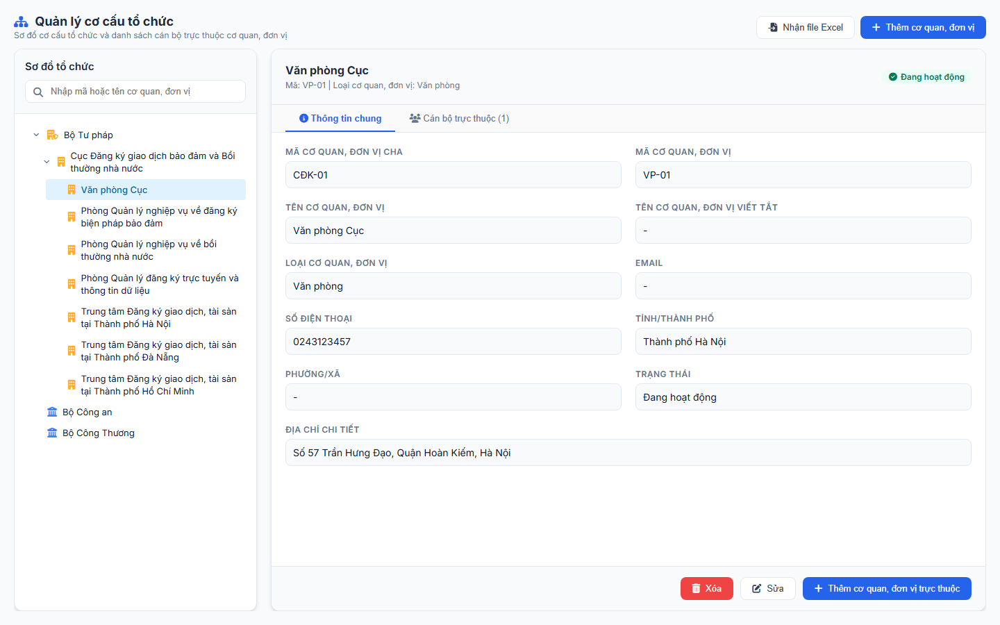
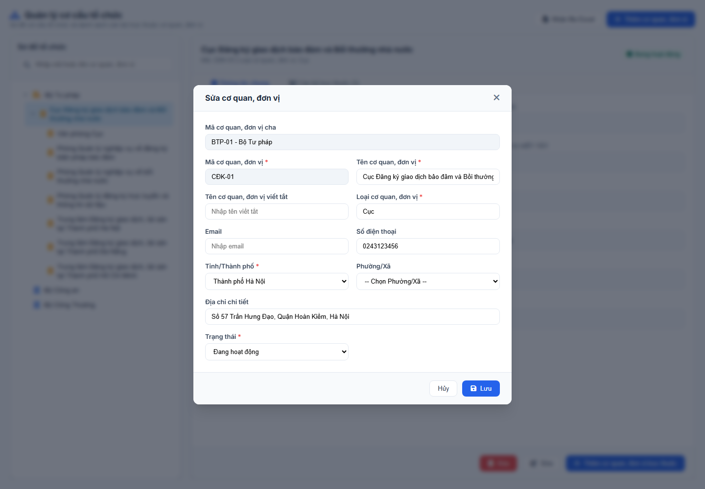
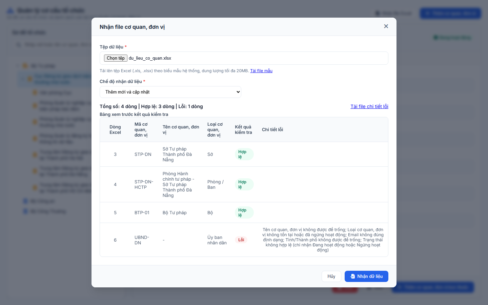
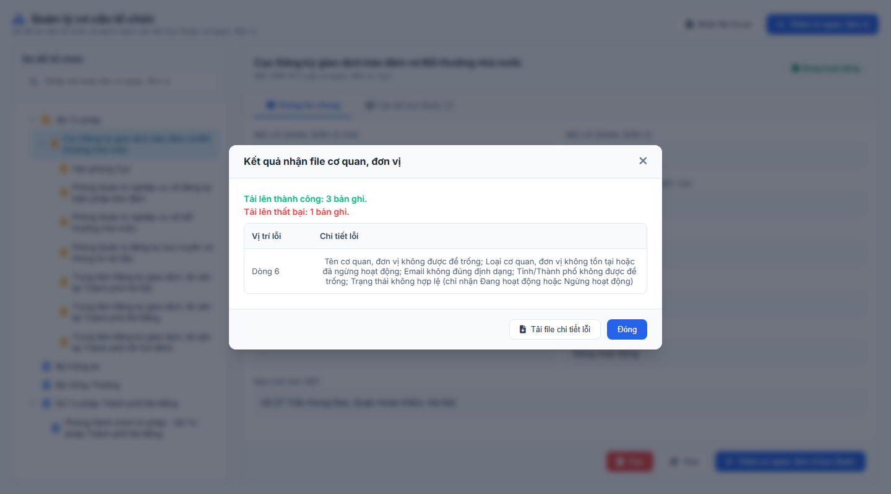

#### 4.3.1.7. Quản lý cơ cấu tổ chức

##### 4.3.1.7.1. Mục đích
Cho phép quản lý và tra cứu cơ cấu tổ chức các cơ quan, đơn vị dưới dạng phân cấp cây đa cội (Multi-root Tree), bao gồm:
- Quản lý sơ đồ cơ cấu tổ chức của Bộ Tư pháp và các cơ quan có thẩm quyền ngoài ngành.
- Thêm cơ quan, đơn vị; thêm cơ quan, đơn vị trực thuộc; sửa và xóa cơ quan, đơn vị.
- Mỗi cơ quan, đơn vị thuộc 01 Loại cơ quan theo [Danh sách Loại cơ quan - Danh mục Loại cơ quan và Danh mục Chức vụ - Quản trị hệ thống (Website Quản trị)](Danh%20m%E1%BB%A5c%20Lo%E1%BA%A1i%20c%C6%A1%20quan%20v%C3%A0%20Danh%20m%E1%BB%A5c%20Ch%E1%BB%A9c%20v%E1%BB%A5.md#ldv-danh-sach-loai-don-vi).
- Loại cơ quan của cơ quan, đơn vị quyết định danh sách Chức vụ của cán bộ thuộc cơ quan, đơn vị đó tại [MH02 - Popup Thêm mới / Sửa tài khoản cán bộ - Quản lý tài khoản cán bộ - Quản trị hệ thống (Website Quản trị)](Quan_ly_tai_khoan_can_bo.md#tkcb-mh02).
- Nhận file Excel để thêm mới, cập nhật danh sách cơ quan, đơn vị hàng loạt theo [Biểu mẫu nhận file cơ quan, đơn vị - Quản lý cơ cấu tổ chức - Quản trị hệ thống (Website Quản trị)](#cctc-bieu-mau).

*a. Phân quyền*
- Quản trị hệ thống (QTHT).

*b. Điều kiện thực hiện*
- Cán bộ quản trị đã đăng nhập thành công vào Website quản trị.
- Hệ thống hoạt động bình thường.

---

##### 4.3.1.7.2. MH01 - Màn hình Quản lý cơ cấu tổ chức

###### 4.3.1.7.2.1. Màn hình

###### 4.3.1.7.2.2. Mô tả thông tin trên màn hình

| Trường thông tin | Kiểu dữ liệu | Bắt buộc | Mặc định | Mô tả |
| :--- | :--- | :--- | :--- | :--- |
| **I. Thanh công cụ** | - | - | - | - Khối nút thao tác tại header màn hình. |
| Nhận file Excel | String(50) | - | - | - Control UI: Button. - Luôn hiển thị. |
| Thêm cơ quan, đơn vị | String(50) | - | - | - Control UI: Button. - Luôn hiển thị. |
| **II. Panel bên trái: Sơ đồ tổ chức** | - | - | - | - Khối tìm kiếm và cây cơ cấu tổ chức. |
| Tìm kiếm | String(255) | Không | Trống | - Control UI: Input text. - Placeholder: "Nhập mã hoặc tên cơ quan, đơn vị". - Tìm kiếm gần đúng theo Mã cơ quan, đơn vị hoặc Tên cơ quan, đơn vị. - Không phân biệt hoa thường. |
| Cây cơ cấu tổ chức | Tree | - | - | - Control UI: Cây phân cấp đa cội (Multi-root). - Hiển thị cơ quan, đơn vị cha và các cơ quan, đơn vị trực thuộc. - Cho phép thu gọn, mở rộng từng node. - Click 01 node để xem chi tiết ở Panel bên phải. |
| **III. Panel bên phải: Chi tiết cơ quan, đơn vị** | - | - | - | - Khối xem chi tiết và danh sách cán bộ của cơ quan, đơn vị đang chọn trên cây. |
| Tên cơ quan, đơn vị | String(255) | - | Theo node chọn | - Control UI: Text hiển thị (Read-only). - Hiển thị tại dòng tiêu đề. |
| Mã, Loại cơ quan, đơn vị | String(255) | - | Theo node chọn | - Control UI: Text hiển thị (Read-only). - Hiển thị dưới Tên cơ quan, đơn vị. - Định dạng: "Mã: [Mã cơ quan, đơn vị] \| Loại cơ quan, đơn vị: [Tên loại cơ quan]". - Chưa có Loại cơ quan, đơn vị: hiển thị `-`. |
| Trạng thái | Enum(String(50)) | - | Theo node chọn | - Control UI: Badge/Tag hiển thị. - Gồm: + Đang hoạt động + Ngừng hoạt động |
| Tab Thông tin chung | Tab | - | Mặc định chọn | - Control UI: Tab điều hướng. - Hiển thị chỉ đọc các trường tại [Thông tin chung của cơ quan, đơn vị - Quản lý cơ cấu tổ chức - Quản trị hệ thống (Website Quản trị)](#cctc-thong-tin-chung). |
| Tab Cán bộ trực thuộc | Tab | - | - | - Control UI: Tab điều hướng. - Nhãn tab: "Cán bộ trực thuộc ([Số cán bộ])". - Hiển thị danh sách cán bộ thuộc cơ quan, đơn vị. |
| Bảng danh sách cán bộ | Table | - | 20 bản ghi/trang | - Control UI: Bảng/Lưới dữ liệu. - Gồm các cột: STT, Họ và tên, Tên đăng nhập, Email, Số điện thoại, Vai trò, Trạng thái. - Không có dữ liệu: bảng hiển thị duy nhất 01 dòng căn giữa trên toàn bộ chiều rộng bảng, in nghiêng, nội dung "Không tìm thấy dữ liệu phù hợp với điều kiện tìm kiếm.". |
| Xóa | String(50) | - | - | - Control UI: Button. - Chỉ hiển thị khi đã chọn 01 node trên cây. |
| Sửa | String(50) | - | - | - Control UI: Button. - Chỉ hiển thị khi đã chọn 01 node trên cây. |
| Thêm cơ quan, đơn vị trực thuộc | String(50) | - | - | - Control UI: Button. - Chỉ hiển thị khi đã chọn 01 node trên cây. |

**Thông tin chung của cơ quan, đơn vị** (Tab Thông tin chung):

| Trường thông tin | Kiểu dữ liệu | Bắt buộc | Mặc định | Mô tả |
| :--- | :--- | :--- | :--- | :--- |
| Mã cơ quan, đơn vị cha | String(50) | - | Theo bản ghi | - Control UI: Text hiển thị (Read-only). - Không có cơ quan, đơn vị cha: hiển thị `-`. |
| Mã cơ quan, đơn vị | String(50) | - | Theo bản ghi | - Control UI: Text hiển thị (Read-only). |
| Tên cơ quan, đơn vị | String(255) | - | Theo bản ghi | - Control UI: Text hiển thị (Read-only). |
| Tên cơ quan, đơn vị viết tắt | String(100) | - | Theo bản ghi | - Control UI: Text hiển thị (Read-only). - Không có giá trị: hiển thị `-`. |
| Loại cơ quan, đơn vị | String(255) | - | Theo bản ghi | - Control UI: Text hiển thị (Read-only). - Hiển thị Tên loại cơ quan. - Không có giá trị: hiển thị `-`. |
| Email | String(100) | - | Theo bản ghi | - Control UI: Text hiển thị (Read-only). - Không có giá trị: hiển thị `-`. |
| Số điện thoại | String(10) | - | Theo bản ghi | - Control UI: Text hiển thị (Read-only). - Không có giá trị: hiển thị `-`. |
| Tỉnh/Thành phố | String(100) | - | Theo bản ghi | - Control UI: Text hiển thị (Read-only). - Không có giá trị: hiển thị `-`. |
| Phường/Xã | String(100) | - | Theo bản ghi | - Control UI: Text hiển thị (Read-only). - Không có giá trị: hiển thị `-`. |
| Trạng thái | String(50) | - | Theo bản ghi | - Control UI: Text hiển thị (Read-only). |
| Địa chỉ chi tiết | String(500) | - | Theo bản ghi | - Control UI: Text hiển thị (Read-only). - Không có giá trị: hiển thị `-`. |

###### 4.3.1.7.2.3. Chức năng trên màn hình

| STT | Tên chức năng | Định dạng | Mô tả |
| :--- | :--- | :--- | :--- |
| 1 | Tìm kiếm | Input text | Khi người dùng nhập từ khóa: - **TH Không có dữ liệu**: Cây cơ cấu tổ chức hiển thị "Không tìm thấy dữ liệu phù hợp với điều kiện tìm kiếm.". - **TH Có dữ liệu**: Cây hiển thị các node khớp từ khóa kèm đường dẫn cơ quan, đơn vị cha. |
| 2 | Chọn node cây | Click Node | Tải thông tin chi tiết của cơ quan, đơn vị được chọn sang Panel bên phải (Tab Thông tin chung và Tab Cán bộ trực thuộc). |
| 3 | Nhận file Excel | Button | Mở [MH03 - Popup Nhận file cơ quan, đơn vị - Quản lý cơ cấu tổ chức - Quản trị hệ thống (Website Quản trị)](#cctc-mh03). |
| 4 | Thêm cơ quan, đơn vị | Button | Mở [MH02 - Popup Thêm mới / Sửa cơ quan, đơn vị - Quản lý cơ cấu tổ chức - Quản trị hệ thống (Website Quản trị)](#cctc-mh02) ở chế độ Thêm mới: - Tiêu đề: "Thêm cơ quan, đơn vị". - `Mã cơ quan, đơn vị cha`: "Không có". |
| 5 | Thêm cơ quan, đơn vị trực thuộc | Button | Mở [MH02 - Popup Thêm mới / Sửa cơ quan, đơn vị - Quản lý cơ cấu tổ chức - Quản trị hệ thống (Website Quản trị)](#cctc-mh02) ở chế độ Thêm mới: - Tiêu đề: "Thêm cơ quan, đơn vị trực thuộc". - `Mã cơ quan, đơn vị cha`: tự động điền theo node đang chọn. |
| 6 | Sửa | Button | Mở [MH02 - Popup Thêm mới / Sửa cơ quan, đơn vị - Quản lý cơ cấu tổ chức - Quản trị hệ thống (Website Quản trị)](#cctc-mh02) ở chế độ Sửa cho cơ quan, đơn vị đang chọn: - Tiêu đề: "Sửa cơ quan, đơn vị". |
| 7 | Xóa | Button | Mở [POPUP-CFM-001 - Popup Xác nhận Dùng chung - Danh mục và Phụ lục - Tài liệu tổng hợp](../../Tai%20lieu%20tong%20hop/04_Danh_muc_va_Phu_luc.md#541-popup-cfm-001---popup-xác-nhận-dùng-chung-common-confirmation-modal) với `Loại thao tác` là `Xóa`: - Nội dung: "Bạn có chắc chắn muốn xóa cơ quan, đơn vị [Tên cơ quan, đơn vị] ra khỏi sơ đồ cơ cấu tổ chức không?". - **TH1 (Có cơ quan, đơn vị trực thuộc)**: Hệ thống chặn xóa, hiển thị thông báo lỗi "Không thể xóa do cơ quan, đơn vị này đang có cơ quan, đơn vị trực thuộc". - **TH2 (Có cán bộ trực thuộc)**: Hệ thống chặn xóa, hiển thị thông báo lỗi "Không thể xóa do cơ quan, đơn vị này đang có tài khoản cán bộ trực thuộc. Vui lòng thuyên chuyển cán bộ trước.". - **TH Hợp lệ**: Khi người dùng chọn "Xác nhận", hệ thống xóa cơ quan, đơn vị khỏi CSDL, ghi Audit Log, hiển thị thông báo "Xóa cơ quan, đơn vị thành công" và làm mới cây cơ cấu tổ chức. |

---

##### 4.3.1.7.3. MH02 - Popup Thêm mới / Sửa cơ quan, đơn vị

###### 4.3.1.7.3.1. Màn hình

###### 4.3.1.7.3.2. Mô tả thông tin trên màn hình

| Trường thông tin | Kiểu dữ liệu | Bắt buộc | Mặc định | Mô tả |
| :--- | :--- | :--- | :--- | :--- |
| **Form Cơ quan, đơn vị** | - | - | - | - Control UI: Popup Modal. - Tiêu đề Thêm mới: "Thêm cơ quan, đơn vị" hoặc "Thêm cơ quan, đơn vị trực thuộc". - Tiêu đề Sửa: "Sửa cơ quan, đơn vị". |
| Mã cơ quan, đơn vị cha | String(255) | Không | Theo node chọn / "Không có" | - Control UI: Text hiển thị (Read-only). - Thêm cơ quan, đơn vị trực thuộc: hiển thị "[Mã cơ quan, đơn vị cha] - [Tên cơ quan, đơn vị cha]" của node đang chọn. - Thêm cơ quan, đơn vị: hiển thị "Không có". - Sửa: hiển thị theo cơ quan, đơn vị cha của bản ghi; không có thì hiển thị "Không có". |
| Mã cơ quan, đơn vị | String(50) | Có | Trống (Thêm mới) / Theo bản ghi (Sửa) | - Control UI: Input text. - Placeholder: "Nhập mã cơ quan, đơn vị". - Sửa: khóa chỉ đọc, không cho phép sửa. - Không được trùng với Mã cơ quan, đơn vị đã có trên hệ thống. |
| Tên cơ quan, đơn vị | String(255) | Có | Trống (Thêm mới) / Theo bản ghi (Sửa) | - Control UI: Input text. - Placeholder: "Nhập tên cơ quan, đơn vị". - Không được trùng với Tên cơ quan, đơn vị khác trong cùng cơ quan, đơn vị cha. |
| Tên cơ quan, đơn vị viết tắt | String(100) | Không | Trống (Thêm mới) / Theo bản ghi (Sửa) | - Control UI: Input text. - Placeholder: "Nhập tên viết tắt". |
| Loại cơ quan, đơn vị | String(50) | Có | Trống (Thêm mới) / Theo bản ghi (Sửa) | - Control UI: Ô nhập có gợi ý (Autocomplete). - Placeholder: "Nhập tên loại cơ quan". - Danh sách gợi ý gồm các giá trị đang hoạt động của Danh mục Loại cơ quan [DM_57] có tên chứa nội dung đã gõ. - Tìm gần đúng, không phân biệt hoa thường, nhập có dấu hoặc không dấu. - Không có giá trị phù hợp: hiển thị "Không tìm thấy loại cơ quan phù hợp". - Người dùng phải chọn 01 giá trị trong danh sách gợi ý. - Sửa nội dung đã chọn thì bỏ giá trị đã chọn. |
| Email | String(100) | Không | Trống (Thêm mới) / Theo bản ghi (Sửa) | - Control UI: Input text. - Placeholder: "Nhập email". - Nếu có nhập: phải đúng định dạng email. |
| Số điện thoại | String(10) | Không | Trống (Thêm mới) / Theo bản ghi (Sửa) | - Control UI: Input text. - Placeholder: "Nhập số điện thoại". - Nếu có nhập: phải gồm đúng 10 chữ số. |
| Tỉnh/Thành phố | Enum(String(100)) | Có | `-- Chọn Tỉnh/Thành phố --` (Thêm mới) / Theo bản ghi (Sửa) | - Control UI: Combobox. - Danh sách lấy theo Danh mục Tỉnh/Thành phố [DM_13], chỉ gồm giá trị đang hoạt động. - Khi thay đổi: tải lại danh sách `Phường/Xã` và đưa `Phường/Xã` về `-- Chọn Phường/Xã --`. |
| Phường/Xã | Enum(String(100)) | Không | `-- Chọn Phường/Xã --` (Thêm mới) / Theo bản ghi (Sửa) | - Control UI: Combobox. - Danh sách lấy theo Danh mục Xã/Phường [DM_15], chỉ gồm Phường/Xã thuộc `Tỉnh/Thành phố` đã chọn. - Chưa chọn `Tỉnh/Thành phố`: trường bị khóa. |
| Địa chỉ chi tiết | String(500) | Không | Trống (Thêm mới) / Theo bản ghi (Sửa) | - Control UI: Input text. - Placeholder: "Nhập số nhà, tên đường". |
| Trạng thái | Enum(String(50)) | Có | Đang hoạt động (Thêm mới) / Theo bản ghi (Sửa) | - Control UI: Combobox. - Gồm: + Đang hoạt động + Ngừng hoạt động |
| Lưu | String(50) | - | - | - Control UI: Button. - Luôn hiển thị tại footer popup. |
| Hủy | String(50) | - | - | - Control UI: Button. - Luôn hiển thị tại footer popup. |

###### 4.3.1.7.3.3. Chức năng trên màn hình

| STT | Tên chức năng | Định dạng | Mô tả |
| :--- | :--- | :--- | :--- |
| 1 | Lưu | Button | Kiểm tra dữ liệu trên form: - **TH1 (Bỏ trống trường bắt buộc)**: Bỏ trống `Mã cơ quan, đơn vị`, `Tên cơ quan, đơn vị`, `Loại cơ quan, đơn vị` hoặc `Tỉnh/Thành phố` $\rightarrow$ Đánh dấu ô lỗi, hiển thị dưới ô lỗi "Đây là trường bắt buộc", focus con trỏ vào ô lỗi đầu tiên và không lưu. - **TH2 (Sai định dạng)**: `Email` có nhập nhưng sai định dạng $\rightarrow$ hiển thị "Địa chỉ email không đúng định dạng (ví dụ: abc@domain.com)"; `Số điện thoại` có nhập nhưng không đủ 10 chữ số $\rightarrow$ hiển thị "Số điện thoại không hợp lệ (yêu cầu 10 chữ số)"; không lưu. - **TH3 (Trùng lặp dữ liệu)**: Thêm mới có `Mã cơ quan, đơn vị` đã tồn tại trên hệ thống, hoặc `Tên cơ quan, đơn vị` trùng với cơ quan, đơn vị khác trong cùng cơ quan, đơn vị cha (khi Sửa thì loại trừ chính bản ghi đang xử lý) $\rightarrow$ Hiển thị "Dữ liệu [Tên trường] '[Giá trị]' đã tồn tại trên hệ thống. Vui lòng kiểm tra lại." và không lưu. - **TH Hợp lệ**: Lưu thông tin vào CSDL, ghi Audit Log, hiển thị thông báo "Thêm cơ quan, đơn vị thành công" (Thêm mới) hoặc "Sửa cơ quan, đơn vị thành công" (Sửa), đóng popup, làm mới cây cơ cấu tổ chức và chọn cơ quan, đơn vị vừa lưu tại [MH01 - Màn hình Quản lý cơ cấu tổ chức - Quản lý cơ cấu tổ chức - Quản trị hệ thống (Website Quản trị)](#cctc-mh01). |
| 2 | Hủy | Button | Đóng popup, hủy bỏ các thay đổi và quay lại màn hình chính. |

---

##### 4.3.1.7.4. MH03 - Popup Nhận file cơ quan, đơn vị

###### 4.3.1.7.4.1. Màn hình

###### 4.3.1.7.4.2. Mô tả thông tin trên màn hình

| Trường thông tin | Kiểu dữ liệu | Bắt buộc | Mặc định | Mô tả |
| :--- | :--- | :--- | :--- | :--- |
| **Popup Nhận file** | - | - | - | - Control UI: Popup Modal. - Tiêu đề: "Nhận file cơ quan, đơn vị". |
| Tệp dữ liệu | File (.xls, .xlsx) | Có | Trống | - Control UI: Nút chọn tệp. - Chỉ chọn 01 tệp. - Định dạng `.xls`, `.xlsx`; dung lượng tối đa 20MB. - Dòng hướng dẫn: "Tải lên tệp Excel (.xls, .xlsx) theo biểu mẫu hệ thống, dung lượng tối đa 20MB.". - Chọn tệp xong: hệ thống tự động kiểm tra tệp theo [Quy tắc kiểm tra tệp và dữ liệu nhận file - Quản lý cơ cấu tổ chức - Quản trị hệ thống (Website Quản trị)](#cctc-quy-tac-nhan-file). |
| Tải file mẫu | Link | - | - | - Control UI: Link. - Luôn hiển thị cạnh dòng hướng dẫn của `Tệp dữ liệu`. - Tải về tệp biểu mẫu tại [Biểu mẫu nhận file cơ quan, đơn vị - Quản lý cơ cấu tổ chức - Quản trị hệ thống (Website Quản trị)](#cctc-bieu-mau). |
| Chế độ nhận dữ liệu | Enum(String(100)) | Có | Thêm mới và cập nhật | - Control UI: Combobox. - Gồm: + Kiểm tra dữ liệu + Thêm mới + Cập nhật bản ghi hiện có + Thêm mới và cập nhật - Quy tắc từng chế độ tại [Quy tắc kiểm tra tệp và dữ liệu nhận file - Quản lý cơ cấu tổ chức - Quản trị hệ thống (Website Quản trị)](#cctc-quy-tac-nhan-file). - Khi thay đổi: hệ thống kiểm tra lại dữ liệu của tệp đã chọn theo chế độ mới. |
| Thông báo lỗi tệp | String(255) | - | - | - Control UI: Text hiển thị (Read-only), dưới `Tệp dữ liệu`. - Chỉ hiển thị khi tệp vi phạm quy tắc kiểm tra tệp. |
| Thống kê kiểm tra | String(255) | - | - | - Control UI: Text hiển thị (Read-only). - Chỉ hiển thị khi tệp hợp lệ và đã kiểm tra xong dữ liệu. - Định dạng: "Tổng số: [N] dòng \| Hợp lệ: [X] dòng \| Lỗi: [Y] dòng". |
| Bảng xem trước kết quả kiểm tra | Table | - | - | - Control UI: Bảng/Lưới dữ liệu (Read-only). - Chỉ hiển thị khi tệp hợp lệ và đã kiểm tra xong dữ liệu. - Gồm các cột: Dòng Excel, Mã cơ quan, đơn vị, Tên cơ quan, đơn vị, Loại cơ quan, đơn vị, Kết quả kiểm tra, Chi tiết lỗi. - `Kết quả kiểm tra`: nhãn `Hợp lệ` hoặc `Lỗi`. - `Chi tiết lỗi`: toàn bộ lỗi của dòng, mỗi lỗi cách nhau bằng dấu `;`; dòng hợp lệ để trống. |
| Tải file chi tiết lỗi | Link | - | - | - Control UI: Link. - Chỉ hiển thị khi có ít nhất 01 dòng lỗi. - Tải về file chi tiết lỗi theo [File chi tiết lỗi - Quản lý cơ cấu tổ chức - Quản trị hệ thống (Website Quản trị)](#cctc-file-loi). |
| Nhận dữ liệu | String(50) | - | - | - Control UI: Button. - Luôn hiển thị tại footer popup. - Chỉ cho phép thao tác khi tệp hợp lệ, có ít nhất 01 dòng hợp lệ và `Chế độ nhận dữ liệu` khác `Kiểm tra dữ liệu`; còn lại khóa mờ. |
| Hủy | String(50) | - | - | - Control UI: Button. - Luôn hiển thị tại footer popup. |

###### 4.3.1.7.4.3. Chức năng trên màn hình

| STT | Tên chức năng | Định dạng | Mô tả |
| :--- | :--- | :--- | :--- |
| 1 | Chọn tệp | Button | Người dùng chọn tệp từ máy tính: - **TH1 (Tệp vi phạm quy tắc kiểm tra tệp)**: Hiển thị `Thông báo lỗi tệp` tương ứng; không hiển thị `Thống kê kiểm tra`, `Bảng xem trước kết quả kiểm tra`; khóa `Nhận dữ liệu`. - **TH2 (Tệp hợp lệ)**: Hệ thống kiểm tra từng dòng dữ liệu theo `Chế độ nhận dữ liệu`, hiển thị `Thống kê kiểm tra`, `Bảng xem trước kết quả kiểm tra` và `Tải file chi tiết lỗi` (nếu có dòng lỗi). |
| 2 | Tải file mẫu | Link | Tải về máy người dùng tệp biểu mẫu, tên tệp: `yyyyMMdd_Bieu_mau_nhan_file_co_quan_don_vi.xlsx` (`yyyyMMdd` là ngày tải). |
| 3 | Tải file chi tiết lỗi | Link | Tải về máy người dùng file chi tiết lỗi theo [File chi tiết lỗi - Quản lý cơ cấu tổ chức - Quản trị hệ thống (Website Quản trị)](#cctc-file-loi). |
| 4 | Nhận dữ liệu | Button | Xử lý theo cơ chế thành công một phần: 1. Ghi các dòng hợp lệ vào CSDL theo `Chế độ nhận dữ liệu` (thêm mới hoặc cập nhật cơ quan, đơn vị). 2. Không ghi các dòng lỗi. 3. Ghi Audit Log. 4. Đóng popup Nhận file, mở [MH04 - Popup Kết quả nhận file - Quản lý cơ cấu tổ chức - Quản trị hệ thống (Website Quản trị)](#cctc-mh04) và làm mới cây cơ cấu tổ chức tại [MH01 - Màn hình Quản lý cơ cấu tổ chức - Quản lý cơ cấu tổ chức - Quản trị hệ thống (Website Quản trị)](#cctc-mh01). |
| 5 | Hủy | Button | Đóng popup, không nhận dữ liệu. |

---

##### 4.3.1.7.5. MH04 - Popup Kết quả nhận file

###### 4.3.1.7.5.1. Màn hình

###### 4.3.1.7.5.2. Mô tả thông tin trên màn hình

| Trường thông tin | Kiểu dữ liệu | Bắt buộc | Mặc định | Mô tả |
| :--- | :--- | :--- | :--- | :--- |
| **Popup Kết quả nhận file** | - | - | - | - Control UI: Popup Modal. - Tiêu đề: "Kết quả nhận file cơ quan, đơn vị". |
| Số bản ghi thành công | String(100) | - | - | - Control UI: Text hiển thị (Read-only). - Định dạng: "Tải lên thành công: [X] bản ghi.". - `X` là số dòng hợp lệ đã ghi vào hệ thống. |
| Số bản ghi thất bại | String(100) | - | - | - Control UI: Text hiển thị (Read-only). - Định dạng: "Tải lên thất bại: [Y] bản ghi.". - `Y` là số dòng lỗi. |
| Bảng chi tiết lỗi | Table | - | - | - Control UI: Bảng/Lưới dữ liệu (Read-only). - Chỉ hiển thị khi `Y` > 0. - Gồm các cột: Vị trí lỗi, Chi tiết lỗi. - `Vị trí lỗi`: "Dòng [Số thứ tự dòng trong file Excel]". - `Chi tiết lỗi`: toàn bộ lỗi của dòng, mỗi lỗi cách nhau bằng dấu `;`. |
| Tải file chi tiết lỗi | String(50) | - | - | - Control UI: Button. - Chỉ hiển thị khi `Y` > 0. |
| Đóng | String(50) | - | - | - Control UI: Button. - Luôn hiển thị tại footer popup. |

###### 4.3.1.7.5.3. Chức năng trên màn hình

| STT | Tên chức năng | Định dạng | Mô tả |
| :--- | :--- | :--- | :--- |
| 1 | Tải file chi tiết lỗi | Button | Tải về máy người dùng file chi tiết lỗi theo [File chi tiết lỗi - Quản lý cơ cấu tổ chức - Quản trị hệ thống (Website Quản trị)](#cctc-file-loi). |
| 2 | Đóng | Button | Đóng popup và quay lại [MH01 - Màn hình Quản lý cơ cấu tổ chức - Quản lý cơ cấu tổ chức - Quản trị hệ thống (Website Quản trị)](#cctc-mh01). |

---

##### 4.3.1.7.6. Biểu mẫu nhận file cơ quan, đơn vị

- Tệp biểu mẫu: [Bieu_mau_nhan_file_co_quan_don_vi.xlsx](../../../../Tai%20lieu%20he%20thong/Bieu%20mau/Bieu_mau_nhan_file_co_quan_don_vi.xlsx).
- Phông chữ toàn bộ tệp: Times New Roman, cỡ chữ 13.
- Tệp gồm các sheet:

| STT | Sheet | Nội dung |
| :-- | :--- | :--- |
| 1 | `Huong_dan` | Hướng dẫn nhập liệu, mô tả từng cột, quy tắc từng chế độ nhận dữ liệu, danh sách lỗi và cấu trúc file chi tiết lỗi. |
| 2 | `Du_lieu` | Sheet nhập dữ liệu. Hệ thống chỉ đọc sheet này. |
| 3 | `Vi_du` | Dữ liệu ví dụ đúng định dạng; hệ thống không đọc sheet này. |
| 4 | `Danh_muc` | Danh sách giá trị hợp lệ của `Loại cơ quan, đơn vị` và `Trạng thái`; dùng cho danh sách chọn tại sheet `Du_lieu`. |

- Cấu trúc sheet `Du_lieu`:
  + Dòng 1: tiêu đề cột, gồm đúng 12 cột theo thứ tự tại bảng dưới; cột bắt buộc có ký hiệu `(*)`.
  + Dòng 2: dòng hướng dẫn nhập liệu cho từng cột; hệ thống bỏ qua dòng này.
  + Từ dòng 3: dữ liệu cơ quan, đơn vị, mỗi dòng là 01 cơ quan, đơn vị.

| STT | Cột | Tên cột (dòng 1) | Kiểu dữ liệu | Bắt buộc | Quy tắc nhập và kiểm tra |
| :-- | :-- | :--- | :--- | :--- | :--- |
| 1 | A | STT | Số | Không | - Số thứ tự dòng, chỉ để tham khảo. - Hệ thống không kiểm tra cột này. |
| 2 | B | Mã cơ quan, đơn vị cha | Text(50) | Không | - Bỏ trống: cơ quan, đơn vị không có cơ quan, đơn vị cha. - Nếu có nhập: phải là Mã cơ quan, đơn vị đã có trên hệ thống, hoặc là `Mã cơ quan, đơn vị` của 01 dòng hợp lệ nằm phía trên trong cùng tệp. - Không được trùng với `Mã cơ quan, đơn vị` của chính dòng đó. - Cập nhật bản ghi đã có: phải trùng với Mã cơ quan, đơn vị cha hiện tại của bản ghi. |
| 3 | C | Mã cơ quan, đơn vị (*) | Text(50) | Có | - Không chứa khoảng trắng ở đầu, cuối (hệ thống tự cắt). - Không trùng với `Mã cơ quan, đơn vị` của dòng khác trong cùng tệp. - Kiểm tra tồn tại trên hệ thống theo `Chế độ nhận dữ liệu`. |
| 4 | D | Tên cơ quan, đơn vị (*) | Text(255) | Có | - Không trùng với Tên cơ quan, đơn vị khác có cùng cơ quan, đơn vị cha (trên hệ thống và trong cùng tệp). |
| 5 | E | Tên cơ quan, đơn vị viết tắt | Text(100) | Không | - Tối đa 100 ký tự. |
| 6 | F | Loại cơ quan, đơn vị (*) | Text(255) | Có | - Nhập đúng Tên loại cơ quan trong Danh mục Loại cơ quan [DM_57], đang hoạt động; không phân biệt hoa thường. - Chọn từ danh sách thả xuống tại sheet `Du_lieu`. |
| 7 | G | Email | Text(100) | Không | - Nếu có nhập: phải đúng định dạng email. |
| 8 | H | Số điện thoại | Text(10) | Không | - Định dạng ô: Text, để giữ số 0 ở đầu. - Nếu có nhập: phải gồm đúng 10 chữ số. |
| 9 | I | Tỉnh/Thành phố (*) | Text(100) | Có | - Nhập đúng tên Tỉnh/Thành phố trong Danh mục Tỉnh/Thành phố [DM_13], đang hoạt động; không phân biệt hoa thường. |
| 10 | J | Phường/Xã | Text(100) | Không | - Nếu có nhập: phải là tên Phường/Xã trong Danh mục Xã/Phường [DM_15], đang hoạt động và thuộc `Tỉnh/Thành phố` tại cột I. |
| 11 | K | Địa chỉ chi tiết | Text(500) | Không | - Tối đa 500 ký tự. |
| 12 | L | Trạng thái | Text(50) | Không | - Chỉ nhận `Đang hoạt động` hoặc `Ngừng hoạt động`; chọn từ danh sách thả xuống. - Bỏ trống: Thêm mới thì ghi nhận `Đang hoạt động`; cập nhật thì giữ nguyên trạng thái hiện tại. |

##### 4.3.1.7.7. Quy tắc kiểm tra tệp và dữ liệu nhận file

Áp dụng theo [Quy chuẩn Xử lý Tính năng Nhận file - Danh mục và Phụ lục - Tài liệu tổng hợp](../../Tai%20lieu%20tong%20hop/04_Danh_muc_va_Phu_luc.md#56-quy-chuẩn-xử-lý-tính-năng-nhận-file-import-file--tải-lên-danh-sách), chi tiết như sau.

**1. Kiểm tra tệp** (khi chọn tệp; vi phạm thì dừng, không đọc dữ liệu):

| STT | Quy tắc | Thông báo lỗi tệp |
| :-- | :--- | :--- |
| 1 | Tệp phải có định dạng `.xls` hoặc `.xlsx`. | "Định dạng tệp tin không hợp lệ. Chỉ chấp nhận tệp tin định dạng .xls, .xlsx." |
| 2 | Dung lượng tệp tối đa 20MB. | "Dung lượng tệp tin vượt quá 20MB. Vui lòng kiểm tra lại." |
| 3 | Tệp phải có sheet `Du_lieu`; dòng 1 của sheet `Du_lieu` phải có đúng 12 cột, đúng tên và thứ tự cột theo biểu mẫu. | "Tệp không đúng cấu trúc biểu mẫu. Vui lòng tải file mẫu và nhập lại." |
| 4 | Sheet `Du_lieu` phải có ít nhất 01 dòng dữ liệu từ dòng 3. | "Tệp không có dữ liệu. Vui lòng nhập dữ liệu từ dòng 3 của sheet Du_lieu." |

**2. Kiểm tra từng dòng dữ liệu** (từ dòng 3, theo thứ tự từ trên xuống):
- Dòng không có dữ liệu ở tất cả các cột: hệ thống bỏ qua, không tính vào tổng số dòng.
- Hệ thống tự cắt khoảng trắng ở đầu, cuối giá trị của từng ô trước khi kiểm tra.
- Dòng hợp lệ: không vi phạm quy tắc nào.
- Dòng lỗi: vi phạm ít nhất 01 quy tắc; hệ thống ghi nhận toàn bộ lỗi của dòng.

**3. Quy tắc theo Chế độ nhận dữ liệu:**

| STT | Chế độ nhận dữ liệu | Quy tắc |
| :-- | :--- | :--- |
| 1 | Kiểm tra dữ liệu | - Chỉ kiểm tra dữ liệu, không ghi vào CSDL. - Kiểm tra như chế độ `Thêm mới và cập nhật`. - Cho phép tải file chi tiết lỗi; khóa `Nhận dữ liệu`. |
| 2 | Thêm mới | - `Mã cơ quan, đơn vị` đã tồn tại trên hệ thống: dòng lỗi. - Dòng hợp lệ được thêm mới cơ quan, đơn vị. |
| 3 | Cập nhật bản ghi hiện có | - `Mã cơ quan, đơn vị` chưa tồn tại trên hệ thống: dòng lỗi. - Dòng hợp lệ được cập nhật vào cơ quan, đơn vị có cùng mã. - Cột không bắt buộc để trống: giữ nguyên giá trị hiện tại. - Không thay đổi Mã cơ quan, đơn vị cha. |
| 4 | Thêm mới và cập nhật | - `Mã cơ quan, đơn vị` chưa tồn tại: thêm mới. - `Mã cơ quan, đơn vị` đã tồn tại: cập nhật như chế độ `Cập nhật bản ghi hiện có`. |

**4. Danh sách lỗi dòng dữ liệu** (nội dung ghi tại `Chi tiết lỗi`):

| STT | Cột | Điều kiện lỗi | Nội dung lỗi |
| :-- | :--- | :--- | :--- |
| 1 | Mã cơ quan, đơn vị cha | Có nhập nhưng không tồn tại trên hệ thống và không có ở dòng hợp lệ phía trên | Mã cơ quan, đơn vị cha không tồn tại |
| 2 | Mã cơ quan, đơn vị cha | Trùng `Mã cơ quan, đơn vị` của chính dòng đó | Mã cơ quan, đơn vị cha không được trùng Mã cơ quan, đơn vị |
| 3 | Mã cơ quan, đơn vị cha | Cập nhật bản ghi đã có nhưng khác Mã cơ quan, đơn vị cha hiện tại | Không được thay đổi Mã cơ quan, đơn vị cha khi cập nhật |
| 4 | Mã cơ quan, đơn vị cha | Vượt quá 50 ký tự | Mã cơ quan, đơn vị cha vượt quá 50 ký tự |
| 5 | Mã cơ quan, đơn vị | Bỏ trống | Mã cơ quan, đơn vị không được để trống |
| 6 | Mã cơ quan, đơn vị | Vượt quá 50 ký tự | Mã cơ quan, đơn vị vượt quá 50 ký tự |
| 7 | Mã cơ quan, đơn vị | Trùng với dòng khác trong tệp | Mã cơ quan, đơn vị bị trùng với dòng [Số dòng] |
| 8 | Mã cơ quan, đơn vị | Chế độ `Thêm mới`, mã đã tồn tại trên hệ thống | Mã cơ quan, đơn vị đã tồn tại trên hệ thống |
| 9 | Mã cơ quan, đơn vị | Chế độ `Cập nhật bản ghi hiện có`, mã chưa tồn tại trên hệ thống | Mã cơ quan, đơn vị chưa tồn tại trên hệ thống |
| 10 | Tên cơ quan, đơn vị | Bỏ trống | Tên cơ quan, đơn vị không được để trống |
| 11 | Tên cơ quan, đơn vị | Vượt quá 255 ký tự | Tên cơ quan, đơn vị vượt quá 255 ký tự |
| 12 | Tên cơ quan, đơn vị | Trùng tên cơ quan, đơn vị khác có cùng cơ quan, đơn vị cha | Tên cơ quan, đơn vị đã tồn tại trong cùng cơ quan, đơn vị cha |
| 13 | Tên cơ quan, đơn vị viết tắt | Vượt quá 100 ký tự | Tên cơ quan, đơn vị viết tắt vượt quá 100 ký tự |
| 14 | Loại cơ quan, đơn vị | Bỏ trống | Loại cơ quan, đơn vị không được để trống |
| 15 | Loại cơ quan, đơn vị | Không có trong Danh mục Loại cơ quan hoặc đã ngừng hoạt động | Loại cơ quan, đơn vị không tồn tại hoặc đã ngừng hoạt động |
| 16 | Email | Có nhập nhưng sai định dạng | Email không đúng định dạng |
| 17 | Email | Vượt quá 100 ký tự | Email vượt quá 100 ký tự |
| 18 | Số điện thoại | Có nhập nhưng không gồm đúng 10 chữ số | Số điện thoại không hợp lệ (yêu cầu 10 chữ số) |
| 19 | Tỉnh/Thành phố | Bỏ trống | Tỉnh/Thành phố không được để trống |
| 20 | Tỉnh/Thành phố | Không có trong Danh mục Tỉnh/Thành phố hoặc đã ngừng hoạt động | Tỉnh/Thành phố không tồn tại hoặc đã ngừng hoạt động |
| 21 | Phường/Xã | Có nhập nhưng không có trong Danh mục Xã/Phường, đã ngừng hoạt động hoặc không thuộc Tỉnh/Thành phố đã nhập | Phường/Xã không tồn tại hoặc không thuộc Tỉnh/Thành phố đã nhập |
| 22 | Địa chỉ chi tiết | Vượt quá 500 ký tự | Địa chỉ chi tiết vượt quá 500 ký tự |
| 23 | Trạng thái | Có nhập nhưng khác `Đang hoạt động`, `Ngừng hoạt động` | Trạng thái không hợp lệ (chỉ nhận Đang hoạt động hoặc Ngừng hoạt động) |

**5. File chi tiết lỗi:**
- Chỉ tạo khi có ít nhất 01 dòng lỗi.
- Tên tệp: `yyyyMMdd_HHmmss_Loi_nhan_file_co_quan_don_vi.xlsx` (thời điểm tải).
- Gồm 01 sheet `Chi_tiet_loi`, chỉ chứa các dòng lỗi, giữ nguyên giá trị người dùng đã nhập.
- Cấu trúc cột:
  + Cột A `Dòng Excel`: số thứ tự dòng của dòng lỗi trong sheet `Du_lieu`.
  + Cột B đến cột M: 12 cột của sheet `Du_lieu`, đúng tên và thứ tự.
  + Cột N `Chi tiết lỗi`: toàn bộ lỗi của dòng, mỗi lỗi cách nhau bằng dấu `;`.
- Ô của cột có lỗi được tô nền để đánh dấu.
- Người dùng sửa dữ liệu theo `Chi tiết lỗi`, chép lại vào sheet `Du_lieu` của biểu mẫu (bỏ cột A và cột N) và nhận file lại.
