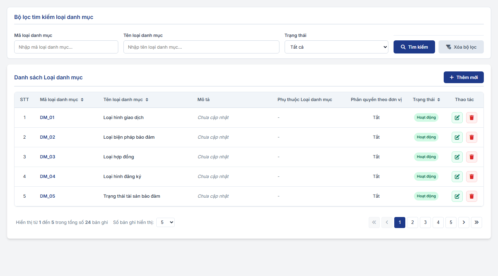
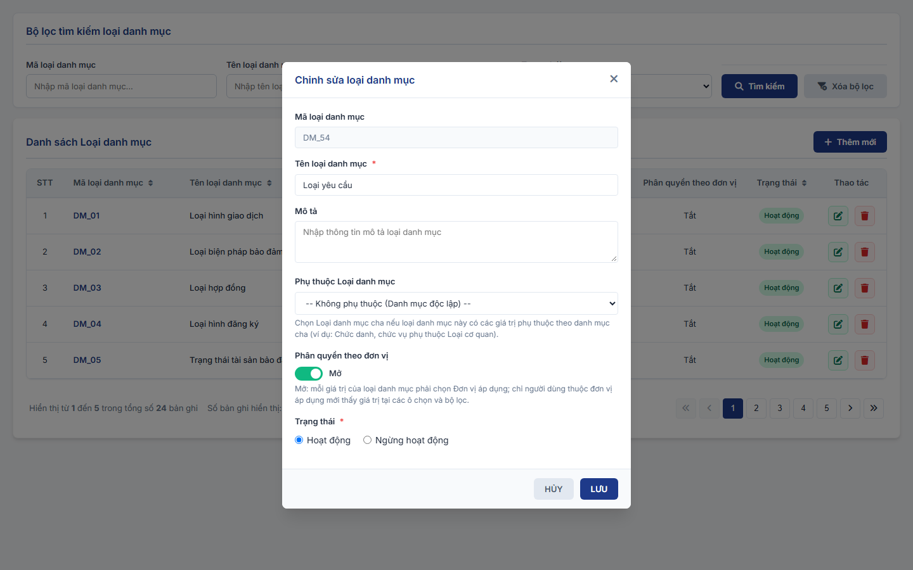
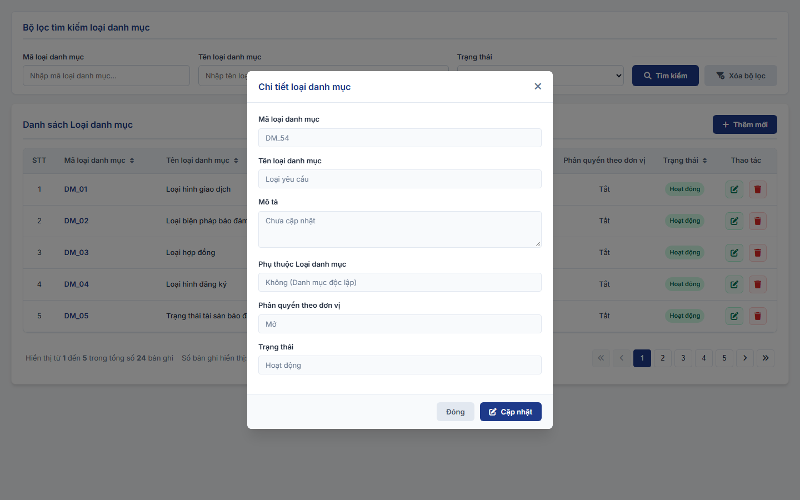

#### 4.3.1.5.2. Quản lý loại danh mục

##### 4.3.1.5.2.1. Mục đích
Quản lý danh sách các Loại danh mục dùng chung (Master Data Types) trong hệ thống, bao gồm:
- Tra cứu, tìm kiếm và hiển thị danh sách các Loại danh mục.
- Khởi tạo mới, cập nhật thông tin và chuyển đổi trạng thái hoạt động (Hoạt động / Ngừng hoạt động) của Loại danh mục.
- Xóa các Loại danh mục chưa phát sinh dữ liệu danh mục chi tiết liên kết.
- Cấu hình **Phụ thuộc Loại danh mục**: cho phép chọn Loại danh mục cha mà Loại danh mục hiện tại phụ thuộc vào (ví dụ: Loại danh mục *Chức vụ [DM_58]* phụ thuộc vào Loại danh mục *Loại cơ quan [DM_57]*). Mục đích để cấu hình phân cấp và phục vụ gán giá trị phụ thuộc cho các bản ghi danh mục chi tiết tương ứng tại [Quản lý danh mục dùng chung](Quan_ly_danh_muc.md).
- Mở / Tắt Phân quyền theo đơn vị cho từng Loại danh mục. Loại danh mục có Phân quyền theo đơn vị = `Mở` thì mỗi giá trị danh mục phải khai báo Đơn vị áp dụng tại [Phân quyền theo đơn vị và Đơn vị áp dụng - Quản lý danh mục dùng chung (Master Data) - Quản trị hệ thống (Website Quản trị)](Quan_ly_danh_muc.md#dm-don-vi-ap-dung).

*a. Phân quyền*
- Quản trị hệ thống (QTHT).

*b. Điều kiện thực hiện*
- Cán bộ quản trị đã đăng nhập thành công vào Website quản trị.
- Hệ thống hoạt động bình thường.

---

##### 4.3.1.5.2.2. MH01 - Màn hình Tra cứu loại danh mục

###### 4.3.1.5.2.2.1. Màn hình

###### 4.3.1.5.2.2.2. Mô tả thông tin trên màn hình

| Trường thông tin | Kiểu dữ liệu | Bắt buộc | Mặc định | Mô tả |
| :--- | :--- | :--- | :--- | :--- |
| **I. Bộ lọc, tìm kiếm** | - | - | - | Khối điều kiện tìm kiếm loại danh mục. |
| Mã loại danh mục | String(50) | Không | Trống | Control UI: Input text. - Tìm kiếm chính xác hoặc tương đối theo Mã loại danh mục. |
| Tên loại danh mục | String(255) | Không | Trống | Control UI: Input text. - Tìm kiếm chính xác hoặc tương đối theo Tên loại danh mục. |
| Trạng thái | Enum(String(50)) | Không | Tất cả | Control UI: Combobox. Gồm: + Tất cả + Hoạt động + Ngừng hoạt động |
| Tìm kiếm | String(50) | - | - | Control UI: Button. - Nằm ở sát góc bên phải của vùng tìm kiếm lọc, phía dưới các ô nhập liệu tìm kiếm, không nằm cùng hàng với các trường nhập. |
| Xóa bộ lọc | String(50) | - | - | Control UI: Button. - Nằm ở sát góc bên phải của vùng tìm kiếm lọc, cạnh nút Tìm kiếm. |
| **II. Bảng danh sách kết quả** | - | - | 20 bản ghi/trang | Control UI: Bảng/Lưới dữ liệu. - Mặc định khi truy cập màn hình: Hiển thị toàn bộ danh sách các Loại danh mục trong hệ thống. - Quy tắc sắp xếp mặc định: Sắp xếp theo Mã loại danh mục tăng dần. Hỗ trợ sắp xếp động (Sortable) khi click vào tiêu đề các cột. - Cho phép chọn 10, 20, 50, 100 bản ghi/trang, mặc định 20. - Trạng thái không có dữ liệu (Empty State): Khi không tìm thấy kết quả phù hợp với điều kiện tìm kiếm, bảng hiển thị duy nhất 01 dòng căn giữa trên toàn bộ chiều rộng bảng (`colspan`), in nghiêng với nội dung theo MessageList dùng chung [MSG-INF-SYS-001]. |
| STT | Integer(10) | - | - | Control UI: Text hiển thị (Read-only). |
| Mã loại danh mục | String(50) | - | - | Control UI: Text hiển thị (Read-only). |
| Tên loại danh mục | String(255) | - | - | Control UI: Text hiển thị (Read-only). |
| Mô tả | String(1000) | - | - | Control UI: Text hiển thị (Read-only). |
| Phụ thuộc Loại danh mục | String(255) | - | - | Control UI: Text hiển thị (Read-only). - Tên và Mã loại danh mục cha mà loại danh mục này phụ thuộc vào. - Hiển thị 2 dòng: Dòng 1 Tên loại danh mục cha; Dòng 2 Mã loại danh mục cha (màu nhạt). - Hiển thị `-` nếu là loại danh mục độc lập (không phụ thuộc loại cha nào). |
| Phân quyền theo đơn vị | Enum(String(10)) | - | - | Control UI: Text hiển thị (Read-only). Gồm: + Có + Không |
| Trạng thái | Enum(String(50)) | - | - | Control UI: Badge/Tag hiển thị. |
| Thao tác | String(255) | - | - | Control UI: Nhóm icon thao tác. - Xem chi tiết - Sửa - Xóa |

###### 4.3.1.5.2.2.3. Chức năng trên màn hình

| STT | Tên chức năng | Định dạng | Mô tả |
| :--- | :--- | :--- | :--- |
| 1 | Tìm kiếm | Button | Khi người dùng click nút "Tìm kiếm": - **TH Không có dữ liệu**: Bảng hiển thị duy nhất 01 dòng căn giữa với nội dung [MSG-INF-SYS-001]; thanh phân trang hiển thị *"Hiển thị 0-0 của 0 bản ghi"* và các nút điều hướng bị khóa mờ. - **TH Có dữ liệu**: Hiển thị danh sách các Loại danh mục thỏa mãn điều kiện lọc. |
| 2 | Xóa bộ lọc | Button | Đưa toàn bộ các trường trong bộ lọc tìm kiếm về giá trị mặc định (`Mã loại danh mục` = Trống, `Tên loại danh mục` = Trống, `Trạng thái` = Tất cả) và tải lại danh sách ban đầu. |
| 3 | Thêm mới | Button | Mở **MH02 - Popup Thêm mới / Cập nhật Loại danh mục** ở trạng thái rỗng để nhập mới. |
| 4 | Xem chi tiết | Icon | Mở **MH03 - Popup Xem chi tiết Loại danh mục** hiển thị toàn bộ thông tin chi tiết của bản ghi ở chế độ chỉ đọc. |
| 5 | Sửa | Icon | Mở **MH02 - Popup Thêm mới / Cập nhật Loại danh mục** và tải toàn bộ dữ liệu hiện tại của bản ghi để chỉnh sửa. |
| 6 | Xóa | Icon | Mở **[POPUP-CFM-001]** với `Loại thao tác` là `Xóa` kèm thông báo xác nhận [MSG-CFM-SYS-001]: - **TH1 (Loại danh mục đang được sử dụng)**: Loại danh mục đã phát sinh các bản ghi danh mục chi tiết liên kết tại màn hình Quản lý danh mục $\rightarrow$ Hệ thống chặn xóa, hiển thị cảnh báo lỗi yêu cầu chuyển trạng thái sang Ngừng hoạt động. - **TH Hợp lệ**: Khi người dùng chọn "Xác nhận", hệ thống xóa bản ghi khỏi CSDL, ghi Audit Log, hiển thị thông báo thành công [MSG-SUC-SYS-001] và làm mới danh sách bảng kết quả. |
| 7 | Click dòng dữ liệu | Row Click | Mở **MH03 - Popup Xem chi tiết Loại danh mục** tương tự thao tác Xem chi tiết. |

---

##### 4.3.1.5.2.3. MH02 - Popup Thêm mới / Cập nhật Loại danh mục

###### 4.3.1.5.2.3.1. Màn hình

###### 4.3.1.5.2.3.2. Mô tả thông tin trên màn hình

| Trường thông tin | Kiểu dữ liệu | Bắt buộc | Mặc định | Mô tả |
| :--- | :--- | :--- | :--- | :--- |
| Mã loại danh mục | String(50) | Không (Thêm mới) / Có (Cập nhật) | Trống (Thêm mới) / Theo bản ghi (Cập nhật) | Control UI: Input text / Read-only. - Thêm mới: Người dùng tự nhập hoặc hệ thống tự động sinh mã duy nhất (định dạng `LDM_xxxx`) nếu để trống. - Cập nhật: Khóa chỉ đọc (Read-only), không cho phép chỉnh sửa. |
| Tên loại danh mục | String(255) | Có | Trống (Thêm mới) / Theo bản ghi (Cập nhật) | Control UI: Input text. - Nhập tên loại danh mục. - Áp dụng quy tắc bắt buộc [BR-VAL-001]. |
| Mô tả | Text(2000) | Không | Trống (Thêm mới) / Theo bản ghi (Cập nhật) | Control UI: Textarea. - Nhập thông tin mô tả chi tiết nếu có. |
| Phụ thuộc Loại danh mục | Enum(String(50)) | Không | Trống (Không phụ thuộc) | Control UI: Combobox. - Cho phép chọn Loại danh mục cha mà Loại danh mục này phụ thuộc vào. - Danh sách lựa chọn gồm: `-- Không phụ thuộc (Danh mục độc lập) --` và các Loại danh mục đang hoạt động trong hệ thống (loại trừ chính bản ghi đang cập nhật). - Dòng hướng dẫn: "Chọn loại danh mục cha nếu loại danh mục này có các giá trị phụ thuộc theo danh mục cha (ví dụ: Chức vụ phụ thuộc Loại cơ quan)." |
| Phân quyền theo đơn vị | Boolean | Không | Không (Thêm mới) / Theo bản ghi (Cập nhật) | Control UI: Toggle (Switch), bên phải hiển thị nhãn trạng thái hiện tại "Có" hoặc "Không". - Click Toggle để chuyển giữa "Có" và "Không". - "Có": mỗi giá trị của Loại danh mục phải khai báo Đơn vị áp dụng; chỉ người dùng thuộc đơn vị áp dụng mới thấy giá trị tại các ô chọn và bộ lọc. - "Không": giá trị của Loại danh mục không có trường Đơn vị áp dụng và không bị giới hạn theo đơn vị. - Dòng hướng dẫn: "Có: mỗi giá trị của loại danh mục phải chọn Đơn vị áp dụng; chỉ người dùng thuộc đơn vị áp dụng mới thấy giá trị tại các ô chọn và bộ lọc." - Quy tắc chi tiết tại [Phân quyền theo đơn vị và Đơn vị áp dụng - Quản lý danh mục dùng chung (Master Data) - Quản trị hệ thống (Website Quản trị)](Quan_ly_danh_muc.md#dm-don-vi-ap-dung). |
| Trạng thái | Enum(String(50)) | Có | Hoạt động (Thêm mới) / Theo bản ghi (Cập nhật) | Control UI: Combobox / Radio. Gồm: + Hoạt động + Ngừng hoạt động |

###### 4.3.1.5.2.3.3. Chức năng trên màn hình

| STT | Tên chức năng | Định dạng | Mô tả |
| :--- | :--- | :--- | :--- |
| 1 | Lưu | Button | Kiểm tra dữ liệu trên form: - **TH1 (Bỏ trống trường bắt buộc)**: Vi phạm quy tắc [BR-VAL-001]. Highlight viền đỏ ô lỗi đầu tiên, hiển thị thông báo lỗi [MSG-ERR-VAL-001] và focus con trỏ vào ô lỗi. - **TH2 (Sai định dạng / Độ dài)**: Dữ liệu vi phạm quy tắc [BR-VAL-002] hoặc [BR-VAL-003] $\rightarrow$ Highlight viền đỏ ô lỗi, hiển thị thông báo lỗi [MSG-ERR-VAL-002] hoặc [MSG-ERR-VAL-003] và focus con trỏ. - **TH3 (Trùng lặp dữ liệu)**: Kiểm tra trùng `Mã loại danh mục` hoặc `Tên loại danh mục` đối với các bản ghi đang ở trạng thái `Hoạt động` (khi Cập nhật loại trừ chính bản ghi đang xử lý). Nếu trùng, hiển thị thông báo lỗi [MSG-ERR-VAL-009]. - **TH Hợp lệ**: Lưu thông tin vào CSDL, ghi Audit Log, hiển thị thông báo thành công [MSG-SUC-SYS-001], đóng popup và làm mới danh sách dữ liệu tại MH01. |
| 2 | Hủy | Button | Đóng Popup Modal, hủy bỏ các thay đổi và quay lại màn hình chính. |

---

##### 4.3.1.5.2.4. MH03 - Popup Xem chi tiết Loại danh mục

###### 4.3.1.5.2.4.1. Màn hình

###### 4.3.1.5.2.4.2. Mô tả thông tin trên màn hình

| Trường thông tin | Kiểu dữ liệu | Bắt buộc | Mặc định | Mô tả |
| :--- | :--- | :--- | :--- | :--- |
| **Form Loại danh mục** | - | - | - | Hiển thị dạng Popup Modal chuẩn chỉ đọc. |
| Mã loại danh mục | String(50) | - | Theo thông tin bản ghi | Chỉ đọc. |
| Tên loại danh mục | String(255) | - | Theo thông tin bản ghi | Chỉ đọc. |
| Mô tả | Text(2000) | - | Theo thông tin bản ghi | Chỉ đọc. |
| Phụ thuộc Loại danh mục | String(255) | - | Theo thông tin bản ghi | Chỉ đọc. Hiển thị `[Tên loại danh mục cha] ([Mã loại danh mục cha])` hoặc `Không (Danh mục độc lập)`. |
| Phân quyền theo đơn vị | String(10) | - | Theo thông tin bản ghi | Chỉ đọc. Hiển thị "Có" hoặc "Không". |
| Trạng thái | String(50) | - | Theo thông tin bản ghi | Chỉ đọc. |

###### 4.3.1.5.2.4.3. Chức năng trên màn hình

| STT | Tên chức năng | Định dạng | Mô tả |
| :--- | :--- | :--- | :--- |
| 1 | Đóng | Button / Icon | Đóng Popup Modal Xem chi tiết và quay lại màn hình chính MH01. |
| 2 | Cập nhật | Button | Chuyển trực tiếp từ Popup Xem chi tiết sang Popup Thêm mới / Cập nhật Loại danh mục (MH02) ở chế độ Chỉnh sửa dữ liệu của bản ghi hiện tại. |

