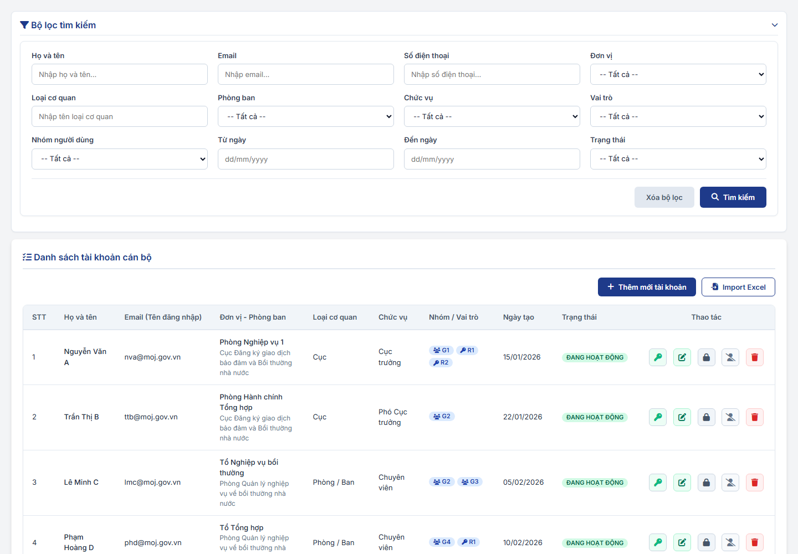
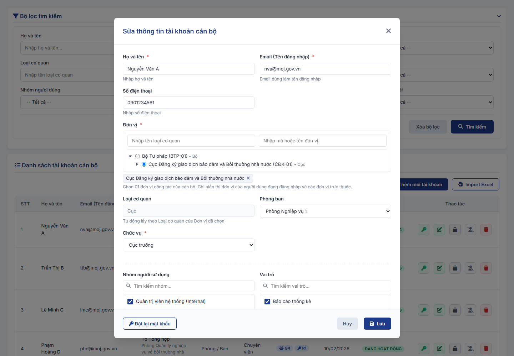
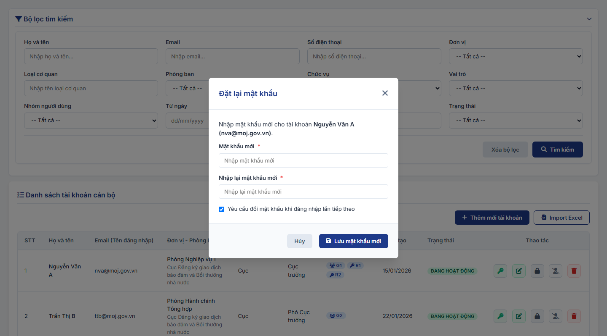
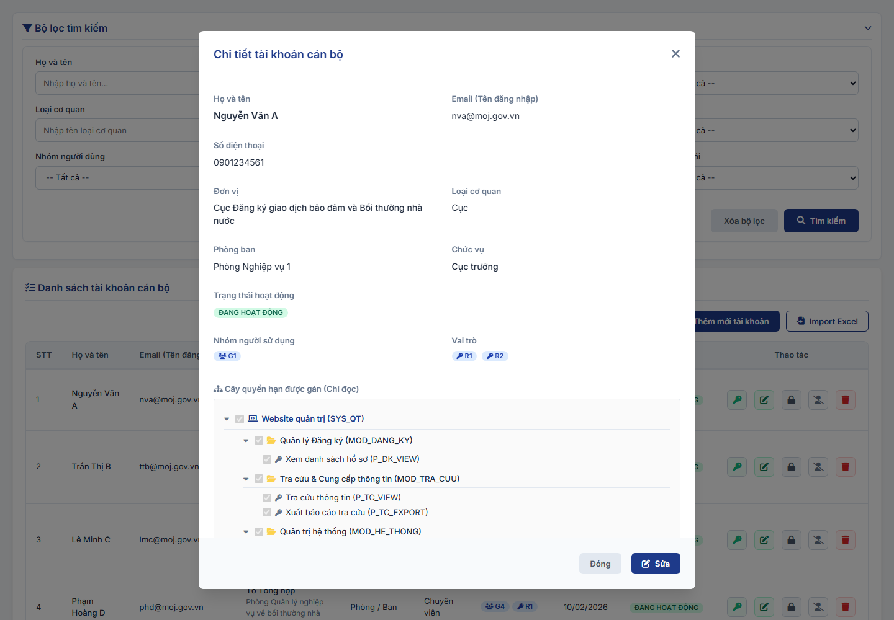
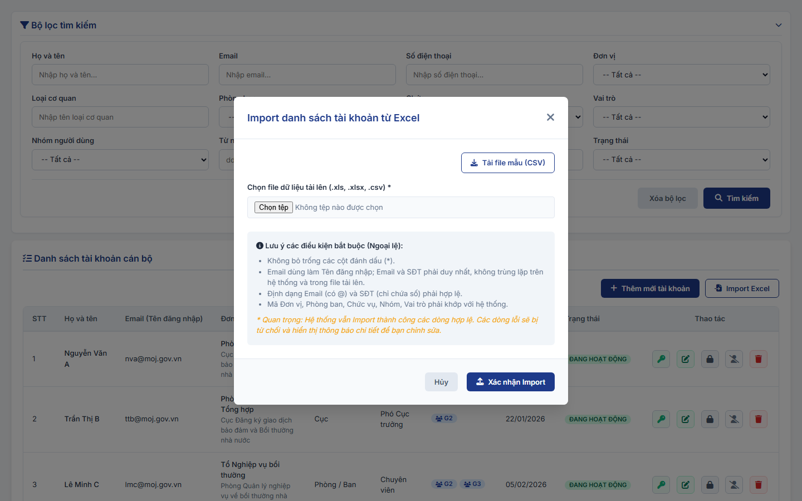

#### 4.3.1.3. Quản lý tài khoản cán bộ

##### 4.3.1.3.1. Mục đích
Cho phép quản lý hồ sơ tài khoản cán bộ và cán bộ thuộc cơ quan ngoài ngành trên toàn hệ thống Đăng ký biện pháp bảo đảm, bao gồm:
- Tra cứu, lọc và xem danh sách tài khoản cán bộ theo phân cấp quản lý của đơn vị trực thuộc.
- Khởi tạo mới hoặc cập nhật thông tin hồ sơ tài khoản cán bộ, cơ cấu tổ chức và cấu hình phân quyền theo nhóm người dùng/vai trò.
- Nạp dữ liệu tài khoản cán bộ hàng loạt từ tệp Excel (Import).
- Khóa, mở khóa, đóng tài khoản và xóa tài khoản cán bộ.
- Đặt lại mật khẩu khởi tạo cho cán bộ.
- Xem chi tiết đầy đủ thông tin tài khoản và cây phân quyền chỉ đọc.

*a. Phân quyền*
- Quản trị hệ thống (QTHT).

*b. Điều kiện thực hiện*
- Cán bộ quản trị đã đăng nhập thành công vào Website Quản trị.
- Hệ thống hoạt động bình thường.

*c. Phạm vi dữ liệu theo đơn vị*
- Người dùng chỉ tra cứu, thêm mới, cập nhật, import và thao tác với tài khoản cán bộ thuộc Đơn vị mà người dùng trực thuộc và các Đơn vị cấp dưới trực thuộc; không thấy tài khoản thuộc Đơn vị cấp trên hoặc Đơn vị cùng cấp khác.
- Các ô chọn Đơn vị (bộ lọc, form, cột Mã đơn vị khi import) chỉ gồm các Đơn vị trong phạm vi trên.

---

##### 4.3.1.3.2. MH01 - Màn hình Tra cứu danh sách tài khoản cán bộ

###### 4.3.1.3.2.1. Màn hình

###### 4.3.1.3.2.2. Mô tả thông tin trên màn hình

| Trường thông tin | Kiểu dữ liệu | Bắt buộc | Mặc định | Mô tả |
| :--- | :--- | :--- | :--- | :--- |
| **I. Bộ lọc tìm kiếm** | - | - | - | Khối tiêu chí tra cứu và lọc danh sách tài khoản cán bộ. |
| Họ và tên | String(255) | Không | Trống | Control UI: Input text, placeholder "Nhập họ và tên...". - Tìm kiếm gần đúng theo họ và tên cán bộ. |
| Email | String(255) | Không | Trống | Control UI: Input text, placeholder "Nhập email...". - Tìm kiếm gần đúng theo địa chỉ Email cán bộ. |
| Số điện thoại | String(20) | Không | Trống | Control UI: Input text, placeholder "Nhập số điện thoại...". - Tìm kiếm gần đúng theo số điện thoại liên hệ. |
| Đơn vị | Enum(String(100)) | Không | `-- Tất cả --` | Control UI: Combobox. - **Theo phân cấp quản lý:** Danh sách đơn vị hiển thị phụ thuộc vào Đơn vị của NSD đang đăng nhập (chỉ được chọn Đơn vị mình trực thuộc và các Đơn vị cấp dưới trực thuộc, không hiển thị Đơn vị cấp trên hoặc Đơn vị cùng cấp khác), theo [Phạm vi dữ liệu theo đơn vị - Quản lý tài khoản cán bộ - Quản trị hệ thống (Website Quản trị)](#tkcb-pham-vi-don-vi). Mặc định `-- Tất cả --` (toàn bộ các Đơn vị trong phạm vi trên). |
| Loại cơ quan | String(255) | Không | Trống | Control UI: Ô nhập có gợi ý (Autocomplete), placeholder "Nhập tên loại cơ quan". - Người dùng gõ tên, danh sách gợi ý gồm `-- Tất cả --` và các giá trị đang hoạt động của Danh mục Loại cơ quan [DM_57] có tên chứa nội dung đã gõ (gần đúng, không phân biệt hoa thường, nhập có dấu hoặc không dấu); không có giá trị phù hợp hiển thị "Không tìm thấy loại cơ quan phù hợp". - Người dùng chọn 01 giá trị trong danh sách gợi ý; sửa nội dung đã chọn thì bỏ điều kiện lọc theo Loại cơ quan. - Lọc các tài khoản thuộc Đơn vị có Loại cơ quan đã chọn. |
| Phòng ban | Enum(String(50)) | Không | Tất cả | Control UI: Combobox. Gồm: + Tất cả + Các Phòng ban thuộc Đơn vị đã chọn |
| Chức vụ | Enum(String(50)) | Không | Tất cả | Control UI: Combobox. Gồm: + Tất cả + Các giá trị đang hoạt động của Danh mục Chức vụ [DM_58] thuộc Loại cơ quan đã chọn tại bộ lọc `Loại cơ quan`. - Chưa chọn `Loại cơ quan`: chỉ có giá trị `Tất cả`. - Tự động cập nhật khi `Loại cơ quan` thay đổi. |
| Vai trò | Enum(String(50)) | Không | Tất cả | Control UI: Combobox. Gồm: + Tất cả + Các vai trò ở trạng thái Đang hoạt động có Loại tài khoản áp dụng là Cán bộ |
| Nhóm người dùng | Enum(String(50)) | Không | Tất cả | Control UI: Combobox. Gồm: + Tất cả + Các nhóm người dùng ở trạng thái Đang hoạt động có Loại tài khoản áp dụng là Cán bộ |
| Từ ngày | Date | Không | Ngày đầu tháng hiện tại | Control UI: Datepicker, placeholder "dd/mm/yyyy". - Mặc định là ngày đầu tiên của tháng hiện tại. - Áp dụng quy tắc so sánh khoảng ngày [BR-VAL-007]. |
| Đến ngày | Date | Không | Ngày hiện tại | Control UI: Datepicker, placeholder "dd/mm/yyyy". - Mặc định là ngày hiện tại. - Áp dụng quy tắc so sánh khoảng ngày [BR-VAL-007]. |
| Trạng thái | Enum(String(50)) | Không | Tất cả | Control UI: Combobox. Gồm: + Tất cả + Đang hoạt động + Bị khóa + Đóng |
| Tìm kiếm | String(50) | - | - | Control UI: Button. - Luôn hiển thị tại khối bộ lọc. |
| Xóa bộ lọc | String(50) | - | - | Control UI: Button. - Luôn hiển thị tại khối bộ lọc. |
| Thêm mới | String(50) | - | - | Control UI: Button. - Luôn hiển thị tại header bảng dữ liệu. |
| Import Excel | String(50) | - | - | Control UI: Button. - Luôn hiển thị tại header bảng dữ liệu. |
| **II. Bảng danh sách kết quả** | - | - | 20 bản ghi/trang | Control UI: Bảng/Lưới hiển thị. - **Phạm vi dữ liệu**: Chỉ hiển thị tài khoản thuộc Đơn vị của NSD đang đăng nhập và các Đơn vị cấp dưới trực thuộc, theo [Phạm vi dữ liệu theo đơn vị - Quản lý tài khoản cán bộ - Quản trị hệ thống (Website Quản trị)](#tkcb-pham-vi-don-vi). - Sắp xếp mặc định theo Ngày tạo giảm dần. - Cho phép chọn cấu hình 10, 20, 50, 100 bản ghi/trang, mặc định 20. - Trạng thái không có dữ liệu (Empty State): Khi không tìm thấy kết quả phù hợp với điều kiện tìm kiếm, bảng hiển thị duy nhất 01 dòng căn giữa trên toàn bộ chiều rộng bảng (`colspan`), in nghiêng với nội dung theo MessageList dùng chung [MSG-INF-SYS-001]. |
| STT | Integer(10) | - | - | Control UI: Text hiển thị (Read-only). |
| Họ và tên | String(255) | - | - | Control UI: Text hiển thị (Read-only). |
| Email (Tên đăng nhập) | String(255) | - | - | Control UI: Text hiển thị (Read-only). - Email của cán bộ, đồng thời là Tên đăng nhập. |
| Đơn vị - Phòng ban | String(255) | - | - | Control UI: Text hiển thị (Read-only). |
| Loại cơ quan | String(255) | - | - | Control UI: Text hiển thị (Read-only). - Tên Loại cơ quan (Danh mục Loại cơ quan [DM_57]) của Đơn vị của tài khoản. - Đơn vị chưa có Loại cơ quan: hiển thị `-`. |
| Chức vụ | String(100) | - | - | Control UI: Text hiển thị (Read-only). |
| Nhóm / Vai trò | String(255) | - | - | Control UI: Text hiển thị (Read-only). |
| Ngày tạo | DateTime | - | - | Control UI: Text hiển thị (Read-only). - Định dạng `dd/mm/yyyy HH:mm`. |
| Trạng thái | Enum(String(50)) | - | - | Control UI: Badge/Tag hiển thị. Gồm: + Đang hoạt động + Bị khóa + Đóng |
| Thao tác | String(255) | - | - | Control UI: Nhóm nút thao tác, vị trí cố định. - `Đặt lại mật khẩu`: Chỉ hiển thị khi trạng thái là `Đang hoạt động`. - `Sửa`: Chỉ hiển thị khi trạng thái là `Đang hoạt động`. - `Khóa / Mở khóa`: Hiển thị `Khóa` khi trạng thái là `Đang hoạt động`; hiển thị `Mở khóa` khi trạng thái là `Bị khóa`. - `Đóng`: Chỉ hiển thị khi trạng thái là `Đang hoạt động` hoặc `Bị khóa`. - `Xóa`: Luôn hiển thị. - Thao tác không được phép thực hiện hiển thị dạng khóa mờ, không cho phép thao tác. |

###### 4.3.1.3.2.3. Chức năng trên màn hình

| STT | Tên chức năng | Định dạng | Mô tả |
| :--- | :--- | :--- | :--- |
| 1 | Tìm kiếm | Button | Khi người dùng click nút "Tìm kiếm": - **TH1 (Dữ liệu lọc không hợp lệ)**: Nhập ngày sai định dạng `dd/mm/yyyy` hoặc Từ ngày lớn hơn Đến ngày $\rightarrow$ Vi phạm [BR-VAL-007], đánh dấu lỗi ô đầu tiên, hiển thị thông báo lỗi [MSG-ERR-VAL-007] và focus con trỏ vào ô lỗi. - **TH2 (Không có dữ liệu trả về)**: Bảng kết quả hiển thị duy nhất 01 dòng căn giữa nội dung [MSG-INF-SYS-001]; thanh phân trang hiển thị *"Hiển thị 0-0 của 0 bản ghi"* và các nút điều hướng khóa mờ. - **TH3 (Có dữ liệu trả về)**: Hiển thị danh sách các bản ghi thỏa mãn điều kiện lọc, sắp xếp mặc định theo Ngày tạo giảm dần. |
| 2 | Xóa bộ lọc | Button | Đặt lại toàn bộ tiêu chí Bộ lọc tìm kiếm về giá trị mặc định ban đầu và tải lại danh sách kết quả. |
| 3 | Thêm mới | Button | Mở [MH02 - Popup Thêm mới / Sửa tài khoản cán bộ - Quản lý tài khoản cán bộ - Quản trị hệ thống (Website Quản trị)](#tkcb-mh02) ở chế độ Thêm mới. |
| 4 | Import Excel | Button | Mở [MH05 - Popup Import danh sách tài khoản cán bộ từ Excel - Quản lý tài khoản cán bộ - Quản trị hệ thống (Website Quản trị)](#tkcb-mh05). |
| 5 | Đặt lại mật khẩu | Button | Mở [MH03 - Popup Đặt lại mật khẩu tài khoản cán bộ - Quản lý tài khoản cán bộ - Quản trị hệ thống (Website Quản trị)](#tkcb-mh03). |
| 6 | Sửa | Button | Mở [MH02 - Popup Thêm mới / Sửa tài khoản cán bộ - Quản lý tài khoản cán bộ - Quản trị hệ thống (Website Quản trị)](#tkcb-mh02) ở chế độ Sửa cho tài khoản tương ứng. |
| 7 | Khóa / Mở khóa | Button | Mở [POPUP-CFM-001 - Popup Xác nhận Dùng chung - Danh mục và Phụ lục - Tài liệu tổng hợp](../../Tai%20lieu%20tong%20hop/04_Danh_muc_va_Phu_luc.md#541-popup-cfm-001---popup-xác-nhận-dùng-chung-common-confirmation-modal) với `Loại thao tác` là `Khóa` hoặc `Mở khóa` kèm thông báo xác nhận [MSG-CFM-UC009-003] hoặc [MSG-CFM-UC009-004]. Khi người dùng chọn "Xác nhận", hệ thống cập nhật trạng thái tài khoản, thu hồi/khôi phục quyền đăng nhập, ghi Audit Log, hiển thị thông báo thành công [MSG-SUC-UC009-004] hoặc [MSG-SUC-UC009-005] và làm mới danh sách. |
| 8 | Đóng | Button | Mở [POPUP-CFM-001 - Popup Xác nhận Dùng chung - Danh mục và Phụ lục - Tài liệu tổng hợp](../../Tai%20lieu%20tong%20hop/04_Danh_muc_va_Phu_luc.md#541-popup-cfm-001---popup-xác-nhận-dùng-chung-common-confirmation-modal) với `Loại thao tác` là `Đóng` kèm thông báo xác nhận [MSG-CFM-UC009-001]. Khi người dùng chọn "Xác nhận", hệ thống chuyển trạng thái tài khoản thành `Đóng`, thu hồi quyền truy cập, ghi Audit Log, hiển thị thông báo thành công [MSG-SUC-UC009-002] và làm mới danh sách. |
| 9 | Xóa | Button | Mở [POPUP-CFM-001 - Popup Xác nhận Dùng chung - Danh mục và Phụ lục - Tài liệu tổng hợp](../../Tai%20lieu%20tong%20hop/04_Danh_muc_va_Phu_luc.md#541-popup-cfm-001---popup-xác-nhận-dùng-chung-common-confirmation-modal) với `Loại thao tác` là `Xóa` kèm thông báo cảnh báo [MSG-CFM-SYS-001]: - **TH1 (Tài khoản đang có ràng buộc xử lý hồ sơ)**: Cán bộ đang được phân công xử lý hồ sơ chưa hoàn thành $\rightarrow$ Hệ thống chặn xóa, hiển thị thông báo lỗi yêu cầu chuyển giao hồ sơ trước. - **TH Hợp lệ**: Khi người dùng chọn "Xác nhận", hệ thống xóa tài khoản cán bộ khỏi CSDL, ghi Audit Log, hiển thị thông báo thành công [MSG-SUC-SYS-001] và làm mới danh sách kết quả. |
| 10 | Click dòng dữ liệu | Row Click | Mở [MH04 - Popup Xem chi tiết tài khoản cán bộ - Quản lý tài khoản cán bộ - Quản trị hệ thống (Website Quản trị)](#tkcb-mh04) ở chế độ chỉ đọc. |

---

##### 4.3.1.3.3. MH02 - Popup Thêm mới / Sửa tài khoản cán bộ

###### 4.3.1.3.3.1. Màn hình

###### 4.3.1.3.3.2. Mô tả thông tin trên màn hình

| Trường thông tin | Kiểu dữ liệu | Bắt buộc | Mặc định | Mô tả |
| :--- | :--- | :--- | :--- | :--- |
| **Form Tài khoản cán bộ** | - | - | - | Hiển thị dạng Popup Modal (Sticky Header & Footer). |
| Họ và tên | String(255) | Có | Trống (Thêm mới) / Theo bản ghi (Sửa) | Control UI: Input text. - Họ và tên đầy đủ của cán bộ. Loại bỏ khoảng trắng thừa. - Áp dụng quy tắc bắt buộc [BR-VAL-001]. |
| Email (Tên đăng nhập) | String(100) | Có | Trống (Thêm mới) / Theo bản ghi (Sửa) | Control UI: Input text. - Địa chỉ email cơ quan của cán bộ, dùng làm Tên đăng nhập; không có trường Tên đăng nhập riêng. - Dòng hướng dẫn dưới trường: "Email dùng làm tên đăng nhập". - Áp dụng quy tắc [BR-VAL-EMAIL] và [BR-VAL-009] kiểm tra trùng lặp trên toàn hệ thống (khi Sửa thì loại trừ chính tài khoản đang thao tác). |
| Số điện thoại | String(10) | Không | Trống (Thêm mới) / Theo bản ghi (Sửa) | Control UI: Input text. - Không bắt buộc nhập. - Nếu có nhập: áp dụng quy tắc [BR-VAL-PHONE] và [BR-VAL-009] kiểm tra trùng lặp trên toàn hệ thống (khi Sửa thì loại trừ chính tài khoản đang thao tác). |
| **Đơn vị** | String(50) | Có | Chưa chọn (Thêm mới) / Theo bản ghi (Sửa) | Khối chọn 01 đơn vị công tác của cán bộ trên cây Cơ cấu tổ chức, gồm các thành phần bên dưới. - **Phạm vi**: Cây đơn vị chỉ gồm Đơn vị của người dùng đang đăng nhập và các Đơn vị trực thuộc, theo [Phạm vi dữ liệu theo đơn vị - Quản lý tài khoản cán bộ - Quản trị hệ thống (Website Quản trị)](#tkcb-pham-vi-don-vi). - Dòng hướng dẫn: "Chọn 01 đơn vị công tác của cán bộ. Chỉ hiển thị đơn vị của người dùng đang đăng nhập và các đơn vị trực thuộc." - Bỏ trống khi Lưu: dưới khối hiển thị "Vui lòng chọn Đơn vị." và không lưu. - Cách lọc, tìm kiếm, thu gọn/mở rộng cây giống trường `Đơn vị áp dụng` tại [MH02 - Popup Thêm mới / Cập nhật Danh mục - Quản lý danh mục dùng chung (Master Data) - Quản trị hệ thống (Website Quản trị)](Quan_ly_danh_muc.md#dm-mh02); khác biệt: chỉ chọn 01 đơn vị, không có `Chọn tất cả đơn vị`. |
| Loại cơ quan (lọc cây) | String(255) | Không | Trống | Control UI: Ô nhập có gợi ý (Autocomplete), placeholder "Nhập tên loại cơ quan". - Người dùng gõ tên, danh sách gợi ý gồm `-- Tất cả loại cơ quan --` và các giá trị đang hoạt động của Danh mục Loại cơ quan [DM_57] có tên chứa nội dung đã gõ (gần đúng, không phân biệt hoa thường, nhập có dấu hoặc không dấu). - Chọn 01 Loại cơ quan: cây chỉ gồm các đơn vị thuộc Loại cơ quan đã chọn và các đơn vị cấp trên của chúng trong phạm vi; đơn vị cấp trên không thuộc Loại cơ quan đã chọn chỉ hiển thị để xác định vị trí, không chọn được. - Chọn `-- Tất cả loại cơ quan --` hoặc xóa nội dung: bỏ điều kiện lọc theo Loại cơ quan. |
| Tìm kiếm đơn vị | String(255) | Không | Trống | Control UI: Input text, placeholder "Nhập mã hoặc tên đơn vị". - Tìm kiếm gần đúng theo Mã đơn vị hoặc Tên đơn vị, không phân biệt hoa thường, nhập có dấu hoặc không dấu; lọc trực tiếp trên cây khi nhập. - Cây chỉ gồm các đơn vị thỏa điều kiện và các đơn vị cấp trên của chúng trong phạm vi; đơn vị cấp trên không thỏa điều kiện chỉ hiển thị để xác định vị trí, không chọn được. - Không có đơn vị thỏa điều kiện: cây hiển thị "Không tìm thấy đơn vị phù hợp". |
| Cây đơn vị | String(50) | - | Thu gọn, chỉ hiển thị Đơn vị của người dùng đang đăng nhập | Control UI: Cây chọn 01 giá trị (Tree Single-select, Radio). - Mỗi dòng gồm: biểu tượng thu gọn/mở rộng (chỉ với đơn vị có đơn vị trực thuộc), nút chọn (Radio), "[Tên đơn vị] ([Mã đơn vị])", "• [Tên loại cơ quan]" (nếu đơn vị có Loại cơ quan). - Thu gọn/mở rộng theo từng đơn vị: click biểu tượng tại dòng đơn vị để ẩn/hiện các đơn vị trực thuộc trực tiếp của đơn vị đó. - Khi nhập hoặc thay đổi điều kiện `Loại cơ quan (lọc cây)`, `Tìm kiếm đơn vị`: cây mở rộng các cấp của kết quả. - Sửa: cây mở rộng tới Đơn vị đã chọn của tài khoản. - Chọn 01 đơn vị: bỏ chọn đơn vị đã chọn trước đó; cập nhật `Loại cơ quan`, tải lại `Phòng ban` và `Chức vụ` theo đơn vị mới. |
| Đơn vị đã chọn | String(255) | - | Theo dữ liệu đã chọn | Control UI: Thẻ (Tag) hiển thị dưới khối chọn đơn vị. - Hiển thị "[Tên đơn vị]" kèm nút `x` để bỏ chọn. - Chưa chọn đơn vị: không hiển thị. |
| Loại cơ quan | String(255) | - | Theo Đơn vị | Control UI: Text hiển thị (Read-only), placeholder "Tự động theo Đơn vị". - Tự động lấy theo Loại cơ quan (Danh mục Loại cơ quan [DM_57]) của Đơn vị đã chọn, theo thông tin đơn vị tại Cơ cấu tổ chức; tự động cập nhật khi Đơn vị thay đổi. - Dòng hướng dẫn dưới trường: "Tự động lấy theo Loại cơ quan của Đơn vị đã chọn". |
| Phòng ban | Enum(String(50)) | Không | `-- Chọn phòng ban --` (Thêm mới) / Theo bản ghi (Sửa) | Control UI: Combobox. - Thêm mới: hiển thị giá trị mặc định `-- Chọn phòng ban --` (chưa chọn). - Danh sách Phòng ban trực thuộc Đơn vị đã chọn. Tự động cập nhật khi Đơn vị thay đổi. |
| Chức vụ | Enum(String(50)) | Có | `-- Chọn chức vụ --` (Thêm mới) / Theo bản ghi (Sửa) | Control UI: Combobox. - Thêm mới: hiển thị giá trị mặc định `-- Chọn chức vụ --` (chưa chọn). - Danh sách gồm các giá trị đang hoạt động của Danh mục Chức vụ [DM_58] thuộc `Loại cơ quan` của Đơn vị đã chọn. - Chưa chọn Đơn vị: chỉ có giá trị `-- Chọn chức vụ --`. - Khi Đơn vị thay đổi: tải lại danh sách theo Loại cơ quan mới và đưa về `-- Chọn chức vụ --`. - Đơn vị chưa có Loại cơ quan: danh sách chỉ có `-- Chọn chức vụ --`, dưới trường hiển thị "Đơn vị chưa được khai báo Loại cơ quan nên chưa có danh sách Chức vụ." - Áp dụng quy tắc bắt buộc [BR-VAL-001]. |
| Nhóm người dùng | Enum(String(50)) | Không* | Trống (Thêm mới) / Theo bản ghi (Sửa) | Control UI: Danh sách Checkbox chọn nhiều kèm ô tìm kiếm, placeholder "Tìm kiếm nhóm..." (tìm kiếm gần đúng theo tên nhóm). - **Chỉ hiển thị các Nhóm người dùng ở trạng thái `Đang hoạt động` có `Loại tài khoản áp dụng` là `Cán bộ`.** |
| Vai trò | Enum(String(50)) | Không* | Trống (Thêm mới) / Theo bản ghi (Sửa) | Control UI: Danh sách Checkbox chọn nhiều kèm ô tìm kiếm, placeholder "Tìm kiếm vai trò..." (tìm kiếm gần đúng theo tên vai trò). - **Chỉ hiển thị các Vai trò ở trạng thái `Đang hoạt động` có `Loại tài khoản áp dụng` là `Cán bộ`.** |
| Tìm kiếm | String(255) | Không | Trống | Control UI: Input text, placeholder "Nhập tên tính năng". - Cho phép tìm kiếm gần đúng theo tên tính năng trên Cây quyền hạn. |
| Cây quyền hạn (Preview) | Tree | - | Theo Nhóm/Vai trò | Control UI: Cây phân quyền chỉ đọc (Read-only). - Hiển thị trước các quyền được cộng dồn theo thời gian thực (Real-time). |
| Lưu | String(50) | - | - | Control UI: Button. - Luôn hiển thị tại footer popup. |
| Đặt lại mật khẩu | String(50) | - | - | Control UI: Button. - Chỉ hiển thị tại footer popup khi ở chế độ Sửa. |
| Hủy | String(50) | - | - | Control UI: Button. - Luôn hiển thị tại footer popup. |

*Ghi chú*: (*): Bắt buộc phải chọn ít nhất một trong hai trường: Nhóm người dùng hoặc Vai trò.

###### 4.3.1.3.3.3. Chức năng trên màn hình

| STT | Tên chức năng | Định dạng | Mô tả |
| :--- | :--- | :--- | :--- |
| 1 | Lưu | Button | Kiểm tra toàn bộ dữ liệu trên form: - **TH1 (Bỏ trống trường bắt buộc)**: Vi phạm quy tắc [BR-VAL-001]. Đánh dấu lỗi ô đầu tiên, hiển thị thông báo lỗi [MSG-ERR-VAL-001] và focus con trỏ vào ô lỗi. - **TH2 (Bỏ trống cả Nhóm người dùng và Vai trò)**: Đánh dấu lỗi, hiển thị thông báo lỗi [MSG-ERR-UC009-002] yêu cầu chọn ít nhất một trường. - **TH3 (Sai định dạng Email / SĐT (nếu có nhập SĐT))**: Vi phạm [BR-VAL-EMAIL] hoặc [BR-VAL-PHONE] $\rightarrow$ Đánh dấu lỗi ô, hiển thị thông báo lỗi [MSG-ERR-VAL-002] và focus con trỏ. - **TH4 (Trùng lặp Email / SĐT (nếu có nhập SĐT))**: Vi phạm [BR-VAL-009] $\rightarrow$ Hiển thị thông báo lỗi [MSG-ERR-VAL-009] và focus con trỏ. - **TH Hợp lệ (Tuần tự xử lý của hệ thống)**: 1. *Lưu dữ liệu và gán loại tài khoản*: + Nếu là Thêm mới: Mặc định gán `Loại tài khoản` là `Cán bộ`. Lưu thông tin vào CSDL ở trạng thái `Đang hoạt động`. + Nếu là Sửa: Lưu các thông tin thay đổi vào CSDL; không thay đổi `Loại tài khoản`. 2. *Xử lý mật khẩu (chỉ áp dụng khi Thêm mới)*: Tự động sinh mật khẩu tạm ngẫu nhiên, mã hóa băm mật khẩu kèm Salt lưu CSDL, bật cờ bắt buộc đổi mật khẩu ở lần đăng nhập đầu tiên, gửi Email thông báo tạo tài khoản kèm mật khẩu khởi tạo cho cán bộ. 3. *Hoàn tất*: Ghi Audit Log, hiển thị thông báo thành công [MSG-SUC-SYS-001], đóng form và tải lại danh sách tại [MH01 - Màn hình Tra cứu danh sách tài khoản cán bộ - Quản lý tài khoản cán bộ - Quản trị hệ thống (Website Quản trị)](#tkcb-mh01). |
| 2 | Đặt lại mật khẩu | Button | Mở [MH03 - Popup Đặt lại mật khẩu tài khoản cán bộ - Quản lý tài khoản cán bộ - Quản trị hệ thống (Website Quản trị)](#tkcb-mh03) cho tài khoản đang chọn. |
| 3 | Hủy | Button | Đóng popup, hủy bỏ các thông tin đã nhập và quay lại màn hình chính. |

---

##### 4.3.1.3.4. MH03 - Popup Đặt lại mật khẩu tài khoản cán bộ

###### 4.3.1.3.4.1. Màn hình

###### 4.3.1.3.4.2. Mô tả thông tin trên màn hình

| Trường thông tin | Kiểu dữ liệu | Bắt buộc | Mặc định | Mô tả |
| :--- | :--- | :--- | :--- | :--- |
| Email (Tên đăng nhập) | String(255) | Không | Theo bản ghi | Control UI: Text hiển thị (Read-only). |
| Mật khẩu mới | Password | Có | Trống | Control UI: Input password, placeholder "Nhập mật khẩu mới". - Nhập mật khẩu mới tuân thủ quy tắc độ phức tạp của hệ thống. - Áp dụng quy tắc bắt buộc [BR-VAL-001]. |
| Nhập lại mật khẩu mới | Password | Có | Trống | Control UI: Input password, placeholder "Nhập lại mật khẩu mới". - Bắt buộc trùng khớp với Mật khẩu mới. - Áp dụng quy tắc bắt buộc [BR-VAL-001]. |
| Yêu cầu đổi mật khẩu khi đăng nhập lần tiếp theo | Boolean | Không | Có | Control UI: Checkbox. - Mặc định được tích chọn. |
| Lưu mật khẩu mới | String(50) | - | - | Control UI: Button. - Luôn hiển thị tại footer popup. |
| Hủy | String(50) | - | - | Control UI: Button. - Luôn hiển thị tại footer popup. |

###### 4.3.1.3.4.3. Chức năng trên màn hình

| STT | Tên chức năng | Định dạng | Mô tả |
| :--- | :--- | :--- | :--- |
| 1 | Lưu mật khẩu mới | Button | Kiểm tra mật khẩu mới và nhập lại mật khẩu mới: - **TH1 (Bỏ trống trường bắt buộc)**: Vi phạm quy tắc [BR-VAL-001]. Đánh dấu lỗi ô đầu tiên, hiển thị thông báo lỗi [MSG-ERR-VAL-001] và focus con trỏ. - **TH2 (Không trùng khớp mật khẩu)**: Mật khẩu mới và Nhập lại mật khẩu không trùng khớp $\rightarrow$ Đánh dấu lỗi, hiển thị thông báo lỗi [MSG-ERR-UC009-006] và focus con trỏ. - **TH3 (Không đạt độ phức tạp)**: Vi phạm quy định mật khẩu $\rightarrow$ Đánh dấu lỗi, hiển thị thông báo lỗi [MSG-ERR-VAL-002] và focus con trỏ. - **TH Hợp lệ**: Mã hóa băm mật khẩu một chiều kết hợp Salt ngẫu nhiên và lưu CSDL, cập nhật cờ đổi mật khẩu, ghi Audit Log, hiển thị thông báo thành công [MSG-SUC-UC009-006] và đóng popup. |
| 2 | Hủy | Button | Đóng popup, hủy bỏ thao tác đặt lại mật khẩu. |

---

##### 4.3.1.3.5. MH04 - Popup Xem chi tiết tài khoản cán bộ

###### 4.3.1.3.5.1. Màn hình

###### 4.3.1.3.5.2. Mô tả thông tin trên màn hình

| Trường thông tin | Kiểu dữ liệu | Bắt buộc | Mặc định | Mô tả |
| :--- | :--- | :--- | :--- | :--- |
| Họ và tên | String(100) | - | Theo bản ghi | Control UI: Text hiển thị (Read-only). |
| Email (Tên đăng nhập) | String(255) | - | Theo bản ghi | Control UI: Text hiển thị (Read-only). |
| Số điện thoại | String(20) | - | Theo bản ghi | Control UI: Text hiển thị (Read-only). - Chưa có hiển thị `-`. |
| Đơn vị | String(255) | - | Theo bản ghi | Control UI: Text hiển thị (Read-only). |
| Loại cơ quan | String(255) | - | Theo bản ghi | Control UI: Text hiển thị (Read-only). - Tên Loại cơ quan của Đơn vị của tài khoản; chưa có hiển thị `-`. |
| Phòng ban | String(255) | - | Theo bản ghi | Control UI: Text hiển thị (Read-only). |
| Chức vụ | String(100) | - | Theo bản ghi | Control UI: Text hiển thị (Read-only). |
| Nhóm người dùng | String(100) | - | Theo bản ghi | Control UI: Text hiển thị (Read-only). |
| Vai trò | Enum(String(50)) | - | Theo bản ghi | Control UI: Text hiển thị (Read-only). |
| Cây quyền hạn | Tree | - | Theo bản ghi | Control UI: Cây phân quyền chỉ đọc tổng hợp toàn bộ quyền cộng dồn của cán bộ. |

###### 4.3.1.3.5.3. Chức năng trên màn hình

| STT | Tên chức năng | Định dạng | Mô tả |
| :--- | :--- | :--- | :--- |
| 1 | Sửa | Button | Đóng popup xem chi tiết và chuyển sang [MH02 - Popup Thêm mới / Sửa tài khoản cán bộ - Quản lý tài khoản cán bộ - Quản trị hệ thống (Website Quản trị)](#tkcb-mh02) ở chế độ Sửa. |
| 2 | Đóng | Button | Đóng Popup xem chi tiết và quay lại [MH01 - Màn hình Tra cứu danh sách tài khoản cán bộ - Quản lý tài khoản cán bộ - Quản trị hệ thống (Website Quản trị)](#tkcb-mh01). |

---

##### 4.3.1.3.6. MH05 - Popup Import danh sách tài khoản cán bộ từ Excel

###### 4.3.1.3.6.1. Màn hình

###### 4.3.1.3.6.2. Mô tả thông tin trên màn hình

| Trường thông tin | Kiểu dữ liệu | Bắt buộc | Mặc định | Mô tả |
| :--- | :--- | :--- | :--- | :--- |
| Tiêu đề Popup | String(100) | - | Nhận danh sách tài khoản cán bộ từ Excel | Control UI: Text hiển thị (Read-only) tại Header của Modal. |
| Hướng dẫn nạp file | String(255) | - | Theo quy định | Control UI: Text hiển thị (Read-only). - Nội dung: *"Vui lòng tải tệp tin biểu mẫu chuẩn, điền đầy đủ và chính xác thông tin theo hướng dẫn trước khi tải lên hệ thống."* |
| Tải file mẫu | Link | - | - | Control UI: Link tải file. - Tên file tải về: `yyyyMMdd_Bieu_mau_import_tai_khoan_can_bo.xlsx`. |
| Tải tệp lên | File (.xlsx) | Có | Trống | Control UI: Vùng kéo thả / Nút chọn file. - Giới hạn định dạng `.xlsx`, dung lượng tối đa 20MB. - Sau khi chọn tệp: Hiển thị tên tệp, dung lượng kèm link `Xóa tệp`. |
| Thống kê kiểm tra | String(100) | - | - | Control UI: Text Badge hiển thị (Read-only). - **Điều kiện hiển thị:** Chỉ xuất hiện sau khi người dùng đã tải tệp lên và hệ thống hoàn tất kiểm tra sơ bộ. - Định dạng hiển thị: `Tổng số: X dòng \| Hợp lệ: Y dòng \| Lỗi: Z dòng`. |
| Bảng xem trước kết quả | Table | - | - | Control UI: Bảng/Lưới hiển thị. - **Điều kiện hiển thị:** Tự động xuất hiện sau khi tải tệp lên thành công và hoàn tất kiểm tra sơ bộ; tự động ẩn đi khi người dùng bấm Xóa tệp. - Cấu trúc các cột: `STT`, `Dòng Excel`, `Họ và tên`, `Email`, `Số điện thoại`, `Đơn vị`, `Trạng thái kiểm tra` (Nhãn: Hợp lệ / Lỗi), `Chi tiết lỗi`. |

###### 4.3.1.3.6.3. Chức năng trên màn hình

| STT | Tên chức năng | Định dạng | Mô tả |
| :--- | :--- | :--- | :--- |
| 1 | Tải file mẫu | Link | Tải tệp tin Excel biểu mẫu chuẩn `yyyyMMdd_Bieu_mau_import_tai_khoan_can_bo.xlsx` về máy tính người dùng theo đúng cấu trúc định nghĩa tại [Cấu trúc dữ liệu và Quy tắc kiểm tra file Excel mẫu import - Quản lý tài khoản cán bộ - Quản trị hệ thống (Website Quản trị)](#tkcb-cau-truc-excel). |
| 2 | Chọn file / Tải lên | Upload Button | Người dùng chọn tệp từ máy tính hoặc kéo thả tệp vào vùng upload. Hệ thống tự động kích hoạt kiểm tra sơ bộ (Giai đoạn 1 & Giai đoạn 2), tự động hiển thị `Bảng xem trước kết quả` và dòng `Thống kê kiểm tra`. |
| 3 | Xóa tệp | Link | Gỡ bỏ tệp vừa chọn, ẩn `Bảng xem trước kết quả` và đưa vùng upload về trạng thái ban đầu. |
| 4 | Nhận Excel | Button | Chỉ kích hoạt khi có ít nhất 01 dòng dữ liệu `Hợp lệ`: - **TH Hợp lệ (Áp dụng Cơ chế Thành công một phần theo [Quy chuẩn Xử lý Tính năng Nhận file - Danh mục và Phụ lục - Tài liệu tổng hợp](../../Tai%20lieu%20tong%20hop/04_Danh_muc_va_Phu_luc.md#56-quy-chuẩn-xử-lý-tính-năng-nhận-file-import-file--tải-lên-danh-sách))**: 1. Nạp toàn bộ các dòng dữ liệu hợp lệ vào CSDL hệ thống. 2. Mặc định gán `Loại tài khoản` là `Cán bộ`. 3. Tự động sinh mật khẩu tạm thời ngẫu nhiên cho từng tài khoản, mã hóa băm lưu CSDL, bật cờ bắt buộc đổi mật khẩu ở lần đăng nhập đầu tiên. 4. Gửi Email thông báo tài khoản kèm thông tin đăng nhập theo đúng Mẫu Email hệ thống cho từng cán bộ được nạp thành công. 5. Hiển thị Popup báo cáo thống kê kết quả nạp (*Tổng số: N dòng / Thành công: X dòng / Thất bại: Y dòng*). Nếu có dòng lỗi ($Y > 0$), cung cấp nút **"Tải báo cáo lỗi"** (file Excel chứa danh sách các dòng lỗi kèm cột nguyên nhân lỗi chi tiết). 6. Đóng popup, ghi Audit Log và làm mới danh sách tài khoản tại [MH01 - Màn hình Tra cứu danh sách tài khoản cán bộ - Quản lý tài khoản cán bộ - Quản trị hệ thống (Website Quản trị)](#tkcb-mh01). |
| 5 | Hủy | Button | Đóng Popup Modal, hủy bỏ toàn bộ thao tác và quay lại màn hình chính. |

###### 4.3.1.3.6.4. Cấu trúc dữ liệu và Quy tắc kiểm tra (Validation) file Excel mẫu import

**1. Cấu trúc các cột trong tệp Excel mẫu (`Bieu_mau_import_tai_khoan_can_bo.xlsx`)**:

| STT | Tên cột trong file Excel | Kiểu dữ liệu | Bắt buộc | Mô tả & Quy tắc kiểm tra dữ liệu (Validation Rules) |
| :-- | :--- | :--- | :--- | :--- |
| 1 | STT | Integer | Có | Số thứ tự tăng dần. |
| 2 | Họ và tên | String(255) | Có | Họ và tên đầy đủ của cán bộ. Loại bỏ khoảng trắng thừa ở hai đầu. Áp dụng quy tắc [BR-VAL-001]. |
| 3 | Email | String(100) | Có | Địa chỉ email cơ quan của cán bộ. - Phải đúng định dạng chuẩn Email theo [BR-VAL-EMAIL]. - Không được trùng lặp với các dòng khác trong cùng file Excel. - Không được trùng lặp với Email của tài khoản đã tồn tại trên hệ thống theo [BR-VAL-009]. |
| 4 | Số điện thoại | String(10) | Không | Số điện thoại liên hệ của cán bộ. - Nếu có nhập: phải đúng định dạng 10 chữ số bắt đầu bằng đầu số hợp lệ theo [BR-VAL-PHONE]. - Không được trùng lặp với các dòng khác trong cùng file Excel. - Không được trùng lặp với Số điện thoại của tài khoản đã tồn tại trên hệ thống theo [BR-VAL-009]. |
| 5 | Mã đơn vị | String(50) | Có | Mã định danh đơn vị công tác của cán bộ. - Bắt buộc phải tồn tại trong danh mục Cơ cấu tổ chức trên hệ thống. - Đơn vị phải thuộc phạm vi quản lý của người dùng đang thực hiện import (chỉ được import cho đơn vị của mình và các đơn vị con trực thuộc), theo [Phạm vi dữ liệu theo đơn vị - Quản lý tài khoản cán bộ - Quản trị hệ thống (Website Quản trị)](#tkcb-pham-vi-don-vi). |
| 6 | Mã phòng ban | String(50) | Không | Mã định danh phòng ban trực thuộc đơn vị. - Nếu có nhập: Mã phòng ban phải tồn tại trên hệ thống và phải trực thuộc đúng `Mã đơn vị` đã khai báo ở cột 5. |
| 7 | Mã chức vụ | String(50) | Có | Mã định danh chức vụ của cán bộ. - Mã chức vụ phải tồn tại trong Danh mục Chức vụ [DM_58], đang hoạt động và thuộc Loại cơ quan của Đơn vị khai báo ở cột 5. |
| 8 | Danh sách Mã nhóm người dùng | String(500) | Không* | Danh sách mã nhóm người dùng gán cho cán bộ, phân cách nhau bằng dấu phẩy `,`. - Toàn bộ các mã nhóm khai báo phải tồn tại trên hệ thống, đang ở trạng thái `Hoạt động` và có `Loại tài khoản áp dụng` là `Cán bộ`. |
| 9 | Danh sách Mã vai trò | String(500) | Không* | Danh sách mã vai trò gán cho cán bộ, phân cách nhau bằng dấu phẩy `,`. - Toàn bộ các mã vai trò khai báo phải tồn tại trên hệ thống, đang ở trạng thái `Hoạt động` và có `Loại tài khoản áp dụng` là `Cán bộ`. |
| 10 | Ghi chú | String(500) | Không | Ghi chú bổ sung (nếu có). |

*Ghi chú*: (*): Bắt buộc mỗi dòng dữ liệu phải khai báo ít nhất một trong hai thông tin: `Danh sách Mã nhóm người dùng` (cột 8) hoặc `Danh sách Mã vai trò` (cột 9). Nếu bỏ trống cả hai, hệ thống báo lỗi dòng [MSG-ERR-UC009-002].

**2. Quy trình kiểm tra dữ liệu 2 giai đoạn (Validation Process)**:
- **Giai đoạn 1 - Kiểm tra tệp tin (File Validation)**:
  + Tệp tin phải đúng định dạng `.xlsx`, dung lượng không vượt quá 20MB.
  + Kiểm tra cấu trúc sheet và tên 10 cột dữ liệu phải khớp 100% với biểu mẫu chuẩn của hệ thống. Nếu sai cấu trúc hoặc file rỗng không có dữ liệu, chặn đọc file và hiển thị thông báo lỗi [MSG-ERR-FILE-003].
- **Giai đoạn 2 - Kiểm tra từng dòng dữ liệu (Row-level Validation) & Cơ chế Thành công một phần**:
  + Hệ thống quét tuần tự từng dòng từ dòng dữ liệu đầu tiên đến hết file.
  + Đối chiếu dữ liệu từng ô theo bảng quy tắc trên. Phân loại các dòng hợp lệ và dòng lỗi kèm thông tin chi tiết: `Dòng số`, `Trường lỗi`, `Giá trị nhập`, `Lý do lỗi cụ thể`.
  + Áp dụng cơ chế **Thành công một phần** theo [Quy chuẩn Xử lý Tính năng Nhận file - Danh mục và Phụ lục - Tài liệu tổng hợp](../../Tai%20lieu%20tong%20hop/04_Danh_muc_va_Phu_luc.md#56-quy-chuẩn-xử-lý-tính-năng-nhận-file-import-file--tải-lên-danh-sách): Các dòng hợp lệ sẵn sàng nạp vào hệ thống; các dòng lỗi được tổng hợp danh sách để người dùng tải file báo cáo lỗi về chỉnh sửa.
