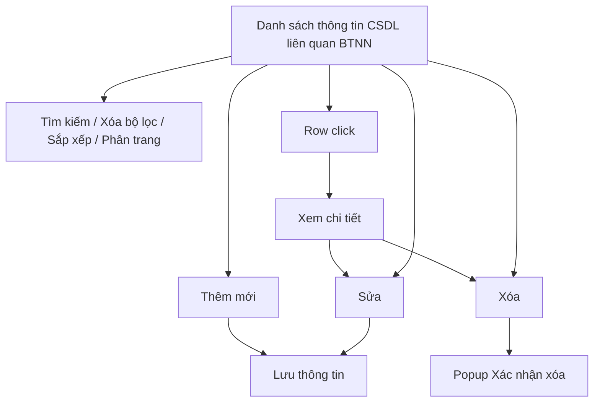
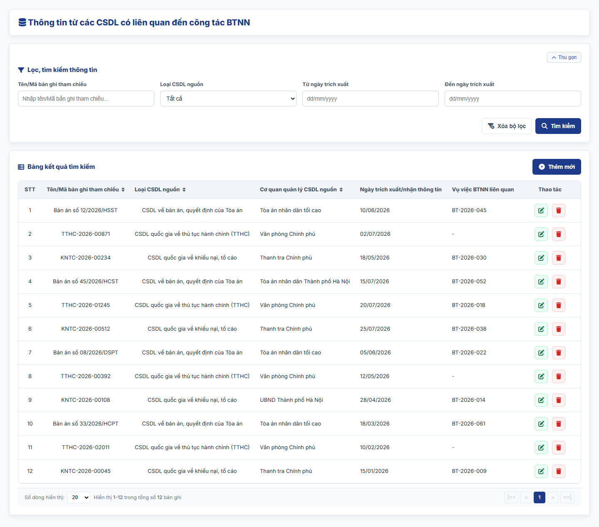
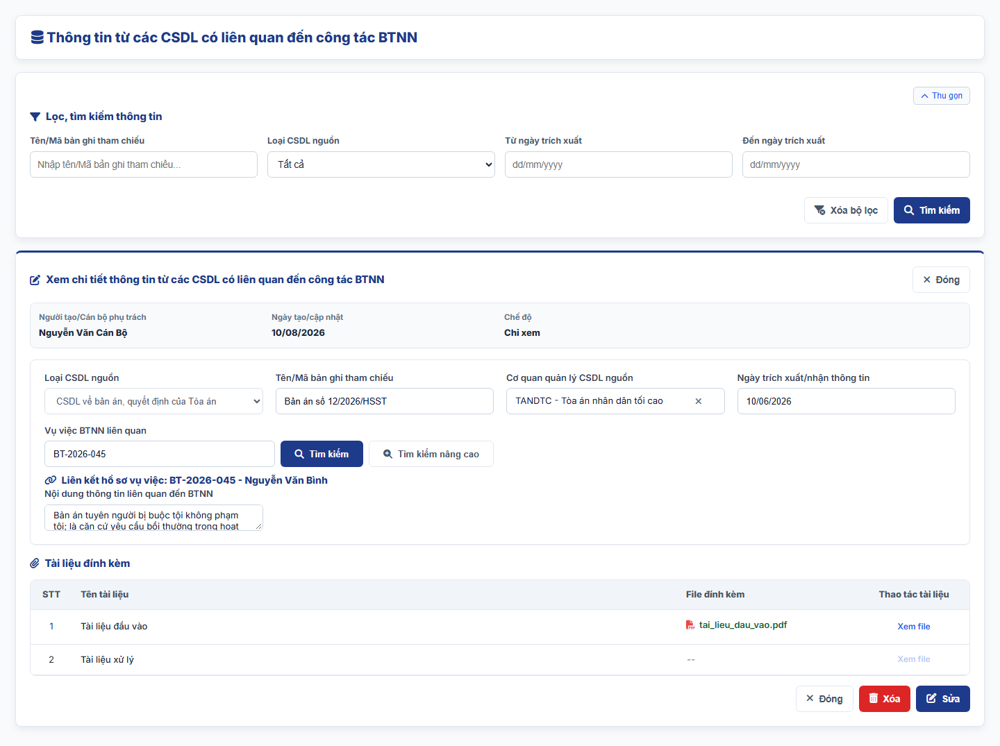
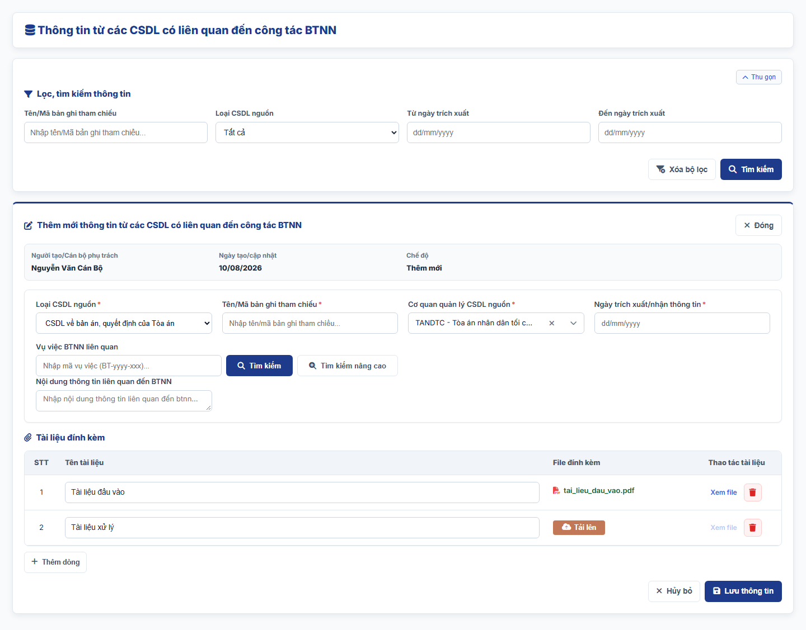
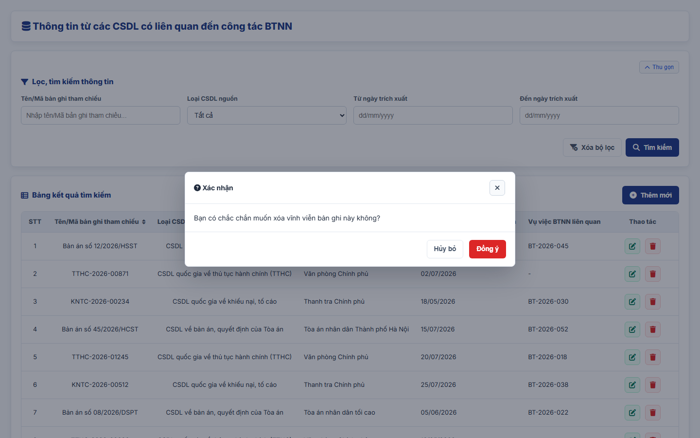

#### 4.3.3.20. UC503/UCPS018 - Quản lý thông tin từ các CSDL có liên quan đến công tác BTNN

##### 4.3.3.20.1. Mục đích

\- Cho phép cán bộ nghiệp vụ BTNN (Bộ Tư pháp) ghi nhận, quản lý và tra cứu thông tin đã tra cứu hoặc tiếp nhận từ các cơ sở dữ liệu (CSDL) bên ngoài có liên quan đến công tác bồi thường nhà nước (BTNN), gồm CSDL về bản án, quyết định của Tòa án; CSDL quốc gia về thủ tục hành chính (TTHC); CSDL quốc gia về khiếu nại, tố cáo (khoản 9 Điều 44 dự thảo Nghị định quy định chi tiết một số điều và biện pháp thi hành Luật Trách nhiệm bồi thường của Nhà nước).

\- Thông tin ghi nhận dùng để: + Đối chiếu thông tin từ CSDL nguồn với vụ việc yêu cầu bồi thường đã có trên hệ thống. + Theo dõi, phát hiện trường hợp có căn cứ phát sinh trách nhiệm bồi thường của Nhà nước, như bản án tuyên người bị buộc tội không phạm tội. + Phục vụ tổng hợp, báo cáo công tác quản lý nhà nước về BTNN.

\- Màn hình ghi nhận thủ công thông tin do cán bộ tra cứu hoặc nhận được từ CSDL nguồn; không kết nối, đồng bộ dữ liệu tự động với các CSDL nêu trên.

\- Nội dung chỉ phục vụ nội bộ cán bộ quản lý, không công khai ra Website khách hàng.

*a. Phân quyền*

\- Cán bộ nghiệp vụ BTNN (Bộ Tư pháp): được tra cứu, xem chi tiết, thêm mới, sửa, xóa bản ghi.

*b. Điều kiện thực hiện*

\- Người dùng đã đăng nhập thành công vào Website quản trị.

\- Người dùng được phân quyền truy cập màn hình `Quản lý thông tin từ các CSDL có liên quan đến công tác BTNN`.

\- Loại CSDL nguồn tham chiếu Danh mục Loại CSDL nguồn `[DM_56]`; quản trị viên thêm, sửa, ngừng hoạt động giá trị và khai báo Cơ quan quản lý mặc định của từng giá trị tại màn hình Quản lý danh mục.

\- Cơ quan quản lý CSDL nguồn chọn trên cây Cơ cấu tổ chức `[DM_DON_VI]` tại [MH01 - Màn hình Quản lý cơ cấu tổ chức - Quản lý cơ cấu tổ chức - Quản trị hệ thống](../01_Quan_tri_he_thong/Quan_ly_co_cau_to_chuc.md#cctc-mh01).

\- Vụ việc BTNN liên quan chọn qua Popup chuẩn Tìm kiếm vụ việc/hồ sơ gốc liên quan theo Nguồn 6; phạm vi dữ liệu theo cấp của người dùng đăng nhập (người dùng Bộ Tư pháp: toàn quốc).

---

##### 4.3.3.20.2. Sơ đồ luồng nghiệp vụ theo giao diện

---

##### 4.3.3.20.3. MH01 - Màn hình Danh sách thông tin CSDL liên quan BTNN

###### 4.3.3.20.3.1. Màn hình

###### 4.3.3.20.3.2. Mô tả thông tin trên màn hình

| Trường thông tin | Kiểu dữ liệu | Bắt buộc | Mặc định | Mô tả |
| :--- | :--- | :--- | :--- | :--- |
| **I. Bộ lọc tìm kiếm** | - | - | - | Control UI: Khối thu gọn/mở rộng (Accordion). - Mặc định hiển thị dạng mở rộng. - Cho phép thu gọn/mở rộng khi click vào nút "Thu gọn"/"Mở rộng" ở góc phải khối; khi thu gọn, các giá trị lọc đã nhập được giữ nguyên. |
| Tên/Mã bản ghi tham chiếu | String(255) | Không | Trống | Control UI: Text input. - Placeholder: "Nhập tên/Mã bản ghi tham chiếu...". - Tìm gần đúng; không phân biệt hoa thường, có dấu/không dấu. |
| Loại CSDL nguồn | Enum(String(100)) | Không | Tất cả | Control UI: Combobox. - Tham chiếu Danh mục Loại CSDL nguồn [DM_56], gồm giá trị `Tất cả` và các giá trị đang hoạt động. |
| Từ ngày trích xuất | Date | Không | Trống | Control UI: Date input. - Placeholder: "dd/mm/yyyy". |
| Đến ngày trích xuất | Date | Không | Trống | Control UI: Date input. - Placeholder: "dd/mm/yyyy". |
| **II. Bảng danh sách kết quả** | - | - | 20 bản ghi/trang | Control UI: Data grid. - Khi người dùng truy cập màn hình, hệ thống tự động tải Trang 1. - Sắp xếp mặc định: theo "Ngày tạo" giảm dần. - Trạng thái không có dữ liệu (Empty State): bảng hiển thị duy nhất 01 dòng căn giữa trên toàn bộ chiều rộng bảng (`colspan`), in nghiêng với nội dung theo MessageList dùng chung [MSG-INF-SYS-001]. |
| STT | Integer(10) | Không | Theo trang hiện tại | - Chỉ đọc. - Theo dữ liệu bản ghi. |
| Tên/Mã bản ghi tham chiếu | String(100) | Không | Theo dữ liệu hệ thống | - Chỉ đọc. - Theo dữ liệu bản ghi. |
| Loại CSDL nguồn | Enum(String(100)) | Không | Theo dữ liệu hệ thống | - Chỉ đọc. - Theo dữ liệu bản ghi. |
| Cơ quan quản lý CSDL nguồn | String(255) | Không | Theo dữ liệu hệ thống | - Chỉ đọc. - Theo dữ liệu bản ghi. |
| Ngày trích xuất/nhận thông tin | Date | Không | Theo dữ liệu hệ thống | - Chỉ đọc. - Định dạng `dd/mm/yyyy`. |
| Vụ việc BTNN liên quan | String(50) | Không | Theo dữ liệu hệ thống | - Chỉ đọc. - Theo dữ liệu bản ghi. - Hiển thị Mã vụ việc; hiển thị `-` nếu chưa gắn vụ việc. |
| Thao tác | - | - | - | Control UI: Icon + Sửa + Xóa |
| Phân trang | - | - | 20 bản ghi/trang | Phân trang, chuyển trang và cấu hình số dòng hiển thị theo quy tắc chung của hệ thống. |

###### 4.3.3.20.3.3. Chức năng trên màn hình

| STT | Tên chức năng | Định dạng | Mô tả |
| :--- | :--- | :--- | :--- |
| 1 | Tìm kiếm | Button | Khi người dùng click nút, hệ thống kiểm tra điều kiện dữ liệu và thực hiện tìm kiếm theo các trường hợp bên dưới: |
|  |  |  | **TH1 - Khoảng ngày không hợp lệ**: Nếu `Từ ngày trích xuất` lớn hơn `Đến ngày trích xuất`, vi phạm [BR-VAL-007], hệ thống hiển thị cảnh báo lỗi [MSG-ERR-VAL-007] và không thực hiện tìm kiếm. |
|  |  |  | **TH2 - Hợp lệ (Có dữ liệu phù hợp)**: Hệ thống hiển thị danh sách các bản ghi thỏa mãn đồng thời các tiêu chí đã nhập/chọn và đưa về Trang 1. |
|  |  |  | **TH3 - Không có dữ liệu trả về**: Bảng kết quả hiển thị duy nhất 01 dòng căn giữa (`colspan`), in nghiêng với nội dung [MSG-INF-SYS-001]; thanh phân trang hiển thị *"Hiển thị 0-0 trong tổng số 0 bản ghi"*, các nút điều hướng trang ở trạng thái khóa mờ. |
| 2 | Xóa bộ lọc | Button | Hệ thống xóa toàn bộ tiêu chí tìm kiếm đã nhập/chọn, thiết lập các ô lọc về giá trị mặc định. |
| 3 | Thêm mới | Button | Hệ thống mở [MH03 - Màn hình Thêm mới/Sửa thông tin CSDL liên quan BTNN](#433205-mh03---màn-hình-thêm-mớisửa-thông-tin-csdl-liên-quan-btnn) ở chế độ Thêm mới với form thông tin để trống. |
| 4 | Sắp xếp cột | Header cột | Áp dụng trên các cột: + Tên/Mã bản ghi tham chiếu + Loại CSDL nguồn + Cơ quan quản lý CSDL nguồn |
|  |  |  | **TH1 - Chọn lại cột đang sắp xếp**: Hệ thống đảo chiều sắp xếp tăng dần/giảm dần và cập nhật icon mũi tên trên tiêu đề cột. |
|  |  |  | **TH2 - Chọn cột khác**: Hệ thống sắp xếp danh sách theo cột được chọn. |
| 5 | Row click | Row click | Khi người dùng click vào bất kỳ vị trí nào trên dòng dữ liệu (trừ các nút thao tác), hệ thống mở [MH02 - Màn hình Chi tiết thông tin CSDL liên quan BTNN](#433204-mh02---màn-hình-chi-tiết-thông-tin-csdl-liên-quan-btnn). |
| 6 | Sửa | Icon button | Hệ thống mở [MH03 - Màn hình Thêm mới/Sửa thông tin CSDL liên quan BTNN](#433205-mh03---màn-hình-thêm-mớisửa-thông-tin-csdl-liên-quan-btnn) ở chế độ Sửa với dữ liệu hiện tại của bản ghi được điền sẵn. |
| 7 | Xóa | Icon button | Hệ thống mở [Popup Xác nhận xóa](#433206-popup-xác-nhận-xóa). |
| 8 | Phân trang & chuyển trang | Pagination | Phân trang, chuyển trang và cấu hình số dòng hiển thị theo quy tắc chung của hệ thống. |

---

##### 4.3.3.20.4. MH02 - Màn hình Chi tiết thông tin CSDL liên quan BTNN

###### 4.3.3.20.4.1. Màn hình

###### 4.3.3.20.4.2. Mô tả thông tin trên màn hình

| Trường thông tin | Kiểu dữ liệu | Bắt buộc | Mặc định | Mô tả |
| :--- | :--- | :--- | :--- | :--- |
| Tiêu đề màn hình | - | - | - | Control UI: Label Hiển thị "Xem chi tiết thông tin từ các CSDL có liên quan đến công tác BTNN". |
| **I. Thông tin chung** |  |  |  |  |
| Người tạo/Cán bộ phụ trách | - | - | - | Control UI: Label Theo dữ liệu bản ghi. |
| Ngày tạo/cập nhật | - | - | - | Control UI: Label Theo dữ liệu bản ghi. |
| Chế độ | - | - | - | Control UI: Label Hiển thị "Chỉ xem". |
| **II. Thông tin trích xuất từ CSDL** |  |  |  |  |
| Loại CSDL nguồn | - | - | - | Control UI: Label Theo dữ liệu bản ghi. |
| Tên CSDL nguồn khác | - | - | - | Control UI: Label Theo dữ liệu bản ghi. |
| Tên/Mã bản ghi tham chiếu | - | - | - | Control UI: Label Theo dữ liệu bản ghi. |
| Cơ quan quản lý CSDL nguồn | - | - | - | Control UI: Label Theo dữ liệu bản ghi. |
| Ngày trích xuất/nhận thông tin | - | - | - | Control UI: Label Theo dữ liệu bản ghi. |
| Vụ việc BTNN liên quan | - | - | - | Control UI: Label Theo dữ liệu bản ghi. |
| Nội dung thông tin liên quan đến BTNN | - | - | - | Control UI: Label Theo dữ liệu bản ghi. |
| **III. Tài liệu/minh chứng đính kèm** |  |  |  |  |
| Tài liệu/minh chứng đính kèm | - | - | - | Control UI: File link Theo dữ liệu bản ghi. |

###### 4.3.3.20.4.3. Chức năng trên màn hình

| STT | Tên chức năng | Định dạng | Mô tả |
| :--- | :--- | :--- | :--- |
| 1 | Xem file | Link | Khi click vào liên kết "Xem file" của tài liệu đính kèm, hệ thống mở nội dung file tại một tab trình duyệt mới. |
| 2 | Sửa | Button | Hệ thống mở [MH03 - Màn hình Thêm mới/Sửa thông tin CSDL liên quan BTNN](#433205-mh03---màn-hình-thêm-mớisửa-thông-tin-csdl-liên-quan-btnn) ở chế độ Sửa với dữ liệu hiện tại của bản ghi được điền sẵn. |
| 3 | Xóa | Button | Hệ thống mở [Popup Xác nhận xóa](#433206-popup-xác-nhận-xóa); nếu người dùng chọn `Đồng ý`, hệ thống xóa bản ghi, đóng màn hình chi tiết và quay lại [MH01 - Màn hình Danh sách thông tin CSDL liên quan BTNN](#433203-mh01---màn-hình-danh-sách-thông-tin-csdl-liên-quan-btnn). |
| 4 | Đóng | Button | Khi người dùng click nút "Đóng" ở góc phải tiêu đề hoặc ở chân màn hình, hệ thống đóng màn hình chi tiết và quay lại [MH01 - Màn hình Danh sách thông tin CSDL liên quan BTNN](#433203-mh01---màn-hình-danh-sách-thông-tin-csdl-liên-quan-btnn). |

---

##### 4.3.3.20.5. MH03 - Màn hình Thêm mới/Sửa thông tin CSDL liên quan BTNN

###### 4.3.3.20.5.1. Màn hình

###### 4.3.3.20.5.2. Mô tả thông tin trên màn hình

| Trường thông tin | Kiểu dữ liệu | Bắt buộc | Mặc định | Mô tả |
| :--- | :--- | :--- | :--- | :--- |
| Tiêu đề màn hình | - | - | Theo ngữ cảnh | Control UI: Label Hiển thị "Thêm mới thông tin từ các CSDL có liên quan đến công tác BTNN" hoặc "Sửa thông tin từ các CSDL có liên quan đến công tác BTNN". |
| **I. Thông tin chung** |  |  |  |  |
| Người tạo/Cán bộ phụ trách | - | - | Theo tài khoản đăng nhập | Control UI: Label Theo dữ liệu bản ghi. |
| Ngày tạo/cập nhật | - | - | Theo dữ liệu hệ thống | Control UI: Label Định dạng `dd/mm/yyyy`. |
| Chế độ | - | - | Theo ngữ cảnh | Control UI: Label Hiển thị "Thêm mới" hoặc "Sửa". |
| **II. Thông tin trích xuất từ CSDL** |  |  |  |  |
| Loại CSDL nguồn | Enum(String(100)) | Có | Giá trị đầu tiên của [DM_56] | Control UI: Combobox. - Tham chiếu Danh mục Loại CSDL nguồn [DM_56], chỉ hiển thị các giá trị đang hoạt động. - Khi người dùng chọn giá trị, hệ thống tự điền `Cơ quan quản lý CSDL nguồn` theo quy tắc bên dưới. |
| Tên CSDL nguồn khác | String(255) | Có điều kiện | Trống | Control UI: Text input. - Placeholder: "Nhập tên CSDL nguồn khác...". - Chỉ hiển thị và bắt buộc (`*`) khi `Loại CSDL nguồn` là `Khác`. |
| Tên/Mã bản ghi tham chiếu | String(100) | Có | Trống | Control UI: Text input. - Placeholder: "Nhập tên/mã bản ghi tham chiếu...". - Ghi mã/số hiệu bản ghi tại CSDL nguồn. |
| Cơ quan quản lý CSDL nguồn | String(255) | Có | Cơ quan quản lý mặc định của Loại CSDL nguồn | Control UI: Tree select, chọn 01 đơn vị trên cây Cơ cấu tổ chức [DM_DON_VI]. - Placeholder: "-- Chọn đơn vị trên cây cơ cấu tổ chức --". - Ô tìm kiếm trong cây: tìm gần đúng theo tên hoặc mã đơn vị; kết quả hiển thị đơn vị khớp kèm nhánh đơn vị cha. - Đơn vị đã chọn hiển thị dạng `[Mã đơn vị] - [Tên đơn vị]`, kèm nút `x` để xóa. - Không cho phép nhập tay; cơ quan chưa có trên cây do quản trị viên bổ sung tại [MH01 - Màn hình Quản lý cơ cấu tổ chức - Quản lý cơ cấu tổ chức - Quản trị hệ thống](../01_Quan_tri_he_thong/Quan_ly_co_cau_to_chuc.md#cctc-mh01). |
| Ngày trích xuất/nhận thông tin | Date | Có | Trống | Control UI: Date input. - Placeholder: "dd/mm/yyyy". - Không lớn hơn ngày hiện tại theo [BR-VAL-008]. |
| Vụ việc BTNN liên quan | String(50) | Không | Trống | Control UI: Text input kèm nút `Tìm kiếm` và `Tìm kiếm nâng cao`. - Placeholder: "Nhập mã vụ việc (BT-yyyy-xxx)...". - Người dùng nhập Mã vụ việc rồi click nút tìm kiếm; hệ thống mở [Popup chuẩn Tìm kiếm vụ việc/hồ sơ gốc liên quan - SRS Giải quyết yêu cầu bồi thường - Giải quyết bồi thường](SRS_BTNN_GiaiQuyetBT_GiaiQuyet_YCBT.md#433110-popup-chuẩn-tìm-kiếm-vụ-việchồ-sơ-gốc-liên-quan) theo Nguồn 6 và chỉ lưu vụ việc được chọn từ popup. - Không bắt buộc: thông tin từ CSDL nguồn có thể chưa gắn với vụ việc nào trên hệ thống. |
| Liên kết hồ sơ vụ việc | Link | Không | Ẩn | Control UI: Text link. - Chỉ hiển thị sau khi người dùng chọn vụ việc từ popup hoặc khi mở lại bản ghi đã gắn vụ việc. - Hiển thị `Liên kết hồ sơ vụ việc: [Mã vụ việc] - [Họ và tên người yêu cầu bồi thường]`; khi click, hệ thống mở [MH05 - Màn hình Xem chi tiết hồ sơ yêu cầu bồi thường - SRS Giải quyết yêu cầu bồi thường - Giải quyết bồi thường](SRS_BTNN_GiaiQuyetBT_GiaiQuyet_YCBT.md#43317-mh05---màn-hình-xem-chi-tiết-hồ-sơ-yêu-cầu-bồi-thường) ở chế độ chỉ xem. |
| Nội dung thông tin liên quan đến BTNN | Text(2000) | Không | Trống | Control UI: Textarea. - Placeholder: "Nhập nội dung thông tin liên quan đến BTNN...". |
| **III. Tài liệu/minh chứng đính kèm** |  |  |  |  |
| Tài liệu/minh chứng đính kèm | List(File) | Không | Trống | Control UI: Bảng tài liệu đính kèm gồm các cột `STT`, `Tên tài liệu`, `File đính kèm`, `Thao tác tài liệu`; nút `+ Thêm dòng` dưới bảng. - Cột `Tên tài liệu`: Text input. Placeholder: "Nhập tên tài liệu...". - Cột `File đính kèm`: khi dòng chưa có file hiển thị nút `Tải lên`; khi đã có file hiển thị tên file. - Cột `Thao tác tài liệu` gồm: + Xem file (khóa mờ khi dòng chưa có file) + Xóa - Áp dụng [BR-FILE-010]. |

**Quy tắc Loại CSDL nguồn và Cơ quan quản lý CSDL nguồn**

\- Khi mở màn hình Thêm mới, hệ thống chọn sẵn giá trị đầu tiên của [DM_56] và tự điền `Cơ quan quản lý CSDL nguồn` theo Cơ quan quản lý mặc định của giá trị đó.

\- Khi người dùng đổi `Loại CSDL nguồn`: nếu giá trị mới có Cơ quan quản lý mặc định, hệ thống thay `Cơ quan quản lý CSDL nguồn` bằng cơ quan đó; nếu không có (như `Khác`), hệ thống giữ nguyên cơ quan đang chọn. Người dùng được chọn lại cơ quan khác trên cây.

\- Khi `Loại CSDL nguồn` là `Khác`, hệ thống hiển thị và bắt buộc nhập `Tên CSDL nguồn khác`; khi đổi sang giá trị khác, hệ thống ẩn và xóa giá trị đã nhập.

\- Ở chế độ Sửa và Xem chi tiết, hệ thống hiển thị đúng `Loại CSDL nguồn` và `Cơ quan quản lý CSDL nguồn` đã lưu, không tự điền lại.

**Quy tắc liên kết Vụ việc BTNN liên quan**

\- Phạm vi tìm kiếm (Nguồn 6): các vụ việc yêu cầu bồi thường đã được tiếp nhận vào hệ thống, thuộc phạm vi dữ liệu theo cấp của người dùng đăng nhập (người dùng Bộ Tư pháp: toàn quốc), ở mọi Trạng thái vụ việc trừ `Chờ tiếp nhận`, kể cả vụ việc đã kết thúc (`Hoàn thành`, `Sung quỹ nhà nước`, `Không thụ lý`, `Đã chuyển CQGQBT`, `Đình chỉ giải quyết`).

\- Khi người dùng gõ tay hoặc sửa nội dung ô `Vụ việc BTNN liên quan`, hệ thống bỏ liên kết đã chọn; người dùng phải chọn lại từ popup hoặc xóa trống ô.

###### 4.3.3.20.5.3. Chức năng trên màn hình

| STT | Tên chức năng | Định dạng | Mô tả |
| :--- | :--- | :--- | :--- |
| 1 | Lưu thông tin | Button | Khi người dùng click nút, hệ thống kiểm tra dữ liệu và xử lý theo các trường hợp bên dưới: |
|  |  |  | **TH1 - Bỏ trống trường bắt buộc**: Vi phạm [BR-VAL-001] (chưa nhập/chọn các trường có dấu `*`, gồm `Tên CSDL nguồn khác` khi `Loại CSDL nguồn` là `Khác`). Hệ thống viền đỏ các ô lỗi, hiển thị "Đây là trường bắt buộc" ngay dưới từng ô và focus vào ô lỗi đầu tiên. |
|  |  |  | **TH2 - Ngày không hợp lệ**: `Ngày trích xuất/nhận thông tin` lớn hơn ngày hiện tại, vi phạm [BR-VAL-008]. Hệ thống hiển thị [MSG-ERR-VAL-008] ngay dưới ô và không cho phép lưu. |
|  |  |  | **TH3 - Vụ việc chưa được chọn từ popup**: Ô `Vụ việc BTNN liên quan` có dữ liệu nhưng không phải vụ việc đã chọn từ popup trong phạm vi dữ liệu theo cấp của người dùng. Hệ thống viền đỏ ô, hiển thị "Vụ việc chưa được chọn từ danh sách tìm kiếm. Vui lòng bấm Tìm kiếm để chọn vụ việc hoặc để trống." và không cho phép lưu. |
|  |  |  | **TH4 - Trùng bản ghi**: Bản ghi được xác định bởi các thông tin `Loại CSDL nguồn`, `Tên/Mã bản ghi tham chiếu`. Nếu các thông tin này trùng với một bản ghi khác đang tồn tại, hệ thống viền đỏ các ô tương ứng, hiển thị cảnh báo "Thông tin đã tồn tại trong hệ thống (trùng Loại CSDL nguồn và Tên/Mã bản ghi tham chiếu)" dưới ô `Loại CSDL nguồn` và không cho phép lưu. - So sánh sau khi bỏ khoảng trắng thừa, không phân biệt hoa thường. - Ở chế độ Sửa, hệ thống bỏ qua chính bản ghi đang sửa. |
|  |  |  | **TH5 - Hợp lệ - Thêm mới**: Hệ thống lưu bản ghi, đóng màn hình, tải lại danh sách và hiển thị [MSG-SUC-SYS-003]. |
|  |  |  | **TH6 - Hợp lệ - Sửa**: Hệ thống cập nhật bản ghi, đóng màn hình, tải lại danh sách và hiển thị [MSG-SUC-SYS-002]. |
| 2 | Tìm kiếm | Button | Hệ thống mở [Popup chuẩn Tìm kiếm vụ việc/hồ sơ gốc liên quan - SRS Giải quyết yêu cầu bồi thường - Giải quyết bồi thường](SRS_BTNN_GiaiQuyetBT_GiaiQuyet_YCBT.md#433110-popup-chuẩn-tìm-kiếm-vụ-việchồ-sơ-gốc-liên-quan), tự điền giá trị đang nhập vào tiêu chí tìm kiếm và hiển thị danh sách bản ghi phù hợp để người dùng chọn. |
| 3 | Tìm kiếm nâng cao | Button | Hệ thống mở [Popup chuẩn Tìm kiếm vụ việc/hồ sơ gốc liên quan - SRS Giải quyết yêu cầu bồi thường - Giải quyết bồi thường](SRS_BTNN_GiaiQuyetBT_GiaiQuyet_YCBT.md#433110-popup-chuẩn-tìm-kiếm-vụ-việchồ-sơ-gốc-liên-quan) với đầy đủ tiêu chí tìm kiếm nâng cao. |
| 4 | Liên kết hồ sơ vụ việc | Link | Hệ thống mở [MH05 - Màn hình Xem chi tiết hồ sơ yêu cầu bồi thường - SRS Giải quyết yêu cầu bồi thường - Giải quyết bồi thường](SRS_BTNN_GiaiQuyetBT_GiaiQuyet_YCBT.md#43317-mh05---màn-hình-xem-chi-tiết-hồ-sơ-yêu-cầu-bồi-thường) ở chế độ chỉ xem. |
| 5 | Tải lên | Button | Hệ thống mở trình chọn file cho dòng tài liệu tương ứng; sau khi chọn, hiển thị tên file tại cột `File đính kèm`. |
| 6 | Xem file | Link | Hệ thống mở file của dòng tài liệu tại một tab trình duyệt mới. |
| 7 | Xóa | Link | Hệ thống mở [Popup Xác nhận xóa](#433206-popup-xác-nhận-xóa). Nếu chọn `Đồng ý`, hệ thống xóa dòng tài liệu khỏi bảng; nếu chọn `Hủy bỏ`, hệ thống giữ nguyên dòng tài liệu. |
| 8 | Thêm dòng | Button | Hệ thống thêm 01 dòng tài liệu trống vào cuối bảng tài liệu đính kèm. |
| 9 | Hủy bỏ | Button | Khi người dùng click nút "Hủy bỏ" ở chân màn hình hoặc nút "Đóng" ở góc phải tiêu đề, hệ thống đóng màn hình, không lưu dữ liệu và quay lại [MH01 - Màn hình Danh sách thông tin CSDL liên quan BTNN](#433203-mh01---màn-hình-danh-sách-thông-tin-csdl-liên-quan-btnn). |

---

##### 4.3.3.20.6. Popup Xác nhận xóa

###### 4.3.3.20.6.1. Màn hình

###### 4.3.3.20.6.2. Mô tả thông tin trên màn hình

| Trường thông tin | Kiểu dữ liệu | Bắt buộc | Mặc định | Mô tả |
| :--- | :--- | :--- | :--- | :--- |
| Tiêu đề popup | - | - | - | Control UI: Label Hiển thị "Xác nhận". |
| Nội dung xác nhận | - | - | - | Control UI: Label Áp dụng message xác nhận [MSG-CFM-SYS-001]. |

###### 4.3.3.20.6.3. Chức năng trên màn hình

| STT | Tên chức năng | Định dạng | Mô tả |
| :--- | :--- | :--- | :--- |
| 1 | Đồng ý | Button | Hệ thống đóng popup và thực hiện xóa: + Xóa bản ghi: xóa vĩnh viễn bản ghi khỏi hệ thống, tải lại danh sách và hiển thị [MSG-SUC-SYS-002]. + Xóa tài liệu đính kèm: xóa dòng tài liệu khỏi bảng. |
| 2 | Hủy bỏ | Button | Khi người dùng click nút "Hủy bỏ" hoặc biểu tượng đóng ở góc phải tiêu đề popup, hệ thống đóng popup và không thực hiện thao tác. |
