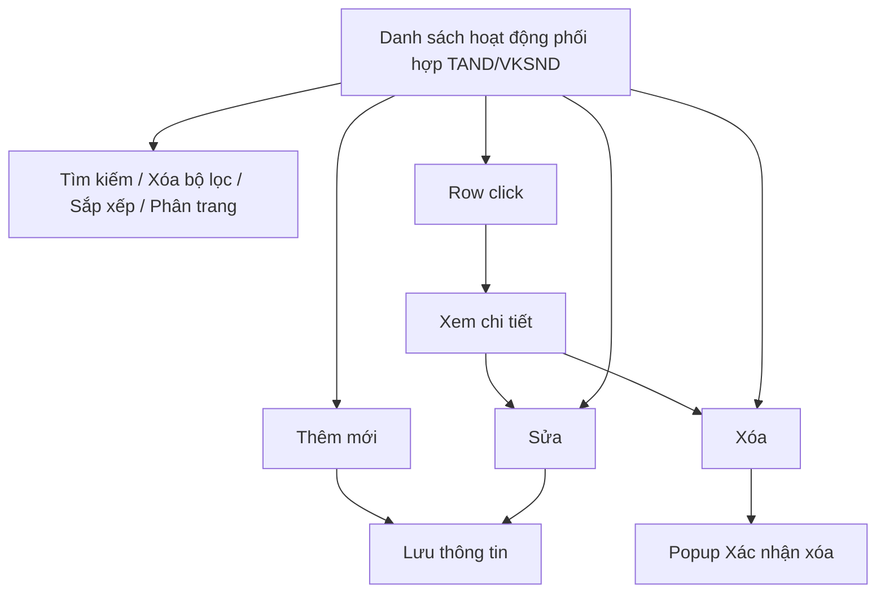
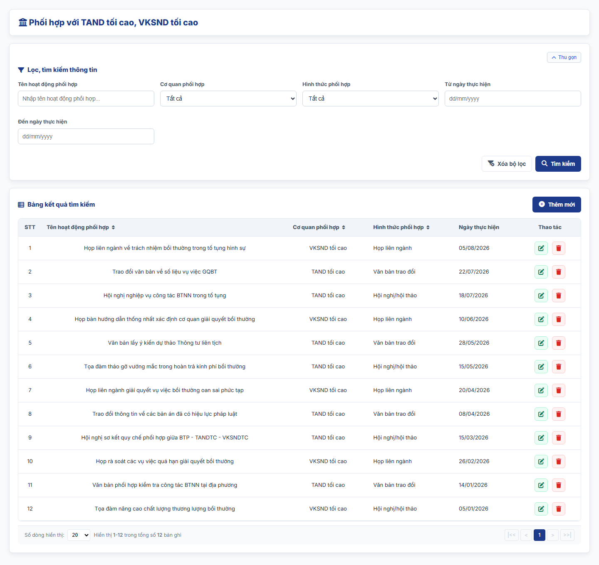
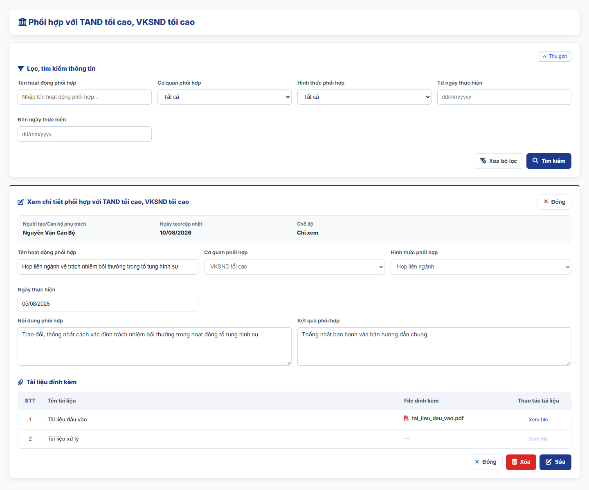
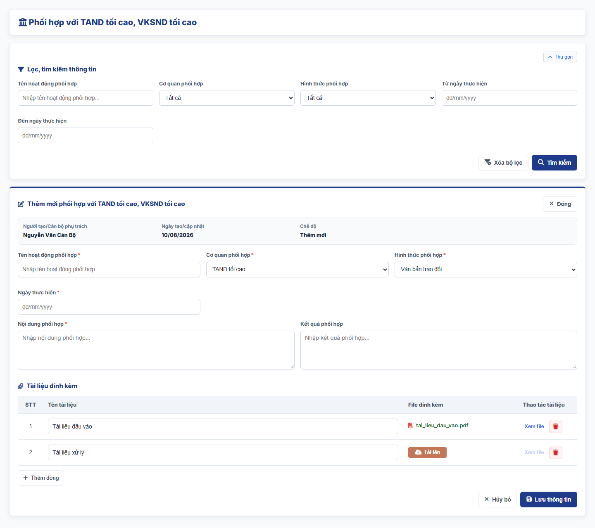
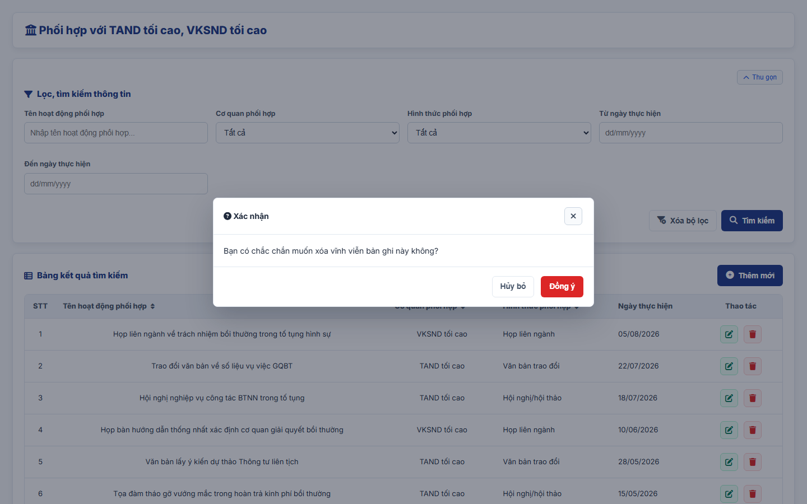

#### 4.3.3.17. UC467-468 - Phối hợp với TAND tối cao, VKSND tối cao thực hiện quản lý công tác BTNN trong lĩnh vực tố tụng

##### 4.3.3.17.1. Mục đích

\- Cho phép cán bộ Bộ Tư pháp (Cục Bồi thường nhà nước) ghi nhận, quản lý và tra cứu thông tin các hoạt động phối hợp với Tòa án nhân dân (TAND) tối cao, Viện kiểm sát nhân dân (VKSND) tối cao trong quản lý công tác bồi thường nhà nước (BTNN) phát sinh trong lĩnh vực tố tụng, theo Điều 6, Điều 7 Thông tư 08/2019/TT-BTP; khoản 10 Điều 44 và Điều 49 dự thảo Nghị định quy định chi tiết một số điều và biện pháp thi hành Luật Trách nhiệm bồi thường của Nhà nước (bản gửi lấy ý kiến ngày 28/9/2026). Việc phối hợp được thực hiện thông qua trao đổi ý kiến bằng văn bản hoặc họp liên ngành (khoản 3 Điều 49).

\- Nội dung chỉ phục vụ nội bộ cán bộ quản lý, không công khai ra Website khách hàng.

*a. Phân quyền*

\- Cán bộ Bộ Tư pháp: được tra cứu, xem chi tiết, thêm mới, sửa, xóa bản ghi.

*b. Điều kiện thực hiện*

\- Người dùng đã đăng nhập thành công vào Website quản trị.

\- Người dùng được phân quyền truy cập màn hình `Phối hợp với TAND tối cao, VKSND tối cao trong lĩnh vực tố tụng`.

---

##### 4.3.3.17.2. Sơ đồ luồng nghiệp vụ theo giao diện

---

##### 4.3.3.17.3. MH01 - Màn hình Danh sách hoạt động phối hợp TAND/VKSND

###### 4.3.3.17.3.1. Màn hình

###### 4.3.3.17.3.2. Mô tả thông tin trên màn hình

| Trường thông tin | Kiểu dữ liệu | Bắt buộc | Mặc định | Mô tả |
| :--- | :--- | :--- | :--- | :--- |
| **I. Bộ lọc tìm kiếm** | - | - | - | Control UI: Khối thu gọn/mở rộng (Accordion). - Mặc định hiển thị dạng mở rộng. - Cho phép thu gọn/mở rộng khi click vào nút "Thu gọn"/"Mở rộng" ở góc phải khối; khi thu gọn, các giá trị lọc đã nhập được giữ nguyên. |
| Tên hoạt động phối hợp | String(255) | Không | Trống | Control UI: Text input. - Placeholder: "Nhập tên hoạt động phối hợp...". - Tìm gần đúng; không phân biệt hoa thường, có dấu/không dấu. |
| Cơ quan phối hợp | Enum(String(50)) | Không | Tất cả | Control UI: Combobox. Gồm: + Tất cả + TAND tối cao + VKSND tối cao |
| Hình thức phối hợp | Enum(String(50)) | Không | Tất cả | Control UI: Combobox. Gồm: + Tất cả + Văn bản trao đổi + Họp liên ngành + Hội nghị/hội thảo + Khác |
| Từ ngày thực hiện | Date | Không | Trống | Control UI: Date input. - Placeholder: "dd/mm/yyyy". |
| Đến ngày thực hiện | Date | Không | Trống | Control UI: Date input. - Placeholder: "dd/mm/yyyy". |
| **II. Bảng danh sách kết quả** | - | - | 20 bản ghi/trang | Control UI: Data grid. - Khi người dùng truy cập màn hình, hệ thống tự động tải Trang 1. - Sắp xếp mặc định: theo "Ngày tạo" giảm dần. - Trạng thái không có dữ liệu (Empty State): bảng hiển thị duy nhất 01 dòng căn giữa trên toàn bộ chiều rộng bảng (`colspan`), in nghiêng với nội dung theo MessageList dùng chung [MSG-INF-SYS-001]. |
| STT | Integer(10) | Không | Theo trang hiện tại | - Chỉ đọc. - Theo dữ liệu bản ghi. |
| Tên hoạt động phối hợp | String(255) | Không | Theo dữ liệu hệ thống | - Chỉ đọc. - Theo dữ liệu bản ghi. |
| Cơ quan phối hợp | Enum(String(50)) | Không | Theo dữ liệu hệ thống | - Chỉ đọc. - Theo dữ liệu bản ghi. |
| Hình thức phối hợp | Enum(String(50)) | Không | Theo dữ liệu hệ thống | - Chỉ đọc. - Theo dữ liệu bản ghi. |
| Ngày thực hiện | Date | Không | Theo dữ liệu hệ thống | - Chỉ đọc. - Định dạng `dd/mm/yyyy`. |
| Thao tác | - | - | - | Control UI: Icon + Sửa + Xóa |
| Phân trang | - | - | 20 bản ghi/trang | Phân trang, chuyển trang và cấu hình số dòng hiển thị theo quy tắc chung của hệ thống. |

###### 4.3.3.17.3.3. Chức năng trên màn hình

| STT | Tên chức năng | Định dạng | Mô tả |
| :--- | :--- | :--- | :--- |
| 1 | Tìm kiếm | Button | Khi người dùng click nút, hệ thống kiểm tra điều kiện dữ liệu và thực hiện tìm kiếm theo các trường hợp bên dưới: |
|  |  |  | **TH1 - Khoảng ngày không hợp lệ**: Nếu `Từ ngày thực hiện` lớn hơn `Đến ngày thực hiện`, vi phạm [BR-VAL-007], hệ thống hiển thị cảnh báo lỗi [MSG-ERR-VAL-007] và không thực hiện tìm kiếm. |
|  |  |  | **TH2 - Hợp lệ (Có dữ liệu phù hợp)**: Hệ thống hiển thị danh sách các bản ghi thỏa mãn đồng thời các tiêu chí đã nhập/chọn và đưa về Trang 1. |
|  |  |  | **TH3 - Không có dữ liệu trả về**: Bảng kết quả hiển thị duy nhất 01 dòng căn giữa (`colspan`), in nghiêng với nội dung [MSG-INF-SYS-001]; thanh phân trang hiển thị *"Hiển thị 0-0 trong tổng số 0 bản ghi"*, các nút điều hướng trang ở trạng thái khóa mờ. |
| 2 | Xóa bộ lọc | Button | Hệ thống xóa toàn bộ tiêu chí tìm kiếm đã nhập/chọn, thiết lập các ô lọc về giá trị mặc định. |
| 3 | Thêm mới | Button | Hệ thống mở [MH03 - Màn hình Thêm mới/Sửa hoạt động phối hợp TAND/VKSND](#433175-mh03---màn-hình-thêm-mớisửa-hoạt-động-phối-hợp-tandvksnd) ở chế độ Thêm mới với form thông tin để trống. |
| 4 | Sắp xếp cột | Header cột | Áp dụng trên các cột: + Tên hoạt động phối hợp + Cơ quan phối hợp + Hình thức phối hợp |
|  |  |  | **TH1 - Chọn lại cột đang sắp xếp**: Hệ thống đảo chiều sắp xếp tăng dần/giảm dần và cập nhật icon mũi tên trên tiêu đề cột. |
|  |  |  | **TH2 - Chọn cột khác**: Hệ thống sắp xếp danh sách theo cột được chọn. |
| 5 | Row click | Row click | Khi người dùng click vào bất kỳ vị trí nào trên dòng dữ liệu (trừ các nút thao tác), hệ thống mở [MH02 - Màn hình Chi tiết hoạt động phối hợp TAND/VKSND](#433174-mh02---màn-hình-chi-tiết-hoạt-động-phối-hợp-tandvksnd). |
| 6 | Sửa | Icon button | Hệ thống mở [MH03 - Màn hình Thêm mới/Sửa hoạt động phối hợp TAND/VKSND](#433175-mh03---màn-hình-thêm-mớisửa-hoạt-động-phối-hợp-tandvksnd) ở chế độ Sửa với dữ liệu hiện tại của bản ghi được điền sẵn. |
| 7 | Xóa | Icon button | Hệ thống mở [Popup Xác nhận xóa](#433176-popup-xác-nhận-xóa). |
| 8 | Phân trang & chuyển trang | Pagination | Phân trang, chuyển trang và cấu hình số dòng hiển thị theo quy tắc chung của hệ thống. |

---

##### 4.3.3.17.4. MH02 - Màn hình Chi tiết hoạt động phối hợp TAND/VKSND

###### 4.3.3.17.4.1. Màn hình

###### 4.3.3.17.4.2. Mô tả thông tin trên màn hình

| Trường thông tin | Kiểu dữ liệu | Bắt buộc | Mặc định | Mô tả |
| :--- | :--- | :--- | :--- | :--- |
| Tiêu đề màn hình | - | - | - | Control UI: Label Hiển thị "Xem chi tiết phối hợp với TAND tối cao, VKSND tối cao". |
| **I. Thông tin chung** |  |  |  |  |
| Người tạo/Cán bộ phụ trách | - | - | - | Control UI: Label Theo dữ liệu bản ghi. |
| Ngày tạo/cập nhật | - | - | - | Control UI: Label Theo dữ liệu bản ghi. |
| Chế độ | - | - | - | Control UI: Label Hiển thị "Chỉ xem". |
| **II. Thông tin hoạt động phối hợp** |  |  |  |  |
| Tên hoạt động phối hợp | - | - | - | Control UI: Label Theo dữ liệu bản ghi. |
| Cơ quan phối hợp | - | - | - | Control UI: Label Theo dữ liệu bản ghi. |
| Hình thức phối hợp | - | - | - | Control UI: Label Theo dữ liệu bản ghi. |
| Ngày thực hiện | - | - | - | Control UI: Label Theo dữ liệu bản ghi. |
| Nội dung phối hợp | - | - | - | Control UI: Label Theo dữ liệu bản ghi. |
| Kết quả phối hợp | - | - | - | Control UI: Label Theo dữ liệu bản ghi. |
| **III. Tài liệu đính kèm** |  |  |  |  |
| Tài liệu đính kèm | - | - | - | Control UI: File link Theo dữ liệu bản ghi. |

###### 4.3.3.17.4.3. Chức năng trên màn hình

| STT | Tên chức năng | Định dạng | Mô tả |
| :--- | :--- | :--- | :--- |
| 1 | Xem file | Link | Khi click vào liên kết "Xem file" của tài liệu đính kèm, hệ thống mở nội dung file tại một tab trình duyệt mới. |
| 2 | Sửa | Button | Hệ thống mở [MH03 - Màn hình Thêm mới/Sửa hoạt động phối hợp TAND/VKSND](#433175-mh03---màn-hình-thêm-mớisửa-hoạt-động-phối-hợp-tandvksnd) ở chế độ Sửa với dữ liệu hiện tại của bản ghi được điền sẵn. |
| 3 | Xóa | Button | Hệ thống mở [Popup Xác nhận xóa](#433176-popup-xác-nhận-xóa); nếu người dùng chọn `Đồng ý`, hệ thống xóa bản ghi, đóng màn hình chi tiết và quay lại [MH01 - Màn hình Danh sách hoạt động phối hợp TAND/VKSND](#433173-mh01---màn-hình-danh-sách-hoạt-động-phối-hợp-tandvksnd). |
| 4 | Đóng | Button | Khi người dùng click nút "Đóng" ở góc phải tiêu đề hoặc ở chân màn hình, hệ thống đóng màn hình chi tiết và quay lại [MH01 - Màn hình Danh sách hoạt động phối hợp TAND/VKSND](#433173-mh01---màn-hình-danh-sách-hoạt-động-phối-hợp-tandvksnd). |

---

##### 4.3.3.17.5. MH03 - Màn hình Thêm mới/Sửa hoạt động phối hợp TAND/VKSND

###### 4.3.3.17.5.1. Màn hình

###### 4.3.3.17.5.2. Mô tả thông tin trên màn hình

| Trường thông tin | Kiểu dữ liệu | Bắt buộc | Mặc định | Mô tả |
| :--- | :--- | :--- | :--- | :--- |
| Tiêu đề màn hình | - | - | Theo ngữ cảnh | Control UI: Label Hiển thị "Thêm mới phối hợp với TAND tối cao, VKSND tối cao" hoặc "Sửa phối hợp với TAND tối cao, VKSND tối cao". |
| **I. Thông tin chung** |  |  |  |  |
| Người tạo/Cán bộ phụ trách | - | - | Theo tài khoản đăng nhập | Control UI: Label Theo dữ liệu bản ghi. |
| Ngày tạo/cập nhật | - | - | Theo dữ liệu hệ thống | Control UI: Label Định dạng `dd/mm/yyyy`. |
| Chế độ | - | - | Theo ngữ cảnh | Control UI: Label Hiển thị "Thêm mới" hoặc "Sửa". |
| **II. Thông tin hoạt động phối hợp** |  |  |  |  |
| Tên hoạt động phối hợp | String(255) | Có | Trống | Control UI: Text input. - Placeholder: "Nhập tên hoạt động phối hợp...". |
| Cơ quan phối hợp | Enum(String(50)) | Có | TAND tối cao | Control UI: Combobox. Gồm: + TAND tối cao + VKSND tối cao |
| Hình thức phối hợp | Enum(String(50)) | Có | Văn bản trao đổi | Control UI: Combobox. Gồm: + Văn bản trao đổi + Họp liên ngành + Hội nghị/hội thảo + Khác |
| Ngày thực hiện | Date | Có | Trống | Control UI: Date input. - Placeholder: "dd/mm/yyyy". - Không lớn hơn ngày hiện tại theo [BR-VAL-008]. |
| Nội dung phối hợp | Text(2000) | Không | Trống | Control UI: Textarea. - Placeholder: "Nhập nội dung phối hợp...". |
| Kết quả phối hợp | Text(2000) | Không | Trống | Control UI: Textarea. - Placeholder: "Nhập kết quả phối hợp...". |
| **III. Tài liệu đính kèm** |  |  |  |  |
| Tài liệu đính kèm | List(File) | Không | Trống | Control UI: Bảng tài liệu đính kèm gồm các cột `STT`, `Tên tài liệu`, `File đính kèm`, `Thao tác tài liệu`; nút `+ Thêm dòng` dưới bảng. - Cột `Tên tài liệu`: Text input. Placeholder: "Nhập tên tài liệu...". - Cột `File đính kèm`: khi dòng chưa có file hiển thị nút `Tải lên`; khi đã có file hiển thị tên file. - Cột `Thao tác tài liệu` gồm: + Xem file (khóa mờ khi dòng chưa có file) + Xóa - Áp dụng [BR-FILE-010]. |

###### 4.3.3.17.5.3. Chức năng trên màn hình

| STT | Tên chức năng | Định dạng | Mô tả |
| :--- | :--- | :--- | :--- |
| 1 | Lưu thông tin | Button | Khi người dùng click nút, hệ thống kiểm tra dữ liệu và xử lý theo các trường hợp bên dưới: |
|  |  |  | **TH1 - Bỏ trống trường bắt buộc**: Vi phạm [BR-VAL-001] (chưa nhập/chọn các trường có dấu `*`). Hệ thống viền đỏ các ô lỗi, hiển thị "Đây là trường bắt buộc" ngay dưới từng ô và focus vào ô lỗi đầu tiên. |
|  |  |  | **TH2 - Ngày thực hiện không hợp lệ**: `Ngày thực hiện` lớn hơn ngày hiện tại, vi phạm [BR-VAL-008]. Hệ thống hiển thị [MSG-ERR-VAL-008] ngay dưới ô và không cho phép lưu. |
|  |  |  | **TH3 - Trùng bản ghi**: Bản ghi được xác định bởi các thông tin `Tên hoạt động phối hợp`, `Cơ quan phối hợp`, `Ngày thực hiện`. Nếu các thông tin này trùng với một bản ghi khác đang tồn tại, hệ thống viền đỏ các ô tương ứng, hiển thị cảnh báo "Hoạt động phối hợp đã tồn tại trong hệ thống (trùng Tên hoạt động phối hợp, Cơ quan phối hợp và Ngày thực hiện)" dưới ô `Tên hoạt động phối hợp` và không cho phép lưu. - So sánh sau khi bỏ khoảng trắng thừa, không phân biệt hoa thường. - Ở chế độ Sửa, hệ thống bỏ qua chính bản ghi đang sửa. |
|  |  |  | **TH4 - Hợp lệ - Thêm mới**: Hệ thống lưu bản ghi, đóng màn hình, tải lại danh sách và hiển thị [MSG-SUC-SYS-003]. |
|  |  |  | **TH5 - Hợp lệ - Sửa**: Hệ thống cập nhật bản ghi, đóng màn hình, tải lại danh sách và hiển thị [MSG-SUC-SYS-002]. |
| 2 | Tải lên | Button | Hệ thống mở trình chọn file cho dòng tài liệu tương ứng; sau khi chọn, hiển thị tên file tại cột `File đính kèm`. |
| 3 | Xem file | Link | Hệ thống mở file của dòng tài liệu tại một tab trình duyệt mới. |
| 4 | Xóa | Link | Hệ thống mở [Popup Xác nhận xóa](#433176-popup-xác-nhận-xóa). Nếu chọn `Đồng ý`, hệ thống xóa dòng tài liệu khỏi bảng; nếu chọn `Hủy bỏ`, hệ thống giữ nguyên dòng tài liệu. |
| 5 | Thêm dòng | Button | Hệ thống thêm 01 dòng tài liệu trống vào cuối bảng tài liệu đính kèm. |
| 6 | Hủy bỏ | Button | Khi người dùng click nút "Hủy bỏ" ở chân màn hình hoặc nút "Đóng" ở góc phải tiêu đề, hệ thống đóng màn hình, không lưu dữ liệu và quay lại [MH01 - Màn hình Danh sách hoạt động phối hợp TAND/VKSND](#433173-mh01---màn-hình-danh-sách-hoạt-động-phối-hợp-tandvksnd). |

---

##### 4.3.3.17.6. Popup Xác nhận xóa

###### 4.3.3.17.6.1. Màn hình

###### 4.3.3.17.6.2. Mô tả thông tin trên màn hình

| Trường thông tin | Kiểu dữ liệu | Bắt buộc | Mặc định | Mô tả |
| :--- | :--- | :--- | :--- | :--- |
| Tiêu đề popup | - | - | - | Control UI: Label Hiển thị "Xác nhận". |
| Nội dung xác nhận | - | - | - | Control UI: Label Áp dụng message xác nhận [MSG-CFM-SYS-001]. |

###### 4.3.3.17.6.3. Chức năng trên màn hình

| STT | Tên chức năng | Định dạng | Mô tả |
| :--- | :--- | :--- | :--- |
| 1 | Đồng ý | Button | Hệ thống đóng popup và thực hiện xóa: + Xóa bản ghi: xóa vĩnh viễn bản ghi khỏi hệ thống, tải lại danh sách và hiển thị [MSG-SUC-SYS-002]. + Xóa tài liệu đính kèm: xóa dòng tài liệu khỏi bảng. |
| 2 | Hủy bỏ | Button | Khi người dùng click nút "Hủy bỏ" hoặc biểu tượng đóng ở góc phải tiêu đề popup, hệ thống đóng popup và không thực hiện thao tác. |
