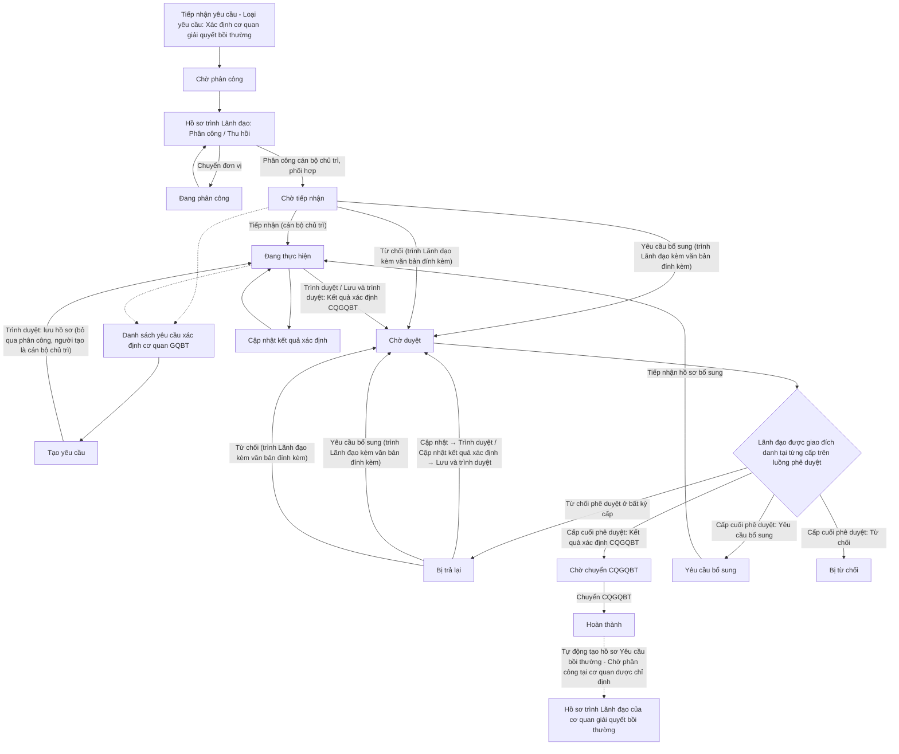
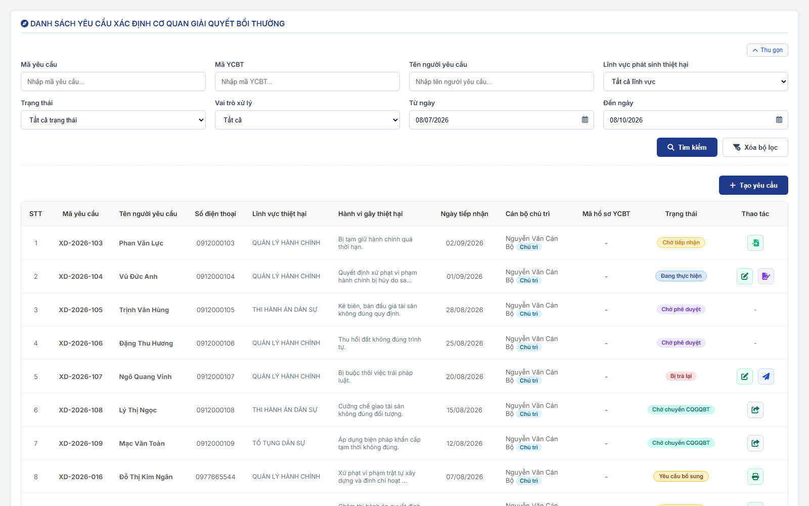
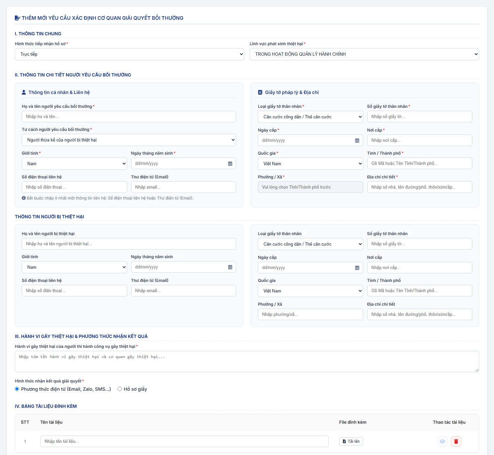
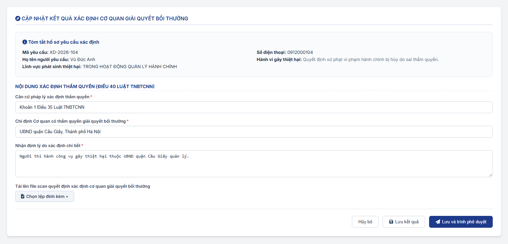
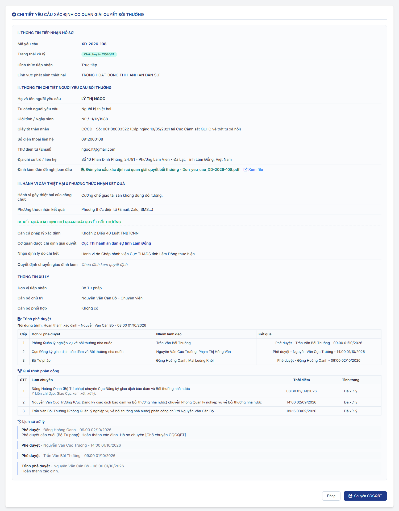
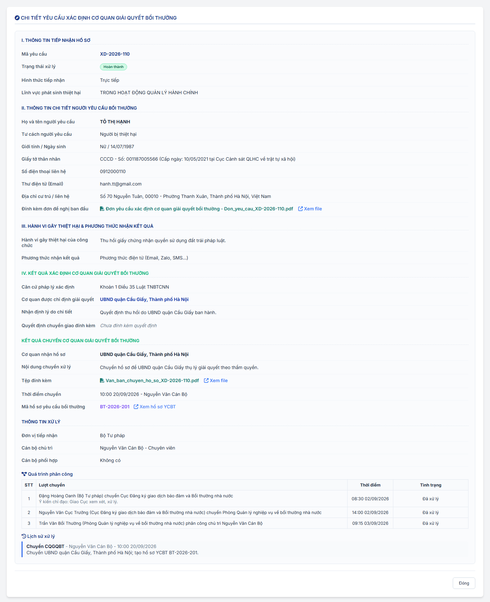
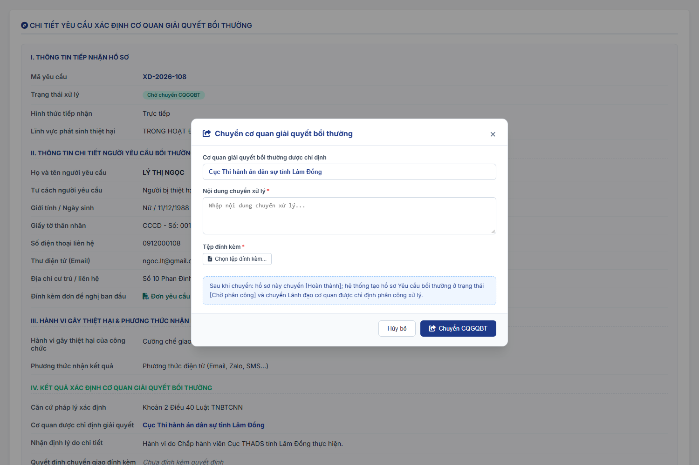
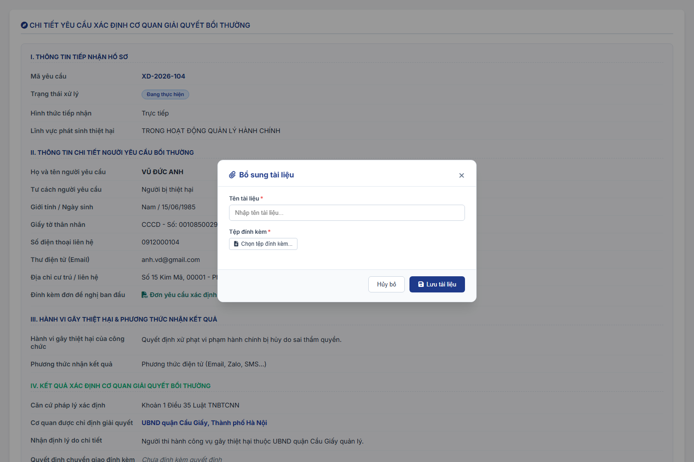

### 4.3.3. Dành cho Cán bộ nghiệp vụ bồi thường nhà nước

#### 4.3.3.1. Nhóm tính năng Xác định cơ quan giải quyết bồi thường

##### 4.3.3.1.1. Mục đích

\- Cho phép người dùng trên Website quản trị (menu `Xác định cơ quan giải quyết bồi thường`, phân hệ Bồi thường nhà nước) quản lý và xử lý hồ sơ yêu cầu xác định cơ quan giải quyết bồi thường, gồm:

+ Hồ sơ được tiếp nhận tại [MH02 - Màn hình Tiếp nhận yêu cầu - Tiếp nhận yêu cầu - Công tác bồi thường nhà nước (Website Quản trị)](SRS_BTNN_GiaiQuyetBT_TiepNhan_YCBT.md#43313-mh02---màn-hình-tiếp-nhận-yêu-cầu), được lãnh đạo phân công cán bộ chủ trì/phối hợp tại [Màn hình Hồ sơ trình Lãnh đạo - Hồ sơ trình Lãnh đạo - Công tác bồi thường nhà nước (Website Quản trị)](SRS_BTNN_ViecChoLanhDaoXuLy.md) và chuyển đến phân hệ ở trạng thái `Chờ tiếp nhận`.
+ Hồ sơ do cán bộ tạo mới trực tiếp tại phân hệ (`Tạo yêu cầu`).

\- Cán bộ chủ trì tiếp nhận, cập nhật kết quả xác định, trình lãnh đạo phê duyệt và sau khi được phê duyệt thì chuyển hồ sơ cho cơ quan giải quyết bồi thường tiếp nhận (mặc định là cơ quan được chỉ định trong kết quả xác định; cán bộ chủ trì chọn trên cây đơn vị). Khi chuyển, hệ thống tự động tạo hồ sơ yêu cầu bồi thường tại cơ quan tiếp nhận được chọn.

*a. Phân quyền*

\- Chỉ người dùng thuộc đơn vị được áp dụng giá trị `Xác định cơ quan giải quyết bồi thường` trong [Danh mục Loại yêu cầu - Quản lý danh mục - Quản trị hệ thống (Website Quản trị)](../01_Quan_tri_he_thong/Quan_ly_danh_muc.md) [DM_54] (trường `Đơn vị áp dụng`) mới xử lý được loại yêu cầu này. Theo cấu hình danh mục, giá trị này áp dụng cho 03 loại cơ quan có thẩm quyền xác định cơ quan giải quyết bồi thường:
+ Bộ Tư pháp.
+ Sở Tư pháp các tỉnh, thành phố trực thuộc Trung ương.
+ Ủy ban nhân dân cấp tỉnh (UBND tỉnh, thành phố trực thuộc Trung ương), gọi tắt là UBND cấp tỉnh.
+ Đơn vị áp dụng tính cả đơn vị cha: khi chọn đơn vị cha trong `Đơn vị áp dụng` thì toàn bộ đơn vị trực thuộc được áp dụng.
+ Người dùng thuộc đơn vị không được áp dụng: không hiển thị nút `Tạo yêu cầu`; màn hình danh sách hiển thị thông báo *"Loại yêu cầu "Xác định cơ quan giải quyết bồi thường" không áp dụng cho đơn vị [Tên đơn vị] (Danh mục Loại yêu cầu - Đơn vị áp dụng). Chỉ Bộ Tư pháp, Sở Tư pháp và UBND cấp tỉnh được xử lý loại yêu cầu này."*
+ UBND cấp tỉnh được tiếp nhận, thụ lý, trình Lãnh đạo và ra văn bản xác định cơ quan giải quyết bồi thường như Bộ Tư pháp, Sở Tư pháp. Loại cơ quan xử lý (`Bộ Tư pháp`, `Sở Tư pháp`, `UBND cấp tỉnh`) được thể hiện tại cột `Cơ quan xử lý` và bộ lọc `Cơ quan xử lý` của MH01, trường `Đơn vị tiếp nhận` và `Lịch sử xử lý` của MH04.

\- Vai trò trên hồ sơ:

| Vai trò | Quyền trên hồ sơ |
| :--- | :--- |
| Cán bộ chủ trì | Được lãnh đạo chỉ định khi phân công (01 người) hoặc là người tạo hồ sơ trực tiếp. Thực hiện toàn bộ thao tác xử lý: Tiếp nhận, Yêu cầu bổ sung, Từ chối, Cập nhật (hồ sơ `Bị trả lại`), Cập nhật kết quả xác định, Trình duyệt/Trình phê duyệt, Tiếp nhận hồ sơ bổ sung, Chuyển CQGQBT. |
| Cán bộ phối hợp | Được lãnh đạo chỉ định khi phân công (nhiều người). Chỉ được xem hồ sơ và `Bổ sung tài liệu` (tại màn hình chi tiết); không được trình phê duyệt và không thực hiện các thao tác xử lý khác. |
| Người tạo | Hồ sơ tạo trực tiếp tại phân hệ: người tạo đồng thời là cán bộ chủ trì của hồ sơ. |
| Lãnh đạo các đơn vị trên luồng | Lãnh đạo (thuộc Nhóm lãnh đạo) của các đơn vị đã chuyển/phân công hồ sơ và các đơn vị trên luồng phê duyệt được xem hồ sơ tại danh sách. Thao tác phân công, phê duyệt, từ chối phê duyệt (chỉ Lãnh đạo được giao đích danh tại cấp đang đến lượt), thu hồi thực hiện tại [Màn hình Hồ sơ trình Lãnh đạo - Hồ sơ trình Lãnh đạo - Công tác bồi thường nhà nước (Website Quản trị)](SRS_BTNN_ViecChoLanhDaoXuLy.md). |

- Nhóm lãnh đạo, đơn vị được chuyển và cán bộ được phân công của từng đơn vị lấy theo [Cấu hình luồng xử lý - Cấu hình luồng xử lý - Quản trị hệ thống (Website Quản trị)](../01_Quan_tri_he_thong/Cau_hinh_luong_xu_ly.md).

*b. Điều kiện thực hiện*

- Người dùng truy cập màn hình `Xác định cơ quan giải quyết bồi thường` trên Website quản trị.

- Người dùng được phân quyền thực hiện tính năng.

*c. Trạng thái hồ sơ*

| Trạng thái | Ý nghĩa | Hiển thị tại phân hệ |
| :--- | :--- | :--- |
| `Chờ phân công` | Hồ sơ vừa được tiếp nhận, chờ lãnh đạo đơn vị gốc của cán bộ tiếp nhận phân công. | Không (hiển thị tại Tiếp nhận yêu cầu và Hồ sơ trình Lãnh đạo) |
| `Đang phân công` | Hồ sơ đã được lãnh đạo chuyển xuống đơn vị cấp dưới, chờ lãnh đạo đơn vị nhận phân công tiếp. | Không (hiển thị tại Tiếp nhận yêu cầu và Hồ sơ trình Lãnh đạo) |
| `Chờ tiếp nhận` | Lãnh đạo đã phân công cán bộ chủ trì/phối hợp; chờ cán bộ chủ trì tiếp nhận. | Có |
| `Đang thực hiện` | Cán bộ chủ trì đang xử lý hồ sơ (xác minh, cập nhật kết quả xác định, chuẩn bị trình phê duyệt). | Có |
| `Chờ duyệt` | Cán bộ chủ trì đã trình Lãnh đạo; hồ sơ đang chờ Lãnh đạo được giao tại các cấp trên luồng phê duyệt. Loại việc đang trình xem tại `Nội dung trình` của phiếu trình. | Có |
| `Bị trả lại` | Lãnh đạo một cấp phê duyệt đã từ chối phê duyệt; hồ sơ trả về cán bộ chủ trì, giữ `Nội dung trình` của phiếu bị trả lại. | Có |
| `Chờ chuyển CQGQBT` | Cấp phê duyệt cuối cùng đã phê duyệt nội dung `Kết quả xác định CQGQBT`; chờ cán bộ chủ trì chuyển cơ quan giải quyết bồi thường. | Có |
| `Yêu cầu bổ sung` | Cấp phê duyệt cuối cùng đã phê duyệt nội dung `Yêu cầu bổ sung`; chờ người yêu cầu nộp bổ sung. | Có |
| `Bị từ chối` | Cấp phê duyệt cuối cùng đã phê duyệt nội dung `Từ chối`. Trạng thái kết thúc. | Có |
| `Hoàn thành` | Đã chuyển cơ quan giải quyết bồi thường và tạo hồ sơ yêu cầu bồi thường. Trạng thái kết thúc. | Có |

- Phân hệ không sử dụng trạng thái `Lưu nháp`. Hồ sơ tạo trực tiếp được lưu ở trạng thái `Đang thực hiện` ngay khi bấm `Trình duyệt`. Hồ sơ `Lưu nháp` phát sinh trước đây (nếu có) được hệ thống tự động chuyển sang `Đang thực hiện` khi tải dữ liệu.

- **Nội dung trình**: loại việc cán bộ chủ trì trình Lãnh đạo, lưu trong phiếu trình; dùng cho dòng phụ dưới badge trạng thái và bộ lọc `Nội dung trình` tại MH01. Gồm:
+ `Yêu cầu bổ sung`: trình tại [Popup Yêu cầu bổ sung hồ sơ](#433110-popup-yêu-cầu-bổ-sung-hồ-sơ); cấp cuối phê duyệt thì hồ sơ chuyển `Yêu cầu bổ sung`.
+ `Từ chối`: trình tại [Popup Từ chối yêu cầu xác định cơ quan](#433111-popup-từ-chối-yêu-cầu-xác-định-cơ-quan); cấp cuối phê duyệt thì hồ sơ chuyển `Bị từ chối`.
+ `Kết quả xác định CQGQBT`: trình tại [Popup Trình duyệt](#43317-popup-trình-duyệt); cấp cuối phê duyệt thì hồ sơ chuyển `Chờ chuyển CQGQBT`.

- **Dòng phụ dưới badge trạng thái** (MH01, MH04):
+ Hồ sơ `Chờ duyệt`: `[Nội dung trình]` của phiếu trình đang chờ duyệt (VD `Yêu cầu bổ sung`); dòng phụ không hiển thị cấp phê duyệt.
+ Hồ sơ `Bị trả lại`: `[Nội dung trình]` của phiếu bị trả lại (VD `Từ chối`).
+ Các trạng thái khác: không hiển thị dòng phụ.

*d. Quy tắc trình - phê duyệt*

- **Luồng phê duyệt**: là luồng ngược chiều luồng phân công thực tế của chính hồ sơ. Hệ thống lấy danh sách các đơn vị đã chuyển/phân công hồ sơ theo thứ tự trong `Quá trình phân công`, đảo ngược và loại bỏ đơn vị trùng (ví dụ phân công Bộ Tư pháp → Cục → Phòng thì phê duyệt Phòng → Cục → Bộ Tư pháp).

- **Hồ sơ tạo trực tiếp** (không có lượt phân công): luồng phê duyệt đi từ đơn vị của cán bộ chủ trì lên đơn vị gốc theo cây Cơ cấu tổ chức, chỉ gồm các đơn vị có Nhóm lãnh đạo trong Cấu hình luồng xử lý. Nếu không xác định được cấp phê duyệt nào, hệ thống không cho trình và hiển thị *"Chưa xác định được cấp phê duyệt. Vui lòng liên hệ Quản trị hệ thống."*

- **Hiển thị luồng phê duyệt trên popup trình Lãnh đạo**: trường `Luồng phê duyệt` (chỉ đọc, một dòng) đặt ngay dưới ô `Lãnh đạo phê duyệt`, định dạng `Cấp 1 - [Đơn vị] → Cấp 2 - [Đơn vị] → ...`; hiển thị động theo [Cấu hình luồng xử lý - Cấu hình luồng xử lý - Quản trị hệ thống (Website Quản trị)](../01_Quan_tri_he_thong/Cau_hinh_luong_xu_ly.md) tương ứng đơn vị của cán bộ thực hiện, VD:
+ Cán bộ thuộc Bộ Tư pháp: `Cấp 1 - [Phòng nghiệp vụ thuộc Cục] → Cấp 2 - [Cục] → Cấp 3 - [Bộ Tư pháp]`
+ Cán bộ thuộc Sở Tư pháp: `Cấp 1 - [Phòng chuyên môn thuộc Sở] → Cấp 2 - [Sở Tư pháp]`
+ Cán bộ thuộc cơ quan khác/UBND: các cấp lãnh đạo quản lý trực tiếp theo cây tổ chức đã thiết lập

- **Trình `Yêu cầu bổ sung`**: cán bộ chủ trì không chuyển hồ sơ sang `Yêu cầu bổ sung` trực tiếp. Đối với hồ sơ `Chờ tiếp nhận` hoặc `Bị trả lại`, cán bộ chủ trì nhập Nội dung yêu cầu bổ sung, bắt buộc tải lên Văn bản đính kèm trình Lãnh đạo (văn bản do cán bộ soạn; hệ thống không sinh văn bản dự thảo tự động) và bắt buộc chọn Lãnh đạo phê duyệt tại [Popup Yêu cầu bổ sung hồ sơ](#433110-popup-yêu-cầu-bổ-sung-hồ-sơ), rồi bấm `Trình Lãnh đạo`. Hồ sơ chuyển `Chờ duyệt` với Nội dung trình `Yêu cầu bổ sung` và đi theo cùng luồng phê duyệt nêu trên (ngược chiều luồng phân công). Cấp phê duyệt cuối cùng phê duyệt thì hồ sơ chuyển `Yêu cầu bổ sung`; bất kỳ cấp nào từ chối phê duyệt thì hồ sơ chuyển `Bị trả lại`. Khi trình từ hồ sơ `Chờ tiếp nhận`, lượt phân công gần nhất được cập nhật `Đã xử lý` (lãnh đạo không còn thu hồi được).

- **Trình `Từ chối`**: cán bộ chủ trì không từ chối trực tiếp. Đối với hồ sơ `Chờ tiếp nhận` hoặc `Bị trả lại`, cán bộ chủ trì nhập Lý do từ chối, bắt buộc tải lên Văn bản đính kèm trình Lãnh đạo và bắt buộc chọn Lãnh đạo phê duyệt tại [Popup Từ chối yêu cầu xác định cơ quan](#433111-popup-từ-chối-yêu-cầu-xác-định-cơ-quan), rồi bấm `Trình Lãnh đạo`. Hồ sơ chuyển `Chờ duyệt` với Nội dung trình `Từ chối`; cấp cuối phê duyệt thì hồ sơ chuyển `Bị từ chối`; bất kỳ cấp nào từ chối phê duyệt thì hồ sơ chuyển `Bị trả lại`.

- **Trình `Kết quả xác định CQGQBT`**: đối với hồ sơ `Đang thực hiện` hoặc `Bị trả lại` đã có kết quả xác định, cán bộ chủ trì trình tại [Popup Trình duyệt](#43317-popup-trình-duyệt) (mở từ `Trình duyệt` tại MH02 hoặc `Lưu và trình duyệt` tại MH03). Hồ sơ chuyển `Chờ duyệt` với Nội dung trình `Kết quả xác định CQGQBT`; cấp cuối phê duyệt thì hồ sơ chuyển `Chờ chuyển CQGQBT`.

- **Lãnh đạo phê duyệt đích danh**: mọi lần trình đều bắt buộc chọn `Lãnh đạo phê duyệt` cấp 1 trong Nhóm lãnh đạo của cấp phê duyệt đầu tiên. Lãnh đạo cấp n khi `Phê duyệt` (chưa phải cấp cuối) bắt buộc chọn Lãnh đạo phê duyệt cấp n+1 trong Nhóm lãnh đạo của cấp tiếp theo. Chỉ Lãnh đạo được giao mới thấy hồ sơ tại tab `Chờ duyệt` và được phê duyệt/từ chối phê duyệt. Cấp phê duyệt đầu tiên chưa cấu hình Nhóm lãnh đạo thì ô `Lãnh đạo phê duyệt` bị khóa và không bắt buộc.

- **Phê duyệt tại từng cấp**: Lãnh đạo được giao đích danh tại cấp đang đến lượt xử lý tại tab `Chờ duyệt` của màn hình Hồ sơ trình Lãnh đạo:
+ `Phê duyệt` (Ý kiến phê duyệt, không bắt buộc): nếu chưa phải cấp cuối, Lãnh đạo bắt buộc chọn Lãnh đạo phê duyệt cấp tiếp theo, hồ sơ chuyển cấp phê duyệt tiếp theo, giữ trạng thái `Chờ duyệt`; nếu là cấp cuối, hồ sơ chuyển trạng thái theo Nội dung trình: `Kết quả xác định CQGQBT` → `Chờ chuyển CQGQBT`; `Yêu cầu bổ sung` → `Yêu cầu bổ sung`; `Từ chối` → `Bị từ chối`.
+ `Từ chối` (Lý do từ chối phê duyệt, bắt buộc) tại bất kỳ cấp nào: hồ sơ chuyển `Bị trả lại` về cán bộ chủ trì, ghi nhận người trả lại, đơn vị, thời điểm, lý do và Nội dung trình bị trả lại. Lịch sử xử lý ghi hành động `Từ chối phê duyệt` để phân biệt với nội dung trình `Từ chối` yêu cầu. Khi cán bộ chủ trì trình lại, luồng phê duyệt bắt đầu lại từ cấp phê duyệt đầu tiên và cán bộ chọn lại Lãnh đạo phê duyệt cấp 1.
+ Lãnh đạo cấp dưới được thu hồi kết quả phê duyệt đã chuyển cấp trên khi cấp trên chưa phê duyệt/từ chối.
+ `Phê duyệt` là quyết định phê duyệt thuần túy. Phân hệ không sử dụng ký số; văn bản (nếu có) được xử lý theo hình thức ký duyệt + đính file, không gộp vào thao tác `Phê duyệt`.

- **Kiểm tra đồng thời**: mọi thao tác phân công, phê duyệt, từ chối, thu hồi đều được hệ thống kiểm tra lại trạng thái hồ sơ tại máy chủ trước khi ghi nhận. Nếu hồ sơ đã được người khác xử lý, hệ thống hiển thị *"Hồ sơ đã được xử lý bởi người khác hoặc bạn không có quyền phân công/phê duyệt. Vui lòng tải lại danh sách."*

*e. Ghi chú các quy tắc đang áp dụng theo mặc định (chờ xác nhận nghiệp vụ)*

- Chọn đơn vị cha trong `Đơn vị áp dụng` của Danh mục Loại yêu cầu thì áp dụng cho toàn bộ đơn vị trực thuộc.

- Không cho `Chuyển CQGQBT` khi đơn vị gốc của cơ quan tiếp nhận được chọn chưa được cấu hình luồng phân công.

- Bắt buộc nhập ít nhất một thông tin liên hệ của người yêu cầu (Số điện thoại liên hệ hoặc Thư điện tử (Email)).

- Cán bộ phối hợp chỉ được xem hồ sơ và bổ sung tài liệu, không được trình phê duyệt.

- Hồ sơ tạo trực tiếp tại phân hệ bỏ qua bước phân công, người tạo là cán bộ chủ trì; luồng phê duyệt theo cây đơn vị của người tạo.

- Sau khi `Yêu cầu bổ sung` được phê duyệt, cán bộ chủ trì thực hiện `Tiếp nhận hồ sơ bổ sung` để chuyển hồ sơ về `Đang thực hiện`.

- Hồ sơ đang trình dùng một trạng thái chung `Chờ duyệt`; hồ sơ bị từ chối phê duyệt dùng một trạng thái chung `Bị trả lại`; loại việc phân biệt bằng `Nội dung trình`.

- Popup Yêu cầu bổ sung hồ sơ và Popup Từ chối yêu cầu xác định cơ quan không sinh văn bản dự thảo theo biểu mẫu; cán bộ tự soạn và tải văn bản lên.

---

##### 4.3.3.1.2. Sơ đồ luồng nghiệp vụ theo giao diện

---

##### 4.3.3.1.3. MH01 - Màn hình Danh sách yêu cầu xác định cơ quan giải quyết bồi thường

###### 4.3.3.1.3.1. Màn hình

###### 4.3.3.1.3.2. Mô tả thông tin trên màn hình

| Trường thông tin | Kiểu dữ liệu | Bắt buộc | Mặc định | Mô tả |
| :--- | :--- | :--- | :--- | :--- |
| **Khối bộ lọc tìm kiếm** | String(255) | - | - | Control UI: Filter panel dạng thu gọn/mở rộng (Accordion). - Hiển thị phía trên bảng danh sách. - Các tiêu chí có dữ liệu được kết hợp theo điều kiện AND. - Mặc định hiển thị dạng mở rộng. - Cho phép thu gọn/mở rộng khi click vào nút "Thu gọn"/"Mở rộng" ở góc phải khối; khi thu gọn, các giá trị lọc đã nhập được giữ nguyên. |
| Mã yêu cầu | String(50) | Không | Trống | Control UI: Input text. - Placeholder: `Nhập mã yêu cầu...`. - Tìm kiếm gần đúng theo mã yêu cầu xác định cơ quan, không phân biệt hoa thường, có trim khoảng trắng. |
| Mã YCBT | String(50) | Không | Trống | Control UI: Input text. - Placeholder: `Nhập mã YCBT...`. - Tìm kiếm gần đúng theo mã hồ sơ yêu cầu bồi thường được hệ thống tạo khi `Chuyển CQGQBT`. - Nếu hồ sơ chưa có mã YCBT, dữ liệu trên lưới hiển thị `-`. |
| Tên người yêu cầu | String(100) | Không | Trống | Control UI: Input text. - Placeholder: `Nhập tên người yêu cầu...`. - Tìm kiếm gần đúng theo tên người yêu cầu, không phân biệt hoa thường, có trim khoảng trắng. |
| Lĩnh vực phát sinh thiệt hại | Enum(String(100)) | Không | `Tất cả lĩnh vực` | Control UI: Combobox. Tham chiếu danh mục Lĩnh vực phát sinh thiệt hại [DM_22]. |
| Trạng thái | Enum(String(50)) | Không | `Tất cả trạng thái` | Control UI: Combobox. Gồm: + Tất cả trạng thái + Chờ tiếp nhận + Đang thực hiện + Chờ duyệt + Bị trả lại + Chờ chuyển CQGQBT + Yêu cầu bổ sung + Bị từ chối + Hoàn thành - Không có `Chờ phân công`, `Đang phân công` vì hồ sơ ở hai trạng thái này không hiển thị tại phân hệ. - Không có `Lưu nháp` vì phân hệ không sử dụng trạng thái này. |
| Nội dung trình | Enum(String(50)) | Không | `Tất cả` | Control UI: Combobox. Gồm: + Tất cả + Yêu cầu bổ sung + Từ chối + Kết quả xác định CQGQBT - Áp dụng cho hồ sơ `Chờ duyệt` (theo Nội dung trình của phiếu trình đang chờ duyệt) và hồ sơ `Bị trả lại` (theo Nội dung trình của phiếu bị trả lại); chọn giá trị khác `Tất cả` thì hồ sơ ở các trạng thái khác không hiển thị. - Kết hợp được với bộ lọc `Trạng thái` (VD `Chờ duyệt` và `Yêu cầu bổ sung`). |
| Cơ quan xử lý | Enum(String(50)) | Không | `Tất cả cơ quan` | Control UI: Combobox, các giá trị nhóm theo loại cơ quan có thẩm quyền xác định cơ quan giải quyết bồi thường. Gồm: + Tất cả cơ quan + Nhóm `Bộ Tư pháp`: Bộ Tư pháp + Nhóm `Sở Tư pháp`: `Tất cả Sở Tư pháp` và từng Sở Tư pháp được áp dụng + Nhóm `UBND cấp tỉnh`: `Tất cả UBND cấp tỉnh` và từng UBND cấp tỉnh được áp dụng (VD UBND Thành phố Hà Nội, UBND tỉnh Lâm Đồng) - Danh sách cơ quan lấy theo `Đơn vị áp dụng` của giá trị `Xác định cơ quan giải quyết bồi thường` trong [Danh mục Loại yêu cầu - Quản lý danh mục - Quản trị hệ thống (Website Quản trị)](../01_Quan_tri_he_thong/Quan_ly_danh_muc.md) [DM_54]. Nhóm chỉ có 01 cơ quan thì không có dòng `Tất cả [Loại cơ quan]`. - Lọc theo đơn vị gốc tiếp nhận, xử lý hồ sơ; chọn `Tất cả [Loại cơ quan]` thì lọc toàn bộ cơ quan thuộc loại đó. |
| Vai trò xử lý | Enum(String(50)) | Không | `Tất cả` | Control UI: Combobox. Gồm: + Tất cả + Chủ trì: hồ sơ người dùng là cán bộ chủ trì + Phối hợp: hồ sơ người dùng là cán bộ phối hợp |
| Từ ngày | Date | Không | Ngày hiện tại trừ 03 tháng | Control UI: Datepicker. - Định dạng hiển thị `dd/mm/yyyy`. - Có icon lịch. - Lọc theo ngày tiếp nhận từ ngày. |
| Đến ngày | Date | Không | Ngày hiện tại | Control UI: Datepicker. - Định dạng hiển thị `dd/mm/yyyy`. - Có icon lịch. - Lọc theo ngày tiếp nhận đến ngày. |
| Thông báo phạm vi áp dụng | String(500) | - | Ẩn | Control UI: Alert banner. - Chỉ hiển thị khi đơn vị của người dùng không được áp dụng loại yêu cầu `Xác định cơ quan giải quyết bồi thường` (nội dung xem tại mục Phân quyền). |
| **Bảng danh sách yêu cầu xác định cơ quan giải quyết bồi thường** | Text(4000) | - | 20 bản ghi/trang | Control UI: Data grid. - Khi người dùng truy cập màn hình, hệ thống tự động tải trang đầu tiên (Trang 1) với số lượng mặc định 20 bản ghi. - Sắp xếp mặc định: Sắp xếp theo "Thời điểm tiếp nhận" giảm dần (mới nhất hiển thị lên đầu). - **Phạm vi dữ liệu**: chỉ hiển thị hồ sơ người dùng là cán bộ chủ trì, cán bộ phối hợp, người tạo hoặc người dùng thuộc Nhóm lãnh đạo của một đơn vị trên luồng phân công/phê duyệt của hồ sơ. Hồ sơ ở trạng thái `Chờ phân công`, `Đang phân công` không hiển thị tại màn hình này. - Cho phép click trực tiếp vào dòng dữ liệu để mở màn hình chi tiết, trừ khi click vào icon thao tác. - Trạng thái có dữ liệu: Hiển thị danh sách các bản ghi kết quả theo cấu trúc các cột quy định. - Trạng thái không có dữ liệu (Empty State): Khi không tìm thấy kết quả phù hợp với điều kiện tìm kiếm, bảng hiển thị duy nhất 01 dòng căn giữa trên toàn bộ chiều rộng bảng (`colspan`), in nghiêng với nội dung theo MessageList dùng chung [MSG-INF-SYS-001]. |
| STT | Integer(10) | - | Tự tăng | Control UI: Text hiển thị (Read-only). - Căn giữa. - Hiển thị số thứ tự theo trang hiện tại. |
| Mã yêu cầu | String(50) | - | Theo dữ liệu | Control UI: Text hiển thị (Read-only). - Căn giữa. - Hiển thị mã yêu cầu xác định cơ quan giải quyết bồi thường. |
| Tên người yêu cầu | String(100) | - | Theo dữ liệu | Control UI: Text hiển thị (Read-only). - Hiển thị tên người yêu cầu. - Nếu chưa có dữ liệu, hiển thị `(Chưa nhập)`. |
| Số điện thoại | String(20) | - | Theo dữ liệu | Control UI: Text hiển thị (Read-only). - Căn giữa. - Nếu chưa có dữ liệu, hiển thị `(Chưa nhập)`. |
| Lĩnh vực thiệt hại | Enum(String(50)) | - | Theo dữ liệu | Control UI: Text hiển thị (Read-only). - Hiển thị lĩnh vực phát sinh thiệt hại theo danh mục [DM_22], bỏ tiền tố `TRONG HOẠT ĐỘNG`. |
| Hành vi gây thiệt hại | String(255) | - | Theo dữ liệu | Control UI: Text hiển thị (Read-only). - Hiển thị tóm tắt hành vi gây thiệt hại. - Nếu nội dung dài hơn giới hạn hiển thị của ô, hệ thống rút gọn và cho phép xem đầy đủ khi rê chuột vào nội dung. |
| Ngày tiếp nhận | Date | - | Theo dữ liệu | Control UI: Text hiển thị (Read-only). - Căn giữa. - Định dạng `dd/mm/yyyy`. |
| Cơ quan xử lý | String(255) | - | Theo dữ liệu | Control UI: Text hiển thị (Read-only) kèm nhãn loại cơ quan. - Hiển thị tên đơn vị gốc tiếp nhận, xử lý hồ sơ. - Dòng dưới hiển thị nhãn loại cơ quan có thẩm quyền, gồm: + Bộ Tư pháp + Sở Tư pháp + UBND cấp tỉnh - Không hiển thị nhãn khi nhãn trùng tên cơ quan (VD Bộ Tư pháp). |
| Cán bộ chủ trì | String(100) | - | Theo dữ liệu | Control UI: Text hiển thị (Read-only) kèm nhãn vai trò. - Hiển thị họ tên cán bộ chủ trì của hồ sơ; chưa có thì hiển thị `--`. - Kèm nhãn `Chủ trì` khi người dùng là cán bộ chủ trì, nhãn `Phối hợp` khi người dùng là cán bộ phối hợp của hồ sơ. |
| Mã hồ sơ YCBT | String(50) | - | Theo dữ liệu | Control UI: Text hiển thị (Read-only). - Căn giữa. - Hiển thị mã hồ sơ yêu cầu bồi thường được tạo khi `Chuyển CQGQBT`. - Nếu chưa có mã hồ sơ YCBT: Hiển thị `-`. - Liên kết mở hồ sơ YCBT đặt tại [MH04 - Màn hình Chi tiết yêu cầu xác định cơ quan giải quyết bồi thường](#43316-mh04---màn-hình-chi-tiết-yêu-cầu-xác-định-cơ-quan-giải-quyết-bồi-thường). |
| Trạng thái | Enum(String(50)) | - | Theo dữ liệu | Control UI: Badge trạng thái. - Hiển thị badge theo trạng thái hồ sơ (danh sách trạng thái xem tại mục Trạng thái hồ sơ của [Mục đích](#43311-mục-đích)). - Dưới badge hiển thị dòng phụ Nội dung trình: + Hồ sơ `Chờ duyệt`: `[Nội dung trình]` của phiếu trình đang chờ duyệt (VD `Yêu cầu bổ sung`) + Hồ sơ `Bị trả lại`: `[Nội dung trình]` của phiếu bị trả lại |
| Thao tác | String(255) | - | Theo trạng thái và vai trò | Control UI: Action Buttons (Icon button). - Cột Thao tác luôn hiển thị đủ 05 thao tác cố định theo đúng thứ tự: `Tiếp nhận` \| `Yêu cầu bổ sung` \| `Từ chối` \| `Cập nhật` \| `Chuyển CQGQBT`. - Thao tác không khả dụng vẫn hiển thị nhưng mờ (Disabled), không click được; rê chuột hiển thị tooltip dạng `[Tên thao tác]: [Lý do]`. Không dùng ký tự `-` thay cho thao tác. - Thao tác chỉ khả dụng cho cán bộ chủ trì của hồ sơ. Người dùng khác (cán bộ phối hợp, lãnh đạo) thấy thao tác tương ứng ở trạng thái mờ với tooltip `[Tên thao tác]: Chỉ cán bộ chủ trì được thực hiện`. - **Thao tác khả dụng theo trạng thái** (cán bộ chủ trì): + `Chờ tiếp nhận`: `Tiếp nhận`, `Yêu cầu bổ sung`, `Từ chối`. + `Yêu cầu bổ sung`: `Tiếp nhận` (tooltip `Tiếp nhận hồ sơ bổ sung`). + `Đang thực hiện`: `Cập nhật` (tooltip `Cập nhật kết quả xác định`; mở MH03). + `Bị trả lại`: `Yêu cầu bổ sung`, `Từ chối`, `Cập nhật` (tooltip `Cập nhật và trình duyệt lại`; mở MH02 ở chế độ cập nhật). + `Chờ chuyển CQGQBT`: `Chuyển CQGQBT`. + `Chờ duyệt`, `Bị từ chối`, `Hoàn thành`: cả 05 thao tác mờ. - **Tooltip của thao tác mờ do trạng thái không phù hợp**: + `Tiếp nhận: Chỉ khả dụng khi hồ sơ Chờ tiếp nhận hoặc Yêu cầu bổ sung` + `Yêu cầu bổ sung: Chỉ khả dụng khi hồ sơ Chờ tiếp nhận hoặc Bị trả lại` + `Từ chối: Chỉ khả dụng khi hồ sơ Chờ tiếp nhận hoặc Bị trả lại` + `Cập nhật: Chỉ khả dụng khi hồ sơ Đang thực hiện hoặc Bị trả lại` + `Chuyển CQGQBT: Chỉ khả dụng khi hồ sơ Chờ chuyển CQGQBT` - Cột Thao tác không có `Trình phê duyệt`/`Trình lại` (trình phê duyệt thực hiện bằng nút `Trình duyệt` tại MH02 hoặc `Lưu và trình duyệt` tại MH03) và không có `Bổ sung tài liệu` của cán bộ phối hợp (thực hiện tại MH04). |
| Phân trang | Pagination | - | 20 bản ghi/trang | Control UI: Pagination. - Cho phép chọn cấu hình số lượng bản ghi hiển thị (10, 20, 50, 100); mặc định 20 bản ghi/trang. - Hiển thị dải bản ghi: "Hiển thị [từ]-[đến] trong số [tổng số] bản ghi" (khi không có dữ liệu hiển thị 0-0 trong số 0). - Đầy đủ các nút điều hướng trang: Đầu (&#124;&lt;&lt;), Trước (&lt;), các số trang, Sau (&gt;), Cuối (&gt;&gt;&#124;). |

###### 4.3.3.1.3.3. Chức năng trên màn hình

| STT | Tên chức năng | Định dạng | Mô tả |
| :--- | :--- | :--- | :--- |
| 1 | Tìm kiếm | Button | Khi người dùng click nút, hệ thống kiểm tra điều kiện dữ liệu và thực hiện tìm kiếm theo các trường hợp bên dưới: |
|  |  |  | **TH1 - Khoảng ngày không hợp lệ**: Nếu `Từ ngày` lớn hơn `Đến ngày`, hệ thống hiển thị cảnh báo lỗi [MSG-ERR-VAL-007] và không thực hiện tìm kiếm. |
|  |  |  | **TH Hợp lệ (Có dữ liệu phù hợp)**: Hệ thống lọc và hiển thị danh sách các bản ghi thuộc phạm vi dữ liệu của người dùng, thỏa mãn đồng thời các tiêu chí tìm kiếm/lọc đã nhập/chọn, hiển thị kết quả lên bảng và đưa về Trang 1. |
|  |  |  | **TH Không có dữ liệu trả về**: Bảng kết quả hiển thị duy nhất 01 dòng căn giữa trên toàn bộ chiều rộng bảng (`colspan`), in nghiêng với nội dung theo MessageList dùng chung [MSG-INF-SYS-001]; thanh phân trang hiển thị *"Hiển thị 0-0 trong số 0 bản ghi"*, các nút điều hướng trang ở trạng thái khóa mờ (Disabled). |
| 2 | Xóa bộ lọc | Button | Xóa các bộ lọc (gồm cả `Trạng thái`, `Nội dung trình`, `Cơ quan xử lý`, `Vai trò xử lý`), đưa Từ ngày, Đến ngày về khoảng 03 tháng gần nhất và tải lại danh sách về trang 1. |
| 3 | Tạo yêu cầu | Button | - **Điều kiện hiển thị**: Đơn vị của người dùng được áp dụng loại yêu cầu `Xác định cơ quan giải quyết bồi thường`. - **Hành vi**: Hệ thống mở [MH02 - Màn hình Thêm mới/Chỉnh sửa yêu cầu xác định cơ quan giải quyết bồi thường](#43314-mh02---màn-hình-thêm-mớichỉnh-sửa-yêu-cầu-xác-định-cơ-quan-giải-quyết-bồi-thường) ở ngữ cảnh tạo mới trực tiếp; tiêu đề hiển thị `THÊM MỚI YÊU CẦU XÁC ĐỊNH CƠ QUAN GIẢI QUYẾT BỒI THƯỜNG` và toàn bộ trường thông tin trên form ở trạng thái trống/mặc định ban đầu. |
| 4 | Click dòng dữ liệu | Row click | Khi người dùng click vào dòng dữ liệu, hệ thống xử lý theo các trường hợp bên dưới. |
|  |  |  | **TH1 - Click vào dòng dữ liệu**: Hệ thống mở [MH04 - Màn hình Chi tiết yêu cầu xác định cơ quan giải quyết bồi thường](#43316-mh04---màn-hình-chi-tiết-yêu-cầu-xác-định-cơ-quan-giải-quyết-bồi-thường) của bản ghi được chọn. |
|  |  |  | **TH2 - Click vào icon thao tác trong cột Thao tác**: Không thực hiện row click; thực hiện đúng chức năng của icon được click. |
| 5 | Tiếp nhận | Icon button | Khả dụng cho cán bộ chủ trì, xử lý theo trạng thái hồ sơ: |
|  |  |  | **TH1 - Hồ sơ `Chờ tiếp nhận`**: Hệ thống mở [MH02 - Màn hình Thêm mới/Chỉnh sửa yêu cầu xác định cơ quan giải quyết bồi thường](#43314-mh02---màn-hình-thêm-mớichỉnh-sửa-yêu-cầu-xác-định-cơ-quan-giải-quyết-bồi-thường) ở ngữ cảnh tiếp nhận hồ sơ được phân công; tiêu đề hiển thị `TIẾP NHẬN YÊU CẦU XÁC ĐỊNH CƠ QUAN GIẢI QUYẾT BỒI THƯỜNG`, tự động kế thừa dữ liệu tiếp nhận ban đầu và cho phép cán bộ chủ trì chỉnh sửa/nhập bổ sung trước khi bấm `Tiếp nhận`. |
|  |  |  | **TH2 - Hồ sơ `Yêu cầu bổ sung`** (tooltip `Tiếp nhận hồ sơ bổ sung`): Hệ thống xử lý như chức năng `Tiếp nhận hồ sơ bổ sung` tại [MH04 - Màn hình Chi tiết yêu cầu xác định cơ quan giải quyết bồi thường](#43316-mh04---màn-hình-chi-tiết-yêu-cầu-xác-định-cơ-quan-giải-quyết-bồi-thường) (xác nhận, chuyển hồ sơ sang `Đang thực hiện`). |
| 6 | Yêu cầu bổ sung | Icon button | Hồ sơ `Chờ tiếp nhận` hoặc `Bị trả lại`: hệ thống mở [Popup Yêu cầu bổ sung hồ sơ](#433110-popup-yêu-cầu-bổ-sung-hồ-sơ). |
| 7 | Từ chối | Icon button | Hồ sơ `Chờ tiếp nhận` hoặc `Bị trả lại`: hệ thống mở [Popup Từ chối yêu cầu xác định cơ quan](#433111-popup-từ-chối-yêu-cầu-xác-định-cơ-quan). |
| 8 | Cập nhật | Icon button | Khả dụng cho cán bộ chủ trì, xử lý theo trạng thái hồ sơ: |
|  |  |  | **TH1 - Hồ sơ `Đang thực hiện`** (tooltip `Cập nhật kết quả xác định`): Hệ thống mở [MH03 - Màn hình Cập nhật kết quả xác định cơ quan giải quyết bồi thường](#43315-mh03---màn-hình-cập-nhật-kết-quả-xác-định-cơ-quan-giải-quyết-bồi-thường). |
|  |  |  | **TH2 - Hồ sơ `Bị trả lại`** (tooltip `Cập nhật và trình duyệt lại`): Hệ thống mở [MH02 - Màn hình Thêm mới/Chỉnh sửa yêu cầu xác định cơ quan giải quyết bồi thường](#43314-mh02---màn-hình-thêm-mớichỉnh-sửa-yêu-cầu-xác-định-cơ-quan-giải-quyết-bồi-thường) ở chế độ cập nhật, điền sẵn dữ liệu của bản ghi, hiển thị khối `LÝ DO HỒ SƠ BỊ TRẢ LẠI` trên cùng form; nút chính `Trình duyệt`. |
| 9 | Chuyển CQGQBT | Icon button | Hồ sơ `Chờ chuyển CQGQBT`: hệ thống mở [Popup Chuyển cơ quan giải quyết bồi thường](#43318-popup-chuyển-cơ-quan-giải-quyết-bồi-thường). |
| 10 | Thao tác mờ (Disabled) | Icon button | Thao tác không khả dụng với trạng thái hồ sơ hoặc vai trò của người dùng: không thực hiện chức năng, không mở màn hình chi tiết khi click; rê chuột hiển thị tooltip `[Tên thao tác]: [Lý do]`. |

---

##### 4.3.3.1.4. MH02 - Màn hình Thêm mới/Chỉnh sửa yêu cầu xác định cơ quan giải quyết bồi thường

###### 4.3.3.1.4.1. Màn hình

###### 4.3.3.1.4.2. Mô tả thông tin trên màn hình

| Trường thông tin | Kiểu dữ liệu | Bắt buộc | Mặc định | Mô tả |
| :--- | :--- | :--- | :--- | :--- |
| Tiêu đề màn hình | String(255) | - | Theo ngữ cảnh | Control UI: Text heading (Read-only). - Khi mở form do `Tiếp nhận` hồ sơ `Chờ tiếp nhận` đã được phân công: hiển thị `TIẾP NHẬN YÊU CẦU XÁC ĐỊNH CƠ QUAN GIẢI QUYẾT BỒI THƯỜNG`. - Khi `Tạo yêu cầu` trực tiếp tại phân hệ Xác định cơ quan: hiển thị `THÊM MỚI YÊU CẦU XÁC ĐỊNH CƠ QUAN GIẢI QUYẾT BỒI THƯỜNG`. - Khi `Cập nhật` hồ sơ `Bị trả lại`: hiển thị `CẬP NHẬT LẠI HỒ SƠ BỊ TRẢ LẠI`. |
| **LÝ DO HỒ SƠ BỊ TRẢ LẠI** | Alert Banner | - | Ẩn | Control UI: Alert banner (Màu cảnh báo nổi bật ở trên cùng form). - Chỉ hiển thị khi mở form cập nhật hồ sơ ở trạng thái `Bị trả lại`. - Hiển thị nội dung lý do trả lại hồ sơ của lãnh đạo kèm họ tên và thời điểm trả lại để cán bộ tiếp thu, cập nhật lại thông tin hồ sơ. |
| **THÔNG TIN CHUNG** | String(255) | - | - | Control UI: Section header. - Khối thông tin chung của yêu cầu. |
| Trạng thái hồ sơ | Enum(String(50)) | - | Ẩn khi Thêm mới | Control UI: Badge trạng thái (Read-only). - Khi mở ở chế độ Thêm mới trực tiếp: **không hiển thị**. - Các chế độ còn lại: hiển thị badge trạng thái hiện tại của hồ sơ (`Chờ tiếp nhận` hoặc `Bị trả lại`). |
| Hình thức tiếp nhận hồ sơ | Enum(String(50)) | Có | `Trực tiếp` | Control UI: Combobox. - Giá trị gồm: + `Trực tiếp` + `Nhận qua bưu điện/bưu chính` - Trường được điền sẵn theo dữ liệu kế thừa khi mở form từ `Tiếp nhận`; hồ sơ có giá trị cũ chứa "bưu" được hiển thị là `Nhận qua bưu điện/bưu chính`, các giá trị khác hiển thị là `Trực tiếp`. Cán bộ được phép chọn lại. |
| Lĩnh vực phát sinh thiệt hại | Enum(String(100)) | Có | `TRONG HOẠT ĐỘNG QUẢN LÝ HÀNH CHÍNH` | Control UI: Combobox. - Tham chiếu danh mục Lĩnh vực phát sinh thiệt hại [DM_22]. - Trường được điền sẵn theo dữ liệu kế thừa khi mở form từ `Tiếp nhận` hoặc theo bản ghi khi chỉnh sửa; cán bộ được phép chỉnh sửa. |
| **THÔNG TIN CHI TIẾT NGƯỜI YÊU CẦU BỒI THƯỜNG** | String(100) | - | - | Control UI: Section header. - Khối thông tin người yêu cầu bồi thường, gồm 02 cột `Thông tin cá nhân & Liên hệ` và `Giấy tờ pháp lý & Địa chỉ`. |
| Họ và tên người yêu cầu bồi thường | String(100) | Có | Theo ngữ cảnh | Control UI: Input text. - Placeholder: `Nhập họ và tên...`. - Trường được điền sẵn theo dữ liệu kế thừa khi mở form từ `Tiếp nhận` hoặc theo bản ghi khi chỉnh sửa; cán bộ được phép chỉnh sửa. - Khi tạo mới trực tiếp, trường ở trạng thái trống để cán bộ nhập từ đầu. |
| Tư cách người yêu cầu bồi thường | Enum(String(100)) | Có | `Người bị thiệt hại` | Control UI: Combobox. - Giá trị gồm: + `Người bị thiệt hại` + `Người thừa kế của người bị thiệt hại` + `Tổ chức kế thừa quyền, nghĩa vụ của tổ chức bị thiệt hại đã chấm dứt tồn tại` + `Người đại diện theo pháp luật của người bị thiệt hại` + `Cá nhân, pháp nhân được ủy quyền hợp pháp` - Khi chọn giá trị khác `Người bị thiệt hại`, hệ thống hiển thị khối `THÔNG TIN NGƯỜI BỊ THIỆT HẠI`; khi chọn lại `Người bị thiệt hại`, khối được ẩn và dữ liệu trong khối không được lưu. |
| Giới tính | Enum(String(50)) | Có | `Nam` | Control UI: Combobox. - Tham chiếu danh mục Giới tính [DM_23]. |
| Ngày tháng năm sinh | Date | Có | Trống | Control UI: Datepicker. - Placeholder: `dd/mm/yyyy`. - Có icon lịch. |
| Số điện thoại liên hệ | String(20) | Tùy điều kiện | Trống | Control UI: Input text. - Placeholder: `Nhập số điện thoại...`. - Không bắt buộc riêng; bắt buộc nhập ít nhất một trong hai trường `Số điện thoại liên hệ` hoặc `Thư điện tử (Email)`. |
| Thư điện tử (Email) | String(255) | Tùy điều kiện | Trống | Control UI: Input text. - Placeholder: `Nhập email...`. - Không bắt buộc riêng; bắt buộc nhập ít nhất một trong hai trường `Số điện thoại liên hệ` hoặc `Thư điện tử (Email)`. - Dưới hai trường hiển thị dòng hướng dẫn: *"Bắt buộc nhập ít nhất một thông tin liên hệ: Số điện thoại liên hệ hoặc Thư điện tử (Email)."* |
| Loại giấy tờ thân nhân | Enum(String(50)) | Có | `CCCD` | Control UI: Combobox. - Tham chiếu danh mục loại giấy tờ pháp lý [DM_10]. |
| Số giấy tờ thân nhân | String(50) | Có | Trống | Control UI: Input text. - Placeholder: `Nhập số giấy tờ...`. - Nhập số giấy tờ chứng minh tư cách pháp lý của người yêu cầu. |
| Ngày cấp | Date | Có | Trống | Control UI: Datepicker. - Placeholder: `dd/mm/yyyy`. - Có icon lịch. |
| Nơi cấp | String(255) | Có | Trống | Control UI: Input text. - Placeholder: `Nhập nơi cấp...`. - Nhập nơi cấp giấy tờ thân nhân. |
| Quốc gia | Enum(String(50)) | Có | `Việt Nam` | Control UI: Combobox. - Tham chiếu danh mục Quốc tịch/Quốc gia [DM_09]. |
| Tỉnh/Thành phố | Enum(String(100)) / String(100) | Có | Theo ngữ cảnh | Control UI: Combobox có tìm kiếm / Input text. - Nếu `Quốc gia` = `Việt Nam`: Tham chiếu Danh mục Tỉnh/Thành phố [DM_13]. Cho phép gõ tìm kiếm theo Mã hoặc Tên. - Nếu `Quốc gia` khác `Việt Nam`: Hiển thị ô nhập văn bản để người dùng tự do nhập. - Trường được điền sẵn theo dữ liệu kế thừa khi mở form từ `Tiếp nhận` hoặc theo bản ghi khi chỉnh sửa; cán bộ được phép chỉnh sửa. |
| Phường/Xã | Enum(String(100)) / String(100) | Có | Theo ngữ cảnh | Control UI: Combobox có tìm kiếm / Input text. - Phụ thuộc vào `Tỉnh/Thành phố` đã chọn. - Nếu `Quốc gia` = `Việt Nam`: Tham chiếu Danh mục Xã/Phường/Thị trấn [DM_15] (lọc động theo Tỉnh/Thành phố đã chọn). Cho phép gõ tìm kiếm theo Mã hoặc Tên. Nếu chưa chọn Tỉnh/Thành phố thì khóa mờ (Disabled) kèm placeholder *"Vui lòng chọn Tỉnh/Thành phố trước"*. - Nếu `Quốc gia` khác `Việt Nam`: Hiển thị ô nhập văn bản (Input text) để người dùng tự do nhập. - Trường được điền sẵn theo dữ liệu kế thừa khi mở form từ `Tiếp nhận` hoặc theo bản ghi khi chỉnh sửa; cán bộ được phép chỉnh sửa. |
| Địa chỉ chi tiết | Text(1000) / String(500) | Có | Theo ngữ cảnh | Control UI: Input text. - Placeholder: `Nhập số nhà, tên đường/phố, thôn/xóm/ấp...`. - Trường được điền sẵn theo dữ liệu kế thừa khi mở form từ `Tiếp nhận` hoặc theo bản ghi khi chỉnh sửa; cán bộ được phép chỉnh sửa. - Khi tạo mới trực tiếp, trường ở trạng thái trống để cán bộ nhập từ đầu. |
| **THÔNG TIN NGƯỜI BỊ THIỆT HẠI** | Section | - | Ẩn | Control UI: Section header. - Chỉ hiển thị khi `Tư cách người yêu cầu bồi thường` khác `Người bị thiệt hại`. - Gồm cùng bộ trường thông tin với khối người yêu cầu; chỉ 04 trường `Họ và tên người bị thiệt hại`, `Ngày tháng năm sinh`, `Loại giấy tờ thân nhân`, `Số giấy tờ thân nhân` là bắt buộc. - Trường được điền sẵn theo dữ liệu kế thừa khi mở form từ `Tiếp nhận` (dữ liệu đã nhập tại bước Tiếp nhận yêu cầu) hoặc theo bản ghi khi chỉnh sửa. |
| Họ và tên người bị thiệt hại | String(100) | Có | Trống | Control UI: Input text. - Placeholder: `Nhập họ và tên người bị thiệt hại...`. |
| Giới tính | Enum(String(50)) | Không | `Nam` | Control UI: Combobox. - Tham chiếu danh mục Giới tính [DM_23]. |
| Ngày tháng năm sinh | Date | Có | Trống | Control UI: Datepicker. - Placeholder: `dd/mm/yyyy`. - Có icon lịch. |
| Số điện thoại liên hệ | String(20) | Không | Trống | Control UI: Input text. - Placeholder: `Nhập số điện thoại...`. |
| Thư điện tử (Email) | String(255) | Không | Trống | Control UI: Input text. - Placeholder: `Nhập email...`. |
| Loại giấy tờ thân nhân | Enum(String(50)) | Có | `CCCD` | Control UI: Combobox. - Tham chiếu danh mục loại giấy tờ pháp lý [DM_10]. |
| Số giấy tờ thân nhân | String(50) | Có | Trống | Control UI: Input text. - Placeholder: `Nhập số giấy tờ...`. |
| Ngày cấp | Date | Không | Trống | Control UI: Datepicker. - Placeholder: `dd/mm/yyyy`. |
| Nơi cấp | String(255) | Không | Trống | Control UI: Input text. - Placeholder: `Nhập nơi cấp...`. |
| Quốc gia | Enum(String(50)) | Không | `Việt Nam` | Control UI: Combobox. - Tham chiếu danh mục Quốc tịch/Quốc gia [DM_09]. |
| Tỉnh/Thành phố | Enum(String(100)) | Không | Trống | Control UI: Combobox có tìm kiếm. - Tham chiếu Danh mục Tỉnh/Thành phố [DM_13]; placeholder `Gõ Mã hoặc Tên Tỉnh/Thành phố...`. |
| Phường/Xã | String(100) | Không | Trống | Control UI: Input text. - Placeholder: `Nhập phường/xã...`. |
| Địa chỉ chi tiết | String(500) | Không | Trống | Control UI: Input text. - Placeholder: `Nhập số nhà, tên đường/phố, thôn/xóm/ấp...`. |
| **VĂN BẢN LÀM CĂN CỨ YÊU CẦU BỒI THƯỜNG** | List(Object) | Không | 01 dòng trống / Kế thừa | Control UI: Data grid nhiều dòng (không bắt buộc). - Khối hiển thị ngay sau khối thông tin Người yêu cầu bồi thường / Người bị thiệt hại; không có dòng ghi chú diễn giải dưới tiêu đề khối. - Cột: `STT` \| `Tên văn bản, căn cứ` \| `Tải file` \| `Thao tác` (`Xem file`/`Xóa`). - Tự động kế thừa danh sách văn bản, căn cứ từ phân hệ Tiếp nhận yêu cầu nếu hồ sơ tiếp nhận đã có. - Nút `Thêm dòng tài liệu` dưới bảng để bổ sung văn bản, căn cứ. - Dòng không có tên và không có file được bỏ qua khi lưu. |
| STT | Integer(10) | - | Tự tăng | Control UI: Text (Read-only). Căn giữa, tự tăng theo số dòng. |
| Tên văn bản, căn cứ | String(255) | Không | Trống / Kế thừa | Control UI: Input text. - Placeholder: `Nhập tên văn bản, căn cứ...`. - Khi tải file mà chưa nhập tên, hệ thống tự điền tên theo tên file (bỏ phần mở rộng). |
| Tải file | File | Không | Trống / Kế thừa | Control UI: Nút `Tải file`; sau khi chọn hiển thị tên file. - Định dạng `.pdf`, `.doc`, `.docx`, `.jpg`, `.png`. |
| Thao tác | Action | - | - | - `Xem file`: mở file của dòng; mờ khi dòng chưa có file. - `Xóa`: xóa dòng; nếu là dòng cuối cùng thì đặt lại thành 01 dòng trống. |
| **HÀNH VI GÂY THIỆT HẠI & PHƯƠNG THỨC NHẬN KẾT QUẢ** | Text(2000) | - | - | Control UI: Section header. - Khối thông tin hành vi và cách nhận kết quả. |
| Hành vi gây thiệt hại của người thi hành công vụ gây thiệt hại | Text(2000) | Có | Trống | Control UI: Textarea. - Placeholder: `Nhập tóm tắt hành vi gây thiệt hại và cơ quan gây thiệt hại...`. - Nhập nội dung hành vi bị phản ánh gây thiệt hại. |
| Hình thức nhận kết quả giải quyết | Enum(String(50)) | Có | `Phương thức điện tử (Email, Zalo, SMS...)` | Control UI: Radio button. - Giá trị gồm: + `Phương thức điện tử (Email, Zalo, SMS...)` + `Hồ sơ giấy` - Lựa chọn hình thức nhận kết quả không làm thay đổi tính bắt buộc của `Thư điện tử (Email)`; áp dụng quy tắc nhập ít nhất một thông tin liên hệ. |
| **BẢNG TÀI LIỆU ĐÍNH KÈM** | List(Object) | Không | Theo hồ sơ tiếp nhận / Trống | Control UI: Data grid. - Cho phép đính kèm nhiều tài liệu liên quan đến hồ sơ yêu cầu xác định cơ quan. - **Quy tắc kế thừa**: Đối với trường hợp mở form do `Tiếp nhận` hồ sơ `Chờ tiếp nhận`, hệ thống tự động kế thừa toàn bộ danh sách tài liệu đã có từ phân hệ **Tiếp nhận yêu cầu** gồm tên tài liệu và file đính kèm. - Cán bộ có thể bấm `Xem file`, `Xóa` file cũ hoặc bấm `Thêm dòng tài liệu` để đính kèm bổ sung tài liệu mới. - Khi tạo mới trực tiếp, bảng có 01 dòng trống; khi chỉnh sửa, bảng hiển thị danh sách tài liệu đã lưu trong bản ghi. |
| STT | Integer(10) | - | Tự tăng | Control UI: Text (Read-only). Căn giữa, tự tăng theo số dòng tài liệu. |
| Tên tài liệu | String(255) | Có khi thêm dòng | Trống | Control UI: Input text. Placeholder `Nhập tên tài liệu...`. Khi tải file lên mà chưa nhập tên, hệ thống lấy tên file (bỏ phần mở rộng) làm tên tài liệu. |
| File đính kèm | File | Không | Trống | Control UI: File upload trigger (`Tải lên`). Cho phép chọn file tài liệu liên quan theo quy tắc file dùng chung (định dạng `.pdf`, `.doc`, `.docx`, `.jpg`, `.png`; tối đa 20MB/file). |
| Thao tác tài liệu | String(255) | - | Theo dòng | Control UI: Icon button group. - Gồm các icon: `Xem file` (khóa mờ khi dòng chưa có file), `Xóa tài liệu`. |
| **THÔNG TIN TRÌNH LÃNH ĐẠO PHÊ DUYỆT** | Section | - | - | Control UI: Section header. - Khối chọn Lãnh đạo phê duyệt tiếp nhận hồ sơ theo luồng cấu hình của đơn vị. |
| Lãnh đạo phê duyệt | Enum(String(100)) | Có | Theo luồng cấu hình | Control UI: Combobox. - Hiển thị danh sách Lãnh đạo cấp 1 của đơn vị theo luồng cấu hình xử lý tương ứng với đơn vị cán bộ (ví dụ: Lãnh đạo Phòng ban hoặc Lãnh đạo Vụ/Cục/Sở/UBND... theo cấu hình luồng phê duyệt). - Phía dưới hiển thị dòng thông tin luồng phê duyệt động: `Luồng phê duyệt: Cấp 1 - [Đơn vị] → Cấp 2 - [Đơn vị]...`. - Bắt buộc chọn Lãnh đạo phê duyệt trước khi bấm `Trình duyệt`. |
| Ý kiến / Ghi chú trình | Text(1000) | Không | Trống | Control UI: Textarea. - Placeholder: `Nhập tóm tắt đề xuất hoặc ý kiến trình Lãnh đạo phê duyệt...`. - Ghi nhận ý kiến đề xuất của cán bộ gửi kèm phiếu trình phê duyệt. |

###### 4.3.3.1.4.3. Chức năng trên màn hình

| STT | Tên chức năng | Định dạng | Mô tả |
| :--- | :--- | :--- | :--- |
| 1 | Hủy bỏ | Button | Hệ thống đóng màn hình thêm mới/chỉnh sửa và quay về [MH01 - Màn hình Danh sách yêu cầu xác định cơ quan giải quyết bồi thường](#43313-mh01---màn-hình-danh-sách-yêu-cầu-xác-định-cơ-quan-giải-quyết-bồi-thường). |
| 2 | Trình duyệt | Button | Nút chính gửi yêu cầu tiếp nhận lên Lãnh đạo phê duyệt. Form không có nút `Lưu nháp`. Khi người dùng click nút, hệ thống kiểm tra dữ liệu và xử lý theo các trường hợp bên dưới: |
|  |  |  | **TH1 - Bỏ trống trường bắt buộc**: Nếu bỏ trống bất kỳ trường bắt buộc nào đang hiển thị trên form (gồm các trường thông tin chung, người yêu cầu, người bị thiệt hại, và trường `Lãnh đạo phê duyệt`), hệ thống tô viền đỏ các ô lỗi (`.is-invalid`), hiển thị cảnh báo đỏ *"Đây là trường bắt buộc"* dưới ô nhập và auto-focus vào ô lỗi đầu tiên (tuân thủ quy chuẩn không dùng Toast cho lỗi bỏ trống). Không cho phép gửi trình. |
|  |  |  | **TH2 - Chưa nhập thông tin liên hệ**: Nếu bỏ trống đồng thời `Số điện thoại liên hệ` và `Thư điện tử (Email)`, hệ thống tô viền đỏ cả hai ô, hiển thị dưới ô nhập *"Nhập ít nhất một trong hai: Số điện thoại liên hệ hoặc Thư điện tử (Email)"* và không cho phép gửi trình. |
|  |  |  | **TH3 - Hợp lệ, Trình duyệt tiếp nhận yêu cầu**: Hệ thống lưu toàn bộ thông tin hồ sơ; nếu là tạo mới thì sinh mã yêu cầu dạng `XD-[năm]-[số thứ tự]`; nếu là tiếp nhận hồ sơ phân công thì cập nhật lượt phân công thành `Đã xử lý`. Hệ thống gửi yêu cầu phê duyệt đến Lãnh đạo đã chọn với Nội dung trình `Tiếp nhận yêu cầu`; hồ sơ chuyển trạng thái `Chờ duyệt`; ghi nhận Lịch sử xử lý `Trình phê duyệt`; hiển thị thông báo thành công *"Đã trình Lãnh đạo [Họ và tên Lãnh đạo] phê duyệt tiếp nhận yêu cầu [Mã yêu cầu]!"*; đóng form và quay về [MH01 - Màn hình Danh sách yêu cầu xác định cơ quan giải quyết bồi thường](#43313-mh01---màn-hình-danh-sách-yêu-cầu-xác-định-cơ-quan-giải-quyết-bồi-thường). Khi Lãnh đạo cấp cuối phê duyệt, hồ sơ tự động chuyển sang `Đang thực hiện` để cán bộ tiến hành xác minh theo Điều 40. |
| 3 | Thêm dòng tài liệu | Button | Khi người dùng click nút dưới khối `Văn bản làm căn cứ yêu cầu bồi thường` hoặc `Bảng tài liệu đính kèm`, hệ thống chèn thêm 01 dòng trống mới vào bảng tương ứng để cán bộ nhập tên văn bản/tài liệu và chọn file. |
| 4 | Tải lên | File trigger | Khi người dùng click nút tại dòng tài liệu tương ứng, hệ thống mở trình chọn file trên máy tính và xử lý theo các trường hợp: - **TH1 - Sai định dạng file**: Nếu tệp tin không đúng định dạng cho phép, hiển thị cảnh báo lỗi [MSG-ERR-FILE-001] và không tiếp nhận tệp. - **TH2 - File quá dung lượng**: Nếu dung lượng tệp vượt quá 20MB, hiển thị cảnh báo lỗi [MSG-ERR-FILE-002] và không tiếp nhận tệp. - **TH3 - Hợp lệ**: Tải tệp thành công, hiển thị tên file trên dòng tài liệu và thông báo *"Đính kèm tập tin: [Tên file] thành công!"*. |
| 5 | Xem file | Icon button | Khi người dùng click icon, hệ thống mở xem trước nội dung file đính kèm trong một tab mới của trình duyệt. |
| 6 | Xóa tài liệu | Icon button | Khi người dùng click icon, hệ thống xử lý theo các trường hợp bên dưới: - **TH1 - Dòng đã có tên tài liệu hoặc file**: Hệ thống mở Custom Confirmation Modal xác nhận xóa [MSG-CFM-BTNN-XDCQ-002] (*"Bạn có chắc chắn muốn xóa tài liệu này khỏi bảng không?"*). Nếu người dùng chọn `Đồng ý`, hệ thống xóa dòng tài liệu tương ứng khỏi bảng (nếu là dòng duy nhất thì đưa dòng về trống). Nếu chọn `Hủy bỏ`, đóng modal và giữ nguyên dữ liệu. - **TH2 - Dòng trống**: Hệ thống xóa dòng tài liệu khỏi bảng, không yêu cầu xác nhận. |

---

##### 4.3.3.1.5. MH03 - Màn hình Cập nhật kết quả xác định cơ quan giải quyết bồi thường

###### 4.3.3.1.5.1. Màn hình

\- Màn hình chỉ mở được bởi cán bộ chủ trì đối với hồ sơ ở trạng thái `Đang thực hiện` hoặc `Bị trả lại`.

###### 4.3.3.1.5.2. Mô tả thông tin trên màn hình

| Trường thông tin | Kiểu dữ liệu | Bắt buộc | Mặc định | Mô tả |
| :--- | :--- | :--- | :--- | :--- |
| Tiêu đề màn hình | String(255) | - | - | Control UI: Text heading (Read-only). - Hiển thị `CẬP NHẬT KẾT QUẢ XÁC ĐỊNH CƠ QUAN GIẢI QUYẾT BỒI THƯỜNG`. |
| **Tóm tắt hồ sơ yêu cầu xác định** | String(255) | - | Theo hồ sơ | Control UI: Summary section. - Hiển thị thông tin tóm tắt của hồ sơ đang xử lý. |
| Mã yêu cầu | String(50) | - | Theo hồ sơ | Control UI: Text hiển thị (Read-only). - Hiển thị mã yêu cầu trong khối tóm tắt. |
| Họ tên người yêu cầu | String(100) | - | Theo hồ sơ | Control UI: Text hiển thị (Read-only). - Hiển thị họ tên người yêu cầu trong khối tóm tắt. |
| Lĩnh vực phát sinh thiệt hại | Enum(String(50)) | - | Theo hồ sơ | Control UI: Text hiển thị (Read-only). - Hiển thị lĩnh vực phát sinh thiệt hại trong khối tóm tắt theo danh mục [DM_22]. |
| Số điện thoại | String(20) | - | Theo hồ sơ | Control UI: Text hiển thị (Read-only). - Hiển thị số điện thoại liên hệ trong khối tóm tắt; nếu hồ sơ không có số điện thoại thì hiển thị Thư điện tử (Email). |
| Hành vi gây thiệt hại | String(255) | - | Theo hồ sơ | Control UI: Text hiển thị (Read-only). - Hiển thị tóm tắt hành vi gây thiệt hại trong khối tóm tắt. |
| **NỘI DUNG XÁC ĐỊNH THẨM QUYỀN (ĐIỀU 40 LUẬT TNBTCNN)** | Section | - | - | Control UI: Section header. - Khối nhập kết quả xác định thẩm quyền. |
| Căn cứ pháp lý xác định thẩm quyền | String(2000) | Có | Theo hồ sơ nếu có | Control UI: Input text. - Placeholder: `Nhập căn cứ pháp lý xác định thẩm quyền...`. - Nhập căn cứ pháp lý làm cơ sở xác định cơ quan có thẩm quyền giải quyết bồi thường. |
| Chỉ định Cơ quan có thẩm quyền giải quyết bồi thường | Enum(String(255)) | Có | Theo hồ sơ nếu có | Control UI: Combobox có tìm kiếm. - Placeholder: `Nhập hoặc tìm kiếm cơ quan có thẩm quyền...`. - Cho phép tìm kiếm theo tên đơn vị trong Danh sách đơn vị trên hệ thống. - Người dùng chọn một cơ quan có thẩm quyền giải quyết bồi thường từ kết quả tìm kiếm. - Cơ quan được chọn là giá trị gợi ý mặc định của trường `Cơ quan tiếp nhận` tại [Popup Chuyển cơ quan giải quyết bồi thường](#43318-popup-chuyển-cơ-quan-giải-quyết-bồi-thường) (khi trùng tên một đơn vị gốc trên cây Cơ cấu tổ chức); cán bộ chủ trì có thể chọn lại đơn vị khác khi chuyển. |
| Nhận định lý do xác định chi tiết | Text(2000) | Có | Theo hồ sơ nếu có | Control UI: Textarea. - Placeholder: `Nhập lập luận, phân tích lý do chỉ định cơ quan giải quyết này dựa trên hồ sơ xác minh...`. - Nhập nhận định, phân tích và lý do chỉ định cơ quan giải quyết bồi thường. |
| Tải lên file scan quyết định xác định cơ quan giải quyết bồi thường | File | Không | Theo hồ sơ nếu có | Control UI: File upload. - Cho phép đính kèm file scan quyết định xác định cơ quan giải quyết bồi thường. - Sau khi đính kèm, hiển thị tên file đã chọn. - Chi tiết nghiệp vụ nút thao tác tệp đính kèm xem tại bảng Chức năng trên màn hình. |

###### 4.3.3.1.5.3. Chức năng trên màn hình

| STT | Tên chức năng | Định dạng | Mô tả |
| :--- | :--- | :--- | :--- |
| 1 | Hủy bỏ | Button | Hệ thống đóng màn hình cập nhật kết quả xác định và quay về [MH01 - Màn hình Danh sách yêu cầu xác định cơ quan giải quyết bồi thường](#43313-mh01---màn-hình-danh-sách-yêu-cầu-xác-định-cơ-quan-giải-quyết-bồi-thường). |
| 2 | Lưu kết quả | Button | Khi người dùng click nút, hệ thống kiểm tra dữ liệu và xử lý theo các trường hợp bên dưới. |
|  |  |  | **TH1 - Bỏ trống trường bắt buộc**: Nếu bỏ trống `Căn cứ pháp lý xác định thẩm quyền`, `Chỉ định Cơ quan có thẩm quyền giải quyết bồi thường` hoặc `Nhận định lý do xác định chi tiết`, hệ thống tô viền đỏ các ô lỗi (`.is-invalid`), hiển thị *"Đây là trường bắt buộc"* [MSG-ERR-VAL-001] dưới ô lỗi, hiển thị thông báo *"Vui lòng nhập đầy đủ thông tin bắt buộc!"* và focus vào ô lỗi đầu tiên. Không cho phép lưu. |
|  |  |  | **TH Hợp lệ**: Hệ thống lưu các thông tin kết quả xác định, giữ nguyên trạng thái hồ sơ (`Đang thực hiện` hoặc `Bị trả lại`), ghi Lịch sử xử lý `Cập nhật kết quả xác định`, hiển thị thông báo *"Đã lưu kết quả xác định cơ quan giải quyết bồi thường!"* và mở [MH04 - Màn hình Chi tiết yêu cầu xác định cơ quan giải quyết bồi thường](#43316-mh04---màn-hình-chi-tiết-yêu-cầu-xác-định-cơ-quan-giải-quyết-bồi-thường). |
| 3 | Lưu và trình duyệt | Button | Hệ thống xử lý như chức năng `Lưu kết quả`; khi lưu thành công, hệ thống mở tiếp [Popup Trình duyệt](#43317-popup-trình-duyệt) với `Nội dung trình` là `Kết quả xác định CQGQBT`. |
| 4 | Chọn tệp đính kèm + | File trigger | Khi người dùng click nút, hệ thống mở trình chọn file trên máy tính và xử lý theo các trường hợp: - **TH1 - Sai định dạng file**: Nếu tệp tin không đúng định dạng cho phép, hiển thị cảnh báo lỗi [MSG-ERR-FILE-001] và không tiếp nhận tệp. - **TH2 - File quá dung lượng**: Nếu dung lượng tệp vượt quá 20MB, hiển thị cảnh báo lỗi [MSG-ERR-FILE-002] và không tiếp nhận tệp. - **TH3 - Hợp lệ**: Tải tệp thành công, hiển thị tên file kèm liên kết "Xem file" (mở tab mới) và nút "Xóa file". |
| 5 | Xem file | Link | Khi người dùng click link, hệ thống mở xem trước nội dung file đính kèm trong một tab mới của trình duyệt. |
| 6 | Xóa file | Link | Mở Custom Confirmation Modal xác nhận (*"Bạn có chắc chắn muốn gỡ tệp đính kèm này không?"*). Nếu người dùng chọn `Đồng ý`, hệ thống gỡ file và hiển thị thông báo *"Đã gỡ tệp đính kèm!"*. Nếu chọn `Hủy bỏ`, đóng modal và giữ nguyên file đính kèm. |

---

##### 4.3.3.1.6. MH04 - Màn hình Chi tiết yêu cầu xác định cơ quan giải quyết bồi thường

###### 4.3.3.1.6.1. Màn hình

\- Màn hình mở từ [MH01 - Màn hình Danh sách yêu cầu xác định cơ quan giải quyết bồi thường](#43313-mh01---màn-hình-danh-sách-yêu-cầu-xác-định-cơ-quan-giải-quyết-bồi-thường) hoặc từ liên kết hồ sơ tại các màn hình khác (Hồ sơ trình Lãnh đạo, Giải quyết yêu cầu bồi thường). Khi mở từ liên kết ở chế độ chỉ xem (tham số `readonly`), màn hình chỉ hiển thị thông tin và nút `Đóng`, không hiển thị thao tác xử lý.

###### 4.3.3.1.6.2. Mô tả thông tin trên màn hình

| Trường thông tin | Kiểu dữ liệu | Bắt buộc | Mặc định | Mô tả |
| :--- | :--- | :--- | :--- | :--- |
| Tiêu đề màn hình | String(255) | - | - | Control UI: Text heading (Read-only). - Hiển thị `CHI TIẾT YÊU CẦU XÁC ĐỊNH CƠ QUAN GIẢI QUYẾT BỒI THƯỜNG`. |
| Khối thông báo | Text(2000) | - | Ẩn | Control UI: Alert banner (Read-only). Hiển thị theo trạng thái hồ sơ: - **Bị trả lại**: tiêu đề `HỒ SƠ BỊ TRẢ LẠI`; nội dung *"[Người từ chối] ([Đơn vị]) từ chối phê duyệt lúc [hh:mm dd/mm/yyyy]."*, `Nội dung trình: [Nội dung trình bị trả lại]`, `Lý do: [Lý do từ chối phê duyệt]` và ghi chú *"Cán bộ chủ trì cập nhật hồ sơ và trình lại; luồng phê duyệt bắt đầu lại từ cấp phê duyệt đầu tiên."* - **Yêu cầu bổ sung**: tiêu đề `YÊU CẦU BỔ SUNG HỒ SƠ`; nội dung là Nội dung yêu cầu bổ sung đã được phê duyệt (nội dung đã lưu tại [Popup Yêu cầu bổ sung hồ sơ](#433110-popup-yêu-cầu-bổ-sung-hồ-sơ); không có thì lấy Ý kiến trình của lần trình `Yêu cầu bổ sung`). - **Chế độ chỉ xem**: *"Chế độ xem: mở từ liên kết hồ sơ liên quan, không thực hiện thao tác xử lý."* |
| **THÔNG TIN TỪ CHỐI TIẾP NHẬN** | String(255) | - | Ẩn | Control UI: Section header. - Chỉ hiển thị khi trạng thái hồ sơ là `Bị từ chối`. |
| Lý do bị từ chối | Text(2000) | - | Theo hồ sơ | Dạng chỉ đọc. Hiển thị `Lý do từ chối` của lần trình `Từ chối` đã được cấp cuối phê duyệt. |
| Văn bản đính kèm | File | - | Theo hồ sơ | Dạng chỉ đọc. Hiển thị `Văn bản đính kèm trình Lãnh đạo` của lần trình `Từ chối` kèm liên kết "Xem file"; không có tệp thì hiển thị *"Không có tệp đính kèm"*. |
| **THÔNG TIN TIẾP NHẬN HỒ SƠ** | String(255) | - | - | Control UI: Section header. - Khối thông tin tiếp nhận hồ sơ. |
| Mã yêu cầu | String(50) | - | Theo hồ sơ | Dạng chỉ đọc. Hiển thị theo hồ sơ. |
| Trạng thái xử lý | Enum(String(50)) | - | Theo hồ sơ | Control UI: Badge trạng thái (Read-only). Hiển thị theo trạng thái hồ sơ, kèm dòng phụ Nội dung trình khi hồ sơ `Chờ duyệt` hoặc `Bị trả lại` (quy tắc tại mục Trạng thái hồ sơ của [Mục đích](#43311-mục-đích)). |
| Hình thức tiếp nhận | Enum(String(50)) | - | Theo hồ sơ | Dạng chỉ đọc. Hiển thị `Trực tiếp` hoặc `Nhận qua bưu điện/bưu chính`. |
| Thời điểm tiếp nhận | Datetime | - | Ẩn khi tạo trực tiếp | Dạng chỉ đọc. Hiển thị theo hồ sơ. - **Điều kiện hiển thị**: Ẩn khi hồ sơ được tạo mới trực tiếp tại phân hệ Xác định cơ quan; chỉ hiển thị khi hồ sơ được tiếp nhận từ phân hệ Tiếp nhận yêu cầu. |
| Cán bộ tiếp nhận | String(255) | - | Theo hồ sơ | Dạng chỉ đọc. Hiển thị theo hồ sơ. |
| Lĩnh vực phát sinh thiệt hại | Enum(String(50)) | - | Theo hồ sơ | Dạng chỉ đọc. Hiển thị theo hồ sơ. |
| **THÔNG TIN CHI TIẾT NGƯỜI YÊU CẦU BỒI THƯỜNG** | String(100) | - | - | Control UI: Section header. - Khối thông tin người yêu cầu bồi thường. |
| Họ và tên người yêu cầu | String(100) | - | Theo hồ sơ | Dạng chỉ đọc. Hiển thị theo hồ sơ (in hoa). |
| Tư cách người yêu cầu | String(100) | - | Theo hồ sơ | Dạng chỉ đọc. Hiển thị theo hồ sơ. |
| Giới tính / Ngày sinh | Date | - | Theo hồ sơ | Dạng chỉ đọc. Hiển thị theo hồ sơ. |
| Giấy tờ thân nhân | String(255) | - | Theo hồ sơ | Dạng chỉ đọc. Hiển thị `[Loại giấy tờ] - Số: [Số giấy tờ] (Cấp ngày: [Ngày cấp] tại [Nơi cấp])`. |
| Số điện thoại liên hệ | String(20) | - | Theo hồ sơ | Dạng chỉ đọc. Không có dữ liệu thì hiển thị `Chưa cung cấp`. |
| Thư điện tử (Email) | String(255) | - | Theo hồ sơ | Dạng chỉ đọc. Không có dữ liệu thì hiển thị `Chưa cung cấp`. |
| Địa chỉ cư trú / liên hệ | String(500) | - | Theo hồ sơ | Dạng chỉ đọc. Hiển thị `[Địa chỉ chi tiết], [Phường/Xã], [Tỉnh/Thành phố], [Quốc gia]`. |
| Đính kèm đơn đề nghị ban đầu | File | - | Theo hồ sơ | Dạng chỉ đọc. Hiển thị danh sách tài liệu `[Tên tài liệu] - [Tên file]` kèm liên kết "Xem file". Tài liệu do cán bộ phối hợp bổ sung hiển thị thêm `(Phối hợp: [Họ tên cán bộ phối hợp])`. Không có tài liệu thì hiển thị *"Không có file đính kèm"*. |
| **THÔNG TIN NGƯỜI BỊ THIỆT HẠI** | Section | - | Ẩn | Control UI: Section header. - Chỉ hiển thị khi `Tư cách người yêu cầu` khác `Người bị thiệt hại` và hồ sơ có thông tin người bị thiệt hại. |
| Họ và tên người bị thiệt hại | String(100) | - | Theo hồ sơ | Dạng chỉ đọc. Hiển thị theo hồ sơ (in hoa). |
| Giới tính / Ngày sinh | String(100) | - | Theo hồ sơ | Dạng chỉ đọc. Hiển thị theo hồ sơ. |
| Giấy tờ thân nhân | String(255) | - | Theo hồ sơ | Dạng chỉ đọc. Hiển thị `[Loại giấy tờ] - Số: [Số giấy tờ] (Cấp ngày: [Ngày cấp] tại [Nơi cấp])`. |
| Liên hệ | String(255) | - | Theo hồ sơ | Dạng chỉ đọc. Hiển thị `[Số điện thoại] / [Email]`; không có dữ liệu thì hiển thị `Chưa cung cấp`. |
| Địa chỉ | String(500) | - | Theo hồ sơ | Dạng chỉ đọc. Hiển thị `[Địa chỉ chi tiết], [Phường/Xã], [Tỉnh/Thành phố], [Quốc gia]`; không có dữ liệu thì hiển thị `Chưa cung cấp`. |
| **VĂN BẢN LÀM CĂN CỨ YÊU CẦU BỒI THƯỜNG** | Section | - | - | Control UI: Section header. - Khối danh sách văn bản làm căn cứ yêu cầu bồi thường. |
| Văn bản làm căn cứ yêu cầu bồi thường | List(Object) | Không | Theo hồ sơ | Control UI: Data grid (Read-only). - Cột: `STT` \| `Tên văn bản, căn cứ` \| `Tải file` \| `Thao tác` (`Xem file`). - Không có dữ liệu thì hiển thị `Chưa cung cấp`. |
| **HÀNH VI GÂY THIỆT HẠI & PHƯƠNG THỨC NHẬN KẾT QUẢ** | Text(2000) | - | - | Control UI: Section header. - Khối hành vi và phương thức nhận kết quả. |
| Hành vi gây thiệt hại của công chức | String(255) | - | Theo hồ sơ | Dạng chỉ đọc. Hiển thị theo hồ sơ. |
| Phương thức nhận kết quả | Text(2000) | - | Theo hồ sơ | Dạng chỉ đọc. Hiển thị `Phương thức điện tử (Email, Zalo, SMS...)` hoặc `Hồ sơ giấy`. |
| **KẾT QUẢ XÁC ĐỊNH CƠ QUAN GIẢI QUYẾT BỒI THƯỜNG** | String(255) | - | Ẩn | Control UI: Section header. - Chỉ hiển thị khi hồ sơ đã có thông tin kết quả xác định hoặc hồ sơ `Chờ duyệt`/`Bị trả lại` có Nội dung trình `Kết quả xác định CQGQBT`, hoặc ở trạng thái `Chờ chuyển CQGQBT`, `Hoàn thành`. Trường chưa có dữ liệu hiển thị `Chưa cập nhật`. |
| Căn cứ pháp lý xác định | Text(2000) | - | Theo hồ sơ | Dạng chỉ đọc. Hiển thị theo hồ sơ. |
| Cơ quan được chỉ định giải quyết | String(255) | - | Theo hồ sơ | Dạng chỉ đọc. Hiển thị theo hồ sơ. |
| Nhận định lý do chi tiết | Text(2000) | - | Theo hồ sơ | Dạng chỉ đọc. Hiển thị theo hồ sơ. |
| Quyết định chuyển giao đính kèm | File | - | Theo hồ sơ | Dạng chỉ đọc. Hiển thị file scan quyết định kèm liên kết "Xem file"; chưa có thì hiển thị *"Chưa đính kèm quyết định"*. |
| **KẾT QUẢ CHUYỂN CƠ QUAN GIẢI QUYẾT BỒI THƯỜNG** | Section | - | Ẩn | Control UI: Section header. - Chỉ hiển thị khi hồ sơ đã `Chuyển CQGQBT` (trạng thái `Hoàn thành`, đã có Mã hồ sơ YCBT). |
| Cơ quan nhận hồ sơ | String(255) | - | Theo hồ sơ | Dạng chỉ đọc. Đơn vị được chọn tại `Cơ quan tiếp nhận` khi `Chuyển CQGQBT` (đơn vị đã nhận hồ sơ). |
| Nội dung chuyển xử lý | Text(2000) | - | Theo hồ sơ | Dạng chỉ đọc. Nội dung đã nhập tại [Popup Chuyển cơ quan giải quyết bồi thường](#43318-popup-chuyển-cơ-quan-giải-quyết-bồi-thường). |
| Tệp đính kèm | File | - | Theo hồ sơ | Dạng chỉ đọc. Danh sách tệp đã đính kèm khi chuyển, kèm liên kết "Xem file". |
| Thời điểm chuyển | Datetime | - | Theo hồ sơ | Dạng chỉ đọc. Hiển thị `[hh:mm dd/mm/yyyy] - [Họ tên người chuyển]`. |
| Mã hồ sơ yêu cầu bồi thường | String(50) | - | Theo hồ sơ | Dạng chỉ đọc. Hiển thị mã hồ sơ yêu cầu bồi thường được hệ thống tạo khi chuyển, kèm liên kết `Xem hồ sơ YCBT`. |
| **THÔNG TIN XỬ LÝ** | Section | - | - | Control UI: Section header. - Thông tin xử lý theo luồng phân công - phê duyệt. |
| Đơn vị tiếp nhận | String(255) | - | Theo hồ sơ | Dạng chỉ đọc. Đơn vị gốc tiếp nhận hồ sơ (đơn vị gốc của cán bộ tiếp nhận hoặc của người tạo trực tiếp), kèm nhãn loại cơ quan có thẩm quyền (`Sở Tư pháp`, `UBND cấp tỉnh`; không hiển thị nhãn khi trùng tên cơ quan, VD Bộ Tư pháp). |
| Cán bộ chủ trì | String(255) | - | Theo hồ sơ | Dạng chỉ đọc. Hiển thị `[Họ tên] - [Chức danh]`; chưa có thì hiển thị `Chưa phân công`. |
| Cán bộ phối hợp | String(500) | - | Theo hồ sơ | Dạng chỉ đọc. Danh sách họ tên cán bộ phối hợp; không có thì hiển thị `Không có`. |
| Trình phê duyệt | Object | - | Ẩn | Control UI: Text + Data grid (Read-only). - Chỉ hiển thị khi hồ sơ đã trình Lãnh đạo. - Dòng `Nội dung trình: [Nội dung trình] - [Người trình] - [Thời điểm trình]` kèm Ý kiến trình. - Bảng các cấp phê duyệt gồm cột: `Cấp`, `Đơn vị phê duyệt`, `Nhóm lãnh đạo`, `Kết quả`. Cột `Kết quả` hiển thị một trong các giá trị: + `Phê duyệt - [Người] - [Thời điểm] ([Ý kiến])` + `Từ chối phê duyệt - [Người] - [Thời điểm] ([Lý do])` + `Đang chờ phê duyệt` (kèm `- Đã xem lúc [hh:mm dd/mm/yyyy]` khi Lãnh đạo đã mở xem) + `Chưa đến lượt` - Cấp chưa xử lý đã có Lãnh đạo được giao hiển thị thêm `(Giao: [Họ tên Lãnh đạo])`. - Dòng `Văn bản đính kèm trình Lãnh đạo:` danh sách tệp đính kèm của phiếu trình kèm liên kết `Xem file`; không hiển thị khi phiếu trình không có tệp. |
| Quá trình phân công | List(Object) | - | Theo hồ sơ | Control UI: Data grid (Read-only). - Cột: `STT`, `Lượt chuyển` (*"[Người chuyển] ([Đơn vị]) chuyển [Đơn vị nhận]"* hoặc *"[Người phân công] ([Đơn vị]) phân công chủ trì [Cán bộ chủ trì], phối hợp [Cán bộ phối hợp]"*, kèm `Ý kiến chỉ đạo` nếu có), `Thời điểm`, `Tình trạng` (`Đã xử lý`, `Chưa xử lý - Chưa xem` hoặc `Chưa xử lý - Đã xem lúc [hh:mm dd/mm/yyyy]`). - Hồ sơ chưa có lượt chuyển (tạo trực tiếp) hiển thị *"Chưa có lượt chuyển."* |
| Lịch sử xử lý | List(Object) | - | Theo hồ sơ | Control UI: Timeline (Read-only). - Sắp xếp mới nhất lên đầu; mỗi dòng gồm `[Hành động] - [Người thực hiện] ([Cơ quan của người thực hiện]) - [Thời điểm]`, cơ quan kèm nhãn loại cơ quan có thẩm quyền (`Sở Tư pháp`, `UBND cấp tỉnh`; không hiển thị nhãn khi trùng tên cơ quan) và nội dung (nếu có). Hành động từ chối hiển thị viền đỏ. - Chưa có dữ liệu thì hiển thị *"Chưa có lịch sử xử lý."* |

###### 4.3.3.1.6.3. Chức năng trên màn hình

| STT | Tên chức năng | Định dạng | Mô tả |
| :--- | :--- | :--- | :--- |
| 1 | Đóng | Button | Hệ thống đóng màn hình chi tiết và quay về [MH01 - Màn hình Danh sách yêu cầu xác định cơ quan giải quyết bồi thường](#43313-mh01---màn-hình-danh-sách-yêu-cầu-xác-định-cơ-quan-giải-quyết-bồi-thường); trường hợp mở từ màn hình khác thì quay về màn hình đã mở. |
| 2 | Bổ sung tài liệu | Button | Chỉ hiển thị cho cán bộ phối hợp khi hồ sơ không ở trạng thái `Hoàn thành`, `Bị từ chối`. Khi click, hệ thống mở [Popup Bổ sung tài liệu](#43319-popup-bổ-sung-tài-liệu). |
| 3 | Tiếp nhận | Button | Chỉ hiển thị cho cán bộ chủ trì khi trạng thái `Chờ tiếp nhận`. Khi click, hệ thống mở [MH02 - Màn hình Thêm mới/Chỉnh sửa yêu cầu xác định cơ quan giải quyết bồi thường](#43314-mh02---màn-hình-thêm-mớichỉnh-sửa-yêu-cầu-xác-định-cơ-quan-giải-quyết-bồi-thường) ở chế độ tiếp nhận và kế thừa dữ liệu từ bước **Tiếp nhận yêu cầu**. |
| 4 | Cập nhật | Button | Chỉ hiển thị cho cán bộ chủ trì khi trạng thái `Bị trả lại`. Khi click, hệ thống mở [MH02 - Màn hình Thêm mới/Chỉnh sửa yêu cầu xác định cơ quan giải quyết bồi thường](#43314-mh02---màn-hình-thêm-mớichỉnh-sửa-yêu-cầu-xác-định-cơ-quan-giải-quyết-bồi-thường) ở chế độ cập nhật, hiển thị khối `LÝ DO HỒ SƠ BỊ TRẢ LẠI` nổi bật trên đầu form; nút chính `Trình duyệt` (lưu hồ sơ rồi mở popup trình theo Nội dung trình bị trả lại, xem TH5 của chức năng `Trình duyệt / Tiếp nhận` tại MH02). |
| 5 | Yêu cầu bổ sung | Button | - **Điều kiện hiển thị**: Cán bộ chủ trì khi hồ sơ ở trạng thái `Chờ tiếp nhận` hoặc `Bị trả lại`. - **Hành vi**: Hệ thống mở [Popup Yêu cầu bổ sung hồ sơ](#433110-popup-yêu-cầu-bổ-sung-hồ-sơ) để cán bộ nhập Nội dung yêu cầu bổ sung, tải lên Văn bản đính kèm trình Lãnh đạo, chọn Lãnh đạo phê duyệt và `Trình Lãnh đạo`. Hồ sơ chuyển `Chờ duyệt`; chỉ chuyển `Yêu cầu bổ sung` khi cấp phê duyệt cuối cùng phê duyệt. |
| 6 | Từ chối | Button | - **Điều kiện hiển thị**: Cán bộ chủ trì khi hồ sơ ở trạng thái `Chờ tiếp nhận` hoặc `Bị trả lại`. - **Hành vi**: Hệ thống mở [Popup Từ chối yêu cầu xác định cơ quan](#433111-popup-từ-chối-yêu-cầu-xác-định-cơ-quan) để cán bộ nhập Lý do từ chối, tải lên Văn bản đính kèm trình Lãnh đạo, chọn Lãnh đạo phê duyệt và `Trình Lãnh đạo`. Hồ sơ chuyển `Chờ duyệt`; chỉ chuyển `Bị từ chối` khi cấp phê duyệt cuối cùng phê duyệt. |
| 7 | Cập nhật kết quả / Cập nhật kết quả xác định | Button | - **Điều kiện hiển thị**: Cán bộ chủ trì khi trạng thái `Đang thực hiện` (nhãn `Cập nhật kết quả`, là nút thao tác duy nhất ngoài `Đóng`) hoặc `Bị trả lại` (nhãn `Cập nhật kết quả xác định`). - **Hành vi**: Hệ thống mở [MH03 - Màn hình Cập nhật kết quả xác định cơ quan giải quyết bồi thường](#43315-mh03---màn-hình-cập-nhật-kết-quả-xác-định-cơ-quan-giải-quyết-bồi-thường). - Màn hình chi tiết không có nút `Cập nhật thông tin`, `Trình phê duyệt`, `Trình lại`; việc trình Kết quả xác định CQGQBT thực hiện bằng `Lưu và trình duyệt` tại MH03 hoặc `Trình duyệt` tại MH02. |
| 8 | Chuyển CQGQBT | Button | Chỉ hiển thị cho cán bộ chủ trì khi trạng thái `Chờ chuyển CQGQBT`. Khi click, hệ thống mở [Popup Chuyển cơ quan giải quyết bồi thường](#43318-popup-chuyển-cơ-quan-giải-quyết-bồi-thường). |
| 9 | Tiếp nhận hồ sơ bổ sung | Button | - **Điều kiện hiển thị**: Cán bộ chủ trì, hồ sơ ở trạng thái `Yêu cầu bổ sung`. - **Hành vi**: Hệ thống mở Custom Confirmation Modal *"Xác nhận đã nhận hồ sơ bổ sung của yêu cầu [Mã yêu cầu]? Hồ sơ chuyển [Đang thực hiện]."*. Nếu chọn `Đồng ý`: hồ sơ chuyển `Đang thực hiện`, ghi Lịch sử xử lý `Tiếp nhận hồ sơ bổ sung`, hiển thị thông báo *"Đã tiếp nhận hồ sơ bổ sung!"*. Nếu chọn `Hủy bỏ`: đóng modal, giữ nguyên trạng thái. |
| 10 | Xem file | Link | Cho phép xem file tại một tab riêng. |
| 11 | Xem hồ sơ YCBT | Text link | Khi người dùng click liên kết `Xem hồ sơ YCBT` cạnh `Mã hồ sơ yêu cầu bồi thường`: - Hệ thống mở [MH05 - Màn hình Xem chi tiết hồ sơ yêu cầu bồi thường - Giải quyết yêu cầu bồi thường - Công tác bồi thường nhà nước (Website Quản trị)](SRS_BTNN_GiaiQuyetBT_GiaiQuyet_YCBT.md#43317-mh05---màn-hình-xem-chi-tiết-hồ-sơ-yêu-cầu-bồi-thường) tương ứng với mã hồ sơ. - Thanh Menu Sidebar bên trái tự động chuyển trạng thái active/focus vào đúng chức năng **`Giải quyết yêu cầu bồi thường`**. |

---

##### 4.3.3.1.7. Popup Trình duyệt

###### 4.3.3.1.7.1. Màn hình

\- Popup mở khi cán bộ chủ trì click `Trình duyệt` tại MH02 (Thêm mới hoặc Cập nhật hồ sơ `Bị trả lại`, sau khi lưu hồ sơ thành công) hoặc `Lưu và trình duyệt` tại MH03, đối với hồ sơ `Đang thực hiện` hoặc `Bị trả lại`. MH01 và MH04 không có nút mở trực tiếp popup này.

\- Popup dùng để trình Lãnh đạo Nội dung trình `Kết quả xác định CQGQBT`. Khi mở popup, hệ thống xử lý theo các trường hợp:
+ Hồ sơ `Bị trả lại` có Nội dung trình bị trả lại là `Yêu cầu bổ sung`: hệ thống mở [Popup Yêu cầu bổ sung hồ sơ](#433110-popup-yêu-cầu-bổ-sung-hồ-sơ) thay cho popup này.
+ Hồ sơ `Bị trả lại` có Nội dung trình bị trả lại là `Từ chối`: hệ thống mở [Popup Từ chối yêu cầu xác định cơ quan](#433111-popup-từ-chối-yêu-cầu-xác-định-cơ-quan) thay cho popup này.
+ Hồ sơ chưa có đủ `Căn cứ pháp lý xác định thẩm quyền`, `Cơ quan được chỉ định`, `Nhận định lý do xác định chi tiết`: hệ thống không mở popup và hiển thị thông báo *"Hồ sơ [Mã yêu cầu] chưa có kết quả xác định. Vui lòng Cập nhật kết quả xác định trước khi trình duyệt."*
+ Các trường hợp còn lại: hệ thống mở popup.

\- Popup có phần đầu (tiêu đề) và phần chân (nút thao tác) cố định; phần thân cuộn độc lập (chiều cao tối đa 80% màn hình), lề trong 24px, độ rộng 650-850px.

###### 4.3.3.1.7.2. Mô tả thông tin trên màn hình

| Trường thông tin | Kiểu dữ liệu | Bắt buộc | Mặc định | Mô tả |
| :--- | :--- | :--- | :--- | :--- |
| Tiêu đề popup | String(255) | - | `Trình duyệt kết quả xác định CQGQBT` | Control UI: Heading text (Read-only). |
| Khối tóm tắt hồ sơ | Object | - | Theo hồ sơ | Control UI: Summary box (Read-only), gồm: + `Mã yêu cầu - Người yêu cầu`: `[Mã yêu cầu] - [Họ và tên người yêu cầu]` + `Ngày tiếp nhận` + `Trạng thái`: badge trạng thái hiện tại; hồ sơ `Bị trả lại` kèm Nội dung trình bị trả lại + `Cán bộ xử lý`: họ tên cán bộ chủ trì + `Đơn vị`: đơn vị gốc tiếp nhận hồ sơ kèm nhãn loại cơ quan (không hiển thị nhãn khi trùng tên cơ quan) |
| Nội dung trình | Enum(String(50)) | - | `Kết quả xác định CQGQBT` | Control UI: Input text (Read-only). - Luôn là `Kết quả xác định CQGQBT`: đề xuất phê duyệt kết quả xác định cơ quan giải quyết bồi thường. - Nội dung trình `Yêu cầu bổ sung`, `Từ chối` trình tại popup tương ứng. |
| Ý kiến trình | Text(2000) | Có | Trống | Control UI: Textarea. - Placeholder: `Nhập ý kiến trình Lãnh đạo...`. |
| Tệp đính kèm | List(File) | Không | Trống | Control UI: Vùng tải file (nút `Tải file`, chọn được nhiều tệp). - Danh sách tệp đã chọn hiển thị tên file kèm liên kết `Xem file`, `Xóa file`. |
| Lãnh đạo phê duyệt | Enum(String(50)) | Có | `-- Chọn Lãnh đạo phê duyệt --` | Control UI: Combobox. - Danh sách là Nhóm lãnh đạo của cấp phê duyệt đầu tiên trên luồng phê duyệt của hồ sơ (theo [Cấu hình luồng xử lý - Cấu hình luồng xử lý - Quản trị hệ thống (Website Quản trị)](../01_Quan_tri_he_thong/Cau_hinh_luong_xu_ly.md)); mỗi dòng hiển thị `[Họ tên] - [Chức danh]`. - Mặc định không chọn sẵn. - Cấp phê duyệt đầu tiên chưa cấu hình Nhóm lãnh đạo: ô bị khóa, hiển thị *"Cấp phê duyệt đầu tiên chưa cấu hình nhóm lãnh đạo"* và không bắt buộc. |
| Luồng phê duyệt | Text(1000) | - | Theo hồ sơ | Control UI: Text (Chỉ đọc), một dòng, hiển thị ngay dưới ô `Lãnh đạo phê duyệt`. - Định dạng: *"Luồng phê duyệt: Cấp 1 - [Đơn vị] → Cấp 2 - [Đơn vị] → ..."*. - Hiển thị động theo [Cấu hình luồng xử lý - Cấu hình luồng xử lý - Quản trị hệ thống (Website Quản trị)](../01_Quan_tri_he_thong/Cau_hinh_luong_xu_ly.md) tương ứng đơn vị của cán bộ thực hiện (mục Quy tắc trình - phê duyệt của [Mục đích](#43311-mục-đích)), VD: + Cán bộ thuộc Bộ Tư pháp: `Cấp 1 - [Phòng nghiệp vụ thuộc Cục] → Cấp 2 - [Cục] → Cấp 3 - [Bộ Tư pháp]` + Cán bộ thuộc Sở Tư pháp: `Cấp 1 - [Phòng chuyên môn thuộc Sở] → Cấp 2 - [Sở Tư pháp]` + Cán bộ thuộc cơ quan khác/UBND: các cấp lãnh đạo quản lý trực tiếp theo cây tổ chức đã thiết lập - Không xác định được cấp phê duyệt: hiển thị *"Luồng phê duyệt: Chưa xác định được cấp phê duyệt."* |

###### 4.3.3.1.7.3. Chức năng trên màn hình

| STT | Tên chức năng | Định dạng | Mô tả |
| :--- | :--- | :--- | :--- |
| 1 | Hủy bỏ | Button | Hệ thống đóng popup, giữ nguyên trạng thái hồ sơ. Tương đương click biểu tượng `×`. |
| 2 | Trình Lãnh đạo | Button | Khi người dùng click nút, hệ thống kiểm tra dữ liệu và xử lý theo các trường hợp bên dưới. |
|  |  |  | **TH1 - Bỏ trống trường bắt buộc**: Bỏ trống `Ý kiến trình` hoặc chưa chọn `Lãnh đạo phê duyệt` (khi ô không bị khóa): hệ thống tô viền đỏ các ô lỗi (`.is-invalid`), hiển thị *"Đây là trường bắt buộc"* [MSG-ERR-VAL-001] dưới ô lỗi, hiển thị thông báo *"Vui lòng nhập đầy đủ thông tin bắt buộc!"* và focus vào ô lỗi đầu tiên. Không cho phép trình. Khi người dùng nhập/chọn lại giá trị, viền đỏ và dòng cảnh báo của ô đó được ẩn. |
|  |  |  | **TH2 - Không đủ điều kiện trình** (hệ thống kiểm tra lại tại máy chủ): người dùng không phải cán bộ chủ trì (*"Chỉ cán bộ chủ trì được trình phê duyệt."*), trạng thái hồ sơ đã thay đổi (*"Trạng thái hồ sơ không cho phép trình phê duyệt."*), không xác định được cấp phê duyệt (*"Chưa xác định được cấp phê duyệt. Vui lòng liên hệ Quản trị hệ thống."*), chưa chọn Lãnh đạo phê duyệt (*"Vui lòng chọn Lãnh đạo phê duyệt."*) hoặc Lãnh đạo đã chọn không còn thuộc Nhóm lãnh đạo của cấp đầu tiên (*"Lãnh đạo phê duyệt không thuộc nhóm lãnh đạo của cấp phê duyệt đầu tiên."*). Hệ thống hiển thị thông báo lỗi tương ứng, giữ nguyên popup và trạng thái hồ sơ. |
|  |  |  | **TH Hợp lệ**: Hệ thống thực hiện tuần tự: + Tạo phiếu trình với Nội dung trình `Kết quả xác định CQGQBT`, Ý kiến trình, tệp đính kèm, luồng phê duyệt và Lãnh đạo phê duyệt cấp 1 được giao. + Hồ sơ chuyển `Chờ duyệt` tại cấp phê duyệt đầu tiên; hồ sơ chỉ hiển thị tại tab `Chờ duyệt` của Lãnh đạo được giao tại [Màn hình Hồ sơ trình Lãnh đạo - Hồ sơ trình Lãnh đạo - Công tác bồi thường nhà nước (Website Quản trị)](SRS_BTNN_ViecChoLanhDaoXuLy.md). + Ghi Lịch sử xử lý `Trình phê duyệt` (*"Kết quả xác định CQGQBT. Trình [Họ tên Lãnh đạo] - [Đơn vị cấp đầu tiên]. Nội dung: [Ý kiến trình]"*). + Đóng popup, hiển thị thông báo *"Đã trình [Họ tên Lãnh đạo] phê duyệt hồ sơ [Mã yêu cầu]. Trạng thái: [Chờ duyệt] - Nội dung trình: Kết quả xác định CQGQBT."*; đang ở MH04 thì tải lại MH04 của hồ sơ, các trường hợp khác tải lại danh sách. - Việc phê duyệt/từ chối phê duyệt tại từng cấp theo mục Quy tắc trình - phê duyệt của [Mục đích](#43311-mục-đích). |
| 3 | Tải file | File trigger | Mở trình chọn file, cho phép chọn nhiều tệp; tệp được thêm vào danh sách tệp đính kèm và hiển thị thông báo *"Đính kèm tập tin: [Tên file] thành công!"*. |
| 4 | Xem file | Link | Mở xem tệp tại tab mới. |
| 5 | Xóa file | Link | Mở Custom Confirmation Modal *"Bạn có chắc chắn muốn xóa tệp "[Tên file]" không?"*. Chọn `Đồng ý`: gỡ tệp khỏi danh sách. Chọn `Hủy bỏ`: đóng modal, giữ nguyên tệp. |

---

##### 4.3.3.1.8. Popup Chuyển cơ quan giải quyết bồi thường

###### 4.3.3.1.8.1. Màn hình

\- Popup mở khi cán bộ chủ trì click `Chuyển CQGQBT` tại MH01 hoặc MH04 đối với hồ sơ `Chờ chuyển CQGQBT`. Đây là thao tác duy nhất tạo hồ sơ yêu cầu bồi thường từ hồ sơ xác định cơ quan giải quyết bồi thường.

\- Popup không hiển thị dòng ghi chú kết quả sau khi chuyển. Quy tắc xử lý sau khi chuyển (hồ sơ xác định chuyển `Hoàn thành`, hệ thống tạo hồ sơ yêu cầu bồi thường ở trạng thái `Chờ phân công` tại cơ quan tiếp nhận được chọn) mô tả tại TH Hợp lệ của chức năng `Chuyển CQGQBT`.

###### 4.3.3.1.8.2. Mô tả thông tin trên màn hình

| Trường thông tin | Kiểu dữ liệu | Bắt buộc | Mặc định | Mô tả |
| :--- | :--- | :--- | :--- | :--- |
| Tiêu đề popup | String(255) | - | `Chuyển cơ quan giải quyết bồi thường` | Control UI: Heading text (Read-only). |
| Khối thông báo lỗi | Text(500) | - | Ẩn | Control UI: Alert banner (Read-only). Hiển thị lỗi khi không chuyển được hồ sơ (xem bảng Chức năng). |
| Cơ quan tiếp nhận | String(50) | Có | Đơn vị gốc trùng tên với `Chỉ định Cơ quan có thẩm quyền giải quyết bồi thường` tại kết quả xác định của hồ sơ; không có đơn vị trùng tên thì để trống | Control UI: Tree-Select (chọn đơn vị dạng cây phân cấp) có ô tìm kiếm. - Placeholder: `-- Chọn cơ quan tiếp nhận --`. - Danh sách đơn vị hiển thị dạng cây phân cấp theo Cơ cấu tổ chức (đơn vị gốc → đơn vị cấp dưới), cho phép mở/đóng từng nhánh. - Ô tìm kiếm (placeholder `Tìm theo tên hoặc mã đơn vị...`): tìm gần đúng theo Tên đơn vị hoặc Mã đơn vị, không phân biệt chữ hoa/thường, gõ không dấu vẫn tìm được; kết quả hiển thị đơn vị khớp kèm nhánh đơn vị cấp trên (tự mở rộng) và các đơn vị trực thuộc. Không có kết quả: hiển thị `Không tìm thấy đơn vị phù hợp.`. - Sau khi chọn, ô hiển thị `[Mã đơn vị] - [Tên đơn vị]` kèm nút `x` để xóa giá trị đã chọn. - Đơn vị hiện tại của hồ sơ xác định (đơn vị gốc và đơn vị đang xử lý hồ sơ) bị khóa: hiển thị mờ, không chọn được, tooltip `Đơn vị hiện tại của vụ việc, không được chọn`. - Chọn đơn vị gốc: hồ sơ yêu cầu bồi thường mới chờ lãnh đạo đơn vị gốc phân công. - Chọn đơn vị cấp dưới: hồ sơ yêu cầu bồi thường mới thuộc đơn vị gốc của đơn vị được chọn, chờ lãnh đạo của chính đơn vị được chọn phân công. - Dưới ô hiển thị dòng tham chiếu (chỉ đọc) *"Cơ quan được chỉ định trong kết quả xác định: [Tên cơ quan]"*; ẩn khi kết quả xác định chưa có cơ quan được chỉ định. |
| Nội dung chuyển xử lý | Text(2000) | Có | Trống | Control UI: Textarea. - Placeholder: `Nhập nội dung chuyển xử lý...`. |
| Tệp đính kèm | List(File) | Có | Trống | Control UI: Vùng tải file (nút `Tải file`, chọn được nhiều tệp). - Bắt buộc ít nhất 01 tệp. - Danh sách tệp đã chọn hiển thị tên file kèm `Xem file`, `Xóa file`. |

###### 4.3.3.1.8.3. Chức năng trên màn hình

| STT | Tên chức năng | Định dạng | Mô tả |
| :--- | :--- | :--- | :--- |
| 1 | Hủy bỏ | Button | Hệ thống đóng popup, giữ nguyên trạng thái hồ sơ. Tương đương click biểu tượng `×`. |
| 2 | Chuyển CQGQBT | Button | Khi người dùng click nút, hệ thống kiểm tra dữ liệu và xử lý theo các trường hợp bên dưới. |
|  |  |  | **TH1 - Bỏ trống trường bắt buộc**: Bỏ trống `Cơ quan tiếp nhận` hoặc `Nội dung chuyển xử lý` thì tô viền đỏ trường tương ứng và hiển thị *"Đây là trường bắt buộc"* ngay dưới trường, con trỏ chuyển tới trường bắt buộc đầu tiên còn trống; chưa đính kèm tệp thì tô viền đỏ vùng tải file và hiển thị *"Đây là trường bắt buộc"*; hiển thị thông báo *"Vui lòng nhập đầy đủ thông tin bắt buộc!"*. Không cho phép chuyển. |
|  |  |  | **TH2 - Cơ quan tiếp nhận chưa được cấu hình luồng**: Nếu đơn vị gốc của đơn vị được chọn tại `Cơ quan tiếp nhận` chưa được cấu hình luồng phân công (đơn vị gốc chưa có Nhóm lãnh đạo hoặc chưa có hướng xử lý tại [Cấu hình luồng xử lý - Cấu hình luồng xử lý - Quản trị hệ thống (Website Quản trị)](../01_Quan_tri_he_thong/Cau_hinh_luong_xu_ly.md)), hệ thống hiển thị trong popup *"Đơn vị [Tên đơn vị gốc] chưa được cấu hình luồng phân công. Vui lòng liên hệ Quản trị hệ thống."* và không chuyển hồ sơ. |
|  |  |  | **TH3 - Không đủ điều kiện chuyển** (hệ thống kiểm tra lại tại máy chủ): người dùng không phải cán bộ chủ trì (*"Chỉ cán bộ chủ trì được chuyển cơ quan giải quyết bồi thường."*) hoặc hồ sơ không còn ở trạng thái `Chờ chuyển CQGQBT` (*"Hồ sơ không ở trạng thái Chờ chuyển CQGQBT."*). Hệ thống hiển thị lỗi trong popup và không chuyển hồ sơ. |
|  |  |  | **TH Hợp lệ**: Hệ thống thực hiện tuần tự: + Tạo hồ sơ yêu cầu bồi thường mới: Mã hồ sơ dạng `BT-[năm]-[số thứ tự]`; Loại yêu cầu `Yêu cầu bồi thường`; Nguồn hồ sơ `Xác định CQGQBT`; liên kết với mã hồ sơ xác định; Đơn vị tiếp nhận là đơn vị gốc của đơn vị được chọn tại `Cơ quan tiếp nhận`; trạng thái `Chờ phân công` tại Lãnh đạo của đơn vị được chọn (chọn đơn vị cấp dưới thì lãnh đạo đơn vị cấp dưới đó phân công; hồ sơ xuất hiện tại tab `Chờ phân công` của [Màn hình Hồ sơ trình Lãnh đạo - Hồ sơ trình Lãnh đạo - Công tác bồi thường nhà nước (Website Quản trị)](SRS_BTNN_ViecChoLanhDaoXuLy.md) của lãnh đạo đơn vị đó); ghi Lịch sử xử lý `Nhận hồ sơ từ Xác định CQGQBT`. + Hồ sơ yêu cầu bồi thường mới kế thừa từ hồ sơ xác định: thông tin người yêu cầu, thông tin người bị thiệt hại, lĩnh vực phát sinh thiệt hại, hành vi gây thiệt hại, hình thức nhận kết quả, tài liệu đính kèm, `Nội dung chuyển xử lý` và tệp đính kèm khi chuyển. Việc xử lý tiếp hồ sơ theo [Giải quyết yêu cầu bồi thường - Công tác bồi thường nhà nước (Website Quản trị)](SRS_BTNN_GiaiQuyetBT_GiaiQuyet_YCBT.md). + Hồ sơ xác định chuyển trạng thái `Hoàn thành`, ghi nhận Mã hồ sơ YCBT, cơ quan nhận, nội dung, tệp, thời điểm và người chuyển; ghi Lịch sử xử lý `Chuyển CQGQBT`. + Đóng popup, hiển thị thông báo *"Đã chuyển CQGQBT. Hồ sơ [Mã yêu cầu] chuyển [Hoàn thành]; tạo hồ sơ YCBT [Mã hồ sơ YCBT] chờ lãnh đạo [Tên đơn vị được chọn] phân công."* và mở MH04 của hồ sơ. |
| 3 | Tải file | File trigger | Mở trình chọn file, cho phép chọn nhiều tệp; tệp được thêm vào danh sách tệp đính kèm và hiển thị thông báo *"Đính kèm tập tin: [Tên file] thành công!"*. |
| 4 | Xem file / Xóa file | Link | `Xem file`: mở xem tệp tại tab mới. `Xóa file`: mở Custom Confirmation Modal *"Bạn có chắc chắn muốn xóa tệp "[Tên file]" không?"*; chọn `Đồng ý` thì gỡ tệp khỏi danh sách, chọn `Hủy bỏ` thì giữ nguyên tệp. |

---

##### 4.3.3.1.9. Popup Bổ sung tài liệu

###### 4.3.3.1.9.1. Màn hình

\- Popup mở khi cán bộ phối hợp click `Bổ sung tài liệu` tại MH04 (cột Thao tác của MH01 không có thao tác này), đối với hồ sơ không ở trạng thái `Hoàn thành`, `Bị từ chối`.

###### 4.3.3.1.9.2. Mô tả thông tin trên màn hình

| Trường thông tin | Kiểu dữ liệu | Bắt buộc | Mặc định | Mô tả |
| :--- | :--- | :--- | :--- | :--- |
| Tiêu đề popup | String(255) | - | `Bổ sung tài liệu` | Control UI: Heading text (Read-only). |
| Tên tài liệu | String(255) | Có | Trống | Control UI: Input text. - Placeholder: `Nhập tên tài liệu...`. |
| Tệp đính kèm | File | Có | Trống | Control UI: Vùng tải file (nút `Tải file`). - Chỉ chọn 01 tệp; chọn lại thì tệp mới thay thế tệp đã chọn. - Tệp đã chọn hiển thị tên file kèm `Xem file`, `Xóa file`. |

###### 4.3.3.1.9.3. Chức năng trên màn hình

| STT | Tên chức năng | Định dạng | Mô tả |
| :--- | :--- | :--- | :--- |
| 1 | Hủy bỏ | Button | Hệ thống đóng popup, không lưu dữ liệu. Tương đương click biểu tượng `×`. |
| 2 | Lưu tài liệu | Button | Khi người dùng click nút, hệ thống kiểm tra dữ liệu: - **TH1 - Bỏ trống trường bắt buộc**: Bỏ trống `Tên tài liệu` thì tô viền đỏ và hiển thị *"Đây là trường bắt buộc"*; chưa chọn tệp thì tô viền đỏ vùng tải file và hiển thị *"Đây là trường bắt buộc"*. Không cho phép lưu. - **TH2 - Hợp lệ**: Hệ thống thêm tài liệu vào danh sách tài liệu đính kèm của hồ sơ, ghi nhận người bổ sung (hiển thị `(Phối hợp: [Họ tên])` tại MH04), ghi Lịch sử xử lý `Bổ sung tài liệu`, đóng popup, hiển thị thông báo *"Đã bổ sung tài liệu vào hồ sơ!"* và mở MH04 của hồ sơ. Trạng thái hồ sơ không thay đổi. |
| 3 | Tải file | File trigger | Mở trình chọn file để chọn 01 tệp. |
| 4 | Xem file / Xóa file | Link | `Xem file`: mở xem tệp tại tab mới. `Xóa file`: mở Custom Confirmation Modal *"Bạn có chắc chắn muốn xóa tệp "[Tên file]" không?"*; chọn `Đồng ý` thì gỡ tệp đã chọn, chọn `Hủy bỏ` thì giữ nguyên tệp. |

---

##### 4.3.3.1.10. Popup Yêu cầu bổ sung hồ sơ

###### 4.3.3.1.10.1. Màn hình

Popup mở ra khi người dùng click thao tác `Yêu cầu bổ sung` tại [MH01 - Màn hình Danh sách yêu cầu xác định cơ quan giải quyết bồi thường](#43313-mh01---màn-hình-danh-sách-yêu-cầu-xác-định-cơ-quan-giải-quyết-bồi-thường) hoặc click nút `Yêu cầu bổ sung` tại [MH04 - Màn hình Chi tiết yêu cầu xác định cơ quan giải quyết bồi thường](#43316-mh04---màn-hình-chi-tiết-yêu-cầu-xác-định-cơ-quan-giải-quyết-bồi-thường) đối với các hồ sơ ở trạng thái `Chờ tiếp nhận` hoặc `Bị trả lại` (chỉ cán bộ chủ trì). Popup cũng được mở khi cán bộ trình lại hồ sơ `Bị trả lại` có Nội dung trình bị trả lại là `Yêu cầu bổ sung` (từ nút `Trình duyệt` tại MH02).

\- Popup cho phép cán bộ chủ trì nhập nội dung yêu cầu bổ sung, tải lên văn bản yêu cầu bổ sung trình Lãnh đạo (văn bản do cán bộ soạn từ máy tính; hệ thống không sinh văn bản dự thảo tự động, không có nút xem/tải văn bản hệ thống sinh), chọn Lãnh đạo phê duyệt và trình Lãnh đạo.

\- Popup không chuyển hồ sơ sang `Yêu cầu bổ sung` trực tiếp. Bấm `Trình Lãnh đạo` thì hồ sơ chuyển `Chờ duyệt` (Nội dung trình `Yêu cầu bổ sung`); hồ sơ chỉ chuyển `Yêu cầu bổ sung` khi cấp phê duyệt cuối cùng phê duyệt (theo mục Quy tắc trình - phê duyệt của [Mục đích](#43311-mục-đích)). Popup không có trường thời hạn bổ sung.

\- Popup có phần đầu (tiêu đề) và phần chân (nút thao tác) cố định; phần thân cuộn độc lập (chiều cao tối đa 80% màn hình), lề trong 24px, độ rộng 650-850px.

###### 4.3.3.1.10.2. Mô tả thông tin trên màn hình

| Trường thông tin | Kiểu dữ liệu | Bắt buộc | Mặc định | Mô tả |
| :--- | :--- | :--- | :--- | :--- |
| Tiêu đề popup | String(255) | - | `Yêu cầu bổ sung hồ sơ` | Control UI: Heading text (Chỉ đọc). |
| Khối tóm tắt hồ sơ | Object | - | Theo hồ sơ | Control UI: Summary box (Chỉ đọc), gồm: + `Mã yêu cầu - Người yêu cầu`: `[Mã yêu cầu] - [Họ và tên người yêu cầu]` + `Ngày tiếp nhận` + `Trạng thái`: badge trạng thái hiện tại; hồ sơ `Bị trả lại` kèm Nội dung trình bị trả lại + `Cán bộ xử lý`: họ tên cán bộ chủ trì + `Đơn vị`: đơn vị gốc tiếp nhận hồ sơ kèm nhãn loại cơ quan (không hiển thị nhãn khi trùng tên cơ quan) |
| Nội dung yêu cầu bổ sung | Text(2000) | Có | Trống | Control UI: Textarea. - Placeholder: `Nhập chi tiết nội dung, tài liệu cần bổ sung...`. - Mặc định: trống. Trình lại hồ sơ `Bị trả lại` có Nội dung trình bị trả lại là `Yêu cầu bổ sung`: điền sẵn nội dung đã trình ở lần trước. - Cán bộ nhập rõ ràng, cụ thể các tài liệu hoặc nội dung cần người yêu cầu hoàn thiện. |
| Văn bản đính kèm trình Lãnh đạo | List(File) | Có | Trống | Control UI: Vùng tải file (nút `Tải file`, chọn được nhiều tệp). - Bắt buộc có ít nhất 01 tệp. - Định dạng `.pdf`, `.doc`, `.docx`, `.jpg`, `.png`. - Danh sách tệp đã chọn hiển thị tên file kèm liên kết `Xem file`, `Xóa file`. - Trình lại hồ sơ `Bị trả lại` có Nội dung trình bị trả lại là `Yêu cầu bổ sung`: điền sẵn các tệp đã trình ở lần trước. |
| Lãnh đạo phê duyệt | Enum(String(50)) | Có | `-- Chọn Lãnh đạo phê duyệt --` | Control UI: Combobox. - Danh sách là Nhóm lãnh đạo của cấp phê duyệt đầu tiên trên luồng phê duyệt của hồ sơ (theo [Cấu hình luồng xử lý - Cấu hình luồng xử lý - Quản trị hệ thống (Website Quản trị)](../01_Quan_tri_he_thong/Cau_hinh_luong_xu_ly.md)); mỗi dòng hiển thị `[Họ tên] - [Chức danh]`. - Mặc định không chọn sẵn. - Cấp phê duyệt đầu tiên chưa cấu hình Nhóm lãnh đạo: ô bị khóa, hiển thị *"Cấp phê duyệt đầu tiên chưa cấu hình nhóm lãnh đạo"* và không bắt buộc. |
| Luồng phê duyệt | Text(1000) | - | Theo hồ sơ | Control UI: Text (Chỉ đọc), một dòng, hiển thị ngay dưới ô `Lãnh đạo phê duyệt`; nội dung như trường cùng tên tại [Popup Trình duyệt](#43317-popup-trình-duyệt). |

###### 4.3.3.1.10.3. Chức năng trên màn hình

| STT | Tên chức năng | Định dạng | Mô tả |
| :--- | :--- | :--- | :--- |
| 1 | Tải file | File trigger | Mở trình chọn file, cho phép chọn nhiều tệp; tệp được thêm vào danh sách `Văn bản đính kèm trình Lãnh đạo` và hiển thị thông báo *"Đính kèm tập tin: [Tên file] thành công!"*. Khi đã có tệp, viền đỏ và dòng cảnh báo của vùng tải file (nếu có) được ẩn. |
| 2 | Xem file | Link | Mở xem tệp tại tab mới. |
| 3 | Xóa file | Link | Mở Custom Confirmation Modal *"Bạn có chắc chắn muốn xóa tệp "[Tên file]" không?"*. Chọn `Đồng ý`: gỡ tệp khỏi danh sách. Chọn `Hủy bỏ`: đóng modal, giữ nguyên tệp. |
| 4 | Trình Lãnh đạo | Button | Khi người dùng click nút, hệ thống kiểm tra dữ liệu và xử lý: - **TH1 - Bỏ trống trường bắt buộc**: Bỏ trống `Nội dung yêu cầu bổ sung`, chưa có tệp tại `Văn bản đính kèm trình Lãnh đạo` hoặc chưa chọn `Lãnh đạo phê duyệt` (khi ô không bị khóa): hệ thống tô viền đỏ các ô/vùng lỗi (`.is-invalid`), hiển thị *"Đây là trường bắt buộc"* [MSG-ERR-VAL-001] dưới từng ô/vùng lỗi, hiển thị thông báo *"Vui lòng nhập đầy đủ thông tin bắt buộc!"* và focus vào ô lỗi đầu tiên. Không cho phép trình. - **TH2 - Không đủ điều kiện trình** (hệ thống kiểm tra lại tại máy chủ): người dùng không phải cán bộ chủ trì (*"Chỉ cán bộ chủ trì được trình phê duyệt."*), trạng thái hồ sơ không còn là `Chờ tiếp nhận` hoặc `Bị trả lại` (*"Trạng thái hồ sơ không cho phép trình phê duyệt."*), không xác định được cấp phê duyệt (*"Chưa xác định được cấp phê duyệt. Vui lòng liên hệ Quản trị hệ thống."*), chưa chọn Lãnh đạo phê duyệt (*"Vui lòng chọn Lãnh đạo phê duyệt."*) hoặc Lãnh đạo đã chọn không còn thuộc Nhóm lãnh đạo của cấp đầu tiên (*"Lãnh đạo phê duyệt không thuộc nhóm lãnh đạo của cấp phê duyệt đầu tiên."*). Hệ thống hiển thị thông báo lỗi tương ứng, giữ nguyên popup và trạng thái hồ sơ. - **TH3 - Hợp lệ**: Hệ thống thực hiện tuần tự: + Tạo phiếu trình với Nội dung trình `Yêu cầu bổ sung`, Ý kiến trình là `Nội dung yêu cầu bổ sung`, tệp đính kèm là `Văn bản đính kèm trình Lãnh đạo`, luồng phê duyệt và Lãnh đạo phê duyệt cấp 1 được giao. + Lưu `Nội dung yêu cầu bổ sung` và danh sách văn bản đính kèm vào hồ sơ. + Hồ sơ chuyển `Chờ duyệt` tại cấp phê duyệt đầu tiên; hồ sơ chỉ hiển thị tại tab `Chờ duyệt` của Lãnh đạo được giao tại [Màn hình Hồ sơ trình Lãnh đạo - Hồ sơ trình Lãnh đạo - Công tác bồi thường nhà nước (Website Quản trị)](SRS_BTNN_ViecChoLanhDaoXuLy.md). Hồ sơ `Chờ tiếp nhận` thì lượt phân công gần nhất được cập nhật `Đã xử lý`. + Ghi Lịch sử xử lý `Trình phê duyệt` (*"Yêu cầu bổ sung. Trình [Họ tên Lãnh đạo] - [Đơn vị cấp đầu tiên]. Nội dung: [Nội dung yêu cầu bổ sung]"*). + Đóng popup, hiển thị thông báo *"Đã trình [Họ tên Lãnh đạo] phê duyệt yêu cầu bổ sung hồ sơ [Mã yêu cầu]. Trạng thái: [Chờ duyệt]."*; đang ở MH04 thì tải lại MH04 của hồ sơ, đang ở MH01 thì tải lại danh sách (dưới badge `Chờ duyệt` hiển thị `Yêu cầu bổ sung`). - **Sau khi trình**: cấp phê duyệt cuối cùng phê duyệt thì hồ sơ chuyển `Yêu cầu bổ sung`; bất kỳ cấp nào từ chối phê duyệt thì hồ sơ chuyển `Bị trả lại` (Nội dung trình `Yêu cầu bổ sung`). |
| 5 | Hủy bỏ | Button | Đóng popup, không lưu các thông tin vừa nhập, giữ nguyên trạng thái hồ sơ. Tương đương click biểu tượng `×`. |

---

##### 4.3.3.1.11. Popup Từ chối yêu cầu xác định cơ quan

###### 4.3.3.1.11.1. Màn hình

Popup mở ra khi người dùng click thao tác `Từ chối` tại [MH01 - Màn hình Danh sách yêu cầu xác định cơ quan giải quyết bồi thường](#43313-mh01---màn-hình-danh-sách-yêu-cầu-xác-định-cơ-quan-giải-quyết-bồi-thường) hoặc click nút `Từ chối` tại [MH04 - Màn hình Chi tiết yêu cầu xác định cơ quan giải quyết bồi thường](#43316-mh04---màn-hình-chi-tiết-yêu-cầu-xác-định-cơ-quan-giải-quyết-bồi-thường) đối với các hồ sơ ở trạng thái `Chờ tiếp nhận` hoặc `Bị trả lại` (chỉ cán bộ chủ trì). Popup cũng được mở khi cán bộ trình lại hồ sơ `Bị trả lại` có Nội dung trình bị trả lại là `Từ chối` (từ nút `Trình duyệt` tại MH02).

\- Popup cho phép cán bộ chủ trì lập lý do từ chối, tải lên văn bản từ chối trình Lãnh đạo (văn bản do cán bộ soạn từ máy tính; hệ thống không sinh văn bản dự thảo), chọn Lãnh đạo phê duyệt và trình Lãnh đạo. Cán bộ không từ chối trực tiếp: hồ sơ chỉ chuyển `Bị từ chối` khi cấp phê duyệt cuối cùng phê duyệt.

\- Popup có phần đầu (tiêu đề) và phần chân (nút thao tác) cố định; phần thân cuộn độc lập (chiều cao tối đa 80% màn hình), lề trong 24px, độ rộng 650-850px.

###### 4.3.3.1.11.2. Mô tả thông tin trên màn hình

| Trường thông tin | Kiểu dữ liệu | Bắt buộc | Mặc định | Mô tả |
| :--- | :--- | :--- | :--- | :--- |
| Tiêu đề popup | String(255) | - | `Từ chối yêu cầu xác định cơ quan` | Control UI: Heading text (Chỉ đọc). |
| Khối tóm tắt hồ sơ | Object | - | Theo hồ sơ | Control UI: Summary box (Chỉ đọc); nội dung như trường cùng tên tại [Popup Yêu cầu bổ sung hồ sơ](#433110-popup-yêu-cầu-bổ-sung-hồ-sơ). |
| Lý do từ chối | Text(2000) | Có | Trống | Control UI: Textarea. - Placeholder: `Nhập căn cứ, lý do chi tiết từ chối yêu cầu xác định cơ quan...`. - Trình lại hồ sơ `Bị trả lại` có Nội dung trình bị trả lại là `Từ chối`: điền sẵn lý do đã trình ở lần trước. |
| Văn bản đính kèm trình Lãnh đạo | List(File) | Có | Trống | Control UI: Vùng tải file (nút `Tải file`, chọn được nhiều tệp). - Bắt buộc có ít nhất 01 tệp (văn bản thông báo từ chối). - Định dạng `.pdf`, `.doc`, `.docx`, `.jpg`, `.png`. - Danh sách tệp đã chọn hiển thị tên file kèm liên kết `Xem file`, `Xóa file`. - Trình lại hồ sơ `Bị trả lại` có Nội dung trình bị trả lại là `Từ chối`: điền sẵn các tệp đã trình ở lần trước. |
| Lãnh đạo phê duyệt | Enum(String(50)) | Có | `-- Chọn Lãnh đạo phê duyệt --` | Control UI: Combobox; quy tắc như trường cùng tên tại [Popup Yêu cầu bổ sung hồ sơ](#433110-popup-yêu-cầu-bổ-sung-hồ-sơ). |
| Luồng phê duyệt | Text(1000) | - | Theo hồ sơ | Control UI: Text (Chỉ đọc), một dòng, hiển thị ngay dưới ô `Lãnh đạo phê duyệt`; nội dung như trường cùng tên tại [Popup Trình duyệt](#43317-popup-trình-duyệt). |

###### 4.3.3.1.11.3. Chức năng trên màn hình

| STT | Tên chức năng | Định dạng | Mô tả |
| :--- | :--- | :--- | :--- |
| 1 | Tải file | File trigger | Mở trình chọn file, cho phép chọn nhiều tệp; tệp được thêm vào danh sách `Văn bản đính kèm trình Lãnh đạo` và hiển thị thông báo *"Đính kèm tập tin: [Tên file] thành công!"*. |
| 2 | Xem file | Link | Mở xem tệp tại tab mới. |
| 3 | Xóa file | Link | Mở Custom Confirmation Modal *"Bạn có chắc chắn muốn xóa tệp "[Tên file]" không?"*. Chọn `Đồng ý`: gỡ tệp khỏi danh sách. Chọn `Hủy bỏ`: đóng modal, giữ nguyên tệp. |
| 4 | Trình Lãnh đạo | Button | Khi người dùng click nút, hệ thống kiểm tra dữ liệu và xử lý: - **TH1 - Bỏ trống trường bắt buộc**: Bỏ trống `Lý do từ chối`, chưa có tệp tại `Văn bản đính kèm trình Lãnh đạo` hoặc chưa chọn `Lãnh đạo phê duyệt` (khi ô không bị khóa): hệ thống tô viền đỏ các ô/vùng lỗi (`.is-invalid`), hiển thị *"Đây là trường bắt buộc"* [MSG-ERR-VAL-001] dưới từng ô/vùng lỗi, hiển thị thông báo *"Vui lòng nhập đầy đủ thông tin bắt buộc!"* và focus vào ô lỗi đầu tiên. Không cho phép trình. - **TH2 - Không đủ điều kiện trình** (hệ thống kiểm tra lại tại máy chủ): các thông báo như TH2 của chức năng `Trình Lãnh đạo` tại [Popup Yêu cầu bổ sung hồ sơ](#433110-popup-yêu-cầu-bổ-sung-hồ-sơ). Hệ thống giữ nguyên popup và trạng thái hồ sơ. - **TH3 - Hợp lệ**: Hệ thống thực hiện tuần tự: + Tạo phiếu trình với Nội dung trình `Từ chối`, Ý kiến trình là `Lý do từ chối`, tệp đính kèm là `Văn bản đính kèm trình Lãnh đạo`, luồng phê duyệt và Lãnh đạo phê duyệt cấp 1 được giao; lưu `Lý do từ chối` vào hồ sơ. + Hồ sơ chuyển `Chờ duyệt` tại cấp phê duyệt đầu tiên; hồ sơ chỉ hiển thị tại tab `Chờ duyệt` của Lãnh đạo được giao tại [Màn hình Hồ sơ trình Lãnh đạo - Hồ sơ trình Lãnh đạo - Công tác bồi thường nhà nước (Website Quản trị)](SRS_BTNN_ViecChoLanhDaoXuLy.md). Hồ sơ `Chờ tiếp nhận` thì lượt phân công gần nhất được cập nhật `Đã xử lý`. + Ghi Lịch sử xử lý `Trình phê duyệt` (*"Từ chối. Trình [Họ tên Lãnh đạo] - [Đơn vị cấp đầu tiên]. Nội dung: [Lý do từ chối]"*). + Đóng popup, hiển thị thông báo *"Đã trình [Họ tên Lãnh đạo] phê duyệt từ chối yêu cầu [Mã yêu cầu]. Trạng thái: [Chờ duyệt]."*; đang ở MH04 thì tải lại MH04 của hồ sơ, đang ở MH01 thì tải lại danh sách (dưới badge `Chờ duyệt` hiển thị `Từ chối`). - **Sau khi trình**: cấp phê duyệt cuối cùng phê duyệt thì hồ sơ chuyển `Bị từ chối` (trạng thái kết thúc; MH04 hiển thị khối `THÔNG TIN TỪ CHỐI TIẾP NHẬN`); bất kỳ cấp nào từ chối phê duyệt thì hồ sơ chuyển `Bị trả lại` (Nội dung trình `Từ chối`). |
| 5 | Hủy bỏ | Button | Đóng popup, không lưu các thông tin vừa nhập, giữ nguyên trạng thái hồ sơ. Tương đương click biểu tượng `×`. |

---
