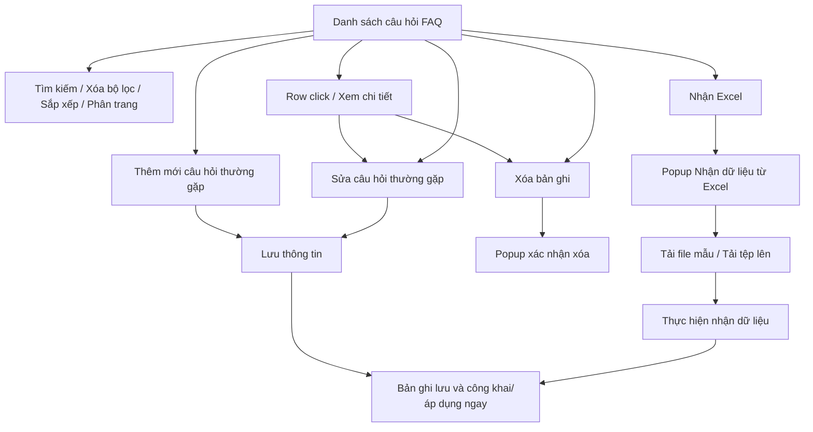
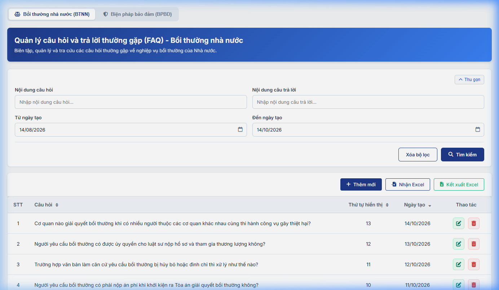
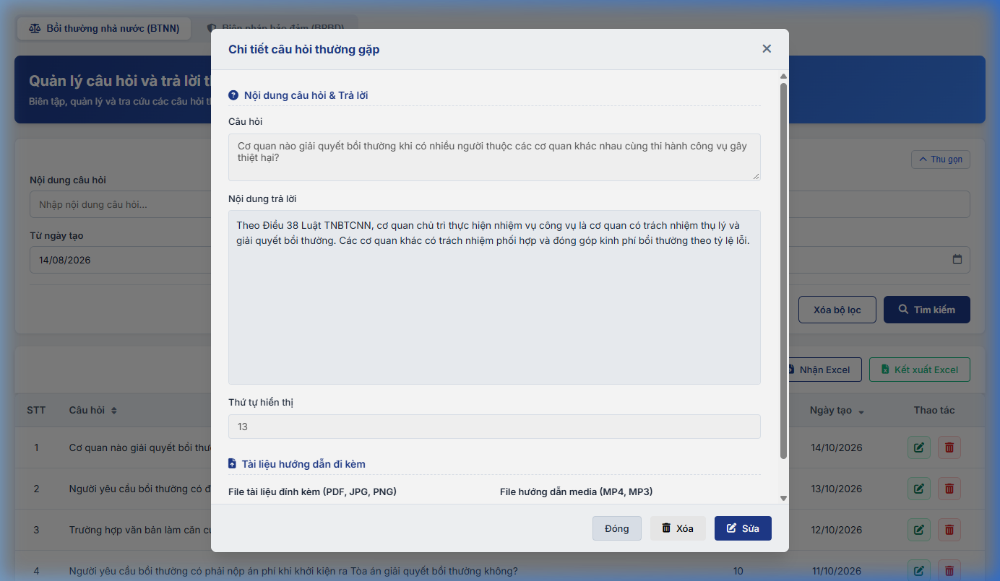
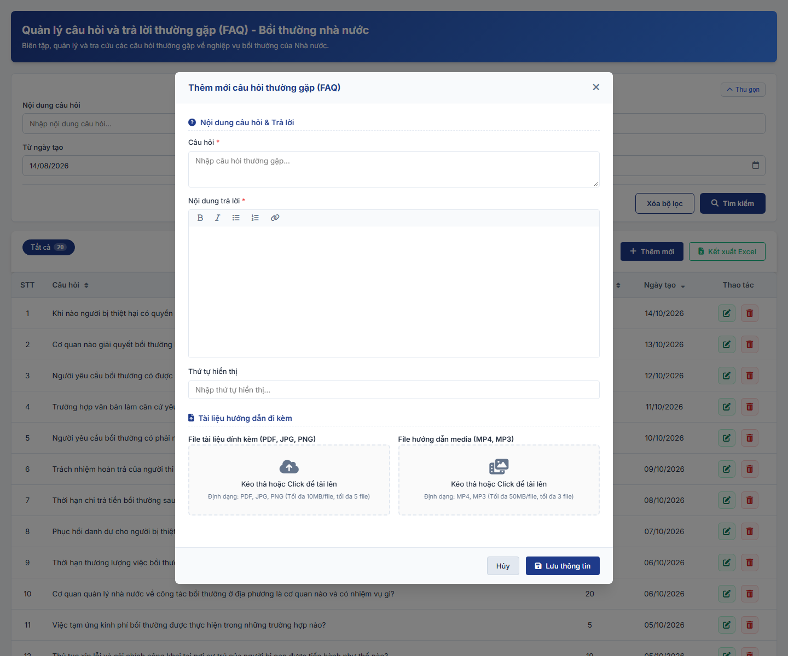
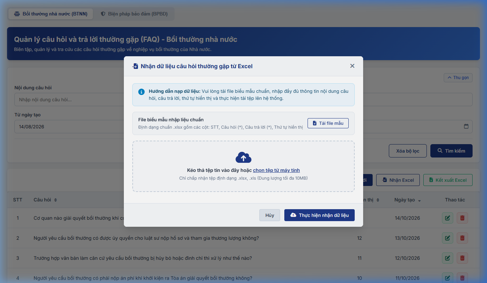

### 4.3.3. Hỗ trợ tư liệu - Câu hỏi và câu trả lời thường gặp (FAQ)

#### 4.3.3.8. Quản lý câu hỏi và trả lời thường gặp

##### 4.3.3.8.1. Mục đích

- Quản lý tập trung danh mục nội dung câu hỏi và câu trả lời thường gặp phục vụ số hóa tư liệu, hỗ trợ cán bộ tra cứu nghiệp vụ giải quyết yêu cầu bồi thường nhà nước và công khai hướng dẫn cho người dân, tổ chức.

- Cán bộ nghiệp vụ trực tiếp quản lý câu hỏi thường gặp, không có luồng phê duyệt của Lãnh đạo: nhập Câu hỏi, Câu trả lời, đính kèm tệp và bấm "Lưu thông tin"; bản ghi được lưu và công khai/áp dụng ngay. Ngoài ra, hỗ trợ nhận dữ liệu hàng loạt từ file Excel theo biểu mẫu chuẩn.

- Cán bộ nghiệp vụ có toàn quyền xem chi tiết, sửa và xóa bản ghi tại mọi thời điểm.

*a. Phân quyền*

- Cán bộ nghiệp vụ: Quyền tra cứu/tìm kiếm, xem danh sách, xem chi tiết, thêm mới, sửa và xóa bản ghi tại mọi thời điểm, nhận Excel và kết xuất Excel danh sách.

*b. Điều kiện thực hiện*

- Người dùng đã đăng nhập thành công vào Website Quản trị.

- Người dùng được phân quyền truy cập chức năng `Quản lý câu hỏi và trả lời thường gặp (FAQ)` thuộc phân hệ Hỗ trợ tư liệu.

---

##### 4.3.3.8.2. Sơ đồ luồng nghiệp vụ theo giao diện

---

##### 4.3.3.8.3. MH01 - Màn hình Danh sách câu hỏi và trả lời thường gặp

###### 4.3.3.8.3.1. Màn hình

###### 4.3.3.8.3.2. Mô tả thông tin trên màn hình

| Trường thông tin | Kiểu dữ liệu | Bắt buộc | Mặc định | Mô tả |
| :--- | :--- | :--- | :--- | :--- |
| **I. Bộ lọc tìm kiếm** | - | - | - | Control UI: Khối thu gọn/mở rộng (Accordion). - Mặc định hiển thị dạng mở rộng. - Cho phép thu gọn/mở rộng khi click vào nút "Thu gọn"/"Mở rộng" ở góc phải khối; khi thu gọn, các giá trị lọc đã nhập được giữ nguyên. |
| Nội dung câu hỏi | String(500) | Không | Trống | Control UI: Text input. - Placeholder: "Nhập nội dung câu hỏi...". - Tìm gần đúng theo Nội dung câu hỏi; không phân biệt hoa thường, có dấu/không dấu. |
| Nội dung câu trả lời | String(500) | Không | Trống | Control UI: Text input. - Placeholder: "Nhập nội dung câu trả lời...". - Tìm gần đúng theo Nội dung câu trả lời; không phân biệt hoa thường, có dấu/không dấu. |
| Từ ngày tạo | Date | Không | Ngày hiện tại lùi 02 tháng | Control UI: Date input. - Nhập điều kiện lọc ngày tạo bắt đầu, định dạng `dd/mm/yyyy` (placeholder: "dd/mm/yyyy"). |
| Đến ngày tạo | Date | Không | Ngày hiện tại | Control UI: Date input. - Nhập điều kiện lọc ngày tạo kết thúc, định dạng `dd/mm/yyyy` (placeholder: "dd/mm/yyyy"). |
| **II. Bảng danh sách kết quả** | - | - | 20 bản ghi/trang | Control UI: Data grid. - Khi người dùng truy cập màn hình, hệ thống tự động tải trang đầu tiên (Trang 1) với số lượng mặc định 20 bản ghi. - Sắp xếp mặc định: Sắp xếp theo "Ngày tạo" giảm dần. - Trạng thái có dữ liệu: Hiển thị danh sách các bản ghi kết quả theo cấu trúc các cột quy định. - Trạng thái không có dữ liệu (Empty State): Khi không tìm thấy kết quả phù hợp với điều kiện tìm kiếm, bảng hiển thị duy nhất 01 dòng căn giữa trên toàn bộ chiều rộng bảng (`colspan`), in nghiêng với nội dung theo MessageList dùng chung [MSG-INF-SYS-001]. |
| STT | Integer(10) | Không | Theo trang hiện tại | - Chỉ đọc. - Theo dữ liệu bản ghi. |
| Câu hỏi | Text(1000) | Không | Theo dữ liệu hệ thống | - Chỉ đọc. - Theo dữ liệu bản ghi, hiển thị dạng văn bản thường (không phải liên kết). |
| Thứ tự hiển thị | Integer(10) | Không | Theo dữ liệu hệ thống | - Chỉ đọc. - Theo dữ liệu bản ghi. |
| Ngày tạo | Date | Không | Theo dữ liệu hệ thống | - Chỉ đọc. - Định dạng `dd/mm/yyyy`. |
| Thao tác | - | - | - | Control UI: Icon + Sửa + Xóa |
| Phân trang | - | - | 20 bản ghi/trang | Phân trang, chuyển trang và cấu hình số dòng hiển thị theo quy tắc chung của hệ thống. |

###### 4.3.3.8.3.3. Chức năng trên màn hình

| STT | Tên chức năng | Định dạng | Mô tả |
| :--- | :--- | :--- | :--- |
| 1 | Tìm kiếm | Button | Khi người dùng click nút, hệ thống kiểm tra điều kiện dữ liệu và thực hiện tìm kiếm theo các trường hợp bên dưới: |
| | | | **TH1 - Khoảng ngày không hợp lệ**: Nếu `Từ ngày tạo` lớn hơn `Đến ngày tạo`, vi phạm [BR-VAL-007], hệ thống hiển thị cảnh báo lỗi [MSG-ERR-VAL-007] và không thực hiện tìm kiếm. |
| | | | **TH Hợp lệ (Có dữ liệu phù hợp)**: Hệ thống lọc và hiển thị danh sách các bản ghi thỏa mãn đồng thời các tiêu chí tìm kiếm/lọc đã nhập/chọn, hiển thị kết quả lên bảng và đưa về Trang 1. |
| | | | **TH Không có dữ liệu trả về**: Bảng kết quả hiển thị duy nhất 01 dòng căn giữa trên toàn bộ chiều rộng bảng (`colspan`), in nghiêng với nội dung theo MessageList dùng chung [MSG-INF-SYS-001]; thanh phân trang hiển thị *"Hiển thị 0-0 của 0 bản ghi"*, các nút điều hướng trang ở trạng thái khóa mờ (Disabled); nút "Kết xuất Excel" ở trạng thái khóa mờ kèm tooltip *"Không có dữ liệu để kết xuất Excel"*. |
| 2 | Xóa bộ lọc | Button | Hệ thống xóa toàn bộ tiêu chí tìm kiếm đã nhập/chọn, thiết lập các ô lọc về giá trị mặc định, đưa trang hiện tại về Trang 1 và tải lại danh sách câu hỏi FAQ. |
| 3 | Thêm mới | Button | Hệ thống mở [MH03 - Màn hình Thêm mới/Sửa câu hỏi thường gặp](#43385-mh03---màn-hình-thêm-mớisửa-câu-hỏi-thường-gặp) ở chế độ Thêm mới với form thông tin để trống. |
| 4 | Nhận Excel | Button | Hệ thống mở [MH04 - Popup Nhận dữ liệu câu hỏi thường gặp từ file Excel](#43386-mh04---popup-nhận-dữ-liệu-câu-hỏi-thường-gặp-từ-file-excel) cho phép tải file biểu mẫu chuẩn hoặc nạp dữ liệu câu hỏi thường gặp từ file Excel vào hệ thống. |
| 5 | Kết xuất Excel | Button | **TH1 - Danh sách rỗng**: Vi phạm [BR-EXP-040]. Nút bị khóa mờ hoặc hiển thị cảnh báo [MSG-WRN-SYS-001] và không tải file. |
| | | | **TH Hợp lệ**: Hệ thống kết xuất toàn bộ danh sách câu hỏi FAQ thỏa mãn tiêu chí lọc/sắp xếp hiện tại ra file Excel theo mẫu quy chuẩn, áp dụng [BR-EXP-040] và hiển thị thông báo thành công [MSG-SUC-BTNN-FAQ-003]. |
| 6 | Sắp xếp cột | Header cột | Áp dụng trên các cột: `Câu hỏi`, `Thứ tự hiển thị`, `Ngày tạo`. |
| | | | **TH1 - Chọn lại cột đang sắp xếp**: Hệ thống đảo chiều sắp xếp tăng dần / giảm dần và cập nhật icon mũi tên trạng thái trên tiêu đề cột. |
| | | | **TH2 - Chọn cột khác**: Hệ thống thiết lập cột được chọn làm tiêu chí sắp xếp hiện hành và cập nhật lại thứ tự bản ghi trên bảng. |
| 7 | Row click | Row click | Khi người dùng click vào bất kỳ vị trí nào trên dòng dữ liệu (trừ các nút thao tác), hệ thống mở [MH02 - Màn hình Chi tiết câu hỏi thường gặp](#43384-mh02---màn-hình-chi-tiết-câu-hỏi-thường-gặp) ở chế độ chỉ xem. |
| 8 | Sửa | Icon button | Thao tác của Cán bộ nghiệp vụ, áp dụng cho mọi bản ghi. - Hệ thống mở [MH03 - Màn hình Thêm mới/Sửa câu hỏi thường gặp](#43385-mh03---màn-hình-thêm-mớisửa-câu-hỏi-thường-gặp) ở chế độ Sửa với toàn bộ dữ liệu hiện tại của bản ghi được điền sẵn vào các trường. |
| 9 | Xóa | Icon button | Thao tác của Cán bộ nghiệp vụ, áp dụng cho mọi bản ghi. - Hệ thống hiển thị Popup xác nhận "Bạn có chắc chắn muốn xóa câu hỏi [Nội dung câu hỏi] không?". Khi người dùng xác nhận "Xóa", hệ thống xóa mềm bản ghi, ẩn khỏi bảng dữ liệu, làm mới danh sách và hiển thị thông báo thành công [MSG-SUC-BTNN-FAQ-008]. |
| 10 | Phân trang & chuyển trang | Pagination | Phân trang, chuyển trang và cấu hình số dòng hiển thị theo quy tắc chung của hệ thống. |

---

##### 4.3.3.8.4. MH02 - Màn hình Chi tiết câu hỏi thường gặp

###### 4.3.3.8.4.1. Màn hình

###### 4.3.3.8.4.2. Mô tả thông tin trên màn hình

| Trường thông tin | Kiểu dữ liệu | Bắt buộc | Mặc định | Mô tả |
| :--- | :--- | :--- | :--- | :--- |
| **I. Nội dung câu hỏi & Trả lời** | | | | |
| Câu hỏi | - | - | - | Control UI: Label Theo dữ liệu bản ghi. |
| Nội dung trả lời | - | - | - | Control UI: Label Theo dữ liệu bản ghi. |
| Thứ tự hiển thị | - | - | - | Control UI: Label Theo dữ liệu bản ghi. |
| **II. Tài liệu hướng dẫn đi kèm** | | | | |
| File tài liệu đính kèm | - | - | - | Control UI: File link Theo dữ liệu bản ghi. |
| File hướng dẫn media | - | - | - | Control UI: File link Theo dữ liệu bản ghi. |
| **III. Thao tác** | | | | |
| Đóng | Button | Không | Hiển thị | Đóng popup chi tiết và quay lại danh sách MH01. |
| Xóa | Button | Không | Hiển thị | Mở Popup xác nhận xóa câu hỏi đang xem [MSG-CFM-SYS-001]. |
| Sửa | Button | Không | Hiển thị | Mở form Sửa (MH03) với thông tin của câu hỏi đang xem. |

###### 4.3.3.8.4.3. Chức năng trên màn hình

| STT | Tên chức năng | Định dạng | Mô tả |
| :--- | :--- | :--- | :--- |
| 1 | Xem file | Link | Khi click vào liên kết "Xem file" cạnh tên tệp tin đính kèm, hệ thống mở nội dung file tại một tab trình duyệt mới. |
| 2 | Sửa | Button | Khi người dùng click nút "Sửa" ở chân popup, hệ thống chuyển sang [MH03 - Màn hình Thêm mới/Sửa câu hỏi thường gặp](#43385-mh03---màn-hình-thêm-mớisửa-câu-hỏi-thường-gặp) ở chế độ Sửa với toàn bộ dữ liệu của câu hỏi đang xem để cán bộ chỉnh sửa. |
| 3 | Xóa | Button | Khi người dùng click nút "Xóa" ở chân popup, hệ thống đóng popup chi tiết, hiển thị Popup Modal xác nhận xóa tùy chỉnh (Custom Confirmation Modal) [MSG-CFM-SYS-001] ("Bạn có chắc chắn muốn xóa câu hỏi [Nội dung câu hỏi] không?"). Khi người dùng xác nhận "Xóa", hệ thống thực hiện xóa mềm bản ghi, ẩn khỏi bảng dữ liệu và hiển thị thông báo thành công [MSG-SUC-SYS-002]. |
| 4 | Đóng | Button | Khi người dùng click nút "Đóng" ở chân popup hoặc biểu tượng đóng ở góc phải tiêu đề popup, hệ thống đóng popup và quay lại [MH01 - Màn hình Danh sách câu hỏi và trả lời thường gặp](#43383-mh01---màn-hình-danh-sách-câu-hỏi-và-trả-lời-thường-gặp). |

---

##### 4.3.3.8.5. MH03 - Màn hình Thêm mới/Sửa câu hỏi thường gặp

###### 4.3.3.8.5.1. Màn hình

###### 4.3.3.8.5.2. Mô tả thông tin trên màn hình

| Trường thông tin | Kiểu dữ liệu | Bắt buộc | Mặc định | Mô tả |
| :--- | :--- | :--- | :--- | :--- |
| **I. Nội dung câu hỏi & Trả lời** | | | | |
| Câu hỏi | Text(1000) | Có | Trống | Control UI: Textarea. - Nhập nội dung câu hỏi thường gặp (placeholder: "Nhập câu hỏi thường gặp..."). |
| Nội dung trả lời | Text(4000) | Có | Trống | Control UI: Rich Text Editor. - Nhập nội dung câu trả lời chi tiết (placeholder: "Nhập nội dung câu trả lời chi tiết..."). - Hỗ trợ các công cụ định dạng trực quan trên toolbar: + In đậm (Bold) + In nghiêng (Italic) + Danh sách không thứ tự (Bullet list) + Danh sách có thứ tự (Numbered list) + Chèn liên kết (Insert link) |
| Thứ tự hiển thị | Integer(10) | Không | Trống | Control UI: Number input. - Nhập số nguyên dương xác định thứ tự ưu tiên khi công bố (placeholder: "Nhập thứ tự hiển thị..."). |
| **II. Tài liệu hướng dẫn đi kèm** | | | | |
| File tài liệu đính kèm | File | Không | Trống | Control UI: File Upload Area. - Cho phép kéo thả hoặc click chọn nhiều file tài liệu. - Định dạng cho phép: PDF, JPG, PNG. - Dung lượng tối đa: 10MB/file, tối đa 5 file. - Áp dụng [BR-BTNN-FAQ-001]. - Sau khi tải lên thành công, hiển thị tên file kèm theo 2 liên kết: + Xem file (mở tab mới) + Xóa (xóa khỏi danh sách file trước khi lưu) |
| File hướng dẫn media | File | Không | Trống | Control UI: File Upload Area. - Cho phép kéo thả hoặc click chọn nhiều file media. - Định dạng cho phép: MP4, MP3. - Dung lượng tối đa: 50MB/file, tối đa 3 file. - Áp dụng [BR-BTNN-FAQ-002]. - Sau khi tải lên thành công, hiển thị tên file kèm theo 2 liên kết: + Xem file (mở tab mới) + Xóa (xóa khỏi danh sách file trước khi lưu) |

###### 4.3.3.8.5.3. Chức năng trên màn hình

| STT | Tên chức năng | Định dạng | Mô tả |
| :--- | :--- | :--- | :--- |
| 1 | Lưu thông tin | Button | Khi người dùng click nút, hệ thống kiểm tra dữ liệu và lưu trực tiếp theo các trường hợp bên dưới (không qua phê duyệt): |
| | | | **TH1 - Bỏ trống trường bắt buộc**: Vi phạm [BR-VAL-001], hệ thống tô viền đỏ các ô lỗi (`.is-invalid`), hiển thị cảnh báo lỗi [MSG-ERR-VAL-001] ngay phía dưới từng ô và tự động focus con trỏ vào ô lỗi đầu tiên; không dùng Toast. |
| | | | **TH2 - Dữ liệu không hợp lệ**: Kiểm tra và phát hiện lỗi: + `Thứ tự hiển thị` không phải số nguyên dương: Hệ thống hiển thị cảnh báo lỗi [MSG-ERR-BTNN-FAQ-007] và không cho phép lưu. + File tài liệu đính kèm vi phạm [BR-BTNN-FAQ-001] (sai định dạng, vượt dung lượng 10MB hoặc quá 5 file): Hệ thống hiển thị thông báo lỗi [MSG-ERR-BTNN-FAQ-001], [MSG-ERR-BTNN-FAQ-002] hoặc [MSG-ERR-BTNN-FAQ-003] tương ứng. + File media đính kèm vi phạm [BR-BTNN-FAQ-002] (sai định dạng, vượt dung lượng 50MB hoặc quá 3 file): Hệ thống hiển thị thông báo lỗi [MSG-ERR-BTNN-FAQ-004], [MSG-ERR-BTNN-FAQ-005] hoặc [MSG-ERR-BTNN-FAQ-006] tương ứng. |
| | | | **TH Trùng câu hỏi**: Nếu nội dung `Câu hỏi` bị trùng lặp với câu hỏi đã tồn tại trong hệ thống (không phân biệt hoa thường), vi phạm [BR-VAL-003], hệ thống hiển thị cảnh báo lỗi [MSG-ERR-VAL-003] ngay phía dưới ô nhập và không cho phép lưu. |
| | | | **TH Hợp lệ - Thêm mới**: Hệ thống lưu bản ghi, ghi nhận người tạo và ngày tạo; câu hỏi được công khai/áp dụng ngay; đóng popup modal, làm mới danh sách và hiển thị thông báo thành công [MSG-SUC-BTNN-FAQ-004]. |
| | | | **TH Hợp lệ - Sửa**: Hệ thống cập nhật bản ghi, ghi nhận người cập nhật và ngày cập nhật; nội dung mới được áp dụng ngay; đóng popup modal, làm mới danh sách và hiển thị thông báo thành công [MSG-SUC-BTNN-FAQ-005]. |
| 2 | Xem file | Link | Cho phép xem trước file đính kèm tại một tab trình duyệt riêng biệt. |
| 3 | Xóa | Link | Hệ thống hiển thị Popup xác nhận "Bạn có chắc chắn muốn xóa tệp đính kèm [Tên tệp] không?". Khi người dùng xác nhận "Xóa", hệ thống loại bỏ file khỏi danh sách tải lên trước khi lưu form. |
| 4 | Hủy | Button | Khi người dùng click nút "Hủy" ở chân popup hoặc biểu tượng đóng ở góc phải tiêu đề popup, hệ thống đóng popup và quay lại [MH01 - Màn hình Danh sách câu hỏi và trả lời thường gặp](#43383-mh01---màn-hình-danh-sách-câu-hỏi-và-trả-lời-thường-gặp); dữ liệu vừa nhập chưa lưu bị hủy bỏ. |

---

##### 4.3.3.8.6. MH04 - Popup Nhận dữ liệu câu hỏi thường gặp từ file Excel

###### 4.3.3.8.6.1. Màn hình

###### 4.3.3.8.6.2. Mô tả thông tin trên màn hình

| Trường thông tin | Kiểu dữ liệu | Bắt buộc | Mặc định | Mô tả |
| :--- | :--- | :--- | :--- | :--- |
| Tiêu đề popup | - | - | - | Control UI: Label Hiển thị "Nhận dữ liệu câu hỏi thường gặp từ Excel". |
| Hướng dẫn nạp dữ liệu | - | - | - | Control UI: Alert box Hiển thị hướng dẫn tải tệp biểu mẫu chuẩn, điền thông tin câu hỏi, câu trả lời, thứ tự hiển thị và thực hiện tải tệp lên hệ thống. |
| File biểu mẫu nhập liệu chuẩn | - | - | - | Control UI: Label & Download Button - Hiển thị tên file mẫu và nút "Tải file mẫu". - Định dạng chuẩn `.xlsx`. |
| Vùng tải tệp | File | Có | Trống | Control UI: File Upload Dropzone. - Cho phép kéo thả hoặc click chọn tệp tin từ máy tính. - Định dạng chấp nhận: `.xlsx`, `.xls`. - Dung lượng tối đa: 10MB. |
| Thông tin tệp đã chọn | - | - | - | Control UI: File Info Panel. - Hiển thị tên tệp tin và dung lượng tệp sau khi chọn thành công. - Kèm theo nút "Xóa tệp" để người dùng gỡ bỏ file và chọn lại tệp khác nếu cần. |

###### 4.3.3.8.6.3. Chức năng trên màn hình

| STT | Tên chức năng | Định dạng | Mô tả |
| :--- | :--- | :--- | :--- |
| 1 | Tải file mẫu | Button | Khi người dùng click nút, hệ thống thực hiện tải về máy tính file biểu mẫu chuẩn `Mau_Import_CauHoi_ThuongGap_BTNN.xlsx`. File mẫu gồm các cột quy định: `STT`, `Câu hỏi (*)` (bắt buộc), `Câu trả lời (*)` (bắt buộc), `Thứ tự hiển thị`. |
| 2 | Chọn tệp tải lên | Upload | Người dùng click vào vùng tải tệp hoặc kéo thả file Excel vào khung. Hệ thống kiểm tra điều kiện dữ liệu tệp tin: - **TH1 - File không hợp lệ**: Nếu file không đúng định dạng (`.xlsx`, `.xls`) hoặc vượt quá dung lượng tối đa 10MB, vi phạm [BR-VAL-006], hệ thống hiển thị cảnh báo lỗi [MSG-ERR-VAL-006] và không tiếp nhận file. - **TH2 - Hợp lệ**: Hệ thống tiếp nhận file, hiển thị tên file, dung lượng kèm trạng thái sẵn sàng nạp và mở khóa (enable) nút `Thực hiện nhận dữ liệu`. |
| 3 | Xóa tệp | Button | Hệ thống gỡ bỏ file đang chọn khỏi vùng tải tệp, ẩn khối thông tin tệp và chuyển nút `Thực hiện nhận dữ liệu` về trạng thái khóa mờ (Disabled). |
| 4 | Thực hiện nhận dữ liệu | Button | Khi người dùng click nút, hệ thống đọc dữ liệu từ file Excel và thực hiện nạp vào hệ thống: - **TH1 - File rỗng hoặc sai cấu trúc**: Nếu file không có dữ liệu hoặc tiêu đề các cột không khớp biểu mẫu chuẩn, hệ thống hiển thị cảnh báo lỗi [MSG-ERR-IMP-001] và không nạp dữ liệu. - **TH2 - Có lỗi dữ liệu trên từng dòng**: Áp dụng cơ chế **Thành công một phần**: các dòng dữ liệu hợp lệ được lưu vào CSDL; các dòng vi phạm (bỏ trống `Câu hỏi`, bỏ trống `Câu trả lời`, hoặc `Thứ tự hiển thị` không phải số nguyên dương) được hệ thống tổng hợp vào file báo cáo lỗi chi tiết cho người dùng tải về. - **TH3 - Hợp lệ toàn bộ**: Hệ thống nạp toàn bộ danh sách câu hỏi vào CSDL, đóng popup, làm mới danh sách dữ liệu tại [MH01 - Màn hình Danh sách câu hỏi và trả lời thường gặp](#43383-mh01---màn-hình-danh-sách-câu-hỏi-và-trả-lời-thường-gặp) và hiển thị thông báo thành công [MSG-SUC-BTNN-FAQ-009] ("Nhận dữ liệu từ Excel thành công! Đã nạp thành công [N] câu hỏi thường gặp vào hệ thống"). |
| 5 | Hủy | Button | Khi người dùng click nút "Hủy" ở chân popup hoặc biểu tượng đóng ở góc phải tiêu đề popup, hệ thống đóng popup và quay lại [MH01 - Màn hình Danh sách câu hỏi và trả lời thường gặp](#43383-mh01---màn-hình-danh-sách-câu-hỏi-và-trả-lời-thường-gặp); tệp vừa chọn chưa thực hiện nhận dữ liệu sẽ bị hủy bỏ. |
