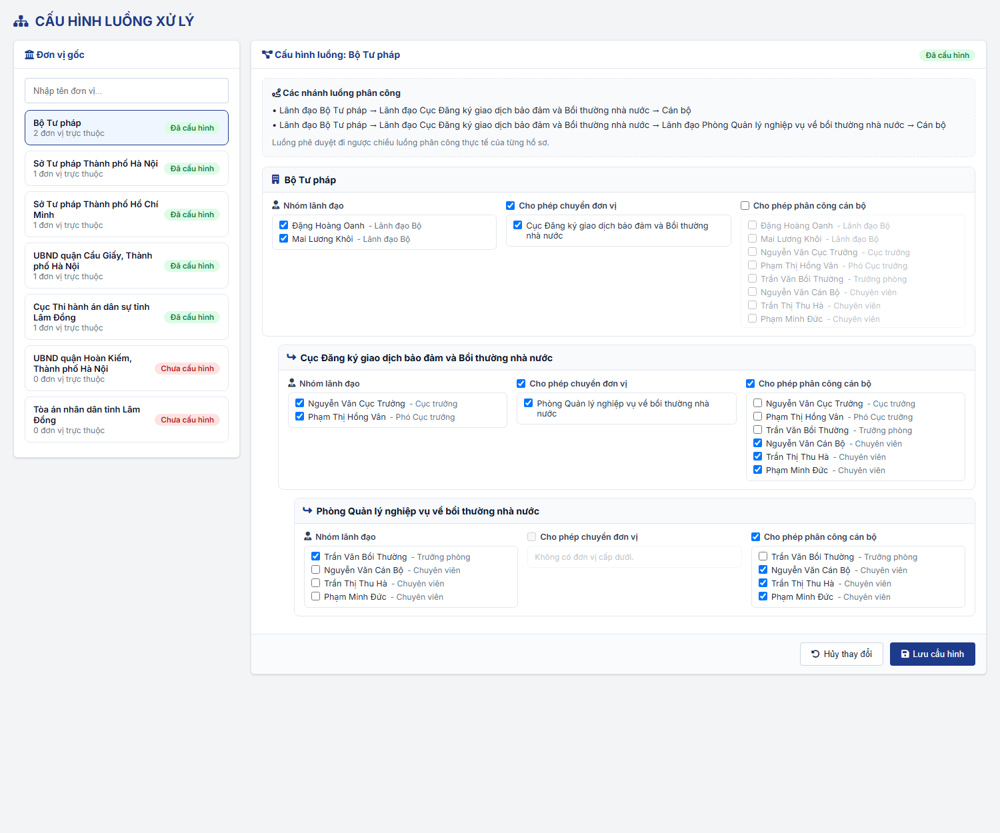
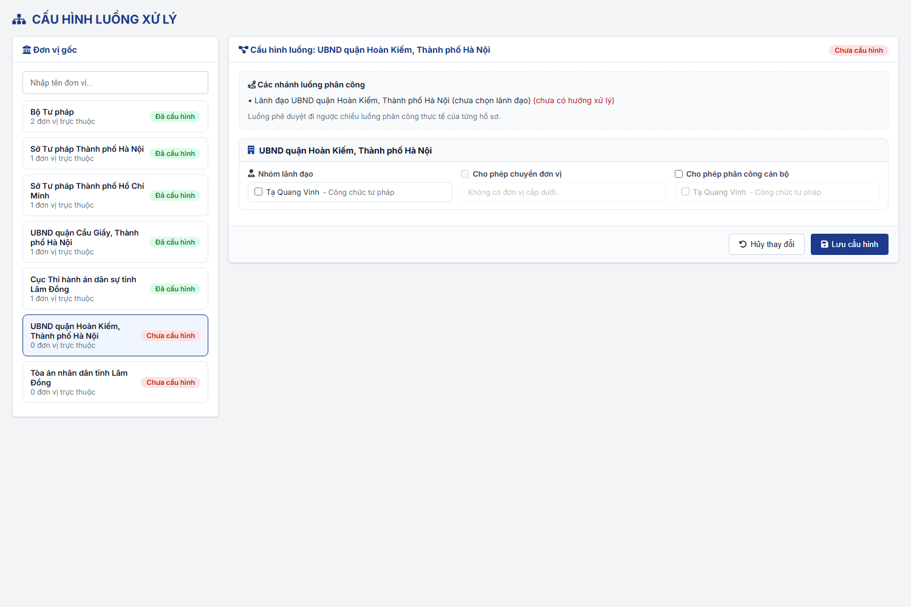
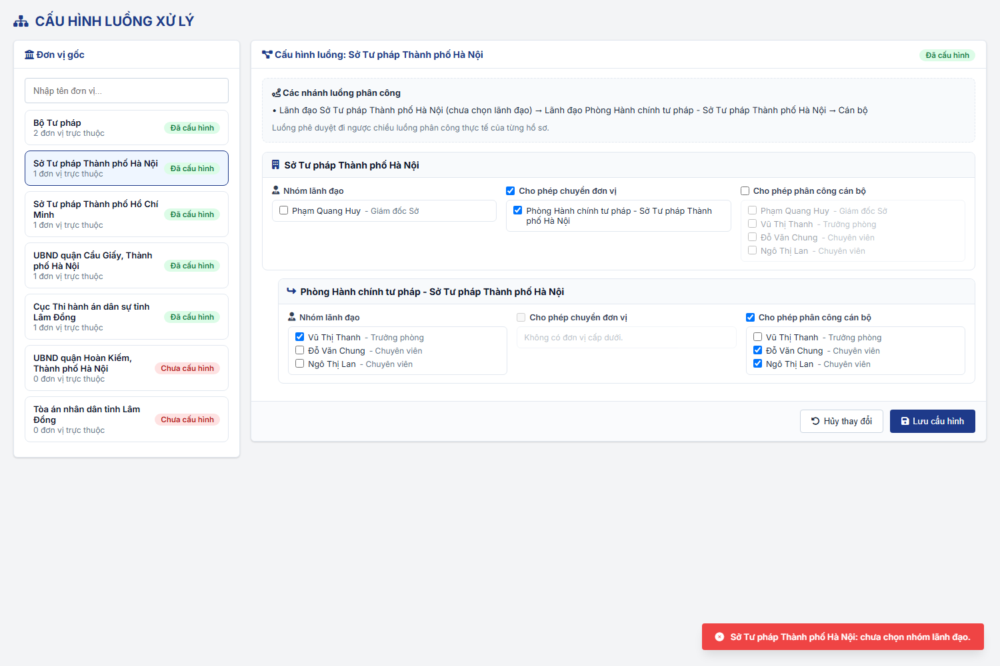

#### 4.3.1.14. Cấu hình luồng xử lý

##### 4.3.1.14.1. Mục đích
Cho phép Quản trị hệ thống cấu hình luồng phân công - phê duyệt hồ sơ của phân hệ Bồi thường nhà nước theo từng Loại luồng và từng đơn vị gốc, bao gồm:
- Chọn Loại luồng: `Xác định CQGQBT - Bộ Tư pháp`, `Xác định CQGQBT - Sở Tư pháp`, `Giải quyết YCBT`.
- Chọn Nhóm lãnh đạo của từng đơn vị trong cây đơn vị của đơn vị gốc.
- Cấu hình luồng xử lý của từng đơn vị: chọn đúng 01 Hình thức phân công, chuyển đơn vị cấp dưới trực tiếp hoặc phân công cán bộ.
- Xem trước các nhánh luồng phân công suy ra từ cấu hình.

Cấu hình được dùng tại [Tiếp nhận hồ sơ - Tiếp nhận hồ sơ - Công tác bồi thường nhà nước (Website Quản trị)](../03_Cong_tac_boi_thuong/SRS_BTNN_GiaiQuyetBT_TiepNhan_YCBT.md#tn-luong-phan-cong) (Lãnh đạo Phân công), [Quy tắc trình ký - phê duyệt - Xác định cơ quan giải quyết bồi thường - Công tác bồi thường nhà nước (Website Quản trị)](../03_Cong_tac_boi_thuong/SRS_BTNN_GiaiQuyetBT__Xac%20định%20cơ%20quan%20GQBT.md#xd-quy-tac-phe-duyet) (Lãnh đạo phê duyệt), khi chọn CQGQBT và tự động chuyển CQGQBT tại phân hệ Xác định cơ quan giải quyết bồi thường và khi Chuyển CQGQBT tại phân hệ Giải quyết yêu cầu bồi thường. Hệ thống chọn luồng theo Loại hồ sơ và đơn vị tiếp nhận hồ sơ:

| Loại luồng | Áp dụng cho | Đơn vị gốc được cấu hình | Ví dụ nhánh luồng phân công | Luồng trình ký |
| :--- | :--- | :--- | :--- | :--- |
| `Xác định CQGQBT - Bộ Tư pháp` | Hồ sơ Loại hồ sơ `Xác định cơ quan giải quyết bồi thường` do Bộ Tư pháp tiếp nhận | Bộ Tư pháp | Lãnh đạo Bộ Tư pháp → Lãnh đạo Cục Giao dịch bảo đảm và bồi thường nhà nước → Lãnh đạo Phòng/Ban phụ trách → Cán bộ | Cán bộ → Lãnh đạo Phòng/Ban phụ trách → Lãnh đạo Cục Giao dịch bảo đảm và bồi thường nhà nước → Lãnh đạo Bộ Tư pháp |
| `Xác định CQGQBT - Sở Tư pháp` | Hồ sơ Loại hồ sơ `Xác định cơ quan giải quyết bồi thường` do Sở Tư pháp tiếp nhận | Từng Sở Tư pháp | Lãnh đạo Sở Tư pháp → Lãnh đạo Phòng phụ trách → Cán bộ | Cán bộ → Lãnh đạo Phòng phụ trách → Lãnh đạo Sở Tư pháp → Lãnh đạo UBND cấp tỉnh |
| `Giải quyết YCBT` | Hồ sơ Loại hồ sơ `Giải quyết yêu cầu bồi thường` | Từng cơ quan giải quyết bồi thường | Theo cấu hình của từng cơ quan | Ngược chiều luồng phân công của hồ sơ |

- Luồng trình ký của hồ sơ Xác định cơ quan giải quyết bồi thường theo [Luồng trình ký hồ sơ Xác định cơ quan giải quyết bồi thường - Xác định cơ quan giải quyết bồi thường - Công tác bồi thường nhà nước (Website Quản trị)](../03_Cong_tac_boi_thuong/SRS_BTNN_GiaiQuyetBT__Xac%20định%20cơ%20quan%20GQBT.md#xd-luong-trinh-ky).
- Loại luồng `Xác định CQGQBT - Sở Tư pháp`: cấu hình thêm Nhóm lãnh đạo của UBND cấp tỉnh (cơ quan cha của Sở Tư pháp trên cây Cơ cấu tổ chức) làm cấp phê duyệt cuối; UBND cấp tỉnh không tham gia phân công.

*a. Phân quyền*
- Quản trị hệ thống (QTHT).
- Menu "Cấu hình luồng xử lý" thuộc nhóm Quản trị hệ thống, đặt ngay sau menu "Quản lý cấu hình".

*b. Điều kiện thực hiện*
- Cán bộ quản trị đã đăng nhập thành công vào Website quản trị.
- Cây đơn vị và tài khoản cán bộ đã được khai báo tại [Quản lý cơ cấu tổ chức - Quản lý cơ cấu tổ chức - Quản trị hệ thống (Website Quản trị)](Quan_ly_co_cau_to_chuc.md) và [Quản lý tài khoản cán bộ - Quản lý tài khoản cán bộ - Quản trị hệ thống (Website Quản trị)](Quan_ly_tai_khoan_can_bo.md).

---

##### 4.3.1.14.2. Quy tắc nghiệp vụ

| STT | Nội dung | Quy tắc |
| :-- | :--- | :--- |
| 1 | Loại luồng và đơn vị gốc | Có 03 Loại luồng: `Xác định CQGQBT - Bộ Tư pháp`, `Xác định CQGQBT - Sở Tư pháp`, `Giải quyết YCBT`. - Đơn vị gốc theo Loại luồng: + `Xác định CQGQBT - Bộ Tư pháp`: Bộ Tư pháp. + `Xác định CQGQBT - Sở Tư pháp`: từng Sở Tư pháp (cơ quan có Loại cơ quan `Sở`, tên Sở Tư pháp). + `Giải quyết YCBT`: từng cơ quan giải quyết bồi thường trên cây Cơ cấu tổ chức (gồm Bộ Tư pháp, Sở Tư pháp và các cơ quan khác). - Mỗi cặp Loại luồng - đơn vị gốc có 01 cấu hình riêng, gồm cấu hình của đơn vị gốc và của từng đơn vị trực thuộc. Cùng 01 đơn vị (VD Sở Tư pháp) có cấu hình riêng cho luồng Xác định CQGQBT và luồng Giải quyết YCBT. |
| 2 | Nhóm lãnh đạo | Chọn nhiều tài khoản cán bộ thuộc chính đơn vị đó (không gồm cán bộ đơn vị trực thuộc). - Bất kỳ thành viên nào trong Nhóm lãnh đạo đều được phân công, phê duyệt hồ sơ tại đơn vị; không có ủy quyền. - Mỗi thành viên có thuộc tính `Yêu cầu ký số`: thành viên được tích phải ký số khi `Ký duyệt` hồ sơ trình ký (Màn hình Ký duyệt hiển thị khối Ký số); không tích thì `Ký duyệt` không ký số. |
| 3 | Hình thức phân công | Mỗi đơn vị chỉ chọn 01 Hình thức phân công: `Chuyển đơn vị` hoặc `Phân công cán bộ`; không chọn đồng thời cả 02 hình thức. - Lãnh đạo phân công bắt buộc theo đúng luồng xử lý đã cấu hình: Hình thức phân công `Chuyển đơn vị` thì chỉ được chuyển đơn vị; `Phân công cán bộ` thì chỉ được phân công cán bộ. - `Chuyển đơn vị`: phải chọn ít nhất 01 đơn vị cấp dưới trực tiếp được nhận hồ sơ; đơn vị không có đơn vị cấp dưới thì không chọn được hình thức này. |
| 4 | Phân công cán bộ | Khi chọn Hình thức phân công `Phân công cán bộ`, phải chọn ít nhất 01 cán bộ được phân công, trong số cán bộ thuộc đơn vị và các đơn vị trực thuộc. |
| 5 | Đơn vị phải kiểm tra | Khi Lưu, hệ thống kiểm tra đơn vị gốc và các đơn vị nằm trên nhánh luồng (được một đơn vị khác chọn làm đơn vị nhận). Đơn vị không nằm trên nhánh luồng không bị kiểm tra. |
| 6 | Trạng thái cấu hình | Trạng thái tính riêng theo từng Loại luồng. Đơn vị gốc "Đã cấu hình" khi nút đơn vị gốc có Nhóm lãnh đạo và có Hình thức phân công có dữ liệu (đã chọn đơn vị nhận hoặc cán bộ); ngược lại "Chưa cấu hình". - Không cho Chuyển CQGQBT đến cơ quan "Chưa cấu hình" luồng `Giải quyết YCBT`; thông báo "Đơn vị [Tên đơn vị] chưa được cấu hình luồng phân công. Vui lòng liên hệ Quản trị hệ thống." |
| 7 | Luồng phê duyệt | Không cấu hình riêng. Luồng phê duyệt đi ngược chiều luồng phân công thực tế của từng hồ sơ. |
| 8 | Phạm vi cấu hình | Không cấu hình thời hạn cho từng bước. Không cấu hình ủy quyền. - Khi Lãnh đạo phân công, hệ thống dùng cấu hình của Loại luồng tương ứng với Loại hồ sơ và đơn vị gốc của hồ sơ: Loại hồ sơ `Xác định cơ quan giải quyết bồi thường` dùng `Xác định CQGQBT - Bộ Tư pháp` hoặc `Xác định CQGQBT - Sở Tư pháp`; Loại hồ sơ `Giải quyết yêu cầu bồi thường` dùng `Giải quyết YCBT`. |
| 9 | Hiệu lực | Cấu hình có hiệu lực ngay sau khi Lưu. Nhóm lãnh đạo, luồng xử lý được xác định tại thời điểm thao tác phân công, phê duyệt. |

---

##### 4.3.1.14.3. MH01 - Màn hình Cấu hình luồng xử lý

###### 4.3.1.14.3.1. Màn hình

###### 4.3.1.14.3.2. Mô tả thông tin trên màn hình

| Trường thông tin | Kiểu dữ liệu | Bắt buộc | Mặc định | Mô tả |
| :--- | :--- | :--- | :--- | :--- |
| Tiêu đề màn hình | String(255) | - | - | Hiển thị "CẤU HÌNH LUỒNG XỬ LÝ". |
| Loại luồng | Tab | - | `Xác định CQGQBT - Bộ Tư pháp` | Control UI: 03 tab đặt dưới tiêu đề màn hình: + Xác định CQGQBT - Bộ Tư pháp + Xác định CQGQBT - Sở Tư pháp + Giải quyết YCBT - Tab quyết định danh sách đơn vị gốc ở Panel trái và cấu hình hiển thị ở Panel phải theo [Quy tắc nghiệp vụ](#chlxl-quy-tac) quy tắc 1. |
| **I. Panel bên trái: Đơn vị gốc** | - | - | - | Danh sách đơn vị gốc của Loại luồng đang chọn. |
| Tìm kiếm đơn vị | String(255) | Không | Trống | Control UI: Input text, placeholder "Nhập tên đơn vị...". - Lọc ngay khi nhập, gần đúng, không phân biệt hoa thường theo Tên đơn vị. |
| Danh sách đơn vị gốc | List | - | Đơn vị gốc của người dùng được chọn | Mỗi dòng gồm: Tên đơn vị; "[n] đơn vị trực thuộc" (tổng số đơn vị trực thuộc các cấp); nhãn "Đã cấu hình" (màu xanh) hoặc "Chưa cấu hình" (màu đỏ). - Đơn vị đang chọn được tô nổi bật. |
| **II. Panel bên phải: Cấu hình luồng** | - | - | - | Cấu hình của đơn vị gốc đang chọn. |
| Tiêu đề khối | String(255) | - | Theo đơn vị | "Cấu hình luồng [Loại luồng]: [Tên đơn vị gốc]" và nhãn "Đã cấu hình"/"Chưa cấu hình" theo dữ liệu đã lưu. |
| Các nhánh luồng phân công | Text | - | Theo cấu hình đang chỉnh sửa | Control UI: Khung xem trước, cập nhật ngay khi thay đổi cấu hình. - Mỗi nhánh 01 dòng, dạng "Lãnh đạo [Đơn vị] → Lãnh đạo [Đơn vị cấp dưới] → ... → Cán bộ". VD Bộ Tư pháp: "Lãnh đạo Bộ Tư pháp → Lãnh đạo Cục → Lãnh đạo Phòng → Cán bộ"; Sở Tư pháp: "Lãnh đạo Sở → Lãnh đạo Phòng → Cán bộ". - Đơn vị chưa chọn Nhóm lãnh đạo: thêm "(chưa chọn lãnh đạo)" sau tên đơn vị. - Nhánh kết thúc tại đơn vị chưa cấu hình Hình thức phân công: thêm "(chưa cấu hình hình thức phân công)" màu đỏ. - Dòng cuối: "Luồng phê duyệt đi ngược chiều luồng phân công thực tế của từng hồ sơ." |
| **III. Khối cấu hình theo đơn vị** | - | - | - | 01 khối cho đơn vị gốc và 01 khối cho mỗi đơn vị trực thuộc, thụt lề theo cấp trên cây đơn vị. |
| Tên đơn vị | String(255) | - | Theo cây đơn vị | Tiêu đề khối. |
| Nhóm lãnh đạo | List(String) | Có (đơn vị phải kiểm tra) | Theo dữ liệu đã lưu | Control UI: Danh sách checkbox, chọn nhiều. - Danh sách: tài khoản cán bộ thuộc chính đơn vị, hiển thị "[Họ tên] - [Chức danh]". - Đơn vị chưa có tài khoản: "Đơn vị chưa có tài khoản cán bộ." |
| Yêu cầu ký số | Boolean | Không | Không tích | Control UI: Checkbox, đặt cạnh từng thành viên đã chọn trong `Nhóm lãnh đạo`. - Tích: Lãnh đạo đó phải ký số khi `Ký duyệt` hồ sơ trình ký. - Bỏ chọn thành viên khỏi Nhóm lãnh đạo thì bỏ luôn thuộc tính này. |
| Ký nháy | Boolean | Không | Không tích | Control UI: Checkbox, đặt dưới danh sách `Nhóm lãnh đạo` của từng đơn vị. - Tích: khi đơn vị là một cấp ký duyệt của hồ sơ, thẻ cấp đó tại Bước 2 popup Trình ký hiển thị nhãn `Ký nháy`. - Không tích: không hiển thị nhãn. |
| Hình thức phân công | Enum(String(50)) | Có (đơn vị phải kiểm tra) | Theo dữ liệu đã lưu | Control UI: Radio button. - Giá trị gồm: + `Chuyển đơn vị` + `Phân công cán bộ` - Chỉ chọn 01 giá trị. - `Chuyển đơn vị` bị khóa khi đơn vị không có đơn vị cấp dưới. - Đổi Hình thức phân công: danh sách của hình thức còn lại bị bỏ khi Lưu. |
| Đơn vị được chuyển | List(String) | Có (khi Hình thức phân công = Chuyển đơn vị) | Theo dữ liệu đã lưu | Control UI: Danh sách checkbox, chọn nhiều. - Danh sách: các đơn vị cấp dưới trực tiếp; không có: "Không có đơn vị cấp dưới." - Chỉ hiển thị khi Hình thức phân công = `Chuyển đơn vị`. |
| Cán bộ được phân công | List(String) | Có (khi Hình thức phân công = Phân công cán bộ) | Theo dữ liệu đã lưu | Control UI: Danh sách checkbox, chọn nhiều. - Danh sách: tài khoản cán bộ thuộc đơn vị và các đơn vị trực thuộc, hiển thị "[Họ tên] - [Chức danh]"; không có: "Không có cán bộ." - Chỉ hiển thị khi Hình thức phân công = `Phân công cán bộ`. |
| Hủy thay đổi | - | - | - | Control UI: Nút, cuối khối cấu hình. |
| Lưu cấu hình | - | - | - | Control UI: Nút, cuối khối cấu hình. |

###### 4.3.1.14.3.3. Chức năng trên màn hình

| STT | Tên chức năng | Định dạng | Mô tả |
| :--- | :--- | :--- | :--- |
| 0 | Chọn Loại luồng | Tab | Tải danh sách đơn vị gốc của Loại luồng được chọn và cấu hình đã lưu của đơn vị gốc đầu tiên (hoặc đơn vị gốc của người dùng nếu thuộc danh sách). Thay đổi chưa lưu của Loại luồng đang chọn trước đó bị bỏ. |
| 1 | Tìm kiếm đơn vị | Input text | Lọc danh sách đơn vị gốc theo từ khóa đã nhập. |
| 2 | Chọn đơn vị gốc | Click dòng | Tải cấu hình đã lưu của đơn vị gốc theo Loại luồng đang chọn sang Panel phải. Đơn vị trực thuộc chưa có cấu hình hiển thị ở trạng thái trống. Thay đổi chưa lưu của đơn vị gốc đang chọn trước đó bị bỏ. |
| 3 | Chọn/bỏ chọn checkbox | Checkbox | Cập nhật cấu hình đang chỉnh sửa và khung "Các nhánh luồng phân công"; chưa lưu vào hệ thống. - Chọn Hình thức phân công: hiển thị danh sách đơn vị được chuyển hoặc danh sách cán bộ được phân công tương ứng. |
| 4 | Hủy thay đổi | Nút | Tải lại cấu hình đã lưu của đơn vị gốc đang chọn, bỏ các thay đổi chưa lưu; hiển thị "Đã hủy các thay đổi chưa lưu." |
| 5 | Lưu cấu hình | Nút | Kiểm tra đơn vị gốc và các đơn vị nằm trên nhánh luồng theo [Quy tắc nghiệp vụ](#chlxl-quy-tac), dừng ở lỗi đầu tiên và hiển thị thông báo lỗi dạng Toast: - TH1 (Chưa chọn Nhóm lãnh đạo): "[Tên đơn vị]: chưa chọn nhóm lãnh đạo." - TH2 (Hình thức Chuyển đơn vị nhưng chưa chọn đơn vị): "[Tên đơn vị]: đã chọn hình thức "Chuyển đơn vị" nhưng chưa chọn đơn vị nhận." - TH3 (Hình thức Phân công cán bộ nhưng chưa chọn cán bộ): "[Tên đơn vị]: đã chọn hình thức "Phân công cán bộ" nhưng chưa chọn cán bộ." - TH4 (Chưa chọn Hình thức phân công): "[Tên đơn vị]: chưa chọn hình thức phân công (chuyển đơn vị hoặc phân công cán bộ)." - TH Hợp lệ: lưu cấu hình của đơn vị gốc (chỉ lưu đơn vị có Nhóm lãnh đạo hoặc có Hình thức phân công; bỏ danh sách đơn vị/cán bộ của hình thức không được chọn), hiển thị "Đã lưu cấu hình luồng [Loại luồng] của [Tên đơn vị gốc].", tải lại cấu hình và cập nhật nhãn "Đã cấu hình"/"Chưa cấu hình". |

---

##### 4.3.1.14.4. Ghi chú
- Thanh "Người dùng giả lập" trên mockup chỉ phục vụ minh họa, không thuộc phạm vi chức năng.
- Quy tắc chặn Chuyển CQGQBT khi cơ quan được chỉ định "Chưa cấu hình" được áp dụng theo mặc định, chưa được xác nhận chính thức.
