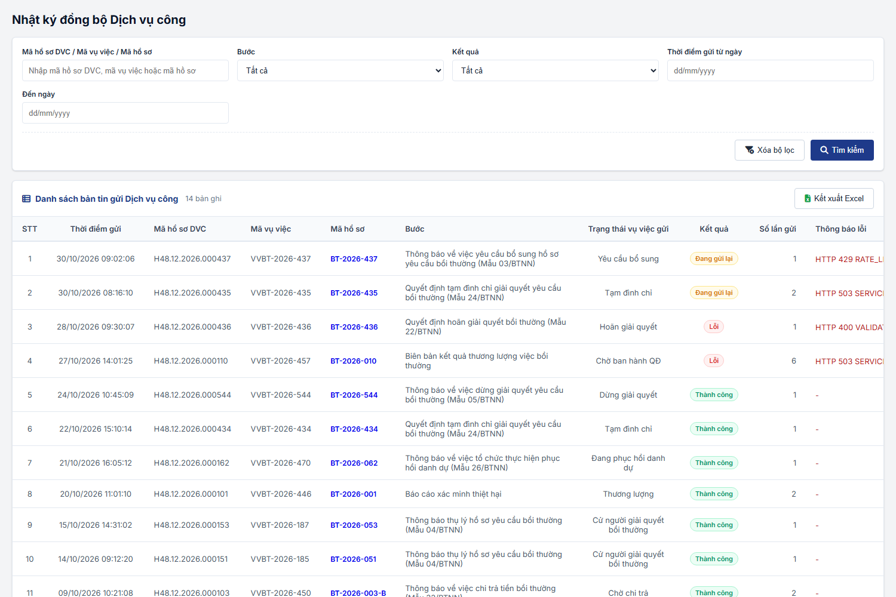
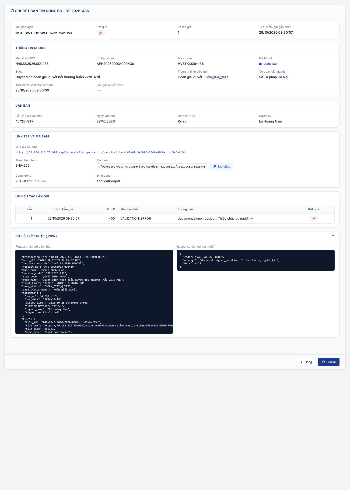

#### 4.3.1.15. Nhật ký đồng bộ Dịch vụ công

##### 4.3.1.15.1. Mục đích

\- Theo dõi các bản tin hệ thống gửi kết quả xử lý hồ sơ về Dịch vụ công quốc gia theo [Gửi kết quả xử lý hồ sơ về Dịch vụ công - Tài liệu API tích hợp DVC BTNN - Tài liệu tích hợp](../../../Tai_lieu_tich_hop/1.%20Dịch%20vụ%20công/Tai_lieu_API_tich_hop_DVC_BTNN.md#dvc-gui-ket-qua) và [Phản hồi của DVC, gửi lại và chống trùng - Tài liệu API tích hợp DVC BTNN - Tài liệu tích hợp](../../../Tai_lieu_tich_hop/1.%20Dịch%20vụ%20công/Tai_lieu_API_tich_hop_DVC_BTNN.md#dvc-nhat-ky-dong-bo).

\- Màn hình phục vụ:
  + Tra cứu bản tin đã gửi
  + Xem chi tiết bản tin: link tệp kết quả và mã băm, lịch sử các lần gửi, dữ liệu kỹ thuật (JSON request/response)
  + Gửi lại bản tin có Kết quả `Lỗi`
  + Kết xuất danh sách ra Excel

\- Màn hình không có thao tác thêm mới, sửa, xóa bản tin.

##### 4.3.1.15.2. Quy tắc nghiệp vụ

| STT | Quy tắc | Mô tả |
| :--- | :--- | :--- |
| 1 | Nguồn dữ liệu | - Mỗi bản tin là 01 lần phát sinh kết quả tại 16 bước theo [Gửi kết quả về Dịch vụ công quốc gia - Giải quyết yêu cầu bồi thường - Công tác bồi thường nhà nước (Website Quản trị)](../03_Cong_tac_boi_thuong/SRS_BTNN_GiaiQuyetBT_GiaiQuyet_YCBT.md#gq-gui-ket-qua-dvc). - Chỉ áp dụng cho hồ sơ có `Nguồn hồ sơ` = `Dịch vụ công`; hồ sơ tại cơ quan nhận chuyển (`Nguồn hồ sơ` = `Chuyển CQGQBT`) không gửi. - Mỗi bản tin có 01 `Mã giao dịch` (`transaction_id`) duy nhất. - Bản tin gửi link tệp kết quả kèm mã băm, không gửi nội dung tệp. |
| 2 | Kết quả | Gồm: + `Thành công`: Dịch vụ công trả HTTP 200, `code` = `SUCCESS` (kể cả `duplicate` = `true`). + `Đang gửi lại`: lần gửi gần nhất lỗi tạm thời (quá thời gian chờ, lỗi kết nối, HTTP 429, 5xx), hệ thống còn lượt tự gửi lại. + `Lỗi`: Dịch vụ công trả HTTP 400, 401, 403, 404, hoặc hết lượt tự gửi lại. |
| 3 | Tự gửi lại | Theo lịch gửi lại tại [Phản hồi của DVC, gửi lại và chống trùng - Tài liệu API tích hợp DVC BTNN - Tài liệu tích hợp](../../../Tai_lieu_tich_hop/1.%20Dịch%20vụ%20công/Tai_lieu_API_tich_hop_DVC_BTNN.md#dvc-nhat-ky-dong-bo); mỗi lần gửi ghi thêm 01 dòng vào Lịch sử các lần gửi. |
| 4 | Gửi lại thủ công | - Chỉ áp dụng bản tin có Kết quả `Lỗi`. - Giữ nguyên `transaction_id` và nội dung bản tin; chỉ đổi `sent_at`. - Ghi thêm 01 dòng vào Lịch sử các lần gửi. - Kết quả sau khi gửi lại: + Dịch vụ công trả thành công: `Thành công`. + Lỗi tạm thời (quá thời gian chờ, lỗi kết nối, HTTP 429, 5xx): `Đang gửi lại`; hệ thống tự gửi lại theo lịch tại quy tắc 3. + Lỗi không gửi lại được (HTTP 400, 401, 403, 404): giữ `Lỗi`. |
| 5 | Phân quyền | - Chức năng `Nhật ký đồng bộ Dịch vụ công` thuộc nhóm `Quản trị hệ thống`, gồm các quyền: + `Xem Nhật ký đồng bộ Dịch vụ công`: mở màn hình, tìm kiếm, Xem chi tiết. + `Gửi lại bản tin đồng bộ Dịch vụ công`: thao tác `Gửi lại`. + `Kết xuất Excel Nhật ký đồng bộ Dịch vụ công`: thao tác `Kết xuất Excel`. - Phạm vi dữ liệu (đề xuất): theo cơ quan giải quyết của hồ sơ, cùng quy tắc tại [Xem chi tiết - Phân quyền và phạm vi dữ liệu - Tra cứu vụ việc - Công tác bồi thường nhà nước (Website Quản trị)](../03_Cong_tac_boi_thuong/SRS_BTNN_GiaiQuyetBT_TraCuu_VuViec.md#tcvv-quyen-xem-chi-tiet): đơn vị của người dùng, Sở Tư pháp quản lý cơ quan giải quyết; Bộ Tư pháp, Cục Đăng ký giao dịch bảo đảm và Bồi thường nhà nước xem toàn bộ. |
| 6 | Menu | `Quản trị hệ thống` > `Nhật ký đồng bộ Dịch vụ công`, đặt sau `Cấu hình luồng xử lý`. |
| 7 | Thông báo | Hiển thị trực tiếp đầu danh sách hoặc đầu màn hình chi tiết; không dùng toast. |
| 8 | Lưới | Theo [Quy chuẩn Hiển thị Lưới danh sách - Danh mục và Phụ lục - Tài liệu tổng hợp](../../Tai%20lieu%20tong%20hop/04_Danh_muc_va_Phu_luc.md#quy-chuan-hien-thi-luoi-danh-sach). |
| 9 | Điều kiện thực hiện | Người dùng đã đăng nhập Website quản trị và được cấp quyền `Xem Nhật ký đồng bộ Dịch vụ công`. |

---

##### 4.3.1.15.3. MH01 - Màn hình Danh sách bản tin

###### 4.3.1.15.3.1. Màn hình

###### 4.3.1.15.3.2. Mô tả thông tin trên màn hình

| Trường thông tin | Kiểu dữ liệu | Bắt buộc | Mặc định | Mô tả |
| :--- | :--- | :--- | :--- | :--- |
| Tiêu đề màn hình | String(255) | - | `Nhật ký đồng bộ Dịch vụ công` | Control UI: Text heading (Read-only). - Hiển thị đúng tên mục Menu. |
| Dải thông báo | String(500) | - | Ẩn | Control UI: Alert, đặt đầu màn hình. - Hiển thị kết quả Gửi lại, Kết xuất Excel. - Có nút đóng. |
| **I. Khối Lọc, tìm kiếm thông tin** | Section | - | - | Control UI: Filter panel. - Các tiêu chí có dữ liệu kết hợp theo điều kiện AND. |
| Mã hồ sơ DVC / Mã vụ việc / Mã hồ sơ | String(100) | Không | Trống | Control UI: Input text. - `Placeholder: Nhập mã hồ sơ DVC, mã vụ việc hoặc mã hồ sơ`. - Tìm gần đúng, không phân biệt hoa thường, không phân biệt dấu theo `Mã hồ sơ DVC`, `Mã vụ việc`, `Mã hồ sơ`, `Mã giao dịch`. |
| Bước | Enum(String(100)) | Không | `Tất cả` | Control UI: Combobox. - Gồm `Tất cả` và 16 bước theo [Gửi kết quả về Dịch vụ công quốc gia - Giải quyết yêu cầu bồi thường - Công tác bồi thường nhà nước (Website Quản trị)](../03_Cong_tac_boi_thuong/SRS_BTNN_GiaiQuyetBT_GiaiQuyet_YCBT.md#gq-gui-ket-qua-dvc), hiển thị `[Số bước]. [Tên văn bản]`. - Lọc chính xác. |
| Kết quả | Enum(String(20)) | Không | `Tất cả` | Control UI: Combobox. - Gồm: + Tất cả + Thành công + Lỗi + Đang gửi lại |
| Thời điểm gửi từ ngày | Date | Không | Trống | Control UI: Datepicker. - Placeholder: `dd/mm/yyyy`. - Lọc bản tin có Thời điểm gửi gần nhất từ ngày này. |
| Đến ngày | Date | Không | Trống | Control UI: Datepicker. - Placeholder: `dd/mm/yyyy`. - Lọc bản tin có Thời điểm gửi gần nhất đến hết ngày này. |
| Xóa bộ lọc | Button | - | - | Control UI: Button. |
| Tìm kiếm | Button | - | - | Control UI: Button. |
| **II. Danh sách bản tin gửi Dịch vụ công** | Section | - | 20 bản ghi/trang | Control UI: Data grid. - Tải Trang 1 khi mở màn hình. - Sắp xếp mặc định theo Thời điểm gửi giảm dần. - Số dòng hiển thị: 10 / 20 / 50, mặc định 20. - Không có dữ liệu: 01 dòng `Không có dữ liệu` căn giữa. |
| Kết xuất Excel | Button | - | - | Control UI: Button. - Vị trí: thanh tiêu đề danh sách, cùng hàng số lượng bản ghi. - Chỉ hiển thị khi người dùng có quyền `Kết xuất Excel Nhật ký đồng bộ Dịch vụ công`. |
| STT | Integer(10) | - | Tự tăng | Control UI: Text (Read-only). |
| Thời điểm gửi | DateTime | - | Theo dữ liệu | Control UI: Text (Read-only). - Thời điểm gửi gần nhất, định dạng `dd/mm/yyyy HH:mm:ss`. |
| Mã hồ sơ DVC | String(100) | - | Theo dữ liệu | Control UI: Text (Read-only). - `dvc_dossier_code`. |
| Mã vụ việc | String(50) | - | Theo dữ liệu | Control UI: Text (Read-only). - `Mã vụ việc` `VVBT-yyyy-xxx`. |
| Mã hồ sơ | String(50) | - | Theo dữ liệu | Control UI: HyperLink. - `Mã hồ sơ` `BT-yyyy-xxx`. - Click: mở chi tiết hồ sơ tại tab mới theo [Đường dẫn mở chi tiết vụ việc - Giải quyết yêu cầu bồi thường - Công tác bồi thường nhà nước (Website Quản trị)](../03_Cong_tac_boi_thuong/SRS_BTNN_GiaiQuyetBT_GiaiQuyet_YCBT.md#gq-url-chi-tiet), theo quyền xem chi tiết của người dùng. |
| Bước | String(255) | - | Theo dữ liệu | Control UI: Text (Read-only). - `step_name`. |
| Trạng thái vụ việc gửi | String(100) | - | Theo dữ liệu | Control UI: Text (Read-only). - `case_status_name` đã gửi trong bản tin. |
| Kết quả | Enum(String(20)) | - | Theo dữ liệu | Control UI: Badge (Read-only). - `Thành công`: xanh lá; `Lỗi`: đỏ; `Đang gửi lại`: vàng. |
| Số lần gửi | Integer(10) | - | Theo dữ liệu | Control UI: Text (Read-only). - Tổng số lần gửi, gồm lần đầu, tự gửi lại và gửi lại thủ công. |
| Thông báo lỗi | String(1000) | - | Theo dữ liệu | Control UI: Text (Read-only). - Kết quả `Lỗi`, `Đang gửi lại`: HTTP, mã và thông báo của lần gửi gần nhất; dài thì cắt bằng dấu `…`, rê chuột hiển thị đủ. - Kết quả `Thành công`: hiển thị `-`. |
| Thao tác | Action | - | - | Control UI: Icon button có tooltip. - `Xem chi tiết`: luôn hiển thị. - `Gửi lại`: chỉ hiển thị khi Kết quả = `Lỗi` và người dùng có quyền `Gửi lại bản tin đồng bộ Dịch vụ công`. |
| Phân trang | - | - | Trang 1 | Control UI: Pagination. - Gồm Số dòng hiển thị, thông tin `Hiển thị [từ]-[đến] trong tổng số [n] bản ghi`, nút chuyển trang. |

###### 4.3.1.15.3.3. Chức năng trên màn hình

| STT | Tên chức năng | Định dạng | Mô tả |
| :--- | :--- | :--- | :--- |
| 1 | Tìm kiếm | Button | - Lọc danh sách theo các tiêu chí (điều kiện AND), trong phạm vi dữ liệu của người dùng; về Trang 1. - **TH1 - Ngày không đúng định dạng**: tô viền đỏ ô lỗi, hiển thị `Ngày không hợp lệ (dd/mm/yyyy)` dưới ô; không tìm kiếm. - **TH2 - Đến ngày nhỏ hơn Từ ngày**: tô viền đỏ ô `Đến ngày`, hiển thị [MSG-ERR-VAL-007] dưới ô; không tìm kiếm. |
| 2 | Xóa bộ lọc | Button | - Đưa bộ lọc về giá trị mặc định, xóa lỗi tại ô. - Tải lại danh sách. |
| 3 | Phân trang | Pagination | - Chuyển trang, đổi số dòng hiển thị (về Trang 1). - Giữ tiêu chí lọc. |
| 4 | Xem chi tiết | Icon button | Mở [MH02 - Màn hình Chi tiết bản tin - Nhật ký đồng bộ Dịch vụ công - Quản trị hệ thống (Website Quản trị)](#nkdv-mh02) thay cho màn hình danh sách. |
| 5 | Gửi lại | Icon button | - Chỉ hiển thị khi Kết quả = `Lỗi` và người dùng có quyền `Gửi lại bản tin đồng bộ Dịch vụ công`. - Mở [MH03 - Popup Xác nhận gửi lại - Nhật ký đồng bộ Dịch vụ công - Quản trị hệ thống (Website Quản trị)](#nkdv-mh03). |
| 6 | Kết xuất Excel | Button | - Theo [Quy chuẩn Kết xuất Excel dùng chung - Danh mục và Phụ lục - Tài liệu tổng hợp](../../Tai%20lieu%20tong%20hop/04_Danh_muc_va_Phu_luc.md#quy-chuan-ket-xuat-excel): định dạng tệp, font chữ, căn lề, dòng tiêu đề, dòng thông tin, footer, ghi nhật ký. - Danh sách rỗng: không kết xuất, hiển thị [MSG-WRN-SYS-001] tại dải thông báo. - Có dữ liệu: tải tệp `.xlsx` gồm toàn bộ bản ghi theo bộ lọc và sắp xếp hiện tại (không theo trang); các cột như lưới, trừ cột `Thao tác`. - Tên tệp: `yyyyMMdd_Nhat_ky_dong_bo_DVC.xlsx`. - Tiêu đề trong tệp: `NHẬT KÝ ĐỒNG BỘ DỊCH VỤ CÔNG`. |

---

##### 4.3.1.15.4. MH02 - Màn hình Chi tiết bản tin

###### 4.3.1.15.4.1. Màn hình

###### 4.3.1.15.4.2. Mô tả thông tin trên màn hình

| Trường thông tin | Kiểu dữ liệu | Bắt buộc | Mặc định | Mô tả |
| :--- | :--- | :--- | :--- | :--- |
| Tiêu đề màn hình | String(255) | - | - | Control UI: Text heading. - `CHI TIẾT BẢN TIN ĐỒNG BỘ - [Mã hồ sơ]`. |
| Bố cục chung | Section | - | - | Control UI: Màn hình (page) thay cho danh sách, cùng phong cách màn hình chi tiết chỉ đọc của hệ thống. - Nền xám nhạt; mỗi khối 01 card trắng có tiêu đề in hoa. - Cặp Nhãn - Giá trị, lưới 04 cột. - Giá trị trống: `---`. |
| Dải thông báo | String(500) | - | Ẩn | Control UI: Alert, đặt đầu màn hình. - Hiển thị kết quả Gửi lại. |
| **1. Khối thông tin nhanh** | Section | - | - | Control UI: Card, lưới 04 cột (Read-only). |
| Mã giao dịch | String(100) | - | Theo dữ liệu | Control UI: Text (Read-only), font monospace. - `transaction_id`. |
| Kết quả | Enum(String(20)) | - | Theo dữ liệu | Control UI: Badge, như cột Kết quả tại MH01. |
| Số lần gửi | Integer(10) | - | Theo dữ liệu | Control UI: Text (Read-only). |
| Thời điểm gửi gần nhất | DateTime | - | Theo dữ liệu | Control UI: Text (Read-only). - Định dạng `dd/mm/yyyy HH:mm:ss`. |
| **2. Khối Thông tin chung** | Section | - | - | Control UI: Card, lưới 04 cột (Read-only). |
| Mã hồ sơ DVC | String(100) | - | Theo dữ liệu | `dvc_dossier_code`. |
| Số tiếp nhận | String(50) | - | Theo dữ liệu | `receipt_no`. |
| Mã vụ việc | String(50) | - | Theo dữ liệu | `case_code`. |
| Mã hồ sơ | String(50) | - | Theo dữ liệu | Control UI: HyperLink. - `dossier_code`; click như cột Mã hồ sơ tại MH01. |
| Bước | String(255) | - | Theo dữ liệu | `step_name`; chiếm 02 cột. |
| Trạng thái vụ việc gửi | String(150) | - | Theo dữ liệu | `case_status_name`, kèm nhãn mã `case_status`. |
| Cơ quan giải quyết | String(255) | - | Theo dữ liệu | Cơ quan giải quyết bồi thường của hồ sơ. |
| Thời điểm phát sinh kết quả | DateTime | - | Theo dữ liệu | `event_time`, định dạng `dd/mm/yyyy HH:mm:ss`. |
| Lần gửi lại tiếp theo | DateTime | - | `---` | Chỉ có giá trị khi Kết quả = `Đang gửi lại`. |
| **3. Khối Văn bản** | Section | - | - | Control UI: Card, lưới 04 cột (Read-only). - Báo cáo xác minh thiệt hại, Biên bản kết quả thương lượng việc bồi thường: hiển thị `Bước không có số, ký hiệu văn bản (tệp cán bộ tải lên tại trường tệp riêng của bước).` |
| Số, ký hiệu văn bản | String(100) | - | Theo dữ liệu | `document.doc_no`. |
| Ngày văn bản | Date | - | Theo dữ liệu | `document.doc_date`, định dạng `dd/mm/yyyy`. |
| Hình thức ký | String(20) | - | Theo dữ liệu | `Ký số` / `Ký ngoài`. |
| Người ký | String(255) | - | Theo dữ liệu | `[Người ký] - [Chức vụ]`. |
| **4. Khối Link tệp và mã băm** | Section | - | - | Control UI: Card, lưới 04 cột (Read-only). |
| Link tệp kết quả | String(500) | - | Theo dữ liệu | Control UI: HyperLink, font monospace, chiếm toàn bộ dòng. - `file_url`; click mở tại tab mới. |
| Thuật toán băm | String(20) | - | Theo dữ liệu | `hash_algorithm`. |
| Mã băm | String(128) | - | Theo dữ liệu | Control UI: Text (Read-only) font monospace, kèm nút `Sao chép`. - `hash_value`. - Click `Sao chép`: chép mã băm vào bộ nhớ tạm, hiển thị `Đã sao chép` cạnh nút trong 02 giây. |
| Dung lượng | Integer(19) | - | Theo dữ liệu | `[n] KB/MB ([số] byte)`; `file_size`. |
| Định dạng | String(100) | - | Theo dữ liệu | `mime_type`. |
| **5. Khối Lịch sử các lần gửi** | List(Object) | - | - | Control UI: Data grid (Read-only). - Cột: Lần, Thời điểm gửi, HTTP, Mã phản hồi, Thông báo, Kết quả (`Thành công` / `Lỗi`). - Sắp xếp theo lần gửi tăng dần. - Quá thời gian chờ / lỗi kết nối: HTTP hiển thị `---`. |
| **6. Khối Dữ liệu kỹ thuật (JSON)** | Section | - | Thu gọn | Control UI: Card thu gọn / mở rộng bằng click tiêu đề. - 02 khối mã font monospace, cuộn dọc: `Request (lần gửi gần nhất)`, `Response (lần gửi gần nhất)`. - Request: thân bản tin theo [Thân request - Tài liệu API tích hợp DVC BTNN - Tài liệu tích hợp](../../../Tai_lieu_tich_hop/1.%20Dịch%20vụ%20công/Tai_lieu_API_tich_hop_DVC_BTNN.md#dvc-gui-ket-qua). - Response không có phản hồi: hiển thị `Không có phản hồi (quá thời gian chờ / lỗi kết nối)`. |
| Thanh thao tác | Section | - | - | Control UI: Thanh cố định cuối màn hình, căn phải. - Gồm `Đóng`, `Gửi lại`. |

###### 4.3.1.15.4.3. Chức năng trên màn hình

| STT | Tên chức năng | Định dạng | Mô tả |
| :--- | :--- | :--- | :--- |
| 1 | Gửi lại | Button | - Chỉ hiển thị khi Kết quả = `Lỗi` và người dùng có quyền `Gửi lại bản tin đồng bộ Dịch vụ công`. - Mở [MH03 - Popup Xác nhận gửi lại - Nhật ký đồng bộ Dịch vụ công - Quản trị hệ thống (Website Quản trị)](#nkdv-mh03). |
| 2 | Đóng | Button | Quay lại MH01, giữ bộ lọc, trang và số dòng hiển thị. |
| 3 | Sao chép | Button | Chép Mã băm vào bộ nhớ tạm; hiển thị `Đã sao chép` cạnh nút. |
| 4 | Thu gọn / Mở rộng | Tiêu đề khối | Thu gọn hoặc mở rộng Khối Dữ liệu kỹ thuật (JSON). |

---

##### 4.3.1.15.5. MH03 - Popup Xác nhận gửi lại

###### 4.3.1.15.5.1. Mô tả thông tin trên popup

| Trường thông tin | Kiểu dữ liệu | Bắt buộc | Mặc định | Mô tả |
| :--- | :--- | :--- | :--- | :--- |
| Tiêu đề popup | String(100) | - | `Xác nhận gửi lại` | Control UI: Text heading. |
| Nội dung | String(1000) | - | - | Control UI: Text (Read-only). - `Gửi lại bản tin [Bước] của hồ sơ [Mã hồ sơ] (Mã hồ sơ DVC [Mã hồ sơ DVC])? Bản tin giữ nguyên Mã giao dịch [Mã giao dịch].` |

###### 4.3.1.15.5.2. Chức năng trên popup

| STT | Tên chức năng | Định dạng | Mô tả |
| :--- | :--- | :--- | :--- |
| 1 | Gửi lại | Button | Khi người dùng click nút, hệ thống gửi lại bản tin theo quy tắc 4 tại [Quy tắc nghiệp vụ - Nhật ký đồng bộ Dịch vụ công - Quản trị hệ thống (Website Quản trị)](#nkdv-quy-tac-chung) và xử lý theo các trường hợp: - **TH1 - Bản tin không còn Kết quả `Lỗi`** (kiểm tra tại máy chủ): đóng popup, tải lại dữ liệu, hiển thị [MSG-ERR-BTNN-LXL-005] tại dải thông báo. - **TH2 - Dịch vụ công trả thành công**: Kết quả chuyển `Thành công`; đóng popup; tải lại dữ liệu, giữ bộ lọc và trang; hiển thị `Đã gửi lại bản tin [Mã giao dịch] về Dịch vụ công quốc gia. Kết quả: Thành công.` tại dải thông báo của MH01 và MH02 (nếu đang mở). - **TH3 - Lỗi tạm thời** (quá thời gian chờ, lỗi kết nối, HTTP 429, 5xx): Kết quả chuyển `Đang gửi lại`, hệ thống tự gửi lại theo lịch tại quy tắc 3; đóng popup; tải lại dữ liệu; hiển thị `Gửi lại bản tin [Mã giao dịch] không thành công: [thông báo lỗi]. Hệ thống tự gửi lại theo lịch.` tại dải thông báo. - **TH4 - Lỗi không gửi lại được** (HTTP 400, 401, 403, 404): giữ `Lỗi`; đóng popup; tải lại dữ liệu; hiển thị `Gửi lại bản tin [Mã giao dịch] không thành công: [thông báo lỗi].` tại dải thông báo. |
| 2 | Hủy bỏ | Button / Icon | Đóng popup, không gửi lại. |
