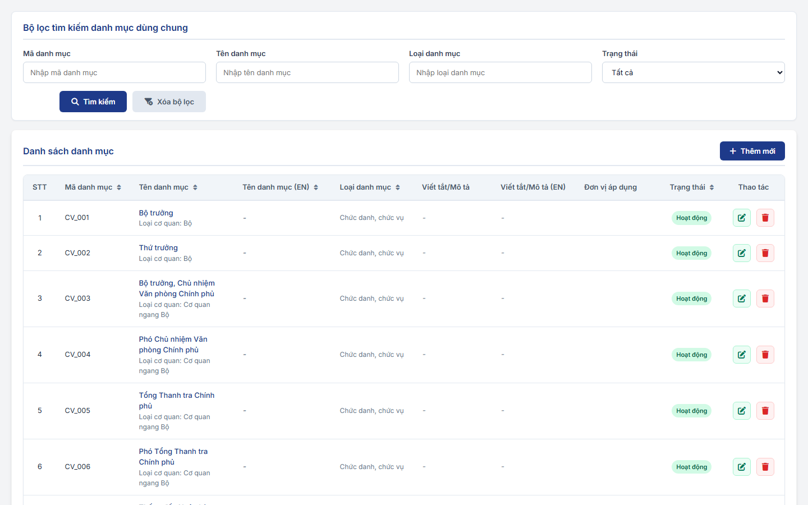
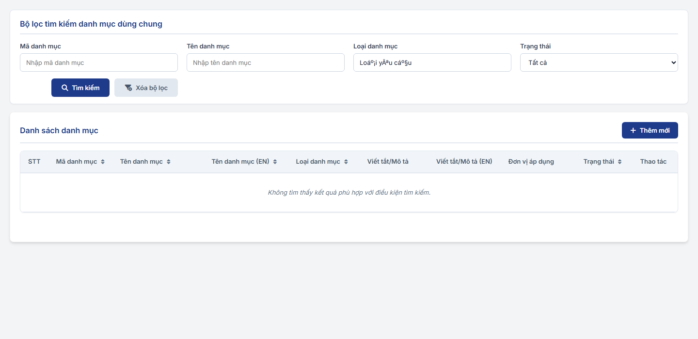
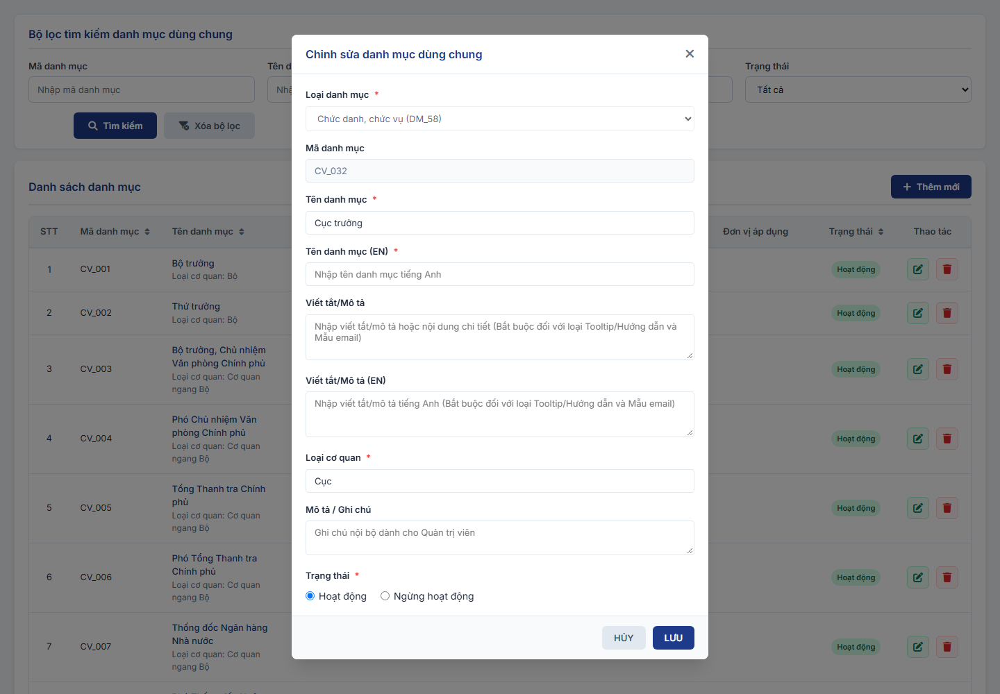
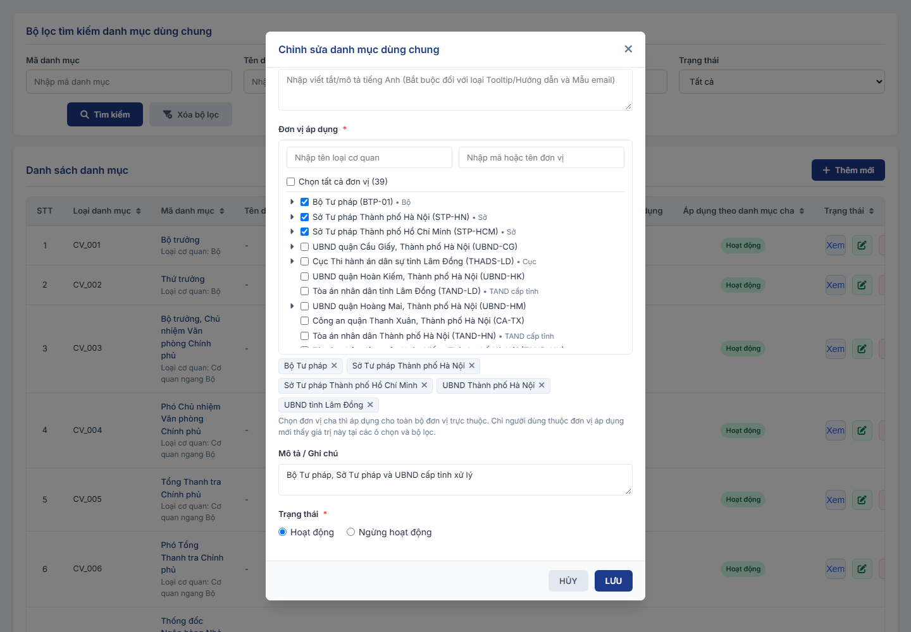
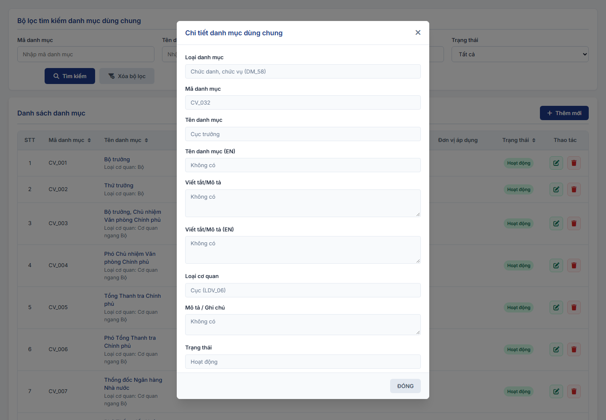
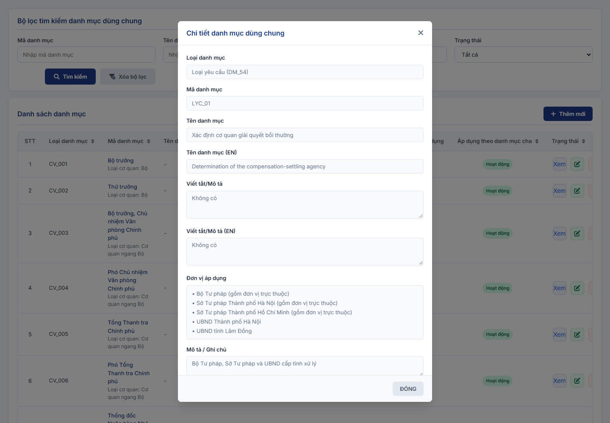

#### 4.3.1.5. Quản lý danh mục dùng chung (Master Data)

##### 4.3.1.5.1. Mục đích
Cho phép quản lý danh mục dữ liệu dùng chung (Master Data) của hệ thống Đăng ký biện pháp bảo đảm và Bồi thường nhà nước, bao gồm:
- Tra cứu, lọc danh mục theo Mã danh mục, Tên danh mục, Loại danh mục và Trạng thái.
- Thêm mới, chỉnh sửa thông tin danh mục hỗ trợ cả cấu trúc danh mục phẳng (Flat List) và danh mục phân cấp đa cấp (Hierarchical Tree List).
- Chuyển đổi trạng thái hoạt động (Hoạt động / Ngừng hoạt động) và xóa các bản ghi danh mục chưa phát sinh ràng buộc dữ liệu.
- Khai báo Đơn vị áp dụng cho từng giá trị của các Loại danh mục có `Phân quyền theo đơn vị` = `Mở`, dùng để phân quyền giá trị danh mục theo đơn vị (xem [Phân quyền theo đơn vị và Đơn vị áp dụng - Quản lý danh mục dùng chung (Master Data) - Quản trị hệ thống (Website Quản trị)](#dm-don-vi-ap-dung)).
- Quản lý Danh mục Chức vụ [DM_58] gắn với Danh mục Loại cơ quan [DM_57]: mỗi Chức vụ chọn 01 Loại cơ quan tại trường Loại cơ quan; danh sách giá trị và quy tắc tại [Danh mục Loại cơ quan và Danh mục Chức vụ - Danh mục Loại cơ quan và Danh mục Chức vụ - Quản trị hệ thống (Website Quản trị)](Danh%20m%E1%BB%A5c%20Lo%E1%BA%A1i%20c%C6%A1%20quan%20v%C3%A0%20Danh%20m%E1%BB%A5c%20Ch%E1%BB%A9c%20v%E1%BB%A5.md).

*a. Phân quyền*
- Quản trị hệ thống (QTHT).

*b. Điều kiện thực hiện*
- Cán bộ quản trị đã đăng nhập thành công vào Website quản trị.
- Hệ thống hoạt động bình thường.

---

##### 4.3.1.5.2. MH01 - Màn hình Tra cứu danh mục dùng chung

###### 4.3.1.5.2.1. Màn hình

###### 4.3.1.5.2.2. Mô tả thông tin trên màn hình

| Trường thông tin | Kiểu dữ liệu | Bắt buộc | Mặc định | Mô tả |
| :--- | :--- | :--- | :--- | :--- |
| **I. Bộ lọc, tìm kiếm** | - | - | - | Khối điều kiện tìm kiếm danh mục. |
| Mã danh mục | String(50) | Không | Trống | Control UI: Input text, placeholder "Nhập mã danh mục". - Tìm kiếm gần đúng theo Mã danh mục, không phân biệt hoa thường. |
| Tên danh mục | String(255) | Không | Trống | Control UI: Input text, placeholder "Nhập tên danh mục". - Tìm kiếm gần đúng theo Tên danh mục, không phân biệt hoa thường, nhập có dấu hoặc không dấu. |
| Loại danh mục | String(255) | Không | Trống | Control UI: Input text, placeholder "Nhập loại danh mục". - Người dùng nhập text, không chọn từ danh sách. - Tìm kiếm gần đúng theo Tên loại danh mục, không phân biệt hoa thường, nhập có dấu hoặc không dấu. |
| Trạng thái | Enum(String(50)) | Không | Tất cả | Control UI: Combobox. Gồm: + Tất cả + Hoạt động + Ngừng hoạt động |
| Tìm kiếm | String(50) | - | - | Control UI: Button. - Nằm ở sát góc bên phải của vùng tìm kiếm lọc, phía dưới các ô nhập liệu tìm kiếm, không nằm cùng hàng với các trường nhập. |
| Xóa bộ lọc | String(50) | - | - | Control UI: Button. - Nằm ở sát góc bên phải của vùng tìm kiếm lọc, cạnh nút Tìm kiếm. |
| **II. Bảng danh sách kết quả** | - | - | 20 bản ghi/trang | Control UI: Bảng/Lưới dữ liệu. - Cho phép chọn 10, 20, 50, 100 bản ghi/trang, mặc định 20. - Click vào dòng dữ liệu để mở MH03 ở chế độ Xem chi tiết danh mục. - Trạng thái không có dữ liệu (Empty State): Khi không tìm thấy kết quả phù hợp với điều kiện tìm kiếm, bảng hiển thị duy nhất 01 dòng căn giữa trên toàn bộ chiều rộng bảng (`colspan`), in nghiêng với nội dung theo MessageList dùng chung [MSG-INF-SYS-001]. |
| STT | Integer(10) | - | - | Control UI: Text hiển thị (Read-only). |
| Mã danh mục | String(50) | - | - | Control UI: Text hiển thị (Read-only). |
| Tên danh mục | String(255) | - | - | Control UI: Text hiển thị (Read-only). - Tên hiển thị tiếng Việt của danh mục. |
| Tên danh mục (EN) | String(255) | - | - | Control UI: Text hiển thị (Read-only). - Tên hiển thị tiếng Anh của danh mục. |
| Loại danh mục | String(255) | - | - | Control UI: Text hiển thị (Read-only). - Nằm sau cột Tên danh mục (EN). - Hiển thị thành 2 dòng gồm: + Dòng 1: Tên loại danh mục. + Dòng 2: Mã loại danh mục (chữ nhỏ hơn, màu mờ/xám). |
| Viết tắt / Mô tả | String(1000) | - | - | Control UI: Text hiển thị (Read-only). - Cắt ngắn kèm tooltip nếu nội dung quá dài. |
| Viết tắt / Mô tả (EN) | String(1000) | - | - | Control UI: Text hiển thị (Read-only). |
| Đơn vị áp dụng | String(1000) | - | - | Control UI: Text hiển thị (Read-only). - Tên các đơn vị đã chọn tại `Đơn vị áp dụng` của giá trị danh mục, mỗi đơn vị hiển thị trên 01 dòng. - Hiển thị tối đa 02 đơn vị; nếu nhiều hơn 02 đơn vị thì dòng cuối hiển thị "+[Số đơn vị còn lại] đơn vị khác". - Để trống với giá trị thuộc Loại danh mục có `Phân quyền theo đơn vị` = `Không`. |
| Áp dụng theo danh mục cha | String(255) | - | - | Control UI: Text hiển thị (Read-only). - Nằm trước cột Trạng thái. - Thể hiện giá trị danh mục cha mà bản ghi hiện tại trực thuộc hoặc áp dụng theo (ví dụ: Chức vụ *Bộ trưởng* áp dụng cho Loại cơ quan là *Bộ*). - Hiển thị thành 2 dòng: + Dòng 1: Tên giá trị danh mục cha đã chọn (ví dụ: *Bộ*, *Phòng/Ban*...) hoặc *Mọi giá trị của loại cha* (khi áp dụng cho toàn bộ các giá trị của loại danh mục cha đó). + Dòng 2: Tên Loại danh mục cha (màu nhạt, ví dụ: *Loại cơ quan*). - Hiển thị dấu gạch ngang `-` đối với bản ghi thuộc Loại danh mục độc lập (không phụ thuộc loại cha nào). |
| Trạng thái | Enum(String(50)) | - | - | Control UI: Badge/Tag hiển thị. Gồm: + Hoạt động + Ngừng hoạt động |
| Thao tác | String(255) | - | - | Control UI: Nhóm icon thao tác. - `Xem chi tiết`: Luôn hiển thị. - `Sửa`: Luôn hiển thị. - `Xóa`: Luôn hiển thị. |
| Thêm mới | String(50) | - | - | Control UI: Button. - Luôn hiển thị phía trên bảng dữ liệu. |

###### 4.3.1.5.2.3. Chức năng trên màn hình

| STT | Tên chức năng | Định dạng | Mô tả |
| :--- | :--- | :--- | :--- |
| 1 | Tìm kiếm | Button | Khi người dùng click nút "Tìm kiếm": - **TH Không có dữ liệu**: Bảng hiển thị duy nhất 01 dòng căn giữa với nội dung [MSG-INF-SYS-001]; thanh phân trang hiển thị *"Hiển thị 0-0 của 0 bản ghi"* và các nút điều hướng bị khóa mờ. - **TH Có dữ liệu**: Hiển thị danh sách các bản ghi danh mục thỏa mãn điều kiện lọc. |
| 2 | Xóa bộ lọc | Button | Đưa toàn bộ các trường trong bộ lọc tìm kiếm về giá trị mặc định (`Mã danh mục` = Trống, `Tên danh mục` = Trống, `Loại danh mục` = Trống, `Trạng thái` = Tất cả) và tải lại danh sách ban đầu. |
| 3 | Thêm mới | Button | Mở **[MH02 - Popup Thêm mới / Cập nhật Danh mục - Quản lý danh mục dùng chung (Master Data) - Quản trị hệ thống (Website Quản trị)](#dm-mh02)** ở trạng thái rỗng để nhập mới. Nếu nội dung ô `Loại danh mục` tại bộ lọc trùng đúng tên 01 Loại danh mục thì tự động điền sẵn Loại danh mục đó. |
| 4 | Xem chi tiết | Icon | Mở **MH03 - Popup Xem chi tiết danh mục** hiển thị toàn bộ thông tin chi tiết của bản ghi ở chế độ chỉ đọc. |
| 5 | Sửa | Icon | Mở **MH02 - Popup Thêm mới / Cập nhật Danh mục** và tải toàn bộ dữ liệu hiện tại của bản ghi để chỉnh sửa. |
| 6 | Xóa | Icon | Mở **[POPUP-CFM-001]** với `Loại thao tác` là `Xóa` kèm thông báo xác nhận [MSG-CFM-SYS-001]: - **TH1 (Danh mục đang được sử dụng)**: Danh mục đã được sử dụng trong các hồ sơ, tài khoản hoặc đang làm Danh mục cha cho các danh mục con khác $\rightarrow$ Hệ thống chặn xóa, hiển thị cảnh báo lỗi yêu cầu chuyển trạng thái sang Ngừng hoạt động. - **TH Hợp lệ**: Khi người dùng chọn "Xác nhận", hệ thống xóa bản ghi khỏi CSDL, ghi Audit Log, hiển thị thông báo thành công [MSG-SUC-SYS-001] và làm mới danh sách bảng kết quả. |
| 7 | Click dòng dữ liệu | Row Click | Mở **MH03 - Popup Xem chi tiết danh mục** tương tự thao tác Xem chi tiết. |

---

##### 4.3.1.5.3. MH02 - Popup Thêm mới / Cập nhật Danh mục

###### 4.3.1.5.3.1. Màn hình

###### 4.3.1.5.3.2. Mô tả thông tin trên màn hình

| Trường thông tin | Kiểu dữ liệu | Bắt buộc | Mặc định | Mô tả |
| :--- | :--- | :--- | :--- | :--- |
| **Form Danh mục** | - | - | - | Hiển thị dạng Popup Modal. |
| Loại danh mục | Enum(String(50)) | Có | Lựa chọn hiện tại (Thêm mới) / Theo bản ghi (Sửa) | Control UI: Combobox. - Danh sách lấy từ các Loại danh mục đang hoạt động. - Khóa chỉ đọc (Read-only) khi ở chế độ Sửa. |
| Mã danh mục | String(50) | Có | Tự động sinh (Thêm mới) / Theo bản ghi (Sửa) | Control UI: Text hiển thị (Read-only). - Tự động sinh mã định danh duy nhất. Không cho phép sửa. |
| Tên danh mục | String(255) | Có | Trống (Thêm mới) / Theo bản ghi (Sửa) | Control UI: Input text. - Nhập tên tiếng Việt của danh mục. - Áp dụng quy tắc bắt buộc [BR-VAL-001]. |
| Tên danh mục (EN) | String(255) | Có | Trống (Thêm mới) / Theo bản ghi (Sửa) | Control UI: Input text. - Nhập tên tiếng Anh của danh mục. - Áp dụng quy tắc bắt buộc [BR-VAL-001]. |
| Viết tắt / Mô tả | Text(2000) | Tùy điều kiện | Trống (Thêm mới) / Theo bản ghi (Sửa) | Control UI: Textarea. - Bắt buộc đối với các loại danh mục đặc thù (như Tooltip, Mẫu email...). |
| Viết tắt / Mô tả (EN) | Text(2000) | Tùy điều kiện | Trống (Thêm mới) / Theo bản ghi (Sửa) | Control UI: Textarea. - Bắt buộc đối với các loại danh mục đặc thù cần đa ngôn ngữ. |
| Danh mục cha (Trực thuộc) | Enum(String(50)) | Có (chỉ với Loại danh mục Chức vụ [DM_58]) | Trống (Thêm mới) / Theo bản ghi (Sửa) | Control UI: Combobox. - Chọn danh mục cha đã có trên hệ thống (đối với danh mục dạng cây phân cấp). - Loại danh mục Chức vụ [DM_58]: nhãn trường hiển thị "Loại cơ quan"; Control UI: Ô nhập có gợi ý (Autocomplete), placeholder "Nhập tên loại cơ quan"; người dùng gõ tên, danh sách gợi ý gồm các giá trị đang hoạt động của Danh mục Loại cơ quan [DM_57] có tên chứa nội dung đã gõ (gần đúng, không phân biệt hoa thường, nhập có dấu hoặc không dấu); không có giá trị phù hợp hiển thị "Không tìm thấy loại cơ quan phù hợp"; người dùng phải chọn 01 giá trị trong danh sách gợi ý, sửa nội dung đã chọn thì bỏ giá trị đã chọn; bắt buộc chọn, bỏ trống hiển thị "Vui lòng chọn Loại cơ quan." dưới trường. |
| **Đơn vị áp dụng** | List(String) | Có (chỉ với Loại danh mục có `Phân quyền theo đơn vị` = `Mở`) | Trống (Thêm mới) / Theo bản ghi (Sửa) | Khối chọn đơn vị trên cây Cơ cấu tổ chức, gồm các thành phần bên dưới. - Chỉ hiển thị khi Loại danh mục có `Phân quyền theo đơn vị` = `Mở` (cấu hình tại [MH02 - Popup Thêm mới / Cập nhật Loại danh mục - Quản lý loại danh mục - Quản trị hệ thống (Website Quản trị)](Quan_ly_loai_danh_muc.md)); ẩn với các loại danh mục khác. - Dòng hướng dẫn: "Chọn đơn vị cha thì áp dụng cho toàn bộ đơn vị trực thuộc. Chỉ người dùng thuộc đơn vị áp dụng mới thấy giá trị này tại các ô chọn và bộ lọc." - Quy tắc chi tiết tại [Phân quyền theo đơn vị và Đơn vị áp dụng - Quản lý danh mục dùng chung (Master Data) - Quản trị hệ thống (Website Quản trị)](#dm-don-vi-ap-dung). |
| Loại cơ quan | String(255) | Không | Trống | Control UI: Ô nhập có gợi ý (Autocomplete), placeholder "Nhập tên loại cơ quan". - Người dùng gõ tên, danh sách gợi ý gồm `-- Tất cả loại cơ quan --` và các giá trị đang hoạt động của Danh mục Loại cơ quan [DM_57] có tên chứa nội dung đã gõ (gần đúng, không phân biệt hoa thường, nhập có dấu hoặc không dấu). - Chọn 01 Loại cơ quan: cây đơn vị chỉ gồm các đơn vị thuộc Loại cơ quan đã chọn và các đơn vị cấp trên của chúng; đơn vị cấp trên không thuộc Loại cơ quan đã chọn chỉ hiển thị để xác định vị trí, không chọn được. - Chọn `-- Tất cả loại cơ quan --` hoặc xóa nội dung: bỏ điều kiện lọc theo Loại cơ quan. - Loại cơ quan của từng đơn vị lấy theo thông tin đơn vị tại Cơ cấu tổ chức. |
| Tìm kiếm đơn vị | String(255) | Không | Trống | Control UI: Input text, placeholder "Nhập mã hoặc tên đơn vị". - Tìm kiếm gần đúng theo Mã đơn vị hoặc Tên đơn vị, không phân biệt hoa thường, nhập có dấu hoặc không dấu; lọc trực tiếp trên cây đơn vị khi nhập. - Cây đơn vị chỉ gồm các đơn vị thỏa điều kiện và các đơn vị cấp trên của chúng; đơn vị cấp trên không thỏa điều kiện chỉ hiển thị để xác định vị trí, không chọn được. - Không có đơn vị thỏa điều kiện: cây hiển thị "Không tìm thấy đơn vị phù hợp". |
| Chọn tất cả đơn vị | Boolean | Không | Theo dữ liệu đã chọn | Control UI: Checkbox, nhãn "Chọn tất cả đơn vị ([Số đơn vị thỏa điều kiện tìm kiếm])". - Tích chọn: chọn toàn bộ đơn vị thỏa điều kiện `Loại cơ quan` và `Tìm kiếm đơn vị` hiện tại; không nhập điều kiện thì chọn toàn bộ đơn vị trên cây. - Bỏ tích: bỏ chọn các đơn vị thỏa điều kiện tìm kiếm hiện tại. - Ở trạng thái đã tích khi mọi đơn vị thỏa điều kiện đều đã chọn (chọn trực tiếp hoặc theo đơn vị cha). - Khóa khi không có đơn vị thỏa điều kiện. |
| Cây đơn vị | List(String) | - | Thu gọn, chỉ hiển thị đơn vị cấp cao nhất | Control UI: Cây chọn nhiều (Tree Multi-select) theo cây Cơ cấu tổ chức. - Mỗi dòng gồm: biểu tượng thu gọn/mở rộng (chỉ với đơn vị có đơn vị trực thuộc), checkbox, "[Tên đơn vị] ([Mã đơn vị])", "• [Tên loại cơ quan]" (nếu đơn vị có Loại cơ quan). - Thu gọn/mở rộng theo từng đơn vị: click biểu tượng tại dòng đơn vị để ẩn/hiện các đơn vị trực thuộc trực tiếp của đơn vị đó; không ảnh hưởng đến các đơn vị khác trên cây. - Khi nhập hoặc thay đổi điều kiện `Loại cơ quan`, `Tìm kiếm đơn vị`: cây mở rộng các cấp của kết quả; người dùng vẫn thu gọn/mở rộng được từng đơn vị. - Cho phép tích chọn 01 hoặc nhiều đơn vị. - Chọn đơn vị cha thì áp dụng cho toàn bộ đơn vị trực thuộc: các đơn vị con hiển thị đã chọn, bị khóa, kèm nhãn "(áp dụng theo đơn vị cha)"; không chọn riêng được. |
| Danh sách đơn vị đã chọn | List(String) | - | Theo dữ liệu đã chọn | Control UI: Danh sách thẻ (Tag), hiển thị dưới khối chọn đơn vị. - Mỗi đơn vị đã chọn 01 thẻ "[Tên đơn vị]" kèm nút `x` để bỏ chọn đơn vị đó. - Hiển thị tối đa 05 thẻ; còn lại hiển thị thẻ "+[Số đơn vị còn lại] đơn vị", click để hiển thị toàn bộ. |
| Ghi chú | Text(2000) | Không | Trống (Thêm mới) / Theo bản ghi (Sửa) | Control UI: Textarea. - Ghi chú nội bộ dành cho quản trị viên. |
| Trạng thái | Enum(String(50)) | Có | Hoạt động (Thêm mới) / Theo bản ghi (Sửa) | Control UI: Combobox / Radio. Gồm: + Hoạt động + Ngừng hoạt động |

###### 4.3.1.5.3.3. Chức năng trên màn hình

| STT | Tên chức năng | Định dạng | Mô tả |
| :--- | :--- | :--- | :--- |
| 1 | Lưu | Button | Kiểm tra dữ liệu trên form: - **TH1 (Bỏ trống trường bắt buộc)**: Vi phạm quy tắc [BR-VAL-001]. Highlight viền đỏ ô lỗi đầu tiên, hiển thị thông báo lỗi [MSG-ERR-VAL-001] và focus con trỏ vào ô lỗi. - **TH2 (Sai định dạng / Độ dài)**: Dữ liệu vi phạm quy tắc [BR-VAL-002] hoặc [BR-VAL-003] $\rightarrow$ Highlight viền đỏ ô lỗi, hiển thị thông báo lỗi [MSG-ERR-VAL-002] hoặc [MSG-ERR-VAL-003] và focus con trỏ. - **TH2b (Chưa chọn Đơn vị áp dụng)**: Loại danh mục có `Phân quyền theo đơn vị` = `Mở` và chưa chọn đơn vị nào tại `Đơn vị áp dụng` $\rightarrow$ Hiển thị dưới trường thông báo lỗi "Vui lòng chọn ít nhất một đơn vị áp dụng." và không lưu. - **TH3 (Trùng lặp dữ liệu)**: Kiểm tra trùng `Tên danh mục` trong cùng một `Loại danh mục` đối với các bản ghi đang ở trạng thái `Hoạt động` (khi Sửa loại trừ chính bản ghi đang xử lý). Nếu trùng, hiển thị thông báo lỗi [MSG-ERR-VAL-009]. - **TH Hợp lệ**: Lưu thông tin vào CSDL, ghi Audit Log, hiển thị thông báo thành công [MSG-SUC-SYS-001], đóng popup và làm mới danh sách dữ liệu tại MH01. Dữ liệu có trạng thái "Ngừng hoạt động" sẽ không xuất hiện trong các combobox nghiệp vụ mới nhưng vẫn duy trì toàn vẹn dữ liệu cho các hồ sơ lịch sử. |
| 2 | Hủy | Button | Đóng Popup Modal, hủy bỏ các thay đổi và quay lại màn hình chính. |

---

##### 4.3.1.5.4. MH03 - Popup Xem chi tiết danh mục

###### 4.3.1.5.4.1. Màn hình

###### 4.3.1.5.4.2. Mô tả thông tin trên màn hình

| Trường thông tin | Kiểu dữ liệu | Bắt buộc | Mặc định | Mô tả |
| :--- | :--- | :--- | :--- | :--- |
| **Form Danh mục** | - | - | - | Hiển thị dạng Popup Modal chuẩn chỉ đọc. |
| Loại danh mục | String(50) | - | Theo thông tin bản ghi | Chỉ đọc. |
| Mã danh mục | String(50) | - | Theo thông tin bản ghi | Chỉ đọc. |
| Tên danh mục | String(255) | - | Theo thông tin bản ghi | Chỉ đọc. |
| Tên danh mục (EN) | String(255) | - | Theo thông tin bản ghi | Chỉ đọc. |
| Viết tắt / Mô tả | Text(2000) | - | Theo thông tin bản ghi | Chỉ đọc. |
| Viết tắt / Mô tả (EN) | Text(2000) | - | Theo thông tin bản ghi | Chỉ đọc. |
| Danh mục cha (Trực thuộc) | String(50) | - | Theo thông tin bản ghi | Chỉ đọc. Loại danh mục Chức vụ [DM_58]: nhãn trường hiển thị "Loại cơ quan". |
| Đơn vị áp dụng | List(String) | - | Theo thông tin bản ghi | Chỉ đọc. Chỉ hiển thị với Loại danh mục có `Phân quyền theo đơn vị` = `Mở`. - Mỗi đơn vị đã chọn 01 dòng "• [Tên đơn vị]"; đơn vị có đơn vị trực thuộc thêm "(gồm đơn vị trực thuộc)". - Chưa chọn: "Chưa chọn". |
| Ghi chú | Text(2000) | - | Theo thông tin bản ghi | Chỉ đọc. |
| Trạng thái | String(50) | - | Theo thông tin bản ghi | Chỉ đọc. |

###### 4.3.1.5.4.3. Chức năng trên màn hình

| STT | Tên chức năng | Định dạng | Mô tả |
| :--- | :--- | :--- | :--- |
| 1 | Đóng | Button / Icon | Đóng Popup Modal Xem chi tiết và quay lại màn hình chính MH01. |
| 2 | Cập nhật | Button | Chuyển trực tiếp từ Popup Xem chi tiết sang Popup Thêm mới / Cập nhật Danh mục (MH02) ở chế độ Chỉnh sửa dữ liệu của bản ghi hiện tại. |

---

##### 4.3.1.5.5. Phân quyền theo đơn vị và Đơn vị áp dụng

| STT | Nội dung | Quy tắc |
| :--- | :--- | :--- |
| 1 | Phân quyền theo đơn vị | Cấu hình theo từng Loại danh mục tại trường `Phân quyền theo đơn vị` (`Mở` / `Tắt`) của [MH02 - Popup Thêm mới / Cập nhật Loại danh mục - Quản lý loại danh mục - Quản trị hệ thống (Website Quản trị)](Quan_ly_loai_danh_muc.md). - `Mở`: mỗi giá trị của Loại danh mục có trường `Đơn vị áp dụng`, bắt buộc, chọn 01 hoặc nhiều đơn vị trên cây Cơ cấu tổ chức. - `Tắt`: giá trị của Loại danh mục không có trường `Đơn vị áp dụng` và không bị giới hạn theo đơn vị. |
| 2 | Loại danh mục Loại hồ sơ | Mã `DM_54`, tên "Loại hồ sơ", dùng cho phân hệ Bồi thường nhà nước; `Phân quyền theo đơn vị` = `Mở`. - Gồm 02 giá trị: + `LYC_01` - Xác định cơ quan giải quyết bồi thường. + `LYC_02` - Giải quyết yêu cầu bồi thường. - `LYC_01` chỉ gán cho Bộ Tư pháp và các Sở Tư pháp, nên chỉ Bộ Tư pháp và Sở Tư pháp tiếp nhận và xử lý hồ sơ Xác định cơ quan giải quyết bồi thường. Ủy ban nhân dân cấp tỉnh chỉ xem hồ sơ Xác định cơ quan giải quyết bồi thường của Sở Tư pháp trực thuộc tại phân hệ Xác định cơ quan giải quyết bồi thường. |
| 3 | Chọn đơn vị | Người dùng lọc cây đơn vị theo `Loại cơ quan` (Danh mục Loại cơ quan [DM_57]) và tìm theo Mã hoặc Tên đơn vị; thu gọn/mở rộng theo từng đơn vị trên cây; dùng `Chọn tất cả đơn vị` để chọn toàn bộ đơn vị thỏa điều kiện tìm kiếm. Chi tiết tại [MH02 - Popup Thêm mới / Cập nhật Danh mục - Quản lý danh mục dùng chung (Master Data) - Quản trị hệ thống (Website Quản trị)](#dm-mh02). |
| 4 | Đơn vị cha | Chọn đơn vị cha thì giá trị áp dụng cho toàn bộ đơn vị trực thuộc các cấp. - Trên cây, đơn vị con của đơn vị đã chọn hiển thị đã chọn, bị khóa, kèm nhãn "(áp dụng theo đơn vị cha)". - Khi chọn đơn vị cha, các đơn vị con đã chọn riêng trước đó được bỏ khỏi dữ liệu lưu (chỉ lưu đơn vị cha). |
| 5 | Hiệu lực tại các màn hình nghiệp vụ | Với Loại danh mục có `Phân quyền theo đơn vị` = `Mở`: ô chọn và bộ lọc dùng Loại danh mục đó ở mọi màn hình chỉ hiển thị giá trị ở trạng thái `Hoạt động` có Đơn vị áp dụng chứa đơn vị của người dùng hoặc một đơn vị cấp trên của đơn vị đó. Loại hồ sơ [DM_54] áp dụng tại: [Tiếp nhận hồ sơ - Tiếp nhận hồ sơ - Bồi thường nhà nước (Website Quản trị)](../03_Cong_tac_boi_thuong/SRS_BTNN_GiaiQuyetBT_TiepNhan_YCBT.md); [Dashboard Lãnh đạo - Dashboard Lãnh đạo - Công tác bồi thường nhà nước (Website Quản trị)](../03_Cong_tac_boi_thuong/SRS_BTNN_ViecChoLanhDaoXuLy.md); [Xác định cơ quan giải quyết bồi thường - Xác định cơ quan giải quyết bồi thường - Bồi thường nhà nước (Website Quản trị)](../03_Cong_tac_boi_thuong/SRS_BTNN_GiaiQuyetBT__Xac%20định%20cơ%20quan%20GQBT.md). - Danh sách hồ sơ chỉ gồm hồ sơ có Loại hồ sơ áp dụng cho người dùng. - Màn hình Xác định cơ quan giải quyết bồi thường: người dùng thuộc Ủy ban nhân dân cấp tỉnh xem danh sách hồ sơ của Sở Tư pháp trực thuộc ở chế độ chỉ đọc; người dùng thuộc đơn vị khác không được áp dụng `LYC_01` thấy thông báo "Loại hồ sơ "Xác định cơ quan giải quyết bồi thường" không áp dụng cho đơn vị [Tên đơn vị] (Danh mục Loại hồ sơ - Đơn vị áp dụng). Chỉ Bộ Tư pháp và Sở Tư pháp được xử lý loại hồ sơ này." và không có nút "Tạo yêu cầu". |
| 6 | Ghi chú | Quy tắc chọn đơn vị cha áp dụng cho đơn vị trực thuộc được áp dụng theo mặc định, chưa được xác nhận chính thức. |
