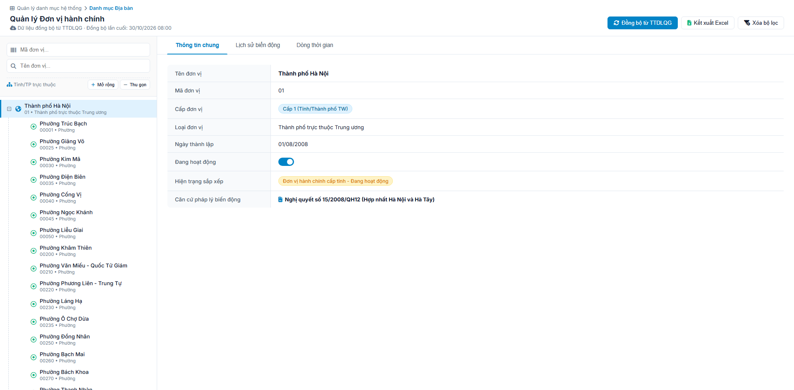
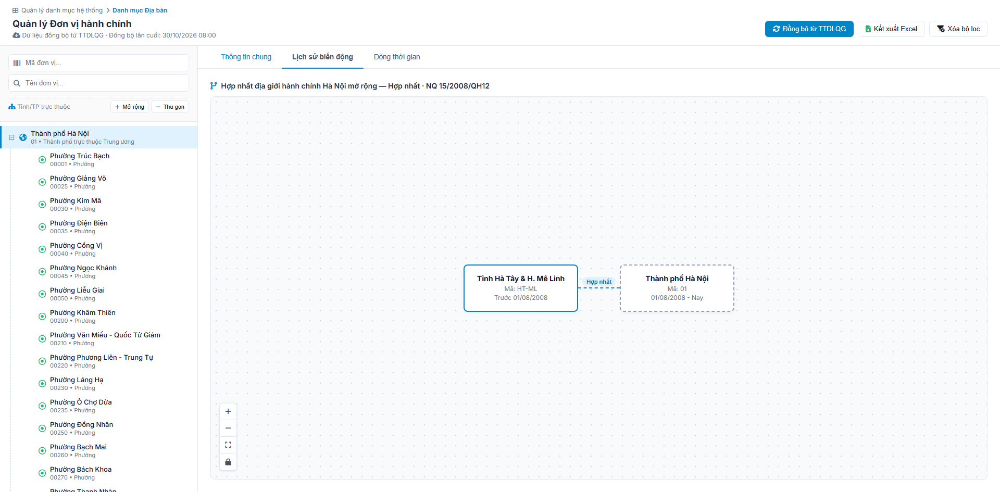
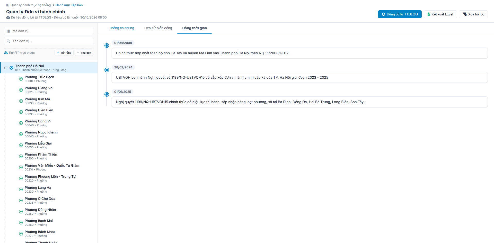

#### 4.3.1.8. Quản lý danh mục Địa bàn (Đơn vị hành chính)

##### 4.3.1.8.1. Mục đích
Quản lý danh mục địa bàn, đơn vị hành chính phân cấp của hệ thống, bao gồm:
- Tra cứu, tìm kiếm đơn vị hành chính theo mã và tên theo cấu trúc cây phân cấp (Tỉnh/Thành phố $\rightarrow$ Xã/Phường/Thị trấn).
- Đồng bộ danh mục từ TTDLQG theo link tại cột `API chia sẻ qua LGSP`, sheet `API chia sẻ & Đối soát`, dòng `Danh mục Địa bàn hành chính` - [Danh sách API chia sẻ - Tài liệu tích hợp C12 Trung tâm dữ liệu quốc gia](../../../Tai_lieu_tich_hop/2.%20C12_Trung%20tam%20DL%20quoc%20gia/20261030_Danh%20s%C3%A1ch%20API%20chia%20s%E1%BA%BB.xlsx).
- Không thêm mới, sửa, xóa, nhận Excel đơn vị hành chính trên hệ thống.
- Theo dõi lịch sử biến động địa giới hành chính (sáp nhập, chia tách, giải thể, đổi tên) qua sơ đồ kế thừa và trục thời gian.
- Kết xuất danh mục ra tệp Excel.

*a. Phân quyền*
- Quản trị hệ thống (QTHT).

*b. Điều kiện thực hiện*
- Cán bộ quản trị đã đăng nhập thành công vào Website quản trị.
- Hệ thống hoạt động bình thường.

---

##### 4.3.1.8.2. MH01 - Màn hình Quản lý đơn vị hành chính

###### 4.3.1.8.2.1. Màn hình

###### 4.3.1.8.2.2. Mô tả thông tin trên màn hình

| Trường thông tin | Kiểu dữ liệu | Bắt buộc | Mặc định | Mô tả |
| :--- | :--- | :--- | :--- | :--- |
| **I. Panel bên trái: Cây đơn vị hành chính** | - | - | - | Khối tìm kiếm và cây phân cấp địa bàn hành chính. |
| Mã đơn vị (Tìm kiếm) | String(50) | Không | Trống | Control UI: Input text. - Nhập mã đơn vị hành chính cần tìm kiếm (không phân biệt hoa thường). |
| Tên đơn vị (Tìm kiếm) | String(255) | Không | Trống | Control UI: Input text. - Nhập tên đơn vị hành chính cần tìm kiếm (không phân biệt hoa thường/dấu tiếng Việt). |
| Mở rộng / Thu gọn cây | String(50) | - | - | Control UI: Button. - Gồm 02 nút bấm: `Mở rộng` (mở toàn bộ các nhánh Cấp 1, Cấp 2) và `Thu gọn` (thu gọn chỉ giữ lại danh sách Cấp 1). |
| Cây đơn vị hành chính | Tree | - | Mở rộng sẵn Cấp 1 | Control UI: Cây phân cấp đa tầng (Hierarchical Tree View). - Hiển thị cấu trúc cây gồm 2 cấp: + Cấp 1: Tỉnh / Thành phố trực thuộc Trung ương (Icon địa cầu). + Cấp 2: Phường / Xã / Thị trấn (Icon tọa độ). - Cấu trúc hiển thị của mỗi node: + Dòng chính: Tên đơn vị. + Dòng phụ: [Mã đơn vị] • [Loại đơn vị]. - Các đơn vị đã giải thể không hiển thị độc lập trên cây; toàn bộ lịch sử kế thừa được tra cứu qua tìm kiếm hoặc hiển thị tại Tab Lịch sử biến động của đơn vị tiếp nhận. - Cho phép click chọn từng node để xem chi tiết bên Panel phải. - Nút `[+]` / `[-]` hoặc click đúp vào dòng: Mở rộng hoặc thu gọn các nhánh con. |
| **II. Thanh công cụ hành động** | - | - | - | Khối nút bấm chức năng phía trên bên phải màn hình. |
| Đồng bộ lần cuối | DateTime | - | Theo lần đồng bộ gần nhất | Control UI: Label. - Đặt dưới tiêu đề màn hình. - Nội dung: `Dữ liệu đồng bộ từ TTDLQG · Đồng bộ lần cuối: dd/mm/yyyy HH:mm`. |
| Đồng bộ từ TTDLQG | String(50) | - | - | Control UI: Button. - Luôn hiển thị tại thanh công cụ. |
| Kết xuất Excel | String(50) | - | - | Control UI: Button. - Luôn hiển thị tại thanh công cụ. - Khóa mờ (Disabled) kèm tooltip nếu danh sách cây địa bàn không có dữ liệu. |
| Xóa bộ lọc | String(50) | - | - | Control UI: Button. - Luôn hiển thị tại thanh công cụ. |
| **III. Panel bên phải: Chi tiết đơn vị hành chính** | - | - | - | Khối hiển thị thuộc tính chi tiết đơn vị hành chính đang chọn gồm 3 tab: Thông tin chung, Lịch sử biến động, Dòng thời gian. |
| Trạng thái chưa chọn đơn vị | Text | - | Hiển thị mặc định | Control UI: Khung hiển thị rỗng (Empty State). - Hiển thị icon thư mục mở và thông điệp: *"Vui lòng chọn một tổ chức để xem chi tiết"*. |
| **1. Tab Thông tin chung** | - | - | - | Khối hiển thị các thuộc tính hành chính cơ bản của đơn vị đang chọn. |
| Tên đơn vị | String(255) | - | Theo node chọn | Control UI: Text hiển thị (Read-only). - Định dạng chữ đậm (Bold). |
| Mã đơn vị | String(50) | - | Theo node chọn | Control UI: Text hiển thị (Read-only). |
| Cấp đơn vị | Enum(String(50)) | - | Theo node chọn | Control UI: Badge/Tag hiển thị (Read-only). - Hiển thị cấp đơn vị hành chính của địa bàn đang chọn. |
| Loại đơn vị | String(100) | - | Theo node chọn | Control UI: Text hiển thị (Read-only). - Hiển thị loại đơn vị hành chính của địa bàn đang chọn. |
| Ngày thành lập | Date | - | Theo node chọn | Control UI: Text hiển thị (Read-only). - Định dạng: `dd/mm/yyyy`. |
| Đang hoạt động | Boolean | - | Theo node chọn | Control UI: Switch toggle (Read-only). - Bật (Xanh): Đang hoạt động bình thường. |
| Hiện trạng sắp xếp | Enum(String(100)) | - | Theo node chọn | Control UI: Badge/Tag hiển thị (Read-only). - Hiển thị hiện trạng sắp xếp theo thông tin của địa bàn. |
| Căn cứ pháp lý biến động | String(255) | - | Theo node chọn | Control UI: Text hiển thị kèm icon (Read-only). - Hiển thị số hiệu văn bản pháp lý điều chỉnh địa giới hành chính (Ví dụ: *Nghị quyết 1199/NQ-UBTVQH15*, *Nghị quyết 1278/NQ-UBTVQH15*...). |
| **2. Tab Lịch sử biến động** | - | - | - | Khối hiển thị sơ đồ phân nhánh kế thừa biến động địa giới hành chính (Succession Node Graph). |
| Tiêu đề biến động | String(255) | - | Theo bản ghi | Control UI: Text hiển thị (Read-only). - Định dạng: `Đã kế thừa bởi (đi đâu) — [Loại biến động] · QĐ [Số QĐ]`. |
| Node đơn vị nguồn (Source Node) | Box | - | Node đang chọn | Control UI: Khung đồ họa viền liền màu xanh dương (`border: 2px solid #0284c7`). - Hiển thị: Tên đơn vị, Mã đơn vị, Thời kỳ hoạt động (`[Ngày thành lập] - [Ngày giải thể]`). |
| Đường nối biến động (Edge Connector) | SVG Line | - | Đường cong nét đứt | Control UI: Đường kết nối có nhãn phân loại. - Hiển thị nhãn loại biến động (Ví dụ: `Chia tách`, `Sáp nhập`, `Đổi tên`). |
| Node đơn vị đích (Target Node) | Box | - | Đơn vị kế thừa | Control UI: Khung đồ họa viền nét đứt (`border: 2px dashed #94A3B8`). - Hiển thị: Tên đơn vị kế thừa, Mã đơn vị, Ngày hiệu lực. |
| Nút thu phóng to (+) | String(50) | - | - | Control UI: Button icon. - Nằm tại cụm điều khiển góc trái dưới sơ đồ. |
| Nút thu nhỏ lại (-) | String(50) | - | - | Control UI: Button icon. - Nằm tại cụm điều khiển góc trái dưới sơ đồ. |
| Nút vừa khung nhìn | String(50) | - | - | Control UI: Button icon. - Nằm tại cụm điều khiển góc trái dưới sơ đồ. |
| Nút khóa sơ đồ | String(50) | - | - | Control UI: Button icon. - Nằm tại cụm điều khiển góc trái dưới sơ đồ. |
| **3. Tab Dòng thời gian** | - | - | - | Khối hiển thị tuần tự lịch sử theo trục thời gian dọc (Vertical Timeline). |
| Trục thời gian (Timeline List) | List | - | Thứ tự thời gian | Control UI: Vertical Timeline Component. - Hiển thị danh sách các mốc sự kiện lịch sử của đơn vị theo chiều dọc. - Mỗi mốc sự kiện hiển thị gồm các thông tin: + Huy hiệu Ngày tháng (định dạng `dd/mm/yyyy`) + Tiêu đề sự kiện / Tên biến động + Mã đơn vị + Nội dung chi tiết sự kiện |

###### 4.3.1.8.2.3. Chức năng trên màn hình

| STT | Tên chức năng | Định dạng | Mô tả |
| :--- | :--- | :--- | :--- |
| 1 | Mã đơn vị (Tìm kiếm) | Input text | Khi người dùng nhập từ khóa mã đơn vị: - **TH1 (Không trả về dữ liệu)**: Cây hiển thị 01 dòng căn giữa in nghiêng thông báo [MSG-INF-SYS-001]. Nút "Kết xuất Excel" bị khóa mờ. - **TH2 (Trả về dữ liệu)**: Hệ thống tự động lọc và hiển thị các node khớp mã địa bàn, đồng thời tự động mở rộng nhánh cây tương ứng để hiển thị đường dẫn phân cấp đến đơn vị. |
| 2 | Tên đơn vị (Tìm kiếm) | Input text | Khi người dùng nhập từ khóa tên đơn vị: - **TH1 (Không trả về dữ liệu)**: Cây hiển thị 01 dòng căn giữa in nghiêng thông báo [MSG-INF-SYS-001]. Nút "Kết xuất Excel" bị khóa mờ. - **TH2 (Trả về dữ liệu)**: Hệ thống tự động lọc và hiển thị các node khớp tên địa bàn (áp dụng cả tên đơn vị cũ đã sáp nhập theo cơ chế Smart Search), đồng thời tự động mở rộng nhánh cây tương ứng để hiển thị đường dẫn phân cấp đến đơn vị. |
| 3 | Mở rộng / Thu gọn cây | Button | - Khi click **Mở rộng**: Hệ thống tự động mở bung toàn bộ các cấp nhánh con (Cấp 1 $\rightarrow$ Cấp 2) trên toàn bộ danh mục Tỉnh/Thành phố trực thuộc Trung ương. - Khi click **Thu gọn**: Hệ thống thu gọn lại toàn bộ các nhánh con, chỉ giữ lại danh sách Cấp 1 (Tỉnh/Thành phố TW). |
| 4 | Chọn node cây | Click Node | - Đổi trạng thái highlight dòng được chọn trên cây (màu nền xanh nhạt). - Ẩn màn hình rỗng (Empty State), nạp dữ liệu của đơn vị vào Panel bên phải (Tab Thông tin chung, Tab Lịch sử biến động và Tab Dòng thời gian). |
| 5 | Đồng bộ từ TTDLQG | Button | Khi người dùng click nút: - Hệ thống khóa nút, đổi nhãn thành `Đang đồng bộ...`. - Hệ thống lấy toàn bộ danh mục Địa bàn hành chính từ TTDLQG theo link tại cột `API chia sẻ qua LGSP`, sheet `API chia sẻ & Đối soát`, dòng `Danh mục Địa bàn hành chính` - [Danh sách API chia sẻ - Tài liệu tích hợp C12 Trung tâm dữ liệu quốc gia](../../../Tai_lieu_tich_hop/2.%20C12_Trung%20tam%20DL%20quoc%20gia/20261030_Danh%20s%C3%A1ch%20API%20chia%20s%E1%BA%BB.xlsx). - **TH1 - Lỗi kết nối hoặc TTDLQG trả về lỗi**: Hệ thống giữ nguyên dữ liệu hiện có, mở lại nút và hiển thị [MSG-ERR-SYS-002]. - **TH2 - Thành công**: + Thêm mới đơn vị chưa có trên hệ thống; cập nhật đơn vị đã có theo `Mã đơn vị`. + Đơn vị không còn trong dữ liệu TTDLQG: không xóa, chuyển `Đang hoạt động` sang Tắt. + Gửi tổng số bản ghi nhận được về TTDLQG theo link tại cột `API đối soát qua LGSP` cùng dòng. + Cập nhật `Đồng bộ lần cuối`, ghi Audit Log, làm mới cây đơn vị, giữ đơn vị đang chọn, mở lại nút và hiển thị [MSG-SUC-SYS-002]. - **TH3 - Cập nhật dữ liệu thành công, gửi đối soát lỗi**: Hệ thống giữ dữ liệu đã cập nhật, cập nhật `Đồng bộ lần cuối`, ghi Audit Log, mở lại nút và hiển thị [MSG-WRN-SYS-003]; người dùng bấm lại `Đồng bộ từ TTDLQG` để gửi lại đối soát. - Chi tiết tích hợp tại [Các bước đồng bộ - Kết nối, chia sẻ dữ liệu với TTDLQG - Tài liệu tích hợp C12 Trung tâm dữ liệu quốc gia](../../../Tai_lieu_tich_hop/2.%20C12_Trung%20tam%20DL%20quoc%20gia/Ket_noi_chia_se_TTDLQG.md). |
| 6 | Kết xuất Excel | Button | Tuân thủ quy chuẩn kỹ thuật Mục 5.5 của 04_Danh_muc_va_Phu_luc.md: - **TH1 (Không có dữ liệu)**: Nút bị khóa mờ kèm tooltip thông báo không có dữ liệu để kết xuất. - **TH2 (Hợp lệ)**: Hệ thống xuất toàn bộ dữ liệu danh mục địa bàn theo điều kiện bộ lọc hiện tại ra file Excel định dạng chuẩn: `yyyyMMdd_Danh_muc_Dia_ban.xlsx`. + Font chữ: `Times New Roman`. + Danh sách cột xuất: STT, Mã đơn vị, Tên đơn vị, Cấp đơn vị, Loại đơn vị, Đơn vị cấp trên, Ngày thành lập, Trạng thái hoạt động, Hiện trạng sắp xếp/biến động. |
| 7 | Xóa bộ lọc | Button | Đưa ô `Mã đơn vị` và `Tên đơn vị` về trống, tải lại toàn bộ cây danh mục địa bàn ban đầu và hiển thị thông báo [MSG-SUC-SYS-001]. |
| 8 | Nút thu phóng to (+) | Button icon | Tăng tỷ lệ hiển thị sơ đồ quan hệ kế thừa thêm 10% (giới hạn tối đa 200%). |
| 9 | Nút thu nhỏ lại (-) | Button icon | Giảm tỷ lệ hiển thị sơ đồ quan hệ kế thừa bớt 10% (giới hạn tối thiểu 50%). |
| 10 | Nút vừa khung nhìn | Button icon | Đưa sơ đồ quan hệ kế thừa về tỷ lệ chuẩn 100% căn giữa khung hiển thị. |
| 11 | Nút khóa sơ đồ | Button icon | Cố định vị trí sơ đồ, ngăn chặn thao tác kéo rê chuột (Pan) trên canvas. |
