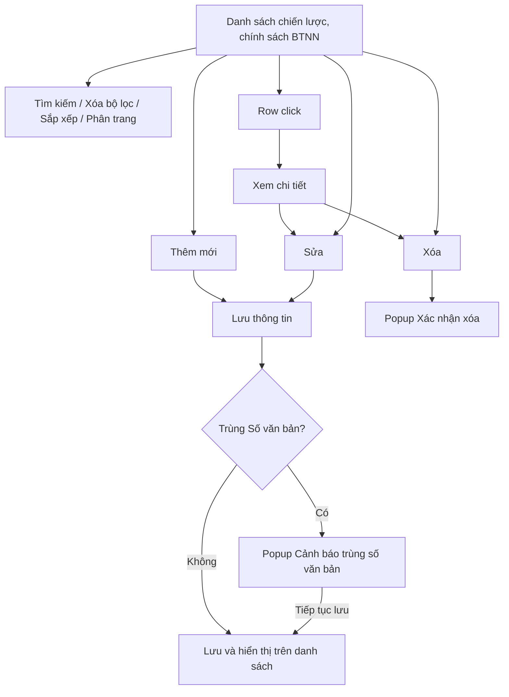
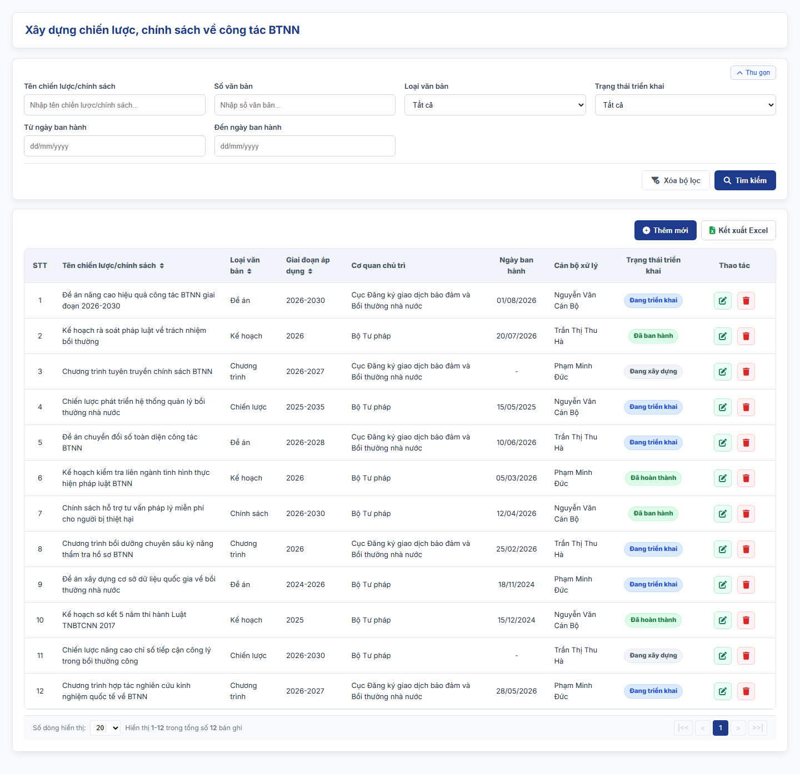
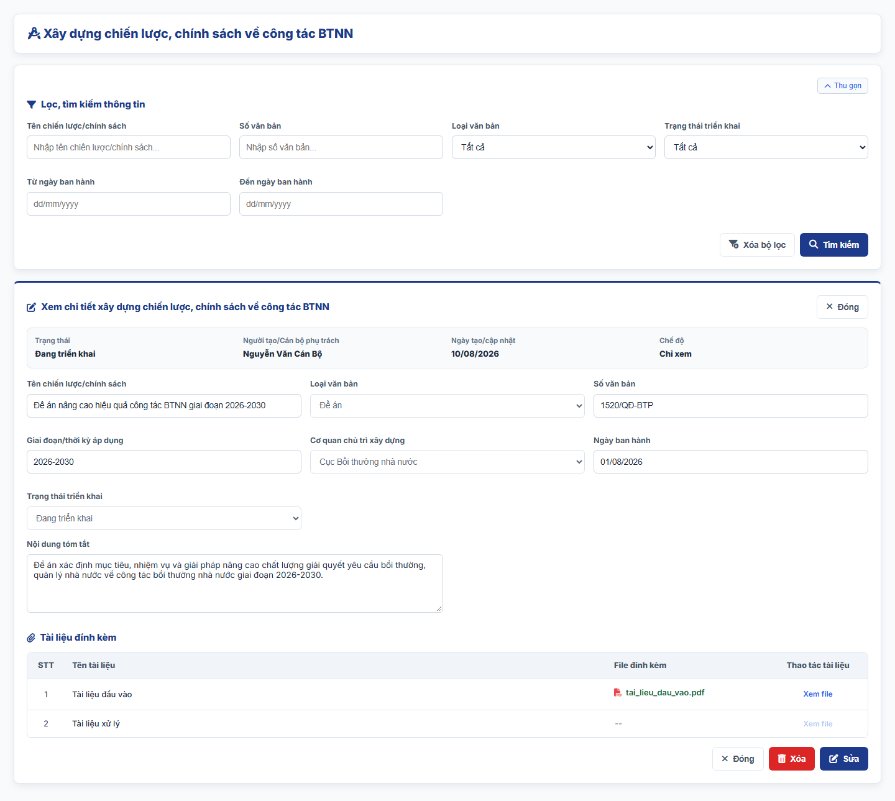
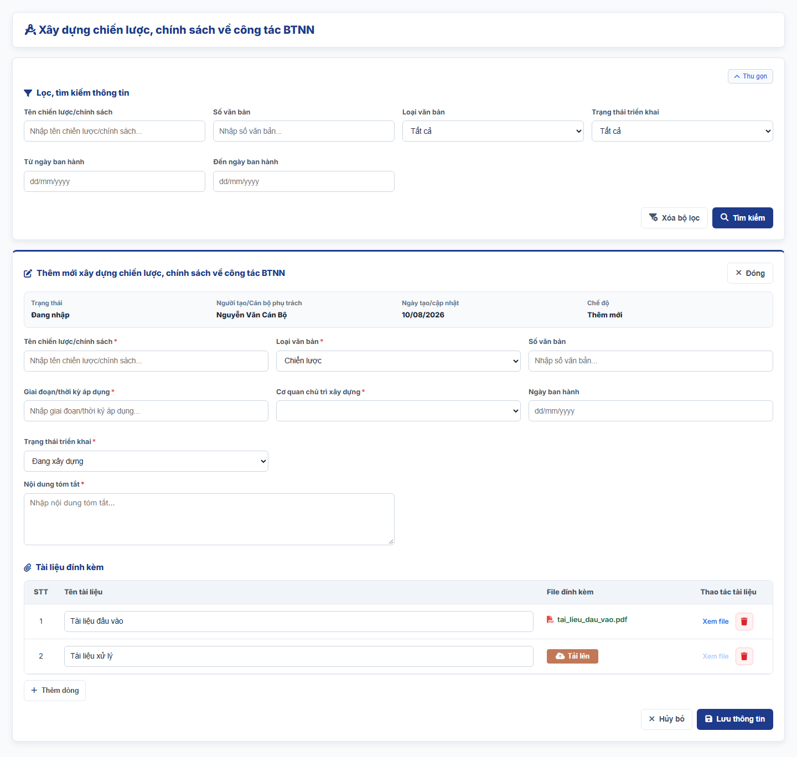
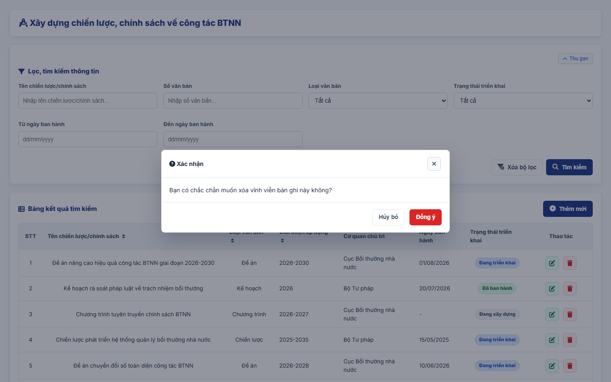
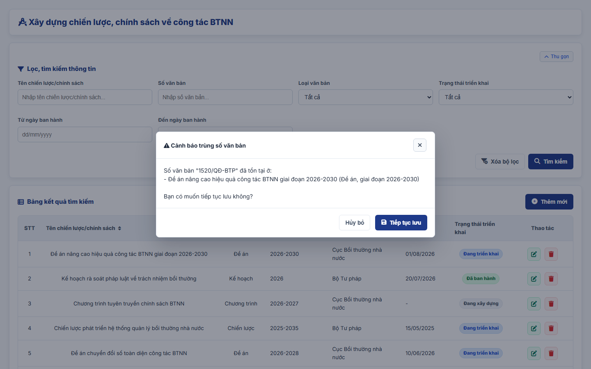

#### 4.3.3.14. UC461-462 - Xây dựng chiến lược, chính sách về công tác BTNN

##### 4.3.3.14.1. Mục đích

\- Cho phép cán bộ Bộ Tư pháp (Cục Bồi thường nhà nước) ghi nhận, quản lý và tra cứu thông tin các chiến lược, chính sách, kế hoạch, đề án về công tác bồi thường nhà nước (BTNN) đã hoặc đang xây dựng, phục vụ nhiệm vụ quản lý nhà nước theo khoản 1 Điều 73 Luật Trách nhiệm bồi thường của Nhà nước.

\- Nội dung chỉ phục vụ nội bộ cán bộ quản lý, không công khai ra Website khách hàng.

*a. Phân quyền*

\- Cán bộ Bộ Tư pháp: được tra cứu, xem chi tiết, thêm mới, sửa, xóa bản ghi.

*b. Điều kiện thực hiện*

\- Người dùng đã đăng nhập thành công vào Website quản trị.

\- Người dùng được phân quyền truy cập màn hình `Xây dựng chiến lược, chính sách về công tác BTNN`.

\- Cơ quan chủ trì xây dựng tham chiếu Danh mục các đơn vị trên hệ thống `[DM_DON_VI]`.

---

##### 4.3.3.14.2. Sơ đồ luồng nghiệp vụ theo giao diện

---

##### 4.3.3.14.3. MH01 - Màn hình Danh sách chiến lược, chính sách BTNN

###### 4.3.3.14.3.1. Màn hình

###### 4.3.3.14.3.2. Mô tả thông tin trên màn hình

| Trường thông tin | Kiểu dữ liệu | Bắt buộc | Mặc định | Mô tả |
| :--- | :--- | :--- | :--- | :--- |
| **I. Bộ lọc tìm kiếm** | - | - | - | Control UI: Khối thu gọn/mở rộng (Accordion). - Mặc định hiển thị dạng mở rộng. - Cho phép thu gọn/mở rộng khi click vào nút "Thu gọn"/"Mở rộng" ở góc phải khối; khi thu gọn, các giá trị lọc đã nhập được giữ nguyên. |
| Tên chiến lược/chính sách | String(255) | Không | Trống | Control UI: Text input. - Placeholder: "Nhập tên chiến lược/chính sách...". - Tìm gần đúng; không phân biệt hoa thường, có dấu/không dấu. |
| Số văn bản | String(50) | Không | Trống | Control UI: Text input. - Placeholder: "Nhập số văn bản...". - Tìm gần đúng; không phân biệt hoa thường, có dấu/không dấu. |
| Loại văn bản | Enum(String(50)) | Không | Tất cả | Control UI: Combobox. Gồm: + Tất cả + Chiến lược + Chính sách + Kế hoạch + Đề án + Chương trình |
| Trạng thái triển khai | Enum(String(50)) | Không | Tất cả | Control UI: Combobox. Gồm: + Tất cả + Đang xây dựng + Đã ban hành + Đang triển khai + Đã hoàn thành |
| Từ ngày ban hành | Date | Không | Trống | Control UI: Date input. - Placeholder: "dd/mm/yyyy". |
| Đến ngày ban hành | Date | Không | Trống | Control UI: Date input. - Placeholder: "dd/mm/yyyy". |
| **II. Bảng danh sách kết quả** | - | - | 20 bản ghi/trang | Control UI: Data grid. - Khi người dùng truy cập màn hình, hệ thống tự động tải Trang 1. - Sắp xếp mặc định: theo "Ngày tạo" giảm dần. - Trạng thái không có dữ liệu (Empty State): bảng hiển thị duy nhất 01 dòng căn giữa trên toàn bộ chiều rộng bảng (`colspan`), in nghiêng với nội dung theo MessageList dùng chung [MSG-INF-SYS-001]. |
| STT | Integer(10) | Không | Theo trang hiện tại | - Chỉ đọc. - Theo dữ liệu bản ghi. |
| Tên chiến lược/chính sách | String(255) | Không | Theo dữ liệu hệ thống | - Chỉ đọc. - Theo dữ liệu bản ghi. |
| Loại văn bản | Enum(String(50)) | Không | Theo dữ liệu hệ thống | - Chỉ đọc. - Theo dữ liệu bản ghi. |
| Giai đoạn áp dụng | String(100) | Không | Theo dữ liệu hệ thống | - Chỉ đọc. - Theo dữ liệu bản ghi. |
| Cơ quan chủ trì | String(255) | Không | Theo dữ liệu hệ thống | - Chỉ đọc. - Theo dữ liệu bản ghi. |
| Ngày ban hành | Date | Không | Theo dữ liệu hệ thống | - Chỉ đọc. - Định dạng `dd/mm/yyyy`. - Hiển thị `-` nếu chưa có ngày ban hành. |
| Trạng thái triển khai | Enum(String(50)) | Không | Theo dữ liệu hệ thống | Control UI: Badge. - Chỉ đọc. - Theo dữ liệu bản ghi. |
| Thao tác | - | - | - | Control UI: Icon + Sửa + Xóa - Cột cố định bên phải lưới khi cuộn ngang. |
| Phân trang | - | - | 20 bản ghi/trang | Phân trang, chuyển trang và cấu hình số dòng hiển thị theo quy tắc chung của hệ thống. |

###### 4.3.3.14.3.3. Chức năng trên màn hình

| STT | Tên chức năng | Định dạng | Mô tả |
| :--- | :--- | :--- | :--- |
| 1 | Tìm kiếm | Button | Khi người dùng click nút, hệ thống kiểm tra điều kiện dữ liệu và thực hiện tìm kiếm theo các trường hợp bên dưới: |
|  |  |  | **TH1 - Khoảng ngày không hợp lệ**: Nếu `Từ ngày ban hành` lớn hơn `Đến ngày ban hành`, vi phạm [BR-VAL-007], hệ thống hiển thị cảnh báo lỗi [MSG-ERR-VAL-007] và không thực hiện tìm kiếm. |
|  |  |  | **TH2 - Hợp lệ (Có dữ liệu phù hợp)**: Hệ thống hiển thị danh sách các bản ghi thỏa mãn đồng thời các tiêu chí đã nhập/chọn và đưa về Trang 1. |
|  |  |  | **TH3 - Không có dữ liệu trả về**: Bảng kết quả hiển thị duy nhất 01 dòng căn giữa (`colspan`), in nghiêng với nội dung [MSG-INF-SYS-001]; thanh phân trang hiển thị *"Hiển thị 0-0 trong tổng số 0 bản ghi"*, các nút điều hướng trang ở trạng thái khóa mờ. |
| 2 | Xóa bộ lọc | Button | Hệ thống xóa toàn bộ tiêu chí tìm kiếm đã nhập/chọn, thiết lập các ô lọc về giá trị mặc định. |
| 3 | Thêm mới | Button | Hệ thống mở [MH03 - Màn hình Thêm mới/Sửa chiến lược, chính sách BTNN](#433145-mh03---màn-hình-thêm-mớisửa-chiến-lược-chính-sách-btnn) ở chế độ Thêm mới với form thông tin để trống. |
| 4 | Sắp xếp cột | Header cột | Áp dụng trên các cột: + Tên chiến lược/chính sách + Loại văn bản + Giai đoạn áp dụng |
|  |  |  | **TH1 - Chọn lại cột đang sắp xếp**: Hệ thống đảo chiều sắp xếp tăng dần/giảm dần và cập nhật icon mũi tên trên tiêu đề cột. |
|  |  |  | **TH2 - Chọn cột khác**: Hệ thống sắp xếp danh sách theo cột được chọn. |
| 5 | Row click | Row click | Khi người dùng click vào bất kỳ vị trí nào trên dòng dữ liệu (trừ các nút thao tác), hệ thống mở [MH02 - Màn hình Chi tiết chiến lược, chính sách BTNN](#433144-mh02---màn-hình-chi-tiết-chiến-lược-chính-sách-btnn). |
| 6 | Sửa | Icon button | Hệ thống mở [MH03 - Màn hình Thêm mới/Sửa chiến lược, chính sách BTNN](#433145-mh03---màn-hình-thêm-mớisửa-chiến-lược-chính-sách-btnn) ở chế độ Sửa với dữ liệu hiện tại của bản ghi được điền sẵn. |
| 7 | Xóa | Icon button | Hệ thống mở [Popup Xác nhận xóa](#433146-popup-xác-nhận-xóa). |
| 8 | Phân trang & chuyển trang | Pagination | Phân trang, chuyển trang và cấu hình số dòng hiển thị theo quy tắc chung của hệ thống. |

---

##### 4.3.3.14.4. MH02 - Màn hình Chi tiết chiến lược, chính sách BTNN

###### 4.3.3.14.4.1. Màn hình

###### 4.3.3.14.4.2. Mô tả thông tin trên màn hình

| Trường thông tin | Kiểu dữ liệu | Bắt buộc | Mặc định | Mô tả |
| :--- | :--- | :--- | :--- | :--- |
| Tiêu đề màn hình | - | - | - | Control UI: Label Hiển thị "Xem chi tiết xây dựng chiến lược, chính sách về công tác BTNN". |
| **I. Thông tin chung** |  |  |  |  |
| Trạng thái | - | - | - | Control UI: Label Theo dữ liệu bản ghi (giá trị `Trạng thái triển khai`). |
| Người tạo/Cán bộ phụ trách | - | - | - | Control UI: Label Theo dữ liệu bản ghi. |
| Ngày tạo/cập nhật | - | - | - | Control UI: Label Theo dữ liệu bản ghi. |
| Chế độ | - | - | - | Control UI: Label Hiển thị "Chỉ xem". |
| **II. Thông tin chiến lược, chính sách** |  |  |  |  |
| Tên chiến lược/chính sách | - | - | - | Control UI: Label Theo dữ liệu bản ghi. |
| Loại văn bản | - | - | - | Control UI: Label Theo dữ liệu bản ghi. |
| Số văn bản | - | - | - | Control UI: Label Theo dữ liệu bản ghi. |
| Giai đoạn/thời kỳ áp dụng | - | - | - | Control UI: Label Theo dữ liệu bản ghi. |
| Cơ quan chủ trì xây dựng | - | - | - | Control UI: Label Theo dữ liệu bản ghi. |
| Ngày ban hành | - | - | - | Control UI: Label Theo dữ liệu bản ghi. |
| Trạng thái triển khai | - | - | - | Control UI: Label Theo dữ liệu bản ghi. |
| Nội dung tóm tắt | - | - | - | Control UI: Label Theo dữ liệu bản ghi. |
| **III. Tài liệu đính kèm** |  |  |  |  |
| Tài liệu đính kèm | - | - | - | Control UI: File link Theo dữ liệu bản ghi. |

###### 4.3.3.14.4.3. Chức năng trên màn hình

| STT | Tên chức năng | Định dạng | Mô tả |
| :--- | :--- | :--- | :--- |
| 1 | Xem file | Link | Khi click vào liên kết "Xem file" của tài liệu đính kèm, hệ thống mở nội dung file tại một tab trình duyệt mới. |
| 2 | Sửa | Button | Hệ thống mở [MH03 - Màn hình Thêm mới/Sửa chiến lược, chính sách BTNN](#433145-mh03---màn-hình-thêm-mớisửa-chiến-lược-chính-sách-btnn) ở chế độ Sửa với dữ liệu hiện tại của bản ghi được điền sẵn. |
| 3 | Xóa | Button | Hệ thống mở [Popup Xác nhận xóa](#433146-popup-xác-nhận-xóa); nếu người dùng chọn `Đồng ý`, hệ thống xóa bản ghi, đóng màn hình chi tiết và quay lại [MH01 - Màn hình Danh sách chiến lược, chính sách BTNN](#433143-mh01---màn-hình-danh-sách-chiến-lược-chính-sách-btnn). |
| 4 | Đóng | Button | Khi người dùng click nút "Đóng" ở góc phải tiêu đề hoặc ở chân màn hình, hệ thống đóng màn hình chi tiết và quay lại [MH01 - Màn hình Danh sách chiến lược, chính sách BTNN](#433143-mh01---màn-hình-danh-sách-chiến-lược-chính-sách-btnn). |

---

##### 4.3.3.14.5. MH03 - Màn hình Thêm mới/Sửa chiến lược, chính sách BTNN

###### 4.3.3.14.5.1. Màn hình

###### 4.3.3.14.5.2. Mô tả thông tin trên màn hình

| Trường thông tin | Kiểu dữ liệu | Bắt buộc | Mặc định | Mô tả |
| :--- | :--- | :--- | :--- | :--- |
| Tiêu đề màn hình | - | - | Theo ngữ cảnh | Control UI: Label Hiển thị "Thêm mới xây dựng chiến lược, chính sách về công tác BTNN" hoặc "Sửa xây dựng chiến lược, chính sách về công tác BTNN". |
| **I. Thông tin chung** |  |  |  |  |
| Trạng thái | - | - | Theo ngữ cảnh | Control UI: Label Thêm mới hiển thị "Đang nhập"; Sửa hiển thị theo dữ liệu bản ghi. |
| Người tạo/Cán bộ phụ trách | - | - | Theo tài khoản đăng nhập | Control UI: Label Theo dữ liệu bản ghi. |
| Ngày tạo/cập nhật | - | - | Theo dữ liệu hệ thống | Control UI: Label Định dạng `dd/mm/yyyy`. |
| Chế độ | - | - | Theo ngữ cảnh | Control UI: Label Hiển thị "Thêm mới" hoặc "Sửa". |
| **II. Thông tin chiến lược, chính sách** |  |  |  |  |
| Tên chiến lược/chính sách | String(255) | Có | Trống | Control UI: Text input. - Placeholder: "Nhập tên chiến lược/chính sách...". |
| Loại văn bản | Enum(String(50)) | Có | Chiến lược | Control UI: Combobox. Gồm: + Chiến lược + Chính sách + Kế hoạch + Đề án + Chương trình |
| Số văn bản | String(50) | Không | Trống | Control UI: Text input. - Placeholder: "Nhập số văn bản...". - Nhập khi văn bản đã được ban hành chính thức. |
| Giai đoạn/thời kỳ áp dụng | String(100) | Có | Trống | Control UI: Text input. - Placeholder: "Nhập giai đoạn/thời kỳ áp dụng...". |
| Cơ quan chủ trì xây dựng | Enum(String(255)) | Có | Trống | Control UI: Combobox. - Tham chiếu Danh mục các đơn vị trên hệ thống [DM_DON_VI]. |
| Ngày ban hành | Date | Không | Trống | Control UI: Date input. - Placeholder: "dd/mm/yyyy". - Không lớn hơn ngày hiện tại theo [BR-VAL-008]. |
| Trạng thái triển khai | Enum(String(50)) | Có | Đang xây dựng | Control UI: Combobox. Gồm: + Đang xây dựng + Đã ban hành + Đang triển khai + Đã hoàn thành |
| Nội dung tóm tắt | Text(2000) | Không | Trống | Control UI: Textarea. - Placeholder: "Nhập nội dung tóm tắt...". |
| **III. Tài liệu đính kèm** |  |  |  |  |
| Tài liệu đính kèm | List(File) | Không | Trống | Control UI: Bảng tài liệu đính kèm gồm các cột `STT`, `Tên tài liệu, văn bản`, `File đính kèm`, `Thao tác`; nút `Thêm tài liệu` dưới bảng. - Cột `Tên tài liệu, văn bản`: Text input. Placeholder: "Nhập tên tài liệu, văn bản". - Cột `File đính kèm`: khi dòng chưa có file hiển thị nút `Tải file`; khi đã có file hiển thị tên file. - Cột `Thao tác` gồm: + Xem file (khóa mờ khi dòng chưa có file) + Xóa - Áp dụng [BR-FILE-010]. |

###### 4.3.3.14.5.3. Chức năng trên màn hình

| STT | Tên chức năng | Định dạng | Mô tả |
| :--- | :--- | :--- | :--- |
| 1 | Lưu thông tin | Button | Khi người dùng click nút, hệ thống kiểm tra dữ liệu và xử lý theo các trường hợp bên dưới: |
|  |  |  | **TH1 - Bỏ trống trường bắt buộc**: Vi phạm [BR-VAL-001] (chưa nhập `Tên chiến lược/chính sách`, `Giai đoạn/thời kỳ áp dụng` hoặc chưa chọn `Loại văn bản`, `Cơ quan chủ trì xây dựng`, `Trạng thái triển khai`). Hệ thống viền đỏ các ô lỗi, hiển thị "Đây là trường bắt buộc" ngay dưới từng ô và focus vào ô lỗi đầu tiên. |
|  |  |  | **TH2 - Ngày ban hành không hợp lệ**: `Ngày ban hành` lớn hơn ngày hiện tại, vi phạm [BR-VAL-008]. Hệ thống hiển thị [MSG-ERR-VAL-008] ngay dưới ô và không cho phép lưu. |
|  |  |  | **TH3 - Trùng bản ghi**: Bản ghi được xác định bởi các thông tin `Tên chiến lược/chính sách`, `Loại văn bản`, `Giai đoạn/thời kỳ áp dụng`. Nếu các thông tin này trùng với một bản ghi khác đang tồn tại, hệ thống viền đỏ các ô tương ứng, hiển thị cảnh báo "Chiến lược/chính sách đã tồn tại trong hệ thống (trùng Tên chiến lược/chính sách, Loại văn bản và Giai đoạn/thời kỳ áp dụng)" dưới ô `Tên chiến lược/chính sách` và không cho phép lưu. - So sánh sau khi bỏ khoảng trắng thừa, không phân biệt hoa thường. - Ở chế độ Sửa, hệ thống bỏ qua chính bản ghi đang sửa. |
|  |  |  | **TH4 - Trùng Số văn bản**: Dữ liệu hợp lệ, không trùng đủ thông tin xác định nhưng `Số văn bản` trùng với một hoặc nhiều bản ghi khác (so sánh sau khi bỏ khoảng trắng thừa, không phân biệt hoa thường). Hệ thống không chặn lưu, mở [Popup Cảnh báo trùng số văn bản](#433147-popup-cảnh-báo-trùng-số-văn-bản) để người dùng quyết định: + Tiếp tục lưu: hệ thống lưu như trường hợp Hợp lệ. + Hủy bỏ: hệ thống đóng popup, giữ nguyên dữ liệu đang nhập để người dùng sửa. |
|  |  |  | **TH5 - Hợp lệ - Thêm mới**: Hệ thống lưu bản ghi, đóng màn hình, tải lại danh sách và hiển thị [MSG-SUC-SYS-003]. |
|  |  |  | **TH6 - Hợp lệ - Sửa**: Hệ thống cập nhật bản ghi, đóng màn hình, tải lại danh sách và hiển thị [MSG-SUC-SYS-002]. |
| 2 | Tải lên | Button | Hệ thống mở trình chọn file cho dòng tài liệu tương ứng; sau khi chọn, hiển thị tên file tại cột `File đính kèm`. |
| 3 | Xem file | Link | Hệ thống mở file của dòng tài liệu tại một tab trình duyệt mới. |
| 4 | Xóa | Icon button | Hệ thống xóa dòng tài liệu khỏi bảng ngay, không hiển thị popup xác nhận. |
| 5 | Thêm tài liệu | Button | Hệ thống thêm 01 dòng tài liệu trống vào cuối bảng tài liệu đính kèm. |
| 6 | Hủy bỏ | Button | Khi người dùng click nút "Hủy bỏ" ở chân màn hình hoặc nút "Đóng" ở góc phải tiêu đề, hệ thống đóng màn hình, không lưu dữ liệu và quay lại [MH01 - Màn hình Danh sách chiến lược, chính sách BTNN](#433143-mh01---màn-hình-danh-sách-chiến-lược-chính-sách-btnn). |

---

##### 4.3.3.14.6. Popup Xác nhận xóa

###### 4.3.3.14.6.1. Màn hình

###### 4.3.3.14.6.2. Mô tả thông tin trên màn hình

| Trường thông tin | Kiểu dữ liệu | Bắt buộc | Mặc định | Mô tả |
| :--- | :--- | :--- | :--- | :--- |
| Tiêu đề popup | - | - | - | Control UI: Label Hiển thị "Xác nhận". |
| Nội dung xác nhận | - | - | - | Control UI: Label Áp dụng message xác nhận [MSG-CFM-SYS-001]. |

###### 4.3.3.14.6.3. Chức năng trên màn hình

| STT | Tên chức năng | Định dạng | Mô tả |
| :--- | :--- | :--- | :--- |
| 1 | Đồng ý | Button | Hệ thống đóng popup và thực hiện xóa: + Xóa bản ghi: xóa vĩnh viễn bản ghi khỏi hệ thống, tải lại danh sách và hiển thị [MSG-SUC-SYS-002]. + Xóa tài liệu đính kèm: xóa dòng tài liệu khỏi bảng. |
| 2 | Hủy bỏ | Button | Khi người dùng click nút "Hủy bỏ" hoặc biểu tượng đóng ở góc phải tiêu đề popup, hệ thống đóng popup và không thực hiện thao tác. |

---

##### 4.3.3.14.7. Popup Cảnh báo trùng số văn bản

###### 4.3.3.14.7.1. Màn hình

###### 4.3.3.14.7.2. Mô tả thông tin trên màn hình

| Trường thông tin | Kiểu dữ liệu | Bắt buộc | Mặc định | Mô tả |
| :--- | :--- | :--- | :--- | :--- |
| Tiêu đề popup | - | - | - | Control UI: Label Hiển thị "Cảnh báo trùng số văn bản". |
| Nội dung cảnh báo | - | - | - | Control UI: Label Hiển thị "Số văn bản "[Số văn bản đang nhập]" đã tồn tại ở:", tiếp theo mỗi bản ghi trùng hiển thị 01 dòng dạng "- [Tên chiến lược/chính sách] ([Loại văn bản], giai đoạn [Giai đoạn/thời kỳ áp dụng])", cuối cùng là câu hỏi "Bạn có muốn tiếp tục lưu không?". |

###### 4.3.3.14.7.3. Chức năng trên màn hình

| STT | Tên chức năng | Định dạng | Mô tả |
| :--- | :--- | :--- | :--- |
| 1 | Tiếp tục lưu | Button | Hệ thống đóng popup cảnh báo và lưu bản ghi theo trường hợp Hợp lệ - Thêm mới hoặc Hợp lệ - Sửa của chức năng `Lưu thông tin` tại [MH03 - Màn hình Thêm mới/Sửa chiến lược, chính sách BTNN](#433145-mh03---màn-hình-thêm-mớisửa-chiến-lược-chính-sách-btnn). |
| 2 | Hủy bỏ | Button | Khi người dùng click nút "Hủy bỏ" hoặc biểu tượng đóng ở góc phải tiêu đề popup, hệ thống đóng popup cảnh báo, không lưu và giữ nguyên dữ liệu đang nhập tại [MH03 - Màn hình Thêm mới/Sửa chiến lược, chính sách BTNN](#433145-mh03---màn-hình-thêm-mớisửa-chiến-lược-chính-sách-btnn). |
