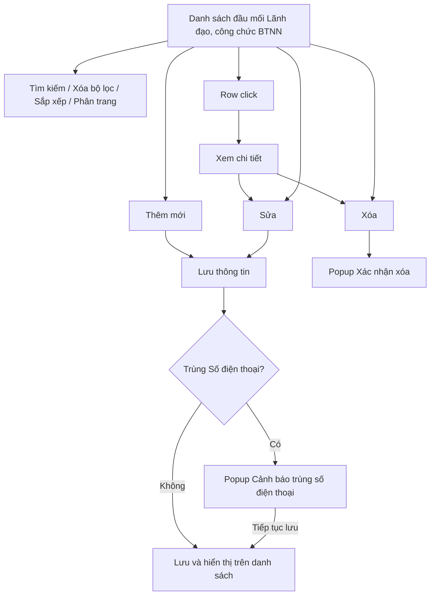
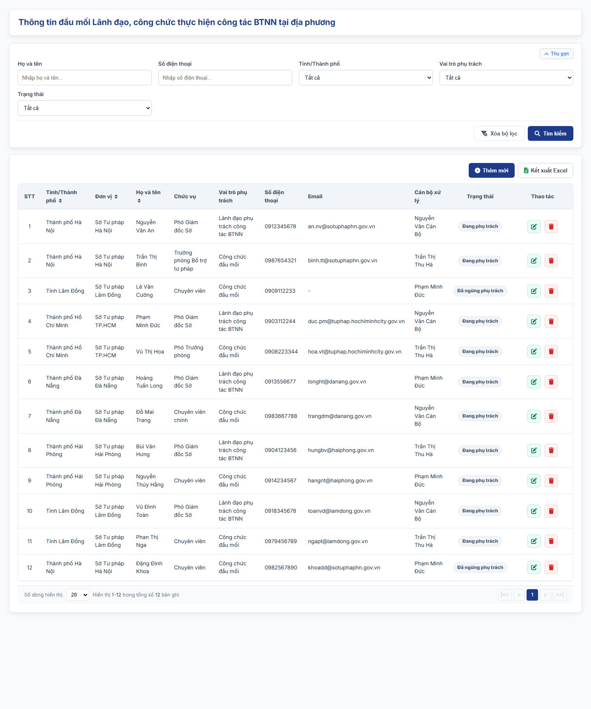
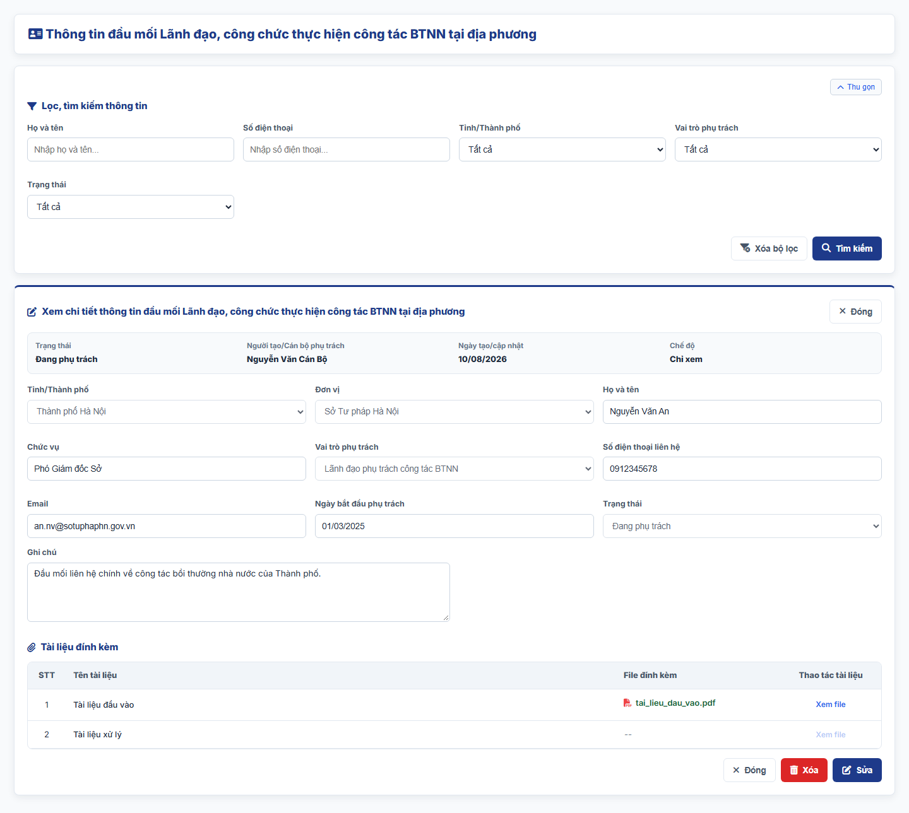
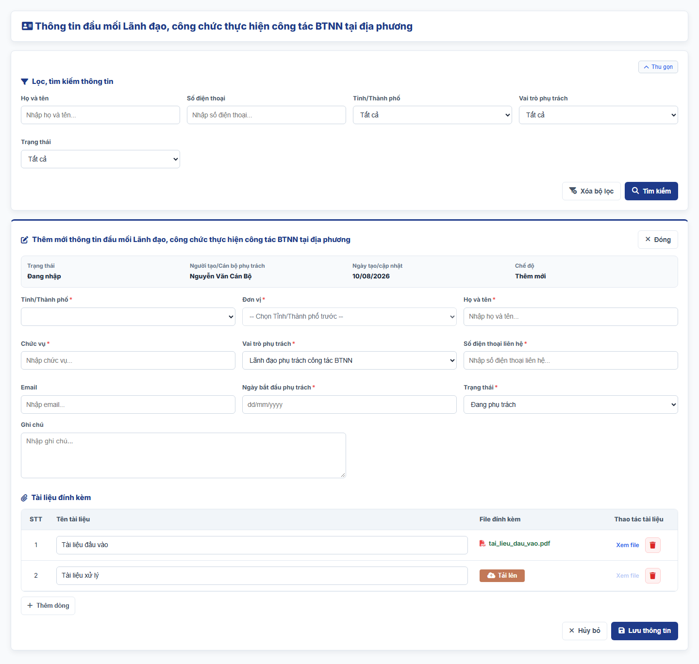
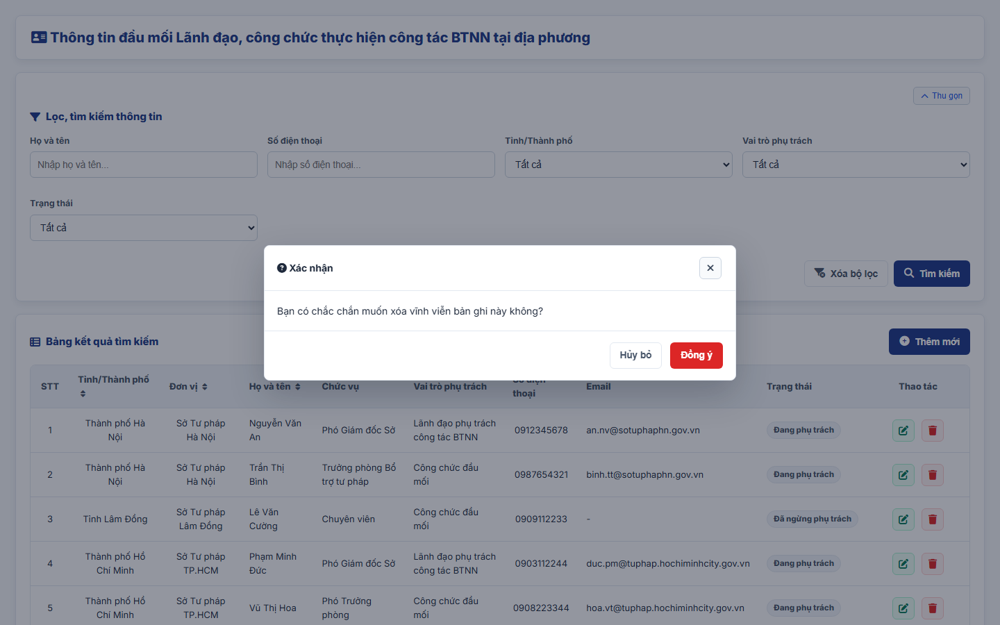
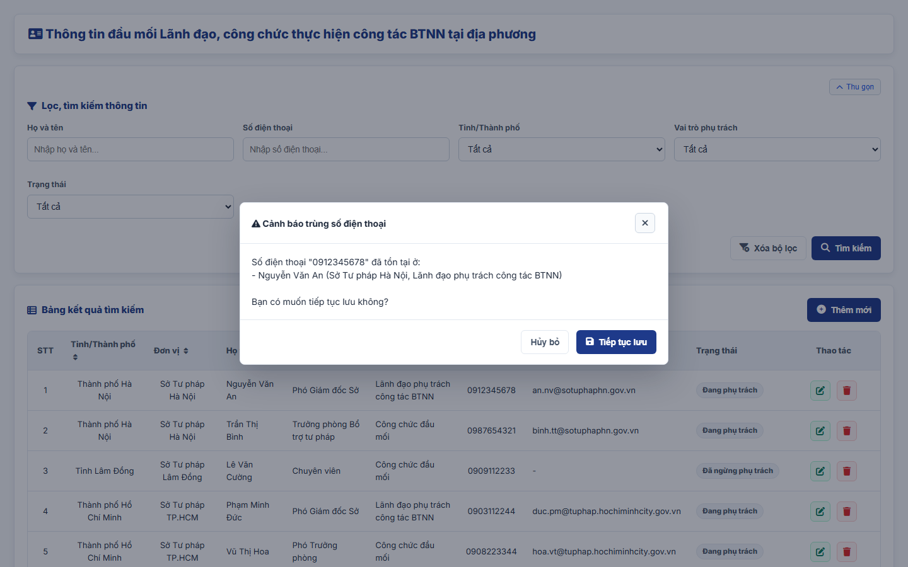

#### 4.3.3.19. UC501-502 - Quản lý thông tin đầu mối Lãnh đạo, công chức thực hiện công tác BTNN tại địa phương

##### 4.3.3.19.1. Mục đích

\- Cho phép cán bộ nghiệp vụ BTNN (Bộ Tư pháp) ghi nhận, quản lý và tra cứu danh sách đầu mối Lãnh đạo và công chức trực tiếp thực hiện công tác bồi thường nhà nước (BTNN) tại các Sở Tư pháp địa phương, phục vụ liên hệ, phối hợp công tác và theo dõi công tác BTNN theo Điều 8 đến Điều 15 Thông tư 08/2019/TT-BTP.

\- Mỗi Tỉnh/Thành phố có thể có nhiều đầu mối (01 Lãnh đạo phụ trách và một hoặc nhiều Công chức đầu mối).

\- Nội dung chỉ phục vụ nội bộ cán bộ quản lý, không công khai ra Website khách hàng.

*a. Phân quyền*

\- Cán bộ nghiệp vụ BTNN (Bộ Tư pháp): được tra cứu, xem chi tiết, thêm mới, sửa, xóa bản ghi.

*b. Điều kiện thực hiện*

\- Người dùng đã đăng nhập thành công vào Website quản trị.

\- Người dùng được phân quyền truy cập màn hình `Quản lý thông tin đầu mối Lãnh đạo, công chức thực hiện công tác BTNN tại địa phương`.

\- Phạm vi dữ liệu toàn quốc: cán bộ Bộ Tư pháp quản lý đầu mối của tất cả Tỉnh/Thành phố; Tỉnh/Thành phố và Đơn vị không phụ thuộc đơn vị của người dùng đăng nhập.

\- Tỉnh/Thành phố tham chiếu Danh mục địa bàn (cấp Tỉnh/Thành phố). Đơn vị tham chiếu Danh mục các đơn vị trên hệ thống `[DM_DON_VI]` (màn hình Quản lý cơ cấu tổ chức), lọc theo Tỉnh/Thành phố đã chọn.

---

##### 4.3.3.19.2. Sơ đồ luồng nghiệp vụ theo giao diện

---

##### 4.3.3.19.3. MH01 - Màn hình Danh sách đầu mối Lãnh đạo, công chức BTNN

###### 4.3.3.19.3.1. Màn hình

###### 4.3.3.19.3.2. Mô tả thông tin trên màn hình

| Trường thông tin | Kiểu dữ liệu | Bắt buộc | Mặc định | Mô tả |
| :--- | :--- | :--- | :--- | :--- |
| **I. Bộ lọc tìm kiếm** | - | - | - | Control UI: Khối thu gọn/mở rộng (Accordion). - Mặc định hiển thị dạng mở rộng. - Cho phép thu gọn/mở rộng khi click vào nút "Thu gọn"/"Mở rộng" ở góc phải khối; khi thu gọn, các giá trị lọc đã nhập được giữ nguyên. |
| Họ và tên | String(255) | Không | Trống | Control UI: Text input. - Placeholder: "Nhập họ và tên...". - Tìm gần đúng; không phân biệt hoa thường, có dấu/không dấu. |
| Số điện thoại | String(50) | Không | Trống | Control UI: Text input. - Placeholder: "Nhập số điện thoại...". - Tìm gần đúng; không phân biệt hoa thường, có dấu/không dấu. |
| Tỉnh/Thành phố | Enum(String(100)) | Không | Tất cả | Control UI: Combobox. - Tham chiếu Danh mục địa bàn (cấp Tỉnh/Thành phố). |
| Vai trò phụ trách | Enum(String(50)) | Không | Tất cả | Control UI: Combobox. Gồm: + Tất cả + Lãnh đạo phụ trách công tác BTNN + Công chức đầu mối |
| Trạng thái | Enum(String(50)) | Không | Tất cả | Control UI: Combobox. Gồm: + Tất cả + Đang phụ trách + Đã ngừng phụ trách |
| **II. Bảng danh sách kết quả** | - | - | 20 bản ghi/trang | Control UI: Data grid. - Khi người dùng truy cập màn hình, hệ thống tự động tải Trang 1. - Sắp xếp mặc định: theo "Ngày tạo" giảm dần. - Trạng thái không có dữ liệu (Empty State): bảng hiển thị duy nhất 01 dòng căn giữa trên toàn bộ chiều rộng bảng (`colspan`), in nghiêng với nội dung theo MessageList dùng chung [MSG-INF-SYS-001]. |
| STT | Integer(10) | Không | Theo trang hiện tại | - Chỉ đọc. - Theo dữ liệu bản ghi. |
| Tỉnh/Thành phố | Enum(String(100)) | Không | Theo dữ liệu hệ thống | - Chỉ đọc. - Theo dữ liệu bản ghi. |
| Đơn vị | String(255) | Không | Theo dữ liệu hệ thống | - Chỉ đọc. - Theo dữ liệu bản ghi. |
| Họ và tên | String(100) | Không | Theo dữ liệu hệ thống | - Chỉ đọc. - Theo dữ liệu bản ghi. |
| Chức vụ | String(100) | Không | Theo dữ liệu hệ thống | - Chỉ đọc. - Theo dữ liệu bản ghi. |
| Vai trò phụ trách | Enum(String(50)) | Không | Theo dữ liệu hệ thống | - Chỉ đọc. - Theo dữ liệu bản ghi. |
| Số điện thoại | String(20) | Không | Theo dữ liệu hệ thống | - Chỉ đọc. - Theo dữ liệu bản ghi. |
| Email | String(255) | Không | Theo dữ liệu hệ thống | - Chỉ đọc. - Theo dữ liệu bản ghi. - Hiển thị `-` nếu chưa nhập. |
| Trạng thái | Enum(String(50)) | Không | Theo dữ liệu hệ thống | Control UI: Badge. - Chỉ đọc. - Theo dữ liệu bản ghi. |
| Thao tác | - | - | - | Control UI: Icon + Sửa + Xóa - Cột cố định bên phải lưới khi cuộn ngang. |
| Phân trang | - | - | 20 bản ghi/trang | Phân trang, chuyển trang và cấu hình số dòng hiển thị theo quy tắc chung của hệ thống. |

###### 4.3.3.19.3.3. Chức năng trên màn hình

| STT | Tên chức năng | Định dạng | Mô tả |
| :--- | :--- | :--- | :--- |
| 1 | Tìm kiếm | Button | Khi người dùng click nút, hệ thống kiểm tra điều kiện dữ liệu và thực hiện tìm kiếm theo các trường hợp bên dưới: |
|  |  |  | **TH1 - Hợp lệ (Có dữ liệu phù hợp)**: Hệ thống hiển thị danh sách các bản ghi thỏa mãn đồng thời các tiêu chí đã nhập/chọn và đưa về Trang 1. |
|  |  |  | **TH2 - Không có dữ liệu trả về**: Bảng kết quả hiển thị duy nhất 01 dòng căn giữa (`colspan`), in nghiêng với nội dung [MSG-INF-SYS-001]; thanh phân trang hiển thị *"Hiển thị 0-0 trong tổng số 0 bản ghi"*, các nút điều hướng trang ở trạng thái khóa mờ. |
| 2 | Xóa bộ lọc | Button | Hệ thống xóa toàn bộ tiêu chí tìm kiếm đã nhập/chọn, thiết lập các ô lọc về giá trị mặc định. |
| 3 | Thêm mới | Button | Hệ thống mở [MH03 - Màn hình Thêm mới/Sửa đầu mối Lãnh đạo, công chức BTNN](#433195-mh03---màn-hình-thêm-mớisửa-đầu-mối-lãnh-đạo-công-chức-btnn) ở chế độ Thêm mới với form thông tin để trống. |
| 4 | Sắp xếp cột | Header cột | Áp dụng trên các cột: + Tỉnh/Thành phố + Đơn vị + Họ và tên |
|  |  |  | **TH1 - Chọn lại cột đang sắp xếp**: Hệ thống đảo chiều sắp xếp tăng dần/giảm dần và cập nhật icon mũi tên trên tiêu đề cột. |
|  |  |  | **TH2 - Chọn cột khác**: Hệ thống sắp xếp danh sách theo cột được chọn. |
| 5 | Row click | Row click | Khi người dùng click vào bất kỳ vị trí nào trên dòng dữ liệu (trừ các nút thao tác), hệ thống mở [MH02 - Màn hình Chi tiết đầu mối Lãnh đạo, công chức BTNN](#433194-mh02---màn-hình-chi-tiết-đầu-mối-lãnh-đạo-công-chức-btnn). |
| 6 | Sửa | Icon button | Hệ thống mở [MH03 - Màn hình Thêm mới/Sửa đầu mối Lãnh đạo, công chức BTNN](#433195-mh03---màn-hình-thêm-mớisửa-đầu-mối-lãnh-đạo-công-chức-btnn) ở chế độ Sửa với dữ liệu hiện tại của bản ghi được điền sẵn. |
| 7 | Xóa | Icon button | Hệ thống mở [Popup Xác nhận xóa](#433196-popup-xác-nhận-xóa). |
| 8 | Phân trang & chuyển trang | Pagination | Phân trang, chuyển trang và cấu hình số dòng hiển thị theo quy tắc chung của hệ thống. |

---

##### 4.3.3.19.4. MH02 - Màn hình Chi tiết đầu mối Lãnh đạo, công chức BTNN

###### 4.3.3.19.4.1. Màn hình

###### 4.3.3.19.4.2. Mô tả thông tin trên màn hình

| Trường thông tin | Kiểu dữ liệu | Bắt buộc | Mặc định | Mô tả |
| :--- | :--- | :--- | :--- | :--- |
| Tiêu đề màn hình | - | - | - | Control UI: Label Hiển thị "Xem chi tiết thông tin đầu mối Lãnh đạo, công chức thực hiện công tác BTNN tại địa phương". |
| **I. Thông tin chung** |  |  |  |  |
| Trạng thái | - | - | - | Control UI: Label Theo dữ liệu bản ghi (giá trị `Trạng thái`). |
| Người tạo/Cán bộ phụ trách | - | - | - | Control UI: Label Theo dữ liệu bản ghi. |
| Ngày tạo/cập nhật | - | - | - | Control UI: Label Theo dữ liệu bản ghi. |
| Chế độ | - | - | - | Control UI: Label Hiển thị "Chỉ xem". |
| **II. Thông tin đầu mối** |  |  |  |  |
| Tỉnh/Thành phố | - | - | - | Control UI: Label Theo dữ liệu bản ghi. |
| Đơn vị | - | - | - | Control UI: Label Theo dữ liệu bản ghi. |
| Họ và tên | - | - | - | Control UI: Label Theo dữ liệu bản ghi. |
| Chức vụ | - | - | - | Control UI: Label Theo dữ liệu bản ghi. |
| Vai trò phụ trách | - | - | - | Control UI: Label Theo dữ liệu bản ghi. |
| Số điện thoại liên hệ | - | - | - | Control UI: Label Theo dữ liệu bản ghi. |
| Email | - | - | - | Control UI: Label Theo dữ liệu bản ghi. |
| Ngày bắt đầu phụ trách | - | - | - | Control UI: Label Theo dữ liệu bản ghi. |
| Trạng thái | - | - | - | Control UI: Label Theo dữ liệu bản ghi. |
| Ghi chú | - | - | - | Control UI: Label Theo dữ liệu bản ghi. |
| **III. Tài liệu đính kèm** |  |  |  |  |
| Tài liệu đính kèm | - | - | - | Control UI: File link Theo dữ liệu bản ghi. |

###### 4.3.3.19.4.3. Chức năng trên màn hình

| STT | Tên chức năng | Định dạng | Mô tả |
| :--- | :--- | :--- | :--- |
| 1 | Xem file | Link | Khi click vào liên kết "Xem file" của tài liệu đính kèm, hệ thống mở nội dung file tại một tab trình duyệt mới. |
| 2 | Sửa | Button | Hệ thống mở [MH03 - Màn hình Thêm mới/Sửa đầu mối Lãnh đạo, công chức BTNN](#433195-mh03---màn-hình-thêm-mớisửa-đầu-mối-lãnh-đạo-công-chức-btnn) ở chế độ Sửa với dữ liệu hiện tại của bản ghi được điền sẵn. |
| 3 | Xóa | Button | Hệ thống mở [Popup Xác nhận xóa](#433196-popup-xác-nhận-xóa); nếu người dùng chọn `Đồng ý`, hệ thống xóa bản ghi, đóng màn hình chi tiết và quay lại [MH01 - Màn hình Danh sách đầu mối Lãnh đạo, công chức BTNN](#433193-mh01---màn-hình-danh-sách-đầu-mối-lãnh-đạo-công-chức-btnn). |
| 4 | Đóng | Button | Khi người dùng click nút "Đóng" ở góc phải tiêu đề hoặc ở chân màn hình, hệ thống đóng màn hình chi tiết và quay lại [MH01 - Màn hình Danh sách đầu mối Lãnh đạo, công chức BTNN](#433193-mh01---màn-hình-danh-sách-đầu-mối-lãnh-đạo-công-chức-btnn). |

---

##### 4.3.3.19.5. MH03 - Màn hình Thêm mới/Sửa đầu mối Lãnh đạo, công chức BTNN

###### 4.3.3.19.5.1. Màn hình

###### 4.3.3.19.5.2. Mô tả thông tin trên màn hình

| Trường thông tin | Kiểu dữ liệu | Bắt buộc | Mặc định | Mô tả |
| :--- | :--- | :--- | :--- | :--- |
| Tiêu đề màn hình | - | - | Theo ngữ cảnh | Control UI: Label Hiển thị "Thêm mới thông tin đầu mối Lãnh đạo, công chức thực hiện công tác BTNN tại địa phương" hoặc "Sửa thông tin đầu mối Lãnh đạo, công chức thực hiện công tác BTNN tại địa phương". |
| **I. Thông tin chung** |  |  |  |  |
| Trạng thái | - | - | Theo ngữ cảnh | Control UI: Label Thêm mới hiển thị "Đang nhập"; Sửa hiển thị theo dữ liệu bản ghi. |
| Người tạo/Cán bộ phụ trách | - | - | Theo tài khoản đăng nhập | Control UI: Label Theo dữ liệu bản ghi. |
| Ngày tạo/cập nhật | - | - | Theo dữ liệu hệ thống | Control UI: Label Định dạng `dd/mm/yyyy`. |
| Chế độ | - | - | Theo ngữ cảnh | Control UI: Label Hiển thị "Thêm mới" hoặc "Sửa". |
| **II. Thông tin đầu mối** |  |  |  |  |
| Tỉnh/Thành phố | Enum(String(100)) | Có | Trống | Control UI: Combobox. - Tham chiếu Danh mục địa bàn (cấp Tỉnh/Thành phố), hiển thị toàn bộ Tỉnh/Thành phố trên toàn quốc. - Không lấy theo đơn vị của người dùng đăng nhập; cán bộ Bộ Tư pháp chọn Tỉnh/Thành phố nơi đầu mối công tác. |
| Đơn vị | Enum(String(255)) | Có | Sở Tư pháp của Tỉnh/Thành phố đã chọn | Control UI: Combobox. - Tham chiếu Danh mục các đơn vị trên hệ thống [DM_DON_VI], lọc theo quy tắc chọn Đơn vị bên dưới. - Khóa, hiển thị "-- Chọn Tỉnh/Thành phố trước --" khi chưa chọn `Tỉnh/Thành phố`. |
| Họ và tên | String(100) | Có | Trống | Control UI: Text input. - Placeholder: "Nhập họ và tên...". |
| Chức vụ | String(100) | Có | Trống | Control UI: Text input. - Placeholder: "Nhập chức vụ...". |
| Vai trò phụ trách | Enum(String(50)) | Có | Lãnh đạo phụ trách công tác BTNN | Control UI: Combobox. Gồm: + Lãnh đạo phụ trách công tác BTNN + Công chức đầu mối |
| Số điện thoại liên hệ | String(20) | Có | Trống | Control UI: Text input. - Placeholder: "Nhập số điện thoại liên hệ...". - Áp dụng rule số điện thoại [BR-VAL-003]. |
| Email | String(255) | Không | Trống | Control UI: Text input. - Placeholder: "Nhập email...". - Áp dụng rule Email [BR-VAL-002] khi có dữ liệu. |
| Ngày bắt đầu phụ trách | Date | Có | Trống | Control UI: Date input. - Placeholder: "dd/mm/yyyy". - Không lớn hơn ngày hiện tại theo [BR-VAL-008]. |
| Trạng thái | Enum(String(50)) | Có | Đang phụ trách | Control UI: Combobox. Gồm: + Đang phụ trách + Đã ngừng phụ trách |
| Ghi chú | Text(500) | Không | Trống | Control UI: Textarea. - Placeholder: "Nhập ghi chú...". |
| **III. Tài liệu đính kèm** |  |  |  |  |
| Tài liệu đính kèm | List(File) | Không | Trống | Control UI: Bảng tài liệu đính kèm gồm các cột `STT`, `Tên tài liệu, văn bản`, `File đính kèm`, `Thao tác`; nút `Thêm tài liệu` dưới bảng. - Cột `Tên tài liệu, văn bản`: Text input. Placeholder: "Nhập tên tài liệu, văn bản". - Cột `File đính kèm`: khi dòng chưa có file hiển thị nút `Tải file`; khi đã có file hiển thị tên file. - Cột `Thao tác` gồm: + Xem file (khóa mờ khi dòng chưa có file) + Xóa - Áp dụng [BR-FILE-010]. |

**Quy tắc chọn Đơn vị theo Tỉnh/Thành phố**

\- Danh sách `Đơn vị` chỉ gồm các đơn vị trong Cơ cấu tổ chức [DM_DON_VI] có `Tỉnh/Thành phố` trùng với `Tỉnh/Thành phố` đã chọn và `Cấp đơn vị` là `Cấp Tỉnh/Thành phố` hoặc `Đơn vị trực thuộc/Phòng ban` thuộc các đơn vị cấp tỉnh đó.

\- Khi người dùng chọn hoặc đổi `Tỉnh/Thành phố`, hệ thống tải lại danh sách `Đơn vị` và tự chọn Sở Tư pháp của Tỉnh/Thành phố mới; người dùng được chọn lại đơn vị khác trong danh sách.

\- Khi người dùng xóa giá trị `Tỉnh/Thành phố`, hệ thống xóa giá trị `Đơn vị` và khóa ô `Đơn vị`.

\- Ở chế độ Sửa, hệ thống giữ nguyên `Đơn vị` đã lưu nếu đơn vị đó thuộc `Tỉnh/Thành phố` của bản ghi.

###### 4.3.3.19.5.3. Chức năng trên màn hình

| STT | Tên chức năng | Định dạng | Mô tả |
| :--- | :--- | :--- | :--- |
| 1 | Lưu thông tin | Button | Khi người dùng click nút, hệ thống kiểm tra dữ liệu và xử lý theo các trường hợp bên dưới: |
|  |  |  | **TH1 - Bỏ trống trường bắt buộc**: Vi phạm [BR-VAL-001] (chưa nhập/chọn các trường có dấu `*`). Hệ thống viền đỏ các ô lỗi, hiển thị "Đây là trường bắt buộc" ngay dưới từng ô và focus vào ô lỗi đầu tiên. |
|  |  |  | **TH2 - Dữ liệu không đúng định dạng**: `Số điện thoại liên hệ` sai định dạng vi phạm [BR-VAL-003], hiển thị [MSG-ERR-VAL-003]; `Email` có dữ liệu nhưng sai định dạng vi phạm [BR-VAL-002], hiển thị [MSG-ERR-VAL-002]; `Ngày bắt đầu phụ trách` lớn hơn ngày hiện tại vi phạm [BR-VAL-008], hiển thị [MSG-ERR-VAL-008]. Hệ thống không cho phép lưu. |
|  |  |  | **TH3 - Trùng bản ghi**: Bản ghi được xác định bởi các thông tin `Họ và tên`, `Đơn vị`, `Vai trò phụ trách`. Nếu các thông tin này trùng với một bản ghi khác đang tồn tại, hệ thống viền đỏ các ô tương ứng, hiển thị cảnh báo "Đầu mối đã tồn tại trong hệ thống (trùng Họ và tên, Đơn vị và Vai trò phụ trách)" dưới ô `Họ và tên` và không cho phép lưu. - So sánh sau khi bỏ khoảng trắng thừa, không phân biệt hoa thường. - Ở chế độ Sửa, hệ thống bỏ qua chính bản ghi đang sửa. |
|  |  |  | **TH4 - Trùng Số điện thoại liên hệ**: Dữ liệu hợp lệ, không trùng đủ thông tin xác định nhưng `Số điện thoại liên hệ` trùng với một hoặc nhiều bản ghi khác (so sánh sau khi bỏ khoảng trắng thừa, không phân biệt hoa thường). Hệ thống không chặn lưu, mở [Popup Cảnh báo trùng số điện thoại](#433197-popup-cảnh-báo-trùng-số-điện-thoại) để người dùng quyết định: + Tiếp tục lưu: hệ thống lưu như trường hợp Hợp lệ. + Hủy bỏ: hệ thống đóng popup, giữ nguyên dữ liệu đang nhập để người dùng sửa. |
|  |  |  | **TH5 - Hợp lệ - Thêm mới**: Hệ thống lưu bản ghi, đóng màn hình, tải lại danh sách và hiển thị [MSG-SUC-SYS-003]. |
|  |  |  | **TH6 - Hợp lệ - Sửa**: Hệ thống cập nhật bản ghi, đóng màn hình, tải lại danh sách và hiển thị [MSG-SUC-SYS-002]. |
| 2 | Tải lên | Button | Hệ thống mở trình chọn file cho dòng tài liệu tương ứng; sau khi chọn, hiển thị tên file tại cột `File đính kèm`. |
| 3 | Xem file | Link | Hệ thống mở file của dòng tài liệu tại một tab trình duyệt mới. |
| 4 | Xóa | Icon button | Hệ thống xóa dòng tài liệu khỏi bảng ngay, không hiển thị popup xác nhận. |
| 5 | Thêm tài liệu | Button | Hệ thống thêm 01 dòng tài liệu trống vào cuối bảng tài liệu đính kèm. |
| 6 | Hủy bỏ | Button | Khi người dùng click nút "Hủy bỏ" ở chân màn hình hoặc nút "Đóng" ở góc phải tiêu đề, hệ thống đóng màn hình, không lưu dữ liệu và quay lại [MH01 - Màn hình Danh sách đầu mối Lãnh đạo, công chức BTNN](#433193-mh01---màn-hình-danh-sách-đầu-mối-lãnh-đạo-công-chức-btnn). |

---

##### 4.3.3.19.6. Popup Xác nhận xóa

###### 4.3.3.19.6.1. Màn hình

###### 4.3.3.19.6.2. Mô tả thông tin trên màn hình

| Trường thông tin | Kiểu dữ liệu | Bắt buộc | Mặc định | Mô tả |
| :--- | :--- | :--- | :--- | :--- |
| Tiêu đề popup | - | - | - | Control UI: Label Hiển thị "Xác nhận". |
| Nội dung xác nhận | - | - | - | Control UI: Label Áp dụng message xác nhận [MSG-CFM-SYS-001]. |

###### 4.3.3.19.6.3. Chức năng trên màn hình

| STT | Tên chức năng | Định dạng | Mô tả |
| :--- | :--- | :--- | :--- |
| 1 | Đồng ý | Button | Hệ thống đóng popup và thực hiện xóa: + Xóa bản ghi: xóa vĩnh viễn bản ghi khỏi hệ thống, tải lại danh sách và hiển thị [MSG-SUC-SYS-002]. + Xóa tài liệu đính kèm: xóa dòng tài liệu khỏi bảng. |
| 2 | Hủy bỏ | Button | Khi người dùng click nút "Hủy bỏ" hoặc biểu tượng đóng ở góc phải tiêu đề popup, hệ thống đóng popup và không thực hiện thao tác. |

---

##### 4.3.3.19.7. Popup Cảnh báo trùng số điện thoại

###### 4.3.3.19.7.1. Màn hình

###### 4.3.3.19.7.2. Mô tả thông tin trên màn hình

| Trường thông tin | Kiểu dữ liệu | Bắt buộc | Mặc định | Mô tả |
| :--- | :--- | :--- | :--- | :--- |
| Tiêu đề popup | - | - | - | Control UI: Label Hiển thị "Cảnh báo trùng số điện thoại". |
| Nội dung cảnh báo | - | - | - | Control UI: Label Hiển thị "Số điện thoại "[Số điện thoại đang nhập]" đã tồn tại ở:", tiếp theo mỗi bản ghi trùng hiển thị 01 dòng dạng "- [Họ và tên] ([Đơn vị], [Vai trò phụ trách])", cuối cùng là câu hỏi "Bạn có muốn tiếp tục lưu không?". |

###### 4.3.3.19.7.3. Chức năng trên màn hình

| STT | Tên chức năng | Định dạng | Mô tả |
| :--- | :--- | :--- | :--- |
| 1 | Tiếp tục lưu | Button | Hệ thống đóng popup cảnh báo và lưu bản ghi theo trường hợp Hợp lệ - Thêm mới hoặc Hợp lệ - Sửa của chức năng `Lưu thông tin` tại [MH03 - Màn hình Thêm mới/Sửa đầu mối Lãnh đạo, công chức BTNN](#433195-mh03---màn-hình-thêm-mớisửa-đầu-mối-lãnh-đạo-công-chức-btnn). |
| 2 | Hủy bỏ | Button | Khi người dùng click nút "Hủy bỏ" hoặc biểu tượng đóng ở góc phải tiêu đề popup, hệ thống đóng popup cảnh báo, không lưu và giữ nguyên dữ liệu đang nhập tại [MH03 - Màn hình Thêm mới/Sửa đầu mối Lãnh đạo, công chức BTNN](#433195-mh03---màn-hình-thêm-mớisửa-đầu-mối-lãnh-đạo-công-chức-btnn). |
