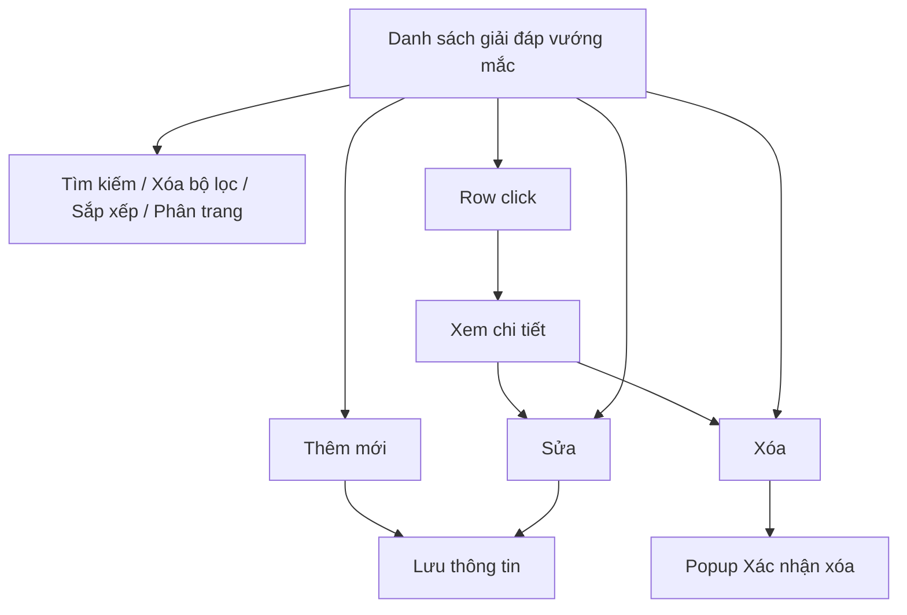
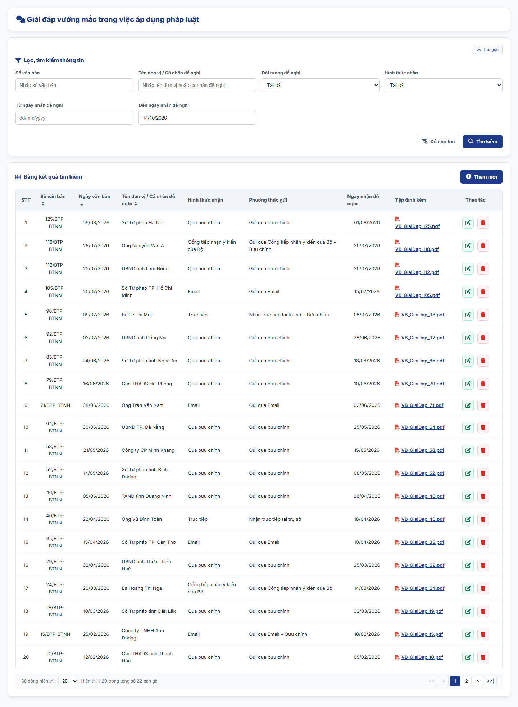
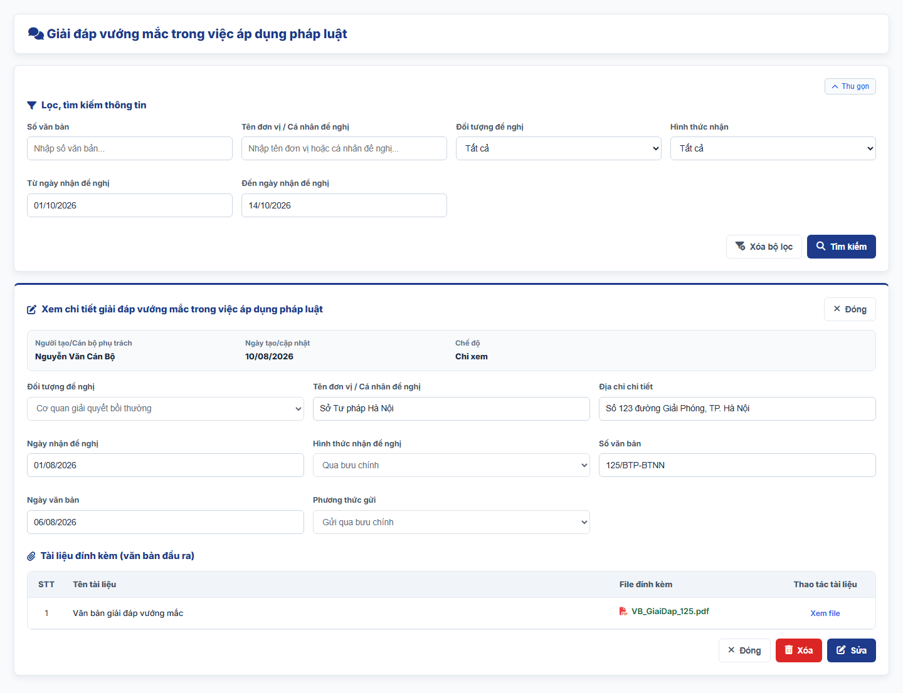
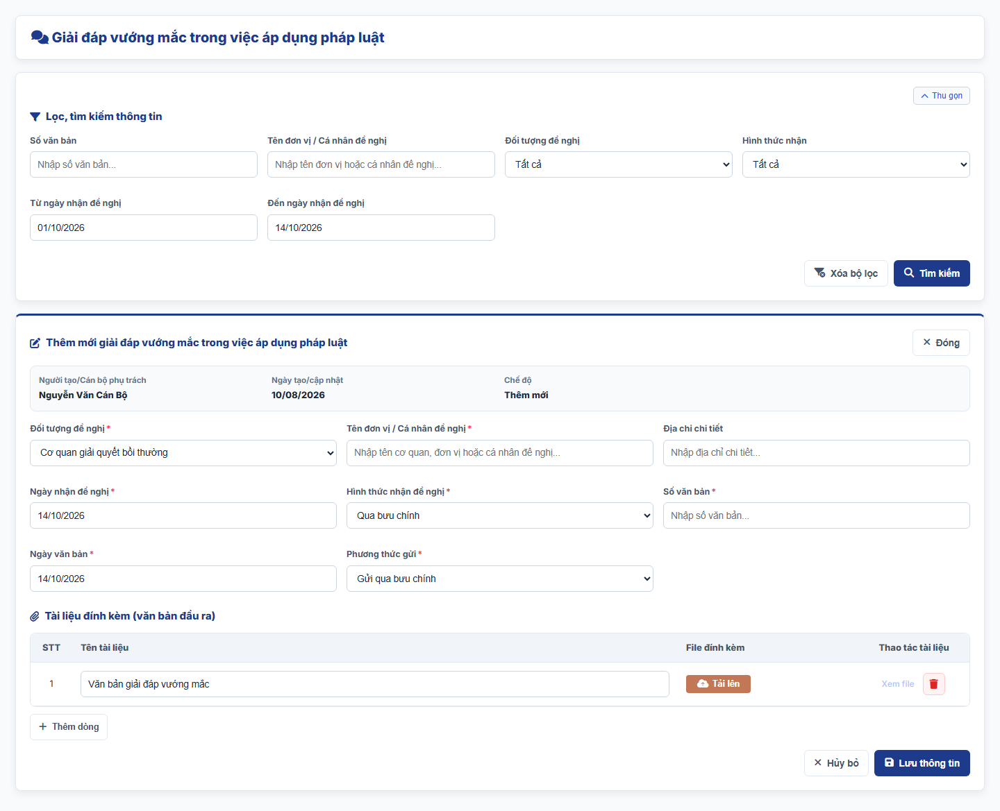
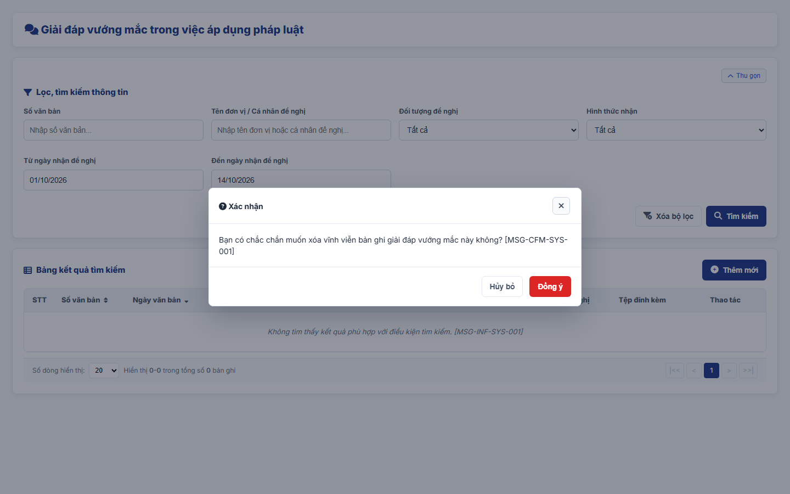

#### 4.3.3.18. UC469-470 - Giải đáp vướng mắc trong việc áp dụng pháp luật về trách nhiệm bồi thường của Nhà nước

##### 4.3.3.18.1. Mục đích

\- Cho phép cán bộ Bộ Tư pháp (Cục Bồi thường nhà nước) ghi nhận, quản lý và tra cứu thông tin các đề nghị giải đáp vướng mắc trong việc áp dụng pháp luật về trách nhiệm bồi thường của Nhà nước và kết quả giải đáp bằng văn bản đầu ra, theo Điều 3 đến Điều 7 Thông tư 08/2019/TT-BTP và khoản 3 Điều 44 dự thảo Nghị định quy định chi tiết một số điều và biện pháp thi hành Luật Trách nhiệm bồi thường của Nhà nước.

\- Toàn bộ nội dung vướng mắc, nội dung trả lời và căn cứ pháp lý được thể hiện trong tệp văn bản giải đáp đính kèm.

\- Nội dung chỉ phục vụ nội bộ cán bộ quản lý, không công khai ra Website khách hàng.

*a. Phân quyền*

\- Cán bộ Bộ Tư pháp: được tra cứu, xem chi tiết, thêm mới, sửa, xóa bản ghi.

*b. Điều kiện thực hiện*

\- Người dùng đã đăng nhập thành công vào Website quản trị.

\- Người dùng được phân quyền truy cập màn hình `Giải đáp vướng mắc trong việc áp dụng pháp luật về TNBTCNN`.

---

##### 4.3.3.18.2. Sơ đồ luồng nghiệp vụ theo giao diện

---

##### 4.3.3.18.3. MH01 - Màn hình Danh sách giải đáp vướng mắc

###### 4.3.3.18.3.1. Màn hình

###### 4.3.3.18.3.2. Mô tả thông tin trên màn hình

| Trường thông tin | Kiểu dữ liệu | Bắt buộc | Mặc định | Mô tả |
| :--- | :--- | :--- | :--- | :--- |
| **I. Bộ lọc tìm kiếm** | - | - | - | Control UI: Khối thu gọn/mở rộng (Accordion). - Mặc định hiển thị dạng mở rộng. - Cho phép thu gọn/mở rộng khi click vào nút "Thu gọn"/"Mở rộng" ở góc phải khối; khi thu gọn, các giá trị lọc đã nhập được giữ nguyên. |
| Số văn bản | String(50) | Không | Trống | Control UI: Text input. - Placeholder: "Nhập số văn bản...". - Tìm gần đúng; không phân biệt hoa thường, có dấu/không dấu. |
| Tên đơn vị / Cá nhân đề nghị | String(255) | Không | Trống | Control UI: Text input. - Placeholder: "Nhập tên đơn vị hoặc cá nhân đề nghị...". - Tìm gần đúng; không phân biệt hoa thường, có dấu/không dấu. |
| Đối tượng đề nghị | Enum(String(50)) | Không | Tất cả | Control UI: Combobox. Gồm: + Tất cả + Cơ quan giải quyết bồi thường + Tổ chức/cá nhân khác |
| Hình thức nhận | Enum(String(50)) | Không | Tất cả | Control UI: Combobox. Gồm: + Tất cả + Qua bưu chính + Trực tiếp + Email + Cổng tiếp nhận ý kiến của Bộ |
| Từ ngày nhận đề nghị | Date | Không | Ngày đầu tháng hiện tại | Control UI: Date input. - Placeholder: "dd/mm/yyyy". |
| Đến ngày nhận đề nghị | Date | Không | Ngày hiện tại | Control UI: Date input. - Placeholder: "dd/mm/yyyy". |
| **II. Bảng danh sách kết quả** | - | - | 20 bản ghi/trang | Control UI: Data grid. - Khi người dùng truy cập màn hình, hệ thống tự động tải Trang 1. - Sắp xếp mặc định: theo "Ngày văn bản" giảm dần. - Trạng thái không có dữ liệu (Empty State): bảng hiển thị duy nhất 01 dòng căn giữa trên toàn bộ chiều rộng bảng (`colspan`), in nghiêng với nội dung theo MessageList dùng chung [MSG-INF-SYS-001]. |
| STT | Integer(10) | Không | Theo trang hiện tại | - Chỉ đọc. - Theo dữ liệu bản ghi. |
| Số văn bản | String(50) | Không | Theo dữ liệu hệ thống | - Chỉ đọc. - Theo dữ liệu bản ghi. |
| Ngày văn bản | Date | Không | Theo dữ liệu hệ thống | - Chỉ đọc. - Định dạng `dd/mm/yyyy`. |
| Tên đơn vị / Cá nhân đề nghị | String(255) | Không | Theo dữ liệu hệ thống | - Chỉ đọc. - Theo dữ liệu bản ghi. |
| Hình thức nhận | Enum(String(50)) | Không | Theo dữ liệu hệ thống | - Chỉ đọc. - Theo dữ liệu bản ghi. |
| Phương thức gửi | String(255) | Không | Theo dữ liệu hệ thống | - Chỉ đọc. - Theo dữ liệu bản ghi. |
| Ngày nhận đề nghị | Date | Không | Theo dữ liệu hệ thống | - Chỉ đọc. - Định dạng `dd/mm/yyyy`. |
| Tệp đính kèm | File | Không | Theo dữ liệu hệ thống | Control UI: File link. - Chỉ đọc. - Theo dữ liệu bản ghi; click tên tệp để xem file tại tab trình duyệt mới. |
| Thao tác | - | - | - | Control UI: Icon + Sửa + Xóa - Cột cố định bên phải lưới khi cuộn ngang. |
| Phân trang | - | - | 20 bản ghi/trang | Phân trang, chuyển trang và cấu hình số dòng hiển thị theo quy tắc chung của hệ thống. |

###### 4.3.3.18.3.3. Chức năng trên màn hình

| STT | Tên chức năng | Định dạng | Mô tả |
| :--- | :--- | :--- | :--- |
| 1 | Tìm kiếm | Button | Khi người dùng click nút, hệ thống kiểm tra điều kiện dữ liệu và thực hiện tìm kiếm theo các trường hợp bên dưới: |
|  |  |  | **TH1 - Khoảng ngày không hợp lệ**: Nếu `Từ ngày nhận đề nghị` lớn hơn `Đến ngày nhận đề nghị`, vi phạm [BR-VAL-007], hệ thống hiển thị cảnh báo lỗi [MSG-ERR-VAL-007] và không thực hiện tìm kiếm. |
|  |  |  | **TH2 - Hợp lệ (Có dữ liệu phù hợp)**: Hệ thống hiển thị danh sách các bản ghi thỏa mãn đồng thời các tiêu chí đã nhập/chọn và đưa về Trang 1. |
|  |  |  | **TH3 - Không có dữ liệu trả về**: Bảng kết quả hiển thị duy nhất 01 dòng căn giữa (`colspan`), in nghiêng với nội dung [MSG-INF-SYS-001]; thanh phân trang hiển thị *"Hiển thị 0-0 trong tổng số 0 bản ghi"*, các nút điều hướng trang ở trạng thái khóa mờ. |
| 2 | Xóa bộ lọc | Button | Hệ thống xóa toàn bộ tiêu chí tìm kiếm đã nhập/chọn, thiết lập các ô lọc về giá trị mặc định. |
| 3 | Thêm mới | Button | Hệ thống mở [MH03 - Màn hình Thêm mới/Sửa giải đáp vướng mắc](#433185-mh03---màn-hình-thêm-mớisửa-giải-đáp-vướng-mắc) ở chế độ Thêm mới với form thông tin để trống. |
| 4 | Sắp xếp cột | Header cột | Áp dụng trên các cột: + Số văn bản + Ngày văn bản + Tên đơn vị / Cá nhân đề nghị |
|  |  |  | **TH1 - Chọn lại cột đang sắp xếp**: Hệ thống đảo chiều sắp xếp tăng dần/giảm dần và cập nhật icon mũi tên trên tiêu đề cột. |
|  |  |  | **TH2 - Chọn cột khác**: Hệ thống sắp xếp danh sách theo cột được chọn. |
| 5 | Row click | Row click | Khi người dùng click vào bất kỳ vị trí nào trên dòng dữ liệu (trừ các nút thao tác), hệ thống mở [MH02 - Màn hình Chi tiết giải đáp vướng mắc](#433184-mh02---màn-hình-chi-tiết-giải-đáp-vướng-mắc). |
| 6 | Sửa | Icon button | Hệ thống mở [MH03 - Màn hình Thêm mới/Sửa giải đáp vướng mắc](#433185-mh03---màn-hình-thêm-mớisửa-giải-đáp-vướng-mắc) ở chế độ Sửa với dữ liệu hiện tại của bản ghi được điền sẵn. |
| 7 | Xóa | Icon button | Hệ thống mở [Popup Xác nhận xóa](#433186-popup-xác-nhận-xóa). |
| 8 | Phân trang & chuyển trang | Pagination | Phân trang, chuyển trang và cấu hình số dòng hiển thị theo quy tắc chung của hệ thống. |

---

##### 4.3.3.18.4. MH02 - Màn hình Chi tiết giải đáp vướng mắc

###### 4.3.3.18.4.1. Màn hình

###### 4.3.3.18.4.2. Mô tả thông tin trên màn hình

| Trường thông tin | Kiểu dữ liệu | Bắt buộc | Mặc định | Mô tả |
| :--- | :--- | :--- | :--- | :--- |
| Tiêu đề màn hình | - | - | - | Control UI: Label Hiển thị "Xem chi tiết giải đáp vướng mắc trong việc áp dụng pháp luật". |
| **I. Thông tin chung** |  |  |  |  |
| Người tạo/Cán bộ phụ trách | - | - | - | Control UI: Label Theo dữ liệu bản ghi. |
| Ngày tạo/cập nhật | - | - | - | Control UI: Label Theo dữ liệu bản ghi. |
| Chế độ | - | - | - | Control UI: Label Hiển thị "Chỉ xem". |
| **II. Thông tin đề nghị giải đáp** |  |  |  |  |
| Đối tượng đề nghị | - | - | - | Control UI: Label Theo dữ liệu bản ghi. |
| Tên đơn vị / Cá nhân đề nghị | - | - | - | Control UI: Label Theo dữ liệu bản ghi. |
| Địa chỉ chi tiết | - | - | - | Control UI: Label Theo dữ liệu bản ghi. |
| Ngày nhận đề nghị | - | - | - | Control UI: Label Theo dữ liệu bản ghi. |
| Hình thức nhận đề nghị | - | - | - | Control UI: Label Theo dữ liệu bản ghi. |
| Số văn bản | - | - | - | Control UI: Label Theo dữ liệu bản ghi. |
| Ngày văn bản | - | - | - | Control UI: Label Theo dữ liệu bản ghi. |
| Phương thức gửi | - | - | - | Control UI: Label Theo dữ liệu bản ghi. |
| **III. Tài liệu đính kèm (văn bản đầu ra)** |  |  |  |  |
| Tài liệu đính kèm (văn bản đầu ra) | - | - | - | Control UI: File link Theo dữ liệu bản ghi. |

###### 4.3.3.18.4.3. Chức năng trên màn hình

| STT | Tên chức năng | Định dạng | Mô tả |
| :--- | :--- | :--- | :--- |
| 1 | Xem file | Link | Khi click vào liên kết "Xem file" của tài liệu đính kèm, hệ thống mở nội dung file tại một tab trình duyệt mới. |
| 2 | Sửa | Button | Hệ thống mở [MH03 - Màn hình Thêm mới/Sửa giải đáp vướng mắc](#433185-mh03---màn-hình-thêm-mớisửa-giải-đáp-vướng-mắc) ở chế độ Sửa với dữ liệu hiện tại của bản ghi được điền sẵn. |
| 3 | Xóa | Button | Hệ thống mở [Popup Xác nhận xóa](#433186-popup-xác-nhận-xóa); nếu người dùng chọn `Đồng ý`, hệ thống xóa bản ghi, đóng màn hình chi tiết và quay lại [MH01 - Màn hình Danh sách giải đáp vướng mắc](#433183-mh01---màn-hình-danh-sách-giải-đáp-vướng-mắc). |
| 4 | Đóng | Button | Khi người dùng click nút "Đóng" ở góc phải tiêu đề hoặc ở chân màn hình, hệ thống đóng màn hình chi tiết và quay lại [MH01 - Màn hình Danh sách giải đáp vướng mắc](#433183-mh01---màn-hình-danh-sách-giải-đáp-vướng-mắc). |

---

##### 4.3.3.18.5. MH03 - Màn hình Thêm mới/Sửa giải đáp vướng mắc

###### 4.3.3.18.5.1. Màn hình

###### 4.3.3.18.5.2. Mô tả thông tin trên màn hình

| Trường thông tin | Kiểu dữ liệu | Bắt buộc | Mặc định | Mô tả |
| :--- | :--- | :--- | :--- | :--- |
| Tiêu đề màn hình | - | - | Theo ngữ cảnh | Control UI: Label Hiển thị "Thêm mới giải đáp vướng mắc trong việc áp dụng pháp luật" hoặc "Sửa giải đáp vướng mắc trong việc áp dụng pháp luật". |
| **I. Thông tin chung** |  |  |  |  |
| Người tạo/Cán bộ phụ trách | - | - | Theo tài khoản đăng nhập | Control UI: Label Theo dữ liệu bản ghi. |
| Ngày tạo/cập nhật | - | - | Theo dữ liệu hệ thống | Control UI: Label Định dạng `dd/mm/yyyy`. |
| Chế độ | - | - | Theo ngữ cảnh | Control UI: Label Hiển thị "Thêm mới" hoặc "Sửa". |
| **II. Thông tin đề nghị giải đáp** |  |  |  |  |
| Đối tượng đề nghị | Enum(String(50)) | Có | Cơ quan giải quyết bồi thường | Control UI: Combobox. Gồm: + Cơ quan giải quyết bồi thường + Tổ chức/cá nhân khác |
| Tên đơn vị / Cá nhân đề nghị | String(255) | Có | Trống | Control UI: Text input. - Placeholder: "Nhập tên cơ quan, đơn vị hoặc cá nhân đề nghị...". |
| Địa chỉ chi tiết | String(255) | Không | Trống | Control UI: Text input. - Placeholder: "Nhập địa chỉ chi tiết...". - Căn cứ để gửi văn bản giải đáp theo đường công văn qua bưu chính. |
| Ngày nhận đề nghị | Date | Có | Ngày hiện tại | Control UI: Date input. - Placeholder: "dd/mm/yyyy". - Không lớn hơn ngày hiện tại theo [BR-VAL-008]. |
| Hình thức nhận đề nghị | Enum(String(50)) | Có | Qua bưu chính | Control UI: Combobox. Gồm: + Qua bưu chính + Trực tiếp + Email + Cổng tiếp nhận ý kiến của Bộ |
| Số văn bản | String(50) | Có | Trống | Control UI: Text input. - Placeholder: "Nhập số văn bản...". |
| Ngày văn bản | Date | Có | Ngày hiện tại | Control UI: Date input. - Placeholder: "dd/mm/yyyy". - Không lớn hơn ngày hiện tại theo [BR-VAL-008]; không nhỏ hơn `Ngày nhận đề nghị`. |
| Phương thức gửi | Enum(String(255)) | Có | Theo Hình thức nhận đề nghị | Control UI: Combobox. - Hệ thống tự chọn theo `Hình thức nhận đề nghị`: + Qua bưu chính: Gửi qua bưu chính + Trực tiếp: Nhận trực tiếp tại trụ sở + Email: Gửi qua Email + Cổng tiếp nhận ý kiến của Bộ: Gửi qua Cổng tiếp nhận ý kiến của Bộ - Người dùng được chọn lại; khi `Địa chỉ chi tiết` có dữ liệu, cho phép chọn thêm `Gửi theo đường công văn qua bưu chính` hoặc `Cả hai phương thức (Trực tuyến & Bưu chính)`. |
| **III. Tài liệu đính kèm (văn bản đầu ra)** |  |  |  |  |
| Tài liệu đính kèm (văn bản đầu ra) | List(File) | Có | Trống | Control UI: Bảng tài liệu đính kèm gồm các cột `STT`, `Tên tài liệu`, `File đính kèm`, `Thao tác tài liệu`. - Cột `Tên tài liệu`: Text input. Placeholder: "Nhập tên tài liệu...". - Bắt buộc tải lên ít nhất 01 tệp văn bản giải đáp đã ban hành. - Chỉ nhận tệp `.pdf`, dung lượng tối đa 20MB/tệp. - Cột `Thao tác tài liệu` gồm: + Xem file + Xóa |

###### 4.3.3.18.5.3. Chức năng trên màn hình

| STT | Tên chức năng | Định dạng | Mô tả |
| :--- | :--- | :--- | :--- |
| 1 | Lưu thông tin | Button | Khi người dùng click nút, hệ thống kiểm tra dữ liệu và xử lý theo các trường hợp bên dưới: |
|  |  |  | **TH1 - Bỏ trống trường bắt buộc**: Vi phạm [BR-VAL-001] (chưa nhập/chọn các trường có dấu `*` hoặc chưa đính kèm văn bản giải đáp). Hệ thống viền đỏ các ô lỗi, hiển thị "Đây là trường bắt buộc" ngay dưới từng ô và focus vào ô lỗi đầu tiên. |
|  |  |  | **TH2 - Ngày văn bản không hợp lệ**: `Ngày văn bản` nhỏ hơn `Ngày nhận đề nghị`, vi phạm [BR-VAL-007]. Hệ thống hiển thị [MSG-ERR-VAL-007] ngay dưới ô và không cho phép lưu. |
|  |  |  | **TH3 - Trùng bản ghi**: Bản ghi được xác định bởi các thông tin `Số văn bản`, `Ngày văn bản`. Nếu các thông tin này trùng với một bản ghi khác đang tồn tại, hệ thống viền đỏ các ô tương ứng, hiển thị cảnh báo "Văn bản giải đáp đã tồn tại trong hệ thống (trùng Số văn bản và Ngày văn bản)" dưới ô `Số văn bản` và không cho phép lưu. - So sánh sau khi bỏ khoảng trắng thừa, không phân biệt hoa thường. - Ở chế độ Sửa, hệ thống bỏ qua chính bản ghi đang sửa. |
|  |  |  | **TH4 - Hợp lệ - Thêm mới**: Hệ thống lưu bản ghi, đóng màn hình, tải lại danh sách và hiển thị [MSG-SUC-SYS-003]. |
|  |  |  | **TH5 - Hợp lệ - Sửa**: Hệ thống cập nhật bản ghi, đóng màn hình, tải lại danh sách và hiển thị [MSG-SUC-SYS-002]. |
| 2 | Tải lên | Button | Hệ thống mở trình chọn file; tệp không phải `.pdf` vi phạm [BR-FILE-001], hiển thị [MSG-ERR-FILE-001]; tệp lớn hơn 20MB vi phạm [BR-FILE-002], hiển thị [MSG-ERR-FILE-002]; tệp hợp lệ được hiển thị tại cột `File đính kèm`. |
| 3 | Xem file | Link | Hệ thống mở file của dòng tài liệu tại một tab trình duyệt mới. |
| 4 | Xóa | Link | Hệ thống mở [Popup Xác nhận xóa](#433186-popup-xác-nhận-xóa). Nếu chọn `Đồng ý`, hệ thống xóa dòng tài liệu khỏi bảng; nếu chọn `Hủy bỏ`, hệ thống giữ nguyên dòng tài liệu. |
| 5 | Thêm dòng | Button | Hệ thống thêm 01 dòng tài liệu trống vào cuối bảng tài liệu đính kèm. |
| 6 | Hủy bỏ | Button | Khi người dùng click nút "Hủy bỏ" ở chân màn hình hoặc nút "Đóng" ở góc phải tiêu đề, hệ thống đóng màn hình, không lưu dữ liệu và quay lại [MH01 - Màn hình Danh sách giải đáp vướng mắc](#433183-mh01---màn-hình-danh-sách-giải-đáp-vướng-mắc). |

---

##### 4.3.3.18.6. Popup Xác nhận xóa

###### 4.3.3.18.6.1. Màn hình

###### 4.3.3.18.6.2. Mô tả thông tin trên màn hình

| Trường thông tin | Kiểu dữ liệu | Bắt buộc | Mặc định | Mô tả |
| :--- | :--- | :--- | :--- | :--- |
| Tiêu đề popup | - | - | - | Control UI: Label Hiển thị "Xác nhận". |
| Nội dung xác nhận | - | - | - | Control UI: Label Áp dụng message xác nhận [MSG-CFM-SYS-001]. |

###### 4.3.3.18.6.3. Chức năng trên màn hình

| STT | Tên chức năng | Định dạng | Mô tả |
| :--- | :--- | :--- | :--- |
| 1 | Đồng ý | Button | Hệ thống đóng popup và thực hiện xóa: + Xóa bản ghi: xóa vĩnh viễn bản ghi khỏi hệ thống, tải lại danh sách và hiển thị [MSG-SUC-SYS-002]. + Xóa tài liệu đính kèm: xóa dòng tài liệu khỏi bảng. |
| 2 | Hủy bỏ | Button | Khi người dùng click nút "Hủy bỏ" hoặc biểu tượng đóng ở góc phải tiêu đề popup, hệ thống đóng popup và không thực hiện thao tác. |
