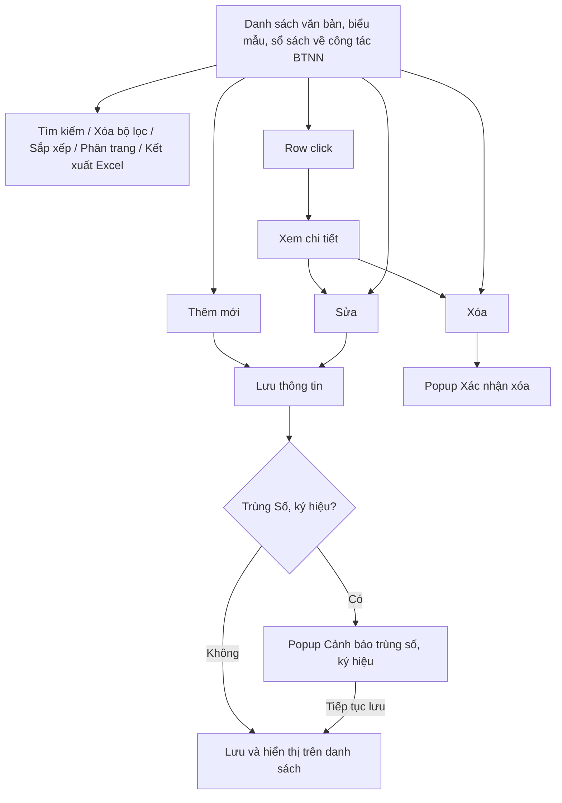
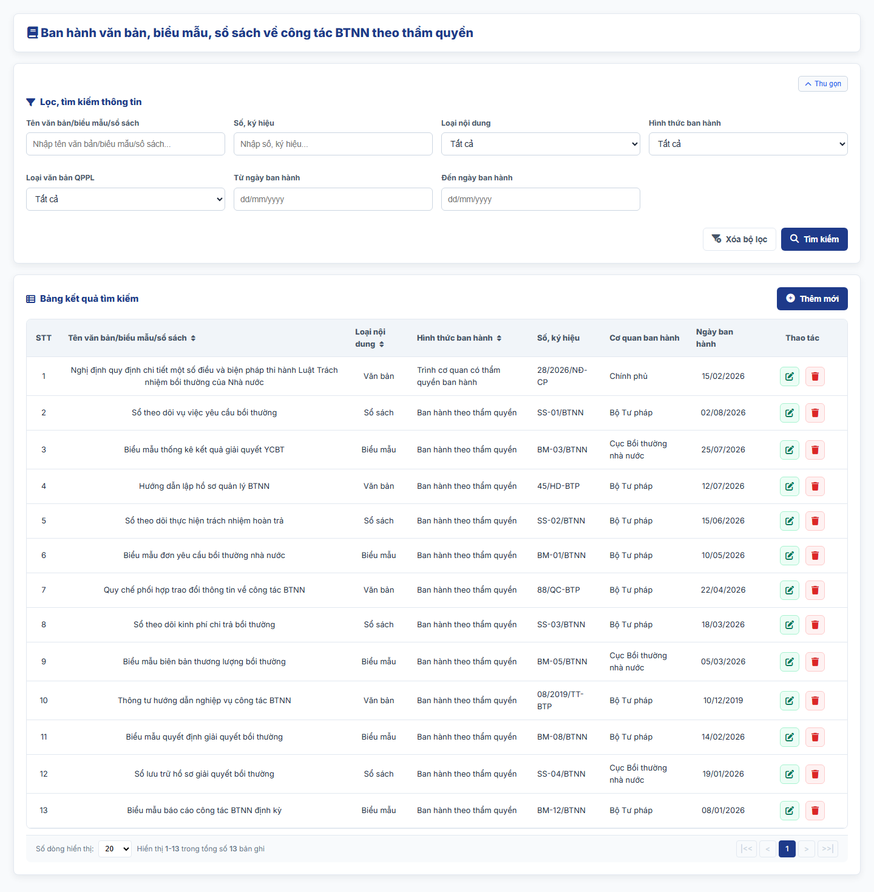
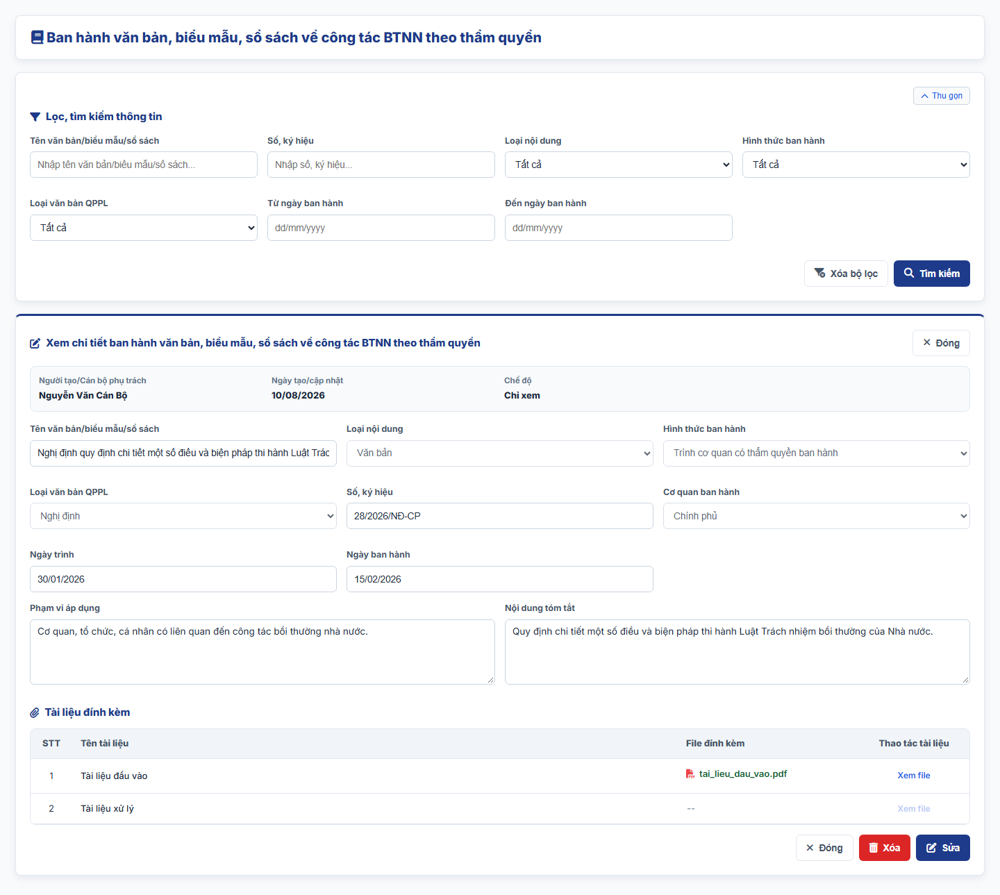
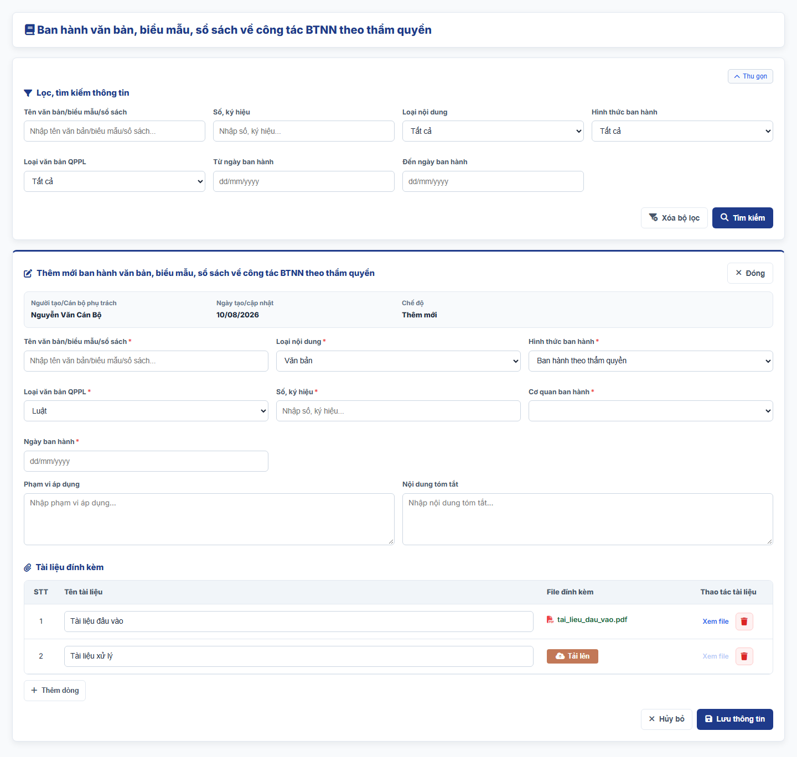
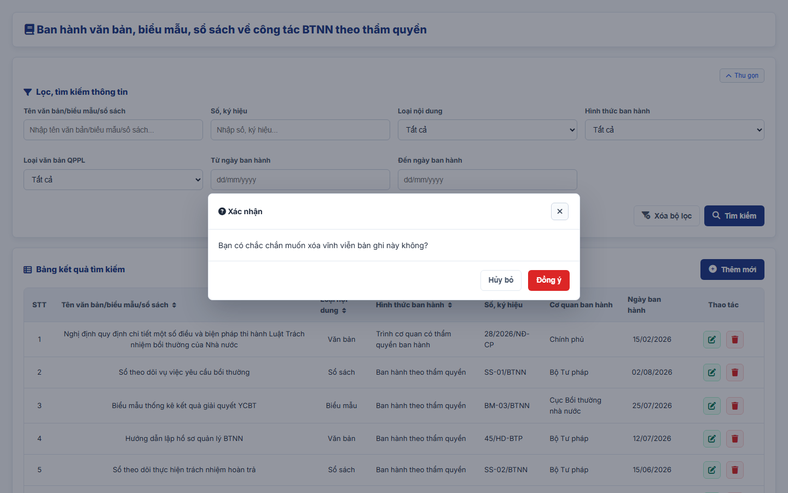
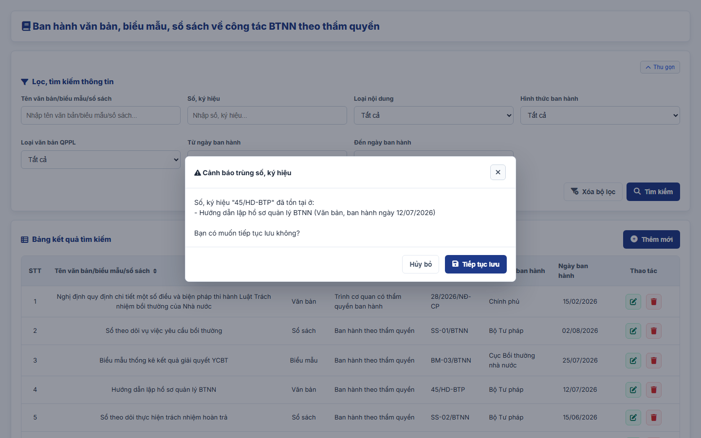

#### 4.3.3.15. UC463-464 - Ban hành văn bản, biểu mẫu, sổ sách về công tác BTNN theo thẩm quyền

##### 4.3.3.15.1. Mục đích

\- Cho phép cán bộ Bộ Tư pháp (Cục Bồi thường nhà nước) ghi nhận, quản lý và tra cứu thông tin văn bản, biểu mẫu, sổ sách về công tác bồi thường nhà nước (BTNN) do Bộ Tư pháp ban hành theo thẩm quyền quản lý nhà nước quy định tại khoản 1 Điều 73 Luật Trách nhiệm bồi thường của Nhà nước.

\- Cho phép ghi nhận cả văn bản Bộ Tư pháp ban hành theo thẩm quyền và văn bản quy định chi tiết, hướng dẫn thi hành Luật Trách nhiệm bồi thường của Nhà nước do Bộ Tư pháp trình cơ quan nhà nước có thẩm quyền ban hành, theo khoản 2 Điều 44 dự thảo Nghị định quy định chi tiết một số điều và biện pháp thi hành Luật Trách nhiệm bồi thường của Nhà nước (bản gửi lấy ý kiến ngày 28/9/2026).

\- Nội dung chỉ phục vụ nội bộ cán bộ quản lý, không công khai ra Website khách hàng.

*a. Phân quyền*

\- Cán bộ Bộ Tư pháp: được tra cứu, xem chi tiết, thêm mới, sửa, xóa bản ghi.

*b. Điều kiện thực hiện*

\- Người dùng đã đăng nhập thành công vào Website quản trị.

\- Người dùng được phân quyền truy cập màn hình `Ban hành văn bản, biểu mẫu, sổ sách về công tác BTNN theo thẩm quyền`.

\- Loại văn bản quy phạm pháp luật tham chiếu Danh mục Loại văn bản quy phạm pháp luật [DM_21]. Cơ quan ban hành tham chiếu Danh mục các đơn vị trên hệ thống `[DM_DON_VI]`.

---

##### 4.3.3.15.2. Sơ đồ luồng nghiệp vụ theo giao diện

---

##### 4.3.3.15.3. MH01 - Màn hình Danh sách văn bản, biểu mẫu, sổ sách về công tác BTNN

###### 4.3.3.15.3.1. Màn hình

###### 4.3.3.15.3.2. Mô tả thông tin trên màn hình

| Trường thông tin | Kiểu dữ liệu | Bắt buộc | Mặc định | Mô tả |
| :--- | :--- | :--- | :--- | :--- |
| **I. Bộ lọc tìm kiếm** | - | - | - | Control UI: Khối thu gọn/mở rộng (Accordion). - Không hiển thị tiêu đề khối. - Mặc định hiển thị dạng mở rộng. - Cho phép thu gọn/mở rộng khi click vào nút "Thu gọn"/"Mở rộng" ở góc phải khối; khi thu gọn, các giá trị lọc đã nhập được giữ nguyên. |
| Tên văn bản/biểu mẫu/sổ sách | String(255) | Không | Trống | Control UI: Text input. - Placeholder: "Nhập tên văn bản/biểu mẫu/sổ sách...". - Tìm gần đúng; không phân biệt hoa thường, có dấu/không dấu. |
| Số, ký hiệu | String(50) | Không | Trống | Control UI: Text input. - Placeholder: "Nhập số, ký hiệu...". - Tìm gần đúng; không phân biệt hoa thường, có dấu/không dấu. |
| Loại nội dung | Enum(String(50)) | Không | Tất cả | Control UI: Combobox. Gồm: + Tất cả + Văn bản + Biểu mẫu + Sổ sách |
| Hình thức ban hành | Enum(String(100)) | Không | Tất cả | Control UI: Combobox. Gồm: + Tất cả + Ban hành theo thẩm quyền + Trình cơ quan có thẩm quyền ban hành |
| Loại văn bản QPPL | Enum(String(50)) | Không | Tất cả | Control UI: Combobox. - Tham chiếu Danh mục Loại văn bản quy phạm pháp luật [DM_21]. |
| Từ ngày ban hành | Date | Không | Trống | Control UI: Date input. - Placeholder: "dd/mm/yyyy". |
| Đến ngày ban hành | Date | Không | Trống | Control UI: Date input. - Placeholder: "dd/mm/yyyy". |
| **II. Bảng danh sách kết quả** | - | - | 20 bản ghi/trang | Control UI: Data grid. - Khi người dùng truy cập màn hình, hệ thống tự động tải Trang 1. - Sắp xếp mặc định: theo "Ngày tạo" giảm dần. - Trạng thái không có dữ liệu (Empty State): bảng hiển thị duy nhất 01 dòng căn giữa trên toàn bộ chiều rộng bảng (`colspan`), in nghiêng với nội dung theo MessageList dùng chung [MSG-INF-SYS-001]. |
| STT | Integer(10) | Không | Theo trang hiện tại | - Chỉ đọc. - Theo dữ liệu bản ghi. |
| Tên văn bản/biểu mẫu/sổ sách | String(255) | Không | Theo dữ liệu hệ thống | - Chỉ đọc. - Theo dữ liệu bản ghi. |
| Loại nội dung | Enum(String(50)) | Không | Theo dữ liệu hệ thống | - Chỉ đọc. - Theo dữ liệu bản ghi. |
| Hình thức ban hành | Enum(String(100)) | Không | Theo dữ liệu hệ thống | - Chỉ đọc. - Theo dữ liệu bản ghi. |
| Số, ký hiệu | String(50) | Không | Theo dữ liệu hệ thống | - Chỉ đọc. - Theo dữ liệu bản ghi. |
| Cơ quan ban hành | String(255) | Không | Theo dữ liệu hệ thống | - Chỉ đọc. - Theo dữ liệu bản ghi. |
| Ngày ban hành | Date | Không | Theo dữ liệu hệ thống | - Chỉ đọc. - Định dạng `dd/mm/yyyy`. |
| Thao tác | - | - | - | Control UI: Icon + Sửa + Xóa - Cột cố định bên phải lưới khi cuộn ngang. |
| Phân trang | - | - | 20 bản ghi/trang | Phân trang, chuyển trang và cấu hình số dòng hiển thị theo quy tắc chung của hệ thống. |

###### 4.3.3.15.3.3. Chức năng trên màn hình

| STT | Tên chức năng | Định dạng | Mô tả |
| :--- | :--- | :--- | :--- |
| 1 | Tìm kiếm | Button | Khi người dùng click nút, hệ thống kiểm tra điều kiện dữ liệu và thực hiện tìm kiếm theo các trường hợp bên dưới: |
|  |  |  | **TH1 - Khoảng ngày không hợp lệ**: Nếu `Từ ngày ban hành` lớn hơn `Đến ngày ban hành`, vi phạm [BR-VAL-007], hệ thống hiển thị cảnh báo lỗi [MSG-ERR-VAL-007] và không thực hiện tìm kiếm. |
|  |  |  | **TH2 - Hợp lệ (Có dữ liệu phù hợp)**: Hệ thống hiển thị danh sách các bản ghi thỏa mãn đồng thời các tiêu chí đã nhập/chọn và đưa về Trang 1. |
|  |  |  | **TH3 - Không có dữ liệu trả về**: Bảng kết quả hiển thị duy nhất 01 dòng căn giữa (`colspan`), in nghiêng với nội dung [MSG-INF-SYS-001]; thanh phân trang hiển thị *"Hiển thị 0-0 trong tổng số 0 bản ghi"*, các nút điều hướng trang ở trạng thái khóa mờ. |
| 2 | Xóa bộ lọc | Button | Hệ thống xóa toàn bộ tiêu chí tìm kiếm đã nhập/chọn, thiết lập các ô lọc về giá trị mặc định. |
| 3 | Thêm mới | Button | Hệ thống mở [MH03 - Màn hình Thêm mới/Sửa văn bản, biểu mẫu, sổ sách về công tác BTNN](#433155-mh03---màn-hình-thêm-mớisửa-văn-bản-biểu-mẫu-sổ-sách-về-công-tác-btnn) ở chế độ Thêm mới với form thông tin để trống. |
| 4 | Kết xuất Excel | Button | Kết xuất danh sách ra tệp Excel theo [Quy chuẩn Kết xuất Excel dùng chung - Danh mục và Phụ lục - Tài liệu tổng hợp](../../Tai%20lieu%20tong%20hop/04_Danh_muc_va_Phu_luc.md): - Phạm vi: toàn bộ bản ghi thỏa mãn điều kiện tìm kiếm hiện hành, không giới hạn theo trang. - Cột xuất theo thứ tự lưới, không gồm cột Thao tác: STT, Tên văn bản/biểu mẫu/sổ sách, Loại nội dung, Hình thức ban hành, Số, ký hiệu, Cơ quan ban hành, Ngày ban hành. - Tên tệp: `yyyyMMdd_Danh_sach_van_ban_bieu_mau_so_sach_BTNN.xlsx`. |
|  |  |  | **TH1 - Không có dữ liệu**: Hệ thống hiển thị [MSG-WRN-SYS-001] và không tải tệp. |
|  |  |  | **TH2 - Có dữ liệu**: Hệ thống tải tệp Excel về máy người dùng. |
| 5 | Sắp xếp cột | Header cột | Áp dụng trên các cột: + Tên văn bản/biểu mẫu/sổ sách + Loại nội dung + Hình thức ban hành |
|  |  |  | **TH1 - Chọn lại cột đang sắp xếp**: Hệ thống đảo chiều sắp xếp tăng dần/giảm dần và cập nhật icon mũi tên trên tiêu đề cột. |
|  |  |  | **TH2 - Chọn cột khác**: Hệ thống sắp xếp danh sách theo cột được chọn. |
| 6 | Row click | Row click | Khi người dùng click vào bất kỳ vị trí nào trên dòng dữ liệu (trừ các nút thao tác), hệ thống mở [MH02 - Màn hình Chi tiết văn bản, biểu mẫu, sổ sách về công tác BTNN](#433154-mh02---màn-hình-chi-tiết-văn-bản-biểu-mẫu-sổ-sách-về-công-tác-btnn). |
| 7 | Sửa | Icon button | Hệ thống mở [MH03 - Màn hình Thêm mới/Sửa văn bản, biểu mẫu, sổ sách về công tác BTNN](#433155-mh03---màn-hình-thêm-mớisửa-văn-bản-biểu-mẫu-sổ-sách-về-công-tác-btnn) ở chế độ Sửa với dữ liệu hiện tại của bản ghi được điền sẵn. |
| 8 | Xóa | Icon button | Hệ thống mở [Popup Xác nhận xóa](#433156-popup-xác-nhận-xóa). |
| 9 | Phân trang & chuyển trang | Pagination | Phân trang, chuyển trang và cấu hình số dòng hiển thị theo quy tắc chung của hệ thống. |

---

##### 4.3.3.15.4. MH02 - Màn hình Chi tiết văn bản, biểu mẫu, sổ sách về công tác BTNN

###### 4.3.3.15.4.1. Màn hình

###### 4.3.3.15.4.2. Mô tả thông tin trên màn hình

| Trường thông tin | Kiểu dữ liệu | Bắt buộc | Mặc định | Mô tả |
| :--- | :--- | :--- | :--- | :--- |
| Tiêu đề màn hình | - | - | - | Control UI: Label Hiển thị "Xem chi tiết ban hành văn bản, biểu mẫu, sổ sách về công tác BTNN theo thẩm quyền". |
| **I. Thông tin chung** |  |  |  |  |
| Người tạo/Cán bộ phụ trách | - | - | - | Control UI: Label Theo dữ liệu bản ghi. |
| Ngày tạo/cập nhật | - | - | - | Control UI: Label Theo dữ liệu bản ghi. |
| Chế độ | - | - | - | Control UI: Label Hiển thị "Chỉ xem". |
| **II. Thông tin văn bản, biểu mẫu, sổ sách** |  |  |  |  |
| Tên văn bản/biểu mẫu/sổ sách | - | - | - | Control UI: Label Theo dữ liệu bản ghi. |
| Loại nội dung | - | - | - | Control UI: Label Theo dữ liệu bản ghi. |
| Hình thức ban hành | - | - | - | Control UI: Label Theo dữ liệu bản ghi. |
| Loại văn bản QPPL | - | - | - | Control UI: Label Theo dữ liệu bản ghi. |
| Số, ký hiệu | - | - | - | Control UI: Label Theo dữ liệu bản ghi. |
| Cơ quan ban hành | - | - | - | Control UI: Label Theo dữ liệu bản ghi. |
| Ngày trình | - | - | - | Control UI: Label Theo dữ liệu bản ghi. |
| Ngày ban hành | - | - | - | Control UI: Label Theo dữ liệu bản ghi. |
| Phạm vi áp dụng | - | - | - | Control UI: Label Theo dữ liệu bản ghi. |
| Nội dung tóm tắt | - | - | - | Control UI: Label Theo dữ liệu bản ghi. |
| **III. Tài liệu đính kèm** |  |  |  |  |
| Tài liệu đính kèm | - | - | - | Control UI: File link Theo dữ liệu bản ghi. |

###### 4.3.3.15.4.3. Chức năng trên màn hình

| STT | Tên chức năng | Định dạng | Mô tả |
| :--- | :--- | :--- | :--- |
| 1 | Xem file | Link | Khi click vào liên kết "Xem file" của tài liệu đính kèm, hệ thống mở nội dung file tại một tab trình duyệt mới. |
| 2 | Sửa | Button | Hệ thống mở [MH03 - Màn hình Thêm mới/Sửa văn bản, biểu mẫu, sổ sách về công tác BTNN](#433155-mh03---màn-hình-thêm-mớisửa-văn-bản-biểu-mẫu-sổ-sách-về-công-tác-btnn) ở chế độ Sửa với dữ liệu hiện tại của bản ghi được điền sẵn. |
| 3 | Xóa | Button | Hệ thống mở [Popup Xác nhận xóa](#433156-popup-xác-nhận-xóa); nếu người dùng chọn `Đồng ý`, hệ thống xóa bản ghi, đóng màn hình chi tiết và quay lại [MH01 - Màn hình Danh sách văn bản, biểu mẫu, sổ sách về công tác BTNN](#433153-mh01---màn-hình-danh-sách-văn-bản-biểu-mẫu-sổ-sách-về-công-tác-btnn). |
| 4 | Đóng | Button | Khi người dùng click nút "Đóng" ở góc phải tiêu đề hoặc ở chân màn hình, hệ thống đóng màn hình chi tiết và quay lại [MH01 - Màn hình Danh sách văn bản, biểu mẫu, sổ sách về công tác BTNN](#433153-mh01---màn-hình-danh-sách-văn-bản-biểu-mẫu-sổ-sách-về-công-tác-btnn). |

---

##### 4.3.3.15.5. MH03 - Màn hình Thêm mới/Sửa văn bản, biểu mẫu, sổ sách về công tác BTNN

###### 4.3.3.15.5.1. Màn hình

###### 4.3.3.15.5.2. Mô tả thông tin trên màn hình

| Trường thông tin | Kiểu dữ liệu | Bắt buộc | Mặc định | Mô tả |
| :--- | :--- | :--- | :--- | :--- |
| Tiêu đề màn hình | - | - | Theo ngữ cảnh | Control UI: Label Hiển thị "Thêm mới ban hành văn bản, biểu mẫu, sổ sách về công tác BTNN theo thẩm quyền" hoặc "Sửa ban hành văn bản, biểu mẫu, sổ sách về công tác BTNN theo thẩm quyền". |
| **I. Thông tin chung** |  |  |  |  |
| Người tạo/Cán bộ phụ trách | - | - | Theo tài khoản đăng nhập | Control UI: Label Theo dữ liệu bản ghi. |
| Ngày tạo/cập nhật | - | - | Theo dữ liệu hệ thống | Control UI: Label Định dạng `dd/mm/yyyy`. |
| Chế độ | - | - | Theo ngữ cảnh | Control UI: Label Hiển thị "Thêm mới" hoặc "Sửa". |
| **II. Thông tin văn bản, biểu mẫu, sổ sách** |  |  |  |  |
| Tên văn bản/biểu mẫu/sổ sách | String(255) | Có | Trống | Control UI: Text input. - Placeholder: "Nhập tên văn bản/biểu mẫu/sổ sách...". |
| Loại nội dung | Enum(String(50)) | Có | Văn bản | Control UI: Combobox. Gồm: + Văn bản + Biểu mẫu + Sổ sách |
| Hình thức ban hành | Enum(String(100)) | Có | Ban hành theo thẩm quyền | Control UI: Combobox. Gồm: + Ban hành theo thẩm quyền + Trình cơ quan có thẩm quyền ban hành - Khi `Loại nội dung` là `Biểu mẫu` hoặc `Sổ sách`, hệ thống tự chọn `Ban hành theo thẩm quyền` và khóa giá trị còn lại. |
| Loại văn bản QPPL | Enum(String(50)) | Có điều kiện | Trống | Control UI: Combobox. - Tham chiếu Danh mục Loại văn bản quy phạm pháp luật [DM_21]. - Chỉ hiển thị và bắt buộc (`*`) khi `Loại nội dung` là `Văn bản`. |
| Số, ký hiệu | String(50) | Có | Trống | Control UI: Text input. - Placeholder: "Nhập số, ký hiệu...". |
| Cơ quan ban hành | Enum(String(255)) | Có | Trống | Control UI: Combobox. - Tham chiếu Danh mục các đơn vị trên hệ thống [DM_DON_VI]. |
| Ngày trình | Date | Có điều kiện | Trống | Control UI: Date input. - Placeholder: "dd/mm/yyyy". - Chỉ hiển thị và bắt buộc (`*`) khi `Hình thức ban hành` là `Trình cơ quan có thẩm quyền ban hành`. - Không lớn hơn ngày hiện tại theo [BR-VAL-008]. |
| Ngày ban hành | Date | Có | Trống | Control UI: Date input. - Placeholder: "dd/mm/yyyy". - Không lớn hơn ngày hiện tại theo [BR-VAL-008]. |
| Phạm vi áp dụng | Text(1000) | Không | Trống | Control UI: Textarea. - Placeholder: "Nhập phạm vi áp dụng...". |
| Nội dung tóm tắt | Text(2000) | Không | Trống | Control UI: Textarea. - Placeholder: "Nhập nội dung tóm tắt...". |
| **III. Tài liệu đính kèm** |  |  |  |  |
| Tài liệu đính kèm | List(File) | Có | Trống | Control UI: Bảng tài liệu đính kèm gồm các cột `STT`, `Tên tài liệu, văn bản`, `File đính kèm`, `Thao tác`; nút `Thêm tài liệu` dưới bảng. - Cột `Tên tài liệu, văn bản`: Text input. Placeholder: "Nhập tên tài liệu, văn bản". - Cột `File đính kèm`: khi dòng chưa có file hiển thị nút `Tải file`; khi đã có file hiển thị tên file. - Cột `Thao tác` gồm: + Xem file (khóa mờ khi dòng chưa có file) + Xóa - Áp dụng [BR-FILE-010]. |

**Quy tắc hiển thị và bắt buộc theo `Loại nội dung` và `Hình thức ban hành`**

| Trường thông tin | Văn bản - Ban hành theo thẩm quyền | Văn bản - Trình cơ quan có thẩm quyền ban hành | Biểu mẫu / Sổ sách |
| :--- | :--- | :--- | :--- |
| Hình thức ban hành | Chọn được 2 giá trị, bắt buộc (`*`) | Chọn được 2 giá trị, bắt buộc (`*`) | Tự chọn `Ban hành theo thẩm quyền`, khóa giá trị còn lại |
| Loại văn bản QPPL | Hiển thị, bắt buộc (`*`) | Hiển thị, bắt buộc (`*`) | Ẩn |
| Ngày trình | Ẩn | Hiển thị, bắt buộc (`*`) | Ẩn |

\- Dấu `*` chỉ hiển thị trên nhãn khi trường bắt buộc theo giá trị đang chọn.

\- Khi người dùng đổi giá trị trường điều khiển, hệ thống cập nhật ngay dấu `*` và trạng thái ẩn/hiện của các trường phụ thuộc; trường chuyển sang ẩn được xóa giá trị.

###### 4.3.3.15.5.3. Chức năng trên màn hình

| STT | Tên chức năng | Định dạng | Mô tả |
| :--- | :--- | :--- | :--- |
| 1 | Lưu thông tin | Button | Khi người dùng click nút, hệ thống kiểm tra dữ liệu và xử lý theo các trường hợp bên dưới: |
|  |  |  | **TH1 - Bỏ trống trường bắt buộc**: Vi phạm [BR-VAL-001] (chưa nhập/chọn các trường có dấu `*` theo bảng quy tắc hiển thị và bắt buộc, chưa đính kèm ít nhất 01 file). Hệ thống viền đỏ các ô lỗi, hiển thị "Đây là trường bắt buộc" ngay dưới từng ô và focus vào ô lỗi đầu tiên. |
|  |  |  | **TH2 - Ngày không hợp lệ**: `Ngày ban hành` hoặc `Ngày trình` lớn hơn ngày hiện tại, vi phạm [BR-VAL-008]. Hệ thống hiển thị [MSG-ERR-VAL-008] ngay dưới ô và không cho phép lưu. |
|  |  |  | **TH3 - Trùng bản ghi**: Bản ghi được xác định bởi các thông tin `Tên văn bản/biểu mẫu/sổ sách`, `Loại nội dung`, `Số, ký hiệu`, `Ngày ban hành`. Nếu các thông tin này trùng với một bản ghi khác đang tồn tại, hệ thống viền đỏ các ô tương ứng, hiển thị cảnh báo "Văn bản/biểu mẫu/sổ sách đã tồn tại trong hệ thống (trùng Tên, Loại nội dung, Số, ký hiệu và Ngày ban hành)" dưới ô `Tên văn bản/biểu mẫu/sổ sách` và không cho phép lưu. - So sánh sau khi bỏ khoảng trắng thừa, không phân biệt hoa thường. - Ở chế độ Sửa, hệ thống bỏ qua chính bản ghi đang sửa. |
|  |  |  | **TH4 - Trùng Số, ký hiệu**: Dữ liệu hợp lệ, không trùng đủ thông tin xác định nhưng `Số, ký hiệu` trùng với một hoặc nhiều bản ghi khác (so sánh sau khi bỏ khoảng trắng thừa, không phân biệt hoa thường). Hệ thống không chặn lưu, mở [Popup Cảnh báo trùng số, ký hiệu](#433157-popup-cảnh-báo-trùng-số-ký-hiệu) để người dùng quyết định: + Tiếp tục lưu: hệ thống lưu như trường hợp Hợp lệ. + Hủy bỏ: hệ thống đóng popup, giữ nguyên dữ liệu đang nhập để người dùng sửa. |
|  |  |  | **TH5 - Hợp lệ - Thêm mới**: Hệ thống lưu bản ghi, đóng màn hình, tải lại danh sách và hiển thị [MSG-SUC-SYS-003]. |
|  |  |  | **TH6 - Hợp lệ - Sửa**: Hệ thống cập nhật bản ghi, đóng màn hình, tải lại danh sách và hiển thị [MSG-SUC-SYS-002]. |
| 2 | Tải lên | Button | Hệ thống mở trình chọn file cho dòng tài liệu tương ứng; sau khi chọn, hiển thị tên file tại cột `File đính kèm`. |
| 3 | Xem file | Link | Hệ thống mở file của dòng tài liệu tại một tab trình duyệt mới. |
| 4 | Xóa | Icon button | Hệ thống xóa dòng tài liệu khỏi bảng ngay, không hiển thị popup xác nhận. |
| 5 | Thêm tài liệu | Button | Hệ thống thêm 01 dòng tài liệu trống vào cuối bảng tài liệu đính kèm. |
| 6 | Hủy bỏ | Button | Khi người dùng click nút "Hủy bỏ" ở chân màn hình hoặc nút "Đóng" ở góc phải tiêu đề, hệ thống đóng màn hình, không lưu dữ liệu và quay lại [MH01 - Màn hình Danh sách văn bản, biểu mẫu, sổ sách về công tác BTNN](#433153-mh01---màn-hình-danh-sách-văn-bản-biểu-mẫu-sổ-sách-về-công-tác-btnn). |

---

##### 4.3.3.15.6. Popup Xác nhận xóa

###### 4.3.3.15.6.1. Màn hình

###### 4.3.3.15.6.2. Mô tả thông tin trên màn hình

| Trường thông tin | Kiểu dữ liệu | Bắt buộc | Mặc định | Mô tả |
| :--- | :--- | :--- | :--- | :--- |
| Tiêu đề popup | - | - | - | Control UI: Label Hiển thị "Xác nhận". |
| Nội dung xác nhận | - | - | - | Control UI: Label Áp dụng message xác nhận [MSG-CFM-SYS-001]. |

###### 4.3.3.15.6.3. Chức năng trên màn hình

| STT | Tên chức năng | Định dạng | Mô tả |
| :--- | :--- | :--- | :--- |
| 1 | Đồng ý | Button | Hệ thống đóng popup và thực hiện xóa: + Xóa bản ghi: xóa vĩnh viễn bản ghi khỏi hệ thống, tải lại danh sách và hiển thị [MSG-SUC-SYS-002]. + Xóa tài liệu đính kèm: xóa dòng tài liệu khỏi bảng. |
| 2 | Hủy bỏ | Button | Khi người dùng click nút "Hủy bỏ" hoặc biểu tượng đóng ở góc phải tiêu đề popup, hệ thống đóng popup và không thực hiện thao tác. |

---

##### 4.3.3.15.7. Popup Cảnh báo trùng số, ký hiệu

###### 4.3.3.15.7.1. Màn hình

###### 4.3.3.15.7.2. Mô tả thông tin trên màn hình

| Trường thông tin | Kiểu dữ liệu | Bắt buộc | Mặc định | Mô tả |
| :--- | :--- | :--- | :--- | :--- |
| Tiêu đề popup | - | - | - | Control UI: Label Hiển thị "Cảnh báo trùng số, ký hiệu". |
| Nội dung cảnh báo | - | - | - | Control UI: Label Hiển thị "Số, ký hiệu "[Số, ký hiệu đang nhập]" đã tồn tại ở:", tiếp theo mỗi bản ghi trùng hiển thị 01 dòng dạng "- [Tên văn bản/biểu mẫu/sổ sách] ([Loại nội dung], ban hành ngày [Ngày ban hành])", cuối cùng là câu hỏi "Bạn có muốn tiếp tục lưu không?". |

###### 4.3.3.15.7.3. Chức năng trên màn hình

| STT | Tên chức năng | Định dạng | Mô tả |
| :--- | :--- | :--- | :--- |
| 1 | Tiếp tục lưu | Button | Hệ thống đóng popup cảnh báo và lưu bản ghi theo trường hợp Hợp lệ - Thêm mới hoặc Hợp lệ - Sửa của chức năng `Lưu thông tin` tại [MH03 - Màn hình Thêm mới/Sửa văn bản, biểu mẫu, sổ sách về công tác BTNN](#433155-mh03---màn-hình-thêm-mớisửa-văn-bản-biểu-mẫu-sổ-sách-về-công-tác-btnn). |
| 2 | Hủy bỏ | Button | Khi người dùng click nút "Hủy bỏ" hoặc biểu tượng đóng ở góc phải tiêu đề popup, hệ thống đóng popup cảnh báo, không lưu và giữ nguyên dữ liệu đang nhập tại [MH03 - Màn hình Thêm mới/Sửa văn bản, biểu mẫu, sổ sách về công tác BTNN](#433155-mh03---màn-hình-thêm-mớisửa-văn-bản-biểu-mẫu-sổ-sách-về-công-tác-btnn). |
