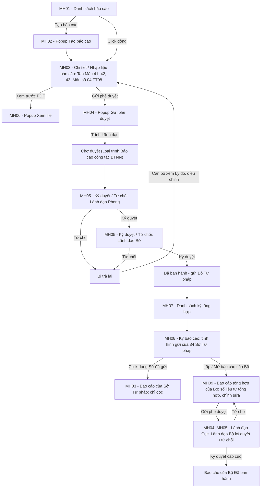
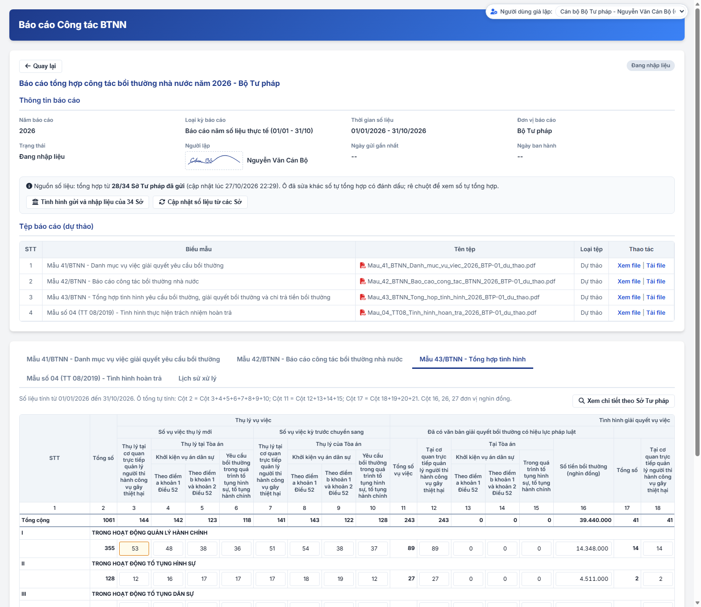

### 4.3.3.26. Báo cáo Công tác BTNN

#### 1. Mục đích
Cho phép Sở Tư pháp lập, trình ký số và gửi Bộ Tư pháp báo cáo công tác bồi thường nhà nước theo kỳ; cho phép Bộ Tư pháp tổng hợp số liệu của 34 Sở Tư pháp, gồm:
- Lập bộ báo cáo gồm 04 biểu mẫu:
  + Theo dự thảo Nghị định: Mẫu 41/BTNN - Danh mục vụ việc giải quyết yêu cầu bồi thường; Mẫu 42/BTNN - Báo cáo công tác bồi thường nhà nước; Mẫu 43/BTNN - Tổng hợp tình hình yêu cầu bồi thường, giải quyết bồi thường và chi trả tiền bồi thường.
  + Theo Thông tư số 08/2019/TT-BTP: Mẫu số 04 - Tình hình thực hiện trách nhiệm hoàn trả, gọi là Mẫu số 04 (TT 08/2019).
- Nhập liệu trên 04 tab biểu mẫu; Mẫu 42/BTNN nhập theo từng mục của mẫu; Mẫu 41/BTNN, Mẫu số 04 (TT 08/2019) nhập tay; Mẫu 43/BTNN tổng hợp tự động từ dữ liệu vụ việc, cho phép sửa.
- Xem trước tệp PDF của 04 biểu mẫu trước khi trình.
- Gửi phê duyệt 01 lần cho cả bộ báo cáo, trình Lãnh đạo Phòng ký nháy, Lãnh đạo Sở ký số theo luồng đã cấu hình.
- Lãnh đạo Ký duyệt hoặc Từ chối đồng thời cả 04 biểu mẫu; cán bộ xem Lý do bị trả lại để điều chỉnh, trình lại.
- Bộ Tư pháp theo dõi tình hình gửi báo cáo của 34 Sở Tư pháp, xem nhập liệu báo cáo của từng Sở Tư pháp (chỉ đọc), xem, tải tệp đã ban hành; trả lại báo cáo của Sở Tư pháp để Sở sửa, gửi lại.
- Bộ Tư pháp lập báo cáo tổng hợp của Bộ theo kỳ trên cùng form 04 biểu mẫu, số liệu tự tổng hợp từ báo cáo đã gửi của các Sở Tư pháp; chỉnh sửa, trình Lãnh đạo Cục ký nháy, Lãnh đạo Bộ ký số; Bị trả lại thì sửa và trình lại.

*a. Phân quyền*
- Cán bộ Sở Tư pháp: tạo báo cáo, nhập liệu, xem trước PDF, Gửi phê duyệt, cập nhật và trình lại báo cáo `Bị trả lại` của Sở Tư pháp mình.
- Lãnh đạo Phòng, Lãnh đạo Sở: xem báo cáo của Sở Tư pháp mình, trừ báo cáo `Đang nhập liệu`; Ký duyệt / Từ chối báo cáo `Chờ duyệt` khi được chọn đích danh ở cấp phê duyệt hiện hành.
- Cán bộ Bộ Tư pháp: xem kỳ báo cáo, tình hình gửi, nhập liệu và tệp đã ban hành của 34 Sở Tư pháp; trả lại báo cáo Đã ban hành của Sở Tư pháp; lập, cập nhật, Gửi phê duyệt, trình lại báo cáo tổng hợp của Bộ.
- Lãnh đạo Cục, Lãnh đạo Bộ: xem kỳ báo cáo, báo cáo của các Sở Tư pháp và báo cáo tổng hợp của Bộ; Ký duyệt / Từ chối báo cáo tổng hợp của Bộ `Chờ duyệt` khi được chọn đích danh ở cấp phê duyệt hiện hành.

*b. Điều kiện thực hiện*
- Người dùng đã đăng nhập Website Quản trị và được phân quyền chức năng `Báo cáo Công tác BTNN`.
- Sở Tư pháp đã được cấu hình luồng tại [Cấu hình luồng xử lý - Cấu hình luồng xử lý - Quản trị hệ thống (Website Quản trị)](../01_Quan_tri_he_thong/Cau_hinh_luong_xu_ly.md).
- Cán bộ lập báo cáo đã có chữ ký hình ảnh tại Thông tin cá nhân cán bộ.

---

#### 2. Sơ đồ luồng nghiệp vụ theo giao diện

---

#### 3. Quy tắc nghiệp vụ

1. Bộ báo cáo gồm 04 biểu mẫu: Mẫu 41/BTNN, Mẫu 42/BTNN, Mẫu 43/BTNN, Mẫu số 04 (TT 08/2019). Mỗi Sở Tư pháp có 01 báo cáo cho mỗi cặp `Năm báo cáo` - `Loại kỳ báo cáo`.
   - Phạm vi thống kê vụ việc, áp dụng cho cả 04 biểu mẫu:
     + Không thống kê vụ việc chỉ có yêu cầu phục hồi danh dự: mọi hồ sơ cùng `Mã vụ việc` là hồ sơ `Loại yêu cầu giải quyết bồi thường` = `Chỉ yêu cầu phục hồi danh dự` hoặc hồ sơ cán bộ chủ động phục hồi danh dự.
     + Vụ việc có yêu cầu bồi thường thiệt hại bằng tiền (`Loại yêu cầu giải quyết bồi thường` = `Yêu cầu cả hai (Bồi thường tiền & Phục hồi danh dự)`, `Chỉ yêu cầu bồi thường thiệt hại bằng tiền`, hoặc vụ việc tại Tòa án): thống kê 01 lần theo `Mã vụ việc`, kể cả khi cùng `Mã vụ việc` có hồ sơ cán bộ chủ động phục hồi danh dự hoặc hồ sơ `Chỉ yêu cầu phục hồi danh dự`.
     + Mẫu 41/BTNN, Mẫu 42/BTNN, Mẫu số 04 (TT 08/2019): danh mục vụ việc, nội dung, số liệu do cán bộ nhập theo phạm vi này.
     + Mẫu 43/BTNN: nút `Tổng hợp` tổng hợp theo phạm vi này và quy tắc 12.
2. Loại kỳ báo cáo và thời gian số liệu:
   - `Báo cáo năm số liệu thực tế (01/01 - 31/10)`: từ 01/01 đến 31/10 của Năm báo cáo.
   - `Số liệu thống kê năm chính thức (01/01 - 31/12)`: từ 01/01 đến 31/12 của Năm báo cáo.
3. Trạng thái báo cáo:

| Trạng thái | Ý nghĩa | Thao tác theo trạng thái |
| :--- | :--- | :--- |
| `Đang nhập liệu` | Báo cáo đã tạo, chưa trình | Cán bộ Sở Tư pháp: Xem chi tiết, Cập nhật, Lưu, Xem trước PDF, Gửi phê duyệt. |
| `Chờ duyệt` | Đã Gửi phê duyệt, đang chờ Lãnh đạo; dòng phụ `Loại trình: Báo cáo công tác BTNN` và cấp đang chờ | Lãnh đạo được chọn ở cấp hiện hành: Ký duyệt, Từ chối. Cán bộ Sở Tư pháp: Xem chi tiết. |
| `Bị trả lại` | Lãnh đạo một cấp đã Từ chối; dòng phụ `Loại trình: Báo cáo công tác BTNN` | Cán bộ Sở Tư pháp: Xem Lý do bị trả lại, Cập nhật, Lưu, Xem trước PDF, Gửi phê duyệt lại. |
| `Đã ban hành` | Lãnh đạo cấp cuối đã Ký duyệt; dòng phụ `Đã gửi Bộ Tư pháp` | Mọi vai trò: Xem chi tiết, Xem file, Tải file. Bộ Tư pháp tổng hợp số liệu. |
| `Bị trả lại` | Bộ Tư pháp đã trả lại báo cáo `Đã ban hành` của Sở Tư pháp; dòng phụ `Bộ Tư pháp trả lại`; không tính là Đã gửi | Cán bộ Sở Tư pháp: Xem Lý do trả lại, Cập nhật, Lưu, Xem trước PDF, Gửi phê duyệt lại; ký cấp cuối thì báo cáo `Đã ban hành` và gửi lại Bộ Tư pháp. |

4. Trình ký:
   - Hình thức ký duy nhất là `Ký số trên hệ thống`; báo cáo không ký duyệt ở ngoài (không có Ký ngoài, không tải lên văn bản đã ký).
   - Luồng ký: thực hiện theo luồng đã cấu hình tại [Cấu hình luồng xử lý - Cấu hình luồng xử lý - Quản trị hệ thống (Website Quản trị)](../01_Quan_tri_he_thong/Cau_hinh_luong_xu_ly.md); số cấp theo cấu hình của Sở Tư pháp (Cấp 1 - Phòng, Cấp 2 - Sở).
   - Cấp được cấu hình Ký nháy: hiển thị nhãn `Ký nháy`; ô ký nháy đặt cuối trang của từng biểu mẫu.
   - Ô ký số Lãnh đạo cấp cuối đặt tại vị trí ký của Thủ trưởng trên từng biểu mẫu.
   - Trình 01 lần cho cả bộ 04 biểu mẫu; Lãnh đạo Ký duyệt hoặc Từ chối đồng thời cả 04 biểu mẫu.
   - Trong khi `Chờ duyệt`, số liệu 04 biểu mẫu chỉ đọc.
5. Người lập: Họ và tên, chữ ký hình ảnh lấy theo Thông tin cá nhân cán bộ của cán bộ thực hiện Gửi phê duyệt; in tại vị trí Người lập danh mục (Mẫu 41/BTNN) và Người lập biểu (Mẫu 43/BTNN, Mẫu số 04 (TT 08/2019)).
6. Ô số liệu Mẫu 43/BTNN, Mẫu số 04 (TT 08/2019); ô tổng tự tính, chỉ đọc:
   - Mẫu 43/BTNN:
     + Cột 2 = Cột 3 + 4 + 5 + 6 + 7 + 8 + 9 + 10.
     + Cột 11 = Cột 12 + 13 + 14 + 15.
     + Cột 17 = Cột 18 + 19 + 20 + 21.
   - Mẫu số 04 (TT 08/2019):
     + Cột 3 = Cột 4 + 6.
     + Cột 12 = Cột 13 + 14.
   - Dòng `Tổng cộng` = tổng 06 nhóm của từng cột.
   - Ô tiền (đơn vị nghìn đồng): hiển thị và nhập có dấu chấm phân cách hàng nghìn, căn phải; tự định dạng khi nhập; lưu dạng số; áp dụng cả ô tổng, dòng `Tổng cộng`, bảng tổng hợp, popup chi tiết theo Sở Tư pháp và tệp PDF.
7. Tệp báo cáo: hệ thống sinh tệp PDF từng biểu mẫu theo [Mẫu 41/BTNN - Danh mục vụ việc giải quyết yêu cầu bồi thường - Bảng mapping trường dữ liệu biểu mẫu BTNN - Công tác bồi thường nhà nước](../../../Bieu_mau/Boi_thuong_nha_nuoc/Bang_mapping_truong_du_lieu_bieu_mau_BTNN.md), [Mẫu 42/BTNN - Báo cáo công tác bồi thường nhà nước - Bảng mapping trường dữ liệu biểu mẫu BTNN - Công tác bồi thường nhà nước](../../../Bieu_mau/Boi_thuong_nha_nuoc/Bang_mapping_truong_du_lieu_bieu_mau_BTNN.md), [Mẫu 43/BTNN - Tổng hợp tình hình yêu cầu bồi thường, giải quyết bồi thường và chi trả tiền bồi thường - Bảng mapping trường dữ liệu biểu mẫu BTNN - Công tác bồi thường nhà nước](../../../Bieu_mau/Boi_thuong_nha_nuoc/Bang_mapping_truong_du_lieu_bieu_mau_BTNN.md).
   - Mẫu số 04 (TT 08/2019): sinh theo bố cục Biểu mẫu số 04 ban hành kèm theo Thông tư số 08/2019/TT-BTP ngày 10/12/2019: tiêu đề `BIỂU MẪU SỐ 04`; góc trái tên cơ quan báo cáo, góc phải Quốc hiệu, Tiêu ngữ; dòng tổng ngay dưới dòng số thứ tự cột, sau đó 06 nhóm I - VI; vị trí ký `Người lập biểu`, `Thủ trưởng cơ quan`; cuối biểu mục `Nguồn lấy số liệu` đúng câu chữ của mẫu; số liệu theo [Tab Mẫu số 04 (TT 08/2019) - Báo cáo Công tác BTNN - Công tác bồi thường nhà nước (Website Quản trị)](#bctt-tab-m04). Template `Mau_04_TT08_Template.docx`, biến theo [Mẫu số 04 (TT 08/2019) - Tình hình thực hiện trách nhiệm hoàn trả - Bảng mapping trường dữ liệu biểu mẫu BTNN - Công tác bồi thường nhà nước](../../../Bieu_mau/Boi_thuong_nha_nuoc/Bang_mapping_truong_du_lieu_bieu_mau_BTNN.md).
   - Trước khi ban hành: tệp `Dự thảo`, có nhãn `DỰ THẢO`.
   - Sau khi Lãnh đạo cấp cuối Ký duyệt: tệp `Đã ban hành`, có chữ ký số.
8. Tổng hợp tại Bộ Tư pháp (số liệu tự tổng hợp của báo cáo tổng hợp của Bộ):
   - Chỉ tổng hợp báo cáo `Đã ban hành` của các Sở Tư pháp cùng `Năm báo cáo` - `Loại kỳ báo cáo`.
   - Mẫu 41/BTNN: ghép danh mục vụ việc của các Sở Tư pháp theo 06 nhóm, mỗi vụ việc ghi kèm tên Sở Tư pháp.
   - Mẫu 42/BTNN: ghép nội dung từng mục theo dạng `- [Tên Sở Tư pháp]: [Nội dung]`.
   - Mẫu 43/BTNN, Mẫu số 04 (TT 08/2019): cộng số liệu từng ô theo nhóm, cột.
   - Không thay đổi số liệu và tệp đã ban hành của Sở Tư pháp; Bộ Tư pháp chỉ xem báo cáo của Sở Tư pháp (chỉ đọc).

9. Phạm vi xem và 02 tab Chờ xử lý / Đã xử lý tại MH01:
   - Phạm vi xem: báo cáo của Sở Tư pháp của người dùng; Lãnh đạo Phòng, Lãnh đạo Sở không thấy báo cáo `Đang nhập liệu`.
   - Lãnh đạo: báo cáo không thuộc tab `Chờ xử lý` và Lãnh đạo chưa từng Ký duyệt / Từ chối không hiển thị ở tab nào.

| Vai trò | Tab `Chờ xử lý` | Tab `Đã xử lý` |
| :--- | :--- | :--- |
| Cán bộ Sở Tư pháp | Báo cáo `Đang nhập liệu`, `Bị trả lại` | Báo cáo `Chờ duyệt`, `Đã ban hành` |
| Lãnh đạo Phòng, Lãnh đạo Sở | Báo cáo `Chờ duyệt` mà Lãnh đạo được chọn đích danh ở cấp phê duyệt hiện hành | Báo cáo Lãnh đạo đã Ký duyệt / Từ chối, không còn chờ Lãnh đạo duyệt |

10. Báo cáo tổng hợp của Bộ Tư pháp:
   - Mỗi cặp `Năm báo cáo` - `Loại kỳ báo cáo` có tối đa 01 báo cáo của Bộ; Đơn vị báo cáo `Bộ Tư pháp`; cùng form 04 biểu mẫu và trạng thái theo quy tắc 3.
   - Khi lập báo cáo: số liệu 04 biểu mẫu tự tổng hợp theo quy tắc 8; ghi nhận số Sở Tư pháp đã gửi và thời điểm tổng hợp.
   - Cán bộ Bộ Tư pháp được sửa số liệu, nội dung 04 biểu mẫu khi báo cáo `Đang nhập liệu` hoặc `Bị trả lại`; số tự tổng hợp lưu riêng để so sánh, ô đã sửa có đánh dấu.
   - `Cập nhật số liệu từ các Sở`: tổng hợp lại theo báo cáo Đã ban hành mới nhất của các Sở Tư pháp, ghi đè số liệu Bộ đã sửa.
   - Luồng ký: Cấp 1 - Cục Đăng ký giao dịch bảo đảm và Bồi thường nhà nước, Cấp 2 - Bộ Tư pháp, theo [Cấu hình luồng xử lý - Cấu hình luồng xử lý - Quản trị hệ thống (Website Quản trị)](../01_Quan_tri_he_thong/Cau_hinh_luong_xu_ly.md); hình thức ký, tài liệu đính kèm, Từ chối, trình lại như quy tắc 4.
   - Lãnh đạo cấp cuối Ký duyệt: báo cáo `Đã ban hành`; Lịch sử xử lý ghi `Ban hành`.

11. Trả lại báo cáo của Sở Tư pháp:
   - Cán bộ Bộ Tư pháp trả lại báo cáo `Đã ban hành` của Sở Tư pháp, bắt buộc nhập Lý do trả lại.
   - Báo cáo Sở Tư pháp chuyển `Bị trả lại`; tính là `Chưa gửi` trong số đếm Đã gửi / Chưa gửi và không được tổng hợp vào báo cáo của Bộ.
   - Sở Tư pháp xem Lý do trả lại, cập nhật, Gửi phê duyệt theo luồng ký của Sở; Lãnh đạo cấp cuối Ký duyệt thì báo cáo `Đã ban hành` và gửi lại Bộ Tư pháp.
   - Báo cáo của Bộ cùng kỳ chưa `Đã ban hành`: hiển thị nhắc danh sách Sở Tư pháp bị trả lại / đã gửi lại sau lần tổng hợp gần nhất; nhắc mất khi Bộ Tư pháp `Cập nhật số liệu từ các Sở`.
   - Lịch sử xử lý ghi ở cả báo cáo Sở Tư pháp và báo cáo của Bộ.

12. Quy tắc tổng hợp số liệu Mẫu 43/BTNN (nút `Tổng hợp` tại Tab Mẫu 43/BTNN của báo cáo Sở Tư pháp):
   - Nguồn dữ liệu:
     + Hồ sơ Giải quyết yêu cầu bồi thường theo [Trạng thái vụ việc Giải quyết YCBT - Giải quyết yêu cầu bồi thường - Công tác bồi thường nhà nước (Website Quản trị)](SRS_BTNN_GiaiQuyetBT_GiaiQuyet_YCBT.md#gq-trang-thai-vu-viec).
     + Vụ việc tại Tòa án theo [Theo dõi vụ việc tại Tòa án - Theo dõi vụ việc tại Tòa án - Công tác bồi thường nhà nước (Website Quản trị)](SRS_BTNN_TheoDoiVuViecToaAn.md).
     + Quyết định giải quyết bồi thường `Có hiệu lực` theo [Hiệu lực của Quyết định - Quyết định giải quyết bồi thường - Công tác bồi thường nhà nước (Website Quản trị)](SRS_BTNN_GiaiQuyetBT_QuyetDinh_GQBT.md#qd-quy-tac-hieu-luc).
     + Bản ghi Chi trả tiền bồi thường theo [Luồng Chi trả tiền bồi thường - Tạm ứng kinh phí bồi thường/Chi trả tiền bồi thường - Công tác bồi thường nhà nước (Website Quản trị)](SRS_BTNN_GiaiQuyetBT_KinhPhi_BT.md#kp-chi-tra-tien-bt).
   - Phạm vi đơn vị: vụ việc có Cơ quan giải quyết bồi thường là Sở Tư pháp của báo cáo hoặc cơ quan, đơn vị cùng Tỉnh/Thành phố với Sở Tư pháp theo Cơ cấu tổ chức.
     + Vụ việc tại Tòa án có vụ việc liên kết: lấy Cơ quan giải quyết bồi thường của vụ việc liên kết.
     + Vụ việc tại Tòa án không có vụ việc liên kết: lấy `Cơ quan giải quyết` của vụ việc tại Tòa án.
   - Kỳ số liệu: từ ngày đến ngày theo `Năm báo cáo`, `Loại kỳ báo cáo` của báo cáo theo quy tắc 2.
   - Dòng: theo `Lĩnh vực phát sinh thiệt hại` của vụ việc, 06 nhóm I - VI; ô tổng Cột 2, 11, 17 và dòng `Tổng cộng` tự tính theo quy tắc 6.
   - Đơn vị đếm là `Mã vụ việc`:
     + Mỗi vụ việc tính 01 lần trong Cột 3 - 10 và 01 lần trong Cột 12 - 22.
     + Không tính vụ việc chỉ có yêu cầu phục hồi danh dự theo quy tắc 1.
     + Không tính hồ sơ `Chỉ yêu cầu phục hồi danh dự`, hồ sơ cán bộ chủ động phục hồi danh dự; vụ việc có yêu cầu bồi thường thiệt hại bằng tiền tính theo hồ sơ có yêu cầu bồi thường thiệt hại bằng tiền.
     + Vụ việc có nhiều hồ sơ Giải quyết yêu cầu bồi thường có yêu cầu bồi thường thiệt hại bằng tiền (Chuyển CQGQBT): lấy hồ sơ có Ngày thụ lý sau cùng.
     + Vụ việc có nhiều vụ việc tại Tòa án (cùng liên kết 01 vụ việc): thông tin Tòa án lấy theo vụ việc tại Tòa án có `Ngày thụ lý` mới nhất; `Ngày thụ lý` bằng nhau thì lấy vụ việc tại Tòa án tạo sau cùng; số tiền chi trả theo bản án, quyết định của Tòa án cộng đủ các vụ việc tại Tòa án.
   - Nơi thụ lý cuối cùng tính đến ngày cuối kỳ:
     + Vụ việc có vụ việc tại Tòa án với `Ngày thụ lý` không sau ngày cuối kỳ: chỉ tính tại Tòa án, không tính tại cơ quan trực tiếp quản lý người thi hành công vụ gây thiệt hại.
     + Trường hợp còn lại: tính tại cơ quan trực tiếp quản lý người thi hành công vụ gây thiệt hại.
   - Vụ việc được tính thụ lý:
     + Tại cơ quan trực tiếp quản lý: hồ sơ Giải quyết yêu cầu bồi thường đã thụ lý (Thông báo thụ lý hồ sơ đã ký duyệt hoặc ban hành).
     + Không tính hồ sơ chưa thụ lý, hồ sơ `Không thụ lý`, `Đã chuyển CQGQBT`.
     + Tại Tòa án: không tính vụ việc `Trả lại đơn khởi kiện`.
   - Ngày thụ lý:
     + Tại cơ quan trực tiếp quản lý: `Ngày thụ lý` của hồ sơ Giải quyết yêu cầu bồi thường.
     + Tại Tòa án: `Ngày thụ lý` của vụ việc tại Tòa án.
   - Thụ lý mới / kỳ trước chuyển sang, theo Ngày thụ lý tại nơi thụ lý cuối cùng:
     + Trong kỳ số liệu: thụ lý mới (Cột 3 - 6).
     + Trước ngày đầu kỳ, chưa có văn bản giải quyết bồi thường có hiệu lực pháp luật trước ngày đầu kỳ: kỳ trước chuyển sang (Cột 7 - 10).
     + Sau ngày cuối kỳ: không tính.
   - Cột 3 - 10:
     + Cột 3, 7: thụ lý tại cơ quan trực tiếp quản lý người thi hành công vụ gây thiệt hại.
     + Cột 4, 8: thụ lý tại Tòa án, `Trường hợp khởi kiện` = `Khởi kiện thẳng ra Tòa án, chưa từng yêu cầu cơ quan giải quyết (điểm a khoản 1 Điều 52)`.
     + Cột 5, 9: thụ lý tại Tòa án, `Trường hợp khởi kiện` = `Đã yêu cầu cơ quan giải quyết trước khi khởi kiện (điểm b khoản 1 và khoản 2 Điều 52)`.
     + Cột 6, 10: thụ lý tại Tòa án, `Trường hợp khởi kiện` = `Kết hợp giải quyết YCBT trong quá trình tố tụng hình sự, tố tụng hành chính tại toà` hoặc `Nguồn phát sinh bản án` = `Giải quyết YCBT trong quá trình tố tụng hình sự, tố tụng hành chính tại toà (Điều 55)`.
   - Cột 12 - 22: vụ việc đã tính tại Cột 3 - 10, theo tình trạng tại ngày cuối kỳ và cùng nơi thụ lý cuối cùng:
     + Cột 12: tại cơ quan, có Quyết định giải quyết bồi thường `Có hiệu lực` hoặc Trạng thái vụ việc `Chờ chi trả`, `Hoàn thành`.
     + Cột 13, 14, 15: tại Tòa án theo căn cứ của Cột 4 và 8, 5 và 9, 6 và 10; vụ việc `Đã có bản án/QĐ`, `Ngày hiệu lực bản án/QĐ` không sau ngày cuối kỳ.
     + Cột 16: tổng `Tổng số tiền bồi thường` của Quyết định giải quyết bồi thường tính tại Cột 12 và số tiền của bản ghi Chi trả tiền bồi thường tạo từ vụ việc tại Tòa án tính tại Cột 13 - 15; quy đổi nghìn đồng, làm tròn.
     + Cột 18: tại cơ quan, chưa thuộc Cột 12, 22, gồm cả Trạng thái vụ việc `Dừng giải quyết`.
     + Cột 19, 20, 21: tại Tòa án theo căn cứ của Cột 4 và 8, 5 và 9, 6 và 10; chưa thuộc Cột 13 - 15.
     + Cột 22: tại cơ quan, Trạng thái vụ việc `Đình chỉ giải quyết`.
   - Cột 23, 24: hệ thống không tổng hợp; giữ số liệu đang nhập.
   - Cột 25 - 27: không phụ thuộc Ngày thụ lý; tính từng lần chi trong Lịch sử chi trả của bản ghi Chi trả tiền bồi thường (gồm bản ghi `Chờ chi trả` đã chi một phần) có Ngày chi trong kỳ số liệu; bản ghi `Trả lại ngân sách nhà nước` chỉ tính khi trả lại một phần, theo Số tiền đã chi thực tế; Số tiền trả lại ngân sách nhà nước không tính (Mẫu 43/BTNN không có cột riêng):
     + Cột 25: số vụ việc có bản ghi chi trả.
     + Cột 26: tổng Số tiền các lần chi của bản ghi chi trả theo Quyết định giải quyết bồi thường; quy đổi nghìn đồng, làm tròn.
     + Cột 27: tổng Số tiền các lần chi của bản ghi chi trả theo bản án, quyết định của Tòa án; quy đổi nghìn đồng, làm tròn.
   - Kết quả tổng hợp ghi đè Cột 3 - 10, 12 - 16, 18 - 22, 25 - 27 của 06 nhóm; không tự lưu báo cáo.
   - Sau khi tổng hợp: cán bộ được sửa mọi ô số liệu; ô tổng tự tính lại theo quy tắc 6.

---

### MH01 - Màn hình Danh sách báo cáo

#### 1. Màn hình

#### 2. Mô tả thông tin trên màn hình

- Áp dụng cho vai trò Sở Tư pháp (Cán bộ, Lãnh đạo Phòng, Lãnh đạo Sở); phạm vi xem theo [Phạm vi xem và 02 tab Chờ xử lý / Đã xử lý - Báo cáo Công tác BTNN - Công tác bồi thường nhà nước (Website Quản trị)](#bctt-tab-xu-ly).
- Vai trò Bộ Tư pháp mở [MH07 - Màn hình Danh sách kỳ báo cáo (Bộ Tư pháp) - Báo cáo Công tác BTNN - Công tác bồi thường nhà nước (Website Quản trị)](#bctt-mh07).

| Trường thông tin | Kiểu dữ liệu | Bắt buộc | Mặc định | Mô tả |
| :--- | :--- | :--- | :--- | :--- |
| Tiêu đề màn hình | String(255) | - | `Báo cáo Công tác BTNN` | Control UI: Page Header (Read-only). - Đúng tên mục Menu. |
| **Tab danh sách** | Tab | - | `Chờ xử lý` | Control UI: 02 tab đặt phía trên bộ lọc: + Chờ xử lý + Đã xử lý - Badge số lượng: số bản ghi thuộc tab Chờ xử lý của người dùng; không hiển thị khi bằng 0. - Badge số lượng tại mục menu `Báo cáo Công tác BTNN` bằng badge tab Chờ xử lý của Báo cáo Công tác BTNN. - Tab `Đã xử lý` không có badge số lượng. - Bản ghi của từng tab theo [Phạm vi xem và 02 tab Chờ xử lý / Đã xử lý - Báo cáo Công tác BTNN - Công tác bồi thường nhà nước (Website Quản trị)](#bctt-tab-xu-ly). |
| **I. Bộ lọc tìm kiếm** | Section | - | - | Control UI: Khối thu gọn/mở rộng. |
| Năm báo cáo | Enum(String(4)) | Không | `Tất cả` | Control UI: Combobox. - Gồm `Tất cả` và các năm có báo cáo, giảm dần. |
| Loại kỳ báo cáo | Enum(String(100)) | Không | `Tất cả` | Control UI: Combobox. Gồm: + Tất cả + Báo cáo năm số liệu thực tế (01/01 - 31/10) + Số liệu thống kê năm chính thức (01/01 - 31/12) |
| Trạng thái | Enum(String(50)) | Không | `Tất cả` | Control UI: Combobox. - Gồm `Tất cả` và các trạng thái thuộc tab đang chọn theo [Phạm vi xem và 02 tab Chờ xử lý / Đã xử lý - Báo cáo Công tác BTNN - Công tác bồi thường nhà nước (Website Quản trị)](#bctt-tab-xu-ly). - Đổi tab: giá trị không thuộc tab mới đặt lại `Tất cả`. |
| **II. Danh sách báo cáo** | Data grid | - | 10 bản ghi/trang | Control UI: Data grid. - Sắp xếp theo Năm báo cáo giảm dần. - Click dòng: mở MH03. - Không có dữ liệu: 01 dòng `Không có dữ liệu`. |
| STT | Integer | - | Tự tăng | Control UI: Label. |
| Năm báo cáo | Integer(4) | - | Theo bản ghi | Control UI: Label. - Theo dữ liệu bản ghi. |
| Loại kỳ báo cáo | String(100) | - | Theo bản ghi | Control UI: Label. - Theo dữ liệu bản ghi. |
| Đơn vị báo cáo | String(255) | - | Theo bản ghi | Control UI: Label. - Tên Sở Tư pháp. |
| Người lập | String(100) | - | Theo bản ghi | Control UI: Label. - Họ và tên cán bộ lập báo cáo. |
| Trạng thái | Enum(String(50)) | - | Theo bản ghi | Control UI: Badge và dòng phụ. - Giá trị theo [Quy tắc nghiệp vụ - Báo cáo Công tác BTNN - Công tác bồi thường nhà nước (Website Quản trị)](#bctt-quy-tac) quy tắc 3. - `Chờ duyệt`: dòng phụ `Loại trình: Báo cáo công tác BTNN`, `Chờ Cấp [n] - [Họ tên Lãnh đạo]`. - `Bị trả lại`: dòng phụ `Loại trình: Báo cáo công tác BTNN` (Lãnh đạo Từ chối) hoặc `Bộ Tư pháp trả lại` (Bộ Tư pháp trả lại báo cáo). - `Đã ban hành`: dòng phụ `Đã gửi Bộ Tư pháp`. |
| Ngày gửi gần nhất | DateTime | - | Theo bản ghi | Control UI: Label. - Thời điểm Gửi phê duyệt gần nhất, định dạng `dd/mm/yyyy HH:mm`. - Chưa gửi: `--`. |
| Thao tác | Action buttons | - | - | Control UI: Icon button group. - Cột cố định bên phải lưới khi cuộn ngang. - Điều kiện theo trạng thái báo cáo tại [Quy tắc nghiệp vụ - Báo cáo Công tác BTNN - Công tác bồi thường nhà nước (Website Quản trị)](#bctt-quy-tac) quy tắc 3. - Thao tác không thỏa điều kiện: hiển thị mờ (disabled), không cho click, có chú thích lý do. Gồm: + Cập nhật: báo cáo `Đang nhập liệu` hoặc `Bị trả lại`. + Gửi phê duyệt: cùng điều kiện với Cập nhật. + Ký duyệt: báo cáo `Chờ duyệt`; người dùng là Lãnh đạo được chọn ở cấp phê duyệt hiện hành. + Từ chối: cùng điều kiện với Ký duyệt. |
| Thanh phân trang | Panel | - | 10 bản ghi/trang | Control UI: Pagination bar. - Số bản ghi/trang gồm: + 10 + 20 + 50 + 100 - Ẩn khi không có bản ghi. |

#### 3. Chức năng trên màn hình

| STT | Tên chức năng | Định dạng | Mô tả |
| :--- | :--- | :--- | :--- |
| 1 | Tìm kiếm | Button | Lọc danh sách theo điều kiện đã chọn, về Trang 1. |
| 2 | Xóa bộ lọc | Button | Đặt lại điều kiện lọc, tải lại danh sách, về Trang 1. |
| 3 | Tạo báo cáo | Button | Chỉ hiển thị với Cán bộ Sở Tư pháp tại tab `Chờ xử lý`. Mở MH02. |
| 4 | Chuyển tab | Tab | Hiển thị bản ghi của tab được chọn; giữ điều kiện lọc hợp lệ, về Trang 1. |
| 5 | Xem chi tiết | Click dòng | Mở MH03 của báo cáo. |
| 6 | Cập nhật | Icon button | Cho phép khi báo cáo `Đang nhập liệu` hoặc `Bị trả lại`. Mở MH03 ở chế độ nhập liệu. |
| 7 | Gửi phê duyệt | Icon button | Cho phép như `Cập nhật`. Mở MH03, kiểm tra dữ liệu và mở MH04 theo chức năng `Gửi phê duyệt` tại MH03. |
| 8 | Ký duyệt / Từ chối | Icon button | Cho phép khi báo cáo `Chờ duyệt` và người dùng là Lãnh đạo được chọn ở cấp phê duyệt hiện hành. Mở MH05 theo thao tác tương ứng. |
| 9 | Phân trang | Panel | Tải lại danh sách theo trang, số bản ghi/trang đã chọn; giữ điều kiện lọc. |

---

### MH02 - Popup Tạo báo cáo

#### 1. Màn hình

Popup mở khi Cán bộ Sở Tư pháp click `Tạo báo cáo` tại MH01.

#### 2. Mô tả thông tin trên màn hình

| Trường thông tin | Kiểu dữ liệu | Bắt buộc | Mặc định | Mô tả |
| :--- | :--- | :--- | :--- | :--- |
| Tiêu đề popup | String(255) | - | `Tạo báo cáo công tác bồi thường nhà nước` | Control UI: Heading text (Read-only). - Dòng phụ: `Đơn vị báo cáo: [Tên Sở Tư pháp]`. |
| Năm báo cáo | Enum(String(4)) | Có | Trống | Control UI: Combobox. - Gồm năm hiện tại, năm trước và năm sau. - `Placeholder: -- Chọn năm báo cáo --` - Bỏ trống: Hệ thống tô viền đỏ ô lỗi, hiển thị [MSG-ERR-VAL-001] dưới ô lỗi và focus vào ô lỗi đầu tiên. |
| Loại kỳ báo cáo | Enum(String(100)) | Có | Trống | Control UI: Combobox. Gồm: + Báo cáo năm số liệu thực tế (01/01 - 31/10) + Số liệu thống kê năm chính thức (01/01 - 31/12) - `Placeholder: -- Chọn loại kỳ báo cáo --` - Bỏ trống: Hệ thống tô viền đỏ ô lỗi, hiển thị [MSG-ERR-VAL-001] dưới ô lỗi và focus vào ô lỗi đầu tiên. |
| Ghi chú bộ biểu mẫu | Label | - | - | Control UI: Label. - Nội dung: `Bộ báo cáo gồm 04 biểu mẫu: Mẫu 41/BTNN, Mẫu 42/BTNN, Mẫu 43/BTNN, Mẫu số 04 (TT 08/2019).` |

#### 3. Chức năng trên màn hình

| STT | Tên chức năng | Định dạng | Mô tả |
| :--- | :--- | :--- | :--- |
| 1 | Tạo báo cáo | Button | - **TH1 - Bỏ trống trường bắt buộc**: Hệ thống tô viền đỏ ô lỗi, hiển thị [MSG-ERR-VAL-001] dưới ô lỗi và focus vào ô lỗi đầu tiên. - **TH2 - Trùng kỳ**: Sở Tư pháp đã có báo cáo cùng Năm báo cáo, Loại kỳ báo cáo: thông báo `Đơn vị đã có báo cáo của kỳ này.`, không tạo. - **TH Hợp lệ**: Tạo báo cáo trạng thái `Đang nhập liệu`, 04 biểu mẫu trống, Thời gian số liệu theo [Quy tắc nghiệp vụ - Báo cáo Công tác BTNN - Công tác bồi thường nhà nước (Website Quản trị)](#bctt-quy-tac) quy tắc 2; ghi Lịch sử xử lý `Tạo báo cáo`; đóng popup, mở MH03, thông báo `Đã tạo báo cáo công tác BTNN năm [Năm báo cáo].` |
| 2 | Hủy bỏ / Đóng | Button | Đóng popup, không lưu. |

---

### MH03 - Màn hình Chi tiết / Nhập liệu báo cáo

#### 1. Màn hình

#### 2. Mô tả thông tin trên màn hình

- Bố cục từ trên xuống: khối `Thông tin báo cáo` (gồm `Khối Lý do bị trả lại`, `Tệp báo cáo`), khối tab biểu mẫu (`Mẫu 41/BTNN`, `Mẫu 42/BTNN`, `Mẫu 43/BTNN`, `Mẫu số 04 (TT 08/2019)`, `Lịch sử xử lý`), thanh thao tác.
- Chế độ nhập liệu khi Cán bộ Sở Tư pháp mở báo cáo `Đang nhập liệu` hoặc `Bị trả lại`; trạng thái khác hoặc vai trò khác: chỉ đọc.

| Trường thông tin | Kiểu dữ liệu | Bắt buộc | Mặc định | Mô tả |
| :--- | :--- | :--- | :--- | :--- |
| Tiêu đề màn hình | String(255) | - | Theo bản ghi | Control UI: Heading text. - `Báo cáo công tác bồi thường nhà nước năm [Năm báo cáo] - [Tên Sở Tư pháp]`. |
| **I. Thông tin báo cáo** | Section | - | - | Control UI: Section header. |
| Năm báo cáo | - | - | Theo bản ghi | Control UI: Label. - Theo dữ liệu bản ghi. |
| Loại kỳ báo cáo | - | - | Theo bản ghi | Control UI: Label. - Theo dữ liệu bản ghi. |
| Thời gian số liệu | - | - | Theo bản ghi | Control UI: Label. - `[Từ ngày] - [Đến ngày]`, định dạng `dd/mm/yyyy`. |
| Đơn vị báo cáo | - | - | Theo bản ghi | Control UI: Label. - Theo dữ liệu bản ghi. |
| Trạng thái | - | - | Theo bản ghi | Control UI: Label. - Theo dữ liệu bản ghi. - `Chờ duyệt`: dòng phụ `Loại trình: Báo cáo công tác BTNN - Chờ Cấp [n] - [Họ tên Lãnh đạo]`. |
| Người lập | - | - | Theo bản ghi | Control UI: Label. - Ảnh chữ ký hình ảnh và Họ và tên cán bộ lập báo cáo theo Thông tin cá nhân cán bộ. |
| Ngày gửi gần nhất | - | - | Theo bản ghi | Control UI: Label. - Định dạng `dd/mm/yyyy HH:mm`; chưa gửi: `--`. |
| Ngày ban hành | - | - | Theo bản ghi | Control UI: Label. - `[dd/mm/yyyy HH:mm] - [Họ tên Lãnh đạo ký]`; chưa ban hành: `--`. |
| Khối Lý do bị trả lại | Section | - | Ẩn | Control UI: Khối cảnh báo (Read-only). - Chỉ hiển thị khi báo cáo `Bị trả lại` do Lãnh đạo Từ chối. - Tiêu đề `BÁO CÁO BỊ LÃNH ĐẠO TRẢ LẠI`. - Gồm Lý do bị trả lại, Người từ chối (Cấp [n]), Thời điểm `dd/mm/yyyy HH:mm` của lần từ chối gần nhất. |
| Khối Lý do bị trả lại | Section | - | Ẩn | Control UI: Khối cảnh báo (Read-only). - Chỉ hiển thị khi báo cáo `Bị trả lại` do Bộ Tư pháp trả lại. - Tiêu đề `BÁO CÁO BỊ BỘ TƯ PHÁP TRẢ LẠI`. - Gồm Lý do trả lại, Người trả lại (Bộ Tư pháp), Thời điểm `dd/mm/yyyy HH:mm`. |
| **II. Tệp báo cáo** | Data grid | - | 04 dòng | Control UI: Data grid (Read-only). - Tiêu đề `Tệp báo cáo (dự thảo)` hoặc `Tệp báo cáo (đã ban hành)` theo trạng thái. - Mỗi biểu mẫu 01 dòng. - Dưới bảng: 02 khối `Tài liệu ban hành kèm theo`, `Tài liệu không ban hành kèm theo` của lần trình (Read-only); mỗi khối chỉ hiển thị khi có dữ liệu; khối `Tài liệu không ban hành kèm theo` chỉ hiển thị với Sở Tư pháp trình báo cáo; quy tắc tại [Quy tắc Tài liệu ban hành kèm theo / Tài liệu không ban hành kèm theo - Danh mục và Phụ lục - Tài liệu tổng hợp](../../Tai%20lieu%20tong%20hop/04_Danh_muc_va_Phu_luc.md#quy-tac-tai-lieu-ban-hanh-kem-theo). |
| STT | Integer | - | Tự tăng | Control UI: Label. |
| Biểu mẫu | - | - | Theo bản ghi | Control UI: Label. - `[Mã mẫu] - [Tên mẫu]`. |
| Tên tệp | - | - | Theo bản ghi | Control UI: Label. - Theo quy tắc đặt tên tại Bảng mapping trường dữ liệu biểu mẫu BTNN. |
| Loại tệp | - | - | Theo bản ghi | Control UI: Label. Gồm: + Dự thảo: báo cáo chưa `Đã ban hành` + Đã ban hành: báo cáo `Đã ban hành` |
| Thao tác | Action buttons | - | - | Control UI: Link. Gồm: + Xem file + Tải file |
| **III. Tab biểu mẫu** | Tab | - | `Mẫu 41/BTNN` | Control UI: Tab. Gồm: + Mẫu 41/BTNN - Danh mục vụ việc giải quyết yêu cầu bồi thường + Mẫu 42/BTNN - Báo cáo công tác bồi thường nhà nước + Mẫu 43/BTNN - Tổng hợp tình hình + Mẫu số 04 (TT 08/2019) - Tình hình hoàn trả + Lịch sử xử lý |

**Tab Mẫu 41/BTNN**

| Trường thông tin | Kiểu dữ liệu | Bắt buộc | Mặc định | Mô tả |
| :--- | :--- | :--- | :--- | :--- |
| Cơ quan lập danh mục | - | - | Theo bản ghi | Control UI: Label. - Tên Sở Tư pháp. |
| Danh mục vụ việc | Data grid | - | Trống | Control UI: Data grid nhập liệu. - Nhóm dòng theo 06 nhóm: + I. Trong hoạt động quản lý hành chính + II. Trong hoạt động tố tụng hình sự + III. Trong hoạt động tố tụng dân sự + IV. Trong hoạt động tố tụng hành chính + V. Trong hoạt động thi hành án hình sự + VI. Trong hoạt động thi hành án dân sự - Dòng tên nhóm: `[Tên nhóm] ([Số] vụ việc)` kèm biểu tượng thu gọn / mở rộng; mặc định mở; thu gọn ẩn các dòng vụ việc của nhóm, dữ liệu đang nhập giữ nguyên. - Trên bảng: nút `Mở rộng tất cả`, `Thu gọn tất cả`. - Dưới mỗi nhóm: nút `Thêm vụ việc`. - Ô nhập tự giãn chiều cao theo nội dung, không có thanh cuộn trong ô. - Dòng cuối `Tổng cộng`: `[Số] vụ việc`. |
| STT | Integer | - | Tự tăng | Control UI: Label. - Đánh số lại trong từng nhóm. |
| Họ và tên của người yêu cầu bồi thường (1) | Text(500) | Có | Trống | Control UI: Textarea. - `Placeholder: Nhập họ và tên` - Bỏ trống: Hệ thống tô viền đỏ ô lỗi, hiển thị [MSG-ERR-VAL-001] dưới ô lỗi và focus vào ô lỗi đầu tiên. |
| Địa chỉ của người yêu cầu bồi thường (2) | Text(500) | Không | Trống | Control UI: Textarea. - `Placeholder: Nhập nội dung` |
| Cơ quan giải quyết bồi thường (3) | Text(500) | Không | Trống | Control UI: Textarea. - `Placeholder: Nhập nội dung` |
| Tình hình giải quyết bồi thường (4) | Text(2000) | Không | Trống | Control UI: Textarea. - `Placeholder: Nhập nội dung` |
| Khó khăn, vướng mắc (5) | Text(2000) | Không | Trống | Control UI: Textarea. - `Placeholder: Nhập nội dung` |
| Ghi chú (6) | Text(1000) | Không | Trống | Control UI: Textarea. - `Placeholder: Nhập nội dung` |
| Thao tác | Action buttons | - | - | Control UI: Icon button. - Chỉ hiển thị ở chế độ nhập liệu. Gồm: + Xóa |

**Tab Mẫu 42/BTNN**

- Mỗi mục trên Mẫu 42/BTNN là 01 ô nhập liệu; tên mục hiển thị đúng câu chữ của mẫu, `[Năm báo cáo]` thay theo trường `Năm báo cáo`.
- Bố cục từ trên xuống: thanh `Mở rộng tất cả` / `Thu gọn tất cả`, khối thông tin chung (lưới 02 cột: `Cơ quan báo cáo`, `Địa danh`, `Năm báo cáo`, `Ngày báo cáo`), các khối nội dung theo phần I, II, III.
- Khối nội dung:
  + Mỗi phần (I, II, III) là 01 khối; trong phần I, mỗi mục (1, 2, 3) là 01 khối con.
  + Tiêu đề khối ghi đúng số thứ tự và tên phần, mục của mẫu, kèm biểu tượng thu gọn / mở rộng.
  + Mặc định mở toàn bộ khối.
  + Click tiêu đề khối: thu gọn / mở rộng khối đó; dữ liệu đang nhập giữ nguyên.
- Ô nhập nội dung tự giãn chiều cao theo độ dài nội dung, không có thanh cuộn trong ô; chiều cao tối thiểu 02 dòng.

| Trường thông tin | Kiểu dữ liệu | Bắt buộc | Mặc định | Mô tả |
| :--- | :--- | :--- | :--- | :--- |
| Cơ quan báo cáo | - | - | Theo bản ghi | Control UI: Label. - Tên Sở Tư pháp. |
| Năm báo cáo | String(4) | Có | Năm báo cáo của bản ghi | Control UI: Input text. - Chỉ nhập 04 chữ số. - `Placeholder: Nhập năm báo cáo` - Bỏ trống: Hệ thống tô viền đỏ ô lỗi, hiển thị [MSG-ERR-VAL-001] dưới ô lỗi và focus vào ô lỗi đầu tiên. |
| Địa danh | - | - | Theo bản ghi | Control UI: Label. - Tỉnh/Thành phố của Sở Tư pháp, bỏ tiền tố `Tỉnh`, `Thành phố`. |
| Ngày báo cáo | Date | Có | Trống | Control UI: DatePicker. - Định dạng `dd/mm/yyyy`. - `Placeholder: dd/mm/yyyy` - Sai định dạng: hiển thị `Ngày không hợp lệ (dd/mm/yyyy)` dưới ô. - Bỏ trống: Hệ thống tô viền đỏ ô lỗi, hiển thị [MSG-ERR-VAL-001] dưới ô lỗi và focus vào ô lỗi đầu tiên. |
| **I. Kết quả công tác bồi thường năm [Năm báo cáo]** | Section | - | - | Control UI: Section header. |
| **1. Tình hình yêu cầu bồi thường, kết quả giải quyết bồi thường** | Section | - | - | Control UI: Section header. |
| Đánh giá tình hình yêu cầu bồi thường, kết quả giải quyết bồi thường | Text(4000) | Không | Trống | Control UI: Textarea. - `Placeholder: Nhập nội dung báo cáo` |
| Việc cấp phát kinh phí và chi trả tiền bồi thường | Text(4000) | Không | Trống | Control UI: Textarea. - `Placeholder: Nhập nội dung báo cáo` |
| Việc xác định trách nhiệm hoàn trả của người thi hành công vụ gây thiệt hại | Text(4000) | Không | Trống | Control UI: Textarea. - `Placeholder: Nhập nội dung báo cáo` |
| Việc xử lý kỷ luật người thi hành công vụ gây thiệt hại | Text(4000) | Không | Trống | Control UI: Textarea. - `Placeholder: Nhập nội dung báo cáo` |
| **2. Kết quả thực hiện công tác bồi thường nhà nước** | Section | - | - | Control UI: Section header. |
| Xây dựng và thực hiện Kế hoạch công tác bồi thường nhà nước năm [Năm báo cáo] | Text(4000) | Không | Trống | Control UI: Textarea. - `Placeholder: Nhập nội dung báo cáo` |
| Công tác xây dựng, hoàn thiện thể chế về trách nhiệm bồi thường của Nhà nước (đối với Bộ, ngành Trung ương) | Text(4000) | Không | Trống | Control UI: Textarea. - `Placeholder: Nhập nội dung báo cáo` |
| Công tác phổ biến, giáo dục pháp luật về trách nhiệm bồi thường của Nhà nước | Text(4000) | Không | Trống | Control UI: Textarea. - `Placeholder: Nhập nội dung báo cáo` |
| Thực hiện quản lý chuyên ngành về bồi thường nhà nước | Text(4000) | Không | Trống | Control UI: Textarea. - Nhãn hiển thị đúng toàn văn mục của mẫu. - `Placeholder: Nhập nội dung báo cáo` |
| Chỉ đạo cơ quan giải quyết bồi thường thực hiện giải quyết bồi thường, xác định trách nhiệm hoàn trả, thực hiện quyết định hoàn trả và thực hiện xử lý kỷ luật người thi hành công vụ gây thiệt hại | Text(4000) | Không | Trống | Control UI: Textarea. - `Placeholder: Nhập nội dung báo cáo` |
| Chỉ đạo xử lý vi phạm trong việc giải quyết bồi thường, thực hiện trách nhiệm hoàn trả | Text(4000) | Không | Trống | Control UI: Textarea. - `Placeholder: Nhập nội dung báo cáo` |
| Công tác phối hợp thực hiện công tác bồi thường nhà nước | Text(4000) | Không | Trống | Control UI: Textarea. - `Placeholder: Nhập nội dung báo cáo` |
| Công tác báo cáo, thống kê về công tác bồi thường nhà nước | Text(4000) | Không | Trống | Control UI: Textarea. - `Placeholder: Nhập nội dung báo cáo` |
| **3. Đánh giá chung về kết quả công tác bồi thường nhà nước** | Section | - | - | Control UI: Section header. |
| Đánh giá chung những kết quả đạt được | Text(4000) | Không | Trống | Control UI: Textarea. - `Placeholder: Nhập nội dung báo cáo` |
| Những vướng mắc, bất cập và nguyên nhân | Text(4000) | Không | Trống | Control UI: Textarea. - `Placeholder: Nhập nội dung báo cáo` |
| II. Nhiệm vụ trọng tâm và giải pháp thực hiện công tác bồi thường nhà nước năm [Năm báo cáo + 1] | Text(4000) | Không | Trống | Control UI: Textarea. - Năm hiển thị trên nhãn = Năm báo cáo cộng 01. - `Placeholder: Nhập nội dung báo cáo` |
| III. Đề xuất, kiến nghị | Text(4000) | Không | Trống | Control UI: Textarea. - `Placeholder: Nhập nội dung báo cáo` |

**Tab Mẫu 43/BTNN**

| Trường thông tin | Kiểu dữ liệu | Bắt buộc | Mặc định | Mô tả |
| :--- | :--- | :--- | :--- | :--- |
| Ghi chú số liệu | Label | - | - | Control UI: Label. - `Số liệu tính từ [Từ ngày] đến [Đến ngày]` và công thức ô tổng theo [Quy tắc nghiệp vụ - Báo cáo Công tác BTNN - Công tác bồi thường nhà nước (Website Quản trị)](#bctt-quy-tac) quy tắc 6. - Chế độ nhập liệu: thêm `Nút Tổng hợp tự điền số liệu từ dữ liệu vụ việc, trừ Cột 23, 24.` |
| Tổng hợp | Button | - | - | Control UI: Button, đặt bên phải dòng Ghi chú số liệu. - Chỉ hiển thị ở chế độ nhập liệu của báo cáo Sở Tư pháp. - Tổng hợp số liệu theo [Quy tắc tổng hợp số liệu Mẫu 43/BTNN - Báo cáo Công tác BTNN - Công tác bồi thường nhà nước (Website Quản trị)](#bctt-m43-tong-hop). |
| Bảng số liệu | Data grid | - | 0 | Control UI: Data grid nhập liệu, cuộn ngang. - Tiêu đề cột nhiều tầng đúng bố cục Mẫu 43/BTNN, dòng số thứ tự cột 1 - 27. - Dòng: `Tổng cộng`; 06 nhóm I - VI, mỗi nhóm 01 dòng tên nhóm và 01 dòng số liệu. |
| Ô số liệu Cột 3 - 10, 12 - 16, 18 - 27 | Integer(15) | Không | 0 | Control UI: Input number, căn phải. - Số nguyên không âm. - Cột 16, 26, 27: đơn vị nghìn đồng, định dạng ô tiền theo quy tắc 6. - Cột 3 - 10, 12 - 16, 18 - 22, 25 - 27: hệ thống điền khi bấm `Tổng hợp`; cán bộ được sửa sau khi tổng hợp. - Cột 23, 24: cán bộ nhập. |
| Ô tổng Cột 2, 11, 17 | Integer(10) | - | Hệ thống tự tính | Control UI: Label (Read-only). - Tự tính lại ngay khi thay đổi ô thành phần theo quy tắc 6. |
| Dòng Tổng cộng | Integer(10) | - | Hệ thống tự tính | Control UI: Label (Read-only). - Tổng 06 nhóm của từng cột. |

**Tab Mẫu số 04 (TT 08/2019)**

- Bảng `Tình hình thực hiện trách nhiệm hoàn trả` theo Mẫu số 04 ban hành kèm theo Thông tư số 08/2019/TT-BTP; cán bộ nhập tay số liệu theo 06 nhóm lĩnh vực.
- Căn cứ số liệu: hồ sơ hoàn trả tại [Quản lý xem xét trách nhiệm hoàn trả - Xem xét trách nhiệm hoàn trả - Công tác bồi thường nhà nước (Website Quản trị)](SRS_BTNN_GiaiQuyetBT_Xem%20xét%20Hoàn%20trả.md) và số tiền chi trả tại [Cấp kinh phí bồi thường - Kinh phí bồi thường - Công tác bồi thường nhà nước (Website Quản trị)](SRS_BTNN_GiaiQuyetBT_KinhPhi_BT.md).
- Nhóm lĩnh vực: theo `Lĩnh vực phát sinh thiệt hại` của vụ việc yêu cầu bồi thường liên kết với hồ sơ hoàn trả.
- Mỗi hồ sơ hoàn trả tính 01 lần cho mỗi cột trong cùng kỳ báo cáo, cùng nhóm lĩnh vực.
- Số tiền nhập theo đơn vị nghìn đồng; số liệu nghiệp vụ lưu theo đồng thì quy đổi trước khi nhập.

| Trường thông tin | Kiểu dữ liệu | Bắt buộc | Mặc định | Mô tả |
| :--- | :--- | :--- | :--- | :--- |
| Ghi chú số liệu | Label | - | - | Control UI: Label. - `Số liệu tính từ [Từ ngày] đến [Đến ngày]` và công thức ô tổng theo [Quy tắc nghiệp vụ - Báo cáo Công tác BTNN - Công tác bồi thường nhà nước (Website Quản trị)](#bctt-quy-tac) quy tắc 6. |
| Bảng số liệu | Data grid | - | 0 | Control UI: Data grid nhập liệu, cuộn ngang. - Tiêu đề cột nhiều tầng đúng bố cục Mẫu số 04, dòng số thứ tự cột 1 - 15. - Dòng: `Tổng cộng` ngay dưới dòng số thứ tự cột; 06 nhóm I - VI, mỗi nhóm 01 dòng tên nhóm và 01 dòng số liệu. - Ô số liệu căn phải; ô tiền (Cột 2, 5, 10, 12, 13, 14, 15) định dạng theo quy tắc 6. |
| Số tiền đã chi trả xong cho người yêu cầu bồi thường (Cột 2) | Integer(15) | Không | 0 | Control UI: Input number. - Số nguyên không âm, đơn vị nghìn đồng. - Căn cứ: tổng số tiền thực tế đã chi trả xong cho người yêu cầu bồi thường của các vụ việc làm căn cứ xem xét hoàn trả trong kỳ, theo Số tiền đã chi thực tế; không gồm Số tiền trả lại ngân sách nhà nước. |
| Tổng số vụ việc xem xét (Cột 3) | Integer(10) | - | Hệ thống tự tính | Control UI: Label (Read-only). - Cột 3 = Cột 4 + 6. |
| Số vụ việc có Quyết định có hiệu lực pháp luật và đã thực hiện hoàn trả (Cột 4) | Integer(10) | Không | 0 | Control UI: Input number. - Số nguyên không âm. - Căn cứ: hồ sơ có Quyết định hoàn trả có hiệu lực pháp luật trong hoặc trước kỳ báo cáo và đã phát sinh thực hiện hoàn trả. |
| Số tiền phải hoàn trả (Cột 5) | Integer(15) | Không | 0 | Control UI: Input number. - Số nguyên không âm, đơn vị nghìn đồng. - Căn cứ: tổng số tiền phải hoàn trả theo Quyết định hoàn trả của các hồ sơ tính tại Cột 4. |
| Số vụ việc đang xem xét (Cột 6) | Integer(10) | Không | 0 | Control UI: Input number. - Số nguyên không âm. - Căn cứ: hồ sơ đang trong quá trình xem xét trách nhiệm hoàn trả, chưa có Quyết định hoàn trả có hiệu lực tại thời điểm chốt số liệu. |
| Không xem xét - Người thi hành công vụ không có lỗi (Cột 7) | Integer(10) | Không | 0 | Control UI: Input number. - Số nguyên không âm. - Căn cứ: vụ việc không xem xét trách nhiệm hoàn trả do người thi hành công vụ không có lỗi, trong kỳ báo cáo. |
| Không xem xét - Người thi hành công vụ chết trước khi ra quyết định hoàn trả (Cột 8) | Integer(10) | Không | 0 | Control UI: Input number. - Số nguyên không âm. - Căn cứ: vụ việc không xem xét trách nhiệm hoàn trả do người thi hành công vụ chết trước khi ra quyết định hoàn trả, trong kỳ báo cáo. |
| Giảm mức hoàn trả - Số vụ việc (Cột 9) | Integer(10) | Không | 0 | Control UI: Input number. - Số nguyên không âm. - Căn cứ: hồ sơ có Quyết định giảm mức hoàn trả trong kỳ báo cáo. |
| Giảm mức hoàn trả - Số tiền (Cột 10) | Integer(15) | Không | 0 | Control UI: Input number. - Số nguyên không âm, đơn vị nghìn đồng. - Căn cứ: tổng số tiền hoàn trả được giảm của các hồ sơ tính tại Cột 9. |
| Số vụ việc hoãn hoàn trả (Cột 11) | Integer(10) | Không | 0 | Control UI: Input number. - Số nguyên không âm. - Căn cứ: hồ sơ được hoãn thực hiện hoàn trả, còn hiệu lực trong kỳ báo cáo. |
| Số tiền đã hoàn trả - Tổng số (Cột 12) | Integer(15) | - | Hệ thống tự tính | Control UI: Label (Read-only). - Cột 12 = Cột 13 + 14. - Đơn vị nghìn đồng. |
| Số tiền đã hoàn trả trong kỳ báo cáo (Cột 13) | Integer(15) | Không | 0 | Control UI: Input number. - Số nguyên không âm, đơn vị nghìn đồng. - Căn cứ: tổng số tiền nộp hoàn trả ngân sách có ngày nộp trong kỳ báo cáo. |
| Số tiền đã hoàn trả kỳ trước chuyển sang (Cột 14) | Integer(15) | Không | 0 | Control UI: Input number. - Số nguyên không âm, đơn vị nghìn đồng. - Căn cứ: tổng số tiền đã nộp hoàn trả trước kỳ báo cáo của các hồ sơ còn nghĩa vụ hoàn trả chuyển sang kỳ này. |
| Số tiền còn phải hoàn trả (Cột 15) | Integer(15) | Không | 0 | Control UI: Input number. - Số nguyên không âm, đơn vị nghìn đồng. - Căn cứ: số tiền phải hoàn trả lũy kế trừ số tiền đã hoàn trả lũy kế và số tiền được giảm lũy kế. |
| Dòng Tổng cộng | Integer(15) | - | Hệ thống tự tính | Control UI: Label (Read-only). - Tổng 06 nhóm của từng cột. |

**Tab Lịch sử xử lý**

| Trường thông tin | Kiểu dữ liệu | Bắt buộc | Mặc định | Mô tả |
| :--- | :--- | :--- | :--- | :--- |
| Lịch sử xử lý | List(Object) | - | Theo bản ghi | Control UI: Danh sách sự kiện (Read-only), giảm dần theo thời gian. - Mỗi sự kiện: chữ viết tắt họ tên, Họ tên, thời điểm `dd/mm/yyyy HH:mm`, hành động, nội dung. Hành động gồm: + Tạo báo cáo + Lưu báo cáo + Gửi phê duyệt + Ký duyệt và chuyển xử lý đến [Họ tên Lãnh đạo cấp tiếp theo] + Ký duyệt + Từ chối + Ban hành và gửi Bộ Tư pháp (báo cáo Sở Tư pháp) + Trả lại báo cáo (báo cáo Sở Tư pháp) + Ban hành và gửi lại Bộ Tư pháp (báo cáo Sở Tư pháp) + Trả lại báo cáo của [Tên Sở Tư pháp], [Tên Sở Tư pháp] gửi lại báo cáo sau khi bị trả lại (báo cáo của Bộ) + Ban hành (báo cáo của Bộ) + Lập báo cáo tổng hợp (báo cáo của Bộ) + Cập nhật số liệu từ các Sở (báo cáo của Bộ) |

#### 3. Chức năng trên màn hình

| STT | Tên chức năng | Định dạng | Mô tả |
| :--- | :--- | :--- | :--- |
| 1 | Chuyển tab | Tab | Hiển thị nội dung tab được chọn; giữ dữ liệu đang nhập của các tab. |
| 2 | Thêm vụ việc | Button | Tab Mẫu 41/BTNN, chế độ nhập liệu: thêm 01 dòng trống cuối nhóm. |
| 3 | Xóa vụ việc | Icon button | Tab Mẫu 41/BTNN: xóa dòng ngay, đánh số lại STT trong nhóm, thông báo `Đã xóa vụ việc khỏi danh mục.` |
| 4 | Nhập ô số liệu | Input | Tab Mẫu 43/BTNN, Tab Mẫu số 04 (TT 08/2019): tự tính lại ô tổng của nhóm và dòng `Tổng cộng`. |
| 5 | Tổng hợp | Button | Tab Mẫu 43/BTNN, chế độ nhập liệu của báo cáo Sở Tư pháp. - Có ô Cột 3 - 10, 12 - 16, 18 - 22, 25 - 27 khác 0: hiển thị popup xác nhận `Tổng hợp số liệu Mẫu 43/BTNN`, nội dung `Số liệu đang nhập tại các cột tổng hợp sẽ bị ghi đè; Cột 23, 24 giữ nguyên. Bạn có muốn tiếp tục?`, nút `Hủy bỏ`, `Tổng hợp`. - **TH1 - Lỗi kết nối dữ liệu**: hiển thị [MSG-ERR-SYS-002]; giữ nguyên số liệu đang nhập. - **TH2 - Không có vụ việc phù hợp**: các cột tổng hợp bằng 0; thông báo `Không có vụ việc phù hợp trong kỳ báo cáo; số liệu các cột tổng hợp bằng 0.` - **TH Hợp lệ**: + Điền số liệu theo [Quy tắc tổng hợp số liệu Mẫu 43/BTNN - Báo cáo Công tác BTNN - Công tác bồi thường nhà nước (Website Quản trị)](#bctt-m43-tong-hop). + Tự tính lại ô tổng và dòng `Tổng cộng`. + Thông báo `Đã tổng hợp số liệu Mẫu 43/BTNN từ dữ liệu vụ việc ([Số] vụ việc thụ lý). Cột 23, 24 giữ nguyên số đang nhập.` + Ô số liệu vẫn cho phép sửa; bấm `Lưu` để lưu báo cáo. |
| 6 | Thu gọn / Mở rộng khối | Click tiêu đề khối | Tab Mẫu 42/BTNN (khối phần, mục), Tab Mẫu 41/BTNN (dòng tên nhóm): thu gọn khối / nhóm đang mở hoặc mở rộng khối / nhóm đang thu gọn; dữ liệu đang nhập giữ nguyên. |
| 7 | Mở rộng tất cả / Thu gọn tất cả | Button | Tab Mẫu 42/BTNN, Tab Mẫu 41/BTNN: mở rộng hoặc thu gọn đồng thời toàn bộ khối phần, mục / nhóm. |
| 8 | Xem file / Tải file | Link | Tại `Tệp báo cáo`: - `Xem file`: mở MH06 tại tab biểu mẫu tương ứng. - `Tải file`: tải tệp PDF của biểu mẫu. |
| 9 | Xem trước PDF | Button | Mở MH06 với dữ liệu đang nhập (tệp `Dự thảo`). |
| 10 | Lưu | Button | Chế độ nhập liệu: lưu dữ liệu 04 biểu mẫu, không kiểm tra trường bắt buộc; ghi Lịch sử xử lý `Lưu báo cáo`; thông báo `Đã lưu báo cáo.` |
| 11 | Gửi phê duyệt | Button | Chế độ nhập liệu. - **TH1 - Bỏ trống trường bắt buộc**: Hệ thống tô viền đỏ ô lỗi, hiển thị [MSG-ERR-VAL-001] dưới ô lỗi và focus vào ô lỗi đầu tiên; không mở MH04. - **TH2 - Ngày báo cáo sai định dạng**: hiển thị `Ngày không hợp lệ (dd/mm/yyyy)` dưới ô; không mở MH04. - TH1, TH2: hệ thống chuyển đến tab có ô lỗi đầu tiên. - **TH Hợp lệ**: + Lưu dữ liệu 04 biểu mẫu. + Mở MH04. |
| 12 | Ký duyệt / Từ chối | Button | Hiển thị khi báo cáo `Chờ duyệt` và người dùng là Lãnh đạo được chọn ở cấp hiện hành. Mở MH05. |
| 13 | Trả lại | Button | Chỉ hiển thị với Cán bộ Bộ Tư pháp khi xem báo cáo `Đã ban hành` của Sở Tư pháp. Mở Popup Trả lại báo cáo. |
| 14 | Quay lại | Button | Về MH01 (vai trò Sở Tư pháp) hoặc màn hình đã mở báo cáo (vai trò Bộ Tư pháp); dữ liệu chưa Lưu không được lưu. |

---

### MH04 - Popup Gửi phê duyệt

#### 1. Màn hình

- Bố cục giống [Popup Trình duyệt Hoãn giải quyết bồi thường - Giải quyết yêu cầu bồi thường - Công tác bồi thường nhà nước (Website Quản trị)](SRS_BTNN_GiaiQuyetBT_GiaiQuyet_YCBT.md#gq-popup-hoan); khác biệt:
  + Văn bản trình ký là bộ 04 biểu mẫu sinh theo mẫu; không có `Nguồn tệp văn bản`, `Tải lên từ máy`, `Ký ngoài`.
  + Bước 1 - Kiểm tra bộ báo cáo: `Hình thức ký`, `Bộ báo cáo trình ký`, `Người lập biểu`, `Tài liệu ban hành kèm theo`, `Tài liệu không ban hành kèm theo`.
  + Bước 2 - Chọn Lãnh đạo & trình ký: vùng trái xem văn bản có thanh tab 04 biểu mẫu; vùng phải thẻ cấp ký, `Nội dung trình`.
  + Ô ký do hệ thống đặt theo [Quy tắc nghiệp vụ - Báo cáo Công tác BTNN - Công tác bồi thường nhà nước (Website Quản trị)](#bctt-quy-tac) quy tắc 4; không có nút `Đặt chữ ký`.
- Báo cáo `Bị trả lại`: điền lại Lãnh đạo từng cấp, `Nội dung trình`, `Tài liệu ban hành kèm theo`, `Tài liệu không ban hành kèm theo` của lần trình trước.

#### 2. Mô tả thông tin trên màn hình

| Trường thông tin | Kiểu dữ liệu | Bắt buộc | Mặc định | Mô tả |
| :--- | :--- | :--- | :--- | :--- |
| Tiêu đề popup | String(255) | - | `GỬI PHÊ DUYỆT BÁO CÁO CÔNG TÁC BỒI THƯỜNG NHÀ NƯỚC` | Control UI: Heading text (Read-only). - Dòng phụ: `Kỳ báo cáo: năm [Năm báo cáo] - [Loại kỳ báo cáo] • Đơn vị: [Tên Sở Tư pháp]`. |
| Thanh chỉ trình (Stepper) | Component | - | Bước 1 active | Control UI: Stepper 2 bước. Gồm: + Bước 1: Kiểm tra bộ báo cáo + Bước 2: Chọn Lãnh đạo & trình ký |
| Khối Báo cáo bị trả lại | Section | - | Ẩn | Control UI: Khối cảnh báo (Read-only). - Chỉ hiển thị khi báo cáo `Bị trả lại` do Lãnh đạo Từ chối. - Gồm Lý do bị trả lại, Người từ chối, Thời điểm. |
| Hình thức ký | - | - | `Ký số trên hệ thống` | Control UI: Label (Read-only). - Giá trị cố định, không cho chọn; báo cáo không ký duyệt ở ngoài. - Theo luồng đã cấu hình tại [Cấu hình luồng xử lý - Cấu hình luồng xử lý - Quản trị hệ thống (Website Quản trị)](../01_Quan_tri_he_thong/Cau_hinh_luong_xu_ly.md). |
| **Bộ báo cáo trình ký** | Data grid | - | 04 dòng | Control UI: Data grid (Read-only). |
| Biểu mẫu | - | - | Theo bản ghi | Control UI: Label. - `[Mã mẫu] - [Tên mẫu]`. |
| Tình trạng dữ liệu | - | - | Theo bản ghi | Control UI: Label. - Mẫu 41/BTNN: `[Số] vụ việc`. - Mẫu 42/BTNN: `[Số mục đã nhập]/16 mục đã nhập nội dung`. - Mẫu 43/BTNN: `Tổng số [Cột 2 dòng Tổng cộng] vụ việc (Cột 2)`. - Mẫu số 04 (TT 08/2019): `Tổng số [Cột 3 dòng Tổng cộng] vụ việc xem xét trách nhiệm hoàn trả (Cột 3)`. |
| Thao tác | Action buttons | - | - | Control UI: Link. Gồm: + Xem trước PDF |
| **Người lập biểu** | Section | - | - | Control UI: Khối thông tin (Read-only). - Ảnh chữ ký hình ảnh, Họ và tên, Chức vụ của người dùng đang thao tác theo Thông tin cá nhân cán bộ. |
| Tài liệu ban hành kèm theo / Tài liệu không ban hành kèm theo | List(Object) | Không | 01 dòng trống | Control UI: Bảng động dùng chung, 02 khối riêng: `Tài liệu ban hành kèm theo`, `Tài liệu không ban hành kèm theo`; mỗi khối 01 bảng như sau. - Cột: `STT`, `Tên tài liệu, văn bản`, `File đính kèm`, `Thao tác`: Xem file, Xóa. - Nút `Thêm tài liệu` dưới bảng. - Dòng đã nhập phải có đủ `Tên tài liệu, văn bản` và tệp; dòng trống không lưu. - Định dạng `.pdf`, `.doc`, `.docx`, `.jpg`, `.jpeg`, `.png`; tối đa 50MB/tệp. - Quy tắc tại [Quy tắc Tài liệu ban hành kèm theo / Tài liệu không ban hành kèm theo - Danh mục và Phụ lục - Tài liệu tổng hợp](../../Tai%20lieu%20tong%20hop/04_Danh_muc_va_Phu_luc.md#quy-tac-tai-lieu-ban-hanh-kem-theo). |
| Xem văn bản (Bước 2) | Component | - | Tab `Mẫu 41/BTNN` | Control UI: Document Viewer (Read-only), vùng trái. - Thanh tab: `Mẫu 41/BTNN`, `Mẫu 42/BTNN`, `Mẫu 43/BTNN`, `Mẫu số 04 (TT 08/2019)`. - Hiển thị văn bản dự thảo, ô ký các cấp theo Lãnh đạo đang chọn. |
| Thẻ cấp ký (Bước 2) | Component | - | Theo luồng đã cấu hình | Control UI: Danh sách thẻ, mỗi cấp 01 thẻ. - Tiêu đề `Cấp [n] - [Đơn vị]`. - Cấp có cấu hình Ký nháy: nhãn `Ký nháy`. |
| Lãnh đạo (từng cấp) | Enum(String(100)) | Có | Lãnh đạo đầu tiên của nhóm lãnh đạo cấp đó | Control UI: Combobox tại từng thẻ cấp ký. - Danh sách là Nhóm lãnh đạo của đơn vị ở cấp tương ứng, hiển thị `[Họ tên] - [Chức vụ]`. - `Placeholder: -- Chọn Lãnh đạo --` - Bỏ trống: Hệ thống tô viền đỏ ô lỗi, hiển thị [MSG-ERR-VAL-001] dưới ô lỗi và focus vào ô lỗi đầu tiên. |
| Nội dung trình | Text(2000) | Có | `Kính trình Lãnh đạo xem xét, ký duyệt Báo cáo công tác bồi thường nhà nước năm [Năm báo cáo] (Mẫu 41/BTNN, Mẫu 42/BTNN, Mẫu 43/BTNN, Mẫu số 04 (TT 08/2019)).` | Control UI: Textarea (4 dòng). - `Placeholder: Nhập nội dung trình Lãnh đạo...` - Bỏ trống: Hệ thống tô viền đỏ ô lỗi, hiển thị [MSG-ERR-VAL-001] dưới ô lỗi và focus vào ô lỗi đầu tiên. |

#### 3. Chức năng trên màn hình

| STT | Tên chức năng | Định dạng | Mô tả |
| :--- | :--- | :--- | :--- |
| 1 | Xem trước PDF | Link | Mở MH06 tại tab biểu mẫu tương ứng. |
| 2 | Thêm tài liệu / Tải file / Xem file / Xóa | Button / Icon button | Theo bảng tài liệu dùng chung, áp dụng cho từng khối: - Sai định dạng: [MSG-ERR-FILE-007], không tiếp nhận tệp. - Quá 50MB: [MSG-ERR-FILE-006], không tiếp nhận tệp. - `Xóa`: xóa dòng ngay. |
| 3 | Tiếp tục | Button | Tại Bước 1. - **TH1 - Dòng `Tài liệu ban hành kèm theo` / `Tài liệu không ban hành kèm theo` thiếu Tên tài liệu, văn bản hoặc tệp**: Hệ thống tô viền đỏ ô lỗi, hiển thị [MSG-ERR-VAL-001] dưới ô lỗi và focus vào ô lỗi đầu tiên. - **TH Hợp lệ**: sinh văn bản dự thảo 04 biểu mẫu, chuyển Bước 2. |
| 4 | Chọn Lãnh đạo | Combobox | Cập nhật ô ký trên văn bản đang xem. |
| 5 | Quay lại | Button | Tại Bước 2: về Bước 1, giữ dữ liệu đã nhập. |
| 6 | Trình Lãnh đạo | Button | Tại Bước 2. - **TH1 - Bỏ trống trường bắt buộc**: Hệ thống tô viền đỏ ô lỗi, hiển thị [MSG-ERR-VAL-001] dưới ô lỗi và focus vào ô lỗi đầu tiên. - **TH Hợp lệ**: tạo phiếu trình Loại trình `Báo cáo công tác BTNN` kèm 04 văn bản dự thảo, Lãnh đạo từng cấp, `Nội dung trình`, `Tài liệu ban hành kèm theo`, `Tài liệu không ban hành kèm theo`; ghi Người lập = người dùng đang thao tác; báo cáo chuyển `Chờ duyệt`, cấp hiện hành = Cấp 1; ghi Ngày gửi gần nhất, Lịch sử xử lý `Gửi phê duyệt`; xóa Khối Lý do bị trả lại khỏi màn hình; đóng popup, tải lại MH03, thông báo `Đã gửi phê duyệt báo cáo đến [Họ tên Lãnh đạo Cấp 1].` |
| 7 | Hủy bỏ / Đóng | Button | Đóng popup, không trình, giữ nguyên trạng thái báo cáo. |

---

### MH05 - Màn hình Ký duyệt / Từ chối

#### 1. Màn hình

- Theo [Màn hình Ký duyệt / Từ chối - Xác định cơ quan giải quyết bồi thường - Công tác bồi thường nhà nước (Website Quản trị)](SRS_BTNN_GiaiQuyetBT__Xac%20định%20cơ%20quan%20GQBT.md#xd-ky-duyet).
- Mở khi Lãnh đạo được chọn ở cấp phê duyệt hiện hành click `Ký duyệt` hoặc `Từ chối` tại MH01 / MH03.
- Hiển thị toàn màn hình, gồm 02 vùng:
  + Vùng trái: xem văn bản trình ký, chia 04 tab `Mẫu 41/BTNN`, `Mẫu 42/BTNN`, `Mẫu 43/BTNN`, `Mẫu số 04 (TT 08/2019)`.
  + Vùng phải, theo thứ tự: `Thông tin tổng quan`, `Tài liệu ban hành kèm theo`, `Tài liệu không ban hành kèm theo` (mỗi khối chỉ hiển thị khi có dữ liệu), `Lịch sử trình ký`, `Ý kiến` / `Lý do từ chối`.
- Ký duyệt / Từ chối áp dụng đồng thời cho cả 04 biểu mẫu.

#### 2. Mô tả thông tin trên màn hình

| Trường thông tin | Kiểu dữ liệu | Bắt buộc | Mặc định | Mô tả |
| :--- | :--- | :--- | :--- | :--- |
| Tiêu đề màn hình | String(255) | - | Theo thao tác | Control UI: Heading text (Read-only). - `Ký duyệt báo cáo công tác bồi thường nhà nước năm [Năm báo cáo] - [Tên Sở Tư pháp]` / `Từ chối phê duyệt báo cáo công tác bồi thường nhà nước năm [Năm báo cáo] - [Tên Sở Tư pháp]`. - Dòng phụ: `Ký duyệt / Từ chối áp dụng đồng thời cho cả 04 biểu mẫu: Mẫu 41/BTNN, Mẫu 42/BTNN, Mẫu 43/BTNN, Mẫu số 04 (TT 08/2019)`. |
| Tab biểu mẫu | Tab | - | `Mẫu 41/BTNN` | Control UI: Tab đặt đầu vùng xem văn bản. Gồm: + Mẫu 41/BTNN + Mẫu 42/BTNN + Mẫu 43/BTNN + Mẫu số 04 (TT 08/2019) |
| Xem văn bản trình ký | File | - | Văn bản của phiếu trình đang chờ duyệt | Control UI: Document Viewer (Read-only). - Hiển thị văn bản của tab đang chọn, ô ký `Cấp [n] - [Họ tên Lãnh đạo]`, ô ký nháy (nếu có). |
| **THÔNG TIN TỔNG QUAN** | Section | - | - | Control UI: Section header. |
| Kỳ báo cáo | - | - | Theo bản ghi | Control UI: Label. - `Năm [Năm báo cáo] - [Loại kỳ báo cáo]`. |
| Đơn vị báo cáo | - | - | Theo bản ghi | Control UI: Label. - Theo dữ liệu bản ghi. |
| Loại trình | - | - | `Báo cáo công tác BTNN` | Control UI: Label. - Theo dữ liệu phiếu trình. |
| Cán bộ trình | - | - | Theo bản ghi | Control UI: Label. - `[Họ tên] - [dd/mm/yyyy HH:mm]`. |
| Cấp phê duyệt | - | - | Theo bản ghi | Control UI: Label. - `[Cấp hiện hành]/[Tổng số cấp] - [Đơn vị]`; cấp Ký nháy hiển thị nhãn `Ký nháy`. |
| Nội dung trình | - | - | Theo bản ghi | Control UI: Label. - Theo dữ liệu phiếu trình. |
| **TÀI LIỆU BAN HÀNH KÈM THEO** | List(Object) | - | Theo phiếu trình | Control UI: Data grid (Read-only). - Chỉ hiển thị khi phiếu trình có tài liệu ban hành kèm theo. - Cột: `STT`, `Tên tài liệu, văn bản`, `File đính kèm`, `Thao tác`: Xem file, Tải file. |
| **TÀI LIỆU KHÔNG BAN HÀNH KÈM THEO** | List(Object) | - | Theo phiếu trình | Control UI: Data grid (Read-only), đặt dưới khối `TÀI LIỆU BAN HÀNH KÈM THEO`. - Chỉ hiển thị khi phiếu trình có tài liệu không ban hành kèm theo. - Cột giống `TÀI LIỆU BAN HÀNH KÈM THEO`. - Quy tắc tại [Quy tắc Tài liệu ban hành kèm theo / Tài liệu không ban hành kèm theo - Danh mục và Phụ lục - Tài liệu tổng hợp](../../Tai%20lieu%20tong%20hop/04_Danh_muc_va_Phu_luc.md#quy-tac-tai-lieu-ban-hanh-kem-theo). |
| **LỊCH SỬ TRÌNH KÝ** | List(Object) | - | Theo bản ghi | Control UI: Danh sách sự kiện (Read-only), giảm dần theo thời gian. - Gồm mọi lượt trình, kể cả lượt bị từ chối; cấp đang chờ: `Đang chờ ký duyệt`; cấp sau: `Chưa tới`. |
| Ý kiến | Text(2000) | Không | Trống | Control UI: Textarea. - Chỉ hiển thị khi thao tác là `Ký duyệt`. - `Placeholder: Nhập ý kiến (không bắt buộc)...` |
| Lý do từ chối | Text(2000) | Có | Trống | Control UI: Textarea. - Chỉ hiển thị khi thao tác là `Từ chối`. - `Placeholder: Nhập lý do từ chối...` - Bỏ trống: Hệ thống tô viền đỏ ô lỗi, hiển thị [MSG-ERR-VAL-001] dưới ô lỗi và focus vào ô lỗi đầu tiên. |

#### 3. Chức năng trên màn hình

| STT | Tên chức năng | Định dạng | Mô tả |
| :--- | :--- | :--- | :--- |
| 1 | Chuyển tab biểu mẫu | Tab | Hiển thị văn bản của biểu mẫu được chọn. |
| 2 | Ký duyệt | Button | Chỉ hiển thị khi thao tác là `Ký duyệt`. - **TH1 - Báo cáo không còn hợp lệ** (không còn chờ cấp này hoặc người dùng không còn là Lãnh đạo được chọn; kiểm tra tại máy chủ): hiển thị [MSG-ERR-BTNN-LXL-005], đóng màn hình, tải lại danh sách. - **TH2 - Ký số không thành công**: báo cáo giữ `Chờ duyệt`; hiển thị thông báo lỗi ký số, giữ màn hình. - **TH3 - Hợp lệ, chưa phải cấp cuối**: ghi kết quả Ký duyệt (ký nháy nếu cấp được cấu hình) cả 04 biểu mẫu, kèm Ý kiến; chuyển Lãnh đạo cấp tiếp theo đã chọn khi trình; giữ `Chờ duyệt`; ghi Lịch sử `Ký duyệt và chuyển xử lý đến [Họ tên Lãnh đạo cấp tiếp theo]`; thông báo `Đã ký duyệt cả 04 biểu mẫu và chuyển [Họ tên] ký duyệt.` - **TH4 - Hợp lệ, cấp cuối**: ký số cả 04 biểu mẫu; báo cáo chuyển `Đã ban hành`, 04 tệp chuyển `Đã ban hành`; ghi Ngày ban hành, Người ký; gửi Bộ Tư pháp (báo cáo được tính vào kỳ tổng hợp tại MH08); ghi Lịch sử `Ký duyệt`, `Ban hành và gửi Bộ Tư pháp`; thông báo `Đã ký số ban hành cả 04 biểu mẫu và gửi Bộ Tư pháp.`; báo cáo của Bộ theo chức năng 6 của MH09. - Đóng màn hình, tải lại MH03. |
| 3 | Từ chối | Button | Chỉ hiển thị khi thao tác là `Từ chối`. - **TH1 - Bỏ trống trường bắt buộc**: Hệ thống tô viền đỏ ô lỗi, hiển thị [MSG-ERR-VAL-001] dưới ô lỗi và focus vào ô lỗi đầu tiên. - **TH2 - Báo cáo không còn hợp lệ**: như Ký duyệt TH1. - **TH Hợp lệ**: ghi kết quả Từ chối cả 04 biểu mẫu kèm Lý do từ chối; báo cáo chuyển `Bị trả lại`; lưu Lý do, Người từ chối, Cấp, Thời điểm để hiển thị tại Khối Lý do bị trả lại (MH03); ghi Lịch sử `Từ chối`; đóng màn hình, tải lại MH03, thông báo `Đã từ chối báo cáo. Cán bộ lập báo cáo nhận lại để điều chỉnh.` |
| 4 | Hủy bỏ / Đóng | Button | Đóng màn hình, không lưu. |

---

### MH06 - Popup Xem file

#### 1. Màn hình

- Popup mở khi click `Xem trước PDF` (MH03, MH04), `Xem file` (MH03, MH08, MH09).
- Hiển thị toàn màn hình, văn bản chia 04 tab tương ứng 04 biểu mẫu.

#### 2. Mô tả thông tin trên màn hình

| Trường thông tin | Kiểu dữ liệu | Bắt buộc | Mặc định | Mô tả |
| :--- | :--- | :--- | :--- | :--- |
| Tiêu đề popup | String(255) | - | Theo chức năng mở | Control UI: Heading text (Read-only). - `Xem trước bộ báo cáo (PDF)`, `Xem trước PDF` hoặc `Xem file`. - Dòng phụ: `[Tên đơn vị] - năm [Năm báo cáo]`. |
| Tab biểu mẫu | Tab | - | Biểu mẫu được chọn khi mở; mặc định `Mẫu 41/BTNN` | Control UI: Tab. Gồm: + Mẫu 41/BTNN + Mẫu 42/BTNN + Mẫu 43/BTNN + Mẫu số 04 (TT 08/2019) |
| Xem văn bản | File | - | Theo tab | Control UI: Document Viewer (Read-only). - Tệp `Dự thảo`: nhãn `DỰ THẢO`, ô ký chờ ký. - Tệp `Đã ban hành`: chữ ký số các cấp. |

#### 3. Chức năng trên màn hình

| STT | Tên chức năng | Định dạng | Mô tả |
| :--- | :--- | :--- | :--- |
| 1 | Chuyển tab biểu mẫu | Tab | Hiển thị văn bản của biểu mẫu được chọn. |
| 2 | Tải file | Button | Tải tệp PDF của biểu mẫu đang xem. |
| 3 | Đóng | Button | Đóng popup. |

---

### MH07 - Màn hình Danh sách kỳ báo cáo (Bộ Tư pháp)

#### 1. Màn hình

Màn hình mặc định của vai trò Bộ Tư pháp (Cán bộ Bộ Tư pháp, Lãnh đạo Cục, Lãnh đạo Bộ) tại chức năng `Báo cáo Công tác BTNN`.

#### 2. Mô tả thông tin trên màn hình

| Trường thông tin | Kiểu dữ liệu | Bắt buộc | Mặc định | Mô tả |
| :--- | :--- | :--- | :--- | :--- |
| Danh sách kỳ báo cáo | Data grid | - | Theo dữ liệu | Control UI: Data grid. - Mỗi cặp Năm báo cáo - Loại kỳ báo cáo 01 dòng, giảm dần theo năm. - Click dòng: mở MH08. |
| STT | Integer | - | Tự tăng | Control UI: Label. |
| Năm báo cáo | - | - | Theo bản ghi | Control UI: Label. - Theo dữ liệu bản ghi. |
| Loại kỳ báo cáo | - | - | Theo bản ghi | Control UI: Label. - Theo dữ liệu bản ghi. |
| Số Sở Tư pháp đã gửi | - | - | Theo bản ghi | Control UI: Label. - `[Số báo cáo Sở Tư pháp Đã ban hành]/34`. |
| Tình hình tiếp nhận | Enum(String(50)) | - | Theo bản ghi | Control UI: Badge. Gồm: + Đang tiếp nhận: chưa đủ 34 Sở Tư pháp + Đủ số liệu: đủ 34 Sở Tư pháp |
| Báo cáo tổng hợp của Bộ | Enum(String(50)) | - | Theo bản ghi | Control UI: Badge và dòng phụ. - Trạng thái báo cáo của Bộ theo quy tắc 3; dòng phụ như cột `Trạng thái` của MH01, `Đã ban hành`: dòng phụ `Đã ban hành`. - Chưa lập: `Chưa lập`. |
| Thao tác | Action buttons | - | - | Control UI: Icon button group. - Cột cố định bên phải lưới khi cuộn ngang. - Thao tác không thỏa điều kiện: hiển thị mờ (disabled), không cho click, có chú thích lý do. Gồm: + Lập báo cáo tổng hợp của Bộ: Cán bộ Bộ Tư pháp, kỳ chưa có báo cáo của Bộ. + Cập nhật báo cáo của Bộ, Gửi phê duyệt: Cán bộ Bộ Tư pháp, báo cáo của Bộ `Đang nhập liệu` hoặc `Bị trả lại`. + Ký duyệt, Từ chối: Lãnh đạo Cục, Lãnh đạo Bộ; báo cáo của Bộ `Chờ duyệt` và người dùng là Lãnh đạo được chọn ở cấp hiện hành. |

#### 3. Chức năng trên màn hình

| STT | Tên chức năng | Định dạng | Mô tả |
| :--- | :--- | :--- | :--- |
| 1 | Xem kỳ báo cáo | Click dòng | Mở MH08 của kỳ. |
| 2 | Lập báo cáo tổng hợp của Bộ | Icon button | Theo chức năng 1 của MH09. |
| 3 | Cập nhật báo cáo của Bộ | Icon button | Mở MH09 ở chế độ nhập liệu. |
| 4 | Gửi phê duyệt | Icon button | Mở MH09, kiểm tra dữ liệu và mở MH04. |
| 5 | Ký duyệt / Từ chối | Icon button | Mở MH05 theo thao tác tương ứng. |

---

### MH08 - Màn hình Kỳ báo cáo (Bộ Tư pháp)

#### 1. Màn hình

#### 2. Mô tả thông tin trên màn hình

- Bố cục từ trên xuống: khối `Thông tin chung`, khối `Báo cáo tổng hợp của Bộ Tư pháp`, khối `Tình hình gửi báo cáo của 34 Sở Tư pháp`.
- Báo cáo tổng hợp của Bộ theo [Báo cáo tổng hợp của Bộ Tư pháp - Báo cáo Công tác BTNN - Công tác bồi thường nhà nước (Website Quản trị)](#bctt-btp).

| Trường thông tin | Kiểu dữ liệu | Bắt buộc | Mặc định | Mô tả |
| :--- | :--- | :--- | :--- | :--- |
| Tiêu đề màn hình | String(255) | - | Theo bản ghi | Control UI: Heading text. - `Kỳ báo cáo công tác bồi thường nhà nước năm [Năm báo cáo] - [Loại kỳ báo cáo]`. |
| **I. Thông tin chung** | Section | - | - | Control UI: Section header. |
| Năm báo cáo | - | - | Theo bản ghi | Control UI: Label. - Theo dữ liệu bản ghi. |
| Loại kỳ báo cáo | - | - | Theo bản ghi | Control UI: Label. - Theo dữ liệu bản ghi. |
| Đã gửi | - | - | Theo bản ghi | Control UI: Label. - `[Số Sở Tư pháp Đã gửi]/34 Sở Tư pháp`. |
| Chưa gửi | - | - | Theo bản ghi | Control UI: Label. - `[34 trừ số Đã gửi]/34 Sở Tư pháp`. |
| **Tình hình gửi báo cáo của 34 Sở Tư pháp** | Data grid | - | 34 dòng | Control UI: Data grid (Read-only), cuộn dọc. - Mỗi Sở Tư pháp 01 dòng, theo thứ tự danh sách 34 tỉnh, thành phố. - Click dòng Sở Tư pháp `Đã gửi`: mở MH03 của báo cáo Sở Tư pháp ở chế độ chỉ đọc (04 tab biểu mẫu, Lịch sử xử lý); `Quay lại` về MH08. |
| Tên Sở Tư pháp | String(255) | Không | Trống | Control UI: Input text đặt trên bảng. - Lọc theo tên, không phân biệt hoa thường. - `Placeholder: Nhập tên Sở Tư pháp để tìm kiếm` |
| Tình hình gửi (bộ lọc) | Enum(String(20)) | Không | `Tất cả` | Control UI: Combobox đặt trên bảng. Gồm: + Tất cả ([Số]) + Đã gửi ([Số]) + Chưa gửi ([Số]) |
| Sở Tư pháp | - | - | Theo bản ghi | Control UI: Label. - Theo dữ liệu bản ghi. |
| Tình hình gửi | - | - | Theo bản ghi | Control UI: Badge. Gồm: + Đã gửi: báo cáo của kỳ `Đã ban hành` + Chưa gửi: báo cáo chưa `Đã ban hành`, `Bị trả lại` hoặc chưa tạo |
| Tình trạng tại Sở Tư pháp | - | - | Theo bản ghi | Control UI: Label. Gồm: + Đã ban hành + Đang nhập liệu + Chờ duyệt + Bị trả lại + Chưa tạo báo cáo |
| Ngày gửi | - | - | Theo bản ghi | Control UI: Label. - Thời điểm ban hành và gửi Bộ Tư pháp, định dạng `dd/mm/yyyy HH:mm`. - Chưa gửi: `--`. |
| Người lập | - | - | Theo bản ghi | Control UI: Label. - Họ tên cán bộ lập báo cáo. - Chưa tạo báo cáo: `--`. |
| Người ký ban hành | - | - | Theo bản ghi | Control UI: Label. - Họ tên Lãnh đạo cấp cuối. - Chưa gửi: `--`. |
| Tệp báo cáo | - | - | Theo bản ghi | Control UI: Nhóm thẻ tệp, mỗi biểu mẫu 01 thẻ. - Thẻ: `[Mã mẫu]`, link `Xem file`, `Tải file`. - Dưới nhóm thẻ: danh sách `Tài liệu ban hành kèm theo` của báo cáo (chỉ khi có); Bộ Tư pháp không xem `Tài liệu không ban hành kèm theo` của Sở Tư pháp. - Chưa gửi: `--`. |
| **II. Báo cáo tổng hợp của Bộ Tư pháp** | Section | - | - | Control UI: Khối thông tin, đặt dưới khối `Thông tin chung`. |
| Trạng thái báo cáo của Bộ | Enum(String(50)) | - | Theo bản ghi | Control UI: Badge và dòng phụ. - Theo quy tắc 3; kỳ chưa có báo cáo của Bộ: `Chưa lập`. |
| Ghi chú nguồn số liệu | Label | - | - | Control UI: Label. - `Cùng form 04 biểu mẫu như Sở Tư pháp; số liệu tự tổng hợp từ báo cáo đã gửi của các Sở Tư pháp (hiện có [Số]/34 Sở đã gửi)`. - Đã lập báo cáo: thêm `Lần tổng hợp gần nhất: [Số]/34 Sở, lúc [dd/mm/yyyy HH:mm]`. |
| Nút thao tác | Button | - | - | Control UI: Button. - Chưa lập: `Lập báo cáo tổng hợp của Bộ` (chỉ Cán bộ Bộ Tư pháp). - Đã lập: `Mở báo cáo của Bộ để cập nhật` (Cán bộ Bộ Tư pháp, báo cáo `Đang nhập liệu` / `Bị trả lại`), `Mở báo cáo của Bộ để ký duyệt` (Lãnh đạo được chọn ở cấp hiện hành), `Xem báo cáo của Bộ` (trường hợp khác). |

#### 3. Chức năng trên màn hình

| STT | Tên chức năng | Định dạng | Mô tả |
| :--- | :--- | :--- | :--- |
| 1 | Tìm Sở Tư pháp / Lọc tình hình gửi | Input / Combobox | Lọc bảng `Tình hình gửi báo cáo của 34 Sở Tư pháp` theo tên và tình hình gửi. |
| 2 | Xem nhập liệu báo cáo Sở Tư pháp | Click dòng | Chỉ với dòng `Đã gửi`: mở MH03 của báo cáo Sở Tư pháp ở chế độ chỉ đọc; `Quay lại` về MH08. |
| 3 | Xem file / Tải file | Link | Tại thẻ tệp: `Xem file` mở MH06 của báo cáo Sở Tư pháp tại tab biểu mẫu tương ứng; `Tải file` tải tệp PDF đã ban hành. |
| 4 | Lập báo cáo tổng hợp của Bộ / Mở báo cáo của Bộ | Button | Tại khối `Báo cáo tổng hợp của Bộ Tư pháp`: `Lập báo cáo tổng hợp của Bộ` theo chức năng 1 của MH09; nút `Mở báo cáo của Bộ...` mở MH09.
| 5 | Quay lại danh sách | Button | Về MH07. |

---

### MH09 - Màn hình Báo cáo tổng hợp của Bộ Tư pháp

#### 1. Màn hình

- Mở từ MH07 (`Lập báo cáo tổng hợp của Bộ`, `Cập nhật báo cáo của Bộ`, `Gửi phê duyệt`, `Ký duyệt`, `Từ chối`) hoặc MH08 (khối `Báo cáo tổng hợp của Bộ Tư pháp`).
- Bố cục, trường thông tin, chức năng như [MH03 - Màn hình Chi tiết / Nhập liệu báo cáo - Báo cáo Công tác BTNN - Công tác bồi thường nhà nước (Website Quản trị)](#bctt-mh03); khác biệt nêu tại mục 2, 3.
- Gửi phê duyệt, Ký duyệt / Từ chối, Xem file theo MH04, MH05, MH06; luồng ký theo [Quy tắc nghiệp vụ - Báo cáo Công tác BTNN - Công tác bồi thường nhà nước (Website Quản trị)](#bctt-quy-tac) quy tắc 10.

#### 2. Mô tả thông tin trên màn hình

| Trường thông tin | Kiểu dữ liệu | Bắt buộc | Mặc định | Mô tả |
| :--- | :--- | :--- | :--- | :--- |
| Tiêu đề màn hình | String(255) | - | Theo bản ghi | Control UI: Heading text. - `Báo cáo tổng hợp công tác bồi thường nhà nước năm [Năm báo cáo] - Bộ Tư pháp`. |
| Đơn vị báo cáo | - | - | `Bộ Tư pháp` | Control UI: Label. |
| Người lập | - | - | Theo bản ghi | Control UI: Label. - Cán bộ Bộ Tư pháp lập báo cáo. |
| **Khối Nguồn số liệu** | Section | - | - | Control UI: Khối thông tin, đặt dưới khối `Thông tin báo cáo`. - Có Sở Tư pháp bị trả lại / đã gửi lại sau lần tổng hợp gần nhất: khối cảnh báo `CÓ SỞ TƯ PHÁP BỊ TRẢ LẠI / ĐÃ GỬI LẠI SAU LẦN TỔNG HỢP GẦN NHẤT`, mỗi Sở 01 dòng `- [Tên Sở Tư pháp]: [bị trả lại báo cáo / đã gửi lại báo cáo] lúc [dd/mm/yyyy HH:mm]`, theo quy tắc 11. - Nội dung: `Nguồn số liệu: tổng hợp từ [Số]/34 Sở Tư pháp đã gửi (cập nhật lúc [dd/mm/yyyy HH:mm])`. Gồm: + Nút `Tình hình gửi và nhập liệu của 34 Sở` + Nút `Cập nhật số liệu từ các Sở`: chỉ ở chế độ nhập liệu |
| Tab Mẫu 41/BTNN | Data grid | - | Hệ thống tự tổng hợp | Control UI: Như Tab Mẫu 41/BTNN (MH03). - Thêm cột `Sở Tư pháp` (Read-only) sau cột (6): tên Sở Tư pháp của vụ việc; vụ việc Bộ Tư pháp thêm mới để trống. |
| Tab Mẫu 42/BTNN | Text(4000) | Không | Hệ thống tự tổng hợp | Control UI: Như Tab Mẫu 42/BTNN (MH03). - Nội dung từng mục mặc định theo quy tắc 10; cho phép sửa. |
| Tab Mẫu 43/BTNN, Tab Mẫu số 04 (TT 08/2019) | Data grid | - | Hệ thống tự tổng hợp | Control UI: Như tab tương ứng (MH03). - Không hiển thị nút `Tổng hợp` của Tab Mẫu 43/BTNN. - Ô Bộ Tư pháp đã sửa khác số tự tổng hợp: đánh dấu viền; rê chuột hiển thị `Đã sửa. Số tự tổng hợp: [Số]`. - Nút `Xem chi tiết theo Sở Tư pháp` trên bảng: chuyển bảng sang chế độ xem, mỗi ô số liệu là link mở Popup Chi tiết số liệu theo Sở Tư pháp; nút đổi thành `Quay lại bảng số liệu`. |

#### 3. Chức năng trên màn hình

| STT | Tên chức năng | Định dạng | Mô tả |
| :--- | :--- | :--- | :--- |
| 1 | Lập báo cáo tổng hợp của Bộ | Button | Tại MH07 / MH08, chỉ với Cán bộ Bộ Tư pháp khi kỳ chưa có báo cáo của Bộ. - Tạo báo cáo `Đang nhập liệu`, số liệu 04 biểu mẫu tự tổng hợp theo quy tắc 10; ghi Lịch sử xử lý `Lập báo cáo tổng hợp`; mở MH09; thông báo `Đã lập báo cáo tổng hợp từ [Số] Sở Tư pháp đã gửi.` |
| 2 | Cập nhật số liệu từ các Sở | Button | Mở Popup Cập nhật số liệu từ các Sở Tư pháp. |
| 3 | Tình hình gửi và nhập liệu của 34 Sở | Button | Mở MH08 của kỳ. |
| 4 | Xem chi tiết theo Sở Tư pháp | Button | Tab Mẫu 43/BTNN, Tab Mẫu số 04 (TT 08/2019): chuyển giữa bảng số liệu và chế độ xem chi tiết theo Sở Tư pháp. |
| 5 | Xem chi tiết ô số liệu | Link | Chế độ xem chi tiết theo Sở Tư pháp: mở Popup Chi tiết số liệu theo Sở Tư pháp của nhóm, cột. |
| 6 | Lưu / Gửi phê duyệt / Ký duyệt / Từ chối | Button | Như MH03. - Ký duyệt cấp cuối: báo cáo chuyển `Đã ban hành`; ghi Lịch sử `Ký duyệt`, `Ban hành`; thông báo `Đã ký số ban hành báo cáo tổng hợp của Bộ Tư pháp (04 biểu mẫu).` |
| 7 | Quay lại | Button | Về màn hình đã mở MH09 (MH07 hoặc MH08). |

**Popup Chi tiết số liệu theo Sở Tư pháp**

| Trường thông tin | Kiểu dữ liệu | Bắt buộc | Mặc định | Mô tả |
| :--- | :--- | :--- | :--- | :--- |
| Tiêu đề popup | String(255) | - | Theo biểu mẫu | Control UI: Heading text. - `Chi tiết số liệu theo Sở Tư pháp - [Mẫu 43/BTNN / Mẫu số 04 (TT 08/2019)]`. - Dòng phụ: `Nhóm [I - VI] - [Tên nhóm] • Cột [n]: [Tên cột]`. |
| Tổng [Số] Sở Tư pháp đã gửi | - | - | Hệ thống tự tính | Control UI: Label. - Tổng số liệu ô của các Sở Tư pháp đã gửi. |
| Số trên báo cáo của Bộ | - | - | Theo bản ghi | Control UI: Label. - Khác tổng các Sở Tư pháp: nhãn `Đã sửa`. |
| Danh sách Sở Tư pháp | Data grid | - | 34 dòng | Control UI: Data grid (Read-only), cuộn dọc. - Cột: `STT`, `Sở Tư pháp`, `Tình hình gửi` (`Đã gửi` / `Chưa gửi`), `Số liệu` (căn phải, ô tiền định dạng theo quy tắc 6; chưa gửi: `--`). - Tên Sở Tư pháp đã gửi là link: đóng popup, mở MH03 của báo cáo Sở Tư pháp ở chế độ chỉ đọc; `Quay lại` về MH09. |

- `Đóng`: đóng popup.

**Popup Cập nhật số liệu từ các Sở Tư pháp**

| Trường thông tin | Kiểu dữ liệu | Bắt buộc | Mặc định | Mô tả |
| :--- | :--- | :--- | :--- | :--- |
| Nội dung xác nhận | Label | - | - | Control UI: Label. - `Hệ thống tổng hợp lại số liệu 04 biểu mẫu từ báo cáo đã gửi của [Số]/34 Sở Tư pháp. Số liệu Bộ Tư pháp đã sửa trên báo cáo tổng hợp sẽ bị ghi đè. Bạn có muốn tiếp tục?` |

- `Cập nhật`: tổng hợp lại số liệu 04 biểu mẫu theo quy tắc 10, ghi đè số liệu hiện tại (giữ `Năm báo cáo`, `Ngày báo cáo`); cập nhật Khối Nguồn số liệu; ghi Lịch sử xử lý `Cập nhật số liệu từ các Sở`; đóng popup, tải lại MH09; thông báo `Đã cập nhật số liệu từ [Số] Sở Tư pháp đã gửi.`
- `Hủy bỏ`: đóng popup, không cập nhật.

**Popup Trả lại báo cáo**

| Trường thông tin | Kiểu dữ liệu | Bắt buộc | Mặc định | Mô tả |
| :--- | :--- | :--- | :--- | :--- |
| Tiêu đề popup | String(255) | - | `Trả lại báo cáo` | Control UI: Heading text. - Dòng phụ: `[Tên Sở Tư pháp] • Năm [Năm báo cáo] - [Loại kỳ báo cáo]`. |
| Lý do trả lại | Text(2000) | Có | Trống | Control UI: Textarea. - `Placeholder: Nhập lý do trả lại...` - Bỏ trống: Hệ thống tô viền đỏ ô lỗi, hiển thị [MSG-ERR-VAL-001] dưới ô lỗi và focus vào ô lỗi đầu tiên. |

- `Trả lại`:
  + **TH1 - Bỏ trống trường bắt buộc**: Hệ thống tô viền đỏ ô lỗi, hiển thị [MSG-ERR-VAL-001] dưới ô lỗi và focus vào ô lỗi đầu tiên.
  + **TH2 - Báo cáo không còn `Đã ban hành`**: thông báo `Báo cáo không còn ở trạng thái Đã ban hành.`, đóng popup.
  + **TH Hợp lệ**: báo cáo Sở Tư pháp chuyển `Bị trả lại` theo quy tắc 11; ghi Lịch sử xử lý `Trả lại báo cáo` (báo cáo Sở Tư pháp), `Trả lại báo cáo của [Tên Sở Tư pháp]` (báo cáo của Bộ); đóng popup, tải lại MH03; thông báo `Đã trả lại báo cáo của [Tên Sở Tư pháp].`
- `Hủy bỏ`: đóng popup, không lưu.
