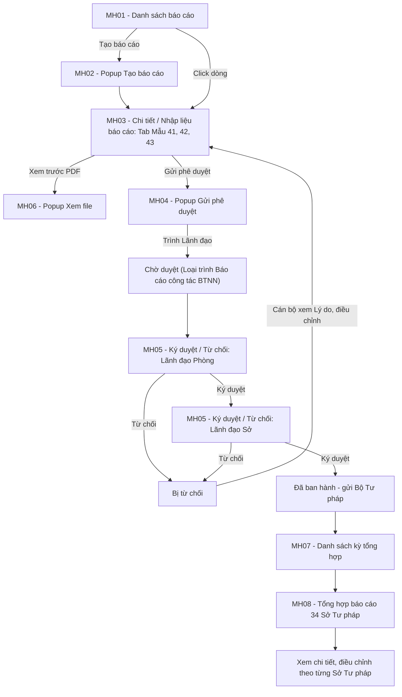
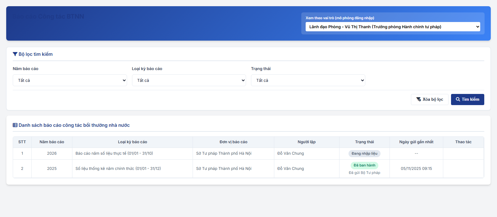
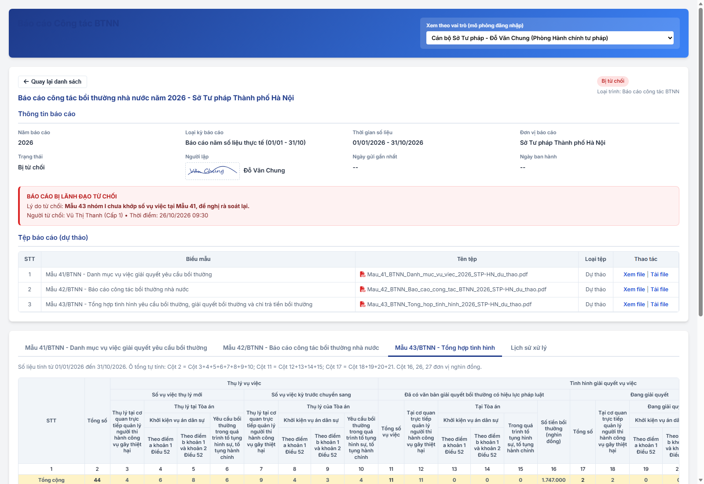
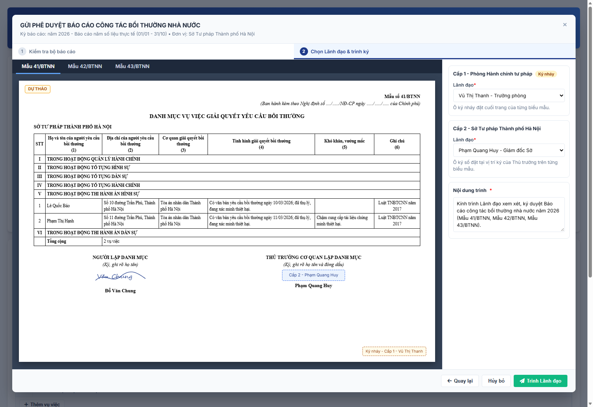
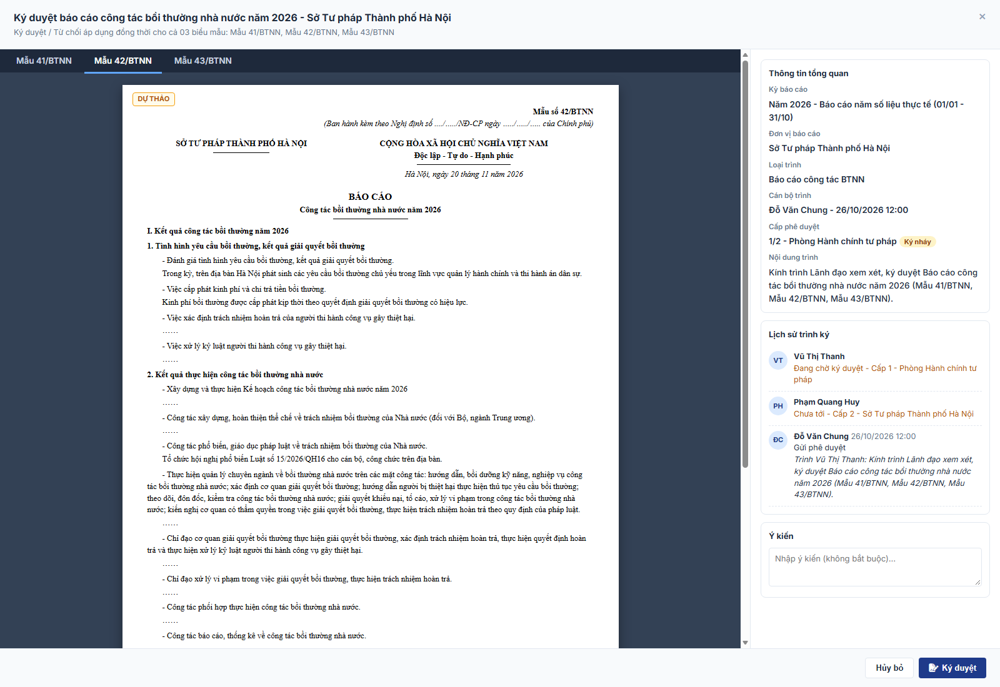
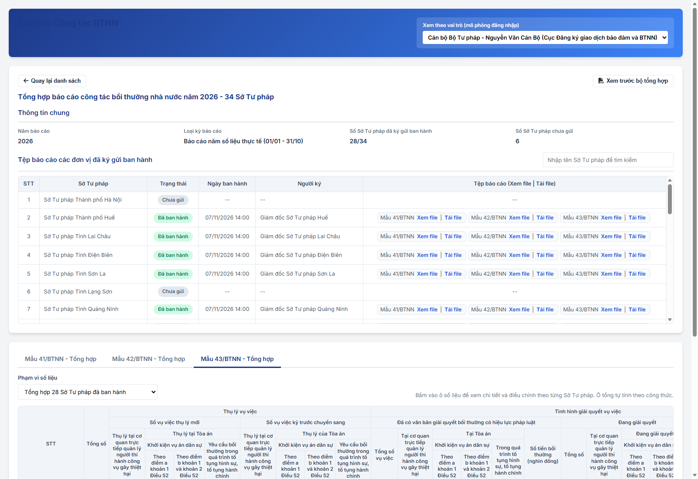

### 4.3.3.26. Báo cáo Công tác BTNN

#### 1. Mục đích
Cho phép Sở Tư pháp lập, trình ký số và gửi Bộ Tư pháp báo cáo công tác bồi thường nhà nước theo kỳ; cho phép Bộ Tư pháp tổng hợp số liệu của 34 Sở Tư pháp, gồm:
- Lập bộ báo cáo gồm 03 biểu mẫu theo dự thảo Nghị định: Mẫu 41/BTNN - Danh mục vụ việc giải quyết yêu cầu bồi thường; Mẫu 42/BTNN - Báo cáo công tác bồi thường nhà nước; Mẫu 43/BTNN - Tổng hợp tình hình yêu cầu bồi thường, giải quyết bồi thường và chi trả tiền bồi thường.
- Nhập liệu trên 03 tab biểu mẫu; Mẫu 42/BTNN nhập theo từng mục của mẫu; Mẫu 41/BTNN, Mẫu 43/BTNN nhập tay.
- Xem trước tệp PDF của 03 biểu mẫu trước khi trình.
- Gửi phê duyệt 01 lần cho cả bộ báo cáo, trình Lãnh đạo Phòng ký nháy, Lãnh đạo Sở ký số theo luồng đã cấu hình.
- Lãnh đạo Ký duyệt hoặc Từ chối đồng thời cả 03 biểu mẫu; cán bộ xem Lý do từ chối để điều chỉnh, trình lại.
- Bộ Tư pháp xem, tải tệp đã ban hành của từng Sở Tư pháp; xem số liệu tổng hợp 03 biểu mẫu, xem chi tiết và điều chỉnh số liệu theo từng Sở Tư pháp.

*a. Phân quyền*
- Cán bộ Sở Tư pháp: tạo báo cáo, nhập liệu, xem trước PDF, Gửi phê duyệt, cập nhật và trình lại báo cáo `Bị từ chối` của Sở Tư pháp mình.
- Lãnh đạo Phòng, Lãnh đạo Sở: xem báo cáo của Sở Tư pháp mình; Ký duyệt / Từ chối báo cáo `Chờ duyệt` khi được chọn đích danh ở cấp phê duyệt hiện hành.
- Cán bộ Bộ Tư pháp: xem kỳ tổng hợp, tệp đã ban hành và số liệu tổng hợp của 34 Sở Tư pháp; điều chỉnh số liệu tổng hợp theo từng Sở Tư pháp.

*b. Điều kiện thực hiện*
- Người dùng đã đăng nhập Website Quản trị và được phân quyền chức năng `Báo cáo Công tác BTNN`.
- Sở Tư pháp đã được cấu hình luồng tại [Cấu hình luồng xử lý - Cấu hình luồng xử lý - Quản trị hệ thống (Website Quản trị)](../01_Quan_tri_he_thong/Cau_hinh_luong_xu_ly.md).
- Cán bộ lập báo cáo đã có chữ ký hình ảnh tại Thông tin cá nhân cán bộ.

---

#### 2. Sơ đồ luồng nghiệp vụ theo giao diện

---

#### 3. Quy tắc nghiệp vụ

1. Bộ báo cáo gồm 03 biểu mẫu: Mẫu 41/BTNN, Mẫu 42/BTNN, Mẫu 43/BTNN. Mỗi Sở Tư pháp có 01 báo cáo cho mỗi cặp `Năm báo cáo` - `Loại kỳ báo cáo`.
2. Loại kỳ báo cáo và thời gian số liệu:
   - `Báo cáo năm số liệu thực tế (01/01 - 31/10)`: từ 01/01 đến 31/10 của Năm báo cáo.
   - `Số liệu thống kê năm chính thức (01/01 - 31/12)`: từ 01/01 đến 31/12 của Năm báo cáo.
3. Trạng thái báo cáo:

| Trạng thái | Ý nghĩa | Thao tác theo trạng thái |
| :--- | :--- | :--- |
| `Đang nhập liệu` | Báo cáo đã tạo, chưa trình | Cán bộ Sở Tư pháp: Xem chi tiết, Sửa, Lưu, Xem trước PDF, Gửi phê duyệt. |
| `Chờ duyệt` | Đã Gửi phê duyệt, đang chờ Lãnh đạo; dòng phụ `Loại trình: Báo cáo công tác BTNN` và cấp đang chờ | Lãnh đạo được chọn ở cấp hiện hành: Ký duyệt, Từ chối. Cán bộ Sở Tư pháp: Xem chi tiết. |
| `Bị từ chối` | Lãnh đạo một cấp đã Từ chối; dòng phụ `Loại trình: Báo cáo công tác BTNN` | Cán bộ Sở Tư pháp: Xem Lý do từ chối, Sửa, Lưu, Xem trước PDF, Gửi phê duyệt lại. |
| `Đã ban hành` | Lãnh đạo cấp cuối đã Ký duyệt; dòng phụ `Đã gửi Bộ Tư pháp` | Mọi vai trò: Xem chi tiết, Xem file, Tải file. Bộ Tư pháp tổng hợp số liệu. |

4. Trình ký:
   - Hình thức ký duy nhất là `Ký số trên hệ thống`; báo cáo không ký duyệt ở ngoài (không có Ký ngoài, không tải lên văn bản đã ký).
   - Luồng ký: thực hiện theo luồng đã cấu hình tại [Cấu hình luồng xử lý - Cấu hình luồng xử lý - Quản trị hệ thống (Website Quản trị)](../01_Quan_tri_he_thong/Cau_hinh_luong_xu_ly.md); số cấp theo cấu hình của Sở Tư pháp (Cấp 1 - Phòng, Cấp 2 - Sở).
   - Cấp được cấu hình Ký nháy: hiển thị nhãn `Ký nháy`; ô ký nháy đặt cuối trang của từng biểu mẫu.
   - Ô ký số Lãnh đạo cấp cuối đặt tại vị trí ký của Thủ trưởng trên từng biểu mẫu.
   - Trình 01 lần cho cả bộ 03 biểu mẫu; Lãnh đạo Ký duyệt hoặc Từ chối đồng thời cả 03 biểu mẫu.
   - Trong khi `Chờ duyệt`, số liệu 03 biểu mẫu chỉ đọc.
5. Người lập: Họ và tên, chữ ký hình ảnh lấy theo Thông tin cá nhân cán bộ của cán bộ thực hiện Gửi phê duyệt; in tại vị trí Người lập danh mục (Mẫu 41/BTNN) và Người lập biểu (Mẫu 43/BTNN).
6. Mẫu 43/BTNN: ô tổng tự tính, chỉ đọc:
   - Cột 2 = Cột 3 + 4 + 5 + 6 + 7 + 8 + 9 + 10.
   - Cột 11 = Cột 12 + 13 + 14 + 15.
   - Cột 17 = Cột 18 + 19 + 20 + 21.
   - Dòng `Tổng cộng` = tổng 06 nhóm của từng cột.
7. Tệp báo cáo: hệ thống sinh tệp PDF từng biểu mẫu theo [Mẫu 41/BTNN - Danh mục vụ việc giải quyết yêu cầu bồi thường - Bảng mapping trường dữ liệu biểu mẫu BTNN - Công tác bồi thường nhà nước](Bieu_mau/Bang_mapping_truong_du_lieu_bieu_mau_BTNN.md), [Mẫu 42/BTNN - Báo cáo công tác bồi thường nhà nước - Bảng mapping trường dữ liệu biểu mẫu BTNN - Công tác bồi thường nhà nước](Bieu_mau/Bang_mapping_truong_du_lieu_bieu_mau_BTNN.md), [Mẫu 43/BTNN - Tổng hợp tình hình yêu cầu bồi thường, giải quyết bồi thường và chi trả tiền bồi thường - Bảng mapping trường dữ liệu biểu mẫu BTNN - Công tác bồi thường nhà nước](Bieu_mau/Bang_mapping_truong_du_lieu_bieu_mau_BTNN.md).
   - Trước khi ban hành: tệp `Dự thảo`, có nhãn `DỰ THẢO`.
   - Sau khi Lãnh đạo cấp cuối Ký duyệt: tệp `Đã ban hành`, có chữ ký số.
8. Tổng hợp tại Bộ Tư pháp:
   - Chỉ tổng hợp báo cáo `Đã ban hành` của cùng `Năm báo cáo` - `Loại kỳ báo cáo`.
   - Mẫu 41/BTNN: ghép danh mục vụ việc của các Sở Tư pháp theo 06 nhóm.
   - Mẫu 42/BTNN: ghép nội dung từng mục theo dạng `- [Tên Sở Tư pháp]: [Nội dung]`.
   - Mẫu 43/BTNN: cộng số liệu từng ô theo nhóm, cột.
   - Điều chỉnh của Bộ Tư pháp lưu riêng, chỉ dùng cho số liệu tổng hợp; không thay đổi số liệu và tệp đã ban hành của Sở Tư pháp; ghi Lịch sử xử lý của báo cáo Sở Tư pháp.

---

### MH01 - Màn hình Danh sách báo cáo

#### 1. Màn hình

#### 2. Mô tả thông tin trên màn hình

- Áp dụng cho vai trò Sở Tư pháp (Cán bộ, Lãnh đạo Phòng, Lãnh đạo Sở); danh sách gồm báo cáo của Sở Tư pháp của người dùng.
- Vai trò Bộ Tư pháp mở [MH07 - Màn hình Danh sách kỳ tổng hợp - Báo cáo Công tác BTNN - Công tác bồi thường nhà nước (Website Quản trị)](#bctt-mh07).

| Trường thông tin | Kiểu dữ liệu | Bắt buộc | Mặc định | Mô tả |
| :--- | :--- | :--- | :--- | :--- |
| Tiêu đề màn hình | String(255) | - | `Báo cáo Công tác BTNN` | Control UI: Page Header (Read-only). - Đúng tên mục Menu. |
| **I. Bộ lọc tìm kiếm** | Section | - | - | Control UI: Khối thu gọn/mở rộng. |
| Năm báo cáo | Enum(String(4)) | Không | Năm hiện tại | Control UI: Combobox. - Gồm `Tất cả` và các năm có báo cáo, giảm dần. |
| Loại kỳ báo cáo | Enum(String(100)) | Không | `Tất cả` | Control UI: Combobox. Gồm: + Tất cả + Báo cáo năm số liệu thực tế (01/01 - 31/10) + Số liệu thống kê năm chính thức (01/01 - 31/12) |
| Trạng thái | Enum(String(50)) | Không | `Tất cả` | Control UI: Combobox. Gồm: + Tất cả + Đang nhập liệu + Chờ duyệt + Bị từ chối + Đã ban hành |
| **II. Danh sách báo cáo** | Data grid | - | 10 bản ghi/trang | Control UI: Data grid. - Sắp xếp theo Năm báo cáo giảm dần. - Click dòng: mở MH03. - Không có dữ liệu: 01 dòng `Không có dữ liệu`. |
| STT | Integer | - | Tự tăng | Control UI: Label. |
| Năm báo cáo | Integer(4) | - | Theo bản ghi | Control UI: Label. - Theo dữ liệu bản ghi. |
| Loại kỳ báo cáo | String(100) | - | Theo bản ghi | Control UI: Label. - Theo dữ liệu bản ghi. |
| Đơn vị báo cáo | String(255) | - | Theo bản ghi | Control UI: Label. - Tên Sở Tư pháp. |
| Người lập | String(100) | - | Theo bản ghi | Control UI: Label. - Họ và tên cán bộ lập báo cáo. |
| Trạng thái | Enum(String(50)) | - | Theo bản ghi | Control UI: Badge và dòng phụ. - Giá trị theo [Quy tắc nghiệp vụ - Báo cáo Công tác BTNN - Công tác bồi thường nhà nước (Website Quản trị)](#bctt-quy-tac) quy tắc 3. - `Chờ duyệt`: dòng phụ `Loại trình: Báo cáo công tác BTNN`, `Chờ Cấp [n] - [Họ tên Lãnh đạo]`. - `Bị từ chối`: dòng phụ `Loại trình: Báo cáo công tác BTNN`. - `Đã ban hành`: dòng phụ `Đã gửi Bộ Tư pháp`. |
| Ngày gửi gần nhất | DateTime | - | Theo bản ghi | Control UI: Label. - Thời điểm Gửi phê duyệt gần nhất, định dạng `dd/mm/yyyy HH:mm`. - Chưa gửi: `--`. |
| Thao tác | Action buttons | - | - | Control UI: Nhóm nút biểu tượng, cột cố định bên phải. - Hiển thị theo trạng thái và vai trò theo [Quy tắc nghiệp vụ - Báo cáo Công tác BTNN - Công tác bồi thường nhà nước (Website Quản trị)](#bctt-quy-tac) quy tắc 3. Gồm: + Sửa + Gửi phê duyệt + Ký duyệt + Từ chối |
| Thanh phân trang | Panel | - | 10 bản ghi/trang | Control UI: Pagination bar. - Số bản ghi/trang gồm: + 10 + 20 + 50 + 100 - Ẩn khi không có bản ghi. |

#### 3. Chức năng trên màn hình

| STT | Tên chức năng | Định dạng | Mô tả |
| :--- | :--- | :--- | :--- |
| 1 | Tìm kiếm | Button | Lọc danh sách theo điều kiện đã chọn, về Trang 1. |
| 2 | Xóa bộ lọc | Button | Đặt lại điều kiện lọc, tải lại danh sách, về Trang 1. |
| 3 | Tạo báo cáo | Button | Chỉ hiển thị với Cán bộ Sở Tư pháp. Mở MH02. |
| 4 | Xem chi tiết | Click dòng | Mở MH03 của báo cáo. |
| 5 | Sửa | Icon button | Hiển thị khi báo cáo `Đang nhập liệu` hoặc `Bị từ chối` với Cán bộ Sở Tư pháp. Mở MH03 ở chế độ nhập liệu. |
| 6 | Gửi phê duyệt | Icon button | Hiển thị như `Sửa`. Mở MH03, kiểm tra dữ liệu và mở MH04 theo chức năng `Gửi phê duyệt` tại MH03. |
| 7 | Ký duyệt / Từ chối | Icon button | Hiển thị khi báo cáo `Chờ duyệt` và người dùng là Lãnh đạo được chọn ở cấp hiện hành. Mở MH05 theo thao tác tương ứng. |
| 8 | Phân trang | Panel | Tải lại danh sách theo trang, số bản ghi/trang đã chọn; giữ điều kiện lọc. |

---

### MH02 - Popup Tạo báo cáo

#### 1. Màn hình

Popup mở khi Cán bộ Sở Tư pháp click `Tạo báo cáo` tại MH01.

#### 2. Mô tả thông tin trên màn hình

| Trường thông tin | Kiểu dữ liệu | Bắt buộc | Mặc định | Mô tả |
| :--- | :--- | :--- | :--- | :--- |
| Tiêu đề popup | String(255) | - | `Tạo báo cáo công tác bồi thường nhà nước` | Control UI: Heading text (Read-only). - Dòng phụ: `Đơn vị báo cáo: [Tên Sở Tư pháp]`. |
| Năm báo cáo | Enum(String(4)) | Có | Trống | Control UI: Combobox. - Gồm năm hiện tại, năm trước và năm sau. - `Placeholder: -- Chọn năm báo cáo --` - Bỏ trống: Hệ thống tô viền đỏ ô lỗi, hiển thị [MSG-ERR-VAL-001] dưới ô lỗi và focus vào ô lỗi đầu tiên. |
| Loại kỳ báo cáo | Enum(String(100)) | Có | Trống | Control UI: Combobox. Gồm: + Báo cáo năm số liệu thực tế (01/01 - 31/10) + Số liệu thống kê năm chính thức (01/01 - 31/12) - `Placeholder: -- Chọn loại kỳ báo cáo --` - Bỏ trống: Hệ thống tô viền đỏ ô lỗi, hiển thị [MSG-ERR-VAL-001] dưới ô lỗi và focus vào ô lỗi đầu tiên. |
| Ghi chú bộ biểu mẫu | Label | - | - | Control UI: Label. - Nội dung: `Bộ báo cáo gồm 03 biểu mẫu: Mẫu 41/BTNN, Mẫu 42/BTNN, Mẫu 43/BTNN.` |

#### 3. Chức năng trên màn hình

| STT | Tên chức năng | Định dạng | Mô tả |
| :--- | :--- | :--- | :--- |
| 1 | Tạo báo cáo | Button | - **TH1 - Bỏ trống trường bắt buộc**: Hệ thống tô viền đỏ ô lỗi, hiển thị [MSG-ERR-VAL-001] dưới ô lỗi và focus vào ô lỗi đầu tiên. - **TH2 - Trùng kỳ**: Sở Tư pháp đã có báo cáo cùng Năm báo cáo, Loại kỳ báo cáo: thông báo `Đơn vị đã có báo cáo của kỳ này.`, không tạo. - **TH Hợp lệ**: Tạo báo cáo trạng thái `Đang nhập liệu`, 03 biểu mẫu trống, Thời gian số liệu theo [Quy tắc nghiệp vụ - Báo cáo Công tác BTNN - Công tác bồi thường nhà nước (Website Quản trị)](#bctt-quy-tac) quy tắc 2; ghi Lịch sử xử lý `Tạo báo cáo`; đóng popup, mở MH03, thông báo `Đã tạo báo cáo công tác BTNN năm [Năm báo cáo].` |
| 2 | Hủy bỏ / Đóng | Button | Đóng popup, không lưu. |

---

### MH03 - Màn hình Chi tiết / Nhập liệu báo cáo

#### 1. Màn hình

#### 2. Mô tả thông tin trên màn hình

- Bố cục từ trên xuống: khối `Thông tin báo cáo` (gồm `Khối Lý do bị từ chối`, `Tệp báo cáo`), khối tab biểu mẫu (`Mẫu 41/BTNN`, `Mẫu 42/BTNN`, `Mẫu 43/BTNN`, `Lịch sử xử lý`), thanh thao tác.
- Chế độ nhập liệu khi Cán bộ Sở Tư pháp mở báo cáo `Đang nhập liệu` hoặc `Bị từ chối`; trạng thái khác hoặc vai trò khác: chỉ đọc.

| Trường thông tin | Kiểu dữ liệu | Bắt buộc | Mặc định | Mô tả |
| :--- | :--- | :--- | :--- | :--- |
| Tiêu đề màn hình | String(255) | - | Theo bản ghi | Control UI: Heading text. - `Báo cáo công tác bồi thường nhà nước năm [Năm báo cáo] - [Tên Sở Tư pháp]`. |
| **I. Thông tin báo cáo** | Section | - | - | Control UI: Section header. |
| Năm báo cáo | - | - | Theo bản ghi | Control UI: Label. - Theo dữ liệu bản ghi. |
| Loại kỳ báo cáo | - | - | Theo bản ghi | Control UI: Label. - Theo dữ liệu bản ghi. |
| Thời gian số liệu | - | - | Theo bản ghi | Control UI: Label. - `[Từ ngày] - [Đến ngày]`, định dạng `dd/mm/yyyy`. |
| Đơn vị báo cáo | - | - | Theo bản ghi | Control UI: Label. - Theo dữ liệu bản ghi. |
| Trạng thái | - | - | Theo bản ghi | Control UI: Label. - Theo dữ liệu bản ghi. - `Chờ duyệt`: dòng phụ `Loại trình: Báo cáo công tác BTNN - Chờ Cấp [n] - [Họ tên Lãnh đạo]`. |
| Người lập | - | - | Theo bản ghi | Control UI: Label. - Ảnh chữ ký hình ảnh và Họ và tên cán bộ lập báo cáo theo Thông tin cá nhân cán bộ. |
| Ngày gửi gần nhất | - | - | Theo bản ghi | Control UI: Label. - Định dạng `dd/mm/yyyy HH:mm`; chưa gửi: `--`. |
| Ngày ban hành | - | - | Theo bản ghi | Control UI: Label. - `[dd/mm/yyyy HH:mm] - [Họ tên Lãnh đạo ký]`; chưa ban hành: `--`. |
| Khối Lý do bị từ chối | Section | - | Ẩn | Control UI: Khối cảnh báo (Read-only). - Chỉ hiển thị khi báo cáo `Bị từ chối`. - Tiêu đề `BÁO CÁO BỊ LÃNH ĐẠO TỪ CHỐI`. - Gồm Lý do từ chối, Người từ chối (Cấp [n]), Thời điểm `dd/mm/yyyy HH:mm` của lần từ chối gần nhất. |
| **II. Tệp báo cáo** | Data grid | - | 03 dòng | Control UI: Data grid (Read-only). - Tiêu đề `Tệp báo cáo (dự thảo)` hoặc `Tệp báo cáo (đã ban hành)` theo trạng thái. - Mỗi biểu mẫu 01 dòng. |
| STT | Integer | - | Tự tăng | Control UI: Label. |
| Biểu mẫu | - | - | Theo bản ghi | Control UI: Label. - `[Mã mẫu] - [Tên mẫu]`. |
| Tên tệp | - | - | Theo bản ghi | Control UI: Label. - Theo quy tắc đặt tên tại Bảng mapping trường dữ liệu biểu mẫu BTNN. |
| Loại tệp | - | - | Theo bản ghi | Control UI: Label. Gồm: + Dự thảo: báo cáo chưa `Đã ban hành` + Đã ban hành: báo cáo `Đã ban hành` |
| Thao tác | Action buttons | - | - | Control UI: Link. Gồm: + Xem file + Tải file |
| **III. Tab biểu mẫu** | Tab | - | `Mẫu 41/BTNN` | Control UI: Tab. Gồm: + Mẫu 41/BTNN - Danh mục vụ việc giải quyết yêu cầu bồi thường + Mẫu 42/BTNN - Báo cáo công tác bồi thường nhà nước + Mẫu 43/BTNN - Tổng hợp tình hình + Lịch sử xử lý |

**Tab Mẫu 41/BTNN**

| Trường thông tin | Kiểu dữ liệu | Bắt buộc | Mặc định | Mô tả |
| :--- | :--- | :--- | :--- | :--- |
| Cơ quan lập danh mục | - | - | Theo bản ghi | Control UI: Label. - Tên Sở Tư pháp. |
| Danh mục vụ việc | Data grid | - | Trống | Control UI: Data grid nhập liệu. - Nhóm dòng theo 06 nhóm: + I. Trong hoạt động quản lý hành chính + II. Trong hoạt động tố tụng hình sự + III. Trong hoạt động tố tụng dân sự + IV. Trong hoạt động tố tụng hành chính + V. Trong hoạt động thi hành án hình sự + VI. Trong hoạt động thi hành án dân sự - Dưới mỗi nhóm: nút `Thêm vụ việc`. - Dòng cuối `Tổng cộng`: `[Số] vụ việc`. |
| STT | Integer | - | Tự tăng | Control UI: Label. - Đánh số lại trong từng nhóm. |
| Họ và tên của người yêu cầu bồi thường (1) | Text(500) | Có | Trống | Control UI: Textarea. - `Placeholder: Nhập họ và tên` - Bỏ trống: Hệ thống tô viền đỏ ô lỗi, hiển thị [MSG-ERR-VAL-001] dưới ô lỗi và focus vào ô lỗi đầu tiên. |
| Địa chỉ của người yêu cầu bồi thường (2) | Text(500) | Không | Trống | Control UI: Textarea. - `Placeholder: Nhập nội dung` |
| Cơ quan giải quyết bồi thường (3) | Text(500) | Không | Trống | Control UI: Textarea. - `Placeholder: Nhập nội dung` |
| Tình hình giải quyết bồi thường (4) | Text(2000) | Không | Trống | Control UI: Textarea. - `Placeholder: Nhập nội dung` |
| Khó khăn, vướng mắc (5) | Text(2000) | Không | Trống | Control UI: Textarea. - `Placeholder: Nhập nội dung` |
| Ghi chú (6) | Text(1000) | Không | Trống | Control UI: Textarea. - `Placeholder: Nhập nội dung` |
| Thao tác | Action buttons | - | - | Control UI: Icon button. - Chỉ hiển thị ở chế độ nhập liệu. Gồm: + Xóa |

**Tab Mẫu 42/BTNN**

- Mỗi mục trên Mẫu 42/BTNN là 01 ô nhập liệu; tên mục hiển thị đúng câu chữ của mẫu, `[Năm báo cáo]` thay theo trường `Năm báo cáo`.

| Trường thông tin | Kiểu dữ liệu | Bắt buộc | Mặc định | Mô tả |
| :--- | :--- | :--- | :--- | :--- |
| Cơ quan báo cáo | - | - | Theo bản ghi | Control UI: Label. - Tên Sở Tư pháp. |
| Năm báo cáo | String(4) | Có | Năm báo cáo của bản ghi | Control UI: Input text. - Chỉ nhập 04 chữ số. - `Placeholder: Nhập năm báo cáo` - Bỏ trống: Hệ thống tô viền đỏ ô lỗi, hiển thị [MSG-ERR-VAL-001] dưới ô lỗi và focus vào ô lỗi đầu tiên. |
| Địa danh | - | - | Theo bản ghi | Control UI: Label. - Tỉnh/Thành phố của Sở Tư pháp, bỏ tiền tố `Tỉnh`, `Thành phố`. |
| Ngày báo cáo | Date | Có | Trống | Control UI: DatePicker. - Định dạng `dd/mm/yyyy`. - `Placeholder: dd/mm/yyyy` - Sai định dạng: hiển thị `Ngày không hợp lệ (dd/mm/yyyy)` dưới ô. - Bỏ trống: Hệ thống tô viền đỏ ô lỗi, hiển thị [MSG-ERR-VAL-001] dưới ô lỗi và focus vào ô lỗi đầu tiên. |
| **I. Kết quả công tác bồi thường năm [Năm báo cáo]** | Section | - | - | Control UI: Section header. |
| **1. Tình hình yêu cầu bồi thường, kết quả giải quyết bồi thường** | Section | - | - | Control UI: Section header. |
| Đánh giá tình hình yêu cầu bồi thường, kết quả giải quyết bồi thường | Text(4000) | Không | Trống | Control UI: Textarea. - `Placeholder: Nhập nội dung báo cáo` |
| Việc cấp phát kinh phí và chi trả tiền bồi thường | Text(4000) | Không | Trống | Control UI: Textarea. - `Placeholder: Nhập nội dung báo cáo` |
| Việc xác định trách nhiệm hoàn trả của người thi hành công vụ gây thiệt hại | Text(4000) | Không | Trống | Control UI: Textarea. - `Placeholder: Nhập nội dung báo cáo` |
| Việc xử lý kỷ luật người thi hành công vụ gây thiệt hại | Text(4000) | Không | Trống | Control UI: Textarea. - `Placeholder: Nhập nội dung báo cáo` |
| **2. Kết quả thực hiện công tác bồi thường nhà nước** | Section | - | - | Control UI: Section header. |
| Xây dựng và thực hiện Kế hoạch công tác bồi thường nhà nước năm [Năm báo cáo] | Text(4000) | Không | Trống | Control UI: Textarea. - `Placeholder: Nhập nội dung báo cáo` |
| Công tác xây dựng, hoàn thiện thể chế về trách nhiệm bồi thường của Nhà nước (đối với Bộ, ngành Trung ương) | Text(4000) | Không | Trống | Control UI: Textarea. - `Placeholder: Nhập nội dung báo cáo` |
| Công tác phổ biến, giáo dục pháp luật về trách nhiệm bồi thường của Nhà nước | Text(4000) | Không | Trống | Control UI: Textarea. - `Placeholder: Nhập nội dung báo cáo` |
| Thực hiện quản lý chuyên ngành về bồi thường nhà nước | Text(4000) | Không | Trống | Control UI: Textarea. - Nhãn hiển thị đúng toàn văn mục của mẫu. - `Placeholder: Nhập nội dung báo cáo` |
| Chỉ đạo cơ quan giải quyết bồi thường thực hiện giải quyết bồi thường, xác định trách nhiệm hoàn trả, thực hiện quyết định hoàn trả và thực hiện xử lý kỷ luật người thi hành công vụ gây thiệt hại | Text(4000) | Không | Trống | Control UI: Textarea. - `Placeholder: Nhập nội dung báo cáo` |
| Chỉ đạo xử lý vi phạm trong việc giải quyết bồi thường, thực hiện trách nhiệm hoàn trả | Text(4000) | Không | Trống | Control UI: Textarea. - `Placeholder: Nhập nội dung báo cáo` |
| Công tác phối hợp thực hiện công tác bồi thường nhà nước | Text(4000) | Không | Trống | Control UI: Textarea. - `Placeholder: Nhập nội dung báo cáo` |
| Công tác báo cáo, thống kê về công tác bồi thường nhà nước | Text(4000) | Không | Trống | Control UI: Textarea. - `Placeholder: Nhập nội dung báo cáo` |
| **3. Đánh giá chung về kết quả công tác bồi thường nhà nước** | Section | - | - | Control UI: Section header. |
| Đánh giá chung những kết quả đạt được | Text(4000) | Không | Trống | Control UI: Textarea. - `Placeholder: Nhập nội dung báo cáo` |
| Những vướng mắc, bất cập và nguyên nhân | Text(4000) | Không | Trống | Control UI: Textarea. - `Placeholder: Nhập nội dung báo cáo` |
| II. Nhiệm vụ trọng tâm và giải pháp thực hiện công tác bồi thường nhà nước năm [Năm báo cáo + 1] | Text(4000) | Không | Trống | Control UI: Textarea. - Năm hiển thị trên nhãn = Năm báo cáo cộng 01. - `Placeholder: Nhập nội dung báo cáo` |
| III. Đề xuất, kiến nghị | Text(4000) | Không | Trống | Control UI: Textarea. - `Placeholder: Nhập nội dung báo cáo` |

**Tab Mẫu 43/BTNN**

| Trường thông tin | Kiểu dữ liệu | Bắt buộc | Mặc định | Mô tả |
| :--- | :--- | :--- | :--- | :--- |
| Ghi chú số liệu | Label | - | - | Control UI: Label. - `Số liệu tính từ [Từ ngày] đến [Đến ngày]` và công thức ô tổng theo [Quy tắc nghiệp vụ - Báo cáo Công tác BTNN - Công tác bồi thường nhà nước (Website Quản trị)](#bctt-quy-tac) quy tắc 6. |
| Bảng số liệu | Data grid | - | 0 | Control UI: Data grid nhập liệu, cuộn ngang. - Tiêu đề cột nhiều tầng đúng bố cục Mẫu 43/BTNN, dòng số thứ tự cột 1 - 27. - Dòng: `Tổng cộng`; 06 nhóm I - VI, mỗi nhóm 01 dòng tên nhóm và 01 dòng số liệu. |
| Ô số liệu Cột 3 - 10, 12 - 15, 18 - 27 | Integer(10) | Không | 0 | Control UI: Input number. - Số nguyên không âm. - Cột 16, 26, 27: đơn vị nghìn đồng. |
| Ô tổng Cột 2, 11, 17 | Integer(10) | - | Hệ thống tự tính | Control UI: Label (Read-only). - Tự tính lại ngay khi thay đổi ô thành phần theo quy tắc 6. |
| Dòng Tổng cộng | Integer(10) | - | Hệ thống tự tính | Control UI: Label (Read-only). - Tổng 06 nhóm của từng cột. |

**Tab Lịch sử xử lý**

| Trường thông tin | Kiểu dữ liệu | Bắt buộc | Mặc định | Mô tả |
| :--- | :--- | :--- | :--- | :--- |
| Lịch sử xử lý | List(Object) | - | Theo bản ghi | Control UI: Danh sách sự kiện (Read-only), giảm dần theo thời gian. - Mỗi sự kiện: chữ viết tắt họ tên, Họ tên, thời điểm `dd/mm/yyyy HH:mm`, hành động, nội dung. Hành động gồm: + Tạo báo cáo + Lưu báo cáo + Gửi phê duyệt + Ký duyệt và chuyển xử lý đến [Họ tên Lãnh đạo cấp tiếp theo] + Ký duyệt + Từ chối + Ban hành và gửi Bộ Tư pháp + Điều chỉnh vụ việc Mẫu 41/BTNN + Điều chỉnh nội dung Mẫu 42/BTNN + Điều chỉnh số liệu Mẫu 43/BTNN |

#### 3. Chức năng trên màn hình

| STT | Tên chức năng | Định dạng | Mô tả |
| :--- | :--- | :--- | :--- |
| 1 | Chuyển tab | Tab | Hiển thị nội dung tab được chọn; giữ dữ liệu đang nhập của các tab. |
| 2 | Thêm vụ việc | Button | Tab Mẫu 41/BTNN, chế độ nhập liệu: thêm 01 dòng trống cuối nhóm. |
| 3 | Xóa vụ việc | Icon button | Tab Mẫu 41/BTNN: xóa dòng ngay, đánh số lại STT trong nhóm, thông báo `Đã xóa vụ việc khỏi danh mục.` |
| 4 | Nhập ô số liệu | Input | Tab Mẫu 43/BTNN: tự tính lại ô tổng của nhóm và dòng `Tổng cộng`. |
| 5 | Xem file / Tải file | Link | Tại `Tệp báo cáo`: - `Xem file`: mở MH06 tại tab biểu mẫu tương ứng. - `Tải file`: tải tệp PDF của biểu mẫu. |
| 6 | Xem trước PDF | Button | Mở MH06 với dữ liệu đang nhập (tệp `Dự thảo`). |
| 7 | Lưu | Button | Chế độ nhập liệu: lưu dữ liệu 03 biểu mẫu, không kiểm tra trường bắt buộc; ghi Lịch sử xử lý `Lưu báo cáo`; thông báo `Đã lưu báo cáo.` |
| 8 | Gửi phê duyệt | Button | Chế độ nhập liệu. - **TH1 - Bỏ trống trường bắt buộc**: Hệ thống tô viền đỏ ô lỗi, hiển thị [MSG-ERR-VAL-001] dưới ô lỗi và focus vào ô lỗi đầu tiên; không mở MH04. - **TH2 - Ngày báo cáo sai định dạng**: hiển thị `Ngày không hợp lệ (dd/mm/yyyy)` dưới ô; không mở MH04. - TH1, TH2: hệ thống chuyển đến tab có ô lỗi đầu tiên. - **TH Hợp lệ**: + Lưu dữ liệu 03 biểu mẫu. + Mở MH04. |
| 9 | Ký duyệt / Từ chối | Button | Hiển thị khi báo cáo `Chờ duyệt` và người dùng là Lãnh đạo được chọn ở cấp hiện hành. Mở MH05. |
| 10 | Quay lại | Button | Về MH01; dữ liệu chưa Lưu không được lưu. |

---

### MH04 - Popup Gửi phê duyệt

#### 1. Màn hình

- Bố cục giống [Popup Trình duyệt Hoãn giải quyết bồi thường - Giải quyết yêu cầu bồi thường - Công tác bồi thường nhà nước (Website Quản trị)](SRS_BTNN_GiaiQuyetBT_GiaiQuyet_YCBT.md#gq-popup-hoan); khác biệt:
  + Văn bản trình ký là bộ 03 biểu mẫu sinh theo mẫu; không có `Nguồn tệp văn bản`, `Tải lên từ máy`, `Ký ngoài`.
  + Bước 1 - Kiểm tra bộ báo cáo: `Hình thức ký`, `Bộ báo cáo trình ký`, `Người lập biểu`, `Tài liệu kèm theo`.
  + Bước 2 - Chọn Lãnh đạo & trình ký: vùng trái xem văn bản có thanh tab 03 biểu mẫu; vùng phải thẻ cấp ký, `Nội dung trình`.
  + Ô ký do hệ thống đặt theo [Quy tắc nghiệp vụ - Báo cáo Công tác BTNN - Công tác bồi thường nhà nước (Website Quản trị)](#bctt-quy-tac) quy tắc 4; không có nút `Đặt chữ ký`.
- Báo cáo `Bị từ chối`: điền lại Lãnh đạo từng cấp, `Nội dung trình`, `Tài liệu kèm theo` của lần trình trước.

#### 2. Mô tả thông tin trên màn hình

| Trường thông tin | Kiểu dữ liệu | Bắt buộc | Mặc định | Mô tả |
| :--- | :--- | :--- | :--- | :--- |
| Tiêu đề popup | String(255) | - | `GỬI PHÊ DUYỆT BÁO CÁO CÔNG TÁC BỒI THƯỜNG NHÀ NƯỚC` | Control UI: Heading text (Read-only). - Dòng phụ: `Kỳ báo cáo: năm [Năm báo cáo] - [Loại kỳ báo cáo] • Đơn vị: [Tên Sở Tư pháp]`. |
| Thanh chỉ trình (Stepper) | Component | - | Bước 1 active | Control UI: Stepper 2 bước. Gồm: + Bước 1: Kiểm tra bộ báo cáo + Bước 2: Chọn Lãnh đạo & trình ký |
| Khối Báo cáo bị từ chối | Section | - | Ẩn | Control UI: Khối cảnh báo (Read-only). - Chỉ hiển thị khi báo cáo `Bị từ chối`. - Gồm Lý do từ chối, Người từ chối, Thời điểm. |
| Hình thức ký | - | - | `Ký số trên hệ thống` | Control UI: Label (Read-only). - Giá trị cố định, không cho chọn; báo cáo không ký duyệt ở ngoài. - Theo luồng đã cấu hình tại [Cấu hình luồng xử lý - Cấu hình luồng xử lý - Quản trị hệ thống (Website Quản trị)](../01_Quan_tri_he_thong/Cau_hinh_luong_xu_ly.md). |
| **Bộ báo cáo trình ký** | Data grid | - | 03 dòng | Control UI: Data grid (Read-only). |
| Biểu mẫu | - | - | Theo bản ghi | Control UI: Label. - `[Mã mẫu] - [Tên mẫu]`. |
| Tình trạng dữ liệu | - | - | Theo bản ghi | Control UI: Label. - Mẫu 41/BTNN: `[Số] vụ việc`. - Mẫu 42/BTNN: `[Số mục đã nhập]/16 mục đã nhập nội dung`. - Mẫu 43/BTNN: `Tổng số [Cột 2 dòng Tổng cộng] vụ việc (Cột 2)`. |
| Thao tác | Action buttons | - | - | Control UI: Link. Gồm: + Xem trước PDF |
| **Người lập biểu** | Section | - | - | Control UI: Khối thông tin (Read-only). - Ảnh chữ ký hình ảnh, Họ và tên, Chức vụ của người dùng đang thao tác theo Thông tin cá nhân cán bộ. |
| Tài liệu kèm theo | List(Object) | Không | 01 dòng trống | Control UI: Bảng động dùng chung. - Cột: `STT`, `Tên văn bản, căn cứ`, `Tải file`, `Thao tác`: Xem file, Xóa. - Nút `+ Thêm tài liệu`. - Dòng đã nhập phải có đủ `Tên văn bản, căn cứ` và tệp; dòng trống không lưu. - Định dạng `.pdf`, `.doc`, `.docx`, `.jpg`, `.jpeg`, `.png`; tối đa 50MB/tệp. |
| Xem văn bản (Bước 2) | Component | - | Tab `Mẫu 41/BTNN` | Control UI: Document Viewer (Read-only), vùng trái. - Thanh tab: `Mẫu 41/BTNN`, `Mẫu 42/BTNN`, `Mẫu 43/BTNN`. - Hiển thị văn bản dự thảo, ô ký các cấp theo Lãnh đạo đang chọn. |
| Thẻ cấp ký (Bước 2) | Component | - | Theo luồng đã cấu hình | Control UI: Danh sách thẻ, mỗi cấp 01 thẻ. - Tiêu đề `Cấp [n] - [Đơn vị]`. - Cấp có cấu hình Ký nháy: nhãn `Ký nháy`. |
| Lãnh đạo (từng cấp) | Enum(String(100)) | Có | Lãnh đạo đầu tiên của nhóm lãnh đạo cấp đó | Control UI: Combobox tại từng thẻ cấp ký. - Danh sách là Nhóm lãnh đạo của đơn vị ở cấp tương ứng, hiển thị `[Họ tên] - [Chức vụ]`. - `Placeholder: -- Chọn Lãnh đạo --` - Bỏ trống: Hệ thống tô viền đỏ ô lỗi, hiển thị [MSG-ERR-VAL-001] dưới ô lỗi và focus vào ô lỗi đầu tiên. |
| Nội dung trình | Text(2000) | Có | `Kính trình Lãnh đạo xem xét, ký duyệt Báo cáo công tác bồi thường nhà nước năm [Năm báo cáo] (Mẫu 41/BTNN, Mẫu 42/BTNN, Mẫu 43/BTNN).` | Control UI: Textarea (4 dòng). - `Placeholder: Nhập nội dung trình Lãnh đạo...` - Bỏ trống: Hệ thống tô viền đỏ ô lỗi, hiển thị [MSG-ERR-VAL-001] dưới ô lỗi và focus vào ô lỗi đầu tiên. |

#### 3. Chức năng trên màn hình

| STT | Tên chức năng | Định dạng | Mô tả |
| :--- | :--- | :--- | :--- |
| 1 | Xem trước PDF | Link | Mở MH06 tại tab biểu mẫu tương ứng. |
| 2 | Thêm tài liệu / Tải file / Xem file / Xóa | Button / Icon button | Theo bảng `Tài liệu kèm theo` dùng chung: - Sai định dạng: [MSG-ERR-FILE-001], không tiếp nhận tệp. - Quá 50MB: [MSG-ERR-FILE-002], không tiếp nhận tệp. - `Xóa`: xóa dòng ngay. |
| 3 | Tiếp tục | Button | Tại Bước 1. - **TH1 - Dòng Tài liệu kèm theo thiếu Tên văn bản, căn cứ hoặc tệp**: Hệ thống tô viền đỏ ô lỗi, hiển thị [MSG-ERR-VAL-001] dưới ô lỗi và focus vào ô lỗi đầu tiên. - **TH Hợp lệ**: sinh văn bản dự thảo 03 biểu mẫu, chuyển Bước 2. |
| 4 | Chọn Lãnh đạo | Combobox | Cập nhật ô ký trên văn bản đang xem. |
| 5 | Quay lại | Button | Tại Bước 2: về Bước 1, giữ dữ liệu đã nhập. |
| 6 | Trình Lãnh đạo | Button | Tại Bước 2. - **TH1 - Bỏ trống trường bắt buộc**: Hệ thống tô viền đỏ ô lỗi, hiển thị [MSG-ERR-VAL-001] dưới ô lỗi và focus vào ô lỗi đầu tiên. - **TH Hợp lệ**: tạo phiếu trình Loại trình `Báo cáo công tác BTNN` kèm 03 văn bản dự thảo, Lãnh đạo từng cấp, `Nội dung trình`, `Tài liệu kèm theo`; ghi Người lập = người dùng đang thao tác; báo cáo chuyển `Chờ duyệt`, cấp hiện hành = Cấp 1; ghi Ngày gửi gần nhất, Lịch sử xử lý `Gửi phê duyệt`; xóa Khối Lý do bị từ chối khỏi màn hình; đóng popup, tải lại MH03, thông báo `Đã gửi phê duyệt báo cáo đến [Họ tên Lãnh đạo Cấp 1].` |
| 7 | Hủy bỏ / Đóng | Button | Đóng popup, không trình, giữ nguyên trạng thái báo cáo. |

---

### MH05 - Màn hình Ký duyệt / Từ chối

#### 1. Màn hình

- Theo [Màn hình Ký duyệt / Từ chối - Xác định cơ quan giải quyết bồi thường - Công tác bồi thường nhà nước (Website Quản trị)](SRS_BTNN_GiaiQuyetBT__Xac%20định%20cơ%20quan%20GQBT.md#xd-ky-duyet).
- Mở khi Lãnh đạo được chọn ở cấp phê duyệt hiện hành click `Ký duyệt` hoặc `Từ chối` tại MH01 / MH03.
- Hiển thị toàn màn hình, gồm 02 vùng:
  + Vùng trái: xem văn bản trình ký, chia 03 tab `Mẫu 41/BTNN`, `Mẫu 42/BTNN`, `Mẫu 43/BTNN`.
  + Vùng phải, theo thứ tự: `Thông tin tổng quan`, `Tài liệu kèm theo` (chỉ khi có), `Lịch sử trình ký`, `Ý kiến` / `Lý do từ chối`.
- Ký duyệt / Từ chối áp dụng đồng thời cho cả 03 biểu mẫu.

#### 2. Mô tả thông tin trên màn hình

| Trường thông tin | Kiểu dữ liệu | Bắt buộc | Mặc định | Mô tả |
| :--- | :--- | :--- | :--- | :--- |
| Tiêu đề màn hình | String(255) | - | Theo thao tác | Control UI: Heading text (Read-only). - `Ký duyệt báo cáo công tác bồi thường nhà nước năm [Năm báo cáo] - [Tên Sở Tư pháp]` / `Từ chối phê duyệt báo cáo công tác bồi thường nhà nước năm [Năm báo cáo] - [Tên Sở Tư pháp]`. - Dòng phụ: `Ký duyệt / Từ chối áp dụng đồng thời cho cả 03 biểu mẫu: Mẫu 41/BTNN, Mẫu 42/BTNN, Mẫu 43/BTNN`. |
| Tab biểu mẫu | Tab | - | `Mẫu 41/BTNN` | Control UI: Tab đặt đầu vùng xem văn bản. Gồm: + Mẫu 41/BTNN + Mẫu 42/BTNN + Mẫu 43/BTNN |
| Xem văn bản trình ký | File | - | Văn bản của phiếu trình đang chờ duyệt | Control UI: Document Viewer (Read-only). - Hiển thị văn bản của tab đang chọn, ô ký `Cấp [n] - [Họ tên Lãnh đạo]`, ô ký nháy (nếu có). |
| **THÔNG TIN TỔNG QUAN** | Section | - | - | Control UI: Section header. |
| Kỳ báo cáo | - | - | Theo bản ghi | Control UI: Label. - `Năm [Năm báo cáo] - [Loại kỳ báo cáo]`. |
| Đơn vị báo cáo | - | - | Theo bản ghi | Control UI: Label. - Theo dữ liệu bản ghi. |
| Loại trình | - | - | `Báo cáo công tác BTNN` | Control UI: Label. - Theo dữ liệu phiếu trình. |
| Cán bộ trình | - | - | Theo bản ghi | Control UI: Label. - `[Họ tên] - [dd/mm/yyyy HH:mm]`. |
| Cấp phê duyệt | - | - | Theo bản ghi | Control UI: Label. - `[Cấp hiện hành]/[Tổng số cấp] - [Đơn vị]`; cấp Ký nháy hiển thị nhãn `Ký nháy`. |
| Nội dung trình | - | - | Theo bản ghi | Control UI: Label. - Theo dữ liệu phiếu trình. |
| **TÀI LIỆU KÈM THEO** | List(Object) | - | Theo phiếu trình | Control UI: Data grid (Read-only). - Chỉ hiển thị khi phiếu trình có tài liệu kèm theo. - Cột: `STT`, `Tên văn bản, căn cứ`, `Tệp`, `Thao tác`: Xem file. |
| **LỊCH SỬ TRÌNH KÝ** | List(Object) | - | Theo bản ghi | Control UI: Danh sách sự kiện (Read-only), giảm dần theo thời gian. - Gồm mọi lượt trình, kể cả lượt bị từ chối; cấp đang chờ: `Đang chờ ký duyệt`; cấp sau: `Chưa tới`. |
| Ý kiến | Text(2000) | Không | Trống | Control UI: Textarea. - Chỉ hiển thị khi thao tác là `Ký duyệt`. - `Placeholder: Nhập ý kiến (không bắt buộc)...` |
| Lý do từ chối | Text(2000) | Có | Trống | Control UI: Textarea. - Chỉ hiển thị khi thao tác là `Từ chối`. - `Placeholder: Nhập lý do từ chối...` - Bỏ trống: Hệ thống tô viền đỏ ô lỗi, hiển thị [MSG-ERR-VAL-001] dưới ô lỗi và focus vào ô lỗi đầu tiên. |

#### 3. Chức năng trên màn hình

| STT | Tên chức năng | Định dạng | Mô tả |
| :--- | :--- | :--- | :--- |
| 1 | Chuyển tab biểu mẫu | Tab | Hiển thị văn bản của biểu mẫu được chọn. |
| 2 | Ký duyệt | Button | Chỉ hiển thị khi thao tác là `Ký duyệt`. - **TH1 - Báo cáo không còn hợp lệ** (không còn chờ cấp này hoặc người dùng không còn là Lãnh đạo được chọn; kiểm tra tại máy chủ): hiển thị [MSG-ERR-BTNN-LXL-005], đóng màn hình, tải lại danh sách. - **TH2 - Ký số không thành công**: báo cáo giữ `Chờ duyệt`; hiển thị thông báo lỗi ký số, giữ màn hình. - **TH3 - Hợp lệ, chưa phải cấp cuối**: ghi kết quả Ký duyệt (ký nháy nếu cấp được cấu hình) cả 03 biểu mẫu, kèm Ý kiến; chuyển Lãnh đạo cấp tiếp theo đã chọn khi trình; giữ `Chờ duyệt`; ghi Lịch sử `Ký duyệt và chuyển xử lý đến [Họ tên Lãnh đạo cấp tiếp theo]`; thông báo `Đã ký duyệt cả 03 biểu mẫu và chuyển [Họ tên] ký duyệt.` - **TH4 - Hợp lệ, cấp cuối**: ký số cả 03 biểu mẫu; báo cáo chuyển `Đã ban hành`, 03 tệp chuyển `Đã ban hành`; ghi Ngày ban hành, Người ký; gửi Bộ Tư pháp (báo cáo được tính vào kỳ tổng hợp tại MH08); ghi Lịch sử `Ký duyệt`, `Ban hành và gửi Bộ Tư pháp`; thông báo `Đã ký số ban hành cả 03 biểu mẫu và gửi Bộ Tư pháp.` - Đóng màn hình, tải lại MH03. |
| 3 | Từ chối | Button | Chỉ hiển thị khi thao tác là `Từ chối`. - **TH1 - Bỏ trống trường bắt buộc**: Hệ thống tô viền đỏ ô lỗi, hiển thị [MSG-ERR-VAL-001] dưới ô lỗi và focus vào ô lỗi đầu tiên. - **TH2 - Báo cáo không còn hợp lệ**: như Ký duyệt TH1. - **TH Hợp lệ**: ghi kết quả Từ chối cả 03 biểu mẫu kèm Lý do từ chối; báo cáo chuyển `Bị từ chối`; lưu Lý do, Người từ chối, Cấp, Thời điểm để hiển thị tại Khối Lý do bị từ chối (MH03); ghi Lịch sử `Từ chối`; đóng màn hình, tải lại MH03, thông báo `Đã từ chối báo cáo. Cán bộ lập báo cáo nhận lại để điều chỉnh.` |
| 4 | Hủy bỏ / Đóng | Button | Đóng màn hình, không lưu. |

---

### MH06 - Popup Xem file

#### 1. Màn hình

- Popup mở khi click `Xem trước PDF` (MH03, MH04), `Xem file` (MH03, MH08) hoặc `Xem trước bộ tổng hợp` (MH08).
- Hiển thị toàn màn hình, văn bản chia 03 tab tương ứng 03 biểu mẫu.

#### 2. Mô tả thông tin trên màn hình

| Trường thông tin | Kiểu dữ liệu | Bắt buộc | Mặc định | Mô tả |
| :--- | :--- | :--- | :--- | :--- |
| Tiêu đề popup | String(255) | - | Theo chức năng mở | Control UI: Heading text (Read-only). - `Xem trước bộ báo cáo (PDF)`, `Xem trước PDF`, `Xem file` hoặc `Xem trước bộ tổng hợp (PDF)`. - Dòng phụ: `[Tên đơn vị] - năm [Năm báo cáo]`. |
| Tab biểu mẫu | Tab | - | Biểu mẫu được chọn khi mở; mặc định `Mẫu 41/BTNN` | Control UI: Tab. Gồm: + Mẫu 41/BTNN + Mẫu 42/BTNN + Mẫu 43/BTNN |
| Xem văn bản | File | - | Theo tab | Control UI: Document Viewer (Read-only). - Tệp `Dự thảo`: nhãn `DỰ THẢO`, ô ký chờ ký. - Tệp `Đã ban hành`: chữ ký số các cấp. |

#### 3. Chức năng trên màn hình

| STT | Tên chức năng | Định dạng | Mô tả |
| :--- | :--- | :--- | :--- |
| 1 | Chuyển tab biểu mẫu | Tab | Hiển thị văn bản của biểu mẫu được chọn. |
| 2 | Tải file | Button | Tải tệp PDF của biểu mẫu đang xem. |
| 3 | Đóng | Button | Đóng popup. |

---

### MH07 - Màn hình Danh sách kỳ tổng hợp

#### 1. Màn hình

Màn hình mặc định của vai trò Bộ Tư pháp tại chức năng `Báo cáo Công tác BTNN`.

#### 2. Mô tả thông tin trên màn hình

| Trường thông tin | Kiểu dữ liệu | Bắt buộc | Mặc định | Mô tả |
| :--- | :--- | :--- | :--- | :--- |
| Danh sách kỳ tổng hợp | Data grid | - | Theo dữ liệu | Control UI: Data grid. - Mỗi cặp Năm báo cáo - Loại kỳ báo cáo 01 dòng, giảm dần theo năm. - Click dòng: mở MH08. |
| STT | Integer | - | Tự tăng | Control UI: Label. |
| Năm báo cáo | - | - | Theo bản ghi | Control UI: Label. - Theo dữ liệu bản ghi. |
| Loại kỳ báo cáo | - | - | Theo bản ghi | Control UI: Label. - Theo dữ liệu bản ghi. |
| Số Sở Tư pháp đã gửi | - | - | Theo bản ghi | Control UI: Label. - `[Số báo cáo Đã ban hành]/34`. |
| Trạng thái tổng hợp | Enum(String(50)) | - | Theo bản ghi | Control UI: Badge. Gồm: + Đang tiếp nhận: chưa đủ 34 Sở Tư pháp + Đủ số liệu: đủ 34 Sở Tư pháp |
| Thao tác | Action buttons | - | - | Control UI: Icon button. Gồm: + Xem tổng hợp |

#### 3. Chức năng trên màn hình

| STT | Tên chức năng | Định dạng | Mô tả |
| :--- | :--- | :--- | :--- |
| 1 | Xem tổng hợp | Click dòng / Icon button | Mở MH08 của kỳ. |

---

### MH08 - Màn hình Tổng hợp báo cáo

#### 1. Màn hình

#### 2. Mô tả thông tin trên màn hình

- Bố cục từ trên xuống: khối `Thông tin chung` (gồm `Tệp báo cáo các đơn vị đã ký gửi ban hành`), khối 03 tab tổng hợp `Mẫu 41/BTNN`, `Mẫu 42/BTNN`, `Mẫu 43/BTNN`.
- Số liệu tổng hợp theo [Quy tắc nghiệp vụ - Báo cáo Công tác BTNN - Công tác bồi thường nhà nước (Website Quản trị)](#bctt-quy-tac) quy tắc 8.

| Trường thông tin | Kiểu dữ liệu | Bắt buộc | Mặc định | Mô tả |
| :--- | :--- | :--- | :--- | :--- |
| Tiêu đề màn hình | String(255) | - | Theo bản ghi | Control UI: Heading text. - `Tổng hợp báo cáo công tác bồi thường nhà nước năm [Năm báo cáo] - 34 Sở Tư pháp`. |
| **I. Thông tin chung** | Section | - | - | Control UI: Section header. |
| Năm báo cáo | - | - | Theo bản ghi | Control UI: Label. - Theo dữ liệu bản ghi. |
| Loại kỳ báo cáo | - | - | Theo bản ghi | Control UI: Label. - Theo dữ liệu bản ghi. |
| Số Sở Tư pháp đã ký gửi ban hành | - | - | Theo bản ghi | Control UI: Label. - `[Số]/34`. |
| Số Sở Tư pháp chưa gửi | - | - | Theo bản ghi | Control UI: Label. - 34 trừ số đã ký gửi ban hành. |
| **Tệp báo cáo các đơn vị đã ký gửi ban hành** | Data grid | - | 34 dòng | Control UI: Data grid (Read-only), cuộn dọc. - Mỗi Sở Tư pháp 01 dòng. |
| Tên Sở Tư pháp | String(255) | Không | Trống | Control UI: Input text đặt trên bảng. - Lọc theo tên, không phân biệt hoa thường. - `Placeholder: Nhập tên Sở Tư pháp để tìm kiếm` |
| Sở Tư pháp | - | - | Theo bản ghi | Control UI: Label. - Theo dữ liệu bản ghi. |
| Trạng thái | - | - | Theo bản ghi | Control UI: Badge. Gồm: + Đã ban hành + Chưa gửi: báo cáo chưa `Đã ban hành` hoặc chưa tạo |
| Ngày ban hành | - | - | Theo bản ghi | Control UI: Label. - Định dạng `dd/mm/yyyy HH:mm`; chưa gửi: `--`. |
| Người ký | - | - | Theo bản ghi | Control UI: Label. - Họ tên Lãnh đạo cấp cuối; chưa gửi: `--`. |
| Tệp báo cáo | - | - | Theo bản ghi | Control UI: Nhóm thẻ tệp, mỗi biểu mẫu 01 thẻ. - Thẻ: `[Mã mẫu]`, link `Xem file`, `Tải file`. - Chưa gửi: `--`. |
| **II. Tab Mẫu 41/BTNN - Tổng hợp** | Tab | - | - | Control UI: Tab. |
| Sở Tư pháp | Enum(String(255)) | Không | `Tất cả ([Số] Sở Tư pháp đã ban hành)` | Control UI: Combobox. - Gồm `Tất cả` và các Sở Tư pháp đã ban hành. |
| Danh mục vụ việc tổng hợp | Data grid | - | Theo dữ liệu | Control UI: Data grid (Read-only), nhóm theo 06 nhóm như Tab Mẫu 41/BTNN (MH03). - Cột: `STT`, 06 cột (1) - (6) của Mẫu 41/BTNN, `Sở Tư pháp`, `Thao tác`: Điều chỉnh. - Dòng đã điều chỉnh: nhãn `Đã điều chỉnh` tại cột `Sở Tư pháp`. - Dòng cuối `Tổng cộng`: `[Số] vụ việc`. |
| **III. Tab Mẫu 42/BTNN - Tổng hợp** | Tab | - | - | Control UI: Tab. - Các mục như Tab Mẫu 42/BTNN (MH03). |
| Nội dung tổng hợp (từng mục) | Text | - | Hệ thống tự ghép | Control UI: Textarea (Read-only). - Ghép nội dung mục của các Sở Tư pháp theo quy tắc 8. - Dưới mỗi mục: link `Xem chi tiết theo Sở Tư pháp`. |
| **IV. Tab Mẫu 43/BTNN - Tổng hợp** | Tab | - | - | Control UI: Tab. |
| Phạm vi số liệu | Enum(String(255)) | Không | `Tổng hợp [Số] Sở Tư pháp đã ban hành` | Control UI: Combobox. - Gồm phạm vi tổng hợp và từng Sở Tư pháp đã ban hành. |
| Bảng số liệu tổng hợp | Data grid | - | Hệ thống tự tính | Control UI: Data grid, bố cục như Tab Mẫu 43/BTNN (MH03). - Phạm vi tổng hợp: ô số liệu dạng link, click mở Popup Chi tiết số liệu theo Sở Tư pháp; ô tổng chỉ đọc. - Phạm vi 01 Sở Tư pháp: ô số liệu dạng Input number để điều chỉnh; ô tổng tự tính. |

#### 3. Chức năng trên màn hình

| STT | Tên chức năng | Định dạng | Mô tả |
| :--- | :--- | :--- | :--- |
| 1 | Tìm Sở Tư pháp | Input | Lọc bảng `Tệp báo cáo các đơn vị đã ký gửi ban hành` theo tên. |
| 2 | Xem file / Tải file | Link | Tại thẻ tệp: `Xem file` mở MH06 của báo cáo Sở Tư pháp tại tab biểu mẫu tương ứng; `Tải file` tải tệp PDF đã ban hành. |
| 3 | Xem trước bộ tổng hợp | Button | Mở MH06 với số liệu tổng hợp 03 biểu mẫu; cơ quan báo cáo là Bộ Tư pháp. |
| 4 | Lọc Sở Tư pháp (Mẫu 41/BTNN) | Combobox | Hiển thị vụ việc của Sở Tư pháp được chọn hoặc toàn bộ. |
| 5 | Điều chỉnh vụ việc (Mẫu 41/BTNN) | Icon button | Mở Popup Điều chỉnh vụ việc Mẫu 41/BTNN. |
| 6 | Xem chi tiết theo Sở Tư pháp (Mẫu 42/BTNN) | Link | Mở Popup Chi tiết nội dung theo Sở Tư pháp của mục. |
| 7 | Chọn phạm vi số liệu (Mẫu 43/BTNN) | Combobox | Hiển thị số liệu tổng hợp hoặc số liệu của Sở Tư pháp được chọn. |
| 8 | Xem chi tiết ô số liệu (Mẫu 43/BTNN) | Link | Phạm vi tổng hợp: mở Popup Chi tiết số liệu theo Sở Tư pháp của nhóm, cột. |
| 9 | Lưu điều chỉnh (Mẫu 43/BTNN) | Button | Phạm vi 01 Sở Tư pháp: lưu số liệu điều chỉnh theo quy tắc 8; ghi Lịch sử xử lý `Điều chỉnh số liệu Mẫu 43/BTNN`; tải lại số liệu tổng hợp; thông báo `Đã lưu điều chỉnh số liệu Mẫu 43/BTNN của [Tên Sở Tư pháp].` |
| 10 | Quay lại danh sách | Button | Về MH07. |

**Popup Điều chỉnh vụ việc Mẫu 41/BTNN**

| Trường thông tin | Kiểu dữ liệu | Bắt buộc | Mặc định | Mô tả |
| :--- | :--- | :--- | :--- | :--- |
| Tiêu đề popup | String(255) | - | `Điều chỉnh vụ việc Mẫu 41/BTNN` | Control UI: Heading text. - Dòng phụ: `[Tên Sở Tư pháp] • Nhóm [I - VI] - [Tên nhóm]`. |
| Họ và tên của người yêu cầu bồi thường (1) | Text(500) | Có | Theo số liệu tổng hợp hiện tại | Control UI: Textarea. - `Placeholder: Nhập nội dung` - Bỏ trống: Hệ thống tô viền đỏ ô lỗi, hiển thị [MSG-ERR-VAL-001] dưới ô lỗi và focus vào ô lỗi đầu tiên. |
| Cột (2) - (6) | Text(2000) | Không | Theo số liệu tổng hợp hiện tại | Control UI: Textarea. - Mỗi cột 01 ô theo tên cột Mẫu 41/BTNN. - `Placeholder: Nhập nội dung` |

- `Lưu điều chỉnh`: TH1 - Bỏ trống trường bắt buộc: Hệ thống tô viền đỏ ô lỗi, hiển thị [MSG-ERR-VAL-001] dưới ô lỗi và focus vào ô lỗi đầu tiên; TH Hợp lệ: lưu điều chỉnh theo quy tắc 8, ghi Lịch sử xử lý `Điều chỉnh vụ việc Mẫu 41/BTNN`, đóng popup, tải lại tab, thông báo `Đã lưu điều chỉnh vụ việc của [Tên Sở Tư pháp].`
- `Hủy bỏ`: đóng popup, không lưu.

**Popup Chi tiết nội dung theo Sở Tư pháp - Mẫu 42/BTNN**

| Trường thông tin | Kiểu dữ liệu | Bắt buộc | Mặc định | Mô tả |
| :--- | :--- | :--- | :--- | :--- |
| Tiêu đề popup | String(255) | - | `Chi tiết nội dung theo Sở Tư pháp - Mẫu 42/BTNN` | Control UI: Heading text. - Dòng phụ: tên phần, mục của Mẫu 42/BTNN. |
| Danh sách Sở Tư pháp | Data grid | - | Các Sở Tư pháp đã ban hành | Control UI: Data grid. - Cột: `STT`, `Sở Tư pháp` (kèm nhãn `Đã điều chỉnh` nếu có), `Nội dung (cho phép điều chỉnh)`. |
| Nội dung (cho phép điều chỉnh) | Text(4000) | Không | Theo số liệu tổng hợp hiện tại | Control UI: Textarea. - `Placeholder: Nhập nội dung` |

- `Lưu điều chỉnh`: lưu các dòng có thay đổi theo quy tắc 8, ghi Lịch sử xử lý `Điều chỉnh nội dung Mẫu 42/BTNN` của từng Sở Tư pháp thay đổi; đóng popup, tải lại tab; thông báo `Đã lưu điều chỉnh nội dung của [Số] Sở Tư pháp.` hoặc `Không có thay đổi.`
- `Hủy bỏ`: đóng popup, không lưu.

**Popup Chi tiết số liệu theo Sở Tư pháp - Mẫu 43/BTNN**

| Trường thông tin | Kiểu dữ liệu | Bắt buộc | Mặc định | Mô tả |
| :--- | :--- | :--- | :--- | :--- |
| Tiêu đề popup | String(255) | - | `Chi tiết số liệu theo Sở Tư pháp - Mẫu 43/BTNN` | Control UI: Heading text. - Dòng phụ: `Nhóm [I - VI] - [Tên nhóm] • Cột [n]: [Tên cột]`. |
| Danh sách Sở Tư pháp | Data grid | - | Các Sở Tư pháp đã ban hành | Control UI: Data grid, cuộn dọc. - Cột: `STT`, `Sở Tư pháp`, `Số liệu đã ban hành`, `Số liệu tổng hợp`. - Giá trị khác số liệu đã ban hành: nhãn `Đã điều chỉnh`. |
| Số liệu tổng hợp | Integer(10) | Không | Theo số liệu tổng hợp hiện tại | Control UI: Input number, số nguyên không âm. - Cột 2, 11, 17: Label (Read-only), hiển thị ghi chú công thức; không có nút `Lưu điều chỉnh`. |

- `Lưu điều chỉnh`: lưu các dòng có thay đổi theo quy tắc 8, ghi Lịch sử xử lý `Điều chỉnh số liệu Mẫu 43/BTNN - Nhóm [I - VI] - Cột [n]` của từng Sở Tư pháp thay đổi; đóng popup, tính lại bảng tổng hợp; thông báo `Đã lưu điều chỉnh số liệu của [Số] Sở Tư pháp.` hoặc `Không có thay đổi.`
- `Hủy bỏ` / `Đóng`: đóng popup, không lưu.
