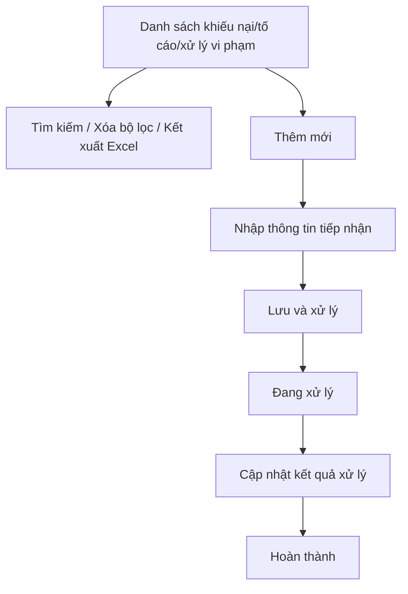
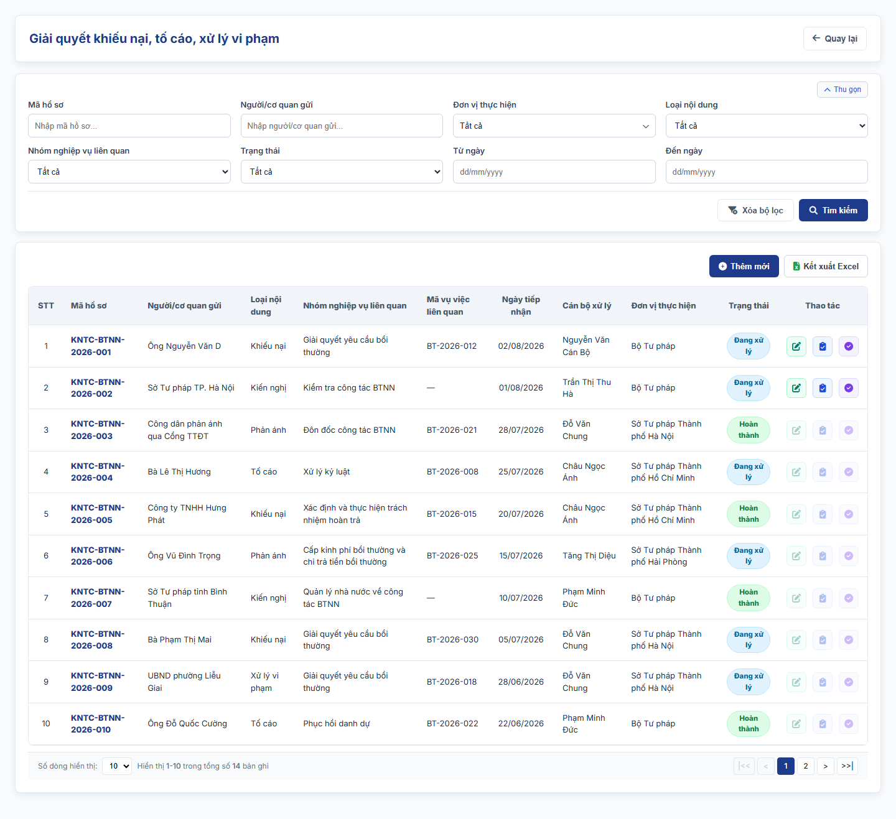

### 4.3.3. Dành cho Cán bộ Công tác bồi thường nhà nước

#### 4.3.3.10. UC-BTNN-KNTC - Giải quyết khiếu nại, tố cáo, xử lý vi phạm trong công tác BTNN

##### 4.3.3.10.1. Mục đích

\- Cho phép quản lý thông tin khiếu nại, tố cáo, phản ánh, kiến nghị liên quan đến công tác bồi thường nhà nước; theo dõi quá trình xử lý, kết quả xử lý và biện pháp khắc phục/xử lý vi phạm, theo khoản 5 Điều 44 (Bộ Tư pháp) và khoản 4 Điều 45 (Ủy ban nhân dân cấp tỉnh, Sở Tư pháp giúp thực hiện) dự thảo Nghị định quy định chi tiết một số điều và biện pháp thi hành Luật Trách nhiệm bồi thường của Nhà nước (bản gửi lấy ý kiến ngày 28/9/2026).

\- Cho phép liên kết hồ sơ với vụ việc yêu cầu bồi thường, hồ sơ hoàn trả, hồ sơ theo dõi/đôn đốc hoặc hồ sơ kiểm tra khi nội dung phát sinh từ các nghiệp vụ này.

*a. Phân quyền*:

\- Người dùng thuộc Bộ Tư pháp, Cục Đăng ký giao dịch bảo đảm và Bồi thường nhà nước hoặc Sở Tư pháp: được tra cứu, thêm mới; cập nhật, chuyển xử lý, cập nhật kết quả, hoàn thành và đính kèm tài liệu đối với hồ sơ do đơn vị mình tạo.

\- Người dùng thuộc Bộ Tư pháp hoặc Cục Đăng ký giao dịch bảo đảm và Bồi thường nhà nước: xem chi tiết hồ sơ của mọi Sở Tư pháp; không thao tác trên hồ sơ của Sở Tư pháp.

\- Người dùng thuộc Sở Tư pháp: chỉ xem hồ sơ do Sở mình tạo.

\- Người dùng thuộc đơn vị khác: không xem được dữ liệu.

\- Người dùng thuộc UBND cấp tỉnh: chỉ xem chi tiết hồ sơ của Sở Tư pháp trực thuộc; không thêm mới, không thao tác.

\- Phạm vi dữ liệu theo [Quy tắc phạm vi dữ liệu Bộ Tư pháp - Sở Tư pháp - Danh mục và Phụ lục - Tài liệu tổng hợp](../../Tai%20lieu%20tong%20hop/04_Danh_muc_va_Phu_luc.md#quy-tac-pham-vi-du-lieu-btp-stp).

*b. Điều kiện thực hiện*:

\- Người dùng đã đăng nhập Website Quản trị và có quyền truy cập nhóm chức năng Công tác bồi thường nhà nước.

\- Nội dung tiếp nhận thuộc nhóm khiếu nại, tố cáo, phản ánh, kiến nghị hoặc xử lý vi phạm liên quan đến giải quyết bồi thường, cấp kinh phí/chi trả, xác định trách nhiệm hoàn trả, xử lý kỷ luật, quản lý nhà nước về công tác BTNN.

##### 4.3.3.10.2. Sơ đồ luồng nghiệp vụ theo giao diện

##### 4.3.3.10.3. MH01 - Màn hình Danh sách khiếu nại, tố cáo, xử lý vi phạm trong công tác BTNN

###### 4.3.3.10.3.1. Màn hình

###### 4.3.3.10.3.2. Mô tả thông tin trên màn hình

| Trường thông tin | Kiểu dữ liệu | Bắt buộc | Mặc định | Mô tả |
| :--- | :--- | :--- | :--- | :--- |
| Tiêu đề màn hình | String(255) | Không | `Giải quyết khiếu nại, tố cáo, xử lý vi phạm` | Control UI: Text heading (Read-only). - Hiển thị đúng tên mục Menu `Giải quyết khiếu nại, tố cáo, xử lý vi phạm`. - Không có dòng mô tả dưới tiêu đề. |
| **I. Bộ lọc tìm kiếm** | - | - | - | Control UI: Khối thu gọn/mở rộng (Accordion). - Không hiển thị tiêu đề khối. - Cho phép thu gọn/mở rộng khi click vào nút "Thu gọn"/"Mở rộng" ở góc phải khối. |
| Mã hồ sơ | String(50) | Không | Trống | Tìm gần đúng theo mã hồ sơ. |
| Người/cơ quan gửi | String(255) | Không | Trống | Tìm gần đúng theo người/cơ quan gửi khiếu nại, tố cáo, phản ánh, kiến nghị. |
| Đơn vị thực hiện | List(String(50)) | Không | Tất cả | Control UI: Cây đơn vị chọn nhiều (Tree select) theo Cơ cấu tổ chức, có ô tìm kiếm theo tên. - Chỉ hiển thị khi người dùng thuộc Bộ Tư pháp hoặc Cục Đăng ký giao dịch bảo đảm và Bồi thường nhà nước. - Cây gồm Bộ Tư pháp, Cục Đăng ký giao dịch bảo đảm và Bồi thường nhà nước và đơn vị trực thuộc; các Sở Tư pháp và đơn vị trực thuộc, theo [Quy tắc phạm vi dữ liệu Bộ Tư pháp - Sở Tư pháp - Danh mục và Phụ lục - Tài liệu tổng hợp](../../Tai%20lieu%20tong%20hop/04_Danh_muc_va_Phu_luc.md#quy-tac-pham-vi-du-lieu-btp-stp). - Mỗi nút có ô tích; tích nút cha thì tích toàn bộ nút con. - `Tất cả`: không lọc. - Nút `Các Sở Tư pháp`: tích nhanh toàn bộ các Sở Tư pháp trong cây. - Chọn từ 02 đơn vị trở lên: ô hiển thị "Đã chọn [n] đơn vị". - Lọc bản ghi có `Đơn vị thực hiện` hoặc đơn vị công tác của `Cán bộ xử lý` thuộc các đơn vị đã tích. |
| Loại nội dung | Enum(String(100)) | Không | Tất cả | Gồm: + Tất cả + Khiếu nại + Tố cáo + Phản ánh + Kiến nghị + Xử lý vi phạm |
| Nhóm nghiệp vụ liên quan | Enum(String(100)) | Không | Tất cả | Gồm: + Tất cả + Giải quyết yêu cầu bồi thường + Cấp kinh phí bồi thường và chi trả tiền bồi thường + Xác định trách nhiệm hoàn trả + Xử lý kỷ luật + Quản lý nhà nước về công tác BTNN + Kiểm tra công tác BTNN + Đôn đốc công tác BTNN |
| Trạng thái | Enum(String(50)) | Không | Tất cả | Gồm: + Tất cả + Đang xử lý + Hoàn thành |
| Từ ngày | Date | Không | Trống | Ngày tiếp nhận từ, áp dụng [BR-VAL-007]. |
| Đến ngày | Date | Không | Trống | Ngày tiếp nhận đến, áp dụng [BR-VAL-007]. |
| Thêm mới | String(50) | Không | Hiển thị | Chi tiết nghiệp vụ xem tại bảng Chức năng trên màn hình. |
| Xóa bộ lọc | String(50) | Không | Hiển thị | Chi tiết nghiệp vụ xem tại bảng Chức năng trên màn hình. |
| Tìm kiếm | String(50) | Không | Hiển thị | Chi tiết nghiệp vụ xem tại bảng Chức năng trên màn hình. |
| Kết xuất Excel | String(50) | Không | Hiển thị | Chi tiết nghiệp vụ xem tại bảng Chức năng trên màn hình. |
| Bảng danh sách | String(255) | Không | 20 bản ghi/trang | Control UI: Data grid. - Phạm vi bản ghi theo [Quy tắc phạm vi dữ liệu Bộ Tư pháp - Sở Tư pháp - Danh mục và Phụ lục - Tài liệu tổng hợp](../../Tai%20lieu%20tong%20hop/04_Danh_muc_va_Phu_luc.md#quy-tac-pham-vi-du-lieu-btp-stp): + Người dùng thuộc Bộ Tư pháp hoặc Cục Đăng ký giao dịch bảo đảm và Bồi thường nhà nước: bản ghi của Bộ Tư pháp và của mọi Sở Tư pháp. + Người dùng thuộc Sở Tư pháp: bản ghi do Sở mình tạo. + Người dùng thuộc UBND cấp tỉnh: bản ghi của Sở Tư pháp trực thuộc; các icon thao tác hiển thị mờ. + Người dùng thuộc đơn vị khác: không hiển thị bản ghi. - Khi người dùng truy cập màn hình, hệ thống tự động tải trang đầu tiên (Trang 1) với số lượng mặc định 20 bản ghi. - Sắp xếp mặc định: Sắp xếp theo "Ngày tiếp nhận" giảm dần (mới nhất hiển thị lên đầu). - Trạng thái có dữ liệu: Hiển thị danh sách các bản ghi kết quả theo cấu trúc các cột quy định. - Trạng thái không có dữ liệu (Empty State): Khi không tìm thấy kết quả phù hợp với điều kiện tìm kiếm, bảng hiển thị duy nhất 01 dòng căn giữa trên toàn bộ chiều rộng bảng (`colspan`), in nghiêng với nội dung theo MessageList dùng chung [MSG-INF-SYS-001]. |
| STT | Integer(10) | Không | Tự tăng | Số thứ tự dòng trên trang hiện tại. |
| Mã hồ sơ | String(50) | Không | Theo dữ liệu | Người dùng click dòng dữ liệu để mở chi tiết. |
| Người/cơ quan gửi | String(255) | Không | Theo dữ liệu | Hiển thị chủ thể gửi nội dung. |
| Loại nội dung | Enum(String(100)) | Không | Theo dữ liệu | Hiển thị loại nội dung. |
| Nhóm nghiệp vụ liên quan | Enum(String(100)) | Không | Theo dữ liệu | Hiển thị nghiệp vụ BTNN liên quan. |
| Mã vụ việc liên quan | String(50) | Không | Theo dữ liệu | Hiển thị mã vụ việc nếu có liên kết. |
| Ngày tiếp nhận | Date | Không | Theo dữ liệu | Hỗ trợ sắp xếp. |
| Cán bộ xử lý | String(100) | Không | Theo dữ liệu | Control UI: Text (Read-only). - Họ và tên cán bộ đã nhập hồ sơ (người tạo). |
| Đơn vị thực hiện | String(255) | Không | Theo dữ liệu | Control UI: Text (Read-only). - Chỉ hiển thị khi người dùng thuộc Bộ Tư pháp hoặc Cục Đăng ký giao dịch bảo đảm và Bồi thường nhà nước. - Đặt ngay sau cột `Cán bộ xử lý`. - Hiển thị tên đơn vị thực hiện của bản ghi. |
| Trạng thái | Enum(String(50)) | Không | Theo dữ liệu | Hiển thị dạng badge. |
| Thao tác | String(255) | Không | Theo trạng thái | Không hiển thị row click chi tiết; xem bằng row click. Hiển thị `Sửa`, `Cập nhật kết quả`, `Hoàn thành` theo trạng thái; nút không đủ điều kiện hiển thị mờ. `Sửa` cho phép với hồ sơ ở trạng thái "Đang xử lý". - Hồ sơ của đơn vị khác: mọi nút hiển thị mờ. - Cột cố định bên phải lưới khi cuộn ngang. |
| Phân trang | String(255) | Không | 20 bản ghi/trang | Control UI: Pagination. - Cho phép chọn cấu hình số lượng bản ghi hiển thị trên mỗi trang gồm: 10, 20, 50, 100 bản ghi/trang; mặc định chọn sẵn 20 bản ghi/trang. - Đầy đủ các nút điều hướng trang: Đầu (&#124;&lt;&lt;), Trước (&lt;), các số trang, Sau (&gt;), Cuối (&gt;&gt;&#124;). - Hiển thị dải bản ghi: "Hiển thị [từ] - [đến] của [tổng số] bản ghi". |

###### 4.3.3.10.3.3. Chức năng trên màn hình

| STT | Tên chức năng | Định dạng | Mô tả |
| :--- | :--- | :--- | :--- |
| 1 | Thêm mới | Button | Mở **MH02 - Thêm mới/Cập nhật khiếu nại, tố cáo, xử lý vi phạm trong công tác BTNN** ở chế độ thêm mới. - Chỉ hiển thị khi người dùng thuộc Bộ Tư pháp, Cục Đăng ký giao dịch bảo đảm và Bồi thường nhà nước hoặc Sở Tư pháp. |
| 2 | Tìm kiếm | Button | Khi người dùng click nút, hệ thống kiểm tra điều kiện dữ liệu và thực hiện tìm kiếm theo các trường hợp bên dưới: |
|  |  |  | **TH1 - Khoảng ngày không hợp lệ**: Nếu `Từ ngày` lớn hơn `Đến ngày`, vi phạm [BR-VAL-007], hệ thống hiển thị cảnh báo lỗi [MSG-ERR-VAL-007] và không thực hiện tìm kiếm. |
|  |  |  | **TH Hợp lệ (Có dữ liệu phù hợp)**: Hệ thống lọc và hiển thị danh sách các bản ghi thỏa mãn đồng thời các tiêu chí tìm kiếm/lọc đã nhập/chọn, hiển thị kết quả lên bảng và đưa về Trang 1. |
|  |  |  | **TH Không có dữ liệu trả về**: Bảng kết quả hiển thị duy nhất 01 dòng căn giữa trên toàn bộ chiều rộng bảng (`colspan`), in nghiêng với nội dung theo MessageList dùng chung [MSG-INF-SYS-001]; thanh phân trang hiển thị *"Hiển thị 0-0 của 0 bản ghi"*, các nút điều hướng trang ở trạng thái ẩn hoặc khóa mờ (Disabled); nút "Kết xuất Excel" (nếu có) ở trạng thái khóa mờ kèm tooltip *"Không có dữ liệu để kết xuất Excel"*. |
|  |  |  | **TH Đơn vị của người dùng không thuộc phạm vi dữ liệu**: Người dùng không thuộc Bộ Tư pháp, Cục Đăng ký giao dịch bảo đảm và Bồi thường nhà nước, Sở Tư pháp hoặc UBND cấp tỉnh; bảng kết quả hiển thị 01 dòng căn giữa, in nghiêng: "Đơn vị của người dùng không thuộc phạm vi dữ liệu của chức năng này.". |
| 3 | Xóa bộ lọc | Button | Hệ thống xóa tiêu chí lọc, đưa về giá trị mặc định và tải lại danh sách. |
| 4 | Kết xuất Excel | Button | Kết xuất danh sách ra tệp Excel theo [Quy chuẩn Kết xuất Excel dùng chung - Danh mục và Phụ lục - Tài liệu tổng hợp](../../Tai%20lieu%20tong%20hop/04_Danh_muc_va_Phu_luc.md#quy-chuan-ket-xuat-excel): - Phạm vi: toàn bộ bản ghi thỏa mãn điều kiện tìm kiếm hiện hành, không giới hạn theo trang. - Cột xuất theo thứ tự lưới, không gồm cột Thao tác: STT, Mã hồ sơ, Người/cơ quan gửi, Loại nội dung, Nhóm nghiệp vụ liên quan, Mã vụ việc liên quan, Ngày tiếp nhận, Cán bộ xử lý, Trạng thái. - Tên tệp: `yyyyMMdd_Danh_sach_khieu_nai_to_cao_xu_ly_vi_pham.xlsx`. |
|  |  |  | **TH1 - Không có dữ liệu**: Hệ thống hiển thị [MSG-WRN-SYS-001] và không tải tệp. |
|  |  |  | **TH2 - Có dữ liệu**: Hệ thống tải tệp Excel về máy người dùng. |
| 5 | Click dòng dữ liệu | Row click | Mở **MH02 - Thêm mới/Cập nhật khiếu nại, tố cáo, xử lý vi phạm trong công tác BTNN** ở chế độ xem chi tiết; chỉ hiển thị nút `Đóng`. |
| 6 | Cập nhật kết quả | Button/Icon | Mở **MH02 - Thêm mới/Cập nhật khiếu nại, tố cáo, xử lý vi phạm trong công tác BTNN** tại khối kết quả xử lý khi hồ sơ ở trạng thái "Đang xử lý" và do đơn vị của người dùng tạo; hồ sơ của đơn vị khác: icon hiển thị mờ. |

##### 4.3.3.10.4. MH02 - Màn hình Thêm mới/Cập nhật khiếu nại, tố cáo, xử lý vi phạm trong công tác BTNN

###### 4.3.3.10.4.1. Màn hình

###### 4.3.3.10.4.2. Mô tả thông tin trên màn hình

| Trường thông tin | Kiểu dữ liệu | Bắt buộc | Mặc định | Mô tả |
| :--- | :--- | :--- | :--- | :--- |
| Mã hồ sơ | String(50) | Không | Hệ thống tự sinh | Chỉ đọc sau khi lưu lần đầu. |
| Loại nội dung | Enum(String(100)) | Có | Khiếu nại | Gồm: + Khiếu nại + Tố cáo + Phản ánh + Kiến nghị + Xử lý vi phạm |
| Ngày tiếp nhận | Date | Có | Ngày hiện tại | Áp dụng [BR-VAL-001]. |
| Người/cơ quan gửi | String(255) | Có | Trống | Tên người, cơ quan, tổ chức gửi nội dung. |
| Thông tin liên hệ | String(255) | Không | Trống | Số điện thoại, email hoặc địa chỉ liên hệ nếu có. |
| Nhóm nghiệp vụ liên quan | Enum(String(100)) | Có | Trống | Gồm các giá trị tại MH01. |
| Mã vụ việc liên quan | String(50) | Không | Trống | Cho phép liên kết vụ việc yêu cầu bồi thường hoặc hồ sơ hoàn trả nếu có. |
| Cơ quan/cá nhân bị phản ánh | String(255) | Không | Trống | Cơ quan, tổ chức, cá nhân liên quan đến nội dung phản ánh/khiếu nại/tố cáo. |
| Nội dung tiếp nhận | Text(4000) | Có | Trống | Nội dung khiếu nại, tố cáo, phản ánh, kiến nghị hoặc nội dung vi phạm cần xử lý. |
| Mức độ ưu tiên | Enum(String(50)) | Có | Bình thường | Gồm: + Bình thường + Khẩn + Rất khẩn |
| Đơn vị/cán bộ xử lý | String(255) | Có | Trống | Đơn vị hoặc cán bộ được phân công xử lý. |
| Hạn xử lý | Date | Không | Trống | Hạn xử lý nội dung tiếp nhận. |
| Kết quả xác minh/xử lý | Text(4000) | Có khi hoàn thành | Trống | Kết quả xử lý nội dung khiếu nại, tố cáo, phản ánh, kiến nghị hoặc vi phạm. |
| Biện pháp xử lý/khắc phục | Text(4000) | Không | Trống | Ghi nhận biện pháp xử lý vi phạm, kiến nghị xử lý hoặc khắc phục hậu quả nếu có. |
| Kết quả thực hiện biện pháp | Text(4000) | Không | Trống | Cập nhật tình hình thực hiện biện pháp xử lý/khắc phục. |
| Tài liệu đính kèm | List(File) | Không | Trống | Control UI: Bảng tài liệu đính kèm gồm các cột `STT`, `Tên tài liệu, văn bản`, `File đính kèm`, `Thao tác`; nút `Thêm tài liệu` dưới bảng. - Cột `File đính kèm`: khi dòng chưa có file hiển thị nút `Tải file`; khi đã có file hiển thị tên file. - Cột `Thao tác` gồm `Xem file` (khóa khi dòng chưa có file) và `Xóa`. - Ở chế độ xem chi tiết: ẩn `Xóa` và nút `Thêm tài liệu`; chỉ cho phép `Xem file`. - Áp dụng [BR-FILE-010]. |
| Lịch sử xử lý | String(255) | Không | Theo dữ liệu | Hiển thị thời gian, người thực hiện, thao tác, nội dung xử lý. |
| Hủy bỏ | String(50) | Không | Hiển thị | Chi tiết nghiệp vụ xem tại bảng Chức năng trên màn hình. |
| Lưu và xử lý | String(50) | Không | Hiển thị | Chi tiết nghiệp vụ xem tại bảng Chức năng trên màn hình. |
| Hoàn thành | String(50) | Không | Hiển thị sau khi có kết quả xử lý | Chi tiết nghiệp vụ xem tại bảng Chức năng trên màn hình. |

###### 4.3.3.10.4.3. Chức năng trên màn hình

| STT | Tên chức năng | Định dạng | Mô tả |
| :--- | :--- | :--- | :--- |
| 1 | Hủy bỏ | Button | Đóng màn hình và quay lại danh sách, không tự động lưu dữ liệu đang nhập. |
| 2 | Lưu và xử lý | Button | TH1 (Bỏ trống trường bắt buộc): Vi phạm [BR-VAL-001], hệ thống hiển thị lỗi inline và không cho lưu và xử lý. |
|  |  |  | TH2 (Dữ liệu không hợp lệ): Vi phạm [BR-VAL-007] hoặc [BR-FILE-010], hệ thống hiển thị lỗi inline và không cho lưu và xử lý. |
|  |  |  | TH Hợp lệ: Hệ thống lưu thông tin tiếp nhận trực tiếp ở trạng thái "Đang xử lý" (không có bước lưu tạm hồ sơ), ghi nhận đơn vị/cán bộ xử lý và lịch sử xử lý. |
| 3 | Hoàn thành | Button | TH1 (Chưa nhập kết quả xác minh/xử lý): Vi phạm [BR-VAL-001], hệ thống không cho hoàn thành. |
|  |  |  | TH Hợp lệ: Hệ thống chuyển hồ sơ sang trạng thái "Hoàn thành" và ghi lịch sử xử lý. |
| 4 | Xem file | Link | Hệ thống mở file của dòng tài liệu tại một tab trình duyệt mới. Link khóa mờ khi dòng chưa có file. |
| 5 | Tải lên | Button | Hệ thống mở trình chọn file cho dòng tài liệu tương ứng; sau khi chọn, hiển thị tên file tại cột `File đính kèm`. |
| 6 | Xóa | Icon button | Hệ thống xóa dòng tài liệu khỏi bảng ngay, không hiển thị popup xác nhận. - Không hiển thị ở chế độ xem chi tiết. |
