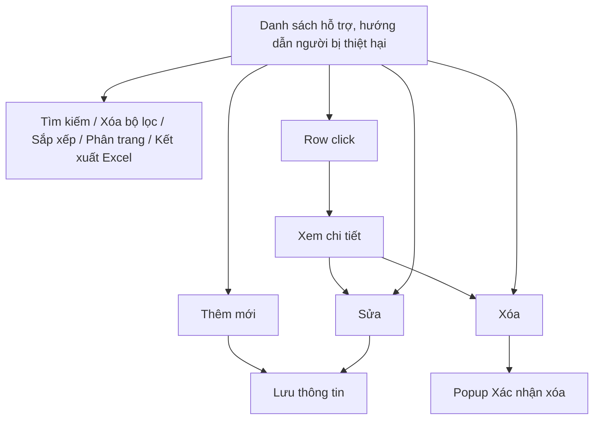
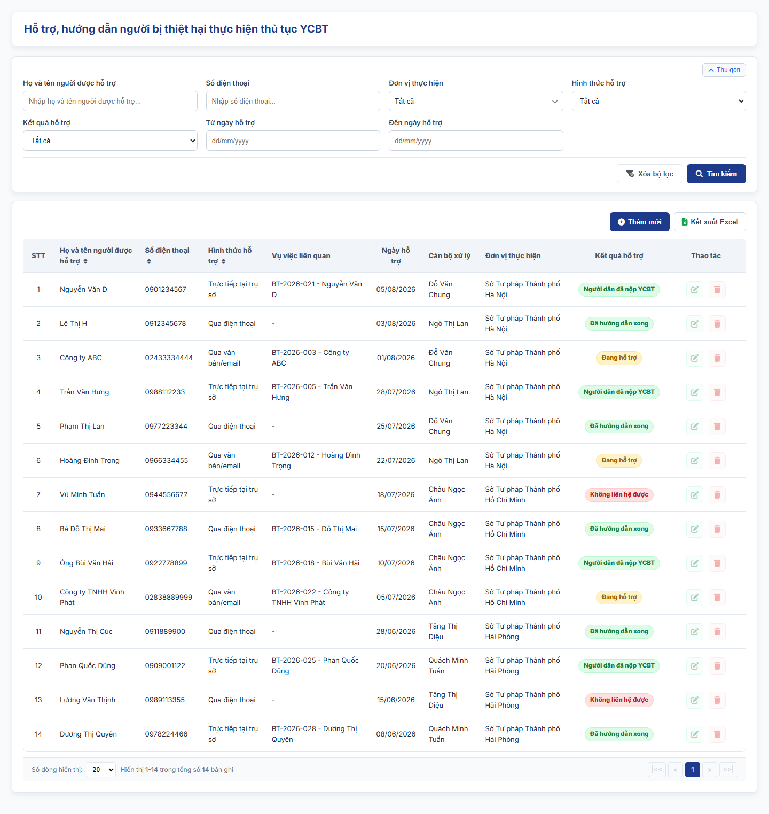
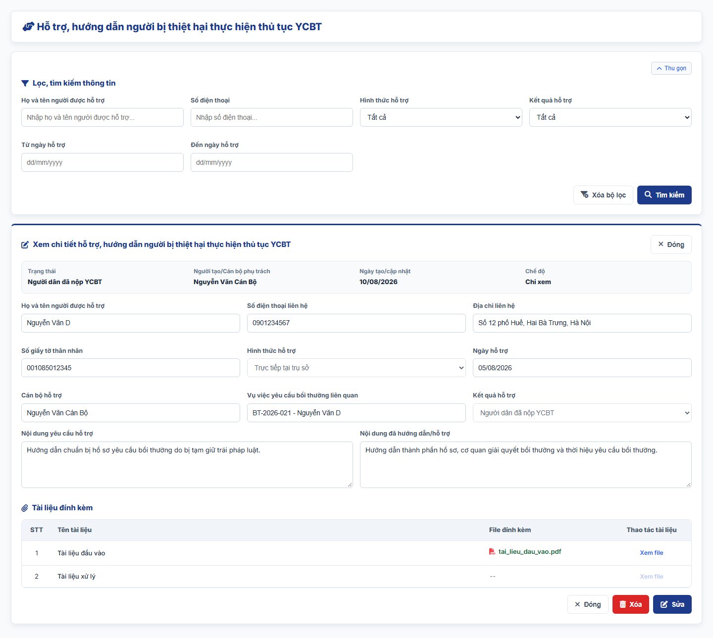
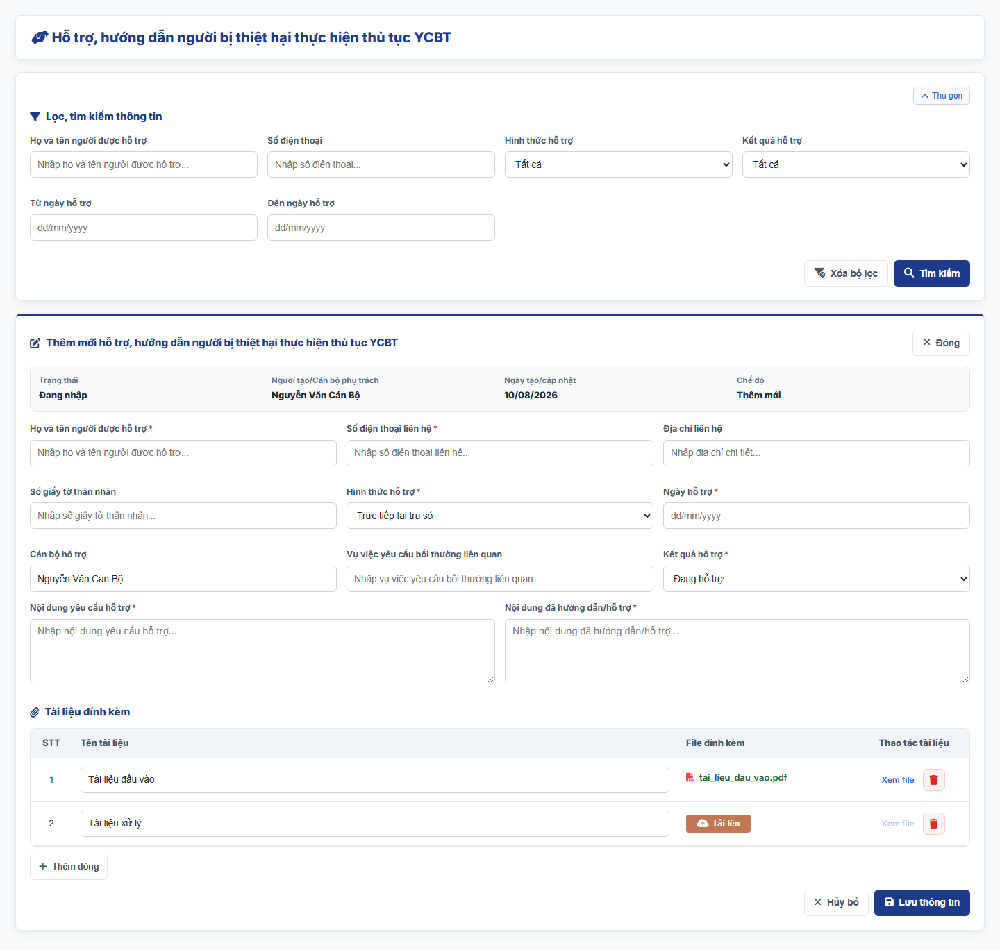
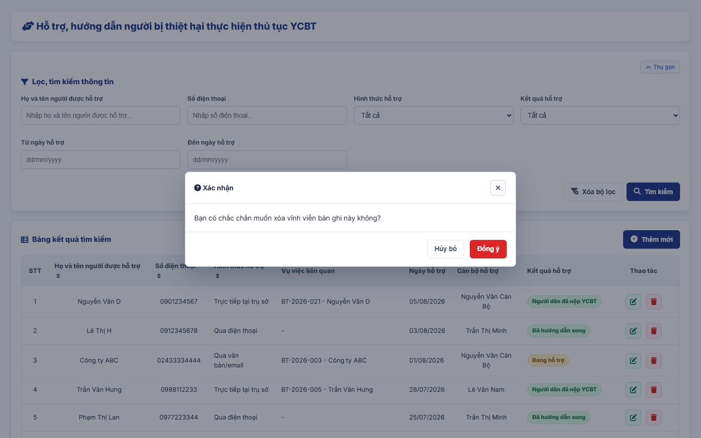

#### 4.3.3.9. UC479-480 - Hỗ trợ, hướng dẫn người bị thiệt hại thực hiện thủ tục YCBT

##### 4.3.3.9.1. Mục đích

\- Cho phép cán bộ Sở Tư pháp ghi nhận, theo dõi và thống kê các trường hợp đã hướng dẫn, hỗ trợ người bị thiệt hại (hoặc người đại diện/người thừa kế hợp pháp) thực hiện thủ tục yêu cầu bồi thường nhà nước (chuẩn bị hồ sơ, xác định cơ quan có trách nhiệm giải quyết, hướng dẫn trình tự/thủ tục theo Luật Trách nhiệm bồi thường của Nhà nước), theo khoản 3 Điều 45 dự thảo Nghị định quy định chi tiết một số điều và biện pháp thi hành Luật Trách nhiệm bồi thường của Nhà nước (bản gửi lấy ý kiến ngày 28/9/2026).

*a. Phân quyền*

\- Người dùng thuộc Sở Tư pháp: được tra cứu, xem chi tiết, thêm mới; sửa, xóa bản ghi hỗ trợ do Sở mình tạo.

\- Người dùng thuộc Bộ Tư pháp hoặc Cục Đăng ký giao dịch bảo đảm và Bồi thường nhà nước: tra cứu, xem chi tiết bản ghi của mọi Sở Tư pháp; không thêm mới, không thao tác trên bản ghi.

\- Người dùng thuộc Sở Tư pháp chỉ xem bản ghi do Sở mình tạo; người dùng thuộc đơn vị khác không xem được dữ liệu.

\- Người dùng thuộc UBND cấp tỉnh: chỉ xem chi tiết bản ghi của Sở Tư pháp trực thuộc; không thêm mới, không thao tác.

\- Phạm vi dữ liệu theo [Quy tắc phạm vi dữ liệu Bộ Tư pháp - Sở Tư pháp - Danh mục và Phụ lục - Tài liệu tổng hợp](../../Tai%20lieu%20tong%20hop/04_Danh_muc_va_Phu_luc.md#quy-tac-pham-vi-du-lieu-btp-stp).

*b. Điều kiện thực hiện*

\- Người dùng đã đăng nhập thành công vào Website quản trị.

\- Người dùng được phân quyền truy cập màn hình `Hỗ trợ, hướng dẫn người bị thiệt hại thực hiện thủ tục YCBT`.

---

##### 4.3.3.9.2. Sơ đồ luồng nghiệp vụ theo giao diện

---

##### 4.3.3.9.3. MH01 - Màn hình Danh sách hỗ trợ, hướng dẫn người bị thiệt hại

###### 4.3.3.9.3.1. Màn hình

###### 4.3.3.9.3.2. Mô tả thông tin trên màn hình

| Trường thông tin | Kiểu dữ liệu | Bắt buộc | Mặc định | Mô tả |
| :--- | :--- | :--- | :--- | :--- |
| **I. Bộ lọc tìm kiếm** | - | - | - | Control UI: Khối thu gọn/mở rộng (Accordion). - Không hiển thị tiêu đề khối. - Mặc định hiển thị dạng mở rộng. - Cho phép thu gọn/mở rộng khi click vào nút "Thu gọn"/"Mở rộng" ở góc phải khối; khi thu gọn, các giá trị lọc đã nhập được giữ nguyên. |
| Họ và tên người được hỗ trợ | String(255) | Không | Trống | Control UI: Text input. - Placeholder: "Nhập họ và tên người được hỗ trợ...". - Tìm gần đúng; không phân biệt hoa thường, có dấu/không dấu. |
| Số điện thoại | String(50) | Không | Trống | Control UI: Text input. - Placeholder: "Nhập số điện thoại...". - Tìm gần đúng; không phân biệt hoa thường, có dấu/không dấu. |
| Đơn vị thực hiện | List(String(50)) | Không | Tất cả | Control UI: Cây đơn vị chọn nhiều (Tree select) theo Cơ cấu tổ chức, có ô tìm kiếm theo tên. - Chỉ hiển thị khi người dùng thuộc Bộ Tư pháp hoặc Cục Đăng ký giao dịch bảo đảm và Bồi thường nhà nước. - Cây gồm các Sở Tư pháp và đơn vị trực thuộc, theo [Quy tắc phạm vi dữ liệu Bộ Tư pháp - Sở Tư pháp - Danh mục và Phụ lục - Tài liệu tổng hợp](../../Tai%20lieu%20tong%20hop/04_Danh_muc_va_Phu_luc.md#quy-tac-pham-vi-du-lieu-btp-stp). - Mỗi nút có ô tích; tích nút cha thì tích toàn bộ nút con. - `Tất cả`: không lọc. - Nút `Các Sở Tư pháp`: tích nhanh toàn bộ các Sở Tư pháp trong cây. - Chọn từ 02 đơn vị trở lên: ô hiển thị "Đã chọn [n] đơn vị". - Lọc bản ghi có `Đơn vị thực hiện` hoặc đơn vị công tác của `Cán bộ xử lý` thuộc các đơn vị đã tích. |
| Hình thức hỗ trợ | Enum(String(50)) | Không | Tất cả | Control UI: Combobox. Gồm: + Tất cả + Trực tiếp tại trụ sở + Qua điện thoại + Qua văn bản/email + Khác |
| Kết quả hỗ trợ | Enum(String(50)) | Không | Tất cả | Control UI: Combobox. Gồm: + Tất cả + Đang hỗ trợ + Đã hướng dẫn xong + Người dân đã nộp YCBT + Không liên hệ được |
| Từ ngày hỗ trợ | Date | Không | Trống | Control UI: Date input. - Placeholder: "dd/mm/yyyy". |
| Đến ngày hỗ trợ | Date | Không | Trống | Control UI: Date input. - Placeholder: "dd/mm/yyyy". |
| **II. Bảng danh sách kết quả** | - | - | 20 bản ghi/trang | Control UI: Data grid. - Không hiển thị tiêu đề và số lượng bản ghi phía trên bảng; tổng số bản ghi hiển thị tại thanh phân trang. - Phạm vi bản ghi theo [Quy tắc phạm vi dữ liệu Bộ Tư pháp - Sở Tư pháp - Danh mục và Phụ lục - Tài liệu tổng hợp](../../Tai%20lieu%20tong%20hop/04_Danh_muc_va_Phu_luc.md#quy-tac-pham-vi-du-lieu-btp-stp): + Người dùng thuộc Bộ Tư pháp hoặc Cục Đăng ký giao dịch bảo đảm và Bồi thường nhà nước: bản ghi của mọi Sở Tư pháp; các icon thao tác hiển thị mờ. + Người dùng thuộc Sở Tư pháp: bản ghi do Sở mình tạo. + Người dùng thuộc UBND cấp tỉnh: bản ghi của Sở Tư pháp trực thuộc; các icon thao tác hiển thị mờ. + Người dùng thuộc đơn vị khác: không hiển thị bản ghi. - Khi người dùng truy cập màn hình, hệ thống tự động tải Trang 1. - Sắp xếp mặc định: theo "Ngày tạo" giảm dần. - Trạng thái không có dữ liệu (Empty State): bảng hiển thị duy nhất 01 dòng căn giữa trên toàn bộ chiều rộng bảng (`colspan`), in nghiêng với nội dung theo MessageList dùng chung [MSG-INF-SYS-001]. |
| STT | Integer(10) | Không | Theo trang hiện tại | - Chỉ đọc. - Theo dữ liệu bản ghi. |
| Họ và tên người được hỗ trợ | String(100) | Không | Theo dữ liệu hệ thống | - Chỉ đọc. - Theo dữ liệu bản ghi. |
| Số điện thoại | String(20) | Không | Theo dữ liệu hệ thống | - Chỉ đọc. - Theo dữ liệu bản ghi. |
| Hình thức hỗ trợ | Enum(String(50)) | Không | Theo dữ liệu hệ thống | - Chỉ đọc. - Theo dữ liệu bản ghi. |
| Vụ việc liên quan | String(50) | Không | Theo dữ liệu hệ thống | - Chỉ đọc. - Theo dữ liệu bản ghi. - Hiển thị `-` nếu chưa gắn mã vụ việc. |
| Ngày hỗ trợ | Date | Không | Theo dữ liệu hệ thống | - Chỉ đọc. - Định dạng `dd/mm/yyyy`. |
| Cán bộ xử lý | String(100) | Không | Theo dữ liệu hệ thống | Control UI: Text (Read-only). - Họ và tên cán bộ đã nhập bản ghi (người tạo). |
| Đơn vị thực hiện | String(255) | Không | Theo dữ liệu hệ thống | Control UI: Text (Read-only). - Chỉ hiển thị khi người dùng thuộc Bộ Tư pháp hoặc Cục Đăng ký giao dịch bảo đảm và Bồi thường nhà nước. - Đặt ngay sau cột `Cán bộ xử lý`. - Hiển thị tên đơn vị thực hiện của bản ghi. |
| Kết quả hỗ trợ | Enum(String(50)) | Không | Theo dữ liệu hệ thống | Control UI: Badge. - Chỉ đọc. - Theo dữ liệu bản ghi. |
| Thao tác | - | - | - | Control UI: Icon + Sửa + Xóa - Cột cố định bên phải lưới khi cuộn ngang. |
| Phân trang | - | - | 20 bản ghi/trang | Phân trang, chuyển trang và cấu hình số dòng hiển thị theo quy tắc chung của hệ thống. |

###### 4.3.3.9.3.3. Chức năng trên màn hình

| STT | Tên chức năng | Định dạng | Mô tả |
| :--- | :--- | :--- | :--- |
| 1 | Tìm kiếm | Button | Khi người dùng click nút, hệ thống kiểm tra điều kiện dữ liệu và thực hiện tìm kiếm theo các trường hợp bên dưới: |
|  |  |  | **TH1 - Khoảng ngày không hợp lệ**: Nếu `Từ ngày hỗ trợ` lớn hơn `Đến ngày hỗ trợ`, vi phạm [BR-VAL-007], hệ thống hiển thị cảnh báo lỗi [MSG-ERR-VAL-007] và không thực hiện tìm kiếm. |
|  |  |  | **TH2 - Hợp lệ (Có dữ liệu phù hợp)**: Hệ thống hiển thị danh sách các bản ghi thỏa mãn đồng thời các tiêu chí đã nhập/chọn và đưa về Trang 1. |
|  |  |  | **TH3 - Không có dữ liệu trả về**: Bảng kết quả hiển thị duy nhất 01 dòng căn giữa (`colspan`), in nghiêng với nội dung [MSG-INF-SYS-001]; thanh phân trang hiển thị *"Hiển thị 0-0 trong tổng số 0 bản ghi"*, các nút điều hướng trang ở trạng thái khóa mờ. |
|  |  |  | **TH4 - Đơn vị của người dùng không thuộc phạm vi dữ liệu**: Người dùng không thuộc Bộ Tư pháp, Cục Đăng ký giao dịch bảo đảm và Bồi thường nhà nước, Sở Tư pháp hoặc UBND cấp tỉnh; bảng kết quả hiển thị 01 dòng căn giữa, in nghiêng: "Đơn vị của người dùng không thuộc phạm vi dữ liệu của chức năng này.". |
| 2 | Xóa bộ lọc | Button | Hệ thống xóa toàn bộ tiêu chí tìm kiếm đã nhập/chọn, thiết lập các ô lọc về giá trị mặc định. |
| 3 | Thêm mới | Button | Chỉ hiển thị khi người dùng thuộc Sở Tư pháp. - Hệ thống mở [MH03 - Màn hình Thêm mới/Sửa hỗ trợ, hướng dẫn người bị thiệt hại](#43395-mh03---màn-hình-thêm-mớisửa-hỗ-trợ-hướng-dẫn-người-bị-thiệt-hại) ở chế độ Thêm mới với form thông tin để trống. |
| 4 | Kết xuất Excel | Button | Kết xuất danh sách ra tệp Excel theo [Quy chuẩn Kết xuất Excel dùng chung - Danh mục và Phụ lục - Tài liệu tổng hợp](../../Tai%20lieu%20tong%20hop/04_Danh_muc_va_Phu_luc.md#quy-chuan-ket-xuat-excel): - Phạm vi: toàn bộ bản ghi thỏa mãn điều kiện tìm kiếm hiện hành, không giới hạn theo trang. - Cột xuất theo thứ tự lưới, không gồm cột Thao tác: STT, Họ và tên người được hỗ trợ, Số điện thoại, Hình thức hỗ trợ, Vụ việc liên quan, Ngày hỗ trợ, Cán bộ hỗ trợ, Kết quả hỗ trợ. - Tên tệp: `yyyyMMdd_Danh_sach_ho_tro_nguoi_bi_thiet_hai.xlsx`. |
|  |  |  | **TH1 - Không có dữ liệu**: Hệ thống hiển thị [MSG-WRN-SYS-001] và không tải tệp. |
|  |  |  | **TH2 - Có dữ liệu**: Hệ thống tải tệp Excel về máy người dùng. |
| 5 | Sắp xếp cột | Header cột | Áp dụng trên các cột: + Họ và tên người được hỗ trợ + Số điện thoại + Hình thức hỗ trợ |
|  |  |  | **TH1 - Chọn lại cột đang sắp xếp**: Hệ thống đảo chiều sắp xếp tăng dần/giảm dần và cập nhật icon mũi tên trên tiêu đề cột. |
|  |  |  | **TH2 - Chọn cột khác**: Hệ thống sắp xếp danh sách theo cột được chọn. |
| 6 | Row click | Row click | Khi người dùng click vào bất kỳ vị trí nào trên dòng dữ liệu (trừ các nút thao tác), hệ thống mở [MH02 - Màn hình Chi tiết hỗ trợ, hướng dẫn người bị thiệt hại](#43394-mh02---màn-hình-chi-tiết-hỗ-trợ-hướng-dẫn-người-bị-thiệt-hại). |
| 7 | Sửa | Icon button | Chỉ cho phép với bản ghi do Sở Tư pháp của người dùng tạo; trường hợp khác icon hiển thị mờ. - Hệ thống mở [MH03 - Màn hình Thêm mới/Sửa hỗ trợ, hướng dẫn người bị thiệt hại](#43395-mh03---màn-hình-thêm-mớisửa-hỗ-trợ-hướng-dẫn-người-bị-thiệt-hại) ở chế độ Sửa với dữ liệu hiện tại của bản ghi được điền sẵn. |
| 8 | Xóa | Icon button | Chỉ cho phép với bản ghi do Sở Tư pháp của người dùng tạo; trường hợp khác icon hiển thị mờ. - Hệ thống mở [Popup Xác nhận xóa](#43396-popup-xác-nhận-xóa). |
| 9 | Phân trang & chuyển trang | Pagination | Phân trang, chuyển trang và cấu hình số dòng hiển thị theo quy tắc chung của hệ thống. |

---

##### 4.3.3.9.4. MH02 - Màn hình Chi tiết hỗ trợ, hướng dẫn người bị thiệt hại

###### 4.3.3.9.4.1. Màn hình

###### 4.3.3.9.4.2. Mô tả thông tin trên màn hình

| Trường thông tin | Kiểu dữ liệu | Bắt buộc | Mặc định | Mô tả |
| :--- | :--- | :--- | :--- | :--- |
| Tiêu đề màn hình | - | - | - | Control UI: Label Hiển thị "Xem chi tiết hỗ trợ, hướng dẫn người bị thiệt hại thực hiện thủ tục YCBT". |
| **I. Thông tin chung** |  |  |  |  |
| Trạng thái | - | - | - | Control UI: Label Theo dữ liệu bản ghi (giá trị `Kết quả hỗ trợ`). |
| Cán bộ xử lý | - | - | - | Control UI: Label Theo dữ liệu bản ghi. |
| Ngày tạo/cập nhật | - | - | - | Control UI: Label Theo dữ liệu bản ghi. |
| Chế độ | - | - | - | Control UI: Label Hiển thị "Chỉ xem". |
| **II. Thông tin hỗ trợ** |  |  |  |  |
| Họ và tên người được hỗ trợ | - | - | - | Control UI: Label Theo dữ liệu bản ghi. |
| Số điện thoại liên hệ | - | - | - | Control UI: Label Theo dữ liệu bản ghi. |
| Địa chỉ liên hệ | - | - | - | Control UI: Label Theo dữ liệu bản ghi. |
| Số giấy tờ thân nhân | - | - | - | Control UI: Label Theo dữ liệu bản ghi. |
| Hình thức hỗ trợ | - | - | - | Control UI: Label Theo dữ liệu bản ghi. |
| Ngày hỗ trợ | - | - | - | Control UI: Label Theo dữ liệu bản ghi. |
| Cán bộ xử lý | - | - | - | Control UI: Label Theo dữ liệu bản ghi. |
| Vụ việc yêu cầu bồi thường liên quan | - | - | - | Control UI: Label Theo dữ liệu bản ghi. |
| Kết quả hỗ trợ | - | - | - | Control UI: Label Theo dữ liệu bản ghi. |
| Nội dung yêu cầu hỗ trợ | - | - | - | Control UI: Label Theo dữ liệu bản ghi. |
| Nội dung đã hướng dẫn/hỗ trợ | - | - | - | Control UI: Label Theo dữ liệu bản ghi. |
| **III. Tài liệu đính kèm** |  |  |  |  |
| Tài liệu đính kèm | - | - | - | Control UI: File link Theo dữ liệu bản ghi. |

###### 4.3.3.9.4.3. Chức năng trên màn hình

| STT | Tên chức năng | Định dạng | Mô tả |
| :--- | :--- | :--- | :--- |
| 1 | Xem file | Link | Khi click vào liên kết "Xem file" của tài liệu đính kèm, hệ thống mở nội dung file tại một tab trình duyệt mới. |
| 2 | Sửa | Button | Chỉ hiển thị với bản ghi do Sở Tư pháp của người dùng tạo. - Hệ thống mở [MH03 - Màn hình Thêm mới/Sửa hỗ trợ, hướng dẫn người bị thiệt hại](#43395-mh03---màn-hình-thêm-mớisửa-hỗ-trợ-hướng-dẫn-người-bị-thiệt-hại) ở chế độ Sửa với dữ liệu hiện tại của bản ghi được điền sẵn. |
| 3 | Xóa | Button | Chỉ hiển thị với bản ghi do Sở Tư pháp của người dùng tạo. - Hệ thống mở [Popup Xác nhận xóa](#43396-popup-xác-nhận-xóa); nếu người dùng chọn `Đồng ý`, hệ thống xóa bản ghi, đóng màn hình chi tiết và quay lại [MH01 - Màn hình Danh sách hỗ trợ, hướng dẫn người bị thiệt hại](#43393-mh01---màn-hình-danh-sách-hỗ-trợ-hướng-dẫn-người-bị-thiệt-hại). |
| 4 | Đóng | Button | Khi người dùng click nút "Đóng" ở góc phải tiêu đề hoặc ở chân màn hình, hệ thống đóng màn hình chi tiết và quay lại [MH01 - Màn hình Danh sách hỗ trợ, hướng dẫn người bị thiệt hại](#43393-mh01---màn-hình-danh-sách-hỗ-trợ-hướng-dẫn-người-bị-thiệt-hại). |

---

##### 4.3.3.9.5. MH03 - Màn hình Thêm mới/Sửa hỗ trợ, hướng dẫn người bị thiệt hại

###### 4.3.3.9.5.1. Màn hình

###### 4.3.3.9.5.2. Mô tả thông tin trên màn hình

| Trường thông tin | Kiểu dữ liệu | Bắt buộc | Mặc định | Mô tả |
| :--- | :--- | :--- | :--- | :--- |
| Tiêu đề màn hình | - | - | Theo ngữ cảnh | Control UI: Label Hiển thị "Thêm mới hỗ trợ, hướng dẫn người bị thiệt hại thực hiện thủ tục YCBT" hoặc "Sửa hỗ trợ, hướng dẫn người bị thiệt hại thực hiện thủ tục YCBT". |
| **I. Thông tin chung** |  |  |  |  |
| Trạng thái | - | - | Theo ngữ cảnh | Control UI: Label Thêm mới hiển thị "Đang nhập"; Sửa hiển thị theo dữ liệu bản ghi. |
| Cán bộ xử lý | - | - | Theo tài khoản đăng nhập | Control UI: Label Theo dữ liệu bản ghi. |
| Ngày tạo/cập nhật | - | - | Theo dữ liệu hệ thống | Control UI: Label Định dạng `dd/mm/yyyy`. |
| Chế độ | - | - | Theo ngữ cảnh | Control UI: Label Hiển thị "Thêm mới" hoặc "Sửa". |
| **II. Thông tin hỗ trợ** |  |  |  |  |
| Họ và tên người được hỗ trợ | String(100) | Có | Trống | Control UI: Text input. - Placeholder: "Nhập họ và tên người được hỗ trợ...". |
| Số điện thoại liên hệ | String(20) | Có | Trống | Control UI: Text input. - Placeholder: "Nhập số điện thoại liên hệ...". - Áp dụng rule số điện thoại [BR-VAL-003]. |
| Địa chỉ liên hệ | Text(1000) | Không | Trống | Control UI: Text input. - Placeholder: "Nhập địa chỉ liên hệ...". |
| Số giấy tờ thân nhân | String(20) | Không | Trống | Control UI: Text input. - Placeholder: "Nhập số giấy tờ thân nhân...". |
| Hình thức hỗ trợ | Enum(String(50)) | Có | Trực tiếp tại trụ sở | Control UI: Combobox. Gồm: + Trực tiếp tại trụ sở + Qua điện thoại + Qua văn bản/email + Khác |
| Ngày hỗ trợ | Date | Có | Trống | Control UI: Date input. - Placeholder: "dd/mm/yyyy". - Không lớn hơn ngày hiện tại theo [BR-VAL-008]. |
| Cán bộ xử lý | String(100) | - | Theo tài khoản đăng nhập | Control UI: Label. - Tự động điền theo cán bộ đang đăng nhập. |
| Vụ việc yêu cầu bồi thường liên quan | String(50) | Không | Trống | Control UI: Text input. - Placeholder: "Nhập vụ việc yêu cầu bồi thường liên quan...". - Ghi mã vụ việc nếu người dân đã nộp yêu cầu bồi thường; không kiểm tra tồn tại trên hệ thống. |
| Kết quả hỗ trợ | Enum(String(50)) | Có | Đang hỗ trợ | Control UI: Combobox. Gồm: + Đang hỗ trợ + Đã hướng dẫn xong + Người dân đã nộp YCBT + Không liên hệ được |
| Nội dung yêu cầu hỗ trợ | Text(2000) | Không | Trống | Control UI: Textarea. - Placeholder: "Nhập nội dung yêu cầu hỗ trợ...". |
| Nội dung đã hướng dẫn/hỗ trợ | Text(2000) | Không | Trống | Control UI: Textarea. - Placeholder: "Nhập nội dung đã hướng dẫn/hỗ trợ...". |
| **III. Tài liệu đính kèm** |  |  |  |  |
| Tài liệu đính kèm | List(File) | Không | Trống | Control UI: Bảng tài liệu đính kèm gồm các cột `STT`, `Tên tài liệu, văn bản`, `File đính kèm`, `Thao tác`; nút `Thêm tài liệu` dưới bảng. - Cột `Tên tài liệu, văn bản`: Text input. Placeholder: "Nhập tên tài liệu, văn bản". - Cột `File đính kèm`: khi dòng chưa có file hiển thị nút `Tải file`; khi đã có file hiển thị tên file. - Cột `Thao tác` gồm: + Xem file (khóa mờ khi dòng chưa có file) + Xóa - Áp dụng [BR-FILE-010]. |

###### 4.3.3.9.5.3. Chức năng trên màn hình

| STT | Tên chức năng | Định dạng | Mô tả |
| :--- | :--- | :--- | :--- |
| 1 | Lưu thông tin | Button | Khi người dùng click nút, hệ thống kiểm tra dữ liệu và xử lý theo các trường hợp bên dưới: |
|  |  |  | **TH1 - Bỏ trống trường bắt buộc**: Vi phạm [BR-VAL-001] (chưa nhập/chọn các trường có dấu `*`). Hệ thống viền đỏ các ô lỗi, hiển thị "Đây là trường bắt buộc" ngay dưới từng ô và focus vào ô lỗi đầu tiên. |
|  |  |  | **TH2 - Dữ liệu không hợp lệ**: `Số điện thoại liên hệ` sai định dạng vi phạm [BR-VAL-003], hiển thị [MSG-ERR-VAL-003]; `Ngày hỗ trợ` lớn hơn ngày hiện tại vi phạm [BR-VAL-008], hiển thị [MSG-ERR-VAL-008]. Hệ thống không cho phép lưu. |
|  |  |  | **TH3 - Trùng bản ghi**: Bản ghi được xác định bởi các thông tin `Họ và tên người được hỗ trợ`, `Số điện thoại liên hệ`, `Ngày hỗ trợ`. Nếu các thông tin này trùng với một bản ghi khác đang tồn tại, hệ thống viền đỏ các ô tương ứng, hiển thị cảnh báo "Bản ghi hỗ trợ đã tồn tại trong hệ thống (trùng Họ và tên người được hỗ trợ, Số điện thoại liên hệ và Ngày hỗ trợ)" dưới ô `Họ và tên người được hỗ trợ` và không cho phép lưu. - So sánh sau khi bỏ khoảng trắng thừa, không phân biệt hoa thường. - Ở chế độ Sửa, hệ thống bỏ qua chính bản ghi đang sửa. |
|  |  |  | **TH4 - Hợp lệ - Thêm mới**: Hệ thống lưu bản ghi, đóng màn hình, tải lại danh sách và hiển thị [MSG-SUC-SYS-003]. |
|  |  |  | **TH5 - Hợp lệ - Sửa**: Hệ thống cập nhật bản ghi, đóng màn hình, tải lại danh sách và hiển thị [MSG-SUC-SYS-002]. |
| 2 | Tải lên | Button | Hệ thống mở trình chọn file cho dòng tài liệu tương ứng; sau khi chọn, hiển thị tên file tại cột `File đính kèm`. |
| 3 | Xem file | Link | Hệ thống mở file của dòng tài liệu tại một tab trình duyệt mới. |
| 4 | Xóa | Icon button | Hệ thống xóa dòng tài liệu khỏi bảng ngay, không hiển thị popup xác nhận. |
| 5 | Thêm tài liệu | Button | Hệ thống thêm 01 dòng tài liệu trống vào cuối bảng tài liệu đính kèm. |
| 6 | Hủy bỏ | Button | Khi người dùng click nút "Hủy bỏ" ở chân màn hình hoặc nút "Đóng" ở góc phải tiêu đề, hệ thống đóng màn hình, không lưu dữ liệu và quay lại [MH01 - Màn hình Danh sách hỗ trợ, hướng dẫn người bị thiệt hại](#43393-mh01---màn-hình-danh-sách-hỗ-trợ-hướng-dẫn-người-bị-thiệt-hại). |

---

##### 4.3.3.9.6. Popup Xác nhận xóa

###### 4.3.3.9.6.1. Màn hình

###### 4.3.3.9.6.2. Mô tả thông tin trên màn hình

| Trường thông tin | Kiểu dữ liệu | Bắt buộc | Mặc định | Mô tả |
| :--- | :--- | :--- | :--- | :--- |
| Tiêu đề popup | - | - | - | Control UI: Label Hiển thị "Xác nhận". |
| Nội dung xác nhận | - | - | - | Control UI: Label Áp dụng message xác nhận [MSG-CFM-SYS-001]. |

###### 4.3.3.9.6.3. Chức năng trên màn hình

| STT | Tên chức năng | Định dạng | Mô tả |
| :--- | :--- | :--- | :--- |
| 1 | Đồng ý | Button | Hệ thống đóng popup và thực hiện xóa: + Xóa bản ghi: xóa vĩnh viễn bản ghi khỏi hệ thống, tải lại danh sách và hiển thị [MSG-SUC-SYS-002]. + Xóa tài liệu đính kèm: xóa dòng tài liệu khỏi bảng. |
| 2 | Hủy bỏ | Button | Khi người dùng click nút "Hủy bỏ" hoặc biểu tượng đóng ở góc phải tiêu đề popup, hệ thống đóng popup và không thực hiện thao tác. |
