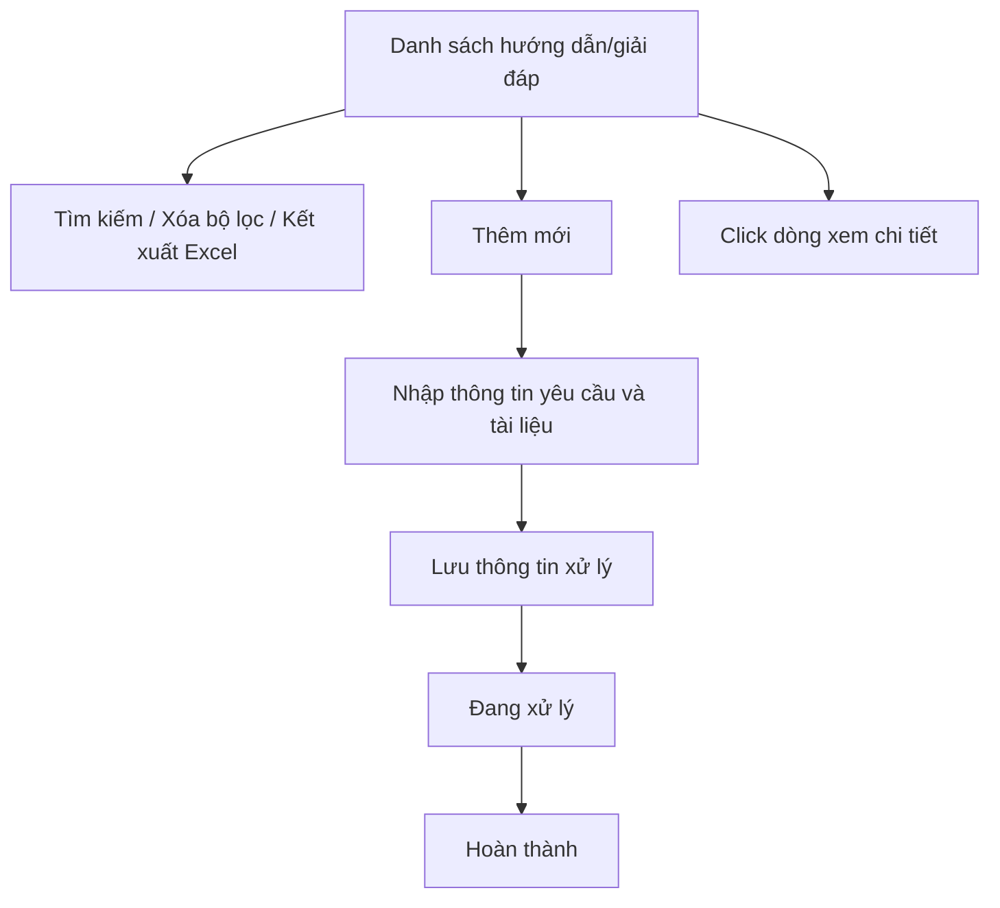
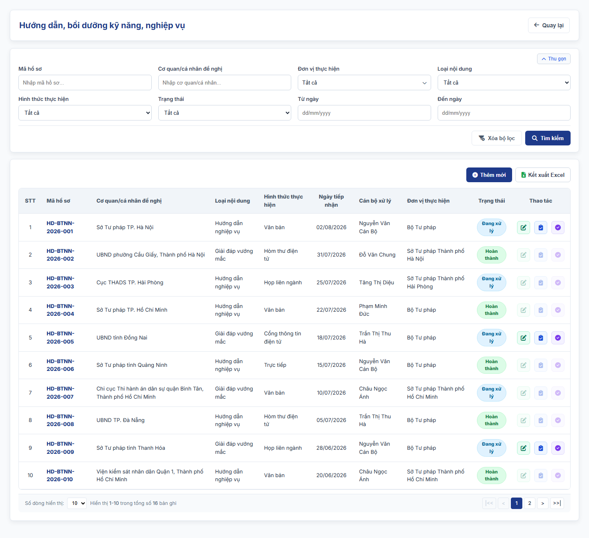

### 4.3.3. Dành cho Cán bộ Công tác bồi thường nhà nước

#### 4.3.3.7. UC-BTNN-HD - Hướng dẫn, bồi dưỡng kỹ năng, nghiệp vụ công tác BTNN

##### 4.3.3.7.1. Mục đích

\- Cho phép Cán bộ quản lý nhà nước tiếp nhận, tra cứu, cập nhật và theo dõi hồ sơ hướng dẫn nghiệp vụ công tác bồi thường nhà nước, giải đáp vướng mắc trong việc áp dụng pháp luật về trách nhiệm bồi thường của Nhà nước theo Mục 1 Thông tư 08/2019/TT-BTP.

\- Cho phép quản lý cả hình thức hướng dẫn bằng văn bản, hướng dẫn trực tiếp, giải đáp bằng văn bản, giải đáp qua Cổng thông tin điện tử hoặc hòm thư điện tử.

\- Cho phép ghi nhận hoạt động bồi dưỡng kỹ năng, nghiệp vụ công tác bồi thường nhà nước và hoạt động truyền thông, tuyên truyền, phổ biến pháp luật về trách nhiệm bồi thường của Nhà nước theo khoản 3 Điều 44 (Bộ Tư pháp) và khoản 1 Điều 45 (Ủy ban nhân dân cấp tỉnh, Sở Tư pháp giúp thực hiện) dự thảo Nghị định quy định chi tiết một số điều và biện pháp thi hành Luật Trách nhiệm bồi thường của Nhà nước (bản gửi lấy ý kiến ngày 28/9/2026).

*a. Phân quyền*:

\- Cán bộ xử lý: Được tra cứu, thêm mới, cập nhật, hoàn thành xử lý và đính kèm tài liệu.

*b. Điều kiện thực hiện*:

\- Người dùng đã đăng nhập Website Quản trị và có quyền truy cập nhóm chức năng Công tác bồi thường nhà nước.

\- Nội dung xử lý thuộc phạm vi hướng dẫn nghiệp vụ, giải đáp vướng mắc quy định tại Điều 3 đến Điều 7 Thông tư 08/2019/TT-BTP.

##### 4.3.3.7.2. Sơ đồ luồng nghiệp vụ theo giao diện

##### 4.3.3.7.3. MH01 - Màn hình Danh sách hướng dẫn nghiệp vụ, giải đáp vướng mắc

###### 4.3.3.7.3.1. Màn hình

###### 4.3.3.7.3.2. Mô tả thông tin trên màn hình

| Trường thông tin | Kiểu dữ liệu | Bắt buộc | Mặc định | Mô tả |
| :--- | :--- | :--- | :--- | :--- |
| Tiêu đề màn hình | String(255) | Không | `Hướng dẫn, bồi dưỡng kỹ năng, nghiệp vụ` | Control UI: Text heading (Read-only). - Hiển thị đúng tên mục Menu `Hướng dẫn, bồi dưỡng kỹ năng, nghiệp vụ`. - Không có dòng mô tả dưới tiêu đề. |
| **I. Bộ lọc tìm kiếm** | - | - | - | Control UI: Khối thu gọn/mở rộng (Accordion). - Không hiển thị tiêu đề khối. - Cho phép thu gọn/mở rộng khi click vào nút "Thu gọn"/"Mở rộng" ở góc phải khối. |
| Mã hồ sơ | String(50) | Không | Trống | Tìm gần đúng theo mã hồ sơ, tự động trim space. |
| Cơ quan/cá nhân đề nghị | String(255) | Không | Trống | Tìm gần đúng theo tên cơ quan, tổ chức, cá nhân đề nghị. |
| Loại nội dung | Enum(String(100)) | Không | Tất cả | Gồm: + Tất cả + Hướng dẫn nghiệp vụ + Giải đáp vướng mắc + Bồi dưỡng kỹ năng, nghiệp vụ + Truyền thông, tuyên truyền, phổ biến pháp luật |
| Hình thức thực hiện | Enum(String(100)) | Không | Tất cả | Gồm: + Tất cả + Văn bản + Trực tiếp + Cổng thông tin điện tử + Hòm thư điện tử + Họp liên ngành |
| Trạng thái | Enum(String(50)) | Không | Tất cả | Gồm: + Tất cả + Đang xử lý + Hoàn thành |
| Từ ngày | Date | Không | Trống | Ngày tiếp nhận từ, áp dụng [BR-VAL-007]. |
| Đến ngày | Date | Không | Trống | Ngày tiếp nhận đến, áp dụng [BR-VAL-007]. |
| Thêm mới | String(50) | Không | Hiển thị | Chi tiết nghiệp vụ xem tại bảng Chức năng trên màn hình. |
| Xóa bộ lọc | String(50) | Không | Hiển thị | Chi tiết nghiệp vụ xem tại bảng Chức năng trên màn hình. |
| Tìm kiếm | String(50) | Không | Hiển thị | Chi tiết nghiệp vụ xem tại bảng Chức năng trên màn hình. |
| Kết xuất Excel | String(50) | Không | Hiển thị | Chi tiết nghiệp vụ xem tại bảng Chức năng trên màn hình. |
| Bảng danh sách | String(255) | Không | 20 bản ghi/trang | Control UI: Data grid. - Khi người dùng truy cập màn hình, hệ thống tự động tải trang đầu tiên (Trang 1) với số lượng mặc định 20 bản ghi. - Sắp xếp mặc định: Sắp xếp theo "Ngày tiếp nhận" giảm dần (mới nhất hiển thị lên đầu). - Trạng thái có dữ liệu: Hiển thị danh sách các bản ghi kết quả theo cấu trúc các cột quy định. - Trạng thái không có dữ liệu (Empty State): Khi không tìm thấy kết quả phù hợp với điều kiện tìm kiếm, bảng hiển thị duy nhất 01 dòng căn giữa trên toàn bộ chiều rộng bảng (`colspan`), in nghiêng với nội dung theo MessageList dùng chung [MSG-INF-SYS-001]. |
| STT | Integer(10) | Không | Tự tăng | Số thứ tự dòng trên trang hiện tại. |
| Mã hồ sơ | String(50) | Không | Theo dữ liệu | Hiển thị mã hồ sơ. Người dùng click dòng dữ liệu để mở chi tiết. |
| Cơ quan/cá nhân đề nghị | String(255) | Không | Theo dữ liệu | Hiển thị tên cơ quan, tổ chức, cá nhân đề nghị. |
| Loại nội dung | Enum(String(100)) | Không | Theo dữ liệu | Hiển thị giá trị `Loại nội dung` của hồ sơ. |
| Hình thức thực hiện | Enum(String(100)) | Không | Theo dữ liệu | Hiển thị hình thức thực hiện. |
| Ngày tiếp nhận | Date | Không | Theo dữ liệu | Hỗ trợ sắp xếp. |
| Cán bộ xử lý | String(255) | Không | Theo dữ liệu | Hiển thị cán bộ xử lý hiện hành. |
| Trạng thái | Enum(String(50)) | Không | Theo dữ liệu | Hiển thị dạng badge. |
| Thao tác | String(255) | Không | Theo trạng thái | Không hiển thị row click chi tiết; xem chi tiết bằng row click. Hiển thị `Sửa`, `Lưu thông tin xử lý`, `Hoàn thành` theo trạng thái; nút không đủ điều kiện hiển thị mờ. - Cột cố định bên phải lưới khi cuộn ngang. |
| Phân trang | String(255) | Không | 20 bản ghi/trang | Control UI: Pagination. - Cho phép chọn cấu hình số lượng bản ghi hiển thị trên mỗi trang gồm: 10, 20, 50, 100 bản ghi/trang; mặc định chọn sẵn 20 bản ghi/trang. - Đầy đủ các nút điều hướng trang: Đầu (&#124;&lt;&lt;), Trước (&lt;), các số trang, Sau (&gt;), Cuối (&gt;&gt;&#124;). - Hiển thị dải bản ghi: "Hiển thị [từ] - [đến] của [tổng số] bản ghi". |

###### 4.3.3.7.3.3. Chức năng trên màn hình

| STT | Tên chức năng | Định dạng | Mô tả |
| :--- | :--- | :--- | :--- |
| 1 | Thêm mới | Button | Mở **MH02 - Thêm mới/Cập nhật hướng dẫn nghiệp vụ, giải đáp vướng mắc** ở chế độ thêm mới. |
| 2 | Tìm kiếm | Button | Khi người dùng click nút, hệ thống kiểm tra điều kiện dữ liệu và thực hiện tìm kiếm theo các trường hợp bên dưới: |
|  |  |  | **TH1 - Khoảng ngày không hợp lệ**: Nếu `Từ ngày` lớn hơn `Đến ngày`, vi phạm [BR-VAL-007], hệ thống hiển thị cảnh báo lỗi [MSG-ERR-VAL-007] và không thực hiện tìm kiếm. |
|  |  |  | **TH Hợp lệ (Có dữ liệu phù hợp)**: Hệ thống lọc và hiển thị danh sách các bản ghi thỏa mãn đồng thời các tiêu chí tìm kiếm/lọc đã nhập/chọn, hiển thị kết quả lên bảng và đưa về Trang 1. |
|  |  |  | **TH Không có dữ liệu trả về**: Bảng kết quả hiển thị duy nhất 01 dòng căn giữa trên toàn bộ chiều rộng bảng (`colspan`), in nghiêng với nội dung theo MessageList dùng chung [MSG-INF-SYS-001]; thanh phân trang hiển thị *"Hiển thị 0-0 của 0 bản ghi"*, các nút điều hướng trang ở trạng thái ẩn hoặc khóa mờ (Disabled); nút "Kết xuất Excel" (nếu có) ở trạng thái khóa mờ kèm tooltip *"Không có dữ liệu để kết xuất Excel"*. |
| 3 | Xóa bộ lọc | Button | Hệ thống xóa các tiêu chí lọc, đưa về giá trị mặc định và tải lại danh sách. |
| 4 | Kết xuất Excel | Button | Kết xuất danh sách ra tệp Excel theo [Quy chuẩn Kết xuất Excel dùng chung - Danh mục và Phụ lục - Tài liệu tổng hợp](../../Tai%20lieu%20tong%20hop/04_Danh_muc_va_Phu_luc.md): - Phạm vi: toàn bộ bản ghi thỏa mãn điều kiện tìm kiếm hiện hành, không giới hạn theo trang. - Cột xuất theo thứ tự lưới, không gồm cột Thao tác: STT, Mã hồ sơ, Cơ quan/cá nhân đề nghị, Loại nội dung, Hình thức thực hiện, Ngày tiếp nhận, Cán bộ xử lý, Trạng thái. - Tên tệp: `yyyyMMdd_Danh_sach_huong_dan_nghiep_vu_BTNN.xlsx`. |
|  |  |  | **TH1 - Không có dữ liệu**: Hệ thống hiển thị [MSG-WRN-SYS-001] và không tải tệp. |
|  |  |  | **TH2 - Có dữ liệu**: Hệ thống tải tệp Excel về máy người dùng. |
| 5 | Click dòng dữ liệu | Row click | Mở **MH02 - Thêm mới/Cập nhật hướng dẫn nghiệp vụ, giải đáp vướng mắc** ở chế độ xem chi tiết. |
| 6 | Sửa | Icon/Button | Mở **MH02 - Thêm mới/Cập nhật hướng dẫn nghiệp vụ, giải đáp vướng mắc** ở chế độ cập nhật khi người dùng có quyền và hồ sơ ở trạng thái "Đang xử lý". Hồ sơ ở trạng thái "Hoàn thành" không cho phép sửa (icon hiển thị mờ). |

##### 4.3.3.7.4. MH02 - Màn hình Thêm mới/Cập nhật hướng dẫn nghiệp vụ, giải đáp vướng mắc

###### 4.3.3.7.4.1. Màn hình

###### 4.3.3.7.4.2. Mô tả thông tin trên màn hình

| Trường thông tin | Kiểu dữ liệu | Bắt buộc | Mặc định | Mô tả |
| :--- | :--- | :--- | :--- | :--- |
| Mã hồ sơ | String(50) | Không | Hệ thống tự sinh | Chỉ đọc sau khi lưu lần đầu. |
| Loại nội dung | Enum(String(100)) | Có | Hướng dẫn nghiệp vụ | Gồm: + Hướng dẫn nghiệp vụ + Giải đáp vướng mắc + Bồi dưỡng kỹ năng, nghiệp vụ + Truyền thông, tuyên truyền, phổ biến pháp luật |
| Cơ quan/cá nhân đề nghị | String(255) | Có điều kiện | Trống | Tên cơ quan, tổ chức, cá nhân đề nghị. Luôn hiển thị; bắt buộc (`*`) khi `Loại nội dung` là `Hướng dẫn nghiệp vụ` hoặc `Giải đáp vướng mắc`. Xem bảng Quy tắc hiển thị và bắt buộc theo Loại nội dung. |
| Cấp/nhóm cơ quan đề nghị | Enum(String(100)) | Có điều kiện | Trống | Luôn hiển thị; bắt buộc (`*`) khi `Loại nội dung` là `Hướng dẫn nghiệp vụ` hoặc `Giải đáp vướng mắc`. Gồm: + Bộ, ngành Trung ương + UBND cấp tỉnh + Sở Tư pháp + Cơ quan giải quyết bồi thường + Tòa án + Viện kiểm sát + Cơ quan khác + Cá nhân |
| Lĩnh vực nội dung | Enum(String(100)) | Có | Trống | Gồm: + Giải quyết yêu cầu bồi thường + Đề nghị cấp kinh phí bồi thường và chi trả tiền bồi thường + Xác định trách nhiệm hoàn trả + Quản lý nhà nước về công tác BTNN + Xác định phạm vi trách nhiệm bồi thường + Xác định thiệt hại và giá trị thiệt hại được bồi thường |
| Hình thức thực hiện | Enum(String(100)) | Có | Văn bản | Gồm: + Văn bản + Trực tiếp + Cổng thông tin điện tử + Hòm thư điện tử + Họp liên ngành |
| Ngày tiếp nhận | Date | Có | Ngày hiện tại | Áp dụng [BR-VAL-001]. Với `Loại nội dung` là `Bồi dưỡng kỹ năng, nghiệp vụ` hoặc `Truyền thông, tuyên truyền, phổ biến pháp luật`, trường hiển thị nhãn `Ngày thực hiện`. |
| Đối tượng tham gia | Text(1000) | Có điều kiện | Trống | Chỉ hiển thị và bắt buộc khi `Loại nội dung` là `Bồi dưỡng kỹ năng, nghiệp vụ` hoặc `Truyền thông, tuyên truyền, phổ biến pháp luật`. Ghi nhận cơ quan, cán bộ, công chức hoặc nhóm người dân được bồi dưỡng/truyền thông. |
| Số lượng người tham gia | Integer(10) | Không | Trống | Chỉ hiển thị khi `Loại nội dung` là `Bồi dưỡng kỹ năng, nghiệp vụ` hoặc `Truyền thông, tuyên truyền, phổ biến pháp luật`. Số nguyên dương. |
| Nội dung đề nghị | Text(4000) | Có | Trống | Nội dung đề xuất, kiến nghị hoặc vướng mắc cần xử lý. Với `Bồi dưỡng kỹ năng, nghiệp vụ` hoặc `Truyền thông, tuyên truyền, phổ biến pháp luật`, trường hiển thị nhãn `Nội dung chương trình` và ghi nội dung bồi dưỡng/truyền thông dự kiến thực hiện. |
| Quan điểm của cơ quan đề nghị | Text(4000) | Không | Trống | Ghi nhận quan điểm kèm theo nếu có. |
| Tóm tắt nội dung vụ việc | Text(4000) | Có điều kiện | Trống | Luôn hiển thị; bắt buộc (`*`) khi `Hình thức thực hiện` là `Họp liên ngành`, áp dụng với mọi `Loại nội dung`. Các trường hợp khác không bắt buộc. |
| Cơ quan phối hợp | Text(2000) | Không | Trống | Danh sách cơ quan phối hợp nếu cần lấy ý kiến. |
| Nội dung hướng dẫn/giải đáp | Text(4000) | Có khi hoàn thành | Trống | Nội dung trả lời chính thức. Với `Bồi dưỡng kỹ năng, nghiệp vụ` hoặc `Truyền thông, tuyên truyền, phổ biến pháp luật`, trường hiển thị nhãn `Kết quả thực hiện`. |
| Căn cứ pháp luật | Text(4000) | Có điều kiện | Trống | Căn cứ pháp luật phải nêu trong văn bản hướng dẫn/giải đáp. Bắt buộc khi hoàn thành hồ sơ có `Loại nội dung` là `Hướng dẫn nghiệp vụ` hoặc `Giải đáp vướng mắc`. |
| Tài liệu đính kèm | List(File) | Không | Trống | Control UI: Bảng tài liệu đính kèm gồm các cột `STT`, `Tên tài liệu, văn bản`, `File đính kèm`, `Thao tác`; nút `Thêm tài liệu` dưới bảng. - Cột `File đính kèm`: khi dòng chưa có file hiển thị nút `Tải file`; khi đã có file hiển thị tên file. - Cột `Thao tác` gồm `Xem file` (khóa khi dòng chưa có file) và `Xóa`. - Ở chế độ xem chi tiết: ẩn `Xóa` và nút `Thêm tài liệu`; chỉ cho phép `Xem file`. - Áp dụng [BR-FILE-010]. |
| Lịch sử xử lý | String(255) | Không | Theo dữ liệu | Hiển thị thời gian, người thực hiện, thao tác, nội dung xử lý. |
| Hủy bỏ | String(50) | Không | Hiển thị | Chi tiết nghiệp vụ xem tại bảng Chức năng trên màn hình. |
| Lưu thông tin xử lý | String(50) | Không | Hiển thị | Chi tiết nghiệp vụ xem tại bảng Chức năng trên màn hình. |
| Hoàn thành | String(50) | Không | Hiển thị | Chi tiết nghiệp vụ xem tại bảng Chức năng trên màn hình. |

**Quy tắc hiển thị và bắt buộc theo `Loại nội dung`**

| Trường thông tin | Hướng dẫn nghiệp vụ / Giải đáp vướng mắc | Bồi dưỡng kỹ năng, nghiệp vụ / Truyền thông, tuyên truyền, phổ biến pháp luật |
| :--- | :--- | :--- |
| Cơ quan/cá nhân đề nghị | Hiển thị, bắt buộc (`*`) | Hiển thị, không bắt buộc |
| Cấp/nhóm cơ quan đề nghị | Hiển thị, bắt buộc (`*`) | Hiển thị, không bắt buộc |
| Ngày tiếp nhận | Nhãn `Ngày tiếp nhận`, bắt buộc (`*`) | Nhãn `Ngày thực hiện`, bắt buộc (`*`) |
| Đối tượng tham gia | Ẩn | Hiển thị, bắt buộc (`*`) |
| Số lượng người tham gia | Ẩn | Hiển thị, không bắt buộc |
| Nội dung đề nghị | Nhãn `Nội dung đề nghị`, bắt buộc (`*`) | Nhãn `Nội dung chương trình`, bắt buộc (`*`) |
| Nội dung hướng dẫn/giải đáp | Nhãn `Nội dung hướng dẫn/giải đáp`, bắt buộc khi Hoàn thành | Nhãn `Kết quả thực hiện`, bắt buộc khi Hoàn thành |
| Căn cứ pháp luật | Hiển thị, bắt buộc khi Hoàn thành | Hiển thị, không bắt buộc |
| Tóm tắt nội dung vụ việc | Bắt buộc (`*`) khi `Hình thức thực hiện` là `Họp liên ngành` | Bắt buộc (`*`) khi `Hình thức thực hiện` là `Họp liên ngành` |

\- Dấu `*` chỉ hiển thị trên nhãn khi trường bắt buộc theo giá trị đang chọn; nhãn không kèm chú thích điều kiện.

\- Khi người dùng đổi giá trị trường điều khiển, hệ thống cập nhật ngay nhãn, dấu `*` và trạng thái ẩn/hiện của các trường phụ thuộc; trường chuyển sang ẩn được xóa giá trị và xóa thông báo lỗi.

\- Trường ghi "bắt buộc khi Hoàn thành" không hiển thị dấu `*` khi nhập; hệ thống chỉ kiểm tra khi người dùng bấm `Hoàn thành`.

\- Khi vi phạm, hệ thống tô viền đỏ các trường lỗi, hiển thị "Đây là trường bắt buộc" dưới trường và focus trường lỗi đầu tiên.

###### 4.3.3.7.4.3. Chức năng trên màn hình

| STT | Tên chức năng | Định dạng | Mô tả |
| :--- | :--- | :--- | :--- |
| 1 | Hủy bỏ | Button | Đóng màn hình và quay lại danh sách, không tự động lưu dữ liệu đang nhập. |
| 2 | Lưu thông tin xử lý | Button | TH1 (Bỏ trống trường bắt buộc khi lưu xử lý): Vi phạm [BR-VAL-001], hệ thống hiển thị lỗi inline và không cho lưu. |
|  |  |  | TH2 (Dữ liệu không hợp lệ): Vi phạm [BR-VAL-007] hoặc [BR-FILE-010], hệ thống hiển thị lỗi inline và không cho lưu. |
|  |  |  | TH Hợp lệ: Hệ thống lưu thông tin hướng dẫn/giải đáp và ghi lịch sử xử lý. Hồ sơ thêm mới được lưu trực tiếp ở trạng thái "Đang xử lý"; hồ sơ đang cập nhật giữ nguyên trạng thái hiện hành. Hệ thống không có bước lưu tạm hồ sơ trước khi xử lý. |
| 3 | Hoàn thành | Button | TH1 (Chưa nhập `Nội dung hướng dẫn/giải đáp`/`Kết quả thực hiện`, hoặc chưa nhập `Căn cứ pháp luật` khi trường này bắt buộc): Vi phạm [BR-VAL-001], hệ thống hiển thị lỗi inline và không cho hoàn thành. |
|  |  |  | TH Hợp lệ: Hệ thống chuyển hồ sơ sang trạng thái "Hoàn thành" và ghi lịch sử xử lý. |
| 4 | Xem file | Link | Hệ thống mở file của dòng tài liệu tại một tab trình duyệt mới. Link khóa mờ khi dòng chưa có file. |
| 5 | Tải lên | Button | Hệ thống mở trình chọn file cho dòng tài liệu tương ứng; sau khi chọn, hiển thị tên file tại cột `File đính kèm`. |
| 6 | Xóa | Icon button | Hệ thống xóa dòng tài liệu khỏi bảng ngay, không hiển thị popup xác nhận. - Không hiển thị ở chế độ xem chi tiết. |
