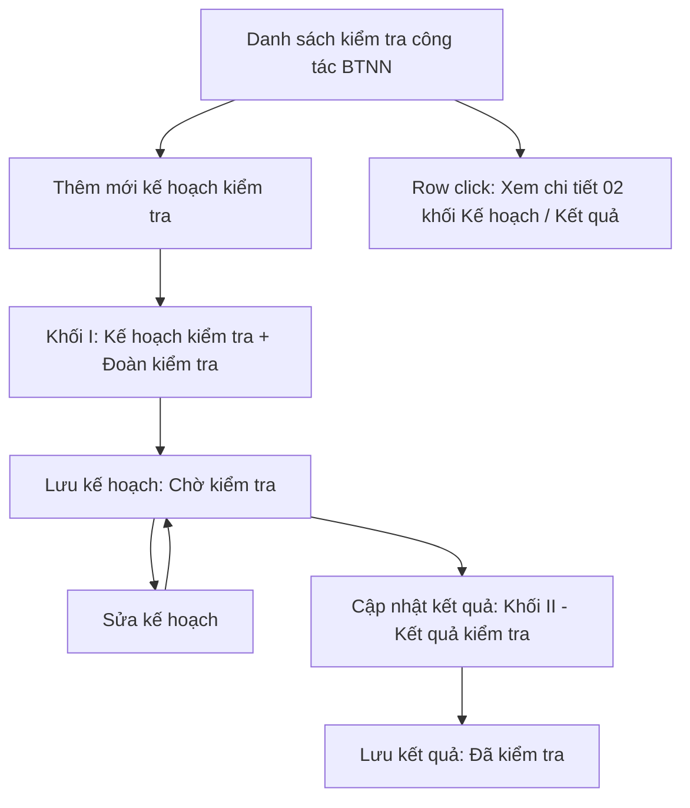
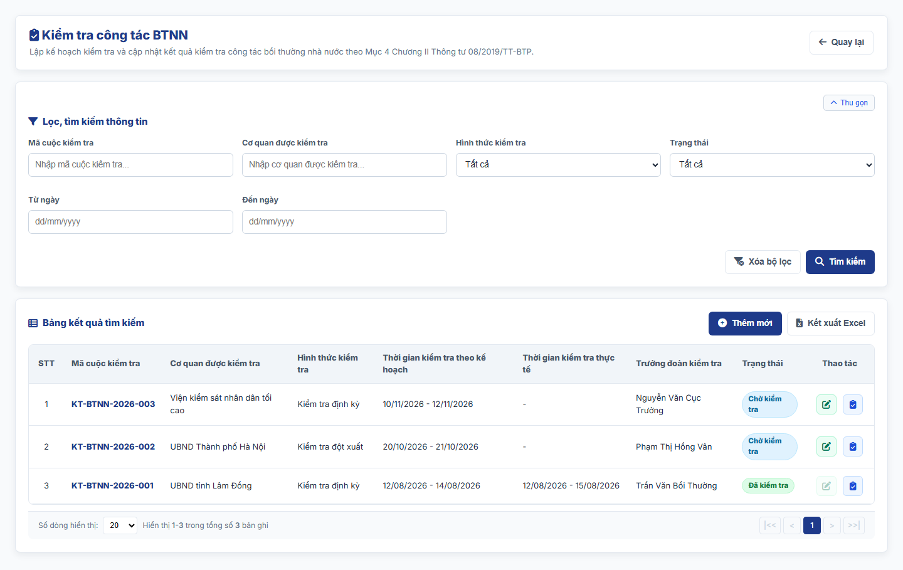
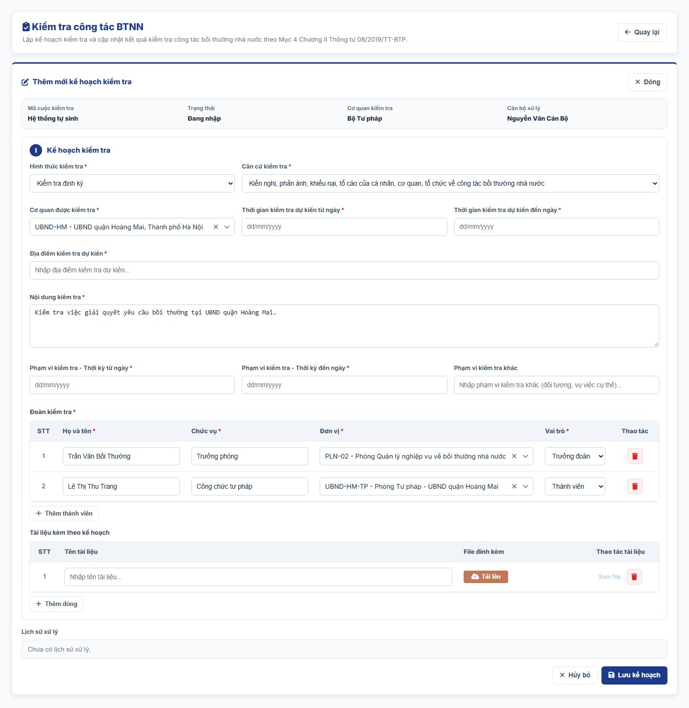
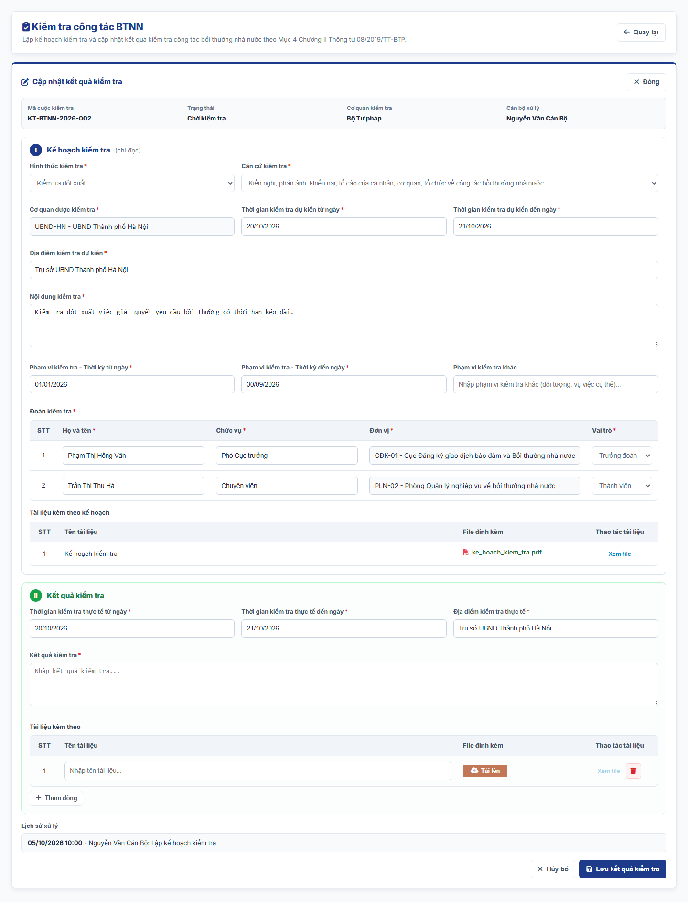
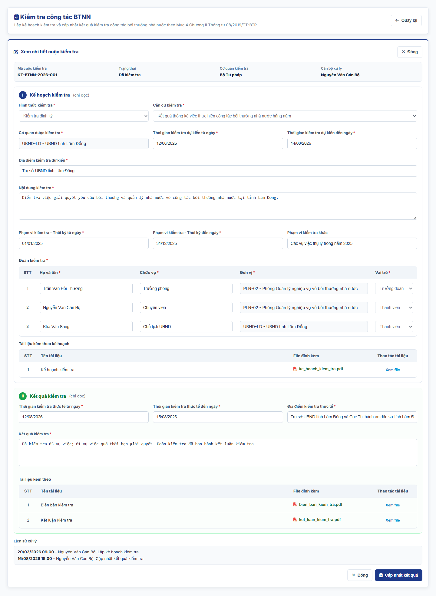
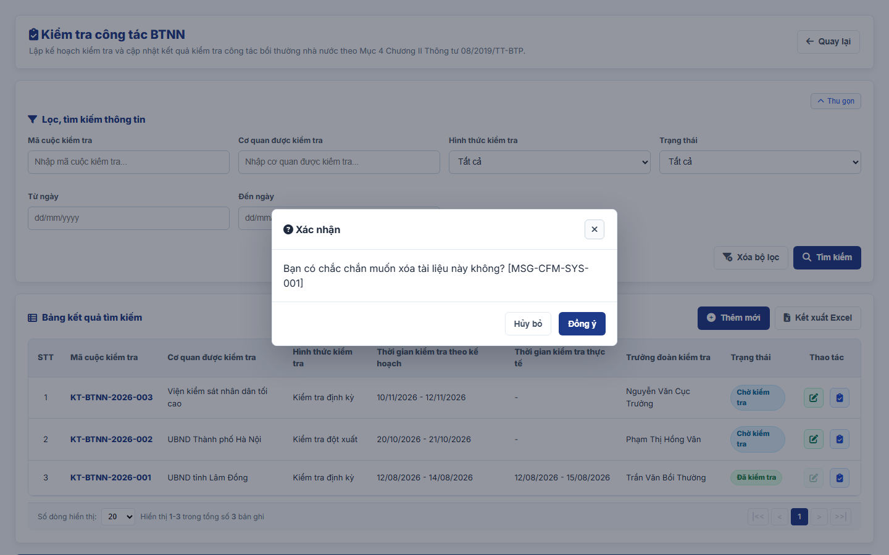

### 4.3.3. Dành cho Cán bộ Công tác bồi thường nhà nước

#### 4.3.3.9. UC-BTNN-KT - Kiểm tra công tác BTNN

##### 4.3.3.9.1. Mục đích

\- Cho phép cán bộ Bộ Tư pháp và cán bộ Sở Tư pháp nhập và quản lý thông tin các cuộc kiểm tra công tác bồi thường nhà nước theo Mục 4 Chương II Thông tư 08/2019/TT-BTP. Kiểm tra là việc xem xét, đánh giá tính hợp pháp trong việc thực hiện công tác bồi thường nhà nước (khoản 1 Điều 16).

\- Mỗi cuộc kiểm tra gồm 02 khối thông tin tách biệt trên cùng màn hình:

| Khối | Thời điểm nhập | Căn cứ | Thông tin |
| :--- | :--- | :--- | :--- |
| I. Kế hoạch kiểm tra | Khi lập kế hoạch | Điều 17, 18, 19, 20 | Hình thức, căn cứ, cơ quan được kiểm tra, nội dung, phạm vi, thời gian và địa điểm dự kiến, đoàn kiểm tra, tài liệu đính kèm của kế hoạch. |
| II. Kết quả kiểm tra | Sau khi tiến hành kiểm tra | Điều 22, 23 | Thời gian và địa điểm kiểm tra thực tế, kết quả kiểm tra, tài liệu đính kèm (biên bản, kết luận kiểm tra). |

\- Hệ thống chỉ ghi nhận thông tin; kế hoạch kiểm tra, kết luận kiểm tra được ban hành và gửi ngoài hệ thống, cán bộ tải file lên khối Tài liệu đính kèm.

*a. Phân quyền*:

\- Cán bộ Bộ Tư pháp, cán bộ Sở Tư pháp: tra cứu, lập và sửa kế hoạch kiểm tra, cập nhật kết quả kiểm tra của cuộc kiểm tra do cơ quan mình lập.

\- Người dùng chỉ xem được cuộc kiểm tra do cơ quan của mình (đơn vị gốc trên cây Cơ cấu tổ chức) lập.

*b. Điều kiện thực hiện*:

\- Người dùng đã đăng nhập Website Quản trị và được phân quyền truy cập màn hình `Kiểm tra công tác BTNN`.

\- Cơ quan được kiểm tra và đơn vị của thành viên đoàn kiểm tra chọn trên cây Cơ cấu tổ chức `[DM_DON_VI]` tại [MH01 - Màn hình Quản lý cơ cấu tổ chức - Quản lý cơ cấu tổ chức - Quản trị hệ thống](../01_Quan_tri_he_thong/Quan_ly_co_cau_to_chuc.md#cctc-mh01).

\- Cơ quan được kiểm tra chỉ chọn đơn vị cấp dưới thuộc phạm vi quản lý: người dùng Bộ Tư pháp chọn được cơ quan trên toàn quốc; người dùng Sở Tư pháp chọn được cơ quan trên địa bàn Tỉnh/Thành phố, không gồm Ủy ban nhân dân cấp tỉnh. Cơ quan kiểm tra không chọn được chính mình; đơn vị ngoài phạm vi hiển thị mờ trên cây.

\- Trạng thái cuộc kiểm tra: `Chờ kiểm tra` (đã lập kế hoạch) → `Đã kiểm tra` (đã cập nhật kết quả kiểm tra).

---

##### 4.3.3.9.2. Sơ đồ luồng nghiệp vụ theo giao diện

---

##### 4.3.3.9.3. MH01 - Màn hình Danh sách kiểm tra công tác BTNN

###### 4.3.3.9.3.1. Màn hình

###### 4.3.3.9.3.2. Mô tả thông tin trên màn hình

| Trường thông tin | Kiểu dữ liệu | Bắt buộc | Mặc định | Mô tả |
| :--- | :--- | :--- | :--- | :--- |
| **I. Bộ lọc tìm kiếm** | - | - | - | Control UI: Khối thu gọn/mở rộng (Accordion). - Không hiển thị tiêu đề khối. - Cho phép thu gọn/mở rộng khi click vào nút "Thu gọn"/"Mở rộng" ở góc phải khối. |
| Mã cuộc kiểm tra | String(50) | Không | Trống | Control UI: Text input. - Placeholder: "Nhập mã cuộc kiểm tra...". - Tìm gần đúng. |
| Cơ quan được kiểm tra | String(255) | Không | Trống | Control UI: Text input. - Placeholder: "Nhập cơ quan được kiểm tra...". - Tìm gần đúng theo tên cơ quan. |
| Hình thức kiểm tra | Enum(String(50)) | Không | Tất cả | Control UI: Combobox. Gồm: + Tất cả + Kiểm tra định kỳ + Kiểm tra đột xuất |
| Trạng thái | Enum(String(50)) | Không | Tất cả | Control UI: Combobox. Gồm: + Tất cả + Chờ kiểm tra + Đã kiểm tra |
| Từ ngày | Date | Không | Trống | Control UI: DatePicker. - Placeholder: "dd/mm/yyyy". - So sánh với `Thời gian kiểm tra dự kiến từ ngày`. |
| Đến ngày | Date | Không | Trống | Control UI: DatePicker. - Placeholder: "dd/mm/yyyy". |
| **II. Bảng danh sách kết quả** | - | - | 20 bản ghi/trang | Control UI: Data grid. - Chỉ gồm cuộc kiểm tra do cơ quan của người dùng lập. - Sắp xếp mặc định theo Mã cuộc kiểm tra giảm dần. - Trạng thái không có dữ liệu (Empty State): bảng hiển thị duy nhất 01 dòng căn giữa trên toàn bộ chiều rộng bảng (`colspan`), in nghiêng với nội dung [MSG-INF-SYS-001]. |
| STT | Integer(10) | - | - | Theo dữ liệu bản ghi. |
| Mã cuộc kiểm tra | String(50) | - | - | Theo dữ liệu bản ghi. |
| Cơ quan được kiểm tra | String(255) | - | - | Theo dữ liệu bản ghi. |
| Hình thức kiểm tra | Enum(String(50)) | - | - | Theo dữ liệu bản ghi. |
| Thời gian kiểm tra theo kế hoạch | String(50) | - | - | Hiển thị `Từ ngày - Đến ngày` dự kiến, định dạng `dd/mm/yyyy`. |
| Thời gian kiểm tra thực tế | String(50) | - | - | Hiển thị `Từ ngày - Đến ngày` thực tế, định dạng `dd/mm/yyyy`; hiển thị `-` khi chưa cập nhật kết quả. |
| Trưởng đoàn kiểm tra | String(100) | - | - | Họ và tên thành viên có vai trò `Trưởng đoàn` trong bảng Đoàn kiểm tra. |
| Trạng thái | Enum(String(50)) | - | - | Control UI: Badge, theo dữ liệu bản ghi. |
| Thao tác | - | - | - | Control UI: Icon + Sửa kế hoạch + Cập nhật kết quả - Cột cố định bên phải lưới khi cuộn ngang. |
| Phân trang | - | - | 20 bản ghi/trang | Phân trang, chuyển trang và cấu hình số dòng hiển thị theo quy tắc chung của hệ thống. |

###### 4.3.3.9.3.3. Chức năng trên màn hình

| STT | Tên chức năng | Định dạng | Mô tả |
| :--- | :--- | :--- | :--- |
| 1 | Tìm kiếm | Button | Khi người dùng click nút, hệ thống kiểm tra điều kiện và tìm kiếm theo các trường hợp bên dưới: |
|  |  |  | **TH1 - Khoảng ngày không hợp lệ**: Nếu `Từ ngày` lớn hơn `Đến ngày`, vi phạm [BR-VAL-007], hệ thống hiển thị [MSG-ERR-VAL-007] và không thực hiện tìm kiếm. |
|  |  |  | **TH2 - Hợp lệ**: Hệ thống hiển thị các cuộc kiểm tra thỏa mãn đồng thời các tiêu chí và đưa về Trang 1. |
|  |  |  | **TH3 - Không có dữ liệu**: Bảng hiển thị 01 dòng [MSG-INF-SYS-001]. |
| 2 | Xóa bộ lọc | Button | Hệ thống xóa toàn bộ tiêu chí lọc về giá trị mặc định và tải lại danh sách. |
| 3 | Thêm mới | Button | Hệ thống mở [MH02 - Màn hình Thêm mới/Sửa kế hoạch kiểm tra](#43394-mh02---màn-hình-thêm-mớisửa-kế-hoạch-kiểm-tra) ở chế độ Thêm mới. |
| 4 | Kết xuất Excel | Button | Kết xuất danh sách ra tệp Excel theo [Quy chuẩn Kết xuất Excel dùng chung - Danh mục và Phụ lục - Tài liệu tổng hợp](../../Tai%20lieu%20tong%20hop/04_Danh_muc_va_Phu_luc.md): - Phạm vi: toàn bộ bản ghi thỏa mãn điều kiện tìm kiếm hiện hành, không giới hạn theo trang. - Cột xuất theo thứ tự lưới, không gồm cột Thao tác: STT, Mã cuộc kiểm tra, Cơ quan được kiểm tra, Hình thức kiểm tra, Thời gian kiểm tra theo kế hoạch, Thời gian kiểm tra thực tế, Trưởng đoàn kiểm tra, Trạng thái. - Tên tệp: `yyyyMMdd_Danh_sach_kiem_tra_cong_tac_BTNN.xlsx`. |
|  |  |  | **TH1 - Không có dữ liệu**: Hệ thống hiển thị [MSG-WRN-SYS-001] và không tải tệp. |
|  |  |  | **TH2 - Có dữ liệu**: Hệ thống tải tệp Excel về máy người dùng. |
| 5 | Row click | Row click | Hệ thống mở [MH04 - Màn hình Xem chi tiết cuộc kiểm tra](#43396-mh04---màn-hình-xem-chi-tiết-cuộc-kiểm-tra). |
| 6 | Sửa kế hoạch | Icon button | Chỉ cho phép khi trạng thái `Chờ kiểm tra`. Hệ thống mở [MH02 - Màn hình Thêm mới/Sửa kế hoạch kiểm tra](#43394-mh02---màn-hình-thêm-mớisửa-kế-hoạch-kiểm-tra) ở chế độ Sửa. |
| 7 | Cập nhật kết quả | Icon button | Hệ thống mở [MH03 - Màn hình Cập nhật kết quả kiểm tra](#43395-mh03---màn-hình-cập-nhật-kết-quả-kiểm-tra); với cuộc kiểm tra đã có kết quả, cho phép sửa kết quả. |
| 8 | Phân trang | Pagination | Phân trang, chuyển trang và cấu hình số dòng hiển thị theo quy tắc chung của hệ thống. |

---

##### 4.3.3.9.4. MH02 - Màn hình Thêm mới/Sửa kế hoạch kiểm tra

###### 4.3.3.9.4.1. Màn hình

###### 4.3.3.9.4.2. Mô tả thông tin trên màn hình

\- Màn hình chỉ hiển thị khối **I. Kế hoạch kiểm tra**; khối II. Kết quả kiểm tra không hiển thị ở màn hình này. Các trường được liệt kê theo thứ tự hiển thị trên màn hình.

| Trường thông tin | Kiểu dữ liệu | Bắt buộc | Mặc định | Mô tả |
| :--- | :--- | :--- | :--- | :--- |
| Mã cuộc kiểm tra | String(50) | - | Hệ thống tự sinh | Control UI: Label. - Định dạng `KT-BTNN-yyyy-xxx`, sinh khi lưu kế hoạch lần đầu. |
| Trạng thái | - | - | Đang nhập | Control UI: Label. |
| Cơ quan kiểm tra | - | - | Đơn vị gốc của người dùng | Control UI: Label. |
| Cán bộ xử lý | - | - | Người dùng đăng nhập | Control UI: Label. |
| **I. Kế hoạch kiểm tra** | - | - | - | Control UI: Khối có tiêu đề "I. Kế hoạch kiểm tra". |
| Hình thức kiểm tra | Enum(String(50)) | Có | Kiểm tra định kỳ | Control UI: Combobox (Điều 18 Thông tư 08/2019/TT-BTP). Gồm: + Kiểm tra định kỳ + Kiểm tra đột xuất |
| Căn cứ kiểm tra | Enum(String(255)) | Có | Trống | Control UI: Combobox (Điều 17 Thông tư 08/2019/TT-BTP). Gồm: + Kiến nghị, phản ánh, khiếu nại, tố cáo của cá nhân, cơ quan, tổ chức về công tác bồi thường nhà nước + Kết quả của hoạt động hướng dẫn nghiệp vụ; theo dõi, đôn đốc; hỗ trợ, hướng dẫn người bị thiệt hại thực hiện thủ tục yêu cầu bồi thường + Kết quả thống kê việc thực hiện công tác bồi thường nhà nước hằng năm + Theo hướng dẫn của cơ quan quản lý nhà nước ở trung ương |
| Cơ quan được kiểm tra | String(255) | Có | Trống | Control UI: Tree select, chọn 01 đơn vị trên cây Cơ cấu tổ chức [DM_DON_VI]. - Placeholder: "-- Chọn đơn vị trên cây cơ cấu tổ chức --". - Phạm vi chọn theo quy tắc tại phần Điều kiện thực hiện. |
| Thời gian kiểm tra dự kiến từ ngày | Date | Có | Trống | Control UI: DatePicker. - Placeholder: "dd/mm/yyyy". |
| Thời gian kiểm tra dự kiến đến ngày | Date | Có | Trống | Control UI: DatePicker. - Placeholder: "dd/mm/yyyy". - Không nhỏ hơn `Thời gian kiểm tra dự kiến từ ngày` theo [BR-VAL-007]. |
| Địa điểm kiểm tra dự kiến | String(255) | Có | Trống | Control UI: Text input. - Placeholder: "Nhập địa điểm kiểm tra dự kiến...". |
| Nội dung kiểm tra | Text(4000) | Có | Trống | Control UI: Text Area. - Placeholder: "Nhập nội dung kiểm tra...". - Ghi các nội dung kiểm tra theo khoản 2 Điều 16: giải quyết yêu cầu bồi thường tại cơ quan trực tiếp quản lý người thi hành công vụ gây thiệt hại; xác định trách nhiệm hoàn trả và thực hiện trách nhiệm hoàn trả; quản lý nhà nước về công tác bồi thường nhà nước; tổ chức thi hành pháp luật về trách nhiệm bồi thường của Nhà nước. |
| Phạm vi kiểm tra - Thời kỳ từ ngày | Date | Có | Trống | Control UI: DatePicker. - Placeholder: "dd/mm/yyyy". - Thời kỳ hoạt động của cơ quan được kiểm tra thuộc phạm vi kiểm tra (điểm c khoản 1 Điều 19). |
| Phạm vi kiểm tra - Thời kỳ đến ngày | Date | Có | Trống | Control UI: DatePicker. - Placeholder: "dd/mm/yyyy". - Không nhỏ hơn `Phạm vi kiểm tra - Thời kỳ từ ngày` theo [BR-VAL-007]. |
| Phạm vi kiểm tra khác | String(500) | Không | Trống | Control UI: Text input. - Placeholder: "Nhập phạm vi kiểm tra khác (đối tượng, vụ việc cụ thể)...". |
| Đoàn kiểm tra | List(Object) | Có | 01 dòng trống, Vai trò `Trưởng đoàn` | Control UI: Bảng gồm các cột: + STT: Label, tự tăng. + Họ và tên: Text input, bắt buộc, Placeholder "Nhập họ và tên...". + Chức vụ: Text input, bắt buộc, Placeholder "Nhập chức vụ...". + Đơn vị: Tree select trên cây Cơ cấu tổ chức [DM_DON_VI], bắt buộc; chọn được mọi đơn vị (thành viên gồm đại diện cơ quan kiểm tra và các cơ quan, đơn vị có liên quan đến nội dung kiểm tra - khoản 1 Điều 20). + Vai trò: Combobox, bắt buộc, gồm `Trưởng đoàn`, `Thành viên` (khoản 1 Điều 20). + Thao tác: Icon Xóa thành viên. - Nút `+ Thêm thành viên` dưới bảng. - Đoàn kiểm tra phải có đúng 01 thành viên vai trò `Trưởng đoàn`. |
| Tài liệu đính kèm | List(File) | Không | 01 dòng trống | Control UI: Bảng tài liệu gồm các cột `STT`, `Tên tài liệu, văn bản`, `File đính kèm`, `Thao tác`; nút `Thêm tài liệu` dưới bảng. - Đính kèm kế hoạch kiểm tra đã ban hành và tài liệu liên quan. - Cột `Thao tác` gồm: + Xem file + Xóa - Áp dụng [BR-FILE-010]. |
| Lịch sử xử lý | - | - | - | Control UI: Label. - Mỗi dòng gồm thời điểm, cán bộ thực hiện, thao tác. |

###### 4.3.3.9.4.3. Chức năng trên màn hình

| STT | Tên chức năng | Định dạng | Mô tả |
| :--- | :--- | :--- | :--- |
| 1 | Lưu kế hoạch | Button | Khi người dùng click nút, hệ thống kiểm tra dữ liệu theo các trường hợp bên dưới: |
|  |  |  | **TH1 - Bỏ trống trường bắt buộc**: Vi phạm [BR-VAL-001]. Hệ thống viền đỏ các ô lỗi, hiển thị "Đây là trường bắt buộc" dưới từng ô và cuộn tới ô lỗi đầu tiên. |
|  |  |  | **TH2 - Khoảng ngày không hợp lệ**: `Đến ngày` nhỏ hơn `Từ ngày` của Thời gian kiểm tra dự kiến hoặc Phạm vi kiểm tra, vi phạm [BR-VAL-007]. Hệ thống hiển thị [MSG-ERR-VAL-007] dưới ô `Đến ngày` và không cho lưu. |
|  |  |  | **TH3 - Đoàn kiểm tra chưa đủ thông tin**: Có dòng thiếu Họ và tên, Chức vụ hoặc Đơn vị. Hệ thống viền đỏ ô thiếu, hiển thị "Vui lòng nhập đầy đủ Họ và tên, Chức vụ, Đơn vị của thành viên đoàn kiểm tra." dưới bảng và không cho lưu. |
|  |  |  | **TH4 - Đoàn kiểm tra không có hoặc có nhiều hơn 01 Trưởng đoàn**: Hệ thống hiển thị "Đoàn kiểm tra phải có đúng 01 Trưởng đoàn." dưới bảng và không cho lưu. |
|  |  |  | **TH5 - Hợp lệ**: Hệ thống lưu kế hoạch ở trạng thái `Chờ kiểm tra` (Thêm mới) hoặc cập nhật kế hoạch (Sửa), ghi lịch sử xử lý, đóng màn hình và hiển thị [MSG-SUC-SYS-003]. |
| 2 | Thêm thành viên | Button | Hệ thống thêm 01 dòng trống vào cuối bảng Đoàn kiểm tra, Vai trò mặc định `Thành viên`. |
| 3 | Xóa thành viên | Icon button | Hệ thống xóa dòng thành viên khỏi bảng; nếu bảng không còn dòng nào, hệ thống thêm lại 01 dòng trống vai trò `Trưởng đoàn`. |
| 4 | Tải lên | Button | Hệ thống mở trình chọn file cho dòng tài liệu tương ứng. |
| 5 | Xem file | Link | Hệ thống mở file của dòng tài liệu tại một tab trình duyệt mới. |
| 6 | Xóa | Icon button | Hệ thống xóa dòng tài liệu khỏi bảng ngay, không hiển thị popup xác nhận. |
| 7 | Thêm tài liệu | Button | Hệ thống thêm 01 dòng tài liệu trống vào cuối bảng. |
| 8 | Hủy bỏ | Button | Khi người dùng click nút "Hủy bỏ" hoặc nút "Đóng" ở góc phải tiêu đề, hệ thống đóng màn hình, không lưu dữ liệu và quay lại [MH01 - Màn hình Danh sách kiểm tra công tác BTNN](#43393-mh01---màn-hình-danh-sách-kiểm-tra-công-tác-btnn). |

---

##### 4.3.3.9.5. MH03 - Màn hình Cập nhật kết quả kiểm tra

###### 4.3.3.9.5.1. Màn hình

###### 4.3.3.9.5.2. Mô tả thông tin trên màn hình

\- Màn hình hiển thị khối **I. Kế hoạch kiểm tra** ở chế độ chỉ đọc (các trường như [MH02 - Màn hình Thêm mới/Sửa kế hoạch kiểm tra](#43394-mh02---màn-hình-thêm-mớisửa-kế-hoạch-kiểm-tra), Control UI: Label, theo dữ liệu bản ghi) và khối **II. Kết quả kiểm tra** cho phép nhập.

| Trường thông tin | Kiểu dữ liệu | Bắt buộc | Mặc định | Mô tả |
| :--- | :--- | :--- | :--- | :--- |
| **II. Kết quả kiểm tra** | - | - | - | Control UI: Khối có tiêu đề "II. Kết quả kiểm tra", tách biệt với khối I. |
| Thời gian kiểm tra thực tế từ ngày | Date | Có | `Thời gian kiểm tra dự kiến từ ngày` | Control UI: DatePicker. - Placeholder: "dd/mm/yyyy". - Lần cập nhật đầu tiên, hệ thống điền sẵn theo kế hoạch; người dùng sửa theo thực tế. |
| Thời gian kiểm tra thực tế đến ngày | Date | Có | `Thời gian kiểm tra dự kiến đến ngày` | Control UI: DatePicker. - Placeholder: "dd/mm/yyyy". - Không nhỏ hơn `Thời gian kiểm tra thực tế từ ngày` theo [BR-VAL-007]. |
| Địa điểm kiểm tra thực tế | String(255) | Có | `Địa điểm kiểm tra dự kiến` | Control UI: Text input. - Placeholder: "Nhập địa điểm kiểm tra thực tế...". |
| Kết quả kiểm tra | Text(4000) | Có | Trống | Control UI: Text Area. - Placeholder: "Nhập kết quả kiểm tra...". - Ghi kết quả kiểm tra, nội dung kết luận kiểm tra (Điều 22) và biện pháp xử lý sau kiểm tra (Điều 23) nếu có. |
| Tài liệu đính kèm | List(File) | Không | 01 dòng trống | Control UI: Bảng tài liệu gồm các cột `STT`, `Tên tài liệu, văn bản`, `File đính kèm`, `Thao tác`; nút `Thêm tài liệu` dưới bảng. - Đính kèm biên bản kiểm tra, kết luận kiểm tra và tài liệu liên quan. - Cột `Thao tác` gồm: + Xem file + Xóa - Áp dụng [BR-FILE-010]. |

###### 4.3.3.9.5.3. Chức năng trên màn hình

| STT | Tên chức năng | Định dạng | Mô tả |
| :--- | :--- | :--- | :--- |
| 1 | Lưu kết quả kiểm tra | Button | Khi người dùng click nút, hệ thống kiểm tra dữ liệu theo các trường hợp bên dưới: |
|  |  |  | **TH1 - Bỏ trống trường bắt buộc**: Vi phạm [BR-VAL-001]. Hệ thống viền đỏ các ô lỗi, hiển thị "Đây là trường bắt buộc" và không cho lưu. |
|  |  |  | **TH2 - Khoảng ngày không hợp lệ**: `Thời gian kiểm tra thực tế đến ngày` nhỏ hơn `Thời gian kiểm tra thực tế từ ngày`, vi phạm [BR-VAL-007]. Hệ thống hiển thị [MSG-ERR-VAL-007] và không cho lưu. |
|  |  |  | **TH3 - Hợp lệ**: Hệ thống lưu kết quả, chuyển cuộc kiểm tra sang trạng thái `Đã kiểm tra`, ghi lịch sử xử lý, đóng màn hình và hiển thị [MSG-SUC-SYS-002]. Khối I. Kế hoạch kiểm tra giữ nguyên. |
| 2 | Tải file / Xem file / Xóa / Thêm tài liệu | Button/Link | Xử lý như các chức năng tương ứng tại [MH02 - Màn hình Thêm mới/Sửa kế hoạch kiểm tra](#43394-mh02---màn-hình-thêm-mớisửa-kế-hoạch-kiểm-tra), áp dụng cho bảng `Tài liệu đính kèm`. |
| 3 | Hủy bỏ | Button | Hệ thống đóng màn hình, không lưu dữ liệu và quay lại [MH01 - Màn hình Danh sách kiểm tra công tác BTNN](#43393-mh01---màn-hình-danh-sách-kiểm-tra-công-tác-btnn). |

---

##### 4.3.3.9.6. MH04 - Màn hình Xem chi tiết cuộc kiểm tra

###### 4.3.3.9.6.1. Màn hình

###### 4.3.3.9.6.2. Mô tả thông tin trên màn hình

| Trường thông tin | Kiểu dữ liệu | Bắt buộc | Mặc định | Mô tả |
| :--- | :--- | :--- | :--- | :--- |
| Tiêu đề màn hình | - | - | - | Control UI: Label Hiển thị "Xem chi tiết cuộc kiểm tra". |
| **I. Kế hoạch kiểm tra** | - | - | - | Control UI: Label, theo dữ liệu bản ghi. - Gồm các trường của khối I tại [MH02 - Màn hình Thêm mới/Sửa kế hoạch kiểm tra](#43394-mh02---màn-hình-thêm-mớisửa-kế-hoạch-kiểm-tra), ở chế độ chỉ đọc; tiêu đề khối kèm "(chỉ đọc)". |
| **II. Kết quả kiểm tra** | - | - | - | Control UI: Label, theo dữ liệu bản ghi. - Gồm các trường của khối II tại [MH03 - Màn hình Cập nhật kết quả kiểm tra](#43395-mh03---màn-hình-cập-nhật-kết-quả-kiểm-tra), ở chế độ chỉ đọc. - Khi chưa cập nhật kết quả, chỉ hiển thị tiêu đề khối kèm "(chưa cập nhật kết quả kiểm tra)". |
| Lịch sử xử lý | - | - | - | Control UI: Label, theo dữ liệu bản ghi. |

###### 4.3.3.9.6.3. Chức năng trên màn hình

| STT | Tên chức năng | Định dạng | Mô tả |
| :--- | :--- | :--- | :--- |
| 1 | Sửa kế hoạch | Button | Hiển thị khi trạng thái `Chờ kiểm tra`. Hệ thống mở [MH02 - Màn hình Thêm mới/Sửa kế hoạch kiểm tra](#43394-mh02---màn-hình-thêm-mớisửa-kế-hoạch-kiểm-tra) ở chế độ Sửa. |
| 2 | Cập nhật kết quả | Button | Hệ thống mở [MH03 - Màn hình Cập nhật kết quả kiểm tra](#43395-mh03---màn-hình-cập-nhật-kết-quả-kiểm-tra). |
| 3 | Xem file | Link | Hệ thống mở file của dòng tài liệu tại một tab trình duyệt mới. |
| 4 | Đóng | Button | Hệ thống đóng màn hình và quay lại [MH01 - Màn hình Danh sách kiểm tra công tác BTNN](#43393-mh01---màn-hình-danh-sách-kiểm-tra-công-tác-btnn). |

---

##### 4.3.3.9.7. Popup Xác nhận

###### 4.3.3.9.7.1. Màn hình

###### 4.3.3.9.7.2. Mô tả thông tin trên màn hình

| Trường thông tin | Kiểu dữ liệu | Bắt buộc | Mặc định | Mô tả |
| :--- | :--- | :--- | :--- | :--- |
| Tiêu đề popup | - | - | - | Control UI: Label Hiển thị "Xác nhận". |
| Nội dung xác nhận | - | - | - | Control UI: Label Hiển thị "Bạn có chắc chắn muốn xóa tài liệu này không?" theo [MSG-CFM-SYS-001]. |

###### 4.3.3.9.7.3. Chức năng trên màn hình

| STT | Tên chức năng | Định dạng | Mô tả |
| :--- | :--- | :--- | :--- |
| 1 | Đồng ý | Button | Hệ thống đóng popup và xóa dòng tài liệu khỏi bảng. |
| 2 | Hủy bỏ | Button | Khi người dùng click nút "Hủy bỏ" hoặc biểu tượng đóng ở góc phải tiêu đề popup, hệ thống đóng popup và giữ nguyên dòng tài liệu. |
