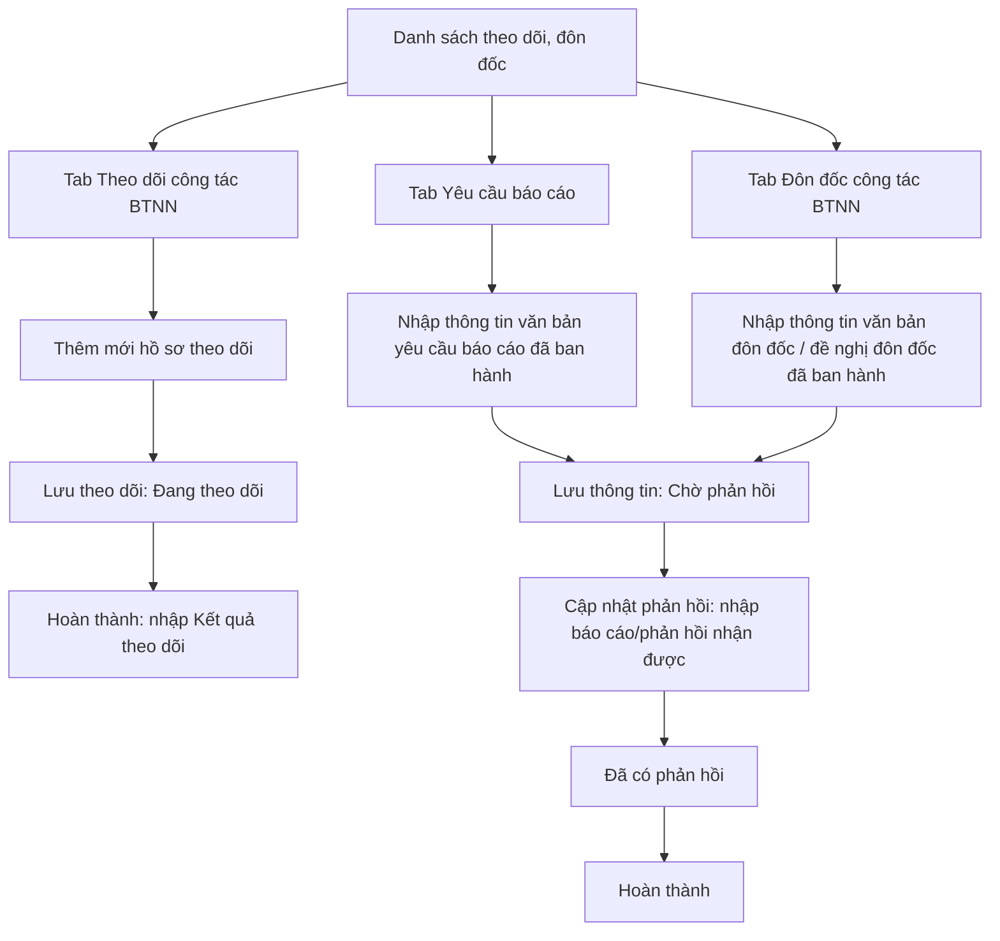
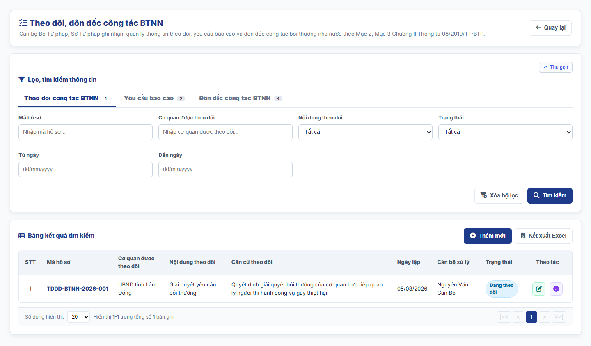
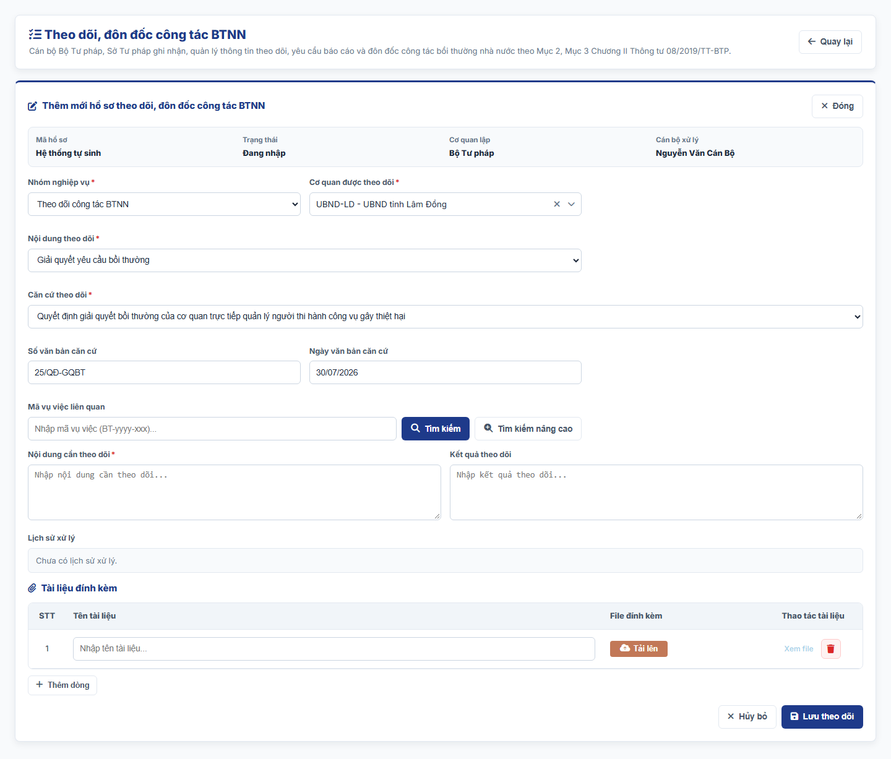
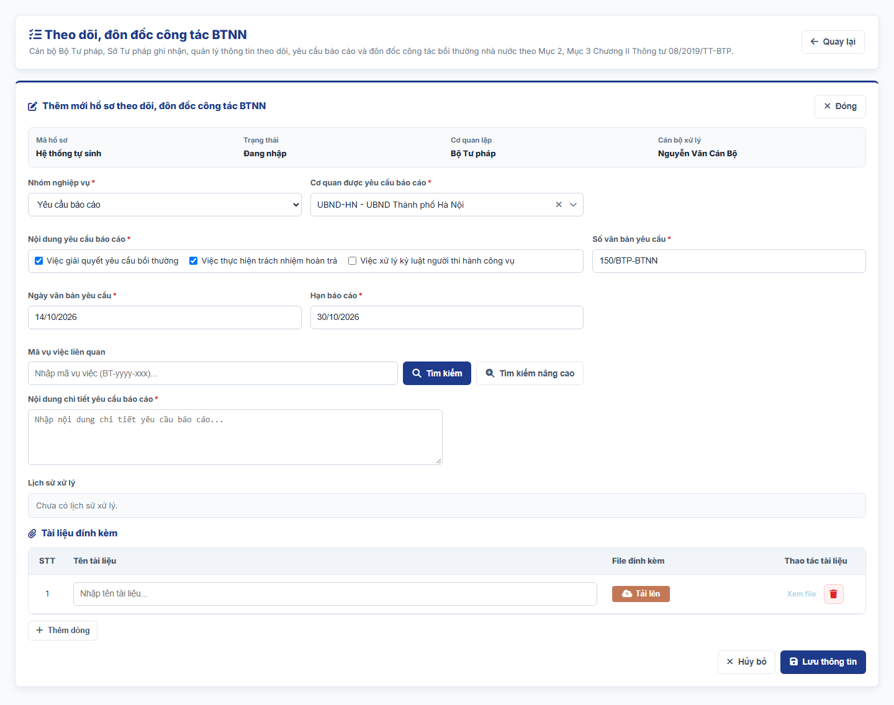
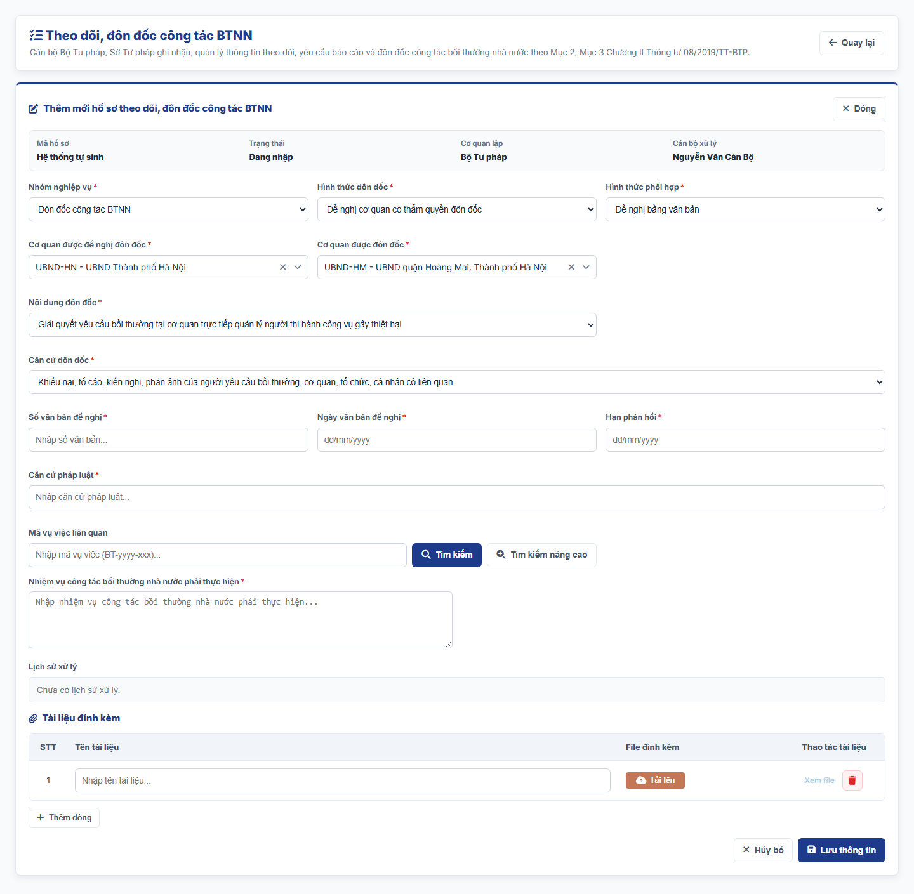
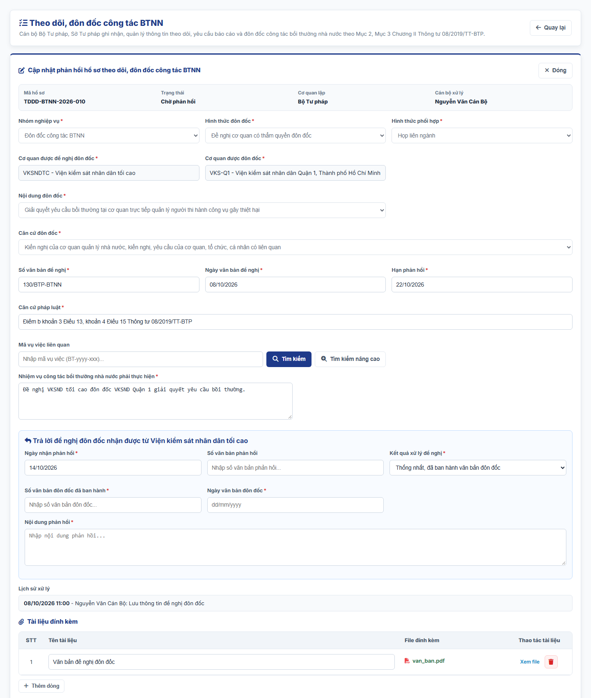
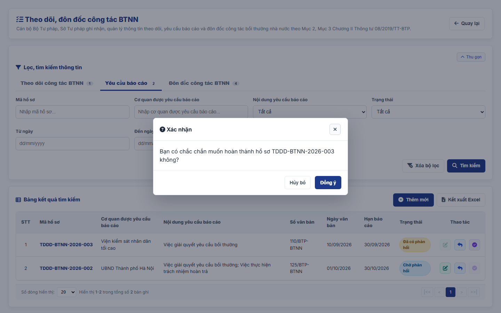

### 4.3.3. Dành cho Cán bộ Công tác bồi thường nhà nước

#### 4.3.3.8. UC-BTNN-TDDD - Theo dõi, đôn đốc công tác BTNN

##### 4.3.3.8.1. Mục đích

\- Cho phép cán bộ Bộ Tư pháp và cán bộ Sở Tư pháp (giúp Ủy ban nhân dân cấp tỉnh) **nhập và quản lý thông tin** về 03 nghiệp vụ theo Mục 2, Mục 3 Chương II Thông tư 08/2019/TT-BTP:

| Nghiệp vụ | Bản chất | Căn cứ | Thông tin ghi nhận trên hệ thống |
| :--- | :--- | :--- | :--- |
| Theo dõi công tác BTNN | Cơ quan quản lý nhà nước nắm bắt thông tin đối với các vụ việc yêu cầu bồi thường, giải quyết bồi thường và thực hiện trách nhiệm hoàn trả của người thi hành công vụ gây thiệt hại. | Điều 8, khoản 1 Điều 9 | Cơ quan được theo dõi, nội dung, căn cứ, kết quả theo dõi. |
| Yêu cầu báo cáo | Yêu cầu cơ quan giải quyết bồi thường báo cáo về việc giải quyết yêu cầu bồi thường, thực hiện trách nhiệm hoàn trả và xử lý kỷ luật người thi hành công vụ; là một hình thức theo dõi. | Điểm b khoản 2 Điều 9, Điều 11 | Văn bản yêu cầu báo cáo đã ban hành, hạn báo cáo, báo cáo nhận được. |
| Đôn đốc công tác BTNN | Cơ quan quản lý nhà nước yêu cầu một hoặc một số cơ quan thực hiện công tác bồi thường nhà nước đúng quy định; thực hiện bằng văn bản, nêu rõ căn cứ pháp luật và nhiệm vụ phải thực hiện. | Điều 13, Điều 14, Điều 15 | Văn bản đôn đốc hoặc văn bản đề nghị đôn đốc đã ban hành, hạn phản hồi, phản hồi nhận được. |

\- Hệ thống **không gửi văn bản** tới cơ quan được theo dõi, được yêu cầu báo cáo, được đôn đốc hoặc được đề nghị đôn đốc. Văn bản được ký, ban hành và gửi ngoài hệ thống; cán bộ nhập thông tin văn bản, đính kèm file và tự cập nhật báo cáo/phản hồi khi nhận được.

*a. Phân quyền*:

\- Người dùng thuộc Bộ Tư pháp, Cục Đăng ký giao dịch bảo đảm và Bồi thường nhà nước hoặc Sở Tư pháp: tra cứu, thêm mới; sửa, cập nhật phản hồi, hoàn thành hồ sơ do đơn vị mình lập.

\- Người dùng thuộc Bộ Tư pháp hoặc Cục Đăng ký giao dịch bảo đảm và Bồi thường nhà nước: xem chi tiết hồ sơ của mọi Sở Tư pháp; không thao tác trên hồ sơ của Sở Tư pháp.

\- Người dùng thuộc Sở Tư pháp: chỉ xem hồ sơ do Sở mình lập.

\- Người dùng thuộc đơn vị khác: không xem được dữ liệu.

\- Người dùng thuộc UBND cấp tỉnh: chỉ xem chi tiết hồ sơ của Sở Tư pháp trực thuộc; không thêm mới, không thao tác.

\- Phạm vi dữ liệu theo [Quy tắc phạm vi dữ liệu Bộ Tư pháp - Sở Tư pháp - Danh mục và Phụ lục - Tài liệu tổng hợp](../../Tai%20lieu%20tong%20hop/04_Danh_muc_va_Phu_luc.md#quy-tac-pham-vi-du-lieu-btp-stp).

*b. Điều kiện thực hiện*:

\- Người dùng đã đăng nhập Website Quản trị và được phân quyền truy cập màn hình `Theo dõi, đôn đốc công tác BTNN`.

\- Cơ quan được theo dõi, cơ quan được yêu cầu báo cáo, cơ quan được đôn đốc, cơ quan được đề nghị đôn đốc chọn trên cây Cơ cấu tổ chức `[DM_DON_VI]` tại [MH01 - Màn hình Quản lý cơ cấu tổ chức - Quản lý cơ cấu tổ chức - Quản trị hệ thống](../01_Quan_tri_he_thong/Quan_ly_co_cau_to_chuc.md#cctc-mh01).

---

##### 4.3.3.8.2. Sơ đồ luồng nghiệp vụ theo giao diện

---

##### 4.3.3.8.3. MH01 - Màn hình Danh sách theo dõi, đôn đốc công tác BTNN

###### 4.3.3.8.3.1. Màn hình

###### 4.3.3.8.3.2. Mô tả thông tin trên màn hình

| Trường thông tin | Kiểu dữ liệu | Bắt buộc | Mặc định | Mô tả |
| :--- | :--- | :--- | :--- | :--- |
| Tab nghiệp vụ | - | - | Theo dõi công tác BTNN | Control UI: Tab, mỗi tab kèm số lượng hồ sơ. Gồm: + Theo dõi công tác BTNN + Yêu cầu báo cáo + Đôn đốc công tác BTNN |
| **I. Bộ lọc tìm kiếm** | - | - | - | Control UI: Khối thu gọn/mở rộng (Accordion). - Không hiển thị tiêu đề khối. - Cho phép thu gọn/mở rộng khi click vào nút "Thu gọn"/"Mở rộng" ở góc phải khối. - Các ô lọc thay đổi theo tab đang chọn. |
| Mã hồ sơ | String(50) | Không | Trống | Control UI: Text input. - Placeholder: "Nhập mã hồ sơ...". - Tìm gần đúng. |
| Cơ quan | String(255) | Không | Trống | Control UI: Text input. - Nhãn theo tab: `Cơ quan được theo dõi`, `Cơ quan được yêu cầu báo cáo`, `Cơ quan được đôn đốc`. - Tìm gần đúng theo tên cơ quan; với tab Đôn đốc, tìm cả theo cơ quan được đề nghị đôn đốc. |
| Đơn vị thực hiện | List(String(50)) | Không | Tất cả | Control UI: Cây đơn vị chọn nhiều (Tree select) theo Cơ cấu tổ chức, có ô tìm kiếm theo tên. - Chỉ hiển thị khi người dùng thuộc Bộ Tư pháp hoặc Cục Đăng ký giao dịch bảo đảm và Bồi thường nhà nước. - Cây gồm Bộ Tư pháp, Cục Đăng ký giao dịch bảo đảm và Bồi thường nhà nước và đơn vị trực thuộc; các Sở Tư pháp và đơn vị trực thuộc, theo [Quy tắc phạm vi dữ liệu Bộ Tư pháp - Sở Tư pháp - Danh mục và Phụ lục - Tài liệu tổng hợp](../../Tai%20lieu%20tong%20hop/04_Danh_muc_va_Phu_luc.md#quy-tac-pham-vi-du-lieu-btp-stp). - Mỗi nút có ô tích; tích nút cha thì tích toàn bộ nút con. - `Tất cả`: không lọc. - Nút `Các Sở Tư pháp`: tích nhanh toàn bộ các Sở Tư pháp trong cây. - Chọn từ 02 đơn vị trở lên: ô hiển thị "Đã chọn [n] đơn vị". - Lọc bản ghi có `Đơn vị thực hiện` hoặc đơn vị công tác của `Cán bộ xử lý` thuộc các đơn vị đã tích. |
| Nội dung | Enum(String(255)) | Không | Tất cả | Control UI: Combobox. - Nhãn và danh sách theo tab: `Nội dung theo dõi` (khoản 2 Điều 8), `Nội dung yêu cầu báo cáo` (Điều 11), `Nội dung đôn đốc` (khoản 2 Điều 13); giá trị như tại [MH02 - Màn hình Thêm mới/Sửa hồ sơ theo dõi, đôn đốc công tác BTNN](#43384-mh02---màn-hình-thêm-mớisửa-hồ-sơ-theo-dõi-đôn-đốc-công-tác-btnn). |
| Hình thức đôn đốc | Enum(String(100)) | Không | Tất cả | Control UI: Combobox, chỉ hiển thị ở tab `Đôn đốc công tác BTNN`. Gồm: + Đôn đốc trực tiếp + Đề nghị cơ quan có thẩm quyền đôn đốc |
| Trạng thái | Enum(String(50)) | Không | Tất cả | Control UI: Combobox. - Tab Theo dõi: `Đang theo dõi`, `Hoàn thành`. - Tab Yêu cầu báo cáo, Đôn đốc: `Chờ phản hồi`, `Đã có phản hồi`, `Hoàn thành`. |
| Từ ngày | Date | Không | Trống | Control UI: DatePicker. - Placeholder: "dd/mm/yyyy". - So sánh với Ngày lập (tab Theo dõi) hoặc Ngày văn bản (tab Yêu cầu báo cáo, Đôn đốc). |
| Đến ngày | Date | Không | Trống | Control UI: DatePicker. - Placeholder: "dd/mm/yyyy". |
| **II. Bảng danh sách kết quả** | - | - | 20 bản ghi/trang | Control UI: Data grid. - Phạm vi bản ghi theo [Quy tắc phạm vi dữ liệu Bộ Tư pháp - Sở Tư pháp - Danh mục và Phụ lục - Tài liệu tổng hợp](../../Tai%20lieu%20tong%20hop/04_Danh_muc_va_Phu_luc.md#quy-tac-pham-vi-du-lieu-btp-stp): + Người dùng thuộc Bộ Tư pháp hoặc Cục Đăng ký giao dịch bảo đảm và Bồi thường nhà nước: bản ghi của Bộ Tư pháp và của mọi Sở Tư pháp. + Người dùng thuộc Sở Tư pháp: bản ghi do Sở mình tạo. + Người dùng thuộc UBND cấp tỉnh: bản ghi của Sở Tư pháp trực thuộc; các icon thao tác hiển thị mờ. + Người dùng thuộc đơn vị khác: không hiển thị bản ghi. - Hồ sơ của đơn vị khác: các icon thao tác hiển thị mờ. - Sắp xếp mặc định theo Mã hồ sơ giảm dần. - Trạng thái không có dữ liệu (Empty State): bảng hiển thị duy nhất 01 dòng căn giữa trên toàn bộ chiều rộng bảng (`colspan`), in nghiêng với nội dung [MSG-INF-SYS-001]. |
| **II.1. Tab Theo dõi công tác BTNN** | - | - | - | Hiển thị khi người dùng chọn tab `Theo dõi công tác BTNN`. |
| STT | Integer(10) | - | - | Theo dữ liệu bản ghi. |
| Mã hồ sơ | String(50) | - | - | Theo dữ liệu bản ghi. |
| Cơ quan được theo dõi | String(255) | - | - | Theo dữ liệu bản ghi. |
| Nội dung theo dõi | Enum(String(255)) | - | - | Theo dữ liệu bản ghi. |
| Căn cứ theo dõi | Enum(String(255)) | - | - | Theo dữ liệu bản ghi. |
| Ngày lập | Date | - | - | Theo dữ liệu bản ghi. - Định dạng `dd/mm/yyyy`. |
| Cán bộ xử lý | String(100) | - | - | Control UI: Text (Read-only). - Họ và tên cán bộ đã nhập hồ sơ (người tạo). |
| Đơn vị thực hiện | String(255) | - | - | Control UI: Text (Read-only). - Chỉ hiển thị khi người dùng thuộc Bộ Tư pháp hoặc Cục Đăng ký giao dịch bảo đảm và Bồi thường nhà nước. - Đặt ngay sau cột `Cán bộ xử lý`. - Hiển thị tên đơn vị thực hiện của bản ghi. |
| Trạng thái | Enum(String(50)) | - | - | Control UI: Badge, theo dữ liệu bản ghi. |
| Thao tác | - | - | - | Control UI: Icon + Sửa + Hoàn thành - Cột cố định bên phải lưới khi cuộn ngang. |
| **II.2. Tab Yêu cầu báo cáo** | - | - | - | Hiển thị khi người dùng chọn tab `Yêu cầu báo cáo`. |
| STT | Integer(10) | - | - | Theo dữ liệu bản ghi. |
| Mã hồ sơ | String(50) | - | - | Theo dữ liệu bản ghi. |
| Cơ quan được yêu cầu báo cáo | String(255) | - | - | Theo dữ liệu bản ghi. |
| Nội dung yêu cầu báo cáo | List(Enum(String(255))) | - | - | Theo dữ liệu bản ghi. - Nhiều giá trị ngăn cách bởi dấu `;`. |
| Số văn bản | String(50) | - | - | Theo dữ liệu bản ghi. |
| Ngày văn bản | Date | - | - | Theo dữ liệu bản ghi. - Định dạng `dd/mm/yyyy`. |
| Hạn báo cáo | Date | - | - | Theo dữ liệu bản ghi. - Định dạng `dd/mm/yyyy`. - Khi hồ sơ chưa có phản hồi và ngày hiện tại lớn hơn hạn, hiển thị thêm nhãn đỏ `Quá hạn`. |
| Cán bộ xử lý | String(100) | - | - | Control UI: Text (Read-only). - Họ và tên cán bộ đã nhập hồ sơ (người tạo). |
| Đơn vị thực hiện | String(255) | - | - | Control UI: Text (Read-only). - Chỉ hiển thị khi người dùng thuộc Bộ Tư pháp hoặc Cục Đăng ký giao dịch bảo đảm và Bồi thường nhà nước. - Đặt ngay sau cột `Cán bộ xử lý`. - Hiển thị tên đơn vị thực hiện của bản ghi. |
| Trạng thái | Enum(String(50)) | - | - | Control UI: Badge, theo dữ liệu bản ghi. |
| Thao tác | - | - | - | Control UI: Icon + Sửa + Cập nhật phản hồi + Hoàn thành - Cột cố định bên phải lưới khi cuộn ngang. |
| **II.3. Tab Đôn đốc công tác BTNN** | - | - | - | Hiển thị khi người dùng chọn tab `Đôn đốc công tác BTNN`. |
| STT | Integer(10) | - | - | Theo dữ liệu bản ghi. |
| Mã hồ sơ | String(50) | - | - | Theo dữ liệu bản ghi. |
| Hình thức đôn đốc | Enum(String(100)) | - | - | Theo dữ liệu bản ghi. |
| Cơ quan nhận văn bản | String(255) | - | - | Theo dữ liệu bản ghi. - Hình thức `Đôn đốc trực tiếp`: hiển thị Cơ quan được đôn đốc. - Hình thức `Đề nghị cơ quan có thẩm quyền đôn đốc`: hiển thị Cơ quan được đề nghị đôn đốc. |
| Cơ quan được đôn đốc | String(255) | - | - | Theo dữ liệu bản ghi. |
| Nội dung đôn đốc | Enum(String(255)) | - | - | Theo dữ liệu bản ghi. |
| Hạn phản hồi | Date | - | - | Theo dữ liệu bản ghi. - Định dạng `dd/mm/yyyy`. - Khi hồ sơ chưa có phản hồi và ngày hiện tại lớn hơn hạn, hiển thị thêm nhãn đỏ `Quá hạn`. |
| Cán bộ xử lý | String(100) | - | - | Control UI: Text (Read-only). - Họ và tên cán bộ đã nhập hồ sơ (người tạo). |
| Đơn vị thực hiện | String(255) | - | - | Control UI: Text (Read-only). - Chỉ hiển thị khi người dùng thuộc Bộ Tư pháp hoặc Cục Đăng ký giao dịch bảo đảm và Bồi thường nhà nước. - Đặt ngay sau cột `Cán bộ xử lý`. - Hiển thị tên đơn vị thực hiện của bản ghi. |
| Trạng thái | Enum(String(50)) | - | - | Control UI: Badge, theo dữ liệu bản ghi. |
| Thao tác | - | - | - | Control UI: Icon + Sửa + Cập nhật phản hồi + Hoàn thành - Cột cố định bên phải lưới khi cuộn ngang. |

###### 4.3.3.8.3.3. Chức năng trên màn hình

| STT | Tên chức năng | Định dạng | Mô tả |
| :--- | :--- | :--- | :--- |
| 1 | Chuyển tab | Tab | Hệ thống tải danh sách và bộ lọc theo tab được chọn, đưa về Trang 1. |
| 2 | Tìm kiếm | Button | Khi người dùng click nút, hệ thống kiểm tra điều kiện và tìm kiếm theo các trường hợp bên dưới: |
|  |  |  | **TH1 - Khoảng ngày không hợp lệ**: Nếu `Từ ngày` lớn hơn `Đến ngày`, vi phạm [BR-VAL-007], hệ thống hiển thị [MSG-ERR-VAL-007] và không thực hiện tìm kiếm. |
|  |  |  | **TH2 - Hợp lệ**: Hệ thống hiển thị các hồ sơ thỏa mãn đồng thời các tiêu chí và đưa về Trang 1. |
|  |  |  | **TH3 - Không có dữ liệu**: Bảng hiển thị 01 dòng [MSG-INF-SYS-001]. |
|  |  |  | **TH4 - Đơn vị của người dùng không thuộc phạm vi dữ liệu**: Người dùng không thuộc Bộ Tư pháp, Cục Đăng ký giao dịch bảo đảm và Bồi thường nhà nước, Sở Tư pháp hoặc UBND cấp tỉnh; bảng kết quả hiển thị 01 dòng căn giữa, in nghiêng: "Đơn vị của người dùng không thuộc phạm vi dữ liệu của chức năng này.". |
| 3 | Xóa bộ lọc | Button | Hệ thống xóa toàn bộ tiêu chí lọc về giá trị mặc định và tải lại danh sách. |
| 4 | Thêm mới | Button | Chỉ hiển thị khi người dùng thuộc Bộ Tư pháp, Cục Đăng ký giao dịch bảo đảm và Bồi thường nhà nước hoặc Sở Tư pháp. - Hệ thống mở [MH02 - Màn hình Thêm mới/Sửa hồ sơ theo dõi, đôn đốc công tác BTNN](#43384-mh02---màn-hình-thêm-mớisửa-hồ-sơ-theo-dõi-đôn-đốc-công-tác-btnn), `Nhóm nghiệp vụ` mặc định theo tab đang chọn. |
| 5 | Kết xuất Excel | Button | Kết xuất danh sách của tab đang chọn ra tệp Excel theo [Quy chuẩn Kết xuất Excel dùng chung - Danh mục và Phụ lục - Tài liệu tổng hợp](../../Tai%20lieu%20tong%20hop/04_Danh_muc_va_Phu_luc.md#quy-chuan-ket-xuat-excel): - Phạm vi: toàn bộ bản ghi của tab đang chọn thỏa mãn điều kiện tìm kiếm hiện hành, không giới hạn theo trang. - Cột xuất theo thứ tự lưới của tab, không gồm cột Thao tác: + Tab Theo dõi công tác BTNN: STT, Mã hồ sơ, Cơ quan được theo dõi, Nội dung theo dõi, Căn cứ theo dõi, Ngày lập, Cán bộ xử lý, Trạng thái. + Tab Yêu cầu báo cáo: STT, Mã hồ sơ, Cơ quan được yêu cầu báo cáo, Nội dung yêu cầu báo cáo, Số văn bản, Ngày văn bản, Hạn báo cáo, Trạng thái. + Tab Đôn đốc công tác BTNN: STT, Mã hồ sơ, Hình thức đôn đốc, Cơ quan nhận văn bản, Cơ quan được đôn đốc, Nội dung đôn đốc, Hạn phản hồi, Trạng thái. - Tên tệp theo tab: + Tab Theo dõi công tác BTNN: `yyyyMMdd_Danh_sach_theo_doi_cong_tac_BTNN.xlsx`. + Tab Yêu cầu báo cáo: `yyyyMMdd_Danh_sach_yeu_cau_bao_cao_BTNN.xlsx`. + Tab Đôn đốc công tác BTNN: `yyyyMMdd_Danh_sach_don_doc_cong_tac_BTNN.xlsx`. |
|  |  |  | **TH1 - Không có dữ liệu**: Hệ thống hiển thị [MSG-WRN-SYS-001] và không tải tệp. |
|  |  |  | **TH2 - Có dữ liệu**: Hệ thống tải tệp Excel về máy người dùng. |
| 6 | Row click | Row click | Hệ thống mở [MH03 - Màn hình Xem chi tiết/Cập nhật phản hồi](#43385-mh03---màn-hình-xem-chi-tiếtcập-nhật-phản-hồi) ở chế độ xem. - Hồ sơ của đơn vị khác: chỉ hiển thị nút `Đóng`. |
| 7 | Sửa | Icon button | Chỉ cho phép với hồ sơ theo dõi ở trạng thái `Đang theo dõi`, hoặc hồ sơ yêu cầu báo cáo/đôn đốc ở trạng thái `Chờ phản hồi`. Hệ thống mở [MH02 - Màn hình Thêm mới/Sửa hồ sơ theo dõi, đôn đốc công tác BTNN](#43384-mh02---màn-hình-thêm-mớisửa-hồ-sơ-theo-dõi-đôn-đốc-công-tác-btnn) ở chế độ Sửa. |
| 8 | Cập nhật phản hồi | Icon button | Chỉ ở tab Yêu cầu báo cáo, Đôn đốc, cho phép khi trạng thái `Chờ phản hồi` hoặc `Đã có phản hồi`. Hệ thống mở [MH03 - Màn hình Xem chi tiết/Cập nhật phản hồi](#43385-mh03---màn-hình-xem-chi-tiếtcập-nhật-phản-hồi) ở chế độ Cập nhật phản hồi. |
| 9 | Hoàn thành | Icon button | - Hồ sơ theo dõi (`Đang theo dõi`): hệ thống mở [MH02 - Màn hình Thêm mới/Sửa hồ sơ theo dõi, đôn đốc công tác BTNN](#43384-mh02---màn-hình-thêm-mớisửa-hồ-sơ-theo-dõi-đôn-đốc-công-tác-btnn) để nhập `Kết quả theo dõi` và hoàn thành. - Hồ sơ yêu cầu báo cáo, đôn đốc: chỉ cho phép khi trạng thái `Đã có phản hồi`; hệ thống mở [Popup Xác nhận](#43386-popup-xác-nhận), nếu chọn `Đồng ý` thì chuyển hồ sơ sang `Hoàn thành` và ghi lịch sử xử lý. |

---

##### 4.3.3.8.4. MH02 - Màn hình Thêm mới/Sửa hồ sơ theo dõi, đôn đốc công tác BTNN

###### 4.3.3.8.4.1. Màn hình

###### 4.3.3.8.4.2. Mô tả thông tin trên màn hình

| Trường thông tin | Kiểu dữ liệu | Bắt buộc | Mặc định | Mô tả |
| :--- | :--- | :--- | :--- | :--- |
| Mã hồ sơ | String(50) | - | Hệ thống tự sinh | Control UI: Label. - Luôn hiển thị. - Định dạng `TDDD-BTNN-yyyy-xxx`, sinh khi lưu lần đầu. |
| Trạng thái | - | - | Đang nhập | Control UI: Label. - Luôn hiển thị, theo dữ liệu bản ghi. |
| Cơ quan lập | - | - | Đơn vị gốc của người dùng | Control UI: Label. - Luôn hiển thị. |
| Cán bộ xử lý | - | - | Người dùng đăng nhập | Control UI: Label. - Luôn hiển thị. |
| Nhóm nghiệp vụ | Enum(String(100)) | Có | Theo tab đang chọn | Control UI: Combobox. - Luôn hiển thị. Gồm: + Theo dõi công tác BTNN + Yêu cầu báo cáo + Đôn đốc công tác BTNN - Khóa ở chế độ Sửa. - Khi đổi giá trị, hệ thống ẩn/hiện các trường bên dưới theo cột Mô tả và giữ dữ liệu đã nhập ở các trường còn hiển thị. |
| Hình thức đôn đốc | Enum(String(100)) | Có điều kiện | Đôn đốc trực tiếp | Control UI: Combobox. - Hiển thị khi `Nhóm nghiệp vụ` là `Đôn đốc công tác BTNN`; bắt buộc (`*`). Gồm (khoản 3, khoản 4 Điều 13 Thông tư 08/2019/TT-BTP): + Đôn đốc trực tiếp + Đề nghị cơ quan có thẩm quyền đôn đốc - Người dùng Sở Tư pháp chỉ có `Đôn đốc trực tiếp`. |
| Hình thức phối hợp | Enum(String(50)) | Có điều kiện | Đề nghị bằng văn bản | Control UI: Combobox. - Hiển thị khi `Nhóm nghiệp vụ` là `Đôn đốc công tác BTNN` và `Hình thức đôn đốc` là `Đề nghị cơ quan có thẩm quyền đôn đốc`; bắt buộc (`*`). Gồm (khoản 2 Điều 15): + Đề nghị bằng văn bản + Họp liên ngành |
| Cơ quan được đề nghị đôn đốc | String(255) | Có điều kiện | Trống | Control UI: Tree select trên cây Cơ cấu tổ chức [DM_DON_VI]. - Hiển thị cùng điều kiện với `Hình thức phối hợp`; bắt buộc (`*`). - Chọn được Tòa án nhân dân tối cao, Viện kiểm sát nhân dân tối cao, các Bộ, Ủy ban nhân dân cấp tỉnh (điểm b, c khoản 3 Điều 13). - Khi đổi giá trị, hệ thống tải lại phạm vi chọn của `Cơ quan được đôn đốc`. |
| Hồ sơ đề nghị đôn đốc trước đó | String(50) | Không | Trống | Control UI: Combobox, gồm Mã hồ sơ đề nghị đôn đốc của cơ quan lập đã có phản hồi hoặc đã hoàn thành. - Hiển thị khi `Nhóm nghiệp vụ` là `Đôn đốc công tác BTNN`, `Hình thức đôn đốc` là `Đôn đốc trực tiếp` và người dùng thuộc Bộ Tư pháp. - Dùng cho trường hợp tại điểm d khoản 3 Điều 13: khi chọn, hệ thống tự điền `Cơ quan được đôn đốc` theo hồ sơ đề nghị. |
| Cơ quan được theo dõi | String(255) | Có điều kiện | Trống | Control UI: Tree select, chọn 01 đơn vị trên cây Cơ cấu tổ chức [DM_DON_VI]. - Hiển thị khi `Nhóm nghiệp vụ` là `Theo dõi công tác BTNN`; bắt buộc (`*`). - Placeholder: "-- Chọn đơn vị trên cây cơ cấu tổ chức --". - Người dùng Bộ Tư pháp chọn được đơn vị trên toàn quốc; người dùng Sở Tư pháp chọn được đơn vị trên địa bàn Tỉnh/Thành phố. Đơn vị ngoài phạm vi hiển thị mờ, không chọn được. |
| Cơ quan được yêu cầu báo cáo | String(255) | Có điều kiện | Trống | Control UI: Tree select, cùng vị trí với `Cơ quan được theo dõi`. - Hiển thị khi `Nhóm nghiệp vụ` là `Yêu cầu báo cáo`; bắt buộc (`*`). - Người dùng Bộ Tư pháp chọn được Tòa án nhân dân tối cao, Viện kiểm sát nhân dân tối cao, các Bộ, Ủy ban nhân dân cấp tỉnh (khoản 1 Điều 11); người dùng Sở Tư pháp chọn được cơ quan giải quyết bồi thường tại địa phương, không gồm Ủy ban nhân dân cấp tỉnh (khoản 3 Điều 11). |
| Cơ quan được đôn đốc | String(255) | Có điều kiện | Trống | Control UI: Tree select, cùng vị trí với `Cơ quan được theo dõi`. - Hiển thị khi `Nhóm nghiệp vụ` là `Đôn đốc công tác BTNN`; bắt buộc (`*`). - Hình thức `Đôn đốc trực tiếp`: người dùng Bộ Tư pháp chọn được Tòa án nhân dân tối cao, Viện kiểm sát nhân dân tối cao, các Bộ, cơ quan ở trung ương, Ủy ban nhân dân cấp tỉnh (điểm a khoản 3 Điều 13); người dùng Sở Tư pháp chọn được cơ quan hành chính, cơ quan tiến hành tố tụng, cơ quan thi hành án ở địa phương, không gồm Ủy ban nhân dân cấp tỉnh (khoản 4 Điều 13). - Hình thức `Đề nghị cơ quan có thẩm quyền đôn đốc`: chọn được cơ quan thuộc phạm vi quản lý của Cơ quan được đề nghị đôn đốc. |
| Nội dung theo dõi | Enum(String(255)) | Có điều kiện | Trống | Control UI: Combobox. - Hiển thị khi `Nhóm nghiệp vụ` là `Theo dõi công tác BTNN`; bắt buộc (`*`). Gồm (khoản 2 Điều 8 Thông tư 08/2019/TT-BTP): + Giải quyết yêu cầu bồi thường + Tham gia tố tụng của cơ quan trực tiếp quản lý người thi hành công vụ gây thiệt hại + Cấp kinh phí bồi thường và chi trả tiền bồi thường + Xác định và thực hiện trách nhiệm hoàn trả của người thi hành công vụ gây thiệt hại + Xử lý kỷ luật người thi hành công vụ gây thiệt hại + Quản lý nhà nước về công tác bồi thường nhà nước |
| Nội dung yêu cầu báo cáo | List(Enum(String(255))) | Có điều kiện | Trống | Control UI: Checkbox, chọn một hoặc nhiều; cùng vị trí với `Nội dung theo dõi`. - Hiển thị khi `Nhóm nghiệp vụ` là `Yêu cầu báo cáo`; bắt buộc (`*`). Gồm (Điều 11 Thông tư 08/2019/TT-BTP): + Việc giải quyết yêu cầu bồi thường + Việc thực hiện trách nhiệm hoàn trả + Việc xử lý kỷ luật người thi hành công vụ |
| Nội dung đôn đốc | Enum(String(255)) | Có điều kiện | Trống | Control UI: Combobox, cùng vị trí với `Nội dung theo dõi`. - Hiển thị khi `Nhóm nghiệp vụ` là `Đôn đốc công tác BTNN`; bắt buộc (`*`). Gồm (khoản 2 Điều 13 Thông tư 08/2019/TT-BTP): + Giải quyết yêu cầu bồi thường tại cơ quan trực tiếp quản lý người thi hành công vụ gây thiệt hại + Phục hồi danh dự + Cấp kinh phí bồi thường và chi trả tiền bồi thường + Xác định và thực hiện trách nhiệm hoàn trả của người thi hành công vụ gây thiệt hại + Quản lý nhà nước về công tác bồi thường nhà nước |
| Căn cứ theo dõi | Enum(String(255)) | Có điều kiện | Trống | Control UI: Combobox. - Hiển thị khi `Nhóm nghiệp vụ` là `Theo dõi công tác BTNN`; bắt buộc (`*`). Gồm (khoản 1 Điều 9 Thông tư 08/2019/TT-BTP): + Báo cáo về việc giải quyết yêu cầu bồi thường, xác định trách nhiệm hoàn trả và việc xử lý kỷ luật người thi hành công vụ gây thiệt hại + Báo cáo việc thực hiện công tác bồi thường nhà nước + Bản án, quyết định của Tòa án về giải quyết vụ án dân sự, hình sự, hành chính có nội dung giải quyết bồi thường + Quyết định giải quyết bồi thường của cơ quan trực tiếp quản lý người thi hành công vụ gây thiệt hại + Đề nghị hướng dẫn nghiệp vụ, giải đáp vướng mắc hoặc đề nghị hỗ trợ, hướng dẫn người bị thiệt hại thực hiện thủ tục yêu cầu bồi thường + Kết quả hoạt động kiểm tra, thanh tra công tác bồi thường nhà nước + Thông tin báo chí về công tác bồi thường nhà nước + Khiếu nại, tố cáo, phản ánh, kiến nghị của cơ quan, tổ chức, cá nhân về công tác bồi thường nhà nước + Căn cứ khác có thông tin liên quan đến công tác bồi thường nhà nước |
| Căn cứ đôn đốc | Enum(String(255)) | Có điều kiện | Trống | Control UI: Combobox, cùng vị trí với `Căn cứ theo dõi`. - Hiển thị khi `Nhóm nghiệp vụ` là `Đôn đốc công tác BTNN`; bắt buộc (`*`). Gồm (Điều 14 Thông tư 08/2019/TT-BTP): + Khiếu nại, tố cáo, kiến nghị, phản ánh của người yêu cầu bồi thường, cơ quan, tổ chức, cá nhân có liên quan + Kiến nghị của cơ quan quản lý nhà nước, kiến nghị, yêu cầu của cơ quan, tổ chức, cá nhân có liên quan + Kết quả hướng dẫn nghiệp vụ, giải đáp vướng mắc, theo dõi, kiểm tra, thanh tra công tác bồi thường nhà nước, hỗ trợ, hướng dẫn người bị thiệt hại + Quyết định giải quyết bồi thường hoặc bản án, quyết định của Tòa án về giải quyết yêu cầu bồi thường có hiệu lực pháp luật + Quyết định có liên quan về trách nhiệm hoàn trả + Báo cáo việc thực hiện công tác bồi thường nhà nước của TAND tối cao, VKSND tối cao, các Bộ, UBND cấp tỉnh + Báo cáo về việc giải quyết yêu cầu bồi thường, xác định trách nhiệm hoàn trả của cơ quan giải quyết bồi thường |
| Số văn bản căn cứ | String(50) | Không | Trống | Control UI: Text input. - Hiển thị khi `Nhóm nghiệp vụ` là `Theo dõi công tác BTNN`. - Placeholder: "Nhập số văn bản căn cứ...". |
| Ngày văn bản căn cứ | Date | Không | Trống | Control UI: DatePicker. - Hiển thị khi `Nhóm nghiệp vụ` là `Theo dõi công tác BTNN`. - Placeholder: "dd/mm/yyyy". |
| Số văn bản | String(50) | Có điều kiện | Trống | Control UI: Text input, cùng vị trí với `Số văn bản căn cứ`. - Hiển thị khi `Nhóm nghiệp vụ` là `Yêu cầu báo cáo` hoặc `Đôn đốc công tác BTNN`; bắt buộc (`*`). - Placeholder: "Nhập số văn bản...". - Nhãn theo giá trị đang chọn: `Số văn bản yêu cầu` (Yêu cầu báo cáo), `Số văn bản đôn đốc` (Đôn đốc trực tiếp), `Số văn bản đề nghị` (Đề nghị cơ quan có thẩm quyền đôn đốc). |
| Ngày văn bản | Date | Có điều kiện | Trống | Control UI: DatePicker, cùng vị trí với `Ngày văn bản căn cứ`. - Hiển thị cùng điều kiện với `Số văn bản`; bắt buộc (`*`). - Placeholder: "dd/mm/yyyy". - Nhãn theo giá trị đang chọn: `Ngày văn bản yêu cầu`, `Ngày văn bản đôn đốc`, `Ngày văn bản đề nghị`. |
| Hạn báo cáo | Date | Có điều kiện | Trống | Control UI: DatePicker. - Hiển thị khi `Nhóm nghiệp vụ` là `Yêu cầu báo cáo`; bắt buộc (`*`). - Placeholder: "dd/mm/yyyy". - Không nhỏ hơn `Ngày văn bản yêu cầu` theo [BR-VAL-007]. |
| Hạn phản hồi | Date | Có điều kiện | Trống | Control UI: DatePicker, cùng vị trí với `Hạn báo cáo`. - Hiển thị khi `Nhóm nghiệp vụ` là `Đôn đốc công tác BTNN`; bắt buộc (`*`). - Placeholder: "dd/mm/yyyy". - Không nhỏ hơn ngày văn bản theo [BR-VAL-007]. |
| Căn cứ pháp luật | String(500) | Có điều kiện | Trống | Control UI: Text input. - Hiển thị khi `Nhóm nghiệp vụ` là `Đôn đốc công tác BTNN`; bắt buộc (`*`). - Placeholder: "Nhập căn cứ pháp luật...". - Văn bản đôn đốc phải nêu rõ căn cứ pháp luật (khoản 1, khoản 3 Điều 15). |
| Mã vụ việc liên quan | String(50) | Không | Trống | Control UI: Text input kèm nút `Tìm kiếm` và `Tìm kiếm nâng cao`. - Luôn hiển thị. - Placeholder: "Nhập mã vụ việc (VVBT-yyyy-xxx)...". - Chỉ lưu vụ việc được chọn từ kết quả tìm kiếm, thuộc phạm vi dữ liệu theo cấp của người dùng; khi người dùng gõ tay hoặc sửa nội dung ô, hệ thống bỏ liên kết đã chọn. |
| Liên kết hồ sơ vụ việc | Link | Không | Ẩn | Control UI: Text link. - Hiển thị sau khi chọn vụ việc, dạng `Liên kết hồ sơ vụ việc: [Mã vụ việc] - [Họ và tên người yêu cầu bồi thường]`. - Khi click, hệ thống mở [MH05 - Màn hình Xem chi tiết hồ sơ yêu cầu bồi thường - SRS Giải quyết yêu cầu bồi thường - Giải quyết bồi thường](SRS_BTNN_GiaiQuyetBT_GiaiQuyet_YCBT.md#43317-mh05---màn-hình-xem-chi-tiết-hồ-sơ-yêu-cầu-bồi-thường) tại tab trình duyệt mới. |
| Nội dung cần theo dõi | Text(4000) | Có điều kiện | Trống | Control UI: Textarea. - Hiển thị khi `Nhóm nghiệp vụ` là `Theo dõi công tác BTNN`; bắt buộc (`*`). - Placeholder: "Nhập nội dung cần theo dõi...". |
| Nội dung chi tiết yêu cầu báo cáo | Text(4000) | Có điều kiện | Trống | Control UI: Textarea, cùng vị trí với `Nội dung cần theo dõi`. - Hiển thị khi `Nhóm nghiệp vụ` là `Yêu cầu báo cáo`; bắt buộc (`*`). - Placeholder: "Nhập nội dung chi tiết yêu cầu báo cáo...". |
| Nhiệm vụ công tác bồi thường nhà nước phải thực hiện | Text(4000) | Có điều kiện | Trống | Control UI: Textarea, cùng vị trí với `Nội dung cần theo dõi`. - Hiển thị khi `Nhóm nghiệp vụ` là `Đôn đốc công tác BTNN`; bắt buộc (`*`). - Placeholder: "Nhập nhiệm vụ công tác bồi thường nhà nước phải thực hiện...". |
| Kết quả theo dõi | Text(4000) | Có điều kiện | Trống | Control UI: Textarea. - Hiển thị khi `Nhóm nghiệp vụ` là `Theo dõi công tác BTNN`. - Placeholder: "Nhập kết quả theo dõi...". - Bắt buộc (`*`) khi người dùng thực hiện `Hoàn thành`. |
| Lịch sử xử lý | - | - | - | Control UI: Label. - Luôn hiển thị; mỗi dòng gồm thời điểm, cán bộ thực hiện, thao tác và ghi chú. |
| Tài liệu đính kèm | List(File) | Không | Trống | Control UI: Bảng tài liệu đính kèm gồm các cột `STT`, `Tên tài liệu, văn bản`, `File đính kèm`, `Thao tác`; nút `Thêm tài liệu` dưới bảng. - Luôn hiển thị. - Đính kèm văn bản căn cứ, văn bản yêu cầu báo cáo, văn bản đôn đốc, văn bản đề nghị đôn đốc đã ký ban hành và tài liệu liên quan. - Cột `Thao tác` gồm: + Xem file + Xóa - Áp dụng [BR-FILE-010]. |

\- Dấu `*` chỉ hiển thị trên nhãn khi trường đang hiển thị và bắt buộc theo giá trị đang chọn. Khi đổi `Nhóm nghiệp vụ`, `Hình thức đôn đốc`, `Cơ quan được đề nghị đôn đốc` hoặc `Hồ sơ đề nghị đôn đốc trước đó`, hệ thống ẩn/hiện các trường phụ thuộc và giữ dữ liệu đã nhập ở các trường còn hiển thị.

###### 4.3.3.8.4.3. Chức năng trên màn hình

| STT | Tên chức năng | Định dạng | Mô tả |
| :--- | :--- | :--- | :--- |
| 1 | Lưu theo dõi | Button | Hiển thị với nhóm Theo dõi ở chế độ Thêm mới, Sửa. Khi người dùng click nút, hệ thống kiểm tra dữ liệu: |
|  |  |  | **TH1 - Bỏ trống trường bắt buộc**: Vi phạm [BR-VAL-001]. Hệ thống viền đỏ các ô lỗi, hiển thị "Đây là trường bắt buộc" dưới từng ô và cuộn tới ô lỗi đầu tiên. |
|  |  |  | **TH2 - Mã vụ việc chưa được chọn từ kết quả tìm kiếm**: Hệ thống viền đỏ ô `Mã vụ việc liên quan`, hiển thị "Vụ việc chưa được chọn từ danh sách tìm kiếm. Vui lòng bấm Tìm kiếm để chọn vụ việc hoặc để trống." và không cho lưu. |
|  |  |  | **TH3 - Hợp lệ**: Hệ thống lưu hồ sơ ở trạng thái `Đang theo dõi` (Thêm mới) hoặc cập nhật hồ sơ (Sửa), ghi lịch sử xử lý, đóng màn hình và hiển thị [MSG-SUC-SYS-003]. |
| 2 | Lưu thông tin | Button | Hiển thị với nhóm Yêu cầu báo cáo, Đôn đốc ở chế độ Thêm mới, Sửa. Khi người dùng click nút, hệ thống kiểm tra dữ liệu: |
|  |  |  | **TH1 - Bỏ trống trường bắt buộc**: Xử lý như TH1 của `Lưu theo dõi`. |
|  |  |  | **TH2 - Hạn nhỏ hơn ngày văn bản**: `Hạn báo cáo`/`Hạn phản hồi` nhỏ hơn ngày văn bản, vi phạm [BR-VAL-007]. Hệ thống hiển thị [MSG-ERR-VAL-007] dưới ô hạn và không cho lưu. |
|  |  |  | **TH3 - Mã vụ việc chưa được chọn từ kết quả tìm kiếm**: Xử lý như TH2 của `Lưu theo dõi`. |
|  |  |  | **TH4 - Hợp lệ**: Hệ thống lưu hồ sơ ở trạng thái `Chờ phản hồi` (Thêm mới) hoặc cập nhật hồ sơ (Sửa), ghi lịch sử xử lý kèm cơ quan nhận văn bản, đóng màn hình và hiển thị [MSG-SUC-SYS-003]. Hệ thống không gửi văn bản tới cơ quan nhận. |
| 3 | Hoàn thành | Button | Hiển thị khi mở hồ sơ theo dõi bằng thao tác `Hoàn thành`. Hệ thống kiểm tra như `Lưu theo dõi`, đồng thời bắt buộc `Kết quả theo dõi`; nếu hợp lệ, chuyển hồ sơ sang `Hoàn thành` và ghi lịch sử xử lý. |
| 4 | Tìm kiếm (Mã vụ việc liên quan) | Button | Hệ thống tìm theo Mã vụ việc đã nhập trong phạm vi dữ liệu theo cấp của người dùng: - **TH Khớp đúng 01 vụ việc**: Hệ thống chọn vụ việc và hiển thị `Liên kết hồ sơ vụ việc`. - **TH Còn lại**: Hệ thống mở [Popup chuẩn Tìm kiếm vụ việc/hồ sơ gốc liên quan - SRS Giải quyết yêu cầu bồi thường - Giải quyết bồi thường](SRS_BTNN_GiaiQuyetBT_GiaiQuyet_YCBT.md#433110-popup-chuẩn-tìm-kiếm-vụ-việchồ-sơ-gốc-liên-quan) với Mã vụ việc đã nhập. |
| 5 | Tìm kiếm nâng cao | Button | Hệ thống mở [Popup chuẩn Tìm kiếm vụ việc/hồ sơ gốc liên quan - SRS Giải quyết yêu cầu bồi thường - Giải quyết bồi thường](SRS_BTNN_GiaiQuyetBT_GiaiQuyet_YCBT.md#433110-popup-chuẩn-tìm-kiếm-vụ-việchồ-sơ-gốc-liên-quan); khi chọn vụ việc, hệ thống điền Mã vụ việc và hiển thị `Liên kết hồ sơ vụ việc`. |
| 6 | Tải lên | Button | Hệ thống mở trình chọn file cho dòng tài liệu tương ứng. |
| 7 | Xem file | Link | Hệ thống mở file của dòng tài liệu tại một tab trình duyệt mới. |
| 8 | Xóa | Icon button | Hệ thống xóa dòng tài liệu khỏi bảng ngay, không hiển thị popup xác nhận. |
| 9 | Thêm tài liệu | Button | Hệ thống thêm 01 dòng tài liệu trống vào cuối bảng. |
| 10 | Hủy bỏ | Button | Khi người dùng click nút "Hủy bỏ" hoặc nút "Đóng" ở góc phải tiêu đề, hệ thống đóng màn hình, không lưu dữ liệu và quay lại [MH01 - Màn hình Danh sách theo dõi, đôn đốc công tác BTNN](#43383-mh01---màn-hình-danh-sách-theo-dõi-đôn-đốc-công-tác-btnn). |

---

##### 4.3.3.8.5. MH03 - Màn hình Xem chi tiết/Cập nhật phản hồi

###### 4.3.3.8.5.1. Màn hình

###### 4.3.3.8.5.2. Mô tả thông tin trên màn hình

| Trường thông tin | Kiểu dữ liệu | Bắt buộc | Mặc định | Mô tả |
| :--- | :--- | :--- | :--- | :--- |
| Tiêu đề màn hình | - | - | - | Control UI: Label. - Hiển thị "Xem chi tiết hồ sơ theo dõi, đôn đốc công tác BTNN" hoặc "Cập nhật phản hồi hồ sơ theo dõi, đôn đốc công tác BTNN". |
| Thông tin hồ sơ | - | - | - | Control UI: Label, theo dữ liệu bản ghi. - Gồm các trường của nhóm nghiệp vụ tại [MH02 - Màn hình Thêm mới/Sửa hồ sơ theo dõi, đôn đốc công tác BTNN](#43384-mh02---màn-hình-thêm-mớisửa-hồ-sơ-theo-dõi-đôn-đốc-công-tác-btnn), ở chế độ chỉ đọc. |
| **Khối phản hồi nhận được** | - | - | - | Chỉ có với nhóm Yêu cầu báo cáo, Đôn đốc. - Tiêu đề: `Báo cáo nhận được từ [Cơ quan được yêu cầu báo cáo]`, `Phản hồi nhận được từ [Cơ quan được đôn đốc]` hoặc `Trả lời đề nghị đôn đốc nhận được từ [Cơ quan được đề nghị đôn đốc]`, kèm `Cán bộ cập nhật`. - Khi chưa có phản hồi, hiển thị "Chưa có phản hồi.". - Chế độ xem: chỉ đọc. Chế độ Cập nhật phản hồi: cán bộ nhập các trường bên dưới theo văn bản nhận được. |
| Ngày nhận phản hồi | Date | Có | Ngày hiện tại | Control UI: DatePicker. - Placeholder: "dd/mm/yyyy". |
| Số văn bản phản hồi | String(50) | Không | Trống | Control UI: Text input. - Placeholder: "Nhập số văn bản phản hồi...". |
| Kết quả xử lý đề nghị | Enum(String(100)) | Có điều kiện | Trống | Control UI: Combobox (khoản 3 Điều 15 Thông tư 08/2019/TT-BTP). Gồm: + Thống nhất, đã ban hành văn bản đôn đốc + Không thống nhất - Chỉ hiển thị và bắt buộc (`*`) với hồ sơ đề nghị đôn đốc. |
| Số văn bản đôn đốc đã ban hành | String(50) | Có điều kiện | Trống | Control UI: Text input. - Chỉ hiển thị và bắt buộc (`*`) khi `Kết quả xử lý đề nghị` là `Thống nhất, đã ban hành văn bản đôn đốc`. |
| Ngày văn bản đôn đốc | Date | Có điều kiện | Trống | Control UI: DatePicker. - Hiển thị và bắt buộc (`*`) cùng điều kiện với `Số văn bản đôn đốc đã ban hành`. |
| Nội dung phản hồi | Text(4000) | Có | Trống | Control UI: Textarea. - Nhãn theo nhóm: `Nội dung báo cáo` (yêu cầu báo cáo), `Lý do không thống nhất` (đề nghị đôn đốc, kết quả `Không thống nhất`), `Nội dung phản hồi` (trường hợp còn lại). |
| Lịch sử xử lý | - | - | - | Control UI: Label. - Mỗi dòng gồm thời điểm, cán bộ thực hiện, thao tác và ghi chú (cơ quan nhận văn bản, kết quả xử lý đề nghị). |
| Tài liệu đính kèm | - | - | - | Control UI: File link, theo dữ liệu bản ghi; ở chế độ Cập nhật phản hồi, cán bộ được đính kèm văn bản phản hồi nhận được. |

###### 4.3.3.8.5.3. Chức năng trên màn hình

| STT | Tên chức năng | Định dạng | Mô tả |
| :--- | :--- | :--- | :--- |
| 1 | Cập nhật phản hồi | Button | Hiển thị ở chế độ xem với hồ sơ yêu cầu báo cáo, đôn đốc do đơn vị của người dùng lập, ở trạng thái `Chờ phản hồi` hoặc `Đã có phản hồi`. Hệ thống chuyển màn hình sang chế độ Cập nhật phản hồi. |
| 2 | Lưu phản hồi | Button | Hiển thị ở chế độ Cập nhật phản hồi. Khi người dùng click nút, hệ thống kiểm tra dữ liệu: |
|  |  |  | **TH1 - Bỏ trống trường bắt buộc**: Vi phạm [BR-VAL-001]. Hệ thống viền đỏ các ô lỗi, hiển thị "Đây là trường bắt buộc" và không cho lưu. |
|  |  |  | **TH2 - Hợp lệ**: Hệ thống lưu phản hồi kèm cán bộ cập nhật, chuyển hồ sơ sang `Đã có phản hồi`, ghi lịch sử xử lý, đóng màn hình và hiển thị [MSG-SUC-SYS-002]. |
| 3 | Hoàn thành | Button | Hiển thị ở chế độ xem với hồ sơ do đơn vị của người dùng lập, khi trạng thái `Đã có phản hồi`. Hệ thống mở [Popup Xác nhận](#43386-popup-xác-nhận); nếu chọn `Đồng ý`, chuyển hồ sơ sang `Hoàn thành`. |
| 4 | Liên kết hồ sơ vụ việc | Link | Hệ thống mở [MH05 - Màn hình Xem chi tiết hồ sơ yêu cầu bồi thường - SRS Giải quyết yêu cầu bồi thường - Giải quyết bồi thường](SRS_BTNN_GiaiQuyetBT_GiaiQuyet_YCBT.md#43317-mh05---màn-hình-xem-chi-tiết-hồ-sơ-yêu-cầu-bồi-thường) tại tab trình duyệt mới. |
| 5 | Xem file | Link | Hệ thống mở file của dòng tài liệu tại một tab trình duyệt mới. |
| 6 | Đóng / Hủy bỏ | Button | Hệ thống đóng màn hình, không lưu dữ liệu đang nhập và quay lại [MH01 - Màn hình Danh sách theo dõi, đôn đốc công tác BTNN](#43383-mh01---màn-hình-danh-sách-theo-dõi-đôn-đốc-công-tác-btnn). |

---

##### 4.3.3.8.6. Popup Xác nhận

###### 4.3.3.8.6.1. Màn hình

###### 4.3.3.8.6.2. Mô tả thông tin trên màn hình

| Trường thông tin | Kiểu dữ liệu | Bắt buộc | Mặc định | Mô tả |
| :--- | :--- | :--- | :--- | :--- |
| Tiêu đề popup | - | - | - | Control UI: Label Hiển thị "Xác nhận". |
| Nội dung xác nhận | - | - | - | Control UI: Label, theo thao tác, áp dụng [MSG-CFM-SYS-001]: + Hoàn thành: "Bạn có chắc chắn muốn hoàn thành hồ sơ [Mã hồ sơ] không?" + Xóa tài liệu: "Bạn có chắc chắn muốn xóa tài liệu này không?" |

###### 4.3.3.8.6.3. Chức năng trên màn hình

| STT | Tên chức năng | Định dạng | Mô tả |
| :--- | :--- | :--- | :--- |
| 1 | Đồng ý | Button | Hệ thống đóng popup và thực hiện thao tác đã chọn. |
| 2 | Hủy bỏ | Button | Khi người dùng click nút "Hủy bỏ" hoặc biểu tượng đóng ở góc phải tiêu đề popup, hệ thống đóng popup và không thực hiện thao tác. |
