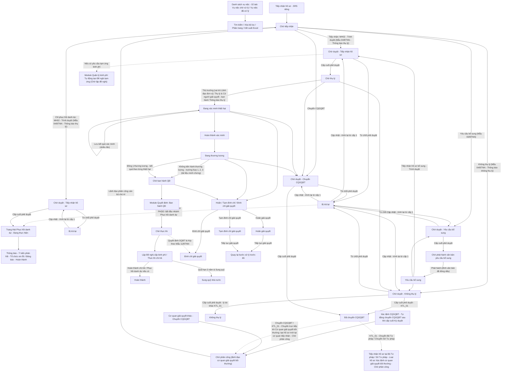
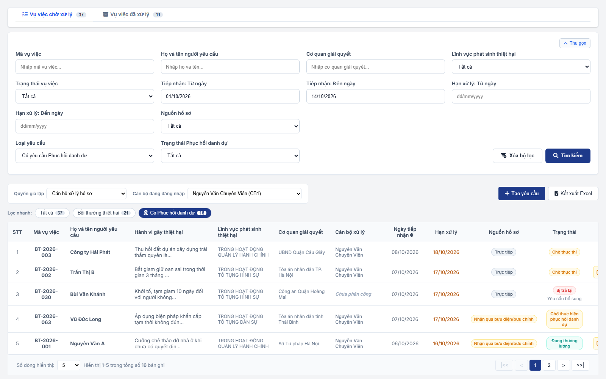
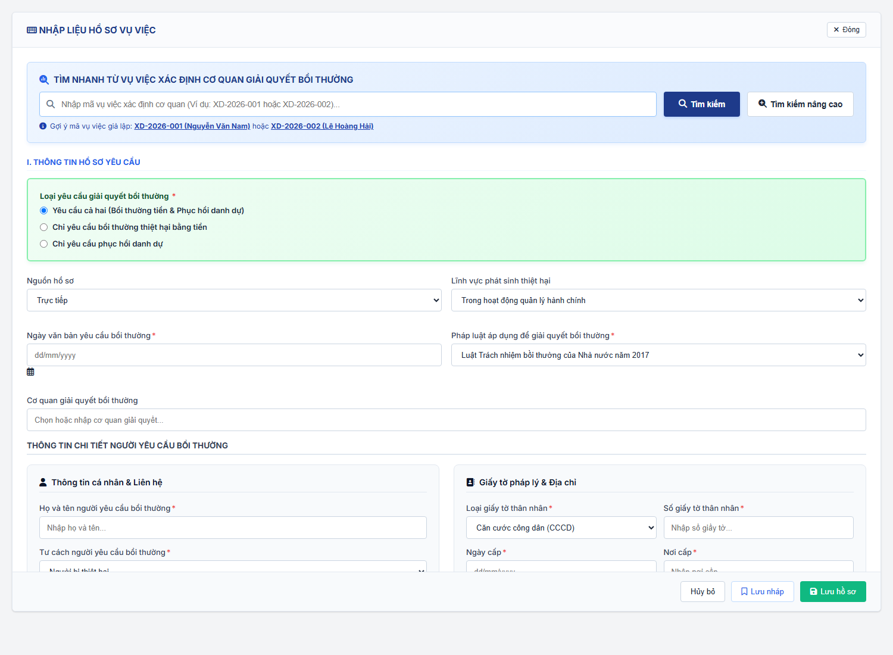
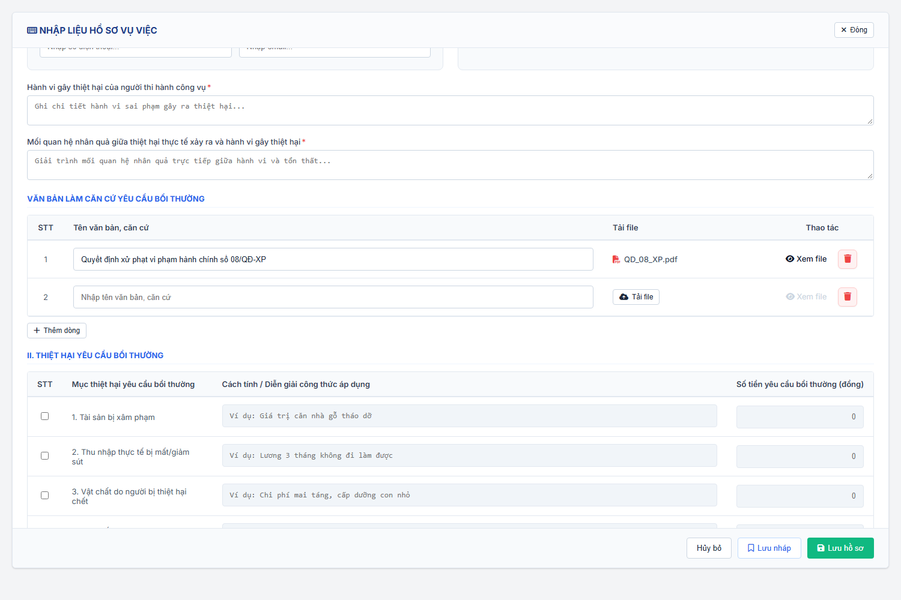
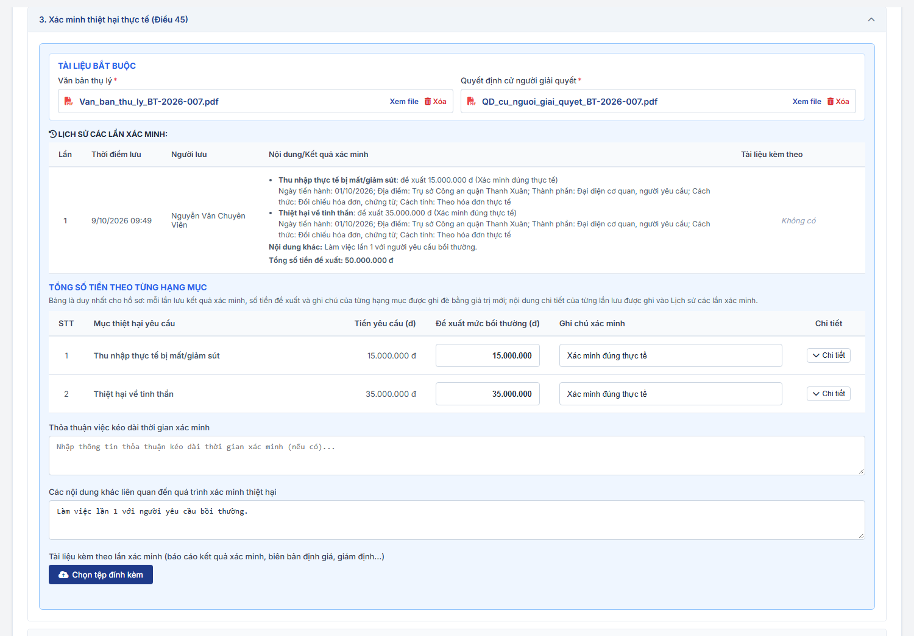
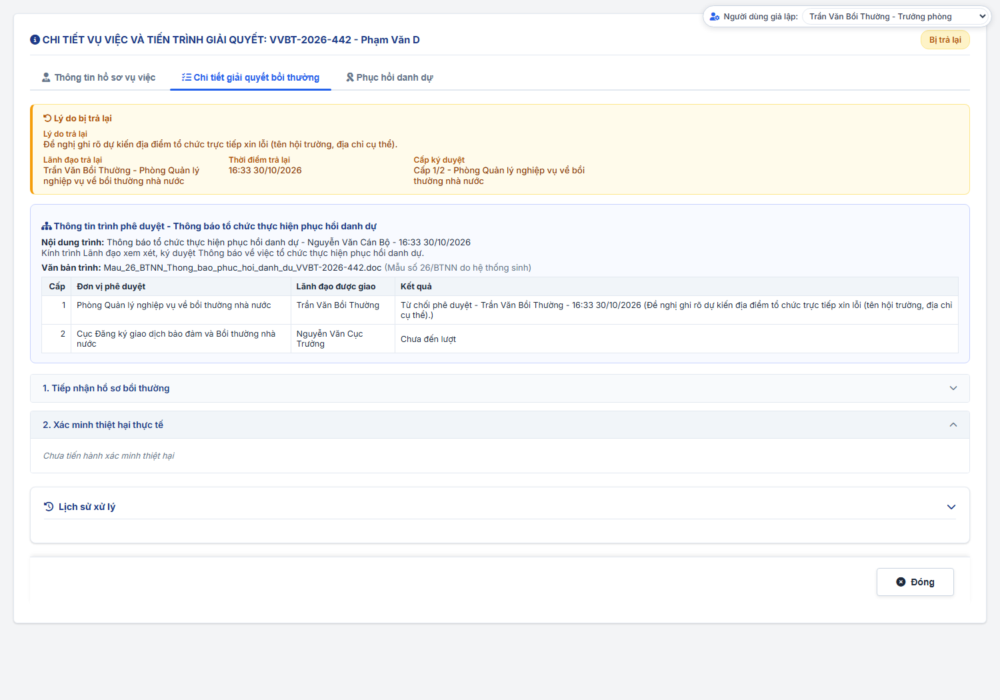
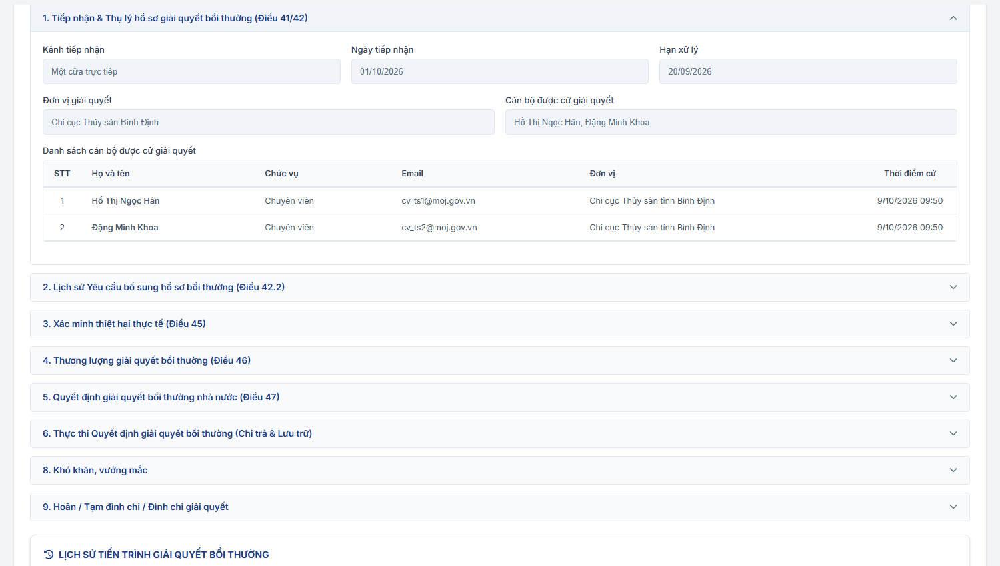
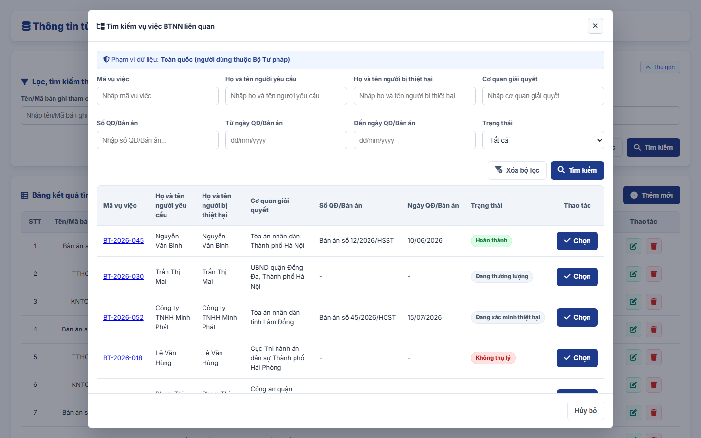

### 4.3.3. Dành cho Cán bộ Công tác bồi thường nhà nước

#### 4.3.3.1. Giải quyết yêu cầu bồi thường

##### 4.3.3.1.1. Mục đích
Cho phép quản lý quy trình tiếp nhận, thụ lý và giải quyết hồ sơ vụ việc yêu cầu bồi thường nhà nước theo đúng quy định của Luật Trách nhiệm bồi thường của Nhà nước, bao gồm:
- Tra cứu danh sách vụ việc theo phân trang và 02 tab nghiệp vụ (Vụ việc chờ xử lý, Vụ việc đã xử lý), hỗ trợ tìm kiếm và lọc đa tiêu chí.
- Tiếp nhận và nhập liệu hồ sơ vụ việc yêu cầu bồi thường theo Nguồn hồ sơ (`Tiếp nhận mới`, `Dịch vụ công quốc gia`, `Chuyển CQGQBT`, `Xác định CQGQBT`) và Hình thức tiếp nhận (Danh mục Hình thức tiếp nhận [DM_25]), tự động kế thừa thông tin và kiểm tra tính hợp lệ của hồ sơ.
- Kiểm tra tính đầy đủ, hợp lệ của hồ sơ yêu cầu bồi thường ngay khi tiếp nhận; trình Lãnh đạo phê duyệt tiếp nhận hồ sơ (văn bản theo Mẫu 04/BTNN - Thông báo thụ lý hồ sơ yêu cầu bồi thường), yêu cầu bổ sung hồ sơ (văn bản theo Mẫu 03/BTNN) hoặc không thụ lý hồ sơ (văn bản theo Mẫu 04/BTNN - Thông báo không thụ lý hồ sơ yêu cầu bồi thường) theo luồng phê duyệt nhiều cấp. Hồ sơ chuyển sang bước thụ lý sau khi Lãnh đạo phê duyệt tiếp nhận (không có bước kiểm tra riêng).
- Thụ lý hồ sơ vụ việc trong thời hạn quy định (02 ngày làm việc) và cử người giải quyết.
- Chuyển hồ sơ sang cơ quan khác: trước khi thụ lý thực hiện qua thao tác Không thụ lý với lý do `KTL_01` (03 tùy chọn: `Chuyển Bộ Tư pháp`, `Chuyển Sở Tư pháp`, `Chuyển trực tiếp tới Cơ quan giải quyết bồi thường`); sau khi thụ lý thực hiện bằng thao tác độc lập `Chuyển CQGQBT` ở mọi trạng thái sau `Chờ thụ lý`, trừ hồ sơ đã kết thúc xử lý.
- Theo dõi và cập nhật toàn diện tiến trình giải quyết vụ việc sau thụ lý: xác minh thiệt hại, lập biên bản xác minh, tổ chức thương lượng việc bồi thường và lập biên bản kết quả thương lượng.
- Xử lý các nghiệp vụ gián đoạn giải quyết theo quy định pháp luật: hoãn giải quyết, tạm đình chỉ giải quyết, đình chỉ giải quyết và khôi phục tiếp tục giải quyết vụ việc.
- Thực thi chi trả tiền bồi thường (lập đề nghị cấp kinh phí, tạm ứng kinh phí) và theo dõi thực hiện thủ tục phục hồi danh dự cho người bị thiệt hại.
- Quản lý trạng thái vòng đời vụ việc và ghi nhận toàn bộ lịch sử xử lý, dòng thời gian (timeline) qua từng giai đoạn.

a. Phân quyền
Hệ thống phân quyền thao tác theo vai trò và quyền hạn được cấp:
- Xem: Tra cứu danh sách vụ việc theo tab, xem chi tiết tiến trình hồ sơ vụ việc, xem tài liệu đính kèm và lịch sử xử lý.
- Thêm mới / Nhập liệu: Tiếp nhận và nhập liệu hồ sơ vụ việc mới, tải lên các văn bản căn cứ.
- Cập nhật tiến độ: Tiếp nhận hồ sơ (kể cả hồ sơ đã bổ sung), cập nhật kết quả xác minh thiệt hại, cập nhật kết quả thương lượng.
- Xử lý nghiệp vụ gián đoạn: Thực hiện hoãn, tạm đình chỉ, đình chỉ giải quyết hoặc tiếp tục giải quyết vụ việc.
- Thụ lý: Thủ trưởng/Lãnh đạo cơ quan giải quyết thực hiện thụ lý vụ việc và cử người giải quyết.
- Trình duyệt: Cán bộ chủ trì trình Lãnh đạo phê duyệt các Nội dung trình `Tiếp nhận hồ sơ`, `Yêu cầu bổ sung`, `Không thụ lý`, `Chuyển CQGQBT`; phát hành văn bản yêu cầu bổ sung sau khi được phê duyệt.
- Phê duyệt: Lãnh đạo được giao đích danh tại từng cấp phê duyệt thực hiện Phê duyệt/Từ chối phê duyệt tại tab `Chờ xử lý` của màn hình này (vai trò Lãnh đạo đơn vị), theo [MH04 - Popup Phê duyệt / Từ chối phê duyệt - Dashboard Lãnh đạo - Công tác bồi thường nhà nước (Website Quản trị)](SRS_BTNN_ViecChoLanhDaoXuLy.md#vcld-mh04); số hồ sơ chờ duyệt hiển thị tại khối `Chờ duyệt Giải quyết YCBT` của [MH01 - Màn hình Dashboard Lãnh đạo - Dashboard Lãnh đạo - Công tác bồi thường nhà nước (Website Quản trị)](SRS_BTNN_ViecChoLanhDaoXuLy.md#vcld-mh01). Phân hệ Bồi thường nhà nước không sử dụng ký số; Lãnh đạo ký duyệt trên hệ thống và văn bản đã ký, đóng dấu được đính file tại bước Phát hành.
- Quản lý trạng thái / Xóa: Xóa hồ sơ ở trạng thái Chờ tiếp nhận hoặc đóng hồ sơ khi hoàn thành toàn bộ nghĩa vụ.
- Quyền thực hiện Phục hồi danh dự (thuộc nhóm quyền Giải quyết yêu cầu bồi thường, không còn menu/nhóm quyền "Phục hồi danh dự" riêng): + Thông báo tổ chức thực hiện phục hồi danh dự + Nhập thông tin ý kiến của người bị thiệt hại + Cập nhật kết quả việc thực hiện phục hồi danh dự

b. Điều kiện thực hiện
- Người dùng đã đăng nhập hệ thống.
- Người dùng được cấp quyền truy cập chức năng "Giải quyết yêu cầu bồi thường".

c. Quy tắc nghiệp vụ chung
- **Định danh vụ việc**: Vụ việc yêu cầu bồi thường được nhận diện và hiển thị theo định dạng `Mã vụ việc - Họ và tên người yêu cầu` (`Mã vụ việc` dạng `VVBT-yyyy-xxx`) trên danh sách, liên kết, thông báo xác nhận, màn hình chi tiết, popup tìm kiếm và Phiếu in của chức năng này. Hệ thống không quản lý trường tên riêng cho vụ việc; bộ lọc và form nhập liệu chỉ dùng `Mã vụ việc` và `Họ và tên người yêu cầu` để định danh vụ việc.
- **Nguồn hồ sơ**: Mỗi hồ sơ có 01 giá trị `Nguồn hồ sơ` thuộc danh sách cố định gồm 04 giá trị, cùng danh sách với [Nguồn hồ sơ - Tiếp nhận hồ sơ - Công tác bồi thường nhà nước (Website Quản trị)](SRS_BTNN_GiaiQuyetBT_TiepNhan_YCBT.md#tn-nguon-ho-so): `Tiếp nhận mới`, `Dịch vụ công quốc gia`, `Chuyển CQGQBT`, `Xác định CQGQBT`.
- **Hình thức tiếp nhận**: Mỗi hồ sơ có 01 giá trị `Hình thức tiếp nhận`, tham chiếu [Danh mục Hình thức tiếp nhận - Danh mục dữ liệu dùng chung - Tổng quan và quy tắc chung](../../Tai%20lieu%20tong%20hop/00_Tong_quan_va_Quy_tac_chung.md#danh-muc-dung-chung) [DM_25].
  + Khi cán bộ tạo hồ sơ trực tiếp tại phân hệ: hệ thống gán `Nguồn hồ sơ` = `Tiếp nhận mới`; `Mã vụ việc` theo lựa chọn của trường `Mã vụ việc` tại MH02 (`Vụ việc mới`: hệ thống sinh mã mới khi lưu; `Vụ việc đã có Mã vụ việc`: hồ sơ mang mã đã chọn); cán bộ chọn `Hình thức tiếp nhận` là `Trực tiếp` hoặc `Qua dịch vụ bưu chính`.
  + Hồ sơ đến từ Tiếp nhận hồ sơ (sau khi Lãnh đạo phân công cán bộ) giữ nguyên `Nguồn hồ sơ` và `Mã vụ việc` đã có; `Hình thức tiếp nhận` mặc định theo hồ sơ đã tiếp nhận, cán bộ được điều chỉnh (chọn đủ các giá trị của DM_25).
  + Giá trị `Dịch vụ công quốc gia`, `Chuyển CQGQBT`, `Xác định CQGQBT` chỉ do hệ thống gán; trường hiển thị ở chế độ chỉ đọc, cán bộ không được thay đổi.
- **Mã vụ việc và Mã hồ sơ**: Quy tắc chung theo [Mã vụ việc và mã hồ sơ - Tiếp nhận hồ sơ - Công tác bồi thường nhà nước (Website Quản trị)](SRS_BTNN_GiaiQuyetBT_TiepNhan_YCBT.md#tn-ma-vu-viec).
  + Mỗi hồ sơ có `Mã hồ sơ` `BT-yyyy-xxx` riêng của phân hệ (01 mã cho cả 03 Loại yêu cầu giải quyết bồi thường) và luôn gắn với 01 `Mã vụ việc` `VVBT-yyyy-xxx`.
  + Hồ sơ đến từ Tiếp nhận hồ sơ, Dịch vụ công quốc gia, Xác định CQGQBT: kế thừa `Mã vụ việc` đã có, hệ thống chỉ sinh `Mã hồ sơ` `BT-`.
  + `Chuyển CQGQBT` sang cơ quan khác: hồ sơ mới tại cơ quan nhận giữ nguyên `Mã vụ việc`, có `Mã hồ sơ` `BT-` mới; hồ sơ cũ kết thúc ở trạng thái `Đã chuyển CQGQBT`.
  + Không thụ lý với lý do `KTL_01`: hồ sơ mới tại cơ quan nhận giữ nguyên `Mã vụ việc`; `Mã hồ sơ` của phân hệ xử lý sinh khi hồ sơ vào phân hệ (`XD-` với tùy chọn `Chuyển Bộ Tư pháp`, `Chuyển Sở Tư pháp`; `BT-` với tùy chọn `Chuyển trực tiếp tới Cơ quan giải quyết bồi thường`); hồ sơ cũ kết thúc ở trạng thái `Đã chuyển CQGQBT`.
  + Hồ sơ cũ chưa có `Mã vụ việc`: hệ thống gán `Mã vụ việc` 01 lần và giữ ổn định cho mọi chức năng dùng `Mã hồ sơ` `BT-` đó.
  + `Mã vụ việc` và `Mã hồ sơ` chỉ đọc, không cho sửa.
- **Hồ sơ nhận từ Xác định cơ quan giải quyết bồi thường**:
  + Khi Lãnh đạo cấp cuối Ký duyệt văn bản Kết quả xác định CQGQBT tại phân hệ Xác định cơ quan giải quyết bồi thường, hệ thống tự động chuyển CQGQBT theo [Tự động chuyển CQGQBT - Xác định cơ quan giải quyết bồi thường - Công tác bồi thường nhà nước (Website Quản trị)](SRS_BTNN_GiaiQuyetBT__Xac%20định%20cơ%20quan%20GQBT.md): tạo 01 hồ sơ yêu cầu bồi thường mới tại CQGQBT đã chọn trên hệ thống, với `Nguồn hồ sơ` = `Xác định CQGQBT`.
  + Hồ sơ mới ở trạng thái `Chờ phân công` và chờ nhóm lãnh đạo của cơ quan giải quyết bồi thường được xác định phân công xử lý tại tab `Chờ xử lý` của [Tiếp nhận hồ sơ - Tiếp nhận hồ sơ - Công tác bồi thường nhà nước (Website Quản trị)](SRS_BTNN_GiaiQuyetBT_TiepNhan_YCBT.md#tn-tab-xu-ly). Trong thời gian hồ sơ ở trạng thái `Chờ phân công` hoặc `Đang phân công`, hồ sơ chưa hiển thị tại chức năng này.
  + Khi lãnh đạo phân công cán bộ chủ trì, hồ sơ hiển thị tại Tab "Vụ việc chờ xử lý" với trạng thái `Chờ tiếp nhận`; `Cán bộ xử lý` là cán bộ chủ trì được phân công; `Ngày tiếp nhận` là ngày phân công cán bộ.
  + Hệ thống kế thừa từ hồ sơ Xác định cơ quan giải quyết bồi thường: thông tin người yêu cầu bồi thường, thông tin người bị thiệt hại (nếu có), Lĩnh vực phát sinh thiệt hại, Hành vi gây thiệt hại, Phương thức nhận thông báo và Địa chỉ, đầu mối nhận thông báo, Cơ quan giải quyết bồi thường (đơn vị nhận hồ sơ), tài liệu đính kèm của hồ sơ Xác định cơ quan giải quyết bồi thường và tài liệu chuyển xử lý (văn bản Kết quả xác định CQGQBT đã ký và tài liệu kèm theo của kết quả xác định); đồng thời lưu `Mã hồ sơ Xác định CQGQBT`, `Nội dung chuyển xử lý` và ghi 01 dòng timeline *"Nhận hồ sơ từ Xác định CQGQBT [Mã hồ sơ Xác định CQGQBT]: [Nội dung chuyển xử lý]"*.
  + Mỗi hồ sơ chuyển đến chỉ tạo 01 hồ sơ yêu cầu bồi thường; hệ thống không tạo trùng theo `Mã hồ sơ` khi đồng bộ lại. Hồ sơ mới giữ nguyên `Mã vụ việc` của hồ sơ Xác định cơ quan giải quyết bồi thường.
- **Người bị thiệt hại**: Khi `Tư cách người yêu cầu bồi thường` khác `Người bị thiệt hại`, hệ thống hiển thị khối `Thông tin người bị thiệt hại`. Trong khối này chỉ bắt buộc 04 trường: `Họ và tên người bị thiệt hại`, `Ngày tháng năm sinh`, `Loại giấy tờ thân nhân`, `Số giấy tờ thân nhân`. Riêng Tư cách `Tổ chức kế thừa quyền, nghĩa vụ của tổ chức bị thiệt hại đã chấm dứt tồn tại`: khối hiển thị dạng `Thông tin tổ chức bị thiệt hại đã chấm dứt tồn tại`, chỉ gồm `Tên tổ chức bị thiệt hại` (bắt buộc) và `Mã số tổ chức` (không bắt buộc). Khi `Tư cách người yêu cầu bồi thường` là `Người bị thiệt hại`, khối này ẩn và hệ thống không lưu thông tin người bị thiệt hại riêng.
- **Văn bản làm căn cứ yêu cầu bồi thường**: Hồ sơ lưu danh sách văn bản làm căn cứ yêu cầu bồi thường (mỗi dòng gồm `Tên văn bản, căn cứ` và file đính kèm). Khối này không bắt buộc. Với hồ sơ nhận từ Xác định cơ quan giải quyết bồi thường, hệ thống kế thừa danh sách văn bản làm căn cứ đã nhập tại hồ sơ Xác định cơ quan giải quyết bồi thường; cán bộ được sửa, bổ sung tại MH02.
- **Vụ việc do Tòa án thụ lý**: Form nhập liệu hồ sơ (MH02) không còn khối `Tình trạng pháp lý` (Chưa có/Đã có Bản án/Quyết định của Tòa án) và các trường thông tin bản án đi kèm. Vụ việc do Tòa án thụ lý giải quyết được khai báo và theo dõi tại chức năng "Theo dõi vụ việc tại Tòa án" (Website Quản trị). Hồ sơ cũ đã lưu thông tin bản án vẫn hiển thị các thông tin này ở chế độ chỉ đọc tại MH03/MH05.
- **Cử người giải quyết và phạm vi xem hồ sơ**:
  + Khi thụ lý hồ sơ, Lãnh đạo/Thủ trưởng cơ quan giải quyết bồi thường cử 01 hoặc nhiều cán bộ giải quyết hồ sơ. Cán bộ được cử bắt buộc chọn từ tài khoản cán bộ đã có trên hệ thống, thuộc cơ quan giải quyết bồi thường của hồ sơ (đơn vị gốc của cơ quan và các đơn vị trực thuộc theo Cơ cấu tổ chức). Hệ thống không cho nhập tay thông tin cán bộ; `Chức vụ`, `Email`, `Đơn vị` tự động lấy theo tài khoản.
  + Sau khi cử người giải quyết, hồ sơ chỉ hiển thị tại Tab "Vụ việc chờ xử lý" đối với các cán bộ được cử; chỉ các cán bộ này được xem chi tiết và cập nhật kết quả giải quyết hồ sơ. Cán bộ khác (kể cả cán bộ cùng cơ quan) không tìm thấy hồ sơ trên danh sách và không mở được màn hình chi tiết.
  + Quyết định cử người giải quyết không nhập tại popup cử người; văn bản Quyết định cử người giải quyết được đính kèm bắt buộc tại bước `Đang xác minh thiệt hại` (cùng với Văn bản thụ lý).
- **Xác minh thiệt hại nhiều lần**: Tại trạng thái `Đang xác minh thiệt hại`, cán bộ được lưu kết quả xác minh nhiều lần trước khi hoàn thành xác minh:
  + Bảng `Tổng số tiền theo từng hạng mục` là duy nhất cho mỗi hồ sơ, gồm các cột `Thiệt hại yêu cầu bồi thường`, `Mức đề xuất`, `Mức xác minh`, `Nội dung diễn giải`: mỗi lần lưu, `Mức xác minh` và `Nội dung diễn giải` của từng hạng mục được ghi đè bằng giá trị mới; hệ thống luôn hiển thị giá trị hiện hành.
  + `Thành phần tham gia xác minh` nhập dạng bảng động (Họ và tên, Chức vụ, Đơn vị), áp dụng chung cho lần lưu kết quả xác minh; bắt buộc tối thiểu 01 thành viên, mỗi dòng bắt buộc `Họ và tên`. Khi mở cập nhật, bảng điền sẵn thành phần của lần lưu gần nhất.
  + Các thông tin chi tiết khác của mỗi lần lưu (thành phần tham gia xác minh, chi tiết quá trình xác minh từng hạng mục, thỏa thuận kéo dài thời gian xác minh, nội dung khác, tài liệu kèm theo) được ghi thêm 01 dòng vào `Lịch sử các lần xác minh` theo thứ tự thời gian lưu; các dòng đã ghi không bị ghi đè.
  + Hệ thống chỉ cho lưu kết quả xác minh khi hồ sơ đã đính kèm đủ 02 tài liệu bắt buộc: `Văn bản thụ lý` và `Quyết định cử người giải quyết`.
  + Mỗi lần lưu, hệ thống cập nhật `Kết quả xác minh hiện hành` theo từng thiệt hại (Thiệt hại yêu cầu bồi thường, Mức đề xuất, Mức xác minh, Nội dung diễn giải) cùng Thành phần tham gia xác minh. Kết quả xác minh hiện hành là nguồn dữ liệu cho bảng thiệt hại tại bước Thương lượng và cho Bảng đề xuất bồi thường theo [Quy tắc tự động điền khi chọn Mã vụ việc - Quyết định giải quyết bồi thường - Công tác bồi thường nhà nước (Website Quản trị)](SRS_BTNN_GiaiQuyetBT_QuyetDinh_GQBT.md#qd-quy-tac-tu-dong-dien).

- **Vụ việc gồm 02 nhánh giải quyết - Trạng thái vụ việc**: Mỗi hồ sơ có 01 `Mã hồ sơ` `BT-yyyy-xxx` dùng chung cho cả 03 Loại yêu cầu giải quyết bồi thường; không tách thành hồ sơ riêng.
  + Giai đoạn chung (trước Thụ lý), áp dụng cho cả vụ việc: + Chờ tiếp nhận + Chờ duyệt + Bị trả lại + Chờ phát hành văn bản yêu cầu bổ sung + Yêu cầu bổ sung + Chờ thụ lý + Không thụ lý (kết thúc) + Đã chuyển CQGQBT (kết thúc)
  + Từ khi Thủ trưởng cơ quan giải quyết bồi thường `Thụ lý` (cử người giải quyết) theo [MH06 - Popup Thụ lý hồ sơ và Cử người giải quyết bồi thường - Dashboard Lãnh đạo - Công tác bồi thường nhà nước (Website Quản trị)](SRS_BTNN_ViecChoLanhDaoXuLy.md#vcld-thu-ly), vụ việc có tối đa 02 nhánh chạy song song, cán bộ được cử cập nhật đồng thời: + **Trạng thái Giải quyết YCBT** (Loại yêu cầu `Yêu cầu cả hai` hoặc `Chỉ yêu cầu bồi thường thiệt hại bằng tiền`): Đang xác minh thiệt hại → Đang thương lượng → Chờ ban hành QĐ → Chờ thực thi → Hoàn thành; ngoài ra Hoãn giải quyết, Tạm đình chỉ giải quyết, Đình chỉ giải quyết, Sung quỹ nhà nước. + **Trạng thái Phục hồi danh dự** (Loại yêu cầu `Yêu cầu cả hai` hoặc `Chỉ yêu cầu phục hồi danh dự`): chỉ gồm `Đang phục hồi danh dự` (từ khi Thụ lý) và `Hoàn thành`. Đình chỉ giải quyết áp dụng cho cả vụ việc.
  + Các bước của tiến trình phục hồi danh dự (Thông báo tổ chức phục hồi danh dự → Ý kiến phản hồi của người bị thiệt hại → Tổ chức thực hiện → Hoàn thành) và các tình huống Tạm hoãn, Điều chỉnh theo đề xuất là **bước của tiến trình**, hiển thị tại Stepper của tab Phục hồi danh dự; không quản lý thành trạng thái riêng, không có trong bộ lọc trạng thái.
  + Không có trạng thái `Từ chối`: người bị thiệt hại từ chối phục hồi danh dự (khoản 5 Điều 57) thì cán bộ ghi nhận ý kiến kèm văn bản/biên bản, nhánh Phục hồi danh dự kết thúc ở `Hoàn thành`.
  + Vụ việc `Chỉ yêu cầu phục hồi danh dự`: Chờ tiếp nhận → (Chờ duyệt / Bị trả lại / Yêu cầu bổ sung của giai đoạn chung) → Chờ thụ lý → Đang phục hồi danh dự → Hoàn thành.
  + **Trạng thái vụ việc** do hệ thống tổng hợp, theo thứ tự ưu tiên: + Vụ việc ở giai đoạn chung: trạng thái của giai đoạn chung. + Vụ việc chỉ có 01 nhánh: trạng thái của nhánh đó. + Vụ việc `Yêu cầu cả hai`, Trạng thái Giải quyết YCBT chưa kết thúc: theo Trạng thái Giải quyết YCBT, không phụ thuộc Trạng thái Phục hồi danh dự (VD Phục hồi danh dự đã Hoàn thành, Giải quyết YCBT Đang xác minh thiệt hại → Trạng thái vụ việc `Đang xác minh thiệt hại`). + Trạng thái Giải quyết YCBT đã kết thúc (`Hoàn thành`, `Sung quỹ nhà nước`), Phục hồi danh dự chưa kết thúc → `Đang phục hồi danh dự`. + Cả 02 nhánh kết thúc → trạng thái kết thúc của Giải quyết YCBT (`Hoàn thành` hoặc `Sung quỹ nhà nước`). Vụ việc `Yêu cầu cả hai` chỉ `Hoàn thành` khi đồng thời Trạng thái Giải quyết YCBT và Trạng thái Phục hồi danh dự đều `Hoàn thành`.
  + `Đình chỉ giải quyết` áp dụng cho cả vụ việc: Trạng thái vụ việc `Đình chỉ giải quyết`; nhánh Phục hồi danh dự chưa kết thúc chuyển `Đình chỉ giải quyết` và chỉ xem.
  + `Hoãn giải quyết`, `Tạm đình chỉ giải quyết` chỉ áp dụng cho nhánh Giải quyết YCBT; không chặn cập nhật nhánh Phục hồi danh dự.
  + Hoàn thành thực thi (nhánh Giải quyết YCBT) không phụ thuộc tiến độ Phục hồi danh dự.
  + Danh sách MH01, Tab `Vụ việc chờ xử lý`/`Vụ việc đã xử lý`, bộ lọc `Trạng thái vụ việc` và báo cáo thống kê đếm theo `Mã vụ việc` `VVBT-` (01 vụ việc tính 01 lần, kể cả khi vụ việc có nhiều `Mã hồ sơ` do `Chuyển CQGQBT`) và theo Trạng thái vụ việc; chỉ tiêu riêng của từng nhánh lấy theo Trạng thái Giải quyết YCBT hoặc Trạng thái Phục hồi danh dự.
  + Vụ việc `Chỉ yêu cầu phục hồi danh dự` đi giai đoạn chung như vụ việc khác (Tiếp nhận → Trình duyệt tiếp nhận → Chờ thụ lý → Thụ lý); sau Thụ lý không áp dụng thao tác/trạng thái của nhánh Giải quyết YCBT (Xác minh thiệt hại, Thương lượng, Quyết định GQBT, Chi trả, Kinh phí, Chuyển CQGQBT); chức năng Quyết định giải quyết bồi thường không liệt kê vụ việc này.
  + Dữ liệu cũ đã tách thành vụ việc `PHDD-yyyy-xxx`: hệ thống gộp về 01 vụ việc. Vụ việc PHDD- tách từ vụ việc BT-: dữ liệu và tiến độ phục hồi danh dự chuyển về vụ việc BT- (Loại yêu cầu `Yêu cầu cả hai`). Vụ việc PHDD- `Chỉ yêu cầu phục hồi danh dự`: cấp lại `Mã hồ sơ` `BT-yyyy-xxx` (mã BT- ban đầu của hồ sơ nếu có). Hệ thống lưu ánh xạ mã PHDD- cũ → mã BT- để mở đúng vụ việc từ liên kết cũ.

- **Đường dẫn mở chi tiết vụ việc**: `quan_ly_boi_thuong.html?id=[Mã hồ sơ]` (chấp nhận `Mã hồ sơ` `BT-` hoặc `Mã vụ việc` `VVBT-`; tham số tương đương `viewCode`; với `Mã vụ việc` có nhiều hồ sơ, mở hồ sơ chưa `Đã chuyển CQGQBT`), tùy chọn `focusTab=phdd` (tương đương `subTab=phdd`): + Mở màn hình chi tiết của vụ việc; `focusTab=phdd` mở tab `Phục hồi danh dự` khi vụ việc có nhánh Phục hồi danh dự. + Vụ việc `Chỉ yêu cầu phục hồi danh dự` đã Thụ lý: mở [Màn hình Xem chi tiết tiến trình phục hồi danh dự](#mh-chi-tiet-vu-viec-phdd). + Mã `PHDD-...` cũ: hệ thống tra ánh xạ sang `Mã hồ sơ` `BT-...` sau khi gộp và mở vụ việc tương ứng.

- **Thương lượng việc bồi thường (Điều 46 Luật Trách nhiệm bồi thường của Nhà nước)**: Tại trạng thái `Đang thương lượng`, cán bộ cập nhật kết quả thương lượng; bắt buộc chọn 01 giá trị `Tình trạng tham gia thương lượng`: + Người yêu cầu bồi thường từ chối thương lượng + Người yêu cầu bồi thường hai lần từ chối nhận giấy mời tham gia thương lượng + Người yêu cầu bồi thường hai lần không đến địa điểm thương lượng khi đã nhận giấy mời mà không có lý do chính đáng + Đồng ý thương lượng

| STT | Tình trạng tham gia thương lượng | Mã lưu trữ | Khối hiển thị | Trường bắt buộc | Trạng thái sau khi lưu | Số tiền tại Quyết định GQBT |
| :--- | :--- | :--- | :--- | :--- | :--- | :--- |
| 1 | Người yêu cầu bồi thường từ chối thương lượng | `TU_CHOI` | Lý do / Diễn giải chi tiết; Tài liệu đính kèm minh chứng | Tài liệu đính kèm minh chứng (văn bản từ chối thương lượng của người yêu cầu bồi thường) | `Chờ ban hành QĐ` | Theo Kết quả xác minh thiệt hại |
| 2 | Người yêu cầu bồi thường hai lần từ chối nhận giấy mời tham gia thương lượng | `TU_CHOI_GIAY_MOI_2_LAN` | Lý do / Diễn giải chi tiết; Tài liệu đính kèm minh chứng | Tài liệu đính kèm minh chứng (biên bản giao giấy mời có xác nhận của bưu tá/chính quyền địa phương) | `Chờ ban hành QĐ` | Theo Kết quả xác minh thiệt hại |
| 3 | Người yêu cầu bồi thường hai lần không đến địa điểm thương lượng khi đã nhận giấy mời mà không có lý do chính đáng | `VANG_MAT_2_LAN` | Lý do / Diễn giải chi tiết; Tài liệu đính kèm minh chứng | Tài liệu đính kèm minh chứng (biên bản xác nhận vắng mặt 02 lần) | `Chờ ban hành QĐ` | Theo Kết quả xác minh thiệt hại |
| 4 | Đồng ý thương lượng | `DONG_Y` | Ngày thương lượng, Địa điểm thương lượng, Thành phần tham gia thương lượng, Kết quả thương lượng theo từng thiệt hại, Các yêu cầu khác, Tài liệu, biên bản kèm theo | Ngày thương lượng, Địa điểm thương lượng, Mức tiền bồi thường và Trạng thái thương lượng từng thiệt hại, Lý do diễn giải khi Không thành công, tối thiểu 01 dòng Tài liệu, biên bản kèm theo có tệp | `Chờ ban hành QĐ` | Theo Kết quả thương lượng |

  + **Trường hợp 1, 2, 3** (không tiến hành thương lượng theo khoản 7 Điều 46): ẩn toàn bộ các khối Ngày/Địa điểm thương lượng, Thành phần tham gia thương lượng, Kết quả thương lượng theo từng thiệt hại, Các yêu cầu khác, Tài liệu, biên bản kèm theo; hiển thị `Lý do / Diễn giải chi tiết` (không bắt buộc) và bảng `Tài liệu đính kèm minh chứng` (bắt buộc tối thiểu 01 dòng, mọi dòng phải có tệp). Cán bộ xác nhận tại popup Xác nhận; hệ thống lưu `Tình trạng tham gia thương lượng` (mã và nhãn), Lý do / Diễn giải chi tiết, tài liệu minh chứng, thời điểm và người cập nhật; hồ sơ chuyển `Chờ ban hành QĐ`. Bảng đề xuất bồi thường tại Quyết định giải quyết bồi thường lấy theo Kết quả xác minh hiện hành (số tiền = Mức xác minh từng thiệt hại).
  + **Đồng ý thương lượng**: bắt buộc nhập `Ngày thương lượng`, `Địa điểm thương lượng`, kết quả từng thiệt hại (`Mức tiền bồi thường`, `Trạng thái thương lượng`; `Lý do diễn giải` bắt buộc khi Trạng thái thương lượng là Không thành công) và tối thiểu 01 dòng `Tài liệu, biên bản kèm theo` có tệp. Danh sách thiệt hại lấy theo Kết quả xác minh hiện hành. Hồ sơ chuyển `Chờ ban hành QĐ`; Bảng đề xuất bồi thường tại Quyết định giải quyết bồi thường lấy theo kết quả thương lượng từng thiệt hại: thiệt hại Thành công lấy `Mức tiền bồi thường`, thiệt hại Không thành công lấy `Mức xác minh`.
  + Quy tắc kế thừa số tiền theo [Quy tắc tự động điền khi chọn Mã vụ việc - Quyết định giải quyết bồi thường - Công tác bồi thường nhà nước (Website Quản trị)](SRS_BTNN_GiaiQuyetBT_QuyetDinh_GQBT.md#qd-quy-tac-tu-dong-dien).
  + Dữ liệu cũ: kết quả `Từ chối thương lượng` hiển thị là `Người yêu cầu bồi thường từ chối thương lượng` (Lý do / Ghi chú cũ hiển thị tại `Lý do / Diễn giải chi tiết`); kết quả `Đồng ý thương lượng` giữ nguyên.
  + Trạng thái thương lượng chỉ quản lý trên từng dòng thiệt hại; hệ thống không có kết luận tổng thành công/không thành công và không còn trạng thái hồ sơ "Thương lượng không thành công". Hồ sơ cũ ở trạng thái "Thương lượng không thành công" được chuẩn hóa về `Chờ ban hành QĐ`; kết quả họp thương lượng cũ hiển thị dạng Đồng ý thương lượng, mỗi thiệt hại mang Trạng thái thương lượng theo kết quả cũ (thành công: Mức tiền bồi thường = Mức xác minh; không thành công: Mức tiền bồi thường = 0, Lý do diễn giải = lý do không đạt thỏa thuận đã lưu).
  + Không có khối thông tin dự kiến phiên họp thương lượng, kế hoạch hoặc giấy mời thương lượng.

- **Trình Lãnh đạo phê duyệt nhiều cấp**:
  + Các thao tác `Tiếp nhận` (trình duyệt tiếp nhận hồ sơ), `Yêu cầu bổ sung`, `Không thụ lý`, `Chuyển CQGQBT` không đổi trạng thái hồ sơ ngay mà tạo 01 phiếu trình gửi Lãnh đạo phê duyệt. Chỉ cán bộ chủ trì của hồ sơ được trình; hồ sơ có tối đa 01 phiếu trình đang chờ duyệt.
  + Trình thành công: hồ sơ chuyển trạng thái chung `Chờ duyệt`; loại việc Lãnh đạo cần duyệt lưu tại trường `Nội dung trình` của phiếu trình. Nội dung trình của phân hệ gồm: + Tiếp nhận hồ sơ + Yêu cầu bổ sung + Không thụ lý + Chuyển CQGQBT + Quyết định GQBT + Hủy QĐ + Sửa chữa, bổ sung QĐ (03 Nội dung trình cuối do chức năng Quyết định giải quyết bồi thường tạo.)
  + Luồng phê duyệt xác định động theo Cấu hình luồng xử lý tương ứng đơn vị của cán bộ thực hiện (ngược chiều luồng phân công thực tế của hồ sơ; hồ sơ do cán bộ tạo trực tiếp tại phân hệ đi từ đơn vị của cán bộ chủ trì lên đơn vị gốc, chỉ gồm các đơn vị có Nhóm lãnh đạo). Popup trình Lãnh đạo chỉ hiển thị một dòng chỉ đọc `Luồng phê duyệt` ngay dưới trường `Lãnh đạo phê duyệt`, không hiển thị ghi chú giải thích luồng phê duyệt/trạng thái hồ sơ. Cán bộ chọn đích danh Lãnh đạo phê duyệt cấp 1; Lãnh đạo cấp n khi phê duyệt (chưa phải cấp cuối) chọn Lãnh đạo cấp n+1. Chi tiết theo [Quy tắc chung - Dashboard Lãnh đạo - Công tác bồi thường nhà nước (Website Quản trị)](SRS_BTNN_ViecChoLanhDaoXuLy.md#vcld-quy-tac-chung).
  + Lãnh đạo từ chối phê duyệt ở bất kỳ cấp nào: hồ sơ chuyển `Bị trả lại` (giữ Nội dung trình của phiếu bị trả lại). Cán bộ chủ trì thực hiện `Cập nhật` (hồ sơ `Bị trả lại`): hệ thống mở lại đúng màn hình/popup của Nội dung trình bị trả lại, điền sẵn nội dung đã trình, hiển thị lý do trả lại; trình lại thì luồng phê duyệt bắt đầu từ cấp đầu tiên.
  + Cấp cuối phê duyệt: hồ sơ chuyển trạng thái theo Nội dung trình: + Tiếp nhận hồ sơ: `Chờ thụ lý` (hệ thống khởi tạo Đề nghị tạm ứng kinh phí nếu hồ sơ có yêu cầu tạm ứng, theo quy tắc kiểm tra trùng lặp hiện hành; văn bản Mẫu 04/BTNN - Thông báo thụ lý hồ sơ yêu cầu bồi thường được lưu cùng phiếu trình, chờ Thủ trưởng Thụ lý) + Yêu cầu bổ sung: `Chờ phát hành văn bản yêu cầu bổ sung` + Không thụ lý (lý do khác KTL_01): `Không thụ lý` + Không thụ lý (lý do KTL_01, chuyển cơ quan tiếp nhận mới theo 01 trong 03 tùy chọn): `Đã chuyển CQGQBT` + Chuyển CQGQBT: `Đã chuyển CQGQBT` Kết quả theo từng Nội dung trình theo [Kết quả khi cấp cuối phê duyệt - Dashboard Lãnh đạo - Công tác bồi thường nhà nước (Website Quản trị)](SRS_BTNN_ViecChoLanhDaoXuLy.md#vcld-ket-qua-duyet).
  + Kết quả phê duyệt/trả lại của Lãnh đạo (tại tab `Chờ xử lý` của màn hình này, vai trò Lãnh đạo đơn vị) được cập nhật ngay vào trạng thái vụ việc trên danh sách MH01 và màn hình chi tiết MH05 (đồng bộ theo Mã vụ việc); trạng thái và thông tin đã trình được giữ nguyên khi người dùng tải lại trang.

- **Không thụ lý hồ sơ yêu cầu bồi thường**:
  + Thao tác, trạng thái `Từ chối` / `Bị từ chối` / `Từ chối thụ lý` của phân hệ đổi thành `Không thụ lý`. Hồ sơ cũ ở các trạng thái này hiển thị và được lọc là `Không thụ lý`; Lý do không thụ lý của hồ sơ cũ được xác định theo nội dung lý do đã nhập (nếu xác định được).
  + `Lý do không thụ lý` bắt buộc chọn 01 giá trị từ Danh mục Lý do không thụ lý hồ sơ yêu cầu bồi thường [DM_55] (07 lý do theo khoản 1 Điều 43 Luật Trách nhiệm bồi thường của Nhà nước số 10/2017/QH14); không cho nhập lý do tự do. `Diễn giải` không bắt buộc.
  + Lý do `KTL_01` (Yêu cầu bồi thường không thuộc thẩm quyền giải quyết của mình): popup hiển thị thêm khối `Chuyển cơ quan tiếp nhận mới`, gồm Radio 03 tùy chọn (bắt buộc chọn 01), `Nội dung/Căn cứ chuyển` (bắt buộc) và `Tài liệu đính kèm`: + `Chuyển Bộ Tư pháp`: cơ quan nhận là Bộ Tư pháp; Bộ Tư pháp tiếp nhận hồ sơ tại [Tiếp nhận hồ sơ - Tiếp nhận hồ sơ - Công tác bồi thường nhà nước (Website Quản trị)](SRS_BTNN_GiaiQuyetBT_TiepNhan_YCBT.md#tn-nguon-ho-so) với Loại hồ sơ `Xác định cơ quan giải quyết bồi thường`. + `Chuyển Sở Tư pháp`: cơ quan nhận là Sở Tư pháp quản lý đơn vị (Sở Tư pháp cùng tỉnh/thành phố với đơn vị gốc của hồ sơ, xác định theo cây Cơ cấu tổ chức); Sở Tư pháp quản lý hồ sơ tại Tiếp nhận hồ sơ với Loại hồ sơ `Xác định cơ quan giải quyết bồi thường`. Không xác định được Sở Tư pháp: không cho trình. + `Chuyển trực tiếp tới Cơ quan giải quyết bồi thường`: cơ quan nhận là đơn vị chọn trên cây Cơ cấu tổ chức (khóa đơn vị gốc của hồ sơ); đơn vị nhận tiếp nhận hồ sơ tại Tiếp nhận hồ sơ với Loại hồ sơ `Giải quyết yêu cầu bồi thường`.
  + Phiếu trình giữ Nội dung trình `Không thụ lý`. Khi cấp cuối phê duyệt (hoặc Thủ trưởng xác nhận Không thụ lý hồ sơ `Chờ thụ lý` tại [MH07 - Popup Không thụ lý hồ sơ - Dashboard Lãnh đạo - Công tác bồi thường nhà nước (Website Quản trị)](SRS_BTNN_ViecChoLanhDaoXuLy.md#vcld-khong-thu-ly)): + Hồ sơ hiện tại chuyển `Đã chuyển CQGQBT` (kết thúc xử lý, hiển thị tại Tab "Vụ việc đã xử lý"). + Hệ thống tạo hồ sơ tại Tiếp nhận hồ sơ của cơ quan nhận: trạng thái `Chờ phân công`, `Nguồn hồ sơ` = `Chuyển CQGQBT`, Loại hồ sơ theo tùy chọn đã chọn, giữ nguyên `Mã vụ việc` (`Mã hồ sơ` của phân hệ xử lý sinh khi hồ sơ vào phân hệ, theo quy tắc Mã vụ việc và Mã hồ sơ). + Hồ sơ mới kèm văn bản Mẫu 04/BTNN - Thông báo không thụ lý hồ sơ yêu cầu bồi thường, Nội dung/Căn cứ chuyển, tài liệu đính kèm và toàn bộ tài liệu của hồ sơ; lưu mã hồ sơ gốc và cơ quan chuyển. Hồ sơ gốc lưu mã hồ sơ mới, cơ quan nhận và thời điểm chuyển.
  + Văn bản Mẫu 04/BTNN - Thông báo không thụ lý hồ sơ yêu cầu bồi thường với lý do `KTL_01` ghi việc chuyển hồ sơ đến cơ quan nhận (không ghi trả lại hồ sơ), theo [Mẫu 04/BTNN - Thông báo không thụ lý hồ sơ yêu cầu bồi thường - Bảng mapping trường dữ liệu biểu mẫu BTNN - Công tác bồi thường nhà nước](Bieu_mau/Bang_mapping_truong_du_lieu_bieu_mau_BTNN.md#mau-04-khong-thu-ly).

- **Chuyển CQGQBT trong quá trình giải quyết**:
  + Thao tác độc lập `Chuyển CQGQBT` áp dụng cho mọi trạng thái sau `Chờ thụ lý` (hồ sơ đã thụ lý), gồm: + Đang xác minh thiệt hại + Đang thương lượng + Chờ ban hành QĐ + Chờ thực thi + Hoãn giải quyết + Tạm đình chỉ giải quyết + Đang phục hồi danh dự   + Không áp dụng cho hồ sơ đã kết thúc xử lý: `Không thụ lý`, `Đã chuyển CQGQBT`, `Đình chỉ giải quyết`, `Sung quỹ nhà nước`, `Hoàn thành`.   + Ở các bước trước thụ lý (`Chờ tiếp nhận`, `Yêu cầu bổ sung`, `Chờ thụ lý`), phát hiện không đúng thẩm quyền thì chuyển cơ quan qua thao tác `Không thụ lý` với lý do `KTL_01`.   + Cột Thao tác luôn có slot `Chuyển CQGQBT` (icon `fa-solid fa-right-left`, tooltip *"Chuyển cơ quan giải quyết bồi thường"*); ở trạng thái không áp dụng (VD `Chờ tiếp nhận`, `Chờ thụ lý`, `Chờ duyệt`, `Bị trả lại`, hồ sơ đã kết thúc xử lý) nút hiển thị khóa mờ, không cho phép thao tác.   + Hồ sơ `Bị trả lại` có Nội dung trình `Chuyển CQGQBT`: cột Thao tác hiển thị nút `Cập nhật` (icon `fa-solid fa-pen-to-square`, tooltip *"Cập nhật hồ sơ chuyển CQGQBT để trình lại"*); popup mở lại với Cơ quan tiếp nhận mới, Nội dung chuyển, Tệp đính kèm của lần trình trước và khối cảnh báo lý do Lãnh đạo từ chối.
  + `Cơ quan tiếp nhận mới` chọn từ cây đơn vị phân cấp theo Cơ cấu tổ chức (có tìm kiếm theo Tên/Mã đơn vị), khóa đơn vị hiện tại của vụ việc; đơn vị có đơn vị gốc chưa được cấu hình luồng phân công không được chuyển. Chọn đơn vị cấp dưới thì hồ sơ mới chờ lãnh đạo của đơn vị được chọn phân công.
  + Cấp cuối phê duyệt: hồ sơ tại cơ quan hiện tại chuyển `Đã chuyển CQGQBT` (kết thúc xử lý, hiển thị tại Tab "Vụ việc đã xử lý"); hệ thống tạo hồ sơ Yêu cầu bồi thường mới tại cơ quan tiếp nhận mới (`Mã hồ sơ` `BT-` mới, giữ nguyên `Mã vụ việc`) ở trạng thái `Chờ phân công`, quy trình bắt đầu lại từ bước Tiếp nhận. Hồ sơ mới lưu mã hồ sơ gốc, cơ quan chuyển, Nội dung/Căn cứ chuyển và tài liệu chuyển; hồ sơ gốc lưu mã hồ sơ mới, cơ quan tiếp nhận và thời điểm chuyển.

- **Yêu cầu bổ sung và Phát hành văn bản**: Yêu cầu bổ sung được trình Lãnh đạo kèm văn bản dự thảo theo Mẫu 03/BTNN (hoặc tệp tải lên). Cấp cuối phê duyệt: hồ sơ `Chờ phát hành văn bản yêu cầu bổ sung` (Lãnh đạo đã duyệt Thông báo yêu cầu bổ sung, văn bản chưa đóng dấu, chưa gửi người yêu cầu bồi thường); cán bộ chủ trì thực hiện `Phát hành` (bắt buộc nhập Số văn bản, Ngày văn bản và đính văn bản đã đóng dấu) thì hồ sơ chuyển `Yêu cầu bổ sung`. Nội dung yêu cầu bổ sung là nguồn dữ liệu dùng chung cho khối `Thông tin yêu cầu bổ sung` tại MH02.
- **Văn bản dự thảo Mẫu 03/BTNN, Mẫu 04/BTNN**: Văn bản do hệ thống sinh theo thể thức văn bản hành chính: tên cơ quan giải quyết bồi thường (kèm cơ quan chủ quản nếu có), Số ký hiệu `Số: ......./TB-[Ký hiệu cơ quan]`, Quốc hiệu - Tiêu ngữ, địa danh và ngày lập, tên văn bản, Kính gửi người yêu cầu bồi thường, địa chỉ, nội dung lấy từ hồ sơ (ngày tiếp nhận, Mã vụ việc, hành vi gây thiệt hại) và từ popup (Số, ký hiệu văn bản và Ngày văn bản của Thông báo thụ lý; nội dung yêu cầu bổ sung; lý do không thụ lý, nội dung giải thích, cơ quan nhận hồ sơ chuyển), Nơi nhận và chức danh Thủ trưởng cơ quan: + Mẫu 03/BTNN - Thông báo về việc yêu cầu bổ sung hồ sơ yêu cầu bồi thường: căn cứ Điều 41, Điều 42 Luật Trách nhiệm bồi thường của Nhà nước số 10/2017/QH14; liệt kê từng dòng nội dung yêu cầu bổ sung. + [Mẫu 04/BTNN - Thông báo thụ lý hồ sơ yêu cầu bồi thường - Bảng mapping trường dữ liệu biểu mẫu BTNN - Công tác bồi thường nhà nước](Bieu_mau/Bang_mapping_truong_du_lieu_bieu_mau_BTNN.md#mau-04-thu-ly): sinh tại Popup Trình duyệt tiếp nhận hồ sơ; Số, ký hiệu văn bản và Ngày văn bản lấy từ popup; văn bản lưu cùng phiếu trình `Tiếp nhận hồ sơ` và là văn bản ban hành của hồ sơ khi Thủ trưởng cơ quan giải quyết bồi thường Thụ lý. + [Mẫu 04/BTNN - Thông báo không thụ lý hồ sơ yêu cầu bồi thường - Bảng mapping trường dữ liệu biểu mẫu BTNN - Công tác bồi thường nhà nước](Bieu_mau/Bang_mapping_truong_du_lieu_bieu_mau_BTNN.md#mau-04-khong-thu-ly): căn cứ khoản 1 Điều 43 Luật Trách nhiệm bồi thường của Nhà nước số 10/2017/QH14; nêu Lý do không thụ lý và nội dung giải thích; với KTL_01 ghi chuyển hồ sơ đến cơ quan nhận theo tùy chọn chuyển (đồng thời ghi tại Nơi nhận), không ghi trả lại hồ sơ.

- **Ma trận trạng thái - thao tác** (cột Thao tác tại MH01: 05 thao tác ở vị trí cố định - Tiếp nhận, Yêu cầu bổ sung, Không thụ lý, Cập nhật, Chuyển CQGQBT; thao tác không thỏa mãn điều kiện hoặc người dùng không có quyền hiển thị mờ kèm chú thích lý do; thanh thao tác tại MH05 chỉ hiển thị thao tác được phép):

| Trạng thái | Tab | Thao tác của Cán bộ xử lý (cán bộ chủ trì/được cử) | Thao tác của Lãnh đạo đơn vị (theo phân quyền) |
| :--- | :--- | :--- | :--- |
| Chờ tiếp nhận | Vụ việc chờ xử lý | + Tiếp nhận (MH02 → Trình duyệt) + Yêu cầu bổ sung + Không thụ lý (KTL_01: kèm Chuyển cơ quan tiếp nhận mới) | Không có |
| Chờ duyệt | Vụ việc chờ xử lý | Không có (chỉ xem; Lãnh đạo xử lý bằng thao tác Phê duyệt / Từ chối, vai trò Lãnh đạo đơn vị). Áp dụng cả vụ việc có yêu cầu phục hồi danh dự: không có thao tác cập nhật phục hồi danh dự khi hồ sơ `Chờ duyệt` | Phê duyệt / Từ chối: chỉ Lãnh đạo được giao đích danh ở cấp phê duyệt hiện hành; không áp dụng Nội dung trình `Quyết định GQBT`, `Hủy QĐ`, `Sửa chữa, bổ sung QĐ` (ký duyệt tại chức năng Quyết định giải quyết bồi thường) |
| Bị trả lại | Vụ việc chờ xử lý | + Cập nhật: cập nhật hồ sơ đã trình theo Nội dung trình bị trả lại, hiển thị lý do trả lại, sau đó trình lại (Nội dung trình `Chuyển CQGQBT`: mở lại Popup Chuyển CQGQBT) + Yêu cầu bổ sung + Không thụ lý (KTL_01: kèm Chuyển cơ quan tiếp nhận mới) | Không có |
| Chờ phát hành văn bản yêu cầu bổ sung | Vụ việc chờ xử lý | Cập nhật: cập nhật kết quả phát hành văn bản yêu cầu bổ sung (Popup Phát hành văn bản yêu cầu bổ sung) | Không có |
| Yêu cầu bổ sung | Vụ việc chờ xử lý | + Tiếp nhận hồ sơ bổ sung (MH02 → Trình duyệt) + Yêu cầu bổ sung + Không thụ lý (KTL_01: kèm Chuyển cơ quan tiếp nhận mới) | Không có |
| Chờ thụ lý | Vụ việc chờ xử lý | Không có | Phê duyệt (Thụ lý, cử người giải quyết) / Từ chối (Không thụ lý): chỉ Thủ trưởng cơ quan giải quyết bồi thường (quy tắc 16 tại [Quy tắc chung - Dashboard Lãnh đạo - Công tác bồi thường nhà nước (Website Quản trị)](SRS_BTNN_ViecChoLanhDaoXuLy.md#vcld-quy-tac-chung)); thực hiện tại tab `Chờ xử lý` của màn hình này, theo [MH06 - Popup Thụ lý hồ sơ và Cử người giải quyết bồi thường - Dashboard Lãnh đạo - Công tác bồi thường nhà nước (Website Quản trị)](SRS_BTNN_ViecChoLanhDaoXuLy.md#vcld-thu-ly) |
| Đang xác minh thiệt hại | Vụ việc chờ xử lý | + Cập nhật (cập nhật kết quả xác minh thiệt hại) + Chuyển CQGQBT | Không có |
| Đang thương lượng | Vụ việc chờ xử lý | + Cập nhật (cập nhật kết quả thương lượng) + Chuyển CQGQBT | Không có |
| Chờ ban hành QĐ | Vụ việc chờ xử lý | + Chuyển CQGQBT + Không có `Cập nhật` (icon mờ): Quyết định giải quyết bồi thường được lập, trình ký và ban hành tại chức năng [Quyết định giải quyết bồi thường - Quyết định giải quyết bồi thường - Công tác bồi thường nhà nước (Website Quản trị)](SRS_BTNN_GiaiQuyetBT_QuyetDinh_GQBT.md) + Màn hình chi tiết: Hoãn / Tạm đình chỉ / Đình chỉ giải quyết; không có thao tác Phê duyệt QĐ | Không có |
| Chờ thực thi Hoãn giải quyết Tạm đình chỉ giải quyết | Vụ việc chờ xử lý | + Cập nhật (cập nhật kết quả giải quyết theo trạng thái) + Chuyển CQGQBT | Không có |
| Vụ việc `Yêu cầu cả hai` sau Thụ lý, Trạng thái Phục hồi danh dự chưa kết thúc | Vụ việc chờ xử lý | Cột Thao tác: `Cập nhật` theo Trạng thái vụ việc (nhánh Giải quyết YCBT); Trạng thái vụ việc `Đang phục hồi danh dự`: `Cập nhật` mở tab Phục hồi danh dự. Màn hình chi tiết: thêm nút `Cập nhật Phục hồi danh dự` (trừ khi hồ sơ `Chờ duyệt`) + Chuyển CQGQBT | Không có |
| Vụ việc `Chỉ yêu cầu phục hồi danh dự` sau Thụ lý: Đang phục hồi danh dự | Vụ việc chờ xử lý | Cập nhật (cập nhật phục hồi danh dự) | Không có |
| Vụ việc `Chỉ yêu cầu phục hồi danh dự` sau Thụ lý: Hoàn thành | Vụ việc đã xử lý | Không có (chỉ xem; tab không có cột Thao tác) | Không có |
| Không thụ lý Đã chuyển CQGQBT Đình chỉ giải quyết Sung quỹ nhà nước Hoàn thành | Vụ việc đã xử lý | Không có (chỉ xem; tab không có cột Thao tác) | Không có |

##### 4.3.3.1.2. Sơ đồ luồng nghiệp vụ theo giao diện

---

##### 4.3.3.1.3. MH01 - Màn hình Danh sách vụ việc/hồ sơ yêu cầu bồi thường

###### 4.3.3.1.3.1. Màn hình

###### 4.3.3.1.3.2. Mô tả thông tin trên màn hình

| Trường thông tin | Kiểu dữ liệu | Bắt buộc | Mặc định | Mô tả |
| :--- | :--- | :--- | :--- | :--- |
| **Tab nghiệp vụ** | Enum(String(100)) | Có | `Vụ việc chờ xử lý` | Control UI: Tabs navigation, mỗi tab hiển thị số lượng vụ việc của tab theo phạm vi xem của người dùng (chưa áp dụng bộ lọc), đếm theo `Mã vụ việc`. - **Tab 1: "Vụ việc chờ xử lý"** - hồ sơ còn bước xử lý tiếp theo, gồm các trạng thái: + Chờ tiếp nhận + Chờ duyệt + Bị trả lại + Chờ phát hành văn bản yêu cầu bổ sung + Yêu cầu bổ sung + Chờ thụ lý + Đang xác minh thiệt hại + Đang thương lượng + Chờ ban hành QĐ + Chờ thực thi + Hoãn giải quyết + Tạm đình chỉ giải quyết - **Tab 2: "Vụ việc đã xử lý"** - hồ sơ đã kết thúc xử lý, chỉ xem (không có cột Thao tác), gồm các trạng thái: + Không thụ lý + Đã chuyển CQGQBT + Đình chỉ giải quyết + Sung quỹ nhà nước + Hoàn thành - **Phạm vi hiển thị**: Vai trò Lãnh đạo đơn vị: Tab 1 chỉ gồm hồ sơ cần Lãnh đạo đang đăng nhập xử lý - hồ sơ `Chờ thụ lý` (Lãnh đạo là Thủ trưởng cơ quan giải quyết bồi thường) và hồ sơ `Chờ duyệt` (Lãnh đạo được giao ở cấp phê duyệt hiện hành; trừ Nội dung trình `Quyết định GQBT`, `Hủy QĐ`, `Sửa chữa, bổ sung QĐ`); bộ lọc Trạng thái vụ việc gồm `Tất cả`, `Chờ thụ lý`, `Chờ duyệt`. Hồ sơ đã được cử người giải quyết (từ `Đang xác minh thiệt hại` trở đi) chỉ hiển thị với các cán bộ có tên trong danh sách cán bộ được cử giải quyết hồ sơ. |
| **Bộ lọc tìm kiếm** | String(255) | - | - | Control UI: Khối thu gọn/mở rộng (Accordion). - Khối tiêu chí lọc danh sách vụ việc trong tab đang chọn. - Mặc định hiển thị dạng mở rộng. - Cho phép thu gọn/mở rộng khi click vào nút "Thu gọn"/"Mở rộng" ở góc phải khối; khi thu gọn, các giá trị lọc đã nhập được giữ nguyên. |
| Mã vụ việc | String(50) | Không | Trống | Control UI: Input text. - Placeholder: `VD: VVBT-2026-001`. - Tìm gần đúng theo `Mã vụ việc` `VVBT-`, không phân biệt hoa thường. - Tự động trim space. |
| Mã hồ sơ | String(50) | Không | Trống | Control UI: Input text. - Placeholder: `VD: BT-2026-001`. - Tìm gần đúng theo `Mã hồ sơ` `BT-`, không phân biệt hoa thường. - Tự động trim space. |
| Họ và tên người yêu cầu | String(100) | Không | Trống | Tìm gần đúng theo họ tên người yêu cầu, không phân biệt hoa thường. |
| Cơ quan giải quyết | String(255) | Không | Trống | Tìm gần đúng theo tên cơ quan giải quyết. |
| Tỉnh/Thành phố | Enum(String(100)) | Không | `Tất cả` | Control UI: Combobox có tìm kiếm. - Tham chiếu Danh mục Tỉnh/Thành phố [DM_13]. - Cho phép gõ tìm kiếm nhanh theo Mã hoặc Tên Tỉnh/Thành phố. |
| Lĩnh vực phát sinh thiệt hại | Enum(String(100)) | Không | `Tất cả` | Tham chiếu Danh mục Lĩnh vực phát sinh thiệt hại [DM_22]. |
| Trạng thái vụ việc | Enum(String(50)) | Không | `Tất cả` | Control UI: Combobox. - Lọc theo Trạng thái vụ việc (tổng hợp theo quy tắc [Vụ việc gồm 02 nhánh giải quyết](#gq-vu-viec-hai-nhanh)). - Danh sách lựa chọn thay đổi theo Tab đang chọn: `Tất cả` + các trạng thái của tab; Tab "Vụ việc chờ xử lý" có thêm `Đang phục hồi danh dự` (vụ việc `Chỉ yêu cầu phục hồi danh dự` đã Thụ lý và vụ việc `Yêu cầu cả hai` đã kết thúc nhánh Giải quyết YCBT, nhánh Phục hồi danh dự chưa hoàn thành). - `Hoàn thành` tại Tab "Vụ việc đã xử lý" gồm cả vụ việc `Chỉ yêu cầu phục hồi danh dự` đã hoàn thành. |
| Loại yêu cầu | Enum(String(100)) | Không | `Tất cả` | Control UI: Combobox. Gồm: + Tất cả + Bồi thường thiệt hại + Phục hồi danh dự + Bồi thường thiệt hại và Phục hồi danh dự + Có yêu cầu Phục hồi danh dự (gồm `Phục hồi danh dự` và `Bồi thường thiệt hại và Phục hồi danh dự`) - Giá trị đồng bộ với nút `Lọc nhanh` trên lưới. |
| Trạng thái Phục hồi danh dự | Enum(String(50)) | Không | `Tất cả` | Control UI: Combobox. - Lọc vụ việc có nhánh Phục hồi danh dự theo Trạng thái Phục hồi danh dự. Gồm: + Tất cả + Đang phục hồi danh dự + Hoàn thành + Đình chỉ giải quyết |
| Tiếp nhận: Từ ngày | Date | Không | Trống | Định dạng `dd/mm/yyyy`. Áp dụng rule khoảng ngày [BR-VAL-007]. |
| Tiếp nhận: Đến ngày | Date | Không | Trống | Định dạng `dd/mm/yyyy`. Áp dụng rule khoảng ngày [BR-VAL-007]. |
| Hạn xử lý: Từ ngày | Date | Không | Trống | Định dạng `dd/mm/yyyy`. Áp dụng rule khoảng ngày [BR-VAL-007]. |
| Hạn xử lý: Đến ngày | Date | Không | Trống | Định dạng `dd/mm/yyyy`. Áp dụng rule khoảng ngày [BR-VAL-007]. |
| Nguồn hồ sơ | Enum(String(50)) | Không | `Tất cả` | Control UI: Combobox. - Giá trị gồm: `Tất cả`, `Tiếp nhận mới`, `Dịch vụ công quốc gia`, `Chuyển CQGQBT`, `Xác định CQGQBT`. - Lọc chính xác theo Nguồn hồ sơ của vụ việc. |
| Hình thức tiếp nhận | Enum(String(50)) | Không | `Tất cả` | Control UI: Combobox. - Tham chiếu [Danh mục Hình thức tiếp nhận - Danh mục dữ liệu dùng chung - Tổng quan và quy tắc chung](../../Tai%20lieu%20tong%20hop/00_Tong_quan_va_Quy_tac_chung.md#danh-muc-dung-chung) [DM_25]. - Có thêm giá trị `Tất cả`. - Lọc chính xác theo Hình thức tiếp nhận của vụ việc. |
| Nội dung trình | Enum(String(50)) | Không | `Tất cả` | Control UI: Combobox. - **Điều kiện hiển thị**: `Trạng thái vụ việc` là `Chờ duyệt` hoặc `Bị trả lại`. Trạng thái khác: trường bị ẩn và giá trị đặt lại `Tất cả`. Giá trị gồm: + Tất cả + Tiếp nhận hồ sơ + Yêu cầu bổ sung + Không thụ lý + Chuyển CQGQBT + Quyết định GQBT + Hủy QĐ + Sửa chữa, bổ sung QĐ - Áp dụng cho hồ sơ `Chờ duyệt` (Nội dung trình của phiếu đang chờ duyệt) và `Bị trả lại` (Nội dung trình của phiếu bị trả lại); chọn giá trị khác `Tất cả` thì chỉ hiển thị hồ sơ ở 02 trạng thái này có Nội dung trình tương ứng. - Khi bấm `Xóa bộ lọc`, trường reset về `Tất cả`. |
| Lọc nhanh | Enum(String(50)) | Không | `Tất cả` | Control UI: Nhóm nút (chip) phía trên lưới, cùng hàng với nút `Tạo yêu cầu` / `Kết xuất Excel`, có tại cả 02 Tab; không hiển thị nhãn tiêu đề. Gồm: + Tất cả + Bồi thường thiệt hại (Loại yêu cầu `Bồi thường thiệt hại`) + Phục hồi danh dự (vụ việc có yêu cầu phục hồi danh dự: Loại yêu cầu `Phục hồi danh dự` hoặc `Bồi thường thiệt hại và Phục hồi danh dự`) - Mỗi nút hiển thị số vụ việc tương ứng, tính trên danh sách của tab theo các điều kiện lọc còn lại. - Nút đang chọn được tô nổi; giá trị đồng bộ với trường `Loại yêu cầu` (chọn `Phục hồi danh dự` hoặc `Bồi thường thiệt hại và Phục hồi danh dự` tại bộ lọc thì nút `Phục hồi danh dự` được tô nổi). |
| Bảng danh sách vụ việc/hồ sơ yêu cầu bồi thường | List(Object) | Không | 20 bản ghi/trang | Control UI: Data grid. - Khi người dùng truy cập màn hình, hệ thống tự động tải trang đầu tiên (Trang 1) với số lượng mặc định 20 bản ghi. - Sắp xếp mặc định: Sắp xếp theo "Ngày tiếp nhận" giảm dần (mới nhất hiển thị lên đầu). - Trạng thái có dữ liệu: Hiển thị danh sách các bản ghi kết quả theo cấu trúc các cột quy định. - Trạng thái không có dữ liệu (Empty State): Khi không tìm thấy kết quả phù hợp với điều kiện tìm kiếm, bảng hiển thị duy nhất 01 dòng căn giữa trên toàn bộ chiều rộng bảng (`colspan`), in nghiêng với nội dung theo MessageList dùng chung [MSG-INF-SYS-001]. |
| STT | Integer(10) | - | Tự tăng | Căn giữa, tăng theo phân trang. |
| Mã vụ việc | String(50) | - | Theo dữ liệu | Control UI: Text (Read-only). - Theo dữ liệu bản ghi: `Mã vụ việc` `VVBT-yyyy-xxx`. |
| Mã hồ sơ | String(50) | - | Theo dữ liệu | Control UI: Text (Read-only). - Theo dữ liệu bản ghi: `Mã hồ sơ` `BT-yyyy-xxx` (dùng chung cho cả 03 Loại yêu cầu). - Người dùng click vào dòng dữ liệu để mở màn hình chi tiết vụ việc (vụ việc Chỉ yêu cầu phục hồi danh dự đã Thụ lý mở MH04). |
| Tên cá nhân/Tổ chức yêu cầu | String(255) | - | Theo dữ liệu | Control UI: Text (Read-only). - Theo dữ liệu bản ghi: `Họ và tên` (người yêu cầu là cá nhân) hoặc `Tên tổ chức` (người yêu cầu là tổ chức). |
| Họ và tên người/Tổ chức bị thiệt hại | String(255) | - | Theo dữ liệu | Control UI: Text (Read-only). - Theo dữ liệu bản ghi: + `Tư cách người yêu cầu bồi thường` = `Người bị thiệt hại`: bằng `Tên cá nhân/Tổ chức yêu cầu`. + `Tư cách người yêu cầu bồi thường` = `Tổ chức kế thừa quyền, nghĩa vụ của tổ chức bị thiệt hại đã chấm dứt tồn tại`: `Tên tổ chức bị thiệt hại`. + Tư cách khác: `Họ và tên người bị thiệt hại`. - Không có dữ liệu: hiển thị `-`. |
| Hành vi gây thiệt hại | String(255) | - | Theo dữ liệu | Chỉ đọc. Hiển thị tóm tắt hành vi gây thiệt hại của người thi hành công vụ. |
| Lĩnh vực phát sinh thiệt hại | Enum(String(50)) | - | Theo dữ liệu | Chỉ đọc. Hiển thị lĩnh vực phát sinh thiệt hại theo Danh mục Lĩnh vực phát sinh thiệt hại [DM_22]. |
| Cơ quan giải quyết | String(255) | - | Theo dữ liệu | Chỉ đọc. Hiển thị cơ quan giải quyết bồi thường. |
| Cán bộ xử lý | String(255) | - | Theo dữ liệu | Chỉ đọc. Hiển thị cán bộ xử lý được chỉ định: - Hồ sơ đã cử người giải quyết: hiển thị họ và tên tất cả cán bộ được cử giải quyết, phân tách bằng dấu phẩy, theo thứ tự cử. - Hồ sơ có `Nguồn hồ sơ` = `Xác định CQGQBT` chưa thụ lý: hiển thị cán bộ chủ trì được lãnh đạo cơ quan giải quyết bồi thường phân công. - Chưa có cán bộ: hiển thị *"Chưa phân công"*. |
| Ngày tiếp nhận | Date | - | Theo dữ liệu | Căn giữa. Cho phép click tiêu đề cột để đảo chiều sắp xếp tăng/giảm. |
| Hạn xử lý | Date | - | Theo dữ liệu | Hiển thị hạn xử lý và trạng thái cảnh báo SLA theo dữ liệu hệ thống. |
| Nguồn hồ sơ | Enum(String(50)) | - | Theo dữ liệu | Control UI: Nhãn (Badge) căn giữa. - Chỉ đọc. Hiển thị một trong các giá trị `Tiếp nhận mới`, `Dịch vụ công quốc gia`, `Chuyển CQGQBT`, `Xác định CQGQBT`. |
| Trạng thái | Enum(String(50)) | - | Theo dữ liệu | Control UI: Badge màu theo Trạng thái vụ việc (tổng hợp 02 nhánh). - Chỉ hiển thị 01 giá trị Trạng thái vụ việc; không hiển thị riêng Trạng thái Giải quyết YCBT và Trạng thái Phục hồi danh dự (xem tại màn hình chi tiết). - Vụ việc `Chỉ yêu cầu phục hồi danh dự` đã Thụ lý: `Đang phục hồi danh dự` hoặc `Hoàn thành`; bước hiện tại của tiến trình phục hồi danh dự xem tại tab Phục hồi danh dự. - Hồ sơ `Chờ duyệt`: dưới badge hiển thị dòng phụ chỉ gồm tên Nội dung trình của phiếu trình (không kèm cấp duyệt), VD *"Không thụ lý"*. - Hồ sơ `Bị trả lại`: dòng phụ chỉ hiển thị Nội dung trình của phiếu bị trả lại; rê chuột hiển thị *"Lý do trả lại: [Lý do]"*. |
| Thao tác | String(255) | - | Theo vai trò/trạng thái | Control UI: Icon buttons. - Chỉ có tại Tab "Vụ việc chờ xử lý"; Tab "Vụ việc đã xử lý" không có cột Thao tác. - Không có icon `Xem chi tiết`; người dùng xem chi tiết bằng click dòng dữ liệu (Row-Click). - Thao tác hiển thị ở vị trí cố định trên mọi dòng theo vai trò: + Cán bộ xử lý: Tiếp nhận, Yêu cầu bổ sung, Không thụ lý, Cập nhật, Chuyển CQGQBT + Lãnh đạo đơn vị: Phê duyệt, Từ chối (theo phân quyền) - Thao tác được phép theo [Ma trận trạng thái - thao tác](#gq-ma-tran-trang-thai): hiển thị bình thường, click được. - Thao tác không được phép (theo trạng thái hồ sơ, hồ sơ đã giao cán bộ khác giải quyết, hoặc không thuộc vai trò): hiển thị dạng khóa mờ, không cho phép thao tác. |
| Phân trang | String(255) | Không | 20 bản ghi/trang | Control UI: Pagination. - Cho phép chọn cấu hình số lượng bản ghi hiển thị trên mỗi trang gồm: 10, 20, 50, 100 bản ghi/trang; mặc định chọn sẵn 20 bản ghi/trang. - Đầy đủ các nút điều hướng trang: Đầu (&#124;&lt;&lt;), Trước (&lt;), các số trang, Sau (&gt;), Cuối (&gt;&gt;&#124;). - Hiển thị dải bản ghi: "Hiển thị [từ] - [đến] của [tổng số] bản ghi". |

###### 4.3.3.1.3.3. Chức năng trên màn hình

| STT | Tên chức năng | Định dạng | Mô tả |
| :--- | :--- | :--- | :--- |
| 1 | Chuyển tab | Tab | Hệ thống tải danh sách vụ việc theo tab được chọn và đặt lại trang hiện tại về trang 1. Bộ lọc đang nhập có thể được giữ nguyên nếu cùng trường dữ liệu hoặc xóa theo thao tác `Xóa bộ lọc`. |
| 2 | Tìm kiếm | Button | Khi người dùng click nút, hệ thống kiểm tra điều kiện dữ liệu và thực hiện tìm kiếm theo các trường hợp bên dưới: |
|  |  |  | **TH1 - Khoảng ngày không hợp lệ**: Nếu `Từ ngày` lớn hơn `Đến ngày`, vi phạm [BR-VAL-007], hệ thống hiển thị cảnh báo lỗi [MSG-ERR-VAL-007] và không thực hiện tìm kiếm. |
|  |  |  | **TH Hợp lệ (Có dữ liệu phù hợp)**: Hệ thống lọc và hiển thị danh sách các bản ghi thỏa mãn đồng thời các tiêu chí tìm kiếm/lọc đã nhập/chọn, hiển thị kết quả lên bảng và đưa về Trang 1. |
|  |  |  | **TH Không có dữ liệu trả về**: Bảng kết quả hiển thị duy nhất 01 dòng căn giữa trên toàn bộ chiều rộng bảng (`colspan`), in nghiêng với nội dung theo MessageList dùng chung [MSG-INF-SYS-001]; thanh phân trang hiển thị *"Hiển thị 0-0 của 0 bản ghi"*, các nút điều hướng trang ở trạng thái ẩn hoặc khóa mờ (Disabled); nút "Kết xuất Excel" (nếu có) ở trạng thái khóa mờ kèm tooltip *"Không có dữ liệu để kết xuất Excel"*. |
| 3 | Xóa bộ lọc | Button | Hệ thống xóa các tiêu chí lọc, đặt lại danh sách theo dữ liệu mặc định của tab hiện hành và đưa về trang 1. |
| 4 | Kết xuất Excel | Button | Hệ thống kết xuất dữ liệu thống kê theo danh sách đang hiển thị trong tab hiện hành. |
| 5 | Click dòng dữ liệu | Row click | Hệ thống mở [MH05 - Màn hình Xem chi tiết hồ sơ yêu cầu bồi thường](#43317-mh05---màn-hình-xem-chi-tiết-hồ-sơ-yêu-cầu-bồi-thường) tương ứng với vụ việc được chọn. Nếu click vào icon thao tác, hệ thống thực hiện chức năng của icon và không kích hoạt row click. - Tab mở mặc định là tab `Phục hồi danh dự` khi vụ việc có nhánh Phục hồi danh dự đã bắt đầu và thỏa 01 trong các điều kiện: + Vụ việc `Chỉ yêu cầu phục hồi danh dự` đã Thụ lý + Trạng thái vụ việc là `Đang phục hồi danh dự` + Lưới đang lọc theo `Phục hồi danh dự` (nút Lọc nhanh) hoặc Loại yêu cầu `Phục hồi danh dự` / `Bồi thường thiệt hại và Phục hồi danh dự` - Trường hợp khác: mở tab theo trạng thái nhánh Giải quyết YCBT. |
| 6 | Tiếp nhận | Icon button/Button | - **Điều kiện hiển thị**: Vai trò Cán bộ xử lý; hồ sơ ở trạng thái `Chờ tiếp nhận` hoặc `Yêu cầu bổ sung` (tooltip "Tiếp nhận hồ sơ bổ sung"); hồ sơ `Bị trả lại` có Nội dung trình `Tiếp nhận hồ sơ` mở MH02 qua thao tác `Cập nhật` (hồ sơ `Bị trả lại`). - **Luồng xử lý**: Hệ thống mở [MH02 - Màn hình Nhập liệu hồ sơ vụ việc](#43314-mh02---màn-hình-nhập-liệu-hồ-sơ-vụ-việc), kế thừa toàn bộ thông tin đã nhập ở bước **Tiếp nhận hồ sơ**. Cán bộ hoàn thiện thông tin và bấm `Trình duyệt` tại MH02: hệ thống kiểm tra, lưu thông tin hồ sơ (giữ nguyên trạng thái) và mở [Popup Trình duyệt tiếp nhận hồ sơ](#433116-popup-trình-duyệt-tiếp-nhận-hồ-sơ); hệ thống không trình ngầm. |
| 7 | Yêu cầu bổ sung | Icon button/Button | - **Điều kiện hiển thị**: Vai trò Cán bộ xử lý; hồ sơ ở trạng thái `Chờ tiếp nhận`, `Yêu cầu bổ sung` hoặc `Bị trả lại`. - **Luồng xử lý**: Hệ thống mở [Popup Yêu cầu bổ sung hồ sơ](#43319-popup-yêu-cầu-bổ-sung-hồ-sơ). Trình thành công: hồ sơ `Chờ duyệt` (Nội dung trình `Yêu cầu bổ sung`); cấp cuối phê duyệt: `Chờ phát hành văn bản yêu cầu bổ sung`. |
| 8 | Không thụ lý | Icon button/Button | - **Điều kiện kích hoạt**: Vai trò Cán bộ xử lý; hồ sơ ở trạng thái `Chờ tiếp nhận`, `Yêu cầu bổ sung` hoặc `Bị trả lại`. - Hồ sơ `Chờ thụ lý`: icon mờ, Thủ trưởng quyết định Không thụ lý bằng thao tác Từ chối (vai trò Lãnh đạo đơn vị), theo [MH07 - Popup Không thụ lý hồ sơ - Dashboard Lãnh đạo - Công tác bồi thường nhà nước (Website Quản trị)](SRS_BTNN_ViecChoLanhDaoXuLy.md#vcld-khong-thu-ly). - **Luồng xử lý**: Hệ thống mở [Popup Không thụ lý hồ sơ](#433115-popup-không-thụ-lý-hồ-sơ). Trình thành công: hồ sơ `Chờ duyệt` (Nội dung trình `Không thụ lý`); cấp cuối phê duyệt: `Không thụ lý`, hoặc `Đã chuyển CQGQBT` khi Lý do là KTL_01. |
| 9 | Chuyển CQGQBT | Icon button | - **Điều kiện kích hoạt**: Vai trò Cán bộ xử lý; hồ sơ (mã BT-) ở mọi trạng thái sau `Chờ thụ lý`: `Đang xác minh thiệt hại`, `Đang thương lượng`, `Chờ ban hành QĐ`, `Chờ thực thi`, `Hoãn giải quyết`, `Tạm đình chỉ giải quyết`, `Đang phục hồi danh dự`. Không áp dụng cho hồ sơ đã kết thúc xử lý (`Không thụ lý`, `Đã chuyển CQGQBT`, `Đình chỉ giải quyết`, `Sung quỹ nhà nước`, `Hoàn thành`). - **Trạng thái khác**: nút luôn hiển thị ở slot cố định, khóa mờ, không cho phép thao tác; hồ sơ chưa thụ lý chuyển cơ quan qua `Không thụ lý` với lý do `KTL_01`. - **Hồ sơ `Bị trả lại` có Nội dung trình `Chuyển CQGQBT`**: hiển thị nút `Cập nhật` (tooltip *"Cập nhật hồ sơ chuyển CQGQBT để trình lại"*) mở lại popup với dữ liệu lần trình trước và lý do Lãnh đạo từ chối. - **Luồng xử lý**: Hệ thống mở [Popup Chuyển CQGQBT](#433117-popup-chuyển-cqgqbt). Trình thành công: hồ sơ `Chờ duyệt` (Nội dung trình `Chuyển CQGQBT`); cấp cuối phê duyệt: `Đã chuyển CQGQBT`, cơ quan tiếp nhận mới nhận hồ sơ và bắt đầu lại từ bước Tiếp nhận. |
| 10 | Cập nhật | Icon button | - **Ý nghĩa**: Cập nhật kết quả xử lý của hồ sơ; nội dung mở theo trạng thái hồ sơ. Không có thao tác riêng `Cập nhật (trình lại)`, `Phát hành`, `Cập nhật hồ sơ`, `Cập nhật Phục hồi danh dự`. - **Hủy bỏ**: Màn hình / form cập nhật mở từ cột Thao tác của danh sách: `Hủy bỏ` đóng hẳn màn hình cập nhật, quay về danh sách (không quay về màn Xem chi tiết). Màn hình cập nhật mở từ màn Xem chi tiết: `Hủy bỏ` quay về màn Xem chi tiết. - **Điều kiện kích hoạt**: Vai trò Cán bộ xử lý; hồ sơ ở 01 trong các trạng thái dưới đây. Trạng thái khác (VD `Chờ tiếp nhận`, `Chờ duyệt`, `Chờ thụ lý`, `Chờ ban hành QĐ`): khóa mờ, không cho phép thao tác. Hồ sơ `Chờ ban hành QĐ`: không cập nhật tại phân hệ (Quyết định giải quyết bồi thường được lập, trình ký và ban hành tại chức năng Quyết định giải quyết bồi thường). - **Luồng xử lý theo trạng thái**: + `Bị trả lại`: mở màn hình/popup theo Nội dung trình của phiếu bị trả lại (Tiếp nhận hồ sơ: MH02 rồi `Trình duyệt`; Yêu cầu bổ sung: Popup Yêu cầu bổ sung hồ sơ; Không thụ lý: Popup Không thụ lý hồ sơ; Chuyển CQGQBT: Popup Chuyển CQGQBT; Nội dung trình khác: MH05), điền sẵn nội dung đã trình và hiển thị lý do trả lại. Trình lại: luồng phê duyệt bắt đầu từ cấp đầu tiên. + `Chờ phát hành văn bản yêu cầu bổ sung`: mở [Popup Phát hành văn bản yêu cầu bổ sung](#433118-popup-phát-hành-văn-bản-yêu-cầu-bổ-sung); phát hành thành công: hồ sơ chuyển `Yêu cầu bổ sung`. + `Đang xác minh thiệt hại`, `Đang thương lượng`, `Chờ thực thi`, `Hoãn giải quyết`, `Tạm đình chỉ giải quyết`: mở [MH03 - Màn hình Cập nhật kết quả xử lý hồ sơ yêu cầu bồi thường](#43315-mh03---màn-hình-cập-nhật-kết-quả-xử-lý-hồ-sơ-yêu-cầu-bồi-thường) ở chế độ cập nhật, tự động chuyển sang tab `Chi tiết xử lý hồ sơ`, mở rộng và focus khối nghiệp vụ theo trạng thái (Xác minh / Thương lượng / Thực thi…). + `Đang phục hồi danh dự` (vụ việc `Chỉ yêu cầu phục hồi danh dự` đã Thụ lý, hoặc vụ việc `Yêu cầu cả hai` đã kết thúc nhánh Giải quyết YCBT): mở màn hình chi tiết ở chế độ cập nhật, focus tab `Phục hồi danh dự`. |
| 11 | Lọc nhanh | Button (chip) | Khi người dùng click 01 nút Lọc nhanh, hệ thống đặt giá trị tương ứng cho trường `Loại yêu cầu` (`Tất cả` / `Bồi thường thiệt hại` / `Có yêu cầu Phục hồi danh dự` tương ứng nút `Phục hồi danh dự`), lọc lại danh sách của tab hiện hành, tô nổi nút được chọn và đưa về Trang 1. |
| 12 | Phê duyệt | Icon button | - **Theo phân quyền** - Vai trò Lãnh đạo đơn vị: + Hồ sơ `Chờ thụ lý`, Lãnh đạo là Thủ trưởng cơ quan giải quyết bồi thường: mở popup Thụ lý hồ sơ - Cử người giải quyết (Cán bộ chủ trì giải quyết - bắt buộc, Cán bộ cùng giải quyết, Ý kiến chỉ đạo); xử lý như [MH06 - Popup Thụ lý hồ sơ và Cử người giải quyết bồi thường - Dashboard Lãnh đạo - Công tác bồi thường nhà nước (Website Quản trị)](SRS_BTNN_ViecChoLanhDaoXuLy.md#vcld-thu-ly). + Hồ sơ `Chờ duyệt`, Lãnh đạo được giao ở cấp phê duyệt hiện hành: mở popup Phê duyệt (Văn bản dự thảo, Nội dung trình, Cấp phê duyệt, Lãnh đạo phê duyệt cấp tiếp theo khi chưa phải cấp cuối, Ý kiến phê duyệt); xử lý như [MH04 - Popup Phê duyệt / Từ chối phê duyệt - Dashboard Lãnh đạo - Công tác bồi thường nhà nước (Website Quản trị)](SRS_BTNN_ViecChoLanhDaoXuLy.md#vcld-mh04). |
| 13 | Từ chối | Icon button | - **Theo phân quyền** - Vai trò Lãnh đạo đơn vị: + Hồ sơ `Chờ thụ lý`: mở popup Không thụ lý hồ sơ (Lý do không thụ lý DM_55 - bắt buộc, Diễn giải; KTL_01: khối Chuyển cơ quan tiếp nhận mới gồm 03 tùy chọn, Nội dung/Căn cứ chuyển); xử lý như [MH07 - Popup Không thụ lý hồ sơ - Dashboard Lãnh đạo - Công tác bồi thường nhà nước (Website Quản trị)](SRS_BTNN_ViecChoLanhDaoXuLy.md#vcld-khong-thu-ly). + Hồ sơ `Chờ duyệt`: mở popup Từ chối phê duyệt (Lý do từ chối phê duyệt - bắt buộc); hồ sơ chuyển `Bị trả lại`. |
---

##### 4.3.3.1.4. MH02 - Màn hình Nhập liệu hồ sơ vụ việc

###### 4.3.3.1.4.1. Màn hình

###### 4.3.3.1.4.2. Mô tả thông tin trên màn hình

| Trường thông tin | Kiểu dữ liệu | Bắt buộc | Mặc định | Mô tả |
| :--- | :--- | :--- | :--- | :--- |
| Tiêu đề màn hình | String(255) | - | Theo ngữ cảnh | Chỉ đọc. Hiển thị động theo trạng thái vụ việc khi mở màn hình: + Vụ việc ở trạng thái "Chờ tiếp nhận": `NHẬP LIỆU HỒ SƠ VỤ VIỆC`. + Vụ việc ở trạng thái "Yêu cầu bổ sung": `BỔ SUNG HỒ SƠ VỤ VIỆC`. + Các trạng thái khác (mở lại để cập nhật/trình lại): `CẬP NHẬT HỒ SƠ VỤ VIỆC`. |
| Mã vụ việc | Enum(String(50)) | Có | `Vụ việc mới` | Control UI: Radio button. - Điều kiện hiển thị: chỉ khi thêm mới trực tiếp tại phân hệ. Giá trị gồm: + `Vụ việc mới` + `Vụ việc đã có Mã vụ việc` - `Vụ việc mới`: hệ thống sinh `Mã vụ việc` mới khi lưu; hiển thị trường `Vụ việc liên quan`. - `Vụ việc đã có Mã vụ việc`: hiển thị trường `Chọn vụ việc`; ẩn và xóa giá trị `Vụ việc liên quan`. - Chọn hồ sơ tại `Tìm nhanh từ vụ việc xác định cơ quan` mà hồ sơ đó đã có `Mã vụ việc`: hệ thống tự chọn `Vụ việc đã có Mã vụ việc` và điền `Mã vụ việc` của hồ sơ đó. - Quy tắc mã theo [Mã vụ việc và mã hồ sơ - Tiếp nhận hồ sơ - Công tác bồi thường nhà nước (Website Quản trị)](SRS_BTNN_GiaiQuyetBT_TiepNhan_YCBT.md#tn-ma-vu-viec). |
| Chọn vụ việc | String(50) | Có (khi chọn `Vụ việc đã có Mã vụ việc`) | Trống | Control UI: Combobox có tìm kiếm. - Điều kiện hiển thị: trường `Mã vụ việc` = `Vụ việc đã có Mã vụ việc`. - Placeholder: `Gõ Mã vụ việc hoặc Họ và tên người yêu cầu...`. - Danh sách gồm các vụ việc đã có `Mã vụ việc` trên hệ thống. - Mỗi giá trị hiển thị `Mã vụ việc - Họ và tên người yêu cầu`. - Cho phép gõ tìm theo `Mã vụ việc` hoặc `Họ và tên người yêu cầu`. - Hồ sơ mới mang `Mã vụ việc` đã chọn. |
| Vụ việc liên quan | String(50) | Không | Trống | Control UI: Combobox có tìm kiếm. - Điều kiện hiển thị: thêm mới trực tiếp với trường `Mã vụ việc` = `Vụ việc mới`; hồ sơ đã có giá trị: hiển thị chỉ đọc. - Placeholder: `Gõ Mã vụ việc hoặc Họ và tên người yêu cầu...`. - Danh sách gồm các vụ việc đã có `Mã vụ việc` trên hệ thống. - Mỗi giá trị hiển thị `Mã vụ việc - Họ và tên người yêu cầu`. - Dùng khi người yêu cầu nộp lại hồ sơ sau khi bị từ chối: hồ sơ mới là vụ việc mới, ghi nhận vụ việc trước đó tại trường này. - Hệ thống lưu `Mã vụ việc` của vụ việc được chọn. |
| Mã vụ việc (hồ sơ đã có) | String(50) | - | Theo dữ liệu bản ghi | Control UI: Text (Read-only). - Điều kiện hiển thị: mở hồ sơ đã có. - Theo dữ liệu bản ghi: `Mã vụ việc` `VVBT-yyyy-xxx`. |
| Mã hồ sơ | String(50) | - | Theo dữ liệu bản ghi | Control UI: Text (Read-only). - Điều kiện hiển thị: mở hồ sơ đã có. - Theo dữ liệu bản ghi: `Mã hồ sơ` `BT-yyyy-xxx`. |
| Thời điểm tiếp nhận | Datetime | - | Theo dữ liệu tiếp nhận | Chỉ đọc. Tự động điền từ vụ việc đã tiếp nhận. |
| **Khối Hồ sơ nhận từ Xác định CQGQBT** | Section | - | Ẩn | Control UI: Khối thông tin (Info box) chỉ đọc. - **Điều kiện hiển thị**: Chỉ hiển thị khi hồ sơ có `Nguồn hồ sơ` = `Xác định CQGQBT` (hồ sơ được tạo tự động theo [Quy tắc nghiệp vụ chung](#quy-tac-nghiep-vu-chung-ycbt)). - Gồm các trường thông tin bên dưới. |
| Hồ sơ Xác định CQGQBT | String(50) | - | Theo dữ liệu | Control UI: Text link (Hyperlink). - Chỉ đọc. Hiển thị Mã hồ sơ Xác định cơ quan giải quyết bồi thường đã chuyển hồ sơ đến. - Khi click: mở [MH04 - Màn hình Chi tiết yêu cầu xác định cơ quan giải quyết bồi thường - Xác định cơ quan giải quyết bồi thường - Công tác bồi thường nhà nước (Website Quản trị)](SRS_BTNN_GiaiQuyetBT__Xac%20định%20cơ%20quan%20GQBT.md#43316-mh04---màn-hình-chi-tiết-yêu-cầu-xác-định-cơ-quan-giải-quyết-bồi-thường) ở chế độ chỉ xem. |
| Nội dung chuyển xử lý | Text(2000) | - | Theo dữ liệu | Chỉ đọc. Nội dung cán bộ chủ trì nhập khi thực hiện `Chuyển CQGQBT`. |
| Tài liệu chuyển xử lý | List(File) | - | Theo dữ liệu | Chỉ đọc. Danh sách tài liệu cán bộ chủ trì đính kèm khi thực hiện `Chuyển CQGQBT`; mỗi dòng hiển thị tên file. |
| Tìm nhanh từ vụ việc xác định cơ quan | String(50) | Không | Trống | Control UI: Input text kèm nút `Tìm kiếm` (icon kính lúp) và liên kết `Tìm kiếm nâng cao`. - Luôn hiển thị ở đầu form nhập liệu. - Nếu bấm `Tìm kiếm` khi chưa nhập dữ liệu: Vi phạm quy tắc [BR-VAL-001], hệ thống hiển thị thông báo cảnh báo lỗi [MSG-ERR-VAL-001] (*"Vui lòng nhập Mã vụ việc để tìm kiếm"*) và không mở popup. |
| Liên kết hồ sơ xác định cơ quan | String(255) | Không | Ẩn | Control UI: Text link (Hyperlink). - Chỉ hiển thị sau khi cán bộ chọn một hồ sơ xác định cơ quan từ popup tìm kiếm hoặc khi mở lại hồ sơ đã lưu liên kết trước đó. |
| **Thông tin yêu cầu bổ sung** | Section | - | Ẩn | Control UI: Khối thông tin cảnh báo (Alert box). - **Điều kiện hiển thị**: Chỉ hiển thị khi vụ việc ở trạng thái `Yêu cầu bổ sung`. Khi mở màn hình ở trạng thái này, hệ thống tự động focus/cuộn tới khối này để cán bộ nhìn thấy ngay nội dung cần bổ sung; toàn bộ dữ liệu hồ sơ đã nhập liệu trước đó vẫn hiển thị đầy đủ trên form và cho phép sửa lại, không bị khóa. - Gồm các thông tin: |
| Banner cảnh báo | Text | - | Theo dữ liệu | Control UI: Alert box (Read-only). - Hiển thị thông báo dạng cảnh báo (Warning) với nội dung: *"Hồ sơ đang yêu cầu bổ sung. Vui lòng kiểm tra nội dung yêu cầu bên dưới và thực hiện bổ sung trước hạn."*. |
| Nội dung yêu cầu bổ sung | Text(2000) | - | Theo dữ liệu | Control UI: Text (Read-only). - Hiển thị nội dung yêu cầu bổ sung đã được Lãnh đạo phê duyệt và phát hành (nhập tại [Popup Yêu cầu bổ sung hồ sơ](#43319-popup-yêu-cầu-bổ-sung-hồ-sơ)), kèm văn bản đã đóng dấu tại bước Phát hành. |
| Cán bộ yêu cầu | String(100) | - | Theo dữ liệu | Control UI: Text (Read-only). - Họ và tên cán bộ thực hiện yêu cầu bổ sung. |
| Thời gian yêu cầu | Datetime | - | Theo dữ liệu | Control UI: Text (Read-only). - Thời điểm cán bộ kiểm tra gửi yêu cầu bổ sung, định dạng `dd/mm/yyyy HH:mm`. |
| Loại yêu cầu giải quyết bồi thường | Enum(String(100)) | Có | `Yêu cầu cả hai (Bồi thường tiền & Phục hồi danh dự)` | Control UI: Radio button. Giá trị gồm: + `Yêu cầu cả hai (Bồi thường tiền & Phục hồi danh dự)` + `Chỉ yêu cầu bồi thường thiệt hại bằng tiền` + `Chỉ yêu cầu phục hồi danh dự` - Khi `Trình duyệt` hợp lệ, vụ việc giữ 01 Mã vụ việc theo [Vụ việc gồm 02 nhánh giải quyết](#gq-vu-viec-hai-nhanh). |
| Nguồn hồ sơ | Enum(String(50)) | - | `Tiếp nhận mới` (tạo mới) / Theo dữ liệu tiếp nhận | Control UI: Text (Read-only). - Khi tạo hồ sơ trực tiếp tại phân hệ: hệ thống gán `Tiếp nhận mới`. - Hồ sơ đến từ Tiếp nhận hồ sơ: giữ nguyên giá trị đã có (`Tiếp nhận mới`, `Dịch vụ công quốc gia`, `Chuyển CQGQBT`, `Xác định CQGQBT`). |
| Hình thức tiếp nhận | Enum(String(50)) | Có | `Trực tiếp` (tạo mới) / Theo dữ liệu tiếp nhận | Control UI: Combobox. - Tham chiếu [Danh mục Hình thức tiếp nhận - Danh mục dữ liệu dùng chung - Tổng quan và quy tắc chung](../../Tai%20lieu%20tong%20hop/00_Tong_quan_va_Quy_tac_chung.md#danh-muc-dung-chung) [DM_25]. - Tạo hồ sơ trực tiếp tại phân hệ: chỉ cho chọn `Trực tiếp`, `Qua dịch vụ bưu chính`. - Hồ sơ đến từ Tiếp nhận hồ sơ: mặc định theo `Hình thức tiếp nhận` của hồ sơ đã tiếp nhận; cho phép điều chỉnh, chọn đủ các giá trị của DM_25. |
| Lĩnh vực phát sinh thiệt hại | Enum(String(100)) | Có | Theo dữ liệu tiếp nhận | Tự động điền từ bước tiếp nhận YCBT. - Cho phép điều chỉnh. |
| Ngày văn bản yêu cầu bồi thường | Date | Có | Trống |  Control UI: DatePicker. Định dạng hiển thị trên UI `mm/dd/yyyy`   - Nhập ngày ghi trên đơn/văn bản yêu cầu bồi thường của người yêu cầu. . Áp dụng rule bắt buộc [BR-VAL-001] và rule ngày quá khứ [BR-VAL-008]. Phục vụ tổng hợp báo cáo theo Mẫu số 01/03 Thông tư 08/2019/TT-BTP. |
| Pháp luật áp dụng để giải quyết bồi thường | Enum(String(100)) | Có | Theo danh mục | Control UI: Combobox. - Tham chiếu Danh mục Pháp luật áp dụng để giải quyết bồi thường [DM_28]. - Xác định căn cứ theo thời điểm phát sinh vụ việc và ngày văn bản yêu cầu bồi thường. - Phục vụ tổng hợp báo cáo theo Mẫu số 01 Thông tư 08/2019/TT-BTP. |
| Cơ quan giải quyết bồi thường | Enum(String(255)) | Không | Trống | Control UI: Ô chọn có tìm kiếm (combobox).   - Tham chiếu Danh mục Cơ quan, Đơn vị giải quyết [DM_DON_VI].   - Cho phép tìm kiếm nhanh theo `Mã đơn vị` hoặc `Tên đơn vị`; áp dụng tìm gần đúng (chứa chuỗi nhập, không phân biệt hoa/thường và dấu tiếng Việt). |
| **Thông tin người yêu cầu bồi thường** | String(100) | - | - | Khối thông tin nhân thân/tổ chức của người yêu cầu. |
| Loại người yêu cầu | Enum(String(20)) | Có | `Cá nhân` / Theo dữ liệu tiếp nhận | Control UI: Radio button. - Đặt ngay trước trường `Tư cách người yêu cầu`. - Giá trị gồm: + `Cá nhân` + `Tổ chức` - Chọn trước trường Tư cách; không bị khóa. - Đổi `Loại người yêu cầu`: nếu Tư cách đang chọn không thuộc danh sách của Loại mới thì hệ thống xóa giá trị Tư cách, người dùng chọn lại. - `Cá nhân`: hiển thị nhóm trường cá nhân (`Ngày sinh`, `Loại giấy tờ thân nhân`, `Số giấy tờ thân nhân`, `Ngày cấp`, `Nơi cấp`); ẩn nhóm trường tổ chức. - `Tổ chức`: hiển thị nhóm trường tổ chức (`Mã số tổ chức`, `Số giấy tờ thành lập/đăng ký`, `Ngày cấp`, `Nơi cấp`, `Họ và tên người đại diện theo pháp luật`, `Chức vụ người đại diện`); ẩn nhóm trường cá nhân. - Hồ sơ kế thừa chưa có giá trị: coi là `Cá nhân`. |
| Tư cách người yêu cầu bồi thường | Enum(String(100)) | Có | `Người bị thiệt hại` | Control UI: Combobox. - Tham chiếu [Danh mục Tư cách người yêu cầu bồi thường - Danh mục dữ liệu dùng chung - Tổng quan và quy tắc chung](../../Tai%20lieu%20tong%20hop/00_Tong_quan_va_Quy_tac_chung.md#danh-muc-dung-chung) [DM_26]. - Danh sách giá trị lọc theo `Loại người yêu cầu`: + `Cá nhân`: `Người bị thiệt hại`, `Người thừa kế của người bị thiệt hại`, `Người đại diện cho những người thừa kế của người bị thiệt hại`, `Người đại diện theo pháp luật của người bị thiệt hại`, `Cá nhân, pháp nhân được ủy quyền hợp pháp`. + `Tổ chức`: `Người bị thiệt hại`, `Tổ chức kế thừa quyền, nghĩa vụ của tổ chức bị thiệt hại đã chấm dứt tồn tại`, `Cá nhân, pháp nhân được ủy quyền hợp pháp`. - Tự động điền từ bước tiếp nhận YCBT, cho phép sửa. - Khi giá trị khác `Người bị thiệt hại`: hệ thống hiển thị khối `Thông tin người bị thiệt hại`; khi chọn lại `Người bị thiệt hại`: hệ thống ẩn khối này. - Khi chọn `Tổ chức kế thừa quyền, nghĩa vụ của tổ chức bị thiệt hại đã chấm dứt tồn tại`: khối hiển thị dạng `Thông tin tổ chức bị thiệt hại đã chấm dứt tồn tại`.|
| Họ và tên / Tên tổ chức | String(255) | Có | Theo dữ liệu tiếp nhận | Control UI: Input text. - Nhãn theo `Loại người yêu cầu`: + `Cá nhân`: `Họ và tên`, placeholder `Nhập họ và tên...`. + `Tổ chức`: `Tên tổ chức`, placeholder `Nhập tên tổ chức...`. - Tự động điền từ bước tiếp nhận YCBT, cho phép sửa; áp dụng rule bắt buộc [BR-VAL-001]. |
| Ngày sinh | Date | Có (khi `Cá nhân`) | Trống | Control UI: DatePicker. - Chỉ hiển thị khi `Loại người yêu cầu` = `Cá nhân`. - Định dạng `dd/mm/yyyy`. - Áp dụng rule bắt buộc [BR-VAL-001] và rule ngày quá khứ [BR-VAL-008]. |
| Trạng thái người bị thiệt hại | Enum(String(50)) | Có | `Còn sống` | Control UI: Radio button / Combobox. - Giá trị gồm: + `Còn sống` + `Đã mất` - **Ràng buộc nghiệp vụ**: Trường hợp `Tư cách người yêu cầu bồi thường` là `Người thừa kế của người bị thiệt hại` hoặc `Người đại diện cho những người thừa kế của người bị thiệt hại`: Trạng thái người bị thiệt hại BẮT BUỘC là `Đã mất`, hệ thống tự động chọn và KHÔNG CHO PHÉP SỬA (khóa Disabled control). Khi chọn các tư cách khác: mở khóa cho phép chọn bình thường. |
| Loại giấy tờ thân nhân | Enum(String(50)) | Có (khi `Cá nhân`) | Trống | Control UI: Combobox. - Chỉ hiển thị khi `Loại người yêu cầu` = `Cá nhân`. - Placeholder: `-- Chọn loại giấy tờ --`. - Tham chiếu [Danh mục Loại giấy tờ pháp lý - Danh mục dữ liệu dùng chung - Tổng quan và quy tắc chung](../../Tai%20lieu%20tong%20hop/00_Tong_quan_va_Quy_tac_chung.md#danh-muc-dung-chung) [DM_10]. - Chỉ gồm các giá trị dành cho cá nhân, không gồm `Mã số thuế`. |
| Số giấy tờ thân nhân | String(20) | Có (khi `Cá nhân`) | Trống | Control UI: Input text. - Chỉ hiển thị khi `Loại người yêu cầu` = `Cá nhân`. - Nếu loại giấy tờ là CCCD, áp dụng rule [BR-VAL-004]. |
| Ngày cấp | Date | Có (khi `Cá nhân`) | Trống | Control UI: DatePicker. - Chỉ hiển thị khi `Loại người yêu cầu` = `Cá nhân`. - Áp dụng rule ngày quá khứ [BR-VAL-008]. |
| Nơi cấp | String(255) | Có (khi `Cá nhân`) | Trống | Control UI: Input text. - Chỉ hiển thị khi `Loại người yêu cầu` = `Cá nhân`. - Áp dụng rule bắt buộc [BR-VAL-001]. |
| Mã số tổ chức | String(50) | Có (khi `Tổ chức`) | Trống | Control UI: Input text. - Chỉ hiển thị khi `Loại người yêu cầu` = `Tổ chức`. - Placeholder: `Nhập mã số doanh nghiệp / mã số thuế / mã số khác...`. - Nhập mã số doanh nghiệp, mã số thuế hoặc mã số khác của tổ chức. |
| Số giấy tờ thành lập/đăng ký | String(50) | Không | Trống | Control UI: Input text. - Chỉ hiển thị khi `Loại người yêu cầu` = `Tổ chức`. - Placeholder: `Nhập số giấy tờ thành lập/đăng ký...`. |
| Ngày cấp (giấy tờ thành lập/đăng ký) | Date | Không | Trống | Control UI: DatePicker. - Chỉ hiển thị khi `Loại người yêu cầu` = `Tổ chức`. - Nhãn hiển thị: `Ngày cấp`. - Áp dụng rule ngày quá khứ [BR-VAL-008]. |
| Nơi cấp (giấy tờ thành lập/đăng ký) | String(255) | Không | Trống | Control UI: Input text. - Chỉ hiển thị khi `Loại người yêu cầu` = `Tổ chức`. - Nhãn hiển thị: `Nơi cấp`. |
| Họ và tên người đại diện theo pháp luật | String(100) | Có (khi `Tổ chức`) | Trống | Control UI: Input text. - Chỉ hiển thị khi `Loại người yêu cầu` = `Tổ chức`. - Placeholder: `Nhập họ và tên người đại diện theo pháp luật...`. |
| Chức vụ người đại diện | String(100) | Có (khi `Tổ chức`) | Trống | Control UI: Input text. - Chỉ hiển thị khi `Loại người yêu cầu` = `Tổ chức`. - Placeholder: `Nhập chức vụ người đại diện...`. |
| Số điện thoại | String(20) | Có | Trống | Control UI: Input text. - Áp dụng rule số điện thoại [BR-VAL-003]. |
| Email | String(255) | Không | Trống | Control UI: Input text. - Cho phép nhập địa chỉ email liên hệ của người yêu cầu bồi thường. - Nếu có dữ liệu, áp dụng quy tắc Email [BR-VAL-002]. |
| Quốc gia | Enum(String(100)) | Có | `Việt Nam` | Tham chiếu Danh mục Quốc tịch / Quốc gia [DM_09]. Nếu chọn `Quốc gia khác`, UI chuyển phần tỉnh/thành sang nhập tự do. |
| Tỉnh/Thành phố | Enum(String(100)) / String(100) | Có | Theo quốc gia | Control UI: Combobox có tìm kiếm / Input text. - Nếu `Quốc gia` = `Việt Nam`: Tham chiếu Danh mục Tỉnh/Thành phố [DM_13]. Cho phép gõ tìm kiếm theo Mã hoặc Tên. - Nếu `Quốc gia` khác `Việt Nam`: Hiển thị ô nhập văn bản để người dùng tự do nhập. |
| Phường/Xã | Enum(String(100)) / String(100) | Có | Theo quốc gia | Control UI: Combobox có tìm kiếm / Input text. - Phụ thuộc vào `Tỉnh/Thành phố` đã chọn. - Nếu `Quốc gia` = `Việt Nam`: Tham chiếu Danh mục Xã/Phường/Thị trấn [DM_15] (lọc động theo Tỉnh/Thành phố đã chọn). Cho phép gõ tìm kiếm theo Mã hoặc Tên. Nếu chưa chọn Tỉnh/Thành phố thì khóa mờ (Disabled) kèm placeholder *"Vui lòng chọn Tỉnh/Thành phố trước"*. - Nếu `Quốc gia` khác `Việt Nam`: Hiển thị ô nhập văn bản (Input text) để người dùng tự do nhập. |
| Địa chỉ chi tiết | Text(1000) / String(500) | Có | Theo dữ liệu tiếp nhận | Control UI: Textarea / Input text. - Nhập số nhà, tên đường/phố, thôn/xóm/ấp... - Áp dụng quy tắc bắt buộc [BR-VAL-001]. |
| **Thông tin người bị thiệt hại** | Section | - | Ẩn | Khối thông tin nhân thân của người bị thiệt hại. - **Điều kiện hiển thị**: Chỉ hiển thị khi `Tư cách người yêu cầu bồi thường` khác `Người bị thiệt hại`. - `Tư cách người yêu cầu bồi thường` = `Tổ chức kế thừa quyền, nghĩa vụ của tổ chức bị thiệt hại đã chấm dứt tồn tại`: tiêu đề khối `Thông tin tổ chức bị thiệt hại đã chấm dứt tồn tại`; chỉ gồm `Tên tổ chức bị thiệt hại` (bắt buộc), `Mã số tổ chức` (không bắt buộc); không hiển thị các trường cá nhân. - Tư cách khác: hiển thị các trường cá nhân từ `Họ và tên người bị thiệt hại` đến `Địa chỉ chi tiết`; chỉ 04 trường `Họ và tên người bị thiệt hại`, `Ngày tháng năm sinh`, `Loại giấy tờ thân nhân`, `Số giấy tờ thân nhân` là bắt buộc (nhãn có dấu `*` màu đỏ; tiêu đề khối không kèm ghi chú "Không bắt buộc"); các trường còn lại không bắt buộc. - Kiểm tra bắt buộc khi `Trình duyệt`/`Trình lại Lãnh đạo` chỉ áp dụng khi khối đang hiển thị: bỏ trống thì tô viền đỏ ô (class `.is-invalid`), hiển thị *"Đây là trường bắt buộc"* ngay dưới ô và focus vào ô lỗi đầu tiên. - Với hồ sơ nhận từ Xác định cơ quan giải quyết bồi thường: tự động điền theo thông tin người bị thiệt hại của hồ sơ Xác định cơ quan giải quyết bồi thường (nếu có), cho phép sửa. |
| Tên tổ chức bị thiệt hại | String(255) | Có (khi khối tổ chức hiển thị) | Trống | Control UI: Input text. - Chỉ hiển thị khi `Tư cách người yêu cầu bồi thường` = `Tổ chức kế thừa quyền, nghĩa vụ của tổ chức bị thiệt hại đã chấm dứt tồn tại`. - Placeholder: `Nhập tên tổ chức bị thiệt hại...`. - Áp dụng rule bắt buộc [BR-VAL-001]. |
| Mã số tổ chức (tổ chức bị thiệt hại) | String(50) | Không | Trống | Control UI: Input text. - Chỉ hiển thị cùng điều kiện với `Tên tổ chức bị thiệt hại`. - Nhãn hiển thị: `Mã số tổ chức`. - Placeholder: `Nhập mã số doanh nghiệp / mã số thuế / mã số khác...`. |
| Họ và tên người bị thiệt hại | String(100) | Có (khi khối hiển thị) | Trống | Control UI: Input text. Áp dụng rule bắt buộc [BR-VAL-001]. |
| Ngày tháng năm sinh (người bị thiệt hại) | Date | Có (khi khối hiển thị) | Trống | Định dạng `dd/mm/yyyy`. Áp dụng rule bắt buộc [BR-VAL-001] và rule ngày quá khứ [BR-VAL-008]. |
| Số điện thoại (người bị thiệt hại) | String(20) | Không | Trống | Control UI: Input text. - Nhãn hiển thị: `Số điện thoại`. - Nếu có dữ liệu, áp dụng rule số điện thoại [BR-VAL-003]. |
| Email (người bị thiệt hại) | String(255) | Không | Trống | Control UI: Input text. - Nhãn hiển thị: `Email`. - Nếu có dữ liệu, áp dụng quy tắc Email [BR-VAL-002]. |
| Loại giấy tờ thân nhân (người bị thiệt hại) | Enum(String(50)) | Có (khi khối hiển thị) | Trống | Control UI: Combobox. - Chỉ hiển thị khi khối người bị thiệt hại là cá nhân. - Placeholder: `-- Chọn loại giấy tờ --`. - Tham chiếu [Danh mục Loại giấy tờ pháp lý - Danh mục dữ liệu dùng chung - Tổng quan và quy tắc chung](../../Tai%20lieu%20tong%20hop/00_Tong_quan_va_Quy_tac_chung.md#danh-muc-dung-chung) [DM_10]. - Chỉ gồm các giá trị dành cho cá nhân, không gồm `Mã số thuế`. |
| Số giấy tờ thân nhân (người bị thiệt hại) | String(20) | Có (khi khối hiển thị) | Trống | Áp dụng rule bắt buộc [BR-VAL-001]. Nếu loại giấy tờ là CCCD, áp dụng rule [BR-VAL-004]. |
| Ngày cấp (người bị thiệt hại) | Date | Không | Trống | Nếu có dữ liệu, áp dụng rule ngày quá khứ [BR-VAL-008]. |
| Nơi cấp (người bị thiệt hại) | String(255) | Không | Trống | Control UI: Input text. |
| Quốc gia (người bị thiệt hại) | Enum(String(100)) | Không | `Việt Nam` | Tham chiếu Danh mục Quốc tịch / Quốc gia [DM_09]. |
| Tỉnh/Thành phố (người bị thiệt hại) | Enum(String(100)) / String(100) | Không | Trống | Control UI: Combobox có tìm kiếm / Input text. Tham chiếu Danh mục Tỉnh/Thành phố [DM_13] khi `Quốc gia` = `Việt Nam`; nhập tự do khi `Quốc gia` khác `Việt Nam`. |
| Phường/Xã (người bị thiệt hại) | Enum(String(100)) / String(100) | Không | Trống | Control UI: Combobox có tìm kiếm / Input text. - Phụ thuộc vào `Tỉnh/Thành phố (người bị thiệt hại)` đã chọn. - `Quốc gia` = `Việt Nam`: tham chiếu Danh mục Xã/Phường/Thị trấn [DM_15], lọc theo Tỉnh/Thành phố đã chọn, cho phép gõ tìm theo Mã hoặc Tên. - `Quốc gia` khác `Việt Nam`: ô nhập văn bản tự do. |
| Địa chỉ chi tiết (người bị thiệt hại) | Text(1000) / String(500) | Không | Trống | Control UI: Input text. Nhập số nhà, tên đường/phố, phường/xã... |
| Hành vi gây thiệt hại của người thi hành công vụ | Text(2000) | Có | Trống | Áp dụng rule bắt buộc [BR-VAL-001]. |
| Mối quan hệ nhân quả giữa thiệt hại thực tế xảy ra và hành vi gây thiệt hại | Text(2000) | Có | Trống | Áp dụng rule bắt buộc [BR-VAL-001]. |
| **Văn bản làm căn cứ yêu cầu bồi thường** | List(Object) | Không | 01 dòng trống | Control UI: Bảng nhập liệu (Data grid) đặt ngay sau khối thông tin Người yêu cầu bồi thường / Người bị thiệt hại, trước trường `Hành vi gây thiệt hại của người thi hành công vụ`. - Khối không bắt buộc; mặc định hiển thị 01 dòng trống; nút `Thêm dòng` đặt dưới bảng. - Khi mở hồ sơ đã lưu: hiển thị các dòng văn bản đã lưu. Với hồ sơ nhận từ Xác định cơ quan giải quyết bồi thường: tự động kế thừa danh sách văn bản làm căn cứ của hồ sơ Xác định cơ quan giải quyết bồi thường, cho phép sửa. - Khi lưu hồ sơ: hệ thống bỏ qua các dòng không có tên văn bản và không có file. |
| STT | Integer(10) | - | Tự tăng | Căn giữa. |
| Tên văn bản, căn cứ | String(500) | Không | Trống | Control UI: Input text, placeholder *"Nhập tên văn bản, căn cứ"*. |
| Tải file | File | Không | Chưa có file | Control UI: Nút `Tải file`; sau khi tải lên hiển thị tên file thay cho nút. Áp dụng [BR-FILE-010]. |
| Thao tác | String(255) | - | - | Gồm `Xem file` (chỉ kích hoạt khi dòng đã có file) và `Xóa`. |
| **Phương thức đề nghị nhận thông báo về việc giải quyết yêu cầu bồi thường** | Section | - | - | Control UI: Section header. - Khối thông tin phương thức và địa chỉ nhận thông báo giải quyết bồi thường, đặt ngay sau khối `Văn bản làm căn cứ yêu cầu bồi thường`. - Quy tắc giống khối tương ứng tại [MH02 - Màn hình Thêm mới/Sửa yêu cầu xác định cơ quan giải quyết bồi thường - Xác định cơ quan giải quyết bồi thường - Công tác bồi thường nhà nước (Website Quản trị)](SRS_BTNN_GiaiQuyetBT__Xac%20định%20cơ%20quan%20GQBT.md#43314-mh02---màn-hình-tiếp-nhậncập-nhật-xác-định-cơ-quan-giải-quyết-bồi-thường). - Hồ sơ nhận từ Xác định cơ quan giải quyết bồi thường: kế thừa `Phương thức nhận thông báo` và `Địa chỉ, đầu mối nhận thông báo` của hồ sơ Xác định cơ quan giải quyết bồi thường, cho phép sửa. |
| Phương thức nhận thông báo | Enum(String(150)) | Có | `Qua Cổng Dịch vụ công quốc gia hoặc Ứng dụng định danh quốc gia (VNeID)` / Theo dữ liệu kế thừa | Control UI: Radio button. - Giá trị gồm (theo thứ tự Mẫu 01/BTNN): + `Trực tiếp` + `Qua dịch vụ bưu chính` + `Qua thư điện tử` + `Qua Cổng Dịch vụ công quốc gia hoặc Ứng dụng định danh quốc gia (VNeID)` + `Qua phương tiện điện tử khác` - Mặc định tích chọn `Qua Cổng Dịch vụ công quốc gia hoặc Ứng dụng định danh quốc gia (VNeID)`; hồ sơ nhận từ Xác định cơ quan giải quyết bồi thường: theo dữ liệu kế thừa. |
| Địa chỉ, đầu mối nhận thông báo | String(500) | Có | Gợi ý theo thông tin người yêu cầu / Theo dữ liệu kế thừa | Control UI: Input text. - Nhãn và placeholder thay đổi linh hoạt theo phương thức đã chọn: + Khi chọn `Trực tiếp`: Nhãn *"Địa chỉ, đầu mối nhận thông báo (Trực tiếp tại trụ sở) \*"*, placeholder *"Nhận trực tiếp tại trụ sở cơ quan giải quyết (hoặc thông tin người nhận)..."*, tự động điền *"Nhận trực tiếp tại trụ sở cơ quan giải quyết bồi thường"*. + Khi chọn `Qua dịch vụ bưu chính`: Nhãn *"Địa chỉ nhận thông báo qua dịch vụ bưu chính \*"*, placeholder *"Nhập địa chỉ chi tiết nhận thông báo qua dịch vụ bưu chính..."*, tự động gợi ý điền theo Địa chỉ chi tiết của người yêu cầu. + Khi chọn `Qua thư điện tử`: Nhãn *"Thư điện tử (Email) nhận thông báo \*"*, placeholder *"Nhập địa chỉ thư điện tử nhận thông báo (ví dụ: nguyenvanan@gmail.com)..."*, tự động gợi ý điền theo Email của người yêu cầu. + Khi chọn `Qua Cổng Dịch vụ công quốc gia hoặc Ứng dụng định danh quốc gia (VNeID)`: Nhãn *"Địa chỉ, đầu mối nhận thông báo (Tài khoản Cổng DVC / Số ĐDCN / VNeID) \*"*, placeholder *"Nhập số định danh cá nhân / tài khoản VNeID hoặc tài khoản Cổng DVC nhận thông báo..."*, tự động gợi ý điền theo Số CCCD/ĐDCN của người yêu cầu. + Khi chọn `Qua phương tiện điện tử khác`: Nhãn *"Địa chỉ, đầu mối nhận thông báo qua phương tiện điện tử khác \*"*, placeholder *"Nhập thông tin phương tiện điện tử khác (số điện thoại, tài khoản số...)..."*, tự động gợi ý điền theo Số điện thoại/Email của người yêu cầu. - Bắt buộc nhập, áp dụng quy tắc viền đỏ và focus [BR-VAL-001]. |
| **Thông tin bồi thường thiệt hại bằng tiền** | Section | - | Ẩn/Hiện | **Nhóm thông tin về thiệt hại và chi trả tiền bồi thường/tạm ứng.** - **Điều kiện hiển thị**: Chỉ hiển thị khi `Loại yêu cầu giải quyết bồi thường` là *"Yêu cầu cả hai (Bồi thường tiền & Phục hồi danh dự)"* hoặc *"Chỉ yêu cầu bồi thường thiệt hại bằng tiền"* - **Phạm vi nhóm**: Bao gồm 03 khối thông tin con: + Khối Bảng thiệt hại yêu cầu bồi thường + Khối Đề nghị tạm ứng kinh phí + Khối Thông tin người nhận tiền |
| *Khối Bảng thiệt hại yêu cầu bồi thường* | List(Object) | Không | Các dòng mặc định | Control UI: Data grid. - Hiển thị mặc định theo điều kiện của nhóm cha. - Tham chiếu Danh mục Loại thiệt hại yêu cầu bồi thường [DM_27]. |
| STT | Integer(10) | - | Tự tăng | Căn giữa. |
| Thiệt hại yêu cầu bồi thường | Boolean | - | Chưa chọn | Chỉ đọc. Tick để mở nhập `Cách tính / Diễn giải công thức áp dụng` và `Số tiền yêu cầu bồi thường`. |
| Cách tính / Diễn giải công thức áp dụng | Text(2000) | Có khi chọn dòng | Disabled khi chưa chọn | Áp dụng rule bắt buộc [BR-VAL-001] khi dòng thiệt hại được tick. |
| Số tiền yêu cầu bồi thường (đồng) | Decimal(18,0) | Có khi chọn dòng | Disabled khi chưa chọn | Áp dụng rule số tiền dương [BR-VAL-010] khi dòng thiệt hại được tick. |
| *Khối Đề nghị tạm ứng kinh phí* | Boolean | Không | Chưa chọn | Control UI: Checkbox. - Hiển thị theo điều kiện của nhóm cha. - Tick để mở rộng các trường nhập tạm ứng kinh phí bên dưới. |
| Tạm ứng Thiệt hại tinh thần (đồng) | Decimal(18,0) | Không | Trống | Control UI: Ô nhập số tiền (Input number). - Chỉ nhập khi có đề nghị tạm ứng và mục thiệt hại tinh thần ở trên được tick chọn. - Định dạng phân tách hàng nghìn bằng dấu chấm (VNĐ). - Áp dụng quy tắc ràng buộc số tiền tạm ứng [BR-VAL-013]: Bắt buộc phải nhỏ hơn số tiền yêu cầu bồi thường thiệt hại tinh thần đã nhập tại Khối Bảng thiệt hại. |
| Tài liệu đính kèm kèm tạm ứng tinh thần | File | Không | Trống | Control UI: Chọn file đính kèm. - Cho phép đính kèm tài liệu chứng minh tạm ứng thiệt hại tinh thần. |
| Tạm ứng Thiệt hại khác tính được ngay (đồng) | Decimal(18,0) | Không | Trống | Control UI: Ô nhập số tiền (Input number). - **Cơ chế**: Nhập số tiền đề nghị tạm ứng tương ứng với loại thiệt hại khác đã diễn giải ở ô text đi kèm. - Định dạng phân tách hàng nghìn bằng dấu chấm (VNĐ). Áp dụng quy tắc số tiền dương [BR-VAL-010]. - Áp dụng quy tắc ràng buộc số tiền tạm ứng [BR-VAL-014]: Bắt buộc phải nhỏ hơn tổng số tiền của các loại thiệt hại khác (trừ thiệt hại tinh thần) đã nhập tại Khối Bảng thiệt hại. - Áp dụng ràng buộc đồng bộ: Nếu có nhập tên loại thiệt hại tại ô text thì bắt buộc phải nhập số tiền tạm ứng lớn hơn 0 tại ô này. |
| Tài liệu đính kèm kèm tạm ứng thiệt hại khác | File | Không | Trống | Control UI: Chọn file đính kèm. - Cho phép đính kèm tài liệu chứng minh tạm ứng thiệt hại khác tính được ngay. |
| Tổng số tiền đề nghị tạm ứng (đồng) | Decimal(18,0) | - | 0 | Control UI: Text tĩnh / Readonly. - Hệ thống tự động tính: `Tổng số tiền đề nghị tạm ứng` = `Tạm ứng Thiệt hại tinh thần` + `Tạm ứng Thiệt hại khác tính được ngay`. - Hiển thị kèm số tiền viết bằng chữ tiếng Việt. |
| *Khối Thông tin người nhận tiền* | String(100) | - | Ẩn | **Khối thông tin nhân thân và phương thức chi trả tiền tạm ứng/bồi thường.** - *Điều kiện hiển thị*: Chỉ hiển thị khi tick chọn "Đề nghị tạm ứng kinh phí" (hoặc khi phát sinh chi trả tiền bồi thường thực tế). - *Phạm vi khối*: Bao gồm các trường từ "Họ và tên người nhận tiền" đến "Chi nhánh ngân hàng". |
| Họ và tên người nhận tiền | String(100) | Có khi hiển thị | Trống | Control UI: Input text. - Nhập đầy đủ họ và tên của cá nhân hoặc người đại diện nhận tiền. - Áp dụng quy tắc bắt buộc [BR-VAL-001]. |
| Số giấy tờ thân nhân người nhận | String(50) | Có khi hiển thị | Trống | Control UI: Input text. - Nhập số CCCD/Hộ chiếu/Giấy tờ pháp lý của người nhận tiền. - Áp dụng quy tắc bắt buộc [BR-VAL-001]. |
| Địa chỉ chi tiết người nhận | Text(1000) | Có khi hiển thị | Trống | Control UI: Textarea  - Nhập địa chỉ cư trú hoặc địa chỉ liên hệ của người nhận tiền. - Áp dụng quy tắc bắt buộc [BR-VAL-001]. |
| Phương thức chi trả tiền bồi thường | Enum(String(100)) | Có khi hiển thị | `Chi trả trực tiếp bằng tiền mặt` | Control UI: Combobox. Danh sách giá trị lựa chọn cố định gồm: - `Chi trả trực tiếp bằng tiền mặt` - `Chi trả qua chuyển khoản` |
| Số biên lai nhận tiền mặt | String(50) | Không | Trống | Control UI: Input text. - Chỉ hiển thị khi phương thức chi trả tiền bồi thường là "Chi trả trực tiếp bằng tiền mặt". - Nhập số biên lai/phiếu chi giao nhận tiền mặt trực tiếp. |
| Chủ tài khoản | String(100) | Có theo điều kiện | Trống | Control UI: Input text. - Chỉ hiển thị và bắt buộc khi phương thức chi trả tiền bồi thường là "Chi trả qua chuyển khoản". - Áp dụng quy tắc bắt buộc [BR-VAL-001]. |
| Số tài khoản | String(50) | Có theo điều kiện | Trống | Control UI: Input text. - Chỉ hiển thị và bắt buộc khi phương thức chi trả tiền bồi thường là "Chi trả qua chuyển khoản". - Áp dụng quy tắc bắt buộc [BR-VAL-001]. |
| Tên ngân hàng | String(255) | Có theo điều kiện | Trống | Control UI: Combobox có tìm kiếm / Input text. - Chỉ hiển thị và bắt buộc khi phương thức chi trả tiền bồi thường là "Chi trả qua chuyển khoản". - Áp dụng quy tắc bắt buộc [BR-VAL-001]. |
| Chi nhánh ngân hàng | String(255) | Có theo điều kiện | Trống | Control UI: Input text. - Chỉ hiển thị và bắt buộc khi phương thức chi trả tiền bồi thường là "Chi trả qua chuyển khoản". - Áp dụng quy tắc bắt buộc [BR-VAL-001]. |
| **Thông tin phục hồi danh dự** | Section | - | Ẩn/Hiện | **Nhóm thông tin về đề nghị phục hồi danh dự.** - **Điều kiện hiển thị**: Chỉ hiển thị khi `Loại yêu cầu giải quyết bồi thường` là *"Yêu cầu cả hai (Bồi thường tiền & Phục hồi danh dự)"* hoặc *"Chỉ yêu cầu phục hồi danh dự"*; ẩn hoàn toàn khi chọn *"Chỉ yêu cầu bồi thường thiệt hại bằng tiền"*. - **Phạm vi nhóm**: Bao gồm các trường từ "Đề nghị phục hồi danh dự" đến "Yêu cầu khôi phục quyền, lợi ích hợp pháp khác". |
| Đề nghị phục hồi danh dự | Boolean | Không | Theo loại yêu cầu | Control UI: Checkbox. - Nếu `Loại yêu cầu` là `Chỉ yêu cầu phục hồi danh dự`: Bắt buộc tick và khóa mờ (Disabled). |
| Trực tiếp xin lỗi và cải chính công khai | Boolean | Không | Checked | Hình thức phục hồi danh dự. |
| Đăng báo xin lỗi và cải chính công khai | Boolean | Không | Chưa chọn | Hình thức phục hồi danh dự. |
| Yêu cầu khôi phục quyền, lợi ích hợp pháp khác | Boolean | Không | Chưa chọn | Nếu tick, nhập mô tả nội dung khôi phục khác. |
| Bảng tài liệu đính kèm hồ sơ | List(Object) | Không | Danh mục tài liệu theo tư cách người yêu cầu | Control UI: Data grid. - Danh sách tài liệu thay đổi theo `Tư cách người yêu cầu bồi thường`. - Các tài liệu đã đính kèm ở bước tiếp nhận YCBT được hiển thị sẵn để người dùng xem, xóa hoặc bổ sung thêm. - Bao gồm nút **`+ Thêm tài liệu`** cho phép bổ sung thêm dòng tài liệu ngoài danh mục mặc định. |
| STT | Integer(10) | - | Tự tăng | Căn giữa. |
| Tên tài liệu | String(255) | Có khi thêm dòng | Theo danh mục / Trống | Hiển thị tên tài liệu theo danh mục hoặc ô nhập text cho phép Cán bộ nhập tên tài liệu bổ sung khi thêm dòng mới. |
| File đính kèm | File | - | Theo dữ liệu | Hiển thị tên file đã tải lên kèm dung lượng hoặc trạng thái chưa có file. |
| Thao tác | String(255) | - | Theo dữ liệu | Gồm `Tải lên`, `Xem file`, `Xóa` (gỡ file hoặc xóa dòng thêm mới). |
| **Thông tin trình Lãnh đạo phê duyệt** | Section | - | - | Control UI: Section header. - Khối chọn Lãnh đạo phê duyệt tiếp nhận hồ sơ theo luồng cấu hình của đơn vị. |
| Lãnh đạo phê duyệt | Enum(String(100)) | Có | Theo luồng cấu hình | Control UI: Combobox. - Hiển thị danh sách Lãnh đạo cấp 1 của đơn vị theo luồng cấu hình xử lý tương ứng với đơn vị cán bộ (ví dụ: Lãnh đạo Phòng ban hoặc Lãnh đạo Vụ/Cục/Sở/UBND... theo cấu hình luồng phê duyệt). - Phía dưới hiển thị dòng thông tin luồng phê duyệt động: `Luồng phê duyệt: Cấp 1 - [Đơn vị] → Cấp 2 - [Đơn vị]...`. - Bắt buộc chọn Lãnh đạo phê duyệt trước khi bấm `Trình duyệt`. |
| Ý kiến trình | Text(1000) | Không | Trống | Control UI: Textarea. - Placeholder: `Nhập ý kiến trình Lãnh đạo (không bắt buộc)...`. - Ghi nhận ý kiến đề xuất của cán bộ gửi kèm phiếu trình phê duyệt tiếp nhận hồ sơ. |

###### 4.3.3.1.4.3. Chức năng trên màn hình

| STT | Tên chức năng | Định dạng | Mô tả |
| :--- | :--- | :--- | :--- |
| 1 | Tìm kiếm (tại Khối Tìm nhanh từ vụ việc xác định cơ quan) | Button | - Nếu chưa nhập dữ liệu tại ô tìm kiếm: Vi phạm quy tắc [BR-VAL-001], hệ thống hiển thị thông báo lỗi [MSG-ERR-VAL-001] và không mở popup. - Nếu đã nhập dữ liệu: Hệ thống mở [Popup Tìm kiếm Vụ việc xác định cơ quan giải quyết bồi thường](#433111-popup-tìm-kiếm-vụ-việc-xác-định-cơ-quan-giải-quyết-bồi-thường), tự động điền giá trị đang nhập vào trường `Mã vụ việc` trên Popup và kích hoạt tìm kiếm. |
| 2 | Tìm kiếm nâng cao (tại Khối Tìm nhanh từ vụ việc xác định cơ quan) | Button | - Hệ thống mở [Popup Tìm kiếm Vụ việc xác định cơ quan giải quyết bồi thường](#433111-popup-tìm-kiếm-vụ-việc-xác-định-cơ-quan-giải-quyết-bồi-thường) ở chế độ mở rộng đầy đủ các tiêu chí lọc. - Tự động kế thừa giá trị mã vụ việc đang nhập ở form chính (nếu có). - Cho phép Cán bộ nhập thêm các tiêu chí lọc và bấm nút `Tìm kiếm` trên Popup. |
| 3 | Liên kết hồ sơ xác định cơ quan | Link | - Khi click vào liên kết: Hệ thống mở màn hình [Chi tiết yêu cầu xác định cơ quan giải quyết bồi thường](SRS_BTNN_GiaiQuyetBT__Xac%20định%20cơ%20quan%20GQBT.md#43316-mh04---màn-hình-chi-tiết-yêu-cầu-xác-định-cơ-quan-giải-quyết-bồi-thường) ở chế độ chỉ xem trong cùng tab làm việc. - Thanh Menu Sidebar tự động chuyển Focus sang "Xác định cơ quan giải quyết bồi thường". - Khi người dùng bấm "Đóng" tại màn chi tiết: Hệ thống điều hướng quay về đúng màn hình MH02 đang mở, Active lại menu "Giải quyết yêu cầu bồi thường" và giữ nguyên toàn bộ dữ liệu đang nhập trên form. |
| 4 | Hủy bỏ | Button | Hệ thống đóng form nhập liệu hồ sơ vụ việc và quay lại danh sách; dữ liệu chưa trình duyệt không được lưu. |
| 5 | Trình duyệt | Button | - Điều kiện hiển thị: Luôn hiển thị tại MH02 (tạo mới hồ sơ; tiếp nhận hồ sơ `Chờ tiếp nhận`; tiếp nhận hồ sơ bổ sung ở trạng thái `Yêu cầu bổ sung`; cập nhật hồ sơ `Bị trả lại` có Nội dung trình `Tiếp nhận hồ sơ`). Thay cho nút `Lưu thông tin`/`Gửi lại hồ sơ` trước đây. - Khi người dùng click nút, hệ thống kiểm tra dữ liệu và xử lý theo các trường hợp bên dưới: |
|  |  |  | **TH1 - Bỏ trống trường bắt buộc**: Vi phạm quy tắc [BR-VAL-001]. Hệ thống tô viền đỏ ô trống đầu tiên (class `.is-invalid`), hiển thị dòng chữ cảnh báo màu đỏ [MSG-ERR-VAL-001] ngay phía dưới ô nhập và tự động focus con trỏ vào ô nhập lỗi đầu tiên đó (bao gồm trường `Lãnh đạo phê duyệt`, trường `Địa chỉ, đầu mối nhận thông báo`; nhóm trường cá nhân hoặc tổ chức của người yêu cầu theo `Loại người yêu cầu`). Không cho phép lưu và gửi trình. Khi khối `Thông tin người bị thiệt hại` hiển thị, hệ thống kiểm tra thêm 04 trường bắt buộc của khối: `Họ và tên người bị thiệt hại`, `Ngày tháng năm sinh`, `Loại giấy tờ thân nhân`, `Số giấy tờ thân nhân`. Khối hiển thị dạng tổ chức bị thiệt hại đã chấm dứt tồn tại: chỉ kiểm tra `Tên tổ chức bị thiệt hại`. |
|  |  |  | **TH2 - `Số điện thoại` không đúng định dạng**: Vi phạm [BR-VAL-003], hiển thị [MSG-ERR-VAL-003] ngay dưới ô nhập và focus con trỏ. Không cho phép lưu thông tin. |
|  |  |  | **TH3 - `Email` không đúng định dạng**: Nếu `Email` có dữ liệu nhưng không đúng định dạng, vi phạm [BR-VAL-002], hệ thống hiển thị [MSG-ERR-VAL-002] ngay dưới ô nhập và focus con trỏ. Không cho phép lưu thông tin. |
|  |  |  | **TH4 - `Số giấy tờ thân nhân` là CCCD nhưng không đúng 12 chữ số**: Vi phạm [BR-VAL-004], hiển thị [MSG-ERR-VAL-004] ngay dưới ô nhập và focus con trỏ. Không cho phép lưu thông tin. |
|  |  |  | **TH5 - `Ngày văn bản yêu cầu bồi thường`, `Ngày sinh`, `Ngày tháng năm sinh`, `Ngày cấp` lớn hơn ngày hiện tại**: Vi phạm [BR-VAL-008], hiển thị [MSG-ERR-VAL-008] ngay dưới ô nhập và focus con trỏ. Không cho phép lưu thông tin. |
|  |  |  | **TH6 - Dòng thiệt hại được tick nhưng chưa nhập cách tính hoặc số tiền không lớn hơn 0**: Vi phạm [BR-VAL-001]/[BR-VAL-010], hiển thị [MSG-ERR-VAL-001]/[MSG-ERR-VAL-012] ngay dưới ô nhập và focus con trỏ. Không cho phép lưu thông tin. |
|  |  |  | **TH7 - Số tiền Tạm ứng Thiệt hại tinh thần không hợp lệ**: Trong trường hợp có tick chọn "Có đề nghị tạm ứng kinh phí bồi thường", nếu có nhập `Tạm ứng Thiệt hại tinh thần (đồng)`: Số tiền này bắt buộc phải **nhỏ hơn** số tiền yêu cầu bồi thường thiệt hại tinh thần đã nhập ở Khối Bảng thiệt hại yêu cầu bồi thường (Mục 5. Thiệt hại về tinh thần). Nếu vi phạm (chưa tick chọn mục thiệt hại tinh thần ở trên, hoặc số tiền tạm ứng lớn hơn hoặc bằng số tiền thiệt hại tinh thần đã yêu cầu), vi phạm quy tắc [BR-VAL-013], hệ thống thực hiện: - Tô viền đỏ ô nhập `Tạm ứng Thiệt hại tinh thần (đồng)` (thêm class `.is-invalid`). - Hiển thị thông báo lỗi theo MessageList ngay dưới ô nhập: `[MSG-ERR-VAL-013]`: *"Số tiền tạm ứng thiệt hại tinh thần phải nhỏ hơn số tiền yêu cầu bồi thường thiệt hại tinh thần đã nhập"*. - Tự động cuộn và focus con trỏ chuột vào ô nhập lỗi này. - Dừng xử lý, tuyệt đối không lưu dữ liệu. |
|  |  |  | **TH8 - Số tiền Tạm ứng Thiệt hại khác tính được ngay không hợp lệ**: Trong trường hợp có tick chọn "Có đề nghị tạm ứng kinh phí bồi thường", nếu có nhập `Tạm ứng Thiệt hại khác tính được ngay (đồng)`: Số tiền này bắt buộc phải **nhỏ hơn** Tổng các loại thiệt hại khác (trừ thiệt hại tinh thần) đã yêu cầu ở Khối Bảng thiệt hại yêu cầu bồi thường (tổng số tiền các mục 1, 2, 3, 4, 6 được tick chọn). Nếu vi phạm (chưa tick chọn loại thiệt hại nào khác ở trên, hoặc số tiền tạm ứng thiệt hại khác lớn hơn hoặc bằng tổng các loại thiệt hại khác), vi phạm quy tắc [BR-VAL-014], hệ thống thực hiện: - Tô viền đỏ ô nhập `Tạm ứng Thiệt hại khác tính được ngay (đồng)` (thêm class `.is-invalid`). - Hiển thị thông báo lỗi theo MessageList ngay dưới ô nhập: `[MSG-ERR-VAL-014]`: *"Số tiền tạm ứng thiệt hại khác phải nhỏ hơn tổng các loại thiệt hại khác đã yêu cầu bồi thường"*. - Tự động cuộn và focus con trỏ chuột vào ô nhập lỗi này. - Dừng xử lý, tuyệt đối không lưu dữ liệu. |
|  |  |  | **TH9 - Trường `Mã vụ việc` = `Vụ việc đã có Mã vụ việc` nhưng chưa chọn vụ việc, hoặc `Vụ việc liên quan` có dữ liệu không thuộc danh sách**: Hệ thống tô viền đỏ ô lỗi, hiển thị dòng chữ *"Vui lòng chọn vụ việc trong danh sách"* / *"Vụ việc không có trong danh sách"* dưới ô nhập. Không cho phép lưu. |
|  |  |  | **TH10 - Hợp lệ**: Hệ thống sinh `Mã hồ sơ` `BT-` và gán `Mã vụ việc` theo trường `Mã vụ việc` (`Vụ việc mới`: sinh `Mã vụ việc` mới; `Vụ việc đã có Mã vụ việc`: mã đã chọn), lưu `Vụ việc liên quan` (nếu có) (tạo mới, trạng thái `Chờ tiếp nhận`) hoặc cập nhật hồ sơ đang mở, lưu toàn bộ thông tin hồ sơ vụ việc; thực hiện gửi trình phê duyệt tiếp nhận hồ sơ trực tiếp đến Lãnh đạo đã chọn (Nội dung trình `Tiếp nhận hồ sơ`); hồ sơ vụ việc chuyển trạng thái `Chờ duyệt`, ghi timeline xử lý; hiển thị thông báo thành công và đóng form MH02 quay lại danh sách vụ việc. Khi Lãnh đạo cấp cuối phê duyệt: vụ việc bồi thường tiền chuyển trạng thái `Chờ thụ lý` (áp dụng cho cả 03 Loại yêu cầu; vụ việc giữ 01 Mã vụ việc theo [Vụ việc gồm 02 nhánh giải quyết](#gq-vu-viec-hai-nhanh)). |
| 6 | + Thêm tài liệu | Button | Khi người dùng click nút: Hệ thống chèn thêm 01 dòng trống vào cuối bảng tài liệu đính kèm hồ sơ (STT tự tăng, ô nhập Tên tài liệu cho phép nhập tên văn bản/tài liệu bổ sung, cột File đính kèm ở trạng thái chưa có file và hiển thị nút "Tải lên", icon "Xóa"). |
| 7 | Tải lên | Button (Dòng tài liệu) | Khi người dùng click nút "Tải lên" tại dòng tài liệu, hệ thống mở hộp thoại chọn tệp tin từ thiết bị và thực hiện kiểm tra: - **TH1 - Sai định dạng file**: Nếu tệp tin không đúng định dạng `.pdf`, vi phạm [BR-FILE-010], hệ thống hiển thị thông báo lỗi [MSG-ERR-FILE-001] và không tiếp nhận tệp. - **TH2 - File quá dung lượng**: Nếu dung lượng tệp tin vượt quá 20MB, vi phạm [BR-FILE-010], hệ thống hiển thị thông báo lỗi [MSG-ERR-FILE-002] và không tiếp nhận tệp. - **TH3 - Hợp lệ**: Hệ thống tải tệp tin lên thành công, cập nhật cột `File đính kèm` hiển thị tên tệp tin kèm dung lượng, kích hoạt liên kết `Xem file` và nút `Xóa` tại cột Thao tác, đồng thời hiển thị thông báo thành công [MSG-SUC-SYS-002]. |
| 8 | Xem file | Link (Dòng tài liệu) | Mở xem nội dung tệp tin đính kèm tại một tab trình duyệt mới. |
| 9 | Xóa | Icon/Button (Dòng tài liệu) | - **Đối với dòng tài liệu thuộc danh mục mặc định**: Mở popup xác nhận [POPUP-CFM-001] với nội dung [MSG-CFM-SYS-001]. Khi người dùng chọn "Đồng ý", hệ thống gỡ bỏ tệp tin đính kèm và chuyển trạng thái về chưa có file (không xóa dòng tài liệu). - **Đối với dòng tài liệu tự bổ sung từ nút "+ Thêm tài liệu"**: Mở popup xác nhận [POPUP-CFM-001] với nội dung [MSG-CFM-SYS-001]. Khi người dùng chọn "Đồng ý", hệ thống gỡ bỏ tệp tin đính kèm và xóa hẳn dòng tài liệu đó khỏi bảng danh sách. |
| 10 | Hồ sơ Xác định CQGQBT | Link | - **Điều kiện hiển thị**: Chỉ hiển thị khi hồ sơ có `Nguồn hồ sơ` = `Xác định CQGQBT`. - **Luồng xử lý**: Khi người dùng click mã hồ sơ, hệ thống mở [MH04 - Màn hình Chi tiết yêu cầu xác định cơ quan giải quyết bồi thường - Xác định cơ quan giải quyết bồi thường - Công tác bồi thường nhà nước (Website Quản trị)](SRS_BTNN_GiaiQuyetBT__Xac%20định%20cơ%20quan%20GQBT.md#43316-mh04---màn-hình-chi-tiết-yêu-cầu-xác-định-cơ-quan-giải-quyết-bồi-thường) của hồ sơ tương ứng ở chế độ chỉ xem trong cùng tab làm việc; thanh Menu Sidebar chuyển Focus sang "Xác định cơ quan giải quyết bồi thường". Khi người dùng bấm `Đóng` tại màn chi tiết, hệ thống quay lại chức năng "Giải quyết yêu cầu bồi thường". |
| 11 | Thêm dòng (Văn bản làm căn cứ yêu cầu bồi thường) | Button | Khi người dùng click nút: Hệ thống chèn thêm 01 dòng trống vào cuối bảng `Văn bản làm căn cứ yêu cầu bồi thường` (STT tự tăng, ô nhập `Tên văn bản, căn cứ` để trống, cột `Tải file` hiển thị nút `Tải file`) và đặt con trỏ vào ô `Tên văn bản, căn cứ` của dòng mới. |
| 12 | Tải file (Văn bản làm căn cứ yêu cầu bồi thường) | Button (Dòng văn bản) | Khi người dùng click nút, hệ thống mở hộp thoại chọn tệp tin từ thiết bị và kiểm tra theo [BR-FILE-010]: - **TH1 - Sai định dạng hoặc quá dung lượng**: Hệ thống hiển thị thông báo lỗi [MSG-ERR-FILE-001]/[MSG-ERR-FILE-002] và không tiếp nhận tệp. - **TH2 - Hợp lệ**: Hệ thống hiển thị tên file tại cột `Tải file` thay cho nút `Tải file`, kích hoạt liên kết `Xem file` và hiển thị thông báo *"Tải file văn bản căn cứ thành công!"*. Nếu ô `Tên văn bản, căn cứ` đang trống, hệ thống tự điền tên file (bỏ phần mở rộng) để cán bộ sửa. |
| 13 | Xem file (Văn bản làm căn cứ yêu cầu bồi thường) | Link (Dòng văn bản) | - **Điều kiện hiển thị**: Chỉ kích hoạt khi dòng văn bản đã có file; dòng chưa có file hiển thị liên kết mờ (Disabled). - **Luồng xử lý**: Mở xem nội dung file tại một tab trình duyệt mới. |
| 14 | Xóa (Văn bản làm căn cứ yêu cầu bồi thường) | Icon/Button (Dòng văn bản) | - **TH1 - Bảng có từ 02 dòng trở lên**: Hệ thống xóa dòng văn bản được chọn khỏi bảng và đánh lại STT. - **TH2 - Bảng chỉ còn 01 dòng**: Hệ thống không xóa dòng mà đặt lại dòng về trạng thái trống (xóa tên văn bản và file đã tải), bảng luôn còn tối thiểu 01 dòng để nhập. |

---

##### 4.3.3.1.5. MH03 - Màn hình Cập nhật kết quả xử lý hồ sơ yêu cầu bồi thường

###### 4.3.3.1.5.1. Màn hình

###### 4.3.3.1.5.2. Mô tả thông tin trên màn hình

| Trường thông tin | Kiểu dữ liệu | Bắt buộc | Mặc định | Mô tả |
| :--- | :--- | :--- | :--- | :--- |
| Tiêu đề màn hình | String(255) | - | CẬP NHẬT TIẾN TRÌNH VỤ VIỆC: [Mã vụ việc] - [Họ và tên người yêu cầu] | Control UI: Tiêu đề trang. - Hiển thị dạng `CẬP NHẬT TIẾN TRÌNH VỤ VIỆC: [Mã vụ việc] - [Họ và tên người yêu cầu]`. Chỉ đọc. |
| Badge trạng thái | Enum(String(50)) | - | Theo hồ sơ | Control UI: Badge màu tại góc phải tiêu đề màn hình, là nơi duy nhất hiển thị Trạng thái vụ việc (`Chờ thực thi`, `Hoàn thành`...). |
| Tab nghiệp vụ | Enum(String(50)) | - | Thông tin Hồ sơ yêu cầu | Control UI: Tab navigation. Gồm tối đa 03 tab nghiệp vụ (tab `Phục hồi danh dự` chỉ hiển thị khi vụ việc có nhánh Phục hồi danh dự, sau Thụ lý; thao tác `Cập nhật Phục hồi danh dự` mở thẳng tab này): + **Tab 1: "Thông tin Hồ sơ yêu cầu"**: Luôn hiển thị (Active mặc định). Hiển thị toàn bộ thông tin chi tiết của hồ sơ vụ việc yêu cầu bồi thường ở chế độ chỉ đọc. + **Tab 2: "Chi tiết xử lý hồ sơ"**: Chỉ hiển thị khi Hồ sơ ở trạng thái từ Đang xác minh thiệt hại trở đi VÀ Loại yêu cầu giải quyết bồi thường là "Yêu cầu cả hai" hoặc "Chỉ yêu cầu bồi thường thiệt hại bằng tiền". Vụ việc `BT-` không có tab "Phục hồi danh dự". Vụ việc `PHDD-` mở [Màn hình Xem chi tiết vụ việc Phục hồi danh dự](#mh-chi-tiet-vu-viec-phdd). |
| **Tab 1: Thông tin Hồ sơ yêu cầu** | String(100) | - | Active | Khối thông tin chi tiết hồ sơ vụ việc yêu cầu bồi thường ở chế độ chỉ đọc. - Điều kiện hiển thị: Luôn hiển thị. - Phạm vi khối: Bao gồm các thông tin chi tiết từ "Mã vụ việc" đến "Bảng tài liệu đính kèm hồ sơ" được mô tả chi tiết từng dòng bên dưới (kế thừa toàn bộ dữ liệu từ MH02 ở chế độ chỉ đọc). |
| Mã vụ việc | String(50) | - | Theo dữ liệu bản ghi | Control UI: Text (Read-only). - Theo dữ liệu bản ghi: `Mã vụ việc` `VVBT-yyyy-xxx`. - Hiển thị tại khối đầu trang. |
| Mã hồ sơ | String(50) | - | Theo dữ liệu bản ghi | Control UI: Text (Read-only). - Theo dữ liệu bản ghi: `Mã hồ sơ` `BT-yyyy-xxx`. - Hiển thị tại khối đầu trang, cạnh `Mã vụ việc`. |
| Vụ việc liên quan | String(50) | - | Theo dữ liệu bản ghi | Control UI: Text link (Hyperlink). - Điều kiện hiển thị: hồ sơ có `Vụ việc liên quan`. - Theo dữ liệu bản ghi, hiển thị `Mã vụ việc - Họ và tên người yêu cầu`. - Khi click: mở màn hình chi tiết hồ sơ của vụ việc liên quan (nếu có trong danh sách). |
| Trạng thái vụ việc | Enum(String(50)) | - | Theo dữ liệu | Chỉ đọc. Chỉ hiển thị 01 lần tại Badge trạng thái góc phải tiêu đề màn hình; khối đầu Tab 1 không lặp lại Trạng thái vụ việc. Vụ việc `Yêu cầu cả hai` sau Thụ lý: rê chuột vào Badge hiển thị *"Giải quyết YCBT: [Trạng thái Giải quyết YCBT]"* và *"Phục hồi danh dự: [Trạng thái Phục hồi danh dự]"*. - Khối đầu Tab 1 chỉ gồm: Mã vụ việc, Họ và tên người yêu cầu, Thời điểm tiếp nhận (không hiển thị Hạn giải quyết bồi thường). - Tên các khối thông tin trên màn hình không đánh số La Mã. |
| Thời điểm tiếp nhận | Datetime | - | Theo dữ liệu tiếp nhận | Chỉ đọc. Tự động điền từ vụ việc đã tiếp nhận, định dạng dd/mm/yyyy HH:mm. |
| Tên cá nhân/Tổ chức yêu cầu | String(255) | - | Theo dữ liệu tiếp nhận | Chỉ đọc. Hiển thị tại khối đầu trang cùng `Mã vụ việc` để nhận diện vụ việc. |
| Liên kết hồ sơ xác định cơ quan | String(255) | - | Theo dữ liệu | Control UI: Text link (Hyperlink). - Chỉ hiển thị nếu hồ sơ có liên kết với vụ việc xác định cơ quan. |
| Hồ sơ Xác định CQGQBT | String(50) | - | Theo dữ liệu | Control UI: Text link (Hyperlink). - Chỉ hiển thị khi hồ sơ có `Nguồn hồ sơ` = `Xác định CQGQBT`. - Chỉ đọc. Hiển thị Mã hồ sơ Xác định cơ quan giải quyết bồi thường; khi click mở [MH04 - Màn hình Chi tiết yêu cầu xác định cơ quan giải quyết bồi thường - Xác định cơ quan giải quyết bồi thường - Công tác bồi thường nhà nước (Website Quản trị)](SRS_BTNN_GiaiQuyetBT__Xac%20định%20cơ%20quan%20GQBT.md#43316-mh04---màn-hình-chi-tiết-yêu-cầu-xác-định-cơ-quan-giải-quyết-bồi-thường) ở chế độ chỉ xem. |
| Nội dung chuyển xử lý | Text(2000) | - | Theo dữ liệu | Chỉ đọc. Chỉ hiển thị cùng điều kiện với trường `Hồ sơ Xác định CQGQBT`. |
| Tài liệu chuyển xử lý | List(File) | - | Theo dữ liệu | Chỉ đọc. Chỉ hiển thị cùng điều kiện với trường `Hồ sơ Xác định CQGQBT`; mỗi dòng hiển thị tên file. |
| Thông tin yêu cầu bổ sung | String(255) | - | Theo dữ liệu | Chỉ hiển thị khi hồ sơ từng có yêu cầu bổ sung. Hiển thị nội dung yêu cầu bổ sung do Cán bộ kiểm tra đã nhập. |
| Loại yêu cầu giải quyết bồi thường | Enum(String(100)) | - | Theo dữ liệu | Chỉ đọc. Gồm Yêu cầu cả hai (Bồi thường tiền & Phục hồi danh dự), Chỉ yêu cầu bồi thường thiệt hại bằng tiền hoặc Chỉ yêu cầu phục hồi danh dự. Vụ việc BT- đã tách từ yêu cầu `Yêu cầu cả hai` mang giá trị `Chỉ yêu cầu bồi thường thiệt hại bằng tiền`. |
| Tình trạng pháp lý hồ sơ | Enum(String(50)) | - | Theo dữ liệu | Chỉ đọc. Chỉ hiển thị với hồ sơ cũ đã lưu thông tin bản án trước khi bỏ khối `Tình trạng pháp lý` khỏi MH02; giá trị gồm Chưa có Bản án/Quyết định của Tòa án hoặc Đã có Bản án/Quyết định của Tòa án. Hồ sơ tạo mới không có trường này. |
| **Thông tin bản án gốc** | String(255) | - | Ẩn | Chỉ hiển thị với hồ sơ cũ đã lưu trường hợp Đã có Bản án/Quyết định của Tòa án (chỉ đọc). |
| Nguồn phát sinh bản án | Enum(String(100)) | - | Theo dữ liệu | Chỉ đọc. Gồm Khởi kiện vụ án dân sự (Điều 52) hoặc Giải quyết trong quá trình tố tụng hình sự, tố tụng hành chính (Điều 55). |
| Trường hợp khởi kiện | Enum(String(255)) | - | Theo dữ liệu | Chỉ đọc. Hiển thị căn cứ khởi kiện theo bản án. |
| Vụ việc yêu cầu bồi thường gốc liên quan | String(255) | - | Theo dữ liệu | Chỉ đọc. Mã vụ việc hoặc số quyết định bồi thường gốc liên quan. |
| Liên kết hồ sơ gốc | String(255) | - | Theo dữ liệu | Control UI: Text link (Hyperlink). - Chỉ hiển thị khi có liên kết vụ việc gốc. - Click vào liên kết mở màn hình chi tiết hồ sơ gốc ở chế độ chỉ xem trong cùng tab làm việc. |
| Không có hồ sơ gốc trên hệ thống | Boolean | - | Theo dữ liệu | Chỉ đọc. Theo thông tin của Hồ sơ |
| Số quyết định/biên bản/đơn xin rút yêu cầu gốc | String(100) | - | Theo dữ liệu | Chỉ đọc. Số văn bản căn cứ gốc đối với hồ sơ ngoài hệ thống. |
| Ngày ban hành (hồ sơ gốc) | Date | - | Theo dữ liệu | Chỉ đọc. Định dạng dd/mm/yyyy. |
| Cơ quan đã giải quyết trước đó | String(255) | - | Theo dữ liệu | Chỉ đọc. Tên cơ quan đã giải quyết trước khi khởi kiện. |
| Số Bản án/Quyết định | String(50) | - | Theo dữ liệu | Chỉ đọc. Số bản án/quyết định của Tòa án. |
| Ngày Bản án/Quyết định có hiệu lực | Date | - | Theo dữ liệu | Chỉ đọc. Định dạng dd/mm/yyyy. |
| Nguồn hồ sơ | Enum(String(50)) | - | Theo dữ liệu tiếp nhận | Chỉ đọc. Hiển thị dạng nhãn (Badge) một trong các giá trị `Tiếp nhận mới`, `Dịch vụ công quốc gia`, `Chuyển CQGQBT`, `Xác định CQGQBT`. |
| Lĩnh vực phát sinh thiệt hại | Enum(String(100)) | - | Theo dữ liệu tiếp nhận | Chỉ đọc. Tự động điền từ bước tiếp nhận YCBT. |
| Ngày văn bản yêu cầu bồi thường | Date | - | Theo dữ liệu | Chỉ đọc. Ngày ghi trên đơn yêu cầu, định dạng dd/mm/yyyy. |
| Pháp luật áp dụng để giải quyết bồi thường | Enum(String(100)) | - | Theo dữ liệu | Chỉ đọc. Tham chiếu Danh mục Pháp luật áp dụng để giải quyết bồi thường [DM_28]. |
| Cơ quan giải quyết bồi thường | Enum(String(255)) | - | Theo dữ liệu | Chỉ đọc. Tên cơ quan, đơn vị có thẩm quyền giải quyết bồi thường. |
| **Thông tin người yêu cầu bồi thường** | String(100) | - | - | Khối thông tin nhân thân/tổ chức của người yêu cầu bồi thường ở chế độ chỉ đọc. |
| Loại người yêu cầu | Enum(String(20)) | - | Theo dữ liệu | Control UI: Text (Read-only). - Theo dữ liệu bản ghi (`Cá nhân` hoặc `Tổ chức`). - Hồ sơ cũ chưa có giá trị: hiển thị `Cá nhân`. |
| Tư cách người yêu cầu bồi thường | Enum(String(100)) | - | Theo dữ liệu | Control UI: Text (Read-only). - Chỉ đọc. Tham chiếu [Danh mục Tư cách người yêu cầu bồi thường - Danh mục dữ liệu dùng chung - Tổng quan và quy tắc chung](../../Tai%20lieu%20tong%20hop/00_Tong_quan_va_Quy_tac_chung.md#danh-muc-dung-chung) [DM_26]. |
| Họ và tên / Tên tổ chức | String(255) | - | Theo dữ liệu tiếp nhận | Control UI: Text (Read-only). - Theo dữ liệu bản ghi. - Nhãn theo `Loại người yêu cầu`: `Cá nhân` hiển thị `Họ và tên`; `Tổ chức` hiển thị `Tên tổ chức`. |
| Ngày sinh | Date | - | Theo dữ liệu | Control UI: Text (Read-only). - Chỉ hiển thị khi `Loại người yêu cầu` = `Cá nhân`. - Theo dữ liệu bản ghi, định dạng dd/mm/yyyy. |
| Trạng thái người bị thiệt hại | Enum(String(50)) | - | Theo dữ liệu | Chỉ đọc. Còn sống hoặc Đã chết. |
| Loại giấy tờ thân nhân | Enum(String(50)) | - | Theo dữ liệu | Control UI: Text (Read-only). - Chỉ hiển thị khi `Loại người yêu cầu` = `Cá nhân`. - Theo dữ liệu bản ghi, tham chiếu Danh mục Loại giấy tờ pháp lý/thân nhân [DM_10]. |
| Số giấy tờ thân nhân | String(20) | - | Theo dữ liệu | Control UI: Text (Read-only). - Chỉ hiển thị khi `Loại người yêu cầu` = `Cá nhân`. - Theo dữ liệu bản ghi. |
| Ngày cấp | Date | - | Theo dữ liệu | Control UI: Text (Read-only). - Chỉ hiển thị khi `Loại người yêu cầu` = `Cá nhân`. - Theo dữ liệu bản ghi, định dạng dd/mm/yyyy. |
| Nơi cấp | String(255) | - | Theo dữ liệu | Control UI: Text (Read-only). - Chỉ hiển thị khi `Loại người yêu cầu` = `Cá nhân`. - Theo dữ liệu bản ghi. |
| Mã số tổ chức | String(50) | - | Theo dữ liệu | Control UI: Text (Read-only). - Chỉ hiển thị khi `Loại người yêu cầu` = `Tổ chức`. - Theo dữ liệu bản ghi; không có dữ liệu thì hiển thị `-`. |
| Giấy tờ thành lập/đăng ký | String(255) | - | Theo dữ liệu | Control UI: Text (Read-only). - Chỉ hiển thị khi `Loại người yêu cầu` = `Tổ chức`. - Theo dữ liệu bản ghi, hiển thị `Số: [Số giấy tờ thành lập/đăng ký] (Cấp ngày: [Ngày cấp] tại [Nơi cấp])`; không có dữ liệu thì hiển thị `-`. |
| Người đại diện theo pháp luật | String(255) | - | Theo dữ liệu | Control UI: Text (Read-only). - Chỉ hiển thị khi `Loại người yêu cầu` = `Tổ chức`. - Theo dữ liệu bản ghi, hiển thị `[Họ và tên người đại diện theo pháp luật] - [Chức vụ người đại diện]`. |
| Số điện thoại | String(20) | - | Theo dữ liệu | Control UI: Text (Read-only). - Theo dữ liệu bản ghi. |
| Email | String(255) | - | Theo dữ liệu | Control UI: Text (Read-only). - Theo dữ liệu bản ghi; không có dữ liệu thì hiển thị `-`. |
| Địa chỉ | Text(1000) | - | Theo dữ liệu | Control UI: Text (Read-only). - Theo dữ liệu bản ghi, hiển thị 01 dòng: `[Địa chỉ chi tiết], [Phường/Xã], [Tỉnh/Thành phố]`. - Phần không có dữ liệu được bỏ qua (không hiển thị dấu phẩy thừa). |
| **Thông tin người bị thiệt hại** | Section | - | Ẩn | Khối thông tin nhân thân của người bị thiệt hại ở chế độ chỉ đọc. - **Điều kiện hiển thị**: Chỉ hiển thị khi `Tư cách người yêu cầu bồi thường` khác `Người bị thiệt hại` và hồ sơ có thông tin người bị thiệt hại. - `Tư cách người yêu cầu bồi thường` = `Tổ chức kế thừa quyền, nghĩa vụ của tổ chức bị thiệt hại đã chấm dứt tồn tại`: tiêu đề khối `Thông tin tổ chức bị thiệt hại đã chấm dứt tồn tại`, gồm các trường `Tên tổ chức bị thiệt hại`, `Mã số tổ chức`. - Tư cách khác: gồm các trường `Họ và tên`, `Ngày sinh`, `Loại giấy tờ thân nhân`, `Số giấy tờ thân nhân`, `Ngày cấp`, `Nơi cấp`, `Số điện thoại`, `Email`, `Địa chỉ` (hiển thị 01 dòng `[Địa chỉ chi tiết], [Phường/Xã], [Tỉnh/Thành phố]`, bỏ phần không có dữ liệu). - Theo dữ liệu bản ghi (kế thừa dữ liệu đã nhập tại MH02, chỉ đọc). |
| Hành vi gây thiệt hại của người thi hành công vụ | Text(2000) | - | Theo dữ liệu | Chỉ đọc. Mô tả hành vi gây thiệt hại. |
| Mối quan hệ nhân quả giữa thiệt hại thực tế xảy ra và hành vi gây thiệt hại | Text(2000) | - | Theo dữ liệu | Chỉ đọc. Mô tả quan hệ nhân quả. |
| Văn bản làm căn cứ yêu cầu bồi thường | List(Object) | - | Theo dữ liệu | Control UI: Data grid chỉ đọc gồm các cột `STT`, `Tên văn bản, căn cứ`, `File đính kèm`, `Thao tác` (`Xem file` - mở file tại tab riêng; chỉ hiển thị khi dòng có file). - Không có dữ liệu: bảng hiển thị 01 dòng căn giữa *"Không có văn bản làm căn cứ yêu cầu bồi thường."*. |
| **Phương thức đề nghị nhận thông báo về việc giải quyết yêu cầu bồi thường** | Section | - | - | Control UI: Section header (Read-only). - Đặt ngay sau `Văn bản làm căn cứ yêu cầu bồi thường`. |
| Phương thức nhận thông báo | Enum(String(150)) | - | Theo dữ liệu | Control UI: Text (Read-only). - Theo dữ liệu bản ghi, một trong các giá trị: + `Trực tiếp` + `Qua dịch vụ bưu chính` + `Qua thư điện tử` + `Qua Cổng Dịch vụ công quốc gia hoặc Ứng dụng định danh quốc gia (VNeID)` + `Qua phương tiện điện tử khác` - Không có dữ liệu (hồ sơ cũ): hiển thị `-`. |
| Địa chỉ, đầu mối nhận thông báo | String(500) | - | Theo dữ liệu | Control UI: Text (Read-only). - Theo dữ liệu bản ghi: địa chỉ, thông tin đầu mối hoặc tài khoản nhận thông báo tương ứng với phương thức đã chọn. - Không có dữ liệu: hiển thị `-`. |
| **Thông tin bồi thường thiệt hại bằng tiền** | Section | - | Ẩn/Hiện | **Nhóm thông tin về thiệt hại và chi trả tiền bồi thường/tạm ứng ở chế độ chỉ đọc.** - **Điều kiện hiển thị**: Chỉ hiển thị khi Loại yêu cầu giải quyết bồi thường là *"Yêu cầu cả hai (Bồi thường tiền & Phục hồi danh dự)"* hoặc *"Chỉ yêu cầu bồi thường thiệt hại bằng tiền"*; - **Phạm vi nhóm**: Bao gồm 03 khối thông tin con: + Khối Bảng thiệt hại yêu cầu bồi thường + Khối Đề nghị tạm ứng kinh phí + Khối Thông tin người nhận tiền |
| *Khối Bảng thiệt hại yêu cầu bồi thường* | List(Object) | - | Theo dữ liệu | Control UI: Data grid chỉ đọc. - Hiển thị mặc định theo điều kiện của nhóm cha. - Danh sách các mục thiệt hại và số tiền do người yêu cầu đề nghị. |
| STT | Integer(10) | - | Tự tăng | Căn giữa. |
| Thiệt hại yêu cầu bồi thường | String(255) | - | Theo dữ liệu | Chỉ đọc. Tên loại thiệt hại theo Danh mục Loại thiệt hại yêu cầu bồi thường [DM_27]. |
| Cách tính / Diễn giải công thức áp dụng | Text(2000) | - | Theo dữ liệu | Chỉ đọc. Diễn giải chi tiết cách tính mức bồi thường của người yêu cầu. |
| Số tiền yêu cầu bồi thường (đồng) | Decimal(18,0) | - | Theo dữ liệu | Chỉ đọc. Số tiền người yêu cầu đề nghị, định dạng phân tách hàng nghìn. |
| *Khối Đề nghị tạm ứng kinh phí* | Boolean | - | Theo dữ liệu | Control UI: Checkbox chỉ đọc. - Hiển thị theo điều kiện của nhóm cha (ẩn với hồ sơ cũ đã lưu theo trường hợp Đã có Bản án/Quyết định của Tòa án). |
| Tạm ứng Thiệt hại tinh thần (đồng) | Decimal(18,0) | - | Theo dữ liệu | Chỉ đọc. Số tiền đề nghị tạm ứng thiệt hại tinh thần nếu có, định dạng phân tách hàng nghìn (VNĐ). |
| Tài liệu đính kèm kèm tạm ứng tinh thần | File | - | Theo dữ liệu | Chỉ đọc. Tên file và liên kết xem file đính kèm. |
| Tạm ứng Thiệt hại khác tính được ngay (đồng) | Decimal(18,0) | - | Theo dữ liệu | Chỉ đọc. Số tiền đề nghị tạm ứng thiệt hại khác tính được ngay nếu có, định dạng phân tách hàng nghìn (VNĐ). |
| Tài liệu đính kèm kèm tạm ứng thiệt hại khác | File | - | Theo dữ liệu | Chỉ đọc. Tên file và liên kết xem file đính kèm. |
| Tổng số tiền đề nghị tạm ứng (đồng) | Decimal(18,0) | - | Theo dữ liệu | Chỉ đọc. Tổng số tiền đề nghị tạm ứng kinh phí kèm số tiền viết bằng chữ tiếng Việt. |
| *Khối Thông tin người nhận tiền* | String(100) | - | Theo dữ liệu | **Khối thông tin người nhận tiền tạm ứng/bồi thường ở chế độ chỉ đọc.** - *Điều kiện hiển thị*: Chỉ hiển thị khi có dữ liệu tạm ứng kinh phí hoặc khi phát sinh chi trả tiền bồi thường. - *Phạm vi khối*: Gồm các trường từ "Họ và tên người nhận" đến "Chi nhánh ngân hàng". |
| Họ và tên người nhận| String(100) | - | Theo dữ liệu | Chỉ đọc. Họ và tên người nhận. |
| Số giấy tờ thân nhân người nhận | String(50) | - | Theo dữ liệu | Chỉ đọc. Số giấy tờ thân nhân người nhận. |
| Địa chỉ chi tiết người nhận | Text(1000) | - | Theo dữ liệu | Chỉ đọc. Địa chỉ liên hệ người nhận. |
| Phương thức chi trả tiền bồi thường | Enum(String(100)) | - | Theo dữ liệu | Chỉ đọc. |
| Số biên lai nhận tiền mặt | String(50) | - | Theo dữ liệu | Chỉ đọc. Số biên lai giao nhận tiền mặt (nếu chi trả trực tiếp bằng tiền mặt). |
| Chủ tài khoản | String(100) | - | Theo dữ liệu | Chỉ đọc. Tên chủ tài khoản ngân hàng (nếu chi trả qua chuyển khoản). |
| Số tài khoản | String(50) | - | Theo dữ liệu | Chỉ đọc. Số tài khoản ngân hàng (nếu chi trả qua chuyển khoản). |
| Tên ngân hàng | String(255) | - | Theo dữ liệu | Chỉ đọc. Tên ngân hàng (nếu chi trả qua chuyển khoản). |
| Chi nhánh ngân hàng | String(255) | - | Theo dữ liệu | Chỉ đọc. Chi nhánh ngân hàng (nếu chi trả qua chuyển khoản). |
| **Thông tin phục hồi danh dự** | Section | - | Ẩn/Hiện | Chỉ đọc. Hiển thị khi Loại yêu cầu là `Yêu cầu cả hai` hoặc `Chỉ yêu cầu phục hồi danh dự`: đề nghị phục hồi danh dự, hình thức đề nghị (Trực tiếp xin lỗi, Đăng báo xin lỗi), mô tả. Tiến trình xử lý xem tại tab `Phục hồi danh dự`. |
| Bảng tài liệu đính kèm hồ sơ | List(Object) | - | Theo dữ liệu | Control UI: Data grid chỉ đọc. - Hiển thị toàn bộ các tài liệu đã đính kèm ở các bước tiếp nhận và xử lý hồ sơ. |
| STT | Integer(10) | - | Tự tăng | Căn giữa. |
| Tên tài liệu | String(255) | - | Theo danh mục | Chỉ đọc. Tên tài liệu đính kèm. |
| File đính kèm | File | - | Theo dữ liệu | Chỉ đọc. Tên file đính kèm. |
| Thao tác | String(255) | - | Theo dữ liệu | Chỉ đọc. Liên kết Xem file tại tab riêng. |
| **Tab 2: Chi tiết xử lý hồ sơ** | Text(2000) | - | Theo trạng thái | Khối hiển thị toàn bộ lộ trình các bước quy trình nghiệp vụ giải quyết bồi thường theo dạng các khối thông tin có thể mở rộng - thu gọn. - **Điều kiện hiển thị**: Chỉ hiển thị khi Hồ sơ ở trạng thái từ Đang xác minh thiệt hại trở đi VÀ Loại yêu cầu giải quyết bồi thường là **"Yêu cầu cả hai (Bồi thường tiền & Phục hồi danh dự)"** hoặc **"Chỉ yêu cầu bồi thường thiệt hại bằng tiền"**. - **Phạm vi khối**: Bao gồm tuần tự 07 khối thông tin từ "1. Khối Tiếp nhận & Thụ lý hồ sơ" đến "7. Khối thông tin Hoãn / Tạm đình chỉ / Đình chỉ giải quyết". |
| **1. Khối Tiếp nhận & Thụ lý hồ sơ** | String(255) | - | Thu gọn / Chỉ đọc | Control UI: Khối nghiệp vụ thu gọn. - Hiển thị toàn bộ thông tin tiếp nhận và thụ lý hồ sơ ở chế độ Chỉ đọc kèm biểu tượng [✓ Đã hoàn thành]. |
| Kênh tiếp nhận | Enum(String(50)) | - | Theo dữ liệu tiếp nhận | Chỉ đọc. Kênh tiếp nhận hồ sơ (Trực tiếp, Bưu chính, Trực tuyến...). |
| Ngày tiếp nhận | Date | - | Theo dữ liệu tiếp nhận | Chỉ đọc. Định dạng dd/mm/yyyy. |
| Hạn xử lý | Date | - | Theo quy định SLA | Chỉ đọc. Hạn xử lý theo quy định, định dạng dd/mm/yyyy. |
| Đơn vị giải quyết | Enum(String(255)) | - | Theo cơ quan giải quyết | Chỉ đọc. Đơn vị chủ trì giải quyết hồ sơ. |
| Cán bộ được cử giải quyết | String(1000) | - | Theo hồ sơ | Chỉ đọc. Họ và tên các cán bộ được cử giải quyết hồ sơ, phân tách bằng dấu phẩy; chưa cử thì hiển thị *"Chưa phân công"*. |
| Danh sách cán bộ được cử giải quyết | List(Object) | - | Theo hồ sơ | Control UI: Data grid chỉ đọc, ghi nhận danh sách cán bộ được cử tại [Popup Thụ lý hồ sơ và Cử người giải quyết bồi thường](#43318-popup-thụ-lý-hồ-sơ-và-cử-người-giải-quyết-bồi-thường). - Hồ sơ chưa cử người giải quyết: hiển thị *"Chưa cử người giải quyết."*. - Gồm các cột bên dưới. |
| STT | Integer(10) | - | Tự tăng | Căn giữa, theo thứ tự cử. |
| Họ và tên | String(100) | - | Theo tài khoản | Chỉ đọc. Họ và tên cán bộ theo tài khoản cán bộ. |
| Chức vụ | String(100) | - | Theo tài khoản | Chỉ đọc. |
| Email | String(255) | - | Theo tài khoản | Chỉ đọc. |
| Đơn vị | String(255) | - | Theo tài khoản | Chỉ đọc. Đơn vị của tài khoản cán bộ trong Cơ cấu tổ chức. |
| Thời điểm cử | Datetime | - | Theo hồ sơ | Chỉ đọc. Thời điểm Lãnh đạo xác nhận thụ lý và cử người giải quyết, định dạng `dd/mm/yyyy HH:mm`. |
| **2. Khối Lịch sử Yêu cầu bổ sung hồ sơ bồi thường (Nếu có)** | String(255) | - | Ẩn/Hiện | Control UI: Khối thông tin nghiệp vụ. - **Điều kiện hiển thị**: Chỉ hiển thị nếu trong quá trình xử lý hồ sơ từng phát sinh yêu cầu bổ sung; nếu hồ sơ không có yêu cầu bổ sung thì ẩn hoàn toàn khối này. - **Cấu trúc dữ liệu**: Khối hiển thị dạng danh sách nhiều dòng, sắp xếp theo thời gian giảm dần. Hệ thống ghi nhận thêm một dòng lịch sử tại mỗi lần phát sinh: + Cán bộ gửi yêu cầu bổ sung tại [Popup Yêu cầu bổ sung hồ sơ](#43319-popup-yêu-cầu-bổ-sung-hồ-sơ); + Cán bộ thực hiện in Phiếu tại [Popup In Phiếu yêu cầu bổ sung hồ sơ](#433114-popup-in-phiếu-yêu-cầu-bổ-sung-hồ-sơ), bao gồm cả trường hợp có sửa lại nội dung hoặc thời hạn so với lần in trước. - Các dòng lịch sử đã ghi nhận không bị ghi đè khi nội dung yêu cầu bổ sung được sửa, nhằm bảo toàn dấu vết của các phiên bản Phiếu đã ban hành. |
| Ngày yêu cầu bổ sung | Date | - | Theo hồ sơ | Chỉ đọc. Ngày cán bộ gửi yêu cầu bổ sung, định dạng dd/mm/yyyy. |
| Cán bộ yêu cầu | String(100) | - | Theo hồ sơ | Chỉ đọc. Họ và tên cán bộ yêu cầu bổ sung hồ sơ. |
| Nội dung yêu cầu bổ sung | Text(2000) | - | Theo hồ sơ | Chỉ đọc. Chi tiết nội dung/tài liệu yêu cầu người nộp bổ sung. |
| Hạn bổ sung | Date | - | Theo hồ sơ | Chỉ đọc. Hạn chót nộp bổ sung hồ sơ, định dạng dd/mm/yyyy. |
| Tài liệu yêu cầu bổ sung đính kèm | File | - | Theo hồ sơ | Chỉ đọc. File văn bản thông báo yêu cầu bổ sung kèm liên kết Xem file. |
| Ngày người yêu cầu nộp bổ sung | Date | - | Theo hồ sơ | Chỉ đọc. Thời điểm người yêu cầu nộp lại hồ sơ bổ sung, định dạng dd/mm/yyyy. |
| **3. Khối Xác minh thiệt hại thực tế** | String(255) | - | Theo trạng thái | Control UI: Khối nghiệp vụ có thể mở rộng/thu gọn. - *Quy tắc hiển thị*: Mặc định thu gọn. Tự động mở rộng ở chế độ sửa khi hồ sơ ở trạng thái Đang xác minh thiệt hại (cán bộ được cử bấm `Cập nhật xác minh`). - Ở trạng thái `Đang xác minh thiệt hại`, cho phép lưu kết quả xác minh nhiều lần (`Lưu kết quả xác minh`) trước khi `Hoàn thành xác minh`. - Chế độ chỉ đọc (Đang xác minh thiệt hại chưa mở cập nhật, hoặc từ Đang thương lượng trở đi kèm [✓ Đã hoàn thành]) hiển thị: `Tổng Mức xác minh`, bảng `Thành phần tham gia xác minh` (STT, Họ và tên, Chức vụ, Đơn vị), bảng `Tổng số tiền theo từng hạng mục` (giá trị hiện hành, có cột Chênh lệch và dòng TỔNG CỘNG), 02 tài liệu bắt buộc và bảng `Lịch sử các lần xác minh`. Chưa có lần lưu nào: hiển thị *"Chưa tiến hành xác minh thiệt hại"*. |
| *Khối Tài liệu bắt buộc* | Section | - | - | Đặt đầu khối Xác minh thiệt hại ở chế độ sửa. Gồm 02 tài liệu bắt buộc trước khi lưu kết quả xác minh; tài liệu đã đính kèm được giữ nguyên cho các lần lưu sau. |
| Văn bản thụ lý | File | Có | Theo hồ sơ / Trống | Control UI: Nút `Chọn file`; sau khi chọn hiển thị tên file kèm liên kết `Xem file`, `Xóa`. Áp dụng [BR-FILE-010]. Bắt buộc khi bấm `Lưu kết quả xác minh` hoặc `Hoàn thành xác minh`. |
| Quyết định cử người giải quyết | File | Có | Theo hồ sơ / Trống | Control UI: Nút `Chọn file`; sau khi chọn hiển thị tên file kèm liên kết `Xem file`, `Xóa`. File Quyết định cử người giải quyết đã ký bên ngoài hệ thống. Áp dụng [BR-FILE-010]. Bắt buộc khi bấm `Lưu kết quả xác minh` hoặc `Hoàn thành xác minh`. |
| *Khối Lịch sử các lần xác minh* | List(Object) | - | Theo hồ sơ | Control UI: Data grid chỉ đọc, hiển thị cả ở chế độ sửa (phía trên bảng Tổng số tiền theo từng hạng mục) và chế độ chỉ đọc. - Mỗi lần `Lưu kết quả xác minh` hoặc `Hoàn thành xác minh` thành công, hệ thống ghi thêm 01 dòng; các dòng đã ghi không bị ghi đè hoặc xóa. - Sắp xếp theo thời gian lưu: `Lần` tăng dần (Lần 1 - lần lưu đầu tiên ở trên cùng, lần lưu gần nhất ở cuối). - Chưa có lần lưu nào: hiển thị *"Chưa có lần lưu kết quả xác minh nào."*. - Hồ sơ cũ đã hoàn thành xác minh trước khi có lịch sử: hiển thị 01 dòng `Lần 1` theo kết quả xác minh đã lưu. |
| Lần | Integer(10) | - | Tự tăng | Căn giữa. Số thứ tự lần lưu kết quả xác minh của hồ sơ (1, 2, 3...). |
| Thời điểm lưu | Datetime | - | Thời điểm lưu | Chỉ đọc. Định dạng `dd/mm/yyyy HH:mm`. |
| Người lưu | String(100) | - | Cán bộ đăng nhập | Chỉ đọc. Họ và tên cán bộ thực hiện lưu. |
| Nội dung/Kết quả xác minh | Text | - | Theo lần lưu | Chỉ đọc. Gồm: `Thành phần tham gia xác minh` của lần lưu (Họ và tên - Chức vụ - Đơn vị); với từng hạng mục thiệt hại - tên thiệt hại, `Mức đề xuất`, `Mức xác minh` và `Nội dung diễn giải` tại lần lưu, Ngày tiến hành, Địa điểm, Cách thức xác minh, Cách tính; `Thỏa thuận việc kéo dài thời gian xác minh` và `Các nội dung khác` (nếu có); `Tổng Mức xác minh` của lần lưu; nhãn *"Hoàn thành xác minh"* nếu lần lưu là lần hoàn thành xác minh. |
| Tài liệu kèm theo | List(File) | - | Theo lần lưu | Chỉ đọc. Danh sách file tải lên tại lần lưu (liên kết `Xem file`); không có file thì hiển thị *"Không có"*. |
| *Khối Thành phần tham gia xác minh* | List(Object) | Có | Theo lần lưu gần nhất / 01 dòng trống | Control UI: Bảng động, đặt phía trên bảng Tổng số tiền theo từng hạng mục. - Nút `+ Thêm thành viên` thêm 01 dòng trống cuối bảng. - Bắt buộc tối thiểu 01 thành viên khi `Lưu kết quả xác minh` hoặc `Hoàn thành xác minh`. - Khi mở chế độ sửa: điền sẵn thành phần của lần lưu gần nhất; chưa có thì hiển thị 01 dòng trống. - Chế độ chỉ đọc hiển thị bảng STT, Họ và tên, Chức vụ, Đơn vị (hồ sơ cũ chỉ có chuỗi thành phần theo hạng mục thì hiển thị chuỗi đó). |
| STT | Integer(10) | - | Tự tăng | Căn giữa. |
| Họ và tên | String(100) | Có | Trống | Control UI: Input text. Bỏ trống khi lưu: tô viền đỏ ô nhập và hiển thị *"Đây là trường bắt buộc"*. |
| Chức vụ | String(100) | Không | Trống | Control UI: Input text. |
| Đơn vị | String(255) | Không | Trống | Control UI: Input text. |
| Thao tác | Action (Button) | - | - | Nút `Xóa`: dòng chưa nhập dữ liệu xóa ngay; dòng đã nhập dữ liệu mở popup Xác nhận, đồng ý thì xóa dòng và đánh lại STT. |
| *Khối Bảng Tổng số tiền theo từng hạng mục* | List(Object) | - | Theo hồ sơ | Control UI: Data grid. - Bảng duy nhất của hồ sơ, tổng hợp các mục thiệt hại người nộp đơn yêu cầu. - Mỗi lần lưu kết quả xác minh, `Mức xác minh` và `Nội dung diễn giải` của từng hạng mục được ghi đè bằng giá trị mới; `Tổng Mức xác minh` của hồ sơ = tổng `Mức xác minh` hiện hành. - Khi mở chế độ sửa, các ô nhập được điền sẵn giá trị hiện hành. |
| STT | Integer(10) | - | Tự tăng | Căn giữa. Thứ tự khoản mục thiệt hại. |
| Thiệt hại yêu cầu bồi thường | String(255) | - | Theo hồ sơ | Chỉ đọc. Chỉ hiển thị các thiệt hại được tích chọn trong Hồ sơ Yêu cầu bồi thường. |
| Mức đề xuất (đồng) | Decimal(18,0) | - | Theo hồ sơ | Chỉ đọc. Số tiền người nộp đơn yêu cầu bồi thường, định dạng phân tách hàng nghìn. |
| Mức xác minh (đồng) | Decimal(18,0) | Có khi lưu kết quả xác minh | Giá trị hiện hành / Mức đề xuất | Control UI: Ô nhập số tiền. - Nhập số tiền bồi thường do cán bộ xác định sau khi tiến hành xác minh thực tế; mặc định điền giá trị hiện hành (lần lưu gần nhất) hoặc `Mức đề xuất` nếu chưa lưu lần nào. - Áp dụng quy tắc số dương [BR-VAL-010]. Giá trị được ghi đè sau mỗi lần lưu. |
| Nội dung diễn giải | String(500) | Không | Trống | Control UI: Ô nhập text ngắn diễn giải kết quả xác minh của thiệt hại. |
| Chi tiết | Action (Button) | - | - | Control UI: Nút toggle đóng/mở khối nhập chi tiết quá trình xác minh (Form con 3.2) cho từng mục thiệt hại tương ứng. |
| *Khối Chi tiết quá trình xác minh* | Form (Object) | - | Đóng/Mở theo nút Chi tiết | Form con mở rộng theo từng mục thiệt hại khi người dùng click nút [Chi tiết]. Gồm các trường thông tin bên dưới: |
| Ngày tiến hành  | Date | Có theo form con | Trống | Control UI: Datepicker (định dạng dd/mm/yyyy). Áp dụng [BR-VAL-001] và [BR-VAL-008]. |
| Địa điểm  | String(255) | Có theo form con | Trống | Control UI: Input text. Địa điểm thực hiện xác minh. Áp dụng [BR-VAL-001]. |
| Cách thức xác minh  | Text(2000) | Có theo form con | Trống | Control UI: Textarea. Mô tả phương pháp/cách thức tiến hành xác minh. Áp dụng [BR-VAL-001]. |
| Cách tính  | Text(2000) | Có theo form con | Trống | Control UI: Textarea. Công thức, căn cứ hoặc cách tính toán mức bồi thường cụ thể. Áp dụng [BR-VAL-001]. |
| *Khối Thông tin bổ sung quá trình xác minh* | Section | - | - | Các trường văn bản dạng Textarea nhập thông tin chung: |
| Thỏa thuận việc kéo dài thời gian xác minh | Text(2000) | Không | Trống | Control UI: Textarea. Nhập nội dung/biên bản thỏa thuận gia hạn thời gian xác minh (nếu có). |
| Các nội dung khác liên quan đến quá trình xác minh thiệt hại | Text(2000) | Không | Trống | Control UI: Textarea. Nhập ghi chú, tình tiết phát sinh khác trong quá trình xác minh (nếu có). |
| *Khối Đính kèm tài liệu* | Section | - | - | Khối đính kèm tài liệu: |
| Tài liệu kèm theo lần xác minh | File/List(File) | Không | Trống | Control UI: Nút bấm/vùng tải tệp (Upload file) để đính kèm báo cáo kết quả xác minh, biên bản định giá, giám định... của lần lưu hiện tại: - Cho phép tải lên nhiều file; mỗi lần mở cập nhật, danh sách bắt đầu trống (tài liệu của các lần trước xem tại `Lịch sử các lần xác minh`). - Sau khi tải lên hiển thị tên file kèm liên kết Xem file và nút Xóa. Áp dụng [BR-FILE-010]. |
| **4. Khối Thương lượng giải quyết bồi thường** | String(255) | - | Theo trạng thái | Control UI: Khối nghiệp vụ có thể mở rộng/thu gọn. - *Quy tắc hiển thị*: Mặc định thu gọn. - Tự động mở rộng ở chế độ sửa khi hồ sơ ở trạng thái `Đang thương lượng` (cán bộ bấm `Cập nhật kết quả thương lượng`). - Từ `Chờ ban hành QĐ` trở đi: chỉ đọc. Trường hợp 1, 2, 3 hiển thị `Tình trạng tham gia thương lượng`, Lý do / Diễn giải chi tiết, bảng Tài liệu đính kèm minh chứng và dòng *"Không tổ chức thương lượng (khoản 7 Điều 46 Luật TNBTNN). Mức bồi thường tại Quyết định giải quyết bồi thường lấy theo Kết quả xác minh thiệt hại."*; Đồng ý thương lượng hiển thị `Tình trạng tham gia thương lượng`, Ngày thương lượng, Địa điểm thương lượng, bảng Thành phần tham gia thương lượng, bảng Kết quả thương lượng theo từng thiệt hại, Các yêu cầu khác, bảng Tài liệu, biên bản kèm theo; kèm thời điểm và người cập nhật. - Chưa có kết quả: hiển thị *"Chưa cập nhật kết quả thương lượng giải quyết bồi thường"*. - Không có khối thông tin dự kiến phiên họp thương lượng; không có kết luận tổng thành công/không thành công. |
| Tình trạng tham gia thương lượng | Enum(String(50)) | Có | Không chọn sẵn | Control UI: Radio button, mỗi lựa chọn 01 dòng, đánh số 1-4. - Giá trị: + Người yêu cầu bồi thường từ chối thương lượng + Người yêu cầu bồi thường hai lần từ chối nhận giấy mời tham gia thương lượng + Người yêu cầu bồi thường hai lần không đến địa điểm thương lượng khi đã nhận giấy mời mà không có lý do chính đáng + Đồng ý thương lượng - Chưa chọn khi bấm `Lưu kết quả thương lượng`: hiển thị *"Đây là trường bắt buộc"* dưới nhóm radio. - Chọn 01 trong 03 giá trị đầu: ẩn các trường từ Ngày thương lượng đến Tài liệu, biên bản kèm theo; hiển thị khung thông tin *"[Tình trạng đã chọn]: không tổ chức thương lượng (khoản 7 Điều 46 Luật TNBTNN). Sau khi lưu, hồ sơ chuyển sang trạng thái Chờ ban hành QĐ; Mức bồi thường tại Quyết định giải quyết bồi thường lấy theo Kết quả xác minh thiệt hại."*, trường Lý do / Diễn giải chi tiết và bảng Tài liệu đính kèm minh chứng. - Chọn Đồng ý thương lượng: hiển thị các trường từ Ngày thương lượng đến Tài liệu, biên bản kèm theo. - Quy tắc theo [Thương lượng việc bồi thường](#gq-thuong-luong). |
| Lý do / Diễn giải chi tiết | Text(2000) | Không | Trống | Control UI: Textarea. Chỉ hiển thị khi chọn 01 trong 03 giá trị đầu của `Tình trạng tham gia thương lượng`. |
| *Khối Tài liệu đính kèm minh chứng* | List(Object) | Có khi chọn 01 trong 03 giá trị đầu | 01 dòng, tên theo trường hợp | Control UI: Bảng động cột STT, Tên tài liệu, Tải file, Thao tác; nút `+ Thêm tài liệu`. - Dòng phụ dưới tiêu đề: *"Tài liệu minh chứng: [Tên tài liệu mặc định]."* - Tên tài liệu mặc định theo lựa chọn: + Người yêu cầu bồi thường từ chối thương lượng: Văn bản từ chối thương lượng của người yêu cầu bồi thường + Người yêu cầu bồi thường hai lần từ chối nhận giấy mời tham gia thương lượng: Biên bản giao giấy mời có xác nhận của bưu tá/chính quyền địa phương + Người yêu cầu bồi thường hai lần không đến địa điểm thương lượng khi đã nhận giấy mời mà không có lý do chính đáng: Biên bản xác nhận vắng mặt 02 lần Khi đổi lựa chọn, dòng chưa có tệp và chưa sửa tên được đổi theo tên mặc định mới. - Bắt buộc tối thiểu 01 dòng và mọi dòng phải có tệp; dòng thiếu tệp: tô viền đỏ nút `Tải file` và hiển thị *"Đây là trường bắt buộc"*; không có dòng nào có tệp: hiển thị *"Đây là trường bắt buộc"* dưới bảng. - `Xóa`: dòng chưa nhập dữ liệu xóa ngay; dòng đã có tên hoặc tệp mở popup Xác nhận *"Bạn có chắc chắn muốn xóa tài liệu "[Tên tài liệu]" không?"*. |
| STT | Integer(10) | - | Tự tăng | Căn giữa. |
| Tên tài liệu | String(255) | Không | Theo trường hợp | Control UI: Input text. Để trống khi tải tệp: lấy theo tên tệp (bỏ phần mở rộng). |
| Tải file | File | Có | Trống | Control UI: Nút `Tải file` kèm tên tệp đã chọn; chưa có tệp hiển thị *"Chưa có tệp"*. |
| Thao tác | Action | - | - | `Xem file` (khi đã có tệp), `Xóa`. |
| Ngày thương lượng | Date | Có khi Đồng ý thương lượng | Trống | Control UI: Datepicker, định dạng `dd/mm/yyyy`. |
| Địa điểm thương lượng | String(255) | Có khi Đồng ý thương lượng | Trống | Control UI: Input text. |
| *Khối Thành phần tham gia thương lượng* | List(Object) | Không | Theo Thành phần tham gia xác minh | Control UI: Bảng động cột STT, Họ và tên, Chức vụ, Đơn vị, Thao tác (Xóa); nút `+ Thêm thành viên`. - Mặc định điền sẵn Thành phần tham gia xác minh hiện hành. - Dòng trống được bỏ qua khi lưu; dòng đã nhập Chức vụ hoặc Đơn vị bắt buộc nhập Họ và tên. - Thao tác Xóa như Khối Thành phần tham gia xác minh. |
| *Khối Kết quả thương lượng theo từng thiệt hại yêu cầu bồi thường* | List(Object) | Có khi Đồng ý thương lượng | Theo Kết quả xác minh hiện hành | Control UI: Data grid; mỗi dòng là 01 thiệt hại của Kết quả xác minh hiện hành (kế thừa các thiệt hại người yêu cầu bồi thường đã tích chọn). |
| STT | Integer(10) | - | Tự tăng | Căn giữa. |
| Thiệt hại yêu cầu bồi thường | String(255) | - | Theo Kết quả xác minh | Chỉ đọc. |
| Mức đề xuất | Decimal(18,0) | - | Theo Kết quả xác minh | Chỉ đọc, phân tách hàng nghìn. |
| Mức xác minh | Decimal(18,0) | - | Theo Kết quả xác minh | Chỉ đọc, phân tách hàng nghìn. |
| Mức tiền bồi thường | Decimal(18,0) | Có | Mức xác minh | Control UI: Ô nhập số tiền, phân tách hàng nghìn. Số tiền bồi thường theo kết quả thương lượng của thiệt hại. |
| Trạng thái thương lượng | Enum(String(50)) | Có | Trống | Control UI: Dropdown. - Giá trị: + Thành công + Không thành công |
| Lý do diễn giải | Text(2000) | Có khi Trạng thái thương lượng là Không thành công | Trống | Control UI: Textarea. |
| Các yêu cầu khác | Text(2000) | Không | Trống | Control UI: Textarea. |
| *Khối Tài liệu, biên bản kèm theo* | List(Object) | Có khi Đồng ý thương lượng | 01 dòng "Biên bản thương lượng" | Control UI: Bảng cột STT, Tên tài liệu, Tải file, Thao tác (Xem file / Xóa); nút `+ Thêm tài liệu`. - Bắt buộc tối thiểu 01 dòng có tệp; dòng chưa có tệp: tô viền đỏ nút `Tải file` và hiển thị *"Đây là trường bắt buộc"*. - Chọn tệp: hiển thị tên tệp; `Tên tài liệu` để trống thì lấy theo tên tệp. - `Xóa`: dòng chưa có dữ liệu xóa ngay; dòng đã có dữ liệu mở popup Xác nhận. |
| **5. Khối Quyết định giải quyết bồi thường** | Section | - | Theo liên kết | **Khối thông tin Quyết định giải quyết bồi thường liên kết với hồ sơ.** - *Điều kiện hiển thị*: Chỉ hiển thị khi hồ sơ ở trạng thái từ `Chờ ban hành QĐ` trở đi (sau khi cập nhật kết quả thương lượng hoặc hồ sơ cũ đã lưu theo trường hợp có bản án). - *Quy chế hoạt động*: Hoạt động ở chế độ liên kết với module Quản lý Quyết định giải quyết bồi thường; phân biệt rõ 02 trường hợp bên dưới. |
| *TH1: Chưa tạo QĐ giải quyết bồi thường liên kết* | Object | - | Trạng thái rỗng | - **Biểu tượng (Icon)**: Hiển thị icon tài liệu minh họa trạng thái rỗng (Empty State). - **Thông báo trạng thái**: Hiển thị dòng thông báo *"Chưa có quyết định giải quyết bồi thường liên kết với hồ sơ này."* - **Nút tác vụ chính**: Hiển thị nút `+ Thêm quyết định` (Primary Button màu xanh dương).|
| *TH2: Đã tạo QĐ giải quyết bồi thường liên kết* | Object | - | Theo dữ liệu | Hiển thị toàn bộ thông tin chi tiết của Quyết định đã liên kết ở chế độ **Chỉ đọc (Read-only)** gồm các trường bên dưới: |
| Số Quyết định | String(50) | - | Theo dữ liệu / `-` | Chỉ đọc. Hiển thị số quyết định nếu QĐ đã được ban hành; nếu QĐ đang soạn thảo/chờ ký thì hiển thị `-`. |
| Ngày Quyết định / Ngày ban hành | Date | - | Theo dữ liệu / `-` | Chỉ đọc. Ngày ký ban hành văn bản (định dạng `dd/mm/yyyy`). Chỉ hiển thị khi QĐ đã ban hành, còn lại hiển thị `-`. |
| Ngày hiệu lực | Date | - | Theo dữ liệu / `-` | Chỉ đọc. Ngày văn bản chính thức phát sinh hiệu lực thi hành (định dạng `dd/mm/yyyy`). Chỉ hiển thị khi QĐ đã ban hành, còn lại hiển thị `-`. |
| Người ký duyệt | String(255) | - | Theo dữ liệu / `-` | Chỉ đọc. Họ tên và chức vụ của người ký duyệt. Chỉ hiển thị khi QĐ đã ban hành, còn lại hiển thị `-`. |
| Trích yếu nội dung | Text(2000) | - | Theo dữ liệu / `-` | Chỉ đọc. Tóm tắt nội dung quyết định. Chỉ hiển thị khi QĐ đã ban hành, còn lại hiển thị `-`. |
| Trạng thái quyết định | Enum(String(50)) | - | Theo dữ liệu | Chỉ đọc. Badge màu thể hiện tiến độ xử lý văn bản (ví dụ: `Chờ ký`, `Bị từ chối`, `Hoàn thành`, `Đã hủy`). Quyết định được tạo từ nút `Trình ký` ở trạng thái `Chờ ký` ngay khi lưu, không có trạng thái lưu nháp. |
| *TH3: Quyết định giải quyết bồi thường đã bị hủy* | Object | - | Ẩn nếu không có | Control UI: Alert Box màu đỏ đặt phía trên khối thông tin Quyết định. - Chỉ hiển thị khi Quyết định gắn với hồ sơ đã ở trạng thái `Đã hủy`. - Nội dung hiển thị chỉ đọc gồm: Số và Ngày Quyết định hủy (dạng liên kết mở Chi tiết Quyết định hủy), Lý do hủy quyết định, Người ký và Ngày ban hành Quyết định hủy. - Hệ thống **giữ nguyên toàn bộ thông tin và lịch sử của Quyết định gốc** bên dưới ở chế độ chỉ đọc, không xóa và không ghi đè, để phục vụ đối chiếu và tra cứu về sau. - Đồng thời hồ sơ vụ việc chuyển sang trạng thái `Đình chỉ giải quyết` theo quy tắc mô tả tại chức năng `Ban hành QĐ` của MH05 - Màn hình Hủy/Sửa chữa, bổ sung Quyết định giải quyết bồi thường. |
| Tài liệu đính kèm | File/List(File) | - | Theo dữ liệu / `-` | Chỉ đọc. Tệp tin văn bản quyết định chính thức (bản scan có chữ ký, đóng dấu đỏ) kèm dung lượng file, nút `Xem file` (mở tab mới) và `Tải về`. Chỉ hiển thị khi QĐ đã ban hành, còn lại hiển thị `-`. |
| **6. Khối Thực thi Quyết định giải quyết bồi thường** | Section | - | Theo trạng thái đề nghị | **Khối thông tin thực thi chi trả kinh phí theo quyết định giải quyết bồi thường.** - *Quy chế hoạt động*: Hoạt động ở chế độ **Chỉ đọc (Read-only)**; tự động kế thừa và đồng bộ dữ liệu từ **Module Cấp kinh phí tạm ứng/Bồi thường** (không cho phép nhập liệu hay cập nhật trực tiếp tại đây). |
| *Khối A: Chi trả kinh phí thông thường* | Group | - | Hiển thị khi Chờ chi trả / Hoàn thành chi trả | **Chỉ hiển thị khi Trạng thái đề nghị kinh phí là `Chờ chi trả` hoặc `Hoàn thành chi trả`.** Gồm các trường thông tin chỉ đọc bên dưới: |
| Trạng thái | Enum(String(50)) | - | Theo đề nghị kinh phí | Chỉ đọc. Badge màu thể hiện Trạng thái đề nghị từ Module Cấp kinh phí tạm ứng/Bồi thường (`Chờ chi trả` hoặc `Hoàn thành chi trả`). |
| Ngày thực hiện chi trả | Date | - | Theo dữ liệu / `-` | Chỉ đọc. Kế thừa ngày chi trả thực tế từ Module Cấp kinh phí tạm ứng/Bồi thường (định dạng `dd/mm/yyyy`); nếu đang `Chờ chi trả` thì hiển thị `-`. |
| Phương thức chi trả | Enum(String(50)) | - | Theo dữ liệu / `-` | Chỉ đọc. Kế thừa phương thức chi trả; nếu chưa chi trả thì hiển thị `-`. |
| Số tiền thực tế đã chi trả (đồng) | Decimal(18,0) | - | Theo dữ liệu / `-` | Chỉ đọc. Kế thừa tổng số tiền đã chi trả thực tế cho người thụ hưởng (định dạng phân tách hàng nghìn); nếu chưa chi trả thì hiển thị `-`. |
| Chứng từ / Biên nhận chi trả đính kèm | File/List(File) | - | Theo dữ liệu / `-` | Chỉ đọc. Hiển thị danh sách file chứng từ chi trả kèm liên kết `Xem file` (mở tab mới) và `Tải về`; nếu chưa có thì hiển thị `-`. |
| Ý kiến / Nội dung thực hiện chi trả | Text(2000) | - | Theo dữ liệu | Chỉ đọc. Kế thừa nội dung thực hiện chi trả; chỉ hiển thị nếu bên Module Cấp kinh phí tạm ứng/Bồi thường có nhập thông tin này. |
| *Khối B: Thông tin sung quỹ nhà nước* | Group | - | Hiển thị khi Sung quỹ nhà nước | **Chỉ hiển thị khi Trạng thái đề nghị kinh phí là `Sung quỹ nhà nước`** (áp dụng khi quá hạn 03 năm kể từ ngày nhận thông báo mà người yêu cầu không đến nhận tiền bồi thường và cơ quan đã nộp ngân sách nhà nước). Gồm các trường thông tin chỉ đọc bên dưới: |
| Trạng thái | Enum(String(50)) | - | `Sung quỹ nhà nước` | Chỉ đọc. Hiển thị badge cảnh báo `Sung quỹ nhà nước`. |
| Ngày người yêu cầu nhận thông báo | Date | - | Theo dữ liệu | Chỉ đọc. Kế thừa ngày người yêu cầu nhận được thông báo nhận tiền chi trả (định dạng `dd/mm/yyyy`). |
| Tệp chứng minh đã thông báo | File/List(File) | - | Theo dữ liệu | Chỉ đọc. Kế thừa file thông báo/giấy báo phát bưu điện/biên bản giao nhận kèm liên kết `Xem file` và `Tải về`. |
| **THÔNG TIN SUNG QUỸ NHÀ NƯỚC** | Section | - | Theo dữ liệu | Khối chi tiết thủ tục nộp ngân sách nhà nước: |
| Số chứng từ / quyết định sung quỹ | String(100) | - | Theo dữ liệu | Chỉ đọc. Số hiệu Quyết định sung quỹ hoặc Giấy nộp tiền vào NSNN. |
| Ngày sung quỹ | Date | - | Theo dữ liệu | Chỉ đọc. Ngày thực hiện nộp tiền sung quỹ nhà nước (định dạng `dd/mm/yyyy`). |
| Số tiền sung quỹ (VNĐ) | Decimal(18,0) | - | Theo dữ liệu | Chỉ đọc. Tổng số tiền bồi thường nộp sung quỹ nhà nước (định dạng phân tách hàng nghìn). |
| Tài khoản trích nộp | String(100) | - | Theo dữ liệu | Chỉ đọc. Số tài khoản / Kho bạc nhà nước tiếp nhận nộp ngân sách. |
| Mã giao dịch | String(100) | - | Theo dữ liệu | Chỉ đọc. Mã giao dịch ngân hàng / Kho bạc hoặc số bút toán. |
| **7. Khối thông tin Hoãn / Tạm đình chỉ / Đình chỉ giải quyết** | Section | - | Theo trạng thái | Control UI: Khối nghiệp vụ có thể mở rộng/thu gọn. - *Điều kiện hiển thị*: Chỉ hiển thị khi hồ sơ phát sinh quyết định Hoãn giải quyết, Tạm đình chỉ giải quyết hoặc Đình chỉ giải quyết (thuộc nhóm trạng thái từ `Đang xác minh thiệt hại` trở đi). - *Quy tắc hiển thị*: Tự động mở rộng ở chế độ sửa khi cán bộ bấm thao tác `Hoãn / Tạm đình chỉ / Đình chỉ giải quyết` từ MH05; hiển thị Thu gọn và Chỉ đọc kèm `[✓ Đã hoàn thành]` khi đã ban hành quyết định tương ứng. |
| Nguồn phát sinh trạng thái | Enum(String(100)) | - | `Cán bộ chủ động thao tác` | Control UI: Badge. Chỉ đọc. Phân biệt căn nguyên đưa hồ sơ về trạng thái hiện hành, gồm: + `Cán bộ chủ động thao tác`: Cán bộ trực tiếp lập quyết định hoãn, tạm đình chỉ hoặc đình chỉ giải quyết tại khối này. Toàn bộ trường bên dưới ở chế độ nhập liệu. + `Tự động do Quyết định giải quyết bồi thường bị hủy`: Hệ thống tự động chuyển hồ sơ sang `Đình chỉ giải quyết` theo quy tắc mô tả tại chức năng `Ban hành QĐ` của MH05 - Màn hình Hủy/Sửa chữa, bổ sung Quyết định giải quyết bồi thường. Trường hợp này toàn bộ trường bên dưới ở chế độ **chỉ đọc**, không cho phép cán bộ sửa; các trường `Số quyết định`, `Ngày ban hành quyết định`, `Đơn vị ban hành` và `Lý do` được điền tự động theo Quyết định hủy, kèm liên kết mở Chi tiết Quyết định hủy. |
| Loại quyết định áp dụng | Enum(String(100)) | Có khi áp dụng | `Hoãn giải quyết` | Control UI: Combobox / Radio button gồm: - `Hoãn giải quyết` - `Tạm đình chỉ giải quyết` - `Đình chỉ giải quyết` |
| Đơn vị ban hành | Enum(String(255)) | Có khi áp dụng | Theo cơ quan giải quyết | Control UI: Combobox chọn đơn vị ban hành quyết định hoãn/tạm đình chỉ/đình chỉ. |
| Số quyết định | String(50) | Có khi áp dụng | Trống | Control UI: Input text. Nhập số hiệu quyết định hoãn/tạm đình chỉ/đình chỉ. Áp dụng [BR-VAL-001]. |
| Ngày ban hành quyết định | Date | Có khi áp dụng | Ngày hiện tại | Control UI: Datepicker (định dạng `dd/mm/yyyy`). Ngày ký ban hành văn bản. |
| Ngày bắt đầu áp dụng | Date | Có khi áp dụng | Trống | Control UI: Datepicker (định dạng `dd/mm/yyyy`). Thời điểm bắt đầu có hiệu lực tạm dừng/hoãn/đình chỉ. Áp dụng [BR-VAL-001]. |
| Ngày dự kiến kết thúc / Hạn hoãn | Date | Không | Trống | Control UI: Datepicker (định dạng `dd/mm/yyyy`). Áp dụng khi hoãn hoặc tạm đình chỉ có thời hạn xác định. |
| Căn cứ pháp lý và Lý do áp dụng | Text(2000) | Có khi áp dụng | Trống | Control UI: Textarea. Ghi nhận căn cứ pháp luật và lý do chi tiết thực hiện hoãn, tạm đình chỉ hoặc đình chỉ giải quyết vụ việc. Áp dụng [BR-VAL-001]. |
| Tài liệu quyết định đính kèm | File / List(File) | Có khi áp dụng | Trống | Control UI: Upload file. Đính kèm tệp tin quyết định đã ký và các tài liệu căn cứ liên quan. Hiển thị tên file kèm liên kết `Xem file` và `Xóa`. Áp dụng [BR-FILE-010]. |
| **Tab 3: Phục hồi danh dự** | String(100) | - | Không hiển thị | Vụ việc `BT-` không có tab Phục hồi danh dự. Tiến trình phục hồi danh dự được quản lý tại vụ việc `PHDD-` riêng, chi tiết tại [Màn hình Xem chi tiết vụ việc Phục hồi danh dự](#mh-chi-tiet-vu-viec-phdd). |
| Timeline xử lý | List(Object) | - | Theo hồ sơ | Hiển thị theo thứ tự thời gian toàn bộ lịch xử lý của vụ việc; mỗi dòng lịch sử gồm các trường mô tả bên dưới. |
| Thời điểm thao tác | Datetime | - | Theo dữ liệu | Chỉ đọc. Định dạng dd/mm/yyyy HH:mm. |
| Người thực hiện | String(255) | - | Theo dữ liệu | Chỉ đọc. Họ tên người thực hiện thao tác. |
| Vai trò | String(100) | - | Theo dữ liệu | Chỉ đọc. Vai trò của người thực hiện (Cán bộ/Chuyên viên/Thủ trưởng). |
| Hành động | String(255) | - | Theo dữ liệu | Chỉ đọc. Tên thao tác nghiệp vụ đã thực hiện, ví dụ Tiếp nhận yêu cầu, Nhập hồ sơ vụ việc, Trình Lãnh đạo, Phát hành văn bản, Không thụ lý, Chuyển CQGQBT, Thụ lý, Hoàn thành xác minh, Thương lượng bồi thường, Hoãn/Tạm đình chỉ/Đình chỉ giải quyết, Tiếp tục giải quyết, Trình ký QĐ, Phê duyệt QĐ, Hoàn thành thực thi, cập nhật phục hồi danh dự. |
| Nội dung/Lý do | Text(2000) | - | Theo dữ liệu | Chỉ đọc. Nội dung trình, ý kiến/lý do của Lãnh đạo khi phê duyệt hoặc trả lại, nội dung yêu cầu bổ sung, lý do không thụ lý, hoặc căn cứ/lý do hoãn/tạm đình chỉ/đình chỉ nếu thao tác có nhập. |
| Thanh thao tác cuối màn hình | String(255) | - | Theo phân quyền/trạng thái | Control UI: Fixed action bar. - Render động theo trạng thái hồ sơ, quyền người dùng và cán bộ được giao. - Thanh thao tác hiển thị các nút hoàn tất giai đoạn tương ứng với khối nghiệp vụ đang mở rộng/nhập liệu (ví dụ Hoàn thành bổ sung, Lưu kết quả xác minh/Hoàn thành xác minh, Lưu kết quả thương lượng...) kèm nút Hủy. - Chỉ các cán bộ có tên trong danh sách cán bộ được cử giải quyết hồ sơ mới mở được màn hình này và thấy các nút cập nhật. - Điều kiện hiển thị chi tiết của từng nút được đặc tả tại bảng Chức năng trên màn hình. |

###### 4.3.3.1.5.3. Chức năng trên màn hình

| STT | Tên chức năng | Vị trí / Định dạng | Mô tả thao tác & Luồng xử lý |
| :--- | :--- | :--- | :--- |
| 1 | Hoàn thành bổ sung | Button | - Điều kiện hiển thị: Chỉ hiển thị khi hồ sơ ở trạng thái `Yêu cầu bổ sung` (đã được điều hướng vào MH03 từ chức năng `Cập nhật kết quả bổ sung` trên MH05, khối Bổ sung hồ sơ đã tự động mở rộng ở chế độ sửa). - Xử lý: + **TH1 - Bỏ trống trường bắt buộc Nhập thông tin đã bổ sung**: Vi phạm [BR-VAL-001], hệ thống highlight viền đỏ ô nhập lỗi, hiển thị cảnh báo [MSG-ERR-VAL-001] và không cho lưu. + **TH2 - Hợp lệ**: Hệ thống lưu nội dung thông tin và tài liệu bổ sung, giữ nguyên trạng thái `Yêu cầu bổ sung` (cán bộ thực hiện `Tiếp nhận` - MH02 - `Trình duyệt` để trình Lãnh đạo phê duyệt tiếp nhận hồ sơ bổ sung), cập nhật timeline xử lý và hiển thị thông báo thành công [MSG-SUC-SYS-002]. |
| 2 | Lưu kết quả xác minh | Button | - Điều kiện hiển thị: Chỉ hiển thị khi hồ sơ ở trạng thái `Đang xác minh thiệt hại` và khối Xác minh thiệt hại đang ở chế độ sửa (đã được điều hướng vào MH03 từ chức năng `Cập nhật xác minh` trên MH05). - Xử lý: + **TH1 - Thiếu tài liệu bắt buộc**: Nếu chưa đính kèm `Văn bản thụ lý` và/hoặc `Quyết định cử người giải quyết`, hệ thống tô viền đỏ ô tài liệu còn thiếu, hiển thị thông báo lỗi ngay dưới khối Tài liệu bắt buộc và thông báo nổi *"Vui lòng đính kèm đầy đủ tài liệu bắt buộc trước khi lưu kết quả xác minh: [danh sách tài liệu còn thiếu]."*, cuộn tới khối Tài liệu bắt buộc và không lưu. + **TH2 - Bỏ trống trường bắt buộc của Chi tiết quá trình xác minh**: Vi phạm [BR-VAL-001], hệ thống tự mở rộng form chi tiết của hạng mục lỗi đầu tiên, tô viền đỏ ô lỗi, hiển thị *"Đây là trường bắt buộc"* và thông báo *"Vui lòng nhập đầy đủ thông tin chi tiết quá trình xác minh của từng hạng mục thiệt hại."*; không lưu. + **TH3 - Thiếu Thành phần tham gia xác minh**: bảng không có dòng nào hoặc có dòng bỏ trống `Họ và tên`: tô viền đỏ ô Họ và tên lỗi, hiển thị *"Đây là trường bắt buộc"* và thông báo *"Vui lòng nhập Thành phần tham gia xác minh (Họ và tên là trường bắt buộc)."*; không lưu. + **TH4 - Hợp lệ**: Hệ thống ghi đè bảng `Tổng số tiền theo từng hạng mục` (Mức xác minh, Nội dung diễn giải), `Tổng Mức xác minh`, Thành phần tham gia xác minh và Kết quả xác minh hiện hành; ghi thêm 01 dòng vào `Lịch sử các lần xác minh` (Lần, Thời điểm lưu, Người lưu, Nội dung/Kết quả xác minh gồm Thành phần tham gia xác minh, Tài liệu kèm theo); lưu 02 tài liệu bắt buộc; giữ trạng thái `Đang xác minh thiệt hại`; ghi timeline *"Lưu kết quả xác minh thiệt hại lần [N]..."*; hiển thị thông báo *"Đã lưu kết quả xác minh thiệt hại lần [N]. Hồ sơ giữ trạng thái [Đang xác minh thiệt hại]."* và giữ màn hình ở chế độ sửa để cán bộ tiếp tục cập nhật lần sau. |
| 3 | Hoàn thành xác minh | Button | - Điều kiện hiển thị: Chỉ hiển thị khi hồ sơ ở trạng thái `Đang xác minh thiệt hại` và khối Xác minh thiệt hại đang ở chế độ sửa. - Xử lý: Hệ thống kiểm tra tài liệu bắt buộc và dữ liệu như chức năng `Lưu kết quả xác minh` (TH1, TH2, TH3). Nếu hợp lệ: lưu kết quả lần xác minh hiện tại như TH4 (dòng lịch sử được gắn nhãn *"Hoàn thành xác minh"*), chuyển hồ sơ sang trạng thái `Đang thương lượng`, cập nhật timeline *"Hoàn thành xác minh thiệt hại thực tế (lần [N])..."* và hiển thị thông báo *"Hoàn thành xác minh thiệt hại. Hồ sơ chuyển sang [Đang thương lượng]!"*. |
| 4 | Chọn file / Xem file / Xóa (Tài liệu bắt buộc) | Button/Link tại Khối 3 | - `Chọn file`: mở hộp thoại chọn tệp; tệp hợp lệ theo [BR-FILE-010] được hiển thị tên file tại ô tài liệu tương ứng (`Văn bản thụ lý` hoặc `Quyết định cử người giải quyết`) và bỏ tô đỏ ô. - `Xem file`: mở file tại tab riêng. - `Xóa`: gỡ file khỏi ô tài liệu (ô trở về trạng thái *"Chưa đính kèm"*); thay đổi chỉ được ghi nhận khi lưu kết quả xác minh. |
| 5 | Lưu kết quả thương lượng | Button | - Điều kiện hiển thị: Chỉ hiển thị khi hồ sơ ở trạng thái `Đang thương lượng` và khối Thương lượng giải quyết bồi thường đang ở chế độ sửa (điều hướng từ `Cập nhật kết quả thương lượng` trên MH05). - Xử lý: + **TH1 - Chưa chọn Tình trạng tham gia thương lượng**: hiển thị *"Đây là trường bắt buộc"* dưới nhóm radio và thông báo *"Vui lòng chọn Tình trạng tham gia thương lượng."*; không lưu. + **TH2 - Trường hợp 1, 2, 3, thiếu Tài liệu đính kèm minh chứng**: tô viền đỏ nút `Tải file` của dòng chưa có tệp, hiển thị *"Đây là trường bắt buộc"*, thông báo *"Vui lòng tải lên Tài liệu đính kèm minh chứng."*; không lưu. + **TH3 - Trường hợp 1, 2, 3, hợp lệ**: hệ thống mở popup Xác nhận *"Xác nhận Tình trạng tham gia thương lượng: [Tình trạng đã chọn]? Hồ sơ sẽ chuyển sang trạng thái [Chờ ban hành QĐ]; Mức bồi thường tại Quyết định giải quyết bồi thường lấy theo Kết quả xác minh thiệt hại."*. `Xác nhận`: lưu Tình trạng tham gia thương lượng (mã và nhãn), Lý do / Diễn giải chi tiết, Tài liệu đính kèm minh chứng, thời điểm và người cập nhật; chuyển hồ sơ sang `Chờ ban hành QĐ`; ghi timeline *"[Tình trạng đã chọn]. Hồ sơ chuyển sang [Chờ ban hành QĐ] (đề xuất bồi thường theo Kết quả xác minh thiệt hại - khoản 7 Điều 46 Luật TNBTNN)."*; thông báo *"Đã lưu kết quả thương lượng ([Tình trạng đã chọn]). Hồ sơ chuyển sang [Chờ ban hành QĐ]!"*. `Hủy`: đóng popup, giữ nguyên dữ liệu đã nhập. + **TH4 - Đồng ý thương lượng, bỏ trống trường bắt buộc** (Ngày thương lượng, Địa điểm thương lượng, Mức tiền bồi thường, Trạng thái thương lượng, Lý do diễn giải khi Không thành công, Họ và tên của dòng thành phần đã nhập Chức vụ/Đơn vị, tệp của Tài liệu, biên bản kèm theo): tô viền đỏ các ô lỗi, hiển thị *"Đây là trường bắt buộc"*, thông báo *"Vui lòng nhập đầy đủ các trường bắt buộc của kết quả thương lượng."*, focus ô lỗi đầu tiên; không lưu. + **TH5 - Đồng ý thương lượng, hợp lệ**: lưu kết quả thương lượng (Tình trạng tham gia thương lượng = Đồng ý thương lượng, Ngày, Địa điểm, Thành phần tham gia, kết quả từng thiệt hại, Các yêu cầu khác, Tài liệu, biên bản kèm theo, thời điểm và người cập nhật); chuyển hồ sơ sang `Chờ ban hành QĐ`; ghi timeline *"Đồng ý thương lượng ngày [Ngày thương lượng] tại [Địa điểm thương lượng]: [n] mục thành công, [m] mục không thành công..."*; thông báo *"Đã lưu kết quả thương lượng (Đồng ý thương lượng). Hồ sơ chuyển sang [Chờ ban hành QĐ]!"*. - Kết quả thương lượng và Kết quả xác minh hiện hành được dùng theo [Quy tắc tự động điền khi chọn Mã vụ việc - Quyết định giải quyết bồi thường - Công tác bồi thường nhà nước (Website Quản trị)](SRS_BTNN_GiaiQuyetBT_QuyetDinh_GQBT.md#qd-quy-tac-tu-dong-dien). |
| 6 | Thêm thành viên / Xóa (Thành phần tham gia) | Button tại Khối 3, Khối 4 | - `+ Thêm thành viên`: thêm 01 dòng trống cuối bảng và focus ô Họ và tên. - `Xóa`: dòng chưa nhập dữ liệu xóa ngay; dòng đã nhập dữ liệu mở popup Xác nhận *"Bạn có chắc chắn muốn xóa thành viên "[Họ và tên]" khỏi danh sách Thành phần tham gia không?"*; `Xóa` thì xóa dòng và đánh lại STT, `Hủy` thì đóng popup. |
| 7 | + Thêm quyết định | Button tại Khối 5 | - Điều kiện hiển thị: Hiển thị tại Khối 5 khi hồ sơ ở trạng thái `Chờ ban hành QĐ` và chưa có Quyết định liên kết. - Xử lý: Khi click, hệ thống điều hướng mở màn hình/form Thêm mới Quyết định giải quyết bồi thường (thuộc module Quyết định giải quyết bồi thường), tự động kế thừa và liên kết sẵn thông tin từ hồ sơ yêu cầu bồi thường hiện tại. |
| 8 | Xem chi tiết Quyết định | Link/Button tại Khối 5 | - Điều kiện hiển thị: Hiển thị tại Khối 5 khi đã có Quyết định giải quyết bồi thường liên kết. - Xử lý: Khi click, hệ thống điều hướng mở màn hình **Xem chi tiết Quyết định giải quyết bồi thường** thuộc Module Quyết định giải quyết bồi thường ở chế độ chỉ xem. |
| 9 | Lưu thông tin | Button tại Khối 7 | - Điều kiện hiển thị: Chỉ hiển thị khi khối Hoãn / Tạm đình chỉ / Đình chỉ giải quyết đang mở ở chế độ nhập liệu (đã được điều hướng vào MH03 từ chức năng `Hoãn / Tạm đình chỉ / Đình chỉ giải quyết` trên MH05) và hồ sơ ở một trong các trạng thái `Đang xác minh thiệt hại`, `Đang thương lượng`, `Chờ ban hành QĐ`. - Xử lý: + **TH1 - Bỏ trống trường bắt buộc **: Vi phạm [BR-VAL-001], hệ thống tô viền đỏ ô trống đầu tiên và hiển thị cảnh báo lỗi [MSG-ERR-VAL-001]. Không cho phép lưu. + **TH2 - Hợp lệ**: Hệ thống lưu thông tin trong khối quyết định hoãn/tạm đình chỉ/đình chỉ, chuyển hồ sơ sang trạng thái tương ứng với Loại quyết định đã chọn (`Hoãn giải quyết`, `Tạm đình chỉ giải quyết` hoặc `Đình chỉ giải quyết`), cập nhật timeline và hiển thị [MSG-SUC-SYS-002]. |
| 10 | Xem file | Link | - Điều kiện hiển thị: Hiển thị ngay sau tên file đính kèm. - Cho phép xem file tại tab riêng. |
| 11 | Hủy | Button | - Điều kiện hiển thị: Luôn hiển thị. - Khi click: Hệ thống hủy thay đổi chưa lưu của khối đang sửa và đóng màn hình cập nhật, quay lại danh sách tra cứu. |

---

##### 4.3.3.1.6. MH04 - Màn hình Xem chi tiết vụ việc Phục hồi danh dự

###### 4.3.3.1.6.1. Màn hình

###### 4.3.3.1.6.2. Mô tả thông tin trên màn hình

| Trường thông tin | Kiểu dữ liệu | Bắt buộc | Mặc định | Mô tả & Quy tắc hiển thị |
| :--- | :--- | :--- | :--- | :--- |
| Phạm vi màn hình | - | - | - | Màn hình chi tiết tiến trình phục hồi danh dự của vụ việc `Chỉ yêu cầu phục hồi danh dự` đã Thụ lý (Trạng thái vụ việc = Trạng thái Phục hồi danh dự), mở từ MH01 (click dòng hoặc thao tác `Cập nhật tiến trình phục hồi danh dự`) hoặc theo [Đường dẫn mở chi tiết vụ việc](#gq-url-chi-tiet). Vụ việc `Yêu cầu cả hai` dùng cùng nội dung tiến trình tại tab `Phục hồi danh dự` của MH03/MH05. Trước Thụ lý, vụ việc Chỉ yêu cầu phục hồi danh dự hiển thị như vụ việc ở giai đoạn chung. |
| Tiêu đề màn hình | String(255) | - | Theo chế độ | Chỉ đọc. - Chế độ xem: `CHI TIẾT VỤ VIỆC PHỤC HỒI DANH DỰ: [Mã vụ việc] - [Họ và tên người yêu cầu]`. - Chế độ cập nhật: `CẬP NHẬT TIẾN TRÌNH PHỤC HỒI DANH DỰ: [Mã vụ việc] - [Họ và tên người yêu cầu]`. |
| Badge trạng thái | Enum(String(50)) | - | Theo vụ việc | Trạng thái Phục hồi danh dự (`Đang phục hồi danh dự` / `Hoàn thành`) theo [Vụ việc gồm 02 nhánh giải quyết](#gq-vu-viec-hai-nhanh). |
| Tab nghiệp vụ | Enum(String(50)) | - | `Tiến trình phục hồi danh dự` | Control UI: Tab navigation gồm 02 tab: + Thông tin vụ việc phục hồi danh dự + Tiến trình phục hồi danh dự (mặc định mở) Không có tab `Chi tiết xử lý hồ sơ`. Giai đoạn tiếp nhận (`Chờ tiếp nhận`, `Chờ duyệt`, `Bị trả lại`): chỉ hiển thị tab `Thông tin vụ việc phục hồi danh dự` (mặc định mở), đầu tab có khối `Thông tin trình phê duyệt` (Nội dung trình, Lãnh đạo/đơn vị từng cấp phê duyệt, kết quả, Lý do trả lại); ẩn tab `Tiến trình phục hồi danh dự`. |
| **Tab Thông tin vụ việc phục hồi danh dự** | Section | - | - | Chỉ đọc, gồm các khối từ "Khối đầu trang" đến "Khối Tài liệu đính kèm hồ sơ". |
| Khối đầu trang | Section | - | Theo vụ việc | Mã vụ việc, Họ và tên người yêu cầu, Ngày tiếp nhận. Trạng thái chỉ hiển thị tại Badge trạng thái góc phải tiêu đề. |
| *Khối Người được phục hồi danh dự / Người đại diện / Người thừa kế* | Section | - | Theo vụ việc | Người được phục hồi danh dự: Họ và tên, Ngày sinh, Loại giấy tờ thân nhân, Số giấy tờ thân nhân, Số điện thoại, Tình trạng (Còn sống/Đã mất), Địa chỉ. Lấy theo Thông tin người bị thiệt hại khi Tư cách người yêu cầu khác Người bị thiệt hại; ngược lại lấy theo người yêu cầu. Khi Tư cách người yêu cầu khác Người bị thiệt hại, hiển thị thêm nhóm `Người đại diện / Người thừa kế (người yêu cầu)`: Họ và tên, Tư cách người yêu cầu, Số giấy tờ thân nhân, Số điện thoại. |
| *Khối Căn cứ phục hồi danh dự* | Section | - | Theo vụ việc | Văn bản làm căn cứ (Bản án, Quyết định...), Cơ quan ban hành, Ngày có hiệu lực, Hành vi trái pháp luật của người thi hành công vụ, bảng văn bản làm căn cứ (STT, Tên văn bản, căn cứ, File đính kèm). |
| *Khối Hình thức đề nghị phục hồi danh dự* | Section | - | Theo vụ việc | Trực tiếp xin lỗi và cải chính công khai (Có/Không); Đăng báo xin lỗi và cải chính công khai (Có/Không); Yêu cầu khôi phục quyền, lợi ích hợp pháp khác. |
| *Khối Thông tin tiếp nhận* | Section | - | Theo vụ việc | Cơ quan giải quyết, Nguồn hồ sơ, Cán bộ giải quyết. |
| *Khối Tài liệu đính kèm hồ sơ* | List(File) | - | Theo vụ việc | Tên tệp kèm liên kết `Xem file`. |
| **Tab Tiến trình phục hồi danh dự** | Section | - | Mặc định mở | Gồm các khối từ "I. Khối thông tin tổng quan phục hồi danh dự" đến "Lịch sử quá trình xử lý phục hồi danh dự" dưới đây, theo tiến trình: Bước 1 Thông báo tổ chức phục hồi danh dự (Điều 57) → Bước 2 Ý kiến phản hồi (Đồng ý / Không đồng ý / Tạm hoãn / Từ chối phục hồi danh dự / Ý kiến khác) → Bước 3 Kế hoạch và tổ chức trực tiếp xin lỗi / Đăng báo (Điều 58, Điều 59) → Bước 4 Hoàn thành. Chế độ xem: chỉ đọc, ẩn nút lưu của từng khối; chế độ cập nhật (thao tác `Cập nhật tiến trình phục hồi danh dự`): các khối cho phép nhập và lưu theo từng bước. Quy tắc hiển thị dữ liệu: mọi trạng thái (kể cả `Hoàn thành`) hiển thị đúng dữ liệu đã lưu của vụ việc (thông tin căn cứ, thông báo tổ chức và thông tin dự kiến, nơi nhận, ý kiến phản hồi, thành phần tham gia, tài liệu đính kèm); trường chưa có dữ liệu hiển thị `-`; không hiển thị giá trị mặc định/giá trị mẫu cố định. Thông tin dự kiến tổ chức (trực tiếp xin lỗi, đăng báo) được lưu cùng Thông báo tổ chức phục hồi danh dự khi `Lưu thông tin` / `Cập nhật thông báo`. |
| **I. Khối thông tin tổng quan phục hồi danh dự** | Section | - | - | Control UI: Thẻ tổng quan 02 cột hiển thị phía trên Stepper tiến trình: |
| Căn cứ phục hồi danh dự | String(255) | - | Theo hồ sơ | Chỉ đọc. Kế thừa từ quyết định/văn bản căn cứ giải quyết bồi thường. |
| Cơ quan ban hành căn cứ | String(255) | - | Theo hồ sơ | Chỉ đọc. Tên cơ quan ban hành văn bản căn cứ. |
| Ngày văn bản căn cứ có hiệu lực | Date | - | Theo hồ sơ | Chỉ đọc. Định dạng `dd/mm/yyyy`. |
| Hình thức Phục hồi danh dự | Enum(String(100)) | - | Theo hồ sơ | Chỉ đọc. Kế thừa hình thức phục hồi danh dự từ hồ sơ yêu cầu. |
| Trạng thái hiện tại | Enum(String(50)) | - | Theo hồ sơ | Chỉ đọc. Trạng thái Phục hồi danh dự: `Đang phục hồi danh dự` hoặc `Hoàn thành`. Bước hiện tại của tiến trình xem tại Stepper. |
| Thời hạn xử lý | Icon (SLA) | - | Theo hệ thống | Chỉ đọc. Icon chấm màu thể hiện thời hạn xử lý SLA (Xanh lá: Còn hạn; Vàng: Sắp đến hạn; Đỏ: Quá hạn). |
| Ngày bắt đầu tính thời hạn | Date | - | Theo hồ sơ | Chỉ đọc. Định dạng `dd/mm/yyyy`. |
| **II. Thanh tiến trình Stepper 04 bước** | Stepper | - | Theo tiến trình | Control UI: Thanh tiến trình 04 bước. - **Quy tắc màu sắc và trạng thái Stepper**: + *Màu xám*: Áp dụng cho các bước chưa thực hiện / chưa tới lượt xử lý. + *Màu xanh dương*: Áp dụng cho bước đang hoạt động / đang mở để thao tác nhập liệu. + *Tích check màu xanh lá*: Áp dụng cho các bước đã hoàn thành việc ghi nhận thông tin. - **Danh sách 04 bước**: + Bước 1: `Thông báo` + Bước 2: `Ý kiến phản hồi của người yêu cầu` + Bước 3: `Thực hiện` + Bước 4: `Hoàn thành` |
| **III. 1. KHỐI THÔNG BÁO TỔ CHỨC PHỤC HỒI DANH DỰ** | Section | - | - | Khối lưu thông tin thông báo tổ chức phục hồi danh dự: |
| Số thông báo | String(50) | Có | Trống | Control UI: Input text. Chế độ xem: Hiển thị text chỉ đọc. |
| Ngày ban hành | Date | Có | Ngày hiện tại | Control UI: Datepicker (`dd/mm/yyyy`). Chế độ xem: Hiển thị text chỉ đọc. |
| Ngày gửi thông báo | Date | Có | Ngày hiện tại | Control UI: Datepicker (`dd/mm/yyyy`). Chế độ xem: Hiển thị text chỉ đọc. |
| Người ký | String(255) | Có | Trống | Control UI: Input text. Chế độ xem: Hiển thị text chỉ đọc. |
| Chức vụ | String(255) | Có | Trống | Control UI: Input text. Chế độ xem: Hiển thị text chỉ đọc. |
| Thông tin đăng báo, thông tin công khai dự kiến | Section | - | - | Khối màu nền xanh nhạt chứa thông tin công khai dự kiến: |
| Cấp cơ quan quản lý báo chí dự kiến | Enum(String(50)) | Có | `Cơ quan ở Địa phương` | Control UI: Radio button gồm: - `Cơ quan ở Trung ương` - `Cơ quan ở Địa phương` |
| Tên tờ báo Trung ương dự kiến | String(255) | Có khi chọn Trung ương | Trống | Control UI: Input text. - **Điều kiện hiển thị:** Bắt buộc nhập và chỉ hiển thị khi *Cấp cơ quan quản lý báo chí dự kiến* chọn giá trị **`Cơ quan ở Trung ương`**. |
| Tên báo Địa phương nơi cư trú/đặt trụ sở dự kiến | String(255) | Có khi chọn Địa phương | Trống | Control UI: Input text. - **Điều kiện hiển thị:** Bắt buộc nhập và chỉ hiển thị khi *Cấp cơ quan quản lý báo chí dự kiến* chọn giá trị **`Cơ quan ở Địa phương`**. |
| Số số báo phát hành liên tiếp dự kiến | Integer(10) | Có | `3` | Control UI: Input number / text. |
| Đăng tải lên Cổng thông tin điện tử dự kiến | Boolean | Không | Checked | Control UI: Checkbox. |
| Thông tin niêm yết tại UBND cấp xã dự kiến (Khoản c - Điều 59) | Boolean | Không | Unchecked  | Control UI: Checkbox. |
| Nơi nhận | List(String) | Có | `Người bị thiệt hại` | Control UI: Checkbox đa chọn gồm: - `Người bị thiệt hại` - `UBND cấp xã` - `Cơ quan liên quan` - `Khác` *(Chế độ xem: Hiển thị danh sách các nơi nhận đã chọn)*. |
| Tài liệu đính kèm thông báo | File / List(File) | Có | Trống | Control UI: Nút `+ Chọn tài liệu đính kèm` để tải tệp PDF lên. - **Chế độ cập nhật / nhập liệu:** Hiển thị tên tệp kèm liên kết **`Xem file`** và liên kết **`Xóa`** ngay sau tên tệp. - **Chế độ xem (Đã lưu):** Chỉ hiển thị tên tệp và liên kết **`Xem file`** (không hiển thị liên kết Xóa). |
| Thao tác | Action Buttons | - | - | Control UI: Nhóm nút ở góc phải chân Khối 1: - **Chế độ cập nhật / nhập liệu:** + `Lưu thông tin` + `Cập nhật thông báo` + `Xem thông báo` + `Hủy bỏ` - **Chế độ xem (Đã lưu):** + `Cập nhật thông báo` + `Xem thông báo` |
| **IV. 2. Ý KIẾN PHẢN HỒI CỦA NGƯỜI YÊU CẦU** | Section | - | - | Khối tiếp nhận ý kiến phản hồi của người bị thiệt hại/người yêu cầu: |
| Ý kiến của người bị thiệt hại | Enum(String(50)) | Có | `Đồng ý thực hiện phục hồi danh dự` | Control UI: Radio button. Bước tiếp theo của tiến trình sau khi lưu theo lựa chọn (Trạng thái Phục hồi danh dự giữ `Đang phục hồi danh dự`, trừ lựa chọn Từ chối): - `Đồng ý thực hiện phục hồi danh dự (Khoản 2 Điều 57)`: bước Tổ chức thực hiện. - `Không đồng ý, đề xuất điều chỉnh (Khoản 3 Điều 57)`: bước Điều chỉnh theo đề xuất; bắt buộc nhập `Nội dung đề xuất điều chỉnh`. - `Đề nghị chưa thực hiện / tạm hoãn (Khoản 4 Điều 57)`: bước Tạm hoãn theo đề nghị; bắt buộc nhập `Lý do đề nghị tạm hoãn`. - `Từ chối phục hồi danh dự (Khoản 5 Điều 57)`: Trạng thái Phục hồi danh dự `Hoàn thành`; bắt buộc đính kèm `Văn bản / Biên bản từ chối`. Không có trạng thái `Từ chối`. - `Ý kiến khác`: hiển thị trường `Nội dung ý kiến của người bị thiệt hại` (Textarea, bắt buộc, placeholder "Nhập chi tiết ý kiến của người bị thiệt hại..."); sau khi lưu chuyển bước Tổ chức thực hiện. - **Quy tắc hiển thị trường theo ý kiến**: chỉ hiển thị trường nhập của ý kiến đang chọn (`Nội dung đề xuất điều chỉnh`, `Lý do đề nghị tạm hoãn`, `Văn bản / Biên bản từ chối`, `Nội dung ý kiến của người bị thiệt hại`), ở cả chế độ xem và khi bấm `Cập nhật thông tin`; các trường của ý kiến khác bị ẩn. |
| Ngày nhận được ý kiến phản hồi | Date | Có khi có phản hồi | Ngày hiện tại | Control UI: Datepicker (`dd/mm/yyyy`). |
| Hình thức gửi phản hồi | Enum(String(50)) | Có | `Bằng văn bản` | Control UI: Combobox/Radio gồm: - `Bằng văn bản` - `Trực tiếp tại trụ sở` - `Khác` |
| Nội dung ý kiến chi tiết / Yêu cầu điều chỉnh | Text(2000) | Không | Trống | Control UI: Textarea. Nhập chi tiết nội dung phản hồi. |
| Tài liệu phản hồi đính kèm | File / List(File) | Không | Trống | Control UI: Nút `+ Chọn tài liệu đính kèm`. - **Chế độ cập nhật / nhập liệu:** Hiển thị tên tệp kèm liên kết **`Xem file`** và liên kết **`Xóa`**. - **Chế độ xem (Đã lưu):** Chỉ hiển thị tên tệp và liên kết **`Xem file`** (không hiển thị liên kết Xóa). |
| Thao tác | Action Buttons | - | - | Control UI: Nhóm nút ở góc phải chân Khối 2: - **Chế độ cập nhật / nhập liệu:** + `Lưu thông tin` + `Hủy bỏ` - **Chế độ xem (Đã lưu):** + `Cập nhật thông tin` |
| **V. 3. KHỐI TỔ CHỨC THỰC HIỆN PHỤC HỒI DANH DỰ** | Section | - | - | Khối ghi nhận kết quả thực tế tổ chức thực hiện phục hồi danh dự: |
| Thông tin đăng báo xin lỗi cải chính (Điều 59) | Section | - | - | Khối màu nền xanh nhạt chứa thông tin thực tế đăng báo: |
| Cấp cơ quan quản lý | Enum(String(50)) | Có | `Cơ quan ở Trung ương` | Control UI: Radio button gồm: - `Cơ quan ở Trung ương` - `Cơ quan ở Địa phương` |
| Tên tờ báo Trung ương | String(255) | Có khi chọn Trung ương | Trống | Control UI: Input text. - **Điều kiện hiển thị:** Bắt buộc nhập và chỉ hiển thị khi *Cấp cơ quan quản lý* chọn giá trị **`Cơ quan ở Trung ương`**. |
| Tên báo Địa phương nơi cư trú/đặt trụ sở | String(255) | Có khi chọn Địa phương | Trống | Control UI: Input text. - **Điều kiện hiển thị:** Bắt buộc nhập và chỉ hiển thị khi *Cấp cơ quan quản lý* chọn giá trị **`Cơ quan ở Địa phương`**. |
| Số số báo phát hành liên tiếp | Integer(10) | Có | `3` | Control UI: Input number / text. |
| Thông tin các số báo phát hành | String(500) | Có | Trống | Control UI: Input text / Textarea. Nhập chi tiết số báo và ngày phát hành của từng số báo. |
| Đăng tải lên Cổng thông tin điện tử | Boolean | Không | Checked | Control UI: Checkbox. |
| Thông tin niêm yết tại UBND cấp xã (Khoản c - Điều 59) | Boolean | Không | Unchecked  | Control UI: Checkbox. |
| TÀI LIỆU ĐÍNH KÈM HỖ TRỢ HỒ SƠ | Dropzone File | Có | Trống | Control UI: Vùng kéo thả tệp tin hoặc click để tải lên nhiều tài liệu (Đính kèm biên bản, kế hoạch, trang báo... dung lượng tối đa 20MB/tệp). - **Chế độ cập nhật / nhập liệu:** Hiển thị danh sách tệp kèm liên kết **`Xem file`** và liên kết **`Xóa`**. - **Chế độ xem (Đã lưu):** Chỉ hiển thị tên tệp và liên kết **`Xem file`** (không hiển thị liên kết Xóa). |
| Thao tác | Action Buttons | - | - | Control UI: Nhóm nút ở góc phải chân Khối 3: - **Chế độ cập nhật / nhập liệu:** + `Lưu thông tin` + `Hủy bỏ` - **Chế độ xem (Đã lưu):** + `Cập nhật thông tin` |
| **Lịch sử quá trình xử lý phục hồi danh dự** | List(Object) | - | Theo hồ sơ | Control UI: Vertical Timeline (Lịch sử xử lý dạng dọc) đặt ở cuối tab Phục hồi danh dự, hiển thị theo trình tự thời gian các mốc thực hiện phục hồi danh dự: |
| Tên tiến trình / Hành động | String(255) | - | Theo dữ liệu | Chỉ đọc. Tiêu đề mốc sự kiện (ví dụ: `Tiếp nhận Yêu cầu Phục hồi danh dự`, `Lưu thông tin thông báo tổ chức phục hồi danh dự`, `Người bị hại phản hồi ý kiến`, `Ghi nhận kết quả thực hiện phục hồi danh dự`, `Hoàn thành thực thi phục hồi danh dự`). |
| Ngày thực hiện | Date / Datetime | - | Theo dữ liệu | Chỉ đọc. Định dạng `dd/mm/yyyy`. |
| Người / Cán bộ thực hiện | String(255) | - | Theo dữ liệu | Chỉ đọc. Họ tên cán bộ xử lý hoặc `Hệ thống / Người nộp đơn` hoặc `Người bị thiệt hại`. |
| Nội dung mô tả chi tiết | Text(2000) | - | Theo dữ liệu | Chỉ đọc. Chi tiết văn bản thông báo ban hành, ý kiến phản hồi nhận được hoặc thông tin đăng báo phát hành. |

###### 4.3.3.1.6.3. Chức năng trên màn hình

| STT | Tên chức năng | Vị trí / Định dạng | Mô tả thao tác & Luồng xử lý nghiệp vụ |
| :--- | :--- | :--- | :--- |
| 1 | Lưu thông tin (Khối 1) | Nút tại Khối 1 | Khi cán bộ nhập thông tin tại Khối 1 và click nút, hệ thống kiểm tra dữ liệu: - **TH1 - Bỏ trống trường bắt buộc:** Vi phạm [BR-VAL-001], hệ thống tô viền đỏ ô trống đầu tiên (class `.is-invalid`), hiển thị cảnh báo lỗi [MSG-ERR-VAL-001] và tự động focus con trỏ. Không cho phép lưu. - **TH2 - Thiếu tệp đính kèm thông báo:** Vi phạm [BR-FILE-010], hiển thị cảnh báo lỗi [MSG-ERR-FILE-001] hoặc [MSG-ERR-FILE-002]. Không cho phép lưu. - **TH3 - Hợp lệ:** Lưu thông tin thông báo, chuyển Khối 1 sang Chế độ xem, cập nhật Stepper Bước 1 sang icon Check màu xanh lá, đổi bộ nút Khối 1 thành `Xem thông báo` và `Cập nhật thông báo`, hiển thị thông báo thành công [MSG-SUC-SYS-002]. |
| 2 | Cập nhật thông báo | Nút tại Khối 1 | Khi cán bộ click nút tại Khối 1 (ở Chế độ xem): - Hệ thống mở lại các trường nhập liệu cho phép sửa thông tin thông báo và danh sách tệp đính kèm. - Đổi bộ nút sang `Lưu thông tin`, `Cập nhật thông báo`, `Xem thông báo`, `Hủy bỏ`. |
| 3 | Xem thông báo | Nút tại Khối 1 | Mở popup **"Xem trước Mẫu 17/BTNN (Thông báo tổ chức thực hiện phục hồi danh dự)"**, tự động đổ dữ liệu đã nhập vào biểu mẫu chuẩn. - Popup cung cấp nút **`In thông báo`** (thực hiện lệnh in/xuất văn bản) và nút **`Đóng`**. |
| 4 | Lưu thông tin (Khối 2, Khối 3) | Nút tại Khối 2 hoặc Khối 3 | Khi cán bộ click nút Lưu thông tin: - **Tại Khối 2:** + **TH Bỏ trống trường bắt buộc:** Vi phạm [BR-VAL-001], hiển thị cảnh báo lỗi [MSG-ERR-VAL-001]. + **TH Hợp lệ:** Lưu thông tin phản hồi của người yêu cầu, chuyển Khối 2 sang Chế độ xem, cập nhật Stepper Bước 2 sang icon Check màu xanh lá, đổi nút thành `Cập nhật thông tin`, hiển thị thông báo thành công [MSG-SUC-SYS-002]. - **Tại Khối 3:** + **TH Bỏ trống trường bắt buộc hoặc thiếu tệp đính kèm:** Vi phạm [BR-VAL-001] hoặc [BR-FILE-010], hiển thị cảnh báo lỗi [MSG-ERR-VAL-001] hoặc [MSG-ERR-FILE-001]. Không cho phép lưu. + **TH Hợp lệ:** Lưu thông tin tổ chức thực hiện phục hồi danh dự (Trạng thái Phục hồi danh dự giữ `Đang phục hồi danh dự`), chuyển Khối 3 sang Chế độ xem với nút `Cập nhật thông tin`, kích hoạt nút `Hoàn thành phục hồi danh dự`, hiển thị thông báo thành công [MSG-SUC-SYS-002]. |
| 5 | Cập nhật thông tin | Nút tại Khối 2 hoặc Khối 3 | - **Khi click tại Khối 2:** Mở lại các trường dữ liệu cho phép điều chỉnh ý kiến phản hồi hoặc cập nhật lại tệp đính kèm. - **Khi click tại Khối 3:** Mở lại chế độ biên tập Khối 3 cho phép sửa đổi thông tin số báo phát hành hoặc thêm/xóa tệp đính kèm. |
| 6 | Hủy bỏ | Nút tại từng Khối / Footer | - **Khi click tại Khối 1, Khối 2, Khối 3:** Hủy bỏ các nội dung đang nhập dở, khôi phục lại trạng thái dữ liệu đã lưu gần nhất của khối tương ứng. - **Khi click tại Footer màn hình:** Đóng màn hình cập nhật tiến trình và quay về màn hình danh sách vụ việc. |
| 7 | Xem file | Liên kết tại từng tệp | Mở tệp tài liệu PDF tại một tab trình duyệt mới ở cả chế độ xem và chế độ cập nhật. |
| 8 | Xóa | Liên kết tại từng tệp | Chỉ hiển thị ở chế độ cập nhật/nhập liệu: - **TH1 - Xác nhận xóa:** Hệ thống mở Popup Xác nhận với nội dung [MSG-CFM-SYS-001]. Nếu người dùng xác nhận, hệ thống gỡ tệp khỏi danh sách đính kèm. - **TH2 - Hủy thao tác:** Đóng popup xác nhận và giữ nguyên tệp tin. |
| 9 | Hoàn thành phục hồi danh dự | Nút tại thanh Hoàn thành phục hồi danh dự (cuối tab, trên Lịch sử xử lý) | - **Điều kiện hiển thị**: Chế độ cập nhật; Trạng thái Phục hồi danh dự `Đang phục hồi danh dự` (không hiển thị khi đã `Hoàn thành` hoặc `Đình chỉ giải quyết`). - **Điều kiện kích hoạt**: Đã lưu thông tin Khối 3 - Tổ chức thực hiện phục hồi danh dự. Chưa lưu: nút khóa mờ, không cho phép thao tác. - **Luồng xử lý**: Hệ thống hiển thị Popup Xác nhận *"Xác nhận hoàn thành phục hồi danh dự cho vụ việc [Mã vụ việc]? Trạng thái Phục hồi danh dự chuyển [Hoàn thành]."* (vụ việc `Chỉ yêu cầu phục hồi danh dự` thêm *", Trạng thái vụ việc chuyển [Hoàn thành]"*). Chọn **Hoàn thành**: + Trạng thái Phục hồi danh dự chuyển `Hoàn thành`, lưu ngày hoàn thành, ghi lịch sử *"Hoàn thành phục hồi danh dự"*. + Vụ việc `Chỉ yêu cầu phục hồi danh dự`: Trạng thái vụ việc chuyển `Hoàn thành`, vụ việc chuyển sang Tab "Vụ việc đã xử lý". + Vụ việc `Yêu cầu cả hai`: Trạng thái vụ việc theo quy tắc [Vụ việc gồm 02 nhánh giải quyết](#gq-vu-viec-hai-nhanh) (chỉ `Hoàn thành` khi nhánh Giải quyết YCBT cũng đã `Hoàn thành`). + Hiển thị thông báo thành công, màn hình chuyển về chế độ xem tab Phục hồi danh dự. |
| 10 | Cập nhật tiến trình phục hồi danh dự | Button tại thanh thao tác | - **Điều kiện hiển thị**: Chế độ xem; vai trò Cán bộ xử lý; Trạng thái Phục hồi danh dự khác `Hoàn thành`, `Đình chỉ giải quyết`. - **Luồng xử lý**: Hệ thống chuyển màn hình sang chế độ cập nhật (tiêu đề `CẬP NHẬT TIẾN TRÌNH PHỤC HỒI DANH DỰ`), mở tab Tiến trình phục hồi danh dự, hiển thị nút lưu của từng khối theo bước hiện tại; thanh thao tác chỉ còn nút `Hủy bỏ`. Thao tác tương đương tại cột Thao tác của MH01. |
| 11 | Đóng | Button tại thanh thao tác | - **Điều kiện hiển thị**: Chế độ xem. - **Luồng xử lý**: Đóng màn hình chi tiết và quay về MH01. |

---

##### 4.3.3.1.7. MH05 - Màn hình Xem chi tiết hồ sơ yêu cầu bồi thường

###### 4.3.3.1.7.1. Màn hình

###### 4.3.3.1.7.2. Mô tả thông tin trên màn hình

| Trường thông tin | Kiểu dữ liệu | Bắt buộc | Mặc định | Mô tả |
| :--- | :--- | :--- | :--- | :--- |
| Tiêu đề màn hình | String(255) | - | `CHI TIẾT HỒ SƠ` | Chỉ đọc. Hiển thị kèm định danh vụ việc dạng `[Mã vụ việc] - [Họ và tên người yêu cầu]`. |
| Phạm vi xem hồ sơ | - | - | - | Hồ sơ đã cử người giải quyết chỉ mở được đối với các cán bộ có tên trong danh sách cán bộ được cử giải quyết (và Lãnh đạo/Thủ trưởng cơ quan giải quyết). Cán bộ khác mở hồ sơ (qua liên kết hoặc đường dẫn): hệ thống không mở màn hình chi tiết và hiển thị thông báo lỗi *"Bạn không thuộc danh sách cán bộ được cử giải quyết hồ sơ [Mã vụ việc]. Không thể xem và cập nhật hồ sơ."*. |
| Badge trạng thái | Enum(String(50)) | - | Theo hồ sơ | Hiển thị trạng thái hồ sơ vụ việc yêu cầu bồi thường. |
| **Khối thông tin xử lý và trình duyệt** | Section | - | Ẩn | Control UI: Khối thông tin chỉ đọc, hiển thị đầu Tab `Thông tin Hồ sơ yêu cầu` khi hồ sơ có thông tin tương ứng, gồm các nhóm: + Thông tin không thụ lý (hồ sơ `Chờ duyệt`, `Bị trả lại`, `Không thụ lý`, `Đã chuyển CQGQBT` có Lý do không thụ lý): Lý do không thụ lý, Diễn giải + Thông tin chuyển CQGQBT: tùy chọn chuyển (Không thụ lý lý do KTL_01: `Chuyển Bộ Tư pháp` / `Chuyển Sở Tư pháp` / `Chuyển trực tiếp tới Cơ quan giải quyết bồi thường`), cơ quan nhận, Nội dung/Căn cứ chuyển; sau khi cấp cuối phê duyệt hiển thị thêm Mã hồ sơ tại cơ quan nhận và thời điểm chuyển + Văn bản yêu cầu bổ sung đã phát hành: Số văn bản, Ngày văn bản, Văn bản đã đóng dấu + Thông báo thụ lý (hồ sơ đã được Thủ trưởng cơ quan giải quyết bồi thường Thụ lý): văn bản ban hành Mẫu 04/BTNN - Thông báo thụ lý hồ sơ yêu cầu bồi thường (lưu cùng phiếu trình `Tiếp nhận hồ sơ`), gồm Số, ký hiệu văn bản, Ngày văn bản và liên kết xem, tải văn bản + Thông tin trình phê duyệt (hồ sơ đã trình; tiêu đề nhóm kèm tên Nội dung trình, VD *"Thông tin trình phê duyệt - Không thụ lý"*): Nội dung trình, người trình, thời điểm trình, nội dung trình, văn bản trình (tên tệp, nguồn hệ thống sinh theo mẫu hoặc tệp tải lên), lý do trả lại (hồ sơ `Bị trả lại`) và bảng cấp phê duyệt gồm các cột `Cấp`, `Đơn vị phê duyệt`, `Lãnh đạo được giao`, `Kết quả` (Phê duyệt/Từ chối phê duyệt - người - thời điểm - ý kiến; `Đang chờ phê duyệt`; `Chưa đến lượt`). |
| Tab nghiệp vụ | Enum(String(50)) | - | `Thông tin Hồ sơ yêu cầu` | Control UI: Tab navigation (Chỉ đọc), kế thừa đúng 02 tab của vụ việc `BT-` và điều kiện hiển thị đã đặc tả tại [MH03 - Màn hình Cập nhật kết quả xử lý hồ sơ yêu cầu bồi thường](#mh03-mo-ta-thong-tin-xu-ly-ho-so). |
| **Tab Thông tin Hồ sơ yêu cầu** | String(100) | - | Active | Kế thừa nguyên trạng toàn bộ trường thông tin từ "Mã vụ việc" đến "Bảng tài liệu đính kèm hồ sơ" đã đặc tả tại [MH03 - Màn hình Cập nhật kết quả xử lý hồ sơ yêu cầu bồi thường](#mh03-mo-ta-thong-tin-xu-ly-ho-so), hiển thị Chỉ đọc. - Gồm cả `Loại người yêu cầu`, nhóm trường cá nhân/tổ chức của người yêu cầu, khối tổ chức bị thiệt hại đã chấm dứt tồn tại, `Phương thức nhận thông báo`, `Địa chỉ, đầu mối nhận thông báo`; `Địa chỉ` hiển thị 01 dòng `[Địa chỉ chi tiết], [Phường/Xã], [Tỉnh/Thành phố]`. |
| **Tab Chi tiết xử lý hồ sơ** | Text(2000) | - | Theo trạng thái | Kế thừa nguyên trạng toàn bộ các khối nghiệp vụ từ "***Khối thông tin Thụ lý hồ sơ***" đến "***Khối thông tin Hoãn / Tạm đình chỉ / Đình chỉ giải quyết***" đã đặc tả tại [MH03 - Màn hình Cập nhật kết quả xử lý hồ sơ yêu cầu bồi thường](#mh03-mo-ta-thong-tin-xu-ly-ho-so), hiển thị Chỉ đọc; không có ô nhập liệu, datepicker, combobox hay nút tải file nào được kích hoạt. |
| **Tab Phục hồi danh dự** | String(100) | - | Ẩn/Hiện | Hiển thị khi vụ việc `Yêu cầu cả hai` đã Thụ lý: tiến trình phục hồi danh dự (Thông báo tổ chức PHDD → Ý kiến phản hồi → Tổ chức thực hiện → Hoàn thành) với Trạng thái Phục hồi danh dự riêng; cập nhật song song với nhánh Giải quyết YCBT. Vụ việc `Đình chỉ giải quyết`: tab chỉ xem. |
| Timeline xử lý | List(Object) | - | Theo hồ sơ | Hiển thị theo thứ tự thời gian toàn bộ lịch sử xử lý của vụ việc; mỗi dòng lịch sử gồm các trường mô tả bên dưới. |
| Thời điểm thao tác | Datetime | - | Theo dữ liệu | Chỉ đọc. Định dạng `dd/mm/yyyy HH:mm`. |
| Người thực hiện | String(255) | - | Theo dữ liệu | Chỉ đọc. Họ tên người thực hiện thao tác. |
| Vai trò | String(100) | - | Theo dữ liệu | Chỉ đọc. Vai trò của người thực hiện (Cán bộ/Chuyên viên/Thủ trưởng). |
| Hành động | String(255) | - | Theo dữ liệu | Chỉ đọc. Tên thao tác nghiệp vụ đã thực hiện, ví dụ `Tiếp nhận yêu cầu`, `Nhận hồ sơ từ Xác định CQGQBT`, `Phân công cán bộ xử lý`, `Nhập hồ sơ vụ việc`, `Trình Lãnh đạo: [Nội dung trình]`, `Chờ thụ lý`, `Bị trả lại`, `Chờ phát hành văn bản yêu cầu bổ sung`, `Phát hành văn bản yêu cầu bổ sung`, `Không thụ lý`, `Đã chuyển CQGQBT`, `Thụ lý`, `Hoàn thành xác minh`, `Thương lượng bồi thường`, `Hoãn/Tạm đình chỉ/Đình chỉ giải quyết`, `Tiếp tục giải quyết`, `Trình ký QĐ`, `Phê duyệt QĐ`, cập nhật phục hồi danh dự. |
| Nội dung/Lý do | Text(2000) | - | Theo dữ liệu | Chỉ đọc. Nội dung trình, ý kiến/lý do của Lãnh đạo khi phê duyệt hoặc trả lại, nội dung yêu cầu bổ sung, lý do không thụ lý, hoặc căn cứ/lý do hoãn/tạm đình chỉ/đình chỉ nếu thao tác có nhập. |
| Thanh thao tác cuối màn hình | String(255) | - | Theo phân quyền/trạng thái | Control UI: Fixed action bar. Luôn hiển thị cố định ở Footer của trang  - Render động theo trạng thái hồ sơ, quyền người dùng và cán bộ được giao. - Chỉ hiển thị nút `Đóng` và các nút kích hoạt nghiệp vụ/điều hướng sang MH03 tương ứng với trạng thái hồ sơ hiện tại. - Điều kiện hiển thị chi tiết của từng nút được đặc tả tại bảng Chức năng trên màn hình. |

###### 4.3.3.1.7.3. Chức năng trên màn hình

| STT | Tên chức năng | Định dạng | Mô tả |
| :--- | :--- | :--- | :--- |
| 1 | Tiếp nhận | Button | - **Điều kiện hiển thị**: Vai trò Cán bộ xử lý; hồ sơ ở trạng thái `Chờ tiếp nhận` hoặc `Yêu cầu bổ sung`. - **Luồng xử lý**: Như chức năng `Tiếp nhận` tại [MH01 - Màn hình Danh sách vụ việc/hồ sơ yêu cầu bồi thường](#43313-mh01---màn-hình-danh-sách-vụ-việchồ-sơ-yêu-cầu-bồi-thường): mở MH02, sau đó `Trình duyệt` mở [Popup Trình duyệt tiếp nhận hồ sơ](#433116-popup-trình-duyệt-tiếp-nhận-hồ-sơ). |
| 2 | Yêu cầu bổ sung | Button | - **Điều kiện hiển thị**: Vai trò Cán bộ xử lý; hồ sơ ở trạng thái `Chờ tiếp nhận`, `Yêu cầu bổ sung` hoặc `Bị trả lại`. - **Luồng xử lý**: Hệ thống mở [Popup Yêu cầu bổ sung hồ sơ](#43319-popup-yêu-cầu-bổ-sung-hồ-sơ). |
| 3 | Không thụ lý | Button | - **Điều kiện hiển thị**: Vai trò Cán bộ xử lý; hồ sơ ở trạng thái `Chờ tiếp nhận`, `Yêu cầu bổ sung` hoặc `Bị trả lại`. - Hồ sơ `Chờ thụ lý` không có thao tác tại MH05. - **Luồng xử lý**: Hệ thống mở [Popup Không thụ lý hồ sơ](#433115-popup-không-thụ-lý-hồ-sơ). |
| 4 | Chuyển CQGQBT | Button | - **Điều kiện hiển thị**: Vai trò Cán bộ xử lý; điều kiện như chức năng `Chuyển CQGQBT` tại [Ma trận trạng thái - thao tác - Giải quyết yêu cầu bồi thường - Công tác bồi thường nhà nước (Website Quản trị)](#gq-ma-tran-trang-thai) (mọi trạng thái sau `Chờ thụ lý`, trừ hồ sơ đã kết thúc xử lý); áp dụng cả màn chi tiết vụ việc có yêu cầu phục hồi danh dự. - **Luồng xử lý**: Hệ thống mở [Popup Chuyển CQGQBT](#433117-popup-chuyển-cqgqbt). |
| 5 | Cập nhật | Button | - **Điều kiện hiển thị**: Vai trò Cán bộ xử lý; hồ sơ ở trạng thái `Bị trả lại`. - **Luồng xử lý**: Như chức năng `Cập nhật` (hồ sơ `Bị trả lại`) tại MH01. |
| 6 | Phát hành | Button | - **Điều kiện hiển thị**: Vai trò Cán bộ xử lý; hồ sơ ở trạng thái `Chờ phát hành văn bản yêu cầu bổ sung`. - **Luồng xử lý**: Hệ thống mở [Popup Phát hành văn bản yêu cầu bổ sung](#433118-popup-phát-hành-văn-bản-yêu-cầu-bổ-sung). |
| 7 | Thụ lý | - | - Hồ sơ `Chờ thụ lý`: MH05 chỉ có nút `Đóng`. Thủ trưởng cơ quan giải quyết bồi thường Thụ lý / Không thụ lý bằng thao tác Phê duyệt / Từ chối tại danh sách MH01 (vai trò Lãnh đạo đơn vị), theo [MH06 - Popup Thụ lý hồ sơ và Cử người giải quyết bồi thường - Dashboard Lãnh đạo - Công tác bồi thường nhà nước (Website Quản trị)](SRS_BTNN_ViecChoLanhDaoXuLy.md#vcld-thu-ly). |
| 8 | Chờ duyệt / Không thụ lý / Đã chuyển CQGQBT | - | Hồ sơ ở các trạng thái này chỉ xem; thanh thao tác chỉ có nút `Đóng`. |
| 9 | Hồ sơ cũ ở trạng thái kiểm tra, từ chối | - | Hồ sơ cũ ở trạng thái `Chờ kiểm tra` hiển thị là `Chờ thụ lý`; hồ sơ cũ ở trạng thái `Bị từ chối`, `Từ chối tiếp nhận`, `Từ chối thụ lý` hiển thị là `Không thụ lý`. Không còn các nút `Tiếp nhận kiểm tra`, `Yêu cầu bổ sung sau kiểm tra`, `Từ chối sau kiểm tra`, `Từ chối thụ lý`. |
| 10 | Xem dự thảo/Xem file văn bản trình | Link | Tại khối thông tin xử lý và trình duyệt: mở văn bản dự thảo tại popup xem văn bản ngay trên màn hình (trang A4; nút `Tải file (Word .doc)`, `In`, `Mở tab mới`, `Đóng`); tệp văn bản trình do cán bộ tải lên mở tại tab trình duyệt mới. |
| 11 | Cập nhật xác minh | Button | - **Điều kiện hiển thị**: Chỉ hiển thị khi hồ sơ ở trạng thái `Đang xác minh thiệt hại` và cán bộ đăng nhập thuộc danh sách cán bộ được cử giải quyết hồ sơ. - **Luồng xử lý**: Khi người dùng click nút, hệ thống điều hướng mở [MH03 - Màn hình Cập nhật kết quả xử lý hồ sơ yêu cầu bồi thường](#43315-mh03---màn-hình-cập-nhật-kết-quả-xử-lý-hồ-sơ-yêu-cầu-bồi-thường), tự động chuyển sang tab `Chi tiết xử lý hồ sơ`, mở rộng khối `Xác minh thiệt hại` ở chế độ sửa (gồm Tài liệu bắt buộc, Lịch sử các lần xác minh và bảng Tổng số tiền theo từng hạng mục) và cuộn focus tới khối này; thanh thao tác hiển thị `Lưu kết quả xác minh`, `Hoàn thành xác minh`, `Hủy bỏ`. |
| 12 | Cập nhật kết quả thương lượng | Button | - **Điều kiện hiển thị**: Chỉ hiển thị khi hồ sơ ở trạng thái `Đang thương lượng`. - **Luồng xử lý**: Khi người dùng click nút, hệ thống điều hướng mở [MH03 - Màn hình Cập nhật kết quả xử lý hồ sơ yêu cầu bồi thường](#43315-mh03---màn-hình-cập-nhật-kết-quả-xử-lý-hồ-sơ-yêu-cầu-bồi-thường), tự động chuyển sang tab `Chi tiết xử lý hồ sơ`, mở rộng khối `Thương lượng bồi thường` ở chế độ sửa và cuộn focus tới khối này; thanh thao tác hiển thị `Lưu kết quả thương lượng`, `Hủy bỏ`. |
| 13 | Hoãn / Tạm đình chỉ / Đình chỉ giải quyết | Button | - **Điều kiện hiển thị**: Chỉ hiển thị khi hồ sơ ở một trong các trạng thái `Đang xác minh thiệt hại`, `Đang thương lượng`, `Chờ ban hành QĐ`. - **Luồng xử lý**: Khi người dùng click nút, hệ thống điều hướng mở [MH03 - Màn hình Cập nhật kết quả xử lý hồ sơ yêu cầu bồi thường](#43315-mh03---màn-hình-cập-nhật-kết-quả-xử-lý-hồ-sơ-yêu-cầu-bồi-thường), tự động chuyển sang tab `Chi tiết xử lý hồ sơ`, mở khối `Hoãn / Tạm đình chỉ / Đình chỉ giải quyết` ở chế độ nhập liệu để nhập căn cứ và quyết định hoãn/tạm đình chỉ/đình chỉ. |
| 14 | Tiếp tục giải quyết | Button | - **Điều kiện hiển thị**: Chỉ hiển thị khi hồ sơ ở trạng thái `Hoãn giải quyết` hoặc `Tạm đình chỉ giải quyết`. - **Luồng xử lý**: Khi người dùng click nút, hệ thống mở [Popup Tiếp tục giải quyết](#433113-popup-tiếp-tục-giải-quyết). |
| 15 | Xem file | Link | - **Điều kiện hiển thị**: Hiển thị ngay sau tên file đính kèm. - **Luồng xử lý**: Cho phép xem file tại tab trình duyệt riêng. |
| 16 | Hồ sơ Xác định CQGQBT | Link | - **Điều kiện hiển thị**: Chỉ hiển thị khi hồ sơ có `Nguồn hồ sơ` = `Xác định CQGQBT`. - **Luồng xử lý**: Khi người dùng click mã hồ sơ, hệ thống mở [MH04 - Màn hình Chi tiết yêu cầu xác định cơ quan giải quyết bồi thường - Xác định cơ quan giải quyết bồi thường - Công tác bồi thường nhà nước (Website Quản trị)](SRS_BTNN_GiaiQuyetBT__Xac%20định%20cơ%20quan%20GQBT.md#43316-mh04---màn-hình-chi-tiết-yêu-cầu-xác-định-cơ-quan-giải-quyết-bồi-thường) ở chế độ chỉ xem trong cùng tab làm việc. Khi người dùng bấm `Đóng` tại màn chi tiết, hệ thống quay lại chức năng "Giải quyết yêu cầu bồi thường". |
| 17 | Cập nhật Phục hồi danh dự | Button | - **Điều kiện hiển thị**: Vai trò Cán bộ xử lý được cử; vụ việc `Yêu cầu cả hai` đã Thụ lý; Trạng thái Phục hồi danh dự chưa kết thúc (khác Hoàn thành, Từ chối, Đình chỉ giải quyết). - **Luồng xử lý**: Mở tab `Phục hồi danh dự` ở chế độ cập nhật; lưu từng bước cập nhật Trạng thái Phục hồi danh dự, không thay đổi Trạng thái Giải quyết YCBT. |
| 18 | Đóng | Button | - **Điều kiện hiển thị**: Luôn hiển thị. - **Luồng xử lý**: Khi người dùng click nút, hệ thống đóng màn hình chi tiết và quay về [MH01 - Màn hình Danh sách vụ việc/hồ sơ yêu cầu bồi thường](#43313-mh01---màn-hình-danh-sách-vụ-việchồ-sơ-yêu-cầu-bồi-thường). |

---

##### 4.3.3.1.8. Popup Thụ lý hồ sơ và Cử người giải quyết bồi thường

- Vai trò Cán bộ xử lý không có thao tác Thụ lý / Không thụ lý đối với hồ sơ `Chờ thụ lý`.
- Thủ trưởng cơ quan giải quyết bồi thường thực hiện Thụ lý (cử 01 hoặc nhiều cán bộ giải quyết) hoặc Không thụ lý bằng thao tác Phê duyệt / Từ chối tại tab `Chờ xử lý` của danh sách MH01 (vai trò Lãnh đạo đơn vị), theo [MH06 - Popup Thụ lý hồ sơ và Cử người giải quyết bồi thường - Dashboard Lãnh đạo - Công tác bồi thường nhà nước (Website Quản trị)](SRS_BTNN_ViecChoLanhDaoXuLy.md#vcld-thu-ly).
- Kết quả được cập nhật về vụ việc theo Mã vụ việc:
  + Thụ lý: lưu danh sách cán bộ được cử giải quyết (cán bộ đầu tiên là cán bộ chủ trì); hồ sơ chuyển `Đang xác minh thiệt hại` (vụ việc `Chỉ yêu cầu phục hồi danh dự`: `Đang phục hồi danh dự`); vụ việc có yêu cầu phục hồi danh dự bắt đầu nhánh Phục hồi danh dự; từ thời điểm này hồ sơ chỉ hiển thị với các cán bộ được cử.
  + Thụ lý: văn bản Mẫu 04/BTNN - Thông báo thụ lý hồ sơ yêu cầu bồi thường (sinh tại [Popup Trình duyệt tiếp nhận hồ sơ](#433116-popup-trình-duyệt-tiếp-nhận-hồ-sơ), lưu cùng phiếu trình `Tiếp nhận hồ sơ`) là văn bản ban hành của hồ sơ; hiển thị tại nhóm Thông báo thụ lý của khối thông tin xử lý và trình duyệt tại MH05.
  + Không thụ lý: hồ sơ chuyển `Không thụ lý`; Lý do KTL_01 thì hồ sơ chuyển `Đã chuyển CQGQBT` và hệ thống chuyển hồ sơ theo tùy chọn tại khối `Chuyển cơ quan tiếp nhận mới` ([Không thụ lý hồ sơ yêu cầu bồi thường - Giải quyết yêu cầu bồi thường - Công tác bồi thường nhà nước (Website Quản trị)](#gq-khong-thu-ly)). Lý do không thụ lý, Diễn giải hiển thị tại khối Thông tin không thụ lý của MH05.

---

##### 4.3.3.1.9. Popup Yêu cầu bổ sung hồ sơ

###### 4.3.3.1.9.1. Màn hình

Popup mở khi Cán bộ xử lý click `Yêu cầu bổ sung` tại MH01/MH05 (hồ sơ `Chờ tiếp nhận`, `Yêu cầu bổ sung` hoặc `Bị trả lại`) hoặc `Cập nhật` với hồ sơ `Bị trả lại` có Nội dung trình `Yêu cầu bổ sung`.
- Ký số trên hệ thống: Wizard 2 bước.
  + **Bước 1 - Nhập thông tin**: 03 khối `Nội dung yêu cầu bổ sung hồ sơ`, `Hình thức ký`, `Thông tin văn bản` (Số, ký hiệu văn bản; Ngày tháng văn bản; Tệp văn bản trình ký).
  + **Bước 2 - Kéo ô ký & chọn Lãnh đạo**: vùng trái là văn bản A4; vùng phải là các thẻ `Cấp [n] - [Đơn vị]` (chọn Lãnh đạo, `Đặt chữ ký`, ký nháy) và `Nội dung trình`.
- Luồng trình ký theo luồng đã cấu hình tại [Cấu hình luồng xử lý - Cấu hình luồng xử lý - Quản trị hệ thống (Website Quản trị)](../01_Quan_tri_he_thong/Cau_hinh_luong_xu_ly.md); số cấp theo cấu hình.
- Ký ngoài: 01 bước, tải văn bản PDF đã ký và ban hành trực tiếp.

###### 4.3.3.1.9.2. Mô tả thông tin trên màn hình

| Trường thông tin | Kiểu dữ liệu | Bắt buộc | Mặc định | Mô tả |
| :--- | :--- | :--- | :--- | :--- |
| Tiêu đề popup | String(255) | - | `YÊU CẦU BỔ SUNG HỒ SƠ YÊU CẦU BỒI THƯỜNG` | Chỉ đọc. Kèm mã vụ việc và họ tên người yêu cầu bồi thường tại dòng phụ đề. |
| Thanh chỉ trình (Stepper) | Component | - | Bước 1 active | Control UI: Stepper 2 bước. - Bước 1: `Nhập thông tin`. - Bước 2: `Kéo ô ký & chọn Lãnh đạo`. - Chỉ hiển thị khi chọn *Ký số trên hệ thống*; ẩn khi chọn *Ký ngoài*. |
| Khối Hồ sơ bị trả lại | Section | - | Ẩn | Control UI: Khối cảnh báo viền đỏ (chỉ đọc). - Chỉ hiển thị khi mở popup từ thao tác `Cập nhật` của hồ sơ `Bị trả lại` có Nội dung trình `Yêu cầu bổ sung`. - Nội dung: *"Hồ sơ bị trả lại (Yêu cầu bổ sung): [Lý do trả lại]"*, kèm Lãnh đạo trả lại, đơn vị, thời điểm. |
| **Khối Nội dung yêu cầu bổ sung hồ sơ** | Section | - | - | Control UI: Khối viền xám, tiêu đề in hoa. |
| Nội dung yêu cầu bổ sung hồ sơ | Text(2000) | Có | Theo mẫu / Theo phiếu bị trả lại | Control UI: Textarea (4 dòng), placeholder *"Nhập các tài liệu, chứng cứ cần bổ sung; mỗi dòng một nội dung..."*. - Mỗi dòng là 01 mục đánh số trong văn bản Mẫu 03/BTNN - Thông báo yêu cầu bổ sung hồ sơ. - Bỏ trống khi chuyển bước: viền đỏ, hiển thị *"Đây là trường bắt buộc"*, focus ô nhập. |
| Hình thức ký | Enum(String(20)) | Có | Ký số trên hệ thống | Control UI: Radio group dạng thẻ, 02 thẻ cùng hàng. - `Ký số trên hệ thống`: Trình Lãnh đạo duyệt & ký số (02 bước); hiển thị Stepper, khối Tệp văn bản trình ký, nút `Tiếp tục`. - `Ký ngoài`: Tải lên văn bản PDF đã ký & đóng dấu (01 bước); ẩn Stepper; hiển thị khối Tệp văn bản PDF đã ký & đóng dấu, nút `Ban hành văn bản`. |
| **Khối Thông tin văn bản** | Section | - | - | Control UI: Khối viền xám, tiêu đề in hoa. - Gồm Số, ký hiệu văn bản và Ngày tháng văn bản (02 cột), bên dưới là khối tệp theo Hình thức ký. |
| Số, ký hiệu văn bản | String(100) | Có (khi hiển thị) | `.../TB-CBTNN` | Control UI: Input text, placeholder *"VD: 45/TB-CBTNN"*. - Đưa vào dòng `Số:` của văn bản tạo theo Mẫu 03/BTNN. - Bắt buộc khi `Ký số trên hệ thống`: bỏ trống khi chuyển bước thì viền đỏ, hiển thị *"Đây là trường bắt buộc"*, focus ô nhập. - `Ký ngoài`: ẩn trường, chỉ tải lên tệp PDF đã ký. |
| Ngày tháng văn bản | Date | Có (khi hiển thị) | Ngày hiện tại | Control UI: DatePicker (`dd/mm/yyyy`) kèm icon lịch. - Đưa vào dòng địa danh, ngày tháng năm của văn bản tạo theo Mẫu 03/BTNN. - Bắt buộc khi `Ký số trên hệ thống`: bỏ trống khi chuyển bước thì viền đỏ, hiển thị *"Đây là trường bắt buộc"*. - `Ký ngoài`: ẩn trường, chỉ tải lên tệp PDF đã ký. |
| Tệp văn bản trình ký | File | Có (khi Ký số) | Trống | Control UI: Khối nổi bật (viền nét đứt xanh dương, nền xanh nhạt); chỉ hiển thị khi chọn *Ký số trên hệ thống*. - Mặc định: nút `Tải file` và nút `Tạo văn bản theo Mẫu 03/BTNN`. - Có tệp: thẻ tệp gồm tên tệp, nhãn nguồn (*Tạo tự động theo Mẫu 03/BTNN* / *Tải lên từ máy*), dung lượng, nút `Xem`, `Tải về`, `Xóa`; dòng phụ cho phép `Tải file` khác để thay thế hoặc `Tạo lại theo Mẫu 03/BTNN`. - Tên tệp tạo tự động: `Mau_03_BTNN_Thong_bao_yeu_cau_bo_sung_[Mã vụ việc].doc`. - Nội dung văn bản theo [Mẫu 03/BTNN - Thông báo yêu cầu bổ sung hồ sơ - Bảng mapping trường dữ liệu biểu mẫu BTNN - Công tác bồi thường nhà nước](Bieu_mau/Bang_mapping_truong_du_lieu_bieu_mau_BTNN.md). - Chưa có tệp khi chuyển bước: hiển thị *"Đây là trường bắt buộc"* dưới khối. |
| Tệp văn bản PDF đã ký & đóng dấu | File | Có (khi Ký ngoài) | Trống | Control UI: Khối nổi bật (viền nét đứt vàng); chỉ hiển thị khi chọn *Ký ngoài*. - Nút `Tải file`: chọn 01 tệp `.pdf` (tối đa 25MB). - Có tệp: hiển thị tên tệp, dung lượng, liên kết `Xem file`, `Xóa`. - Ghi chú: văn bản ký ngoài ban hành trực tiếp, không qua Lãnh đạo duyệt trên hệ thống. - Bỏ trống khi ban hành: hiển thị *"Vui lòng tải lên tệp văn bản PDF đã ký và đóng dấu."*. |
| Thẻ cấp ký (Bước 2) | Component | - | Theo luồng đã cấu hình | Control UI: Danh sách thẻ tại vùng phải Bước 2, mỗi cấp ký 01 thẻ. - Luồng trình ký theo luồng đã cấu hình tại [Cấu hình luồng xử lý - Cấu hình luồng xử lý - Quản trị hệ thống (Website Quản trị)](../01_Quan_tri_he_thong/Cau_hinh_luong_xu_ly.md); số cấp theo cấu hình. - Tiêu đề thẻ: `Cấp [n] - [Đơn vị]`. - Nhãn: cấp cuối `Ký số & con dấu`; các cấp trước `Ký nháy`. - Mỗi thẻ gồm ô `Lãnh đạo` và nút `Đặt chữ ký`. |
| Lãnh đạo (từng cấp) | Enum(String(100)) | Có | Lãnh đạo đầu tiên của nhóm lãnh đạo cấp đó; hồ sơ `Bị trả lại`: Lãnh đạo đã chọn lần trình trước | Control UI: Combobox tại từng thẻ cấp ký. - Danh sách: nhóm lãnh đạo của cấp tương ứng theo Cấu hình luồng xử lý, hiển thị `[Họ tên] - [Chức vụ]`. - Cấp chưa cấu hình nhóm lãnh đạo: ô bị khóa, không bắt buộc. - Tên Lãnh đạo hiển thị trên ô ký của cấp; Lãnh đạo cấp cuối hiển thị tại dòng ký của văn bản. - Bỏ trống khi trình: viền đỏ, hiển thị *"Đây là trường bắt buộc"*. |
| Áp dụng ký nháy Lãnh đạo cấp 1 | Boolean | - | Chọn | Control UI: Checkbox tại thẻ Cấp 1 (luồng từ 02 cấp trở lên). - Bỏ chọn: ẩn ô ký và nút `Đặt chữ ký` của Cấp 1. |
| Khung văn bản A4 trực quan (Bước 2) | Component | - | Mẫu 03/BTNN | Control UI: Trang văn bản mô phỏng A4 tỷ lệ chuẩn (rộng 794px), nền trắng đổ bóng, hiển thị đầy đủ Quốc hiệu, Tiêu ngữ, Tên cơ quan ban hành, Số ký hiệu, Tiêu đề thông báo, Kính gửi, Căn cứ pháp lý, Danh sách nội dung bổ sung và Nơi nhận. |
| Ô ký (từng cấp) | Draggable Box | - | Không hiển thị | Control UI: Khung kéo thả trên văn bản A4. - Chỉ sinh khi bấm `Đặt chữ ký` tại thẻ cấp tương ứng; mặc định văn bản chưa có ô ký. - Nhãn: `KÝ NHÁY` / `KÝ SỐ & CON DẤU`, `Cấp [n]`, tên Lãnh đạo, tọa độ X, Y. - Kéo ô để đổi vị trí; kéo góc dưới phải để đổi kích thước. |
| Nội dung trình | Text(2000) | Có | `Kính trình Lãnh đạo xem xét, phê duyệt văn bản Thông báo yêu cầu bổ sung hồ sơ yêu cầu bồi thường.` | Control UI: Textarea (4 dòng), cuối vùng phải Bước 2. - Bỏ trống khi trình: viền đỏ, hiển thị *"Đây là trường bắt buộc"*. |

###### 4.3.3.1.9.3. Chức năng trên màn hình

| STT | Tên chức năng | Định dạng | Mô tả |
| :--- | :--- | :--- | :--- |
| 1 | Tải file | Button | Tại khối Tệp văn bản trình ký. - Chọn 01 tệp `.pdf`, `.doc`, `.docx` từ máy, gắn vào khối (nhãn *Tải lên từ máy*). - Đã có tệp: thay thế tệp hiện tại. |
| 2 | Tạo văn bản theo Mẫu 03/BTNN | Button | Tại khối Tệp văn bản trình ký. - Kiểm tra `Nội dung yêu cầu bổ sung hồ sơ`: bỏ trống thì viền đỏ, hiển thị *"Đây là trường bắt buộc"*, không tạo văn bản. - Hợp lệ: hệ thống sinh văn bản Mẫu 03/BTNN - Thông báo yêu cầu bổ sung hồ sơ theo dữ liệu vụ việc và dữ liệu đang nhập (Số, ký hiệu văn bản; Ngày tháng văn bản; Nội dung yêu cầu bổ sung hồ sơ), theo [Mẫu 03/BTNN - Thông báo yêu cầu bổ sung hồ sơ - Bảng mapping trường dữ liệu biểu mẫu BTNN - Công tác bồi thường nhà nước](Bieu_mau/Bang_mapping_truong_du_lieu_bieu_mau_BTNN.md). - Tự động gắn tệp vào khối Tệp văn bản trình ký (nhãn *Tạo tự động theo Mẫu 03/BTNN*); đã có tệp thì thay thế. - Hiển thị thông báo thành công. |
| 3 | Xem | Button | Tại thẻ tệp. - Tệp tạo tự động: mở popup xem văn bản dạng trang A4 (Tải file Word, In, Mở tab mới, Đóng). - Tệp tải lên: mở xem tệp. |
| 4 | Tải về | Button | Tại thẻ tệp. Tải tệp văn bản trình ký về máy (tệp tạo tự động tải định dạng Word `.doc`). |
| 5 | Xóa | Button | Tại thẻ tệp. Gỡ tệp khỏi khối; khối quay về trạng thái mặc định (nút `Tải file`, `Tạo văn bản theo Mẫu 03/BTNN`). |
| 6 | Đặt chữ ký | Button | Tại Bước 2, trên từng thẻ cấp ký. - Sinh ô ký của cấp đó trên văn bản A4 tại vị trí mặc định; ẩn nút `Đặt chữ ký`. - Thẻ cấp hiển thị tọa độ, kích thước và nút `Nhỏ`, `Vừa`, `Lớn` (đổi kích thước ô ký), `Đặt lại` (đưa ô ký về vị trí, kích thước mặc định). |
| 7 | Quay lại (Bước 1) | Button | Tại Bước 2: Thu nhỏ cửa sổ về kích thước 850px và chuyển quay lại Bước 1 để điều chỉnh thông tin nếu cần, giữ nguyên tệp văn bản và các thông tin đã nhập. |
| 8 | Hủy bỏ | Button | Đóng popup, không lưu thay đổi; hồ sơ giữ nguyên trạng thái. Tương đương nút `×` trên header. |
| 9 | Tiếp tục | Button | Tại Bước 1 (Ký số trên hệ thống). - **TH Bỏ trống**: tô viền đỏ trường bắt buộc kèm *"Đây là trường bắt buộc"*; chưa có tệp thì cảnh báo tại khối tệp; focus ô lỗi đầu tiên; không chuyển bước. - **TH Hợp lệ**: chuyển sang Bước 2, hiển thị văn bản Mẫu 03/BTNN (chưa có ô ký) và các thẻ cấp ký. |
| 10 | Ban hành văn bản (Ký ngoài) | Button | Chỉ hiển thị khi chọn hình thức *Ký ngoài*. - **Kiểm tra**: Bắt buộc nhập Nội dung và phải có tệp PDF đã ký ngoài. - **Xử lý khi hợp lệ**: Chuyển trạng thái hồ sơ trực tiếp sang `Yêu cầu bổ sung` (không qua phê duyệt Lãnh đạo); lưu tệp văn bản đính kèm vào hồ sơ vụ việc; ghi nhận nhật ký timeline *"Ban hành Thông báo yêu cầu bổ sung hồ sơ (Ký ngoài)"*; đóng popup và hiển thị thông báo toast thành công. |
| 11 | Trình Lãnh đạo | Button | Tại Bước 2 (Ký số trên hệ thống). - **Kiểm tra**: `Lãnh đạo` từng cấp (cấp đã cấu hình nhóm lãnh đạo) và `Nội dung trình` bắt buộc; thiếu thì viền đỏ, hiển thị *"Đây là trường bắt buộc"*, không trình. - **Hợp lệ**: lưu văn bản trình, Lãnh đạo từng cấp, vị trí và kích thước ô ký; trình Lãnh đạo Cấp 1 theo luồng đã cấu hình tại [Cấu hình luồng xử lý - Cấu hình luồng xử lý - Quản trị hệ thống (Website Quản trị)](../01_Quan_tri_he_thong/Cau_hinh_luong_xu_ly.md); hồ sơ chuyển `Chờ duyệt` (Nội dung trình `Yêu cầu bổ sung`). - Lãnh đạo các cấp lần lượt phê duyệt; cấp cuối phê duyệt: hồ sơ chuyển `Chờ phát hành văn bản yêu cầu bổ sung`. - Đóng popup, hiển thị thông báo thành công. |

---
##### 4.3.3.1.10. Popup chuẩn Tìm kiếm vụ việc/hồ sơ gốc liên quan

###### 4.3.3.1.10.1. Màn hình

Popup này là màn hình chuẩn dùng chung cho các chức năng cần tìm kiếm và liên kết vụ việc/hồ sơ gốc trong phân hệ Bồi thường nhà nước. Các module khác chỉ tham chiếu lại mục này, không mô tả lại cấu trúc popup. Tùy nghiệp vụ gọi popup, hệ thống cấu hình lại tiêu đề, nguồn dữ liệu, nhãn cột và màn chi tiết được mở từ liên kết.

###### 4.3.3.1.10.2. Mô tả thông tin trên màn hình

| Trường thông tin | Kiểu dữ liệu | Bắt buộc | Mặc định | Mô tả |
| :--- | :--- | :--- | :--- | :--- |
| Tiêu đề popup | String(255) | - | Theo nghiệp vụ gọi popup | Chỉ đọc. Ví dụ: `Tìm kiếm vụ việc yêu cầu bồi thường gốc`, `Tìm kiếm vụ việc/Quyết định liên quan`, `Tìm kiếm vụ việc hoàn trả liên quan`. |
| Phạm vi dữ liệu | - | - | Theo người dùng đăng nhập | Control UI: Label. - Hiển thị phạm vi dữ liệu được tìm kiếm theo cấp đơn vị của người dùng đang đăng nhập, áp dụng [Quy định chi tiết về Phạm vi dữ liệu tra cứu theo cấp đơn vị của người dùng - Tra cứu vụ việc - Công tác bồi thường nhà nước](SRS_BTNN_TraCuuVuViec_TraCuu.md#43351-mục-đích): + Bộ Tư pháp: Toàn quốc. + Sở Tư pháp: vụ việc do các cơ quan trên địa bàn Tỉnh/Thành phố giải quyết và vụ việc do chính Sở Tư pháp quản lý. + Cơ quan giải quyết bồi thường: vụ việc do chính đơn vị giải quyết. - Danh sách kết quả và giá trị được chọn chỉ gồm vụ việc thuộc đồng thời phạm vi này và phạm vi dữ liệu theo từng Nguồn gọi popup tại chức năng `Tìm kiếm`. |
| Mã vụ việc | String(50) | Không | Trống hoặc tự điền từ ô tìm nhanh của màn gọi popup | Control UI: Text input. - Placeholder: "Nhập mã vụ việc (VVBT-...)". - Tìm theo `Mã vụ việc` (`VVBT-yyyy-xxx`); nhận cả `Mã hồ sơ GQBT` (`BT-yyyy-xxx`) của dữ liệu cũ và quy đổi sang Mã vụ việc. - Tìm gần đúng; không phân biệt hoa thường, có dấu/không dấu. |
| Họ và tên người yêu cầu | String(100) | Không | Trống | Control UI: Text input. - Placeholder: "Nhập họ và tên người yêu cầu...". - Tìm gần đúng; không phân biệt hoa thường, có dấu/không dấu. |
| Họ và tên người bị thiệt hại | String(100) | Không | Trống | Control UI: Text input. - Placeholder: "Nhập họ và tên người bị thiệt hại...". - Tìm gần đúng; không phân biệt hoa thường, có dấu/không dấu. |
| Cơ quan giải quyết | String(255) | Không | Trống | Control UI: Text input. - Placeholder: "Nhập cơ quan giải quyết...". - Tìm gần đúng; không phân biệt hoa thường, có dấu/không dấu. |
| Số QĐ/Bản án | String(100) | Không | Trống | Control UI: Text input. - Placeholder: "Nhập số QĐ/Bản án...". - Tìm gần đúng; không phân biệt hoa thường, có dấu/không dấu. |
| Từ ngày QĐ/Bản án | Date | Không | Trống | Control UI: Date input. - Placeholder: "dd/mm/yyyy". |
| Đến ngày QĐ/Bản án | Date | Không | Trống | Control UI: Date input. - Placeholder: "dd/mm/yyyy". |
| Trạng thái | Enum(String(100)) | Không | Tất cả | Control UI: Combobox. - Gồm `Tất cả` và các trạng thái hợp lệ để liên kết theo từng Nguồn gọi popup. |
| Khối Bảng kết quả tìm kiếm | List(Object) | Không | Trống (chưa tìm kiếm) | Control UI: Data grid. - Hiển thị sau khi thực hiện chức năng `Tìm kiếm`. - Hover vào dòng sẽ tô nổi bật để làm rõ dòng đang được thao tác. - Người dùng chọn vụ việc gốc bằng chức năng `Chọn` hoặc click trực tiếp vào dòng kết quả tương ứng. |
| Cột: Mã vụ việc | String(50) | - | Theo dữ liệu | Control UI: Text. - Theo dữ liệu bản ghi: `Mã vụ việc` (`VVBT-yyyy-xxx`). |
| Cột: Mã hồ sơ GQBT | String(50) | - | Theo dữ liệu | Control UI: Text link (HyperLink). - Theo dữ liệu bản ghi: `Mã hồ sơ` Giải quyết YCBT (`BT-yyyy-xxx`). - Khi người dùng click, hệ thống mở màn hình Xem chi tiết vụ việc tương ứng tại một tab trình duyệt mới ở chế độ chỉ xem, không đóng popup đang mở. |
| Cột: Họ và tên người yêu cầu | String(100) | - | Theo dữ liệu | Control UI: Text. - Chỉ đọc. Hiển thị họ và tên người yêu cầu bồi thường. |
| Cột: Họ và tên người bị thiệt hại | String(100) | - | Theo dữ liệu | Control UI: Text. - Chỉ đọc. Hiển thị họ và tên người bị thiệt hại. |
| Cột: Cơ quan giải quyết | String(255) | - | Theo dữ liệu | Control UI: Text. - Chỉ đọc. Hiển thị cơ quan giải quyết bồi thường của vụ việc. |
| Cột: Số QĐ/Bản án | String(100) | - | Theo dữ liệu | Control UI: Text. - Chỉ đọc. Hiển thị số Quyết định giải quyết bồi thường hoặc số Bản án có nội dung giải quyết bồi thường của vụ việc; hiển thị `-` nếu chưa có. |
| Cột: Ngày QĐ/Bản án | Date | - | Theo dữ liệu | Control UI: Text. - Chỉ đọc. Định dạng `dd/mm/yyyy`; hiển thị `-` nếu chưa có. |
| Cột: Trạng thái | Enum(String(100)) | - | Theo dữ liệu | Control UI: Badge trạng thái. Chỉ đọc. Hiển thị trạng thái hiện hành của vụ việc; chỉ các trạng thái hợp lệ để liên kết theo từng Nguồn gọi popup mới được trả về danh sách. |
| Cột: Thao tác | Action button | - | Theo dòng | Control UI: Button `Chọn`. Chỉ cho phép chọn 01 bản ghi trên một lần thao tác. |

###### 4.3.3.1.10.3. Chức năng trên màn hình

| STT | Tên chức năng | Định dạng | Mô tả |
| :--- | :--- | :--- | :--- |
| 1 | Tìm kiếm | Button | Khi người dùng click nút, hệ thống kiểm tra điều kiện dữ liệu và thực hiện tìm kiếm trên popup theo các trường hợp bên dưới: - **TH Khoảng ngày không hợp lệ**: Nếu `Từ ngày QĐ/Bản án` lớn hơn `Đến ngày QĐ/Bản án`, vi phạm [BR-VAL-007], hệ thống hiển thị cảnh báo lỗi [MSG-ERR-VAL-007] và không thực hiện tìm kiếm. - **TH Không nhập tiêu chí nào**: Hệ thống thực hiện tìm kiếm tất cả các bản ghi hợp lệ trong nguồn dữ liệu liên kết, hiển thị kết quả lên bảng và đưa về Trang 1. - **TH Hợp lệ (Có nhập tiêu chí và có dữ liệu phù hợp)**: Hệ thống lọc và hiển thị danh sách các bản ghi thỏa mãn đồng thời các tiêu chí tìm kiếm/lọc đã nhập/chọn trên popup, hiển thị kết quả lên bảng và đưa về Trang 1. - **TH Không có dữ liệu trả về**: Bảng kết quả hiển thị duy nhất 01 dòng căn giữa trên toàn bộ chiều rộng bảng, in nghiêng với nội dung theo MessageList dùng chung [MSG-INF-SYS-001]; thanh phân trang hiển thị *"Hiển thị 0-0 của 0 bản ghi"*, các nút điều hướng trang ở trạng thái khóa mờ (Disabled).  **Quy tắc xác định phạm vi dữ liệu tìm kiếm và loại trừ tự động theo từng Nguồn gọi popup:** 1. *Nguồn 1 (Từ Màn hình Trình ký/Cập nhật Quyết định giải quyết bồi thường)*: Phạm vi dữ liệu chỉ gồm các hồ sơ vụ việc yêu cầu bồi thường có trạng thái `Đang thương lượng` (đã lập Biên bản kết quả thương lượng thành công) hoặc `Chờ ban hành QĐ`. 2. *Nguồn 2 (Từ Màn hình Nhập liệu hồ sơ vụ việc mới)*: Phạm vi dữ liệu gồm danh sách các vụ việc yêu cầu bồi thường đã có trên hệ thống thuộc thẩm quyền đơn vị. 3. *Nguồn 3 (Từ Màn hình Hủy/Sửa chữa, bổ sung Quyết định giải quyết bồi thường)*: Phạm vi dữ liệu chỉ gồm các Quyết định giải quyết bồi thường ở trạng thái `Đã ban hành`. 4. *Nguồn 4 (Từ Form Đề nghị tạm ứng kinh phí - Module Cấp kinh phí)*: Chỉ áp dụng khi `Loại đề nghị` là `Đề nghị tạm ứng`. Trường hợp `Loại đề nghị` là `Đề nghị cấp kinh phí bồi thường`, hệ thống KHÔNG dùng popup này mà mở **Popup Tìm kiếm Quyết định giải quyết bồi thường** đặc tả riêng tại tài liệu Cấp kinh phí bồi thường, do đối tượng tìm kiếm khi đó là Quyết định giải quyết bồi thường chứ không phải Vụ việc.    - Danh sách tra cứu chỉ trả về các vụ việc có trạng thái từ `Đang xác minh thiệt hại` trở về sau (`Đang xác minh thiệt hại`, `Đang thương lượng`, `Chờ ban hành QĐ`). Đồng thời **hệ thống tự động loại trừ (không hiển thị)** các vụ việc:      + Đã tồn tại Đề nghị cấp kinh phí bồi thường ở các trạng thái đang có hiệu lực (`Chờ lập đề nghị`, `Chờ duyệt`, `Chờ chi trả`, `Chờ thu hồi`, `Hoàn thành`, `Sung quỹ nhà nước`).      + Đã tồn tại Đề nghị tạm ứng đang có hiệu lực (`Chờ lập đề nghị`, `Chờ duyệt`, `Chờ chi trả`, `Hoàn thành`). 5. *Nguồn 5 (Từ Form Yêu cầu hoàn trả)*: Phạm vi dữ liệu chỉ gồm các Quyết định giải quyết bồi thường đã hoàn thành việc chi trả kinh phí cho người bị thiệt hại. 6. *Nguồn 6 (Từ Màn hình Thêm mới/Sửa thông tin từ các CSDL có liên quan đến công tác BTNN)*: Phạm vi dữ liệu gồm các vụ việc yêu cầu bồi thường đã được tiếp nhận vào hệ thống, thuộc phạm vi dữ liệu theo cấp của người dùng đăng nhập (người dùng Bộ Tư pháp: toàn quốc), ở mọi Trạng thái vụ việc trừ `Chờ tiếp nhận`, kể cả vụ việc đã kết thúc (`Hoàn thành`, `Sung quỹ nhà nước`, `Không thụ lý`, `Đã chuyển CQGQBT`, `Đình chỉ giải quyết`). |
| 2 | Chọn (trên dòng kết quả) | Button/Row Click | Hệ thống lấy dữ liệu vụ việc/hồ sơ gốc được chọn, tự động điền (autofill) dữ liệu tương ứng theo từng màn hình/nguồn gọi popup và tự động đóng popup:  **1. Nguồn 1: Gọi từ [MH02 - Màn hình Trình ký/Cập nhật Quyết định giải quyết bồi thường](SRS_BTNN_GiaiQuyetBT_QuyetDinh_GQBT.md#43334-mh02---màn-hình-trình-kýcập-nhật-quyết-định-giải-quyết-bồi-thường) (Module Quyết định giải quyết bồi thường):** - *Mục đích*: Tìm hồ sơ vụ việc YCBT đã hoàn thành thương lượng để lấy dữ liệu lập Quyết định giải quyết bồi thường. - *Dữ liệu kế thừa & Tự động điền*:   + `Mã vụ việc`: Điền mã vụ việc đã chọn (hiển thị dưới dạng hyperlink `Mã vụ việc - Họ và tên người yêu cầu` mở xem chi tiết hồ sơ YCBT).   + Tự động điền toàn bộ thông tin trong **Khối Chi tiết nội dung quyết định**:     * `Người yêu cầu bồi thường`: Họ và tên người yêu cầu bồi thường.     * `Địa chỉ người yêu cầu`: Địa chỉ nơi cư trú của người yêu cầu (Địa chỉ chi tiết, Phường/Xã, Tỉnh/Thành phố).     * `Cơ quan quản lý người thi hành công vụ gây thiệt hại`: Tên cơ quan quản lý người thi hành công vụ gây thiệt hại.     * `Ngày thương lượng`: Ngày lập Biên bản kết quả thương lượng thành công.     * `Phương thức chi trả tiền bồi thường`: Nếu là tiền mặt tự động điền *"Chi trả trực tiếp bằng tiền mặt tại [Tên Cơ quan giải quyết bồi thường]"*; nếu là chuyển khoản tự động điền *"Chi trả qua chuyển khoản"* và điền sẵn các thông tin tài khoản ngân hàng (`Số tài khoản`, `Chủ tài khoản`, `Tên ngân hàng`, `Chi nhánh ngân hàng`).     * `Các quyền, lợi ích hợp pháp khác được khôi phục`: Kế thừa nội dung quyền và lợi ích hợp pháp khác được khôi phục (nếu có).     * `Tổng số tiền bồi thường`: Tổng số tiền thương lượng thành công của vụ việc.     * `Số tiền bồi thường đã tạm ứng`: Số tiền tạm ứng kinh phí đã nhận (nếu có).     * `Số tiền bồi thường còn lại`: Tự động tính = `Tổng số tiền bồi thường` - `Số tiền bồi thường đã tạm ứng`. - Tự động đóng popup sau khi chọn.  **2. Nguồn 2: Gọi từ [MH02 - Màn hình Nhập liệu hồ sơ vụ việc](#43314-mh02---màn-hình-nhập-liệu-hồ-sơ-vụ-việc) (Module Giải quyết YCBT):** - *Mục đích*: Tìm kiếm vụ việc yêu cầu bồi thường gốc liên quan khi tiếp nhận/nhập liệu hồ sơ mới có liên quan đến vụ việc trước đó. - *Dữ liệu kế thừa & Tự động điền*:   + `Vụ việc yêu cầu bồi thường gốc liên quan`: Điền mã vụ việc gốc (dạng hyperlink mở xem hồ sơ gốc).   + Kế thừa thông tin nhân thân người yêu cầu bồi thường, cơ quan giải quyết và các tài liệu chứng minh thiệt hại liên quan từ vụ việc gốc. - Tự động đóng popup sau khi chọn.  **3. Nguồn 3: Gọi từ [MH05 - Màn hình Hủy/Sửa chữa, bổ sung Quyết định giải quyết bồi thường - Quyết định giải quyết bồi thường - Module Công tác bồi thường nhà nước (Website Quản trị)](SRS_BTNN_GiaiQuyetBT_QuyetDinh_GQBT.md#43337-mh05---man-hinh-huysua-chua-bo-sung-quyet-dinh-giai-quyet-boi-thuong) (Module Quyết định giải quyết bồi thường):** - *Mục đích*: Tìm Quyết định giải quyết bồi thường gốc đã ban hành để thực hiện Hủy (Mẫu 11/BTNN) hoặc Sửa chữa, bổ sung (Mẫu 12/BTNN). - *Dữ liệu kế thừa & Tự động điền*:   + `Quyết định gốc`: Số quyết định, ngày ban hành, ngày hiệu lực, cơ quan ban hành của quyết định gốc.   + `Mã vụ việc`, `Người yêu cầu bồi thường`: Kế thừa từ quyết định gốc.   + `Căn cứ ban hành`: Kế thừa danh sách căn cứ pháp lý của quyết định gốc. - Tự động đóng popup sau khi chọn.  **4. Nguồn 4: Gọi từ Form Đề nghị tạm ứng kinh phí (Module Cấp kinh phí):** - *Phạm vi áp dụng*: Chỉ áp dụng khi `Loại đề nghị` là `Đề nghị tạm ứng`. Với `Đề nghị cấp kinh phí bồi thường`, hệ thống mở Popup Tìm kiếm Quyết định giải quyết bồi thường đặc tả riêng tại tài liệu Cấp kinh phí bồi thường. - *Mục đích*: Tìm hồ sơ vụ việc yêu cầu bồi thường để lập tờ trình đề nghị tạm ứng kinh phí. - *Phạm vi lọc & Điều kiện dữ liệu*: Tuân thủ đúng quy tắc lọc và loại trừ tự động của Nguồn 4 được xác định tại chức năng Tìm kiếm (STT 1). - *Dữ liệu kế thừa & Tự động điền*: Hệ thống điền các trường bên dưới về màn hình **MH02 - Màn hình Lập/Cập nhật đề nghị cấp kinh phí**. Tên trường đích viết theo đúng tên và thứ tự các khối thông tin của MH02; các trường không liệt kê thì hệ thống không tác động.   + **Khối Thông tin chung tờ trình**:     ~ `Mã vụ việc gốc`: Mã vụ việc của bản ghi được chọn, hiển thị dạng liên kết `Mã vụ việc - Họ và tên người yêu cầu` mở màn hình Xem chi tiết vụ việc.   + **Khối Chi tiết thông tin người yêu cầu bồi thường** (lấy theo hồ sơ vụ việc được chọn):     ~ `Họ và tên người yêu cầu bồi thường`     ~ `Tỉnh/Thành phố`     ~ `Phường/Xã`     ~ `Địa chỉ chi tiết`   + **Khối Bảng nội dung đề xuất cấp tạm ứng** (nạp thành nhiều dòng, mỗi loại thiệt hại có yêu cầu tạm ứng là 01 dòng):     ~ `Nội dung tạm ứng`: Tên loại thiệt hại được đề nghị tạm ứng theo hồ sơ vụ việc gốc.     ~ `Mức đề nghị trong hồ sơ gốc (VNĐ)`: Mức tiền yêu cầu tạm ứng của loại thiệt hại tương ứng trên hồ sơ vụ việc gốc.   + **Khối Người nhận bồi thường và Phương thức chi trả** (lấy theo hồ sơ vụ việc được chọn):     ~ `Họ và tên người nhận`: Họ và tên người yêu cầu bồi thường.     ~ `Số giấy tờ thân nhân`: Số giấy tờ thân nhân của người yêu cầu bồi thường.     ~ `Địa chỉ`: Địa chỉ liên hệ của người yêu cầu bồi thường.     ~ `Phương thức chi trả tiền bồi thường`: Phương thức chi trả đã đăng ký trên hồ sơ vụ việc.     ~ `Chủ tài khoản`, `Số tài khoản`, `Tên ngân hàng`, `Chi nhánh`: Chỉ điền khi `Phương thức chi trả tiền bồi thường` là chuyển khoản.   + Kế thừa thông tin người nhận bồi thường và phương thức chi trả/thông tin tài khoản ngân hàng từ hồ sơ vụ việc gốc. - Tự động đóng popup sau khi chọn.  **5. Nguồn 5: Gọi từ Form Yêu cầu hoàn trả (Module Yêu cầu hoàn trả):** - *Mục đích*: Tìm Quyết định giải quyết bồi thường đã chi trả xong để lập hồ sơ yêu cầu người thi hành công vụ hoàn trả. - *Dữ liệu kế thừa & Tự động điền*:   + `Số quyết định bồi thường`, `Mã vụ việc`, `Họ và tên người yêu cầu bồi thường`.   + `Người thi hành công vụ gây thiệt hại`, `Cơ quan quản lý`, `Tổng số tiền đã bồi thường`. - Tự động đóng popup sau khi chọn.  **6. Nguồn 6: Gọi từ [MH03 - Màn hình Thêm mới/Sửa thông tin CSDL liên quan BTNN - Thông tin từ các CSDL có liên quan đến công tác BTNN - Nghiệp vụ dùng cho Bộ Tư pháp](SRS_BTNN_BTP_CSDL_LienQuan.md#433205-mh03---màn-hình-thêm-mớisửa-thông-tin-csdl-liên-quan-btnn):** - *Mục đích*: Gắn vụ việc yêu cầu bồi thường liên quan với thông tin ghi nhận từ CSDL nguồn để đối chiếu, theo dõi. - *Dữ liệu kế thừa & Tự động điền*:   + `Vụ việc BTNN liên quan`: Điền Mã vụ việc và hiển thị liên kết `[Mã vụ việc] - [Họ và tên người yêu cầu bồi thường]` mở xem chi tiết hồ sơ. - Tự động đóng popup sau khi chọn. |
| 3 | Hủy bỏ | Button | Hệ thống đóng popup, không thay đổi dữ liệu đang có trên màn hình gọi popup. |

---

##### 4.3.3.1.11. Popup Tìm kiếm Vụ việc xác định cơ quan giải quyết bồi thường

###### 4.3.3.1.11.1. Màn hình

###### 4.3.3.1.11.2. Mô tả thông tin trên màn hình

| Trường thông tin | Kiểu dữ liệu | Bắt buộc | Mặc định | Mô tả |
| :--- | :--- | :--- | :--- | :--- |
| Tiêu đề popup | String(255) | - | - | Chỉ đọc. `Tìm kiếm vụ việc xác định cơ quan giải quyết bồi thường`. |
| Mã hồ sơ | String(50) | Không | Trống | Một trong các tiêu chí tìm kiếm; áp dụng tìm gần đúng (chứa chuỗi nhập). |
| Họ và tên người yêu cầu bồi thường | String(100) | Không | Trống | Một trong các tiêu chí tìm kiếm; áp dụng tìm gần đúng. |
| Tỉnh/Thành phố | Enum(String(100)) / String(100) | Không | Trống | Control UI: Combobox có tìm kiếm / Input text. - Nếu `Quốc gia` = `Việt Nam`: Tham chiếu Danh mục Tỉnh/Thành phố [DM_13]. Cho phép gõ tìm kiếm theo Mã hoặc Tên. - Nếu `Quốc gia` khác `Việt Nam`: Hiển thị ô nhập văn bản để người dùng tự do nhập. |
| Phường/Xã | Enum(String(100)) / String(100) | Không | Trống | Control UI: Combobox có tìm kiếm / Input text. - Phụ thuộc vào `Tỉnh/Thành phố` đã chọn. - Nếu `Quốc gia` = `Việt Nam`: Tham chiếu Danh mục Xã/Phường/Thị trấn [DM_15] (lọc động theo Tỉnh/Thành phố đã chọn). Cho phép gõ tìm kiếm theo Mã hoặc Tên. Nếu chưa chọn Tỉnh/Thành phố thì khóa mờ (Disabled) kèm placeholder *"Vui lòng chọn Tỉnh/Thành phố trước"*. - Nếu `Quốc gia` khác `Việt Nam`: Hiển thị ô nhập văn bản (Input text) để người dùng tự do nhập. |
| Địa chỉ chi tiết | Text(1000) / String(500) | Không | Trống | Control UI: Textarea / Input text. - Nhập/hiển thị số nhà, tên đường/phố, thôn/xóm/ấp... |
| Khối Bảng kết quả tìm kiếm | List(Object) | Không | Trống (chưa tìm kiếm) | Control UI: Data grid. - Hiển thị sau khi thực hiện chức năng `Tìm kiếm`. - Hover vào dòng sẽ tô nổi bật để làm rõ dòng đang được thao tác. - Người dùng chọn hồ sơ xác định cơ quan bằng chức năng `Chọn` hoặc click trực tiếp vào dòng kết quả tương ứng, trừ liên kết `Mã vụ việc`. |
| Mã hồ sơ | String(50) | - | Theo dữ liệu | Control UI: Hyperlink. Hiển thị theo bản ghi hiện hành và chỉ đọc. |
| Họ và tên người yêu cầu bồi thường | String(100) | - | Theo dữ liệu | Chỉ đọc. Hiển thị theo bản ghi hiện hành. |
| Tỉnh/Thành phố | String(100) | - | Theo dữ liệu | Chỉ đọc. Hiển thị theo bản ghi hiện hành. |
| Phường/Xã | String(100) | - | Theo dữ liệu | Chỉ đọc. Hiển thị theo bản ghi hiện hành. |
| Địa chỉ chi tiết | String(500) | - | Theo dữ liệu | Chỉ đọc. Hiển thị theo bản ghi hiện hành. |
| Ngày tiếp nhận | Date | - | Theo dữ liệu | Chỉ đọc. Hiển thị theo bản ghi hiện hành, định dạng dd/mm/yyyy. |
| Thao tác | String(50) | - | Hiển thị | Chọn |

###### 4.3.3.1.11.3. Chức năng trên màn hình

| STT | Tên chức năng | Định dạng | Mô tả |
| :--- | :--- | :--- | :--- |
| 1 | Tìm kiếm | Button | Khi người dùng click nút, hệ thống kiểm tra điều kiện dữ liệu và thực hiện tìm kiếm trên popup theo các trường hợp bên dưới: |
|  |  |  | **TH Không nhập tiêu chí nào**: Hệ thống thực hiện tìm kiếm tất cả các bản ghi hợp lệ trong nguồn dữ liệu xác định cơ quan giải quyết bồi thường, hiển thị kết quả lên bảng và đưa về Trang 1. |
|  |  |  | **TH Hợp lệ (Có nhập tiêu chí và có dữ liệu phù hợp)**: Hệ thống lọc và hiển thị danh sách các bản ghi thỏa mãn đồng thời các tiêu chí tìm kiếm/lọc đã nhập/chọn trên popup, hiển thị kết quả lên bảng và đưa về Trang 1. |
|  |  |  | **TH Không có dữ liệu trả về**: Bảng kết quả hiển thị duy nhất 01 dòng căn giữa trên toàn bộ chiều rộng bảng (`colspan`), in nghiêng với nội dung theo MessageList dùng chung [MSG-INF-SYS-001]; thanh phân trang hiển thị *"Hiển thị 0-0 của 0 bản ghi"*, các nút điều hướng trang ở trạng thái ẩn hoặc khóa mờ (Disabled); |
| 2 | Mã hồ sơ | Link | Hệ thống mở màn hình **Xem chi tiết Yêu cầu xác định cơ quan giải quyết bồi thường** của vụ việc được chọn ở chế độ chỉ xem trong cùng tab làm việc. Khi người dùng bấm `Đóng` tại màn chi tiết, hệ thống quay lại màn hình đang làm việc. Thao tác này không làm thay đổi dữ liệu đang có trên **MH02 - Nhập liệu hồ sơ vụ việc**. |
| 3 | Chọn (trên dòng kết quả) | Button/Row Click | Khi người dùng click nút Chọn hoặc click trực tiếp vào dòng kết quả (ngoại trừ liên kết `Mã hồ sơ`), hệ thống thực hiện tuần tự các bước: - **(1) Tự động điền (autofill) thông tin vào MH02**: Lấy dữ liệu hồ sơ xác định cơ quan được chọn và tự động điền vào các trường liên quan trên **MH02 - Nhập liệu hồ sơ vụ việc**, bao gồm: + Thông tin người yêu cầu + Tỉnh/Thành phố + Địa chỉ chi tiết + Hành vi gây thiệt hại + Cơ quan giải quyết bồi thường + Lĩnh vực phát sinh thiệt hại - **(2) Hiển thị liên kết hồ sơ xác định cơ quan**: Hiển thị trường `Liên kết hồ sơ xác định cơ quan` dạng Hyperlink chứa Mã vụ việc xác định cơ quan giải quyết bồi thường trên **MH02**. Khi click vào liên kết này, hệ thống mở màn hình **Xem chi tiết Yêu cầu xác định cơ quan giải quyết bồi thường** ở chế độ chỉ xem. - **(3) Đóng Popup**: Tự động đóng Popup Tìm kiếm. |
| 4 | Hủy bỏ | Button | Hệ thống đóng popup, không thay đổi dữ liệu đang có trên **MH02 - Nhập liệu hồ sơ vụ việc**. |

---

##### 4.3.3.1.12. Popup Xác nhận

###### 4.3.3.1.12.1. Màn hình

###### 4.3.3.1.12.2. Mô tả thông tin trên màn hình

| Trường thông tin | Kiểu dữ liệu | Bắt buộc | Mặc định | Mô tả |
| :--- | :--- | :--- | :--- | :--- |
| Tiêu đề popup | String(255) | - | Theo thao tác | Chỉ đọc. Hiển thị icon cảnh báo và nội dung xác nhận theo thao tác đang thực hiện. |
| Nội dung xác nhận | Text(2000) | - | Theo thao tác | Chỉ đọc. Áp dụng message xác nhận [MSG-CFM-SYS-001] hoặc nội dung xác nhận tương ứng thao tác. |

###### 4.3.3.1.12.3. Chức năng trên màn hình

| STT | Tên chức năng | Định dạng | Mô tả |
| :--- | :--- | :--- | :--- |
| 1 | Hủy bỏ | Button | Hệ thống đóng popup xác nhận và không thực hiện thao tác. |
| 2 | Đồng ý | Button | Hệ thống đóng popup xác nhận và thực hiện callback tương ứng, ví dụ gỡ file đính kèm hoặc phê duyệt quyết định. |

---

##### 4.3.3.1.13. Popup Tiếp tục giải quyết

###### 4.3.3.1.13.1. Màn hình

Popup mở từ nút **`Tiếp tục giải quyết`** tại MH05 khi hồ sơ đang ở trạng thái `Hoãn giải quyết` hoặc `Tạm đình chỉ giải quyết`. Cho phép cán bộ nhập số, ngày quyết định và lý do cho phép tiếp tục giải quyết vụ việc bồi thường.

###### 4.3.3.1.13.2. Mô tả thông tin trên màn hình

| Trường thông tin | Kiểu dữ liệu | Bắt buộc | Mặc định | Mô tả |
| :--- | :--- | :--- | :--- | :--- |
| Số quyết định tiếp tục giải quyết | String(50) | Có | Trống | Control UI: Input text. Nhập số văn bản/quyết định cho phép tiếp tục giải quyết vụ việc. Áp dụng [BR-VAL-001]. |
| Ngày quyết định tiếp tục giải quyết | Date | Có | Ngày hiện tại | Control UI: Datepicker (định dạng `dd/mm/yyyy`). Ngày ban hành quyết định tiếp tục giải quyết. Áp dụng [BR-VAL-001]. |
| Lý do / Căn cứ tiếp tục giải quyết | Text(2000) | Có | Trống | Control UI: Textarea. Ghi nhận căn cứ pháp luật hoặc lý do cho phép tiếp tục giải quyết vụ việc. Áp dụng [BR-VAL-001]. |
| Tài liệu quyết định đính kèm | File / List(File) | Không | Trống | Control UI: Upload file. Đính kèm tệp tin quyết định tiếp tục giải quyết và tài liệu liên quan. Hiển thị tên tệp kèm liên kết `Xem file` và `Xóa`. |

###### 4.3.3.1.13.3. Chức năng trên màn hình

| STT | Tên chức năng | Vị trí / Định dạng | Mô tả thao tác & Luồng xử lý nghiệp vụ |
| :--- | :--- | :--- | :--- |
| 1 | Xác nhận | Button | Khi người dùng click nút, hệ thống kiểm tra dữ liệu: - **TH1 - Bỏ trống trường bắt buộc:** Vi phạm [BR-VAL-001], tô viền đỏ ô lỗi đầu tiên và hiển thị cảnh báo lỗi [MSG-ERR-VAL-001]. Không cho phép xác nhận. - **TH2 - Hợp lệ:** Lưu thông tin quyết định tiếp tục giải quyết, khôi phục hồ sơ về đúng trạng thái và bước xử lý trước khi bị hoãn/tạm đình chỉ (`Đang xác minh thiệt hại`, `Đang thương lượng`...), cập nhật timeline xử lý, hiển thị thông báo thành công [MSG-SUC-SYS-002] và đóng popup. |
| 2 | Hủy bỏ | Button | Đóng popup, giữ nguyên trạng thái hồ sơ. |
| 3 | Xem file | Link | Mở tệp tài liệu đính kèm tại một tab riêng. |
| 4 | Xóa | Link | Gỡ tệp đính kèm khỏi popup. |

---

##### 4.3.3.1.14. Popup In Phiếu yêu cầu bổ sung hồ sơ

###### 4.3.3.1.14.1. Màn hình

Ảnh màn hình

###### 4.3.3.1.14.2. Mô tả thông tin trên màn hình

| Trường thông tin | Kiểu dữ liệu | Bắt buộc | Mặc định | Mô tả |
| :--- | :--- | :--- | :--- | :--- |
| Tiêu đề popup | String(255) | - | `IN PHIẾU YÊU CẦU BỔ SUNG HỒ SƠ` | Control UI: Heading text (Chỉ đọc). Hiển thị trên thanh tiêu đề popup kèm biểu tượng máy in và biểu tượng `×` để đóng popup. Thanh tiêu đề không được kết xuất ra bản in. |
| Tên cơ quan giải quyết bồi thường | String(255) | - | Theo dữ liệu | Control UI: Text (Chỉ đọc). Khối thể thức đầu văn bản, cột trái, in hoa. Hiển thị tên cơ quan giải quyết bồi thường của hồ sơ; bên dưới là dòng cố định `BỘ PHẬN TIẾP NHẬN VÀ TRẢ KẾT QUẢ` và đường kẻ ngang phân cách. |
| Quốc hiệu - Tiêu ngữ | String(255) | - | `CỘNG HÒA XÃ HỘI CHỦ NGHĨA VIỆT NAM` / `Độc lập - Tự do - Hạnh phúc` | Control UI: Text (Chỉ đọc). Khối thể thức đầu văn bản, cột phải, in đậm (dòng tiêu ngữ in nghiêng); bên dưới có đường kẻ ngang phân cách. |
| Tên văn bản | String(255) | - | `PHIẾU HƯỚNG DẪN BỔ SUNG HỒ SƠ YÊU CẦU BỒI THƯỜNG` | Control UI: Heading text (Chỉ đọc). In hoa, in đậm, căn giữa. Bên dưới là phụ đề in nghiêng: *"(Ban hành kèm theo Luật Trách nhiệm bồi thường của Nhà nước)"*. |
| Mã vụ việc | String(50) | - | Theo dữ liệu | Control UI: Text (Chỉ đọc). Mã vụ việc yêu cầu bồi thường (ví dụ: `VVBT-2026-001`). Hiển thị tại khối thông tin vụ việc trình bày 2 cột. |
| Mã hồ sơ | String(50) | - | Theo dữ liệu bản ghi | Control UI: Text (Read-only). - Theo dữ liệu bản ghi: `Mã hồ sơ` `BT-yyyy-xxx` (ví dụ: `BT-2026-001`). - Hiển thị tại khối thông tin vụ việc, cạnh `Mã vụ việc`. |
| Ngày tiếp nhận | Date | - | Theo dữ liệu | Control UI: Text (Chỉ đọc). Hiển thị Ngày tiếp nhận theo thông tin đã nhập ở Tiếp nhận hồ sơ (định dạng `dd/mm/yyyy`). |
| Họ và tên người yêu cầu | String(100) | - | Theo dữ liệu | Control UI: Text (Chỉ đọc). Họ và tên người yêu cầu bồi thường, hiển thị trọn một dòng của khối thông tin vụ việc. |
| Cán bộ xử lý | String(100) | - | Theo dữ liệu | Control UI: Text (Chỉ đọc). Họ và tên cán bộ thụ lý / kiểm tra thực hiện yêu cầu bổ sung hồ sơ. |
| Chức vụ | String(100) | - | Theo dữ liệu | Control UI: Text (Chỉ đọc). Chức vụ của cán bộ xử lý. |
| Đơn vị | String(255) | - | Theo dữ liệu | Control UI: Text (Chỉ đọc). Đơn vị công tác của cán bộ xử lý (ví dụ: `Phòng Bồi thường nhà nước - Sở Tư pháp TP. Hà Nội`). |
| Kính gửi | String(100) | - | Theo dữ liệu | Control UI: Text (Chỉ đọc). Khối nơi nhận của văn bản, hiển thị theo định dạng: *"Kính gửi: Ông/Bà [Họ và tên người yêu cầu bồi thường]"*. |
| Địa chỉ liên hệ | String(500) | - | Theo dữ liệu | Control UI: Text (Chỉ đọc). Địa chỉ liên hệ của người yêu cầu bồi thường theo thông tin đã nhập tại hồ sơ vụ việc. |
| Số điện thoại | String(20) | - | Theo dữ liệu | Control UI: Text (Chỉ đọc). Số điện thoại liên hệ của người yêu cầu bồi thường theo thông tin đã nhập tại hồ sơ vụ việc. |
| Căn cứ ban hành Phiếu | Text(1000) | - | Nội dung cố định | Control UI: Text (Chỉ đọc). Khối căn cứ ban hành văn bản, gồm 3 nội dung: + *"Căn cứ Luật Trách nhiệm bồi thường của Nhà nước năm 2017;"* + *"Sau khi tiếp nhận và kiểm tra hồ sơ yêu cầu bồi thường mang mã số: [Mã hồ sơ] của Ông/Bà [Họ và tên người yêu cầu bồi thường];"* + *"Cơ quan giải quyết bồi thường thông báo và hướng dẫn Ông/Bà thực hiện bổ sung các nội dung, tài liệu sau đây để đủ điều kiện thụ lý giải quyết:"* |
| Nội dung yêu cầu bổ sung | Text(2000) | Có | Theo dữ liệu | Control UI: Textarea (4 dòng, cho phép kéo giãn chiều cao). - Nhãn hiển thị: `1. Nội dung yêu cầu bổ sung:` kèm dấu `*` bắt buộc. Văn bản gợi ý: *"Nhập nội dung yêu cầu bổ sung hồ sơ..."*. - **Kế thừa dữ liệu**: Khi mở popup, hệ thống luôn nạp `Nội dung yêu cầu bổ sung` hiện hành của hồ sơ vụ việc - chính là nội dung đã nhập tại [Popup Yêu cầu bổ sung hồ sơ](#43319-popup-yêu-cầu-bổ-sung-hồ-sơ) hoặc nội dung đã được sửa tại lần in gần nhất. Đây là một trường dữ liệu duy nhất dùng chung, không tạo bản sao riêng cho Phiếu in. - **Điều kiện sửa**: Chỉ cho phép sửa khi hồ sơ còn ở trạng thái `Yêu cầu bổ sung`. Khi người yêu cầu đã nộp bổ sung và hồ sơ chuyển sang bước tiếp theo (trình duyệt tiếp nhận hồ sơ bổ sung) trở đi, trường hiển thị ở chế độ Chỉ đọc. - Áp dụng quy tắc bắt buộc [BR-VAL-001]. - Khi kết xuất bản in: ô nhập được thay bằng nội dung văn bản thuần, căn đều hai bên, giữ nguyên các dấu xuống dòng đã nhập. |
| Thời hạn bổ sung | Date | Có | Ngày hiện tại + 15 ngày | Control UI: Datepicker, định dạng `dd/mm/yyyy`. - Nhãn hiển thị: `2. Thời hạn bổ sung:` kèm dấu `*` bắt buộc. - Là ngày cuối cùng người yêu cầu phải hoàn thành việc bổ sung tài liệu hồ sơ theo quy định của Luật Trách nhiệm bồi thường của Nhà nước. - **Kế thừa dữ liệu**: Khi mở popup, hệ thống nạp giá trị `Thời hạn bổ sung` đã lưu của hồ sơ; trường hợp hồ sơ chưa từng ấn định thời hạn thì hệ thống tự động đề xuất `Ngày hiện tại + 15 ngày`. - **Điều kiện sửa**: Áp dụng cùng điều kiện với trường `Nội dung yêu cầu bổ sung`. - Áp dụng quy tắc bắt buộc [BR-VAL-001] và quy tắc so sánh mốc ngày [BR-VAL-007]: `Thời hạn bổ sung` phải lớn hơn ngày lập Phiếu (ngày hiện tại). Trường này không áp dụng [BR-VAL-008] vì là mốc thời hạn trong tương lai. - Khi kết xuất bản in: ô nhập được thay bằng câu văn hoàn chỉnh *"Trong thời hạn đến hết ngày [Thời hạn bổ sung], đề nghị Ông/Bà hoàn thành và gửi lại tài liệu bổ sung về Cơ quan giải quyết bồi thường."* |
| Tài liệu kèm theo (Nếu có) | List(File) | Không | Trống | Control UI: Multi-file upload. - Nhãn khối hiển thị: `Tài liệu kèm theo (Nếu có):` kèm biểu tượng ghim tài liệu; nút `Tải file` đặt bên phải nhãn khối. - Khối quản lý tài liệu kèm theo phiếu hướng dẫn bổ sung (như văn bản hướng dẫn kê khai, mẫu đơn bổ sung...). - Cho phép tải lên nhiều file (hỗ trợ các định dạng: `.pdf`, `.doc`, `.docx`, `.jpg`, `.png`, tối đa 20MB/file theo [BR-FILE-010]). - Mỗi dòng tài liệu hiển thị: biểu tượng tệp, `Tên file`, `(Dung lượng)` và nhóm thao tác `Xem file`, `Tải file về`, `Xóa file`. - Danh sách tài liệu được lưu và quản lý theo từng vụ việc; khi mở lại popup của cùng vụ việc, hệ thống hiển thị lại đúng danh sách tài liệu đã đính kèm trước đó. - Trường hợp chưa có tài liệu nào, khối hiển thị dòng chữ in nghiêng *"Chưa có tài liệu kèm theo."*. - Khi kết xuất bản in: chỉ in `Tên file` và `(Dung lượng)`; nút `Tải file` và các liên kết thao tác trên từng tài liệu không được in ra. |
| Điều khoản cảnh báo hệ quả | Text(500) | - | Nội dung cố định | Control UI: Text (Chỉ đọc), in nghiêng. Hiển thị bên dưới khối tài liệu kèm theo với nội dung: *"Hết thời hạn trên nếu không nhận được văn bản, tài liệu bổ sung, Cơ quan giải quyết bồi thường sẽ thực hiện thủ tục không thụ lý theo đúng quy định pháp luật."* |
| Địa danh, ngày lập Phiếu | Date | - | Ngày hiện tại | Control UI: Text (Chỉ đọc), in nghiêng, căn lề phải tại khối chữ ký. Định dạng hiển thị: *"[Địa danh], ngày [dd] tháng [mm] năm [yyyy]"* (ví dụ: *"Hà Nội, ngày 16 tháng 09 năm 2026"*). |
| Người hướng dẫn bổ sung | String(100) | - | Theo dữ liệu | Control UI: Text (Chỉ đọc). Khối chữ ký căn lề phải, gồm: dòng chức danh `NGƯỜI HƯỚNG DẪN BỔ SUNG` (in hoa, in đậm), dòng chú thích *"(Ký và ghi rõ họ tên)"* (in nghiêng), khoảng trống dành cho chữ ký tay và họ tên cán bộ xử lý (in đậm). |

###### 4.3.3.1.14.3. Chức năng trên màn hình

| STT | Tên chức năng | Định dạng | Mô tả |
| :--- | :--- | :--- | :--- |
| 1 | Tải file (Upload) | Button | Cho phép người dùng chọn và tải lên một hoặc nhiều tệp tin tài liệu kèm theo từ máy tính. Hệ thống kiểm tra định dạng và dung lượng file theo quy tắc [BR-FILE-010]: - **TH1 - Sai định dạng file**: Nếu tệp tin không thuộc các định dạng `.pdf`, `.doc`, `.docx`, `.jpg`, `.png`, hệ thống hiển thị thông báo lỗi [MSG-ERR-FILE-001] và không tiếp nhận tệp. - **TH2 - File vượt quá dung lượng**: Nếu dung lượng tệp tin vượt quá 20MB, hệ thống hiển thị thông báo lỗi [MSG-ERR-FILE-002] và không tiếp nhận tệp. - **TH3 - Hợp lệ**: Hệ thống bổ sung tệp tin vào cuối danh sách `Tài liệu kèm theo`, hiển thị tên file kèm dung lượng và nhóm thao tác tương ứng, đồng thời hiển thị thông báo thành công *"Tải tài liệu đính kèm thành công!"*. |
| 2 | Xem file | Link | Mở tệp tin tài liệu đã tải lên tại tab trình duyệt mới để xem trước nội dung. |
| 3 | Tải file về (Download) | Link/Icon | Tải tệp tin tài liệu kèm theo về máy tính cá nhân của người dùng. |
| 4 | Xóa file | Link/Icon | Khi người dùng click icon Xóa file, hệ thống hiển thị Custom Confirmation Modal xác nhận xóa [MSG-CFM-SYS-001] với nội dung: *"Bạn có chắc chắn muốn xóa tài liệu: [Tên file] khỏi danh sách tài liệu kèm theo không?"*. - Nếu người dùng chọn `Hủy bỏ`: Hệ thống đóng hộp thoại xác nhận và giữ nguyên danh sách tài liệu. - Nếu người dùng chọn `Đồng ý`: Hệ thống gỡ bỏ file đính kèm khỏi danh sách và hiển thị thông báo *"Đã xóa tài liệu: [Tên file]"*. |
| 5 | In phiếu | Button | Khi người dùng click nút, hệ thống kiểm tra tính hợp lệ của dữ liệu và xử lý theo các trường hợp bên dưới: - **TH1 - Bỏ trống trường bắt buộc**: Nếu bỏ trống `Nội dung yêu cầu bổ sung` hoặc `Thời hạn bổ sung`, vi phạm [BR-VAL-001], hệ thống tô viền đỏ ô nhập lỗi, hiển thị cảnh báo lỗi [MSG-ERR-VAL-001] (*"Đây là trường bắt buộc"*) ngay dưới ô nhập, tự động focus con trỏ vào ô nhập lỗi đầu tiên và không kích hoạt hộp thoại in. - **TH2 - Thời hạn bổ sung không hợp lệ**: Nếu `Thời hạn bổ sung` nhỏ hơn hoặc bằng ngày lập Phiếu (ngày hiện tại), vi phạm [BR-VAL-007], hệ thống hiển thị thông báo lỗi [MSG-ERR-VAL-007] ngay dưới ô nhập, tự động focus con trỏ và không kích hoạt hộp thoại in. - **TH3 - Sửa nội dung của Phiếu đã in**: Trường hợp hồ sơ đã in Phiếu hướng dẫn bổ sung ít nhất một lần VÀ cán bộ có sửa `Nội dung yêu cầu bổ sung` hoặc `Thời hạn bổ sung` so với lần in gần nhất, hệ thống hiển thị Custom Confirmation Modal [MSG-CFM-SYS-001] với nội dung: *"Phiếu hướng dẫn bổ sung của vụ việc này đã được in ngày [Ngày in gần nhất]. Việc sửa nội dung sẽ được ghi nhận vào Lịch sử Yêu cầu bổ sung hồ sơ. Bạn có chắc chắn muốn tiếp tục?"*. + Nếu người dùng chọn `Hủy bỏ`: Hệ thống đóng hộp thoại xác nhận, giữ nguyên nội dung đang sửa trên popup và không thực hiện in. + Nếu người dùng chọn `Đồng ý`: Hệ thống tiếp tục xử lý theo TH4. - **TH4 - Hợp lệ**: Hệ thống thực hiện tuần tự các xử lý: + Lưu `Nội dung yêu cầu bổ sung`, `Thời hạn bổ sung` và danh sách `Tài liệu kèm theo` vào hồ sơ vụ việc. `Nội dung yêu cầu bổ sung` được ghi đè trực tiếp lên trường dữ liệu dùng chung nên nội dung hiển thị tại khối `Thông tin yêu cầu bổ sung` (MH02) và khối `Lịch sử Yêu cầu bổ sung hồ sơ bồi thường` (MH03/MH05) luôn thống nhất với nội dung in trên Phiếu. + Ghi nhận một dòng vào khối `Lịch sử Yêu cầu bổ sung hồ sơ bồi thường` gồm: thời điểm in, người thực hiện, nội dung yêu cầu bổ sung và thời hạn bổ sung ấn định tại lần in này; đồng thời cập nhật Timeline và Lịch sử xử lý của vụ việc. Các dòng lịch sử của những lần in trước được giữ nguyên, không bị ghi đè. + Kết xuất nội dung Phiếu hướng dẫn bổ sung hồ sơ yêu cầu bồi thường theo đúng mẫu quy định: các ô nhập liệu được thay bằng nội dung văn bản thuần, ẩn thanh tiêu đề popup, thanh nút chân popup, nút `Tải file` và các liên kết thao tác trên tài liệu; sau đó kích hoạt hộp thoại in của trình duyệt (Window Print) để in trực tiếp hoặc xuất file PDF. |
| 6 | Đóng | Button | Hệ thống đóng popup và quay lại màn hình làm việc hiện tại. Các nội dung cán bộ vừa sửa trên popup mà chưa thực hiện chức năng `In phiếu` sẽ không được lưu; dữ liệu hồ sơ giữ nguyên như trước khi mở popup. Chức năng tương đương khi người dùng click biểu tượng `×` trên thanh tiêu đề popup. |

---

##### 4.3.3.1.15. Popup Không thụ lý hồ sơ

###### 4.3.3.1.15.1. Màn hình

Popup mở khi Cán bộ xử lý click `Không thụ lý` tại MH01/MH05 (hồ sơ `Chờ tiếp nhận`, `Yêu cầu bổ sung` hoặc `Bị trả lại`) hoặc `Cập nhật` với hồ sơ `Bị trả lại` có Nội dung trình `Không thụ lý`.
- Ký số trên hệ thống: Wizard 2 bước.
  + **Bước 1 - Nhập thông tin**: 03 khối `Thông tin không thụ lý hồ sơ` (Lý do không thụ lý, Diễn giải, khối Chuyển cơ quan tiếp nhận mới khi KTL_01), `Hình thức ký`, `Thông tin văn bản` (Số, ký hiệu văn bản; Ngày tháng văn bản; Tệp văn bản trình ký).
  + **Bước 2 - Kéo ô ký & chọn Lãnh đạo**: vùng trái là văn bản A4 Mẫu 04/BTNN; vùng phải là các thẻ `Cấp [n] - [Đơn vị]` (chọn Lãnh đạo, `Đặt chữ ký`, ký nháy) và `Nội dung trình`.
- Luồng trình ký theo luồng đã cấu hình tại [Cấu hình luồng xử lý - Cấu hình luồng xử lý - Quản trị hệ thống (Website Quản trị)](../01_Quan_tri_he_thong/Cau_hinh_luong_xu_ly.md); số cấp theo cấu hình.
- Ký ngoài: 01 bước, tải văn bản PDF đã ký và ban hành trực tiếp.

###### 4.3.3.1.15.2. Mô tả thông tin trên màn hình

| Trường thông tin | Kiểu dữ liệu | Bắt buộc | Mặc định | Mô tả |
| :--- | :--- | :--- | :--- | :--- |
| Tiêu đề popup | String(255) | - | `KHÔNG THỤ LÝ HỒ SƠ YÊU CẦU BỒI THƯỜNG` | Chỉ đọc. Kèm mã vụ việc và họ tên người yêu cầu bồi thường tại dòng phụ đề. |
| Thanh chỉ trình (Stepper) | Component | - | Bước 1 active | Control UI: Stepper 2 bước. - Bước 1: `Nhập thông tin`. - Bước 2: `Kéo ô ký & chọn Lãnh đạo`. - Chỉ hiển thị khi chọn *Ký số trên hệ thống*; ẩn khi chọn *Ký ngoài*. |
| Khối Hồ sơ bị trả lại | Section | - | Ẩn | Control UI: Khối cảnh báo viền đỏ (chỉ đọc). - Chỉ hiển thị khi mở popup từ thao tác `Cập nhật` của hồ sơ `Bị trả lại` có Nội dung trình `Không thụ lý`. - Nội dung: *"Hồ sơ bị trả lại (Không thụ lý): [Lý do trả lại]"*, kèm Lãnh đạo trả lại, đơn vị, thời điểm. |
| **Khối Thông tin không thụ lý hồ sơ** | Section | - | - | Control UI: Khối viền xám, tiêu đề in hoa. - Gồm Lý do không thụ lý, Diễn giải, khối Chuyển cơ quan tiếp nhận mới. |
| Lý do không thụ lý | Enum(String(500)) | Có | Trống | Control UI: Combobox. Gồm: + KTL_01 - Yêu cầu bồi thường không thuộc thẩm quyền giải quyết của mình (Điểm a Khoản 1 Điều 43) + KTL_02 - Thời hiệu yêu cầu bồi thường đã hết (Điểm b Khoản 1 Điều 43) + KTL_03 - Yêu cầu bồi thường không thuộc phạm vi trách nhiệm bồi thường của Nhà nước được quy định tại Chương II của Luật này (Điểm c Khoản 1 Điều 43) + KTL_04 - Người yêu cầu bồi thường không phải là người có quyền yêu cầu bồi thường theo quy định tại Điều 5 của Luật này (Điểm d Khoản 1 Điều 43) + KTL_05 - Hồ sơ không đầy đủ theo quy định tại Điều 41 của Luật này mà người yêu cầu bồi thường không bổ sung trong thời hạn quy định tại khoản 3 Điều 42 của Luật này (Điểm đ Khoản 1 Điều 43) + KTL_06 - Yêu cầu bồi thường đã được thực hiện theo quy định tại điểm a khoản 1 Điều 52 của Luật này và đã được Tòa án có thẩm quyền thụ lý theo thủ tục tố tụng dân sự (Điểm e Khoản 1 Điều 43) + KTL_07 - Yêu cầu bồi thường đã được Tòa án có thẩm quyền chấp nhận theo quy định tại khoản 1 Điều 55 của Luật này (Điểm g Khoản 1 Điều 43) - Chọn `KTL_01`: hiển thị khối `Chuyển cơ quan tiếp nhận mới`; chọn lý do khác: ẩn khối. Bỏ trống khi chuyển bước: viền đỏ `.is-invalid`, hiển thị cảnh báo *"Đây là trường bắt buộc"* và tự động focus. |
| Diễn giải | Text(2000) | Không | Trống | Control UI: Textarea (3 dòng), placeholder *"Nhập nội dung diễn giải (không bắt buộc)..."*. Được đưa vào thân văn bản Mẫu 04/BTNN - Thông báo không thụ lý hồ sơ yêu cầu bồi thường. |
| **Khối Chuyển cơ quan tiếp nhận mới** | Section | - | Ẩn | Control UI: Khối viền xanh nhạt. - Chỉ hiển thị khi `Lý do không thụ lý` = `KTL_01`. |
| Chuyển cơ quan tiếp nhận mới | Enum(String(100)) | Có (khi khối hiển thị) | Chưa chọn | Control UI: Radio group. Gồm: + Chuyển Bộ Tư pháp + Chuyển Sở Tư pháp + Chuyển trực tiếp tới Cơ quan giải quyết bồi thường - Bỏ trống khi trình: viền đỏ, hiển thị *"Đây là trường bắt buộc"*. |
| Sở Tư pháp quản lý | String(255) | - | Hệ thống xác định | Control UI: Text chỉ đọc. - Chỉ hiển thị khi chọn `Chuyển Sở Tư pháp`. Hiển thị tên Sở Tư pháp quản lý đơn vị theo cây Cơ cấu tổ chức. |
| Cơ quan tiếp nhận mới | Enum(String(255)) | Có (khi hiển thị) | Trống | Control UI: Tree-Select (cây đơn vị phân cấp có tìm kiếm), placeholder *"-- Chọn cơ quan tiếp nhận mới --"*. - Chỉ hiển thị khi chọn `Chuyển trực tiếp tới Cơ quan giải quyết bồi thường`. - Bỏ trống khi trình: viền đỏ khung chọn, hiển thị *"Đây là trường bắt buộc"*. |
| Nội dung/Căn cứ chuyển | Text(2000) | Có (khi khối hiển thị) | Trống | Control UI: Textarea (3 dòng). Bỏ trống khi trình: viền đỏ `.is-invalid`, hiển thị *"Đây là trường bắt buộc"*. |
| Tài liệu đính kèm chuyển cơ quan | List(File) | Không | Trống | Control UI: Upload file đính kèm. Hiển thị tên tệp kèm `Xem file` và `Xóa`. |
| Hình thức ký | Enum(String(20)) | Có | Ký số trên hệ thống | Control UI: Radio group dạng thẻ, 02 thẻ cùng hàng. - `Ký số trên hệ thống`: Trình Lãnh đạo duyệt & ký số (02 bước); hiển thị Stepper, khối Tệp văn bản trình ký, nút `Tiếp tục`. - `Ký ngoài`: Tải lên văn bản PDF đã ký & đóng dấu (01 bước); ẩn Stepper; hiển thị khối Tệp văn bản PDF đã ký & đóng dấu, nút `Ban hành văn bản`. |
| **Khối Thông tin văn bản** | Section | - | - | Control UI: Khối viền xám, tiêu đề in hoa. - Gồm Số, ký hiệu văn bản và Ngày tháng văn bản (02 cột), bên dưới là khối tệp theo Hình thức ký. |
| Số, ký hiệu văn bản | String(100) | Có (khi hiển thị) | `.../TB-CBTNN` | Control UI: Input text, placeholder *"VD: 28/TB-CBTNN"*. - Đưa vào dòng `Số:` của văn bản tạo theo Mẫu 04/BTNN. - Bắt buộc khi `Ký số trên hệ thống`: bỏ trống khi chuyển bước thì viền đỏ, hiển thị *"Đây là trường bắt buộc"*, focus ô nhập. - `Ký ngoài`: ẩn trường, chỉ tải lên tệp PDF đã ký. |
| Ngày tháng văn bản | Date | Có (khi hiển thị) | Ngày hiện tại | Control UI: DatePicker (`dd/mm/yyyy`) kèm icon lịch. - Đưa vào dòng địa danh, ngày tháng năm của văn bản tạo theo Mẫu 04/BTNN. - Bắt buộc khi `Ký số trên hệ thống`: bỏ trống khi chuyển bước thì viền đỏ, hiển thị *"Đây là trường bắt buộc"*. - `Ký ngoài`: ẩn trường, chỉ tải lên tệp PDF đã ký. |
| Tệp văn bản trình ký | File | Có (khi Ký số) | Trống | Control UI: Khối nổi bật (viền nét đứt xanh dương, nền xanh nhạt); chỉ hiển thị khi chọn *Ký số trên hệ thống*. - Mặc định: nút `Tải file` và nút `Tạo văn bản theo Mẫu 04/BTNN`. - Có tệp: thẻ tệp gồm tên tệp, nhãn nguồn (*Tạo tự động theo Mẫu 04/BTNN* / *Tải lên từ máy*), dung lượng, nút `Xem`, `Tải về`, `Xóa`; dòng phụ cho phép `Tải file` khác để thay thế hoặc `Tạo lại theo Mẫu 04/BTNN`. - Tên tệp tạo tự động: `Mau_04_BTNN_Thong_bao_khong_thu_ly_[Mã vụ việc].doc`. - Nội dung văn bản theo [Mẫu 04/BTNN - Thông báo không thụ lý hồ sơ yêu cầu bồi thường - Bảng mapping trường dữ liệu biểu mẫu BTNN - Công tác bồi thường nhà nước](Bieu_mau/Bang_mapping_truong_du_lieu_bieu_mau_BTNN.md#mau-04-khong-thu-ly). - Chưa có tệp khi chuyển bước: hiển thị *"Đây là trường bắt buộc"* dưới khối. |
| Tệp văn bản PDF đã ký & đóng dấu | File | Có (khi Ký ngoài) | Trống | Control UI: Khối nổi bật (viền nét đứt vàng); chỉ hiển thị khi chọn *Ký ngoài*. - Nút `Tải file`: chọn 01 tệp `.pdf` (tối đa 25MB). - Có tệp: hiển thị tên tệp, dung lượng, nút `Xem`, `Xóa`. - Ghi chú: văn bản ký ngoài ban hành trực tiếp, không qua Lãnh đạo duyệt trên hệ thống. - Bỏ trống khi ban hành: hiển thị *"Vui lòng tải lên tệp văn bản PDF đã ký và đóng dấu."*. |
| Thẻ cấp ký (Bước 2) | Component | - | Theo luồng đã cấu hình | Control UI: Danh sách thẻ tại vùng phải Bước 2, mỗi cấp ký 01 thẻ. - Luồng trình ký theo luồng đã cấu hình tại [Cấu hình luồng xử lý - Cấu hình luồng xử lý - Quản trị hệ thống (Website Quản trị)](../01_Quan_tri_he_thong/Cau_hinh_luong_xu_ly.md); số cấp theo cấu hình. - Tiêu đề thẻ: `Cấp [n] - [Đơn vị]`. - Nhãn: cấp cuối `Ký số & con dấu`; các cấp trước `Ký nháy`. - Mỗi thẻ gồm ô `Lãnh đạo` và nút `Đặt chữ ký`. |
| Lãnh đạo (từng cấp) | Enum(String(100)) | Có | Lãnh đạo đầu tiên của nhóm lãnh đạo cấp đó; hồ sơ `Bị trả lại`: Lãnh đạo đã chọn lần trình trước | Control UI: Combobox tại từng thẻ cấp ký. - Danh sách: nhóm lãnh đạo của cấp tương ứng theo Cấu hình luồng xử lý, hiển thị `[Họ tên] - [Chức vụ]`. - Cấp chưa cấu hình nhóm lãnh đạo: ô bị khóa, không bắt buộc. - Tên Lãnh đạo hiển thị trên ô ký của cấp; Lãnh đạo cấp cuối hiển thị tại dòng ký của văn bản. - Bỏ trống khi trình: viền đỏ, hiển thị *"Đây là trường bắt buộc"*. |
| Áp dụng ký nháy Lãnh đạo cấp 1 | Boolean | - | Chọn | Control UI: Checkbox tại thẻ Cấp 1 (luồng từ 02 cấp trở lên). - Bỏ chọn: ẩn ô ký và nút `Đặt chữ ký` của Cấp 1. |
| Khung văn bản A4 trực quan (Bước 2) | Component | - | Mẫu 04/BTNN | Control UI: Trang văn bản mô phỏng A4 tỷ lệ chuẩn (rộng 794px), nền trắng đổ bóng, hiển thị đầy đủ Quốc hiệu, Tiêu ngữ, Tên cơ quan ban hành, Số ký hiệu, Tiêu đề thông báo không thụ lý, Kính gửi, Căn cứ pháp lý Điều 43, Lý do không thụ lý, Diễn giải, Thông báo chuyển cơ quan (nếu KTL_01) và Nơi nhận. |
| Ô ký (từng cấp) | Draggable Box | - | Không hiển thị | Control UI: Khung kéo thả trên văn bản A4. - Chỉ sinh khi bấm `Đặt chữ ký` tại thẻ cấp tương ứng; mặc định văn bản chưa có ô ký. - Nhãn: `KÝ NHÁY` / `KÝ SỐ & CON DẤU`, `Cấp [n]`, tên Lãnh đạo, tọa độ X, Y. - Kéo ô để đổi vị trí; kéo góc dưới phải để đổi kích thước. |
| Nội dung trình | Text(2000) | Có | `Kính trình Lãnh đạo xem xét, phê duyệt văn bản Thông báo không thụ lý hồ sơ yêu cầu bồi thường.` | Control UI: Textarea (4 dòng), cuối vùng phải Bước 2. - Bỏ trống khi trình: viền đỏ, hiển thị *"Đây là trường bắt buộc"*. |

###### 4.3.3.1.15.3. Chức năng trên màn hình

| STT | Tên chức năng | Định dạng | Mô tả |
| :--- | :--- | :--- | :--- |
| 1 | Chọn hình thức ký | Radio | Chuyển đổi giữa `Ký số trên hệ thống` và `Ký ngoài`. - `Ký số trên hệ thống`: hiển thị Stepper 2 bước, khối Tệp văn bản trình ký, nút `Tiếp tục`. - `Ký ngoài`: ẩn Stepper, hiển thị khối Tệp văn bản PDF đã ký & đóng dấu, nút `Ban hành văn bản`. |
| 2 | Chọn Lý do không thụ lý | Combobox | Khi chọn `KTL_01`, hệ thống mở rộng khối `Chuyển cơ quan tiếp nhận mới`. Khi chọn các lý do khác, ẩn khối này. |
| 3 | Tải file | Button | Tại khối Tệp văn bản trình ký. - Chọn 01 tệp `.pdf`, `.doc`, `.docx` từ máy, gắn vào khối (nhãn *Tải lên từ máy*). - Đã có tệp: thay thế tệp hiện tại. |
| 4 | Tạo văn bản theo Mẫu 04/BTNN | Button | Tại khối Tệp văn bản trình ký. - Kiểm tra `Lý do không thụ lý`: bỏ trống thì viền đỏ, hiển thị *"Đây là trường bắt buộc"*, không tạo văn bản. - Hợp lệ: hệ thống sinh văn bản Mẫu 04/BTNN - Thông báo không thụ lý hồ sơ yêu cầu bồi thường theo dữ liệu vụ việc và dữ liệu đang nhập (Số, ký hiệu văn bản; Ngày tháng văn bản; Lý do không thụ lý; Diễn giải; cơ quan nhận khi lý do `KTL_01`), theo [Mẫu 04/BTNN - Thông báo không thụ lý hồ sơ yêu cầu bồi thường - Bảng mapping trường dữ liệu biểu mẫu BTNN - Công tác bồi thường nhà nước](Bieu_mau/Bang_mapping_truong_du_lieu_bieu_mau_BTNN.md#mau-04-khong-thu-ly). - Tự động gắn tệp vào khối Tệp văn bản trình ký (nhãn *Tạo tự động theo Mẫu 04/BTNN*); đã có tệp thì thay thế. - Hiển thị thông báo thành công. |
| 5 | Xem | Button | Tại thẻ tệp. - Tệp tạo tự động: mở popup xem văn bản dạng trang A4 (Tải file Word, In, Mở tab mới, Đóng). - Tệp tải lên: mở xem tệp. |
| 6 | Tải về | Button | Tại thẻ tệp. Tải tệp văn bản trình ký về máy (tệp tạo tự động tải định dạng Word `.doc`). |
| 7 | Xóa | Button | Tại thẻ tệp. Gỡ tệp khỏi khối; khối quay về trạng thái mặc định (nút `Tải file`, `Tạo văn bản theo Mẫu 04/BTNN`). |
| 8 | Tiếp tục | Button | Tại Bước 1 (Ký số trên hệ thống). - **Kiểm tra**: Lý do không thụ lý, Số, ký hiệu văn bản, Ngày tháng văn bản, Tệp văn bản trình ký bắt buộc; thiếu thì viền đỏ / hiển thị *"Đây là trường bắt buộc"*, không chuyển bước. - **Hợp lệ**: chuyển sang Bước 2, hiển thị văn bản Mẫu 04/BTNN (chưa có ô ký) và các thẻ cấp ký. |
| 9 | Đặt chữ ký | Button | Tại Bước 2, trên từng thẻ cấp ký. - Sinh ô ký của cấp đó trên văn bản A4 tại vị trí mặc định; ẩn nút `Đặt chữ ký`. - Thẻ cấp hiển thị tọa độ, kích thước và nút `Nhỏ`, `Vừa`, `Lớn` (đổi kích thước ô ký), `Đặt lại` (đưa ô ký về vị trí, kích thước mặc định). |
| 10 | Áp dụng ký nháy Lãnh đạo cấp 1 | Checkbox | Tại thẻ Cấp 1. - Bỏ chọn: ẩn ô ký và nút `Đặt chữ ký` của Cấp 1. - Chọn lại: hiển thị lại nút `Đặt chữ ký` / ô ký đã đặt. |
| 11 | Quay lại: Soạn thông tin | Button | Chuyển từ Bước 2 về lại Bước 1, thu nhỏ cửa sổ modal về 850px mà không làm mất các thông tin đã nhập. |
| 12 | Trình Lãnh đạo | Button | Tại Bước 2 (Ký số trên hệ thống). - **Kiểm tra**: `Lãnh đạo` từng cấp (cấp đã cấu hình nhóm lãnh đạo) và `Nội dung trình` bắt buộc; thiếu thì viền đỏ, hiển thị *"Đây là trường bắt buộc"*, không trình. - **Hợp lệ**: lưu văn bản trình, Lý do không thụ lý, Lãnh đạo từng cấp, vị trí và kích thước ô ký; trình Lãnh đạo Cấp 1 theo luồng đã cấu hình tại [Cấu hình luồng xử lý - Cấu hình luồng xử lý - Quản trị hệ thống (Website Quản trị)](../01_Quan_tri_he_thong/Cau_hinh_luong_xu_ly.md); hồ sơ chuyển `Chờ duyệt` (Nội dung trình `Không thụ lý`). - Lãnh đạo các cấp lần lượt phê duyệt; cấp cuối phê duyệt: hồ sơ chuyển `Không thụ lý`, hoặc `Đã chuyển CQGQBT` khi Lý do là KTL_01. - Đóng popup, hiển thị thông báo thành công. |
| 13 | Ban hành văn bản (Ký ngoài) | Button | Áp dụng khi chọn Ký ngoài. - Kiểm tra: Bắt buộc chọn Lý do không thụ lý và đã tải lên tệp PDF đã ký ngoài. - **Hợp lệ**: Ban hành văn bản ngay lập tức; hồ sơ chuyển trực tiếp sang trạng thái `Không thụ lý` (hoặc `Đã chuyển CQGQBT` nếu KTL_01); lưu lịch sử xử lý và hiển thị thông báo thành công. |
| 14 | Hủy bỏ / Đóng | Button | Đóng popup, không lưu các thông tin chưa xác nhận, giữ nguyên trạng thái hồ sơ. |

---

##### 4.3.3.1.16. Popup Trình duyệt tiếp nhận hồ sơ

###### 4.3.3.1.16.1. Màn hình

Popup mở sau khi cán bộ bấm `Trình duyệt` tại MH02 và dữ liệu hồ sơ hợp lệ (đã được lưu). Popup có thanh tiêu đề và thanh nút cố định, rộng 650-850px.

###### 4.3.3.1.16.2. Mô tả thông tin trên màn hình

| Trường thông tin | Kiểu dữ liệu | Bắt buộc | Mặc định | Mô tả |
| :--- | :--- | :--- | :--- | :--- |
| Tiêu đề popup | String(255) | - | `Trình duyệt tiếp nhận hồ sơ` | Chỉ đọc. |
| Khối thông tin vụ việc | Section | - | Theo hồ sơ | Control UI: Khối thông tin chỉ đọc, gồm: + Vụ việc: `[Mã vụ việc] - [Họ và tên người yêu cầu]` + Trạng thái hiện tại + Cơ quan giải quyết + Ngày tiếp nhận + Cán bộ trình (`Họ và tên - Chức vụ` của cán bộ đang đăng nhập) |
| Khối Hồ sơ bị trả lại | Section | - | Ẩn | Control UI: Khối cảnh báo màu đỏ (chỉ đọc). - Chỉ hiển thị khi mở popup từ thao tác `Cập nhật` (hồ sơ `Bị trả lại`) của hồ sơ `Bị trả lại` có Nội dung trình tương ứng. - Nội dung: *"Hồ sơ bị trả lại ([Nội dung trình]): [Lý do trả lại]"*, kèm Lãnh đạo trả lại, đơn vị, thời điểm. - Các trường của popup được điền sẵn theo phiếu trình bị trả lại. |
| Số, ký hiệu văn bản | String(50) | Có | Trống | Control UI: Input text, placeholder *"VD: 24/TB-STP"*. - Là Số, ký hiệu của văn bản Mẫu 04/BTNN - Thông báo thụ lý hồ sơ yêu cầu bồi thường. - Bỏ trống khi xem dự thảo, tải file hoặc trình: viền đỏ, hiển thị *"Đây là trường bắt buộc"* ngay dưới trường. |
| Ngày văn bản | Date | Có | Trống | Control UI: DatePicker, định dạng `dd/mm/yyyy`. - Là ngày của văn bản Mẫu 04/BTNN - Thông báo thụ lý hồ sơ yêu cầu bồi thường. - Bỏ trống khi xem dự thảo, tải file hoặc trình: viền đỏ, hiển thị *"Đây là trường bắt buộc"* ngay dưới trường. |
| Văn bản dự thảo Mẫu 04/BTNN - Thông báo thụ lý hồ sơ yêu cầu bồi thường | Object | - | Hệ thống sinh | Control UI: Khối văn bản dự thảo, gồm tên văn bản, nút `Xem dự thảo` và nút `Tải file`. - Văn bản do hệ thống tự động sinh, mapping theo [Mẫu 04/BTNN - Thông báo thụ lý hồ sơ yêu cầu bồi thường - Bảng mapping trường dữ liệu biểu mẫu BTNN - Công tác bồi thường nhà nước](Bieu_mau/Bang_mapping_truong_du_lieu_bieu_mau_BTNN.md#mau-04-thu-ly); `Số, ký hiệu văn bản` và `Ngày văn bản` lấy từ popup này. - Văn bản sinh theo dữ liệu hồ sơ và nội dung đang nhập trên popup tại thời điểm xem/tải/trình; tên tệp `Mau_04_BTNN_Thong_bao_thu_ly_[Mã vụ việc].doc`. - Không có hình thức ký số; văn bản lưu cùng phiếu trình để Lãnh đạo xem tại [MH04 - Popup Phê duyệt / Từ chối phê duyệt - Dashboard Lãnh đạo - Công tác bồi thường nhà nước (Website Quản trị)](SRS_BTNN_ViecChoLanhDaoXuLy.md#vcld-mh04). - Khi Thủ trưởng cơ quan giải quyết bồi thường Thụ lý, văn bản là văn bản ban hành của hồ sơ, hiển thị tại MH05. |
| Lãnh đạo phê duyệt | Enum(String(100)) | Có | Trống | Control UI: Combobox, placeholder *"-- Chọn Lãnh đạo phê duyệt --"*. - Danh sách: Nhóm lãnh đạo của đơn vị phê duyệt cấp 1 trong luồng phê duyệt của hồ sơ; mỗi lựa chọn hiển thị `Họ và tên - Chức vụ`. - Bắt buộc khi đơn vị cấp 1 có Nhóm lãnh đạo; khi đơn vị cấp 1 chưa cấu hình Nhóm lãnh đạo, trường khóa mờ với nội dung *"Cấp phê duyệt đầu tiên chưa cấu hình nhóm lãnh đạo"*. - Quy tắc chọn Lãnh đạo đích danh và luồng phê duyệt theo [Quy tắc chung - Dashboard Lãnh đạo - Công tác bồi thường nhà nước (Website Quản trị)](SRS_BTNN_ViecChoLanhDaoXuLy.md#vcld-quy-tac-chung). |
| Luồng phê duyệt | String(1000) | - | Theo cấu hình | Control UI: Text chỉ đọc, một dòng, hiển thị ngay dưới trường `Lãnh đạo phê duyệt`, dạng *"Luồng phê duyệt: Cấp 1 - [Đơn vị] → Cấp 2 - [Đơn vị] → ..."*. - Hiển thị động theo Cấu hình luồng xử lý tương ứng đơn vị của cán bộ thực hiện, VD: + Cán bộ thuộc Bộ Tư pháp: Cấp 1 - [Phòng nghiệp vụ thuộc Cục] → Cấp 2 - [Cục] → Cấp 3 - [Bộ Tư pháp] + Cán bộ thuộc Sở Tư pháp: Cấp 1 - [Phòng chuyên môn thuộc Sở] → Cấp 2 - [Sở Tư pháp] + Cán bộ thuộc cơ quan khác/UBND: các cấp lãnh đạo quản lý trực tiếp theo cây tổ chức đã thiết lập - Không xác định được cấp phê duyệt: hiển thị *"Chưa xác định được cấp phê duyệt. Vui lòng liên hệ Quản trị hệ thống."*. |
| Ý kiến trình | Text(2000) | Không | Trống | Control UI: Textarea (3 dòng), placeholder *"Nhập ý kiến trình Lãnh đạo (không bắt buộc)"*. Lưu là nội dung của phiếu trình. |

###### 4.3.3.1.16.3. Chức năng trên màn hình

| STT | Tên chức năng | Định dạng | Mô tả |
| :--- | :--- | :--- | :--- |
| 1 | Xem dự thảo | Button | Mở văn bản Mẫu 04/BTNN - Thông báo thụ lý hồ sơ yêu cầu bồi thường do hệ thống sinh tại popup xem văn bản ngay trên màn hình (trang A4; nút `Tải file (Word .doc)`, `In`, `Mở tab mới`, `Đóng`). - Trước khi mở văn bản, hệ thống kiểm tra trường cấu thành văn bản `Số, ký hiệu văn bản`, `Ngày văn bản`: bỏ trống thì tô viền đỏ ô (class `.is-invalid`), hiển thị *"Đây là trường bắt buộc"* ngay dưới ô, focus vào ô lỗi đầu tiên; không hiển thị thông báo toast, không mở văn bản. Lỗi tự ẩn khi người dùng nhập lại. |
| 2 | Tải file (văn bản hệ thống sinh) | Button | Tải văn bản Mẫu 04/BTNN - Thông báo thụ lý hồ sơ yêu cầu bồi thường do hệ thống sinh về máy dưới dạng Word `.doc`. - Kiểm tra trường cấu thành văn bản trước khi tải như chức năng `Xem dự thảo`. |
| 3 | Hủy bỏ | Button | Đóng popup, không trình; thông tin hồ sơ đã lưu tại MH02 được giữ, hồ sơ giữ nguyên trạng thái. |
| 4 | Trình Lãnh đạo | Button | Khi người dùng click nút, hệ thống kiểm tra dữ liệu và xử lý theo các trường hợp bên dưới. |
|  |  |  | **TH1 - Bỏ trống trường bắt buộc**: Bỏ trống `Số, ký hiệu văn bản`, `Ngày văn bản` hoặc chưa chọn `Lãnh đạo phê duyệt`: tô viền đỏ các trường còn trống kèm *"Đây là trường bắt buộc"*, chân popup hiển thị *"Vui lòng nhập đầy đủ các trường bắt buộc."*. Không trình. |
|  |  |  | **TH - Không phải cán bộ chủ trì**: Hệ thống hiển thị tại chân popup *"Chỉ cán bộ chủ trì ([Họ và tên]) được trình phê duyệt hồ sơ [Mã vụ việc]."* và không trình. **TH - Không xác định được cấp phê duyệt**: Hệ thống hiển thị *"Chưa xác định được cấp phê duyệt. Vui lòng liên hệ Quản trị hệ thống."* và không trình. |
|  |  |  | **TH Hợp lệ**: Hệ thống tạo phiếu trình Nội dung trình `Tiếp nhận hồ sơ` kèm Ý kiến trình và văn bản dự thảo Mẫu 04/BTNN - Thông báo thụ lý hồ sơ yêu cầu bồi thường (lưu `Số, ký hiệu văn bản`, `Ngày văn bản` và văn bản cùng phiếu trình), giao Lãnh đạo phê duyệt cấp 1 đã chọn; hồ sơ chuyển `Chờ duyệt`; ghi timeline và lịch sử xử lý; đóng popup, hiển thị *"Đã trình Lãnh đạo phê duyệt [Tiếp nhận hồ sơ] vụ việc [Mã vụ việc] - [Họ và tên người yêu cầu]. Hồ sơ chuyển sang trạng thái [Chờ duyệt]."*. Cấp cuối phê duyệt: hồ sơ `Chờ thụ lý` (áp dụng cho cả 03 Loại yêu cầu; nhánh Phục hồi danh dự bắt đầu khi Thụ lý); khi Thủ trưởng cơ quan giải quyết bồi thường Thụ lý, văn bản Mẫu 04/BTNN - Thông báo thụ lý hồ sơ yêu cầu bồi thường là văn bản ban hành của hồ sơ. |

---

##### 4.3.3.1.17. Popup Chuyển CQGQBT

###### 4.3.3.1.17.1. Màn hình

Popup mở khi Cán bộ xử lý click `Chuyển CQGQBT` tại MH01/MH05 hoặc `Cập nhật` với hồ sơ `Bị trả lại` có Nội dung trình `Chuyển CQGQBT`. Popup có thanh tiêu đề và thanh nút cố định, phần nội dung cuộn độc lập (tối đa 80% chiều cao màn hình), rộng 650-850px.

###### 4.3.3.1.17.2. Mô tả thông tin trên màn hình

| Trường thông tin | Kiểu dữ liệu | Bắt buộc | Mặc định | Mô tả |
| :--- | :--- | :--- | :--- | :--- |
| Tiêu đề popup | String(255) | - | `Chuyển cơ quan giải quyết bồi thường` | Chỉ đọc. |
| Khối thông tin vụ việc | Section | - | Theo hồ sơ | Control UI: Khối thông tin chỉ đọc, gồm: + Vụ việc: `[Mã vụ việc] - [Họ và tên người yêu cầu]` + Trạng thái hiện tại + Cơ quan giải quyết + Ngày tiếp nhận + Cán bộ trình (`Họ và tên - Chức vụ` của cán bộ đang đăng nhập) |
| Khối Hồ sơ bị trả lại | Section | - | Ẩn | Control UI: Khối cảnh báo màu đỏ (chỉ đọc). - Chỉ hiển thị khi mở popup từ thao tác `Cập nhật` (hồ sơ `Bị trả lại`) của hồ sơ `Bị trả lại` có Nội dung trình tương ứng. - Nội dung: *"Hồ sơ bị trả lại ([Nội dung trình]): [Lý do trả lại]"*, kèm Lãnh đạo trả lại, đơn vị, thời điểm. - Các trường của popup được điền sẵn theo phiếu trình bị trả lại. |
| Cơ quan tiếp nhận mới | Enum(String(255)) | Có | Trống | Control UI: Tree-Select (cây đơn vị phân cấp có tìm kiếm), placeholder *"-- Chọn cơ quan tiếp nhận mới --"*. - Cây kế thừa Cơ cấu tổ chức tại Quản lý đơn vị, có thụt lề và nút mở/đóng nhánh: + Cấp 1: Bộ, cơ quan cấp tỉnh/thành phố (icon `fa-sitemap`) + Cấp 2: Cục, Sở, UBND quận/huyện (icon `fa-building`) + Cấp 3: Phòng chuyên môn, Chi cục (icon `fa-folder-tree`) - Ô tìm kiếm (icon kính lúp) ở đầu khung chọn: lọc tức thì theo Tên đơn vị hoặc Mã đơn vị (không phân biệt hoa thường, có dấu/không dấu); tự động mở rộng nhánh cha của đơn vị khớp và hiển thị cả các đơn vị trực thuộc. - Chọn đơn vị: ô hiển thị `[Mã đơn vị] - [Tên đơn vị]` kèm nút `x` để xóa/chọn lại. - Đơn vị hiện tại của vụ việc (cơ quan chuyển đi) khóa mờ, không cho chọn. - Chọn đơn vị cấp dưới: hồ sơ mới thuộc đơn vị gốc của đơn vị đó và chờ lãnh đạo của đơn vị được chọn phân công. - Bỏ trống khi trình: viền đỏ khung chọn, hiển thị *"Đây là trường bắt buộc"* ngay dưới và đưa con trỏ vào khung chọn. |
| Nội dung/Căn cứ chuyển | Text(2000) | Có | Trống | Control UI: Textarea (4 dòng), placeholder *"Nhập nội dung, căn cứ chuyển hồ sơ sang cơ quan giải quyết bồi thường khác"*. |
| Tệp đính kèm | List(File) | Không | Trống | Control UI: Nút `Tải file` (chọn nhiều tệp); mỗi tệp hiển thị tên kèm `Xem file`, `Xóa file`. |
| Lãnh đạo phê duyệt | Enum(String(100)) | Có | Trống | Control UI: Combobox, placeholder *"-- Chọn Lãnh đạo phê duyệt --"*. - Danh sách: Nhóm lãnh đạo của đơn vị phê duyệt cấp 1 trong luồng phê duyệt của hồ sơ; mỗi lựa chọn hiển thị `Họ và tên - Chức vụ`. - Bắt buộc khi đơn vị cấp 1 có Nhóm lãnh đạo; khi đơn vị cấp 1 chưa cấu hình Nhóm lãnh đạo, trường khóa mờ với nội dung *"Cấp phê duyệt đầu tiên chưa cấu hình nhóm lãnh đạo"*. - Quy tắc chọn Lãnh đạo đích danh và luồng phê duyệt theo [Quy tắc chung - Dashboard Lãnh đạo - Công tác bồi thường nhà nước (Website Quản trị)](SRS_BTNN_ViecChoLanhDaoXuLy.md#vcld-quy-tac-chung). |
| Luồng phê duyệt | String(1000) | - | Theo cấu hình | Control UI: Text chỉ đọc, một dòng, hiển thị ngay dưới trường `Lãnh đạo phê duyệt`, dạng *"Luồng phê duyệt: Cấp 1 - [Đơn vị] → Cấp 2 - [Đơn vị] → ..."*. - Hiển thị động theo Cấu hình luồng xử lý tương ứng đơn vị của cán bộ thực hiện, VD: + Cán bộ thuộc Bộ Tư pháp: Cấp 1 - [Phòng nghiệp vụ thuộc Cục] → Cấp 2 - [Cục] → Cấp 3 - [Bộ Tư pháp] + Cán bộ thuộc Sở Tư pháp: Cấp 1 - [Phòng chuyên môn thuộc Sở] → Cấp 2 - [Sở Tư pháp] + Cán bộ thuộc cơ quan khác/UBND: các cấp lãnh đạo quản lý trực tiếp theo cây tổ chức đã thiết lập - Không xác định được cấp phê duyệt: hiển thị *"Chưa xác định được cấp phê duyệt. Vui lòng liên hệ Quản trị hệ thống."*. |

###### 4.3.3.1.17.3. Chức năng trên màn hình

| STT | Tên chức năng | Định dạng | Mô tả |
| :--- | :--- | :--- | :--- |
| 1 | Tải file / Xóa file | Button/Link | Thêm hoặc gỡ tệp đính kèm. |
| 2 | Hủy bỏ | Button | Đóng popup, không lưu dữ liệu; hồ sơ giữ nguyên trạng thái. |
| 3 | Trình Lãnh đạo | Button | Khi người dùng click nút, hệ thống kiểm tra dữ liệu và xử lý theo các trường hợp bên dưới. |
|  |  |  | **TH1 - Bỏ trống trường bắt buộc**: Tô viền đỏ các trường bắt buộc còn trống kèm *"Đây là trường bắt buộc"*, chân popup hiển thị *"Vui lòng nhập đầy đủ các trường bắt buộc."*. Không trình. |
|  |  |  | **TH2 - Cơ quan tiếp nhận mới chưa cấu hình luồng phân công**: Kiểm tra theo đơn vị gốc của đơn vị được chọn. Hiển thị *"Đơn vị [Tên đơn vị gốc] chưa được cấu hình luồng phân công. Vui lòng liên hệ Quản trị hệ thống."*. Không trình. |
|  |  |  | **TH - Không phải cán bộ chủ trì**: Hệ thống hiển thị tại chân popup *"Chỉ cán bộ chủ trì ([Họ và tên]) được trình phê duyệt hồ sơ [Mã vụ việc]."* và không trình. **TH - Không xác định được cấp phê duyệt**: Hệ thống hiển thị *"Chưa xác định được cấp phê duyệt. Vui lòng liên hệ Quản trị hệ thống."* và không trình. |
|  |  |  | **TH Hợp lệ**: Hệ thống tạo phiếu trình Nội dung trình `Chuyển CQGQBT` kèm thông tin chuyển (Cơ quan tiếp nhận mới, Nội dung/Căn cứ chuyển, Tệp đính kèm); hồ sơ chuyển `Chờ duyệt`; ghi timeline và lịch sử xử lý; đóng popup, hiển thị *"Đã trình Lãnh đạo phê duyệt [Chuyển CQGQBT] vụ việc [Mã vụ việc] - [Họ và tên người yêu cầu]. Hồ sơ chuyển sang trạng thái [Chờ duyệt]."*. Cấp cuối phê duyệt: xử lý theo [Chuyển CQGQBT trong quá trình giải quyết](#gq-chuyen-cqgqbt). |

---

##### 4.3.3.1.18. Popup Phát hành văn bản yêu cầu bổ sung

###### 4.3.3.1.18.1. Màn hình

Popup mở khi Cán bộ xử lý click `Cập nhật` tại MH01 hoặc `Phát hành` tại MH05 với hồ sơ `Chờ phát hành văn bản yêu cầu bổ sung` (Lãnh đạo đã phê duyệt cấp cuối Nội dung trình `Yêu cầu bổ sung`). Popup có thanh tiêu đề và thanh nút cố định, rộng 650-850px.

###### 4.3.3.1.18.2. Mô tả thông tin trên màn hình

| Trường thông tin | Kiểu dữ liệu | Bắt buộc | Mặc định | Mô tả |
| :--- | :--- | :--- | :--- | :--- |
| Tiêu đề popup | String(255) | - | `Phát hành văn bản yêu cầu bổ sung` | Chỉ đọc. |
| Khối thông tin vụ việc | Section | - | Theo hồ sơ | Control UI: Khối thông tin chỉ đọc, gồm: + Vụ việc: `[Mã vụ việc] - [Họ và tên người yêu cầu]` + Trạng thái hiện tại + Cơ quan giải quyết + Ngày tiếp nhận + Cán bộ trình (`Họ và tên - Chức vụ` của cán bộ đang đăng nhập) |
| Văn bản đã được Lãnh đạo phê duyệt | Section | - | Theo phiếu trình | Chỉ đọc. Nội dung yêu cầu bổ sung và tên văn bản đã trình. |
| Số văn bản | String(50) | Có | Trống | Control UI: Input text, placeholder *"VD: 15/TB-STP"*. |
| Ngày văn bản | Date | Có | Ngày hiện tại | Control UI: DatePicker, định dạng `dd/mm/yyyy`. Sai định dạng: *"Ngày văn bản không đúng định dạng dd/mm/yyyy."*. |
| Văn bản đã đóng dấu | List(File) | Có | Trống | Control UI: Nút `Tải file` (chọn nhiều tệp); mỗi tệp hiển thị tên kèm `Xem file`, `Xóa file`. Bắt buộc tối thiểu 01 tệp. |
| Ghi chú | Text(1000) | Không | Trống | Control UI: Textarea (2 dòng). |

###### 4.3.3.1.18.3. Chức năng trên màn hình

| STT | Tên chức năng | Định dạng | Mô tả |
| :--- | :--- | :--- | :--- |
| 1 | Hủy bỏ | Button | Đóng popup, không lưu dữ liệu; hồ sơ giữ nguyên `Chờ phát hành văn bản yêu cầu bổ sung`. |
| 2 | Phát hành | Button | Khi người dùng click nút, hệ thống kiểm tra dữ liệu và xử lý theo các trường hợp bên dưới. |
|  |  |  | **TH1 - Bỏ trống trường bắt buộc**: Tô viền đỏ `Số văn bản`, `Ngày văn bản`, khối `Văn bản đã đóng dấu` còn trống kèm *"Đây là trường bắt buộc"*, chân popup hiển thị *"Vui lòng nhập đầy đủ các trường bắt buộc."*. Không phát hành. |
|  |  |  | **TH2 - Không phải cán bộ chủ trì**: Hiển thị *"Chỉ cán bộ chủ trì ([Họ và tên]) được phát hành văn bản."*. Không phát hành. |
|  |  |  | **TH Hợp lệ**: Hệ thống lưu thông tin phát hành (Số văn bản, Ngày văn bản, Văn bản đã đóng dấu, Ghi chú, người và thời điểm phát hành); văn bản đã đóng dấu là `Tài liệu kèm theo / Văn bản yêu cầu bổ sung` của khối `Thông tin yêu cầu bổ sung` tại MH02; ghi 01 dòng lịch sử yêu cầu bổ sung; hồ sơ chuyển `Yêu cầu bổ sung`; ghi timeline *"Phát hành văn bản yêu cầu bổ sung"* và lịch sử xử lý (thao tác `Phát hành văn bản`); đóng popup và hiển thị *"Đã phát hành văn bản yêu cầu bổ sung vụ việc [Mã vụ việc] - [Họ và tên người yêu cầu]. Hồ sơ chuyển sang trạng thái [Yêu cầu bổ sung]."*. |

---
