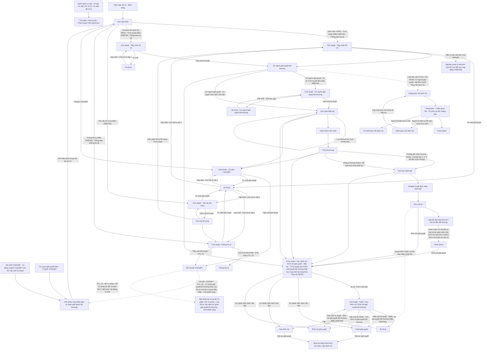

### 4.3.3. Dành cho Cán bộ Công tác bồi thường nhà nước

#### 4.3.3.1. Giải quyết yêu cầu bồi thường

##### 4.3.3.1.1. Mục đích
Cho phép quản lý quy trình tiếp nhận, cử người giải quyết và giải quyết hồ sơ vụ việc yêu cầu bồi thường nhà nước theo đúng quy định của Luật Trách nhiệm bồi thường của Nhà nước, bao gồm:
- Tra cứu danh sách vụ việc theo phân trang và 02 tab nghiệp vụ (Chờ xử lý, Đã xử lý), hỗ trợ tìm kiếm và lọc đa tiêu chí.
- Tiếp nhận và nhập liệu hồ sơ vụ việc yêu cầu bồi thường theo Nguồn hồ sơ (`Tiếp nhận mới`, `Dịch vụ công`, `Chuyển CQGQBT`, `Xác định CQGQBT`) và Hình thức tiếp nhận (Danh mục Hình thức tiếp nhận [DM_25]), tự động kế thừa thông tin và kiểm tra tính hợp lệ của hồ sơ.
- Kiểm tra tính đầy đủ, hợp lệ của hồ sơ yêu cầu bồi thường ngay khi tiếp nhận; trình Lãnh đạo phê duyệt tiếp nhận hồ sơ (văn bản theo Mẫu 04/BTNN - Thông báo thụ lý hồ sơ yêu cầu bồi thường), yêu cầu bổ sung hồ sơ (văn bản theo Mẫu 03/BTNN) hoặc không thụ lý hồ sơ (văn bản theo Mẫu 04/BTNN - Thông báo không thụ lý hồ sơ yêu cầu bồi thường) theo luồng phê duyệt nhiều cấp. Hồ sơ chuyển sang bước thụ lý sau khi Lãnh đạo phê duyệt tiếp nhận (không có bước kiểm tra riêng).
- Cử người giải quyết bồi thường (Quyết định Mẫu 06/BTNN) sau khi Thông báo thụ lý hồ sơ (Mẫu 04/BTNN) được ký duyệt hoặc ban hành.
- Chuyển hồ sơ sang cơ quan khác: trước khi thụ lý thực hiện qua thao tác Không thụ lý với lý do `KTL_01` (lựa chọn `Chuyển hồ sơ cho` theo cấp đơn vị và số lần đã chuyển, theo [Quy tắc Chuyển hồ sơ cho - Giải quyết yêu cầu bồi thường - Công tác bồi thường nhà nước (Website Quản trị)](#gq-ktl-quy-tac-chuyen)); sau khi thụ lý thực hiện bằng thao tác độc lập `Chuyển CQGQBT` ở mọi trạng thái sau `Cử người giải quyết bồi thường`, trừ hồ sơ đã kết thúc xử lý.
- Theo dõi và cập nhật toàn diện tiến trình giải quyết vụ việc sau khi cử người giải quyết: xác minh thiệt hại, lập biên bản xác minh, tổ chức thương lượng việc bồi thường và lập biên bản kết quả thương lượng.
- Xử lý các nghiệp vụ gián đoạn giải quyết theo quy định pháp luật (trình Lãnh đạo ký duyệt hoặc ban hành Ký ngoài): hoãn giải quyết, tạm đình chỉ, đình chỉ giải quyết bồi thường và khôi phục tiếp tục giải quyết vụ việc.
- Chi trả tiền bồi thường (lập đề nghị cấp kinh phí, tạm ứng kinh phí) và theo dõi thực hiện thủ tục phục hồi danh dự cho người bị thiệt hại.
- Quản lý trạng thái vòng đời vụ việc và ghi nhận toàn bộ lịch sử xử lý, dòng thời gian (timeline) qua từng giai đoạn.

a. Phân quyền
Hệ thống phân quyền thao tác theo vai trò và quyền hạn được cấp:
- Xem: Tra cứu danh sách vụ việc theo tab, xem chi tiết tiến trình hồ sơ vụ việc, xem tài liệu đính kèm và lịch sử xử lý.
- Thêm mới / Nhập liệu: Tiếp nhận và nhập liệu hồ sơ vụ việc mới, tải lên các văn bản căn cứ.
- Cập nhật tiến độ: Tiếp nhận hồ sơ (kể cả hồ sơ đã bổ sung), cập nhật kết quả xác minh thiệt hại, cập nhật kết quả thương lượng.
- Xử lý nghiệp vụ gián đoạn: Trình hoặc ban hành Ký ngoài hoãn giải quyết, tạm đình chỉ, đình chỉ giải quyết bồi thường, dừng giải quyết yêu cầu bồi thường; tiếp tục giải quyết vụ việc.
- Cử người giải quyết: lập Quyết định cử người giải quyết bồi thường (Mẫu 06/BTNN) cho vụ việc ở trạng thái `Cử người giải quyết bồi thường`, trình Lãnh đạo ký duyệt (Ký số) hoặc ban hành (Ký ngoài).
- Trình duyệt: Cán bộ chủ trì trình Lãnh đạo ký duyệt các Loại trình `Thông báo thụ lý hồ sơ`, `Thông báo Yêu cầu bổ sung`, `Thông báo Không thụ lý`, `Chuyển CQGQBT`, `Hoãn giải quyết bồi thường`, `Tạm đình chỉ giải quyết bồi thường`, `Tiếp tục giải quyết bồi thường`, `Đình chỉ giải quyết bồi thường`, `Dừng giải quyết bồi thường`, `Chủ động phục hồi danh dự`.
- Phê duyệt: Lãnh đạo được giao đích danh tại từng cấp phê duyệt thực hiện Ký duyệt/Từ chối tại tab `Chờ xử lý` của màn hình này (vai trò Lãnh đạo đơn vị), theo [Màn hình Ký duyệt / Từ chối - Giải quyết yêu cầu bồi thường - Công tác bồi thường nhà nước (Website Quản trị)](#gq-ky-duyet-tu-choi). Lãnh đạo ký duyệt trên hệ thống, không ký số tại màn hình Ký duyệt / Từ chối của phân hệ này.
- Quản lý trạng thái / Xóa: Xóa hồ sơ ở trạng thái Chờ tiếp nhận hoặc đóng hồ sơ khi hoàn thành toàn bộ nghĩa vụ; xóa hồ sơ cán bộ chủ động phục hồi danh dự ở trạng thái `Bị trả lại` (chỉ cán bộ tạo hồ sơ).
- Quyền thực hiện Phục hồi danh dự (thuộc nhóm quyền Giải quyết yêu cầu bồi thường, không còn menu/nhóm quyền "Phục hồi danh dự" riêng): + Thông báo tổ chức thực hiện phục hồi danh dự + Nhập thông tin ý kiến của người bị thiệt hại + Cập nhật kết quả việc thực hiện phục hồi danh dự

b. Điều kiện thực hiện
- Người dùng đã đăng nhập hệ thống.
- Người dùng được cấp quyền truy cập chức năng "Giải quyết yêu cầu bồi thường".

c. Quy tắc nghiệp vụ chung
- **Định danh vụ việc**: Vụ việc yêu cầu bồi thường được nhận diện và hiển thị theo định dạng `Mã vụ việc - Họ và tên người yêu cầu` (`Mã vụ việc` dạng `VVBT-yyyy-xxx`) trên danh sách, liên kết, thông báo xác nhận, màn hình chi tiết, popup tìm kiếm và Phiếu in của chức năng này. Hệ thống không quản lý trường tên riêng cho vụ việc; bộ lọc và form nhập liệu chỉ dùng `Mã vụ việc` và `Họ và tên người yêu cầu` để định danh vụ việc.
- **Nguồn hồ sơ**: Mỗi hồ sơ có 01 giá trị `Nguồn hồ sơ` thuộc danh sách cố định gồm 04 giá trị, cùng danh sách với [Nguồn hồ sơ - Tiếp nhận hồ sơ - Công tác bồi thường nhà nước (Website Quản trị)](SRS_BTNN_GiaiQuyetBT_TiepNhan_YCBT.md#tn-nguon-ho-so): `Tiếp nhận mới`, `Dịch vụ công`, `Chuyển CQGQBT`, `Xác định CQGQBT`.
- **Hình thức tiếp nhận**: Mỗi hồ sơ có 01 giá trị `Hình thức tiếp nhận`, tham chiếu [Danh mục Hình thức tiếp nhận - Danh mục dữ liệu dùng chung - Tổng quan và quy tắc chung](../../Tai%20lieu%20tong%20hop/00_Tong_quan_va_Quy_tac_chung.md#danh-muc-dung-chung) [DM_25].
  + Khi cán bộ tạo hồ sơ trực tiếp tại phân hệ: hệ thống gán `Nguồn hồ sơ` = `Tiếp nhận mới`; `Mã vụ việc` theo lựa chọn của trường `Mã vụ việc` tại MH02 (`Vụ việc mới`: hệ thống sinh mã mới khi lưu; `Vụ việc đã có Mã vụ việc`: hồ sơ mang mã đã chọn); cán bộ chọn `Hình thức tiếp nhận` là `Trực tiếp` hoặc `Qua dịch vụ bưu chính`.
  + Hồ sơ đến từ Tiếp nhận hồ sơ (sau khi Lãnh đạo phân công cán bộ) giữ nguyên `Nguồn hồ sơ` và `Mã vụ việc` đã có; `Hình thức tiếp nhận` mặc định theo hồ sơ đã tiếp nhận, cán bộ được điều chỉnh (chọn đủ các giá trị của DM_25).
  + Giá trị `Dịch vụ công`, `Chuyển CQGQBT`, `Xác định CQGQBT` chỉ do hệ thống gán; trường hiển thị ở chế độ chỉ đọc, cán bộ không được thay đổi.
  + Hồ sơ `Nguồn hồ sơ` = `Dịch vụ công`: `Hình thức tiếp nhận` cố định `Dịch vụ công`, chỉ đọc; quy tắc theo [Hồ sơ nguồn Dịch vụ công - Tiếp nhận hồ sơ - Công tác bồi thường nhà nước (Website Quản trị)](SRS_BTNN_GiaiQuyetBT_TiepNhan_YCBT.md#tn-dvc).
  + Hồ sơ cán bộ chủ động phục hồi danh dự: hệ thống gán `Nguồn hồ sơ` = `Tiếp nhận mới`, `Hình thức tiếp nhận` = `Cán bộ chủ động phục hồi danh dự khi có đủ thông tin`; trường chỉ đọc. Quy tắc theo [Hồ sơ cán bộ chủ động phục hồi danh dự - Giải quyết yêu cầu bồi thường - Công tác bồi thường nhà nước (Website Quản trị)](#gq-cdpd).
- **Mã vụ việc và Mã hồ sơ**: Quy tắc chung theo [Mã vụ việc và mã hồ sơ - Tiếp nhận hồ sơ - Công tác bồi thường nhà nước (Website Quản trị)](SRS_BTNN_GiaiQuyetBT_TiepNhan_YCBT.md#tn-ma-vu-viec).
  + Mỗi hồ sơ có `Mã hồ sơ` `BT-yyyy-xxx` riêng của phân hệ (01 mã cho cả 03 Loại yêu cầu giải quyết bồi thường) và luôn gắn với 01 `Mã vụ việc` `VVBT-yyyy-xxx`.
  + Hồ sơ đến từ Tiếp nhận hồ sơ, Dịch vụ công, Xác định CQGQBT: kế thừa `Mã vụ việc` đã có, hệ thống chỉ sinh `Mã hồ sơ` `BT-`.
  + `Chuyển CQGQBT` sang cơ quan khác: hồ sơ mới tại cơ quan nhận giữ nguyên `Mã vụ việc`, có `Mã hồ sơ` `BT-` mới; hồ sơ cũ kết thúc ở trạng thái `Đã chuyển CQGQBT`.
  + Không thụ lý với lý do `KTL_01`: hồ sơ mới tại cơ quan nhận giữ nguyên `Mã vụ việc`; `Mã hồ sơ` của phân hệ xử lý sinh ngay khi hệ thống tạo hồ sơ mới ở trạng thái `Chờ phân công` tại cơ quan nhận (`XD-` khi `Chuyển hồ sơ cho` là Bộ Tư pháp hoặc Sở Tư pháp; `BT-` khi `Chuyển hồ sơ cho` là `Cơ quan giải quyết bồi thường khác`); hồ sơ cũ kết thúc ở trạng thái `Đã chuyển CQGQBT`.
  + Hồ sơ cũ chưa có `Mã vụ việc`: hệ thống gán `Mã vụ việc` 01 lần và giữ ổn định cho mọi chức năng dùng `Mã hồ sơ` `BT-` đó.
  + `Mã vụ việc` và `Mã hồ sơ` chỉ đọc, không cho sửa.
- **Hồ sơ nhận từ Xác định cơ quan giải quyết bồi thường**:
  + Khi Lãnh đạo cấp cuối Ký duyệt văn bản Kết quả xác định CQGQBT tại phân hệ Xác định cơ quan giải quyết bồi thường, hệ thống tự động chuyển CQGQBT theo [Tự động chuyển CQGQBT - Xác định cơ quan giải quyết bồi thường - Công tác bồi thường nhà nước (Website Quản trị)](SRS_BTNN_GiaiQuyetBT__Xac%20định%20cơ%20quan%20GQBT.md): tạo 01 hồ sơ yêu cầu bồi thường mới tại CQGQBT đã chọn trên hệ thống, với `Nguồn hồ sơ` = `Xác định CQGQBT`.
  + Hồ sơ mới ở trạng thái `Chờ phân công` và chờ nhóm lãnh đạo của cơ quan giải quyết bồi thường được xác định phân công xử lý tại tab `Chờ xử lý` của [Tiếp nhận hồ sơ - Tiếp nhận hồ sơ - Công tác bồi thường nhà nước (Website Quản trị)](SRS_BTNN_GiaiQuyetBT_TiepNhan_YCBT.md#tn-tab-xu-ly). Trong thời gian hồ sơ ở trạng thái `Chờ phân công` hoặc `Đang phân công`, hồ sơ chưa hiển thị tại chức năng này.
  + Khi lãnh đạo phân công cán bộ chủ trì, hồ sơ hiển thị tại Tab "Chờ xử lý" với trạng thái `Chờ tiếp nhận`; `Cán bộ xử lý` là cán bộ chủ trì được phân công; `Ngày tiếp nhận` là ngày phân công cán bộ.
  + Hệ thống kế thừa từ hồ sơ Xác định cơ quan giải quyết bồi thường: thông tin người yêu cầu bồi thường, thông tin người bị thiệt hại (nếu có), Lĩnh vực phát sinh thiệt hại, Hành vi gây thiệt hại của người thi hành công vụ, Phương thức nhận thông báo và Địa chỉ, đầu mối nhận thông báo, Cơ quan giải quyết bồi thường (đơn vị nhận hồ sơ), tài liệu đính kèm của hồ sơ Xác định cơ quan giải quyết bồi thường và tài liệu chuyển xử lý (văn bản Kết quả xác định CQGQBT đã ký và tài liệu đính kèm của kết quả xác định); đồng thời lưu `Mã hồ sơ Xác định CQGQBT`, `Nội dung chuyển xử lý` và ghi 01 dòng timeline *"Nhận hồ sơ từ Xác định CQGQBT [Mã hồ sơ Xác định CQGQBT]: [Nội dung chuyển xử lý]"*.
  + Mỗi hồ sơ chuyển đến chỉ tạo 01 hồ sơ yêu cầu bồi thường; hệ thống không tạo trùng theo `Mã hồ sơ` khi đồng bộ lại. Hồ sơ mới giữ nguyên `Mã vụ việc` của hồ sơ Xác định cơ quan giải quyết bồi thường.
- **Người bị thiệt hại**: Khi `Tư cách người yêu cầu bồi thường` khác `Người bị thiệt hại`, hệ thống hiển thị khối `Thông tin người bị thiệt hại`. Trong khối này chỉ bắt buộc 04 trường: `Họ và tên người bị thiệt hại`, `Ngày tháng năm sinh`, `Loại giấy tờ thân nhân`, `Số giấy tờ thân nhân`. Riêng Tư cách `Tổ chức kế thừa quyền, nghĩa vụ của tổ chức bị thiệt hại đã chấm dứt tồn tại`: khối hiển thị dạng `Thông tin tổ chức bị thiệt hại đã chấm dứt tồn tại`, chỉ gồm `Tên tổ chức bị thiệt hại` (bắt buộc) và `Mã số tổ chức` (không bắt buộc). Khi `Tư cách người yêu cầu bồi thường` là `Người bị thiệt hại`, khối này ẩn và hệ thống không lưu thông tin người bị thiệt hại riêng.
- **Văn bản làm căn cứ yêu cầu bồi thường**: Hồ sơ lưu danh sách văn bản làm căn cứ yêu cầu bồi thường (mỗi dòng gồm `Tên văn bản căn cứ` và file đính kèm). Khối này không bắt buộc. Với hồ sơ nhận từ Xác định cơ quan giải quyết bồi thường, hệ thống kế thừa danh sách văn bản làm căn cứ đã nhập tại hồ sơ Xác định cơ quan giải quyết bồi thường; cán bộ được sửa, bổ sung tại MH02.
- **Vụ việc do Tòa án thụ lý**: Form nhập liệu hồ sơ (MH02) không còn khối `Tình trạng pháp lý` (Chưa có/Đã có Bản án/Quyết định của Tòa án) và các trường thông tin bản án đi kèm. Vụ việc do Tòa án thụ lý giải quyết được khai báo và theo dõi tại chức năng "Theo dõi vụ việc tại Tòa án" (Website Quản trị). Hồ sơ cũ đã lưu thông tin bản án vẫn hiển thị các thông tin này ở chế độ chỉ đọc tại MH03/MH05.
- **Cử người giải quyết và phạm vi xem hồ sơ**:
  + Tại bước `Cử người giải quyết bồi thường`, Quyết định cử người giải quyết bồi thường cử 01 hoặc nhiều cán bộ giải quyết hồ sơ; cán bộ dòng đầu tiên là cán bộ chủ trì. Cán bộ được cử bắt buộc chọn từ tài khoản cán bộ đã có trên hệ thống, thuộc cơ quan giải quyết bồi thường của hồ sơ (đơn vị gốc của cơ quan và các đơn vị trực thuộc theo Cơ cấu tổ chức), trừ thành viên Nhóm lãnh đạo; `Chức vụ` điền theo tài khoản và cho phép sửa; `Đơn vị` là cơ quan, đơn vị của cán bộ đang đăng nhập.
  + Sau khi cử người giải quyết, hồ sơ chỉ hiển thị tại Tab "Chờ xử lý" đối với các cán bộ được cử; chỉ các cán bộ này được xem chi tiết và cập nhật kết quả giải quyết hồ sơ. Cán bộ khác (kể cả cán bộ cùng cơ quan) không tìm thấy hồ sơ trên danh sách và không mở được màn hình chi tiết.
  + Quyết định cử người giải quyết bồi thường (Mẫu 06/BTNN) được lập và trình ký (Ký số) hoặc ban hành (Ký ngoài) tại [Popup Cử người giải quyết bồi thường - Giải quyết yêu cầu bồi thường - Công tác bồi thường nhà nước (Website Quản trị)](#43318-popup-cử-người-giải-quyết-bồi-thường).
- **Xác minh thiệt hại nhiều lần**: Tại trạng thái `Xác minh thiệt hại`, cán bộ được lưu kết quả xác minh nhiều lần trước khi hoàn thành xác minh:
  + Bảng `Tổng số tiền theo từng hạng mục` là duy nhất cho mỗi hồ sơ, gồm các cột `Thiệt hại yêu cầu bồi thường`, `Mức đề xuất`, `Mức xác minh`, `Nội dung diễn giải`: mỗi lần lưu, `Mức xác minh` và `Nội dung diễn giải` của từng hạng mục được ghi đè bằng giá trị mới; hệ thống luôn hiển thị giá trị hiện hành.
  + `Thành phần tham gia xác minh` nhập dạng bảng động (Họ và tên, Chức vụ, Đơn vị), áp dụng chung cho lần lưu kết quả xác minh; bắt buộc tối thiểu 01 thành viên, mỗi dòng bắt buộc `Họ và tên`. Khi mở cập nhật, bảng điền sẵn thành phần của lần lưu gần nhất.
  + Các thông tin chi tiết khác của mỗi lần lưu (thành phần tham gia xác minh, chi tiết quá trình xác minh từng hạng mục, thỏa thuận kéo dài thời gian xác minh, nội dung khác, tài liệu đính kèm) được ghi thêm 01 lần vào `Lịch sử các lần xác minh`; các lần đã ghi không bị ghi đè.
  + Mỗi lần lưu, hệ thống cập nhật `Kết quả xác minh hiện hành` theo từng thiệt hại (Thiệt hại yêu cầu bồi thường, Mức đề xuất, Mức xác minh, Nội dung diễn giải) cùng Thành phần tham gia xác minh. Kết quả xác minh hiện hành là nguồn dữ liệu cho bảng thiệt hại tại bước Thương lượng và cho Bảng đề xuất bồi thường theo [Quy tắc tự động điền khi chọn Mã hồ sơ giải quyết bồi thường - Quyết định giải quyết bồi thường - Công tác bồi thường nhà nước (Website Quản trị)](SRS_BTNN_GiaiQuyetBT_QuyetDinh_GQBT.md#qd-quy-tac-tu-dong-dien).
- **Thiệt hại yêu cầu bồi thường 02 cấp**: Bảng thiệt hại tại Nhập liệu hồ sơ vụ việc, Xác minh thiệt hại, Thương lượng và các màn hình xem chi tiết theo [Danh mục Loại thiệt hại yêu cầu bồi thường - Danh mục dữ liệu dùng chung - Tổng quan và quy tắc chung](../../Tai%20lieu%20tong%20hop/00_Tong_quan_va_Quy_tac_chung.md#danh-muc-dung-chung) [DM_27]:
  + Cấp 1 là nhóm thiệt hại, cấp 2 là mục chi tiết; số tiền (Số tiền yêu cầu, Mức xác minh, Mức tiền bồi thường) nhập và lưu theo từng mục chi tiết.
  + Dòng nhóm và dòng TỔNG CỘNG tự cộng các mục chi tiết được tích; không cho nhập.
  + Form nhập: hiển thị đủ 35 mục và nhóm `VII. Các thiệt hại khác`; màn hình xem chi tiết: chỉ hiển thị nhóm và mục có dữ liệu.
  + Nhóm `VII. Các thiệt hại khác` không có mục cố định: người dùng bấm `Thêm thiệt hại khác` để thêm dòng, nhập `Tên / nội dung thiệt hại` và số tiền; dòng nhóm VII cộng vào tổng chung; dòng VII đã có ở bước trước được kế thừa sang Xác minh thiệt hại, Thương lượng.
  + Tại Xác minh thiệt hại, Thương lượng: mọi mục được tích / bỏ tích tự do, gồm mục theo yêu cầu của hồ sơ; mục bỏ tích không thuộc kết quả của bước; hệ thống lưu ngầm cờ mục theo yêu cầu / mục bổ sung để truy vết, không hiển thị nhãn.
  + Hồ sơ đã lưu theo 06 loại thiệt hại cũ: mỗi loại được quy đổi sang mục chi tiết đầu tiên của nhóm tương ứng (`Tài sản bị xâm phạm` -> I.1; `Thu nhập thực tế bị mất/giảm sút` -> II.1; `Vật chất do người bị thiệt hại chết` -> III.1; `Vật chất do sức khỏe bị xâm phạm` -> IV.1; `Thiệt hại về tinh thần` -> V.1; `Các chi phí hợp lý khác` -> VI.1), giữ nguyên số tiền.

- **Bổ sung yêu cầu phục hồi danh dự tại bước Xác minh thiệt hại / Thương lượng**: Khi lưu kết quả xác minh hoặc kết quả thương lượng có tích bổ sung `Yêu cầu phục hồi danh dự`:
  + Hồ sơ được xác định có yêu cầu phục hồi danh dự như hồ sơ có yêu cầu từ đầu; lưu kèm cờ bổ sung và bước bổ sung (Xác minh thiệt hại / Thương lượng).
  + `Loại yêu cầu giải quyết bồi thường` đang là `Chỉ yêu cầu bồi thường thiệt hại bằng tiền` chuyển thành `Yêu cầu cả hai (Bồi thường tiền & Phục hồi danh dự)`.
  + Mở nhánh Phục hồi danh dự: hiển thị tab Phục hồi danh dự và các thao tác phục hồi danh dự như hồ sơ có yêu cầu từ đầu, theo [Màn hình Xem chi tiết vụ việc Phục hồi danh dự - Giải quyết yêu cầu bồi thường - Công tác bồi thường nhà nước (Website Quản trị)](#43316-mh04---màn-hình-xem-chi-tiết-vụ-việc-phục-hồi-danh-dự).
  + Ghi Lịch sử xử lý: `Bổ sung yêu cầu phục hồi danh dự tại bước <Xác minh thiệt hại / Thương lượng>`.
  + Bỏ tích yêu cầu đã bổ sung tại bước Xác minh thiệt hại (khi hồ sơ còn ở trạng thái `Xác minh thiệt hại`) rồi lưu: Loại yêu cầu trở lại `Chỉ yêu cầu bồi thường thiệt hại bằng tiền`, đóng nhánh Phục hồi danh dự, ghi Lịch sử xử lý `Bỏ bổ sung yêu cầu phục hồi danh dự tại bước Xác minh thiệt hại`.

- **Hồ sơ cán bộ chủ động phục hồi danh dự**: Cán bộ tạo tại `Tạo yêu cầu` (MH02) với `Hình thức tạo hồ sơ` = `Cán bộ chủ động phục hồi danh dự` khi có đủ thông tin để phục hồi danh dự cho người bị thiệt hại.
  + Dấu hiệu nhận biết: `Hình thức tiếp nhận` = `Cán bộ chủ động phục hồi danh dự khi có đủ thông tin` [DM_25]; `Loại yêu cầu giải quyết bồi thường` = `Chỉ yêu cầu phục hồi danh dự`; `Nguồn hồ sơ` = `Tiếp nhận mới`.
  + `Mã hồ sơ` `BT-yyyy-xxx`, `Mã vụ việc` `VVBT-yyyy-xxx` như hồ sơ khác.
  + `Mã vụ việc` = `Vụ việc đã có Mã vụ việc`: không cho chọn vụ việc đang có hồ sơ chưa kết thúc (Tab `Đã xử lý`); bổ sung phục hồi danh dự tại hồ sơ đang giải quyết theo [Bổ sung yêu cầu phục hồi danh dự tại bước Xác minh thiệt hại / Thương lượng - Giải quyết yêu cầu bồi thường - Công tác bồi thường nhà nước (Website Quản trị)](#gq-quy-tac-phdd-bo-sung).
  + Không có Lưu nháp: cán bộ bấm `Trình Lãnh đạo`, trình Thông báo tổ chức thực hiện phục hồi danh dự theo [Popup Trình ký Thông báo tổ chức thực hiện phục hồi danh dự - hồ sơ cán bộ chủ động - Giải quyết yêu cầu bồi thường - Công tác bồi thường nhà nước (Website Quản trị)](#gq-popup-cdpd).
  + Văn bản trình chỉ tải lên từ máy (Ký số) hoặc tải lên văn bản đã ký (Ký ngoài); không sinh văn bản theo mẫu.
  + Không qua `Chờ tiếp nhận`, Thông báo thụ lý (Mẫu 04/BTNN), `Cử người giải quyết bồi thường` (Mẫu 06/BTNN); cán bộ tạo hồ sơ là cán bộ chủ trì và cán bộ giải quyết.
  + Trạng thái: Trình → `Chờ duyệt` (Nội dung trình `Chủ động phục hồi danh dự`); Lãnh đạo từ chối → `Bị trả lại`; cấp cuối Ký duyệt hoặc ban hành Ký ngoài → `Đang phục hồi danh dự`.
  + Văn bản đã ký duyệt / ban hành là Thông báo tổ chức thực hiện phục hồi danh dự: Bước 1 `Thông báo` của tiến trình phục hồi danh dự hoàn thành; tiến trình chuyển Bước 2 `Ý kiến phản hồi của người yêu cầu`.
  + Hồ sơ `Bị trả lại`: `Cập nhật` mở lại MH02 và popup trình, điền sẵn dữ liệu lần trình trước, hiển thị lý do bị trả lại; `Xóa hồ sơ` (Thao tác khác) chỉ cán bộ tạo hồ sơ.
  + Báo cáo, thống kê: không tính vào chỉ tiêu thụ lý hồ sơ yêu cầu bồi thường; chỉ tính vào chỉ tiêu phục hồi danh dự.
  + Lịch sử xử lý: `Tạo hồ sơ chủ động phục hồi danh dự`; `Trình Lãnh đạo: Chủ động phục hồi danh dự`; `Bị trả lại`; `Đang phục hồi danh dự` (cấp cuối Ký duyệt); `Ban hành Thông báo tổ chức thực hiện phục hồi danh dự (Ký ngoài)`; tab Phục hồi danh dự ghi `Ban hành Thông báo tổ chức thực hiện phục hồi danh dự`.

- **Trạng thái vụ việc Giải quyết YCBT**: Gồm đúng 19 giá trị, theo thứ tự hiển thị tại bộ lọc `Trạng thái`, badge trạng thái và lịch sử tiến trình:

| STT | Trạng thái | Ý nghĩa | Tab |
| :--- | :--- | :--- | :--- |
| 1 | Chờ tiếp nhận | Hồ sơ chưa được cán bộ tiếp nhận | Vụ việc chờ xử lý |
| 2 | Chờ duyệt | Hồ sơ có phiếu trình đang chờ Lãnh đạo ký duyệt; loại việc xem tại `Nội dung trình` | Vụ việc chờ xử lý |
| 3 | Bị trả lại | Lãnh đạo từ chối phê duyệt phiếu trình ở bất kỳ cấp nào | Vụ việc chờ xử lý |
| 4 | Cử người giải quyết bồi thường | Hồ sơ đã được thụ lý (Thông báo thụ lý đã ký duyệt hoặc đã ban hành), chờ lập, trình Quyết định cử người giải quyết bồi thường | Vụ việc chờ xử lý |
| 5 | Xác minh thiệt hại | Cán bộ được cử cập nhật kết quả xác minh thiệt hại | Vụ việc chờ xử lý |
| 6 | Thương lượng | Cán bộ được cử cập nhật kết quả thương lượng | Vụ việc chờ xử lý |
| 7 | Chờ ban hành QĐ | Chờ lập, ký và ban hành Quyết định giải quyết bồi thường | Vụ việc chờ xử lý |
| 8 | Chờ chi trả | Quyết định giải quyết bồi thường đã ban hành, chờ chi trả tiền bồi thường | Vụ việc chờ xử lý |
| 9 | Hoàn thành | Vụ việc đã hoàn thành (hoàn thành chi trả tiền bồi thường, hoặc hoàn thành Trả lại ngân sách nhà nước khoản chi trả quá hạn 03 năm tại [MH04 - Màn hình Cập nhật trả lại ngân sách nhà nước - Tạm ứng kinh phí bồi thường/Chi trả tiền bồi thường - Công tác bồi thường nhà nước (Website Quản trị)](SRS_BTNN_GiaiQuyetBT_KinhPhi_BT.md#kp-mh04)) | Vụ việc đã xử lý |
| 10 | Đang phục hồi danh dự | Nhánh Phục hồi danh dự đang thực hiện | Vụ việc chờ xử lý |
| 11 | Hoãn phục hồi danh dự | Tiến trình phục hồi danh dự tạm hoãn theo đề nghị của người bị thiệt hại | Vụ việc chờ xử lý |
| 12 | Từ chối phục hồi danh dự | Người bị thiệt hại từ chối phục hồi danh dự | Vụ việc đã xử lý |
| 13 | Hoãn giải quyết | Vụ việc hoãn giải quyết | Vụ việc chờ xử lý |
| 14 | Tạm đình chỉ | Vụ việc tạm đình chỉ giải quyết; Tiếp tục giải quyết thì quay về trạng thái trước khi tạm đình chỉ | Vụ việc chờ xử lý |
| 15 | Đình chỉ giải quyết | Vụ việc đình chỉ giải quyết | Vụ việc đã xử lý |
| 16 | Dừng giải quyết | Cơ quan giải quyết bồi thường đã ban hành Thông báo dừng giải quyết yêu cầu bồi thường (Mẫu 05/BTNN); trạng thái kết thúc, không có thao tác tiếp theo | Vụ việc đã xử lý |
| 17 | Đã chuyển CQGQBT | Hồ sơ đã chuyển cơ quan giải quyết bồi thường khác | Vụ việc đã xử lý |
| 18 | Không thụ lý | Hồ sơ không được thụ lý | Vụ việc đã xử lý |
| 19 | Yêu cầu bổ sung | Đã gửi yêu cầu bổ sung hồ sơ, chờ người yêu cầu bổ sung | Vụ việc chờ xử lý |

- **Vụ việc gồm 02 nhánh giải quyết - Trạng thái vụ việc**: Mỗi hồ sơ có 01 `Mã hồ sơ` `BT-yyyy-xxx` dùng chung cho cả 03 Loại yêu cầu giải quyết bồi thường; không tách thành hồ sơ riêng. Tên trạng thái trong các quy tắc dưới đây hiển thị theo [Trạng thái vụ việc Giải quyết YCBT - Giải quyết yêu cầu bồi thường - Công tác bồi thường nhà nước (Website Quản trị)](#gq-trang-thai-vu-viec).
  + Giai đoạn chung (trước khi cử người giải quyết), áp dụng cho cả vụ việc: + Chờ tiếp nhận + Chờ duyệt + Bị trả lại + Yêu cầu bổ sung + Cử người giải quyết bồi thường + Không thụ lý (kết thúc) + Đã chuyển CQGQBT (kết thúc)
  + Từ khi Quyết định cử người giải quyết bồi thường được ký duyệt hoặc ban hành (nút `Cử người giải quyết` tại MH01), vụ việc có tối đa 02 nhánh chạy song song, cán bộ được cử cập nhật đồng thời: + **Trạng thái Giải quyết YCBT** (Loại yêu cầu `Yêu cầu cả hai` hoặc `Chỉ yêu cầu bồi thường thiệt hại bằng tiền`): Xác minh thiệt hại → Thương lượng → Chờ ban hành QĐ → Chờ chi trả → Hoàn thành; ngoài ra Hoãn giải quyết, Tạm đình chỉ, Đình chỉ giải quyết, Dừng giải quyết. + **Trạng thái Phục hồi danh dự** (Loại yêu cầu `Yêu cầu cả hai` hoặc `Chỉ yêu cầu phục hồi danh dự`): gồm `Đang phục hồi danh dự` (từ khi cử người giải quyết), `Hoãn phục hồi danh dự`, `Từ chối phục hồi danh dự` và `Hoàn thành`.
  + Các bước của tiến trình phục hồi danh dự (Thông báo tổ chức phục hồi danh dự → Ý kiến phản hồi của người bị thiệt hại → Tổ chức thực hiện → Hoàn thành) và tình huống Điều chỉnh theo đề xuất là **bước của tiến trình**, hiển thị tại Stepper của tab Phục hồi danh dự; Trạng thái vụ việc trong các bước này là `Đang phục hồi danh dự`.
  + Người bị thiệt hại từ chối phục hồi danh dự (khoản 5 Điều 57): cán bộ ghi nhận ý kiến kèm văn bản/biên bản, nhánh Phục hồi danh dự kết thúc ở `Từ chối phục hồi danh dự`. + Tạm hoãn theo đề nghị của người bị thiệt hại: Trạng thái vụ việc `Hoãn phục hồi danh dự`.
  + Vụ việc `Chỉ yêu cầu phục hồi danh dự`: Chờ tiếp nhận → (Chờ duyệt / Bị trả lại / Yêu cầu bổ sung của giai đoạn chung) → Cử người giải quyết bồi thường → Đang phục hồi danh dự (Hoãn phục hồi danh dự) → Hoàn thành hoặc Từ chối phục hồi danh dự.
  + Hồ sơ cán bộ chủ động phục hồi danh dự: Chờ duyệt / Bị trả lại → Đang phục hồi danh dự (từ Bước 2 của tiến trình) → Hoàn thành hoặc Từ chối phục hồi danh dự.
  + **Trạng thái vụ việc** do hệ thống tổng hợp, theo thứ tự ưu tiên: + Vụ việc ở giai đoạn chung: trạng thái của giai đoạn chung. + Vụ việc chỉ có 01 nhánh: trạng thái của nhánh đó. + Vụ việc `Yêu cầu cả hai`, phần bồi thường thiệt hại chưa `Hoàn thành`: theo Trạng thái Giải quyết YCBT (Bồi thường thiệt hại), không phụ thuộc Trạng thái Phục hồi danh dự. + Vụ việc `Yêu cầu cả hai`, phần bồi thường thiệt hại đã `Hoàn thành`: theo Trạng thái Phục hồi danh dự - `Đang phục hồi danh dự`, `Hoãn phục hồi danh dự`, `Từ chối phục hồi danh dự`; phục hồi danh dự hoàn tất → `Hoàn thành`.
  + `Hoãn giải quyết bồi thường`, `Tạm đình chỉ giải quyết bồi thường`, `Tiếp tục giải quyết bồi thường`, `Đình chỉ giải quyết bồi thường`, `Dừng giải quyết bồi thường` chỉ áp dụng cho nhánh Giải quyết bồi thường thiệt hại; nhánh Phục hồi danh dự không bị ảnh hưởng, giữ nguyên Trạng thái Phục hồi danh dự và tiếp tục được cập nhật.
  + Trạng thái vụ việc khi cấp cuối Ký duyệt (hoặc ban hành Ký ngoài): `Hoãn giải quyết` / `Tạm đình chỉ` / `Đình chỉ giải quyết` / `Dừng giải quyết` tương ứng.
  + Hoàn thành chi trả (nhánh Giải quyết YCBT) không phụ thuộc tiến độ Phục hồi danh dự.
  + Danh sách MH01, Tab `Chờ xử lý`/`Đã xử lý`, bộ lọc `Trạng thái` và báo cáo thống kê đếm theo `Mã vụ việc` `VVBT-` (01 vụ việc tính 01 lần, kể cả khi vụ việc có nhiều `Mã hồ sơ` do `Chuyển CQGQBT`) và theo Trạng thái vụ việc; chỉ tiêu riêng của từng nhánh lấy theo Trạng thái Giải quyết YCBT hoặc Trạng thái Phục hồi danh dự.
  + Vụ việc `Chỉ yêu cầu phục hồi danh dự` đi giai đoạn chung như vụ việc khác (Tiếp nhận → Trình duyệt tiếp nhận → Cử người giải quyết bồi thường); sau khi cử người giải quyết không áp dụng thao tác/trạng thái của nhánh Giải quyết YCBT (Xác minh thiệt hại, Thương lượng, Quyết định GQBT, Chi trả, Kinh phí, Chuyển CQGQBT); chức năng Quyết định giải quyết bồi thường không liệt kê vụ việc này.
  + Dữ liệu cũ đã tách thành vụ việc `PHDD-yyyy-xxx`: hệ thống gộp về 01 vụ việc. Vụ việc PHDD- tách từ vụ việc BT-: dữ liệu và tiến độ phục hồi danh dự chuyển về vụ việc BT- (Loại yêu cầu `Yêu cầu cả hai`). Vụ việc PHDD- `Chỉ yêu cầu phục hồi danh dự`: cấp lại `Mã hồ sơ` `BT-yyyy-xxx` (mã BT- ban đầu của hồ sơ nếu có). Hệ thống lưu ánh xạ mã PHDD- cũ → mã BT- để mở đúng vụ việc từ liên kết cũ.

- **Đường dẫn mở chi tiết vụ việc**: `quan_ly_boi_thuong.html?id=[Mã hồ sơ]` (chấp nhận `Mã hồ sơ` `BT-` hoặc `Mã vụ việc` `VVBT-`; tham số tương đương `viewCode`; với `Mã vụ việc` có nhiều hồ sơ, mở hồ sơ chưa `Đã chuyển CQGQBT`), tùy chọn `focusTab=phdd` (tương đương `subTab=phdd`): + Mở màn hình chi tiết của vụ việc; `focusTab=phdd` mở tab `Phục hồi danh dự` khi vụ việc có nhánh Phục hồi danh dự. + Vụ việc `Chỉ yêu cầu phục hồi danh dự` đã cử người giải quyết: mở [Màn hình Xem chi tiết tiến trình phục hồi danh dự](#mh-chi-tiet-vu-viec-phdd). + Mã `PHDD-...` cũ: hệ thống tra ánh xạ sang `Mã hồ sơ` `BT-...` sau khi gộp và mở vụ việc tương ứng.

- **Thương lượng việc bồi thường (Điều 46 Luật Trách nhiệm bồi thường của Nhà nước)**: Tại trạng thái `Thương lượng`, cán bộ cập nhật kết quả thương lượng; bắt buộc chọn 01 giá trị `Tình trạng tham gia thương lượng`: + Người yêu cầu bồi thường từ chối thương lượng + Người yêu cầu bồi thường hai lần từ chối nhận giấy mời tham gia thương lượng + Người yêu cầu bồi thường hai lần không đến địa điểm thương lượng khi đã nhận giấy mời mà không có lý do chính đáng + Đồng ý thương lượng

| STT | Tình trạng tham gia thương lượng | Mã lưu trữ | Khối hiển thị | Trường bắt buộc | Trạng thái sau khi lưu | Số tiền tại Quyết định GQBT |
| :--- | :--- | :--- | :--- | :--- | :--- | :--- |
| 1 | Người yêu cầu bồi thường từ chối thương lượng | `TU_CHOI` | Lý do / Diễn giải chi tiết; Tài liệu đính kèm minh chứng | Tài liệu đính kèm minh chứng (văn bản từ chối thương lượng của người yêu cầu bồi thường) | `Chờ ban hành QĐ` | Theo Kết quả xác minh thiệt hại |
| 2 | Người yêu cầu bồi thường hai lần từ chối nhận giấy mời tham gia thương lượng | `TU_CHOI_GIAY_MOI_2_LAN` | Lý do / Diễn giải chi tiết; Tài liệu đính kèm minh chứng | Tài liệu đính kèm minh chứng (biên bản giao giấy mời có xác nhận của bưu tá/chính quyền địa phương) | `Chờ ban hành QĐ` | Theo Kết quả xác minh thiệt hại |
| 3 | Người yêu cầu bồi thường hai lần không đến địa điểm thương lượng khi đã nhận giấy mời mà không có lý do chính đáng | `VANG_MAT_2_LAN` | Lý do / Diễn giải chi tiết; Tài liệu đính kèm minh chứng | Tài liệu đính kèm minh chứng (biên bản xác nhận vắng mặt 02 lần) | `Chờ ban hành QĐ` | Theo Kết quả xác minh thiệt hại |
| 4 | Đồng ý thương lượng | `DONG_Y` | Ngày thương lượng, Địa điểm thương lượng, Thành phần tham gia thương lượng, Kết quả thương lượng theo từng thiệt hại, Phương thức chi trả tiền bồi thường, Khôi phục quyền, lợi ích hợp pháp khác (nếu có) (theo điều kiện), Các nội dung khác, Tài liệu, biên bản kèm theo | Ngày thương lượng, Địa điểm thương lượng, Mức tiền bồi thường và Trạng thái thương lượng từng thiệt hại, Lý do diễn giải khi Không thành công, Phương thức chi trả tiền bồi thường và thông tin người nhận tiền theo phương thức, tối thiểu 01 dòng Tài liệu, biên bản kèm theo có tệp | `Chờ ban hành QĐ` | Theo Kết quả thương lượng |

  + **Trường hợp 1, 2, 3** (không tiến hành thương lượng theo khoản 7 Điều 46): ẩn toàn bộ các khối Ngày/Địa điểm thương lượng, Thành phần tham gia thương lượng, Kết quả thương lượng theo từng thiệt hại, Phương thức chi trả tiền bồi thường, Khôi phục quyền, lợi ích hợp pháp khác (nếu có), Các nội dung khác, Tài liệu, biên bản kèm theo; hiển thị `Lý do / Diễn giải chi tiết` (không bắt buộc) và bảng `Tài liệu đính kèm minh chứng` (bắt buộc tối thiểu 01 dòng, mọi dòng phải có tệp). Cán bộ xác nhận tại popup Xác nhận; hệ thống lưu `Tình trạng tham gia thương lượng` (mã và nhãn), Lý do / Diễn giải chi tiết, tài liệu minh chứng, thời điểm và người cập nhật; hồ sơ chuyển `Chờ ban hành QĐ`. Bảng đề xuất bồi thường tại Quyết định giải quyết bồi thường lấy theo Kết quả xác minh hiện hành (số tiền = Mức xác minh từng thiệt hại).
  + **Đồng ý thương lượng**: bắt buộc nhập `Ngày thương lượng`, `Địa điểm thương lượng`, kết quả từng thiệt hại (`Mức tiền bồi thường`, `Trạng thái thương lượng`; `Lý do diễn giải` bắt buộc khi Trạng thái thương lượng là Không thành công), `Phương thức chi trả tiền bồi thường` kèm thông tin người nhận tiền (mặc định theo hồ sơ vụ việc, cho phép sửa) và tối thiểu 01 dòng `Tài liệu, biên bản kèm theo` có tệp. Danh sách thiệt hại lấy theo Kết quả xác minh hiện hành. Hồ sơ chuyển `Chờ ban hành QĐ`; Bảng đề xuất bồi thường tại Quyết định giải quyết bồi thường lấy theo kết quả thương lượng từng thiệt hại: thiệt hại Thành công lấy `Mức tiền bồi thường`, thiệt hại Không thành công lấy `Mức xác minh`.
  + Quy tắc kế thừa số tiền theo [Quy tắc tự động điền khi chọn Mã hồ sơ giải quyết bồi thường - Quyết định giải quyết bồi thường - Công tác bồi thường nhà nước (Website Quản trị)](SRS_BTNN_GiaiQuyetBT_QuyetDinh_GQBT.md#qd-quy-tac-tu-dong-dien).
  + Dữ liệu cũ: kết quả `Từ chối thương lượng` hiển thị là `Người yêu cầu bồi thường từ chối thương lượng` (Lý do / Ghi chú cũ hiển thị tại `Lý do / Diễn giải chi tiết`); kết quả `Đồng ý thương lượng` giữ nguyên.
  + Trạng thái thương lượng chỉ quản lý trên từng dòng thiệt hại; hệ thống không có kết luận tổng thành công/không thành công và không còn trạng thái hồ sơ "Thương lượng không thành công". Hồ sơ cũ ở trạng thái "Thương lượng không thành công" được chuẩn hóa về `Chờ ban hành QĐ`; kết quả họp thương lượng cũ hiển thị dạng Đồng ý thương lượng, mỗi thiệt hại mang Trạng thái thương lượng theo kết quả cũ (thành công: Mức tiền bồi thường = Mức xác minh; không thành công: Mức tiền bồi thường = 0, Lý do diễn giải = lý do không đạt thỏa thuận đã lưu).
  + Không có khối thông tin dự kiến phiên họp thương lượng, kế hoạch hoặc giấy mời thương lượng.

**Quy tắc xác định Thành phần bắt buộc tham gia thương lượng**

- Áp dụng cho nhóm `Thành phần bắt buộc` của [Khối Thành phần tham gia thương lượng - MH03 - Giải quyết yêu cầu bồi thường - Công tác bồi thường nhà nước (Website Quản trị)](#gq-tl-thanh-phan); hệ thống tự tạo khi mở form Cập nhật kết quả thương lượng.
- Cấp đơn vị: thuộc tính `Cấp đơn vị` (`Trung ương` / `Địa phương`) của đơn vị gốc của tài khoản đăng nhập tại [Cấp đơn vị - Quản lý cơ cấu tổ chức - Quản trị hệ thống (Website Quản trị)](../01_Quan_tri_he_thong/Quan_ly_co_cau_to_chuc.md#cctc-cap-don-vi).
- Tỉnh/Thành phố: thuộc tính `Tỉnh/Thành phố` của đơn vị gốc của tài khoản đăng nhập tại [MH02 - Popup Thêm mới / Sửa cơ quan, đơn vị - Quản lý cơ cấu tổ chức - Quản trị hệ thống (Website Quản trị)](../01_Quan_tri_he_thong/Quan_ly_co_cau_to_chuc.md#cctc-mh02).
- Lĩnh vực: trường [Lĩnh vực phát sinh thiệt hại - MH02 - Giải quyết yêu cầu bồi thường - Công tác bồi thường nhà nước (Website Quản trị)](#gq-mh02-linh-vuc) của hồ sơ.

| STT | Thành phần | Điều kiện | Đơn vị hiển thị | Nguồn dữ liệu |
| :--- | :--- | :--- | :--- | :--- |
| 1 | Cơ quan giải quyết bồi thường | Luôn có | Tên đơn vị gốc của tài khoản đăng nhập | Cơ cấu tổ chức: đơn vị gốc của tài khoản đăng nhập |
| 2 | Bộ Tư pháp | Cấp đơn vị = `Trung ương` | Bộ Tư pháp | Cơ cấu tổ chức: đơn vị gốc Bộ Tư pháp |
| 2 | Sở Tư pháp | Cấp đơn vị = `Địa phương` | Sở Tư pháp [Tỉnh/Thành phố] | Cơ cấu tổ chức: đơn vị gốc Sở Tư pháp cùng Tỉnh/Thành phố |
| 3 | Viện kiểm sát | Lĩnh vực = `Trong hoạt động tố tụng hình sự` và Cấp đơn vị = `Trung ương` | Viện kiểm sát nhân dân tối cao | Cơ cấu tổ chức: đơn vị gốc Viện kiểm sát nhân dân tối cao |
| 3 | Viện kiểm sát | Lĩnh vực = `Trong hoạt động tố tụng hình sự` và Cấp đơn vị = `Địa phương` | Viện kiểm sát nhân dân [Tỉnh/Thành phố] | Cơ cấu tổ chức: đơn vị gốc Viện kiểm sát nhân dân cấp tỉnh cùng Tỉnh/Thành phố |

- Thứ tự hiển thị theo cột STT.
- Trùng đơn vị: đơn vị gốc của tài khoản đăng nhập là chính Bộ Tư pháp / Sở Tư pháp / Viện kiểm sát cần có thì gộp 01 dòng; cột `Thành phần` ghi đủ các vai trò.
- Ví dụ:

| TH | Đơn vị đăng nhập | Cấp đơn vị | Lĩnh vực phát sinh thiệt hại | Thành phần bắt buộc |
| :--- | :--- | :--- | :--- | :--- |
| 1 | Tòa án nhân dân tối cao | Trung ương | Trong hoạt động tố tụng hình sự | (1) Tòa án nhân dân tối cao; (2) Bộ Tư pháp; (3) Viện kiểm sát nhân dân tối cao |
| 2 | Bộ Tài chính | Trung ương | Trong hoạt động quản lý hành chính | (1) Bộ Tài chính; (2) Bộ Tư pháp |
| 3 | Công an quận Hoàng Mai, Thành phố Hà Nội | Địa phương | Trong hoạt động tố tụng hình sự | (1) Công an quận Hoàng Mai, Thành phố Hà Nội; (2) Sở Tư pháp Thành phố Hà Nội; (3) Viện kiểm sát nhân dân Thành phố Hà Nội |
| 4 | UBND tỉnh Lâm Đồng | Địa phương | Trong hoạt động quản lý hành chính | (1) UBND tỉnh Lâm Đồng; (2) Sở Tư pháp tỉnh Lâm Đồng |
| 5 | Sở Tư pháp Thành phố Hà Nội | Địa phương | Trong hoạt động quản lý hành chính | (1) + (2) gộp 01 dòng: Sở Tư pháp Thành phố Hà Nội (Cơ quan giải quyết bồi thường; Sở Tư pháp) |
| 6 | Viện kiểm sát nhân dân tối cao | Trung ương | Trong hoạt động tố tụng hình sự | (1) + (3) gộp 01 dòng: Viện kiểm sát nhân dân tối cao (Cơ quan giải quyết bồi thường; Viện kiểm sát); (2) Bộ Tư pháp |

- **Trình Lãnh đạo phê duyệt nhiều cấp**:
  + Các thao tác `Tiếp nhận` (trình duyệt tiếp nhận hồ sơ), `Yêu cầu bổ sung`, `Không thụ lý`, `Chuyển CQGQBT`, `Hoãn giải quyết`, `Tạm đình chỉ`, `Đình chỉ giải quyết`, `Dừng giải quyết` (Ký số trên hệ thống) không đổi trạng thái hồ sơ ngay mà tạo 01 phiếu trình gửi Lãnh đạo phê duyệt. Chỉ cán bộ chủ trì của hồ sơ được trình; hồ sơ có tối đa 01 phiếu trình đang chờ duyệt.
  + Trình thành công: hồ sơ chuyển trạng thái chung `Chờ duyệt`; loại việc Lãnh đạo cần duyệt lưu tại trường `Nội dung trình` của phiếu trình. Nội dung trình của phân hệ gồm: + Thông báo thụ lý hồ sơ + Chủ động phục hồi danh dự + Thông báo Yêu cầu bổ sung + Thông báo Không thụ lý + Chuyển CQGQBT + Hoãn giải quyết bồi thường + Tạm đình chỉ giải quyết bồi thường + Tiếp tục giải quyết bồi thường + Đình chỉ giải quyết bồi thường + Dừng giải quyết bồi thường + Quyết định GQBT + Hủy QĐ + Sửa chữa, bổ sung QĐ (03 Nội dung trình cuối do chức năng Quyết định giải quyết bồi thường tạo.)
  + Luồng phê duyệt xác định động theo Cấu hình luồng xử lý tương ứng đơn vị của cán bộ thực hiện (ngược chiều luồng phân công thực tế của hồ sơ; hồ sơ do cán bộ tạo trực tiếp tại phân hệ đi từ đơn vị của cán bộ chủ trì lên đơn vị gốc, chỉ gồm các đơn vị có Nhóm lãnh đạo). Popup trình Lãnh đạo chỉ hiển thị một dòng chỉ đọc `Luồng phê duyệt` ngay dưới trường `Lãnh đạo phê duyệt`, không hiển thị ghi chú giải thích luồng phê duyệt/trạng thái hồ sơ. Lãnh đạo các cấp do cán bộ chọn khi trình; cấp n ký duyệt thì hồ sơ tự chuyển đến Lãnh đạo cấp n+1 đã chọn. Chi tiết theo [Quy tắc trình ký - phê duyệt - Xác định cơ quan giải quyết bồi thường - Công tác bồi thường nhà nước (Website Quản trị)](SRS_BTNN_GiaiQuyetBT__Xac%20định%20cơ%20quan%20GQBT.md#xd-quy-tac-phe-duyet).
  + Lãnh đạo Ký duyệt / Từ chối tại [Màn hình Ký duyệt / Từ chối - Giải quyết yêu cầu bồi thường - Công tác bồi thường nhà nước (Website Quản trị)](#gq-ky-duyet-tu-choi) (vai trò Lãnh đạo đơn vị tại MH01).
  + Lãnh đạo từ chối ở bất kỳ cấp nào: vụ việc chuyển `Bị trả lại` (giữ Nội dung trình của phiếu bị từ chối). Cán bộ chủ trì thực hiện `Cập nhật`: hệ thống mở lại đúng màn hình/popup của Nội dung trình bị từ chối, điền sẵn nội dung đã trình, hiển thị lý do bị trả lại; trình lại thì luồng phê duyệt bắt đầu từ cấp đầu tiên.
  + Cấp cuối ký duyệt: vụ việc chuyển trạng thái theo Nội dung trình: + Thông báo thụ lý hồ sơ: `Cử người giải quyết bồi thường` (hệ thống khởi tạo Đề nghị tạm ứng kinh phí nếu hồ sơ có yêu cầu tạm ứng, theo quy tắc kiểm tra trùng lặp hiện hành; văn bản Mẫu 04/BTNN - Thông báo thụ lý hồ sơ yêu cầu bồi thường được lưu cùng phiếu trình, chờ Thủ trưởng cử người giải quyết) + Chủ động phục hồi danh dự (Thông báo tổ chức thực hiện phục hồi danh dự, hồ sơ cán bộ chủ động): `Đang phục hồi danh dự`, tiến trình phục hồi danh dự ở Bước 2 + Thông báo Yêu cầu bổ sung: `Yêu cầu bổ sung` + Thông báo Không thụ lý (lý do khác KTL_01): `Không thụ lý` + Thông báo Không thụ lý (lý do KTL_01, chuyển cơ quan tiếp nhận mới theo 01 trong 03 tùy chọn): `Đã chuyển CQGQBT` + Chuyển CQGQBT: `Đã chuyển CQGQBT` + Hoãn giải quyết bồi thường (Quyết định hoãn giải quyết bồi thường - Mẫu 22/BTNN): `Hoãn giải quyết` (chỉ nhánh Giải quyết bồi thường thiệt hại) + Tạm đình chỉ giải quyết bồi thường: `Tạm đình chỉ` (chỉ nhánh Giải quyết bồi thường thiệt hại) + Tiếp tục giải quyết bồi thường (Quyết định tiếp tục giải quyết bồi thường - Mẫu 23/BTNN): trạng thái trước khi hoãn giải quyết / tạm đình chỉ (chỉ nhánh Giải quyết bồi thường thiệt hại) + Đình chỉ giải quyết bồi thường (Quyết định đình chỉ giải quyết yêu cầu bồi thường - Mẫu 25/BTNN): `Đình chỉ giải quyết` (chỉ nhánh Giải quyết bồi thường thiệt hại) + Dừng giải quyết (Thông báo về việc dừng giải quyết yêu cầu bồi thường - Mẫu 05/BTNN): `Dừng giải quyết` (chỉ nhánh Giải quyết bồi thường thiệt hại) + Cử người giải quyết bồi thường (Quyết định cử người giải quyết - Mẫu 06/BTNN): `Xác minh thiệt hại` (vụ việc `Chỉ yêu cầu phục hồi danh dự`: `Đang phục hồi danh dự`) Kết quả theo từng Nội dung trình theo [Chức năng trên màn hình - Màn hình Ký duyệt / Từ chối - Giải quyết yêu cầu bồi thường - Công tác bồi thường nhà nước (Website Quản trị)](#gq-ky-duyet-chuc-nang).
  + **Cử người giải quyết bồi thường**: Hồ sơ `Cử người giải quyết bồi thường` (cấp cuối đã Ký duyệt Loại trình `Thông báo thụ lý hồ sơ` kèm Thông báo thụ lý Mẫu 04/BTNN, hoặc Thông báo thụ lý đã ban hành Ký ngoài) chờ lập, trình Quyết định cử người giải quyết bồi thường; hồ sơ `Bị trả lại` có Loại trình `Cử người giải quyết bồi thường` chờ cập nhật, trình lại. - Thủ trưởng cơ quan giải quyết bồi thường là Nhóm lãnh đạo của đơn vị phê duyệt cấp cuối trong luồng phê duyệt của hồ sơ. - Lãnh đạo chỉ Ký duyệt / Từ chối phiếu trình `Cử người giải quyết bồi thường`, không có thao tác Không thụ lý ở bước này. - Luồng: Cử người giải quyết bồi thường → (Ký số: Chờ duyệt → cấp cuối Ký duyệt; Ký ngoài: ban hành) → Xác minh thiệt hại → Thương lượng → Chờ ban hành QĐ → Chờ chi trả.
  + Kết quả phê duyệt/trả lại của Lãnh đạo (tại tab `Chờ xử lý` của màn hình này, vai trò Lãnh đạo đơn vị) được cập nhật ngay vào trạng thái vụ việc trên danh sách MH01 và màn hình chi tiết MH05 (đồng bộ theo Mã vụ việc); trạng thái và thông tin đã trình được giữ nguyên khi người dùng tải lại trang.

- **Không thụ lý hồ sơ yêu cầu bồi thường**:
  + Không thụ lý chỉ áp dụng cho hồ sơ `Chờ tiếp nhận`, `Yêu cầu bổ sung`, `Bị trả lại` (thao tác của Cán bộ xử lý, trình Lãnh đạo ký duyệt); không áp dụng ở bước `Cử người giải quyết bồi thường`.
  + `Lý do không thụ lý` bắt buộc chọn 01 giá trị từ Danh mục Lý do không thụ lý hồ sơ yêu cầu bồi thường [DM_55] (07 lý do theo khoản 1 Điều 43 Luật Trách nhiệm bồi thường của Nhà nước số 10/2017/QH14); không cho nhập lý do tự do. `Diễn giải` không bắt buộc.
  + Lý do `KTL_01` (Yêu cầu bồi thường không thuộc thẩm quyền giải quyết của mình): popup hiển thị thêm khối `Chuyển hồ sơ cho`, gồm Radio `Chuyển hồ sơ cho` (bắt buộc chọn 01), `Nội dung/Căn cứ chuyển` (bắt buộc) và `Tài liệu đính kèm chuyển cơ quan`. Các lựa chọn hiển thị theo [Quy tắc Chuyển hồ sơ cho - Giải quyết yêu cầu bồi thường - Công tác bồi thường nhà nước (Website Quản trị)](#gq-ktl-quy-tac-chuyen): + `Bộ Tư pháp`: cơ quan nhận là Bộ Tư pháp; Bộ Tư pháp tiếp nhận hồ sơ tại [Tiếp nhận hồ sơ - Tiếp nhận hồ sơ - Công tác bồi thường nhà nước (Website Quản trị)](SRS_BTNN_GiaiQuyetBT_TiepNhan_YCBT.md#tn-nguon-ho-so) với Loại hồ sơ `Xác định cơ quan giải quyết bồi thường`. + `Sở Tư pháp [Tên tỉnh, thành phố]`: cơ quan nhận là Sở Tư pháp cùng tỉnh, thành phố với đơn vị gốc của tài khoản đăng nhập (hệ thống tự xác định theo cây Cơ cấu tổ chức, không cho chọn Sở Tư pháp tỉnh, thành phố khác); Sở Tư pháp tiếp nhận hồ sơ tại Tiếp nhận hồ sơ với Loại hồ sơ `Xác định cơ quan giải quyết bồi thường`. Không xác định được Sở Tư pháp: không cho trình, không cho ban hành. + `Cơ quan giải quyết bồi thường khác`: cơ quan nhận là đơn vị chọn trên cây Cơ cấu tổ chức (khóa đơn vị gốc của hồ sơ); đơn vị nhận tiếp nhận hồ sơ tại Tiếp nhận hồ sơ với Loại hồ sơ `Giải quyết yêu cầu bồi thường`.
  + Phiếu trình giữ Nội dung trình `Thông báo Không thụ lý`. Khi cấp cuối ký duyệt (Ký số) hoặc khi cán bộ ban hành văn bản (Ký ngoài): + Hồ sơ hiện tại chuyển `Đã chuyển CQGQBT` (kết thúc xử lý, hiển thị tại Tab "Đã xử lý"). + Hệ thống tạo hồ sơ tại Tiếp nhận hồ sơ của cơ quan nhận: trạng thái `Chờ phân công`, `Nguồn hồ sơ` = `Chuyển CQGQBT`, Loại hồ sơ theo lựa chọn `Chuyển hồ sơ cho`, giữ nguyên `Mã vụ việc` (`Mã hồ sơ` của phân hệ xử lý sinh khi hồ sơ vào phân hệ, theo quy tắc Mã vụ việc và Mã hồ sơ). + Hồ sơ mới kế thừa thông tin người yêu cầu bồi thường, thông tin thiệt hại, văn bản làm căn cứ yêu cầu bồi thường, lịch sử xử lý tại cơ quan chuyển; kèm văn bản Mẫu 04/BTNN - Thông báo không thụ lý hồ sơ yêu cầu bồi thường đã ban hành, tài liệu đính kèm văn bản đã ban hành, Nội dung/Căn cứ chuyển, tài liệu đính kèm chuyển cơ quan; lưu mã hồ sơ gốc, cơ quan chuyển và số lần đã chuyển do lý do `KTL_01`. Hồ sơ gốc lưu mã hồ sơ mới, cơ quan nhận, thời điểm chuyển và lần chuyển.
  + Văn bản Mẫu 04/BTNN - Thông báo không thụ lý hồ sơ yêu cầu bồi thường với lý do `KTL_01` ghi việc chuyển hồ sơ đến cơ quan nhận (không ghi trả lại hồ sơ), theo [Mẫu 04/BTNN - Thông báo không thụ lý hồ sơ yêu cầu bồi thường - Bảng mapping trường dữ liệu biểu mẫu BTNN - Công tác bồi thường nhà nước](../../../Bieu_mau/Boi_thuong_nha_nuoc/Bang_mapping_truong_du_lieu_bieu_mau_BTNN.md#mau-04-khong-thu-ly).

**Quy tắc Chuyển hồ sơ cho (Không thụ lý lý do `KTL_01`)**

- Phạm vi áp dụng:
  + `Nguồn hồ sơ` gốc của vụ việc (hồ sơ đầu tiên của `Mã vụ việc`) là `Tiếp nhận mới` (Hình thức tiếp nhận `Trực tiếp`, `Qua dịch vụ bưu chính`, `Bộ phận Một cửa`) hoặc `Dịch vụ công`.
  + Gồm cả hồ sơ do đơn vị trước chuyển đến qua Không thụ lý lý do `KTL_01` - `Cơ quan giải quyết bồi thường khác` (`Nguồn hồ sơ` = `Chuyển CQGQBT`); không gồm hồ sơ đến qua thao tác `Chuyển CQGQBT` sau khi thụ lý.
  + Chưa từng qua bước Xác định cơ quan giải quyết bồi thường: trong chuỗi hồ sơ cùng `Mã vụ việc` không có hồ sơ Loại `Xác định cơ quan giải quyết bồi thường`.
  + Áp dụng tại popup Không thụ lý của cán bộ và popup Từ chối (Không thụ lý) của Lãnh đạo.
- Cấp đơn vị: thuộc tính `Cấp đơn vị` (`Trung ương` / `Địa phương`) của đơn vị gốc của tài khoản đăng nhập (đơn vị đang xử lý hồ sơ) tại [Cấp đơn vị - Quản lý cơ cấu tổ chức - Quản trị hệ thống (Website Quản trị)](../01_Quan_tri_he_thong/Quan_ly_co_cau_to_chuc.md#cctc-cap-don-vi):
  + Trung ương: Bộ, cơ quan ngang Bộ, cơ quan thuộc Chính phủ, Tòa án nhân dân tối cao, Viện kiểm sát nhân dân tối cao.
  + Địa phương: các đơn vị còn lại, gồm cả Tòa án nhân dân, Viện kiểm sát nhân dân cấp tỉnh.
  + Đơn vị gốc chưa có `Cấp đơn vị` (dữ liệu cũ): hệ thống xác định theo `Loại cơ quan, đơn vị` và tên đơn vị theo nguyên tắc trên.
- Sở Tư pháp cùng tỉnh, thành phố: đơn vị gốc Sở Tư pháp có `Tỉnh/Thành phố` trùng `Tỉnh/Thành phố` của đơn vị gốc của tài khoản đăng nhập, theo [MH02 - Popup Thêm mới / Sửa cơ quan, đơn vị - Quản lý cơ cấu tổ chức - Quản trị hệ thống (Website Quản trị)](../01_Quan_tri_he_thong/Quan_ly_co_cau_to_chuc.md#cctc-mh02):
  + Hệ thống tự xác định, không cho chọn Sở Tư pháp tỉnh, thành phố khác.
  + Không xác định được: hiển thị *"Không xác định được Sở Tư pháp quản lý [Tên đơn vị]."*; không cho trình, không cho ban hành.
- Lần chuyển (đơn vị thứ mấy nhận hồ sơ):
  + Số lần đã chuyển = số lần chuyển do Không thụ lý lý do `KTL_01` - `Cơ quan giải quyết bồi thường khác` trong chuỗi `Mã hồ sơ chuyển đến` (từ hồ sơ hiện tại lần ngược về hồ sơ đầu tiên, cùng `Mã vụ việc`).
  + Đơn vị thứ 1: đơn vị nhận hồ sơ từ Tiếp nhận hồ sơ / Dịch vụ công, số lần đã chuyển = 0.
  + Từ đơn vị thứ 2: hồ sơ đã được chuyển do lý do `KTL_01` ít nhất 01 lần, số lần đã chuyển >= 1.
  + Hồ sơ mới lưu số lần chuyển (`Lần chuyển do không thuộc thẩm quyền`) để hiển thị và đối chiếu.
- Đơn vị gốc là Bộ Tư pháp / Sở Tư pháp: lựa chọn `Bộ Tư pháp` / `Sở Tư pháp [Tên tỉnh, thành phố]` là chính đơn vị, hiển thị `Bộ Tư pháp (bộ phận Xác định CQGQBT)` / `Sở Tư pháp [Tên tỉnh, thành phố] (bộ phận Xác định CQGQBT)`; khi ban hành, hệ thống tạo hồ sơ Loại `Xác định cơ quan giải quyết bồi thường` tại chính đơn vị.
- Tự tạo hồ sơ Xác định CQGQBT (lựa chọn `Bộ Tư pháp` / `Sở Tư pháp [Tên tỉnh, thành phố]`), khi cấp cuối ký duyệt (Ký số) hoặc khi cán bộ ban hành (Ký ngoài):
  + Hồ sơ mới: `Mã hồ sơ` dạng `XD-[năm]-[số thứ tự]`, giữ nguyên `Mã vụ việc`, Loại hồ sơ `Xác định cơ quan giải quyết bồi thường`, `Nguồn hồ sơ` = `Chuyển CQGQBT`, trạng thái `Chờ phân công` tại Tiếp nhận hồ sơ của Bộ Tư pháp / Sở Tư pháp.
  + Bộ phận Xác định cơ quan giải quyết bồi thường của Bộ Tư pháp / Sở Tư pháp xử lý theo [Xác định cơ quan giải quyết bồi thường - Công tác bồi thường nhà nước (Website Quản trị)](SRS_BTNN_GiaiQuyetBT__Xac%20định%20cơ%20quan%20GQBT.md); hồ sơ cấp tỉnh do Sở Tư pháp tham mưu, UBND cấp tỉnh chỉ xem.
  + Hồ sơ hiện tại chuyển `Đã chuyển CQGQBT`.
- Lựa chọn `Cơ quan giải quyết bồi thường khác`: tạo hồ sơ Loại `Giải quyết yêu cầu bồi thường` (`Mã hồ sơ` dạng `BT-[năm]-[số thứ tự]`, giữ nguyên `Mã vụ việc`) ở trạng thái `Chờ phân công` tại cơ quan nhận; hồ sơ hiện tại chuyển `Đã chuyển CQGQBT`.
- Kiểm tra: lựa chọn ngoài quy tắc (dữ liệu cũ, gọi trực tiếp) không được lưu, trình, ban hành; hiển thị *"Chuyển hồ sơ cho chỉ được chọn: [Các lựa chọn hợp lệ]."*

| TH | Nguồn hồ sơ gốc | Đã qua Xác định CQGQBT | Lần chuyển | Cấp đơn vị | Lựa chọn `Chuyển hồ sơ cho` | Hệ quả khi ban hành |
| :--- | :--- | :--- | :--- | :--- | :--- | :--- |
| TH1 | Tiếp nhận mới / Dịch vụ công | Chưa | Đơn vị thứ 1 | Trung ương | - `Bộ Tư pháp` - `Cơ quan giải quyết bồi thường khác` | - `Bộ Tư pháp`: tạo hồ sơ Xác định CQGQBT tại Bộ Tư pháp. - `Cơ quan giải quyết bồi thường khác`: tạo hồ sơ Giải quyết YCBT tại cơ quan nhận, ghi lần chuyển thứ 1. |
| TH2 | Tiếp nhận mới / Dịch vụ công | Chưa | Đơn vị thứ 1 | Địa phương | - `Sở Tư pháp [Tên tỉnh, thành phố]` - `Cơ quan giải quyết bồi thường khác` | - `Sở Tư pháp`: tạo hồ sơ Xác định CQGQBT tại Sở Tư pháp cùng tỉnh, thành phố. - `Cơ quan giải quyết bồi thường khác`: như TH1. |
| TH3 | Tiếp nhận mới / Dịch vụ công | Chưa | Từ đơn vị thứ 2 | Trung ương | - Chỉ `Bộ Tư pháp`, hệ thống chọn sẵn, không cho đổi | - Hệ thống tự tạo hồ sơ Xác định CQGQBT tại Bộ Tư pháp. - Lịch sử xử lý hồ sơ hiện tại ghi `Chuyển xác định CQGQBT`; hồ sơ mới ghi `Tự tạo hồ sơ Xác định CQGQBT`, người thực hiện `Hệ thống`. |
| TH4 | Tiếp nhận mới / Dịch vụ công | Chưa | Từ đơn vị thứ 2 | Địa phương | - Chỉ `Sở Tư pháp [Tên tỉnh, thành phố]`, hệ thống chọn sẵn, không cho đổi | - Hệ thống tự tạo hồ sơ Xác định CQGQBT tại Sở Tư pháp cùng tỉnh, thành phố. - Lịch sử xử lý: như TH3. |
| TH5 | Mọi nguồn; hoặc hồ sơ đến qua thao tác `Chuyển CQGQBT` | Đã qua (hoặc không xét với hồ sơ đến qua `Chuyển CQGQBT`) | Không xét | Mọi cấp | - `Bộ Tư pháp` - `Sở Tư pháp [Tên tỉnh, thành phố]` - `Cơ quan giải quyết bồi thường khác` | - Như TH1, TH2; không tính số lần đã chuyển. |

- **Chuyển CQGQBT trong quá trình giải quyết**:
  + Thao tác `Chuyển CQGQBT` (mục của nút `Thao tác khác` tại MH01) áp dụng cho các trạng thái: + Yêu cầu bổ sung + Xác minh thiệt hại + Thương lượng + Chờ ban hành QĐ + Chờ chi trả + Hoãn giải quyết + Đang phục hồi danh dự + Hoãn phục hồi danh dự   + Không áp dụng cho hồ sơ Loại yêu cầu `Chỉ yêu cầu phục hồi danh dự` (mọi Nguồn hồ sơ, kể cả hồ sơ Cán bộ chủ động phục hồi danh dự): không hiển thị thao tác `Chuyển CQGQBT` tại cột Thao tác, `Thao tác khác` (MH01) và thanh thao tác MH05.   + Không áp dụng cho hồ sơ đã kết thúc xử lý: `Không thụ lý`, `Đã chuyển CQGQBT`, `Đình chỉ giải quyết`, `Từ chối phục hồi danh dự`, `Hoàn thành`.   + Ở các bước `Chờ tiếp nhận`, `Bị trả lại`, phát hiện không đúng thẩm quyền thì chuyển cơ quan qua thao tác `Không thụ lý` với lý do `KTL_01`.   + Hồ sơ `Bị trả lại` có Loại trình `Chuyển CQGQBT`: thao tác `Cập nhật` mở lại popup với Cơ quan tiếp nhận mới, Nội dung chuyển, Tệp đính kèm của lần trình trước và khối cảnh báo lý do Lãnh đạo từ chối.
  + `Cơ quan tiếp nhận mới` chọn từ cây đơn vị phân cấp theo Cơ cấu tổ chức (có tìm kiếm theo Tên/Mã đơn vị), khóa đơn vị hiện tại của vụ việc; đơn vị có đơn vị gốc chưa được cấu hình luồng phân công không được chuyển. Chọn đơn vị cấp dưới thì hồ sơ mới chờ lãnh đạo của đơn vị được chọn phân công.
  + Cấp cuối phê duyệt: hồ sơ tại cơ quan hiện tại chuyển `Đã chuyển CQGQBT` (kết thúc xử lý, hiển thị tại Tab "Đã xử lý"); hệ thống tạo hồ sơ Yêu cầu bồi thường mới tại cơ quan tiếp nhận mới (`Mã hồ sơ` `BT-` mới, giữ nguyên `Mã vụ việc`) ở trạng thái `Chờ phân công`, quy trình bắt đầu lại từ bước Tiếp nhận. Hồ sơ mới lưu mã hồ sơ gốc, cơ quan chuyển, Nội dung/Căn cứ chuyển và tài liệu chuyển; hồ sơ gốc lưu mã hồ sơ mới, cơ quan tiếp nhận và thời điểm chuyển.
  + Tài liệu chuyển sang cơ quan tiếp nhận mới: không chuyển `Tài liệu đính kèm khác trong quá trình xác minh` (tài liệu nội bộ); hồ sơ tại cơ quan tiếp nhận mới không hiển thị các tài liệu này. Tài liệu khác chuyển như hiện tại.

- **Yêu cầu bổ sung**: Yêu cầu bổ sung được trình Lãnh đạo kèm văn bản dự thảo theo Mẫu 03/BTNN (hoặc tệp tải lên). Lãnh đạo cấp cuối ký duyệt: vụ việc chuyển thẳng `Yêu cầu bổ sung` (không có bước phát hành văn bản riêng). Nội dung yêu cầu bổ sung là nguồn dữ liệu dùng chung cho khối `Thông tin yêu cầu bổ sung` tại MH02.
- **Văn bản dự thảo Mẫu 03/BTNN, Mẫu 04/BTNN**: Văn bản do hệ thống sinh theo thể thức văn bản hành chính: tên cơ quan giải quyết bồi thường (kèm cơ quan chủ quản nếu có), Số ký hiệu `Số: ......./TB-[Ký hiệu cơ quan]`, Quốc hiệu - Tiêu ngữ, địa danh và ngày lập, tên văn bản, Kính gửi người yêu cầu bồi thường, địa chỉ, nội dung lấy từ hồ sơ (ngày tiếp nhận, Mã vụ việc, hành vi gây thiệt hại) và từ popup (Số, ký hiệu văn bản và Ngày văn bản của Thông báo thụ lý; nội dung yêu cầu bổ sung; lý do không thụ lý, nội dung giải thích, cơ quan nhận hồ sơ chuyển), Nơi nhận và chức danh Thủ trưởng cơ quan: + Mẫu 03/BTNN - Thông báo về việc yêu cầu bổ sung hồ sơ yêu cầu bồi thường: căn cứ Điều 41, Điều 42 Luật Trách nhiệm bồi thường của Nhà nước số 10/2017/QH14; liệt kê từng dòng nội dung yêu cầu bổ sung. + [Mẫu 04/BTNN - Thông báo thụ lý hồ sơ yêu cầu bồi thường - Bảng mapping trường dữ liệu biểu mẫu BTNN - Công tác bồi thường nhà nước](../../../Bieu_mau/Boi_thuong_nha_nuoc/Bang_mapping_truong_du_lieu_bieu_mau_BTNN.md#mau-04-thu-ly): sinh tại Popup Trình duyệt Thông báo thụ lý hồ sơ yêu cầu bồi thường; Số, ký hiệu văn bản và Ngày văn bản lấy từ popup; văn bản lưu cùng phiếu trình `Thông báo thụ lý hồ sơ` và là văn bản ban hành của hồ sơ khi Thủ trưởng cơ quan giải quyết bồi thường Thụ lý. + [Mẫu 04/BTNN - Thông báo không thụ lý hồ sơ yêu cầu bồi thường - Bảng mapping trường dữ liệu biểu mẫu BTNN - Công tác bồi thường nhà nước](../../../Bieu_mau/Boi_thuong_nha_nuoc/Bang_mapping_truong_du_lieu_bieu_mau_BTNN.md#mau-04-khong-thu-ly): căn cứ khoản 1 Điều 43 Luật Trách nhiệm bồi thường của Nhà nước số 10/2017/QH14; nêu Lý do không thụ lý và nội dung giải thích; với KTL_01 ghi chuyển hồ sơ đến cơ quan nhận theo tùy chọn chuyển (đồng thời ghi tại Nơi nhận), không ghi trả lại hồ sơ.

##### 4.3.3.1.2. Sơ đồ luồng nghiệp vụ theo giao diện

---

##### 4.3.3.1.3. MH01 - Màn hình Danh sách vụ việc/hồ sơ yêu cầu bồi thường

###### 4.3.3.1.3.1. Màn hình

###### 4.3.3.1.3.2. Mô tả thông tin trên màn hình

| Trường thông tin | Kiểu dữ liệu | Bắt buộc | Mặc định | Mô tả |
| :--- | :--- | :--- | :--- | :--- |
| **Tab nghiệp vụ** | Enum(String(100)) | Có | `Chờ xử lý` | Control UI: Tabs navigation. - Badge số lượng: số bản ghi thuộc tab Chờ xử lý của người dùng; không hiển thị khi bằng 0. - Bản ghi đếm theo `Mã vụ việc`, chưa áp dụng bộ lọc. - Badge số lượng tại mục menu `Giải quyết yêu cầu bồi thường` bằng badge tab Chờ xử lý của Giải quyết yêu cầu bồi thường. Badge số lượng tại nhóm menu `Giải quyết bồi thường` bằng tổng badge của 03 mục menu con `Giải quyết yêu cầu bồi thường`, `Quyết định giải quyết bồi thường`, `Tạm ứng kinh phí bồi thường/Chi trả tiền bồi thường`; không hiển thị khi bằng 0. - Tab "Đã xử lý" và các nút Lọc nhanh không hiển thị số lượng. - **Tab 1: "Chờ xử lý"** - hồ sơ còn bước xử lý tiếp theo, gồm các trạng thái: + Chờ tiếp nhận + Chờ duyệt + Bị trả lại + Cử người giải quyết bồi thường + Xác minh thiệt hại + Thương lượng + Chờ ban hành QĐ + Chờ chi trả + Đang phục hồi danh dự + Hoãn phục hồi danh dự + Hoãn giải quyết + Tạm đình chỉ + Yêu cầu bổ sung - **Tab 2: "Đã xử lý"** - hồ sơ đã kết thúc xử lý, chỉ xem (không có cột Thao tác), gồm các trạng thái: + Hoàn thành + Từ chối phục hồi danh dự + Đình chỉ giải quyết + Đã chuyển CQGQBT + Không thụ lý - **Phạm vi hiển thị - Vai trò Lãnh đạo đơn vị**: + Tab 1: hồ sơ `Chờ duyệt` Lãnh đạo đang đăng nhập được giao ở cấp phê duyệt hiện hành (trừ Loại trình `Quyết định GQBT`, `Hủy QĐ`, `Sửa chữa, bổ sung QĐ`). + Tab 2: hồ sơ Lãnh đạo đang đăng nhập đã Ký duyệt, Từ chối hoặc cử người giải quyết, không còn chờ Lãnh đạo xử lý. - **Phạm vi hiển thị - Vai trò Cán bộ xử lý**: hồ sơ đã được cử người giải quyết (từ `Xác minh thiệt hại` trở đi) chỉ hiển thị với các cán bộ có tên trong danh sách cán bộ được cử giải quyết hồ sơ. |
| **Bộ lọc tìm kiếm** | String(255) | - | - | Control UI: Khối thu gọn/mở rộng (Accordion). - Khối tiêu chí lọc danh sách vụ việc trong tab đang chọn. - Mặc định hiển thị dạng mở rộng. - Cho phép thu gọn/mở rộng khi click vào nút "Thu gọn"/"Mở rộng" ở góc phải khối; khi thu gọn, các giá trị lọc đã nhập được giữ nguyên. |
| Mã vụ việc | String(50) | Không | Trống | Control UI: Input text. - Placeholder: `Nhập mã vụ việc...`. - Tìm gần đúng theo `Mã vụ việc` `VVBT-`, không phân biệt hoa thường. - Tự động trim space. |
| Mã hồ sơ | String(50) | Không | Trống | Control UI: Input text. - Đặt cạnh trường `Mã vụ việc`. - Placeholder: `Nhập mã hồ sơ...`. - Tìm gần đúng theo `Mã hồ sơ` `BT-`, không phân biệt hoa thường. - Tự động trim space. |
| Tên cá nhân/Tổ chức yêu cầu | String(255) | Không | Trống | Control UI: Input text. - Placeholder: `Nhập tên cá nhân/tổ chức yêu cầu...`. - Tìm gần đúng theo `Tên cá nhân/Tổ chức yêu cầu`, không phân biệt hoa thường. - Tự động trim space. |
| Cơ quan giải quyết | String(255) | Không | Trống | Control UI: Input text. - Placeholder: `Nhập cơ quan giải quyết...`. - Tìm gần đúng theo tên cơ quan giải quyết bồi thường, không phân biệt hoa thường. - Tự động trim space. |
| Lĩnh vực phát sinh thiệt hại | Enum(String(100)) | Không | `Tất cả` | Control UI: Combobox. - Tham chiếu Danh mục Lĩnh vực phát sinh thiệt hại [DM_22]. - Có thêm giá trị `Tất cả`. - Lọc chính xác theo Lĩnh vực phát sinh thiệt hại của vụ việc. |
| Trạng thái | Enum(String(50)) | Không | `Tất cả` | Control UI: Combobox. - Lọc theo Trạng thái vụ việc (tổng hợp theo quy tắc [Vụ việc gồm 02 nhánh giải quyết](#gq-vu-viec-hai-nhanh)). - Danh sách lựa chọn: `Tất cả` + các trạng thái của Tab đang chọn theo [Trạng thái vụ việc Giải quyết YCBT - Giải quyết yêu cầu bồi thường - Công tác bồi thường nhà nước (Website Quản trị)](#gq-trang-thai-vu-viec). - Vai trò Lãnh đạo đơn vị: `Tất cả` + các trạng thái đang có trong Tab. - `Hoàn thành` tại Tab "Đã xử lý" gồm cả vụ việc `Chỉ yêu cầu phục hồi danh dự` đã hoàn thành. |
| Loại trình | Enum(String(50)) | Không | `Tất cả` | Control UI: Combobox. - Chỉ hiển thị khi `Trạng thái vụ việc` = `Chờ duyệt` hoặc `Bị trả lại`; trạng thái khác: ẩn trường và đặt lại `Tất cả`. Gồm: + Tất cả + Thông báo thụ lý hồ sơ + Thông báo Yêu cầu bổ sung + Thông báo Không thụ lý + Cử người giải quyết bồi thường + Chuyển CQGQBT + Hoãn giải quyết bồi thường + Tạm đình chỉ giải quyết bồi thường + Tiếp tục giải quyết bồi thường + Đình chỉ giải quyết bồi thường + Dừng giải quyết + Quyết định GQBT + Hủy QĐ + Sửa chữa, bổ sung QĐ - Hồ sơ `Chờ duyệt`: lọc theo Loại trình của phiếu đang chờ duyệt. - Hồ sơ `Bị trả lại`: lọc theo Loại trình của phiếu bị từ chối. |
| Tiếp nhận: Từ ngày | Date | Không | Ngày đầu tiên của tháng hiện tại | Control UI: Datepicker. - Placeholder: `dd/mm/yyyy`. - Lọc vụ việc có Ngày tiếp nhận từ ngày này trở đi. |
| Tiếp nhận: Đến ngày | Date | Không | Ngày hiện tại | Control UI: Datepicker. - Placeholder: `dd/mm/yyyy`. - Lọc vụ việc có Ngày tiếp nhận đến hết ngày này. |
| Nguồn hồ sơ | Enum(String(50)) | Không | `Tất cả` | Control UI: Combobox. Gồm: + Tất cả + Tiếp nhận mới + Dịch vụ công + Chuyển CQGQBT + Xác định CQGQBT - Lọc chính xác theo Nguồn hồ sơ của vụ việc. |
| Hình thức tiếp nhận | Enum(String(50)) | Không | `Tất cả` | Control UI: Combobox. - Tham chiếu [Danh mục Hình thức tiếp nhận - Danh mục dữ liệu dùng chung - Tổng quan và quy tắc chung](../../Tai%20lieu%20tong%20hop/00_Tong_quan_va_Quy_tac_chung.md#danh-muc-dung-chung) [DM_25]. - Có thêm giá trị `Tất cả`. - Lọc chính xác theo Hình thức tiếp nhận của vụ việc. |
| Loại yêu cầu | Enum(String(100)) | Không | `Tất cả` | Control UI: Combobox. Gồm: + Tất cả + Bồi thường thiệt hại + Phục hồi danh dự + Bồi thường thiệt hại và Phục hồi danh dự - Lọc chính xác theo Loại yêu cầu của hồ sơ. - Đồng bộ với nút `Lọc nhanh`: chọn nút `Tất cả` / `Bồi thường thiệt hại` thì trường nhận giá trị tương ứng; chọn nút `Phục hồi danh dự` thì trường về `Tất cả`. - Người dùng đổi giá trị trường: bỏ chọn Lọc nhanh `Phục hồi danh dự`; giá trị `Phục hồi danh dự` / `Bồi thường thiệt hại và Phục hồi danh dự` tô nổi nút `Phục hồi danh dự`. |
| Lọc nhanh | Enum(String(50)) | Không | `Tất cả` | Control UI: Nhóm nút (chip) phía trên lưới, cùng hàng với nút `Tạo yêu cầu` / `Kết xuất Excel`, có tại cả 02 Tab; không hiển thị nhãn tiêu đề. Gồm: + Tất cả + Bồi thường thiệt hại (Loại yêu cầu `Bồi thường thiệt hại`) + Phục hồi danh dự (mọi vụ việc có yêu cầu phục hồi danh dự: Loại yêu cầu `Phục hồi danh dự` hoặc `Bồi thường thiệt hại và Phục hồi danh dự`) - Nút không hiển thị số lượng. - Nút đang chọn được tô nổi; đồng bộ với trường `Loại yêu cầu` theo mô tả tại trường đó. |
| Bảng danh sách vụ việc/hồ sơ yêu cầu bồi thường | List(Object) | Không | 20 bản ghi/trang | Control UI: Data grid. - Khi người dùng truy cập màn hình, hệ thống tự động tải trang đầu tiên (Trang 1) với số lượng mặc định 20 bản ghi. - Sắp xếp mặc định: Sắp xếp theo "Ngày tiếp nhận" giảm dần (mới nhất hiển thị lên đầu). - Trạng thái có dữ liệu: Hiển thị danh sách các bản ghi kết quả theo cấu trúc các cột quy định. - Trạng thái không có dữ liệu (Empty State): Khi không tìm thấy kết quả phù hợp với điều kiện tìm kiếm, bảng hiển thị duy nhất 01 dòng căn giữa trên toàn bộ chiều rộng bảng (`colspan`), in nghiêng với nội dung theo MessageList dùng chung [MSG-INF-SYS-001]. |
| STT | Integer(10) | - | Tự tăng | Căn giữa, tăng theo phân trang. |
| Mã vụ việc | String(50) | - | Theo dữ liệu | Control UI: Text (Read-only). - Theo dữ liệu bản ghi: `Mã vụ việc` `VVBT-yyyy-xxx`. |
| Mã hồ sơ | String(50) | - | Theo dữ liệu | Control UI: Text (Read-only). - Theo dữ liệu bản ghi: `Mã hồ sơ` `BT-yyyy-xxx` (dùng chung cho cả 03 Loại yêu cầu). - Người dùng click vào dòng dữ liệu để mở màn hình chi tiết vụ việc (vụ việc Chỉ yêu cầu phục hồi danh dự đã cử người giải quyết mở MH04). |
| Tên cá nhân/Tổ chức yêu cầu | String(255) | - | Theo dữ liệu | Control UI: Text (Read-only). - Theo dữ liệu bản ghi: `Họ và tên` (người yêu cầu là cá nhân) hoặc `Tên tổ chức` (người yêu cầu là tổ chức). |
| Tên cá nhân/Tổ chức bị thiệt hại | String(255) | - | Theo dữ liệu | Control UI: Text (Read-only). - Theo dữ liệu bản ghi: + `Tư cách người yêu cầu bồi thường` = `Người bị thiệt hại`: bằng `Tên cá nhân/Tổ chức yêu cầu`. + `Tư cách người yêu cầu bồi thường` = `Tổ chức kế thừa quyền, nghĩa vụ của tổ chức bị thiệt hại đã chấm dứt tồn tại`: `Tên tổ chức bị thiệt hại`. + Tư cách khác: `Họ và tên người bị thiệt hại`. - Không có dữ liệu: hiển thị `-`. |
| Lĩnh vực phát sinh thiệt hại | Enum(String(50)) | - | Theo dữ liệu | Control UI: Text (Read-only). - Theo dữ liệu bản ghi: Lĩnh vực phát sinh thiệt hại [DM_22]. |
| Cơ quan giải quyết | String(255) | - | Theo dữ liệu | Control UI: Text (Read-only). - Theo dữ liệu bản ghi: Cơ quan giải quyết bồi thường. |
| Cán bộ xử lý | String(255) | - | Theo dữ liệu | Control UI: Text (Read-only). - Hồ sơ đã cử người giải quyết: hiển thị họ và tên tất cả cán bộ được cử giải quyết, phân tách bằng dấu phẩy, theo thứ tự cử. - Hồ sơ có `Nguồn hồ sơ` = `Xác định CQGQBT` chưa thụ lý: hiển thị cán bộ chủ trì được lãnh đạo cơ quan giải quyết bồi thường phân công. - Chưa có cán bộ: hiển thị *"Chưa phân công"*. |
| Ngày tiếp nhận | Date | - | Theo dữ liệu | Control UI: Text (Read-only). - Theo dữ liệu bản ghi, định dạng `dd/mm/yyyy`. - Click tiêu đề cột: đảo chiều sắp xếp tăng/giảm. |
| Nguồn hồ sơ | Enum(String(50)) | - | Theo dữ liệu | Control UI: Badge. - Theo dữ liệu bản ghi: Nguồn hồ sơ của vụ việc. - Hồ sơ cán bộ chủ động phục hồi danh dự: thêm nhãn `Cán bộ chủ động PHDD` dưới badge Nguồn hồ sơ; tooltip `Hình thức tiếp nhận: Cán bộ chủ động phục hồi danh dự khi có đủ thông tin`. |
| Trạng thái | Enum(String(50)) | - | Theo dữ liệu | Control UI: Badge. - Theo dữ liệu bản ghi: Trạng thái vụ việc (tổng hợp 02 nhánh). - Chỉ hiển thị 01 giá trị Trạng thái vụ việc; không hiển thị riêng Trạng thái Giải quyết YCBT và Trạng thái Phục hồi danh dự (xem tại màn hình chi tiết). - Giá trị theo [Trạng thái vụ việc Giải quyết YCBT - Giải quyết yêu cầu bồi thường - Công tác bồi thường nhà nước (Website Quản trị)](#gq-trang-thai-vu-viec). - Vụ việc `Chỉ yêu cầu phục hồi danh dự` đã cử người giải quyết: bước hiện tại của tiến trình phục hồi danh dự xem tại tab Phục hồi danh dự. - Hồ sơ `Chờ duyệt`: dưới badge hiển thị dòng phụ chỉ gồm Loại trình của phiếu trình (không kèm cấp duyệt). - Hồ sơ `Bị trả lại`: dòng phụ chỉ hiển thị Loại trình của phiếu bị từ chối; rê chuột hiển thị *"Lý do bị trả lại: [Lý do]"*. |
| Thao tác | String(255) | - | Theo vai trò/trạng thái | Control UI: Icon Button - Tiếp nhận: Chỉ hiển thị khi vụ việc ở trạng thái `Chờ tiếp nhận` hoặc `Yêu cầu bổ sung`. - Yêu cầu bổ sung: Chỉ hiển thị khi vụ việc ở trạng thái `Chờ tiếp nhận` hoặc `Bị trả lại` với Loại trình là `Thông báo Không thụ lý`/`Thông báo Yêu cầu bổ sung`/`Thông báo thụ lý hồ sơ`. - Không thụ lý: Chỉ hiển thị khi vụ việc ở trạng thái `Chờ tiếp nhận`, `Yêu cầu bổ sung` hoặc `Bị trả lại` với Loại trình là `Thông báo Không thụ lý`/`Thông báo Yêu cầu bổ sung`/`Thông báo thụ lý hồ sơ`. - Cử người giải quyết: Chỉ hiển thị khi vụ việc ở trạng thái `Cử người giải quyết bồi thường`. - Ký duyệt: Chỉ hiển thị với trạng thái `Chờ duyệt`. - Từ chối: Chỉ hiển thị với trạng thái `Chờ duyệt`. - Cập nhật: Nhãn khác nhau tùy trạng thái của vụ việc; chỉ hiển thị đúng 1 icon trên dòng bản ghi: + Cập nhật: Chỉ hiển thị khi vụ việc ở trạng thái `Bị trả lại`. + Cập nhật phục hồi danh dự: Chỉ hiển thị khi vụ việc ở trạng thái `Đang phục hồi danh dự` hoặc `Hoãn phục hồi danh dự`. + Cập nhật kết quả xác minh: Chỉ hiển thị khi vụ việc ở trạng thái `Xác minh thiệt hại`. + Cập nhật kết quả thương lượng: Chỉ hiển thị khi vụ việc ở trạng thái `Thương lượng`. - Thao tác khác: Icon "...", khi chọn hiển thị danh sách thao tác: + Chuyển CQGQBT: Chỉ hiển thị khi vụ việc ở trạng thái `Yêu cầu bổ sung`/`Cử người giải quyết bồi thường`/`Xác minh thiệt hại`/`Thương lượng`/`Chờ ban hành QĐ`/`Đang phục hồi danh dự`/`Hoãn giải quyết`. + Hoãn giải quyết: Chỉ hiển thị khi vụ việc ở trạng thái `Xác minh thiệt hại`, `Thương lượng`. + Tiếp tục giải quyết: Chỉ hiển thị khi vụ việc ở trạng thái `Hoãn giải quyết` hoặc `Tạm đình chỉ`. + Đình chỉ giải quyết: Chỉ hiển thị khi vụ việc ở trạng thái `Cử người giải quyết bồi thường`, `Xác minh thiệt hại`, `Thương lượng`, `Chờ ban hành QĐ`, `Chờ chi trả`, `Hoàn thành`; hồ sơ `Hoàn thành` thuộc tab `Đã xử lý` (không có cột Thao tác) nên thao tác tại thanh thao tác MH05. + Tạm đình chỉ: Chỉ hiển thị khi vụ việc ở trạng thái `Xác minh thiệt hại`, `Thương lượng`, `Chờ ban hành QĐ`. - Các thao tác không được phép hiển thị dạng mờ. - Cột cố định bên phải lưới khi cuộn ngang. |
| Phân trang | String(255) | Không | 20 bản ghi/trang | Control UI: Pagination. - Cho phép chọn cấu hình số lượng bản ghi hiển thị trên mỗi trang gồm: 10, 20, 50, 100 bản ghi/trang; mặc định chọn sẵn 20 bản ghi/trang. - Đầy đủ các nút điều hướng trang: Đầu (&#124;&lt;&lt;), Trước (&lt;), các số trang, Sau (&gt;), Cuối (&gt;&gt;&#124;). - Hiển thị dải bản ghi: "Hiển thị [từ] - [đến] của [tổng số] bản ghi". |

###### 4.3.3.1.3.3. Chức năng trên màn hình

| STT | Tên chức năng | Định dạng | Mô tả |
| :--- | :--- | :--- | :--- |
| 1 | Chuyển tab | Tab | Tải danh sách vụ việc theo tab được chọn, đưa về Trang 1; danh sách `Trạng thái vụ việc` của bộ lọc theo tab được chọn. |
| 2 | Tìm kiếm | Button | Khi người dùng click nút, hệ thống kiểm tra điều kiện dữ liệu và thực hiện tìm kiếm theo các trường hợp bên dưới: |
|  |  |  | **TH1 - Khoảng ngày không hợp lệ**: `Tiếp nhận: Từ ngày` lớn hơn `Tiếp nhận: Đến ngày`: hệ thống hiển thị [MSG-ERR-VAL-007] và không thực hiện tìm kiếm. |
|  |  |  | **TH Hợp lệ (Có dữ liệu phù hợp)**: Hệ thống lọc và hiển thị danh sách các bản ghi thỏa mãn đồng thời các tiêu chí tìm kiếm/lọc đã nhập/chọn, hiển thị kết quả lên bảng và đưa về Trang 1. |
|  |  |  | **TH Không có dữ liệu trả về**: Bảng kết quả hiển thị duy nhất 01 dòng căn giữa trên toàn bộ chiều rộng bảng (`colspan`), in nghiêng với nội dung theo MessageList dùng chung [MSG-INF-SYS-001]; thanh phân trang hiển thị *"Hiển thị 0-0 của 0 bản ghi"*, các nút điều hướng trang ở trạng thái ẩn hoặc khóa mờ (Disabled); nút "Kết xuất Excel" (nếu có) ở trạng thái khóa mờ kèm tooltip *"Không có dữ liệu để kết xuất Excel"*. |
| 3 | Xóa bộ lọc | Button | Đưa bộ lọc về giá trị mặc định và tải lại danh sách. |
| 4 | Kết xuất Excel | Button | Hệ thống kết xuất dữ liệu thống kê theo danh sách đang hiển thị trong tab hiện hành. |
| 5 | Tạo yêu cầu | Button | - Chỉ hiển thị tại Tab `Chờ xử lý` với vai trò Cán bộ xử lý. - Mở [MH02 - Màn hình Nhập liệu hồ sơ vụ việc - Giải quyết yêu cầu bồi thường - Công tác bồi thường nhà nước (Website Quản trị)](#43314-mh02---màn-hình-nhập-liệu-hồ-sơ-vụ-việc) ở chế độ thêm mới. |
| 6 | Click dòng dữ liệu | Row click | Hệ thống mở [MH05 - Màn hình Xem chi tiết hồ sơ yêu cầu bồi thường](#43317-mh05---màn-hình-xem-chi-tiết-hồ-sơ-yêu-cầu-bồi-thường) tương ứng với vụ việc được chọn. Nếu click vào icon thao tác, hệ thống thực hiện chức năng của icon và không kích hoạt row click. - Tab mở mặc định là tab `Phục hồi danh dự` khi vụ việc có nhánh Phục hồi danh dự đã bắt đầu và thỏa 01 trong các điều kiện: + Vụ việc `Chỉ yêu cầu phục hồi danh dự` đã cử người giải quyết + Trạng thái vụ việc là `Đang phục hồi danh dự` + Lưới đang lọc theo `Phục hồi danh dự` (nút Lọc nhanh) hoặc Loại yêu cầu `Phục hồi danh dự` / `Bồi thường thiệt hại và Phục hồi danh dự` - Trường hợp khác: mở tab theo trạng thái nhánh Giải quyết YCBT. |
| 7 | Tiếp nhận | Icon button | Mở [MH02 - Màn hình Nhập liệu hồ sơ vụ việc - Giải quyết yêu cầu bồi thường - Công tác bồi thường nhà nước (Website Quản trị)](#43314-mh02---màn-hình-nhập-liệu-hồ-sơ-vụ-việc), kế thừa thông tin hồ sơ đã tiếp nhận. - Hồ sơ `Nguồn hồ sơ` = `Dịch vụ công`: MH02 điền sẵn toàn bộ thông tin người dân đã nhập trên Dịch vụ công theo [Hồ sơ nguồn Dịch vụ công - Tiếp nhận hồ sơ - Công tác bồi thường nhà nước (Website Quản trị)](SRS_BTNN_GiaiQuyetBT_TiepNhan_YCBT.md#tn-dvc). - Vụ việc `Yêu cầu bổ sung`: mở MH02 ở chế độ tiếp nhận hồ sơ bổ sung theo [Chú thích nhãn bổ sung - MH02 - Màn hình Nhập liệu hồ sơ vụ việc - Giải quyết yêu cầu bồi thường - Công tác bồi thường nhà nước (Website Quản trị)](#gq-mh02-tiep-nhan-bo-sung). |
| 8 | Yêu cầu bổ sung | Icon button | Mở [Popup Yêu cầu bổ sung hồ sơ - Giải quyết yêu cầu bồi thường - Công tác bồi thường nhà nước (Website Quản trị)](#43319-popup-yêu-cầu-bổ-sung-hồ-sơ); hồ sơ `Bị trả lại` điền sẵn nội dung đã trình. |
| 9 | Không thụ lý | Icon button | Mở [Popup Không thụ lý hồ sơ - Giải quyết yêu cầu bồi thường - Công tác bồi thường nhà nước (Website Quản trị)](#433115-popup-không-thụ-lý-hồ-sơ); hồ sơ `Bị trả lại` điền sẵn nội dung đã trình. |
| 10 | Ký duyệt | Icon button | Mở [Màn hình Ký duyệt / Từ chối - Giải quyết yêu cầu bồi thường - Công tác bồi thường nhà nước (Website Quản trị)](#gq-ky-duyet-tu-choi) với thao tác `Ký duyệt`. |
| 11 | Từ chối | Icon button | Mở [Màn hình Ký duyệt / Từ chối - Giải quyết yêu cầu bồi thường - Công tác bồi thường nhà nước (Website Quản trị)](#gq-ky-duyet-tu-choi) với thao tác `Từ chối`. |
| 12 | Cập nhật | Icon button | Mở màn hình/popup theo nhãn icon: - `Cập nhật`: mở màn hình/popup theo Loại trình bị từ chối, điền sẵn nội dung đã trình và lý do bị trả lại: + `Thông báo thụ lý hồ sơ`: [MH02 - Màn hình Nhập liệu hồ sơ vụ việc - Giải quyết yêu cầu bồi thường - Công tác bồi thường nhà nước (Website Quản trị)](#43314-mh02---màn-hình-nhập-liệu-hồ-sơ-vụ-việc) + `Thông báo Yêu cầu bổ sung`: [Popup Yêu cầu bổ sung hồ sơ - Giải quyết yêu cầu bồi thường - Công tác bồi thường nhà nước (Website Quản trị)](#43319-popup-yêu-cầu-bổ-sung-hồ-sơ) + `Thông báo Không thụ lý`: [Popup Không thụ lý hồ sơ - Giải quyết yêu cầu bồi thường - Công tác bồi thường nhà nước (Website Quản trị)](#433115-popup-không-thụ-lý-hồ-sơ) + `Cử người giải quyết bồi thường`: [Popup Cử người giải quyết bồi thường - Giải quyết yêu cầu bồi thường - Công tác bồi thường nhà nước (Website Quản trị)](#43318-popup-cử-người-giải-quyết-bồi-thường) + `Chuyển CQGQBT`: [Popup Chuyển CQGQBT - Giải quyết yêu cầu bồi thường - Công tác bồi thường nhà nước (Website Quản trị)](#433117-popup-chuyển-cqgqbt) + `Hoãn giải quyết bồi thường`: [Popup Trình duyệt Hoãn giải quyết bồi thường - Giải quyết yêu cầu bồi thường - Công tác bồi thường nhà nước (Website Quản trị)](#gq-popup-hoan) + `Tạm đình chỉ giải quyết bồi thường`: [Popup Trình duyệt Tạm đình chỉ giải quyết bồi thường - Giải quyết yêu cầu bồi thường - Công tác bồi thường nhà nước (Website Quản trị)](#gq-popup-tam-dinh-chi) + `Đình chỉ giải quyết bồi thường`: [Popup Trình ký Quyết định Đình chỉ giải quyết yêu cầu bồi thường - Giải quyết yêu cầu bồi thường - Công tác bồi thường nhà nước (Website Quản trị)](#gq-popup-dinh-chi) + `Dừng giải quyết`: [Popup Trình ký Thông báo dừng giải quyết yêu cầu bồi thường - Giải quyết yêu cầu bồi thường - Công tác bồi thường nhà nước (Website Quản trị)](#gq-popup-dung-giai-quyet) - `Cập nhật kết quả xác minh` / `Cập nhật kết quả thương lượng`: mở [MH03 - Màn hình Cập nhật kết quả xử lý hồ sơ yêu cầu bồi thường - Giải quyết yêu cầu bồi thường - Công tác bồi thường nhà nước (Website Quản trị)](#43315-mh03---màn-hình-cập-nhật-kết-quả-xử-lý-hồ-sơ-yêu-cầu-bồi-thường), focus khối Xác minh thiệt hại / Thương lượng bồi thường. - `Cập nhật phục hồi danh dự`: mở màn hình chi tiết ở chế độ cập nhật, focus tab `Phục hồi danh dự`. |
| 13 | Cử người giải quyết | Icon button | Mở [Popup Cử người giải quyết bồi thường - Giải quyết yêu cầu bồi thường - Công tác bồi thường nhà nước (Website Quản trị)](#43318-popup-cử-người-giải-quyết-bồi-thường), kế thừa thông tin hồ sơ. |
| 14 | Thao tác khác | Icon button (`...`) | Hiển thị danh sách thao tác; click lại nút hoặc click ra ngoài: đóng danh sách. - Chuyển CQGQBT: mở [Popup Chuyển CQGQBT - Giải quyết yêu cầu bồi thường - Công tác bồi thường nhà nước (Website Quản trị)](#433117-popup-chuyển-cqgqbt); không hiển thị với hồ sơ Loại yêu cầu `Chỉ yêu cầu phục hồi danh dự`. - Hoãn giải quyết: mở [Popup Trình duyệt Hoãn giải quyết bồi thường - Giải quyết yêu cầu bồi thường - Công tác bồi thường nhà nước (Website Quản trị)](#gq-popup-hoan). - Tiếp tục giải quyết: mở [Popup Trình ký Quyết định tiếp tục giải quyết bồi thường - Giải quyết yêu cầu bồi thường - Công tác bồi thường nhà nước (Website Quản trị)](#gq-popup-tiep-tuc). - Đình chỉ giải quyết: mở [Popup Trình ký Quyết định Đình chỉ giải quyết yêu cầu bồi thường - Giải quyết yêu cầu bồi thường - Công tác bồi thường nhà nước (Website Quản trị)](#gq-popup-dinh-chi). - Tạm đình chỉ: mở [Popup Trình duyệt Tạm đình chỉ giải quyết bồi thường - Giải quyết yêu cầu bồi thường - Công tác bồi thường nhà nước (Website Quản trị)](#gq-popup-tam-dinh-chi). - Dừng giải quyết: chỉ thao tác được khi vụ việc ở trạng thái `Cử người giải quyết bồi thường`, `Xác minh thiệt hại`, `Thương lượng`, `Chờ ban hành QĐ`; trạng thái khác: mục hiển thị mờ, không thao tác. Mở [Popup Trình ký Thông báo dừng giải quyết yêu cầu bồi thường - Giải quyết yêu cầu bồi thường - Công tác bồi thường nhà nước (Website Quản trị)](#gq-popup-dung-giai-quyet). |
| 15 | Lọc nhanh | Button (chip) | Lọc lại danh sách của tab hiện hành theo nút được chọn, tô nổi nút, đưa về Trang 1: - `Tất cả` / `Bồi thường thiệt hại`: đặt trường `Loại yêu cầu` = giá trị tương ứng. - `Phục hồi danh dự`: lọc mọi vụ việc có Loại yêu cầu `Phục hồi danh dự` hoặc `Bồi thường thiệt hại và Phục hồi danh dự`; trường `Loại yêu cầu` về `Tất cả`. |

###### 4.3.3.1.3.4. Màn hình Ký duyệt / Từ chối

*a. Màn hình*

- Theo [Màn hình Ký duyệt / Từ chối - Xác định cơ quan giải quyết bồi thường - Công tác bồi thường nhà nước (Website Quản trị)](SRS_BTNN_GiaiQuyetBT__Xac%20định%20cơ%20quan%20GQBT.md#xd-ky-duyet).
- Mở khi Lãnh đạo được giao đích danh ở cấp phê duyệt hiện hành click `Ký duyệt` hoặc `Từ chối` với hồ sơ `Chờ duyệt` tại MH01 / MH05; không áp dụng Loại trình `Quyết định GQBT`, `Hủy QĐ`, `Sửa chữa, bổ sung QĐ` (ký duyệt tại chức năng Quyết định giải quyết bồi thường).

*b. Mô tả thông tin trên màn hình*

- Theo [Mô tả thông tin trên màn hình - Màn hình Ký duyệt / Từ chối - Xác định cơ quan giải quyết bồi thường - Công tác bồi thường nhà nước (Website Quản trị)](SRS_BTNN_GiaiQuyetBT__Xac%20định%20cơ%20quan%20GQBT.md#xd-ky-duyet-mo-ta).
- Khác biệt hiển thị:
  + Tiêu đề màn hình: `Ký duyệt hồ sơ [Mã vụ việc] - [Họ và tên người yêu cầu]` / `Từ chối phê duyệt hồ sơ [Mã vụ việc] - [Họ và tên người yêu cầu]`.
  + Thông tin tổng quan gồm: `Mã vụ việc`, `Mã hồ sơ`, `Người yêu cầu`, `Loại trình`, `Cán bộ trình` (kèm thời điểm trình `dd/mm/yyyy HH:mm`), `Cấp phê duyệt` (`[Cấp hiện hành]/[Tổng số cấp] - [Đơn vị]`).
  + Loại trình `Đình chỉ giải quyết bồi thường`, `Dừng giải quyết bồi thường` có chọn `Thu hồi kinh phí bồi thường đã chi`: Thông tin tổng quan hiển thị thêm `Thu hồi kinh phí bồi thường đã chi` (`Thu hồi` / `Không thu hồi`); chọn `Không thu hồi` hiển thị thêm `Lý do không thu hồi`.
  + Loại trình gồm:
    - Thông báo thụ lý hồ sơ
    - Thông báo Yêu cầu bổ sung
    - Thông báo Không thụ lý
    - Cử người giải quyết bồi thường
    - Chuyển CQGQBT
    - Hoãn giải quyết bồi thường
    - Tạm đình chỉ giải quyết bồi thường
    - Tiếp tục giải quyết bồi thường
    - Đình chỉ giải quyết bồi thường
    - Dừng giải quyết bồi thường
    - Thông báo tổ chức thực hiện phục hồi danh dự
    - Chủ động phục hồi danh dự
  + `Ý kiến` (thao tác Ký duyệt): Textarea, không bắt buộc, tối đa 2000 ký tự; Placeholder: `Nhập ý kiến (không bắt buộc)...`.
  + `Lý do từ chối` (thao tác Từ chối): Textarea, bắt buộc, tối đa 2000 ký tự; Placeholder: `Nhập lý do từ chối...`.
  + Vùng xem văn bản: Loại trình có văn bản sinh theo mẫu (Mẫu 22/BTNN, Mẫu 23/BTNN, Mẫu 25/BTNN, Mẫu 26/BTNN) hiển thị đúng văn bản đã trình; Loại trình `Dừng giải quyết bồi thường` hiển thị văn bản Mẫu 05/BTNN đã trình. Loại trình `Chủ động phục hồi danh dự`: hiển thị tệp cán bộ tải lên.

*c. Chức năng trên màn hình*

| STT | Tên chức năng | Định dạng | Mô tả |
| :-- | :--- | :--- | :--- |
| 1 | Ký duyệt | Button | - Chỉ hiển thị khi thao tác là `Ký duyệt`; nhãn `Ký duyệt`. - Khi người dùng click nút, hệ thống kiểm tra dữ liệu và xử lý theo các trường hợp bên dưới. |
|  |  |  | **TH1 - Hồ sơ không còn hợp lệ** (kiểm tra tại máy chủ): Hệ thống hiển thị [MSG-ERR-BTNN-LXL-005], đóng màn hình và tải lại danh sách. |
|  |  |  | **TH2 - Hợp lệ, chưa phải cấp cuối** (mọi Loại trình): - Ghi kết quả Ký duyệt của cấp hiện hành, kèm Ý kiến (nếu có). - Hồ sơ tự chuyển đến Lãnh đạo cấp tiếp theo cán bộ đã chọn khi trình; giữ `Chờ duyệt`, dòng phụ giữ Loại trình. - Ghi Lịch sử trình ký `Ký duyệt và chuyển xử lý đến [Họ tên Lãnh đạo cấp tiếp theo]`. - Đóng màn hình, tải lại danh sách, hiển thị [MSG-SUC-BTNN-LXL-004]. |
|  |  |  | **TH3 - Hợp lệ, cấp cuối, Loại trình `Thông báo thụ lý hồ sơ`**: - Vụ việc chuyển `Cử người giải quyết bồi thường`. - Văn bản Mẫu 04/BTNN - Thông báo thụ lý hồ sơ yêu cầu bồi thường lưu cùng phiếu trình, là văn bản ban hành của hồ sơ. - Hồ sơ có yêu cầu tạm ứng: hệ thống khởi tạo Đề nghị tạm ứng kinh phí theo quy tắc kiểm tra trùng lặp tại [Tạm ứng kinh phí bồi thường/Chi trả tiền bồi thường - Công tác bồi thường nhà nước (Website Quản trị)](SRS_BTNN_GiaiQuyetBT_KinhPhi_BT.md). |
|  |  |  | **TH4 - Hợp lệ, cấp cuối, Loại trình `Thông báo Yêu cầu bổ sung`**: - Vụ việc chuyển `Yêu cầu bổ sung`. - Văn bản Mẫu 03/BTNN là văn bản ban hành; nội dung yêu cầu bổ sung ghi vào khối `Thông tin yêu cầu bổ sung` tại MH02. |
|  |  |  | **TH5 - Hợp lệ, cấp cuối, Loại trình `Thông báo Không thụ lý`**: - Lý do khác `KTL_01`: vụ việc chuyển `Không thụ lý` (kết thúc xử lý). - Lý do `KTL_01`: vụ việc chuyển `Đã chuyển CQGQBT`; hệ thống tạo hồ sơ `Chờ phân công` tại Tiếp nhận hồ sơ của cơ quan nhận theo [Không thụ lý hồ sơ yêu cầu bồi thường - Giải quyết yêu cầu bồi thường - Công tác bồi thường nhà nước (Website Quản trị)](#gq-khong-thu-ly). - Văn bản Mẫu 04/BTNN - Thông báo không thụ lý hồ sơ yêu cầu bồi thường là văn bản ban hành. |
|  |  |  | **TH6 - Hợp lệ, cấp cuối, Loại trình `Chuyển CQGQBT`**: - Vụ việc chuyển `Đã chuyển CQGQBT` (kết thúc xử lý tại đơn vị hiện tại). - Hệ thống tạo hồ sơ mới tại cơ quan tiếp nhận mới theo [Chuyển CQGQBT trong quá trình giải quyết - Giải quyết yêu cầu bồi thường - Công tác bồi thường nhà nước (Website Quản trị)](#gq-chuyen-cqgqbt). |
|  |  |  | **TH7 - Hợp lệ, cấp cuối, Loại trình `Đình chỉ giải quyết bồi thường`**: - Chỉ đình chỉ nhánh Giải quyết bồi thường thiệt hại; nhánh Phục hồi danh dự không bị ảnh hưởng. - Trạng thái vụ việc chuyển `Đình chỉ giải quyết`. - Quyết định đình chỉ giải quyết yêu cầu bồi thường (Mẫu 25/BTNN) là văn bản ban hành. - Liên thông bản ghi kinh phí của vụ việc (chưa chi: `Đã hủy`, hủy phiếu trình đang `Chờ duyệt`; đã chi: `Chờ thu hồi`) theo [Quy tắc liên thông khi vụ việc bị Đình chỉ giải quyết - Tạm ứng kinh phí bồi thường/Chi trả tiền bồi thường - Công tác bồi thường nhà nước (Website Quản trị)](SRS_BTNN_GiaiQuyetBT_KinhPhi_BT.md#kp-dinh-chi). |
|  |  |  | **TH8 - Hợp lệ, cấp cuối, Loại trình `Hoãn giải quyết bồi thường`**: - Chỉ hoãn nhánh Giải quyết bồi thường thiệt hại; nhánh Phục hồi danh dự không bị ảnh hưởng. - Lưu trạng thái trước khi hoãn (dùng cho `Tiếp tục giải quyết`), Lý do hoãn, Từ ngày, Đến ngày, Thời hạn hoãn vào lịch sử Hoãn / Tạm đình chỉ / Đình chỉ. - Trạng thái vụ việc chuyển `Hoãn giải quyết`. - Quyết định hoãn giải quyết bồi thường (Mẫu 22/BTNN hoặc tệp tải lên) là văn bản ban hành. |
|  |  |  | **TH9 - Hợp lệ, cấp cuối, Loại trình `Tạm đình chỉ giải quyết bồi thường`**: - Chỉ tạm đình chỉ nhánh Giải quyết bồi thường thiệt hại; nhánh Phục hồi danh dự không bị ảnh hưởng. - Lưu trạng thái trước khi tạm đình chỉ (dùng cho `Tiếp tục giải quyết`), Lý do, Ngày tạm đình chỉ vào lịch sử Hoãn / Tạm đình chỉ / Đình chỉ. - Trạng thái vụ việc chuyển `Tạm đình chỉ`. - Tệp văn bản trình ký đã tải lên là văn bản ban hành. |
|  |  |  | **TH10 - Hợp lệ, cấp cuối, Loại trình `Cử người giải quyết bồi thường`**: - Vụ việc chuyển `Xác minh thiệt hại`; vụ việc `Chỉ yêu cầu phục hồi danh dự` chuyển `Đang phục hồi danh dự`. - Lưu danh sách cán bộ được cử giải quyết; Quyết định cử người giải quyết bồi thường (Mẫu 06/BTNN) là văn bản ban hành. |
|  |  |  | **TH11 - Hợp lệ, cấp cuối, Loại trình `Thông báo tổ chức thực hiện phục hồi danh dự`**: - Trạng thái vụ việc trở về trạng thái trước khi trình (vụ việc `Chỉ yêu cầu phục hồi danh dự`: `Đang phục hồi danh dự`). - Thông báo tổ chức thực hiện phục hồi danh dự (Mẫu 26/BTNN) là văn bản ban hành; ghi Số, ký hiệu văn bản, Ngày văn bản, Người ký, Chức vụ vào khối Thông báo phục hồi danh dự. - Nhánh Phục hồi danh dự chuyển bước tiếp theo theo [Chức năng Trình ký Thông báo tổ chức thực hiện phục hồi danh dự - MH04 - Màn hình Xem chi tiết vụ việc Phục hồi danh dự - Giải quyết yêu cầu bồi thường - Công tác bồi thường nhà nước (Website Quản trị)](#gq-phdd-trinh-ky-m26). |
|  |  |  | **TH11a - Hợp lệ, cấp cuối, Loại trình `Chủ động phục hồi danh dự`**: - Vụ việc chuyển `Đang phục hồi danh dự`; tiến trình phục hồi danh dự chuyển Bước 2 `Ý kiến phản hồi của người yêu cầu` (Bước 1 hoàn thành). - Thông báo tổ chức thực hiện phục hồi danh dự (tệp cán bộ tải lên) là văn bản ban hành, hiển thị tại Khối 1 tab Phục hồi danh dự. - Cán bộ tạo hồ sơ là cán bộ giải quyết. |
|  |  |  | **TH12 - Hợp lệ, cấp cuối, Loại trình `Tiếp tục giải quyết bồi thường`**: - Chỉ áp dụng nhánh Giải quyết bồi thường thiệt hại; nhánh Phục hồi danh dự không bị ảnh hưởng. - Trạng thái vụ việc chuyển về trạng thái trước khi hoãn giải quyết / tạm đình chỉ (trạng thái đã lưu khi Quyết định hoãn / tạm đình chỉ được ban hành). - Lưu Số, ký hiệu văn bản, Ngày văn bản, Căn cứ, Số QĐ, Ngày QĐ hoãn / tạm đình chỉ vào lịch sử Hoãn / Tạm đình chỉ / Đình chỉ (loại `Tiếp tục giải quyết`). - Quyết định tiếp tục giải quyết bồi thường (Mẫu 23/BTNN hoặc tệp tải lên) là văn bản ban hành. |
|  |  |  | **TH13 - Hợp lệ, cấp cuối, Loại trình `Dừng giải quyết bồi thường`**: - Chỉ dừng nhánh Giải quyết bồi thường thiệt hại; nhánh Phục hồi danh dự không bị ảnh hưởng. - Trạng thái vụ việc chuyển `Dừng giải quyết` (kết thúc xử lý, chuyển tab `Vụ việc đã xử lý`). - Thông báo về việc dừng giải quyết yêu cầu bồi thường (Mẫu 05/BTNN hoặc tệp tải lên) là văn bản ban hành; lưu kèm `Tài liệu ban hành kèm theo`, `Tài liệu không ban hành kèm theo` của phiếu trình vào [Khối Thông tin dừng giải quyết - MH03 - Màn hình Cập nhật kết quả xử lý hồ sơ yêu cầu bồi thường - Giải quyết yêu cầu bồi thường - Công tác bồi thường nhà nước (Website Quản trị)](#gq-khoi-dung-giai-quyet). |
|  |  |  | **Xử lý chung TH2 - TH13**: - Ký số hay không ký số: Thực hiện theo luồng đã cấu hình tương ứng tại [Cấu hình luồng xử lý - Cấu hình luồng xử lý - Quản trị hệ thống (Website Quản trị)](../01_Quan_tri_he_thong/Cau_hinh_luong_xu_ly.md). - TH3 - TH13: ghi Lịch sử trình ký `Ký duyệt`; ghi Lịch sử xử lý `Ký duyệt`. - Cập nhật trạng thái vụ việc tại MH01, MH05. - Đóng màn hình, tải lại danh sách, hiển thị [MSG-SUC-BTNN-LXL-004]. |
| 2 | Từ chối | Button | - Chỉ hiển thị khi thao tác là `Từ chối`. - Khi người dùng click nút, hệ thống kiểm tra dữ liệu và xử lý theo các trường hợp bên dưới. |
|  |  |  | **TH1 - Bỏ trống trường bắt buộc**: Hệ thống tô viền đỏ ô lỗi, hiển thị [MSG-ERR-VAL-001] dưới ô lỗi và focus vào ô lỗi đầu tiên; không lưu. |
|  |  |  | **TH2 - Hồ sơ không còn hợp lệ** (kiểm tra tại máy chủ): Hệ thống hiển thị [MSG-ERR-BTNN-LXL-005], đóng màn hình và tải lại danh sách. |
|  |  |  | **TH3 - Hợp lệ** (mọi cấp, mọi Loại trình): - Vụ việc chuyển `Bị trả lại` về cán bộ chủ trì, dòng phụ giữ Loại trình bị từ chối; lưu người từ chối, đơn vị, thời điểm, Lý do từ chối. - Kết quả Ký duyệt của các cấp trong lượt trình này không còn hiệu lực. - Ghi Lịch sử trình ký `Từ chối - trả lại cán bộ trình` kèm Lý do từ chối; ghi Lịch sử xử lý `Từ chối phê duyệt`. - Đóng màn hình, tải lại danh sách, hiển thị [MSG-SUC-BTNN-LXL-004]. |
| 3 | Hủy bỏ | Button | Đóng màn hình, không lưu dữ liệu, quay về màn hình trước; hồ sơ giữ nguyên trạng thái. |
| 4 | Xem file | Icon button / Link | Mở tệp tài liệu đính kèm tại tab mới. |

###### 4.3.3.1.3.5. Popup Trình duyệt Tạm đình chỉ giải quyết bồi thường

*a. Màn hình*

- Mở khi Cán bộ xử lý click mục `Tạm đình chỉ` (nút `Thao tác khác` tại MH01 hoặc thanh thao tác MH05) với vụ việc ở trạng thái `Xác minh thiệt hại`, `Thương lượng`, `Chờ ban hành QĐ`, hoặc `Cập nhật` hồ sơ `Bị trả lại` có Loại trình `Tạm đình chỉ giải quyết bồi thường`. - Trạng thái vụ việc trước khi tạm đình chỉ được lưu để `Tiếp tục giải quyết` khôi phục.
- Không cập nhật trạng thái trực tiếp từ form; vụ việc chỉ chuyển `Tạm đình chỉ` khi Lãnh đạo cấp cuối Ký duyệt (Ký số) hoặc khi ban hành Ký ngoài.
- Bố cục, Stepper, Hình thức ký, 02 khối `Tài liệu ban hành kèm theo`, `Tài liệu không ban hành kèm theo`, Bước 2 và Ký ngoài giống [Popup Trình duyệt Hoãn giải quyết bồi thường - Giải quyết yêu cầu bồi thường - Công tác bồi thường nhà nước (Website Quản trị)](#gq-popup-hoan); khác biệt:
  + Tiêu đề popup: `TRÌNH DUYỆT TẠM ĐÌNH CHỈ GIẢI QUYẾT BỒI THƯỜNG`.
  + Bước 1 - Form Tạm đình chỉ: khối `Hình thức ký`, khối `Thông tin tạm đình chỉ`, khối tệp văn bản, 02 khối `Tài liệu ban hành kèm theo`, `Tài liệu không ban hành kèm theo` (`Ký ngoài` chỉ có khối `Tài liệu ban hành kèm theo`); nút `Tiếp tục` mở Bước 2 - Trình duyệt (Kéo ô ký & chọn Lãnh đạo, Nội dung trình).
  + Chưa có mẫu văn bản Tạm đình chỉ: `Tệp văn bản trình ký` chỉ `Tải lên từ máy`, không có lựa chọn sinh văn bản theo mẫu.
- Chỉ áp dụng nhánh Giải quyết bồi thường thiệt hại; nhánh Phục hồi danh dự không bị ảnh hưởng.
- Trạng thái vụ việc:
  + Trình thành công: `Chờ duyệt` (Loại trình `Tạm đình chỉ giải quyết bồi thường`).
  + Lãnh đạo từ chối: `Bị trả lại`.
  + Cấp cuối ký duyệt: `Tạm đình chỉ`.
  + Ký ngoài ban hành: `Tạm đình chỉ`.
- Cập nhật hồ sơ `Bị trả lại` có Loại trình `Tạm đình chỉ giải quyết bồi thường`: điền lại đúng toàn bộ dữ liệu lần trình trước (Lý do tạm đình chỉ, Ngày tạm đình chỉ, tệp văn bản trình ký, `Tài liệu ban hành kèm theo`, `Tài liệu không ban hành kèm theo`, Lãnh đạo từng cấp, ký nháy, vị trí ô ký, `Nội dung trình`) và khối cảnh báo lý do Lãnh đạo từ chối.
- Tiếp tục giải quyết từ `Tạm đình chỉ`: theo [Popup Trình ký Quyết định tiếp tục giải quyết bồi thường - Giải quyết yêu cầu bồi thường - Công tác bồi thường nhà nước (Website Quản trị)](#gq-popup-tiep-tuc); lưu thành công: vụ việc quay về trạng thái trước khi tạm đình chỉ.

*b. Mô tả thông tin trên màn hình*

- Các trường `Tiêu đề popup`, `Thanh chỉ trình (Stepper)`, `Khối Hồ sơ bị trả lại`, `Hình thức ký`, `Tài liệu ban hành kèm theo`, `Tài liệu không ban hành kèm theo`, `Tệp văn bản PDF đã ký & đóng dấu`, `Thông báo trạng thái sau ban hành`, `Thẻ cấp ký (Bước 2)`, `Lãnh đạo (từng cấp)`, `Áp dụng ký nháy Lãnh đạo cấp 1`, `Ô ký (từng cấp)`: theo [Mô tả thông tin trên màn hình - Popup Trình duyệt Hoãn giải quyết bồi thường - Giải quyết yêu cầu bồi thường - Công tác bồi thường nhà nước (Website Quản trị)](#gq-popup-hoan-mo-ta); trạng thái sau ban hành là `Tạm đình chỉ`.
- Trường riêng:

| Trường thông tin | Kiểu dữ liệu | Bắt buộc | Mặc định | Mô tả |
| :--- | :--- | :--- | :--- | :--- |
| **Khối Thông tin tạm đình chỉ** | Section | - | - | Control UI: Section header. - Gồm Lý do tạm đình chỉ, Ngày tạm đình chỉ. |
| Lý do tạm đình chỉ | Text(2000) | Có | Trống (Hồ sơ `Bị trả lại`: theo lần trình trước) | Control UI: Textarea (3 dòng). - `Placeholder: Nhập lý do tạm đình chỉ...` - Bộ đếm `[Số ký tự đã nhập]/2000 ký tự` ở góc dưới phải. - Bỏ trống: Hệ thống tô viền đỏ ô lỗi, hiển thị [MSG-ERR-VAL-001] dưới ô lỗi và focus vào ô lỗi đầu tiên. |
| Ngày tạm đình chỉ | Date | Có | Ngày hiện tại (Hồ sơ `Bị trả lại`: theo lần trình trước) | Control UI: DatePicker. - Định dạng `dd/mm/yyyy`. - Bỏ trống: Hệ thống tô viền đỏ ô lỗi, hiển thị [MSG-ERR-VAL-001] dưới ô lỗi và focus vào ô lỗi đầu tiên. |
| **Khối Tệp văn bản trình ký** | Section | - | - | Control UI: Section header. - `Ký số trên hệ thống`: tiêu đề `Tệp văn bản trình ký`. - `Ký ngoài`: tiêu đề `Tệp văn bản đã ký & đóng dấu`. - Không có `Nguồn tệp văn bản` (chỉ Tải lên từ máy). |
| Tệp văn bản trình ký | File | Có (khi Ký số) | Trống (Hồ sơ `Bị trả lại`: theo lần trình trước) | Control UI: Vùng kéo thả tệp (Drag & Drop). - Chỉ hiển thị khi `Hình thức ký` = `Ký số trên hệ thống`. - Chưa có tệp: nội dung `Kéo thả tệp vào đây hoặc Chọn tệp từ máy` và `Chấp nhận tệp .pdf, .doc, .docx (tối đa 50MB)`. - Đang chuyển đổi tệp `.doc`, `.docx`: hiển thị `Đang chuyển đổi sang PDF...`. - Có tệp: Thẻ tệp gồm biểu tượng định dạng, tên tệp, dung lượng; nút `Xem file`, `Xóa`. |
| Nội dung trình | Text(2000) | Có | `Kính trình Lãnh đạo xem xét, ký duyệt Quyết định tạm đình chỉ giải quyết bồi thường.` (Hồ sơ `Bị trả lại`: theo lần trình trước) | Control UI: Textarea (4 dòng), cuối vùng phải Bước 2. - `Placeholder: Nhập nội dung trình Lãnh đạo...` |

*c. Chức năng trên màn hình*

| STT | Tên chức năng | Định dạng | Mô tả |
| :--- | :--- | :--- | :--- |
| 1 | Chọn hình thức ký | Radio | - `Ký số trên hệ thống`: hiển thị Stepper 02 bước, `Tệp văn bản trình ký`, `Tài liệu ban hành kèm theo`, `Tài liệu không ban hành kèm theo`; nút `Hủy bỏ`, `Tiếp tục`. - `Ký ngoài`: ẩn Stepper, `Tệp văn bản trình ký`, `Tài liệu không ban hành kèm theo`; hiển thị `Tài liệu ban hành kèm theo`, `Tệp văn bản PDF đã ký & đóng dấu`, Thông báo trạng thái sau ban hành; nút `Hủy bỏ`, `Ban hành văn bản`. |
| 2 | Tải tệp / Xem file / Xóa; Tài liệu đính kèm; Đặt chữ ký; Quay lại; Hủy bỏ / Đóng | Vùng kéo thả / Button | Theo [Chức năng trên màn hình - Popup Trình duyệt Hoãn giải quyết bồi thường - Giải quyết yêu cầu bồi thường - Công tác bồi thường nhà nước (Website Quản trị)](#gq-popup-hoan-chuc-nang). |
| 3 | Tiếp tục | Button | Tại Bước 1 (Ký số trên hệ thống); bị khóa khi đang chuyển đổi tệp sang PDF. - **TH1 - Bỏ trống trường bắt buộc** (gồm dòng `Tài liệu ban hành kèm theo` / `Tài liệu không ban hành kèm theo` đã nhập thiếu `Tên tài liệu, văn bản` hoặc tệp): Hệ thống tô viền đỏ ô lỗi, hiển thị [MSG-ERR-VAL-001] dưới ô lỗi và focus vào ô lỗi đầu tiên; không chuyển bước. - **TH2 - Ngày tạm đình chỉ không hợp lệ**: hiển thị `Ngày không hợp lệ (dd/mm/yyyy)` dưới ô. - **TH Hợp lệ**: chuyển sang Bước 2 - Trình duyệt, vùng trái hiển thị tệp đã tải lên. |
| 4 | Trình Lãnh đạo | Button | Tại Bước 2 (Ký số trên hệ thống). - **TH1 - Bỏ trống trường bắt buộc**: Hệ thống tô viền đỏ ô lỗi, hiển thị [MSG-ERR-VAL-001] dưới ô lỗi và focus vào ô lỗi đầu tiên; không trình. - **TH2 - Không phải cán bộ chủ trì**: hiển thị thông báo lỗi, không trình. - **TH Hợp lệ**: Tạo phiếu trình Loại trình `Tạm đình chỉ giải quyết bồi thường` kèm tệp văn bản trình ký, Lý do, Ngày tạm đình chỉ, `Tài liệu ban hành kèm theo`, `Tài liệu không ban hành kèm theo`; lưu trạng thái hiện tại làm trạng thái trước khi tạm đình chỉ; giao Lãnh đạo các cấp đã chọn; vụ việc chuyển `Chờ duyệt`; đóng popup, hiển thị thông báo thành công. |
| 5 | Ban hành văn bản (Ký ngoài) | Button | Chỉ hiển thị khi `Hình thức ký` = `Ký ngoài`. - **TH1 - Bỏ trống trường bắt buộc**: Hệ thống tô viền đỏ ô lỗi, hiển thị [MSG-ERR-VAL-001] dưới ô lỗi và focus vào ô lỗi đầu tiên; chưa tải tệp PDF đã ký: hiển thị `Vui lòng tải lên tệp văn bản PDF đã ký và đóng dấu.` dưới vùng tải tệp, viền đỏ vùng kéo thả. - **TH Hợp lệ**: Hiển thị popup xác nhận `Xác nhận ban hành văn bản` (nút `Ban hành`, `Hủy bỏ`); chọn `Ban hành`: lưu văn bản đã ký, Lý do, Ngày tạm đình chỉ, trạng thái trước khi tạm đình chỉ vào lịch sử Hoãn / Tạm đình chỉ / Đình chỉ; vụ việc chuyển `Tạm đình chỉ`; đóng popup, hiển thị thông báo thành công. |

---

##### 4.3.3.1.4. MH02 - Màn hình Nhập liệu hồ sơ vụ việc

###### 4.3.3.1.4.1. Màn hình

###### 4.3.3.1.4.2. Mô tả thông tin trên màn hình

| Trường thông tin | Kiểu dữ liệu | Bắt buộc | Mặc định | Mô tả |
| :--- | :--- | :--- | :--- | :--- |
| Tiêu đề màn hình | String(255) | - | Theo ngữ cảnh | Control UI: Label. - Tạo mới hoặc vụ việc `Chờ tiếp nhận`: `NHẬP LIỆU HỒ SƠ VỤ VIỆC`. - Vụ việc `Yêu cầu bổ sung`: `TIẾP NHẬN HỒ SƠ BỔ SUNG`. - Trạng thái khác (cập nhật/trình lại): `CẬP NHẬT HỒ SƠ VỤ VIỆC`. |
| **Khối Tìm nhanh từ vụ việc xác định cơ quan giải quyết bồi thường** | Section | - | - | Control UI: Section header. - Chỉ hiển thị khi thêm mới trực tiếp tại phân hệ (nút `Tạo yêu cầu`); ẩn khi mở hồ sơ đã có. - `Hình thức tạo hồ sơ` = `Cán bộ chủ động phục hồi danh dự`: ẩn. |
| Mã hồ sơ xác định cơ quan | String(50) | Không | Trống | Control UI: Input text kèm nút `Tìm kiếm`, `Tìm kiếm nâng cao`. - Placeholder: `Nhập mã hồ sơ xác định cơ quan (Ví dụ: XD-2026-001 hoặc XD-2026-002)...`. |
| Liên kết hồ sơ xác định cơ quan | String(255) | - | Ẩn | Control UI: Text link (Hyperlink). - Chỉ hiển thị sau khi cán bộ chọn một hồ sơ xác định cơ quan từ popup tìm kiếm hoặc khi mở lại hồ sơ đã lưu liên kết. |
| **Khối Thông tin yêu cầu bổ sung hồ sơ** | Section | - | Ẩn | Control UI: Khối thông tin (Read-only). - Chỉ hiển thị khi vụ việc ở trạng thái `Yêu cầu bổ sung`. - Dòng hướng dẫn: *"Thông tin chỉ đọc. Đối chiếu nội dung đã yêu cầu bổ sung với hồ sơ người yêu cầu bồi thường đã bổ sung trước khi lưu tiếp nhận."* - Dữ liệu hồ sơ đã nhập trước đó vẫn hiển thị trên form và cho phép sửa. |
| Nội dung yêu cầu bổ sung | Text(2000) | - | Theo bản ghi | Control UI: Label. - Theo dữ liệu bản ghi: nội dung nhập tại [Popup Yêu cầu bổ sung hồ sơ - Giải quyết yêu cầu bồi thường - Công tác bồi thường nhà nước (Website Quản trị)](#43319-popup-yêu-cầu-bổ-sung-hồ-sơ) của lần yêu cầu bổ sung gần nhất. |
| Người yêu cầu bổ sung | String(100) | - | Theo bản ghi | Control UI: Label. - Theo dữ liệu bản ghi: cán bộ trình Thông báo yêu cầu bổ sung. |
| Thời điểm yêu cầu bổ sung | Datetime | - | Theo bản ghi | Control UI: Label. - Theo dữ liệu bản ghi, định dạng `dd/mm/yyyy HH:mm`. |
| Tài liệu ban hành kèm theo | List(Object) | - | Theo bản ghi | Control UI: Bảng (Read-only). - Tài liệu ban hành kèm theo của lần yêu cầu bổ sung gần nhất (Popup Yêu cầu bổ sung hồ sơ). - Cột: STT, Tên tài liệu, văn bản, File đính kèm, Thao tác (Xem file, Tải file). - Không có dữ liệu: ẩn bảng. |
| Tài liệu không ban hành kèm theo | List(Object) | - | Theo bản ghi | Control UI: Bảng (Read-only). - Tài liệu không ban hành kèm theo của lần yêu cầu bổ sung gần nhất. - Dữ liệu cũ chưa phân loại: tính là tài liệu không ban hành kèm theo. - Chỉ hiển thị cho đơn vị trình. - Cột như bảng `Tài liệu ban hành kèm theo`. - Không có dữ liệu: ẩn bảng. - Cả 02 bảng không có dữ liệu: hiển thị `Tài liệu đính kèm: Không có`. |
| Các lần yêu cầu bổ sung trước | List(Object) | - | Theo bản ghi | Control UI: Danh sách đánh số (Read-only). - Chỉ hiển thị khi vụ việc có từ 02 lần yêu cầu bổ sung trở lên. - Mỗi lần: `[Thời điểm] - [Người yêu cầu bổ sung]: [Nội dung yêu cầu bổ sung]`, kèm tên tài liệu (nếu có). |
| Chú thích nhãn bổ sung | Label | - | Ẩn | Control UI: Dòng chú thích đặt dưới khối `Thông tin yêu cầu bổ sung hồ sơ`. - Chỉ hiển thị khi vụ việc ở trạng thái `Yêu cầu bổ sung`. - Giải thích các nhãn `Hồ sơ gốc`, `Bổ sung`, `Đã cập nhật bổ sung`. |
| Nhãn Đã cập nhật bổ sung | Label | - | Ẩn | Control UI: Badge cạnh nhãn trường thông tin. - Chỉ hiển thị khi vụ việc ở trạng thái `Yêu cầu bổ sung`. - Hiển thị khi giá trị trường khác giá trị trước bổ sung; sửa về giá trị cũ thì ẩn nhãn. - Giá trị trước bổ sung: dữ liệu hồ sơ tại lần đầu mở MH02 của lần yêu cầu bổ sung hiện hành; hệ thống lưu để so sánh. - Tooltip: `Giá trị trước bổ sung: [Giá trị cũ]`. - Áp dụng các trường: `Họ và tên`, `Ngày sinh`, `Số giấy tờ thân nhân`, `Ngày cấp`, `Nơi cấp`, `Số điện thoại`, `Email`, `Tỉnh/Thành phố`, `Phường/Xã`, `Địa chỉ chi tiết`, `Ngày văn bản yêu cầu bồi thường`, `Hành vi gây thiệt hại của người thi hành công vụ`, `Mối quan hệ nhân quả`, `Cách tính` và `Số tiền` của từng dòng thiệt hại (nhãn đặt tại tên loại thiệt hại). |
| Hình thức tạo hồ sơ | Enum(String(50)) | Có | `Tiếp nhận yêu cầu bồi thường` | Control UI: Radio button, đặt đầu form. - Điều kiện hiển thị: thêm mới trực tiếp tại phân hệ (`Tạo yêu cầu`); cập nhật hồ sơ cán bộ chủ động phục hồi danh dự (chỉ đọc). Gồm: + `Tiếp nhận yêu cầu bồi thường` + `Cán bộ chủ động phục hồi danh dự` - `Cán bộ chủ động phục hồi danh dự`: hiển thị dòng chú thích; áp dụng quy tắc theo [Hồ sơ cán bộ chủ động phục hồi danh dự - Giải quyết yêu cầu bồi thường - Công tác bồi thường nhà nước (Website Quản trị)](#gq-cdpd); tiêu đề form `TẠO HỒ SƠ CHỦ ĐỘNG PHỤC HỒI DANH DỰ` / `CẬP NHẬT HỒ SƠ CHỦ ĐỘNG PHỤC HỒI DANH DỰ`; nút cuối form `Hủy bỏ`, `Trình Lãnh đạo`. - Hồ sơ `Bị trả lại`: hiển thị khối lý do bị trả lại (Lý do bị trả lại, Người từ chối, Thời điểm) dưới trường. |
| **Thông tin Hồ sơ yêu cầu** | Section | - | - | Control UI: Section header. |
| Mã vụ việc | Enum(String(50)) | Có | `Vụ việc mới` | Control UI: Radio button. - Điều kiện hiển thị: chỉ khi thêm mới trực tiếp tại phân hệ. Giá trị gồm: + `Vụ việc mới` + `Vụ việc đã có Mã vụ việc` - `Vụ việc mới`: hệ thống sinh `Mã vụ việc` mới khi lưu; hiển thị trường `Vụ việc liên quan`. - `Vụ việc đã có Mã vụ việc`: hiển thị trường `Chọn vụ việc`; ẩn và xóa giá trị `Vụ việc liên quan`. - Chọn hồ sơ tại `Tìm nhanh từ vụ việc xác định cơ quan` mà hồ sơ đó đã có `Mã vụ việc`: hệ thống tự chọn `Vụ việc đã có Mã vụ việc` và điền `Mã vụ việc` của hồ sơ đó. - Quy tắc mã theo [Mã vụ việc và mã hồ sơ - Tiếp nhận hồ sơ - Công tác bồi thường nhà nước (Website Quản trị)](SRS_BTNN_GiaiQuyetBT_TiepNhan_YCBT.md#tn-ma-vu-viec). |
| Chọn vụ việc | String(50) | Có (khi chọn `Vụ việc đã có Mã vụ việc`) | Trống | Control UI: Combobox có tìm kiếm. - Điều kiện hiển thị: trường `Mã vụ việc` = `Vụ việc đã có Mã vụ việc`. - Placeholder: `Gõ Mã vụ việc hoặc Họ và tên người yêu cầu...`. - Danh sách gồm các vụ việc đã có `Mã vụ việc` trên hệ thống. - Mỗi giá trị hiển thị `Mã vụ việc - Họ và tên người yêu cầu`. - Cho phép gõ tìm theo `Mã vụ việc` hoặc `Họ và tên người yêu cầu`. - Hồ sơ mới mang `Mã vụ việc` đã chọn. - `Hình thức tạo hồ sơ` = `Cán bộ chủ động phục hồi danh dự`: không cho chọn vụ việc đang có hồ sơ chưa kết thúc; vi phạm: tô viền đỏ ô, hiển thị dưới ô `Vụ việc đang có hồ sơ giải quyết bồi thường chưa kết thúc. Vui lòng bổ sung yêu cầu phục hồi danh dự tại hồ sơ đang giải quyết.`, không mở popup trình. |
| Vụ việc liên quan | String(50) | Không | Trống | Control UI: Combobox có tìm kiếm. - Điều kiện hiển thị: thêm mới trực tiếp với trường `Mã vụ việc` = `Vụ việc mới`; hồ sơ đã có giá trị: hiển thị chỉ đọc. - Placeholder: `Gõ Mã vụ việc hoặc Họ và tên người yêu cầu...`. - Danh sách gồm các vụ việc đã có `Mã vụ việc` trên hệ thống. - Mỗi giá trị hiển thị `Mã vụ việc - Họ và tên người yêu cầu`. - Dùng khi người yêu cầu nộp lại hồ sơ sau khi bị từ chối: hồ sơ mới là vụ việc mới, ghi nhận vụ việc trước đó tại trường này. - Hệ thống lưu `Mã vụ việc` của vụ việc được chọn. |
| Mã vụ việc (hồ sơ đã có) | String(50) | - | Theo dữ liệu bản ghi | Control UI: Text (Read-only). - Điều kiện hiển thị: mở hồ sơ đã có. - Theo dữ liệu bản ghi: `Mã vụ việc` `VVBT-yyyy-xxx`. |
| Mã hồ sơ | String(50) | - | Theo dữ liệu bản ghi | Control UI: Text (Read-only). - Điều kiện hiển thị: mở hồ sơ đã có. - Theo dữ liệu bản ghi: `Mã hồ sơ` `BT-yyyy-xxx`. |
| **Khối Hồ sơ nhận từ Xác định CQGQBT** | Section | - | Ẩn | Control UI: Khối thông tin (Info box) chỉ đọc. - **Điều kiện hiển thị**: Chỉ hiển thị khi hồ sơ có `Nguồn hồ sơ` = `Xác định CQGQBT` (hồ sơ được tạo tự động theo [Quy tắc nghiệp vụ chung](#quy-tac-nghiep-vu-chung-ycbt)). - Gồm các trường thông tin bên dưới. |
| Hồ sơ Xác định CQGQBT | String(50) | - | Theo dữ liệu | Control UI: Text link (Hyperlink). - Chỉ đọc. Hiển thị Mã hồ sơ Xác định cơ quan giải quyết bồi thường đã chuyển hồ sơ đến. - Khi click: mở [MH04 - Màn hình Chi tiết yêu cầu xác định cơ quan giải quyết bồi thường - Xác định cơ quan giải quyết bồi thường - Công tác bồi thường nhà nước (Website Quản trị)](SRS_BTNN_GiaiQuyetBT__Xac%20định%20cơ%20quan%20GQBT.md#43316-mh04---màn-hình-chi-tiết-yêu-cầu-xác-định-cơ-quan-giải-quyết-bồi-thường) ở chế độ chỉ xem. |
| Nội dung chuyển xử lý | Text(2000) | - | Theo dữ liệu | Chỉ đọc. Nội dung cán bộ chủ trì nhập khi thực hiện `Chuyển CQGQBT`. |
| Tài liệu chuyển xử lý | List(File) | - | Theo dữ liệu | Chỉ đọc. Danh sách tài liệu cán bộ chủ trì đính kèm khi thực hiện `Chuyển CQGQBT`; mỗi dòng hiển thị tên file. |
| Loại yêu cầu giải quyết bồi thường | Enum(String(100)) | Có | `Theo Tiếp nhận hồ sơ` | Control UI: Radio button. - Giá trị gồm: + `Yêu cầu cả hai (Bồi thường tiền & Phục hồi danh dự)` + `Chỉ yêu cầu bồi thường thiệt hại bằng tiền` + `Chỉ yêu cầu phục hồi danh dự` - Hồ sơ chuyển từ Tiếp nhận hồ sơ: điền sẵn theo giá trị trường cùng tên tại [MH02 - Màn hình Tiếp nhận hồ sơ - Tiếp nhận hồ sơ - Công tác bồi thường nhà nước (Website Quản trị)](SRS_BTNN_GiaiQuyetBT_TiepNhan_YCBT.md#43313-mh02---màn-hình-tiếp-nhận-hồ-sơ); cán bộ được sửa. - Hồ sơ chưa có giá trị: form mặc định chọn `Yêu cầu cả hai (Bồi thường tiền & Phục hồi danh dự)`; giá trị chỉ được ghi khi cán bộ lưu. - Màn chỉ đọc: hồ sơ chưa có giá trị hiển thị `-`. - Khi `Trình duyệt` hợp lệ, vụ việc giữ 01 Mã vụ việc theo [Vụ việc gồm 02 nhánh giải quyết](#gq-vu-viec-hai-nhanh). - `Hình thức tạo hồ sơ` = `Cán bộ chủ động phục hồi danh dự`: tự chọn `Chỉ yêu cầu phục hồi danh dự` và khóa 02 giá trị còn lại. |
| Nguồn hồ sơ | Enum(String(50)) | - | `Tiếp nhận mới` (tạo mới) / Theo dữ liệu tiếp nhận | Control UI: Text (Read-only). - Khi tạo hồ sơ trực tiếp tại phân hệ: hệ thống gán `Tiếp nhận mới`. - Hồ sơ đến từ Tiếp nhận hồ sơ: giữ nguyên giá trị đã có (`Tiếp nhận mới`, `Dịch vụ công`, `Chuyển CQGQBT`, `Xác định CQGQBT`). - `Hình thức tạo hồ sơ` = `Cán bộ chủ động phục hồi danh dự`: `Tiếp nhận mới`. |
| Hình thức tiếp nhận | Enum(String(50)) | Có | `Trực tiếp` (tạo mới) / Theo dữ liệu tiếp nhận | Control UI: Combobox. - Placeholder: `-- Chọn hình thức tiếp nhận --`. - Tham chiếu [Danh mục Hình thức tiếp nhận - Danh mục dữ liệu dùng chung - Tổng quan và quy tắc chung](../../Tai%20lieu%20tong%20hop/00_Tong_quan_va_Quy_tac_chung.md#danh-muc-dung-chung) [DM_25]. - Tạo hồ sơ trực tiếp tại phân hệ: chỉ cho chọn `Trực tiếp`, `Qua dịch vụ bưu chính`. - Hồ sơ đến từ Tiếp nhận hồ sơ: mặc định theo `Hình thức tiếp nhận` của hồ sơ đã tiếp nhận; cho phép điều chỉnh, chọn đủ các giá trị của DM_25. - Hồ sơ `Nguồn hồ sơ` = `Dịch vụ công`: cố định `Dịch vụ công`; Control UI: Text (Read-only). - `Hình thức tạo hồ sơ` = `Cán bộ chủ động phục hồi danh dự`: hệ thống gán `Cán bộ chủ động phục hồi danh dự khi có đủ thông tin`; Control UI: Text (Read-only). |
| Lĩnh vực phát sinh thiệt hại | Enum(String(100)) | Có | Theo dữ liệu tiếp nhận | Control UI: Combobox. - Placeholder: `-- Chọn lĩnh vực phát sinh thiệt hại --`. - Tự động điền từ bước tiếp nhận YCBT. - Cho phép điều chỉnh. |
| Ngày văn bản yêu cầu bồi thường | Date | Có | Trống | Control UI: DatePicker. - Placeholder: `dd/mm/yyyy`. - Nhập ngày ghi trên đơn/văn bản yêu cầu bồi thường của người yêu cầu. - Áp dụng rule bắt buộc [BR-VAL-001] và rule ngày quá khứ [BR-VAL-008]. - Phục vụ tổng hợp báo cáo theo Mẫu số 01/03 Thông tư 08/2019/TT-BTP. - `Hình thức tạo hồ sơ` = `Cán bộ chủ động phục hồi danh dự`: ẩn, không bắt buộc. |
| Pháp luật áp dụng để giải quyết bồi thường | Enum(String(100)) | Có | `Luật Trách nhiệm bồi thường của Nhà nước năm 2017` | Control UI: Combobox. - Placeholder: `-- Chọn pháp luật áp dụng --`. - Tham chiếu Danh mục Pháp luật áp dụng để giải quyết bồi thường [DM_28]. - Xác định căn cứ theo thời điểm phát sinh vụ việc và ngày văn bản yêu cầu bồi thường. - Phục vụ tổng hợp báo cáo theo Mẫu số 01 Thông tư 08/2019/TT-BTP. |
| Cơ quan giải quyết bồi thường | Enum(String(255)) | Không | Trống | Control UI: Ô chọn có tìm kiếm (combobox). - Placeholder: `Chọn hoặc nhập cơ quan giải quyết...`. - Tham chiếu Danh mục Cơ quan, Đơn vị giải quyết [DM_DON_VI].   - Cho phép tìm kiếm nhanh theo `Mã đơn vị` hoặc `Tên đơn vị`; áp dụng tìm gần đúng (chứa chuỗi nhập, không phân biệt hoa/thường và dấu tiếng Việt). |
| **Thông tin người yêu cầu bồi thường** | String(100) | - | - | Khối thông tin nhân thân/tổ chức của người yêu cầu. |
| Loại người yêu cầu | Enum(String(20)) | Có | `Cá nhân` / Theo dữ liệu tiếp nhận | Control UI: Radio button. - Đặt ngay trước trường `Tư cách người yêu cầu`. - Giá trị gồm: + `Cá nhân` + `Tổ chức` - Chọn trước trường Tư cách; không bị khóa. - Đổi `Loại người yêu cầu`: nếu Tư cách đang chọn không thuộc danh sách của Loại mới thì hệ thống xóa giá trị Tư cách, người dùng chọn lại. - `Cá nhân`: hiển thị nhóm trường cá nhân (`Ngày sinh`, `Loại giấy tờ thân nhân`, `Số giấy tờ thân nhân`, `Ngày cấp`, `Nơi cấp`); ẩn nhóm trường tổ chức. - `Tổ chức`: hiển thị nhóm trường tổ chức (`Mã số tổ chức`, `Số giấy tờ thành lập/đăng ký`, `Ngày cấp`, `Nơi cấp`, `Họ và tên người đại diện theo pháp luật`, `Chức vụ người đại diện`); ẩn nhóm trường cá nhân. - Hồ sơ kế thừa chưa có giá trị: coi là `Cá nhân`. - `Hình thức tạo hồ sơ` = `Cán bộ chủ động phục hồi danh dự`: nhãn trường đổi thành `Loại người bị thiệt hại`. |
| Tư cách người yêu cầu bồi thường | Enum(String(100)) | Có | `Người bị thiệt hại` | Control UI: Combobox. - Placeholder: `-- Chọn tư cách người yêu cầu --`. - Tham chiếu [Danh mục Tư cách người yêu cầu bồi thường - Danh mục dữ liệu dùng chung - Tổng quan và quy tắc chung](../../Tai%20lieu%20tong%20hop/00_Tong_quan_va_Quy_tac_chung.md#danh-muc-dung-chung) [DM_26]. - Danh sách giá trị lọc theo `Loại người yêu cầu`: + `Cá nhân`: `Người bị thiệt hại`, `Người thừa kế của người bị thiệt hại`, `Người đại diện cho những người thừa kế của người bị thiệt hại`, `Người đại diện theo pháp luật của người bị thiệt hại`, `Cá nhân, pháp nhân được ủy quyền hợp pháp`. + `Tổ chức`: `Người bị thiệt hại`, `Tổ chức kế thừa quyền, nghĩa vụ của tổ chức bị thiệt hại đã chấm dứt tồn tại`, `Cá nhân, pháp nhân được ủy quyền hợp pháp`. - Tự động điền từ bước tiếp nhận YCBT, cho phép sửa. - Khi giá trị khác `Người bị thiệt hại`: hệ thống hiển thị khối `Thông tin người bị thiệt hại`; khi chọn lại `Người bị thiệt hại`: hệ thống ẩn khối này. - Khi chọn `Tổ chức kế thừa quyền, nghĩa vụ của tổ chức bị thiệt hại đã chấm dứt tồn tại`: khối hiển thị dạng `Thông tin tổ chức bị thiệt hại đã chấm dứt tồn tại`. - `Hình thức tạo hồ sơ` = `Cán bộ chủ động phục hồi danh dự`: `Người bị thiệt hại`, khóa; tiêu đề khối thông tin người yêu cầu đổi thành `THÔNG TIN NGƯỜI BỊ THIỆT HẠI`. |
| Họ và tên / Tên tổ chức | String(255) | Có | Theo dữ liệu tiếp nhận | Control UI: Input text. - Nhãn theo `Loại người yêu cầu`: + `Cá nhân`: `Họ và tên`, placeholder `Nhập họ và tên...`. + `Tổ chức`: `Tên tổ chức`, placeholder `Nhập tên tổ chức...`. - Tự động điền từ bước tiếp nhận YCBT, cho phép sửa; áp dụng rule bắt buộc [BR-VAL-001]. |
| Ngày sinh | Date | Có (khi `Cá nhân`) | Trống | Control UI: DatePicker. - Chỉ hiển thị khi `Loại người yêu cầu` = `Cá nhân`. - Placeholder: `dd/mm/yyyy`. - Áp dụng rule bắt buộc [BR-VAL-001] và rule ngày quá khứ [BR-VAL-008]. |
| Trạng thái người bị thiệt hại | Enum(String(50)) | Có (khi hiển thị) | `Còn sống` | Control UI: Radio button. - Nhãn phụ: `(đối chiếu theo bản án đính kèm)`. Gồm: + Còn sống + Đã mất - Chỉ hiển thị khi người bị thiệt hại là cá nhân; người bị thiệt hại là tổ chức: ẩn và đặt lại `Còn sống`. - `Tư cách người yêu cầu bồi thường` = `Người thừa kế của người bị thiệt hại` hoặc `Người đại diện cho những người thừa kế của người bị thiệt hại`: hệ thống tự chọn `Đã mất` và khóa trường. - Tư cách khác: cho phép chọn. |
| Số điện thoại | String(20) | Có | Trống | Control UI: Input text. - Placeholder: `Nhập số điện thoại...`. - Kiểm tra định dạng theo `Quốc gia` của khối: + `Việt Nam`: 10-11 chữ số, bắt đầu bằng `0`. + Quốc gia khác: 8-15 chữ số, cho phép dấu `+` ở đầu. - Sai định dạng: hiển thị [MSG-ERR-VAL-003] dưới ô nhập. |
| Email | String(255) | Không | Trống | Control UI: Input text. - Placeholder: `Nhập email...`. - Có dữ liệu: kiểm tra định dạng `tên@tên miền`, phần sau dấu chấm cuối gồm tối thiểu 2 chữ cái. - Sai định dạng: hiển thị [MSG-ERR-VAL-002] dưới ô nhập. |
| Loại giấy tờ thân nhân | Enum(String(50)) | Có (khi `Cá nhân`) | `CMND/CCCD/Chứng minh quân đội` | Control UI: Combobox. - Chỉ hiển thị khi `Loại người yêu cầu` = `Cá nhân`. - Placeholder: `-- Chọn loại giấy tờ --`. - Tham chiếu [Danh mục Loại giấy tờ pháp lý - Danh mục dữ liệu dùng chung - Tổng quan và quy tắc chung](../../Tai%20lieu%20tong%20hop/00_Tong_quan_va_Quy_tac_chung.md#danh-muc-dung-chung) [DM_10]. - Chỉ gồm các giá trị dành cho cá nhân, không gồm `Mã số thuế`. |
| Số giấy tờ thân nhân | String(20) | Có (khi `Cá nhân`) | Trống | Control UI: Input text. - Chỉ hiển thị khi `Loại người yêu cầu` = `Cá nhân`. - Placeholder: `Nhập số giấy tờ...`. - Nếu loại giấy tờ là CCCD, áp dụng rule [BR-VAL-004]. |
| Ngày cấp | Date | Không | Trống | Control UI: DatePicker. - Chỉ hiển thị khi `Loại người yêu cầu` = `Cá nhân`. - Placeholder: `dd/mm/yyyy`. - Nếu có dữ liệu, áp dụng rule ngày quá khứ [BR-VAL-008]. |
| Nơi cấp | String(255) | Không | Trống | Control UI: Input text. - Chỉ hiển thị khi `Loại người yêu cầu` = `Cá nhân`. - Placeholder: `Nhập nơi cấp...`. |
| Mã số tổ chức | String(50) | Có (khi `Tổ chức`) | Trống | Control UI: Input text. - Chỉ hiển thị khi `Loại người yêu cầu` = `Tổ chức`. - Placeholder: `Mã số doanh nghiệp / mã số thuế / mã số khác...`. - Nhập mã số doanh nghiệp, mã số thuế hoặc mã số khác của tổ chức. |
| Số giấy tờ thành lập/đăng ký | String(50) | Không | Trống | Control UI: Input text. - Chỉ hiển thị khi `Loại người yêu cầu` = `Tổ chức`. - Placeholder: `Nhập số giấy tờ thành lập/đăng ký...`. |
| Ngày cấp (giấy tờ thành lập/đăng ký) | Date | Không | Trống | Control UI: DatePicker. - Chỉ hiển thị khi `Loại người yêu cầu` = `Tổ chức`. - Nhãn hiển thị: `Ngày cấp`. - Placeholder: `dd/mm/yyyy`. - Áp dụng rule ngày quá khứ [BR-VAL-008]. |
| Nơi cấp (giấy tờ thành lập/đăng ký) | String(255) | Không | Trống | Control UI: Input text. - Chỉ hiển thị khi `Loại người yêu cầu` = `Tổ chức`. - Nhãn hiển thị: `Nơi cấp`. - Placeholder: `Nhập nơi cấp...`. |
| Họ và tên người đại diện theo pháp luật | String(100) | Có (khi `Tổ chức`) | Trống | Control UI: Input text. - Chỉ hiển thị khi `Loại người yêu cầu` = `Tổ chức`. - Placeholder: `Nhập họ và tên người đại diện...`. |
| Chức vụ người đại diện | String(100) | Có (khi `Tổ chức`) | Trống | Control UI: Input text. - Chỉ hiển thị khi `Loại người yêu cầu` = `Tổ chức`. - Placeholder: `Nhập chức vụ...`. |
| Quốc gia | Enum(String(100)) | Có | `Việt Nam` | Control UI: Combobox. - Placeholder: `-- Chọn quốc gia --`. - Tham chiếu Danh mục Quốc tịch / Quốc gia [DM_09]. - Chọn quốc gia khác `Việt Nam`: phần tỉnh/thành chuyển sang nhập tự do. |
| Tỉnh/Thành phố | Enum(String(100)) / String(100) | Có | Theo quốc gia | Control UI: Combobox có tìm kiếm / Input text. - Placeholder: `-- Chọn tỉnh/thành phố --` (Combobox); `Nhập tỉnh/thành ngoại quốc...` (Input text). - Nếu `Quốc gia` = `Việt Nam`: Tham chiếu Danh mục địa bàn (cấp Tỉnh/Thành phố). Cho phép gõ tìm kiếm theo Mã hoặc Tên. - Nếu `Quốc gia` khác `Việt Nam`: Hiển thị ô nhập văn bản để người dùng tự do nhập. |
| Phường/Xã | Enum(String(100)) / String(100) | Có | Theo quốc gia | Control UI: Combobox có tìm kiếm / Input text. - Placeholder: `Gõ Mã hoặc Tên Phường/Xã...`. - Phụ thuộc vào `Tỉnh/Thành phố` đã chọn. - Nếu `Quốc gia` = `Việt Nam`: Tham chiếu Danh mục địa bàn (cấp Phường/Xã) (lọc động theo Tỉnh/Thành phố đã chọn). Cho phép gõ tìm kiếm theo Mã hoặc Tên. Nếu chưa chọn Tỉnh/Thành phố thì khóa mờ (Disabled) kèm placeholder *"Vui lòng chọn Tỉnh/Thành phố trước"*. - Nếu `Quốc gia` khác `Việt Nam`: Hiển thị ô nhập văn bản (Input text) để người dùng tự do nhập. |
| Địa chỉ chi tiết | Text(1000) | Có | Theo dữ liệu tiếp nhận | Control UI: Textarea (02 dòng). - Đặt ở hàng riêng ngay dưới `Phường/Xã`, rộng hết khối `Giấy tờ pháp lý & Địa chỉ`; cho phép kéo giãn chiều cao. - Placeholder: `Nhập số nhà, tên đường/phố, thôn/xóm/ấp...`. - Bỏ trống: hệ thống tô viền đỏ ô lỗi, hiển thị [MSG-ERR-VAL-001] dưới ô lỗi và focus vào ô lỗi đầu tiên. |
| **Thông tin người bị thiệt hại** | Section | - | Ẩn | Control UI: Section header. - Chỉ hiển thị khi `Tư cách người yêu cầu bồi thường` khác `Người bị thiệt hại`. - `Tư cách người yêu cầu bồi thường` = `Tổ chức kế thừa quyền, nghĩa vụ của tổ chức bị thiệt hại đã chấm dứt tồn tại`: tiêu đề khối `Thông tin tổ chức bị thiệt hại đã chấm dứt tồn tại`; gồm các trường từ `Tên tổ chức bị thiệt hại` đến `Địa chỉ chi tiết (tổ chức bị thiệt hại)`. - Tư cách khác: gồm các trường từ `Loại người bị thiệt hại` đến `Địa chỉ chi tiết (người bị thiệt hại)`; bộ trường, nhãn, thứ tự, placeholder, danh sách trường bắt buộc như khối `Thông tin người yêu cầu bồi thường` (không có `Tư cách người yêu cầu bồi thường`, `Trạng thái người bị thiệt hại`). - Kiểm tra bắt buộc khi `Trình duyệt` (bước trình Thông báo thụ lý) chỉ áp dụng khi khối đang hiển thị. - Điền sẵn theo dữ liệu tiếp nhận hoặc hồ sơ Xác định cơ quan giải quyết bồi thường (nếu có), cho phép sửa. - Dữ liệu cũ chưa có `Loại người bị thiệt hại`: coi là `Cá nhân`. |
| Tên tổ chức bị thiệt hại | String(255) | Có điều kiện | Trống | Control UI: Input text. - Chỉ hiển thị khi `Tư cách người yêu cầu bồi thường` = `Tổ chức kế thừa quyền, nghĩa vụ của tổ chức bị thiệt hại đã chấm dứt tồn tại`. - Bắt buộc khi hiển thị. - Placeholder: `Nhập tên tổ chức bị thiệt hại...`. |
| Mã số tổ chức (tổ chức bị thiệt hại) | String(50) | Không | Trống | Control UI: Input text. - Chỉ hiển thị cùng điều kiện với `Tên tổ chức bị thiệt hại`. - Nhãn hiển thị: `Mã số tổ chức`. - Placeholder: `Mã số doanh nghiệp / mã số thuế / mã số khác...`. |
| Quốc gia (tổ chức bị thiệt hại) | Enum(String(100)) | Có điều kiện | `Việt Nam` | Control UI: Combobox. - Chỉ hiển thị cùng điều kiện với `Tên tổ chức bị thiệt hại`; bắt buộc khi hiển thị. - Nhãn hiển thị: `Quốc gia`. - Tham chiếu Danh mục Quốc tịch / Quốc gia [DM_09]. - Quyết định kiểu nhập của `Tỉnh/Thành phố`, `Phường/Xã` như `Quốc gia` của khối `Thông tin người yêu cầu bồi thường`. |
| Tỉnh/Thành phố (tổ chức bị thiệt hại) | Enum(String(100)) / String(100) | Có điều kiện | Trống | Control UI: Combobox có tìm kiếm / Input text. - Chỉ hiển thị cùng điều kiện với `Tên tổ chức bị thiệt hại`; bắt buộc khi hiển thị. - Nhãn hiển thị: `Tỉnh/Thành phố`. - `Quốc gia` = `Việt Nam`: tham chiếu Danh mục địa bàn (cấp Tỉnh/Thành phố), placeholder `-- Chọn tỉnh/thành phố --`. - `Quốc gia` khác `Việt Nam`: Input text, placeholder `Nhập tỉnh/thành ngoại quốc...`. |
| Phường/Xã (tổ chức bị thiệt hại) | Enum(String(100)) / String(100) | Có điều kiện | Trống | Control UI: Combobox có tìm kiếm / Input text. - Chỉ hiển thị cùng điều kiện với `Tên tổ chức bị thiệt hại`; bắt buộc khi hiển thị. - Nhãn hiển thị: `Phường/Xã`. - `Quốc gia` = `Việt Nam`: tham chiếu Danh mục địa bàn (cấp Phường/Xã), lọc theo `Tỉnh/Thành phố` đã chọn; cho phép gõ tìm theo Mã hoặc Tên. - `Quốc gia` khác `Việt Nam`: Input text nhập tự do. |
| Địa chỉ chi tiết (tổ chức bị thiệt hại) | Text(1000) | Có điều kiện | Trống | Control UI: Textarea (02 dòng). - Chỉ hiển thị cùng điều kiện với `Tên tổ chức bị thiệt hại`; bắt buộc khi hiển thị. - Nhãn hiển thị: `Địa chỉ chi tiết`. - Placeholder: `Nhập số nhà, tên đường/phố, thôn/xóm/ấp...`. - Khối không có `Số điện thoại`, `Email`. |
| Loại người bị thiệt hại | Enum(String(20)) | Có điều kiện | `Cá nhân` / Theo dữ liệu tiếp nhận | Control UI: Radio button. - Hiển thị khi `Tư cách người yêu cầu bồi thường` khác `Người bị thiệt hại` và khác `Tổ chức kế thừa quyền, nghĩa vụ của tổ chức bị thiệt hại đã chấm dứt tồn tại`; bắt buộc khi hiển thị. - Giá trị gồm: + `Cá nhân` + `Tổ chức` - Giá trị được chọn theo `Tư cách người yêu cầu bồi thường`: + `Người thừa kế của người bị thiệt hại`, `Người đại diện cho những người thừa kế của người bị thiệt hại`: chỉ `Cá nhân`, khóa (Disabled). + `Người đại diện theo pháp luật của người bị thiệt hại`, `Cá nhân, pháp nhân được ủy quyền hợp pháp`: chọn `Cá nhân` hoặc `Tổ chức`. - Đổi `Tư cách người yêu cầu bồi thường` sang giá trị chỉ áp dụng `Cá nhân` khi đang chọn `Tổ chức`: tự chuyển về `Cá nhân`, xóa dữ liệu nhóm trường tổ chức. - `Cá nhân`: hiển thị `Ngày sinh`, `Loại giấy tờ thân nhân`, `Số giấy tờ thân nhân`, `Ngày cấp`, `Nơi cấp`; ẩn nhóm trường tổ chức. - `Tổ chức`: hiển thị `Mã số tổ chức`, `Số giấy tờ thành lập/đăng ký`, `Ngày cấp`, `Nơi cấp`, `Họ và tên người đại diện theo pháp luật`, `Chức vụ người đại diện`; ẩn nhóm trường cá nhân; ẩn `Trạng thái người bị thiệt hại`. |
| Họ và tên / Tên tổ chức (người bị thiệt hại) | String(255) | Có điều kiện | Trống | Control UI: Input text. - Bắt buộc khi khối hiển thị. - Nhãn theo `Loại người bị thiệt hại`: + `Cá nhân`: `Họ và tên`, placeholder `Nhập họ và tên...`. + `Tổ chức`: `Tên tổ chức`, placeholder `Nhập tên tổ chức...`. |
| Ngày sinh (người bị thiệt hại) | Date | Có điều kiện | Trống | Control UI: DatePicker. - Chỉ hiển thị khi `Loại người bị thiệt hại` = `Cá nhân`; bắt buộc khi hiển thị. - Nhãn hiển thị: `Ngày sinh`. - Placeholder: `dd/mm/yyyy`. - Không lớn hơn ngày hiện tại. |
| Mã số tổ chức (người bị thiệt hại) | String(50) | Có điều kiện | Trống | Control UI: Input text. - Chỉ hiển thị khi `Loại người bị thiệt hại` = `Tổ chức`; bắt buộc khi hiển thị. - Nhãn hiển thị: `Mã số tổ chức`. - Placeholder: `Mã số doanh nghiệp / mã số thuế / mã số khác...`. |
| Họ và tên người đại diện theo pháp luật (người bị thiệt hại) | String(100) | Có điều kiện | Trống | Control UI: Input text. - Chỉ hiển thị khi `Loại người bị thiệt hại` = `Tổ chức`; bắt buộc khi hiển thị. - Nhãn hiển thị: `Họ và tên người đại diện theo pháp luật`. - Placeholder: `Nhập họ và tên người đại diện...`. |
| Chức vụ người đại diện (người bị thiệt hại) | String(100) | Có điều kiện | Trống | Control UI: Input text. - Chỉ hiển thị khi `Loại người bị thiệt hại` = `Tổ chức`; bắt buộc khi hiển thị. - Nhãn hiển thị: `Chức vụ người đại diện`. - Placeholder: `Nhập chức vụ...`. |
| Số điện thoại (người bị thiệt hại) | String(20) | Có điều kiện | Trống | Control UI: Input text. - Bắt buộc khi khối hiển thị. - Nhãn hiển thị: `Số điện thoại`. - Placeholder: `Nhập số điện thoại...`. - Kiểm tra định dạng như `Số điện thoại` của người yêu cầu, theo `Quốc gia` của khối người bị thiệt hại. - Sai định dạng: hiển thị [MSG-ERR-VAL-003] dưới ô nhập. |
| Email (người bị thiệt hại) | String(255) | Không | Trống | Control UI: Input text. - Nhãn hiển thị: `Email`. - Placeholder: `Nhập email...`. - Có dữ liệu: kiểm tra định dạng như `Email` của người yêu cầu. - Sai định dạng: hiển thị [MSG-ERR-VAL-002] dưới ô nhập. |
| Số giấy tờ thành lập/đăng ký (người bị thiệt hại) | String(50) | Không | Trống | Control UI: Input text. - Chỉ hiển thị khi `Loại người bị thiệt hại` = `Tổ chức`. - Placeholder: `Nhập số giấy tờ thành lập/đăng ký...`. |
| Ngày cấp, Nơi cấp (giấy tờ thành lập/đăng ký của người bị thiệt hại) | Date / String(255) | Không | Trống | Control UI: DatePicker / Input text. - Chỉ hiển thị khi `Loại người bị thiệt hại` = `Tổ chức`. - Nhãn hiển thị: `Ngày cấp`, `Nơi cấp`. - Placeholder: `dd/mm/yyyy`, `Nhập nơi cấp...`. |
| Loại giấy tờ thân nhân (người bị thiệt hại) | Enum(String(50)) | Có điều kiện | Trống | Control UI: Combobox. - Chỉ hiển thị khi `Loại người bị thiệt hại` = `Cá nhân`; bắt buộc khi hiển thị. - Placeholder: `-- Chọn loại giấy tờ --`. - Tham chiếu [Danh mục Loại giấy tờ pháp lý - Danh mục dữ liệu dùng chung - Tổng quan và quy tắc chung](../../Tai%20lieu%20tong%20hop/00_Tong_quan_va_Quy_tac_chung.md#danh-muc-dung-chung) [DM_10]. - Chỉ gồm các giá trị dành cho cá nhân, không gồm `Mã số thuế`. |
| Số giấy tờ thân nhân (người bị thiệt hại) | String(20) | Có điều kiện | Trống | Control UI: Input text. - Chỉ hiển thị khi `Loại người bị thiệt hại` = `Cá nhân`; bắt buộc khi hiển thị. - Placeholder: `Nhập số giấy tờ...`. |
| Ngày cấp, Nơi cấp (giấy tờ thân nhân của người bị thiệt hại) | Date / String(255) | Không | Trống | Control UI: DatePicker / Input text. - Chỉ hiển thị khi `Loại người bị thiệt hại` = `Cá nhân`. - Nhãn hiển thị: `Ngày cấp`, `Nơi cấp`. - Placeholder: `dd/mm/yyyy`, `Nhập nơi cấp...`. |
| Quốc gia (người bị thiệt hại) | Enum(String(100)) | Có điều kiện | `Việt Nam` | Control UI: Combobox. - Bắt buộc khi khối hiển thị. - Placeholder: `-- Chọn quốc gia --`. - Tham chiếu Danh mục Quốc tịch / Quốc gia [DM_09]. - Quyết định kiểu nhập của `Tỉnh/Thành phố`, `Phường/Xã`. |
| Tỉnh/Thành phố (người bị thiệt hại) | Enum(String(100)) / String(100) | Có điều kiện | Trống | Control UI: Combobox có tìm kiếm / Input text. - Bắt buộc khi khối hiển thị. - `Quốc gia` = `Việt Nam`: tham chiếu Danh mục địa bàn (cấp Tỉnh/Thành phố), placeholder `-- Chọn tỉnh/thành phố --`. - `Quốc gia` khác `Việt Nam`: Input text, placeholder `Nhập tỉnh/thành ngoại quốc...`. |
| Phường/Xã (người bị thiệt hại) | Enum(String(100)) / String(100) | Có điều kiện | Trống | Control UI: Combobox có tìm kiếm / Input text. - Bắt buộc khi khối hiển thị. - Placeholder: `Gõ Mã hoặc Tên Phường/Xã...`. - `Quốc gia` = `Việt Nam`: tham chiếu Danh mục địa bàn (cấp Phường/Xã), lọc theo `Tỉnh/Thành phố (người bị thiệt hại)` đã chọn; cho phép gõ tìm theo Mã hoặc Tên. - `Quốc gia` khác `Việt Nam`: Input text nhập tự do. |
| Địa chỉ chi tiết (người bị thiệt hại) | Text(1000) | Có điều kiện | Trống | Control UI: Textarea (02 dòng). - Bắt buộc khi khối hiển thị. - Nhãn hiển thị: `Địa chỉ chi tiết`. - Đặt ở hàng riêng ngay dưới `Phường/Xã`, rộng hết khối; cho phép kéo giãn chiều cao. - Placeholder: `Nhập số nhà, tên đường/phố, thôn/xóm/ấp...`. |
| Hành vi gây thiệt hại của người thi hành công vụ | Text(2000) | Có | Theo dữ liệu kế thừa | Control UI: Textarea. - Placeholder: `Tóm tắt hành vi gây thiệt hại của người thi hành công vụ`. - Tối đa 2000 ký tự. - Điền sẵn theo trường cùng tên tại [MH02 - Màn hình Tiếp nhận hồ sơ - Tiếp nhận hồ sơ - Công tác bồi thường nhà nước (Website Quản trị)](SRS_BTNN_GiaiQuyetBT_TiepNhan_YCBT.md#43313-mh02---màn-hình-tiếp-nhận-hồ-sơ) hoặc [MH02 - Màn hình Tiếp nhận/Cập nhật xác định cơ quan giải quyết bồi thường - Xác định cơ quan giải quyết bồi thường - Công tác bồi thường nhà nước (Website Quản trị)](SRS_BTNN_GiaiQuyetBT__Xac%20định%20cơ%20quan%20GQBT.md#43314-mh02---màn-hình-tiếp-nhậncập-nhật-xác-định-cơ-quan-giải-quyết-bồi-thường) theo nguồn hồ sơ; cán bộ được sửa. - Hồ sơ chưa có dữ liệu: để trống. |
| Mối quan hệ nhân quả giữa thiệt hại thực tế xảy ra và hành vi gây thiệt hại | Text(2000) | Có | Trống | Control UI: Textarea. - Placeholder: `Giải trình mối quan hệ nhân quả trực tiếp giữa hành vi và tổn thất...`. - Áp dụng rule bắt buộc [BR-VAL-001]. |
| **Văn bản làm căn cứ yêu cầu bồi thường** | List(Object) | Không | Theo hồ sơ Xác định cơ quan (nếu có) / 01 dòng trống | Control UI: Bảng nhập liệu (Data grid) đặt ngay sau khối thông tin Người yêu cầu bồi thường / Người bị thiệt hại, trước trường `Hành vi gây thiệt hại của người thi hành công vụ`. - Bảng theo [Bảng Tài liệu đính kèm - Giải quyết yêu cầu bồi thường - Công tác bồi thường nhà nước (Website Quản trị)](#gq-bang-tai-lieu-kem-theo); cột tên là `Tên văn bản căn cứ`. - Khối không bắt buộc. - Khi mở hồ sơ đã lưu: hiển thị các dòng văn bản đã lưu. - Hồ sơ tạo từ Xác định cơ quan giải quyết bồi thường (chọn tại Khối Tìm nhanh hoặc hồ sơ chuyển đến): kế thừa danh sách văn bản làm căn cứ của hồ sơ Xác định cơ quan giải quyết bồi thường; người dùng được sửa, xóa, thêm. - Khi lưu hồ sơ: hệ thống bỏ qua các dòng không có tên văn bản và không có file. - `Hình thức tạo hồ sơ` = `Cán bộ chủ động phục hồi danh dự`: tiêu đề `Văn bản làm căn cứ phục hồi danh dự`; bắt buộc tối thiểu 01 dòng có tệp; vi phạm: hiển thị dưới bảng `Vui lòng nhập tối thiểu 01 văn bản làm căn cứ có tệp đính kèm.`, không mở popup trình. |
| STT | Integer(10) | - | Tự tăng | Control UI: Text (Read-only). - Căn giữa. |
| Tên văn bản căn cứ | String(500) | Không | Trống | Control UI: Input text. - `Placeholder: Nhập tên văn bản căn cứ`. |
| Nhãn văn bản | Label | - | Ẩn | Control UI: Badge cạnh ô `Tên văn bản căn cứ`. - Chỉ hiển thị khi vụ việc ở trạng thái `Yêu cầu bổ sung`. - `Hồ sơ gốc`: dòng đã có trước khi bổ sung; ô `Tên văn bản căn cứ` chỉ đọc. - `Bổ sung`: dòng thêm mới khi tiếp nhận hồ sơ bổ sung, hoặc dòng `Hồ sơ gốc` chưa có file được tải file. |
| File đính kèm | File | Không | Chưa có file | Control UI: Nút `Tải file`. - Sau khi tải lên hiển thị tên file thay cho nút. |
| Thao tác | Action | - | - | Control UI: Icon button có tooltip. - `Xem file` (khóa khi dòng chưa có file), `Xóa`. - Dòng `Hồ sơ gốc`: `Xóa` bị khóa. |
| **Phương thức đề nghị nhận thông báo về việc giải quyết yêu cầu bồi thường** | Section | - | - | Control UI: Section header. - Khối thông tin phương thức và địa chỉ nhận thông báo giải quyết bồi thường, đặt ngay sau khối `Văn bản làm căn cứ yêu cầu bồi thường`. - Quy tắc giống khối tương ứng tại [MH02 - Màn hình Thêm mới/Sửa yêu cầu xác định cơ quan giải quyết bồi thường - Xác định cơ quan giải quyết bồi thường - Công tác bồi thường nhà nước (Website Quản trị)](SRS_BTNN_GiaiQuyetBT__Xac%20định%20cơ%20quan%20GQBT.md#43314-mh02---màn-hình-tiếp-nhậncập-nhật-xác-định-cơ-quan-giải-quyết-bồi-thường). - Hồ sơ nhận từ Xác định cơ quan giải quyết bồi thường: kế thừa `Phương thức nhận thông báo` và `Địa chỉ, đầu mối nhận thông báo` của hồ sơ Xác định cơ quan giải quyết bồi thường, cho phép sửa. |
| Phương thức nhận thông báo | Enum(String(150)) | Có | `Qua Cổng Dịch vụ công quốc gia hoặc Ứng dụng định danh quốc gia (VNeID)` / Theo dữ liệu kế thừa | Control UI: Radio button. - Giá trị gồm (theo thứ tự Mẫu 01/BTNN): + `Trực tiếp` + `Qua dịch vụ bưu chính` + `Qua thư điện tử` + `Qua Cổng Dịch vụ công quốc gia hoặc Ứng dụng định danh quốc gia (VNeID)` + `Qua phương tiện điện tử khác` - Mặc định tích chọn `Qua Cổng Dịch vụ công quốc gia hoặc Ứng dụng định danh quốc gia (VNeID)`; hồ sơ nhận từ Xác định cơ quan giải quyết bồi thường: theo dữ liệu kế thừa. |
| Địa chỉ, đầu mối nhận thông báo | String(500) | Có | Gợi ý theo thông tin người yêu cầu / Theo dữ liệu kế thừa | Control UI: Input text. - Nhãn và placeholder thay đổi linh hoạt theo phương thức đã chọn: + Khi chọn `Trực tiếp`: Nhãn *"Địa chỉ, đầu mối nhận thông báo (Trực tiếp tại trụ sở) \*"*, placeholder *"Nhận trực tiếp tại trụ sở cơ quan giải quyết (hoặc thông tin người nhận)..."*, tự động điền *"Nhận trực tiếp tại trụ sở cơ quan giải quyết bồi thường"*. + Khi chọn `Qua dịch vụ bưu chính`: Nhãn *"Địa chỉ nhận thông báo qua dịch vụ bưu chính \*"*, placeholder *"Nhập địa chỉ chi tiết nhận thông báo qua dịch vụ bưu chính..."*, tự động gợi ý điền theo Địa chỉ chi tiết của người yêu cầu. + Khi chọn `Qua thư điện tử`: Nhãn *"Thư điện tử (Email) nhận thông báo \*"*, placeholder *"Nhập địa chỉ thư điện tử nhận thông báo (ví dụ: nguyenvanan@gmail.com)..."*, tự động gợi ý điền theo Email của người yêu cầu. + Khi chọn `Qua Cổng Dịch vụ công quốc gia hoặc Ứng dụng định danh quốc gia (VNeID)`: Nhãn *"Địa chỉ, đầu mối nhận thông báo (Tài khoản Cổng DVC / Số ĐDCN / VNeID) \*"*, placeholder *"Nhập số định danh cá nhân / tài khoản VNeID hoặc tài khoản Cổng DVC nhận thông báo..."*, tự động gợi ý điền theo Số CCCD/ĐDCN của người yêu cầu. + Khi chọn `Qua phương tiện điện tử khác`: Nhãn *"Địa chỉ, đầu mối nhận thông báo qua phương tiện điện tử khác \*"*, placeholder *"Nhập thông tin phương tiện điện tử khác (số điện thoại, tài khoản số...)..."*, tự động gợi ý điền theo Số điện thoại/Email của người yêu cầu. - Bắt buộc nhập, áp dụng quy tắc viền đỏ và focus [BR-VAL-001]. |
| **Thông tin bồi thường thiệt hại bằng tiền** | Section | - | Ẩn | Control UI: Nhóm khối `Thiệt hại yêu cầu bồi thường`, `Đề nghị tạm ứng kinh phí`. - Chỉ hiển thị khi `Loại yêu cầu giải quyết bồi thường` = `Yêu cầu cả hai (Bồi thường tiền & Phục hồi danh dự)` hoặc `Chỉ yêu cầu bồi thường thiệt hại bằng tiền`. |
| *Khối Bảng thiệt hại yêu cầu bồi thường* | List(Object) | Không | Nhóm có mục được tích: mở rộng; nhóm còn lại: thu gọn | Control UI: Data grid 02 cấp, tiêu đề khối `Thiệt hại yêu cầu bồi thường`, theo [Danh mục Loại thiệt hại yêu cầu bồi thường - Danh mục dữ liệu dùng chung - Tổng quan và quy tắc chung](../../Tai%20lieu%20tong%20hop/00_Tong_quan_va_Quy_tac_chung.md#danh-muc-dung-chung) [DM_27]. - Cấp 1: dòng nhóm thiệt hại; cấp 2: các mục chi tiết của nhóm. - Hiển thị đủ 06 nhóm, 35 mục chi tiết theo thứ tự danh mục và nhóm `VII. Các thiệt hại khác` ở cuối. - Nút `Mở rộng tất cả`, `Thu gọn tất cả` phía trên bảng. - Lưu khi chưa tích mục nào: Hệ thống hiển thị thông báo `Vui lòng tích chọn và nhập tối thiểu một loại thiệt hại!`. |
| Dòng nhóm thiệt hại | Label | - | Thu gọn | Control UI: Dòng tiêu đề nhóm. - Hiển thị: số La Mã, tên nhóm, căn cứ (Điều), số mục đã tích / tổng số mục của nhóm. - Bấm để mở rộng / thu gọn các mục chi tiết của nhóm. - Cột `Số tiền yêu cầu bồi thường (đồng)`: tự cộng Số tiền yêu cầu của các mục chi tiết được tích trong nhóm; chỉ đọc. |
| Thiệt hại yêu cầu bồi thường | Boolean | Không | Chưa chọn | Control UI: Checkbox theo từng mục chi tiết, kèm số thứ tự trong nhóm, tên mục và căn cứ (Điểm, Khoản, Điều). - Tích: mở nhập `Cách tính / Diễn giải công thức áp dụng` và `Số tiền yêu cầu bồi thường (đồng)` của dòng. - Bỏ tích: xóa giá trị đã nhập của dòng, khóa 02 ô nhập; dòng nhóm và TỔNG CỘNG tự cộng lại. |
| Cách tính / Diễn giải công thức áp dụng | Text(2000) | Có (khi tích dòng) | Trống | Control UI: Textarea. - Khóa khi dòng chưa tích. - Placeholder: `Nhập cách tính / diễn giải...`. - Để trống khi dòng đã tích: Hệ thống tô viền đỏ ô lỗi, hiển thị [MSG-ERR-VAL-001] dưới ô lỗi và focus vào ô lỗi đầu tiên. |
| Số tiền yêu cầu bồi thường (đồng) | Decimal(18,0) | Có (khi tích dòng) | Trống | Control UI: Input text định dạng tiền. - Khóa khi dòng chưa tích. - Placeholder: `0`. - Chỉ cho nhập chữ số; hệ thống tự phân tách hàng nghìn bằng dấu chấm. - Phải lớn hơn 0. - Để trống khi dòng đã tích: Hệ thống tô viền đỏ ô lỗi, hiển thị [MSG-ERR-VAL-001] dưới ô lỗi và focus vào ô lỗi đầu tiên. |
| *Nhóm VII. Các thiệt hại khác* | List(Object) | Không | Không có dòng | Control UI: Dòng nhóm cuối bảng; các dòng do người dùng thêm. - Không có giá trị danh mục. - Mỗi dòng gồm `Tên / nội dung thiệt hại`, nút `Xóa` và các cột `Cách tính / Diễn giải công thức áp dụng`, `Số tiền yêu cầu bồi thường (đồng)` như mục chi tiết. - Dòng nhóm VII tự cộng `Cách tính / Diễn giải công thức áp dụng`, `Số tiền yêu cầu bồi thường (đồng)` của các dòng; cộng vào dòng TỔNG CỘNG. |
| Tên / nội dung thiệt hại | String(500) | Có (khi có dòng) | Trống | Control UI: Input text. - Placeholder: `Nhập tên / nội dung thiệt hại...`. - Để trống: Hệ thống tô viền đỏ ô lỗi, hiển thị [MSG-ERR-VAL-001] dưới ô lỗi và focus vào ô lỗi đầu tiên. |
| Xóa | Action (Button) | - | - | Control UI: Button `Xóa` trên từng dòng nhóm VII. - Xóa dòng khỏi bảng, không hỏi xác nhận. - Dòng nhóm VII và TỔNG CỘNG tự cộng lại. |
| Thêm thiệt hại khác | Action (Button) | - | - | Control UI: Button `Thêm thiệt hại khác`, đặt dưới các dòng của nhóm VII. - Thêm 01 dòng trống vào nhóm VII, mở rộng nhóm và focus ô `Tên / nội dung thiệt hại`. |
| Tổng cộng số tiền yêu cầu bồi thường | Decimal(18,0) | - | 0 | Control UI: Text tĩnh, dòng cuối bảng. - Hệ thống tự cộng Số tiền yêu cầu bồi thường của các mục chi tiết được tích. - Hiển thị kèm số tiền viết bằng chữ tiếng Việt. |
| *Khối Đề nghị tạm ứng kinh phí* | Section | - | - | Control UI: Section header `Đề nghị tạm ứng kinh phí`. |
| Có đề nghị tạm ứng kinh phí bồi thường (Điều 44) | Boolean | Không | Chưa chọn | Control UI: Checkbox. - Tick: hiển thị các trường tạm ứng bên dưới. |
| Tạm ứng Thiệt hại tinh thần (đồng) | Decimal(18,0) | Không | Trống | Control UI: Input text định dạng tiền. - Placeholder: `0`. - Chỉ cho nhập chữ số; hệ thống tự phân tách hàng nghìn bằng dấu chấm khi nhập (VNĐ). - Chỉ nhập khi có đề nghị tạm ứng và có ít nhất 01 mục chi tiết thuộc nhóm `V. Thiệt hại về tinh thần` được tích. - Áp dụng quy tắc ràng buộc số tiền tạm ứng [BR-VAL-013]: Bắt buộc phải nhỏ hơn tổng số tiền yêu cầu của các mục chi tiết được tích thuộc nhóm `V. Thiệt hại về tinh thần` tại Khối Bảng thiệt hại. |
| Tạm ứng Thiệt hại khác tính được ngay (đồng) | Decimal(18,0) | Không | Trống | Control UI: Input text định dạng tiền. - Placeholder: `0`. - Chỉ cho nhập chữ số; hệ thống tự phân tách hàng nghìn bằng dấu chấm khi nhập (VNĐ). - Nhập tổng số tiền đề nghị tạm ứng các thiệt hại khác có thể tính được ngay; không nhập tên loại thiệt hại. - Áp dụng quy tắc số tiền dương [BR-VAL-010]. - Áp dụng quy tắc ràng buộc số tiền tạm ứng [BR-VAL-014]: Bắt buộc phải nhỏ hơn tổng số tiền của các mục chi tiết được tích thuộc các nhóm khác nhóm `V. Thiệt hại về tinh thần` tại Khối Bảng thiệt hại. - Tài liệu chứng minh đề nghị tạm ứng đính kèm tại Khối Danh mục tài liệu gửi kèm. |
| Tổng số tiền đề nghị tạm ứng (đồng) | Decimal(18,0) | - | 0 | Control UI: Text tĩnh / Readonly. - Hệ thống tự động tính: `Tổng số tiền đề nghị tạm ứng` = `Tạm ứng Thiệt hại tinh thần` + `Tạm ứng Thiệt hại khác tính được ngay`. - Hiển thị kèm số tiền viết bằng chữ tiếng Việt. |
| *Khối Thông tin người nhận & phương thức chi trả* | Section | - | Ẩn | Control UI: Section header `THÔNG TIN NGƯỜI NHẬN & PHƯƠNG THỨC CHI TRẢ`. - Chỉ hiển thị khi tick `Có đề nghị tạm ứng kinh phí bồi thường (Điều 44)` hoặc tick ít nhất 01 dòng tại Khối Bảng thiệt hại yêu cầu bồi thường. |
| Họ và tên người nhận | String(100) | Có (khi hiển thị) | Trống | Control UI: Input text. - Placeholder: `Nhập họ tên người nhận...`. - Bỏ trống: Hệ thống tô viền đỏ ô lỗi, hiển thị [MSG-ERR-VAL-001] dưới ô lỗi và focus vào ô lỗi đầu tiên. |
| Giấy tờ thân nhân | String(50) | Có (khi hiển thị) | Trống | Control UI: Input text. - Placeholder: `Nhập số CCCD/Hộ chiếu...`. - Bỏ trống: Hệ thống tô viền đỏ ô lỗi, hiển thị [MSG-ERR-VAL-001] dưới ô lỗi và focus vào ô lỗi đầu tiên. |
| Địa chỉ chi tiết | String(1000) | Có (khi hiển thị) | Trống | Control UI: Input text. - Placeholder: `Nhập địa chỉ nhận tiền...`. - Bỏ trống: Hệ thống tô viền đỏ ô lỗi, hiển thị [MSG-ERR-VAL-001] dưới ô lỗi và focus vào ô lỗi đầu tiên. |
| Phương thức nhận tiền | Enum(String(100)) | Có (khi hiển thị) | `Nhận tiền mặt` | Control UI: Combobox. Gồm: + Nhận tiền mặt + Nhận qua chuyển khoản |
| Chủ tài khoản | String(100) | Có (khi hiển thị) | Trống | Control UI: Input text. - Chỉ hiển thị khi `Phương thức nhận tiền` = `Nhận qua chuyển khoản`. - Placeholder: `Nhập tên chủ tài khoản...`. - Bỏ trống: Hệ thống tô viền đỏ ô lỗi, hiển thị [MSG-ERR-VAL-001] dưới ô lỗi và focus vào ô lỗi đầu tiên. |
| Số tài khoản | String(50) | Có (khi hiển thị) | Trống | Control UI: Input text. - Chỉ hiển thị khi `Phương thức nhận tiền` = `Nhận qua chuyển khoản`. - Placeholder: `Nhập số tài khoản...`. - Bỏ trống: Hệ thống tô viền đỏ ô lỗi, hiển thị [MSG-ERR-VAL-001] dưới ô lỗi và focus vào ô lỗi đầu tiên. |
| Tên ngân hàng | String(255) | Có (khi hiển thị) | Trống | Control UI: Input text. - Chỉ hiển thị khi `Phương thức nhận tiền` = `Nhận qua chuyển khoản`. - Placeholder: `Nhập tên ngân hàng...`. - Bỏ trống: Hệ thống tô viền đỏ ô lỗi, hiển thị [MSG-ERR-VAL-001] dưới ô lỗi và focus vào ô lỗi đầu tiên. |
| Chi nhánh | String(255) | Không | Trống | Control UI: Input text. - Chỉ hiển thị khi `Phương thức nhận tiền` = `Nhận qua chuyển khoản`. - Placeholder: `Nhập tên chi nhánh (nếu có)...`. |
| **Nội dung khác & Tài liệu đính kèm** | Section | - | - | Control UI: Section header. |
| **Khối Yêu cầu cơ quan phục hồi danh dự** | Section | - | Ẩn | Control UI: Section header `YÊU CẦU CƠ QUAN PHỤC HỒI DANH DỰ (THEO LUẬT TNBTCNN)`. - Chỉ hiển thị khi `Loại yêu cầu giải quyết bồi thường` = `Yêu cầu cả hai (Bồi thường tiền & Phục hồi danh dự)` hoặc `Chỉ yêu cầu phục hồi danh dự`. - `Hình thức tạo hồ sơ` = `Cán bộ chủ động phục hồi danh dự`: tiêu đề `HÌNH THỨC PHỤC HỒI DANH DỰ`; ẩn checkbox `Đề nghị cơ quan giải quyết chủ động tiến hành phục hồi danh dự (Điều 57)`; nhãn nhóm `Hình thức phục hồi danh dự (Điều 56)`. |
| Đề nghị cơ quan giải quyết chủ động tiến hành phục hồi danh dự (Điều 57) | Boolean | Không | Chưa chọn | Control UI: Checkbox. - `Loại yêu cầu giải quyết bồi thường` = `Chỉ yêu cầu phục hồi danh dự`: tự tick và khóa. - Tick: hiển thị `Hình thức đề nghị phục hồi danh dự mong muốn (Điều 56)`. |
| Hình thức đề nghị phục hồi danh dự mong muốn (Điều 56) | List(Boolean) | Không | `Trực tiếp xin lỗi và cải chính công khai tại nơi cư trú / trụ sở (Điều 58)` | Control UI: Nhóm Checkbox. - Chỉ hiển thị khi tick `Đề nghị cơ quan giải quyết chủ động tiến hành phục hồi danh dự (Điều 57)`. Gồm: + Trực tiếp xin lỗi và cải chính công khai tại nơi cư trú / trụ sở (Điều 58) + Đăng báo xin lỗi và cải chính công khai (Điều 59) |
| Yêu cầu khôi phục quyền và lợi ích hợp pháp khác (nếu có) | Boolean | Không | Chưa chọn | Control UI: Checkbox kèm Textarea. - Hiển thị với mọi `Loại yêu cầu giải quyết bồi thường`. - Tick: hiển thị ô nhập nội dung (2 dòng). - Placeholder ô nhập: `Nhập nội dung yêu cầu khôi phục quyền, lợi ích hợp pháp khác...`. - `Hình thức tạo hồ sơ` = `Cán bộ chủ động phục hồi danh dự`: ẩn. |
| Danh mục tài liệu gửi kèm | List(Object) | Không | Theo hồ sơ Xác định cơ quan (nếu có) / Không có dòng | Control UI: Data grid. - Bảng theo [Bảng Tài liệu đính kèm - Giải quyết yêu cầu bồi thường - Công tác bồi thường nhà nước (Website Quản trị)](#gq-bang-tai-lieu-kem-theo). - Tạo mới hồ sơ: bảng không có dòng; người dùng bấm `Thêm tài liệu` để thêm dòng, tự nhập tên và đính kèm file. - Hồ sơ tạo từ Xác định cơ quan giải quyết bồi thường (chọn tại Khối Tìm nhanh hoặc hồ sơ chuyển đến): kế thừa tài liệu đính kèm của hồ sơ Xác định cơ quan giải quyết bồi thường (tên tài liệu, file); người dùng được sửa, xóa, thêm. - Hồ sơ đã có dữ liệu (Cập nhật, hồ sơ nhận từ DVC): hiển thị các tài liệu đã lưu với đúng `Tên tài liệu, văn bản` đã nhập để người dùng xem, xóa hoặc bổ sung thêm. - Hồ sơ `Nguồn hồ sơ` = `Dịch vụ công`: mỗi tệp của thành phần hồ sơ `Văn bản yêu cầu bồi thường`, `Văn bản ủy quyền thực hiện yêu cầu bồi thường`, `Các tài liệu kèm theo khác` là 01 dòng, `Tên tài liệu, văn bản` = `[Tên thành phần hồ sơ] - [Tên tài liệu]`; thành phần `Văn bản làm căn cứ yêu cầu bồi thường` hiển thị tại bảng `Văn bản làm căn cứ yêu cầu bồi thường`. - Khi lưu hồ sơ: lưu `Tên tài liệu, văn bản` và file của từng dòng có file; không có tài liệu thì lưu danh sách rỗng. - Đổi `Tư cách người yêu cầu bồi thường` không làm thay đổi các dòng đã nhập. |
| STT | Integer(10) | - | Tự tăng | Control UI: Text (Read-only). - Căn giữa. |
| Tên tài liệu, văn bản | String(255) | Có khi thêm dòng | Trống | Control UI: Input text. - `Placeholder: Nhập tên tài liệu, văn bản`. - Ô nhập chiếm hết chiều rộng cột. |
| Nhãn tài liệu | Label | - | Ẩn | Control UI: Badge cạnh `Tên tài liệu, văn bản`. - Chỉ hiển thị khi vụ việc ở trạng thái `Yêu cầu bổ sung`. - `Hồ sơ gốc`: tài liệu đã có trước khi bổ sung; chỉ đọc. - `Bổ sung`: dòng thêm mới khi tiếp nhận hồ sơ bổ sung, hoặc dòng `Hồ sơ gốc` chưa có file được tải file. |
| File đính kèm | File | - | Theo dữ liệu | Control UI: Nút `Tải file`. - Có tệp: hiển thị tên tệp thay cho nút. |
| Thao tác | Action | - | - | Control UI: Icon button có tooltip. - `Xem file` (khóa khi dòng chưa có tệp), `Xóa`. - Dòng `Hồ sơ gốc`: `Xóa` bị khóa. |

###### 4.3.3.1.4.3. Chức năng trên màn hình

| STT | Tên chức năng | Định dạng | Mô tả |
| :--- | :--- | :--- | :--- |
| 1 | Tìm kiếm (tại Khối Tìm nhanh từ vụ việc xác định cơ quan) | Button | Mở [Popup Tìm kiếm Vụ việc xác định cơ quan giải quyết bồi thường - Giải quyết yêu cầu bồi thường - Công tác bồi thường nhà nước (Website Quản trị)](#433111-popup-tìm-kiếm-vụ-việc-xác-định-cơ-quan-giải-quyết-bồi-thường), điền giá trị đang nhập (nếu có) vào trường `Mã hồ sơ` của popup và tìm kiếm. |
| 2 | Tìm kiếm nâng cao (tại Khối Tìm nhanh từ vụ việc xác định cơ quan) | Button | - Hệ thống mở [Popup Tìm kiếm Vụ việc xác định cơ quan giải quyết bồi thường](#433111-popup-tìm-kiếm-vụ-việc-xác-định-cơ-quan-giải-quyết-bồi-thường) ở chế độ mở rộng đầy đủ các tiêu chí lọc. - Tự động kế thừa giá trị mã vụ việc đang nhập ở form chính (nếu có). - Cho phép Cán bộ nhập thêm các tiêu chí lọc và bấm nút `Tìm kiếm` trên Popup. |
| 3 | Liên kết hồ sơ xác định cơ quan | Link | - Khi click vào liên kết: Hệ thống mở màn hình [Chi tiết yêu cầu xác định cơ quan giải quyết bồi thường](SRS_BTNN_GiaiQuyetBT__Xac%20định%20cơ%20quan%20GQBT.md#43316-mh04---màn-hình-chi-tiết-yêu-cầu-xác-định-cơ-quan-giải-quyết-bồi-thường) ở chế độ chỉ xem trong cùng tab làm việc. - Thanh Menu Sidebar tự động chuyển Focus sang "Xác định cơ quan giải quyết bồi thường". - Khi người dùng bấm "Đóng" tại màn chi tiết: Hệ thống điều hướng quay về đúng màn hình MH02 đang mở, Active lại menu "Giải quyết yêu cầu bồi thường" và giữ nguyên toàn bộ dữ liệu đang nhập trên form. |
| 4 | Hủy bỏ | Button | Hệ thống đóng form nhập liệu hồ sơ vụ việc và quay lại danh sách; dữ liệu chưa trình duyệt không được lưu. |
| 5 | Trình duyệt | Button | - Điều kiện hiển thị: Luôn hiển thị tại MH02 (tạo mới hồ sơ; tiếp nhận hồ sơ `Chờ tiếp nhận`; tiếp nhận hồ sơ bổ sung ở trạng thái `Yêu cầu bổ sung`; cập nhật hồ sơ `Bị trả lại` có Loại trình `Thông báo thụ lý hồ sơ`). - Khi người dùng click nút, hệ thống kiểm tra dữ liệu và xử lý theo các trường hợp bên dưới: |
|  |  |  | **TH1 - Bỏ trống trường bắt buộc** (gồm các trường bắt buộc của khối `Thông tin người bị thiệt hại` / `Thông tin tổ chức bị thiệt hại đã chấm dứt tồn tại` khi khối hiển thị; hồ sơ từ Tiếp nhận hồ sơ chưa nhập đủ các thông tin này cũng áp dụng): Hệ thống tô viền đỏ ô lỗi, hiển thị [MSG-ERR-VAL-001] dưới ô lỗi và focus vào ô lỗi đầu tiên; không lưu, không mở popup trình duyệt Thông báo thụ lý. |
|  |  |  | **TH2 - `Số điện thoại` (người yêu cầu, người bị thiệt hại) có dữ liệu nhưng không đúng định dạng**: Tô viền đỏ ô lỗi, hiển thị [MSG-ERR-VAL-003] dưới ô nhập, focus vào ô lỗi đầu tiên. Không cho phép lưu thông tin. |
|  |  |  | **TH3 - `Email` (người yêu cầu, người bị thiệt hại) có dữ liệu nhưng không đúng định dạng**: Tô viền đỏ ô lỗi, hiển thị [MSG-ERR-VAL-002] dưới ô nhập, focus vào ô lỗi đầu tiên. Không cho phép lưu thông tin. |
|  |  |  | **TH4 - `Số giấy tờ thân nhân` là CCCD nhưng không đúng 12 chữ số**: Vi phạm [BR-VAL-004], hiển thị [MSG-ERR-VAL-004] ngay dưới ô nhập và focus con trỏ. Không cho phép lưu thông tin. |
|  |  |  | **TH5 - `Ngày văn bản yêu cầu bồi thường`, `Ngày sinh`, `Ngày tháng năm sinh`, `Ngày cấp` lớn hơn ngày hiện tại**: Vi phạm [BR-VAL-008], hiển thị [MSG-ERR-VAL-008] ngay dưới ô nhập và focus con trỏ. Không cho phép lưu thông tin. |
|  |  |  | **TH6 - Dòng thiệt hại được tick nhưng chưa nhập cách tính hoặc số tiền không lớn hơn 0**: Vi phạm [BR-VAL-001]/[BR-VAL-010], hiển thị [MSG-ERR-VAL-001]/[MSG-ERR-VAL-012] ngay dưới ô nhập và focus con trỏ. Không cho phép lưu thông tin. |
|  |  |  | **TH7 - Tạm ứng Thiệt hại tinh thần không hợp lệ** (có tick `Có đề nghị tạm ứng kinh phí bồi thường (Điều 44)` và có nhập `Tạm ứng Thiệt hại tinh thần (đồng)`; dòng thiệt hại tinh thần chưa tick hoặc số tiền tạm ứng lớn hơn hoặc bằng số tiền yêu cầu của dòng này): - Tô viền đỏ ô lỗi, hiển thị [MSG-ERR-VAL-013] dưới ô và focus vào ô. - Không lưu. |
|  |  |  | **TH8 - Tạm ứng Thiệt hại khác tính được ngay không hợp lệ** (có tick `Có đề nghị tạm ứng kinh phí bồi thường (Điều 44)` và có nhập `Tạm ứng Thiệt hại khác tính được ngay (đồng)`; chưa tick dòng thiệt hại khác nào hoặc số tiền tạm ứng lớn hơn hoặc bằng tổng số tiền các dòng thiệt hại khác (trừ thiệt hại tinh thần) đã tick): - Tô viền đỏ ô lỗi, hiển thị [MSG-ERR-VAL-014] dưới ô và focus vào ô. - Không lưu. |
|  |  |  | **TH9 - Trường `Mã vụ việc` = `Vụ việc đã có Mã vụ việc` nhưng chưa chọn vụ việc, hoặc `Vụ việc liên quan` có dữ liệu không thuộc danh sách**: Hệ thống tô viền đỏ ô lỗi, hiển thị dòng chữ *"Vui lòng chọn vụ việc trong danh sách"* / *"Vụ việc không có trong danh sách"* dưới ô nhập. Không cho phép lưu. |
|  |  |  | **TH10 - Hợp lệ**: Hệ thống sinh `Mã hồ sơ` `BT-` và gán `Mã vụ việc` theo trường `Mã vụ việc` (`Vụ việc mới`: sinh `Mã vụ việc` mới; `Vụ việc đã có Mã vụ việc`: mã đã chọn), lưu `Vụ việc liên quan` (nếu có) (tạo mới, trạng thái `Chờ tiếp nhận`) hoặc cập nhật hồ sơ đang mở, lưu toàn bộ thông tin hồ sơ vụ việc; đóng form MH02 và mở [Popup Trình duyệt Thông báo thụ lý hồ sơ yêu cầu bồi thường](#433116-popup-trình-duyệt-thông-báo-thụ-lý-hồ-sơ-yêu-cầu-bồi-thường). - Không chọn Lãnh đạo tại MH02; Lãnh đạo từng cấp chọn tại Bước 2 của popup. - Hồ sơ giữ trạng thái hiện tại cho tới khi trình tại popup; vụ việc giữ 01 Mã vụ việc theo [Vụ việc gồm 02 nhánh giải quyết](#gq-vu-viec-hai-nhanh). - Vụ việc `Yêu cầu bổ sung`: hệ thống lưu thêm nhãn `Hồ sơ gốc` / `Bổ sung` của từng tài liệu, văn bản căn cứ; lưu giá trị trước và sau bổ sung của các trường có nhãn `Đã cập nhật bổ sung`; ghi lịch sử `Tiếp nhận hồ sơ bổ sung` (số tài liệu bổ sung, danh sách trường đã cập nhật bổ sung). - Màn hình Xem chi tiết hồ sơ hiển thị các nhãn này tại `Danh mục tài liệu gửi kèm`, `Văn bản làm căn cứ yêu cầu bồi thường` và cạnh các trường đã cập nhật bổ sung. |
| 6 | Thêm tài liệu | Button | Khi người dùng click nút: Hệ thống chèn thêm 01 dòng trống vào cuối bảng `Danh mục tài liệu gửi kèm` (STT tự tăng, ô `Tên tài liệu, văn bản` để trống, cột `File đính kèm` hiển thị nút `Tải file`). |
| 7 | Tải file | Button (Dòng tài liệu) | Khi người dùng click nút `Tải file` tại dòng tài liệu, hệ thống mở hộp thoại chọn tệp tin từ thiết bị và thực hiện kiểm tra: - **TH1 - Sai định dạng file**: Nếu tệp tin không đúng định dạng `.pdf`, vi phạm [BR-FILE-010], hệ thống hiển thị thông báo lỗi [MSG-ERR-FILE-001] và không tiếp nhận tệp. - **TH2 - File quá dung lượng**: Nếu dung lượng tệp tin vượt quá 20MB, vi phạm [BR-FILE-010], hệ thống hiển thị thông báo lỗi [MSG-ERR-FILE-002] và không tiếp nhận tệp. - **TH3 - Hợp lệ**: Hệ thống tải tệp tin lên thành công, cập nhật cột `File đính kèm` hiển thị tên tệp tin kèm dung lượng, kích hoạt `Xem file` tại cột Thao tác, đồng thời hiển thị thông báo thành công [MSG-SUC-SYS-002]. |
| 8 | Xem file | Icon button (Dòng tài liệu) | Mở xem nội dung tệp tin đính kèm tại một tab trình duyệt mới. |
| 9 | Xóa | Icon button (Dòng tài liệu) | Xóa ngay, không hiển thị popup xác nhận: - **Dòng tài liệu `Hồ sơ gốc` khi tiếp nhận hồ sơ bổ sung**: không cho gỡ file, không cho xóa dòng (nút bị khóa). - **Dòng tài liệu đã lưu của hồ sơ**: gỡ tệp đính kèm, chuyển về chưa có file (không xóa dòng); dòng chưa có tệp: nút bị khóa. - **Dòng tài liệu thêm từ nút `Thêm tài liệu`**: xóa dòng khỏi bảng. |
| 10 | Hồ sơ Xác định CQGQBT | Link | - **Điều kiện hiển thị**: Chỉ hiển thị khi hồ sơ có `Nguồn hồ sơ` = `Xác định CQGQBT`. - **Luồng xử lý**: Khi người dùng click mã hồ sơ, hệ thống mở [MH04 - Màn hình Chi tiết yêu cầu xác định cơ quan giải quyết bồi thường - Xác định cơ quan giải quyết bồi thường - Công tác bồi thường nhà nước (Website Quản trị)](SRS_BTNN_GiaiQuyetBT__Xac%20định%20cơ%20quan%20GQBT.md#43316-mh04---màn-hình-chi-tiết-yêu-cầu-xác-định-cơ-quan-giải-quyết-bồi-thường) của hồ sơ tương ứng ở chế độ chỉ xem trong cùng tab làm việc; thanh Menu Sidebar chuyển Focus sang "Xác định cơ quan giải quyết bồi thường". Khi người dùng bấm `Đóng` tại màn chi tiết, hệ thống quay lại chức năng "Giải quyết yêu cầu bồi thường". |
| 11 | Thêm tài liệu (Văn bản làm căn cứ yêu cầu bồi thường) | Button | Khi người dùng click nút: Hệ thống chèn thêm 01 dòng trống vào cuối bảng `Văn bản làm căn cứ yêu cầu bồi thường` (STT tự tăng, ô nhập `Tên văn bản căn cứ` để trống, cột `File đính kèm` hiển thị nút `Tải file`) và đặt con trỏ vào ô `Tên văn bản căn cứ` của dòng mới. |
| 12 | Tải file (Văn bản làm căn cứ yêu cầu bồi thường) | Button (Dòng văn bản) | Khi người dùng click nút, hệ thống mở hộp thoại chọn tệp tin từ thiết bị và kiểm tra theo [BR-FILE-010]: - **TH1 - Sai định dạng hoặc quá dung lượng**: Hệ thống hiển thị thông báo lỗi [MSG-ERR-FILE-001]/[MSG-ERR-FILE-002] và không tiếp nhận tệp. - **TH2 - Hợp lệ**: Hệ thống hiển thị tên file tại cột `File đính kèm` thay cho nút `Tải file`, kích hoạt `Xem file` và hiển thị thông báo *"Tải file văn bản căn cứ thành công!"*. Nếu ô `Tên văn bản căn cứ` đang trống, hệ thống tự điền tên file (bỏ phần mở rộng) để cán bộ sửa. |
| 13 | Xem file (Văn bản làm căn cứ yêu cầu bồi thường) | Icon button (Dòng văn bản) | - **Điều kiện hiển thị**: Chỉ kích hoạt khi dòng văn bản đã có file; dòng chưa có file: nút bị khóa. - **Luồng xử lý**: Mở xem nội dung file tại một tab trình duyệt mới. |
| 14 | Xóa (Văn bản làm căn cứ yêu cầu bồi thường) | Icon button (Dòng văn bản) | Xóa ngay, không hiển thị popup xác nhận: - Dòng `Hồ sơ gốc` khi tiếp nhận hồ sơ bổ sung: không cho xóa (nút bị khóa). - **TH1 - Bảng có từ 02 dòng trở lên**: Hệ thống xóa dòng văn bản được chọn khỏi bảng và đánh lại STT. - **TH2 - Bảng chỉ còn 01 dòng**: Hệ thống không xóa dòng mà đặt lại dòng về trạng thái trống (xóa tên văn bản và file đã tải), bảng luôn còn tối thiểu 01 dòng để nhập. |
| 15 | Trình Lãnh đạo (hồ sơ cán bộ chủ động phục hồi danh dự) | Button | - Điều kiện hiển thị: `Hình thức tạo hồ sơ` = `Cán bộ chủ động phục hồi danh dự`. - Khi người dùng click nút, hệ thống kiểm tra dữ liệu và xử lý theo các trường hợp bên dưới: |
|  |  |  | **TH1 - Chọn vụ việc đang có hồ sơ chưa kết thúc**: Hệ thống hiển thị lỗi tại trường `Chọn vụ việc`; không lưu, không mở popup. |
|  |  |  | **TH2 - Văn bản làm căn cứ chưa có dòng có tệp**: Hệ thống hiển thị lỗi dưới bảng `Văn bản làm căn cứ phục hồi danh dự`; không lưu, không mở popup. |
|  |  |  | **TH3 - Vi phạm kiểm tra chung của form**: Xử lý như TH1 đến TH9 của chức năng `Trình duyệt`. |
|  |  |  | **TH4 - Hợp lệ**: Hệ thống mở [Popup Trình ký Thông báo tổ chức thực hiện phục hồi danh dự - hồ sơ cán bộ chủ động - Giải quyết yêu cầu bồi thường - Công tác bồi thường nhà nước (Website Quản trị)](#gq-popup-cdpd). Hồ sơ mới: hủy popup thì hồ sơ không được lưu, form giữ dữ liệu đã nhập. |

---

##### 4.3.3.1.5. MH03 - Màn hình Cập nhật kết quả xử lý hồ sơ yêu cầu bồi thường

###### 4.3.3.1.5.1. Màn hình

###### 4.3.3.1.5.2. Mô tả thông tin trên màn hình

| Trường thông tin | Kiểu dữ liệu | Bắt buộc | Mặc định | Mô tả |
| :--- | :--- | :--- | :--- | :--- |
| Tiêu đề màn hình | String(255) | - | CẬP NHẬT TIẾN TRÌNH VỤ VIỆC: [Mã vụ việc] - [Họ và tên người yêu cầu] | Control UI: Tiêu đề trang. - Hiển thị dạng `CẬP NHẬT TIẾN TRÌNH VỤ VIỆC: [Mã vụ việc] - [Họ và tên người yêu cầu]`. Chỉ đọc. |
| Badge trạng thái | Enum(String(50)) | - | Theo hồ sơ | Control UI: Badge màu tại góc phải tiêu đề màn hình, là nơi duy nhất hiển thị Trạng thái vụ việc (`Chờ chi trả`, `Hoàn thành`...). |
| Tab nghiệp vụ | Enum(String(50)) | - | `Thông tin hồ sơ vụ việc` | Control UI: Tab navigation. - Mọi vụ việc (Loại yêu cầu bồi thường thiệt hại, phục hồi danh dự hoặc cả hai) dùng chung 03 tab, tên cố định theo thứ tự: `Thông tin hồ sơ vụ việc` \| `Chi tiết giải quyết bồi thường` \| `Phục hồi danh dự`. - `Thông tin hồ sơ vụ việc`: luôn hiển thị. - `Chi tiết giải quyết bồi thường`: chỉ hiển thị khi Loại yêu cầu giải quyết bồi thường có bồi thường thiệt hại (bồi thường thiệt hại hoặc cả hai) và hồ sơ từ trạng thái `Cử người giải quyết bồi thường` trở đi (gồm `Chờ duyệt`, `Bị trả lại` với Loại trình `Cử người giải quyết bồi thường`). - `Phục hồi danh dự`: chỉ hiển thị khi Loại yêu cầu giải quyết bồi thường có phục hồi danh dự (phục hồi danh dự hoặc cả hai) và vụ việc đã bắt đầu tiến trình phục hồi danh dự (sau Thụ lý); thao tác `Cập nhật phục hồi danh dự` mở thẳng tab này. - Nội dung tab `Phục hồi danh dự` theo [MH04 - Màn hình Xem chi tiết vụ việc Phục hồi danh dự - Giải quyết yêu cầu bồi thường - Công tác bồi thường nhà nước (Website Quản trị)](#mh-chi-tiet-vu-viec-phdd). - Thanh thao tác cuối màn hình dùng chung cho các tab, không thay đổi khi chuyển tab. |
| **Tab 1: Thông tin hồ sơ vụ việc** | String(100) | - | Active | Khối thông tin chi tiết hồ sơ vụ việc yêu cầu bồi thường ở chế độ chỉ đọc. - Điều kiện hiển thị: Luôn hiển thị. - Phạm vi khối: Bao gồm các thông tin chi tiết từ "Mã vụ việc" đến "Danh mục tài liệu gửi kèm" được mô tả chi tiết từng dòng bên dưới (kế thừa toàn bộ dữ liệu từ MH02 ở chế độ chỉ đọc). |
| Mã vụ việc | String(50) | - | Theo dữ liệu bản ghi | Control UI: Text (Read-only). - Theo dữ liệu bản ghi: `Mã vụ việc` `VVBT-yyyy-xxx`. - Hiển thị tại khối đầu trang. |
| Mã hồ sơ | String(50) | - | Theo dữ liệu bản ghi | Control UI: Text (Read-only). - Theo dữ liệu bản ghi: `Mã hồ sơ` `BT-yyyy-xxx`. - Hiển thị tại khối đầu trang, cạnh `Mã vụ việc`. |
| Vụ việc liên quan | String(50) | - | Theo dữ liệu bản ghi | Control UI: Text link (Hyperlink). - Điều kiện hiển thị: hồ sơ có `Vụ việc liên quan`. - Theo dữ liệu bản ghi, hiển thị `Mã vụ việc - Họ và tên người yêu cầu`. - Khi click: mở màn hình chi tiết hồ sơ của vụ việc liên quan (nếu có trong danh sách). |
| Trạng thái | Enum(String(50)) | - | Theo dữ liệu | Chỉ đọc. Chỉ hiển thị 01 lần tại Badge trạng thái góc phải tiêu đề màn hình; khối đầu Tab 1 không lặp lại Trạng thái vụ việc. Vụ việc `Yêu cầu cả hai` sau khi cử người giải quyết: rê chuột vào Badge hiển thị *"Giải quyết YCBT: [Trạng thái Giải quyết YCBT]"* và *"Phục hồi danh dự: [Trạng thái Phục hồi danh dự]"*. - Khối đầu Tab 1 chỉ gồm: Mã vụ việc, Họ và tên người yêu cầu, Thời điểm tiếp nhận (không hiển thị Hạn giải quyết bồi thường). - Tên các khối thông tin trên màn hình không đánh số La Mã. |
| Thời điểm tiếp nhận | Datetime | - | Theo dữ liệu tiếp nhận | Chỉ đọc. Tự động điền từ vụ việc đã tiếp nhận, định dạng dd/mm/yyyy HH:mm. |
| Tên cá nhân/Tổ chức yêu cầu | String(255) | - | Theo dữ liệu tiếp nhận | Chỉ đọc. Hiển thị tại khối đầu trang cùng `Mã vụ việc` để nhận diện vụ việc. |
| Liên kết hồ sơ xác định cơ quan | String(255) | - | Theo dữ liệu | Control UI: Text link (Hyperlink). - Chỉ hiển thị nếu hồ sơ có liên kết với vụ việc xác định cơ quan. |
| Hồ sơ Xác định CQGQBT | String(50) | - | Theo dữ liệu | Control UI: Text link (Hyperlink). - Chỉ hiển thị khi hồ sơ có `Nguồn hồ sơ` = `Xác định CQGQBT`. - Chỉ đọc. Hiển thị Mã hồ sơ Xác định cơ quan giải quyết bồi thường; khi click mở [MH04 - Màn hình Chi tiết yêu cầu xác định cơ quan giải quyết bồi thường - Xác định cơ quan giải quyết bồi thường - Công tác bồi thường nhà nước (Website Quản trị)](SRS_BTNN_GiaiQuyetBT__Xac%20định%20cơ%20quan%20GQBT.md#43316-mh04---màn-hình-chi-tiết-yêu-cầu-xác-định-cơ-quan-giải-quyết-bồi-thường) ở chế độ chỉ xem. |
| Nội dung chuyển xử lý | Text(2000) | - | Theo dữ liệu | Chỉ đọc. Chỉ hiển thị cùng điều kiện với trường `Hồ sơ Xác định CQGQBT`. |
| Tài liệu chuyển xử lý | List(File) | - | Theo dữ liệu | Chỉ đọc. Chỉ hiển thị cùng điều kiện với trường `Hồ sơ Xác định CQGQBT`; mỗi dòng hiển thị tên file. |
| Thông tin yêu cầu bổ sung | String(255) | - | Theo dữ liệu | Chỉ hiển thị khi hồ sơ từng có yêu cầu bổ sung. Hiển thị nội dung yêu cầu bổ sung do Cán bộ kiểm tra đã nhập. |
| Loại yêu cầu giải quyết bồi thường | - | - | Theo dữ liệu | Control UI: Label. - Theo dữ liệu bản ghi. - Đặt sau `Lĩnh vực phát sinh thiệt hại`. - Hồ sơ đã bổ sung yêu cầu phục hồi danh dự: hiển thị thêm dòng `Yêu cầu phục hồi danh dự: Có (Bổ sung tại bước <Xác minh thiệt hại / Thương lượng>)`. - Chưa có giá trị: hiển thị `-`. |
| Tình trạng pháp lý hồ sơ | Enum(String(50)) | - | Theo dữ liệu | Chỉ đọc. Chỉ hiển thị với hồ sơ cũ đã lưu thông tin bản án trước khi bỏ khối `Tình trạng pháp lý` khỏi MH02; giá trị gồm Chưa có Bản án/Quyết định của Tòa án hoặc Đã có Bản án/Quyết định của Tòa án. Hồ sơ tạo mới không có trường này. |
| **Thông tin bản án gốc** | String(255) | - | Ẩn | Chỉ hiển thị với hồ sơ cũ đã lưu trường hợp Đã có Bản án/Quyết định của Tòa án (chỉ đọc). |
| Nguồn phát sinh bản án | Enum(String(100)) | - | Theo dữ liệu | Chỉ đọc. Gồm Khởi kiện vụ án dân sự (Điều 52) hoặc Giải quyết trong quá trình tố tụng hình sự, tố tụng hành chính (Điều 55). |
| Trường hợp khởi kiện | Enum(String(255)) | - | Theo dữ liệu | Chỉ đọc. Hiển thị căn cứ khởi kiện theo bản án. |
| Vụ việc yêu cầu bồi thường gốc liên quan | String(255) | - | Theo dữ liệu | Chỉ đọc. Mã vụ việc hoặc số quyết định bồi thường gốc liên quan. |
| Liên kết hồ sơ gốc | String(255) | - | Theo dữ liệu | Control UI: Text link (Hyperlink). - Chỉ hiển thị khi có liên kết vụ việc gốc. - Click vào liên kết mở màn hình chi tiết hồ sơ gốc ở chế độ chỉ xem trong cùng tab làm việc. |
| Không có hồ sơ gốc trên hệ thống | Boolean | - | Theo dữ liệu | Chỉ đọc. Theo thông tin của Hồ sơ |
| Số quyết định/biên bản/đơn xin rút yêu cầu gốc | String(100) | - | Theo dữ liệu | Chỉ đọc. Số văn bản căn cứ gốc đối với hồ sơ ngoài hệ thống. |
| Ngày ban hành (hồ sơ gốc) | Date | - | Theo dữ liệu | Chỉ đọc. Định dạng dd/mm/yyyy. |
| Cơ quan đã giải quyết trước đó | String(255) | - | Theo dữ liệu | Chỉ đọc. Tên cơ quan đã giải quyết trước khi khởi kiện. |
| Số Bản án/Quyết định | String(50) | - | Theo dữ liệu | Chỉ đọc. Số bản án/quyết định của Tòa án. |
| Ngày Bản án/Quyết định có hiệu lực | Date | - | Theo dữ liệu | Chỉ đọc. Định dạng dd/mm/yyyy. |
| Nguồn hồ sơ | Enum(String(50)) | - | Theo dữ liệu tiếp nhận | Chỉ đọc. Hiển thị dạng nhãn (Badge) một trong các giá trị `Tiếp nhận mới`, `Dịch vụ công`, `Chuyển CQGQBT`, `Xác định CQGQBT`. |
| Lĩnh vực phát sinh thiệt hại | Enum(String(100)) | - | Theo dữ liệu tiếp nhận | Chỉ đọc. Tự động điền từ bước tiếp nhận YCBT. |
| Ngày văn bản yêu cầu bồi thường | Date | - | Theo dữ liệu | Chỉ đọc. Ngày ghi trên đơn yêu cầu, định dạng dd/mm/yyyy. |
| Pháp luật áp dụng để giải quyết bồi thường | Enum(String(100)) | - | Theo dữ liệu | Chỉ đọc. Tham chiếu Danh mục Pháp luật áp dụng để giải quyết bồi thường [DM_28]. |
| Cơ quan giải quyết bồi thường | Enum(String(255)) | - | Theo dữ liệu | Chỉ đọc. Tên cơ quan, đơn vị có thẩm quyền giải quyết bồi thường. |
| **Thông tin người yêu cầu bồi thường** | String(100) | - | - | Khối thông tin nhân thân/tổ chức của người yêu cầu bồi thường ở chế độ chỉ đọc. |
| Loại người yêu cầu | Enum(String(20)) | - | Theo dữ liệu | Control UI: Text (Read-only). - Theo dữ liệu bản ghi (`Cá nhân` hoặc `Tổ chức`). - Hồ sơ cũ chưa có giá trị: hiển thị `Cá nhân`. |
| Tư cách người yêu cầu bồi thường | Enum(String(100)) | - | Theo dữ liệu | Control UI: Text (Read-only). - Chỉ đọc. Tham chiếu [Danh mục Tư cách người yêu cầu bồi thường - Danh mục dữ liệu dùng chung - Tổng quan và quy tắc chung](../../Tai%20lieu%20tong%20hop/00_Tong_quan_va_Quy_tac_chung.md#danh-muc-dung-chung) [DM_26]. |
| Họ và tên / Tên tổ chức | String(255) | - | Theo dữ liệu tiếp nhận | Control UI: Text (Read-only). - Theo dữ liệu bản ghi. - Nhãn theo `Loại người yêu cầu`: `Cá nhân` hiển thị `Họ và tên`; `Tổ chức` hiển thị `Tên tổ chức`. |
| Ngày sinh | Date | - | Theo dữ liệu | Control UI: Text (Read-only). - Chỉ hiển thị khi `Loại người yêu cầu` = `Cá nhân`. - Theo dữ liệu bản ghi, định dạng dd/mm/yyyy. |
| Trạng thái người bị thiệt hại | Enum(String(50)) | - | Theo dữ liệu | Chỉ đọc. Còn sống hoặc Đã chết. |
| Loại giấy tờ thân nhân | Enum(String(50)) | - | Theo dữ liệu | Control UI: Text (Read-only). - Chỉ hiển thị khi `Loại người yêu cầu` = `Cá nhân`. - Theo dữ liệu bản ghi, tham chiếu Danh mục Loại giấy tờ pháp lý/thân nhân [DM_10]. |
| Số giấy tờ thân nhân | String(20) | - | Theo dữ liệu | Control UI: Text (Read-only). - Chỉ hiển thị khi `Loại người yêu cầu` = `Cá nhân`. - Theo dữ liệu bản ghi. |
| Ngày cấp | Date | - | Theo dữ liệu | Control UI: Text (Read-only). - Chỉ hiển thị khi `Loại người yêu cầu` = `Cá nhân`. - Theo dữ liệu bản ghi, định dạng dd/mm/yyyy. |
| Nơi cấp | String(255) | - | Theo dữ liệu | Control UI: Text (Read-only). - Chỉ hiển thị khi `Loại người yêu cầu` = `Cá nhân`. - Theo dữ liệu bản ghi. |
| Mã số tổ chức | String(50) | - | Theo dữ liệu | Control UI: Text (Read-only). - Chỉ hiển thị khi `Loại người yêu cầu` = `Tổ chức`. - Theo dữ liệu bản ghi; không có dữ liệu thì hiển thị `-`. |
| Giấy tờ thành lập/đăng ký | String(255) | - | Theo dữ liệu | Control UI: Text (Read-only). - Chỉ hiển thị khi `Loại người yêu cầu` = `Tổ chức`. - Theo dữ liệu bản ghi, hiển thị `Số: [Số giấy tờ thành lập/đăng ký] (Cấp ngày: [Ngày cấp] tại [Nơi cấp])`; không có dữ liệu thì hiển thị `-`. |
| Người đại diện theo pháp luật | String(255) | - | Theo dữ liệu | Control UI: Text (Read-only). - Chỉ hiển thị khi `Loại người yêu cầu` = `Tổ chức`. - Theo dữ liệu bản ghi, hiển thị `[Họ và tên người đại diện theo pháp luật] - [Chức vụ người đại diện]`. |
| Số điện thoại | String(20) | - | Theo dữ liệu | Control UI: Text (Read-only). - Theo dữ liệu bản ghi. |
| Email | String(255) | - | Theo dữ liệu | Control UI: Text (Read-only). - Theo dữ liệu bản ghi; không có dữ liệu thì hiển thị `-`. |
| Địa chỉ | Text(1000) | - | Theo dữ liệu | Control UI: Text (Read-only). - Theo dữ liệu bản ghi, hiển thị 01 dòng: `[Địa chỉ chi tiết], [Phường/Xã], [Tỉnh/Thành phố]`. - Phần không có dữ liệu được bỏ qua (không hiển thị dấu phẩy thừa). |
| **Thông tin người bị thiệt hại** | Section | - | Ẩn | Khối thông tin nhân thân của người bị thiệt hại ở chế độ chỉ đọc. - **Điều kiện hiển thị**: Chỉ hiển thị khi `Tư cách người yêu cầu bồi thường` khác `Người bị thiệt hại` và hồ sơ có thông tin người bị thiệt hại. - `Tư cách người yêu cầu bồi thường` = `Tổ chức kế thừa quyền, nghĩa vụ của tổ chức bị thiệt hại đã chấm dứt tồn tại`: tiêu đề khối `Thông tin tổ chức bị thiệt hại đã chấm dứt tồn tại`, gồm các trường `Tên tổ chức bị thiệt hại`, `Mã số tổ chức`, `Quốc gia`, `Địa chỉ` (01 dòng `[Địa chỉ chi tiết], [Phường/Xã], [Tỉnh/Thành phố]`). - Tư cách khác: hiển thị `Loại người bị thiệt hại` (dữ liệu cũ chưa có giá trị: `Cá nhân`) và các trường theo loại: + `Cá nhân`: `Họ và tên`, `Ngày sinh`, `Loại giấy tờ thân nhân`, `Số giấy tờ thân nhân`, `Ngày cấp`, `Nơi cấp`, `Số điện thoại`, `Email`, `Quốc gia`, `Địa chỉ`. + `Tổ chức`: `Tên tổ chức`, `Mã số tổ chức`, `Số giấy tờ thành lập/đăng ký`, `Ngày cấp`, `Nơi cấp`, `Họ và tên người đại diện theo pháp luật`, `Chức vụ người đại diện`, `Số điện thoại`, `Email`, `Quốc gia`, `Địa chỉ`. - `Địa chỉ` hiển thị 01 dòng `[Địa chỉ chi tiết], [Phường/Xã], [Tỉnh/Thành phố]`, bỏ phần không có dữ liệu. - Theo dữ liệu bản ghi (kế thừa dữ liệu đã nhập tại MH02, chỉ đọc). |
| Hành vi gây thiệt hại của người thi hành công vụ | Text(2000) | - | Theo dữ liệu | Chỉ đọc. Mô tả hành vi gây thiệt hại. |
| Mối quan hệ nhân quả giữa thiệt hại thực tế xảy ra và hành vi gây thiệt hại | Text(2000) | - | Theo dữ liệu | Chỉ đọc. Mô tả quan hệ nhân quả. |
| Văn bản làm căn cứ yêu cầu bồi thường | List(Object) | - | Theo dữ liệu | Control UI: Data grid chỉ đọc. - Cột `STT`, `Tên văn bản căn cứ`, `File đính kèm`, `Thao tác`. - `Thao tác`: `Xem file`, `Tải file`; chỉ hiển thị khi dòng có file. - Bảng chỉ hiển thị khi có dữ liệu. |
| **Phương thức đề nghị nhận thông báo về việc giải quyết yêu cầu bồi thường** | Section | - | - | Control UI: Section header (Read-only). - Đặt ngay sau `Văn bản làm căn cứ yêu cầu bồi thường`. |
| Phương thức nhận thông báo | Enum(String(150)) | - | Theo dữ liệu | Control UI: Text (Read-only). - Theo dữ liệu bản ghi, một trong các giá trị: + `Trực tiếp` + `Qua dịch vụ bưu chính` + `Qua thư điện tử` + `Qua Cổng Dịch vụ công quốc gia hoặc Ứng dụng định danh quốc gia (VNeID)` + `Qua phương tiện điện tử khác` - Không có dữ liệu (hồ sơ cũ): hiển thị `-`. |
| Địa chỉ, đầu mối nhận thông báo | String(500) | - | Theo dữ liệu | Control UI: Text (Read-only). - Theo dữ liệu bản ghi: địa chỉ, thông tin đầu mối hoặc tài khoản nhận thông báo tương ứng với phương thức đã chọn. - Không có dữ liệu: hiển thị `-`. |
| **Thông tin bồi thường thiệt hại bằng tiền** | Section | - | Ẩn/Hiện | **Nhóm thông tin về thiệt hại và chi trả tiền bồi thường/tạm ứng ở chế độ chỉ đọc.** - **Điều kiện hiển thị**: Chỉ hiển thị khi Loại yêu cầu giải quyết bồi thường là *"Yêu cầu cả hai (Bồi thường tiền & Phục hồi danh dự)"* hoặc *"Chỉ yêu cầu bồi thường thiệt hại bằng tiền"*; - **Phạm vi nhóm**: Bao gồm 03 khối thông tin con: + Khối Bảng thiệt hại yêu cầu bồi thường + Khối Đề nghị tạm ứng kinh phí + Khối Thông tin người nhận tiền |
| *Khối Bảng thiệt hại yêu cầu bồi thường* | List(Object) | - | Các nhóm có dữ liệu mở rộng | Control UI: Data grid 02 cấp chỉ đọc. - Hiển thị mặc định theo điều kiện của nhóm cha. - Chỉ hiển thị nhóm và mục chi tiết người yêu cầu đề nghị; không gồm mục bổ sung khi xác minh, thương lượng. - Nút `Mở rộng tất cả`, `Thu gọn tất cả` phía trên bảng. |
| Thiệt hại yêu cầu bồi thường | String(255) | - | Theo dữ liệu | Control UI: Label (Read-only). - Số thứ tự trong nhóm, tên mục chi tiết và căn cứ theo [Danh mục Loại thiệt hại yêu cầu bồi thường - Danh mục dữ liệu dùng chung - Tổng quan và quy tắc chung](../../Tai%20lieu%20tong%20hop/00_Tong_quan_va_Quy_tac_chung.md#danh-muc-dung-chung) [DM_27]. |
| Cách tính / Diễn giải công thức áp dụng | Text(2000) | - | Theo dữ liệu | Chỉ đọc. Diễn giải chi tiết cách tính mức bồi thường của người yêu cầu. |
| Số tiền yêu cầu bồi thường (đồng) | Decimal(18,0) | - | Theo dữ liệu | Control UI: Label (Read-only). - Số tiền người yêu cầu đề nghị của mục chi tiết. - Căn phải, định dạng phân tách hàng nghìn bằng dấu chấm. |
| Dòng nhóm thiệt hại | Label | - | Mở rộng | Control UI: Dòng tiêu đề nhóm (Read-only). - Hiển thị: số La Mã, tên nhóm, căn cứ (Điều). - Bấm để mở rộng / thu gọn các mục chi tiết của nhóm. - Số tiền yêu cầu bồi thường của nhóm = tổng các mục chi tiết của nhóm. |
| Tổng cộng số tiền yêu cầu bồi thường | Decimal(18,0) | - | Theo dữ liệu | Control UI: Label (Read-only), dòng cuối bảng. - Tổng Số tiền yêu cầu bồi thường của các mục chi tiết. - Hiển thị kèm số tiền viết bằng chữ tiếng Việt. |
| *Khối Đề nghị tạm ứng kinh phí* | Boolean | - | Theo dữ liệu | Control UI: Checkbox chỉ đọc. - Hiển thị theo điều kiện của nhóm cha (ẩn với hồ sơ cũ đã lưu theo trường hợp Đã có Bản án/Quyết định của Tòa án). |
| Tạm ứng Thiệt hại tinh thần (đồng) | Decimal(18,0) | - | Theo dữ liệu | Chỉ đọc. Số tiền đề nghị tạm ứng thiệt hại tinh thần nếu có, định dạng phân tách hàng nghìn (VNĐ). |
| Tạm ứng Thiệt hại khác tính được ngay (đồng) | Decimal(18,0) | - | Theo dữ liệu | Chỉ đọc. Số tiền đề nghị tạm ứng thiệt hại khác tính được ngay nếu có, định dạng phân tách hàng nghìn (VNĐ). |
| Tổng số tiền đề nghị tạm ứng (đồng) | Decimal(18,0) | - | Theo dữ liệu | Chỉ đọc. Tổng số tiền đề nghị tạm ứng kinh phí kèm số tiền viết bằng chữ tiếng Việt. |
| *Khối Thông tin người nhận tiền* | String(100) | - | Theo dữ liệu | **Khối thông tin người nhận tiền tạm ứng/bồi thường ở chế độ chỉ đọc.** - *Điều kiện hiển thị*: Chỉ hiển thị khi có dữ liệu tạm ứng kinh phí hoặc khi phát sinh chi trả tiền bồi thường. - *Phạm vi khối*: Gồm các trường từ "Họ và tên người nhận" đến "Chi nhánh ngân hàng". |
| Họ và tên người nhận| String(100) | - | Theo dữ liệu | Chỉ đọc. Họ và tên người nhận. |
| Số giấy tờ thân nhân người nhận | String(50) | - | Theo dữ liệu | Chỉ đọc. Số giấy tờ thân nhân người nhận. |
| Địa chỉ chi tiết người nhận | Text(1000) | - | Theo dữ liệu | Chỉ đọc. Địa chỉ liên hệ người nhận. |
| Phương thức chi trả tiền bồi thường | Enum(String(100)) | - | Theo dữ liệu | Chỉ đọc. |
| Chủ tài khoản | String(100) | - | Theo dữ liệu | Chỉ đọc. Tên chủ tài khoản ngân hàng (nếu chi trả qua chuyển khoản). |
| Số tài khoản | String(50) | - | Theo dữ liệu | Chỉ đọc. Số tài khoản ngân hàng (nếu chi trả qua chuyển khoản). |
| Tên ngân hàng | String(255) | - | Theo dữ liệu | Chỉ đọc. Tên ngân hàng (nếu chi trả qua chuyển khoản). |
| Chi nhánh ngân hàng | String(255) | - | Theo dữ liệu | Chỉ đọc. Chi nhánh ngân hàng (nếu chi trả qua chuyển khoản). |
| **Thông tin phục hồi danh dự** | Section | - | Ẩn/Hiện | Chỉ đọc. Hiển thị khi Loại yêu cầu là `Yêu cầu cả hai` hoặc `Chỉ yêu cầu phục hồi danh dự`: đề nghị phục hồi danh dự, hình thức đề nghị (Trực tiếp xin lỗi, Đăng báo xin lỗi), mô tả. Tiến trình xử lý xem tại tab `Phục hồi danh dự`. |
| Danh mục tài liệu gửi kèm | List(Object) | - | Theo dữ liệu | Control UI: Data grid chỉ đọc. - Hiển thị toàn bộ các tài liệu đã đính kèm ở các bước tiếp nhận và xử lý hồ sơ. |
| STT | Integer(10) | - | Tự tăng | Căn giữa. |
| Tên tài liệu, văn bản | String(255) | - | Theo danh mục | Chỉ đọc. Tên tài liệu đính kèm. |
| File đính kèm | File | - | Theo dữ liệu | Chỉ đọc. Tên file đính kèm. |
| Thao tác | Action | - | - | Control UI: Icon button có tooltip. - `Xem file`: mở tệp tại tab mới. - `Tải file`: tải tệp về máy. |
| **Tab 2: Chi tiết giải quyết bồi thường** | Text(2000) | - | Theo trạng thái | Control UI: Tab nội dung gồm các khối mở rộng/thu gọn theo bước giải quyết. - Điều kiện hiển thị: theo dòng `Tab nghiệp vụ`. - Thứ tự khối: Tiếp nhận hồ sơ bồi thường, Lịch sử Yêu cầu bổ sung hồ sơ bồi thường, Xác minh thiệt hại thực tế, Thương lượng giải quyết bồi thường, Quyết định giải quyết bồi thường, Chi trả tiền bồi thường theo Quyết định giải quyết bồi thường, Hoãn / Tạm đình chỉ / Đình chỉ giải quyết bồi thường. - Hiển thị khối của các bước đã qua và khối của bước hiện tại; khối của bước chưa tới không hiển thị. - Khối của bước hiện tại mở sẵn; khối của các bước đã qua thu gọn, bấm tiêu đề khối để mở rộng/thu gọn. - Bước hiện tại theo Trạng thái Giải quyết YCBT: `Cử người giải quyết bồi thường` - Tiếp nhận hồ sơ bồi thường; `Xác minh thiệt hại` - Xác minh thiệt hại thực tế; `Thương lượng` - Thương lượng giải quyết bồi thường; `Chờ ban hành QĐ` - Quyết định giải quyết bồi thường; `Chờ chi trả`, `Hoàn thành` - Chi trả tiền bồi thường theo Quyết định giải quyết bồi thường. - Trạng thái `Hoãn giải quyết`, `Tạm đình chỉ`, `Đình chỉ giải quyết`, `Chờ duyệt`, `Bị trả lại`: hiển thị khối đến bước trước khi hoãn/đình chỉ/trình; mở sẵn khối Hoãn / Tạm đình chỉ / Đình chỉ giải quyết bồi thường theo [Khối Hoãn / Tạm đình chỉ / Đình chỉ giải quyết bồi thường - Giải quyết yêu cầu bồi thường - Công tác bồi thường nhà nước (Website Quản trị)](#gq-khoi-hoan-dinh-chi). - Khối Lịch sử Yêu cầu bổ sung hồ sơ bồi thường chỉ hiển thị khi hồ sơ có yêu cầu bổ sung. - Tiêu đề khối đánh số liên tục theo các khối đang hiển thị. - Áp dụng cả hồ sơ do cán bộ nhập trực tiếp ở bước Chi trả tiền bồi thường. - Cuối tab là khối `Lịch sử xử lý` (mô tả tại dòng `Lịch sử xử lý`). - Tiêu đề và nội dung các khối không kèm chú thích dẫn điều luật. |
| **1. Khối Tiếp nhận hồ sơ bồi thường** | Section | - | Thu gọn / Chỉ đọc | Control UI: Khối nghiệp vụ mở rộng/thu gọn, chỉ đọc. - Tiêu đề khối: `1. Tiếp nhận hồ sơ bồi thường`. - Điều kiện hiển thị: hồ sơ từ `Chờ duyệt` (Loại trình `Cử người giải quyết bồi thường`) trở về sau, hoặc `Bị trả lại` (Loại trình `Cử người giải quyết bồi thường`). - Hồ sơ `Cử người giải quyết bồi thường` chưa trình Quyết định cử người giải quyết bồi thường: ẩn khối. - Gồm đúng 05 trường bên dưới. |
| Nguồn hồ sơ | Enum(String(50)) | - | Theo dữ liệu tiếp nhận | Control UI: Badge (chỉ đọc). - Một trong các giá trị `Tiếp nhận mới`, `Dịch vụ công`, `Chuyển CQGQBT`, `Xác định CQGQBT`. |
| Ngày tiếp nhận | Date | - | Theo dữ liệu tiếp nhận | Control UI: Text (chỉ đọc). - Định dạng `dd/mm/yyyy`. |
| Ngày thụ lý | Date | - | Theo dữ liệu | Control UI: Text (chỉ đọc). - Ngày Ký Thông báo thụ lý hồ sơ: ngày Lãnh đạo cấp cuối ký duyệt Loại trình `Thông báo thụ lý hồ sơ` (Ký số) hoặc ngày ban hành (Ký ngoài). - Hồ sơ `Chờ duyệt` hoặc `Bị trả lại` với Loại trình `Cử người giải quyết bồi thường`: hiển thị `-`. - Định dạng `dd/mm/yyyy`. |
| Quyết định cử người giải quyết bồi thường | File | - | Theo lần trình gần nhất | Control UI: Link `Xem file` \| `Tải file`. - Hiển thị file Quyết định cử người giải quyết bồi thường của lần trình gần nhất: file đã ký (đã ký duyệt cấp cuối hoặc ban hành Ký ngoài), file dự thảo đang trình ký (`Chờ duyệt`) hoặc file bị trả lại (`Bị trả lại`). - `Xem file`: mở file tại tab mới. - `Tải file`: tải file về máy. |
| Cán bộ được cử giải quyết | List(Object) | - | Theo Quyết định cử người giải quyết bồi thường | Control UI: Data grid chỉ đọc, có đường viền kẻ ô. - Theo đúng thông tin nhập tại [Popup Cử người giải quyết bồi thường - Giải quyết yêu cầu bồi thường - Công tác bồi thường nhà nước (Website Quản trị)](#43318-popup-cử-người-giải-quyết-bồi-thường) của lần trình gần nhất. - Cột: `STT` (căn giữa, theo thứ tự nhập), `Họ và tên`, `Chức vụ`, `Đơn vị`. |
| **2. Khối Lịch sử Yêu cầu bổ sung hồ sơ bồi thường (Nếu có)** | String(255) | - | Ẩn/Hiện | Control UI: Khối thông tin nghiệp vụ. - **Điều kiện hiển thị**: Chỉ hiển thị nếu trong quá trình xử lý hồ sơ từng phát sinh yêu cầu bổ sung; nếu hồ sơ không có yêu cầu bổ sung thì ẩn hoàn toàn khối này. - **Cấu trúc dữ liệu**: Khối hiển thị dạng danh sách nhiều dòng, sắp xếp theo thời gian giảm dần. Hệ thống ghi nhận thêm một dòng lịch sử tại mỗi lần phát sinh: + Cán bộ gửi yêu cầu bổ sung tại [Popup Yêu cầu bổ sung hồ sơ](#43319-popup-yêu-cầu-bổ-sung-hồ-sơ); + Cán bộ thực hiện in Phiếu tại [Popup In Phiếu yêu cầu bổ sung hồ sơ](#433114-popup-in-phiếu-yêu-cầu-bổ-sung-hồ-sơ), bao gồm cả trường hợp có sửa lại nội dung hoặc thời hạn so với lần in trước. - Các dòng lịch sử đã ghi nhận không bị ghi đè khi nội dung yêu cầu bổ sung được sửa, nhằm bảo toàn dấu vết của các phiên bản Phiếu đã ban hành. |
| Ngày yêu cầu bổ sung | Date | - | Theo hồ sơ | Chỉ đọc. Ngày cán bộ gửi yêu cầu bổ sung, định dạng dd/mm/yyyy. |
| Cán bộ yêu cầu | String(100) | - | Theo hồ sơ | Chỉ đọc. Họ và tên cán bộ yêu cầu bổ sung hồ sơ. |
| Nội dung yêu cầu bổ sung | Text(2000) | - | Theo hồ sơ | Chỉ đọc. Chi tiết nội dung/tài liệu yêu cầu người nộp bổ sung. |
| Hạn bổ sung | Date | - | Theo hồ sơ | Chỉ đọc. Hạn chót nộp bổ sung hồ sơ, định dạng dd/mm/yyyy. |
| Tài liệu yêu cầu bổ sung đính kèm | File | - | Theo hồ sơ | Chỉ đọc. File văn bản thông báo yêu cầu bổ sung kèm liên kết Xem file. |
| Ngày người yêu cầu nộp bổ sung | Date | - | Theo hồ sơ | Chỉ đọc. Thời điểm người yêu cầu nộp lại hồ sơ bổ sung, định dạng dd/mm/yyyy. |
| **3. Khối Xác minh thiệt hại thực tế** | String(255) | - | Theo trạng thái | Control UI: Khối nghiệp vụ có thể mở rộng/thu gọn. - *Quy tắc hiển thị*: Mặc định thu gọn. Tự động mở rộng ở chế độ sửa khi hồ sơ ở trạng thái Xác minh thiệt hại (cán bộ được cử bấm `Cập nhật xác minh`). - Ở trạng thái `Xác minh thiệt hại`, cho phép lưu kết quả xác minh nhiều lần (`Lưu kết quả xác minh`) trước khi `Hoàn thành xác minh`. - Chế độ chỉ xem (Xác minh thiệt hại chưa mở cập nhật, hoặc từ Thương lượng trở đi kèm [✓ Đã hoàn thành]): theo [Khối Kết quả xác minh chỉ xem - MH03 - Giải quyết yêu cầu bồi thường](#gq-xm-chi-xem). - Chỉ hiển thị *"Chưa tiến hành xác minh thiệt hại"* khi hồ sơ đang ở bước Xác minh thiệt hại và chưa có lần lưu nào. |
| *Khối Kết quả xác minh chỉ xem* | Section | - | - | Control UI: Khối chỉ xem (Read-only). - Bố cục, thứ tự trường như form nhập kết quả xác minh. - Hiển thị kết quả xác minh hiện hành đã lưu, đủ các trường của form nhập: Tổng Mức xác minh, Thành phần tham gia xác minh, Tổng số tiền theo từng hạng mục, Thỏa thuận việc kéo dài thời gian xác minh, Các nội dung khác, Tài liệu đính kèm. |
| Tổng Mức xác minh | Decimal(18,0) | - | - | Control UI: Label (Read-only). - Theo dữ liệu bản ghi. |
| Thành phần tham gia xác minh | List(Object) | - | - | Control UI: Data grid (Read-only). - Cột: STT, Họ và tên, Chức vụ, Đơn vị. |
| Tổng số tiền theo từng hạng mục | List(Object) | - | Các nhóm có dữ liệu mở rộng | Control UI: Data grid 02 cấp (Read-only), theo [Danh mục Loại thiệt hại yêu cầu bồi thường - Danh mục dữ liệu dùng chung - Tổng quan và quy tắc chung](../../Tai%20lieu%20tong%20hop/00_Tong_quan_va_Quy_tac_chung.md#danh-muc-dung-chung) [DM_27]. - Cột: Thiệt hại yêu cầu bồi thường, Mức đề xuất (đ), Mức xác minh (đ), Chênh lệch, Nội dung diễn giải, Chi tiết. - Chỉ hiển thị nhóm và mục chi tiết có trong kết quả xác minh, gồm mục theo yêu cầu và mục bổ sung khi xác minh. - Dòng nhóm: bấm để mở rộng / thu gọn; Mức đề xuất, Mức xác minh, Chênh lệch bằng tổng các mục chi tiết của nhóm. - Nút `Mở rộng tất cả`, `Thu gọn tất cả` phía trên bảng. - Mục bổ sung: Mức đề xuất hiển thị `-`. - Nhóm `VII. Các thiệt hại khác`: tên dòng theo dữ liệu nhập. - Cột tiền căn phải, định dạng phân tách hàng nghìn bằng dấu chấm. - Dòng cuối: TỔNG CỘNG. - Áp dụng cho bảng của từng lần tại Lịch sử các lần xác minh. |
| Chi tiết | Action (Button) | - | Thu gọn | Control UI: Nút toggle. - Mở/thu gọn dòng chi tiết của hạng mục. - Dòng chi tiết gồm 04 ô đều nhau: Ngày tiến hành, Địa điểm, Cách thức xác minh, Cách tính. |
| Yêu cầu phục hồi danh dự | String(255) | - | Ẩn | Control UI: Label (Read-only), đặt đầu khối. - Chỉ hiển thị khi hồ sơ đã bổ sung yêu cầu phục hồi danh dự tại bước Xác minh thiệt hại. - Nội dung: `Yêu cầu phục hồi danh dự: Có (Bổ sung tại bước Xác minh thiệt hại)`. |
| Thỏa thuận việc kéo dài thời gian xác minh | String(255) | - | Ẩn | Control UI: Label (Read-only). - Chỉ hiển thị khi có tích. - Nội dung: `Từ ngày <Từ ngày>` và ` đến ngày <Đến ngày>` (khi có Đến ngày). |
| Các nội dung khác liên quan đến quá trình xác minh thiệt hại | Text(2000) | - | - | Control UI: Label (Read-only). - Theo dữ liệu bản ghi. |
| Báo cáo xác minh thiệt hại | List(File) | - | - | Control UI: Bảng Tài liệu đính kèm chế độ xem theo [Bảng Tài liệu đính kèm - Giải quyết yêu cầu bồi thường - Công tác bồi thường nhà nước (Website Quản trị)](#gq-bang-tai-lieu-kem-theo). - Ghi chú dưới tiêu đề: `Tài liệu trả cho người yêu cầu bồi thường`. - Lấy báo cáo của lần lưu cuối cùng có `Hoàn thành xác minh`. |
| Tài liệu đính kèm khác trong quá trình xác minh | List(File) | - | - | Control UI: Bảng Tài liệu đính kèm chế độ xem theo [Bảng Tài liệu đính kèm - Giải quyết yêu cầu bồi thường - Công tác bồi thường nhà nước (Website Quản trị)](#gq-bang-tai-lieu-kem-theo). - Chỉ cán bộ đơn vị giải quyết bồi thường xem được; không có tài liệu thì không hiển thị khối. - Lấy tài liệu của lần lưu cuối cùng có `Hoàn thành xác minh`. - Dữ liệu cũ: tài liệu có tên chứa `Báo cáo ... xác minh` được hiển thị ở khối Báo cáo xác minh thiệt hại; tài liệu còn lại ở khối này. |
| *Khối Lịch sử các lần xác minh* | List(Object) | - | - | Control UI: Accordion (Read-only). - Mỗi lần xác minh hiển thị tách 02 khối `Báo cáo xác minh thiệt hại` (trả cho người yêu cầu bồi thường) và `Tài liệu đính kèm khác trong quá trình xác minh` (nội bộ); Thỏa thuận việc kéo dài thời gian xác minh chỉ hiển thị khi có tích. - Hiển thị ở chế độ sửa (phía trên bảng Thành phần tham gia xác minh) và chế độ chỉ xem (cuối khối). - Mỗi lần `Lưu kết quả xác minh` hoặc `Hoàn thành xác minh` thành công: ghi thêm 01 lần; không ghi đè, không xóa. - Chỉ hiển thị khi hồ sơ có từ 02 lần lưu trở lên; có 01 lần lưu hoặc chưa lưu: không hiển thị khối. - Sắp xếp: lần mới nhất ở trên. - Mặc định: thu gọn tất cả các lần. |
| Tiêu đề lần | String(500) | - | - | Control UI: Accordion header (Read-only). - Định dạng: `Lần [n] - [Thời điểm lưu] - [Người cập nhật] - Tổng Mức xác minh: [Số tiền]`. - Thời điểm lưu định dạng `dd/mm/yyyy HH:mm`. - Lần lưu cuối cùng có `Hoàn thành xác minh`: kèm nhãn `Hoàn thành xác minh`. - Bấm tiêu đề: mở/thu gọn nội dung lần. |
| Nội dung lần | Section | - | Thu gọn | Control UI: Accordion body (Read-only). - Bố cục như [Khối Kết quả xác minh chỉ xem - MH03 - Giải quyết yêu cầu bồi thường](#gq-xm-chi-xem), dữ liệu tại thời điểm lưu của lần. - Tài liệu đính kèm: bảng tài liệu tải lên tại lần đó. |
| *Khối Thành phần tham gia xác minh* | List(Object) | Có | Theo lần lưu gần nhất / 01 dòng trống | Control UI: Bảng động, tiêu đề `Thành phần tham gia xác minh`. - Nút `Thêm thành phần` thêm 01 dòng trống cuối bảng. - Bắt buộc tối thiểu 01 thành phần khi `Lưu kết quả xác minh` hoặc `Hoàn thành xác minh`. - Khi mở chế độ sửa: điền sẵn thành phần của lần lưu gần nhất; chưa có thì hiển thị 01 dòng trống. |
| STT | Integer(10) | - | Tự tăng | Căn giữa. |
| Họ và tên | String(100) | Có | Trống | Control UI: Input text. - Placeholder: `Nhập họ và tên...`. - Bỏ trống: Hệ thống tô viền đỏ ô lỗi, hiển thị [MSG-ERR-VAL-001] dưới ô lỗi và focus vào ô lỗi đầu tiên. |
| Chức vụ | String(100) | Không | Trống | Control UI: Input text. - Placeholder: `Nhập chức vụ...`. |
| Đơn vị | String(255) | Không | Trống | Control UI: Input text. - Placeholder: `Nhập đơn vị...`. |
| Thao tác | Action (Button) | - | - | Control UI: Icon button `Xóa`. - Dòng chưa nhập dữ liệu: xóa ngay. - Dòng đã nhập dữ liệu: mở popup Xác nhận, đồng ý thì xóa dòng và đánh lại STT. |
| *Khối Bảng Tổng số tiền theo từng hạng mục* | List(Object) | - | Nhóm có mục được tích: mở rộng; nhóm còn lại: thu gọn | Control UI: Data grid 02 cấp, tiêu đề `Tổng số tiền theo từng hạng mục`, theo [Danh mục Loại thiệt hại yêu cầu bồi thường - Danh mục dữ liệu dùng chung - Tổng quan và quy tắc chung](../../Tai%20lieu%20tong%20hop/00_Tong_quan_va_Quy_tac_chung.md#danh-muc-dung-chung) [DM_27]. - Cấp 1: dòng nhóm thiệt hại; cấp 2: các mục chi tiết của nhóm. - Bảng duy nhất của hồ sơ, hiển thị đủ 06 nhóm, 35 mục chi tiết và nhóm `VII. Các thiệt hại khác`; mục người nộp đơn yêu cầu và mục đã tích ở lần lưu trước được tích sẵn. - Dòng nhóm: bấm để mở rộng / thu gọn; hiển thị số mục đã tích / tổng số mục của nhóm; Mức đề xuất, Mức xác minh bằng tổng các mục chi tiết được tích của nhóm. - Nút `Mở rộng tất cả`, `Thu gọn tất cả` phía trên bảng. - Dòng cuối: TỔNG CỘNG theo các mục được tích. - Mỗi lần lưu kết quả xác minh, `Mức xác minh` và `Nội dung diễn giải` của từng mục được ghi đè bằng giá trị mới; `Tổng Mức xác minh` của hồ sơ = tổng `Mức xác minh` hiện hành. - Lưu lỗi trường bắt buộc: mở rộng nhóm chứa ô lỗi. - Khi mở chế độ sửa, các ô nhập được điền sẵn giá trị hiện hành. |
| Thiệt hại yêu cầu bồi thường | Enum(String(255)) | - | Tích các mục chi tiết theo yêu cầu của hồ sơ và mục đã tích ở lần lưu trước | Control UI: Checkbox theo từng mục chi tiết, kèm số thứ tự trong nhóm, tên mục và căn cứ theo [Danh mục Loại thiệt hại yêu cầu bồi thường - Danh mục dữ liệu dùng chung - Tổng quan và quy tắc chung](../../Tai%20lieu%20tong%20hop/00_Tong_quan_va_Quy_tac_chung.md#danh-muc-dung-chung) [DM_27]. - Mọi mục tích / bỏ tích tự do, gồm mục theo yêu cầu của hồ sơ. - Tích: hiển thị ô `Mức xác minh`, `Nội dung diễn giải`, nút `Chi tiết` của dòng và mở Khối Chi tiết quá trình xác minh của dòng. - Bỏ tích: ẩn các ô nhập của dòng; khi lưu, mục không thuộc Kết quả xác minh. - Dòng chưa tích: không kiểm tra trường bắt buộc, không tính vào dòng nhóm, `Tổng Mức xác minh` và TỔNG CỘNG. - Hệ thống lưu kèm cờ phân biệt mục theo yêu cầu / mục bổ sung để truy vết; không hiển thị nhãn. |
| *Nhóm VII. Các thiệt hại khác* | List(Object) | Không | Không có dòng | Control UI: Dòng nhóm cuối bảng; các dòng do người dùng thêm. - Không có giá trị danh mục. - Mỗi dòng gồm `Tên / nội dung thiệt hại`, nút `Xóa` và các cột `Mức đề xuất (đ)`, `Mức xác minh (đ)`, `Nội dung diễn giải`, `Chi tiết` như mục chi tiết. - Dòng đã có ở bước trước: kế thừa, cho sửa tên và số tiền. - Dòng nhóm VII tự cộng `Mức đề xuất (đ)`, `Mức xác minh (đ)`, `Nội dung diễn giải`, `Chi tiết` của các dòng; cộng vào dòng TỔNG CỘNG. |
| Tên / nội dung thiệt hại | String(500) | Có (khi có dòng) | Trống | Control UI: Input text. - Placeholder: `Nhập tên / nội dung thiệt hại...`. - Để trống: Hệ thống tô viền đỏ ô lỗi, hiển thị [MSG-ERR-VAL-001] dưới ô lỗi và focus vào ô lỗi đầu tiên. |
| Xóa | Action (Button) | - | - | Control UI: Button `Xóa` trên từng dòng nhóm VII. - Xóa dòng khỏi bảng, không hỏi xác nhận; dòng kế thừa bị xóa không thuộc kết quả của bước. - Dòng nhóm VII và TỔNG CỘNG tự cộng lại. |
| Thêm thiệt hại khác | Action (Button) | - | - | Control UI: Button `Thêm thiệt hại khác`, đặt dưới các dòng của nhóm VII. - Thêm 01 dòng trống vào nhóm VII, mở rộng nhóm và focus ô `Tên / nội dung thiệt hại`. |
| Mức đề xuất (đ) | Decimal(18,0) | - | Theo hồ sơ | Control UI: Text (Read-only). - Theo dữ liệu bản ghi: Số tiền yêu cầu bồi thường của mục chi tiết. - Mục bổ sung: hiển thị `-`, lưu bằng 0. |
| Mức xác minh (đ) | Decimal(18,0) | Có | Giá trị hiện hành / Mức đề xuất / Trống (mục bổ sung chưa lưu) | Control UI: Input text định dạng tiền. - Nhập theo từng mục chi tiết được tích. - Chưa lưu lần nào: điền sẵn `Mức đề xuất`. - Chỉ hiển thị khi dòng được tích. - Chỉ cho nhập chữ số; hệ thống tự phân tách hàng nghìn bằng dấu chấm. - Dòng nhóm và dòng TỔNG CỘNG tự cộng lại khi nhập. - Phải lớn hơn 0; giá trị được ghi đè sau mỗi lần lưu. |
| Nội dung diễn giải | String(500) | Không | Giá trị hiện hành | Control UI: Input text. |
| Chi tiết | Action (Button) | - | - | Control UI: Button `Chi tiết`. - Mở/thu gọn Khối Chi tiết quá trình xác minh của dòng. |
| *Khối Chi tiết quá trình xác minh* | Section | - | Thu gọn | Control UI: Khối mở rộng theo từng dòng thiệt hại khi click `Chi tiết`. |
| Ngày tiến hành | Date | Có | Trống | Control UI: Datepicker. - Placeholder: `dd/mm/yyyy`. - Không lớn hơn ngày hiện tại. |
| Địa điểm | String(255) | Có | Trống | Control UI: Input text. - Placeholder: `Nhập địa điểm...`. |
| Cách thức xác minh | String(2000) | Có | Trống | Control UI: Input text. - Placeholder: `Nhập cách thức...`. |
| Cách tính | String(2000) | Có | Trống | Control UI: Input text. - Placeholder: `Nhập cách tính...`. |
| Yêu cầu phục hồi danh dự | Boolean | Không | Theo hồ sơ | Control UI: Checkbox, không hiển thị nhãn `Theo yêu cầu` / `Bổ sung` cạnh ô tích; đặt ngay dưới Khối Bảng Tổng số tiền theo từng hạng mục. - Hồ sơ đã có yêu cầu phục hồi danh dự từ đầu: tích sẵn, không cho bỏ tích. - Hồ sơ chưa có yêu cầu phục hồi danh dự: chưa tích; cho tích để bổ sung. - Đã bổ sung tại bước Xác minh thiệt hại: cho bỏ tích khi hồ sơ còn ở trạng thái `Xác minh thiệt hại`. - Khi lưu kết quả xác minh: xử lý theo [Quy tắc bổ sung yêu cầu phục hồi danh dự - Giải quyết yêu cầu bồi thường - Công tác bồi thường nhà nước (Website Quản trị)](#gq-quy-tac-phdd-bo-sung). |
| Thỏa thuận việc kéo dài thời gian xác minh | Boolean | Không | Chưa chọn | Control UI: Checkbox. - Tích: hiển thị nhóm `Thời gian thỏa thuận kéo dài` gồm `Từ ngày`, `Đến ngày`. - Bỏ tích: ẩn và xóa giá trị `Từ ngày`, `Đến ngày`. - Dữ liệu cũ (nội dung text): có nội dung thì tích, ngày đầu tiên / thứ hai trong nội dung là `Từ ngày` / `Đến ngày`. |
| Từ ngày | Date | Có (khi tích Thỏa thuận việc kéo dài thời gian xác minh) | Trống | Control UI: Datepicker. - Placeholder: `dd/mm/yyyy`. - Cho phép ngày trong quá khứ. - Để trống: Hệ thống tô viền đỏ ô lỗi, hiển thị [MSG-ERR-VAL-001] dưới ô lỗi và focus vào ô lỗi đầu tiên. |
| Đến ngày | Date | Không | Trống | Control UI: Datepicker. - Placeholder: `dd/mm/yyyy`. - Nhập nhỏ hơn `Từ ngày`: Hệ thống tô viền đỏ ô lỗi, hiển thị [MSG-ERR-VAL-007] dưới ô lỗi và focus vào ô lỗi đầu tiên. |
| Các nội dung khác liên quan đến quá trình xác minh thiệt hại | Text(2000) | Không | Trống | Control UI: Textarea. - Placeholder: `Nhập các nội dung khác liên quan đến quá trình xác minh thiệt hại (nếu có)...`. |
| Báo cáo xác minh thiệt hại | List(Object) | Có (khi `Hoàn thành xác minh`) | Báo cáo của lần lưu gần nhất / 01 dòng trống | Control UI: Bảng Tài liệu đính kèm chế độ nhập theo [Bảng Tài liệu đính kèm - Giải quyết yêu cầu bồi thường - Công tác bồi thường nhà nước (Website Quản trị)](#gq-bang-tai-lieu-kem-theo). - Khối riêng, đặt trước khối `Tài liệu đính kèm khác trong quá trình xác minh`. - Là tài liệu duy nhất của bước Xác minh thiệt hại trả cho người yêu cầu bồi thường; hồ sơ nguồn Dịch vụ công: được đánh dấu để đồng bộ trả về. - `Lưu kết quả xác minh`: không bắt buộc. - `Hoàn thành xác minh` khi chưa có tệp: Hệ thống tô viền đỏ ô lỗi, hiển thị [MSG-ERR-VAL-001] dưới ô lỗi và focus vào ô lỗi đầu tiên. |
| Tài liệu đính kèm khác trong quá trình xác minh | List(Object) | Không | 01 dòng trống | Control UI: Bảng Tài liệu đính kèm chế độ nhập theo [Bảng Tài liệu đính kèm - Giải quyết yêu cầu bồi thường - Công tác bồi thường nhà nước (Website Quản trị)](#gq-bang-tai-lieu-kem-theo). - Tài liệu nội bộ của lần lưu hiện tại (biên bản định giá, giám định...); áp dụng quy tắc `Tài liệu không ban hành kèm theo`. - Không trả cho người yêu cầu bồi thường; không chuyển khi chuyển hồ sơ cho đơn vị khác. - Mỗi lần mở cập nhật, bảng bắt đầu với 01 dòng trống; tài liệu của các lần trước xem tại `Lịch sử các lần xác minh`. |
| **4. Khối Thương lượng giải quyết bồi thường** | String(255) | - | Theo trạng thái | Control UI: Khối nghiệp vụ có thể mở rộng/thu gọn. - *Quy tắc hiển thị*: Mặc định thu gọn. - Tự động mở rộng ở chế độ sửa khi hồ sơ ở trạng thái `Thương lượng` (cán bộ bấm `Cập nhật kết quả thương lượng`). - Từ `Chờ ban hành QĐ` trở đi: chỉ xem theo [Khối Kết quả thương lượng chỉ xem - MH03 - Giải quyết yêu cầu bồi thường](#gq-tl-chi-xem). - Chỉ hiển thị *"Chưa cập nhật kết quả thương lượng giải quyết bồi thường"* khi hồ sơ đang ở bước Thương lượng và chưa lưu kết quả. - Không có khối thông tin dự kiến phiên họp thương lượng; không có kết luận tổng thành công/không thành công. |
| Tình trạng tham gia thương lượng | Enum(String(50)) | Có | Đồng ý thương lượng | Control UI: Radio button, mỗi lựa chọn 01 dòng, đánh số 1-4. - Giá trị: + Người yêu cầu bồi thường từ chối thương lượng + Người yêu cầu bồi thường hai lần từ chối nhận giấy mời tham gia thương lượng + Người yêu cầu bồi thường hai lần không đến địa điểm thương lượng khi đã nhận giấy mời mà không có lý do chính đáng + Đồng ý thương lượng - Chọn 01 trong 03 giá trị đầu: ẩn các trường từ Ngày thương lượng đến Tài liệu, biên bản kèm theo; hiển thị trường Lý do / Diễn giải chi tiết và bảng Tài liệu đính kèm minh chứng. - Chọn Đồng ý thương lượng: hiển thị các trường từ Ngày thương lượng đến Tài liệu, biên bản kèm theo. - Quy tắc theo [Thương lượng việc bồi thường](#gq-thuong-luong). |
| Lý do / Diễn giải chi tiết | Text(2000) | Không | Trống | Control UI: Textarea (3 dòng). - Chỉ hiển thị khi chọn 01 trong 03 giá trị đầu của `Tình trạng tham gia thương lượng`. - Placeholder: `Nhập lý do, diễn giải chi tiết (nếu có)...`. |
| *Khối Tài liệu đính kèm minh chứng* | List(Object) | Có khi chọn 01 trong 03 giá trị đầu | 01 dòng, tên theo trường hợp | Control UI: Bảng Tài liệu đính kèm chế độ nhập theo [Bảng Tài liệu đính kèm - Giải quyết yêu cầu bồi thường - Công tác bồi thường nhà nước (Website Quản trị)](#gq-bang-tai-lieu-kem-theo). - Bắt buộc tối thiểu 01 dòng đủ `Tên tài liệu, văn bản` và tệp. - `Tên tài liệu, văn bản` mặc định theo lựa chọn: + Người yêu cầu bồi thường từ chối thương lượng: Văn bản từ chối thương lượng của người yêu cầu bồi thường + Người yêu cầu bồi thường hai lần từ chối nhận giấy mời tham gia thương lượng: Biên bản giao giấy mời có xác nhận của bưu tá/chính quyền địa phương + Người yêu cầu bồi thường hai lần không đến địa điểm thương lượng khi đã nhận giấy mời mà không có lý do chính đáng: Biên bản xác nhận vắng mặt 02 lần - Khi đổi lựa chọn, dòng chưa có tệp và chưa sửa tên được đổi theo tên mặc định mới. |
| Ngày thương lượng | Date | Có (khi hiển thị) | Trống | Control UI: Datepicker. - Chỉ hiển thị khi chọn `Đồng ý thương lượng`. - Placeholder: `dd/mm/yyyy`. - Bỏ trống: Hệ thống tô viền đỏ ô lỗi, hiển thị [MSG-ERR-VAL-001] dưới ô lỗi và focus vào ô lỗi đầu tiên. |
| Địa điểm thương lượng | String(255) | Có (khi hiển thị) | Trống | Control UI: Input text. - Chỉ hiển thị khi chọn `Đồng ý thương lượng`. - Placeholder: `Nhập địa điểm thương lượng...`. - Bỏ trống: Hệ thống tô viền đỏ ô lỗi, hiển thị [MSG-ERR-VAL-001] dưới ô lỗi và focus vào ô lỗi đầu tiên. |
| *Khối Thành phần tham gia thương lượng* | Section | Có khi Đồng ý thương lượng | - | Control UI: Khối gồm 02 khối con xếp dọc. - Chỉ hiển thị khi Tình trạng tham gia thương lượng = `Đồng ý thương lượng`. - Khối 1. Cơ quan, tổ chức tham gia thương lượng. - Khối 2. Người yêu cầu bồi thường / người đại diện / người bảo vệ quyền lợi ích hợp pháp. |
| *Khối 1. Cơ quan, tổ chức tham gia thương lượng* | List(Object) | Có | Các dòng thành phần bắt buộc | Control UI: Bảng động, cột STT, Thành phần, Đơn vị, Họ và tên, Chức vụ, Không tham gia / Lý do không tham gia, Thao tác. - Gồm 02 nhóm dòng: `Thành phần bắt buộc`, `Thành phần khác`; mỗi nhóm có dòng tiêu đề. - Dòng tiêu đề `Thành phần bắt buộc` ghi kèm `(Cấp đơn vị: <Trung ương / Địa phương>; Lĩnh vực <tố tụng hình sự: có Viện kiểm sát / không thuộc tố tụng hình sự>)`. - STT đánh liên tục qua 02 nhóm. - Nút `Thêm thành phần` kiểu secondary, đặt dưới bảng: thêm 01 dòng trống cuối nhóm `Thành phần khác` và focus ô Đơn vị. - Chưa có kết quả thương lượng: chỉ có các dòng thành phần bắt buộc, Họ và tên, Chức vụ trống. - Đã có kết quả thương lượng: điền theo dữ liệu đã lưu. - Dữ liệu lưu trước khi áp dụng 02 khối: dòng trùng Đơn vị với dòng thành phần bắt buộc điền vào dòng đó; dòng còn lại chuyển vào nhóm `Thành phần khác`. |
| *Nhóm Thành phần bắt buộc* | List(Object) | Có | Theo Cấp đơn vị và Lĩnh vực phát sinh thiệt hại | Control UI: Các dòng cố định, hệ thống tự tạo khi mở form; không có nút `Xóa`. - Danh sách, thứ tự, gộp dòng theo [Quy tắc xác định Thành phần bắt buộc tham gia thương lượng - Giải quyết yêu cầu bồi thường - Công tác bồi thường nhà nước (Website Quản trị)](#gq-tl-quy-tac-thanh-phan). - Cơ quan giải quyết bồi thường: đơn vị gốc của tài khoản đang đăng nhập. - Bộ Tư pháp (Cấp đơn vị = `Trung ương`) / Sở Tư pháp cùng Tỉnh/Thành phố (Cấp đơn vị = `Địa phương`). - Viện kiểm sát nhân dân tối cao / Viện kiểm sát nhân dân cùng Tỉnh/Thành phố: chỉ khi Lĩnh vực phát sinh thiệt hại = `Trong hoạt động tố tụng hình sự`. - Mỗi dòng: nhập Họ và tên, Chức vụ hoặc tích `Không tham gia` và nhập `Lý do không tham gia`. |
| *Nhóm Thành phần khác* | List(Object) | Không | Không có dòng | Control UI: Các dòng do người dùng thêm bằng nút `Thêm thành phần`. - Dòng trống được bỏ qua khi lưu. - Dòng đã nhập dữ liệu bắt buộc nhập Đơn vị và Họ và tên. |
| STT | Integer(10) | - | Tự tăng | Căn giữa. |
| Thành phần | String(255) | - | Theo Nhóm Thành phần bắt buộc / `Thành phần khác` | Control UI: Text (Read-only). - Dòng thành phần bắt buộc: vai trò `Cơ quan giải quyết bồi thường` / `Bộ Tư pháp` / `Sở Tư pháp` / `Viện kiểm sát`; dòng gộp hiển thị đủ các vai trò. - Dòng thành phần khác: `Thành phần khác`. |
| Đơn vị | String(255) | Có theo điều kiện | Theo Nhóm Thành phần bắt buộc / Trống | Control UI: Label (Read-only) với dòng thành phần bắt buộc; Input text với dòng thành phần khác. - Dòng thành phần bắt buộc: hiển thị tên đơn vị theo [Quy tắc xác định Thành phần bắt buộc tham gia thương lượng - Giải quyết yêu cầu bồi thường - Công tác bồi thường nhà nước (Website Quản trị)](#gq-tl-quy-tac-thanh-phan). - Dòng thành phần khác: Placeholder `Nhập đơn vị...`. - Dòng thành phần khác đã nhập dữ liệu mà bỏ trống: Hệ thống tô viền đỏ ô lỗi, hiển thị [MSG-ERR-VAL-001] dưới ô lỗi và focus vào ô lỗi đầu tiên. |
| Họ và tên | String(100) | Có theo điều kiện | Trống | Control UI: Input text. - Placeholder: `Nhập họ và tên...`. - Bắt buộc với dòng thành phần bắt buộc không tích `Không tham gia` và dòng thành phần khác đã nhập dữ liệu. - Dòng tích `Không tham gia`: khóa ô, xóa giá trị. - Bỏ trống khi bắt buộc: Hệ thống tô viền đỏ ô lỗi, hiển thị [MSG-ERR-VAL-001] dưới ô lỗi và focus vào ô lỗi đầu tiên. |
| Chức vụ | String(100) | Có theo điều kiện | Trống | Control UI: Input text. - Placeholder: `Nhập chức vụ...`. - Bắt buộc với dòng thành phần bắt buộc không tích `Không tham gia`; không bắt buộc với dòng thành phần khác. - Dòng tích `Không tham gia`: khóa ô, xóa giá trị. - Bỏ trống khi bắt buộc: Hệ thống tô viền đỏ ô lỗi, hiển thị [MSG-ERR-VAL-001] dưới ô lỗi và focus vào ô lỗi đầu tiên. |
| Không tham gia | Boolean | Không | Chưa chọn | Control UI: Checkbox. - Chỉ hiển thị trên dòng thành phần bắt buộc; dòng thành phần khác hiển thị `--`. - Tích: khóa và xóa giá trị Họ và tên, Chức vụ; hiển thị `Lý do không tham gia` và focus ô này. - Bỏ tích: mở lại Họ và tên, Chức vụ; ẩn `Lý do không tham gia`, giá trị không được lưu. |
| Lý do không tham gia | Text(1000) | Có (khi tích Không tham gia) | Trống | Control UI: Textarea (2 dòng), đặt dưới checkbox `Không tham gia`. - Placeholder: `Nhập lý do không tham gia...`. - Để trống: Hệ thống tô viền đỏ ô lỗi, hiển thị [MSG-ERR-VAL-001] dưới ô lỗi và focus vào ô lỗi đầu tiên. |
| Thao tác | Action (Button) | - | - | Control UI: Nút `Xóa`, chỉ hiển thị trên dòng thành phần khác. - Dòng chưa nhập dữ liệu: xóa ngay. - Dòng đã nhập dữ liệu: mở popup Xác nhận; đồng ý thì xóa dòng và đánh lại STT. |
| *Khối 2. Người yêu cầu bồi thường / người đại diện / người bảo vệ quyền lợi ích hợp pháp* | List(Object) | Có (tối thiểu 01 dòng) | 01 dòng trống | Control UI: Bảng động cột STT, Họ và tên, Số giấy tờ, Địa chỉ, Thao tác. - Nút `Thêm người` kiểu secondary, đặt dưới bảng: thêm 01 dòng trống cuối bảng và focus ô Họ và tên. - Dùng cho người yêu cầu bồi thường, người thừa kế, người đại diện theo pháp luật, người được ủy quyền hoặc người bảo vệ quyền và lợi ích hợp pháp tham gia thương lượng. - Không điền sẵn theo hồ sơ vụ việc; các ô chỉ hiển thị Placeholder. - Dòng trống được bỏ qua khi lưu. - Dòng đã nhập Số giấy tờ hoặc Địa chỉ bắt buộc nhập Họ và tên. - Bắt buộc tối thiểu 01 dòng có Họ và tên khi Tình trạng tham gia thương lượng = `Đồng ý thương lượng`; không có dòng nào: Hệ thống tô viền đỏ ô lỗi, hiển thị [MSG-ERR-VAL-001] dưới ô lỗi và focus vào ô lỗi đầu tiên. |
| STT | Integer(10) | - | Tự tăng | Căn giữa. |
| Họ và tên | String(100) | Có theo điều kiện | Trống | Control UI: Input text. - `Placeholder: Nhập họ và tên...` - Bỏ trống khi dòng đã nhập Số giấy tờ hoặc Địa chỉ: Hệ thống tô viền đỏ ô lỗi, hiển thị [MSG-ERR-VAL-001] dưới ô lỗi và focus vào ô lỗi đầu tiên. |
| Số giấy tờ | String(50) | Không | Trống | Control UI: Input text. - `Placeholder: Số định danh cá nhân/hộ chiếu/giấy tờ đi lại có giá trị quốc tế` |
| Địa chỉ | String(1000) | Không | Trống | Control UI: Input text. - `Placeholder: Địa chỉ chi tiết, Phường/Xã, Tỉnh/Thành phố, Quốc gia` |
| Thao tác | Action (Button) | - | - | Control UI: Nút `Xóa`. - Dòng chưa nhập dữ liệu: xóa ngay. - Dòng đã nhập dữ liệu: mở popup Xác nhận; đồng ý thì xóa dòng và đánh lại STT. |
| *Khối Kết quả thương lượng theo từng thiệt hại yêu cầu bồi thường* | List(Object) | Có khi Đồng ý thương lượng | Nhóm có mục được tích: mở rộng; nhóm còn lại: thu gọn | Control UI: Data grid 02 cấp theo [Danh mục Loại thiệt hại yêu cầu bồi thường - Danh mục dữ liệu dùng chung - Tổng quan và quy tắc chung](../../Tai%20lieu%20tong%20hop/00_Tong_quan_va_Quy_tac_chung.md#danh-muc-dung-chung) [DM_27]. - Cấp 1: dòng nhóm thiệt hại; cấp 2: các mục chi tiết của nhóm. - Hiển thị đủ 06 nhóm, 35 mục chi tiết và nhóm `VII. Các thiệt hại khác`; mục của Kết quả xác minh hiện hành được tích sẵn. - Dòng nhóm: bấm để mở rộng / thu gọn; hiển thị số mục đã tích / tổng số mục của nhóm; Mức đề xuất, Mức xác minh, Mức tiền bồi thường bằng tổng các mục chi tiết được tích của nhóm. - Nút `Mở rộng tất cả`, `Thu gọn tất cả` phía trên bảng. - Dòng cuối: TỔNG CỘNG theo các mục được tích. - Lưu lỗi trường bắt buộc: mở rộng nhóm chứa ô lỗi. - Cột tiền căn phải, định dạng phân tách hàng nghìn bằng dấu chấm. |
| Thiệt hại yêu cầu bồi thường | Enum(String(255)) | - | Tích các mục chi tiết của Kết quả xác minh | Control UI: Checkbox theo từng mục chi tiết, kèm số thứ tự trong nhóm, tên mục và căn cứ theo [Danh mục Loại thiệt hại yêu cầu bồi thường - Danh mục dữ liệu dùng chung - Tổng quan và quy tắc chung](../../Tai%20lieu%20tong%20hop/00_Tong_quan_va_Quy_tac_chung.md#danh-muc-dung-chung) [DM_27]. - Mọi mục tích / bỏ tích tự do, gồm mục của Kết quả xác minh. - Tích: hiển thị ô `Mức tiền bồi thường`, `Trạng thái thương lượng`, `Lý do diễn giải` của dòng. - Bỏ tích: ẩn các ô nhập của dòng; khi lưu, mục không thuộc Kết quả thương lượng. - Dòng chưa tích: không kiểm tra trường bắt buộc, không tính vào dòng nhóm và TỔNG CỘNG. - Hệ thống lưu kèm cờ phân biệt mục theo yêu cầu / mục bổ sung để truy vết; không hiển thị nhãn. |
| *Nhóm VII. Các thiệt hại khác* | List(Object) | Không | Không có dòng | Control UI: Dòng nhóm cuối bảng; các dòng do người dùng thêm. - Không có giá trị danh mục. - Mỗi dòng gồm `Tên / nội dung thiệt hại`, nút `Xóa` và các cột `Mức đề xuất`, `Mức xác minh`, `Mức tiền bồi thường`, `Trạng thái thương lượng`, `Lý do diễn giải` như mục chi tiết. - Dòng đã có ở bước trước: kế thừa, cho sửa tên và số tiền. - Dòng nhóm VII tự cộng `Mức đề xuất`, `Mức xác minh`, `Mức tiền bồi thường`, `Trạng thái thương lượng`, `Lý do diễn giải` của các dòng; cộng vào dòng TỔNG CỘNG. |
| Tên / nội dung thiệt hại | String(500) | Có (khi có dòng) | Trống | Control UI: Input text. - Placeholder: `Nhập tên / nội dung thiệt hại...`. - Để trống: Hệ thống tô viền đỏ ô lỗi, hiển thị [MSG-ERR-VAL-001] dưới ô lỗi và focus vào ô lỗi đầu tiên. |
| Xóa | Action (Button) | - | - | Control UI: Button `Xóa` trên từng dòng nhóm VII. - Xóa dòng khỏi bảng, không hỏi xác nhận; dòng kế thừa bị xóa không thuộc kết quả của bước. - Dòng nhóm VII và TỔNG CỘNG tự cộng lại. |
| Thêm thiệt hại khác | Action (Button) | - | - | Control UI: Button `Thêm thiệt hại khác`, đặt dưới các dòng của nhóm VII. - Thêm 01 dòng trống vào nhóm VII, mở rộng nhóm và focus ô `Tên / nội dung thiệt hại`. |
| Mức đề xuất | Decimal(18,0) | - | Theo Kết quả xác minh | Control UI: Text (Read-only). - Theo dữ liệu bản ghi. - Loại bổ sung: hiển thị `-`. |
| Mức xác minh | Decimal(18,0) | - | Theo Kết quả xác minh | Control UI: Text (Read-only). - Theo dữ liệu bản ghi. - Loại bổ sung tại bước Thương lượng: hiển thị `-`. |
| Mức tiền bồi thường | Decimal(18,0) | Có (khi `Trạng thái thương lượng` = `Thành công`) | Trống, khi chọn `Thành công`: Mức xác minh / Trống (mục bổ sung tại bước Thương lượng) | Control UI: Input text định dạng tiền. - Nhập theo từng mục chi tiết được tích. - Chỉ cho nhập khi `Trạng thái thương lượng` = `Thành công`; trạng thái khác hoặc chưa chọn: khóa ô, hiển thị `-`, không lưu số tiền. - Chỉ cho nhập chữ số; hệ thống tự phân tách hàng nghìn bằng dấu chấm. - Dòng nhóm và dòng TỔNG CỘNG chỉ cộng các mục `Thành công`; tự cộng lại khi nhập hoặc đổi trạng thái. - Để trống khi `Thành công`: Hệ thống tô viền đỏ ô lỗi, hiển thị [MSG-ERR-VAL-001] dưới ô lỗi và focus vào ô lỗi đầu tiên. |
| Trạng thái thương lượng | Enum(String(50)) | Có (khi mục được tích) | Trống | Control UI: Combobox. - Placeholder: `-- Chọn --`. - Giá trị cố định: + `Thành công` + `Không thành công` + `Không tiếp tục thương lượng` - Áp dụng cho từng mục chi tiết được tích, gồm dòng nhóm `VII. Các thiệt hại khác`. - `Thành công`: mở ô `Mức tiền bồi thường`; mục được tính vào dòng nhóm, TỔNG CỘNG; chuyển sang Quyết định giải quyết bồi thường theo Mức tiền bồi thường đã thương lượng. - `Không thành công`: khóa ô `Mức tiền bồi thường`; không tính vào tổng; chuyển sang Quyết định giải quyết bồi thường theo Mức xác minh. - `Không tiếp tục thương lượng`: khóa ô `Mức tiền bồi thường`; không tính vào tổng; không chuyển sang Quyết định giải quyết bồi thường. - Để trống: Hệ thống tô viền đỏ ô lỗi, hiển thị [MSG-ERR-VAL-001] dưới ô lỗi và focus vào ô lỗi đầu tiên. |
| Lý do diễn giải | Text(2000) | Có (khi `Không thành công` / `Không tiếp tục thương lượng`) | Trống | Control UI: Textarea. - Placeholder: `Nhập lý do diễn giải...`. - Để trống khi `Không thành công` / `Không tiếp tục thương lượng`: Hệ thống tô viền đỏ ô lỗi, hiển thị [MSG-ERR-VAL-001] dưới ô lỗi và focus vào ô lỗi đầu tiên. |
| Yêu cầu phục hồi danh dự | Boolean | Không | Theo hồ sơ | Control UI: Checkbox, không hiển thị nhãn `Theo yêu cầu` / `Bổ sung` cạnh ô tích; đặt ngay dưới Khối Kết quả thương lượng theo từng thiệt hại yêu cầu bồi thường; tình trạng không tổ chức thương lượng: đặt cuối khối Tài liệu đính kèm minh chứng. - Hồ sơ đã có yêu cầu phục hồi danh dự từ đầu: tích sẵn, không cho bỏ tích. - Hồ sơ đã bổ sung yêu cầu phục hồi danh dự tại bước Xác minh thiệt hại: tích sẵn, không cho bỏ tích. - Hồ sơ chưa có yêu cầu phục hồi danh dự: chưa tích; cho tích để bổ sung; cho bỏ tích trước khi lưu. - Khi lưu kết quả thương lượng có tích bổ sung: xử lý theo [Quy tắc bổ sung yêu cầu phục hồi danh dự - Giải quyết yêu cầu bồi thường - Công tác bồi thường nhà nước (Website Quản trị)](#gq-quy-tac-phdd-bo-sung). |
| *Khối Phương thức chi trả tiền bồi thường* | Section | Có khi Đồng ý thương lượng | Theo [Khối Thông tin người nhận & phương thức chi trả - MH02 - Giải quyết yêu cầu bồi thường - Công tác bồi thường nhà nước (Website Quản trị)](#mh02-thong-tin-nguoi-nhan-tien) | Control UI: Khối nhập liệu, đặt sau bảng Kết quả thương lượng theo từng thiệt hại. - Cho phép sửa giá trị mặc định. - Hồ sơ vụ việc chưa có thông tin người nhận tiền: Họ và tên, Số giấy tờ, Địa chỉ người nhận lấy theo người yêu cầu bồi thường; Phương thức chi trả mặc định `Nhận tiền mặt`. - Giá trị lưu theo kết quả thương lượng, không ghi đè thông tin người nhận tiền của hồ sơ vụ việc. - Chế độ chỉ đọc hiển thị các trường theo Phương thức chi trả đã lưu. |
| Phương thức chi trả tiền bồi thường | Enum(String(100)) | Có khi hiển thị | Theo hồ sơ vụ việc | Control UI: Combobox. - Danh sách giá trị lựa chọn cố định gồm: + `Nhận tiền mặt` + `Nhận qua chuyển khoản` - `Nhận tiền mặt`: ẩn Chủ tài khoản, Số tài khoản, Tên ngân hàng, Chi nhánh ngân hàng. - `Nhận qua chuyển khoản`: hiển thị Chủ tài khoản, Số tài khoản, Tên ngân hàng, Chi nhánh ngân hàng. - Trường bị ẩn không được lưu. |
| Họ và tên người nhận tiền | String(100) | Có khi hiển thị | Theo hồ sơ vụ việc | Control UI: Input text. - Placeholder: `Nhập họ và tên người nhận tiền...`. - Bỏ trống: Hệ thống tô viền đỏ ô lỗi, hiển thị [MSG-ERR-VAL-001] dưới ô lỗi và focus vào ô lỗi đầu tiên. |
| Số giấy tờ thân nhân người nhận | String(50) | Có khi hiển thị | Theo hồ sơ vụ việc | Control UI: Input text. - Placeholder: `Nhập số CCCD/Hộ chiếu/Giấy tờ pháp lý...`. - Bỏ trống: Hệ thống tô viền đỏ ô lỗi, hiển thị [MSG-ERR-VAL-001] dưới ô lỗi và focus vào ô lỗi đầu tiên. |
| Địa chỉ chi tiết người nhận | Text(1000) | Có khi hiển thị | Theo hồ sơ vụ việc | Control UI: Textarea. - Placeholder: `Nhập địa chỉ cư trú hoặc địa chỉ liên hệ của người nhận tiền...`. - Bỏ trống: Hệ thống tô viền đỏ ô lỗi, hiển thị [MSG-ERR-VAL-001] dưới ô lỗi và focus vào ô lỗi đầu tiên. |
| Chủ tài khoản | String(100) | Có (khi hiển thị) | Theo hồ sơ vụ việc | Control UI: Input text. - Chỉ hiển thị khi Phương thức chi trả tiền bồi thường là `Nhận qua chuyển khoản`. - Placeholder: `Nhập tên chủ tài khoản...`. - Bỏ trống: Hệ thống tô viền đỏ ô lỗi, hiển thị [MSG-ERR-VAL-001] dưới ô lỗi và focus vào ô lỗi đầu tiên. |
| Số tài khoản | String(50) | Có (khi hiển thị) | Theo hồ sơ vụ việc | Control UI: Input text. - Chỉ hiển thị khi Phương thức chi trả tiền bồi thường là `Nhận qua chuyển khoản`. - Placeholder: `Nhập số tài khoản...`. - Bỏ trống: Hệ thống tô viền đỏ ô lỗi, hiển thị [MSG-ERR-VAL-001] dưới ô lỗi và focus vào ô lỗi đầu tiên. |
| Tên ngân hàng | String(255) | Có (khi hiển thị) | Theo hồ sơ vụ việc | Control UI: Input text. - Chỉ hiển thị khi Phương thức chi trả tiền bồi thường là `Nhận qua chuyển khoản`. - Placeholder: `Nhập tên ngân hàng...`. - Bỏ trống: Hệ thống tô viền đỏ ô lỗi, hiển thị [MSG-ERR-VAL-001] dưới ô lỗi và focus vào ô lỗi đầu tiên. |
| Chi nhánh ngân hàng | String(255) | Không | Theo hồ sơ vụ việc | Control UI: Input text. - Chỉ hiển thị khi Phương thức chi trả tiền bồi thường là `Nhận qua chuyển khoản`. - Placeholder: `Nhập chi nhánh ngân hàng (nếu có)...`. |
| *Khối Thông tin thỏa thuận khác* | Section | - | Hiển thị khi `Đồng ý thương lượng` | Control UI: Nhóm 02 checkbox, đặt sau Khối Phương thức chi trả tiền bồi thường. - Chỉ hiển thị khi Tình trạng tham gia thương lượng = `Đồng ý thương lượng`. |
| Thỏa thuận kéo dài thương lượng | Boolean | Không | Chưa chọn | Control UI: Checkbox. - Tích: hiển thị nhóm `Thời gian thỏa thuận kéo dài` gồm `Từ ngày`, `Đến ngày`. - Bỏ tích: ẩn và xóa giá trị `Từ ngày`, `Đến ngày`. |
| Từ ngày | Date | Có (khi tích Thỏa thuận kéo dài thương lượng) | Trống | Control UI: Datepicker. - Placeholder: `dd/mm/yyyy`. - Để trống: Hệ thống tô viền đỏ ô lỗi, hiển thị [MSG-ERR-VAL-001] dưới ô lỗi và focus vào ô lỗi đầu tiên. |
| Đến ngày | Date | Không | Trống | Control UI: Datepicker. - Placeholder: `dd/mm/yyyy`. - Nếu nhập: phải lớn hơn hoặc bằng `Từ ngày`. - Nhập nhỏ hơn `Từ ngày`: Hệ thống tô viền đỏ ô lỗi, hiển thị [MSG-ERR-VAL-007] dưới ô lỗi và focus vào ô lỗi đầu tiên. |
| Thỏa thuận hiệu lực sớm hơn của Quyết định giải quyết bồi thường | Boolean | Không | Chưa chọn | Control UI: Checkbox. - Tích: hiển thị `Nội dung thỏa thuận hiệu lực sớm hơn`. - Bỏ tích: ẩn và xóa giá trị. - Nội dung đã nhập là giá trị mặc định của trường `Thời điểm có hiệu lực` khi lập Quyết định giải quyết bồi thường theo [Quy tắc tự điền Thời điểm có hiệu lực - Quyết định giải quyết bồi thường - Công tác bồi thường nhà nước (Website Quản trị)](SRS_BTNN_GiaiQuyetBT_QuyetDinh_GQBT.md#qd-hieu-luc). |
| Nội dung thỏa thuận hiệu lực sớm hơn | Text(1000) | Có (khi tích Thỏa thuận hiệu lực sớm hơn) | Trống | Control UI: Textarea. - Placeholder: `Nhập nội dung thỏa thuận hiệu lực sớm hơn của Quyết định giải quyết bồi thường...`. - Để trống: Hệ thống tô viền đỏ ô lỗi, hiển thị [MSG-ERR-VAL-001] dưới ô lỗi và focus vào ô lỗi đầu tiên. |
| Khôi phục quyền, lợi ích hợp pháp khác (nếu có) | Text(2000) | Không | Trống | Control UI: Textarea. - `Placeholder: Nhập nội dung khôi phục quyền, lợi ích hợp pháp khác (nếu có)...` - Chỉ hiển thị khi hồ sơ vụ việc có tick chọn [Yêu cầu khôi phục quyền, lợi ích hợp pháp khác - Nhập liệu hồ sơ vụ việc - Giải quyết yêu cầu bồi thường](#mh02-yc-khoi-phuc-quyen-loi-ich). - Trường bị ẩn không được lưu. |
| Các nội dung khác | Text(2000) | Không | Trống | Control UI: Textarea. - `Placeholder: Nhập các nội dung khác (nếu có)...` |
| *Khối Tài liệu, biên bản kèm theo* | List(Object) | Có khi Đồng ý thương lượng | 01 dòng "Biên bản thương lượng" | Control UI: Bảng Tài liệu đính kèm chế độ nhập theo [Bảng Tài liệu đính kèm - Giải quyết yêu cầu bồi thường - Công tác bồi thường nhà nước (Website Quản trị)](#gq-bang-tai-lieu-kem-theo). - Bắt buộc tối thiểu 01 dòng đủ `Tên tài liệu, văn bản` và tệp. |
| *Khối Kết quả thương lượng chỉ xem* | Section | - | - | Control UI: Khối chỉ xem (Read-only). - Bố cục, thứ tự trường như form nhập [Khối Thương lượng giải quyết bồi thường - MH03 - Giải quyết yêu cầu bồi thường](#gq-khoi-thuong-luong). - Hiển thị dữ liệu đã lưu theo Tình trạng tham gia thương lượng đã chọn tại form nhập. - Không hiển thị ghi chú giải thích. - `Đồng ý thương lượng`: hiển thị các trường từ Tình trạng tham gia thương lượng đến Tài liệu, biên bản kèm theo. - Tình trạng khác: chỉ hiển thị Tình trạng tham gia thương lượng, Lý do / Diễn giải chi tiết (nếu có), Tài liệu đính kèm. - Cuối khối: thời điểm, người cập nhật. |
| Tình trạng tham gia thương lượng | Enum(String(50)) | - | - | Control UI: Label (Read-only). - Theo dữ liệu bản ghi. |
| Ngày thương lượng | Date | - | - | Control UI: Label (Read-only). - Theo dữ liệu bản ghi. |
| Địa điểm thương lượng | String(255) | - | - | Control UI: Label (Read-only). - Theo dữ liệu bản ghi. |
| Thành phần tham gia thương lượng | Section | - | - | Control UI: 02 Data grid (Read-only). - Khối 1. Cơ quan, tổ chức tham gia thương lượng: STT, Thành phần, Đơn vị, Họ và tên, Chức vụ, Tình trạng tham gia; 02 nhóm dòng `Thành phần bắt buộc` (tiêu đề kèm Cấp đơn vị, Lĩnh vực đã lưu), `Thành phần khác`. - Tình trạng tham gia: `Tham gia` / `Không tham gia – Lý do: <Lý do không tham gia>`; dòng Không tham gia hiển thị Họ và tên, Chức vụ là `--`. - Khối 2. Người yêu cầu bồi thường / người đại diện / người bảo vệ quyền lợi ích hợp pháp: STT, Họ và tên, Số giấy tờ, Địa chỉ. - Dữ liệu lưu trước khi áp dụng 02 khối: Khối 1 hiển thị danh sách đã lưu, không chia nhóm; nội dung dạng văn bản hiển thị nguyên văn với nhãn `Thành phần tham gia (dữ liệu cũ)`. - Không có dữ liệu: hiển thị *"Chưa có thông tin"*. |
| Kết quả thương lượng theo từng thiệt hại yêu cầu bồi thường | List(Object) | - | Các nhóm có dữ liệu mở rộng | Control UI: Data grid 02 cấp (Read-only). - Cột: Thiệt hại yêu cầu bồi thường, Mức đề xuất, Mức xác minh, Mức tiền bồi thường, Trạng thái thương lượng, Lý do diễn giải. - Chỉ hiển thị nhóm và mục chi tiết có trong Kết quả thương lượng. - Dòng nhóm: bấm để mở rộng / thu gọn; Mức đề xuất, Mức xác minh bằng tổng các mục chi tiết của nhóm; Mức tiền bồi thường bằng tổng các mục `Thành công`. - Mục `Không thành công` / `Không tiếp tục thương lượng`: Mức tiền bồi thường hiển thị `-`. - Nút `Mở rộng tất cả`, `Thu gọn tất cả` phía trên bảng. - Nhóm `VII. Các thiệt hại khác`: tên dòng theo dữ liệu nhập. - Cột tiền căn phải, định dạng phân tách hàng nghìn bằng dấu chấm. - Dòng cuối: TỔNG CỘNG. |
| Yêu cầu phục hồi danh dự | String(255) | - | Ẩn | Control UI: Label (Read-only), đặt đầu khối. - Chỉ hiển thị khi hồ sơ đã bổ sung yêu cầu phục hồi danh dự tại bước Xác minh thiệt hại hoặc Thương lượng. - Nội dung: `Yêu cầu phục hồi danh dự: Có (Bổ sung tại bước <Xác minh thiệt hại / Thương lượng>)`. |
| Phương thức chi trả tiền bồi thường | Section | - | - | Control UI: Label (Read-only). - Trường hiển thị theo Phương thức chi trả đã lưu, như [Khối Phương thức chi trả tiền bồi thường - MH03 - Giải quyết yêu cầu bồi thường](#gq-pt-chi-tra-thuong-luong). |
| Thỏa thuận kéo dài thương lượng | String(255) | - | Ẩn | Control UI: Label (Read-only). - Chỉ hiển thị khi có tích. - Nội dung: `Từ ngày <Từ ngày>` và ` đến ngày <Đến ngày>` (khi có Đến ngày). |
| Thỏa thuận hiệu lực sớm hơn của Quyết định giải quyết bồi thường | Text(1000) | - | Ẩn | Control UI: Label (Read-only). - Chỉ hiển thị khi có tích. - Theo dữ liệu bản ghi. |
| Khôi phục quyền, lợi ích hợp pháp khác (nếu có) | Text(2000) | - | - | Control UI: Label (Read-only). - Theo dữ liệu bản ghi. - Chỉ hiển thị khi hồ sơ vụ việc có tick chọn [Yêu cầu khôi phục quyền, lợi ích hợp pháp khác - Nhập liệu hồ sơ vụ việc - Giải quyết yêu cầu bồi thường](#mh02-yc-khoi-phuc-quyen-loi-ich). |
| Các nội dung khác | Text(2000) | - | - | Control UI: Label (Read-only). - Theo dữ liệu bản ghi. |
| Tài liệu, biên bản kèm theo | List(File) | - | - | Control UI: Bảng Tài liệu đính kèm chế độ xem theo [Bảng Tài liệu đính kèm - Giải quyết yêu cầu bồi thường - Công tác bồi thường nhà nước (Website Quản trị)](#gq-bang-tai-lieu-kem-theo). |
| Lý do / Diễn giải chi tiết | Text(2000) | - | - | Control UI: Label (Read-only). - Chỉ hiển thị khi Tình trạng tham gia thương lượng khác `Đồng ý thương lượng` và có dữ liệu. |
| Tài liệu đính kèm | List(File) | - | - | Control UI: Data grid (Read-only). - Chỉ hiển thị khi Tình trạng tham gia thương lượng khác `Đồng ý thương lượng`. - Bảng Tài liệu đính kèm chế độ xem theo [Bảng Tài liệu đính kèm - Giải quyết yêu cầu bồi thường - Công tác bồi thường nhà nước (Website Quản trị)](#gq-bang-tai-lieu-kem-theo). |
| **5. Khối Quyết định giải quyết bồi thường** | Section | - | - | Control UI: Khối mở rộng/thu gọn (Read-only). - Tiêu đề khối: `Quyết định giải quyết bồi thường`. - Hiển thị khi hồ sơ ở trạng thái từ `Chờ ban hành QĐ` trở đi. - Hiển thị theo 02 trường hợp bên dưới. |
| *TH1: Chưa tạo QĐ giải quyết bồi thường liên kết* | Object | - | Trạng thái rỗng | - **Biểu tượng (Icon)**: Hiển thị icon tài liệu minh họa trạng thái rỗng (Empty State). - **Thông báo trạng thái**: Hiển thị dòng thông báo *"Chưa có quyết định giải quyết bồi thường liên kết với hồ sơ này."* - **Nút tác vụ chính**: Hiển thị nút `+ Thêm quyết định` (Primary Button màu xanh dương).|
| *TH2: Đã tạo QĐ giải quyết bồi thường liên kết* | - | - | Theo bản ghi | Control UI: Khối thông tin (Read-only). - Gồm các trường bên dưới. |
| Xem chi tiết | - | - | - | Control UI: Link. - Mở Chi tiết Quyết định giải quyết bồi thường tương ứng trong tab mới: [Màn hình Chi tiết Quyết định giải quyết bồi thường - Quyết định giải quyết bồi thường - Công tác bồi thường nhà nước (Website Quản trị)](SRS_BTNN_GiaiQuyetBT_QuyetDinh_GQBT.md#qd-mh03). |
| Số Quyết định | - | - | Theo bản ghi | Control UI: Label. - Theo dữ liệu bản ghi. - Quyết định chưa ban hành: hiển thị `-`. - Quyết định đã ban hành: dạng liên kết, xử lý như `Xem chi tiết`. |
| Ngày Quyết định | - | - | Theo bản ghi | Control UI: Label. - Theo dữ liệu bản ghi. - Quyết định chưa ban hành: hiển thị `-`. |
| Trạng thái quyết định | - | - | Theo bản ghi | Control UI: Label. - Theo dữ liệu bản ghi. |
| Người ký duyệt | - | - | Theo bản ghi | Control UI: Label. - Theo dữ liệu bản ghi. |
| Quyết định GQBT | - | - | Theo bản ghi | Control UI: Label. - Theo dữ liệu bản ghi. - Quyết định đang trình: file dự thảo đang trình. - Quyết định đã ban hành: file đã ký ban hành. - Thao tác: Xem file (mở tab mới), Tải file. |
| *TH3: Quyết định giải quyết bồi thường đã bị hủy* | Object | - | Ẩn nếu không có | Control UI: Alert Box màu đỏ đặt phía trên khối thông tin Quyết định. - Chỉ hiển thị khi Quyết định gắn với hồ sơ đã ở trạng thái `Hủy quyết định`. - Nội dung hiển thị chỉ đọc gồm: Số và Ngày Quyết định hủy (dạng liên kết mở Chi tiết Quyết định hủy), Lý do hủy quyết định, Người ký và Ngày ban hành Quyết định hủy. - Hệ thống **giữ nguyên toàn bộ thông tin và lịch sử của Quyết định gốc** bên dưới ở chế độ chỉ đọc, không xóa và không ghi đè, để phục vụ đối chiếu và tra cứu về sau. - Đồng thời hồ sơ vụ việc chuyển sang trạng thái `Đình chỉ giải quyết` theo quy tắc mô tả tại chức năng `Ban hành QĐ` của MH05 - Màn hình Hủy/Sửa chữa, bổ sung Quyết định giải quyết bồi thường. |
| **6. Khối Chi trả tiền bồi thường theo Quyết định giải quyết bồi thường** | Section | - | - | Control UI: Khối mở rộng/thu gọn (Read-only). - Nhãn đầu khối: `Thông tin tự động đồng bộ từ Tạm ứng kinh phí bồi thường/Chi trả tiền bồi thường`. - Không nhập dữ liệu tại khối. |
| Danh sách kinh phí | List(Object) | - | - | Control UI: Data grid (Read-only). - Các bản ghi tại [MH01 - Màn hình Danh sách Cấp kinh phí - Tạm ứng kinh phí bồi thường/Chi trả tiền bồi thường - Công tác bồi thường nhà nước (Website Quản trị)](SRS_BTNN_GiaiQuyetBT_KinhPhi_BT.md) có Mã hồ sơ GQBT là hồ sơ đang xem: Quyết định tạm ứng kinh phí (nếu có), Thông báo chi trả tiền bồi thường (nếu có). - Cột: Mã kinh phí, Loại kinh phí, Số tiền, Trạng thái, Xem chi tiết. - Không có bản ghi: 01 dòng `Chưa có bản ghi tạm ứng kinh phí/chi trả tiền bồi thường.` |
| Mã kinh phí | String(50) | - | - | Control UI: Text (Read-only). - Theo dữ liệu bản ghi. |
| Loại kinh phí | Enum(String(50)) | - | - | Control UI: Text (Read-only). - `Tạm ứng kinh phí` hoặc `Chi trả tiền bồi thường`. |
| Số tiền | Decimal(18,0) | - | - | Control UI: Text (Read-only). - Tổng số tiền duyệt chi của bản ghi tại phân hệ Tạm ứng kinh phí bồi thường/Chi trả tiền bồi thường. - Phân cách hàng nghìn bằng dấu chấm. |
| Trạng thái | Enum(String(50)) | - | - | Control UI: Badge (Read-only). - Theo dữ liệu bản ghi. |
| Xem chi tiết | - | - | - | Control UI: Link. - Mở Chi tiết bản ghi tương ứng ở phân hệ Tạm ứng kinh phí bồi thường/Chi trả tiền bồi thường trong tab mới. - Loại kinh phí `Tạm ứng kinh phí`: [Màn hình Chi tiết Tạm ứng kinh phí - Tạm ứng kinh phí bồi thường/Chi trả tiền bồi thường - Công tác bồi thường nhà nước (Website Quản trị)](SRS_BTNN_GiaiQuyetBT_KinhPhi_BT.md#kp-mh23). - Loại kinh phí `Chi trả tiền bồi thường`: [Màn hình Chi tiết chi trả tiền bồi thường - Tạm ứng kinh phí bồi thường/Chi trả tiền bồi thường - Công tác bồi thường nhà nước (Website Quản trị)](SRS_BTNN_GiaiQuyetBT_KinhPhi_BT.md#kp-mh10). |
| **7. Khối Hoãn / Tạm đình chỉ / Đình chỉ giải quyết bồi thường** | Section | - | Theo trạng thái | Control UI: Khối mở rộng/thu gọn (Read-only). - Tiêu đề khối theo loại: `Hoãn giải quyết bồi thường`, `Tạm đình chỉ giải quyết bồi thường`, `Đình chỉ giải quyết bồi thường`; vụ việc có nhiều loại: nối các tiêu đề bằng ` / `. - Hiển thị khi vụ việc có quyết định Hoãn / Tạm đình chỉ / Đình chỉ giải quyết bồi thường đã ban hành, hoặc `Chờ duyệt` / `Bị trả lại` với Loại trình tương ứng. - Mở sẵn khi vụ việc `Hoãn giải quyết`, `Tạm đình chỉ`, `Đình chỉ giải quyết`, hoặc `Chờ duyệt` / `Bị trả lại` với Loại trình tương ứng; còn lại thu gọn. - Đã tiếp tục giải quyết sau Hoãn / Tạm đình chỉ: khối vẫn hiển thị, thu gọn. - Mỗi lần hoãn / tạm đình chỉ / đình chỉ là 01 nhóm trường; lần gần nhất trên cùng. - Quy tắc `-`: `Số quyết định`, `Ngày quyết định` hiển thị `-` khi `Chờ duyệt`, `Bị trả lại` hoặc không có dữ liệu (Tải lên từ máy, Ký ngoài không nhập); trường khác không có dữ liệu hiển thị `-`. - Dữ liệu lập tại [Popup Trình duyệt Hoãn giải quyết bồi thường - Giải quyết yêu cầu bồi thường - Công tác bồi thường nhà nước (Website Quản trị)](#gq-popup-hoan), [Popup Trình duyệt Tạm đình chỉ giải quyết bồi thường - Giải quyết yêu cầu bồi thường - Công tác bồi thường nhà nước (Website Quản trị)](#gq-popup-tam-dinh-chi), [Popup Trình ký Quyết định Đình chỉ giải quyết yêu cầu bồi thường - Giải quyết yêu cầu bồi thường - Công tác bồi thường nhà nước (Website Quản trị)](#gq-popup-dinh-chi), [Popup Trình ký Quyết định tiếp tục giải quyết bồi thường - Giải quyết yêu cầu bồi thường - Công tác bồi thường nhà nước (Website Quản trị)](#gq-popup-tiep-tuc). |
| *Hoãn giải quyết bồi thường* | - | - | - | Control UI: Nhóm trường. - Gồm: Số quyết định, Ngày quyết định, Thời hạn hoãn, Lý do hoãn giải quyết, File Quyết định, `Tài liệu ban hành kèm theo`, `Tài liệu không ban hành kèm theo` (mỗi khối chỉ hiển thị khi có dữ liệu). |
| *Tạm đình chỉ giải quyết bồi thường* | - | - | - | Control UI: Nhóm trường. - Gồm: Số quyết định, Ngày quyết định, Lý do tạm đình chỉ, File Quyết định, `Tài liệu ban hành kèm theo`, `Tài liệu không ban hành kèm theo` (mỗi khối chỉ hiển thị khi có dữ liệu). |
| *Đình chỉ giải quyết bồi thường* | - | - | - | Control UI: Nhóm trường. - Gồm: Số quyết định, Ngày quyết định, Căn cứ đình chỉ, Diễn giải, Thu hồi kinh phí bồi thường đã chi, Lý do không thu hồi, File Quyết định, `Tài liệu ban hành kèm theo`, `Tài liệu không ban hành kèm theo` (mỗi khối chỉ hiển thị khi có dữ liệu). |
| Số quyết định | - | - | Theo bản ghi | Control UI: Label. - Theo dữ liệu bản ghi/hồ sơ. - Áp dụng quy tắc `-` của khối. |
| Ngày quyết định | - | - | Theo bản ghi | Control UI: Label. - Theo dữ liệu bản ghi/hồ sơ. - Định dạng dd/mm/yyyy. - Áp dụng quy tắc `-` của khối. |
| Thời hạn hoãn | - | - | Theo bản ghi | Control UI: Label. - Theo dữ liệu bản ghi/hồ sơ. - Chỉ nhóm Hoãn giải quyết bồi thường. - Hiển thị `Từ ngày [Từ ngày] đến ngày [Đến ngày] ([Số ngày] ngày)`, định dạng dd/mm/yyyy. |
| Lý do hoãn giải quyết | - | - | Theo bản ghi | Control UI: Label. - Theo dữ liệu bản ghi/hồ sơ. - Chỉ nhóm Hoãn giải quyết bồi thường. |
| Lý do tạm đình chỉ | - | - | Theo bản ghi | Control UI: Label. - Theo dữ liệu bản ghi/hồ sơ. - Chỉ nhóm Tạm đình chỉ giải quyết bồi thường. |
| Căn cứ đình chỉ | - | - | Theo bản ghi | Control UI: Label. - Theo dữ liệu bản ghi/hồ sơ. - Chỉ nhóm Đình chỉ giải quyết bồi thường. - Đình chỉ tự động do Quyết định giải quyết bồi thường bị hủy: theo Quyết định hủy. |
| Diễn giải | - | - | Theo bản ghi | Control UI: Label. - Theo dữ liệu bản ghi/hồ sơ. - Chỉ nhóm Đình chỉ giải quyết bồi thường. |
| Thu hồi kinh phí bồi thường đã chi | - | - | Theo bản ghi | Control UI: Label. - Giá trị `Thu hồi` / `Không thu hồi` theo lựa chọn khi trình hoặc ban hành. - Chỉ nhóm Đình chỉ giải quyết bồi thường. - Chỉ hiển thị khi có lựa chọn (vụ việc có bản ghi kinh phí đang hiệu lực tại thời điểm trình / ban hành). |
| Lý do không thu hồi | - | - | Theo bản ghi | Control UI: Label. - Theo dữ liệu bản ghi/hồ sơ. - Chỉ hiển thị khi `Thu hồi kinh phí bồi thường đã chi` = `Không thu hồi`. |
| File Quyết định | - | - | Theo bản ghi | Control UI: Label. - Theo dữ liệu bản ghi/hồ sơ. - `Chờ duyệt`, `Bị trả lại`: bản dự thảo của lần trình. - Đã ban hành: bản đã ký (Ký số đã Ký duyệt cấp cuối) hoặc bản Ký ngoài đã tải lên. - Hiển thị loại tệp, tên tệp, dung lượng. - Thao tác `Xem file` (mở tab mới), `Tải file`. |
| Tài liệu ban hành kèm theo / Tài liệu không ban hành kèm theo | - | - | Theo bản ghi | Control UI: Bảng Tài liệu đính kèm chế độ xem theo [Bảng Tài liệu đính kèm - Giải quyết yêu cầu bồi thường - Công tác bồi thường nhà nước (Website Quản trị)](#gq-bang-tai-lieu-kem-theo), 02 khối riêng: `Tài liệu ban hành kèm theo`, `Tài liệu không ban hành kèm theo`. - Mỗi khối chỉ hiển thị khi có dữ liệu; khối `Tài liệu không ban hành kèm theo` chỉ hiển thị với đơn vị trình (đơn vị khác, Tra cứu vụ việc không thấy). - Quy tắc tại [Quy tắc Tài liệu ban hành kèm theo / Tài liệu không ban hành kèm theo - Xác định cơ quan giải quyết bồi thường - Công tác bồi thường nhà nước (Website Quản trị)](SRS_BTNN_GiaiQuyetBT__Xac%20định%20cơ%20quan%20GQBT.md#xd-tai-lieu-trinh-ky). - Tài liệu của lần trình / văn bản ban hành. |
| *Thông tin dừng giải quyết* | - | - | Theo trạng thái | Control UI: Nhóm trường trong Khối 7 (Read-only). - Tiêu đề nhóm: `Thông tin dừng giải quyết`; vụ việc có nhiều loại: nối với tiêu đề các loại khác bằng ` / `. - Hiển thị khi vụ việc `Dừng giải quyết`, hoặc `Chờ duyệt` / `Bị trả lại` với Loại trình `Dừng giải quyết bồi thường`; khối mở sẵn. - `Chờ duyệt` / `Bị trả lại`: dòng tiêu đề phụ `Dừng giải quyết yêu cầu bồi thường ([Chờ duyệt / Bị trả lại])`. - Gồm: Số văn bản, Ngày văn bản, Hình thức ký, Căn cứ dừng giải quyết, Lý do dừng giải quyết, Biện pháp xử lý hồ sơ, Lý do bị trả lại, File Thông báo dừng giải quyết, `Tài liệu ban hành kèm theo`, `Tài liệu không ban hành kèm theo`. - Dữ liệu lập tại [Popup Trình ký Thông báo dừng giải quyết yêu cầu bồi thường - Giải quyết yêu cầu bồi thường - Công tác bồi thường nhà nước (Website Quản trị)](#gq-popup-dung-giai-quyet). |
| Số văn bản / Ngày văn bản | - | - | Theo bản ghi | Control UI: Label. - Theo `Số, ký hiệu văn bản`, `Ngày văn bản` của Thông báo dừng giải quyết. - Định dạng ngày dd/mm/yyyy. - Áp dụng quy tắc `-` của khối. |
| Hình thức ký | - | - | Theo bản ghi | Control UI: Label. - `Ký số trên hệ thống` hoặc `Ký ngoài (Ban hành trực tiếp)`. |
| Căn cứ dừng giải quyết | - | - | Theo bản ghi | Control UI: Label. - Theo giá trị `Căn cứ dừng giải quyết` đã trình / ban hành. |
| Lý do dừng giải quyết | - | - | Theo bản ghi | Control UI: Label. - Theo giá trị `Lý do dừng giải quyết` đã trình / ban hành. |
| Biện pháp xử lý hồ sơ | - | - | Theo bản ghi | Control UI: Label. - `Trả lại hồ sơ yêu cầu bồi thường cho người yêu cầu bồi thường`. - `Chuyển hồ sơ đến cơ quan có thẩm quyền giải quyết bồi thường: [Cơ quan có thẩm quyền giải quyết bồi thường]`. |
| Thu hồi kinh phí bồi thường đã chi / Lý do không thu hồi | - | - | Theo bản ghi | Control UI: Label. - Như 02 trường cùng tên của nhóm Đình chỉ giải quyết bồi thường. - Chỉ hiển thị khi có lựa chọn (vụ việc có bản ghi kinh phí đang hiệu lực tại thời điểm trình / ban hành); `Lý do không thu hồi` chỉ hiển thị khi chọn `Không thu hồi`. |
| Lý do bị trả lại | - | - | Theo bản ghi | Control UI: Label. - Chỉ hiển thị khi `Bị trả lại`. - Theo Lý do từ chối của Lãnh đạo. |
| File Thông báo dừng giải quyết | - | - | Theo bản ghi | Control UI: Label. - Như trường `File Quyết định` của khối. - Nhãn `Bản dự thảo` (`Chờ duyệt`, `Bị trả lại`) hoặc `Bản đã ký, ban hành`. - Thao tác `Xem file`, `Tải file`. |
| *Quyết định tiếp tục giải quyết bồi thường* | - | - | Theo bản ghi | Control UI: Label. - Theo dữ liệu bản ghi/hồ sơ. - Chỉ hiển thị với lần Hoãn / Tạm đình chỉ đã tiếp tục giải quyết. - Gồm: Số quyết định, Ngày quyết định, File Quyết định; hiển thị như các trường cùng tên của khối. |
| **Tab 3: Phục hồi danh dự** | String(100) | - | Ẩn/Hiện | Control UI: Tab nội dung. - Điều kiện hiển thị: theo dòng `Tab nghiệp vụ`. - Nội dung: tiến trình phục hồi danh dự với Trạng thái Phục hồi danh dự riêng; cập nhật song song với nhánh Giải quyết YCBT. - Mô tả chi tiết theo [MH04 - Màn hình Xem chi tiết vụ việc Phục hồi danh dự - Giải quyết yêu cầu bồi thường - Công tác bồi thường nhà nước (Website Quản trị)](#mh-chi-tiet-vu-viec-phdd). - Vụ việc `Đình chỉ giải quyết`: tab chỉ xem. |
| **Lịch sử xử lý** | List(Object) | - | Thu gọn | Control UI: Khối mở rộng/thu gọn đặt cuối Tab `Chi tiết giải quyết bồi thường`. - Tiêu đề khối: `Lịch sử xử lý`. - Mặc định thu gọn; bấm tiêu đề khối để mở rộng/thu gọn. - Hiển thị theo thứ tự thời gian toàn bộ lịch sử xử lý của vụ việc; mỗi dòng gồm các trường mô tả bên dưới. |
| Thời điểm thao tác | Datetime | - | Theo dữ liệu | Chỉ đọc. Định dạng dd/mm/yyyy HH:mm. |
| Người thực hiện | String(255) | - | Theo dữ liệu | Chỉ đọc. Họ tên người thực hiện thao tác. |
| Vai trò | String(100) | - | Theo dữ liệu | Chỉ đọc. Vai trò của người thực hiện (Cán bộ/Chuyên viên/Thủ trưởng). |
| Hành động | String(255) | - | Theo dữ liệu | Chỉ đọc. Tên thao tác nghiệp vụ đã thực hiện, ví dụ Tiếp nhận yêu cầu, Nhập hồ sơ vụ việc, Trình Lãnh đạo, Ký duyệt, Từ chối, Không thụ lý, Chuyển CQGQBT, Cử người giải quyết, Hoàn thành xác minh, Thương lượng bồi thường, Hoãn/Đình chỉ giải quyết, Tiếp tục giải quyết, Trình ký QĐ, Phê duyệt QĐ, Hoàn thành chi trả, cập nhật phục hồi danh dự. |
| Nội dung/Lý do | Text(2000) | - | Theo dữ liệu | Chỉ đọc. Nội dung trình, ý kiến/lý do của Lãnh đạo khi phê duyệt hoặc trả lại, nội dung yêu cầu bổ sung, lý do không thụ lý, hoặc căn cứ/lý do hoãn/đình chỉ nếu thao tác có nhập. |
| Thanh thao tác cuối màn hình | String(255) | - | Theo phân quyền/trạng thái | Control UI: Fixed action bar. - Render động theo trạng thái hồ sơ, quyền người dùng và cán bộ được giao. - Thanh thao tác hiển thị các nút hoàn tất giai đoạn tương ứng với khối nghiệp vụ đang mở rộng/nhập liệu (ví dụ Hoàn thành bổ sung, Lưu kết quả xác minh/Hoàn thành xác minh, Lưu kết quả thương lượng...) kèm nút Hủy. - Chỉ các cán bộ có tên trong danh sách cán bộ được cử giải quyết hồ sơ mới mở được màn hình này và thấy các nút cập nhật. - Điều kiện hiển thị chi tiết của từng nút được đặc tả tại bảng Chức năng trên màn hình. |

###### 4.3.3.1.5.3. Chức năng trên màn hình

| STT | Tên chức năng | Vị trí / Định dạng | Mô tả thao tác & Luồng xử lý |
| :--- | :--- | :--- | :--- |
| 1 | Hoàn thành bổ sung | Button | - Điều kiện hiển thị: Chỉ hiển thị khi hồ sơ ở trạng thái `Yêu cầu bổ sung` (đã được điều hướng vào MH03 từ chức năng `Cập nhật kết quả bổ sung` trên MH05, khối Bổ sung hồ sơ đã tự động mở rộng ở chế độ sửa). - Xử lý: + **TH1 - Bỏ trống trường bắt buộc Nhập thông tin đã bổ sung**: Vi phạm [BR-VAL-001], hệ thống highlight viền đỏ ô nhập lỗi, hiển thị cảnh báo [MSG-ERR-VAL-001] và không cho lưu. + **TH2 - Hợp lệ**: Hệ thống lưu nội dung thông tin và tài liệu bổ sung, giữ nguyên trạng thái `Yêu cầu bổ sung` (cán bộ thực hiện `Tiếp nhận` - MH02 - `Trình duyệt` để trình Lãnh đạo phê duyệt tiếp nhận hồ sơ bổ sung), cập nhật timeline xử lý và hiển thị thông báo thành công [MSG-SUC-SYS-002]. |
| 2 | Lưu kết quả xác minh | Button | - Điều kiện hiển thị: Chỉ hiển thị khi hồ sơ ở trạng thái `Xác minh thiệt hại` và khối Xác minh thiệt hại đang ở chế độ sửa (đã được điều hướng vào MH03 từ chức năng `Cập nhật xác minh` trên MH05). - Xử lý: + **TH1 - Bỏ trống trường bắt buộc của Chi tiết quá trình xác minh**: Vi phạm [BR-VAL-001], hệ thống tự mở rộng form chi tiết của hạng mục lỗi đầu tiên, tô viền đỏ ô lỗi, hiển thị *"Đây là trường bắt buộc"* và thông báo *"Vui lòng nhập đầy đủ thông tin chi tiết quá trình xác minh của từng hạng mục thiệt hại."*; không lưu. + **TH2 - Thiếu Thành phần tham gia xác minh**: bảng không có dòng nào hoặc có dòng bỏ trống `Họ và tên`: tô viền đỏ ô Họ và tên lỗi, hiển thị *"Đây là trường bắt buộc"* và thông báo *"Vui lòng nhập Thành phần tham gia xác minh (Họ và tên là trường bắt buộc)."*; không lưu. + **TH3 - Hợp lệ**: Hệ thống ghi đè bảng `Tổng số tiền theo từng hạng mục` (các loại thiệt hại đang tích, gồm loại bổ sung kèm cờ Bổ sung; Mức xác minh, Nội dung diễn giải), `Tổng Mức xác minh` (tổng Mức xác minh các dòng đang tích), Thành phần tham gia xác minh và Kết quả xác minh hiện hành; ghi thêm 01 lần vào [Khối Lịch sử các lần xác minh - MH03 - Giải quyết yêu cầu bồi thường](#gq-xm-lich-su); lưu 02 tài liệu bắt buộc; giữ trạng thái `Xác minh thiệt hại`; ghi timeline *"Lưu kết quả xác minh thiệt hại lần [N]..."*; hiển thị thông báo *"Đã lưu kết quả xác minh thiệt hại lần [N]. Hồ sơ giữ trạng thái [Xác minh thiệt hại]."* và giữ màn hình ở chế độ sửa để cán bộ tiếp tục cập nhật lần sau. |
| 3 | Hoàn thành xác minh | Button | - Điều kiện hiển thị: Chỉ hiển thị khi hồ sơ ở trạng thái `Xác minh thiệt hại` và khối Xác minh thiệt hại đang ở chế độ sửa. - Xử lý: Hệ thống kiểm tra dữ liệu như chức năng `Lưu kết quả xác minh` (TH1, TH2). - Dữ liệu hợp lệ: Hệ thống mở [Popup Xác nhận - Giải quyết yêu cầu bồi thường - Công tác bồi thường nhà nước (Website Quản trị)](#433112-popup-xác-nhận) với: + Tiêu đề: `Xác nhận hoàn thành xác minh`. + Nội dung: [MSG-CFM-BTNN-GQBT-001]. + Nút: `Hủy bỏ`, `Xác nhận`. - `Hủy bỏ`: đóng popup, giữ nguyên dữ liệu đang nhập, hồ sơ giữ trạng thái `Xác minh thiệt hại`. - `Xác nhận`: lưu kết quả lần xác minh hiện tại như TH3 (dòng lịch sử được gắn nhãn *"Hoàn thành xác minh"*), chuyển hồ sơ sang trạng thái `Thương lượng`, cập nhật timeline *"Hoàn thành xác minh thiệt hại thực tế (lần [N])..."* và hiển thị thông báo *"Hoàn thành xác minh thiệt hại. Hồ sơ chuyển sang [Thương lượng]!"*. |
| 4 | Lưu kết quả thương lượng | Button | - Điều kiện hiển thị: Chỉ hiển thị khi hồ sơ ở trạng thái `Thương lượng` và khối Thương lượng giải quyết bồi thường đang ở chế độ sửa (điều hướng từ `Cập nhật kết quả thương lượng` trên MH05). - Xử lý: + **TH1 - Trường hợp 1, 2, 3, thiếu Tài liệu đính kèm minh chứng**: tô viền đỏ nút `Tải file` của dòng chưa có tệp, hiển thị *"Đây là trường bắt buộc"*, thông báo *"Vui lòng tải lên Tài liệu đính kèm minh chứng."*; không lưu. + **TH2 - Trường hợp 1, 2, 3, hợp lệ**: hệ thống mở popup Xác nhận *"Xác nhận Tình trạng tham gia thương lượng: [Tình trạng đã chọn]? Hồ sơ sẽ chuyển sang trạng thái [Chờ ban hành QĐ]; Mức bồi thường tại Quyết định giải quyết bồi thường lấy theo Kết quả xác minh thiệt hại."*. `Xác nhận`: lưu Tình trạng tham gia thương lượng (mã và nhãn), Lý do / Diễn giải chi tiết, Tài liệu đính kèm minh chứng, thời điểm và người cập nhật; chuyển hồ sơ sang `Chờ ban hành QĐ`; ghi timeline *"[Tình trạng đã chọn]. Hồ sơ chuyển sang [Chờ ban hành QĐ] (đề xuất bồi thường theo Kết quả xác minh thiệt hại)."*; thông báo *"Đã lưu kết quả thương lượng ([Tình trạng đã chọn]). Hồ sơ chuyển sang [Chờ ban hành QĐ]!"*. `Hủy`: đóng popup, giữ nguyên dữ liệu đã nhập. + **TH3 - Đồng ý thương lượng, bỏ trống trường bắt buộc** (Ngày thương lượng, Địa điểm thương lượng, Mức tiền bồi thường, Trạng thái thương lượng, Lý do diễn giải khi Không thành công, trường bắt buộc của [Khối Thành phần tham gia thương lượng - MH03 - Giải quyết yêu cầu bồi thường - Công tác bồi thường nhà nước (Website Quản trị)](#gq-tl-thanh-phan), tệp của Tài liệu, biên bản kèm theo, `Từ ngày` khi tích Thỏa thuận kéo dài thương lượng, `Nội dung thỏa thuận hiệu lực sớm hơn` khi tích Thỏa thuận hiệu lực sớm hơn): tô viền đỏ các ô lỗi, hiển thị *"Đây là trường bắt buộc"*, thông báo *"Vui lòng nhập đầy đủ các trường bắt buộc của kết quả thương lượng."*, focus ô lỗi đầu tiên; không lưu. + **TH4 - Đồng ý thương lượng, `Đến ngày` của Thỏa thuận kéo dài thương lượng nhỏ hơn `Từ ngày`**: tô viền đỏ ô `Đến ngày`, hiển thị [MSG-ERR-VAL-007] dưới ô lỗi, focus ô lỗi; không lưu. Bỏ trống `Đến ngày`: không báo lỗi. + **TH5 - Đồng ý thương lượng, hợp lệ**: lưu kết quả thương lượng (Tình trạng tham gia thương lượng = Đồng ý thương lượng, Ngày, Địa điểm, Thành phần tham gia thương lượng 02 khối (gồm Không tham gia, Lý do không tham gia của dòng thành phần bắt buộc), kết quả từng thiệt hại đang tích (loại bổ sung lưu kèm cờ Bổ sung), Phương thức chi trả tiền bồi thường, Thông tin thỏa thuận khác, Khôi phục quyền, lợi ích hợp pháp khác (nếu có), Các nội dung khác, Tài liệu, biên bản kèm theo, thời điểm và người cập nhật); chuyển hồ sơ sang `Chờ ban hành QĐ`; ghi timeline *"Đồng ý thương lượng ngày [Ngày thương lượng] tại [Địa điểm thương lượng]: [n] mục thành công, [m] mục không thành công... Thành phần tham gia thương lượng: (1) Cơ quan, tổ chức: [Họ và tên - Chức vụ - Đơn vị]; [Đơn vị]: Không tham gia (Lý do: [Lý do không tham gia]); (2) Người yêu cầu bồi thường / người đại diện / người bảo vệ quyền lợi ích hợp pháp: [Họ và tên]."*; thông báo *"Đã lưu kết quả thương lượng (Đồng ý thương lượng). Hồ sơ chuyển sang [Chờ ban hành QĐ]!"*. - Kết quả thương lượng và Kết quả xác minh hiện hành được dùng theo [Quy tắc tự động điền khi chọn Mã hồ sơ giải quyết bồi thường - Quyết định giải quyết bồi thường - Công tác bồi thường nhà nước (Website Quản trị)](SRS_BTNN_GiaiQuyetBT_QuyetDinh_GQBT.md#qd-quy-tac-tu-dong-dien). |
| 5 | Thêm thành phần / Xóa (Thành phần tham gia) | Button tại Khối 3, Khối 4 | - `+ Thêm thành phần` (Khối 3): thêm 01 dòng trống cuối bảng và focus ô Họ và tên. - `Thêm thành phần`, `Thêm người` (Khối 4): theo [Khối Thành phần tham gia thương lượng - MH03 - Giải quyết yêu cầu bồi thường - Công tác bồi thường nhà nước (Website Quản trị)](#gq-tl-thanh-phan). - `Xóa`: dòng chưa nhập dữ liệu xóa ngay; dòng đã nhập dữ liệu mở popup Xác nhận *"Bạn có chắc chắn muốn xóa thành viên "[Họ và tên]" khỏi danh sách Thành phần tham gia không?"*; `Xóa` thì xóa dòng và đánh lại STT, `Hủy` thì đóng popup. |
| 6 | + Thêm quyết định | Button tại Khối 5 | - Điều kiện hiển thị: Hiển thị tại Khối 5 khi hồ sơ ở trạng thái `Chờ ban hành QĐ` và chưa có Quyết định liên kết. - Xử lý: Khi click, hệ thống điều hướng mở màn hình/form Thêm mới Quyết định giải quyết bồi thường (thuộc module Quyết định giải quyết bồi thường), tự động kế thừa và liên kết sẵn thông tin từ hồ sơ yêu cầu bồi thường hiện tại. |
| 7 | Xem chi tiết Quyết định | Link/Button tại Khối 5 | - Điều kiện hiển thị: Hiển thị tại Khối 5 khi đã có Quyết định giải quyết bồi thường liên kết. - Xử lý: Khi click, hệ thống điều hướng mở màn hình **Xem chi tiết Quyết định giải quyết bồi thường** thuộc Module Quyết định giải quyết bồi thường ở chế độ chỉ xem. |
| 8 | Xem file | Link tại Khối 7 | Mở tệp quyết định Hoãn / Tạm đình chỉ / Đình chỉ giải quyết đã ban hành tại tab mới. Khối 7 không có thao tác lưu; Hoãn, Tạm đình chỉ, Đình chỉ giải quyết thực hiện tại popup trình duyệt tương ứng. |
| 9 | Xem file | Link | - Điều kiện hiển thị: Hiển thị ngay sau tên file đính kèm. - Cho phép xem file tại tab riêng. |
| 10 | Hủy | Button | - Điều kiện hiển thị: Luôn hiển thị. - Khi click: Hệ thống hủy thay đổi chưa lưu của khối đang sửa và đóng màn hình cập nhật, quay lại danh sách tra cứu. |
| 11 | Mở rộng / Thu gọn khối | Tiêu đề khối | Tại Tab `Chi tiết giải quyết bồi thường`: bấm tiêu đề khối (gồm `Lịch sử xử lý`) để mở rộng hoặc thu gọn khối. |

###### 4.3.3.1.5.4. Bảng Tài liệu đính kèm

Bảng dùng chung cho các khối có đính kèm tài liệu tại màn hình Nhập liệu hồ sơ vụ việc, Xem chi tiết / Cập nhật vụ việc (Xác minh thiệt hại thực tế, Thương lượng giải quyết bồi thường, Thông báo phục hồi danh dự, Ghi nhận ý kiến của người bị thiệt hại, Tổ chức phục hồi danh dự) và các popup trình ký. Bắt buộc, giá trị mặc định của từng khối mô tả tại khối đó.

| Trường thông tin | Kiểu dữ liệu | Bắt buộc | Mặc định | Mô tả |
| :--- | :--- | :--- | :--- | :--- |
Bảng chuẩn áp dụng cho mọi màn Thêm mới / Cập nhật có đính kèm tài liệu của phân hệ Bồi thường nhà nước (Tiếp nhận, Xác định cơ quan giải quyết bồi thường, Giải quyết yêu cầu bồi thường, Quyết định giải quyết bồi thường, Tạm ứng / Kinh phí, Xem xét hoàn trả, Theo dõi vụ việc tại Tòa án); lưới `Văn bản làm căn cứ yêu cầu bồi thường` dùng cột `Tên văn bản căn cứ` thay cho `Tên tài liệu, văn bản`.

| Trường thông tin | Kiểu dữ liệu | Bắt buộc | Mặc định | Mô tả |
| :--- | :--- | :--- | :--- | :--- |
| **TÀI LIỆU ĐÍNH KÈM** | List(Object) | Theo khối | 01 dòng trống | Control UI: Data grid nhiều dòng. - Nhãn của khối đặt phía trên bảng. - Bảng rộng toàn bộ chiều ngang khối. - 04 cột `STT`, `Tên tài liệu, văn bản`, `File đính kèm`, `Thao tác`; tiêu đề cột căn giữa. - Chế độ nhập: nút `Thêm tài liệu` đặt dưới bảng; mỗi khối chỉ có 01 nút `Thêm tài liệu`. - Chế độ xem: không có nút `Thêm tài liệu`; bảng chỉ hiển thị khi có dữ liệu. - Dòng đã nhập phải đủ `Tên tài liệu, văn bản` và tệp; dòng trống không lưu. - Khối bắt buộc: tối thiểu 01 dòng đủ `Tên tài liệu, văn bản` và tệp. |
| STT | Integer(10) | - | Tự tăng | Control UI: Text (Read-only). - Cột hẹp, căn giữa. - Tự tăng theo dòng. |
| Tên tài liệu, văn bản | String(500) | Có khi dòng có dữ liệu | Trống | Control UI: Input text. - `Placeholder: Nhập tên tài liệu, văn bản`. - Lưới `Văn bản làm căn cứ yêu cầu bồi thường`: tên cột `Tên văn bản căn cứ`, `Placeholder: Nhập tên văn bản căn cứ`. - Tải tệp khi ô đang trống: lấy tên tệp (bỏ phần mở rộng). - Chế độ xem: Text (Read-only). |
| File đính kèm | File | Có khi dòng có dữ liệu | Trống | Control UI: Nút `Tải file`. - Nút `Tải file` căn giữa cột. - Có tệp: hiển thị loại tệp, tên tệp, dung lượng thay cho nút `Tải file`. - Tên tệp hiển thị trên 01 dòng; tên dài cắt bằng dấu `…`; rê chuột hiển thị đủ tên tệp và dung lượng. - Định dạng `.pdf`, `.doc`, `.docx`, `.jpg`, `.jpeg`, `.png`. - Dung lượng tối đa 50MB/tệp. - Chế độ xem: tên tệp, dung lượng (Read-only). |
| Thao tác | Action | - | - | Control UI: Icon button có tooltip. - Cột hẹp, căn giữa. - Chế độ nhập: `Xem file` (khóa khi dòng chưa có tệp), `Xóa`. - Chế độ xem: `Xem file`, `Tải file`. |

| STT | Tên chức năng | Định dạng | Mô tả |
| :--- | :--- | :--- | :--- |
| 1 | Thêm tài liệu | Button | Thêm 01 dòng trống vào cuối bảng. |
| 2 | Tải file | Button | Mở hộp thoại chọn tệp và xử lý theo các trường hợp: - **TH1 - Sai định dạng file**: hiển thị [MSG-ERR-FILE-001] dưới ô, không tiếp nhận tệp. - **TH2 - File quá dung lượng**: hiển thị [MSG-ERR-FILE-002] dưới ô, không tiếp nhận tệp. - **TH Hợp lệ**: hiển thị tên tệp, dung lượng; `Tên tài liệu, văn bản` đang trống thì điền theo tên tệp. |
| 3 | Xem file | Icon button | Mở tệp tại tab mới. |
| 4 | Xóa | Icon button | Xóa dòng ngay, không hiển thị popup xác nhận. |
| 5 | Tải file (chế độ xem) | Icon button | Tải tệp về máy. |
| 6 | Kiểm tra khi lưu / trình | - | Khi bấm nút lưu của khối: dòng thiếu `Tên tài liệu, văn bản` hoặc tệp, hoặc khối bắt buộc chưa có dòng đủ dữ liệu: Hệ thống tô viền đỏ ô lỗi, hiển thị [MSG-ERR-VAL-001] dưới ô lỗi và focus vào ô lỗi đầu tiên; không lưu. |

---

##### 4.3.3.1.6. MH04 - Màn hình Xem chi tiết vụ việc Phục hồi danh dự

###### 4.3.3.1.6.1. Màn hình

###### 4.3.3.1.6.2. Mô tả thông tin trên màn hình

| Trường thông tin | Kiểu dữ liệu | Bắt buộc | Mặc định | Mô tả & Quy tắc hiển thị |
| :--- | :--- | :--- | :--- | :--- |
| Phạm vi màn hình | - | - | - | Màn hình chi tiết tiến trình phục hồi danh dự của vụ việc `Chỉ yêu cầu phục hồi danh dự` đã cử người giải quyết (Trạng thái vụ việc = Trạng thái Phục hồi danh dự), mở từ MH01 (click dòng hoặc thao tác `Cập nhật tiến trình phục hồi danh dự`) hoặc theo [Đường dẫn mở chi tiết vụ việc](#gq-url-chi-tiet). Vụ việc `Yêu cầu cả hai` dùng cùng nội dung tiến trình tại tab `Phục hồi danh dự` của MH03/MH05. Trước khi cử người giải quyết, vụ việc Chỉ yêu cầu phục hồi danh dự hiển thị như vụ việc ở giai đoạn chung. |
| Tiêu đề màn hình | String(255) | - | Theo chế độ | Control UI: Tiêu đề trang (Read-only). - Cùng mẫu với mọi vụ việc. - Chế độ xem: `CHI TIẾT VỤ VIỆC VÀ TIẾN TRÌNH GIẢI QUYẾT: [Mã vụ việc] - [Họ và tên người yêu cầu]`. - Chế độ cập nhật: `CẬP NHẬT TIẾN TRÌNH VỤ VIỆC: [Mã vụ việc] - [Họ và tên người yêu cầu]`. |
| Badge trạng thái | Enum(String(50)) | - | Theo vụ việc | Control UI: Badge (Read-only). - Trạng thái vụ việc theo [Vụ việc gồm 02 nhánh giải quyết - Giải quyết yêu cầu bồi thường - Công tác bồi thường nhà nước (Website Quản trị)](#gq-vu-viec-hai-nhanh). - Đang trình ký Thông báo tổ chức thực hiện phục hồi danh dự: `Chờ duyệt` / `Bị trả lại`. |
| Tab nghiệp vụ | Enum(String(50)) | - | `Phục hồi danh dự` | Control UI: Tab navigation. - 03 tab, tên và điều kiện hiển thị theo dòng `Tab nghiệp vụ` tại [MH03 - Màn hình Cập nhật kết quả xử lý hồ sơ yêu cầu bồi thường - Giải quyết yêu cầu bồi thường - Công tác bồi thường nhà nước (Website Quản trị)](#mh03-mo-ta-thong-tin-xu-ly-ho-so). - Vụ việc chỉ yêu cầu phục hồi danh dự: không hiển thị tab `Chi tiết giải quyết bồi thường`; trước khi bắt đầu tiến trình phục hồi danh dự chỉ hiển thị tab `Thông tin hồ sơ vụ việc`. |
| **Tab Thông tin hồ sơ vụ việc** | Section | - | - | Chỉ đọc, gồm các khối từ "Khối đầu trang" đến "Khối Tài liệu đính kèm hồ sơ". |
| Khối đầu trang | Section | - | Theo vụ việc | Mã vụ việc, Họ và tên người yêu cầu, Ngày tiếp nhận. Trạng thái chỉ hiển thị tại Badge trạng thái góc phải tiêu đề. |
| *Khối Người được phục hồi danh dự / Người đại diện / Người thừa kế* | Section | - | Theo vụ việc | Người được phục hồi danh dự: Họ và tên, Ngày sinh, Loại giấy tờ thân nhân, Số giấy tờ thân nhân, Số điện thoại, Tình trạng (Còn sống/Đã mất), Địa chỉ. Lấy theo Thông tin người bị thiệt hại khi Tư cách người yêu cầu khác Người bị thiệt hại; ngược lại lấy theo người yêu cầu. Khi Tư cách người yêu cầu khác Người bị thiệt hại, hiển thị thêm nhóm `Người đại diện / Người thừa kế (người yêu cầu)`: Họ và tên, Tư cách người yêu cầu, Số giấy tờ thân nhân, Số điện thoại. |
| *Khối Căn cứ phục hồi danh dự* | Section | - | Theo vụ việc | Văn bản làm căn cứ (Bản án, Quyết định...), Cơ quan ban hành, Ngày có hiệu lực, Hành vi gây thiệt hại của người thi hành công vụ, bảng văn bản làm căn cứ (STT, Tên văn bản căn cứ, File đính kèm). |
| *Khối Hình thức đề nghị phục hồi danh dự* | Section | - | Theo vụ việc | Trực tiếp xin lỗi và cải chính công khai (Có/Không); Đăng báo xin lỗi và cải chính công khai (Có/Không); Yêu cầu khôi phục quyền, lợi ích hợp pháp khác. |
| *Khối Thông tin tiếp nhận* | Section | - | Theo vụ việc | Cơ quan giải quyết, Nguồn hồ sơ, Cán bộ giải quyết. |
| *Khối Tài liệu đính kèm hồ sơ* | List(File) | - | Theo vụ việc | Tên tệp kèm liên kết `Xem file`. |
| **Tab Phục hồi danh dự** | Section | - | Mặc định mở | Bắt đầu từ Thanh tiến trình; không hiển thị khối tổng quan, thông tin pháp lý, nhân thân (đã có tại tab `Thông tin hồ sơ vụ việc`). Gồm các khối từ "Thanh tiến trình Stepper 04 bước" đến "Lịch sử xử lý" dưới đây, theo tiến trình: Bước 1 Thông báo tổ chức phục hồi danh dự (Điều 57) → Bước 2 Ý kiến phản hồi (Đồng ý / Không đồng ý / Tạm hoãn / Từ chối quyền được phục hồi danh dự / Ý kiến khác) → Bước 3 Kế hoạch và tổ chức trực tiếp xin lỗi / Đăng báo (Điều 58, Điều 59) → Bước 4 Hoàn thành. Chế độ xem: chỉ đọc, ẩn nút lưu của từng khối; chế độ cập nhật (thao tác `Cập nhật tiến trình phục hồi danh dự`): các khối cho phép nhập và lưu theo từng bước. Quy tắc hiển thị dữ liệu: mọi trạng thái (kể cả `Hoàn thành`) hiển thị đúng dữ liệu đã lưu của vụ việc (thông tin căn cứ, thông báo tổ chức và thông tin dự kiến, nơi nhận, ý kiến phản hồi, thành phần tham gia, tài liệu đính kèm); trường chưa có dữ liệu hiển thị `-`; không hiển thị giá trị mặc định/giá trị mẫu cố định. Thông tin dự kiến tổ chức (trực tiếp xin lỗi, đăng báo, Cổng thông tin điện tử) nhập tại [Popup Trình ký Thông báo tổ chức thực hiện phục hồi danh dự - Giải quyết yêu cầu bồi thường - Công tác bồi thường nhà nước (Website Quản trị)](#gq-popup-trinh-ky-m26) và lưu cùng phiếu trình. |
| **Thanh tiến trình Stepper 04 bước** | Stepper | - | Theo tiến trình | Control UI: Thanh tiến trình 04 bước. - **Quy tắc màu sắc và trạng thái Stepper**: + *Màu xám*: Áp dụng cho các bước chưa thực hiện / chưa tới lượt xử lý. + *Màu xanh dương*: Áp dụng cho bước đang hoạt động / đang mở để thao tác nhập liệu. + *Tích check màu xanh lá*: Áp dụng cho các bước đã hoàn thành việc ghi nhận thông tin. - **Danh sách 04 bước**: + Bước 1: `Thông báo` + Bước 2: `Ý kiến phản hồi của người yêu cầu` + Bước 3: `Thực hiện` + Bước 4: `Hoàn thành` - Bước hiện tại theo tiến trình: `Đang thực hiện` - Bước 1; `Chờ phản hồi`, `Hoãn phục hồi danh dự`, `Từ chối phục hồi danh dự`, Điều chỉnh theo đề xuất - Bước 2; `Tổ chức thực hiện` - Bước 3; `Hoàn thành` - Bước 4. - Cho phép bấm từng bước, xử lý theo [Bấm bước trên Thanh tiến trình - MH04 - Màn hình Xem chi tiết vụ việc Phục hồi danh dự - Giải quyết yêu cầu bồi thường - Công tác bồi thường nhà nước (Website Quản trị)](#gq-phdd-bam-buoc). |
| Hiển thị khối theo bước | - | - | Theo tiến trình | Control UI: Khối thu gọn / mở rộng. - Áp dụng cho Khối 1, Khối 2, Khối 3, Khối Hoãn phục hồi danh dự. - Bấm tiêu đề khối để thu gọn / mở rộng. - Khối của bước hiện tại: mở rộng. - Khối của bước đã qua: thu gọn. - Khối của bước chưa tới: ẩn. - Bước 4 `Hoàn thành`: Khối 3 mở rộng; Khối 1, Khối 2 thu gọn. - Thanh `Hoàn thành phục hồi danh dự`: ẩn khi chưa tới Bước 3. - Khối Hoãn phục hồi danh dự: hiển thị khi vụ việc có tối thiểu 01 lần hoãn; mở rộng khi vụ việc `Hoãn phục hồi danh dự`; thu gọn ở trạng thái khác. - Mỗi lần mở màn hình hoặc sau mỗi lần lưu: áp dụng lại quy tắc trên. - Đồng nhất cơ chế thu gọn / mở rộng các khối tại tab `Chi tiết giải quyết bồi thường`. |
| **1. KHỐI THÔNG BÁO TỔ CHỨC PHỤC HỒI DANH DỰ** | Section | - | - | Control UI: Khối thông tin (Read-only). - Thông báo tổ chức thực hiện phục hồi danh dự lập qua [Popup Trình ký Thông báo tổ chức thực hiện phục hồi danh dự - Giải quyết yêu cầu bồi thường - Công tác bồi thường nhà nước (Website Quản trị)](#gq-popup-trinh-ky-m26). - Áp dụng 01 giao diện cho mọi vụ việc có Phục hồi danh dự. - Chưa trình ký: hiển thị *"Chưa trình ký Thông báo tổ chức thực hiện phục hồi danh dự (Mẫu số 26/BTNN)."*. - `Chờ duyệt`, `Bị trả lại`, `Đã ban hành`: hiển thị các trường bên dưới. - Vụ việc đã lưu Thông báo trước khi áp dụng trình ký: hiển thị như `Đã ban hành`, Hình thức ký `Ký ngoài`; Số, ký hiệu văn bản, Ngày văn bản, Người ký, Nơi nhận, Văn bản đã ký lấy theo thông tin đã lưu. - Hồ sơ cán bộ chủ động phục hồi danh dự: hiển thị văn bản đã ký duyệt / ban hành tại lần trình khi tạo hồ sơ (Loại trình `Chủ động phục hồi danh dự`), kèm dòng chú thích `Văn bản trình khi cán bộ tạo hồ sơ chủ động phục hồi danh dự`; không có nút trình ký Mẫu 26/BTNN. |
| Trạng thái trình ký | - | - | Theo bản ghi | Control UI: Label. - Theo dữ liệu bản ghi. - Giá trị: `Chờ duyệt`, `Bị trả lại`, `Đã ban hành`. |
| Hình thức ký | - | - | Theo bản ghi | Control UI: Label. - Theo dữ liệu bản ghi. - Giá trị: `Ký số`, `Ký ngoài`. |
| Số, ký hiệu văn bản | - | - | Theo bản ghi | Control UI: Label. - Theo dữ liệu bản ghi. |
| Ngày văn bản | - | - | Theo bản ghi | Control UI: Label. - Theo dữ liệu bản ghi. - Định dạng dd/mm/yyyy. |
| Người ký | - | - | Theo bản ghi | Control UI: Label. - Theo dữ liệu bản ghi. - Chỉ hiển thị khi `Đã ban hành`. - Hiển thị `[Họ và tên] - [Chức vụ]`. |
| Cơ quan thực hiện việc phục hồi danh dự | - | - | Theo bản ghi | Control UI: Label. - Theo dữ liệu bản ghi. |
| Nội dung tổ chức thực hiện phục hồi danh dự | - | - | Theo bản ghi | Control UI: Label. - Theo dữ liệu bản ghi. - Nội dung (7) theo Hình thức phục hồi danh dự của hồ sơ. - Trực tiếp xin lỗi và cải chính công khai: `Dự kiến thời gian`, `Dự kiến địa điểm`. - Đăng báo xin lỗi và cải chính công khai: `Dự kiến tờ báo đăng`; `Dự kiến đăng tải trên Cổng thông tin điện tử của` khi có. |
| Nơi nhận | - | - | Theo bản ghi | Control UI: Label. - Theo dữ liệu bản ghi. - Mỗi nơi nhận 01 dòng. |
| Lý do bị trả lại | - | - | Theo bản ghi | Control UI: Label. - Theo dữ liệu bản ghi. - Chỉ hiển thị khi `Bị trả lại`. - Kèm Người từ chối, Thời điểm từ chối. |
| Văn bản dự thảo / Văn bản đã ký | - | - | Theo bản ghi | Control UI: Label. - Theo dữ liệu bản ghi. - `Chờ duyệt`, `Bị trả lại`: nhãn `Văn bản dự thảo`, tệp văn bản trình ký. - `Đã ban hành`: nhãn `Văn bản đã ký`, tệp đã ký. - Tên tệp hiển thị theo quy tắc tại [Bảng Tài liệu đính kèm - Giải quyết yêu cầu bồi thường - Công tác bồi thường nhà nước (Website Quản trị)](#gq-bang-tai-lieu-kem-theo). - Thao tác `Xem file`, `Tải file`. |
| Tài liệu đính kèm | - | - | Theo bản ghi | Control UI: Bảng Tài liệu đính kèm chế độ xem theo [Bảng Tài liệu đính kèm - Giải quyết yêu cầu bồi thường - Công tác bồi thường nhà nước (Website Quản trị)](#gq-bang-tai-lieu-kem-theo). - Tài liệu đính kèm của lần trình. |
| Thao tác | - | - | - | Control UI: Button. - `Trình ký Thông báo tổ chức thực hiện phục hồi danh dự`: chế độ cập nhật; nhánh Phục hồi danh dự ở bước Thông báo; chưa trình ký; vụ việc khác `Chờ duyệt`. - `Cập nhật và trình ký lại`: vụ việc `Bị trả lại` với Loại trình `Thông báo tổ chức thực hiện phục hồi danh dự`. - `Đã ban hành`: không có thao tác. |
| **2. Ý KIẾN PHẢN HỒI CỦA NGƯỜI YÊU CẦU** | Section | - | - | Khối tiếp nhận ý kiến phản hồi của người bị thiệt hại/người yêu cầu: |
| Ý kiến của người bị thiệt hại | Enum(String(50)) | Có | `Đồng ý thực hiện phục hồi danh dự` | Control UI: Radio button. Bước tiếp theo của tiến trình sau khi lưu theo lựa chọn (Trạng thái Phục hồi danh dự giữ `Đang phục hồi danh dự`, trừ lựa chọn Từ chối): - `Đồng ý thực hiện phục hồi danh dự (Khoản 2 Điều 57)`: bước Tổ chức thực hiện. - `Không đồng ý, đề xuất điều chỉnh (Khoản 3 Điều 57)`: bước Điều chỉnh theo đề xuất; bắt buộc nhập `Nội dung đề xuất điều chỉnh`. - `Đề nghị chưa thực hiện (Khoản 4 Điều 57)`: bước Tạm hoãn theo đề nghị; bắt buộc nhập `Lý do đề nghị chưa thực hiện`; không nhập Từ ngày / Đến ngày; Trạng thái vụ việc chuyển `Hoãn phục hồi danh dự`; ghi 01 lần hoãn tại [Khối Hoãn phục hồi danh dự - MH04 - Màn hình Xem chi tiết vụ việc Phục hồi danh dự - Giải quyết yêu cầu bồi thường - Công tác bồi thường nhà nước (Website Quản trị)](#gq-phdd-hoan) (Lý do đề nghị chưa thực hiện lấy theo trường cùng tên, Bước trước khi hoãn `Chờ ý kiến phản hồi`); ghi Lịch sử xử lý *"Hoãn phục hồi danh dự"*. - `Từ chối quyền được phục hồi danh dự (Khoản 5 Điều 57)`: Trạng thái Phục hồi danh dự `Hoàn thành`; bắt buộc `Tài liệu đính kèm`. Không có trạng thái `Từ chối`. - `Ý kiến khác`: hiển thị trường `Nội dung ý kiến của người bị thiệt hại` (Textarea, bắt buộc, placeholder "Nhập chi tiết ý kiến của người bị thiệt hại..."); sau khi lưu chuyển bước Tổ chức thực hiện. - **Quy tắc hiển thị trường theo ý kiến**: chỉ hiển thị trường nhập của ý kiến đang chọn (`Nội dung đề xuất điều chỉnh`, `Lý do đề nghị chưa thực hiện`, `Nội dung ý kiến của người bị thiệt hại`), ở cả chế độ xem và khi bấm `Cập nhật thông tin`; các trường của ý kiến khác bị ẩn. - Không hiển thị nhãn hạn xử lý. |
| Ngày nhận được ý kiến phản hồi | Date | Có khi có phản hồi | Ngày hiện tại | Control UI: Datepicker (`dd/mm/yyyy`). |
| Lý do đề nghị chưa thực hiện | Text(2000) | Có khi chọn `Đề nghị chưa thực hiện` | Trống | Control UI: Textarea (3 dòng). - Placeholder: `Ghi rõ lý do đề nghị chưa thực hiện phục hồi danh dự...`. - Chỉ hiển thị khi chọn `Đề nghị chưa thực hiện`. - Không có trường Từ ngày / Đến ngày. - Bỏ trống: Hệ thống tô viền đỏ ô lỗi, hiển thị [MSG-ERR-VAL-001] dưới ô lỗi và focus vào ô lỗi đầu tiên. |
| Hình thức gửi phản hồi | Enum(String(50)) | Có | `Bằng văn bản` | Control UI: Combobox/Radio gồm: - `Bằng văn bản` - `Trực tiếp tại trụ sở` - `Khác` |
| Nội dung ý kiến chi tiết / Yêu cầu điều chỉnh | Text(2000) | Không | Trống | Control UI: Textarea. Nhập chi tiết nội dung phản hồi. |
| Tài liệu đính kèm | List(Object) | Có khi chọn `Từ chối quyền được phục hồi danh dự (Khoản 5 Điều 57)` | 01 dòng trống | Control UI: Bảng Tài liệu đính kèm theo [Bảng Tài liệu đính kèm - Giải quyết yêu cầu bồi thường - Công tác bồi thường nhà nước (Website Quản trị)](#gq-bang-tai-lieu-kem-theo). - Hiển thị với mọi ý kiến. - Chế độ nhập khi khối cho phép cập nhật; còn lại chế độ xem. |
| Thao tác | Action Buttons | - | - | Control UI: Nhóm nút ở góc phải chân Khối 2: - **Chế độ cập nhật / nhập liệu:** + `Lưu thông tin` + `Hủy bỏ` - **Chế độ xem (Đã lưu):** + `Cập nhật thông tin` |
| **KHỐI HOÃN PHỤC HỒI DANH DỰ** | Section | - | Ẩn | Control UI: Khối thông tin, đặt sau Khối 2. - Hiển thị khi vụ việc có tối thiểu 01 lần hoãn. - Tiêu đề kèm số lần hoãn; vụ việc `Hoãn phục hồi danh dự` thêm `đang hoãn`. - Danh sách các lần hoãn theo thứ tự thời gian, mỗi lần 01 nhóm. - Tiêu đề nhóm: `Lần [n] – Đề nghị chưa thực hiện`; đã tiếp tục thêm `– Tiếp tục ngày [Ngày tiếp tục]`; đang hoãn thêm `(đang hoãn)`. - Một vụ việc được hoãn nhiều lần; lưu đủ lịch sử các lần Hoãn / Tiếp tục. - Thu gọn / mở rộng theo [Hiển thị khối theo bước - MH04 - Màn hình Xem chi tiết vụ việc Phục hồi danh dự - Giải quyết yêu cầu bồi thường - Công tác bồi thường nhà nước (Website Quản trị)](#gq-phdd-khoi-theo-buoc). |
| Lý do đề nghị chưa thực hiện | - | - | Theo bản ghi | Control UI: Label. - Theo dữ liệu bản ghi/hồ sơ. - Không hiển thị thời gian hoãn (Từ ngày / Đến ngày). |
| Bước trước khi hoãn | - | - | Theo bản ghi | Control UI: Label. - Theo dữ liệu bản ghi/hồ sơ. - Bước của tiến trình phục hồi danh dự tại thời điểm hoãn; dùng để khôi phục khi tiếp tục. |
| Người cập nhật | - | - | Theo bản ghi | Control UI: Label. - Theo dữ liệu bản ghi/hồ sơ. |
| Thời điểm cập nhật | - | - | Theo bản ghi | Control UI: Label. - Theo dữ liệu bản ghi/hồ sơ. - Định dạng dd/mm/yyyy HH:mm. |
| Tài liệu đính kèm | - | - | Theo bản ghi | Control UI: Bảng Tài liệu đính kèm chế độ xem theo [Bảng Tài liệu đính kèm - Giải quyết yêu cầu bồi thường - Công tác bồi thường nhà nước (Website Quản trị)](#gq-bang-tai-lieu-kem-theo). - Tài liệu của lần hoãn. |
| *Tiếp tục thực hiện phục hồi danh dự (của lần hoãn)* | - | - | Theo bản ghi | Control UI: Label. - Theo dữ liệu bản ghi/hồ sơ. - Chỉ hiển thị với lần hoãn đã tiếp tục. - Gồm: Ngày tiếp tục, Người cập nhật, Thời điểm cập nhật, Lý do / Nội dung tiếp tục, Tài liệu đính kèm (chế độ xem). |
| *Form Tiếp tục thực hiện phục hồi danh dự* | Section | - | Ẩn | Control UI: Nhóm trường nhập, đặt cuối Khối Hoãn phục hồi danh dự. - Chỉ hiển thị khi: chế độ cập nhật (thao tác `Cập nhật phục hồi danh dự`); vụ việc `Hoãn phục hồi danh dự`; vai trò Cán bộ xử lý. |
| Ngày tiếp tục | Date | Có | Ngày hiện tại | Control UI: DatePicker. - Placeholder: `dd/mm/yyyy`. - Định dạng dd/mm/yyyy. - Bỏ trống: Hệ thống tô viền đỏ ô lỗi, hiển thị [MSG-ERR-VAL-001] dưới ô lỗi và focus vào ô lỗi đầu tiên. - Lớn hơn ngày hiện tại: Hệ thống tô viền đỏ ô lỗi, hiển thị [MSG-ERR-VAL-008] dưới ô lỗi và focus vào ô lỗi. |
| Lý do / Nội dung tiếp tục | Text(2000) | Có | Trống | Control UI: Textarea. - Placeholder: `Nhập lý do / nội dung tiếp tục thực hiện phục hồi danh dự`. - Hiển thị bộ đếm ký tự `[số ký tự]/2000 ký tự`. - Bỏ trống: Hệ thống tô viền đỏ ô lỗi, hiển thị [MSG-ERR-VAL-001] dưới ô lỗi và focus vào ô lỗi đầu tiên. |
| Tài liệu đính kèm | List(Object) | Không | 01 dòng trống | Control UI: Bảng Tài liệu đính kèm theo [Bảng Tài liệu đính kèm - Giải quyết yêu cầu bồi thường - Công tác bồi thường nhà nước (Website Quản trị)](#gq-bang-tai-lieu-kem-theo). |
| Thao tác | Action Buttons | - | - | Control UI: Button ở góc phải chân form. - `Tiếp tục thực hiện phục hồi danh dự`: xử lý theo [Tiếp tục thực hiện phục hồi danh dự - MH04 - Màn hình Xem chi tiết vụ việc Phục hồi danh dự - Giải quyết yêu cầu bồi thường - Công tác bồi thường nhà nước (Website Quản trị)](#gq-phdd-tiep-tuc). |
| **3. KHỐI TỔ CHỨC THỰC HIỆN PHỤC HỒI DANH DỰ** | Section | - | - | Khối ghi nhận kết quả thực tế tổ chức thực hiện phục hồi danh dự: |
| Thông tin buổi trực tiếp xin lỗi (Điều 58) | Section | - | - | Control UI: Nhóm trường. - Chỉ hiển thị khi Hình thức phục hồi danh dự có trực tiếp xin lỗi và cải chính công khai. |
| Cơ quan tổ chức | String(255) | Có | Trống | Control UI: Input text. - `Placeholder: Nhập tên cơ quan trực tiếp quản lý gây thiệt hại...`. - Bỏ trống: Hệ thống tô viền đỏ ô lỗi, hiển thị [MSG-ERR-VAL-001] dưới ô lỗi và focus vào ô lỗi đầu tiên. |
| Ngày tổ chức thực tế | Date | Có | Trống | Control UI: Datepicker. - Định dạng dd/mm/yyyy. - Bỏ trống: Hệ thống tô viền đỏ ô lỗi, hiển thị [MSG-ERR-VAL-001] dưới ô lỗi và focus vào ô lỗi đầu tiên. |
| Địa điểm tổ chức | String(255) | Có | Trống | Control UI: Input text. - `Placeholder: Ví dụ: Hội trường UBND xã/phường nơi người bị thiệt hại cư trú...`. - Bỏ trống: Hệ thống tô viền đỏ ô lỗi, hiển thị [MSG-ERR-VAL-001] dưới ô lỗi và focus vào ô lỗi đầu tiên. |
| *Thành phần tham gia* | Section | Không | - | Control UI: Khối gồm 02 bảng: `a) Đại diện các cơ quan`, `b) Người yêu cầu bồi thường / người đại diện`. - Chế độ xem: 02 bảng (Read-only); không có dữ liệu hiển thị `Chưa có thông tin`. |
| *Bảng a) Đại diện các cơ quan* | List(Object) | Không | 01 dòng trống | Control UI: Data grid. - Cột: `STT`, `Họ và tên`, `Chức vụ`, `Đơn vị công tác`, `Thao tác`; nút `+ Thêm đại diện cơ quan`. - Placeholder: `Nhập họ và tên...`, `Nhập chức vụ...`, `Nhập đơn vị...`. - Dòng trống được bỏ qua khi lưu; dòng đã nhập Chức vụ hoặc Đơn vị công tác bắt buộc nhập Họ và tên. - Thao tác `Xóa` như Thao tác của Khối 2 tại [Khối Thành phần tham gia thương lượng - MH03 - Giải quyết yêu cầu bồi thường - Công tác bồi thường nhà nước (Website Quản trị)](#gq-tl-thanh-phan). - Không điền sẵn dữ liệu. |
| *Bảng b) Người yêu cầu bồi thường / người đại diện* | List(Object) | Có (tối thiểu 01 dòng có Họ và tên) | 01 dòng trống | Control UI: Data grid. - Cột: `STT`, `Họ và tên`, `Số giấy tờ`, `Địa chỉ`, `Thao tác`; nút `+ Thêm người yêu cầu/người đại diện`. - Cột, Placeholder, kiểm tra, thao tác `Xóa` như Khối 2 tại [Khối Thành phần tham gia thương lượng - MH03 - Giải quyết yêu cầu bồi thường - Công tác bồi thường nhà nước (Website Quản trị)](#gq-tl-thanh-phan). - Không điền sẵn dữ liệu. |
| Thông tin đăng báo xin lỗi cải chính (Điều 59) | Section | - | - | Khối màu nền xanh nhạt chứa thông tin thực tế đăng báo: |
| Cấp cơ quan quản lý | Enum(String(50)) | Có | `Cơ quan ở Trung ương` | Control UI: Radio button gồm: - `Cơ quan ở Trung ương` - `Cơ quan ở Địa phương` |
| Tên tờ báo Trung ương | String(255) | Có khi chọn Trung ương | Trống | Control UI: Input text. - **Điều kiện hiển thị:** Bắt buộc nhập và chỉ hiển thị khi *Cấp cơ quan quản lý* chọn giá trị **`Cơ quan ở Trung ương`**. |
| Tên báo Địa phương nơi cư trú/đặt trụ sở | String(255) | Có khi chọn Địa phương | Trống | Control UI: Input text. - **Điều kiện hiển thị:** Bắt buộc nhập và chỉ hiển thị khi *Cấp cơ quan quản lý* chọn giá trị **`Cơ quan ở Địa phương`**. |
| Số số báo phát hành liên tiếp | Integer(10) | Có | `3` | Control UI: Input number / text. |
| Thông tin các số báo phát hành | String(500) | Có | Trống | Control UI: Input text / Textarea. Nhập chi tiết số báo và ngày phát hành của từng số báo. |
| Đăng tải lên Cổng thông tin điện tử | Boolean | Không | Checked | Control UI: Checkbox. |
| *Gửi cho UBND cấp xã nơi người bị thiệt hại cư trú* | Section | - | - | Control UI: Nhóm trường trong nhóm Thông tin đăng báo xin lỗi cải chính. - Chỉ hiển thị khi Hình thức phục hồi danh dự có Đăng báo xin lỗi và cải chính công khai. - Luôn hiển thị, không có ô tích chọn. - Gồm: Đơn vị nhận, Ngày nhận, Tài liệu đính kèm. |
| Đơn vị nhận | String(255) | Có | `UBND [Phường/Xã của người bị thiệt hại]` khi hồ sơ có Phường/Xã; ngược lại Trống | Control UI: Input text. - Placeholder: `Nhập tên UBND cấp xã nơi người bị thiệt hại cư trú`. - Cho phép sửa giá trị mặc định. - Bỏ trống: Hệ thống tô viền đỏ ô lỗi, hiển thị [MSG-ERR-VAL-001] dưới ô lỗi và focus vào ô lỗi đầu tiên. |
| Ngày nhận | Date | Có | Trống | Control UI: DatePicker. - Placeholder: `dd/mm/yyyy`. - Định dạng dd/mm/yyyy. - Bỏ trống: Hệ thống tô viền đỏ ô lỗi, hiển thị [MSG-ERR-VAL-001] dưới ô lỗi và focus vào ô lỗi đầu tiên. |
| Tài liệu đính kèm | List(Object) | Không | 01 dòng trống | Control UI: Bảng Tài liệu đính kèm theo [Bảng Tài liệu đính kèm - Giải quyết yêu cầu bồi thường - Công tác bồi thường nhà nước (Website Quản trị)](#gq-bang-tai-lieu-kem-theo). - Tài liệu gửi UBND cấp xã nơi người bị thiệt hại cư trú. - Chế độ nhập khi Khối 3 cho phép cập nhật; còn lại chế độ xem. |
| Tài liệu đính kèm | List(Object) | Có | 01 dòng trống | Control UI: Bảng Tài liệu đính kèm theo [Bảng Tài liệu đính kèm - Giải quyết yêu cầu bồi thường - Công tác bồi thường nhà nước (Website Quản trị)](#gq-bang-tai-lieu-kem-theo). - Biên bản, kế hoạch, trang báo... của việc tổ chức phục hồi danh dự. - Chế độ nhập khi khối cho phép cập nhật; còn lại chế độ xem. |
| Thao tác | Action Buttons | - | - | Control UI: Nhóm nút ở góc phải chân Khối 3: - **Chế độ cập nhật / nhập liệu:** + `Lưu thông tin` + `Hủy bỏ` - **Chế độ xem (Đã lưu):** + `Cập nhật thông tin` |
| **Lịch sử xử lý** | List(Object) | - | Thu gọn | Control UI: Vertical Timeline (Lịch sử xử lý dạng dọc) đặt ở cuối tab Phục hồi danh dự, hiển thị theo trình tự thời gian các mốc thực hiện phục hồi danh dự. - Bấm tiêu đề để thu gọn / mở rộng. - Mặc định thu gọn mỗi lần mở màn hình. - Đồng nhất `Lịch sử xử lý` tại tab `Chi tiết giải quyết bồi thường`. |
| Tên tiến trình / Hành động | String(255) | - | Theo dữ liệu | Chỉ đọc. Tiêu đề mốc sự kiện (ví dụ: `Tiếp nhận Yêu cầu Phục hồi danh dự`, `Lưu thông tin thông báo tổ chức phục hồi danh dự`, `Người bị hại phản hồi ý kiến`, `Hoãn phục hồi danh dự`, `Tiếp tục phục hồi danh dự`, `Ghi nhận kết quả thực hiện phục hồi danh dự`, `Hoàn thành tổ chức thực hiện phục hồi danh dự`). |
| Ngày thực hiện | Date / Datetime | - | Theo dữ liệu | Chỉ đọc. Định dạng `dd/mm/yyyy`. |
| Người / Cán bộ thực hiện | String(255) | - | Theo dữ liệu | Chỉ đọc. Họ tên cán bộ xử lý hoặc `Hệ thống / Người nộp đơn` hoặc `Người bị thiệt hại`. |
| Nội dung mô tả chi tiết | Text(2000) | - | Theo dữ liệu | Chỉ đọc. Chi tiết văn bản thông báo ban hành, ý kiến phản hồi nhận được hoặc thông tin đăng báo phát hành. |

###### 4.3.3.1.6.3. Chức năng trên màn hình

| STT | Tên chức năng | Vị trí / Định dạng | Mô tả thao tác & Luồng xử lý nghiệp vụ |
| :--- | :--- | :--- | :--- |
| 1 | Trình ký Thông báo tổ chức thực hiện phục hồi danh dự | Button tại Khối 1 | - Điều kiện hiển thị: nhánh Phục hồi danh dự ở bước Thông báo tổ chức phục hồi danh dự; chưa trình ký, vụ việc khác `Chờ duyệt`, chế độ cập nhật; hoặc vụ việc `Bị trả lại` với Loại trình này (nhãn `Cập nhật và trình ký lại`). - Mở [Popup Trình ký Thông báo tổ chức thực hiện phục hồi danh dự - Giải quyết yêu cầu bồi thường - Công tác bồi thường nhà nước (Website Quản trị)](#gq-popup-trinh-ky-m26). - Lãnh đạo cấp cuối Ký duyệt hoặc cán bộ ban hành Ký ngoài: Trạng thái trình ký `Đã ban hành`; nhánh Phục hồi danh dự chuyển bước Chờ ý kiến phản hồi (người bị thiệt hại đã chết: bước Tổ chức thực hiện); Stepper Bước 1 hoàn thành; ghi Lịch sử xử lý. |
| 2 | Xem file / Tải file (Văn bản dự thảo / Văn bản đã ký) | Icon button tại Khối 1 | - `Xem file`: mở văn bản tại tab mới. - `Tải file`: tải văn bản về máy. |
| 3 | Lưu thông tin (Khối 2, Khối 3) | Nút tại Khối 2 hoặc Khối 3 | Khi cán bộ click nút Lưu thông tin: - **Tại Khối 2:** + **TH Bỏ trống trường bắt buộc:** Vi phạm [BR-VAL-001], hiển thị cảnh báo lỗi [MSG-ERR-VAL-001]. + **TH Hợp lệ:** Lưu thông tin phản hồi của người yêu cầu, chuyển Khối 2 sang Chế độ xem, cập nhật Stepper Bước 2 sang icon Check màu xanh lá, đổi nút thành `Cập nhật thông tin`, hiển thị thông báo thành công [MSG-SUC-SYS-002]. - **Tại Khối 3:** + **TH Bỏ trống trường bắt buộc hoặc thiếu tệp đính kèm:** Vi phạm [BR-VAL-001] hoặc [BR-FILE-010], hiển thị cảnh báo lỗi [MSG-ERR-VAL-001] hoặc [MSG-ERR-FILE-001]. Không cho phép lưu. + **TH Hợp lệ:** Lưu thông tin tổ chức thực hiện phục hồi danh dự (Trạng thái Phục hồi danh dự giữ `Đang phục hồi danh dự`), chuyển Khối 3 sang Chế độ xem với nút `Cập nhật thông tin`, kích hoạt nút `Hoàn thành phục hồi danh dự`, hiển thị thông báo thành công [MSG-SUC-SYS-002]. |
| 4 | Cập nhật thông tin | Nút tại Khối 2 hoặc Khối 3 | - **Khi click tại Khối 2:** Mở lại các trường dữ liệu cho phép điều chỉnh ý kiến phản hồi hoặc cập nhật lại tệp đính kèm. - **Khi click tại Khối 3:** Mở lại chế độ biên tập Khối 3 cho phép sửa đổi thông tin số báo phát hành hoặc thêm/xóa tệp đính kèm. |
| 5 | Hủy bỏ | Nút tại từng Khối / Footer | - **Khi click tại Khối 1, Khối 2, Khối 3:** Hủy bỏ các nội dung đang nhập dở, khôi phục lại trạng thái dữ liệu đã lưu gần nhất của khối tương ứng. - **Khi click tại Footer màn hình:** Đóng màn hình cập nhật tiến trình và quay về màn hình danh sách vụ việc. |
| 6 | Thao tác bảng Tài liệu đính kèm | Button / Icon button | Theo [Bảng Tài liệu đính kèm - Giải quyết yêu cầu bồi thường - Công tác bồi thường nhà nước (Website Quản trị)](#gq-bang-tai-lieu-kem-theo). |
| 7 | Thêm / Xóa (Thành phần tham gia) | Button tại Khối 3 | Như chức năng `Thêm thành phần / Xóa (Thành phần tham gia)` tại [MH03 - Màn hình Cập nhật kết quả xử lý hồ sơ yêu cầu bồi thường - Giải quyết yêu cầu bồi thường - Công tác bồi thường nhà nước (Website Quản trị)](#mh03-mo-ta-thong-tin-xu-ly-ho-so). |
| 8 | Hoàn thành phục hồi danh dự | Nút tại thanh Hoàn thành phục hồi danh dự (cuối tab, trên Lịch sử xử lý) | - **Điều kiện hiển thị**: Chế độ cập nhật; Trạng thái Phục hồi danh dự `Đang phục hồi danh dự` (không hiển thị khi đã `Hoàn thành` hoặc `Đình chỉ giải quyết`). - **Điều kiện kích hoạt**: Đã lưu thông tin Khối 3 - Tổ chức thực hiện phục hồi danh dự. Chưa lưu: nút khóa mờ, không cho phép thao tác. - **Luồng xử lý**: Hệ thống hiển thị Popup Xác nhận *"Xác nhận hoàn thành phục hồi danh dự cho vụ việc [Mã vụ việc]? Trạng thái Phục hồi danh dự chuyển [Hoàn thành]."* (vụ việc `Chỉ yêu cầu phục hồi danh dự` thêm *", Trạng thái vụ việc chuyển [Hoàn thành]"*). Chọn **Hoàn thành**: + Trạng thái Phục hồi danh dự chuyển `Hoàn thành`, lưu ngày hoàn thành, ghi lịch sử *"Hoàn thành phục hồi danh dự"*. + Vụ việc `Chỉ yêu cầu phục hồi danh dự`: Trạng thái vụ việc chuyển `Hoàn thành`, vụ việc chuyển sang Tab "Vụ việc đã xử lý". + Vụ việc `Yêu cầu cả hai`: Trạng thái vụ việc theo quy tắc [Vụ việc gồm 02 nhánh giải quyết](#gq-vu-viec-hai-nhanh) (chỉ `Hoàn thành` khi nhánh Giải quyết YCBT cũng đã `Hoàn thành`). + Hiển thị thông báo thành công, màn hình chuyển về chế độ xem tab Phục hồi danh dự. |
| 9 | Cập nhật tiến trình phục hồi danh dự | Button tại thanh thao tác | - **Điều kiện hiển thị**: Chế độ xem; vai trò Cán bộ xử lý; Trạng thái Phục hồi danh dự khác `Hoàn thành`, `Đình chỉ giải quyết`. - **Luồng xử lý**: Hệ thống chuyển màn hình sang chế độ cập nhật (tiêu đề `CẬP NHẬT TIẾN TRÌNH PHỤC HỒI DANH DỰ`), mở tab Tiến trình phục hồi danh dự, hiển thị nút lưu của từng khối theo bước hiện tại; thanh thao tác chỉ còn nút `Hủy bỏ`. Thao tác tương đương tại cột Thao tác của MH01. |
| 10 | Đóng | Button tại thanh thao tác | - **Điều kiện hiển thị**: Chế độ xem. - **Luồng xử lý**: Đóng màn hình chi tiết và quay về MH01. |
| 11 | Bấm bước trên Thanh tiến trình | Click bước tại Thanh tiến trình Stepper 04 bước | - **Điều kiện**: Chế độ xem và chế độ cập nhật. - Khối tương ứng: Bước 1 - Khối 1; Bước 2 - Khối 2; Bước 3 - Khối 3; Bước 4 - thanh `Hoàn thành phục hồi danh dự` khi đang hiển thị, ngược lại Khối 3. - **TH1 - Bước đã qua hoặc bước hiện tại**: + Mở rộng khối tương ứng nếu đang thu gọn. + Cuộn màn hình tới đầu khối tương ứng và focus vào khối. + Nhấn mạnh khối trong thời gian ngắn. - **TH2 - Bước chưa tới**: + Không cuộn màn hình. + Hiển thị thông báo *"Chưa đến bước này."*. |
| 12 | Thu gọn / Mở rộng khối | Click tiêu đề khối | - Áp dụng cho Khối 1, Khối 2, Khối 3, Khối Hoãn phục hồi danh dự, Lịch sử xử lý. - Khối đang mở rộng: thu gọn, chỉ hiển thị tiêu đề. - Khối đang thu gọn: mở rộng toàn bộ nội dung. - Trạng thái mặc định theo [Hiển thị khối theo bước - MH04 - Màn hình Xem chi tiết vụ việc Phục hồi danh dự - Giải quyết yêu cầu bồi thường - Công tác bồi thường nhà nước (Website Quản trị)](#gq-phdd-khoi-theo-buoc). |
| 13 | Tiếp tục thực hiện phục hồi danh dự | Button tại [Form Tiếp tục thực hiện phục hồi danh dự - MH04 - Màn hình Xem chi tiết vụ việc Phục hồi danh dự - Giải quyết yêu cầu bồi thường - Công tác bồi thường nhà nước (Website Quản trị)](#gq-phdd-form-tiep-tuc) | - **Điều kiện hiển thị**: Chế độ cập nhật (thao tác `Cập nhật phục hồi danh dự`); vụ việc `Hoãn phục hồi danh dự`; vai trò Cán bộ xử lý. - **TH1 - Bỏ trống trường bắt buộc**: Hệ thống tô viền đỏ ô lỗi, hiển thị [MSG-ERR-VAL-001] dưới ô lỗi và focus vào ô lỗi đầu tiên; không lưu. - **TH2 - Ngày tiếp tục lớn hơn ngày hiện tại**: Hệ thống tô viền đỏ ô `Ngày tiếp tục`, hiển thị [MSG-ERR-VAL-008] dưới ô lỗi và focus vào ô lỗi; không lưu. - **TH3 - Bảng Tài liệu đính kèm có dòng chưa đủ thông tin**: kiểm tra theo [Bảng Tài liệu đính kèm - Giải quyết yêu cầu bồi thường - Công tác bồi thường nhà nước (Website Quản trị)](#gq-bang-tai-lieu-kem-theo); không lưu. - **TH4 - Hợp lệ**: Hệ thống hiển thị Popup Xác nhận *"Xác nhận tiếp tục thực hiện phục hồi danh dự cho vụ việc [Mã vụ việc]? Vụ việc chuyển sang trạng thái [Đang phục hồi danh dự]."*. Chọn `Xác nhận`: + Lưu Ngày tiếp tục, Lý do / Nội dung tiếp tục, Tài liệu đính kèm, Người cập nhật, Thời điểm cập nhật vào lần hoãn đang mở. + Nhánh Phục hồi danh dự trở về `Bước trước khi hoãn` của lần hoãn. + Trạng thái vụ việc chuyển `Đang phục hồi danh dự`; vụ việc `Yêu cầu cả hai`: Trạng thái Phục hồi danh dự chuyển `Đang phục hồi danh dự`, Trạng thái vụ việc theo [Vụ việc gồm 02 nhánh giải quyết - Giải quyết yêu cầu bồi thường - Công tác bồi thường nhà nước (Website Quản trị)](#gq-vu-viec-hai-nhanh). + Ghi Lịch sử xử lý *"Tiếp tục phục hồi danh dự"*. + Hiển thị thông báo thành công; màn hình giữ chế độ cập nhật tab Phục hồi danh dự, các khối hiển thị theo bước mới. + Khối Hoãn phục hồi danh dự thu gọn, vẫn xem được các lần hoãn trước. |

---

##### 4.3.3.1.7. MH05 - Màn hình Xem chi tiết hồ sơ yêu cầu bồi thường

###### 4.3.3.1.7.1. Màn hình

###### 4.3.3.1.7.2. Mô tả thông tin trên màn hình

| Trường thông tin | Kiểu dữ liệu | Bắt buộc | Mặc định | Mô tả |
| :--- | :--- | :--- | :--- | :--- |
| Tiêu đề màn hình | String(255) | - | `CHI TIẾT HỒ SƠ` | Chỉ đọc. Hiển thị kèm định danh vụ việc dạng `[Mã vụ việc] - [Họ và tên người yêu cầu]`. |
| Phạm vi xem hồ sơ | - | - | - | Hồ sơ đã cử người giải quyết chỉ mở được đối với các cán bộ có tên trong danh sách cán bộ được cử giải quyết (và Lãnh đạo/Thủ trưởng cơ quan giải quyết). Cán bộ khác mở hồ sơ (qua liên kết hoặc đường dẫn): hệ thống không mở màn hình chi tiết và hiển thị thông báo lỗi *"Bạn không thuộc danh sách cán bộ được cử giải quyết hồ sơ [Mã vụ việc]. Không thể xem và cập nhật hồ sơ."*. |
| Badge trạng thái | Enum(String(50)) | - | Theo hồ sơ | Hiển thị trạng thái hồ sơ vụ việc yêu cầu bồi thường. |
| **Khối Thông tin không thụ lý hồ sơ** | Section | - | Ẩn | Control UI: Khối thông tin (Read-only). - Hiển thị đầu Tab `Thông tin hồ sơ vụ việc` khi hồ sơ có Lý do không thụ lý và ở trạng thái `Chờ duyệt`, `Bị trả lại`, `Không thụ lý`, `Đã chuyển CQGQBT`. - Nhãn trạng thái cạnh tiêu đề khối: chỉ hiển thị với hồ sơ `Chờ duyệt`, `Bị trả lại` (theo trạng thái hồ sơ). - Hồ sơ `Chờ duyệt`, `Bị trả lại`: hiển thị Lý do không thụ lý, Diễn giải, Thông báo không thụ lý, Tài liệu đính kèm. - Hồ sơ `Không thụ lý`, `Đã chuyển CQGQBT` do Không thụ lý lý do `KTL_01`: hiển thị toàn bộ trường của khối. - Trường không có dữ liệu: hiển thị `-`. |
| Lý do không thụ lý | - | - | Theo bản ghi | Control UI: Label. - Theo dữ liệu bản ghi/hồ sơ. - Tên lý do theo [DM_55]. |
| Diễn giải | - | - | Theo bản ghi | Control UI: Label. - Theo dữ liệu bản ghi/hồ sơ. |
| Số, ký hiệu văn bản | - | - | Theo bản ghi | Control UI: Label. - Theo dữ liệu bản ghi/hồ sơ. |
| Ngày văn bản | - | - | Theo bản ghi | Control UI: Label. - Theo dữ liệu bản ghi/hồ sơ. - Định dạng dd/mm/yyyy. |
| Hình thức ký | - | - | Theo bản ghi | Control UI: Label. - Theo dữ liệu bản ghi/hồ sơ: `Ký số` hoặc `Ký ngoài`. |
| Người ký | - | - | Theo bản ghi | Control UI: Label. - Theo dữ liệu bản ghi/hồ sơ: Lãnh đạo Ký duyệt cấp cuối. - Hình thức ký `Ký ngoài`: hiển thị `-`. |
| Thông báo không thụ lý | - | - | Theo bản ghi | Control UI: File (Xem file, Tải file). - Theo dữ liệu bản ghi/hồ sơ: văn bản Mẫu 04/BTNN - Thông báo không thụ lý hồ sơ yêu cầu bồi thường. - Hồ sơ `Chờ duyệt`, `Bị trả lại`: bản dự thảo của lần trình; nhãn `Bản dự thảo`. - Văn bản đã ban hành: `Ký số` là bản đã ký số, `Ký ngoài` là bản đã ký tải lên; nhãn `Đã ban hành`. - Hiển thị loại tệp, tên tệp, nhãn. - `Xem file`: mở tệp tại tab mới. - `Tải file`: tải tệp về máy. |
| Tài liệu ban hành kèm theo / Tài liệu không ban hành kèm theo | - | - | Theo bản ghi | Control UI: Bảng Tài liệu đính kèm chế độ xem theo [Bảng Tài liệu đính kèm - Giải quyết yêu cầu bồi thường - Công tác bồi thường nhà nước (Website Quản trị)](#gq-bang-tai-lieu-kem-theo), 02 khối riêng: `Tài liệu ban hành kèm theo`, `Tài liệu không ban hành kèm theo`. - Mỗi khối chỉ hiển thị khi có dữ liệu; khối `Tài liệu không ban hành kèm theo` chỉ hiển thị với đơn vị trình (đơn vị khác, Tra cứu vụ việc không thấy). - Quy tắc tại [Quy tắc Tài liệu ban hành kèm theo / Tài liệu không ban hành kèm theo - Xác định cơ quan giải quyết bồi thường - Công tác bồi thường nhà nước (Website Quản trị)](SRS_BTNN_GiaiQuyetBT__Xac%20định%20cơ%20quan%20GQBT.md#xd-tai-lieu-trinh-ky). - Tài liệu của lần trình / văn bản Thông báo Không thụ lý. |
| **Khối Thông tin chuyển cơ quan giải quyết bồi thường** | Section | - | Ẩn | Control UI: Khối thông tin (Read-only). - Hiển thị đầu Tab `Thông tin hồ sơ vụ việc`, sau Khối Thông tin không thụ lý hồ sơ, khi hồ sơ có thông tin chuyển (Không thụ lý lý do `KTL_01` hoặc `Chuyển CQGQBT`). - Trường không có dữ liệu: hiển thị `-`. |
| Chuyển hồ sơ cho | - | - | Theo bản ghi | Control UI: Label. - Theo dữ liệu bản ghi/hồ sơ: `Bộ Tư pháp`, tên Sở Tư pháp hoặc `Cơ quan giải quyết bồi thường khác`. - Chuyển cho chính đơn vị (Bộ Tư pháp / Sở Tư pháp): nối thêm ` (bộ phận Xác định CQGQBT)`. - Chỉ hiển thị khi chuyển qua Không thụ lý lý do `KTL_01`. |
| Loại hồ sơ tại cơ quan nhận | - | - | Theo bản ghi | Control UI: Label. - Theo dữ liệu bản ghi/hồ sơ. - Hiển thị cùng trường Chuyển hồ sơ cho. |
| Cơ quan tiếp nhận mới | - | - | Theo bản ghi | Control UI: Label. - Theo dữ liệu bản ghi/hồ sơ. |
| Mã hồ sơ tại cơ quan tiếp nhận mới | - | - | Theo bản ghi | Control UI: Label. - Theo dữ liệu bản ghi/hồ sơ: `[Mã hồ sơ] - [Thời điểm chuyển]`. - Chỉ hiển thị sau khi cấp cuối phê duyệt. |
| Lần chuyển do không thuộc thẩm quyền | - | - | Theo bản ghi | Control UI: Label. - Theo dữ liệu bản ghi/hồ sơ: `Lần thứ [n]`. - Chỉ hiển thị khi chuyển qua Không thụ lý lý do `KTL_01`, sau khi ban hành. |
| Hồ sơ Xác định CQGQBT | - | - | Theo bản ghi | Control UI: Hyperlink. - Theo dữ liệu bản ghi/hồ sơ: Mã hồ sơ Xác định cơ quan giải quyết bồi thường tạo tại cơ quan nhận; hồ sơ hệ thống tự tạo (TH3, TH4 tại [Quy tắc Chuyển hồ sơ cho - Giải quyết yêu cầu bồi thường - Công tác bồi thường nhà nước (Website Quản trị)](#gq-ktl-quy-tac-chuyen)) có nhãn trường `Hồ sơ Xác định CQGQBT (hệ thống tự tạo)`. - Chỉ hiển thị khi Loại hồ sơ tại cơ quan nhận là `Xác định cơ quan giải quyết bồi thường`. - Click: mở màn hình chi tiết hồ sơ (chế độ xem) theo [MH04 - Màn hình chi tiết yêu cầu xác định cơ quan giải quyết bồi thường - Xác định cơ quan giải quyết bồi thường - Công tác bồi thường nhà nước (Website Quản trị)](SRS_BTNN_GiaiQuyetBT__Xac%20định%20cơ%20quan%20GQBT.md#43316-mh04---màn-hình-chi-tiết-yêu-cầu-xác-định-cơ-quan-giải-quyết-bồi-thường). |
| Nội dung/Căn cứ chuyển | - | - | Theo bản ghi | Control UI: Label. - Theo dữ liệu bản ghi/hồ sơ. |
| Số, ký hiệu văn bản (chuyển hồ sơ) | - | - | Theo bản ghi | Control UI: Label. - Theo dữ liệu bản ghi/hồ sơ. - Chỉ hiển thị với hồ sơ `Đã chuyển CQGQBT` qua thao tác `Chuyển CQGQBT`; chuyển qua Không thụ lý lý do `KTL_01`: hiển thị tại Khối Thông tin không thụ lý hồ sơ. |
| Ngày văn bản (chuyển hồ sơ) | - | - | Theo bản ghi | Control UI: Label. - Theo dữ liệu bản ghi/hồ sơ. - Định dạng dd/mm/yyyy. - Điều kiện hiển thị như Số, ký hiệu văn bản (chuyển hồ sơ). |
| Văn bản đã ban hành | - | - | Theo bản ghi | Control UI: File (Xem file, Tải file). - Theo dữ liệu bản ghi/hồ sơ: văn bản chuyển hồ sơ đã ban hành. - Điều kiện hiển thị như Số, ký hiệu văn bản (chuyển hồ sơ). |
| Tài liệu chuyển giao | - | - | Theo bản ghi | Control UI: Bảng Tài liệu đính kèm chế độ xem theo [Bảng Tài liệu đính kèm - Giải quyết yêu cầu bồi thường - Công tác bồi thường nhà nước (Website Quản trị)](#gq-bang-tai-lieu-kem-theo). - Theo dữ liệu bản ghi/hồ sơ; gồm văn bản đã ký và `Tài liệu ban hành kèm theo`, không gồm `Tài liệu không ban hành kèm theo`. - Chỉ hiển thị với hồ sơ `Đã chuyển CQGQBT`. |
| **Khối thông tin xử lý và trình duyệt** | Section | - | Ẩn | Control UI: Khối thông tin chỉ đọc, hiển thị đầu Tab `Thông tin hồ sơ vụ việc` khi hồ sơ có thông tin tương ứng, sau Khối Thông tin không thụ lý hồ sơ và Khối Thông tin chuyển cơ quan giải quyết bồi thường, gồm các nhóm: + Văn bản yêu cầu bổ sung đã phát hành: Số văn bản, Ngày văn bản, Văn bản đã đóng dấu + Thông báo thụ lý (hồ sơ đã được Thủ trưởng cơ quan giải quyết bồi thường Thụ lý): văn bản ban hành Mẫu 04/BTNN - Thông báo thụ lý hồ sơ yêu cầu bồi thường (lưu cùng phiếu trình `Thông báo thụ lý hồ sơ`), gồm Số, ký hiệu văn bản, Ngày văn bản và liên kết xem, tải văn bản + Thông tin trình phê duyệt (hồ sơ đã trình; tiêu đề nhóm kèm tên Nội dung trình, VD *"Thông tin trình phê duyệt - Thông báo Không thụ lý"*): Nội dung trình, người trình, thời điểm trình, nội dung trình, văn bản trình (tên tệp, nguồn hệ thống sinh theo mẫu hoặc tệp tải lên), lý do bị trả lại (hồ sơ `Bị trả lại`) và bảng cấp phê duyệt gồm các cột `Cấp`, `Đơn vị phê duyệt`, `Lãnh đạo được giao`, `Kết quả` (Phê duyệt/Từ chối phê duyệt - người - thời điểm - ý kiến; `Đang chờ phê duyệt`; `Chưa đến lượt`). |
| Tab nghiệp vụ | Enum(String(50)) | - | `Thông tin hồ sơ vụ việc` | Control UI: Tab navigation (Chỉ đọc). - 03 tab `Thông tin hồ sơ vụ việc` \| `Chi tiết giải quyết bồi thường` \| `Phục hồi danh dự`. - Tên và điều kiện hiển thị từng tab theo [MH03 - Màn hình Cập nhật kết quả xử lý hồ sơ yêu cầu bồi thường](#mh03-mo-ta-thong-tin-xu-ly-ho-so). - Thanh thao tác cuối màn hình giữ nguyên khi chuyển tab. |
| **Tab Thông tin hồ sơ vụ việc** | String(100) | - | Active | Kế thừa nguyên trạng toàn bộ trường thông tin từ "Mã vụ việc" đến "Danh mục tài liệu gửi kèm" đã đặc tả tại [MH03 - Màn hình Cập nhật kết quả xử lý hồ sơ yêu cầu bồi thường](#mh03-mo-ta-thong-tin-xu-ly-ho-so), hiển thị Chỉ đọc. - Gồm cả `Loại người yêu cầu`, nhóm trường cá nhân/tổ chức của người yêu cầu, khối tổ chức bị thiệt hại đã chấm dứt tồn tại, `Phương thức nhận thông báo`, `Địa chỉ, đầu mối nhận thông báo`; `Địa chỉ` hiển thị 01 dòng `[Địa chỉ chi tiết], [Phường/Xã], [Tỉnh/Thành phố]`. |
| **Tab Chi tiết giải quyết bồi thường** | Text(2000) | - | Theo trạng thái | Control UI: Tab chỉ đọc. - Khối hiển thị, thu gọn/mở rộng và `Lịch sử xử lý` theo dòng `Tab 2: Chi tiết giải quyết bồi thường` tại MH03. - Kế thừa nguyên trạng toàn bộ các khối nghiệp vụ từ "***Khối Tiếp nhận hồ sơ bồi thường***" đến "***Khối Hoãn / Tạm đình chỉ / Đình chỉ giải quyết bồi thường***" đã đặc tả tại [MH03 - Màn hình Cập nhật kết quả xử lý hồ sơ yêu cầu bồi thường](#mh03-mo-ta-thong-tin-xu-ly-ho-so). - Khối `1. Tiếp nhận hồ sơ bồi thường` gồm đúng 05 trường `Nguồn hồ sơ`, `Ngày tiếp nhận`, `Ngày thụ lý`, `Quyết định cử người giải quyết bồi thường`, `Cán bộ được cử giải quyết`; điều kiện hiển thị theo [Khối Tiếp nhận hồ sơ bồi thường - MH03 - Giải quyết yêu cầu bồi thường](#gq-khoi-tiep-nhan-ho-so-bt). - Khối `3. Xác minh thiệt hại thực tế`: theo [Khối Kết quả xác minh chỉ xem - MH03 - Giải quyết yêu cầu bồi thường](#gq-xm-chi-xem). - Khối `4. Thương lượng giải quyết bồi thường`: theo [Khối Kết quả thương lượng chỉ xem - MH03 - Giải quyết yêu cầu bồi thường](#gq-tl-chi-xem). - Không có ô nhập liệu, datepicker, combobox hay nút tải file nào được kích hoạt; link `Xem file` \| `Tải file` của Quyết định cử người giải quyết bồi thường vẫn dùng được. |
| **Tab Phục hồi danh dự** | String(100) | - | Ẩn/Hiện | Hiển thị khi vụ việc `Yêu cầu cả hai` đã cử người giải quyết: tiến trình phục hồi danh dự (Thông báo tổ chức PHDD → Ý kiến phản hồi → Tổ chức thực hiện → Hoàn thành) với Trạng thái Phục hồi danh dự riêng; cập nhật song song với nhánh Giải quyết YCBT. Vụ việc `Đình chỉ giải quyết`: tab chỉ xem. |
| Timeline xử lý | List(Object) | - | Theo hồ sơ | Hiển thị theo thứ tự thời gian toàn bộ lịch sử xử lý của vụ việc; mỗi dòng lịch sử gồm các trường mô tả bên dưới. |
| Thời điểm thao tác | Datetime | - | Theo dữ liệu | Chỉ đọc. Định dạng `dd/mm/yyyy HH:mm`. |
| Người thực hiện | String(255) | - | Theo dữ liệu | Chỉ đọc. Họ tên người thực hiện thao tác. |
| Vai trò | String(100) | - | Theo dữ liệu | Chỉ đọc. Vai trò của người thực hiện (Cán bộ/Chuyên viên/Thủ trưởng). |
| Hành động | String(255) | - | Theo dữ liệu | Chỉ đọc. Tên thao tác nghiệp vụ đã thực hiện, ví dụ `Tiếp nhận yêu cầu`, `Nhận hồ sơ từ Xác định CQGQBT`, `Phân công cán bộ xử lý`, `Nhập hồ sơ vụ việc`, `Trình Lãnh đạo: [Nội dung trình]`, `Ký duyệt`, `Từ chối`, `Không thụ lý`, `Đã chuyển CQGQBT`, `Cử người giải quyết`, `Hoàn thành xác minh`, `Thương lượng bồi thường`, `Hoãn/Đình chỉ giải quyết`, `Tiếp tục giải quyết`, `Trình ký QĐ`, `Phê duyệt QĐ`, cập nhật phục hồi danh dự. |
| Nội dung/Lý do | Text(2000) | - | Theo dữ liệu | Chỉ đọc. Nội dung trình, ý kiến/lý do của Lãnh đạo khi phê duyệt hoặc trả lại, nội dung yêu cầu bổ sung, lý do không thụ lý, hoặc căn cứ/lý do hoãn/đình chỉ nếu thao tác có nhập. |
| Thanh thao tác cuối màn hình | String(255) | - | Theo phân quyền/trạng thái | Control UI: Fixed action bar. Luôn hiển thị cố định ở Footer của trang  - Render động theo trạng thái hồ sơ, quyền người dùng và cán bộ được giao. - Chỉ hiển thị nút `Đóng` và các nút kích hoạt nghiệp vụ/điều hướng sang MH03 tương ứng với trạng thái hồ sơ hiện tại. - Điều kiện hiển thị từng nút theo [Thao tác - MH01 - Màn hình Danh sách vụ việc/hồ sơ yêu cầu bồi thường - Giải quyết yêu cầu bồi thường - Công tác bồi thường nhà nước (Website Quản trị)](#gq-mh01-thao-tac). |

###### 4.3.3.1.7.3. Chức năng trên màn hình

| STT | Tên chức năng | Định dạng | Mô tả |
| :--- | :--- | :--- | :--- |
| 1 | Thanh thao tác | Button | Hiển thị các thao tác như [Thao tác - MH01 - Màn hình Danh sách vụ việc/hồ sơ yêu cầu bồi thường - Giải quyết yêu cầu bồi thường - Công tác bồi thường nhà nước (Website Quản trị)](#gq-mh01-thao-tac), chỉ hiển thị thao tác được phép (không hiển thị dạng mờ). - Mỗi thao tác mở màn hình/popup như chức năng tương ứng tại [Chức năng trên màn hình - MH01 - Màn hình Danh sách vụ việc/hồ sơ yêu cầu bồi thường - Giải quyết yêu cầu bồi thường - Công tác bồi thường nhà nước (Website Quản trị)](#43313-mh01---màn-hình-danh-sách-vụ-việchồ-sơ-yêu-cầu-bồi-thường). |
| 2 | Xem dự thảo/Xem file văn bản trình | Link | Tại khối thông tin xử lý và trình duyệt: mở văn bản dự thảo tại popup xem văn bản ngay trên màn hình (trang A4; nút `Tải file (Word .doc)`, `In`, `Mở tab mới`, `Đóng`); tệp văn bản trình do cán bộ tải lên mở tại tab trình duyệt mới. |
| 3 | Xem file | Link | - **Điều kiện hiển thị**: Hiển thị ngay sau tên file đính kèm. - **Luồng xử lý**: Cho phép xem file tại tab trình duyệt riêng. |
| 4 | Hồ sơ Xác định CQGQBT | Link | - **Điều kiện hiển thị**: Chỉ hiển thị khi hồ sơ có `Nguồn hồ sơ` = `Xác định CQGQBT`. - **Luồng xử lý**: Khi người dùng click mã hồ sơ, hệ thống mở [MH04 - Màn hình Chi tiết yêu cầu xác định cơ quan giải quyết bồi thường - Xác định cơ quan giải quyết bồi thường - Công tác bồi thường nhà nước (Website Quản trị)](SRS_BTNN_GiaiQuyetBT__Xac%20định%20cơ%20quan%20GQBT.md#43316-mh04---màn-hình-chi-tiết-yêu-cầu-xác-định-cơ-quan-giải-quyết-bồi-thường) ở chế độ chỉ xem trong cùng tab làm việc. Khi người dùng bấm `Đóng` tại màn chi tiết, hệ thống quay lại chức năng "Giải quyết yêu cầu bồi thường". |
| 5 | Đóng | Button | Đóng màn hình chi tiết, quay về [MH01 - Màn hình Danh sách vụ việc/hồ sơ yêu cầu bồi thường](#43313-mh01---màn-hình-danh-sách-vụ-việchồ-sơ-yêu-cầu-bồi-thường). |

---

##### 4.3.3.1.8. Popup Cử người giải quyết bồi thường

###### 4.3.3.1.8.1. Màn hình

Popup mở khi click `Cử người giải quyết` tại Tab `Chờ xử lý` của MH01 với hồ sơ `Cử người giải quyết bồi thường`; hoặc click `Cập nhật` với hồ sơ `Bị trả lại` có Loại trình `Cử người giải quyết bồi thường`. Bố cục như [Popup Không thụ lý hồ sơ - Giải quyết yêu cầu bồi thường - Công tác bồi thường nhà nước (Website Quản trị)](#433115-popup-không-thụ-lý-hồ-sơ).
- Không có thao tác Không thụ lý ở bước này; Lãnh đạo Ký duyệt / Từ chối phiếu trình `Cử người giải quyết bồi thường` tại Màn hình Ký duyệt / Từ chối.
- Bố cục Bước 1 theo thứ tự: khối `Hình thức ký` (đầu form), khối `Danh sách cán bộ giải quyết bồi thường`, khối tệp văn bản theo hình thức ký.
- Thanh chỉ bước (Stepper) 2 bước chỉ hiển thị khi `Hình thức ký` = `Ký số trên hệ thống`; ẩn khi `Ký ngoài`.
- Ký số trên hệ thống: Wizard 2 bước.
  + **Bước 1 - Nhập thông tin**: 03 khối `Hình thức ký`, `Danh sách cán bộ giải quyết bồi thường` (mỗi dòng: Họ và tên, Chức vụ, Đơn vị), `Tệp văn bản trình ký` (nguồn tệp; Số, ký hiệu văn bản, Ngày văn bản, Nơi nhận khi Sinh văn bản theo mẫu 06/BTNN).
  + **Bước 2 - Kéo ô ký & chọn Lãnh đạo**: vùng trái là văn bản A4 Mẫu 06/BTNN - Quyết định cử người giải quyết bồi thường; vùng phải là các thẻ `Cấp [n] - [Đơn vị]` (chọn Lãnh đạo, `Đặt chữ ký`, ký nháy) và `Nội dung trình`.
- Luồng trình ký theo luồng đã cấu hình tại [Cấu hình luồng xử lý - Cấu hình luồng xử lý - Quản trị hệ thống (Website Quản trị)](../01_Quan_tri_he_thong/Cau_hinh_luong_xu_ly.md); số cấp theo cấu hình.
- Ký ngoài: không hiển thị Stepper; chỉ đính kèm văn bản PDF đã ký và ban hành trực tiếp; không nhập Số, ký hiệu văn bản, Ngày văn bản, Nơi nhận.
- Văn bản: [Mẫu 06/BTNN - Quyết định cử người giải quyết bồi thường - Bảng mapping trường dữ liệu biểu mẫu BTNN - Công tác bồi thường nhà nước](../../../Bieu_mau/Boi_thuong_nha_nuoc/Bang_mapping_truong_du_lieu_bieu_mau_BTNN.md#mau-06).

###### 4.3.3.1.8.2. Mô tả thông tin trên màn hình

| Trường thông tin | Kiểu dữ liệu | Bắt buộc | Mặc định | Mô tả |
| :--- | :--- | :--- | :--- | :--- |
| Tiêu đề popup | String(255) | - | `CỬ NGƯỜI GIẢI QUYẾT BỒI THƯỜNG` | Control UI: Label (chỉ đọc). - Dòng phụ: `Hồ sơ: [Mã vụ việc] • Người yêu cầu: [Họ và tên người yêu cầu] • Đơn vị: [Cơ quan giải quyết]`. |
| Thanh chỉ bước (Stepper) | Component | - | Bước 1 active | Control UI: Stepper 2 bước. - Bước 1: `Nhập thông tin`. - Bước 2: `Kéo ô ký & chọn Lãnh đạo`. - Chỉ hiển thị khi `Hình thức ký` = `Ký số trên hệ thống`; ẩn khi `Ký ngoài`. |
| Khối Hồ sơ bị trả lại | Section | - | Ẩn | Control UI: Khối cảnh báo (chỉ đọc). - Chỉ hiển thị khi hồ sơ `Bị trả lại` có Loại trình `Cử người giải quyết bồi thường`. - Nội dung: Lý do trả về, Người trả về, Thời điểm. - Các trường của popup điền sẵn theo phiếu trình bị từ chối. |
| Hình thức ký | Enum(String(50)) | Có | `Ký số trên hệ thống` | Control UI: Radio button dạng 02 thẻ chọn cùng chiều cao, đặt đầu form. - Mỗi thẻ gồm tiêu đề và mô tả bên dưới. Gồm: + Ký số trên hệ thống: mô tả `Trình Lãnh đạo ký duyệt trên phần mềm` + Ký ngoài (Ban hành trực tiếp): mô tả `Tải lên văn bản PDF đã ký và đóng dấu` |
| **Danh sách cán bộ giải quyết bồi thường** | List(Object) | Có | 01 dòng trống | Control UI: Data grid nhập liệu có đường viền kẻ ô, mỗi cán bộ 01 dòng. - Cột: STT, Họ và tên, Chức vụ, Đơn vị, Thao tác (nút `Xóa`). - Tiêu đề cột căn giữa. - Không có dòng ghi chú dưới tiêu đề khối. - Tiêu đề cột không hiển thị dấu `*`; các trường `Họ và tên`, `Chức vụ` vẫn bắt buộc trên từng dòng. - Tối thiểu 01 dòng; dòng đầu tiên là cán bộ chủ trì; cột STT chỉ hiển thị số thứ tự. - Nút `Xóa` chỉ hiển thị khi danh sách từ 02 dòng trở lên. - Hiển thị với cả 02 Hình thức ký. |
| Họ và tên | String(100) | Có | Trống | Control UI: Input text trên từng dòng, nhập tự do. - Placeholder: `Nhập họ và tên`. - Họ và tên trùng họ tên tài khoản cán bộ thuộc cơ quan giải quyết bồi thường của hồ sơ: hệ thống ghi nhận tài khoản đó là cán bộ được cử, phục vụ phân quyền xem và cập nhật hồ sơ. - Bỏ trống: Hệ thống tô viền đỏ ô lỗi, hiển thị [MSG-ERR-VAL-001] dưới ô lỗi và focus vào ô lỗi đầu tiên. |
| Chức vụ | String(255) | Có | Trống | Control UI: Input text trên từng dòng, nhập tự do. - Placeholder: `Nhập chức vụ`. - Bỏ trống: Hệ thống tô viền đỏ ô lỗi, hiển thị [MSG-ERR-VAL-001] dưới ô lỗi và focus vào ô lỗi đầu tiên. |
| Đơn vị | String(255) | - | Cơ quan, đơn vị của cán bộ đang đăng nhập | Control UI: Text Label trên từng dòng. - Hiển thị tên cơ quan, đơn vị của cán bộ đang đăng nhập theo Cơ cấu tổ chức. - Cán bộ thuộc đơn vị cấp phòng: lấy tên cơ quan cấp trên trực tiếp của phòng. - Không cho phép sửa. |
| **Khối Tệp văn bản trình ký** | Section | - | - | Control UI: Section header. - Khi chọn `Ký ngoài`, khối đổi thành `Tệp văn bản đã ký & đóng dấu`. |
| Tệp văn bản trình ký | File | Có (khi Ký số) | `Sinh văn bản theo mẫu 06/BTNN` | Control UI: Segmented control chọn nguồn tệp. - Chỉ hiển thị khi `Hình thức ký` = `Ký số trên hệ thống`. Gồm: + Sinh văn bản theo mẫu 06/BTNN + Tải lên từ máy - `Sinh văn bản theo mẫu 06/BTNN`: hệ thống sinh văn bản theo [Mẫu 06/BTNN - Quyết định cử người giải quyết bồi thường - Bảng mapping trường dữ liệu biểu mẫu BTNN - Công tác bồi thường nhà nước](../../../Bieu_mau/Boi_thuong_nha_nuoc/Bang_mapping_truong_du_lieu_bieu_mau_BTNN.md#mau-06); dòng mô tả `Hệ thống tự động sinh Quyết định cử người giải quyết bồi thường theo Mẫu 06/BTNN từ thông tin đang nhập.` cùng 01 dòng với nút `Xem trước văn bản`. - `Tải lên từ máy`: vùng kéo thả, nội dung `Kéo thả tệp vào đây hoặc Chọn tệp từ máy`, ghi chú `Chấp nhận tệp .pdf, .doc, .docx (tối đa 50MB)`; bấm vào vùng để mở trình chọn tệp. - Tệp `.doc`, `.docx`: hệ thống chuyển đổi sang PDF; trong lúc chuyển đổi, vùng tải tệp hiển thị `Đang chuyển đổi sang PDF...` và nút `Tiếp tục` bị khóa. - Có tệp: hiển thị Thẻ tệp. - Đổi nguồn thì gỡ tệp hiện có. - Tải lên từ máy mà chưa có tệp khi bấm `Tiếp tục`: hiển thị [MSG-ERR-VAL-001] dưới vùng tải tệp. |
| **Khối Thông tin điền vào Mẫu 06/BTNN** | Section | - | - | Control UI: Section. - Chỉ hiển thị khi `Hình thức ký` = `Ký số trên hệ thống` và `Tệp văn bản trình ký` = `Sinh văn bản theo mẫu 06/BTNN`. |
| Số, ký hiệu văn bản | String(50) | Có (khi hiển thị) | `     /QĐ-` | Control UI: Input text. - Placeholder: `VD: 16/QĐ-STP`. - Bỏ trống: Hệ thống tô viền đỏ ô lỗi, hiển thị [MSG-ERR-VAL-001] dưới ô lỗi và focus vào ô lỗi đầu tiên. |
| Ngày văn bản | Date | Có (khi hiển thị) | Ngày hiện tại | Control UI: DatePicker kèm icon lịch. - Placeholder: `dd/mm/yyyy`. - Bỏ trống: Hệ thống tô viền đỏ ô lỗi, hiển thị [MSG-ERR-VAL-001] dưới ô lỗi và focus vào ô lỗi đầu tiên. - Sai định dạng: hiển thị *"Ngày văn bản không hợp lệ (dd/mm/yyyy)"* dưới ô. |
| Nơi nhận | Text(2000) | Có (khi hiển thị) | Theo Mẫu 06/BTNN | Control UI: Textarea, mỗi nơi nhận 01 dòng, cho phép sửa. - Placeholder: `Nhập nơi nhận, mỗi nơi nhận 01 dòng...`. - Mặc định: + - Như Điều 4; + - ....(6).....; + - Lưu: VT, HSVV. - Bỏ trống: Hệ thống tô viền đỏ ô lỗi, hiển thị [MSG-ERR-VAL-001] dưới ô lỗi và focus vào ô lỗi đầu tiên. |
| Tệp văn bản PDF đã ký & đóng dấu | File | Có (khi Ký ngoài) | Trống | Control UI: Vùng kéo thả. - Chỉ hiển thị khi `Hình thức ký` = `Ký ngoài`. - Nội dung: `Kéo thả tệp PDF đã ký & đóng dấu vào đây, hoặc bấm Tải file (Chỉ chấp nhận .pdf, tối đa 50MB)`; bấm vào vùng để mở trình chọn tệp. - Định dạng `.pdf`, tối đa 50MB/file. - Có tệp: Thẻ tệp thay cho vùng kéo thả. |
| Thẻ tệp | Component | - | Ẩn | Control UI: Thẻ tệp dùng chung cho `Tệp văn bản trình ký` (Tải lên từ máy) và `Tệp văn bản PDF đã ký & đóng dấu`. - Bên trái: biểu tượng định dạng tệp, tên tệp, dung lượng. - Tệp đã chuyển đổi từ `.doc`, `.docx`: tên tệp PDF sau chuyển đổi, kèm ghi chú tên tệp gốc. - Bên phải: nút `Xem file`, `Xóa`. |
| Thông báo trạng thái sau ban hành | Label | - | - | Control UI: Dòng thông báo dưới khối tệp, chỉ hiển thị khi `Hình thức ký` = `Ký ngoài`. - Nội dung: *"Khi bấm Ban hành văn bản, văn bản được ban hành trực tiếp (không qua bước duyệt của Lãnh đạo trên hệ thống) và hồ sơ chuyển sang trạng thái Xác minh thiệt hại (vụ việc chỉ yêu cầu phục hồi danh dự: Đang phục hồi danh dự)."* |
| Tài liệu ban hành kèm theo / Tài liệu không ban hành kèm theo | List(Object) | Không | 01 dòng trống (Hồ sơ `Bị trả lại`: theo lần trình trước) | Control UI: Bảng Tài liệu đính kèm chế độ nhập theo [Bảng Tài liệu đính kèm - Giải quyết yêu cầu bồi thường - Công tác bồi thường nhà nước (Website Quản trị)](#gq-bang-tai-lieu-kem-theo), 02 khối riêng đặt dưới khối tệp văn bản: `Tài liệu ban hành kèm theo`, `Tài liệu không ban hành kèm theo`. - `Ký ngoài`: chỉ hiển thị khối `Tài liệu ban hành kèm theo`. - Lưu cùng phiếu trình (Ký số trên hệ thống) / văn bản ban hành (Ký ngoài); Lãnh đạo xem tại màn Ký duyệt / Từ chối. - Quy tắc tại [Quy tắc Tài liệu ban hành kèm theo / Tài liệu không ban hành kèm theo - Xác định cơ quan giải quyết bồi thường - Công tác bồi thường nhà nước (Website Quản trị)](SRS_BTNN_GiaiQuyetBT__Xac%20định%20cơ%20quan%20GQBT.md#xd-tai-lieu-trinh-ky). |
| Thẻ cấp ký (Bước 2) | Component | - | Theo luồng đã cấu hình | Control UI: Danh sách thẻ tại vùng phải Bước 2, mỗi cấp ký 01 thẻ. - Tiêu đề thẻ: `Cấp [n] - [Đơn vị]`. - Nhãn `Ký nháy` hiển thị khi cấp đó được cấu hình Ký nháy tại [Cấu hình luồng xử lý - Cấu hình luồng xử lý - Quản trị hệ thống (Website Quản trị)](../01_Quan_tri_he_thong/Cau_hinh_luong_xu_ly.md); không cấu hình thì không hiển thị nhãn. - Mỗi thẻ gồm ô `Lãnh đạo` và nút `Đặt chữ ký`. |
| Lãnh đạo (từng cấp) | Enum(String(100)) | Có | Lãnh đạo đầu tiên của nhóm lãnh đạo cấp đó; phiếu trình bị từ chối: Lãnh đạo đã chọn lần trình trước | Control UI: Combobox tại từng thẻ cấp ký. - Danh sách: nhóm lãnh đạo của cấp tương ứng theo Cấu hình luồng xử lý, hiển thị `[Họ tên] - [Chức vụ]`. - Cấp chưa cấu hình nhóm lãnh đạo: ô bị khóa, không bắt buộc. - Tên Lãnh đạo hiển thị trên ô ký của cấp; Lãnh đạo cấp cuối hiển thị tại dòng ký của văn bản. |
| Áp dụng ký nháy Lãnh đạo cấp 1 | Boolean | - | Chọn | Control UI: Checkbox tại thẻ Cấp 1 (luồng từ 02 cấp trở lên). - Bỏ chọn: ẩn ô ký và nút `Đặt chữ ký` của Cấp 1. |
| Khung văn bản A4 (Bước 2) | Component | - | Mẫu 06/BTNN | Control UI: Trang văn bản mô phỏng A4. - `Sinh văn bản theo mẫu 06/BTNN`: hiển thị văn bản sinh theo [Mẫu 06/BTNN - Quyết định cử người giải quyết bồi thường - Bảng mapping trường dữ liệu biểu mẫu BTNN - Công tác bồi thường nhà nước](../../../Bieu_mau/Boi_thuong_nha_nuoc/Bang_mapping_truong_du_lieu_bieu_mau_BTNN.md#mau-06). - `Tải lên từ máy`: hiển thị tên tệp đã tải lên. |
| Ô ký (từng cấp) | Draggable Box | - | Không hiển thị | Control UI: Khung kéo thả trên văn bản A4. - Chỉ sinh khi bấm `Đặt chữ ký` tại thẻ cấp tương ứng. - Nhãn: `KÝ NHÁY` / `KÝ SỐ & CON DẤU`, `Cấp [n]`, tên Lãnh đạo, tọa độ X, Y. - Kéo ô để đổi vị trí; kéo góc dưới phải để đổi kích thước. |
| Nội dung trình | Text(2000) | Có | `Kính trình Lãnh đạo xem xét, ký duyệt Quyết định cử người giải quyết bồi thường.` | Control UI: Textarea (4 dòng), cuối vùng phải Bước 2. - Placeholder: `Nhập nội dung trình Lãnh đạo...`. - Bỏ trống: Hệ thống tô viền đỏ ô lỗi, hiển thị [MSG-ERR-VAL-001] dưới ô lỗi và focus vào ô lỗi đầu tiên. |

###### 4.3.3.1.8.3. Chức năng trên màn hình

| STT | Tên chức năng | Định dạng | Mô tả |
| :--- | :--- | :--- | :--- |
| 1 | Nhập Họ và tên | Input text | - Ghi nhận Họ và tên cán bộ được cử theo giá trị nhập. - Họ và tên điền vào Mẫu 06/BTNN theo [Mẫu 06/BTNN - Quyết định cử người giải quyết bồi thường - Bảng mapping trường dữ liệu biểu mẫu BTNN - Công tác bồi thường nhà nước](../../../Bieu_mau/Boi_thuong_nha_nuoc/Bang_mapping_truong_du_lieu_bieu_mau_BTNN.md#mau-06). |
| 2 | Thêm cán bộ | Button | Thêm 01 dòng trống vào cuối Danh sách cán bộ giải quyết bồi thường. |
| 3 | Xóa | Button | Xóa dòng cán bộ khỏi danh sách; không áp dụng khi danh sách chỉ còn 01 dòng. Xóa dòng đầu tiên thì cán bộ dòng kế tiếp là cán bộ chủ trì. |
| 4 | Chọn hình thức ký | Radio | - `Ký số trên hệ thống`: hiển thị Stepper 2 bước, khối Tệp văn bản trình ký, nút `Tiếp tục`. - `Ký ngoài`: ẩn Stepper, ẩn khối Thông tin điền vào Mẫu 06/BTNN (không nhập Số, ký hiệu văn bản, Ngày văn bản, Nơi nhận), hiển thị khối Tệp văn bản PDF đã ký & đóng dấu, nút `Ban hành văn bản`. |
| 5 | Chọn nguồn Tệp văn bản trình ký | Segmented control | - `Sinh văn bản theo mẫu 06/BTNN`: hiển thị khối Thông tin điền vào Mẫu 06/BTNN, nút `Xem trước văn bản`. - `Tải lên từ máy`: ẩn khối Thông tin điền vào Mẫu 06/BTNN, hiển thị vùng kéo thả. - Đổi nguồn thì gỡ tệp hiện có. |
| 6 | Tải tệp | Vùng kéo thả | Kéo thả tệp vào vùng hoặc bấm vào vùng để mở trình chọn tệp: - **TH1 - Sai định dạng file**: Tệp không thuộc định dạng `.pdf`, `.doc`, `.docx` (Ký ngoài: `.pdf`): hiển thị [MSG-ERR-FILE-001], không tiếp nhận tệp. - **TH2 - File quá dung lượng**: Tệp vượt quá 50MB: hiển thị [MSG-ERR-FILE-002], không tiếp nhận tệp. - **TH3 - Tệp `.doc`, `.docx` (Ký số trên hệ thống)**: Hệ thống chuyển đổi tệp sang PDF; trong lúc chuyển đổi hiển thị `Đang chuyển đổi sang PDF...`, khóa nút `Tiếp tục`; chuyển đổi xong hiển thị Thẻ tệp của tệp PDF. - **TH Hợp lệ**: Hiển thị Thẻ tệp thay cho vùng kéo thả. |
| 7 | Xem trước văn bản | Button | - **TH1 - Bỏ trống trường bắt buộc**: Hệ thống tô viền đỏ ô lỗi, hiển thị [MSG-ERR-VAL-001] dưới ô lỗi và focus vào ô lỗi đầu tiên; không mở văn bản. - **TH Hợp lệ**: Sinh văn bản theo [Mẫu 06/BTNN - Quyết định cử người giải quyết bồi thường - Bảng mapping trường dữ liệu biểu mẫu BTNN - Công tác bồi thường nhà nước](../../../Bieu_mau/Boi_thuong_nha_nuoc/Bang_mapping_truong_du_lieu_bieu_mau_BTNN.md#mau-06) từ thông tin đang nhập và mở xem tại tab mới. |
| 8 | Xem file | Button | Tại Thẻ tệp. Mở xem tệp đã tải lên tại tab mới. |
| 9 | Xóa | Button | Tại Thẻ tệp. Gỡ tệp đã tải lên; hiển thị lại vùng kéo thả. |
| 10 | Tiếp tục | Button | Tại Bước 1 (Ký số trên hệ thống); bị khóa khi đang chuyển đổi tệp sang PDF. - **TH1 - Bỏ trống trường bắt buộc**: Hệ thống tô viền đỏ ô lỗi, hiển thị [MSG-ERR-VAL-001] dưới ô lỗi và focus vào ô lỗi đầu tiên; không chuyển bước. - **TH Hợp lệ**: - `Sinh văn bản theo mẫu 06/BTNN`: hệ thống sinh văn bản theo Mẫu 06/BTNN làm Tệp văn bản trình ký. - Chuyển sang Bước 2, mở rộng popup toàn màn hình. |
| 11 | Đặt chữ ký | Button | Tại Bước 2, trên từng thẻ cấp ký. - Sinh ô ký của cấp đó trên văn bản A4 tại vị trí mặc định; ẩn nút `Đặt chữ ký`. - Thẻ cấp hiển thị tọa độ, kích thước và nút `Nhỏ`, `Vừa`, `Lớn`, `Đặt lại`. |
| 12 | Áp dụng ký nháy Lãnh đạo cấp 1 | Checkbox | Tại thẻ Cấp 1. - Bỏ chọn: ẩn ô ký và nút `Đặt chữ ký` của Cấp 1. - Chọn lại: hiển thị lại nút `Đặt chữ ký` / ô ký đã đặt. |
| 13 | Quay lại | Button | Chuyển từ Bước 2 về Bước 1, thu nhỏ popup về 850px, giữ nguyên thông tin đã nhập. |
| 14 | Trình Lãnh đạo | Button | Tại Bước 2 (Ký số trên hệ thống). - **TH1 - Bỏ trống trường bắt buộc**: Hệ thống tô viền đỏ ô lỗi, hiển thị [MSG-ERR-VAL-001] dưới ô lỗi và focus vào ô lỗi đầu tiên; không trình. - **TH2 - Hồ sơ đã được xử lý**: Hồ sơ không còn ở trạng thái `Cử người giải quyết bồi thường` / `Bị trả lại` (Loại trình `Cử người giải quyết bồi thường`): Hệ thống hiển thị *"Hồ sơ đã được xử lý hoặc bạn không có quyền xử lý."*; không trình. - **TH3 - Không xác định được cấp phê duyệt**: Hệ thống hiển thị *"Chưa xác định được cấp phê duyệt. Vui lòng liên hệ Quản trị hệ thống."*; không trình. - **TH Hợp lệ**: - Tạo phiếu trình Loại trình (Nội dung trình) `Cử người giải quyết bồi thường`; lưu văn bản trình (Mẫu 06/BTNN), Danh sách cán bộ giải quyết (Họ và tên, Chức vụ, Đơn vị), Số, ký hiệu văn bản, Ngày văn bản, Nơi nhận, Lãnh đạo từng cấp, vị trí và kích thước ô ký. - Trình Lãnh đạo Cấp 1 theo luồng đã cấu hình; hồ sơ chuyển `Chờ duyệt`; ghi timeline và lịch sử xử lý. - Đóng popup, hiển thị *"Đã trình Lãnh đạo ký duyệt [Cử người giải quyết bồi thường] vụ việc [Mã vụ việc] - [Họ và tên người yêu cầu]. Hồ sơ chuyển sang trạng thái [Chờ duyệt]."*. - Lãnh đạo các cấp lần lượt ký duyệt (ký số theo luồng đã cấu hình tại Cấu hình luồng xử lý); cấp cuối ký duyệt: lưu Danh sách cán bộ giải quyết vào danh sách cán bộ được cử giải quyết (cán bộ dòng đầu tiên là cán bộ chủ trì của hồ sơ); hồ sơ chuyển `Xác minh thiệt hại` (vụ việc `Chỉ yêu cầu phục hồi danh dự`: `Đang phục hồi danh dự`); vụ việc có yêu cầu phục hồi danh dự bắt đầu nhánh Phục hồi danh dự; từ thời điểm này hồ sơ chỉ hiển thị với cán bộ được cử. - Lãnh đạo từ chối: hồ sơ chuyển `Bị trả lại`, Loại trình `Cử người giải quyết bồi thường`; nút `Cập nhật` tại MH01 (chỉ hiển thị khi hồ sơ ở trạng thái `Bị trả lại`) mở lại popup (hiển thị Khối Hồ sơ bị trả lại, dữ liệu lần trình trước), cập nhật và trình lại. |
| 15 | Ban hành văn bản (Ký ngoài) | Button | Chỉ hiển thị khi `Hình thức ký` = `Ký ngoài`; không nhập Số, ký hiệu văn bản, Ngày văn bản, Nơi nhận. - **TH1 - Bỏ trống trường bắt buộc**: Hệ thống tô viền đỏ ô lỗi, hiển thị [MSG-ERR-VAL-001] dưới ô lỗi và focus vào ô lỗi đầu tiên; chưa tải tệp PDF đã ký: hiển thị *"Vui lòng tải lên tệp văn bản PDF đã ký và đóng dấu."* dưới vùng tải tệp, viền đỏ vùng kéo thả; không ban hành. - **TH2 - Hồ sơ đã được xử lý**: Hệ thống hiển thị *"Hồ sơ đã được xử lý hoặc bạn không có quyền xử lý."*; không ban hành. - **TH Hợp lệ**: Hệ thống hiển thị [Popup Xác nhận - Giải quyết yêu cầu bồi thường - Công tác bồi thường nhà nước (Website Quản trị)](#433112-popup-xác-nhận), tiêu đề `Xác nhận ban hành văn bản`, nội dung nêu việc ban hành trực tiếp bỏ qua bước duyệt của Lãnh đạo trên hệ thống và trạng thái hồ sơ sau ban hành; nút `Ban hành`, `Hủy bỏ`. - Xác nhận `Ban hành`: - Lưu tệp PDF đã ký là Quyết định cử người giải quyết bồi thường của hồ sơ. - Lưu Danh sách cán bộ giải quyết vào danh sách cán bộ được cử giải quyết (cán bộ dòng đầu tiên là cán bộ chủ trì của hồ sơ); hồ sơ chuyển `Xác minh thiệt hại` (vụ việc `Chỉ yêu cầu phục hồi danh dự`: `Đang phục hồi danh dự`), không qua Lãnh đạo duyệt trên hệ thống; vụ việc có yêu cầu phục hồi danh dự bắt đầu nhánh Phục hồi danh dự; ghi timeline và lịch sử xử lý. - Đóng popup, hiển thị thông báo thành công. |
| 16 | Hủy bỏ | Button | Đặt cạnh nút `Tiếp tục` / `Ban hành văn bản`. - Đóng popup, không lưu thông tin đã nhập; hồ sơ giữ nguyên trạng thái. |

- Văn bản Mẫu 04/BTNN - Thông báo thụ lý hồ sơ yêu cầu bồi thường (sinh tại [Popup Trình duyệt Thông báo thụ lý hồ sơ yêu cầu bồi thường - Giải quyết yêu cầu bồi thường - Công tác bồi thường nhà nước (Website Quản trị)](#433116-popup-trình-duyệt-thông-báo-thụ-lý-hồ-sơ-yêu-cầu-bồi-thường), lưu cùng phiếu trình `Thông báo thụ lý hồ sơ`) là văn bản ban hành của hồ sơ; hiển thị tại nhóm Thông báo thụ lý của khối thông tin xử lý và trình duyệt tại MH05.

---

##### 4.3.3.1.9. Popup Yêu cầu bổ sung hồ sơ

###### 4.3.3.1.9.1. Màn hình

Popup mở khi Cán bộ xử lý click `Yêu cầu bổ sung` tại MH01/MH05 (hồ sơ `Chờ tiếp nhận` hoặc `Bị trả lại` theo [Thao tác - MH01 - Giải quyết yêu cầu bồi thường - Công tác bồi thường nhà nước (Website Quản trị)](#gq-mh01-thao-tac)) hoặc `Cập nhật` với hồ sơ `Bị trả lại` có Loại trình `Thông báo Yêu cầu bổ sung`.
- Bố cục Bước 1 theo thứ tự: khối `Hình thức ký` (đầu form), khối `Thông tin yêu cầu bổ sung hồ sơ` (Nội dung yêu cầu bổ sung hồ sơ), khối tệp văn bản theo hình thức ký.
- Thanh chỉ trình (Stepper) 2 bước chỉ hiển thị khi `Hình thức ký` = `Ký số trên hệ thống`; ẩn khi `Ký ngoài`.
- Ký số trên hệ thống: Wizard 2 bước.
  + **Bước 1 - Nhập thông tin**: khối `Tệp văn bản trình ký` (Sinh văn bản theo mẫu 03/BTNN kèm Số, ký hiệu văn bản, Ngày văn bản; hoặc Tải lên từ máy).
  + **Bước 2 - Kéo ô ký & chọn Lãnh đạo**: vùng trái là văn bản A4 Mẫu 03/BTNN; vùng phải là các thẻ `Cấp [n] - [Đơn vị]` (chọn Lãnh đạo, `Đặt chữ ký`, ký nháy) và `Nội dung trình`.
- Luồng trình ký theo luồng đã cấu hình tại [Cấu hình luồng xử lý - Cấu hình luồng xử lý - Quản trị hệ thống (Website Quản trị)](../01_Quan_tri_he_thong/Cau_hinh_luong_xu_ly.md); số cấp theo cấu hình.
- Ký ngoài: không hiển thị Stepper; chỉ tải văn bản PDF đã ký & đóng dấu và ban hành trực tiếp, không qua bước duyệt của Lãnh đạo trên hệ thống (không hiển thị Số, ký hiệu văn bản và Ngày văn bản).
- Nơi nhận của văn bản cố định theo Mẫu 03/BTNN, không nhập trên popup.

###### 4.3.3.1.9.2. Mô tả thông tin trên màn hình

| Trường thông tin | Kiểu dữ liệu | Bắt buộc | Mặc định | Mô tả |
| :--- | :--- | :--- | :--- | :--- |
| Tiêu đề popup | String(255) | - | `YÊU CẦU BỔ SUNG HỒ SƠ YÊU CẦU BỒI THƯỜNG` | Control UI: Label chỉ đọc. - Dòng phụ đề: Mã vụ việc, họ tên người yêu cầu bồi thường, đơn vị. |
| Thanh chỉ trình (Stepper) | Component | - | Bước 1 active | Control UI: Stepper 2 bước. - Bước 1: `Nhập thông tin`. - Bước 2: `Kéo ô ký & chọn Lãnh đạo`. - Chỉ hiển thị khi `Hình thức ký` = `Ký số trên hệ thống`; ẩn khi `Ký ngoài`. - Bước đã hoàn thành hiển thị dấu hoàn thành. |
| Khối Hồ sơ bị trả lại | Section | - | Ẩn | Control UI: Khối cảnh báo (chỉ đọc). - Chỉ hiển thị khi mở popup từ thao tác `Cập nhật` của hồ sơ `Bị trả lại` có Loại trình `Thông báo Yêu cầu bổ sung`. - Nội dung: Lý do trả về, Người trả về, Thời điểm. |
| Hình thức ký | Enum(String(50)) | Có | `Ký số trên hệ thống` | Control UI: Radio button dạng 02 thẻ chọn cùng chiều cao, đặt đầu form. - Mỗi thẻ gồm tiêu đề và mô tả bên dưới. Gồm: + Ký số trên hệ thống: mô tả `Trình Lãnh đạo ký duyệt trên phần mềm` + Ký ngoài (Ban hành trực tiếp): mô tả `Tải lên văn bản PDF đã ký và đóng dấu` |
| **Khối Thông tin yêu cầu bổ sung hồ sơ** | Section | - | - | Control UI: Section. - Gồm Nội dung yêu cầu bổ sung hồ sơ. |
| Nội dung yêu cầu bổ sung hồ sơ | Text(2000) | Có | Theo phiếu bị từ chối (nếu có) | Control UI: Textarea (4 dòng). - Placeholder: `Nhập các tài liệu, chứng cứ cần bổ sung; mỗi dòng một nội dung...`. - Mỗi dòng là 01 mục đánh số trong văn bản Mẫu 03/BTNN - Thông báo yêu cầu bổ sung hồ sơ. |
| **Khối Tệp văn bản trình ký** | Section | - | - | Control UI: Section. - Khi chọn `Ký ngoài`, khối đổi thành `Tệp văn bản đã ký & đóng dấu`. |
| Tệp văn bản trình ký | File | Có (khi Ký số) | `Sinh văn bản theo mẫu 03/BTNN` | Control UI: Segmented control chọn nguồn tệp. - Chỉ hiển thị khi `Hình thức ký` = `Ký số trên hệ thống`. Gồm: + Sinh văn bản theo mẫu 03/BTNN + Tải lên từ máy - `Sinh văn bản theo mẫu 03/BTNN`: dòng *"Hệ thống tự động sinh Thông báo theo Mẫu 03/BTNN từ thông tin đang nhập."* và nút `Xem trước văn bản` trên cùng 01 dòng. - `Tải lên từ máy`: vùng kéo thả, nội dung `Kéo thả tệp vào đây hoặc Chọn tệp từ máy`, ghi chú `Chấp nhận tệp .pdf, .doc, .docx (tối đa 50MB)`; bấm vào vùng để mở trình chọn tệp. - Tệp `.doc`, `.docx`: hệ thống chuyển đổi sang PDF; trong lúc chuyển đổi, vùng tải tệp hiển thị trạng thái `Đang chuyển đổi sang PDF...` và nút `Tiếp tục` bị khóa. - Có tệp: hiển thị Thẻ tệp. - Nội dung văn bản theo [Mẫu 03/BTNN - Thông báo yêu cầu bổ sung hồ sơ - Bảng mapping trường dữ liệu biểu mẫu BTNN - Công tác bồi thường nhà nước](../../../Bieu_mau/Boi_thuong_nha_nuoc/Bang_mapping_truong_du_lieu_bieu_mau_BTNN.md). |
| Số, ký hiệu văn bản | String(100) | Có (khi hiển thị) | `/TB-` | Control UI: Input text. - Placeholder: `VD: 28/TB-CBTNN`. - Chỉ hiển thị khi `Hình thức ký` = `Ký số trên hệ thống` và `Tệp văn bản trình ký` = `Sinh văn bản theo mẫu 03/BTNN`. - Đưa vào dòng `Số:` của văn bản Mẫu 03/BTNN. |
| Ngày văn bản | Date | Có (khi hiển thị) | Ngày hiện tại | Control UI: DatePicker kèm icon lịch. - Placeholder: `dd/mm/yyyy`. - Điều kiện hiển thị như `Số, ký hiệu văn bản`. - Đưa vào dòng địa danh, ngày tháng năm của văn bản Mẫu 03/BTNN. |
| Tệp văn bản PDF đã ký & đóng dấu | File | Có (khi Ký ngoài) | Trống | Control UI: Vùng kéo thả. - Chỉ hiển thị khi `Hình thức ký` = `Ký ngoài`. - Nội dung: `Kéo thả tệp PDF đã ký & đóng dấu vào đây, hoặc bấm Tải file (Chỉ chấp nhận .pdf, tối đa 50MB)`; bấm vào vùng để mở trình chọn tệp. - Định dạng `.pdf`, tối đa 50MB/file. - Có tệp: Thẻ tệp thay cho vùng kéo thả. |
| Thẻ tệp | Component | - | Ẩn | Control UI: Thẻ tệp dùng chung cho `Tệp văn bản trình ký` (Tải lên từ máy) và `Tệp văn bản PDF đã ký & đóng dấu`. - Bên trái: biểu tượng định dạng tệp, tên tệp, dung lượng. - Tệp đã chuyển đổi từ `.doc`, `.docx`: tên tệp PDF sau chuyển đổi, kèm ghi chú tên tệp gốc. - Bên phải: nút `Xem file`, `Xóa`. - Vùng kéo thả, trạng thái chuyển đổi và Thẻ tệp cùng chiều cao tối thiểu. |
| Thông báo trạng thái sau ban hành | Label | - | - | Control UI: Dòng thông báo dưới khối tệp, chỉ hiển thị khi `Hình thức ký` = `Ký ngoài`. - Nội dung: *"Khi bấm Ban hành văn bản, văn bản được ban hành trực tiếp (không qua bước duyệt của Lãnh đạo trên hệ thống) và hồ sơ chuyển sang trạng thái Yêu cầu bổ sung."* |
| Tài liệu ban hành kèm theo / Tài liệu không ban hành kèm theo | List(Object) | Không | 01 dòng trống (Hồ sơ `Bị trả lại`: theo lần trình trước) | Control UI: Bảng Tài liệu đính kèm chế độ nhập theo [Bảng Tài liệu đính kèm - Giải quyết yêu cầu bồi thường - Công tác bồi thường nhà nước (Website Quản trị)](#gq-bang-tai-lieu-kem-theo), 02 khối riêng đặt dưới khối tệp văn bản: `Tài liệu ban hành kèm theo`, `Tài liệu không ban hành kèm theo`. - `Ký ngoài`: chỉ hiển thị khối `Tài liệu ban hành kèm theo`. - Lưu cùng phiếu trình (Ký số trên hệ thống) / văn bản ban hành (Ký ngoài); Lãnh đạo xem tại màn Ký duyệt / Từ chối. - Quy tắc tại [Quy tắc Tài liệu ban hành kèm theo / Tài liệu không ban hành kèm theo - Xác định cơ quan giải quyết bồi thường - Công tác bồi thường nhà nước (Website Quản trị)](SRS_BTNN_GiaiQuyetBT__Xac%20định%20cơ%20quan%20GQBT.md#xd-tai-lieu-trinh-ky). |
| Thẻ cấp ký (Bước 2) | Component | - | Theo luồng đã cấu hình | Control UI: Danh sách thẻ tại vùng phải Bước 2, mỗi cấp ký 01 thẻ. - Luồng trình ký theo luồng đã cấu hình tại [Cấu hình luồng xử lý - Cấu hình luồng xử lý - Quản trị hệ thống (Website Quản trị)](../01_Quan_tri_he_thong/Cau_hinh_luong_xu_ly.md); số cấp theo cấu hình. - Tiêu đề thẻ: `Cấp [n] - [Đơn vị]`. - Nhãn `Ký nháy` hiển thị khi cấp đó được cấu hình Ký nháy tại [Cấu hình luồng xử lý - Cấu hình luồng xử lý - Quản trị hệ thống (Website Quản trị)](../01_Quan_tri_he_thong/Cau_hinh_luong_xu_ly.md); không cấu hình thì không hiển thị nhãn. - Mỗi thẻ gồm ô `Lãnh đạo` và nút `Đặt chữ ký`. |
| Lãnh đạo (từng cấp) | Enum(String(100)) | Có | Lãnh đạo đầu tiên của nhóm lãnh đạo cấp đó; hồ sơ `Bị trả lại`: Lãnh đạo đã chọn lần trình trước | Control UI: Combobox tại từng thẻ cấp ký. - Danh sách: nhóm lãnh đạo của cấp tương ứng theo Cấu hình luồng xử lý, hiển thị `[Họ tên] - [Chức vụ]`. - Cấp chưa cấu hình nhóm lãnh đạo: ô bị khóa, không bắt buộc. - Tên Lãnh đạo hiển thị trên ô ký của cấp; Lãnh đạo cấp cuối hiển thị tại dòng ký của văn bản. |
| Áp dụng ký nháy Lãnh đạo cấp 1 | Boolean | - | Chọn | Control UI: Checkbox tại thẻ Cấp 1 (luồng từ 02 cấp trở lên). - Bỏ chọn: ẩn ô ký và nút `Đặt chữ ký` của Cấp 1. |
| Khung văn bản A4 trực quan (Bước 2) | Component | - | Mẫu 03/BTNN | Control UI: Trang văn bản mô phỏng A4 (rộng 794px). - Hiển thị Quốc hiệu, Tiêu ngữ, Tên cơ quan ban hành, Số ký hiệu, Tiêu đề thông báo, Kính gửi, Căn cứ pháp lý, Danh sách nội dung bổ sung và Nơi nhận cố định theo Mẫu 03/BTNN. |
| Ô ký (từng cấp) | Draggable Box | - | Không hiển thị | Control UI: Khung kéo thả trên văn bản A4. - Chỉ sinh khi bấm `Đặt chữ ký` tại thẻ cấp tương ứng; mặc định văn bản chưa có ô ký. - Nhãn: `KÝ NHÁY` / `KÝ SỐ & CON DẤU`, `Cấp [n]`, tên Lãnh đạo, tọa độ X, Y. - Kéo ô để đổi vị trí; kéo góc dưới phải để đổi kích thước. |
| Nội dung trình | Text(2000) | Có | `Kính trình Lãnh đạo xem xét, phê duyệt văn bản Thông báo yêu cầu bổ sung hồ sơ yêu cầu bồi thường.` | Control UI: Textarea (4 dòng), cuối vùng phải Bước 2. - Placeholder: `Nhập nội dung trình Lãnh đạo...`. |

###### 4.3.3.1.9.3. Chức năng trên màn hình

| STT | Tên chức năng | Định dạng | Mô tả |
| :--- | :--- | :--- | :--- |
| 1 | Chọn hình thức ký | Radio | Chuyển đổi giữa `Ký số trên hệ thống` và `Ký ngoài`. - `Ký số trên hệ thống`: hiển thị Stepper 02 bước, khối Tệp văn bản trình ký, nút `Tiếp tục`. - `Ký ngoài`: ẩn Stepper; ẩn nguồn tệp, `Số, ký hiệu văn bản`, `Ngày văn bản`; hiển thị vùng tải Tệp văn bản PDF đã ký & đóng dấu, thông báo trạng thái sau ban hành, nút `Ban hành văn bản`. |
| 2 | Chọn nguồn Tệp văn bản trình ký | Segmented control | `Sinh văn bản theo mẫu 03/BTNN`: hiển thị `Số, ký hiệu văn bản`, `Ngày văn bản`, nút `Xem trước văn bản`. `Tải lên từ máy`: ẩn `Số, ký hiệu văn bản`, `Ngày văn bản`; hiển thị vùng kéo thả. Đổi nguồn thì gỡ tệp hiện có. |
| 3 | Tải tệp | Vùng kéo thả | Kéo thả tệp vào vùng hoặc bấm vào vùng để mở trình chọn tệp: - **TH1 - Sai định dạng file**: Tệp không thuộc định dạng `.pdf`, `.doc`, `.docx` (Ký ngoài: `.pdf`): hiển thị cảnh báo lỗi [MSG-ERR-FILE-001], không tiếp nhận tệp. - **TH2 - File quá dung lượng**: Tệp vượt quá 50MB: hiển thị cảnh báo lỗi [MSG-ERR-FILE-002], không tiếp nhận tệp. - **TH3 - Tệp `.doc`, `.docx` (Ký số trên hệ thống)**: Hệ thống chuyển đổi tệp sang PDF; trong lúc chuyển đổi hiển thị `Đang chuyển đổi sang PDF...`, khóa nút `Tiếp tục`; chuyển đổi xong hiển thị Thẻ tệp của tệp PDF. - **TH Hợp lệ**: Hiển thị Thẻ tệp thay cho vùng kéo thả. |
| 4 | Xem trước văn bản | Button | Sinh văn bản theo Mẫu 03/BTNN từ thông tin đang nhập và mở xem tại tab mới. |
| 5 | Xem file | Button | Tại Thẻ tệp. Mở xem tệp đã tải lên tại tab mới. |
| 6 | Xóa | Button | Tại Thẻ tệp. Gỡ tệp đã tải lên; hiển thị lại vùng kéo thả. |
| 7 | Tiếp tục | Button | Tại Bước 1 (Ký số trên hệ thống); bị khóa khi đang chuyển đổi tệp sang PDF. - **TH1 - Bỏ trống trường bắt buộc**: Hệ thống tô viền đỏ ô lỗi, hiển thị [MSG-ERR-VAL-001] dưới ô lỗi và focus vào ô lỗi đầu tiên; không chuyển bước. - **TH Hợp lệ**: - `Sinh văn bản theo mẫu 03/BTNN`: hệ thống sinh văn bản theo Mẫu 03/BTNN làm Tệp văn bản trình ký. - Chuyển sang Bước 2, mở rộng popup toàn màn hình. |
| 8 | Đặt chữ ký | Button | Tại Bước 2, trên từng thẻ cấp ký. - Sinh ô ký của cấp đó trên văn bản A4 tại vị trí mặc định; ẩn nút `Đặt chữ ký`. - Thẻ cấp hiển thị tọa độ, kích thước và nút `Nhỏ`, `Vừa`, `Lớn` (đổi kích thước ô ký), `Đặt lại` (đưa ô ký về vị trí, kích thước mặc định). |
| 9 | Áp dụng ký nháy Lãnh đạo cấp 1 | Checkbox | Tại thẻ Cấp 1. - Bỏ chọn: ẩn ô ký và nút `Đặt chữ ký` của Cấp 1. - Chọn lại: hiển thị lại nút `Đặt chữ ký` / ô ký đã đặt. |
| 10 | Quay lại | Button | Chuyển từ Bước 2 về lại Bước 1, thu nhỏ popup về 850px, giữ nguyên các thông tin đã nhập. |
| 11 | Trình Lãnh đạo | Button | Tại Bước 2 (Ký số trên hệ thống). - **TH1 - Bỏ trống trường bắt buộc**: Hệ thống tô viền đỏ ô lỗi, hiển thị [MSG-ERR-VAL-001] dưới ô lỗi và focus vào ô lỗi đầu tiên; không trình. - **TH Hợp lệ**: - Lưu văn bản trình, Lãnh đạo từng cấp, vị trí và kích thước ô ký; trình Lãnh đạo Cấp 1 theo luồng đã cấu hình tại [Cấu hình luồng xử lý - Cấu hình luồng xử lý - Quản trị hệ thống (Website Quản trị)](../01_Quan_tri_he_thong/Cau_hinh_luong_xu_ly.md); hồ sơ chuyển `Chờ duyệt` (Loại trình `Thông báo Yêu cầu bổ sung`). - Lãnh đạo các cấp lần lượt ký duyệt; cấp cuối ký duyệt: vụ việc chuyển `Yêu cầu bổ sung`. - Đóng popup, hiển thị thông báo thành công. |
| 12 | Ban hành văn bản (Ký ngoài) | Button | Chỉ hiển thị khi `Hình thức ký` = `Ký ngoài`. - **TH1 - Bỏ trống trường bắt buộc**: Hệ thống tô viền đỏ ô lỗi, hiển thị [MSG-ERR-VAL-001] dưới ô lỗi và focus vào ô lỗi đầu tiên; không ban hành. - **TH2 - Chưa tải tệp PDF đã ký**: Hiển thị *"Vui lòng tải lên tệp văn bản PDF đã ký và đóng dấu."* dưới vùng tải tệp, viền đỏ vùng kéo thả; không ban hành. - **TH Hợp lệ**: Hệ thống hiển thị [Popup Xác nhận - Giải quyết yêu cầu bồi thường - Công tác bồi thường nhà nước (Website Quản trị)](#433112-popup-xác-nhận), tiêu đề `Xác nhận ban hành văn bản`, nội dung nêu việc ban hành trực tiếp bỏ qua bước duyệt của Lãnh đạo trên hệ thống và hồ sơ chuyển trạng thái `Yêu cầu bổ sung`; nút `Ban hành`, `Hủy bỏ`. - Xác nhận `Ban hành`: - Lưu Nội dung yêu cầu bổ sung hồ sơ và tệp PDF đã ký vào hồ sơ vụ việc. - Văn bản ký ngoài được ban hành trực tiếp; hồ sơ chuyển trạng thái `Yêu cầu bổ sung`, không qua Lãnh đạo duyệt trên hệ thống. - Ghi nhật ký *"Ban hành Thông báo yêu cầu bổ sung hồ sơ (Ký ngoài)"*. - Đóng popup, hiển thị thông báo thành công. - Chọn `Hủy bỏ` tại popup xác nhận: đóng popup xác nhận, giữ nguyên thông tin đã nhập. |
| 13 | Hủy bỏ / Đóng | Button | Đặt cạnh nút `Tiếp tục` / `Ban hành văn bản` (bên phải thanh nút). Đóng popup, không lưu các thông tin chưa xác nhận, giữ nguyên trạng thái hồ sơ. |

---
##### 4.3.3.1.10. Popup chuẩn Tìm kiếm vụ việc/hồ sơ gốc liên quan

###### 4.3.3.1.10.1. Màn hình

Popup này là màn hình chuẩn dùng chung cho các chức năng cần tìm kiếm và liên kết vụ việc/hồ sơ gốc trong phân hệ Bồi thường nhà nước. Các module khác chỉ tham chiếu lại mục này, không mô tả lại cấu trúc popup. Tùy nghiệp vụ gọi popup, hệ thống cấu hình lại tiêu đề, nguồn dữ liệu, nhãn cột và màn chi tiết được mở từ liên kết.

###### 4.3.3.1.10.2. Mô tả thông tin trên màn hình

| Trường thông tin | Kiểu dữ liệu | Bắt buộc | Mặc định | Mô tả |
| :--- | :--- | :--- | :--- | :--- |
| Tiêu đề popup | String(255) | - | Theo nghiệp vụ gọi popup | Chỉ đọc. Ví dụ: `Tìm kiếm vụ việc yêu cầu bồi thường gốc`, `Tìm kiếm vụ việc/Quyết định liên quan`, `Tìm kiếm vụ việc hoàn trả liên quan`. |
| Phạm vi dữ liệu | - | - | Theo người dùng đăng nhập | Control UI: Label. - Hiển thị phạm vi dữ liệu được tìm kiếm theo cấp đơn vị của người dùng đang đăng nhập (đơn vị cấp cao nhất trên cây cơ cấu tổ chức), định nghĩa riêng của popup: + Bộ Tư pháp: Toàn quốc. + Sở Tư pháp: vụ việc do các cơ quan trên địa bàn Tỉnh/Thành phố giải quyết và vụ việc do chính Sở Tư pháp quản lý. + Cơ quan giải quyết bồi thường: vụ việc do chính đơn vị giải quyết. - Danh sách kết quả và giá trị được chọn chỉ gồm vụ việc thuộc đồng thời phạm vi này và phạm vi dữ liệu theo từng Nguồn gọi popup tại chức năng `Tìm kiếm`. |
| Mã vụ việc | String(50) | Không | Trống hoặc tự điền từ ô tìm nhanh của màn gọi popup | Control UI: Text input. - Placeholder: "Nhập mã vụ việc (VVBT-...)". - Tìm theo `Mã vụ việc` (`VVBT-yyyy-xxx`); nhận cả `Mã hồ sơ GQBT` (`BT-yyyy-xxx`) của dữ liệu cũ và quy đổi sang Mã vụ việc. - Tìm gần đúng; không phân biệt hoa thường, có dấu/không dấu. |
| Tên cá nhân/Tổ chức yêu cầu | String(100) | Không | Trống | Control UI: Text input. - Placeholder: "Nhập tên cá nhân/tổ chức yêu cầu...". - Tìm gần đúng; không phân biệt hoa thường, có dấu/không dấu. |
| Tên cá nhân/Tổ chức bị thiệt hại | String(100) | Không | Trống | Control UI: Text input. - Placeholder: "Nhập tên cá nhân/tổ chức bị thiệt hại...". - Tìm gần đúng; không phân biệt hoa thường, có dấu/không dấu. |
| Cơ quan giải quyết | String(255) | Không | Trống | Control UI: Text input. - Placeholder: "Nhập cơ quan giải quyết...". - Tìm gần đúng; không phân biệt hoa thường, có dấu/không dấu. |
| Số QĐ/Bản án | String(100) | Không | Trống | Control UI: Text input. - Placeholder: "Nhập số QĐ/Bản án...". - Tìm gần đúng; không phân biệt hoa thường, có dấu/không dấu. |
| Từ ngày QĐ/Bản án | Date | Không | Trống | Control UI: Date input. - Placeholder: "dd/mm/yyyy". |
| Đến ngày QĐ/Bản án | Date | Không | Trống | Control UI: Date input. - Placeholder: "dd/mm/yyyy". |
| Trạng thái | Enum(String(100)) | Không | Tất cả | Control UI: Combobox. - Gồm `Tất cả` và các trạng thái hợp lệ để liên kết theo từng Nguồn gọi popup. |
| Khối Bảng kết quả tìm kiếm | List(Object) | Không | Trống (chưa tìm kiếm) | Control UI: Data grid. - Hiển thị sau khi thực hiện chức năng `Tìm kiếm`. - Hover vào dòng sẽ tô nổi bật để làm rõ dòng đang được thao tác. - Người dùng chọn vụ việc gốc bằng chức năng `Chọn` hoặc click trực tiếp vào dòng kết quả tương ứng. |
| Cột: Mã vụ việc | String(50) | - | Theo dữ liệu | Control UI: Text. - Theo dữ liệu bản ghi: `Mã vụ việc` (`VVBT-yyyy-xxx`). |
| Cột: Mã hồ sơ GQBT | String(50) | - | Theo dữ liệu | Control UI: Text link (HyperLink). - Theo dữ liệu bản ghi: `Mã hồ sơ` Giải quyết YCBT (`BT-yyyy-xxx`). - Khi người dùng click, hệ thống mở màn hình Xem chi tiết vụ việc tương ứng tại một tab trình duyệt mới ở chế độ chỉ xem, không đóng popup đang mở. |
| Cột: Tên cá nhân/Tổ chức yêu cầu | String(100) | - | Theo dữ liệu | Control UI: Text. - Chỉ đọc. Hiển thị họ và tên người yêu cầu bồi thường. |
| Cột: Tên cá nhân/Tổ chức bị thiệt hại | String(100) | - | Theo dữ liệu | Control UI: Text. - Chỉ đọc. Hiển thị họ và tên người bị thiệt hại. |
| Cột: Cơ quan giải quyết | String(255) | - | Theo dữ liệu | Control UI: Text. - Chỉ đọc. Hiển thị cơ quan giải quyết bồi thường của vụ việc. |
| Cột: Số QĐ/Bản án | String(100) | - | Theo dữ liệu | Control UI: Text. - Chỉ đọc. Hiển thị số Quyết định giải quyết bồi thường hoặc số Bản án có nội dung giải quyết bồi thường của vụ việc; hiển thị `-` nếu chưa có. |
| Cột: Ngày QĐ/Bản án | Date | - | Theo dữ liệu | Control UI: Text. - Chỉ đọc. Định dạng `dd/mm/yyyy`; hiển thị `-` nếu chưa có. |
| Cột: Trạng thái | Enum(String(100)) | - | Theo dữ liệu | Control UI: Badge trạng thái. Chỉ đọc. Hiển thị trạng thái hiện hành của vụ việc; chỉ các trạng thái hợp lệ để liên kết theo từng Nguồn gọi popup mới được trả về danh sách. |
| Cột: Thao tác | Action button | - | Theo dòng | Control UI: Button `Chọn`. Chỉ cho phép chọn 01 bản ghi trên một lần thao tác. |

###### 4.3.3.1.10.3. Chức năng trên màn hình

| STT | Tên chức năng | Định dạng | Mô tả |
| :--- | :--- | :--- | :--- |
| 1 | Tìm kiếm | Button | Khi người dùng click nút, hệ thống kiểm tra điều kiện dữ liệu và thực hiện tìm kiếm trên popup theo các trường hợp bên dưới: - **TH Khoảng ngày không hợp lệ**: Nếu `Từ ngày QĐ/Bản án` lớn hơn `Đến ngày QĐ/Bản án`, vi phạm [BR-VAL-007], hệ thống hiển thị cảnh báo lỗi [MSG-ERR-VAL-007] và không thực hiện tìm kiếm. - **TH Không nhập tiêu chí nào**: Hệ thống thực hiện tìm kiếm tất cả các bản ghi hợp lệ trong nguồn dữ liệu liên kết, hiển thị kết quả lên bảng và đưa về Trang 1. - **TH Hợp lệ (Có nhập tiêu chí và có dữ liệu phù hợp)**: Hệ thống lọc và hiển thị danh sách các bản ghi thỏa mãn đồng thời các tiêu chí tìm kiếm/lọc đã nhập/chọn trên popup, hiển thị kết quả lên bảng và đưa về Trang 1. - **TH Không có dữ liệu trả về**: Bảng kết quả hiển thị duy nhất 01 dòng căn giữa trên toàn bộ chiều rộng bảng, in nghiêng với nội dung theo MessageList dùng chung [MSG-INF-SYS-001]; thanh phân trang hiển thị *"Hiển thị 0-0 của 0 bản ghi"*, các nút điều hướng trang ở trạng thái khóa mờ (Disabled).  **Quy tắc xác định phạm vi dữ liệu tìm kiếm và loại trừ tự động theo từng Nguồn gọi popup:** 1. *Nguồn 1 (Từ Màn hình Trình ký/Cập nhật Quyết định giải quyết bồi thường)*: Phạm vi dữ liệu chỉ gồm các hồ sơ vụ việc yêu cầu bồi thường có trạng thái `Thương lượng` (đã lập Biên bản kết quả thương lượng thành công) hoặc `Chờ ban hành QĐ`. 2. *Nguồn 2 (Từ Màn hình Nhập liệu hồ sơ vụ việc mới)*: Phạm vi dữ liệu gồm danh sách các vụ việc yêu cầu bồi thường đã có trên hệ thống thuộc thẩm quyền đơn vị. 3. *Nguồn 3 (Từ Màn hình Hủy/Sửa chữa, bổ sung Quyết định giải quyết bồi thường)*: Phạm vi dữ liệu chỉ gồm các Quyết định giải quyết bồi thường ở trạng thái `Đã ban hành`. 4. *Nguồn 4 (Từ Màn hình Tạo Quyết định tạm ứng kinh phí - Module Tạm ứng kinh phí bồi thường/Chi trả tiền bồi thường)*: Phạm vi dữ liệu và loại trừ theo [Quy tắc chung - Luồng Tạo Quyết định tạm ứng kinh phí - Tạm ứng kinh phí bồi thường/Chi trả tiền bồi thường - Công tác bồi thường nhà nước (Website Quản trị)](SRS_BTNN_GiaiQuyetBT_KinhPhi_BT.md#kp-qd-tam-ung). 5. *Nguồn 5 (Từ Form Yêu cầu hoàn trả)*: Phạm vi dữ liệu chỉ gồm các Quyết định giải quyết bồi thường đã hoàn thành việc chi trả kinh phí cho người bị thiệt hại. 6. *Nguồn 6 (Từ Màn hình Thêm mới/Sửa thông tin từ các CSDL có liên quan đến công tác BTNN)*: Phạm vi dữ liệu gồm các vụ việc yêu cầu bồi thường đã được tiếp nhận vào hệ thống, thuộc phạm vi dữ liệu theo cấp của người dùng đăng nhập (người dùng Bộ Tư pháp: toàn quốc), ở mọi Trạng thái vụ việc trừ `Chờ tiếp nhận`, kể cả vụ việc đã kết thúc (`Hoàn thành`, `Từ chối phục hồi danh dự`, `Không thụ lý`, `Đã chuyển CQGQBT`, `Đình chỉ giải quyết`). |
| 2 | Chọn (trên dòng kết quả) | Button/Row Click | Hệ thống lấy dữ liệu vụ việc/hồ sơ gốc được chọn, tự động điền (autofill) dữ liệu tương ứng theo từng màn hình/nguồn gọi popup và tự động đóng popup:  **1. Nguồn 1: Gọi từ [MH02 - Màn hình Trình ký/Cập nhật Quyết định giải quyết bồi thường](SRS_BTNN_GiaiQuyetBT_QuyetDinh_GQBT.md#43334-mh02---màn-hình-trình-kýcập-nhật-quyết-định-giải-quyết-bồi-thường) (Module Quyết định giải quyết bồi thường):** - *Mục đích*: Tìm hồ sơ vụ việc YCBT đã hoàn thành thương lượng để lấy dữ liệu lập Quyết định giải quyết bồi thường. - *Dữ liệu kế thừa & Tự động điền*:   + `Mã vụ việc`: Điền mã vụ việc đã chọn (hiển thị dưới dạng hyperlink `Mã vụ việc - Họ và tên người yêu cầu` mở xem chi tiết hồ sơ YCBT).   + Tự động điền toàn bộ thông tin trong **Khối Chi tiết nội dung quyết định**:     * `Người yêu cầu bồi thường`: Họ và tên người yêu cầu bồi thường.     * `Địa chỉ người yêu cầu`: Địa chỉ nơi cư trú của người yêu cầu (Địa chỉ chi tiết, Phường/Xã, Tỉnh/Thành phố).     * `Cơ quan quản lý người thi hành công vụ gây thiệt hại`: Tên cơ quan quản lý người thi hành công vụ gây thiệt hại.     * `Ngày thương lượng`: Ngày lập Biên bản kết quả thương lượng thành công.     * `Phương thức chi trả tiền bồi thường`: Nếu là tiền mặt tự động điền *"Chi trả trực tiếp bằng tiền mặt tại [Tên Cơ quan giải quyết bồi thường]"*; nếu là chuyển khoản tự động điền *"Nhận qua chuyển khoản"* và điền sẵn các thông tin tài khoản ngân hàng (`Số tài khoản`, `Chủ tài khoản`, `Tên ngân hàng`, `Chi nhánh ngân hàng`).     * `Các quyền, lợi ích hợp pháp khác được khôi phục`: Kế thừa nội dung quyền và lợi ích hợp pháp khác được khôi phục (nếu có).     * `Tổng số tiền bồi thường`: Tổng số tiền thương lượng thành công của vụ việc.     * `Số tiền bồi thường đã tạm ứng`: Số tiền tạm ứng kinh phí đã nhận (nếu có).     * `Số tiền bồi thường còn lại`: Tự động tính = `Tổng số tiền bồi thường` - `Số tiền bồi thường đã tạm ứng`. - Tự động đóng popup sau khi chọn.  **2. Nguồn 2: Gọi từ [MH02 - Màn hình Nhập liệu hồ sơ vụ việc](#43314-mh02---màn-hình-nhập-liệu-hồ-sơ-vụ-việc) (Module Giải quyết YCBT):** - *Mục đích*: Tìm kiếm vụ việc yêu cầu bồi thường gốc liên quan khi tiếp nhận/nhập liệu hồ sơ mới có liên quan đến vụ việc trước đó. - *Dữ liệu kế thừa & Tự động điền*:   + `Vụ việc yêu cầu bồi thường gốc liên quan`: Điền mã vụ việc gốc (dạng hyperlink mở xem hồ sơ gốc).   + Kế thừa thông tin nhân thân người yêu cầu bồi thường, cơ quan giải quyết và các tài liệu chứng minh thiệt hại liên quan từ vụ việc gốc. - Tự động đóng popup sau khi chọn.  **3. Nguồn 3: Gọi từ [MH05 - Màn hình Hủy/Sửa chữa, bổ sung Quyết định giải quyết bồi thường - Quyết định giải quyết bồi thường - Module Công tác bồi thường nhà nước (Website Quản trị)](SRS_BTNN_GiaiQuyetBT_QuyetDinh_GQBT.md#43337-mh05---man-hinh-huysua-chua-bo-sung-quyet-dinh-giai-quyet-boi-thuong) (Module Quyết định giải quyết bồi thường):** - *Mục đích*: Tìm Quyết định giải quyết bồi thường gốc đã ban hành để thực hiện Hủy (Mẫu 11/BTNN) hoặc Sửa chữa, bổ sung (Mẫu 12/BTNN). - *Dữ liệu kế thừa & Tự động điền*:   + `Quyết định gốc`: Số quyết định, ngày ban hành, ngày hiệu lực, cơ quan ban hành của quyết định gốc.   + `Mã vụ việc`, `Người yêu cầu bồi thường`: Kế thừa từ quyết định gốc.   + `Căn cứ ban hành`: Kế thừa danh sách căn cứ pháp lý của quyết định gốc. - Tự động đóng popup sau khi chọn.  **4. Nguồn 4: Gọi từ Form Đề nghị tạm ứng kinh phí (Module Cấp kinh phí):** - *Phạm vi áp dụng*: Chỉ áp dụng khi `Loại đề nghị` là `Đề nghị tạm ứng`. Với `Đề nghị cấp kinh phí bồi thường`, hệ thống mở Popup Tìm kiếm Quyết định giải quyết bồi thường đặc tả riêng tại tài liệu Cấp kinh phí bồi thường. - *Mục đích*: Tìm hồ sơ vụ việc yêu cầu bồi thường để lập tờ trình đề nghị tạm ứng kinh phí. - *Phạm vi lọc & Điều kiện dữ liệu*: Tuân thủ đúng quy tắc lọc và loại trừ tự động của Nguồn 4 được xác định tại chức năng Tìm kiếm (STT 1). - *Dữ liệu kế thừa & Tự động điền*: Hệ thống điền các trường bên dưới về màn hình **MH02 - Màn hình Lập/Cập nhật đề nghị cấp kinh phí**. Tên trường đích viết theo đúng tên và thứ tự các khối thông tin của MH02; các trường không liệt kê thì hệ thống không tác động.   + **Khối Thông tin chung tờ trình**:     ~ `Mã vụ việc gốc`: Mã vụ việc của bản ghi được chọn, hiển thị dạng liên kết `Mã vụ việc - Họ và tên người yêu cầu` mở màn hình Xem chi tiết vụ việc.   + **Khối Chi tiết thông tin người yêu cầu bồi thường** (lấy theo hồ sơ vụ việc được chọn):     ~ `Họ và tên người yêu cầu bồi thường`     ~ `Tỉnh/Thành phố`     ~ `Phường/Xã`     ~ `Địa chỉ chi tiết`   + **Khối Bảng nội dung đề xuất cấp tạm ứng** (nạp thành nhiều dòng, mỗi loại thiệt hại có yêu cầu tạm ứng là 01 dòng):     ~ `Nội dung tạm ứng`: Tên loại thiệt hại được đề nghị tạm ứng theo hồ sơ vụ việc gốc.     ~ `Mức đề nghị trong hồ sơ gốc (VNĐ)`: Mức tiền yêu cầu tạm ứng của loại thiệt hại tương ứng trên hồ sơ vụ việc gốc.   + **Khối Người nhận bồi thường và Phương thức chi trả** (lấy theo hồ sơ vụ việc được chọn):     ~ `Họ và tên người nhận`: Họ và tên người yêu cầu bồi thường.     ~ `Số giấy tờ thân nhân`: Số giấy tờ thân nhân của người yêu cầu bồi thường.     ~ `Địa chỉ`: Địa chỉ liên hệ của người yêu cầu bồi thường.     ~ `Phương thức chi trả tiền bồi thường`: Phương thức chi trả đã đăng ký trên hồ sơ vụ việc.     ~ `Chủ tài khoản`, `Số tài khoản`, `Tên ngân hàng`, `Chi nhánh`: Chỉ điền khi `Phương thức chi trả tiền bồi thường` là chuyển khoản.   + Kế thừa thông tin người nhận bồi thường và phương thức chi trả/thông tin tài khoản ngân hàng từ hồ sơ vụ việc gốc. - Tự động đóng popup sau khi chọn.  **5. Nguồn 5: Gọi từ Form Yêu cầu hoàn trả (Module Yêu cầu hoàn trả):** - *Mục đích*: Tìm Quyết định giải quyết bồi thường đã chi trả xong để lập hồ sơ yêu cầu người thi hành công vụ hoàn trả. - *Dữ liệu kế thừa & Tự động điền*:   + `Số quyết định bồi thường`, `Mã vụ việc`, `Họ và tên người yêu cầu bồi thường`.   + `Người thi hành công vụ gây thiệt hại`, `Cơ quan quản lý`, `Tổng số tiền đã bồi thường`. - Tự động đóng popup sau khi chọn.  **6. Nguồn 6: Gọi từ [MH03 - Màn hình Thêm mới/Sửa thông tin CSDL liên quan BTNN - Thông tin từ các CSDL có liên quan đến công tác BTNN - Nghiệp vụ dùng cho Bộ Tư pháp](SRS_BTNN_BTP_CSDL_LienQuan.md#433205-mh03---màn-hình-thêm-mớisửa-thông-tin-csdl-liên-quan-btnn):** - *Mục đích*: Gắn vụ việc yêu cầu bồi thường liên quan với thông tin ghi nhận từ CSDL nguồn để đối chiếu, theo dõi. - *Dữ liệu kế thừa & Tự động điền*:   + `Vụ việc BTNN liên quan`: Điền Mã vụ việc và hiển thị liên kết `[Mã vụ việc] - [Họ và tên người yêu cầu bồi thường]` mở xem chi tiết hồ sơ. - Tự động đóng popup sau khi chọn. |
| 3 | Hủy bỏ | Button | Hệ thống đóng popup, không thay đổi dữ liệu đang có trên màn hình gọi popup. |

---

##### 4.3.3.1.11. Popup Tìm kiếm Vụ việc xác định cơ quan giải quyết bồi thường

###### 4.3.3.1.11.1. Màn hình

###### 4.3.3.1.11.2. Mô tả thông tin trên màn hình

| Trường thông tin | Kiểu dữ liệu | Bắt buộc | Mặc định | Mô tả |
| :--- | :--- | :--- | :--- | :--- |
| Tiêu đề popup | String(255) | - | - | Chỉ đọc. `Tìm kiếm vụ việc xác định cơ quan giải quyết bồi thường`. |
| Mã hồ sơ | String(50) | Không | Trống | Control UI: Input text. - Placeholder: `VD: XD-2026-001`. - Tìm gần đúng, không phân biệt hoa thường. |
| Tên cá nhân/Tổ chức yêu cầu | String(100) | Không | Trống | Control UI: Input text. - Placeholder: `Nhập tên cá nhân/tổ chức yêu cầu...`. - Tìm gần đúng, không phân biệt hoa thường. |
| Tỉnh/Thành phố | String(100) | Không | Trống | Control UI: Input text. - Placeholder: `Nhập tỉnh/thành...`. - Tìm gần đúng, không phân biệt hoa thường. |
| Địa chỉ chi tiết | String(500) | Không | Trống | Control UI: Input text. - Placeholder: `Nhập địa chỉ...`. - Tìm gần đúng, không phân biệt hoa thường. |
| Khối Bảng kết quả tìm kiếm | List(Object) | Không | Trống (chưa tìm kiếm) | Control UI: Data grid. - Hiển thị sau khi thực hiện chức năng `Tìm kiếm`. - Phân trang: 10, 20, 50, 100 bản ghi/trang; mặc định 10. |
| Mã hồ sơ | String(50) | - | Theo dữ liệu | Control UI: Hyperlink. - Theo dữ liệu bản ghi. |
| Tên cá nhân/Tổ chức yêu cầu | String(100) | - | Theo dữ liệu | Control UI: Text (Read-only). - Theo dữ liệu bản ghi. |
| Tỉnh/Thành phố | String(100) | - | Theo dữ liệu | Control UI: Text (Read-only). - Theo dữ liệu bản ghi. |
| Địa chỉ chi tiết | String(500) | - | Theo dữ liệu | Control UI: Text (Read-only). - Theo dữ liệu bản ghi. |
| Ngày tiếp nhận | Date | - | Theo dữ liệu | Control UI: Text (Read-only). - Theo dữ liệu bản ghi, định dạng `dd/mm/yyyy`. |
| Thao tác | String(50) | - | - | Control UI: Button `Chọn`. |

###### 4.3.3.1.11.3. Chức năng trên màn hình

| STT | Tên chức năng | Định dạng | Mô tả |
| :--- | :--- | :--- | :--- |
| 1 | Tìm kiếm | Button | Khi người dùng click nút, hệ thống kiểm tra điều kiện dữ liệu và thực hiện tìm kiếm trên popup theo các trường hợp bên dưới: |
|  |  |  | **TH Không nhập tiêu chí nào**: Hệ thống thực hiện tìm kiếm tất cả các bản ghi hợp lệ trong nguồn dữ liệu xác định cơ quan giải quyết bồi thường, hiển thị kết quả lên bảng và đưa về Trang 1. |
|  |  |  | **TH Hợp lệ (Có nhập tiêu chí và có dữ liệu phù hợp)**: Hệ thống lọc và hiển thị danh sách các bản ghi thỏa mãn đồng thời các tiêu chí tìm kiếm/lọc đã nhập/chọn trên popup, hiển thị kết quả lên bảng và đưa về Trang 1. |
|  |  |  | **TH Không có dữ liệu trả về**: Bảng kết quả hiển thị duy nhất 01 dòng căn giữa trên toàn bộ chiều rộng bảng (`colspan`), in nghiêng với nội dung theo MessageList dùng chung [MSG-INF-SYS-001]; thanh phân trang hiển thị *"Hiển thị 0-0 của 0 bản ghi"*, các nút điều hướng trang ở trạng thái ẩn hoặc khóa mờ (Disabled); |
| 2 | Mã hồ sơ | Link | Hệ thống mở màn hình **Xem chi tiết Yêu cầu xác định cơ quan giải quyết bồi thường** của vụ việc được chọn ở chế độ chỉ xem trong cùng tab làm việc. Khi người dùng bấm `Đóng` tại màn chi tiết, hệ thống quay lại màn hình đang làm việc. Thao tác này không làm thay đổi dữ liệu đang có trên **MH02 - Nhập liệu hồ sơ vụ việc**. |
| 3 | Chọn (trên dòng kết quả) | Button/Row Click | Khi người dùng click nút Chọn hoặc click trực tiếp vào dòng kết quả (ngoại trừ liên kết `Mã hồ sơ`), hệ thống thực hiện tuần tự các bước: - **(1) Tự động điền (autofill) thông tin vào MH02**: Lấy dữ liệu hồ sơ xác định cơ quan được chọn và tự động điền vào các trường liên quan trên **MH02 - Nhập liệu hồ sơ vụ việc**, bao gồm: + Thông tin người yêu cầu + Tỉnh/Thành phố + Địa chỉ chi tiết + Hành vi gây thiệt hại của người thi hành công vụ + Cơ quan giải quyết bồi thường + Lĩnh vực phát sinh thiệt hại - **(2) Hiển thị liên kết hồ sơ xác định cơ quan**: Hiển thị trường `Liên kết hồ sơ xác định cơ quan` dạng Hyperlink chứa Mã vụ việc xác định cơ quan giải quyết bồi thường trên **MH02**. Khi click vào liên kết này, hệ thống mở màn hình **Xem chi tiết Yêu cầu xác định cơ quan giải quyết bồi thường** ở chế độ chỉ xem. - **(3) Đóng Popup**: Tự động đóng Popup Tìm kiếm. |
| 4 | Hủy bỏ | Button | Hệ thống đóng popup, không thay đổi dữ liệu đang có trên **MH02 - Nhập liệu hồ sơ vụ việc**. |
| 5 | Xóa bộ lọc | Button | Đưa bộ lọc về giá trị mặc định và tải lại danh sách. |

---

##### 4.3.3.1.12. Popup Xác nhận

###### 4.3.3.1.12.1. Màn hình

###### 4.3.3.1.12.2. Mô tả thông tin trên màn hình

| Trường thông tin | Kiểu dữ liệu | Bắt buộc | Mặc định | Mô tả |
| :--- | :--- | :--- | :--- | :--- |
| Tiêu đề popup | String(255) | - | Theo thao tác | Chỉ đọc. Hiển thị icon cảnh báo và nội dung xác nhận theo thao tác đang thực hiện. |
| Nội dung xác nhận | Text(2000) | - | Theo thao tác | Chỉ đọc. Áp dụng message xác nhận [MSG-CFM-SYS-001] hoặc nội dung xác nhận tương ứng thao tác. |

###### 4.3.3.1.12.3. Chức năng trên màn hình

| STT | Tên chức năng | Định dạng | Mô tả |
| :--- | :--- | :--- | :--- |
| 1 | Hủy bỏ | Button | Hệ thống đóng popup xác nhận và không thực hiện thao tác. |
| 2 | Đồng ý | Button | Hệ thống đóng popup xác nhận và thực hiện callback tương ứng, ví dụ gỡ file đính kèm hoặc phê duyệt quyết định. |

---

##### 4.3.3.1.13. Popup Trình ký Quyết định tiếp tục giải quyết bồi thường

###### 4.3.3.1.13.1. Màn hình

Popup mở khi Cán bộ xử lý click `Tiếp tục giải quyết` tại nút `Thao tác khác` (MH01) hoặc tại thanh thao tác MH05 (vụ việc `Hoãn giải quyết`, `Tạm đình chỉ`), hoặc `Cập nhật` hồ sơ `Bị trả lại` có Loại trình `Tiếp tục giải quyết bồi thường`.
- Bố cục giống [Popup Trình duyệt Hoãn giải quyết bồi thường - Giải quyết yêu cầu bồi thường - Công tác bồi thường nhà nước (Website Quản trị)](#gq-popup-hoan).
- Không cập nhật trạng thái trực tiếp từ form; vụ việc chỉ tiếp tục giải quyết khi Lãnh đạo cấp cuối Ký duyệt (Ký số) hoặc khi ban hành Ký ngoài.
- Loại quyết định trước (hoãn / tạm đình chỉ) xác định theo Trạng thái vụ việc khi mở popup:
  + `Hoãn giải quyết`: Quyết định hoãn giải quyết bồi thường.
  + `Tạm đình chỉ`: Quyết định tạm đình chỉ giải quyết bồi thường.
  + Hồ sơ `Bị trả lại`: theo lần trình trước.
- Bố cục Bước 1 theo thứ tự: khối `Hình thức ký` (đầu form), khối `Quyết định hoãn / tạm đình chỉ giải quyết bồi thường` (mọi hình thức ký), khối tệp văn bản theo hình thức ký, 02 khối `Tài liệu ban hành kèm theo`, `Tài liệu không ban hành kèm theo` (`Ký ngoài` chỉ có khối `Tài liệu ban hành kèm theo`).
- Thanh chỉ trình (Stepper) 2 bước chỉ hiển thị khi `Hình thức ký` = `Ký số trên hệ thống`; ẩn khi `Ký ngoài`.
- Ký số trên hệ thống: Wizard 2 bước.
  + **Bước 1 - Nhập thông tin**: khối `Quyết định hoãn / tạm đình chỉ giải quyết bồi thường`, khối `Tệp văn bản trình ký` (Sinh văn bản theo mẫu 23/BTNN kèm khối `Thông tin điền vào Mẫu 23/BTNN`; hoặc Tải lên từ máy), 02 khối `Tài liệu ban hành kèm theo`, `Tài liệu không ban hành kèm theo`; nút `Tiếp tục`.
  + **Bước 2 - Kéo ô ký & chọn Lãnh đạo**: vùng trái là văn bản A4 Mẫu 23/BTNN; vùng phải là các thẻ `Cấp [n] - [Đơn vị]` (chọn Lãnh đạo, `Đặt chữ ký`, ký nháy) và `Nội dung trình`.
- Luồng trình ký, ký số hay không ký số theo luồng đã cấu hình tại [Cấu hình luồng xử lý - Cấu hình luồng xử lý - Quản trị hệ thống (Website Quản trị)](../01_Quan_tri_he_thong/Cau_hinh_luong_xu_ly.md); số cấp theo cấu hình.
- Lãnh đạo Ký duyệt / Từ chối theo [Màn hình Ký duyệt / Từ chối - Giải quyết yêu cầu bồi thường - Công tác bồi thường nhà nước (Website Quản trị)](#gq-ky-duyet-tu-choi); Loại trình `Tiếp tục giải quyết bồi thường`.
- Chỉ áp dụng nhánh Giải quyết bồi thường thiệt hại; nhánh Phục hồi danh dự không bị ảnh hưởng.
- Trạng thái vụ việc:
  + Trình thành công: `Chờ duyệt` (Loại trình `Tiếp tục giải quyết bồi thường`).
  + Lãnh đạo từ chối: `Bị trả lại`.
  + Cấp cuối ký duyệt: trạng thái trước khi hoãn giải quyết / tạm đình chỉ.
  + Ký ngoài ban hành: trạng thái trước khi hoãn giải quyết / tạm đình chỉ.
- Quy tắc tự điền `Số QĐ hoãn giải quyết bồi thường` / `Số QĐ tạm đình chỉ giải quyết bồi thường` và Ngày QĐ tương ứng:
  + Lấy theo Số, ký hiệu văn bản và Ngày văn bản của Quyết định hoãn / tạm đình chỉ gần nhất đã ban hành (Lãnh đạo cấp cuối Ký duyệt hoặc ban hành Ký ngoài) của vụ việc.
  + Vụ việc chưa có Số của Quyết định hoãn / tạm đình chỉ: để trống Số và Ngày QĐ, cán bộ bắt buộc nhập.
  + Áp dụng cho mọi hình thức ký và mọi nguồn tệp văn bản.
  + Cho phép sửa giá trị đã tự điền.
- Cập nhật hồ sơ `Bị trả lại` có Loại trình `Tiếp tục giải quyết bồi thường`: điền lại đúng toàn bộ dữ liệu lần trình trước, gồm nguồn tệp văn bản, Số, ký hiệu văn bản, Ngày văn bản, Căn cứ, Số QĐ, Ngày QĐ hoãn / tạm đình chỉ, Nơi nhận, tệp văn bản trình ký đã tải lên, `Tài liệu ban hành kèm theo`, `Tài liệu không ban hành kèm theo`, Lãnh đạo từng cấp, ký nháy, vị trí ô ký, `Nội dung trình`.
- Ký ngoài: không hiển thị Stepper; chỉ tải văn bản PDF đã ký & đóng dấu và ban hành trực tiếp, không qua bước duyệt của Lãnh đạo trên hệ thống.
- Nội dung văn bản theo [Mẫu 23/BTNN - Quyết định tiếp tục giải quyết bồi thường - Bảng mapping trường dữ liệu biểu mẫu BTNN - Công tác bồi thường nhà nước](../../../Bieu_mau/Boi_thuong_nha_nuoc/Bang_mapping_truong_du_lieu_bieu_mau_BTNN.md).

###### 4.3.3.1.13.2. Mô tả thông tin trên màn hình

| Trường thông tin | Kiểu dữ liệu | Bắt buộc | Mặc định | Mô tả |
| :--- | :--- | :--- | :--- | :--- |
| Tiêu đề popup | String(255) | - | `TRÌNH KÝ QUYẾT ĐỊNH TIẾP TỤC GIẢI QUYẾT BỒI THƯỜNG` | Control UI: Heading text (Read-only). - Dòng phụ: `Hồ sơ: [Mã vụ việc] • Người yêu cầu: [Họ và tên] • Đơn vị: [Cơ quan giải quyết bồi thường] • Trạng thái: [Trạng thái vụ việc]`. - Hồ sơ `Bị trả lại`: Trạng thái hiển thị `Bị trả lại ([Hoãn giải quyết / Tạm đình chỉ])`. |
| Thanh chỉ trình (Stepper) | Component | - | Bước 1 active | Control UI: Stepper 2 bước. - Bước 1: `Nhập thông tin`. - Bước 2: `Kéo ô ký & chọn Lãnh đạo`. - Chỉ hiển thị khi `Hình thức ký` = `Ký số trên hệ thống`; ẩn khi `Ký ngoài`. |
| Khối Hồ sơ bị trả lại | Section | - | Ẩn | Control UI: Khối cảnh báo (Read-only). - Chỉ hiển thị khi mở popup từ `Cập nhật` của hồ sơ `Bị trả lại` có Loại trình `Tiếp tục giải quyết bồi thường`. - Hiển thị Lý do trả về, Người trả về, Thời điểm. |
| Hình thức ký | Enum(String(50)) | Có | `Ký số trên hệ thống` | Control UI: Radio button dạng 02 thẻ chọn cùng chiều cao, đặt đầu form. - Mỗi thẻ gồm tiêu đề và mô tả bên dưới. Gồm: + Ký số trên hệ thống: mô tả `Trình Lãnh đạo ký duyệt trên phần mềm` + Ký ngoài (Ban hành trực tiếp): mô tả `Tải lên văn bản PDF đã ký và đóng dấu` |
| **Khối Quyết định hoãn / tạm đình chỉ giải quyết bồi thường** | Section | - | - | Control UI: Section header. - Tiêu đề theo loại quyết định trước: `Quyết định hoãn giải quyết bồi thường` / `Quyết định tạm đình chỉ giải quyết bồi thường`. - Hiển thị ở mọi hình thức ký và mọi nguồn tệp văn bản. |
| Số QĐ hoãn giải quyết bồi thường / Số QĐ tạm đình chỉ giải quyết bồi thường | String(50) | Có | Theo quy tắc tự điền Số QĐ hoãn / tạm đình chỉ (Hồ sơ `Bị trả lại`: theo lần trình trước) | Control UI: Input text. - Nhãn theo loại quyết định trước: vụ việc `Hoãn giải quyết`: `Số QĐ hoãn giải quyết bồi thường`; vụ việc `Tạm đình chỉ`: `Số QĐ tạm đình chỉ giải quyết bồi thường`. - `Placeholder: Nhập số quyết định` - Điền vào (5) của văn bản Mẫu 23/BTNN (căn cứ thứ hai và Điều 2). - Bỏ trống: Hệ thống tô viền đỏ ô lỗi, hiển thị [MSG-ERR-VAL-001] dưới ô lỗi và focus vào ô lỗi đầu tiên. |
| Ngày QĐ hoãn giải quyết bồi thường / Ngày QĐ tạm đình chỉ giải quyết bồi thường | Date | Có | Theo quy tắc tự điền Số QĐ hoãn / tạm đình chỉ (Hồ sơ `Bị trả lại`: theo lần trình trước) | Control UI: DatePicker. - Nhãn theo loại quyết định trước: vụ việc `Hoãn giải quyết`: `Ngày QĐ hoãn giải quyết bồi thường`; vụ việc `Tạm đình chỉ`: `Ngày QĐ tạm đình chỉ giải quyết bồi thường`. - Định dạng `dd/mm/yyyy`. - Điền vào (5) của văn bản Mẫu 23/BTNN (căn cứ thứ hai và Điều 2). - Bỏ trống: Hệ thống tô viền đỏ ô lỗi, hiển thị [MSG-ERR-VAL-001] dưới ô lỗi và focus vào ô lỗi đầu tiên. |
| **Khối Tệp văn bản trình ký** | Section | - | - | Control UI: Section header. - `Ký số trên hệ thống`: tiêu đề `Tệp văn bản trình ký`. - `Ký ngoài`: tiêu đề `Tệp văn bản đã ký & đóng dấu`. |
| Nguồn tệp văn bản | Enum(String(30)) | Có | `Sinh văn bản theo mẫu 23/BTNN` (Hồ sơ `Bị trả lại`: theo lần trình trước) | Control UI: Segmented control. - Gồm: `Sinh văn bản theo mẫu 23/BTNN`; `Tải lên từ máy`. - Chỉ hiển thị khi `Hình thức ký` = `Ký số trên hệ thống`. |
| **Thông tin điền vào Mẫu 23/BTNN** | Section | - | - | Control UI: Khối con. - Chỉ hiển thị khi `Hình thức ký` = `Ký số trên hệ thống` và `Nguồn tệp văn bản` = `Sinh văn bản theo mẫu 23/BTNN`. |
| Số, ký hiệu văn bản | String(50) | Có (khi hiển thị) | `     /QĐ-` (Hồ sơ `Bị trả lại`: theo lần trình trước) | Control UI: Input text. - `Placeholder: Nhập số, ký hiệu văn bản` - Giá trị chưa nhập số (chỉ còn `/QĐ-`) coi là bỏ trống. - Bỏ trống: Hệ thống tô viền đỏ ô lỗi, hiển thị [MSG-ERR-VAL-001] dưới ô lỗi và focus vào ô lỗi đầu tiên. |
| Ngày văn bản | Date | Có (khi hiển thị) | Ngày hiện tại (Hồ sơ `Bị trả lại`: theo lần trình trước) | Control UI: DatePicker. - Định dạng `dd/mm/yyyy`. - Bỏ trống: Hệ thống tô viền đỏ ô lỗi, hiển thị [MSG-ERR-VAL-001] dưới ô lỗi và focus vào ô lỗi đầu tiên. |
| Căn cứ | Text(500) | Có (khi hiển thị) | Trống (Hồ sơ `Bị trả lại`: theo lần trình trước) | Control UI: Textarea tự động giãn chiều cao theo độ dài nội dung, nhập tự do. - `Placeholder: Nhập căn cứ tiếp tục giải quyết (điểm, khoản, điều)` - Điền đúng nội dung đã nhập vào (4) của văn bản Mẫu 23/BTNN. - Bỏ trống: Hệ thống tô viền đỏ ô lỗi, hiển thị [MSG-ERR-VAL-001] dưới ô lỗi và focus vào ô lỗi đầu tiên. |
| Nơi nhận | Text(2000) | Không | `- Như Điều 3;` `- ......` `- Lưu: VT, HSVV.` (Hồ sơ `Bị trả lại`: theo lần trình trước) | Control UI: Textarea tự động giãn chiều cao theo độ dài nội dung, mỗi nơi nhận 01 dòng, cho phép sửa. - `Placeholder: Nhập nơi nhận, mỗi nơi nhận 01 dòng...` - In đúng từng dòng vào phần Nơi nhận của văn bản ((8), (9), (10) của Mẫu 23/BTNN); bỏ dòng trống. |
| Văn bản sinh theo mẫu | Component | - | - | Control UI: Khối thông tin (Read-only), 01 dòng. - Chỉ hiển thị khi `Nguồn tệp văn bản` = `Sinh văn bản theo mẫu 23/BTNN`. - Nội dung `Hệ thống tự động sinh Quyết định theo Mẫu 23/BTNN từ thông tin đang nhập.` và nút `Xem trước văn bản` trên cùng 01 dòng. |
| Tệp văn bản trình ký | File | Có (khi hiển thị) | Trống | Control UI: Vùng kéo thả tệp (Drag & Drop). - Chỉ hiển thị khi `Hình thức ký` = `Ký số trên hệ thống` và `Nguồn tệp văn bản` = `Tải lên từ máy`. - Chưa có tệp: nội dung `Kéo thả tệp vào đây hoặc Chọn tệp từ máy` và `Chấp nhận tệp .pdf, .doc, .docx (tối đa 50MB)`. - Đang chuyển đổi tệp `.doc`, `.docx`: hiển thị `Đang chuyển đổi sang PDF...`. - Có tệp: Thẻ tệp gồm biểu tượng định dạng, tên tệp, dung lượng; nút `Xem file`, `Xóa`. |
| Tài liệu ban hành kèm theo / Tài liệu không ban hành kèm theo | List(Object) | Không | Trống (Hồ sơ `Bị trả lại`: theo lần trình trước) | Control UI: Bảng động, đặt ngay dưới khối `Tệp văn bản trình ký`. - 02 khối riêng: `Tài liệu ban hành kèm theo`, `Tài liệu không ban hành kèm theo`; mỗi khối là 01 bảng theo mô tả dưới đây. - `Ký ngoài`: chỉ hiển thị khối `Tài liệu ban hành kèm theo`. - Quy tắc tại [Quy tắc Tài liệu ban hành kèm theo / Tài liệu không ban hành kèm theo - Xác định cơ quan giải quyết bồi thường - Công tác bồi thường nhà nước (Website Quản trị)](SRS_BTNN_GiaiQuyetBT__Xac%20định%20cơ%20quan%20GQBT.md#xd-tai-lieu-trinh-ky). - Cột: `STT`, `Tên tài liệu, văn bản`, `File đính kèm`, `Thao tác`: Xem file, Xóa (dạng icon). - Nút `Thêm tài liệu` dưới bảng. - Mặc định 01 dòng trống. - Dòng đã nhập phải có đủ `Tên tài liệu, văn bản` và tệp; dòng trống không lưu. - Tên tài liệu, văn bản: Input text, tối đa 500 ký tự. - Định dạng `.pdf`, `.doc`, `.docx`, `.jpg`, `.jpeg`, `.png`. - Dung lượng tối đa 50MB/tệp. - Lưu cùng phiếu trình; Lãnh đạo xem tại màn Ký duyệt / Từ chối. |
| Tệp văn bản PDF đã ký & đóng dấu | File | Có (khi Ký ngoài) | Trống | Control UI: Vùng kéo thả. - Chỉ hiển thị khi `Hình thức ký` = `Ký ngoài`. - Nội dung: `Kéo thả tệp PDF đã ký & đóng dấu vào đây, hoặc bấm Tải file` và `(Chỉ chấp nhận .pdf, tối đa 50MB)`. - Có tệp: Thẻ tệp gồm tên tệp, dung lượng; nút `Xem file`, `Xóa`. |
| Thông báo trạng thái sau ban hành | Label | - | - | Control UI: Dòng thông báo dưới khối tệp. - Chỉ hiển thị khi `Hình thức ký` = `Ký ngoài`. - Nội dung: `Khi bấm Ban hành văn bản, văn bản được ban hành trực tiếp (không qua bước duyệt của Lãnh đạo trên hệ thống) và vụ việc chuyển về trạng thái trước khi hoãn giải quyết / tạm đình chỉ ([Trạng thái trước]).` |
| Thẻ cấp ký (Bước 2) | Component | - | Theo luồng đã cấu hình | Control UI: Danh sách thẻ tại vùng phải Bước 2, mỗi cấp ký 01 thẻ. - Tiêu đề thẻ: `Cấp [n] - [Đơn vị]`. - Cấp có cấu hình ký nháy: hiển thị nhãn `Ký nháy` cạnh tiêu đề; cấp không cấu hình: không hiển thị nhãn. |
| Lãnh đạo (từng cấp) | Enum(String(100)) | Có | Lãnh đạo đầu tiên của nhóm lãnh đạo cấp đó (Hồ sơ `Bị trả lại`: theo lần trình trước) | Control UI: Combobox tại từng thẻ cấp ký. - Danh sách là Nhóm lãnh đạo của đơn vị ở cấp tương ứng. |
| Áp dụng ký nháy Lãnh đạo cấp 1 | Boolean | - | Chọn (Hồ sơ `Bị trả lại`: theo lần trình trước) | Control UI: Checkbox tại thẻ Cấp 1 (luồng từ 02 cấp trở lên). - Bỏ chọn: ẩn ô ký và nút `Đặt chữ ký` của Cấp 1. |
| Ô ký (từng cấp) | Draggable Box | Có | Không hiển thị (Hồ sơ `Bị trả lại`: theo lần trình trước) | Control UI: Khung kéo thả trên văn bản A4. - Chỉ sinh khi bấm `Đặt chữ ký` tại thẻ cấp tương ứng. |
| Nội dung trình | Text(2000) | Có | `Kính trình Lãnh đạo xem xét, ký duyệt Quyết định tiếp tục giải quyết bồi thường.` (Hồ sơ `Bị trả lại`: theo lần trình trước) | Control UI: Textarea (4 dòng), cuối vùng phải Bước 2. - `Placeholder: Nhập nội dung trình Lãnh đạo...` |

###### 4.3.3.1.13.3. Chức năng trên màn hình

| STT | Tên chức năng | Định dạng | Mô tả |
| :--- | :--- | :--- | :--- |
| 1 | Chọn hình thức ký | Radio | - `Ký số trên hệ thống`: hiển thị Stepper 02 bước, Nguồn tệp văn bản, khối tệp theo nguồn, `Tài liệu ban hành kèm theo`, `Tài liệu không ban hành kèm theo`; nút `Hủy bỏ`, `Tiếp tục`. - `Ký ngoài`: ẩn Stepper, Nguồn tệp văn bản, Thông tin điền vào Mẫu 23/BTNN, `Tài liệu không ban hành kèm theo`; hiển thị `Tài liệu ban hành kèm theo`, `Tệp văn bản PDF đã ký & đóng dấu`, Thông báo trạng thái sau ban hành; nút `Hủy bỏ`, `Ban hành văn bản`. - Khối `Quyết định hoãn / tạm đình chỉ giải quyết bồi thường` hiển thị ở cả hai hình thức. |
| 2 | Chọn nguồn Tệp văn bản trình ký | Segmented control | - `Sinh văn bản theo mẫu 23/BTNN`: hiển thị `Thông tin điền vào Mẫu 23/BTNN`, nút `Xem trước văn bản`. - `Tải lên từ máy`: ẩn khối thông tin điền mẫu; hiển thị vùng kéo thả. - Đổi nguồn thì gỡ tệp văn bản trình ký đang có; giữ nguyên thông tin đã nhập. |
| 3 | Tải tệp | Vùng kéo thả | Kéo thả tệp vào vùng hoặc bấm vào vùng để chọn tệp: - **TH1 - Sai định dạng file**: Tệp không thuộc `.pdf`, `.doc`, `.docx` (Ký ngoài: `.pdf`): hiển thị cảnh báo lỗi [MSG-ERR-FILE-001], không tiếp nhận tệp. - **TH2 - File quá dung lượng**: Tệp vượt quá 50MB: hiển thị cảnh báo lỗi [MSG-ERR-FILE-002], không tiếp nhận tệp. - **TH Hợp lệ**: Hiển thị Thẻ tệp; tệp `.doc`, `.docx` (Ký số) được chuyển đổi sang PDF, trong lúc chuyển đổi khóa nút `Tiếp tục`. |
| 4 | Xem trước văn bản | Button | - **TH1 - Bỏ trống trường bắt buộc**: Hệ thống tô viền đỏ ô lỗi, hiển thị [MSG-ERR-VAL-001] dưới ô lỗi và focus vào ô lỗi đầu tiên. - **TH2 - Ngày không hợp lệ**: hiển thị `Ngày văn bản không hợp lệ (dd/mm/yyyy)` / `Ngày không hợp lệ (dd/mm/yyyy)` dưới ô. - **TH Hợp lệ**: Sinh văn bản Mẫu 23/BTNN từ thông tin đang nhập và mở xem. |
| 5 | Xem file / Xóa | Button | Tại Thẻ tệp: - `Xem file`: mở tệp đã tải lên tại tab mới. - `Xóa`: gỡ tệp, hiển thị lại vùng kéo thả. |
| 6 | Thêm tài liệu / Tải file / Xem file / Xóa (Tài liệu ban hành / không ban hành kèm theo) | Button / Icon button | Theo bảng `Tài liệu đính kèm` dùng chung: - `Thêm tài liệu`: thêm 01 dòng trống. - `Tải file`: sai định dạng [MSG-ERR-FILE-001], quá 50MB [MSG-ERR-FILE-002], không tiếp nhận tệp; hợp lệ: hiển thị tên tệp, dung lượng. - `Xem file` (icon mắt): mở tệp tại tab mới. - `Xóa` (icon thùng rác): xóa dòng ngay, không hiển thị popup xác nhận. |
| 7 | Tiếp tục | Button | Tại Bước 1 (Ký số trên hệ thống); bị khóa khi đang chuyển đổi tệp sang PDF. - **TH1 - Bỏ trống trường bắt buộc** (gồm dòng `Tài liệu ban hành kèm theo` / `Tài liệu không ban hành kèm theo` đã nhập thiếu `Tên tài liệu, văn bản` hoặc tệp): Hệ thống tô viền đỏ ô lỗi, hiển thị [MSG-ERR-VAL-001] dưới ô lỗi và focus vào ô lỗi đầu tiên; không chuyển bước. - **TH2 - Ngày không hợp lệ**: hiển thị `Ngày văn bản không hợp lệ (dd/mm/yyyy)` / `Ngày không hợp lệ (dd/mm/yyyy)` dưới ô; không chuyển bước. - **TH Hợp lệ**: Sinh văn bản Mẫu 23/BTNN (Sinh văn bản theo mẫu) hoặc dùng tệp đã tải lên; chuyển sang Bước 2. |
| 8 | Đặt chữ ký | Button | Tại Bước 2, trên từng thẻ cấp ký: sinh ô ký của cấp đó trên văn bản A4 tại vị trí mặc định; kéo ô để đặt vị trí, kéo góc dưới phải để đổi kích thước. |
| 9 | Quay lại | Button | Tại Bước 2: về Bước 1, giữ nguyên thông tin đã nhập. |
| 10 | Trình Lãnh đạo | Button | Tại Bước 2 (Ký số trên hệ thống). - **TH1 - Bỏ trống trường bắt buộc**: Hệ thống tô viền đỏ ô lỗi, hiển thị [MSG-ERR-VAL-001] dưới ô lỗi và focus vào ô lỗi đầu tiên; không trình. - **TH2 - Không phải cán bộ chủ trì**: hiển thị thông báo lỗi, không trình. - **TH Hợp lệ**: Tạo phiếu trình Loại trình `Tiếp tục giải quyết bồi thường` kèm văn bản Mẫu 23/BTNN (hoặc tệp tải lên), loại quyết định trước, Căn cứ, Số QĐ, Ngày QĐ hoãn / tạm đình chỉ, trạng thái trước khi hoãn giải quyết / tạm đình chỉ, `Tài liệu ban hành kèm theo`, `Tài liệu không ban hành kèm theo`; giao Lãnh đạo các cấp đã chọn; vụ việc chuyển `Chờ duyệt`; đóng popup, hiển thị thông báo thành công. |
| 11 | Ban hành văn bản (Ký ngoài) | Button | Chỉ hiển thị khi `Hình thức ký` = `Ký ngoài`. - **TH1 - Bỏ trống trường bắt buộc**: Hệ thống tô viền đỏ ô lỗi, hiển thị [MSG-ERR-VAL-001] dưới ô lỗi và focus vào ô lỗi đầu tiên; chưa tải tệp PDF đã ký: hiển thị `Vui lòng tải lên tệp văn bản PDF đã ký và đóng dấu.` dưới vùng tải tệp, viền đỏ vùng kéo thả. - **TH2 - Ngày không hợp lệ**: hiển thị `Ngày không hợp lệ (dd/mm/yyyy)` dưới ô. - **TH Hợp lệ**: Hiển thị popup xác nhận `Xác nhận ban hành văn bản` (nút `Ban hành`, `Hủy bỏ`); chọn `Ban hành`: lưu văn bản đã ký, Số QĐ, Ngày QĐ hoãn / tạm đình chỉ đã nhập vào lịch sử Hoãn / Tạm đình chỉ / Đình chỉ (loại `Tiếp tục giải quyết`); vụ việc chuyển về trạng thái trước khi hoãn giải quyết / tạm đình chỉ; ghi Lịch sử xử lý `Ban hành quyết định tiếp tục giải quyết bồi thường (Ký ngoài)`; đóng popup, hiển thị thông báo thành công. |
| 12 | Hủy bỏ / Đóng | Button | Đặt cạnh nút `Tiếp tục` / `Ban hành văn bản` / `Trình Lãnh đạo`. Đóng popup, không lưu các thông tin chưa xác nhận, giữ nguyên trạng thái hồ sơ. |

---

##### 4.3.3.1.14. Popup In Phiếu yêu cầu bổ sung hồ sơ

###### 4.3.3.1.14.1. Màn hình

Ảnh màn hình

###### 4.3.3.1.14.2. Mô tả thông tin trên màn hình

| Trường thông tin | Kiểu dữ liệu | Bắt buộc | Mặc định | Mô tả |
| :--- | :--- | :--- | :--- | :--- |
| Tiêu đề popup | String(255) | - | `IN PHIẾU YÊU CẦU BỔ SUNG HỒ SƠ` | Control UI: Heading text (Chỉ đọc). Hiển thị trên thanh tiêu đề popup kèm biểu tượng máy in và biểu tượng `×` để đóng popup. Thanh tiêu đề không được kết xuất ra bản in. |
| Tên cơ quan giải quyết bồi thường | String(255) | - | Theo dữ liệu | Control UI: Text (Chỉ đọc). Khối thể thức đầu văn bản, cột trái, in hoa. Hiển thị tên cơ quan giải quyết bồi thường của hồ sơ; bên dưới là dòng cố định `BỘ PHẬN TIẾP NHẬN VÀ TRẢ KẾT QUẢ` và đường kẻ ngang phân cách. |
| Quốc hiệu - Tiêu ngữ | String(255) | - | `CỘNG HÒA XÃ HỘI CHỦ NGHĨA VIỆT NAM` / `Độc lập - Tự do - Hạnh phúc` | Control UI: Text (Chỉ đọc). Khối thể thức đầu văn bản, cột phải, in đậm (dòng tiêu ngữ in nghiêng); bên dưới có đường kẻ ngang phân cách. |
| Tên văn bản | String(255) | - | `PHIẾU HƯỚNG DẪN BỔ SUNG HỒ SƠ YÊU CẦU BỒI THƯỜNG` | Control UI: Heading text (Chỉ đọc). In hoa, in đậm, căn giữa. Bên dưới là phụ đề in nghiêng: *"(Ban hành kèm theo Luật Trách nhiệm bồi thường của Nhà nước)"*. |
| Mã vụ việc | String(50) | - | Theo dữ liệu | Control UI: Text (Chỉ đọc). Mã vụ việc yêu cầu bồi thường (ví dụ: `VVBT-2026-001`). Hiển thị tại khối thông tin vụ việc trình bày 2 cột. |
| Mã hồ sơ | String(50) | - | Theo dữ liệu bản ghi | Control UI: Text (Read-only). - Theo dữ liệu bản ghi: `Mã hồ sơ` `BT-yyyy-xxx` (ví dụ: `BT-2026-001`). - Hiển thị tại khối thông tin vụ việc, cạnh `Mã vụ việc`. |
| Ngày tiếp nhận | Date | - | Theo dữ liệu | Control UI: Text (Chỉ đọc). Hiển thị Ngày tiếp nhận theo thông tin đã nhập ở Tiếp nhận hồ sơ (định dạng `dd/mm/yyyy`). |
| Họ và tên người yêu cầu | String(100) | - | Theo dữ liệu | Control UI: Text (Chỉ đọc). Họ và tên người yêu cầu bồi thường, hiển thị trọn một dòng của khối thông tin vụ việc. |
| Cán bộ xử lý | String(100) | - | Theo dữ liệu | Control UI: Text (Chỉ đọc). Họ và tên cán bộ xử lý / kiểm tra thực hiện yêu cầu bổ sung hồ sơ. |
| Chức vụ | String(100) | - | Theo dữ liệu | Control UI: Text (Chỉ đọc). Chức vụ của cán bộ xử lý. |
| Đơn vị | String(255) | - | Theo dữ liệu | Control UI: Text (Chỉ đọc). Đơn vị công tác của cán bộ xử lý (ví dụ: `Phòng Bồi thường nhà nước - Sở Tư pháp TP. Hà Nội`). |
| Kính gửi | String(100) | - | Theo dữ liệu | Control UI: Text (Chỉ đọc). Khối nơi nhận của văn bản, hiển thị theo định dạng: *"Kính gửi: Ông/Bà [Họ và tên người yêu cầu bồi thường]"*. |
| Địa chỉ liên hệ | String(500) | - | Theo dữ liệu | Control UI: Text (Chỉ đọc). Địa chỉ liên hệ của người yêu cầu bồi thường theo thông tin đã nhập tại hồ sơ vụ việc. |
| Số điện thoại | String(20) | - | Theo dữ liệu | Control UI: Text (Chỉ đọc). Số điện thoại liên hệ của người yêu cầu bồi thường theo thông tin đã nhập tại hồ sơ vụ việc. |
| Căn cứ ban hành Phiếu | Text(1000) | - | Nội dung cố định | Control UI: Text (Chỉ đọc). Khối căn cứ ban hành văn bản, gồm 3 nội dung: + *"Căn cứ Luật Trách nhiệm bồi thường của Nhà nước năm 2017;"* + *"Sau khi tiếp nhận và kiểm tra hồ sơ yêu cầu bồi thường mang mã số: [Mã hồ sơ] của Ông/Bà [Họ và tên người yêu cầu bồi thường];"* + *"Cơ quan giải quyết bồi thường thông báo và hướng dẫn Ông/Bà thực hiện bổ sung các nội dung, tài liệu sau đây để đủ điều kiện thụ lý giải quyết:"* |
| Nội dung yêu cầu bổ sung | Text(2000) | Có | Theo dữ liệu | Control UI: Textarea (4 dòng, cho phép kéo giãn chiều cao). - Nhãn hiển thị: `1. Nội dung yêu cầu bổ sung:` kèm dấu `*` bắt buộc. Văn bản gợi ý: *"Nhập nội dung yêu cầu bổ sung hồ sơ..."*. - **Kế thừa dữ liệu**: Khi mở popup, hệ thống luôn nạp `Nội dung yêu cầu bổ sung` hiện hành của hồ sơ vụ việc - chính là nội dung đã nhập tại [Popup Yêu cầu bổ sung hồ sơ](#43319-popup-yêu-cầu-bổ-sung-hồ-sơ) hoặc nội dung đã được sửa tại lần in gần nhất. Đây là một trường dữ liệu duy nhất dùng chung, không tạo bản sao riêng cho Phiếu in. - **Điều kiện sửa**: Chỉ cho phép sửa khi hồ sơ còn ở trạng thái `Yêu cầu bổ sung`. Khi người yêu cầu đã nộp bổ sung và hồ sơ chuyển sang bước tiếp theo (trình duyệt tiếp nhận hồ sơ bổ sung) trở đi, trường hiển thị ở chế độ Chỉ đọc. - Áp dụng quy tắc bắt buộc [BR-VAL-001]. - Khi kết xuất bản in: ô nhập được thay bằng nội dung văn bản thuần, căn đều hai bên, giữ nguyên các dấu xuống dòng đã nhập. |
| Thời hạn bổ sung | Date | Có | Ngày hiện tại + 15 ngày | Control UI: Datepicker, định dạng `dd/mm/yyyy`. - Nhãn hiển thị: `2. Thời hạn bổ sung:` kèm dấu `*` bắt buộc. - Là ngày cuối cùng người yêu cầu phải hoàn thành việc bổ sung tài liệu hồ sơ theo quy định của Luật Trách nhiệm bồi thường của Nhà nước. - **Kế thừa dữ liệu**: Khi mở popup, hệ thống nạp giá trị `Thời hạn bổ sung` đã lưu của hồ sơ; trường hợp hồ sơ chưa từng ấn định thời hạn thì hệ thống tự động đề xuất `Ngày hiện tại + 15 ngày`. - **Điều kiện sửa**: Áp dụng cùng điều kiện với trường `Nội dung yêu cầu bổ sung`. - Áp dụng quy tắc bắt buộc [BR-VAL-001] và quy tắc so sánh mốc ngày [BR-VAL-007]: `Thời hạn bổ sung` phải lớn hơn ngày lập Phiếu (ngày hiện tại). Trường này không áp dụng [BR-VAL-008] vì là mốc thời hạn trong tương lai. - Khi kết xuất bản in: ô nhập được thay bằng câu văn hoàn chỉnh *"Trong thời hạn đến hết ngày [Thời hạn bổ sung], đề nghị Ông/Bà hoàn thành và gửi lại tài liệu bổ sung về Cơ quan giải quyết bồi thường."* |
| Tài liệu đính kèm (Nếu có) | List(File) | Không | Trống | Control UI: Multi-file upload. - Nhãn khối hiển thị: `Tài liệu đính kèm (Nếu có):` kèm biểu tượng ghim tài liệu; nút `Tải file` đặt bên phải nhãn khối. - Khối quản lý tài liệu đính kèm phiếu hướng dẫn bổ sung (như văn bản hướng dẫn kê khai, mẫu đơn bổ sung...). - Cho phép tải lên nhiều file (hỗ trợ các định dạng: `.pdf`, `.doc`, `.docx`, `.jpg`, `.png`, tối đa 20MB/file theo [BR-FILE-010]). - Mỗi dòng tài liệu hiển thị: biểu tượng tệp, `Tên file`, `(Dung lượng)` và nhóm thao tác `Xem file`, `Tải file về`, `Xóa file`. - Danh sách tài liệu được lưu và quản lý theo từng vụ việc; khi mở lại popup của cùng vụ việc, hệ thống hiển thị lại đúng danh sách tài liệu đã đính kèm trước đó. - Trường hợp chưa có tài liệu nào, khối hiển thị dòng chữ in nghiêng *"Chưa có tài liệu đính kèm."*. - Khi kết xuất bản in: chỉ in `Tên file` và `(Dung lượng)`; nút `Tải file` và các liên kết thao tác trên từng tài liệu không được in ra. |
| Điều khoản cảnh báo hệ quả | Text(500) | - | Nội dung cố định | Control UI: Text (Chỉ đọc), in nghiêng. Hiển thị bên dưới khối tài liệu đính kèm với nội dung: *"Hết thời hạn trên nếu không nhận được văn bản, tài liệu bổ sung, Cơ quan giải quyết bồi thường sẽ thực hiện thủ tục không thụ lý theo đúng quy định pháp luật."* |
| Địa danh, ngày lập Phiếu | Date | - | Ngày hiện tại | Control UI: Text (Chỉ đọc), in nghiêng, căn lề phải tại khối chữ ký. Định dạng hiển thị: *"[Địa danh], ngày [dd] tháng [mm] năm [yyyy]"* (ví dụ: *"Hà Nội, ngày 16 tháng 09 năm 2026"*). |
| Người hướng dẫn bổ sung | String(100) | - | Theo dữ liệu | Control UI: Text (Chỉ đọc). Khối chữ ký căn lề phải, gồm: dòng chức danh `NGƯỜI HƯỚNG DẪN BỔ SUNG` (in hoa, in đậm), dòng chú thích *"(Ký và ghi rõ họ tên)"* (in nghiêng), khoảng trống dành cho chữ ký tay và họ tên cán bộ xử lý (in đậm). |

###### 4.3.3.1.14.3. Chức năng trên màn hình

| STT | Tên chức năng | Định dạng | Mô tả |
| :--- | :--- | :--- | :--- |
| 1 | Tải file (Upload) | Button | Cho phép người dùng chọn và tải lên một hoặc nhiều tệp tin tài liệu đính kèm từ máy tính. Hệ thống kiểm tra định dạng và dung lượng file theo quy tắc [BR-FILE-010]: - **TH1 - Sai định dạng file**: Nếu tệp tin không thuộc các định dạng `.pdf`, `.doc`, `.docx`, `.jpg`, `.png`, hệ thống hiển thị thông báo lỗi [MSG-ERR-FILE-001] và không tiếp nhận tệp. - **TH2 - File vượt quá dung lượng**: Nếu dung lượng tệp tin vượt quá 20MB, hệ thống hiển thị thông báo lỗi [MSG-ERR-FILE-002] và không tiếp nhận tệp. - **TH3 - Hợp lệ**: Hệ thống bổ sung tệp tin vào cuối danh sách `Tài liệu đính kèm`, hiển thị tên file kèm dung lượng và nhóm thao tác tương ứng, đồng thời hiển thị thông báo thành công *"Tải tài liệu đính kèm thành công!"*. |
| 2 | Xem file | Link | Mở tệp tin tài liệu đã tải lên tại tab trình duyệt mới để xem trước nội dung. |
| 3 | Tải file về (Download) | Link/Icon | Tải tệp tin tài liệu đính kèm về máy tính cá nhân của người dùng. |
| 4 | Xóa file | Link/Icon | Khi người dùng click icon Xóa file, hệ thống gỡ file đính kèm khỏi danh sách tài liệu đính kèm ngay, không hiển thị popup xác nhận. |
| 5 | In phiếu | Button | Khi người dùng click nút, hệ thống kiểm tra tính hợp lệ của dữ liệu và xử lý theo các trường hợp bên dưới: - **TH1 - Bỏ trống trường bắt buộc**: Nếu bỏ trống `Nội dung yêu cầu bổ sung` hoặc `Thời hạn bổ sung`, vi phạm [BR-VAL-001], hệ thống tô viền đỏ ô nhập lỗi, hiển thị cảnh báo lỗi [MSG-ERR-VAL-001] (*"Đây là trường bắt buộc"*) ngay dưới ô nhập, tự động focus con trỏ vào ô nhập lỗi đầu tiên và không kích hoạt hộp thoại in. - **TH2 - Thời hạn bổ sung không hợp lệ**: Nếu `Thời hạn bổ sung` nhỏ hơn hoặc bằng ngày lập Phiếu (ngày hiện tại), vi phạm [BR-VAL-007], hệ thống hiển thị thông báo lỗi [MSG-ERR-VAL-007] ngay dưới ô nhập, tự động focus con trỏ và không kích hoạt hộp thoại in. - **TH3 - Sửa nội dung của Phiếu đã in**: Trường hợp hồ sơ đã in Phiếu hướng dẫn bổ sung ít nhất một lần VÀ cán bộ có sửa `Nội dung yêu cầu bổ sung` hoặc `Thời hạn bổ sung` so với lần in gần nhất, hệ thống hiển thị Custom Confirmation Modal [MSG-CFM-SYS-001] với nội dung: *"Phiếu hướng dẫn bổ sung của vụ việc này đã được in ngày [Ngày in gần nhất]. Việc sửa nội dung sẽ được ghi nhận vào Lịch sử Yêu cầu bổ sung hồ sơ. Bạn có chắc chắn muốn tiếp tục?"*. + Nếu người dùng chọn `Hủy bỏ`: Hệ thống đóng hộp thoại xác nhận, giữ nguyên nội dung đang sửa trên popup và không thực hiện in. + Nếu người dùng chọn `Đồng ý`: Hệ thống tiếp tục xử lý theo TH4. - **TH4 - Hợp lệ**: Hệ thống thực hiện tuần tự các xử lý: + Lưu `Nội dung yêu cầu bổ sung`, `Thời hạn bổ sung` và danh sách `Tài liệu đính kèm` vào hồ sơ vụ việc. `Nội dung yêu cầu bổ sung` được ghi đè trực tiếp lên trường dữ liệu dùng chung nên nội dung hiển thị tại khối `Thông tin yêu cầu bổ sung` (MH02) và khối `Lịch sử Yêu cầu bổ sung hồ sơ bồi thường` (MH03/MH05) luôn thống nhất với nội dung in trên Phiếu. + Ghi nhận một dòng vào khối `Lịch sử Yêu cầu bổ sung hồ sơ bồi thường` gồm: thời điểm in, người thực hiện, nội dung yêu cầu bổ sung và thời hạn bổ sung ấn định tại lần in này; đồng thời cập nhật Timeline và Lịch sử xử lý của vụ việc. Các dòng lịch sử của những lần in trước được giữ nguyên, không bị ghi đè. + Kết xuất nội dung Phiếu hướng dẫn bổ sung hồ sơ yêu cầu bồi thường theo đúng mẫu quy định: các ô nhập liệu được thay bằng nội dung văn bản thuần, ẩn thanh tiêu đề popup, thanh nút chân popup, nút `Tải file` và các liên kết thao tác trên tài liệu; sau đó kích hoạt hộp thoại in của trình duyệt (Window Print) để in trực tiếp hoặc xuất file PDF. |
| 6 | Đóng | Button | Hệ thống đóng popup và quay lại màn hình làm việc hiện tại. Các nội dung cán bộ vừa sửa trên popup mà chưa thực hiện chức năng `In phiếu` sẽ không được lưu; dữ liệu hồ sơ giữ nguyên như trước khi mở popup. Chức năng tương đương khi người dùng click biểu tượng `×` trên thanh tiêu đề popup. |

---

##### 4.3.3.1.15. Popup Không thụ lý hồ sơ

###### 4.3.3.1.15.1. Màn hình

Popup mở khi Cán bộ xử lý click `Không thụ lý` tại MH01/MH05 (hồ sơ `Chờ tiếp nhận`, `Yêu cầu bổ sung` hoặc `Bị trả lại` theo [Thao tác - MH01 - Giải quyết yêu cầu bồi thường - Công tác bồi thường nhà nước (Website Quản trị)](#gq-mh01-thao-tac)) hoặc `Cập nhật` với hồ sơ `Bị trả lại` có Loại trình `Thông báo Không thụ lý`.
- Bố cục Bước 1 theo thứ tự: khối `Hình thức ký` (đầu form), khối `Thông tin không thụ lý hồ sơ` (Lý do không thụ lý, Diễn giải, khối Chuyển hồ sơ cho), khối tệp văn bản theo hình thức ký.
- Thanh chỉ trình (Stepper) 2 bước chỉ hiển thị khi `Hình thức ký` = `Ký số trên hệ thống`; ẩn khi `Ký ngoài`.
- Ký số trên hệ thống: Wizard 2 bước.
  + **Bước 1 - Nhập thông tin**: khối `Tệp văn bản trình ký` (Sinh văn bản theo mẫu 04/BTNN kèm Số, ký hiệu văn bản, Ngày văn bản, Nơi nhận; hoặc Tải lên từ máy), 02 khối `Tài liệu ban hành kèm theo`, `Tài liệu không ban hành kèm theo` ngay dưới.
  + **Bước 2 - Kéo ô ký & chọn Lãnh đạo**: vùng trái là văn bản A4 Mẫu 04/BTNN; vùng phải là các thẻ `Cấp [n] - [Đơn vị]` (chọn Lãnh đạo, `Đặt chữ ký`, ký nháy) và `Nội dung trình`.
- Cập nhật hồ sơ `Bị trả lại` có Loại trình `Thông báo Không thụ lý`: điền lại đúng toàn bộ dữ liệu lần trình trước, gồm Lý do không thụ lý, Diễn giải, khối Chuyển hồ sơ cho (lựa chọn Chuyển hồ sơ cho, Cơ quan tiếp nhận mới, Nội dung/Căn cứ chuyển, Tài liệu đính kèm chuyển cơ quan), nguồn tệp văn bản, Số, ký hiệu văn bản, Ngày văn bản, Nơi nhận, tệp văn bản trình ký đã tải lên, `Tài liệu ban hành kèm theo`, `Tài liệu không ban hành kèm theo`, Lãnh đạo từng cấp, ký nháy, vị trí ô ký, `Nội dung trình`.
- Luồng trình ký theo luồng đã cấu hình tại [Cấu hình luồng xử lý - Cấu hình luồng xử lý - Quản trị hệ thống (Website Quản trị)](../01_Quan_tri_he_thong/Cau_hinh_luong_xu_ly.md); số cấp theo cấu hình.
- Ký ngoài: không hiển thị Stepper; chỉ tải văn bản PDF đã ký & đóng dấu và ban hành trực tiếp, không qua bước duyệt của Lãnh đạo trên hệ thống.

###### 4.3.3.1.15.2. Mô tả thông tin trên màn hình

| Trường thông tin | Kiểu dữ liệu | Bắt buộc | Mặc định | Mô tả |
| :--- | :--- | :--- | :--- | :--- |
| Tiêu đề popup | String(255) | - | `KHÔNG THỤ LÝ HỒ SƠ YÊU CẦU BỒI THƯỜNG` | Chỉ đọc. Kèm mã vụ việc và họ tên người yêu cầu bồi thường tại dòng phụ đề. |
| Thanh chỉ trình (Stepper) | Component | - | Bước 1 active | Control UI: Stepper 2 bước. - Bước 1: `Nhập thông tin`. - Bước 2: `Kéo ô ký & chọn Lãnh đạo`. - Chỉ hiển thị khi `Hình thức ký` = `Ký số trên hệ thống`; ẩn khi `Ký ngoài`. |
| Khối Hồ sơ bị trả lại | Section | - | Ẩn | Control UI: Khối cảnh báo (chỉ đọc). - Chỉ hiển thị khi mở popup từ thao tác `Cập nhật` của hồ sơ `Bị trả lại` có Loại trình `Thông báo Không thụ lý`. - Nội dung: *"Hồ sơ bị trả lại (Không thụ lý): [Lý do bị trả lại]"*, kèm Lãnh đạo từ chối, đơn vị, thời điểm. |
| Hình thức ký | Enum(String(50)) | Có | `Ký số trên hệ thống` | Control UI: Radio button dạng 02 thẻ chọn cùng chiều cao, đặt đầu form. - Mỗi thẻ gồm tiêu đề và mô tả bên dưới. Gồm: + Ký số trên hệ thống: mô tả `Trình Lãnh đạo ký duyệt trên phần mềm` + Ký ngoài (Ban hành trực tiếp): mô tả `Tải lên văn bản PDF đã ký và đóng dấu` |
| **Khối Thông tin không thụ lý hồ sơ** | Section | - | - | Control UI: Section header. |
| Lý do không thụ lý | Enum(String(500)) | Có | Trống | Control UI: Combobox. - Placeholder: `-- Chọn lý do không thụ lý --`. - Tham chiếu Danh mục Lý do không thụ lý [DM_55]; chỉ hiển thị tên lý do, không hiển thị mã. - Bỏ trống: Hệ thống tô viền đỏ ô lỗi, hiển thị [MSG-ERR-VAL-001] dưới ô lỗi và focus vào ô lỗi đầu tiên. |
| Diễn giải | String(500) | Không | Trống | Control UI: Textarea (3 dòng) - Placeholder: `Nhập nội dung diễn giải...`. - Tối đa 500 ký tự; bộ đếm `[Số ký tự đã nhập]/500 ký tự` ở góc dưới phải. - Đưa vào thân văn bản Mẫu 04/BTNN sau lý do không thụ lý. |
| **Khối Chuyển hồ sơ cho** | Section | - | Ẩn | Control UI: Section. - Chỉ hiển thị khi `Lý do không thụ lý` = `Yêu cầu bồi thường không thuộc thẩm quyền giải quyết của mình (Điểm a Khoản 2 Điều 43)`. |
| Dòng hướng dẫn | Label | - | Theo quy tắc | Control UI: Label (Read-only), đặt đầu khối. - Chỉ hiển thị với hồ sơ thuộc phạm vi áp dụng [Quy tắc Chuyển hồ sơ cho - Giải quyết yêu cầu bồi thường - Công tác bồi thường nhà nước (Website Quản trị)](#gq-ktl-quy-tac-chuyen). - TH1, TH2: *"Đơn vị [cấp trung ương / địa phương]: chuyển [Bộ Tư pháp / Sở Tư pháp cùng tỉnh, thành phố] hoặc cơ quan giải quyết bồi thường khác."* - TH3, TH4: *"Hồ sơ đã được chuyển [n] lần do không thuộc thẩm quyền. Bắt buộc chuyển [Bộ Tư pháp / Sở Tư pháp] để xác định cơ quan giải quyết bồi thường; khi ban hành, hệ thống tự tạo hồ sơ Xác định cơ quan giải quyết bồi thường."* - Đơn vị gốc là Bộ Tư pháp / Sở Tư pháp: nối thêm *"Đơn vị là [Bộ Tư pháp / Sở Tư pháp]: chuyển cho bộ phận Xác định cơ quan giải quyết bồi thường của đơn vị."* |
| Chuyển hồ sơ cho | Enum(String(100)) | Có (khi khối hiển thị) | Chưa chọn (TH3, TH4: chọn sẵn lựa chọn duy nhất; Hồ sơ `Bị trả lại`: theo lần trình trước) | Control UI: Radio group. - Lựa chọn theo [Quy tắc Chuyển hồ sơ cho - Giải quyết yêu cầu bồi thường - Công tác bồi thường nhà nước (Website Quản trị)](#gq-ktl-quy-tac-chuyen), trong các giá trị: + Bộ Tư pháp + Sở Tư pháp [Tên tỉnh, thành phố] + Cơ quan giải quyết bồi thường khác - `Sở Tư pháp [Tên tỉnh, thành phố]`: hệ thống tự xác định Sở Tư pháp cùng tỉnh, thành phố với đơn vị gốc của tài khoản đăng nhập, không cho chọn Sở Tư pháp khác. - Đơn vị gốc của tài khoản đăng nhập là Bộ Tư pháp / Sở Tư pháp: nhãn lựa chọn tương ứng là `Bộ Tư pháp (bộ phận Xác định CQGQBT)` / `Sở Tư pháp [Tên tỉnh, thành phố] (bộ phận Xác định CQGQBT)`. - Không xác định được Sở Tư pháp: hiển thị dưới lựa chọn *"Không xác định được Sở Tư pháp quản lý [Tên đơn vị]."*; không cho trình, không cho ban hành. - Bỏ trống khi trình hoặc ban hành: viền đỏ, hiển thị [MSG-ERR-VAL-001] dưới trường. |
| Cơ quan tiếp nhận mới | Enum(String(255)) | Có (khi hiển thị) | Trống | Control UI: Tree-Select (cây đơn vị phân cấp có tìm kiếm), placeholder *"-- Chọn cơ quan giải quyết bồi thường --"*. - Chỉ hiển thị khi chọn `Cơ quan giải quyết bồi thường khác`. - Khóa đơn vị gốc của hồ sơ. - Bỏ trống khi trình hoặc ban hành: viền đỏ khung chọn, hiển thị [MSG-ERR-VAL-001] dưới trường. |
| Nội dung/Căn cứ chuyển | Text(2000) | Có (khi khối hiển thị) | Trống (Hồ sơ `Bị trả lại`: theo lần trình trước) | Control UI: Textarea (2 dòng). - Placeholder: `Nhập căn cứ, nội dung chuyển hồ sơ...`. - Bỏ trống: Hệ thống tô viền đỏ ô lỗi, hiển thị [MSG-ERR-VAL-001] dưới ô lỗi và focus vào ô lỗi đầu tiên. - Lưu cùng phiếu trình. |
| Tài liệu đính kèm chuyển cơ quan | List(File) | Không | Trống (Hồ sơ `Bị trả lại`: theo lần trình trước) | Control UI: Upload file đính kèm, cho phép nhiều tệp. - Mỗi tệp hiển thị tên tệp, dung lượng. - Thao tác: Xem file (mở tab mới), Xóa (dạng icon). - Lưu cùng phiếu trình. |
| **Khối Thông tin văn bản** | Section | - | - | Control UI: Section header. - `Ký số trên hệ thống`: tiêu đề `Tệp văn bản trình ký`. - `Ký ngoài`: tiêu đề `Tệp văn bản đã ký & đóng dấu`. |
| Số, ký hiệu văn bản | String(100) | Có (khi hiển thị) | `     /TB-` | Control UI: Input text. - Placeholder: `VD: 28/TB-CBTNN`. - Chỉ hiển thị khi `Hình thức ký` = `Ký số trên hệ thống` và `Tệp văn bản trình ký` = `Sinh văn bản theo mẫu 04/BTNN`. |
| Ngày văn bản | Date | Có (khi hiển thị) | Ngày hiện tại | Control UI: DatePicker kèm icon lịch. - Placeholder: `dd/mm/yyyy`. - Điều kiện hiển thị như `Số, ký hiệu văn bản`. Ẩn khi chọn `Ký ngoài`. |
| Nơi nhận | Text(2000) | Có (khi hiển thị) | Theo Mẫu 04/BTNN | Control UI: Textarea, mỗi nơi nhận 01 dòng, cho phép sửa. - Placeholder: `Nhập nơi nhận, mỗi nơi nhận 01 dòng...`. - Chỉ hiển thị khi `Hình thức ký` = `Ký số trên hệ thống` và `Tệp văn bản trình ký` = `Sinh văn bản theo mẫu 04/BTNN`. Ẩn khi `Ký ngoài`. - Mặc định: + - Như trên; + - ….(8)......(để biết); + - Lưu: VT, HSVV. - Lý do `Yêu cầu bồi thường không thuộc thẩm quyền giải quyết của mình`: phần `….(8)......` trên văn bản thay bằng tên đơn vị được chuyển đến. |
| Tệp văn bản trình ký | File | Có (khi Ký số) | `Sinh văn bản theo mẫu 04/BTNN` | Control UI: Segmented control chọn nguồn tệp. - Chỉ hiển thị khi `Hình thức ký` = `Ký số trên hệ thống`. Gồm: + Sinh văn bản theo mẫu 04/BTNN + Tải lên từ máy - `Sinh văn bản theo mẫu 04/BTNN`: hệ thống sinh văn bản theo Mẫu 04/BTNN từ thông tin đang nhập; nút `Xem trước văn bản`. - `Tải lên từ máy`: vùng kéo thả, nội dung `Kéo thả tệp vào đây hoặc Chọn tệp từ máy`, ghi chú `Chấp nhận tệp .pdf, .doc, .docx (tối đa 50MB)`; bấm vào vùng để mở trình chọn tệp. - Tệp `.doc`, `.docx`: hệ thống chuyển đổi sang PDF; trong lúc chuyển đổi, vùng tải tệp hiển thị trạng thái `Đang chuyển đổi sang PDF...` và nút `Tiếp tục` bị khóa. - Có tệp: hiển thị Thẻ tệp. |
| Tệp văn bản PDF đã ký & đóng dấu | File | Có (khi Ký ngoài) | Trống | Control UI: Vùng kéo thả. - Chỉ hiển thị khi `Hình thức ký` = `Ký ngoài`. - Nội dung: `Kéo thả tệp PDF đã ký & đóng dấu vào đây, hoặc bấm Tải file (Chỉ chấp nhận .pdf, tối đa 50MB)`; bấm vào vùng để mở trình chọn tệp. - Định dạng `.pdf`, tối đa 50MB/file. - Có tệp: Thẻ tệp thay cho vùng kéo thả. |
| Thẻ tệp | Component | - | Ẩn | Control UI: Thẻ tệp dùng chung cho `Tệp văn bản trình ký` (Tải lên từ máy) và `Tệp văn bản PDF đã ký & đóng dấu`. - Bên trái: biểu tượng định dạng tệp, tên tệp, dung lượng. - Tệp đã chuyển đổi từ `.doc`, `.docx`: tên tệp PDF sau chuyển đổi, kèm ghi chú tên tệp gốc. - Bên phải: nút `Xem file`, `Xóa`. |
| Tài liệu ban hành kèm theo / Tài liệu không ban hành kèm theo | List(Object) | Không | Trống (Hồ sơ `Bị trả lại`: theo lần trình trước) | Control UI: Bảng động, đặt ngay dưới khối `Tệp văn bản trình ký`. - 02 khối riêng: `Tài liệu ban hành kèm theo`, `Tài liệu không ban hành kèm theo`; mỗi khối là 01 bảng theo mô tả dưới đây. - `Ký ngoài`: chỉ hiển thị khối `Tài liệu ban hành kèm theo`. - Quy tắc tại [Quy tắc Tài liệu ban hành kèm theo / Tài liệu không ban hành kèm theo - Xác định cơ quan giải quyết bồi thường - Công tác bồi thường nhà nước (Website Quản trị)](SRS_BTNN_GiaiQuyetBT__Xac%20định%20cơ%20quan%20GQBT.md#xd-tai-lieu-trinh-ky). - Cột: `STT`, `Tên tài liệu, văn bản`, `File đính kèm`, `Thao tác`: Xem file, Xóa (dạng icon). - Nút `Thêm tài liệu` dưới bảng. - Mặc định 01 dòng trống. - Dòng đã nhập phải có đủ `Tên tài liệu, văn bản` và tệp; dòng trống không lưu. - Tên tài liệu, văn bản: Input text, tối đa 500 ký tự; placeholder `Nhập tên tài liệu, văn bản`. - File đính kèm: nút `Tải file`; có tệp thì hiển thị tên tệp, dung lượng. - Định dạng `.pdf`, `.doc`, `.docx`, `.jpg`, `.jpeg`, `.png`. - Dung lượng tối đa 50MB/tệp. - Lưu cùng phiếu trình; Lãnh đạo xem tại [Màn hình Ký duyệt / Từ chối - Giải quyết yêu cầu bồi thường - Công tác bồi thường nhà nước (Website Quản trị)](#gq-ky-duyet-tu-choi). |
| Thông báo trạng thái sau ban hành | Label | - | Theo Lý do không thụ lý | Control UI: Dòng thông báo dưới khối tệp, chỉ hiển thị khi `Hình thức ký` = `Ký ngoài`. - Cập nhật khi đổi `Lý do không thụ lý`. - Lý do `Yêu cầu bồi thường không thuộc thẩm quyền giải quyết của mình (Điểm a Khoản 2 Điều 43)`: *"Khi bấm Ban hành văn bản, văn bản được ban hành trực tiếp (không qua bước duyệt của Lãnh đạo trên hệ thống) và hồ sơ chuyển sang trạng thái Đã chuyển CQGQBT."* - Các lý do còn lại: nội dung như trên, trạng thái `Không thụ lý`. - Chưa chọn lý do: *"Vui lòng chọn Lý do không thụ lý để xác định trạng thái hồ sơ sau khi ban hành văn bản."* |
| Thẻ cấp ký (Bước 2) | Component | - | Theo luồng đã cấu hình | Control UI: Danh sách thẻ tại vùng phải Bước 2, mỗi cấp ký 01 thẻ. - Luồng trình ký theo luồng đã cấu hình tại [Cấu hình luồng xử lý - Cấu hình luồng xử lý - Quản trị hệ thống (Website Quản trị)](../01_Quan_tri_he_thong/Cau_hinh_luong_xu_ly.md); số cấp theo cấu hình. - Tiêu đề thẻ: `Cấp [n] - [Đơn vị]`. - Nhãn `Ký nháy` hiển thị khi cấp đó được cấu hình Ký nháy tại [Cấu hình luồng xử lý - Cấu hình luồng xử lý - Quản trị hệ thống (Website Quản trị)](../01_Quan_tri_he_thong/Cau_hinh_luong_xu_ly.md); không cấu hình thì không hiển thị nhãn. - Mỗi thẻ gồm ô `Lãnh đạo` và nút `Đặt chữ ký`. |
| Lãnh đạo (từng cấp) | Enum(String(100)) | Có | Lãnh đạo đầu tiên của nhóm lãnh đạo cấp đó; hồ sơ `Bị trả lại`: Lãnh đạo đã chọn lần trình trước | Control UI: Combobox tại từng thẻ cấp ký. - Danh sách: nhóm lãnh đạo của cấp tương ứng theo Cấu hình luồng xử lý, hiển thị `[Họ tên] - [Chức vụ]`. - Cấp chưa cấu hình nhóm lãnh đạo: ô bị khóa, không bắt buộc. - Tên Lãnh đạo hiển thị trên ô ký của cấp; Lãnh đạo cấp cuối hiển thị tại dòng ký của văn bản. - Bỏ trống khi trình: viền đỏ, hiển thị *"Đây là trường bắt buộc"*. |
| Áp dụng ký nháy Lãnh đạo cấp 1 | Boolean | - | Chọn | Control UI: Checkbox tại thẻ Cấp 1 (luồng từ 02 cấp trở lên). - Bỏ chọn: ẩn ô ký và nút `Đặt chữ ký` của Cấp 1. |
| Khung văn bản A4 trực quan (Bước 2) | Component | - | Mẫu 04/BTNN | Control UI: Trang văn bản mô phỏng A4 tỷ lệ chuẩn (rộng 794px), nền trắng đổ bóng, hiển thị đầy đủ Quốc hiệu, Tiêu ngữ, Tên cơ quan ban hành, Số ký hiệu, Tiêu đề thông báo không thụ lý, Kính gửi, Căn cứ pháp lý Điều 43, Lý do không thụ lý, Diễn giải (nếu có), Thông báo chuyển cơ quan (nếu `Yêu cầu bồi thường không thuộc thẩm quyền giải quyết của mình (Điểm a Khoản 2 Điều 43)`) và Nơi nhận. |
| Ô ký (từng cấp) | Draggable Box | - | Không hiển thị | Control UI: Khung kéo thả trên văn bản A4. - Chỉ sinh khi bấm `Đặt chữ ký` tại thẻ cấp tương ứng; mặc định văn bản chưa có ô ký. - Nhãn: `KÝ NHÁY` / `KÝ SỐ & CON DẤU`, `Cấp [n]`, tên Lãnh đạo, tọa độ X, Y. - Kéo ô để đổi vị trí; kéo góc dưới phải để đổi kích thước. |
| Nội dung trình | Text(2000) | Có | `Kính trình Lãnh đạo xem xét, phê duyệt văn bản Thông báo không thụ lý hồ sơ yêu cầu bồi thường.` | Control UI: Textarea (4 dòng), cuối vùng phải Bước 2. - Placeholder: `Nhập nội dung trình Lãnh đạo...`. |

###### 4.3.3.1.15.3. Chức năng trên màn hình

| STT | Tên chức năng | Định dạng | Mô tả |
| :--- | :--- | :--- | :--- |
| 1 | Chọn hình thức ký | Radio | Chuyển đổi giữa `Ký số trên hệ thống` và `Ký ngoài`. - `Ký số trên hệ thống`: hiển thị Stepper 02 bước, khối Tệp văn bản trình ký, nút `Tiếp tục`. - `Ký ngoài`: ẩn Stepper; hiển thị vùng tải Tệp văn bản PDF đã ký & đóng dấu, thông báo trạng thái sau ban hành, nút `Ban hành văn bản`. |
| 2 | Chọn Lý do không thụ lý | Combobox | - Chọn `Yêu cầu bồi thường không thuộc thẩm quyền giải quyết của mình (Điểm a Khoản 2 Điều 43)`: hiển thị khối `Chuyển hồ sơ cho`; chọn lý do khác: ẩn khối. - Cập nhật Thông báo trạng thái sau ban hành (Ký ngoài). |
| 3 | Chọn nguồn Tệp văn bản trình ký | Segmented control | `Sinh văn bản theo mẫu 04/BTNN`: hiển thị `Số, ký hiệu văn bản`, `Ngày văn bản`, `Nơi nhận`, nút `Xem trước văn bản`. `Tải lên từ máy`: ẩn `Số, ký hiệu văn bản`, `Ngày văn bản`, `Nơi nhận`; hiển thị vùng kéo thả. Đổi nguồn thì gỡ tệp hiện có. |
| 4 | Tải tệp | Vùng kéo thả | Kéo thả tệp vào vùng hoặc bấm vào vùng để mở trình chọn tệp: - **TH1 - Sai định dạng file**: Tệp không thuộc định dạng `.pdf`, `.doc`, `.docx` (Ký ngoài: `.pdf`): hiển thị cảnh báo lỗi [MSG-ERR-FILE-001], không tiếp nhận tệp. - **TH2 - File quá dung lượng**: Tệp vượt quá 50MB: hiển thị cảnh báo lỗi [MSG-ERR-FILE-002], không tiếp nhận tệp. - **TH3 - Tệp `.doc`, `.docx` (Ký số trên hệ thống)**: Hệ thống chuyển đổi tệp sang PDF; trong lúc chuyển đổi hiển thị `Đang chuyển đổi sang PDF...`, khóa nút `Tiếp tục`; chuyển đổi xong hiển thị Thẻ tệp của tệp PDF. - **TH Hợp lệ**: Hiển thị Thẻ tệp thay cho vùng kéo thả. |
| 5 | Xem trước văn bản | Button | Sinh văn bản theo Mẫu 04/BTNN từ thông tin đang nhập và mở xem tại tab mới. |
| 6 | Xem file | Button | Tại Thẻ tệp. Mở xem tệp đã tải lên tại tab mới. |
| 7 | Xóa | Button | Tại Thẻ tệp. Gỡ tệp đã tải lên; hiển thị lại vùng kéo thả. |
| 8 | Tiếp tục | Button | Tại Bước 1 (Ký số trên hệ thống); bị khóa khi đang chuyển đổi tệp sang PDF. - **TH1 - Bỏ trống trường bắt buộc** (gồm dòng `Tài liệu ban hành kèm theo` / `Tài liệu không ban hành kèm theo` đã nhập thiếu `Tên tài liệu, văn bản` hoặc tệp): Hệ thống tô viền đỏ ô lỗi, hiển thị [MSG-ERR-VAL-001] dưới ô lỗi và focus vào ô lỗi đầu tiên; không chuyển bước. - **TH Hợp lệ**: - `Sinh văn bản theo mẫu 04/BTNN`: hệ thống sinh văn bản theo Mẫu 04/BTNN làm Tệp văn bản trình ký. - Chuyển sang Bước 2, mở rộng popup toàn màn hình. |
| 9 | Đặt chữ ký | Button | Tại Bước 2, trên từng thẻ cấp ký. - Sinh ô ký của cấp đó trên văn bản A4 tại vị trí mặc định; ẩn nút `Đặt chữ ký`. - Thẻ cấp hiển thị tọa độ, kích thước và nút `Nhỏ`, `Vừa`, `Lớn` (đổi kích thước ô ký), `Đặt lại` (đưa ô ký về vị trí, kích thước mặc định). |
| 10 | Áp dụng ký nháy Lãnh đạo cấp 1 | Checkbox | Tại thẻ Cấp 1. - Bỏ chọn: ẩn ô ký và nút `Đặt chữ ký` của Cấp 1. - Chọn lại: hiển thị lại nút `Đặt chữ ký` / ô ký đã đặt. |
| 11 | Quay lại: Soạn thông tin | Button | Chuyển từ Bước 2 về lại Bước 1, thu nhỏ cửa sổ modal về 850px mà không làm mất các thông tin đã nhập. |
| 12 | Trình Lãnh đạo | Button | Tại Bước 2 (Ký số trên hệ thống). - **Kiểm tra**: `Lãnh đạo` từng cấp (cấp đã cấu hình nhóm lãnh đạo) và `Nội dung trình` bắt buộc; thiếu thì viền đỏ, hiển thị *"Đây là trường bắt buộc"*, không trình. - **Hợp lệ**: lưu văn bản trình, Lý do không thụ lý, Lãnh đạo từng cấp, vị trí và kích thước ô ký; trình Lãnh đạo Cấp 1 theo luồng đã cấu hình tại [Cấu hình luồng xử lý - Cấu hình luồng xử lý - Quản trị hệ thống (Website Quản trị)](../01_Quan_tri_he_thong/Cau_hinh_luong_xu_ly.md); hồ sơ chuyển `Chờ duyệt` (Loại trình `Thông báo Không thụ lý`). - Lãnh đạo các cấp lần lượt phê duyệt; cấp cuối phê duyệt: hồ sơ chuyển `Không thụ lý`, hoặc `Đã chuyển CQGQBT` khi Lý do là `Yêu cầu bồi thường không thuộc thẩm quyền giải quyết của mình (Điểm a Khoản 2 Điều 43)` (chuyển hồ sơ theo [Quy tắc Chuyển hồ sơ cho - Giải quyết yêu cầu bồi thường - Công tác bồi thường nhà nước (Website Quản trị)](#gq-ktl-quy-tac-chuyen)). - Đóng popup, hiển thị thông báo thành công. |
| 13 | Ban hành văn bản (Ký ngoài) | Button | Chỉ hiển thị khi `Hình thức ký` = `Ký ngoài`. - **TH1 - Bỏ trống trường bắt buộc**: Hệ thống tô viền đỏ ô lỗi, hiển thị [MSG-ERR-VAL-001] dưới ô lỗi và focus vào ô lỗi đầu tiên; không ban hành. - **TH2 - Chưa tải tệp PDF đã ký**: Hiển thị *"Vui lòng tải lên tệp văn bản PDF đã ký và đóng dấu."* dưới vùng tải tệp, viền đỏ vùng kéo thả; không ban hành. - **TH Hợp lệ**: Hệ thống hiển thị [Popup Xác nhận - Giải quyết yêu cầu bồi thường - Công tác bồi thường nhà nước (Website Quản trị)](#433112-popup-xác-nhận), tiêu đề `Xác nhận ban hành văn bản`, nội dung nêu việc ban hành trực tiếp bỏ qua bước duyệt của Lãnh đạo trên hệ thống và trạng thái hồ sơ sau ban hành; nút `Ban hành`, `Hủy bỏ`. - Xác nhận `Ban hành`: - Lưu tệp PDF đã ký vào hồ sơ; không nhập Số, ký hiệu văn bản và Ngày văn bản. - Hồ sơ chuyển trạng thái `Đã chuyển CQGQBT` khi Lý do là `Yêu cầu bồi thường không thuộc thẩm quyền giải quyết của mình (Điểm a Khoản 2 Điều 43)`; các lý do còn lại chuyển `Không thụ lý`. - Lý do `Yêu cầu bồi thường không thuộc thẩm quyền giải quyết của mình (Điểm a Khoản 2 Điều 43)`: hệ thống chuyển hồ sơ ngay theo lựa chọn `Chuyển hồ sơ cho` và hệ quả theo [Quy tắc Chuyển hồ sơ cho - Giải quyết yêu cầu bồi thường - Công tác bồi thường nhà nước (Website Quản trị)](#gq-ktl-quy-tac-chuyen). - Đóng popup, hiển thị thông báo thành công. - Chọn `Hủy bỏ` tại popup xác nhận: đóng popup xác nhận, giữ nguyên thông tin đã nhập. |
| 14 | Hủy bỏ / Đóng | Button | Đặt cạnh nút `Tiếp tục` / `Ban hành văn bản` (bên phải thanh nút). Đóng popup, không lưu các thông tin chưa xác nhận, giữ nguyên trạng thái hồ sơ. |
| 15 | Thêm tài liệu | Button | Tại từng bảng `Tài liệu ban hành kèm theo` / `Tài liệu không ban hành kèm theo`: thêm 01 dòng trống vào cuối bảng. |
| 16 | Tải file (Tài liệu ban hành / không ban hành kèm theo) | Button | Tại dòng của bảng `Tài liệu ban hành kèm theo` / `Tài liệu không ban hành kèm theo`, hệ thống mở hộp thoại chọn tệp và xử lý theo các trường hợp: - **TH1 - Sai định dạng file**: Tệp không thuộc `.pdf`, `.doc`, `.docx`, `.jpg`, `.jpeg`, `.png`: hiển thị cảnh báo lỗi [MSG-ERR-FILE-001] dưới ô, không tiếp nhận tệp. - **TH2 - File quá dung lượng**: Tệp vượt quá 50MB: hiển thị cảnh báo lỗi [MSG-ERR-FILE-002] dưới ô, không tiếp nhận tệp. - **TH Hợp lệ**: Hiển thị tên tệp, dung lượng tại cột `File đính kèm`; `Tên tài liệu, văn bản` đang trống thì điền theo tên tệp (bỏ phần mở rộng). |
| 17 | Xem file / Xóa (Tài liệu ban hành / không ban hành kèm theo) | Icon button | - `Xem file` (icon mắt, tooltip `Xem file`): mở chính tệp đã tải lên tại tab mới; chỉ bấm được khi dòng đã có tệp. - `Xóa` (icon thùng rác, tooltip `Xóa`): xóa dòng ngay, không hiển thị popup xác nhận. |

---

##### 4.3.3.1.16. Popup Trình duyệt Thông báo thụ lý hồ sơ yêu cầu bồi thường

###### 4.3.3.1.16.1. Màn hình

Popup mở sau khi Cán bộ xử lý bấm `Trình duyệt` tại MH02 và dữ liệu hồ sơ hợp lệ (đã được lưu). Bố cục như [Popup Không thụ lý hồ sơ](#433115-popup-không-thụ-lý-hồ-sơ).
- Hồ sơ thiếu thông tin bắt buộc của người bị thiệt hại / tổ chức bị thiệt hại đã chấm dứt tồn tại: không mở popup; hệ thống mở MH02 của hồ sơ, tô viền đỏ ô lỗi, hiển thị [MSG-ERR-VAL-001] dưới ô lỗi và focus vào ô lỗi đầu tiên.
- Bố cục Bước 1 theo thứ tự: khối `Hình thức ký` (đầu form), khối tệp văn bản theo hình thức ký.
- Thanh chỉ bước (Stepper) 2 bước chỉ hiển thị khi `Hình thức ký` = `Ký số trên hệ thống`; ẩn khi `Ký ngoài`.
- Ký số trên hệ thống: Wizard 2 bước.
  + **Bước 1 - Nhập thông tin**: khối `Tệp văn bản trình ký` (Sinh văn bản theo mẫu 04/BTNN kèm Số, ký hiệu văn bản, Ngày văn bản, Nơi nhận; hoặc Tải lên từ máy).
  + **Bước 2 - Kéo ô ký & chọn Lãnh đạo**: vùng trái là văn bản A4 Mẫu 04/BTNN - trường hợp Thông báo thụ lý hồ sơ yêu cầu bồi thường; vùng phải là các thẻ `Cấp [n] - [Đơn vị]` (chọn Lãnh đạo, `Đặt chữ ký`, ký nháy) và `Nội dung trình`.
- Luồng trình ký theo luồng đã cấu hình tại [Cấu hình luồng xử lý - Cấu hình luồng xử lý - Quản trị hệ thống (Website Quản trị)](../01_Quan_tri_he_thong/Cau_hinh_luong_xu_ly.md); số cấp theo cấu hình.
- Ký ngoài: không hiển thị Stepper; chỉ tải văn bản PDF đã ký & đóng dấu và ban hành trực tiếp, không qua bước duyệt của Lãnh đạo trên hệ thống.
- Văn bản: [Mẫu 04/BTNN - Thông báo thụ lý hồ sơ yêu cầu bồi thường - Bảng mapping trường dữ liệu biểu mẫu BTNN - Công tác bồi thường nhà nước](../../../Bieu_mau/Boi_thuong_nha_nuoc/Bang_mapping_truong_du_lieu_bieu_mau_BTNN.md#mau-04-thu-ly).

###### 4.3.3.1.16.2. Mô tả thông tin trên màn hình

| Trường thông tin | Kiểu dữ liệu | Bắt buộc | Mặc định | Mô tả |
| :--- | :--- | :--- | :--- | :--- |
| Tiêu đề popup | String(255) | - | `TRÌNH DUYỆT THÔNG BÁO THỤ LÝ HỒ SƠ YÊU CẦU BỒI THƯỜNG` | Control UI: Label (chỉ đọc). - Dòng phụ: `Hồ sơ: [Mã vụ việc] • Người yêu cầu: [Họ và tên người yêu cầu] • Đơn vị: [Cơ quan giải quyết]`. |
| Thanh chỉ bước (Stepper) | Component | - | Bước 1 active | Control UI: Stepper 2 bước. - Bước 1: `Nhập thông tin`. - Bước 2: `Kéo ô ký & chọn Lãnh đạo`. - Chỉ hiển thị khi `Hình thức ký` = `Ký số trên hệ thống`; ẩn khi `Ký ngoài`. |
| Khối Hồ sơ bị trả lại | Section | - | Ẩn | Control UI: Khối cảnh báo (chỉ đọc). - Chỉ hiển thị khi hồ sơ `Bị trả lại` có Loại trình `Thông báo thụ lý hồ sơ`. - Nội dung: Lý do trả về, Người trả về, Thời điểm. - Các trường của popup điền sẵn theo phiếu trình bị từ chối. |
| Hình thức ký | Enum(String(50)) | Có | `Ký số trên hệ thống` | Control UI: Radio button dạng 02 thẻ chọn cùng chiều cao, đặt đầu form. - Mỗi thẻ gồm tiêu đề và mô tả bên dưới. Gồm: + Ký số trên hệ thống: mô tả `Trình Lãnh đạo ký duyệt trên phần mềm` + Ký ngoài (Ban hành trực tiếp): mô tả `Tải lên văn bản PDF đã ký và đóng dấu` |
| **Khối Tệp văn bản trình ký** | Section | - | - | Control UI: Section header. - Khi chọn `Ký ngoài`, khối đổi thành `Tệp văn bản đã ký & đóng dấu`. |
| Tệp văn bản trình ký | File | Có (khi Ký số) | `Sinh văn bản theo mẫu 04/BTNN` | Control UI: Segmented control chọn nguồn tệp. - Chỉ hiển thị khi `Hình thức ký` = `Ký số trên hệ thống`. Gồm: + Sinh văn bản theo mẫu 04/BTNN + Tải lên từ máy - `Sinh văn bản theo mẫu 04/BTNN`: hệ thống sinh văn bản theo [Mẫu 04/BTNN - Thông báo thụ lý hồ sơ yêu cầu bồi thường - Bảng mapping trường dữ liệu biểu mẫu BTNN - Công tác bồi thường nhà nước](../../../Bieu_mau/Boi_thuong_nha_nuoc/Bang_mapping_truong_du_lieu_bieu_mau_BTNN.md#mau-04-thu-ly); dòng *"Hệ thống tự động sinh Thông báo thụ lý hồ sơ yêu cầu bồi thường theo Mẫu 04/BTNN từ thông tin đang nhập."* và nút `Xem trước văn bản` trên cùng 01 dòng. - `Tải lên từ máy`: vùng kéo thả, nội dung `Kéo thả tệp vào đây hoặc Chọn tệp từ máy`, ghi chú `Chấp nhận tệp .pdf, .doc, .docx (tối đa 50MB)`; bấm vào vùng để mở trình chọn tệp. - Tệp `.doc`, `.docx`: hệ thống chuyển đổi sang PDF; trong lúc chuyển đổi, vùng tải tệp hiển thị trạng thái `Đang chuyển đổi sang PDF...` và nút `Tiếp tục` bị khóa. - Có tệp: hiển thị Thẻ tệp. - Đổi nguồn thì gỡ tệp hiện có. |
| **Khối Thông tin điền vào Mẫu 04/BTNN** | Section | - | - | Control UI: Section. - Chỉ hiển thị khi `Hình thức ký` = `Ký số trên hệ thống` và `Tệp văn bản trình ký` = `Sinh văn bản theo mẫu 04/BTNN`. |
| Số, ký hiệu văn bản | String(50) | Có (khi hiển thị) | `     /TB-` | Control UI: Input text. - Placeholder: `VD: 24/TB-STP`. |
| Ngày văn bản | Date | Có (khi hiển thị) | Ngày hiện tại | Control UI: DatePicker kèm icon lịch. - Placeholder: `dd/mm/yyyy`. - Sai định dạng: hiển thị *"Ngày văn bản không hợp lệ (dd/mm/yyyy)"* dưới ô. |
| Nơi nhận | Text(2000) | Có (khi hiển thị) | Theo Mẫu 04/BTNN | Control UI: Textarea, mỗi nơi nhận 01 dòng, cho phép sửa. - Placeholder: `Nhập nơi nhận, mỗi nơi nhận 01 dòng...`. - Mặc định: + - Như trên; + - Lưu: VT, HSVV. |
| Tệp văn bản PDF đã ký & đóng dấu | File | Có (khi Ký ngoài) | Trống | Control UI: Vùng kéo thả. - Chỉ hiển thị khi `Hình thức ký` = `Ký ngoài`. - Nội dung: `Kéo thả tệp PDF đã ký & đóng dấu vào đây, hoặc bấm Tải file (Chỉ chấp nhận .pdf, tối đa 50MB)`; bấm vào vùng để mở trình chọn tệp. - Định dạng `.pdf`, tối đa 50MB/file. - Có tệp: Thẻ tệp thay cho vùng kéo thả. |
| Thẻ tệp | Component | - | Ẩn | Control UI: Thẻ tệp dùng chung cho `Tệp văn bản trình ký` (Tải lên từ máy) và `Tệp văn bản PDF đã ký & đóng dấu`. - Bên trái: biểu tượng định dạng tệp, tên tệp, dung lượng. - Tệp đã chuyển đổi từ `.doc`, `.docx`: tên tệp PDF sau chuyển đổi, kèm ghi chú tên tệp gốc. - Bên phải: nút `Xem file`, `Xóa`. - Vùng kéo thả, trạng thái chuyển đổi và Thẻ tệp cùng chiều cao tối thiểu. |
| Thông báo trạng thái sau ban hành | Label | - | - | Control UI: Dòng thông báo dưới khối tệp, chỉ hiển thị khi `Hình thức ký` = `Ký ngoài`. - Nội dung: *"Khi bấm Ban hành văn bản, văn bản được ban hành trực tiếp (không qua bước duyệt của Lãnh đạo trên hệ thống) và hồ sơ chuyển sang trạng thái Cử người giải quyết bồi thường."* |
| Tài liệu ban hành kèm theo / Tài liệu không ban hành kèm theo | List(Object) | Không | 01 dòng trống (Hồ sơ `Bị trả lại`: theo lần trình trước) | Control UI: Bảng Tài liệu đính kèm chế độ nhập theo [Bảng Tài liệu đính kèm - Giải quyết yêu cầu bồi thường - Công tác bồi thường nhà nước (Website Quản trị)](#gq-bang-tai-lieu-kem-theo), 02 khối riêng đặt dưới khối tệp văn bản: `Tài liệu ban hành kèm theo`, `Tài liệu không ban hành kèm theo`. - `Ký ngoài`: chỉ hiển thị khối `Tài liệu ban hành kèm theo`. - Lưu cùng phiếu trình (Ký số trên hệ thống) / văn bản ban hành (Ký ngoài); Lãnh đạo xem tại màn Ký duyệt / Từ chối. - Quy tắc tại [Quy tắc Tài liệu ban hành kèm theo / Tài liệu không ban hành kèm theo - Xác định cơ quan giải quyết bồi thường - Công tác bồi thường nhà nước (Website Quản trị)](SRS_BTNN_GiaiQuyetBT__Xac%20định%20cơ%20quan%20GQBT.md#xd-tai-lieu-trinh-ky). |
| Thẻ cấp ký (Bước 2) | Component | - | Theo luồng đã cấu hình | Control UI: Danh sách thẻ tại vùng phải Bước 2, mỗi cấp ký 01 thẻ. - Tiêu đề thẻ: `Cấp [n] - [Đơn vị]`. - Nhãn `Ký nháy` hiển thị khi cấp đó được cấu hình Ký nháy tại [Cấu hình luồng xử lý - Cấu hình luồng xử lý - Quản trị hệ thống (Website Quản trị)](../01_Quan_tri_he_thong/Cau_hinh_luong_xu_ly.md); không cấu hình thì không hiển thị nhãn. - Mỗi thẻ gồm ô `Lãnh đạo` và nút `Đặt chữ ký`. |
| Lãnh đạo (từng cấp) | Enum(String(100)) | Có | Lãnh đạo đầu tiên của nhóm lãnh đạo cấp đó; hồ sơ `Bị trả lại`: Lãnh đạo đã chọn lần trình trước | Control UI: Combobox tại từng thẻ cấp ký. - Danh sách: nhóm lãnh đạo của cấp tương ứng theo Cấu hình luồng xử lý, hiển thị `[Họ tên] - [Chức vụ]`. - Cấp chưa cấu hình nhóm lãnh đạo: ô bị khóa, không bắt buộc. - Tên Lãnh đạo hiển thị trên ô ký của cấp. |
| Áp dụng ký nháy Lãnh đạo cấp 1 | Boolean | - | Chọn | Control UI: Checkbox tại thẻ Cấp 1 (luồng từ 02 cấp trở lên). - Bỏ chọn: ẩn ô ký và nút `Đặt chữ ký` của Cấp 1. |
| Khung văn bản A4 (Bước 2) | Component | - | Mẫu 04/BTNN | Control UI: Trang văn bản mô phỏng A4. - `Sinh văn bản theo mẫu 04/BTNN`: hiển thị văn bản sinh theo [Mẫu 04/BTNN - Thông báo thụ lý hồ sơ yêu cầu bồi thường - Bảng mapping trường dữ liệu biểu mẫu BTNN - Công tác bồi thường nhà nước](../../../Bieu_mau/Boi_thuong_nha_nuoc/Bang_mapping_truong_du_lieu_bieu_mau_BTNN.md#mau-04-thu-ly). - `Tải lên từ máy`: hiển thị tên tệp đã tải lên. |
| Ô ký (từng cấp) | Draggable Box | - | Không hiển thị | Control UI: Khung kéo thả trên văn bản A4. - Chỉ sinh khi bấm `Đặt chữ ký` tại thẻ cấp tương ứng. - Nhãn: `KÝ NHÁY` / `KÝ SỐ & CON DẤU`, `Cấp [n]`, tên Lãnh đạo, tọa độ X, Y. - Kéo ô để đổi vị trí; kéo góc dưới phải để đổi kích thước. |
| Nội dung trình | Text(2000) | Có | `Kính trình Lãnh đạo xem xét, phê duyệt tiếp nhận hồ sơ và văn bản Thông báo thụ lý hồ sơ yêu cầu bồi thường.` | Control UI: Textarea (4 dòng), cuối vùng phải Bước 2. - Placeholder: `Nhập nội dung trình Lãnh đạo...`. |

###### 4.3.3.1.16.3. Chức năng trên màn hình

| STT | Tên chức năng | Định dạng | Mô tả |
| :--- | :--- | :--- | :--- |
| 1 | Chọn hình thức ký | Radio | Chuyển đổi giữa `Ký số trên hệ thống` và `Ký ngoài`. - `Ký số trên hệ thống`: hiển thị Stepper 02 bước, khối Tệp văn bản trình ký, nút `Tiếp tục`. - `Ký ngoài`: ẩn Stepper; ẩn khối Thông tin điền vào Mẫu 04/BTNN; hiển thị vùng tải Tệp văn bản PDF đã ký & đóng dấu, thông báo trạng thái sau ban hành, nút `Ban hành văn bản`. |
| 2 | Chọn nguồn Tệp văn bản trình ký | Segmented control | - `Sinh văn bản theo mẫu 04/BTNN`: hiển thị khối Thông tin điền vào Mẫu 04/BTNN, nút `Xem trước văn bản`. - `Tải lên từ máy`: ẩn khối Thông tin điền vào Mẫu 04/BTNN, hiển thị vùng kéo thả. - Đổi nguồn thì gỡ tệp hiện có. |
| 3 | Tải tệp | Vùng kéo thả | Kéo thả tệp vào vùng hoặc bấm vào vùng để mở trình chọn tệp: - **TH1 - Sai định dạng file**: Tệp không thuộc định dạng `.pdf`, `.doc`, `.docx` (Ký ngoài: `.pdf`): hiển thị [MSG-ERR-FILE-001], không tiếp nhận tệp. - **TH2 - File quá dung lượng**: Tệp vượt quá 50MB: hiển thị [MSG-ERR-FILE-002], không tiếp nhận tệp. - **TH3 - Tệp `.doc`, `.docx` (Ký số trên hệ thống)**: Hệ thống chuyển đổi tệp sang PDF; trong lúc chuyển đổi hiển thị `Đang chuyển đổi sang PDF...`, khóa nút `Tiếp tục`; chuyển đổi xong hiển thị Thẻ tệp của tệp PDF. - **TH Hợp lệ**: Hiển thị Thẻ tệp thay cho vùng kéo thả. |
| 4 | Xem trước văn bản | Button | - **TH1 - Bỏ trống trường bắt buộc**: Hệ thống tô viền đỏ ô lỗi, hiển thị [MSG-ERR-VAL-001] dưới ô lỗi và focus vào ô lỗi đầu tiên; không mở văn bản. - **TH Hợp lệ**: Sinh văn bản theo [Mẫu 04/BTNN - Thông báo thụ lý hồ sơ yêu cầu bồi thường - Bảng mapping trường dữ liệu biểu mẫu BTNN - Công tác bồi thường nhà nước](../../../Bieu_mau/Boi_thuong_nha_nuoc/Bang_mapping_truong_du_lieu_bieu_mau_BTNN.md#mau-04-thu-ly) từ thông tin đang nhập và mở xem tại tab mới. |
| 5 | Xem file | Button | Tại Thẻ tệp. Mở xem tệp đã tải lên tại tab mới. |
| 6 | Xóa | Button | Tại Thẻ tệp. Gỡ tệp đã tải lên; hiển thị lại vùng kéo thả. |
| 7 | Tiếp tục | Button | Tại Bước 1 (Ký số trên hệ thống); bị khóa khi đang chuyển đổi tệp sang PDF. - **TH1 - Bỏ trống trường bắt buộc**: Hệ thống tô viền đỏ ô lỗi, hiển thị [MSG-ERR-VAL-001] dưới ô lỗi và focus vào ô lỗi đầu tiên; không chuyển bước. - **TH Hợp lệ**: - `Sinh văn bản theo mẫu 04/BTNN`: hệ thống sinh văn bản theo Mẫu 04/BTNN - trường hợp Thông báo thụ lý làm Tệp văn bản trình ký. - Chuyển sang Bước 2, mở rộng popup toàn màn hình. |
| 8 | Đặt chữ ký | Button | Tại Bước 2, trên từng thẻ cấp ký. - Sinh ô ký của cấp đó trên văn bản A4 tại vị trí mặc định; ẩn nút `Đặt chữ ký`. - Thẻ cấp hiển thị tọa độ, kích thước và nút `Nhỏ`, `Vừa`, `Lớn`, `Đặt lại`. |
| 9 | Áp dụng ký nháy Lãnh đạo cấp 1 | Checkbox | Tại thẻ Cấp 1. - Bỏ chọn: ẩn ô ký và nút `Đặt chữ ký` của Cấp 1. - Chọn lại: hiển thị lại nút `Đặt chữ ký` / ô ký đã đặt. |
| 10 | Quay lại | Button | Chuyển từ Bước 2 về Bước 1, thu nhỏ popup về 850px, giữ nguyên thông tin đã nhập. |
| 11 | Trình Lãnh đạo | Button | Tại Bước 2 (Ký số trên hệ thống). - **TH1 - Bỏ trống trường bắt buộc**: Hệ thống tô viền đỏ ô lỗi, hiển thị [MSG-ERR-VAL-001] dưới ô lỗi và focus vào ô lỗi đầu tiên; không trình. - **TH2 - Không phải cán bộ chủ trì**: Hệ thống hiển thị *"Chỉ cán bộ chủ trì ([Họ và tên]) được trình phê duyệt hồ sơ [Mã vụ việc]."*; không trình. - **TH3 - Không xác định được cấp phê duyệt**: Hệ thống hiển thị *"Chưa xác định được cấp phê duyệt. Vui lòng liên hệ Quản trị hệ thống."*; không trình. - **TH Hợp lệ**: - Tạo phiếu trình Loại trình `Thông báo thụ lý hồ sơ`; lưu văn bản trình (Mẫu 04/BTNN - trường hợp Thông báo thụ lý), Số, ký hiệu văn bản, Ngày văn bản, Nơi nhận, Lãnh đạo từng cấp, vị trí và kích thước ô ký. - Trình Lãnh đạo Cấp 1 theo luồng đã cấu hình; hồ sơ chuyển `Chờ duyệt`; ghi timeline và lịch sử xử lý. - Đóng popup, hiển thị *"Đã trình Lãnh đạo phê duyệt [Tiếp nhận hồ sơ] vụ việc [Mã vụ việc] - [Họ và tên người yêu cầu]. Hồ sơ chuyển sang trạng thái [Chờ duyệt]."*. - Lãnh đạo các cấp lần lượt phê duyệt; cấp cuối phê duyệt: hồ sơ `Cử người giải quyết bồi thường` (áp dụng cho cả 03 Loại yêu cầu; nhánh Phục hồi danh dự bắt đầu khi cử người giải quyết). - Văn bản Thông báo thụ lý đã ký duyệt là văn bản ban hành của hồ sơ. |
| 12 | Ban hành văn bản (Ký ngoài) | Button | Chỉ hiển thị khi `Hình thức ký` = `Ký ngoài`. - **TH1 - Chưa tải tệp PDF đã ký**: Hiển thị *"Vui lòng tải lên tệp văn bản PDF đã ký và đóng dấu."* dưới vùng tải tệp, viền đỏ vùng kéo thả; không ban hành. - **TH Hợp lệ**: Hệ thống hiển thị [Popup Xác nhận - Giải quyết yêu cầu bồi thường - Công tác bồi thường nhà nước (Website Quản trị)](#433112-popup-xác-nhận), tiêu đề `Xác nhận ban hành văn bản`, nội dung nêu việc ban hành trực tiếp bỏ qua bước duyệt của Lãnh đạo trên hệ thống và hồ sơ chuyển trạng thái `Cử người giải quyết bồi thường`; nút `Ban hành`, `Hủy bỏ`. - Xác nhận `Ban hành`: - Lưu tệp PDF đã ký là văn bản Thông báo thụ lý của hồ sơ. - Hồ sơ chuyển `Cử người giải quyết bồi thường`, không qua Lãnh đạo duyệt trên hệ thống; ghi timeline và lịch sử xử lý. - Đóng popup, hiển thị thông báo thành công. - Chọn `Hủy bỏ` tại popup xác nhận: đóng popup xác nhận, giữ nguyên thông tin đã nhập. |
| 13 | Hủy bỏ | Button | Đặt cạnh nút `Tiếp tục` / `Ban hành văn bản`. - Đóng popup, không trình. - Thông tin hồ sơ đã lưu tại MH02 được giữ, hồ sơ giữ nguyên trạng thái. |

---

##### 4.3.3.1.17. Popup Chuyển CQGQBT

###### 4.3.3.1.17.1. Màn hình

Popup mở khi Cán bộ xử lý click `Chuyển CQGQBT` tại MH01/MH05 (vụ việc theo [Thao tác - MH01 - Giải quyết yêu cầu bồi thường - Công tác bồi thường nhà nước (Website Quản trị)](#gq-mh01-thao-tac), gồm cả `Yêu cầu bổ sung`) hoặc `Cập nhật` với hồ sơ `Bị trả lại` có Loại trình `Chuyển CQGQBT`.

###### 4.3.3.1.17.2. Mô tả thông tin trên màn hình

| Trường thông tin | Kiểu dữ liệu | Bắt buộc | Mặc định | Mô tả |
| :--- | :--- | :--- | :--- | :--- |
| Tiêu đề popup | String(255) | - | `Chuyển cơ quan giải quyết bồi thường` | Chỉ đọc. |
| Khối thông tin vụ việc | Section | - | Theo hồ sơ | Control UI: Khối thông tin chỉ đọc, gồm: + Vụ việc: `[Mã vụ việc] - [Họ và tên người yêu cầu]` + Trạng thái hiện tại + Cơ quan giải quyết + Ngày tiếp nhận + Cán bộ trình (`Họ và tên - Chức vụ` của cán bộ đang đăng nhập) |
| Khối Hồ sơ bị trả lại | Section | - | Ẩn | Control UI: Khối cảnh báo (chỉ đọc). - Chỉ hiển thị khi mở popup từ thao tác `Cập nhật` của hồ sơ `Bị trả lại` có Loại trình `Chuyển CQGQBT`. - Nội dung: *"Hồ sơ bị trả lại ([Loại trình]): [Lý do bị trả lại]"*, kèm Lãnh đạo từ chối, đơn vị, thời điểm. - Các trường của popup được điền sẵn theo phiếu trình bị từ chối. |
| Cơ quan tiếp nhận mới | Enum(String(255)) | Có | Trống | Control UI: Tree-Select (cây đơn vị phân cấp có tìm kiếm), placeholder *"-- Chọn cơ quan tiếp nhận mới --"*. - Cây kế thừa Cơ cấu tổ chức tại Quản lý đơn vị, có nút mở/đóng nhánh: + Cấp 1: Bộ, cơ quan cấp tỉnh/thành phố + Cấp 2: Cục, Sở, UBND quận/huyện + Cấp 3: Phòng chuyên môn, Chi cục - Ô tìm kiếm ở đầu khung chọn: lọc tức thì theo Tên đơn vị hoặc Mã đơn vị (không phân biệt hoa thường, có dấu/không dấu); tự động mở rộng nhánh cha của đơn vị khớp và hiển thị cả các đơn vị trực thuộc. - Chọn đơn vị: ô hiển thị `[Mã đơn vị] - [Tên đơn vị]` kèm nút `x` để xóa/chọn lại. - Đơn vị hiện tại của vụ việc (cơ quan chuyển đi) khóa mờ, không cho chọn. - Chọn đơn vị cấp dưới: hồ sơ mới thuộc đơn vị gốc của đơn vị đó và chờ lãnh đạo của đơn vị được chọn phân công. - Bỏ trống khi trình: viền đỏ khung chọn, hiển thị *"Đây là trường bắt buộc"* ngay dưới và đưa con trỏ vào khung chọn. |
| Nội dung/Căn cứ chuyển | Text(2000) | Có | Trống | Control UI: Textarea (4 dòng), placeholder *"Nhập nội dung, căn cứ chuyển hồ sơ sang cơ quan giải quyết bồi thường khác"*. |
| Tệp đính kèm | List(File) | Không | Trống | Control UI: Nút `Tải file` (chọn nhiều tệp); mỗi tệp hiển thị tên kèm `Xem file`, `Xóa file`. |
| Lãnh đạo phê duyệt | Enum(String(100)) | Có | Trống | Control UI: Combobox, placeholder *"-- Chọn Lãnh đạo phê duyệt --"*. - Danh sách: Nhóm lãnh đạo của đơn vị phê duyệt cấp 1 trong luồng phê duyệt của hồ sơ; mỗi lựa chọn hiển thị `Họ và tên - Chức vụ`. - Bắt buộc khi đơn vị cấp 1 có Nhóm lãnh đạo; khi đơn vị cấp 1 chưa cấu hình Nhóm lãnh đạo, trường khóa mờ với nội dung *"Cấp phê duyệt đầu tiên chưa cấu hình nhóm lãnh đạo"*. - Quy tắc chọn Lãnh đạo đích danh và luồng phê duyệt theo [Quy tắc trình ký - phê duyệt - Xác định cơ quan giải quyết bồi thường - Công tác bồi thường nhà nước (Website Quản trị)](SRS_BTNN_GiaiQuyetBT__Xac%20định%20cơ%20quan%20GQBT.md#xd-quy-tac-phe-duyet). |
| Luồng phê duyệt | String(1000) | - | Theo cấu hình | Control UI: Text chỉ đọc, một dòng, hiển thị ngay dưới trường `Lãnh đạo phê duyệt`, dạng *"Luồng phê duyệt: Cấp 1 - [Đơn vị] → Cấp 2 - [Đơn vị] → ..."*. - Hiển thị động theo Cấu hình luồng xử lý tương ứng đơn vị của cán bộ thực hiện, VD: + Cán bộ thuộc Bộ Tư pháp: Cấp 1 - [Phòng nghiệp vụ thuộc Cục] → Cấp 2 - [Cục] → Cấp 3 - [Bộ Tư pháp] + Cán bộ thuộc Sở Tư pháp: Cấp 1 - [Phòng chuyên môn thuộc Sở] → Cấp 2 - [Sở Tư pháp] + Cán bộ thuộc cơ quan khác/UBND: các cấp lãnh đạo quản lý trực tiếp theo cây tổ chức đã thiết lập - Không xác định được cấp phê duyệt: hiển thị *"Chưa xác định được cấp phê duyệt. Vui lòng liên hệ Quản trị hệ thống."*. |

###### 4.3.3.1.17.3. Chức năng trên màn hình

| STT | Tên chức năng | Định dạng | Mô tả |
| :--- | :--- | :--- | :--- |
| 1 | Tải file / Xóa file | Button/Link | Thêm hoặc gỡ tệp đính kèm. |
| 2 | Hủy bỏ | Button | Đóng popup, không lưu dữ liệu; hồ sơ giữ nguyên trạng thái. |
| 3 | Trình Lãnh đạo | Button | Khi người dùng click nút, hệ thống kiểm tra dữ liệu và xử lý theo các trường hợp bên dưới. |
|  |  |  | **TH1 - Bỏ trống trường bắt buộc**: Tô viền đỏ các trường bắt buộc còn trống kèm *"Đây là trường bắt buộc"*, chân popup hiển thị *"Vui lòng nhập đầy đủ các trường bắt buộc."*. Không trình. |
|  |  |  | **TH2 - Cơ quan tiếp nhận mới chưa cấu hình luồng phân công**: Kiểm tra theo đơn vị gốc của đơn vị được chọn. Hiển thị *"Đơn vị [Tên đơn vị gốc] chưa được cấu hình luồng phân công. Vui lòng liên hệ Quản trị hệ thống."*. Không trình. |
|  |  |  | **TH - Không phải cán bộ chủ trì**: Hệ thống hiển thị tại chân popup *"Chỉ cán bộ chủ trì ([Họ và tên]) được trình phê duyệt hồ sơ [Mã vụ việc]."* và không trình. **TH - Không xác định được cấp phê duyệt**: Hệ thống hiển thị *"Chưa xác định được cấp phê duyệt. Vui lòng liên hệ Quản trị hệ thống."* và không trình. |
|  |  |  | **TH Hợp lệ**: Hệ thống tạo phiếu trình Loại trình `Chuyển CQGQBT` kèm thông tin chuyển (Cơ quan tiếp nhận mới, Nội dung/Căn cứ chuyển, Tệp đính kèm); hồ sơ chuyển `Chờ duyệt`; ghi timeline và lịch sử xử lý; đóng popup, hiển thị *"Đã trình Lãnh đạo phê duyệt [Chuyển CQGQBT] vụ việc [Mã vụ việc] - [Họ và tên người yêu cầu]. Hồ sơ chuyển sang trạng thái [Chờ duyệt]."*. Cấp cuối phê duyệt: xử lý theo [Chuyển CQGQBT trong quá trình giải quyết](#gq-chuyen-cqgqbt). |

---

##### 4.3.3.1.18. Popup Trình ký Quyết định Đình chỉ giải quyết yêu cầu bồi thường

###### 4.3.3.1.18.1. Màn hình

Popup mở khi Cán bộ xử lý click `Đình chỉ giải quyết` tại nút `Thao tác khác` (MH01) hoặc tại thanh thao tác MH05 (hồ sơ `Cử người giải quyết bồi thường`, `Xác minh thiệt hại`, `Thương lượng`, `Chờ ban hành QĐ`, `Chờ chi trả`, `Hoàn thành`), hoặc `Cập nhật` với hồ sơ `Bị trả lại` có Loại trình `Đình chỉ giải quyết bồi thường`.
- Bố cục giống [Popup Không thụ lý hồ sơ - Giải quyết yêu cầu bồi thường - Công tác bồi thường nhà nước (Website Quản trị)](#433115-popup-không-thụ-lý-hồ-sơ).
- Bố cục Bước 1 theo thứ tự: khối `Hình thức ký` (đầu form), khối `Thông tin đình chỉ giải quyết`, khối tệp văn bản theo hình thức ký, 02 khối `Tài liệu ban hành kèm theo`, `Tài liệu không ban hành kèm theo` (`Ký ngoài` chỉ có khối `Tài liệu ban hành kèm theo`).
- Thanh chỉ trình (Stepper) 2 bước chỉ hiển thị khi `Hình thức ký` = `Ký số trên hệ thống`; ẩn khi `Ký ngoài`.
- Ký số trên hệ thống: Wizard 2 bước.
  + **Bước 1 - Nhập thông tin**: khối `Tệp văn bản trình ký` (Sinh văn bản theo mẫu 25/BTNN kèm Số, ký hiệu văn bản, Ngày văn bản, Nơi nhận; hoặc Tải lên từ máy), 02 khối `Tài liệu ban hành kèm theo`, `Tài liệu không ban hành kèm theo`.
  + **Bước 2 - Kéo ô ký & chọn Lãnh đạo**: vùng trái là văn bản A4 Mẫu 25/BTNN; vùng phải là các thẻ `Cấp [n] - [Đơn vị]` (chọn Lãnh đạo, `Đặt chữ ký`, ký nháy) và `Nội dung trình`.
- Luồng trình ký theo luồng đã cấu hình tại [Cấu hình luồng xử lý - Cấu hình luồng xử lý - Quản trị hệ thống (Website Quản trị)](../01_Quan_tri_he_thong/Cau_hinh_luong_xu_ly.md); số cấp theo cấu hình.
- Lãnh đạo Ký duyệt / Từ chối theo [Màn hình Ký duyệt / Từ chối - Giải quyết yêu cầu bồi thường - Công tác bồi thường nhà nước (Website Quản trị)](#gq-ky-duyet-tu-choi); Loại trình `Đình chỉ giải quyết bồi thường`.
- Trạng thái vụ việc:
  + Trình thành công: `Chờ duyệt` (Loại trình `Đình chỉ giải quyết bồi thường`).
  + Lãnh đạo từ chối: `Bị trả lại`.
  + Cấp cuối ký duyệt: `Đình chỉ giải quyết`.
  + Ký ngoài ban hành: `Đình chỉ giải quyết`.
- Trạng thái trước khi đình chỉ: hệ thống lưu trạng thái vụ việc tại thời điểm trình (Ký số) hoặc ban hành (Ký ngoài), gồm cả `Chờ chi trả`, `Hoàn thành`; trình lại hồ sơ `Bị trả lại` giữ trạng thái trước của lần trình đầu.
- Chỉ đình chỉ nhánh Giải quyết bồi thường thiệt hại; nhánh Phục hồi danh dự không bị ảnh hưởng.
- Vụ việc có bản ghi kinh phí bồi thường đang hiệu lực (đã chi hoặc chưa chi): cán bộ chọn `Thu hồi` / `Không thu hồi` khoản đã chi; chọn `Không thu hồi` phải nhập Lý do không thu hồi.
- Vụ việc không có bản ghi kinh phí đang hiệu lực: hiển thị chú thích `Vụ việc chưa có khoản kinh phí đã chi, không phát sinh thu hồi.`, không chọn.
- Không chặn đình chỉ vì lý do kinh phí; khi vụ việc chuyển `Đình chỉ giải quyết` (cấp cuối Ký duyệt hoặc Ký ngoài ban hành), hệ thống liên thông bản ghi kinh phí theo lựa chọn `Thu hồi kinh phí bồi thường đã chi` và [Quy tắc liên thông khi vụ việc bị Đình chỉ giải quyết - Tạm ứng kinh phí bồi thường/Chi trả tiền bồi thường - Công tác bồi thường nhà nước (Website Quản trị)](SRS_BTNN_GiaiQuyetBT_KinhPhi_BT.md#kp-dinh-chi).
- Vụ việc `Hoàn thành` được Đình chỉ giải quyết (Ký số trình Lãnh đạo hoặc Ký ngoài) và liên thông kinh phí như các trạng thái khác: `Thu hồi` thì khoản đã chi chuyển `Chờ thu hồi`; `Không thu hồi` thì giữ trạng thái, ghi lịch sử kèm lý do; khoản chưa chi chuyển `Đã hủy`.
- Cập nhật hồ sơ `Bị trả lại` có Loại trình `Đình chỉ giải quyết bồi thường`: điền lại đúng toàn bộ dữ liệu lần trình trước, gồm Căn cứ đình chỉ, Diễn giải, Thu hồi kinh phí bồi thường đã chi, Lý do không thu hồi, nguồn tệp văn bản, Số, ký hiệu văn bản, Ngày văn bản, Nơi nhận, tệp văn bản trình ký đã tải lên, `Tài liệu ban hành kèm theo`, `Tài liệu không ban hành kèm theo`, Lãnh đạo từng cấp, ký nháy, vị trí ô ký, `Nội dung trình`.
- Ký ngoài: không hiển thị Stepper; chỉ tải văn bản PDF đã ký & đóng dấu và ban hành trực tiếp, không qua bước duyệt của Lãnh đạo trên hệ thống.
- Nội dung văn bản theo [Mẫu 25/BTNN - Quyết định đình chỉ giải quyết yêu cầu bồi thường - Bảng mapping trường dữ liệu biểu mẫu BTNN - Công tác bồi thường nhà nước](../../../Bieu_mau/Boi_thuong_nha_nuoc/Bang_mapping_truong_du_lieu_bieu_mau_BTNN.md).

###### 4.3.3.1.18.2. Mô tả thông tin trên màn hình

| Trường thông tin | Kiểu dữ liệu | Bắt buộc | Mặc định | Mô tả |
| :--- | :--- | :--- | :--- | :--- |
| Tiêu đề popup | String(255) | - | `TRÌNH KÝ QUYẾT ĐỊNH ĐÌNH CHỈ GIẢI QUYẾT YÊU CẦU BỒI THƯỜNG` | Control UI: Heading text (Read-only). - Dòng phụ: `Hồ sơ: [Mã vụ việc] • Người yêu cầu: [Họ và tên] • Đơn vị: [Cơ quan giải quyết bồi thường]`. |
| Thanh chỉ trình (Stepper) | Component | - | Bước 1 active | Control UI: Stepper 2 bước. - Bước 1: `Nhập thông tin`. - Bước 2: `Kéo ô ký & chọn Lãnh đạo`. - Chỉ hiển thị khi `Hình thức ký` = `Ký số trên hệ thống`; ẩn khi `Ký ngoài`. |
| Khối Hồ sơ bị trả lại | Section | - | Ẩn | Control UI: Khối cảnh báo (Read-only). - Chỉ hiển thị khi mở popup từ `Cập nhật` của hồ sơ `Bị trả lại` có Loại trình `Đình chỉ giải quyết bồi thường`. - Hiển thị Lý do trả về, Người trả về, Thời điểm. |
| Hình thức ký | Enum(String(50)) | Có | `Ký số trên hệ thống` | Control UI: Radio button dạng 02 thẻ chọn cùng chiều cao, đặt đầu form. - Mỗi thẻ gồm tiêu đề và mô tả bên dưới. Gồm: + Ký số trên hệ thống: mô tả `Trình Lãnh đạo ký duyệt trên phần mềm` + Ký ngoài (Ban hành trực tiếp): mô tả `Tải lên văn bản PDF đã ký và đóng dấu` |
| **Khối Thông tin đình chỉ giải quyết** | Section | - | - | Control UI: Section header. - Gồm Căn cứ đình chỉ, Diễn giải, Quyết định tạm ứng kinh phí bồi thường (Điều 3), Thu hồi kinh phí bồi thường đã chi, Lý do không thu hồi. |
| Căn cứ đình chỉ | Enum(String(500)) | Có | Trống (Hồ sơ `Bị trả lại`: theo lần trình trước) | Control UI: Combobox. - Placeholder: `-- Chọn căn cứ đình chỉ --`. Gồm: + Người yêu cầu bồi thường chết mà không có người thừa kế hoặc tổ chức yêu cầu bồi thường đã giải thể, phá sản mà không có cá nhân, tổ chức kế thừa quyền và nghĩa vụ (Điểm a Khoản 1 Điều 51) + Người yêu cầu bồi thường rút toàn bộ yêu cầu bồi thường (Điểm b Khoản 1 Điều 51) + Thuộc trường hợp quy định tại khoản 2 Điều 43 của Luật mà cơ quan giải quyết bồi thường đã thụ lý hồ sơ (Điểm c Khoản 1 Điều 51) + Văn bản được xem xét lại không còn là văn bản làm căn cứ yêu cầu bồi thường (Khoản 2 Điều 50) - Điền vào (6) của Điều 1 văn bản Mẫu 25/BTNN. |
| Diễn giải | String(500) | Không | Trống (Hồ sơ `Bị trả lại`: theo lần trình trước) | Control UI: Textarea (3 dòng). - Placeholder: `Nhập nội dung diễn giải...`. - Tối đa 500 ký tự; bộ đếm `[Số ký tự đã nhập]/500 ký tự` ở góc dưới phải. - Có giá trị thì ghép sau Căn cứ đình chỉ tại (6). |
| Quyết định tạm ứng kinh phí bồi thường (Điều 3) | String(255) | - | Theo vụ việc | Control UI: Text (Read-only). - Vụ việc đã có Quyết định tạm ứng kinh phí bồi thường đã ban hành: hiển thị `Quyết định tạm ứng số [Số] ngày [Ngày]`; Số, ngày điền vào Điều 3. - Chưa có: hiển thị `Vụ việc chưa có Quyết định tạm ứng kinh phí bồi thường: Số, ngày tại Điều 3 để dấu chấm.`; Điều 3 giữ dấu chấm. |
| Thu hồi kinh phí bồi thường đã chi | Enum(String(20)) | Có (khi có lựa chọn) | `Thu hồi` (Hồ sơ `Bị trả lại`: theo lần trình trước) | Control UI: Radio button. Gồm: + Thu hồi + Không thu hồi - Áp dụng cả `Ký số trên hệ thống` và `Ký ngoài`. - Luôn hiển thị nhãn trường, đặt cuối khối `Thông tin đình chỉ giải quyết`. - Hiển thị radio khi vụ việc có bản ghi tạm ứng kinh phí bồi thường / chi trả tiền bồi thường đang hiệu lực: đã chi (`Hoàn thành` hoặc Số tiền đã chi lớn hơn 0) hoặc chưa chi. - Không tính bản ghi `Đã hủy`, `Chờ thu hồi`, `Đã thu hồi`, `Trả lại ngân sách nhà nước`, bản ghi đã ghi nhận `Không thu hồi`. - Không có bản ghi đang hiệu lực: ẩn radio, hiển thị dòng chú thích chỉ đọc `Vụ việc chưa có khoản kinh phí đã chi, không phát sinh thu hồi.`; không lưu lựa chọn. - Dòng phụ dưới radio: `Khoản kinh phí đã chi: [Mã đề nghị] ([Số tiền đã chi] đồng)`, nhiều khoản nối bằng `, `; chưa có khoản đã chi: `Khoản kinh phí đã chi: chưa có`. - Có khoản chưa chi: thêm dòng `Khoản kinh phí chưa chi (tự hủy khi ban hành văn bản): [Mã đề nghị]`. - Chọn `Không thu hồi`: hiển thị `Lý do không thu hồi`. - Chọn `Thu hồi`: ẩn và bỏ lỗi `Lý do không thu hồi`. - Liên thông kinh phí theo [Quy tắc liên thông khi vụ việc bị Đình chỉ giải quyết - Tạm ứng kinh phí bồi thường/Chi trả tiền bồi thường - Công tác bồi thường nhà nước (Website Quản trị)](SRS_BTNN_GiaiQuyetBT_KinhPhi_BT.md#kp-dinh-chi). |
| Lý do không thu hồi | Text(1000) | Có (khi hiển thị) | Trống (Hồ sơ `Bị trả lại`: theo lần trình trước) | Control UI: Textarea (3 dòng). - Chỉ hiển thị khi `Thu hồi kinh phí bồi thường đã chi` = `Không thu hồi`. - Placeholder: `Nhập lý do không thu hồi...`. - Tối đa 1000 ký tự; bộ đếm `[Số ký tự đã nhập]/1000 ký tự` ở góc dưới phải. |
| **Khối Tệp văn bản trình ký** | Section | - | - | Control UI: Section header. - `Ký số trên hệ thống`: tiêu đề `Tệp văn bản trình ký`. - `Ký ngoài`: tiêu đề `Tệp văn bản đã ký & đóng dấu`. |
| Nguồn tệp văn bản | Enum(String(30)) | Có | `Sinh văn bản theo mẫu 25/BTNN` (Hồ sơ `Bị trả lại`: theo lần trình trước) | Control UI: Segmented control. - Gồm: `Sinh văn bản theo mẫu 25/BTNN`; `Tải lên từ máy`. - Chỉ hiển thị khi `Hình thức ký` = `Ký số trên hệ thống`. |
| **Thông tin điền vào Mẫu 25/BTNN** | Section | - | - | Control UI: Khối con. - Chỉ hiển thị khi `Hình thức ký` = `Ký số trên hệ thống` và `Nguồn tệp văn bản` = `Sinh văn bản theo mẫu 25/BTNN`. |
| Số, ký hiệu văn bản | String(50) | Có (khi hiển thị) | `     /QĐ-` (Hồ sơ `Bị trả lại`: theo lần trình trước) | Control UI: Input text. - Placeholder: `Nhập số, ký hiệu văn bản`. |
| Ngày văn bản | Date | Có (khi hiển thị) | Ngày hiện tại (Hồ sơ `Bị trả lại`: theo lần trình trước) | Control UI: DatePicker. - Định dạng `dd/mm/yyyy`. |
| Nơi nhận | Text(2000) | Không | Theo Mẫu 25/BTNN (Hồ sơ `Bị trả lại`: theo lần trình trước) | Control UI: Textarea, mỗi nơi nhận 01 dòng, cho phép sửa. - Placeholder: `Nhập nơi nhận, mỗi nơi nhận 01 dòng...`. - Dòng mặc định 1: `- Như Điều 4;`. - Dòng mặc định 2: `- ……(7)..….;`. - Dòng mặc định 3: họ tên cán bộ giải quyết bồi thường được cử (cán bộ chủ trì); chưa có thì `- …….(8).....;`. - Dòng mặc định 4: họ tên người thi hành công vụ gây thiệt hại theo hồ sơ (nhiều người nối bằng `, `); chưa có thì `- …….(9).….;`. - Dòng mặc định 5: `- Lưu: VT, HSVV.`. - In đúng từng dòng vào phần Nơi nhận của văn bản; bỏ dòng trống. |
| Văn bản sinh theo mẫu | Component | - | - | Control UI: Khối thông tin (Read-only), 01 dòng. - Chỉ hiển thị khi `Nguồn tệp văn bản` = `Sinh văn bản theo mẫu 25/BTNN`. - Nội dung `Hệ thống tự động sinh Quyết định theo Mẫu 25/BTNN từ thông tin đang nhập.` và nút `Xem trước văn bản` trên cùng 01 dòng. |
| Tệp văn bản trình ký | File | Có (khi hiển thị) | Trống | Control UI: Vùng kéo thả tệp (Drag & Drop). - Chỉ hiển thị khi `Hình thức ký` = `Ký số trên hệ thống` và `Nguồn tệp văn bản` = `Tải lên từ máy`. - Chưa có tệp: nội dung `Kéo thả tệp vào đây hoặc Chọn tệp từ máy` và `Chấp nhận tệp .pdf, .doc, .docx (tối đa 50MB)`. - Đang chuyển đổi tệp `.doc`, `.docx`: hiển thị `Đang chuyển đổi sang PDF...`. - Có tệp: Thẻ tệp gồm biểu tượng định dạng, tên tệp, dung lượng; nút `Xem file`, `Xóa`. |
| Tài liệu ban hành kèm theo / Tài liệu không ban hành kèm theo | List(Object) | Không | Trống (Hồ sơ `Bị trả lại`: theo lần trình trước) | Control UI: Bảng động, đặt ngay dưới khối `Tệp văn bản trình ký`. - 02 khối riêng: `Tài liệu ban hành kèm theo`, `Tài liệu không ban hành kèm theo`; mỗi khối là 01 bảng theo mô tả dưới đây. - `Ký ngoài`: chỉ hiển thị khối `Tài liệu ban hành kèm theo`. - Quy tắc tại [Quy tắc Tài liệu ban hành kèm theo / Tài liệu không ban hành kèm theo - Xác định cơ quan giải quyết bồi thường - Công tác bồi thường nhà nước (Website Quản trị)](SRS_BTNN_GiaiQuyetBT__Xac%20định%20cơ%20quan%20GQBT.md#xd-tai-lieu-trinh-ky). - Cột: `STT`, `Tên tài liệu, văn bản`, `File đính kèm`, `Thao tác`: Xem file, Xóa (dạng icon). - Nút `Thêm tài liệu` dưới bảng. - Mặc định 01 dòng trống. - Dòng đã nhập phải có đủ `Tên tài liệu, văn bản` và tệp; dòng trống không lưu. - Tên tài liệu, văn bản: Input text, tối đa 500 ký tự. - Định dạng `.pdf`, `.doc`, `.docx`, `.jpg`, `.jpeg`, `.png`. - Dung lượng tối đa 50MB/tệp. - Lưu cùng phiếu trình; Lãnh đạo xem tại màn Ký duyệt / Từ chối. |
| Tệp văn bản PDF đã ký & đóng dấu | File | Có (khi Ký ngoài) | Trống | Control UI: Vùng kéo thả. - Chỉ hiển thị khi `Hình thức ký` = `Ký ngoài`. - Nội dung: `Kéo thả tệp PDF đã ký & đóng dấu vào đây, hoặc bấm Tải file` và `(Chỉ chấp nhận .pdf, tối đa 50MB)`. - Có tệp: Thẻ tệp gồm tên tệp, dung lượng; nút `Xem file`, `Xóa`. |
| Thông báo trạng thái sau ban hành | Label | - | - | Control UI: Dòng thông báo dưới khối tệp. - Chỉ hiển thị khi `Hình thức ký` = `Ký ngoài`. - Nội dung: `Khi bấm Ban hành văn bản, văn bản được ban hành trực tiếp (không qua bước duyệt của Lãnh đạo trên hệ thống) và hồ sơ chuyển sang trạng thái Đình chỉ giải quyết.` |
| Thẻ cấp ký (Bước 2) | Component | - | Theo luồng đã cấu hình | Control UI: Danh sách thẻ tại vùng phải Bước 2, mỗi cấp ký 01 thẻ. - Tiêu đề thẻ: `Cấp [n] - [Đơn vị]`. |
| Lãnh đạo (từng cấp) | Enum(String(100)) | Có | Lãnh đạo đầu tiên của nhóm lãnh đạo cấp đó (Hồ sơ `Bị trả lại`: theo lần trình trước) | Control UI: Combobox tại từng thẻ cấp ký. - Danh sách là Nhóm lãnh đạo của đơn vị ở cấp tương ứng. |
| Áp dụng ký nháy Lãnh đạo cấp 1 | Boolean | - | Chọn (Hồ sơ `Bị trả lại`: theo lần trình trước) | Control UI: Checkbox tại thẻ Cấp 1 (luồng từ 02 cấp trở lên). - Bỏ chọn: ẩn ô ký và nút `Đặt chữ ký` của Cấp 1. |
| Ô ký (từng cấp) | Draggable Box | Có | Không hiển thị (Hồ sơ `Bị trả lại`: theo lần trình trước) | Control UI: Khung kéo thả trên văn bản A4. - Chỉ sinh khi bấm `Đặt chữ ký` tại thẻ cấp tương ứng. |
| Nội dung trình | Text(2000) | Có | `Kính trình Lãnh đạo xem xét, ký duyệt Quyết định đình chỉ giải quyết yêu cầu bồi thường.` (Hồ sơ `Bị trả lại`: theo lần trình trước) | Control UI: Textarea (4 dòng), cuối vùng phải Bước 2. - Placeholder: `Nhập nội dung trình Lãnh đạo...`. |

###### 4.3.3.1.18.3. Chức năng trên màn hình

| STT | Tên chức năng | Định dạng | Mô tả |
| :--- | :--- | :--- | :--- |
| 1 | Chọn hình thức ký | Radio | - `Ký số trên hệ thống`: hiển thị Stepper 02 bước, Nguồn tệp văn bản, khối tệp theo nguồn, `Tài liệu ban hành kèm theo`, `Tài liệu không ban hành kèm theo`; nút `Hủy bỏ`, `Tiếp tục`. - `Ký ngoài`: ẩn Stepper, Nguồn tệp văn bản, Thông tin điền vào Mẫu 25/BTNN, `Tài liệu không ban hành kèm theo`; hiển thị `Tài liệu ban hành kèm theo`, `Tệp văn bản PDF đã ký & đóng dấu`, Thông báo trạng thái sau ban hành; nút `Hủy bỏ`, `Ban hành văn bản`. |
| 2 | Chọn nguồn Tệp văn bản trình ký | Segmented control | - `Sinh văn bản theo mẫu 25/BTNN`: hiển thị `Thông tin điền vào Mẫu 25/BTNN`, nút `Xem trước văn bản`. - `Tải lên từ máy`: ẩn khối thông tin điền mẫu; hiển thị vùng kéo thả. - Đổi nguồn thì gỡ tệp văn bản trình ký đang có; giữ nguyên thông tin đã nhập. |
| 3 | Tải tệp | Vùng kéo thả | Kéo thả tệp vào vùng hoặc bấm vào vùng để chọn tệp: - **TH1 - Sai định dạng file**: Tệp không thuộc `.pdf`, `.doc`, `.docx` (Ký ngoài: `.pdf`): hiển thị cảnh báo lỗi [MSG-ERR-FILE-001], không tiếp nhận tệp. - **TH2 - File quá dung lượng**: Tệp vượt quá 50MB: hiển thị cảnh báo lỗi [MSG-ERR-FILE-002], không tiếp nhận tệp. - **TH Hợp lệ**: Hiển thị Thẻ tệp; tệp `.doc`, `.docx` (Ký số) được chuyển đổi sang PDF, trong lúc chuyển đổi khóa nút `Tiếp tục`. |
| 4 | Xem trước văn bản | Button | - **TH1 - Bỏ trống trường bắt buộc**: Hệ thống tô viền đỏ ô lỗi, hiển thị [MSG-ERR-VAL-001] dưới ô lỗi và focus vào ô lỗi đầu tiên. - **TH Hợp lệ**: Sinh văn bản Mẫu 25/BTNN từ thông tin đang nhập và mở xem. |
| 5 | Xem file / Xóa | Button | Tại Thẻ tệp: - `Xem file`: mở tệp đã tải lên tại tab mới. - `Xóa`: gỡ tệp, hiển thị lại vùng kéo thả. |
| 6 | Thêm tài liệu / Tải file / Xem file / Xóa (Tài liệu ban hành / không ban hành kèm theo) | Button / Icon button | Theo bảng `Tài liệu đính kèm` dùng chung: - `Thêm tài liệu`: thêm 01 dòng trống. - `Tải file`: sai định dạng [MSG-ERR-FILE-001], quá 50MB [MSG-ERR-FILE-002], không tiếp nhận tệp; hợp lệ: hiển thị tên tệp, dung lượng. - `Xem file` (icon mắt): mở tệp tại tab mới. - `Xóa` (icon thùng rác): xóa dòng ngay, không hiển thị popup xác nhận. |
| 7 | Tiếp tục | Button | Tại Bước 1 (Ký số trên hệ thống); bị khóa khi đang chuyển đổi tệp sang PDF. - **TH1 - Bỏ trống trường bắt buộc** (gồm dòng `Tài liệu ban hành kèm theo` / `Tài liệu không ban hành kèm theo` đã nhập thiếu `Tên tài liệu, văn bản` hoặc tệp): Hệ thống tô viền đỏ ô lỗi, hiển thị [MSG-ERR-VAL-001] dưới ô lỗi và focus vào ô lỗi đầu tiên; không chuyển bước. - **TH2 - Ngày văn bản không hợp lệ**: hiển thị `Ngày văn bản không hợp lệ (dd/mm/yyyy)` dưới ô. - **TH Hợp lệ**: Sinh văn bản Mẫu 25/BTNN (Sinh văn bản theo mẫu) hoặc dùng tệp đã tải lên; chuyển sang Bước 2. |
| 8 | Đặt chữ ký | Button | Tại Bước 2, trên từng thẻ cấp ký: sinh ô ký của cấp đó trên văn bản A4 tại vị trí mặc định; kéo ô để đặt vị trí, kéo góc dưới phải để đổi kích thước. |
| 9 | Quay lại | Button | Tại Bước 2: về Bước 1, giữ nguyên thông tin đã nhập. |
| 10 | Trình Lãnh đạo | Button | Tại Bước 2 (Ký số trên hệ thống). - **TH1 - Bỏ trống trường bắt buộc**: Hệ thống tô viền đỏ ô lỗi, hiển thị [MSG-ERR-VAL-001] dưới ô lỗi và focus vào ô lỗi đầu tiên; không trình. - **TH2 - Không phải cán bộ chủ trì**: hiển thị thông báo lỗi, không trình. - **TH Hợp lệ**: Tạo phiếu trình Loại trình `Đình chỉ giải quyết bồi thường` kèm văn bản Mẫu 25/BTNN, Căn cứ đình chỉ, Diễn giải, Thu hồi kinh phí bồi thường đã chi, Lý do không thu hồi (nếu có), `Tài liệu ban hành kèm theo`, `Tài liệu không ban hành kèm theo`; giao Lãnh đạo các cấp đã chọn; vụ việc chuyển `Chờ duyệt`; Lịch sử xử lý ghi kèm `Thu hồi kinh phí bồi thường đã chi: [Thu hồi / Không thu hồi]` và `Lý do không thu hồi: [Lý do]` (nếu có); đóng popup, hiển thị thông báo thành công. |
| 11 | Ban hành văn bản (Ký ngoài) | Button | Chỉ hiển thị khi `Hình thức ký` = `Ký ngoài`. - **TH1 - Bỏ trống trường bắt buộc**: Hệ thống tô viền đỏ ô lỗi, hiển thị [MSG-ERR-VAL-001] dưới ô lỗi và focus vào ô lỗi đầu tiên; chưa tải tệp PDF đã ký: hiển thị `Vui lòng tải lên tệp văn bản PDF đã ký và đóng dấu.` dưới vùng tải tệp, viền đỏ vùng kéo thả. - **TH Hợp lệ**: Hiển thị popup xác nhận `Xác nhận ban hành văn bản` (nút `Ban hành`, `Hủy bỏ`); chọn `Ban hành`: lưu văn bản đã ký, Căn cứ đình chỉ, Diễn giải, Thu hồi kinh phí bồi thường đã chi, Lý do không thu hồi (nếu có); vụ việc chuyển `Đình chỉ giải quyết`; Lịch sử xử lý ghi kèm lựa chọn và Lý do không thu hồi (nếu có); liên thông bản ghi kinh phí theo lựa chọn và [Quy tắc liên thông khi vụ việc bị Đình chỉ giải quyết - Tạm ứng kinh phí bồi thường/Chi trả tiền bồi thường - Công tác bồi thường nhà nước (Website Quản trị)](SRS_BTNN_GiaiQuyetBT_KinhPhi_BT.md#kp-dinh-chi); đóng popup, hiển thị thông báo thành công. |
| 12 | Hủy bỏ / Đóng | Button | Đặt cạnh nút `Tiếp tục` / `Ban hành văn bản` / `Trình Lãnh đạo`. Đóng popup, không lưu các thông tin chưa xác nhận, giữ nguyên trạng thái hồ sơ. |

##### 4.3.3.1.19. Popup Trình duyệt Hoãn giải quyết bồi thường

###### 4.3.3.1.19.1. Màn hình

Popup mở khi Cán bộ xử lý click `Hoãn giải quyết` tại nút `Thao tác khác` (MH01) hoặc tại thanh thao tác MH05 (vụ việc `Xác minh thiệt hại`, `Thương lượng`), hoặc `Cập nhật` hồ sơ `Bị trả lại` có Loại trình `Hoãn giải quyết bồi thường`. Trạng thái vụ việc trước khi hoãn được lưu để `Tiếp tục giải quyết` khôi phục.
- Bố cục giống [Popup Trình ký Quyết định Đình chỉ giải quyết yêu cầu bồi thường - Giải quyết yêu cầu bồi thường - Công tác bồi thường nhà nước (Website Quản trị)](#gq-popup-dinh-chi).
- Không cập nhật trạng thái trực tiếp từ form; vụ việc chỉ chuyển `Hoãn giải quyết` khi Lãnh đạo cấp cuối Ký duyệt (Ký số) hoặc khi ban hành Ký ngoài.
- Bố cục Bước 1 - Form Hoãn giải quyết theo thứ tự: khối `Hình thức ký` (đầu form), khối `Thông tin hoãn giải quyết`, khối tệp văn bản theo hình thức ký, 02 khối `Tài liệu ban hành kèm theo`, `Tài liệu không ban hành kèm theo` (`Ký ngoài` chỉ có khối `Tài liệu ban hành kèm theo`).
- Thanh chỉ trình (Stepper) 2 bước chỉ hiển thị khi `Hình thức ký` = `Ký số trên hệ thống`; ẩn khi `Ký ngoài`.
- Ký số trên hệ thống: Wizard 2 bước.
  + **Bước 1 - Nhập thông tin**: thông tin hoãn giải quyết, khối `Tệp văn bản trình ký` (Sinh văn bản theo mẫu 22/BTNN kèm Số, ký hiệu văn bản, Ngày văn bản, Nơi nhận; hoặc Tải lên từ máy), 02 khối `Tài liệu ban hành kèm theo`, `Tài liệu không ban hành kèm theo`; nút `Tiếp tục`.
  + **Bước 2 - Kéo ô ký & chọn Lãnh đạo** (Trình duyệt): vùng trái là văn bản A4 Mẫu 22/BTNN; vùng phải là các thẻ `Cấp [n] - [Đơn vị]` (chọn Lãnh đạo, `Đặt chữ ký`, ký nháy) và `Nội dung trình`.
- Luồng trình ký theo luồng đã cấu hình tại [Cấu hình luồng xử lý - Cấu hình luồng xử lý - Quản trị hệ thống (Website Quản trị)](../01_Quan_tri_he_thong/Cau_hinh_luong_xu_ly.md); số cấp theo cấu hình.
- Lãnh đạo Ký duyệt / Từ chối theo [Màn hình Ký duyệt / Từ chối - Giải quyết yêu cầu bồi thường - Công tác bồi thường nhà nước (Website Quản trị)](#gq-ky-duyet-tu-choi); Loại trình `Hoãn giải quyết bồi thường`.
- Chỉ hoãn nhánh Giải quyết bồi thường thiệt hại; nhánh Phục hồi danh dự không bị ảnh hưởng.
- Trạng thái vụ việc:
  + Trình thành công: `Chờ duyệt` (Loại trình `Hoãn giải quyết bồi thường`).
  + Lãnh đạo từ chối: `Bị trả lại`.
  + Cấp cuối ký duyệt: `Hoãn giải quyết`.
  + Ký ngoài ban hành: `Hoãn giải quyết`.
- Cập nhật hồ sơ `Bị trả lại` có Loại trình `Hoãn giải quyết bồi thường`: điền lại đúng toàn bộ dữ liệu lần trình trước, gồm Lý do hoãn giải quyết, Từ ngày, Đến ngày, Thời hạn hoãn, nguồn tệp văn bản, Số, ký hiệu văn bản, Ngày văn bản, Nơi nhận, tệp văn bản trình ký đã tải lên, `Tài liệu ban hành kèm theo`, `Tài liệu không ban hành kèm theo`, Lãnh đạo từng cấp, ký nháy, vị trí ô ký, `Nội dung trình`.
- Tiếp tục giải quyết từ `Hoãn giải quyết`: theo [Popup Trình ký Quyết định tiếp tục giải quyết bồi thường - Giải quyết yêu cầu bồi thường - Công tác bồi thường nhà nước (Website Quản trị)](#gq-popup-tiep-tuc); vụ việc quay về trạng thái trước khi hoãn.
- Ký ngoài: không hiển thị Stepper; chỉ tải văn bản PDF đã ký & đóng dấu và ban hành trực tiếp, không qua bước duyệt của Lãnh đạo trên hệ thống.
- Nội dung văn bản theo [Mẫu 22/BTNN - Quyết định hoãn giải quyết bồi thường - Bảng mapping trường dữ liệu biểu mẫu BTNN - Công tác bồi thường nhà nước](../../../Bieu_mau/Boi_thuong_nha_nuoc/Bang_mapping_truong_du_lieu_bieu_mau_BTNN.md).

###### 4.3.3.1.19.2. Mô tả thông tin trên màn hình

| Trường thông tin | Kiểu dữ liệu | Bắt buộc | Mặc định | Mô tả |
| :--- | :--- | :--- | :--- | :--- |
| Tiêu đề popup | String(255) | - | `TRÌNH DUYỆT HOÃN GIẢI QUYẾT BỒI THƯỜNG` | Control UI: Heading text (Read-only). - Dòng phụ: `Hồ sơ: [Mã vụ việc] • Người yêu cầu: [Họ và tên] • Đơn vị: [Cơ quan giải quyết bồi thường]`. |
| Thanh chỉ trình (Stepper) | Component | - | Bước 1 active | Control UI: Stepper 2 bước. - Bước 1: `Nhập thông tin`. - Bước 2: `Kéo ô ký & chọn Lãnh đạo`. - Chỉ hiển thị khi `Hình thức ký` = `Ký số trên hệ thống`; ẩn khi `Ký ngoài`. |
| Khối Hồ sơ bị trả lại | Section | - | Ẩn | Control UI: Khối cảnh báo (Read-only). - Chỉ hiển thị khi mở popup từ `Cập nhật` của hồ sơ `Bị trả lại` có Loại trình tương ứng. - Hiển thị Lý do trả về, Người trả về, Thời điểm. |
| Hình thức ký | Enum(String(50)) | Có | `Ký số trên hệ thống` | Control UI: Radio button dạng 02 thẻ chọn cùng chiều cao, đặt đầu form. - Mỗi thẻ gồm tiêu đề và mô tả bên dưới. Gồm: + Ký số trên hệ thống: mô tả `Trình Lãnh đạo ký duyệt trên phần mềm` + Ký ngoài (Ban hành trực tiếp): mô tả `Tải lên văn bản PDF đã ký và đóng dấu` |
| **Khối Thông tin hoãn giải quyết** | Section | - | - | Control UI: Section header. - Gồm Lý do hoãn giải quyết, Từ ngày, Đến ngày, Thời hạn hoãn (ngày). |
| Lý do hoãn giải quyết | Text(2000) | Có | Trống (Hồ sơ `Bị trả lại`: theo lần trình trước) | Control UI: Textarea (3 dòng). - `Placeholder: Nhập lý do hoãn giải quyết...` - Bộ đếm `[Số ký tự đã nhập]/2000 ký tự` ở góc dưới phải. - Điền vào (5) của Điều 1 văn bản Mẫu 22/BTNN. - Bỏ trống: Hệ thống tô viền đỏ ô lỗi, hiển thị [MSG-ERR-VAL-001] dưới ô lỗi và focus vào ô lỗi đầu tiên. |
| Từ ngày | Date | Có | Ngày hiện tại (Hồ sơ `Bị trả lại`: theo lần trình trước) | Control UI: DatePicker. - Định dạng `dd/mm/yyyy`. - Điền vào Điều 2 văn bản Mẫu 22/BTNN. - Bỏ trống: Hệ thống tô viền đỏ ô lỗi, hiển thị [MSG-ERR-VAL-001] dưới ô lỗi và focus vào ô lỗi đầu tiên. |
| Đến ngày | Date | Có | Trống (Hồ sơ `Bị trả lại`: theo lần trình trước) | Control UI: DatePicker. - Định dạng `dd/mm/yyyy`. - Phải lớn hơn hoặc bằng `Từ ngày`; nhỏ hơn: hiển thị `Đến ngày phải lớn hơn hoặc bằng Từ ngày` dưới ô. - Điền vào Điều 2 văn bản Mẫu 22/BTNN. - Bỏ trống: Hệ thống tô viền đỏ ô lỗi, hiển thị [MSG-ERR-VAL-001] dưới ô lỗi và focus vào ô lỗi đầu tiên. |
| Thời hạn hoãn (ngày) | Integer(5) | - | Hệ thống tự tính | Control UI: Input number (Read-only). - Hệ thống tự tính khi thay đổi `Từ ngày` hoặc `Đến ngày`: số ngày từ `Từ ngày` đến `Đến ngày`, tính cả ngày đầu và ngày cuối. - Chưa đủ hoặc không hợp lệ `Từ ngày`, `Đến ngày`: để trống. - `Placeholder: Hệ thống tự tính từ Từ ngày đến Đến ngày` - Điền vào Điều 2 văn bản Mẫu 22/BTNN. |
| **Khối Tệp văn bản trình ký** | Section | - | - | Control UI: Section header. - `Ký số trên hệ thống`: tiêu đề `Tệp văn bản trình ký`. - `Ký ngoài`: tiêu đề `Tệp văn bản đã ký & đóng dấu`. |
| Nguồn tệp văn bản | Enum(String(30)) | Có | `Sinh văn bản theo mẫu 22/BTNN` (Hồ sơ `Bị trả lại`: theo lần trình trước) | Control UI: Segmented control. - Gồm: `Sinh văn bản theo mẫu 22/BTNN`; `Tải lên từ máy`. - Chỉ hiển thị khi `Hình thức ký` = `Ký số trên hệ thống`. |
| **Thông tin điền vào Mẫu 22/BTNN** | Section | - | - | Control UI: Khối con. - Chỉ hiển thị khi `Hình thức ký` = `Ký số trên hệ thống` và `Nguồn tệp văn bản` = `Sinh văn bản theo mẫu 22/BTNN`. |
| Số, ký hiệu văn bản | String(50) | Có (khi hiển thị) | `     /QĐ-` (Hồ sơ `Bị trả lại`: theo lần trình trước) | Control UI: Input text. - `Placeholder: Nhập số, ký hiệu văn bản` - Bỏ trống: Hệ thống tô viền đỏ ô lỗi, hiển thị [MSG-ERR-VAL-001] dưới ô lỗi và focus vào ô lỗi đầu tiên. |
| Ngày văn bản | Date | Có (khi hiển thị) | Ngày hiện tại (Hồ sơ `Bị trả lại`: theo lần trình trước) | Control UI: DatePicker. - Định dạng `dd/mm/yyyy`. - Bỏ trống: Hệ thống tô viền đỏ ô lỗi, hiển thị [MSG-ERR-VAL-001] dưới ô lỗi và focus vào ô lỗi đầu tiên. |
| Nơi nhận | Text(2000) | Không | `- Như Điều 4;` `- ......` `- Lưu: VT, HSVV.` (Hồ sơ `Bị trả lại`: theo lần trình trước) | Control UI: Textarea tự động giãn chiều cao theo độ dài nội dung, mỗi nơi nhận 01 dòng, cho phép sửa. - `Placeholder: Nhập nơi nhận, mỗi nơi nhận 01 dòng...` - In đúng từng dòng vào phần Nơi nhận của văn bản ((6), (7), (8) của Mẫu 22/BTNN); bỏ dòng trống. |
| Văn bản sinh theo mẫu | Component | - | - | Control UI: Khối thông tin (Read-only), 01 dòng. - Chỉ hiển thị khi `Nguồn tệp văn bản` = `Sinh văn bản theo mẫu 22/BTNN`. - Nội dung `Hệ thống tự động sinh Quyết định theo Mẫu 22/BTNN từ thông tin đang nhập.` và nút `Xem trước văn bản` trên cùng 01 dòng. |
| Tệp văn bản trình ký | File | Có (khi hiển thị) | Trống | Control UI: Vùng kéo thả tệp (Drag & Drop). - Chỉ hiển thị khi `Hình thức ký` = `Ký số trên hệ thống` và `Nguồn tệp văn bản` = `Tải lên từ máy`. - Chưa có tệp: nội dung `Kéo thả tệp vào đây hoặc Chọn tệp từ máy` và `Chấp nhận tệp .pdf, .doc, .docx (tối đa 50MB)`. - Đang chuyển đổi tệp `.doc`, `.docx`: hiển thị `Đang chuyển đổi sang PDF...`. - Có tệp: Thẻ tệp gồm biểu tượng định dạng, tên tệp, dung lượng; nút `Xem file`, `Xóa`. |
| Tài liệu ban hành kèm theo / Tài liệu không ban hành kèm theo | List(Object) | Không | Trống (Hồ sơ `Bị trả lại`: theo lần trình trước) | Control UI: Bảng động, đặt ngay dưới khối `Tệp văn bản trình ký`. - 02 khối riêng: `Tài liệu ban hành kèm theo`, `Tài liệu không ban hành kèm theo`; mỗi khối là 01 bảng theo mô tả dưới đây. - `Ký ngoài`: chỉ hiển thị khối `Tài liệu ban hành kèm theo`. - Quy tắc tại [Quy tắc Tài liệu ban hành kèm theo / Tài liệu không ban hành kèm theo - Xác định cơ quan giải quyết bồi thường - Công tác bồi thường nhà nước (Website Quản trị)](SRS_BTNN_GiaiQuyetBT__Xac%20định%20cơ%20quan%20GQBT.md#xd-tai-lieu-trinh-ky). - Cột: `STT`, `Tên tài liệu, văn bản`, `File đính kèm`, `Thao tác`: Xem file, Xóa (dạng icon). - Nút `Thêm tài liệu` dưới bảng. - Mặc định 01 dòng trống. - Dòng đã nhập phải có đủ `Tên tài liệu, văn bản` và tệp; dòng trống không lưu. - Tên tài liệu, văn bản: Input text, tối đa 500 ký tự. - Định dạng `.pdf`, `.doc`, `.docx`, `.jpg`, `.jpeg`, `.png`. - Dung lượng tối đa 50MB/tệp. - Lưu cùng phiếu trình; Lãnh đạo xem tại màn Ký duyệt / Từ chối. |
| Tệp văn bản PDF đã ký & đóng dấu | File | Có (khi Ký ngoài) | Trống | Control UI: Vùng kéo thả. - Chỉ hiển thị khi `Hình thức ký` = `Ký ngoài`. - Nội dung: `Kéo thả tệp PDF đã ký & đóng dấu vào đây, hoặc bấm Tải file` và `(Chỉ chấp nhận .pdf, tối đa 50MB)`. - Có tệp: Thẻ tệp gồm tên tệp, dung lượng; nút `Xem file`, `Xóa`. |
| Thông báo trạng thái sau ban hành | Label | - | - | Control UI: Dòng thông báo dưới khối tệp. - Chỉ hiển thị khi `Hình thức ký` = `Ký ngoài`. - Nội dung: `Khi bấm Ban hành văn bản, văn bản được ban hành trực tiếp (không qua bước duyệt của Lãnh đạo trên hệ thống) và vụ việc chuyển sang trạng thái Hoãn giải quyết.` |
| Thẻ cấp ký (Bước 2) | Component | - | Theo luồng đã cấu hình | Control UI: Danh sách thẻ tại vùng phải Bước 2, mỗi cấp ký 01 thẻ. - Tiêu đề thẻ: `Cấp [n] - [Đơn vị]`. - Cấp có cấu hình ký nháy: hiển thị nhãn `Ký nháy` cạnh tiêu đề; cấp không cấu hình: không hiển thị nhãn. |
| Lãnh đạo (từng cấp) | Enum(String(100)) | Có | Lãnh đạo đầu tiên của nhóm lãnh đạo cấp đó (Hồ sơ `Bị trả lại`: theo lần trình trước) | Control UI: Combobox tại từng thẻ cấp ký. - Danh sách là Nhóm lãnh đạo của đơn vị ở cấp tương ứng. |
| Áp dụng ký nháy Lãnh đạo cấp 1 | Boolean | - | Chọn (Hồ sơ `Bị trả lại`: theo lần trình trước) | Control UI: Checkbox tại thẻ Cấp 1 (luồng từ 02 cấp trở lên). - Bỏ chọn: ẩn ô ký và nút `Đặt chữ ký` của Cấp 1. |
| Ô ký (từng cấp) | Draggable Box | Có | Không hiển thị (Hồ sơ `Bị trả lại`: theo lần trình trước) | Control UI: Khung kéo thả trên văn bản A4. - Chỉ sinh khi bấm `Đặt chữ ký` tại thẻ cấp tương ứng. |
| Nội dung trình | Text(2000) | Có | `Kính trình Lãnh đạo xem xét, ký duyệt Quyết định hoãn giải quyết bồi thường.` (Hồ sơ `Bị trả lại`: theo lần trình trước) | Control UI: Textarea (4 dòng), cuối vùng phải Bước 2. - `Placeholder: Nhập nội dung trình Lãnh đạo...` |

###### 4.3.3.1.19.3. Chức năng trên màn hình

| STT | Tên chức năng | Định dạng | Mô tả |
| :--- | :--- | :--- | :--- |
| 1 | Chọn hình thức ký | Radio | - `Ký số trên hệ thống`: hiển thị Stepper 02 bước, Nguồn tệp văn bản, khối tệp theo nguồn, `Tài liệu ban hành kèm theo`, `Tài liệu không ban hành kèm theo`; nút `Hủy bỏ`, `Tiếp tục`. - `Ký ngoài`: ẩn Stepper, Nguồn tệp văn bản, Thông tin điền vào Mẫu 22/BTNN, `Tài liệu không ban hành kèm theo`; hiển thị `Tài liệu ban hành kèm theo`, `Tệp văn bản PDF đã ký & đóng dấu`, Thông báo trạng thái sau ban hành; nút `Hủy bỏ`, `Ban hành văn bản`. |
| 2 | Chọn nguồn Tệp văn bản trình ký | Segmented control | - `Sinh văn bản theo mẫu 22/BTNN`: hiển thị `Thông tin điền vào Mẫu 22/BTNN`, nút `Xem trước văn bản`. - `Tải lên từ máy`: ẩn khối thông tin điền mẫu; hiển thị vùng kéo thả. - Đổi nguồn thì gỡ tệp văn bản trình ký đang có; giữ nguyên thông tin đã nhập. |
| 3 | Chọn Từ ngày / Đến ngày | DatePicker | Hệ thống tính lại `Thời hạn hoãn (ngày)`. |
| 4 | Tải tệp | Vùng kéo thả | Kéo thả tệp vào vùng hoặc bấm vào vùng để chọn tệp: - **TH1 - Sai định dạng file**: Tệp không thuộc `.pdf`, `.doc`, `.docx` (Ký ngoài: `.pdf`): hiển thị cảnh báo lỗi [MSG-ERR-FILE-001], không tiếp nhận tệp. - **TH2 - File quá dung lượng**: Tệp vượt quá 50MB: hiển thị cảnh báo lỗi [MSG-ERR-FILE-002], không tiếp nhận tệp. - **TH Hợp lệ**: Hiển thị Thẻ tệp; tệp `.doc`, `.docx` (Ký số) được chuyển đổi sang PDF, trong lúc chuyển đổi khóa nút `Tiếp tục`. |
| 5 | Xem trước văn bản | Button | - **TH1 - Bỏ trống trường bắt buộc**: Hệ thống tô viền đỏ ô lỗi, hiển thị [MSG-ERR-VAL-001] dưới ô lỗi và focus vào ô lỗi đầu tiên. - **TH Hợp lệ**: Sinh văn bản Mẫu 22/BTNN từ thông tin đang nhập và mở xem. |
| 6 | Xem file / Xóa | Button | Tại Thẻ tệp: - `Xem file`: mở tệp đã tải lên tại tab mới. - `Xóa`: gỡ tệp, hiển thị lại vùng kéo thả. |
| 7 | Thêm tài liệu / Tải file / Xem file / Xóa (Tài liệu ban hành / không ban hành kèm theo) | Button / Icon button | Theo bảng `Tài liệu đính kèm` dùng chung: - `Thêm tài liệu`: thêm 01 dòng trống. - `Tải file`: sai định dạng [MSG-ERR-FILE-001], quá 50MB [MSG-ERR-FILE-002], không tiếp nhận tệp; hợp lệ: hiển thị tên tệp, dung lượng. - `Xem file` (icon mắt): mở tệp tại tab mới. - `Xóa` (icon thùng rác): xóa dòng ngay, không hiển thị popup xác nhận. |
| 8 | Tiếp tục | Button | Tại Bước 1 (Ký số trên hệ thống); bị khóa khi đang chuyển đổi tệp sang PDF. - **TH1 - Bỏ trống trường bắt buộc** (gồm dòng `Tài liệu ban hành kèm theo` / `Tài liệu không ban hành kèm theo` đã nhập thiếu `Tên tài liệu, văn bản` hoặc tệp): Hệ thống tô viền đỏ ô lỗi, hiển thị [MSG-ERR-VAL-001] dưới ô lỗi và focus vào ô lỗi đầu tiên; không chuyển bước. - **TH2 - Ngày không hợp lệ**: hiển thị `Ngày không hợp lệ (dd/mm/yyyy)` dưới ô; `Đến ngày` nhỏ hơn `Từ ngày`: hiển thị `Đến ngày phải lớn hơn hoặc bằng Từ ngày`. - **TH Hợp lệ**: Sinh văn bản Mẫu 22/BTNN (Sinh văn bản theo mẫu) hoặc dùng tệp đã tải lên; chuyển sang Bước 2 - Trình duyệt. |
| 9 | Đặt chữ ký | Button | Tại Bước 2, trên từng thẻ cấp ký: sinh ô ký của cấp đó trên văn bản A4 tại vị trí mặc định; kéo ô để đặt vị trí, kéo góc dưới phải để đổi kích thước. |
| 10 | Quay lại | Button | Tại Bước 2: về Bước 1, giữ nguyên thông tin đã nhập. |
| 11 | Trình Lãnh đạo | Button | Tại Bước 2 (Ký số trên hệ thống). - **TH1 - Bỏ trống trường bắt buộc**: Hệ thống tô viền đỏ ô lỗi, hiển thị [MSG-ERR-VAL-001] dưới ô lỗi và focus vào ô lỗi đầu tiên; không trình. - **TH2 - Không phải cán bộ chủ trì**: hiển thị thông báo lỗi, không trình. - **TH Hợp lệ**: Tạo phiếu trình Loại trình `Hoãn giải quyết bồi thường` kèm văn bản Mẫu 22/BTNN (hoặc tệp tải lên), Lý do hoãn giải quyết, Từ ngày, Đến ngày, Thời hạn hoãn, `Tài liệu ban hành kèm theo`, `Tài liệu không ban hành kèm theo`; lưu trạng thái hiện tại làm trạng thái trước khi hoãn; giao Lãnh đạo các cấp đã chọn; vụ việc chuyển `Chờ duyệt`; đóng popup, hiển thị thông báo thành công. |
| 12 | Ban hành văn bản (Ký ngoài) | Button | Chỉ hiển thị khi `Hình thức ký` = `Ký ngoài`. - **TH1 - Bỏ trống trường bắt buộc**: Hệ thống tô viền đỏ ô lỗi, hiển thị [MSG-ERR-VAL-001] dưới ô lỗi và focus vào ô lỗi đầu tiên; chưa tải tệp PDF đã ký: hiển thị `Vui lòng tải lên tệp văn bản PDF đã ký và đóng dấu.` dưới vùng tải tệp, viền đỏ vùng kéo thả. - **TH2 - Đến ngày nhỏ hơn Từ ngày**: hiển thị `Đến ngày phải lớn hơn hoặc bằng Từ ngày` dưới ô. - **TH Hợp lệ**: Hiển thị popup xác nhận `Xác nhận ban hành văn bản` (nút `Ban hành`, `Hủy bỏ`); chọn `Ban hành`: lưu văn bản đã ký, Lý do hoãn giải quyết, Từ ngày, Đến ngày, Thời hạn hoãn, trạng thái trước khi hoãn vào lịch sử Hoãn / Tạm đình chỉ / Đình chỉ; vụ việc chuyển `Hoãn giải quyết`; đóng popup, hiển thị thông báo thành công. |
| 13 | Hủy bỏ / Đóng | Button | Đặt cạnh nút `Tiếp tục` / `Ban hành văn bản` / `Trình Lãnh đạo`. Đóng popup, không lưu các thông tin chưa xác nhận, giữ nguyên trạng thái hồ sơ. |

---

##### 4.3.3.1.20. Popup Trình ký Thông báo tổ chức thực hiện phục hồi danh dự

###### 4.3.3.1.20.1. Màn hình

Popup mở khi Cán bộ xử lý click `Trình ký Thông báo tổ chức thực hiện phục hồi danh dự` tại khối Thông báo tổ chức phục hồi danh dự của tab `Phục hồi danh dự` (chế độ cập nhật), hoặc `Cập nhật` với vụ việc `Bị trả lại` có Loại trình `Thông báo tổ chức thực hiện phục hồi danh dự`.
- Bố cục, Stepper, Bước 1 / Bước 2, Ký số / Ký ngoài như [Popup Trình ký Quyết định Đình chỉ giải quyết yêu cầu bồi thường - Giải quyết yêu cầu bồi thường - Công tác bồi thường nhà nước (Website Quản trị)](#gq-popup-dinh-chi).
- Bố cục Bước 1 theo thứ tự: khối `Hình thức ký`, khối `Thông tin phục hồi danh dự` (chỉ đọc), khối tệp văn bản theo hình thức ký, 02 khối `Tài liệu ban hành kèm theo`, `Tài liệu không ban hành kèm theo` (`Ký ngoài` chỉ có khối `Tài liệu ban hành kèm theo`).
- Luồng trình ký theo luồng đã cấu hình tại [Cấu hình luồng xử lý - Cấu hình luồng xử lý - Quản trị hệ thống (Website Quản trị)](../01_Quan_tri_he_thong/Cau_hinh_luong_xu_ly.md); số cấp, ký nháy theo cấu hình.
- Lãnh đạo Ký duyệt / Từ chối theo [Màn hình Ký duyệt / Từ chối - Giải quyết yêu cầu bồi thường - Công tác bồi thường nhà nước (Website Quản trị)](#gq-ky-duyet-tu-choi); Loại trình `Thông báo tổ chức thực hiện phục hồi danh dự`.
- Trạng thái vụ việc:
  + Trình thành công: `Chờ duyệt` (Loại trình `Thông báo tổ chức thực hiện phục hồi danh dự`).
  + Lãnh đạo từ chối: `Bị trả lại`.
  + Cấp cuối ký duyệt: trở về trạng thái trước khi trình; nhánh Phục hồi danh dự chuyển bước tiếp theo.
  + Ký ngoài ban hành: giữ trạng thái vụ việc; nhánh Phục hồi danh dự chuyển bước tiếp theo.
- Cập nhật vụ việc `Bị trả lại`: điền lại đúng toàn bộ dữ liệu lần trình trước.
- Nội dung văn bản theo [Mẫu 26/BTNN - Thông báo về việc tổ chức thực hiện phục hồi danh dự - Bảng mapping trường dữ liệu biểu mẫu BTNN - Công tác bồi thường nhà nước](../../../Bieu_mau/Boi_thuong_nha_nuoc/Bang_mapping_truong_du_lieu_bieu_mau_BTNN.md).

###### 4.3.3.1.20.2. Mô tả thông tin trên màn hình

| Trường thông tin | Kiểu dữ liệu | Bắt buộc | Mặc định | Mô tả |
| :--- | :--- | :--- | :--- | :--- |
| Tiêu đề popup | String(255) | - | `TRÌNH KÝ THÔNG BÁO TỔ CHỨC THỰC HIỆN PHỤC HỒI DANH DỰ` | Control UI: Heading text (Read-only). - Dòng phụ: `Mã vụ việc: [Mã vụ việc] • Người yêu cầu: [Họ và tên] • Đơn vị: [Cơ quan giải quyết bồi thường]`. |
| Thanh chỉ trình (Stepper) | Component | - | Bước 1 active | Control UI: Stepper 2 bước. - Bước 1: `Nhập thông tin`. - Bước 2: `Kéo ô ký & chọn Lãnh đạo`. - Chỉ hiển thị khi `Hình thức ký` = `Ký số trên hệ thống`. |
| Khối Hồ sơ bị trả lại | Section | - | Ẩn | Control UI: Khối cảnh báo (Read-only). - Chỉ hiển thị khi mở popup từ `Cập nhật` của vụ việc `Bị trả lại` có Loại trình này. - Hiển thị Lý do bị trả lại, Người từ chối, Thời điểm dd/mm/yyyy HH:mm. |
| Hình thức ký | Enum(String(50)) | Có | `Ký số trên hệ thống` | Control UI: Radio button dạng 02 thẻ chọn. Gồm: + Ký số trên hệ thống + Ký ngoài (Ban hành trực tiếp) |
| **Khối Thông tin phục hồi danh dự** | Section | - | - | Control UI: Khối thông tin (Read-only). |
| Người bị thiệt hại | String(255) | - | Theo dữ liệu bản ghi | Control UI: Text (Read-only). - Theo dữ liệu bản ghi. |
| Địa chỉ | Text(1000) | - | Theo dữ liệu bản ghi | Control UI: Text (Read-only). - Theo dữ liệu bản ghi. |
| Văn bản làm căn cứ yêu cầu bồi thường | String(500) | - | Theo dữ liệu bản ghi | Control UI: Text (Read-only). - Theo dữ liệu bản ghi. |
| Lĩnh vực | String(255) | - | Theo dữ liệu bản ghi | Control UI: Text (Read-only). - Theo dữ liệu bản ghi. |
| Hình thức phục hồi danh dự | String(255) | - | Theo dữ liệu bản ghi | Control UI: Text (Read-only). - Theo dữ liệu bản ghi. |
| **Khối Tệp văn bản trình ký** | Section | - | - | Control UI: Section header. - `Ký số trên hệ thống`: tiêu đề `Tệp văn bản trình ký`. - `Ký ngoài`: tiêu đề `Tệp văn bản đã ký & đóng dấu`. |
| Nguồn tệp văn bản | Enum(String(30)) | Có | `Sinh văn bản theo mẫu 26/BTNN` | Control UI: Segmented control. - Gồm: `Sinh văn bản theo mẫu 26/BTNN`; `Tải lên từ máy`. - Chỉ hiển thị khi `Hình thức ký` = `Ký số trên hệ thống`. |
| **Thông tin điền vào Mẫu 26/BTNN** | Section | - | - | Control UI: Khối con. - Chỉ hiển thị khi `Hình thức ký` = `Ký số trên hệ thống` và `Nguồn tệp văn bản` = `Sinh văn bản theo mẫu 26/BTNN`. |
| Số, ký hiệu văn bản | String(50) | Có (khi hiển thị) | `     /TB-` | Control UI: Input text. - `Placeholder: Nhập số, ký hiệu văn bản`. - Bỏ trống: Hệ thống tô viền đỏ ô lỗi, hiển thị [MSG-ERR-VAL-001] dưới ô lỗi và focus vào ô lỗi đầu tiên. |
| Ngày văn bản | Date | Có (khi hiển thị) | Ngày hiện tại | Control UI: DatePicker. - Định dạng dd/mm/yyyy. - Bỏ trống: Hệ thống tô viền đỏ ô lỗi, hiển thị [MSG-ERR-VAL-001] dưới ô lỗi và focus vào ô lỗi đầu tiên. |
| Cơ quan thực hiện việc phục hồi danh dự | String(255) | Có (khi hiển thị) | Cơ quan giải quyết bồi thường của vụ việc | Control UI: Input text. - `Placeholder: Nhập tên cơ quan thực hiện việc phục hồi danh dự`. - Điền vào (6) của Mẫu 26/BTNN. - Bỏ trống: Hệ thống tô viền đỏ ô lỗi, hiển thị [MSG-ERR-VAL-001] dưới ô lỗi và focus vào ô lỗi đầu tiên. |
| *Nhóm Về việc tổ chức trực tiếp xin lỗi và cải chính công khai* | Section | - | - | Control UI: Nhóm trường. - Chỉ hiển thị khi Hình thức phục hồi danh dự của hồ sơ có trực tiếp xin lỗi và cải chính công khai. |
| Dự kiến thời gian | Datetime | Có (khi hiển thị) | Trống | Control UI: DateTimePicker. - Định dạng dd/mm/yyyy HH:mm. - Bỏ trống: Hệ thống tô viền đỏ ô lỗi, hiển thị [MSG-ERR-VAL-001] dưới ô lỗi và focus vào ô lỗi đầu tiên. |
| Dự kiến địa điểm | String(500) | Có (khi hiển thị) | Trống | Control UI: Input text. - `Placeholder: Nhập dự kiến địa điểm tổ chức trực tiếp xin lỗi`. - Bỏ trống: Hệ thống tô viền đỏ ô lỗi, hiển thị [MSG-ERR-VAL-001] dưới ô lỗi và focus vào ô lỗi đầu tiên. |
| *Nhóm Về việc đăng báo xin lỗi và cải chính công khai* | Section | - | - | Control UI: Nhóm trường. - Chỉ hiển thị khi Hình thức phục hồi danh dự của hồ sơ có đăng báo xin lỗi và cải chính công khai. |
| Dự kiến tờ báo đăng | String(500) | Có (khi hiển thị) | Trống | Control UI: Input text. - `Placeholder: Nhập dự kiến tờ báo đăng`. - Bỏ trống: Hệ thống tô viền đỏ ô lỗi, hiển thị [MSG-ERR-VAL-001] dưới ô lỗi và focus vào ô lỗi đầu tiên. |
| Dự kiến đăng tải trên Cổng thông tin điện tử | Boolean | Không | Không chọn | Control UI: Checkbox. - Chọn: hiển thị trường `Tên cơ quan trực tiếp quản lý người thi hành công vụ`. |
| Tên cơ quan trực tiếp quản lý người thi hành công vụ | String(255) | Có (khi hiển thị) | Cơ quan của người thi hành công vụ gây thiệt hại theo hồ sơ | Control UI: Input text. - `Placeholder: Nhập tên cơ quan trực tiếp quản lý người thi hành công vụ`. - Bỏ trống: Hệ thống tô viền đỏ ô lỗi, hiển thị [MSG-ERR-VAL-001] dưới ô lỗi và focus vào ô lỗi đầu tiên. |
| Nơi nhận | Text(2000) | Không | `- Như trên;` `- Lưu: VT, HSVV.` | Control UI: Textarea, mỗi nơi nhận 01 dòng. - `Placeholder: Nhập nơi nhận, mỗi nơi nhận 01 dòng...`. - In đúng từng dòng vào phần Nơi nhận của văn bản; bỏ dòng trống. |
| Văn bản sinh theo mẫu | Component | - | - | Control UI: Khối thông tin (Read-only). - Chỉ hiển thị khi `Nguồn tệp văn bản` = `Sinh văn bản theo mẫu 26/BTNN`. - Nội dung `Hệ thống tự động sinh Thông báo theo Mẫu 26/BTNN từ thông tin đang nhập.` và nút `Xem trước văn bản`. |
| Tệp văn bản trình ký | File | Có (khi hiển thị) | Trống | Control UI: Vùng kéo thả tệp. - Như trường cùng tên tại [Popup Trình ký Quyết định Đình chỉ giải quyết yêu cầu bồi thường - Giải quyết yêu cầu bồi thường - Công tác bồi thường nhà nước (Website Quản trị)](#gq-popup-dinh-chi). |
| Tài liệu ban hành kèm theo / Tài liệu không ban hành kèm theo | List(Object) | Không | 01 dòng trống | Control UI: Bảng Tài liệu đính kèm theo [Bảng Tài liệu đính kèm - Giải quyết yêu cầu bồi thường - Công tác bồi thường nhà nước (Website Quản trị)](#gq-bang-tai-lieu-kem-theo). - 02 khối riêng: `Tài liệu ban hành kèm theo`, `Tài liệu không ban hành kèm theo`; mỗi khối là 01 bảng theo mô tả dưới đây. - `Ký ngoài`: chỉ hiển thị khối `Tài liệu ban hành kèm theo`. - Quy tắc tại [Quy tắc Tài liệu ban hành kèm theo / Tài liệu không ban hành kèm theo - Xác định cơ quan giải quyết bồi thường - Công tác bồi thường nhà nước (Website Quản trị)](SRS_BTNN_GiaiQuyetBT__Xac%20định%20cơ%20quan%20GQBT.md#xd-tai-lieu-trinh-ky). - Lưu cùng phiếu trình; Lãnh đạo xem tại màn Ký duyệt / Từ chối. |
| Tệp văn bản PDF đã ký & đóng dấu | File | Có (khi Ký ngoài) | Trống | Control UI: Vùng kéo thả. - Chỉ hiển thị khi `Hình thức ký` = `Ký ngoài`. - Chỉ chấp nhận `.pdf`, tối đa 50MB. |
| Thông báo trạng thái sau ban hành | Label | - | - | Control UI: Dòng thông báo dưới khối tệp. - Chỉ hiển thị khi `Hình thức ký` = `Ký ngoài`. - Nội dung: `Khi bấm Ban hành văn bản, văn bản được ban hành trực tiếp (không qua bước duyệt của Lãnh đạo trên hệ thống) và tiến trình phục hồi danh dự chuyển sang bước tiếp theo.` |
| Thẻ cấp ký / Lãnh đạo / Ký nháy / Ô ký (Bước 2) | Component | - | Theo luồng đã cấu hình | Control UI: Như các trường cùng tên tại [Popup Trình ký Quyết định Đình chỉ giải quyết yêu cầu bồi thường - Giải quyết yêu cầu bồi thường - Công tác bồi thường nhà nước (Website Quản trị)](#gq-popup-dinh-chi). - Nhãn `Ký nháy` theo cấu hình luồng. |
| Nội dung trình | Text(2000) | Có | `Kính trình Lãnh đạo xem xét, ký duyệt Thông báo về việc tổ chức thực hiện phục hồi danh dự.` | Control UI: Textarea (4 dòng), cuối vùng phải Bước 2. - `Placeholder: Nhập nội dung trình Lãnh đạo...`. |

###### 4.3.3.1.20.3. Chức năng trên màn hình

| STT | Tên chức năng | Định dạng | Mô tả |
| :--- | :--- | :--- | :--- |
| 1 | Chọn hình thức ký / Chọn nguồn tệp / Tải tệp / Xem file / Xóa / Đặt chữ ký / Quay lại | Radio / Button | Như chức năng cùng tên tại [Popup Trình ký Quyết định Đình chỉ giải quyết yêu cầu bồi thường - Giải quyết yêu cầu bồi thường - Công tác bồi thường nhà nước (Website Quản trị)](#gq-popup-dinh-chi); mẫu văn bản là Mẫu 26/BTNN. |
| 2 | Thao tác bảng Tài liệu đính kèm | Button / Icon button | Theo [Bảng Tài liệu đính kèm - Giải quyết yêu cầu bồi thường - Công tác bồi thường nhà nước (Website Quản trị)](#gq-bang-tai-lieu-kem-theo). |
| 3 | Xem trước văn bản | Button | - **TH1 - Bỏ trống trường bắt buộc**: Hệ thống tô viền đỏ ô lỗi, hiển thị [MSG-ERR-VAL-001] dưới ô lỗi và focus vào ô lỗi đầu tiên. - **TH Hợp lệ**: Sinh văn bản Mẫu 26/BTNN từ thông tin đang nhập và mở xem. |
| 4 | Tiếp tục | Button | Tại Bước 1 (Ký số trên hệ thống). - **TH1 - Bỏ trống trường bắt buộc** (gồm dòng `Tài liệu ban hành kèm theo` / `Tài liệu không ban hành kèm theo` thiếu `Tên tài liệu, văn bản` hoặc tệp): Hệ thống tô viền đỏ ô lỗi, hiển thị [MSG-ERR-VAL-001] dưới ô lỗi và focus vào ô lỗi đầu tiên; không chuyển bước. - **TH2 - Ngày văn bản không hợp lệ**: hiển thị `Ngày văn bản không hợp lệ (dd/mm/yyyy)` dưới ô. - **TH Hợp lệ**: Sinh văn bản Mẫu 26/BTNN hoặc dùng tệp đã tải lên; chuyển sang Bước 2. |
| 5 | Trình | Button | Tại Bước 2 (Ký số trên hệ thống). - **TH1 - Bỏ trống trường bắt buộc**: Hệ thống tô viền đỏ ô lỗi, hiển thị [MSG-ERR-VAL-001] dưới ô lỗi và focus vào ô lỗi đầu tiên; không trình. - **TH2 - Không phải cán bộ chủ trì**: hiển thị thông báo lỗi, không trình. - **TH Hợp lệ**: + Tạo phiếu trình Loại trình `Thông báo tổ chức thực hiện phục hồi danh dự` kèm văn bản trình ký, thông tin điền Mẫu 26/BTNN, `Tài liệu ban hành kèm theo`, `Tài liệu không ban hành kèm theo`; giao Lãnh đạo các cấp đã chọn. + Vụ việc chuyển `Chờ duyệt`; khối Thông báo tổ chức phục hồi danh dự hiển thị Trạng thái trình ký `Chờ duyệt` và văn bản dự thảo. + Ghi Lịch sử quá trình xử lý phục hồi danh dự; đóng popup, hiển thị thông báo thành công. |
| 6 | Ban hành văn bản (Ký ngoài) | Button | Chỉ hiển thị khi `Hình thức ký` = `Ký ngoài`. - **TH1 - Chưa tải tệp PDF đã ký**: hiển thị `Vui lòng tải lên tệp văn bản PDF đã ký và đóng dấu.` dưới vùng tải tệp, viền đỏ vùng kéo thả. - **TH Hợp lệ**: popup xác nhận `Xác nhận ban hành văn bản` (nút `Ban hành`, `Hủy bỏ`); chọn `Ban hành`: + Lưu văn bản đã ký; Trạng thái trình ký `Đã ban hành`. + Nhánh Phục hồi danh dự chuyển bước Chờ ý kiến phản hồi (người bị thiệt hại đã chết: bước Tổ chức thực hiện). + Ghi Lịch sử quá trình xử lý phục hồi danh dự; đóng popup, hiển thị thông báo thành công. |
| 7 | Hủy bỏ / Đóng | Button | Đóng popup, không lưu các thông tin chưa xác nhận, giữ nguyên trạng thái hồ sơ. |

---

##### 4.3.3.1.21. Popup Trình ký Thông báo tổ chức thực hiện phục hồi danh dự - hồ sơ cán bộ chủ động

###### 4.3.3.1.21.1. Màn hình

Popup mở khi Cán bộ xử lý click `Trình Lãnh đạo` tại MH02 với `Hình thức tạo hồ sơ` = `Cán bộ chủ động phục hồi danh dự` (tạo mới hoặc `Cập nhật` hồ sơ `Bị trả lại` có Loại trình `Chủ động phục hồi danh dự`).
- Bố cục, Stepper, Bước 1 / Bước 2, Ký số / Ký ngoài như [Popup Trình ký Quyết định Đình chỉ giải quyết yêu cầu bồi thường - Giải quyết yêu cầu bồi thường - Công tác bồi thường nhà nước (Website Quản trị)](#gq-popup-dinh-chi).
- Bố cục Bước 1 theo thứ tự: khối `Hồ sơ bị trả lại` (khi có), khối `Hình thức ký`, khối `Thông tin phục hồi danh dự` (chỉ đọc), khối tệp văn bản theo hình thức ký, 02 khối `Tài liệu ban hành kèm theo`, `Tài liệu không ban hành kèm theo`.
- Văn bản trình: Thông báo tổ chức thực hiện phục hồi danh dự do cán bộ soạn thảo, chỉ tải lên từ máy; không có `Nguồn tệp văn bản`, không sinh văn bản theo mẫu, không có `Xem trước văn bản`.
- Luồng trình ký theo luồng đã cấu hình tại [Cấu hình luồng xử lý - Cấu hình luồng xử lý - Quản trị hệ thống (Website Quản trị)](../01_Quan_tri_he_thong/Cau_hinh_luong_xu_ly.md); số cấp, ký nháy theo cấu hình.
- Lãnh đạo Ký duyệt / Từ chối theo [Màn hình Ký duyệt / Từ chối - Giải quyết yêu cầu bồi thường - Công tác bồi thường nhà nước (Website Quản trị)](#gq-ky-duyet-tu-choi); Loại trình `Chủ động phục hồi danh dự`.
- Trạng thái vụ việc:
  + Trình thành công: `Chờ duyệt`.
  + Lãnh đạo từ chối: `Bị trả lại`.
  + Cấp cuối ký duyệt: `Đang phục hồi danh dự`; tiến trình phục hồi danh dự ở Bước 2.
  + Ký ngoài ban hành: `Đang phục hồi danh dự`; tiến trình phục hồi danh dự ở Bước 2.
- Cập nhật hồ sơ `Bị trả lại`: điền lại toàn bộ dữ liệu lần trình trước (tệp văn bản, Lãnh đạo, Nội dung trình, Tài liệu đính kèm).
- Hủy bỏ / Đóng khi hồ sơ mới chưa trình: hồ sơ không được lưu; quay lại MH02, giữ dữ liệu đã nhập.

###### 4.3.3.1.21.2. Mô tả thông tin trên màn hình

| Trường thông tin | Kiểu dữ liệu | Bắt buộc | Mặc định | Mô tả |
| :--- | :--- | :--- | :--- | :--- |
| Tiêu đề popup | String(255) | - | `TRÌNH KÝ THÔNG BÁO TỔ CHỨC THỰC HIỆN PHỤC HỒI DANH DỰ` | Control UI: Heading text (Read-only). - Dòng phụ: `Hồ sơ cán bộ chủ động phục hồi danh dự • Mã vụ việc: [Mã vụ việc] • Người bị thiệt hại: [Họ và tên] • Đơn vị: [Cơ quan giải quyết bồi thường]`. |
| Thanh chỉ trình (Stepper) | Component | - | Bước 1 active | Control UI: Stepper 2 bước. - Bước 1: `Nhập thông tin`. - Bước 2: `Kéo ô ký & chọn Lãnh đạo`. - Chỉ hiển thị khi `Hình thức ký` = `Ký số trên hệ thống`. |
| Khối Hồ sơ bị trả lại | Section | - | Ẩn | Control UI: Khối cảnh báo (Read-only). - Chỉ hiển thị khi mở từ `Cập nhật` của hồ sơ `Bị trả lại` có Loại trình này. - Hiển thị Lý do bị trả lại, Người từ chối, Thời điểm dd/mm/yyyy HH:mm. |
| Hình thức ký | Enum(String(50)) | Có | `Ký số trên hệ thống` | Control UI: Radio button dạng 02 thẻ chọn. Gồm: + Ký số trên hệ thống + Ký ngoài (Ban hành trực tiếp) |
| **Khối Thông tin phục hồi danh dự** | Section | - | - | Control UI: Khối thông tin (Read-only). - Gồm `Hình thức tiếp nhận`, `Người bị thiệt hại`, `Địa chỉ`, `Văn bản làm căn cứ`, `Lĩnh vực`, `Hình thức phục hồi danh dự`. - Theo dữ liệu MH02. |
| **Khối Tệp văn bản trình ký** | Section | - | - | Control UI: Section header. - `Ký số trên hệ thống`: tiêu đề `Tệp văn bản trình ký`. - `Ký ngoài`: tiêu đề `Tệp văn bản đã ký & đóng dấu`. |
| Tệp văn bản trình ký | File | Có (khi Ký số) | Trống | Control UI: Vùng kéo thả tệp. - Chỉ hiển thị khi `Hình thức ký` = `Ký số trên hệ thống`. - Dòng hướng dẫn: `Tải lên từ máy Thông báo tổ chức thực hiện phục hồi danh dự do cán bộ soạn thảo (hồ sơ chủ động không sinh văn bản theo mẫu).` - Chấp nhận `.pdf`, `.doc`, `.docx`, tối đa 50MB; tệp Word tự chuyển sang PDF. - Đã tải: thẻ tệp kèm `Xem file`, `Xóa`. |
| Tài liệu đính kèm | List(Object) | Không | 01 dòng trống | Control UI: Bảng Tài liệu đính kèm theo [Bảng Tài liệu đính kèm - Giải quyết yêu cầu bồi thường - Công tác bồi thường nhà nước (Website Quản trị)](#gq-bang-tai-lieu-kem-theo). - Ký số: 02 khối `Tài liệu ban hành kèm theo`, `Tài liệu không ban hành kèm theo`. - Ký ngoài: chỉ khối `Tài liệu ban hành kèm theo`. - Lưu cùng phiếu trình; Lãnh đạo xem tại màn Ký duyệt / Từ chối. |
| Tệp văn bản PDF đã ký & đóng dấu | File | Có (khi Ký ngoài) | Trống | Control UI: Vùng kéo thả. - Chỉ hiển thị khi `Hình thức ký` = `Ký ngoài`. - Chỉ chấp nhận `.pdf`, tối đa 50MB. |
| Thông báo trạng thái sau ban hành | Label | - | - | Control UI: Dòng thông báo dưới khối tệp. - Chỉ hiển thị khi `Hình thức ký` = `Ký ngoài`. - Nội dung: `Khi bấm Ban hành văn bản, văn bản được ban hành trực tiếp (không qua bước duyệt của Lãnh đạo trên hệ thống) và hồ sơ chuyển sang bước Ý kiến phản hồi của tiến trình phục hồi danh dự.` |
| Lãnh đạo phê duyệt, ô ký | Component | Có | Theo luồng | Control UI: Như trường cùng tên tại [Popup Trình ký Quyết định Đình chỉ giải quyết yêu cầu bồi thường - Giải quyết yêu cầu bồi thường - Công tác bồi thường nhà nước (Website Quản trị)](#gq-popup-dinh-chi). - Bước 2; vùng văn bản hiển thị tên tệp đã tải lên. |
| Nội dung trình | Text(2000) | Có | `Kính trình Lãnh đạo xem xét, ký duyệt Thông báo tổ chức thực hiện phục hồi danh dự (cán bộ chủ động phục hồi danh dự khi có đủ thông tin).` | Control UI: Textarea tại Bước 2. - Bỏ trống: Hệ thống tô viền đỏ ô lỗi, hiển thị [MSG-ERR-VAL-001] dưới ô lỗi và focus vào ô lỗi. |

###### 4.3.3.1.21.3. Chức năng trên màn hình

| STT | Tên chức năng | Định dạng | Mô tả |
| :--- | :--- | :--- | :--- |
| 1 | Chọn Hình thức ký | Radio button | - `Ký số trên hệ thống`: hiển thị Stepper, `Tệp văn bản trình ký`, 02 khối `Tài liệu ban hành kèm theo`, `Tài liệu không ban hành kèm theo`, nút `Tiếp tục`. - `Ký ngoài`: ẩn Stepper; hiển thị `Tệp văn bản PDF đã ký & đóng dấu`, khối `Tài liệu ban hành kèm theo`, nút `Ban hành văn bản`. |
| 2 | Tải lên / Xem file / Xóa tệp | Button | - Tải lên: kiểm tra định dạng, dung lượng; vi phạm: hiển thị lỗi dưới vùng tải. - `Xem file`: mở tệp tại tab mới. - `Xóa`: bỏ tệp, hiển thị lại vùng tải. |
| 3 | Tiếp tục | Button | Tại Bước 1 (Ký số). - **TH1 - Chưa tải tệp văn bản trình ký hoặc dòng `Tài liệu ban hành kèm theo` / `Tài liệu không ban hành kèm theo` thiếu thông tin**: hiển thị [MSG-ERR-VAL-001] tại vị trí lỗi; giữ Bước 1. - **TH2 - Hợp lệ**: chuyển Bước 2. |
| 4 | Quay lại | Button | Tại Bước 2: quay về Bước 1, giữ dữ liệu đã nhập. |
| 5 | Trình | Button | Tại Bước 2 (Ký số). - **TH1 - Bỏ trống trường bắt buộc**: Hệ thống tô viền đỏ ô lỗi, hiển thị [MSG-ERR-VAL-001] dưới ô lỗi và focus vào ô lỗi đầu tiên. - **TH2 - Hợp lệ**: tạo phiếu trình Loại trình `Chủ động phục hồi danh dự`; vụ việc chuyển `Chờ duyệt`; ghi Lịch sử xử lý `Trình Lãnh đạo: Chủ động phục hồi danh dự`; đóng popup, hiển thị thông báo thành công. |
| 6 | Ban hành văn bản (Ký ngoài) | Button | Chỉ hiển thị khi `Hình thức ký` = `Ký ngoài`. - **TH1 - Chưa tải tệp PDF đã ký**: hiển thị `Vui lòng tải lên tệp văn bản PDF đã ký và đóng dấu.` dưới vùng tải. - **TH2 - Hợp lệ**: hiển thị popup xác nhận; xác nhận thì vụ việc chuyển `Đang phục hồi danh dự`, tiến trình phục hồi danh dự ở Bước 2; văn bản hiển thị tại Khối 1 tab Phục hồi danh dự; ghi Lịch sử xử lý `Ban hành Thông báo tổ chức thực hiện phục hồi danh dự (Ký ngoài)`. |
| 7 | Hủy bỏ / Đóng | Button | - Hồ sơ mới chưa trình: không lưu hồ sơ; quay lại MH02, giữ dữ liệu đã nhập. - Hồ sơ `Bị trả lại`: đóng popup, giữ nguyên trạng thái hồ sơ. |

---

##### 4.3.3.1.22. Popup Trình ký Thông báo dừng giải quyết yêu cầu bồi thường

###### 4.3.3.1.22.1. Màn hình

Popup mở khi Cán bộ xử lý click `Dừng giải quyết` tại nút `Thao tác khác` (MH01) hoặc tại thanh thao tác MH05, hoặc `Cập nhật` hồ sơ `Bị trả lại` có Loại trình `Dừng giải quyết bồi thường`.
- Điều kiện hiển thị thao tác `Dừng giải quyết`:
  + Chỉ thao tác được khi Trạng thái vụ việc là `Cử người giải quyết bồi thường`, `Xác minh thiệt hại`, `Thương lượng`, `Chờ ban hành QĐ`.
  + Trạng thái khác: mục `Dừng giải quyết` tại `Thao tác khác` (MH01) hiển thị mờ, không thao tác; thanh thao tác MH05 không hiển thị nút.
- Bố cục, Stepper, Bước 1 / Bước 2, Ký số / Ký ngoài như [Popup Trình ký Quyết định Đình chỉ giải quyết yêu cầu bồi thường - Giải quyết yêu cầu bồi thường - Công tác bồi thường nhà nước (Website Quản trị)](#gq-popup-dinh-chi).
- Bố cục Bước 1 theo thứ tự: khối `Hình thức ký` (đầu form), khối `Thông tin dừng giải quyết`, khối tệp văn bản theo hình thức ký, 02 khối `Tài liệu ban hành kèm theo`, `Tài liệu không ban hành kèm theo` (`Ký ngoài` chỉ có khối `Tài liệu ban hành kèm theo`).
- Ký số trên hệ thống: Wizard 2 bước.
  + **Bước 1 - Nhập thông tin**: thông tin dừng giải quyết, khối `Tệp văn bản trình ký` (Sinh văn bản theo mẫu 05/BTNN kèm Số, ký hiệu văn bản, Ngày văn bản; hoặc Tải lên từ máy), 02 khối tài liệu đính kèm; nút `Tiếp tục`.
  + **Bước 2 - Kéo ô ký & chọn Lãnh đạo**: vùng trái là văn bản A4 Mẫu 05/BTNN; vùng phải là các thẻ `Cấp [n] - [Đơn vị]` (chọn Lãnh đạo, `Đặt chữ ký`, ký nháy) và `Nội dung trình`.
- Luồng trình ký theo luồng đã cấu hình tại [Cấu hình luồng xử lý - Cấu hình luồng xử lý - Quản trị hệ thống (Website Quản trị)](../01_Quan_tri_he_thong/Cau_hinh_luong_xu_ly.md); số cấp theo cấu hình.
- Lãnh đạo Ký duyệt / Từ chối theo [Màn hình Ký duyệt / Từ chối - Giải quyết yêu cầu bồi thường - Công tác bồi thường nhà nước (Website Quản trị)](#gq-ky-duyet-tu-choi); Loại trình `Dừng giải quyết bồi thường`.
- Trạng thái vụ việc:
  + Trình thành công: `Chờ duyệt` (Loại trình `Dừng giải quyết bồi thường`).
  + Lãnh đạo từ chối: `Bị trả lại`.
  + Cấp cuối ký duyệt: `Dừng giải quyết`.
  + Ký ngoài ban hành: `Dừng giải quyết`.
- Liên thông Tạm ứng kinh phí / Chi trả tiền bồi thường: khi Thông báo dừng giải quyết được ban hành (cấp cuối Ký duyệt hoặc Ký ngoài ban hành), các bản ghi kinh phí của hồ sơ xử lý như vụ việc bị Đình chỉ giải quyết (gồm lựa chọn `Thu hồi kinh phí bồi thường đã chi`), Lý do `Dừng giải quyết bồi thường`, xem [Quy tắc liên thông khi vụ việc bị Đình chỉ giải quyết - Tạm ứng kinh phí bồi thường/Chi trả tiền bồi thường - Công tác bồi thường nhà nước (Website Quản trị)](SRS_BTNN_GiaiQuyetBT_KinhPhi_BT.md#kp-dinh-chi).
- `Dừng giải quyết` là trạng thái kết thúc: vụ việc chuyển tab `Vụ việc đã xử lý`, không có thao tác tiếp theo; xem thông tin tại [Khối Thông tin dừng giải quyết - MH03 - Màn hình Cập nhật kết quả xử lý hồ sơ yêu cầu bồi thường - Giải quyết yêu cầu bồi thường - Công tác bồi thường nhà nước (Website Quản trị)](#gq-khoi-dung-giai-quyet).
- Hệ thống lưu trạng thái vụ việc tại thời điểm trình (Ký số) hoặc ban hành (Ký ngoài) làm trạng thái trước khi dừng; trình lại hồ sơ `Bị trả lại` giữ trạng thái trước của lần trình đầu.
- Chỉ dừng nhánh Giải quyết bồi thường thiệt hại; nhánh Phục hồi danh dự không bị ảnh hưởng.
- Cập nhật hồ sơ `Bị trả lại` có Loại trình `Dừng giải quyết bồi thường`: điền lại đúng toàn bộ dữ liệu lần trình trước, gồm Căn cứ dừng giải quyết, Lý do dừng giải quyết, Cơ quan có thẩm quyền giải quyết bồi thường, Thu hồi kinh phí bồi thường đã chi, Lý do không thu hồi, nguồn tệp văn bản, Số, ký hiệu văn bản, Ngày văn bản, tệp văn bản trình ký đã tải lên, `Tài liệu ban hành kèm theo`, `Tài liệu không ban hành kèm theo`, Lãnh đạo từng cấp, ký nháy, vị trí ô ký, `Nội dung trình`.
- Lịch sử xử lý: ghi `Trình Lãnh đạo: Dừng giải quyết bồi thường`, `Ký duyệt`, `Từ chối phê duyệt`, `Ban hành Thông báo dừng giải quyết yêu cầu bồi thường (Ký ngoài)` kèm Căn cứ, Lý do dừng giải quyết, `Thu hồi kinh phí bồi thường đã chi: [Thu hồi / Không thu hồi]` và `Lý do không thu hồi: [Lý do]` (nếu có).
- Nội dung văn bản theo [Mẫu 05/BTNN - Thông báo về việc dừng giải quyết yêu cầu bồi thường - Bảng mapping trường dữ liệu biểu mẫu BTNN - Công tác bồi thường nhà nước](../../../Bieu_mau/Boi_thuong_nha_nuoc/Bang_mapping_truong_du_lieu_bieu_mau_BTNN.md).

###### 4.3.3.1.22.2. Mô tả thông tin trên màn hình

| Trường thông tin | Kiểu dữ liệu | Bắt buộc | Mặc định | Mô tả |
| :--- | :--- | :--- | :--- | :--- |
| Tiêu đề popup | String(255) | - | `TRÌNH KÝ THÔNG BÁO DỪNG GIẢI QUYẾT YÊU CẦU BỒI THƯỜNG` | Control UI: Heading text (Read-only). - Dòng phụ: `Hồ sơ: [Mã vụ việc] • Người yêu cầu: [Họ và tên] • Đơn vị: [Cơ quan giải quyết bồi thường]`. |
| Thanh chỉ trình (Stepper) | Component | - | Bước 1 active | Control UI: Stepper 2 bước. - Bước 1: `Nhập thông tin`. - Bước 2: `Kéo ô ký & chọn Lãnh đạo`. - Chỉ hiển thị khi `Hình thức ký` = `Ký số trên hệ thống`; ẩn khi `Ký ngoài`. |
| Khối Hồ sơ bị trả lại | Section | - | Ẩn | Control UI: Khối cảnh báo (Read-only). - Chỉ hiển thị khi mở popup từ `Cập nhật` của hồ sơ `Bị trả lại` có Loại trình `Dừng giải quyết bồi thường`. - Hiển thị Lý do trả về, Người trả về, Thời điểm. |
| Hình thức ký | Enum(String(50)) | Có | `Ký số trên hệ thống` | Control UI: Radio button dạng 02 thẻ chọn cùng chiều cao, đặt đầu form. - Mỗi thẻ gồm tiêu đề và mô tả bên dưới. Gồm: + Ký số trên hệ thống: mô tả `Trình Lãnh đạo ký duyệt trên phần mềm` + Ký ngoài (Ban hành trực tiếp): mô tả `Tải lên văn bản PDF đã ký và đóng dấu` |
| **Khối Thông tin dừng giải quyết** | Section | - | - | Control UI: Section header. - Gồm Căn cứ dừng giải quyết, Lý do dừng giải quyết, Biện pháp xử lý hồ sơ, Cơ quan có thẩm quyền giải quyết bồi thường, Thông báo thụ lý hồ sơ yêu cầu bồi thường, Thu hồi kinh phí bồi thường đã chi, Lý do không thu hồi. |
| Căn cứ dừng giải quyết | Enum(String(500)) | Có | Trống (Hồ sơ `Bị trả lại`: theo lần trình trước) | Control UI: Combobox. - Placeholder: `-- Chọn căn cứ dừng giải quyết --`. Gồm: + Thời hiệu yêu cầu bồi thường đã hết (Điểm b Khoản 2 Điều 43) + Yêu cầu bồi thường không thuộc phạm vi trách nhiệm bồi thường của Nhà nước được quy định tại Chương II của Luật này (Điểm c Khoản 2 Điều 43) + Người yêu cầu bồi thường không phải là người có quyền yêu cầu bồi thường theo quy định tại Điều 5 của Luật này (Điểm d Khoản 2 Điều 43) + Hồ sơ không đầy đủ theo quy định tại Điều 41 của Luật này mà người yêu cầu bồi thường không bổ sung trong thời hạn quy định tại khoản 3 Điều 42 của Luật này (Điểm đ Khoản 2 Điều 43) + Yêu cầu bồi thường đã được thực hiện theo quy định tại điểm a khoản 1 Điều 52 của Luật này và đã được Tòa án có thẩm quyền thụ lý theo thủ tục tố tụng dân sự (Điểm e Khoản 2 Điều 43) + Yêu cầu bồi thường đã được Tòa án có thẩm quyền chấp nhận theo quy định tại khoản 1 Điều 55 của Luật này (Điểm g Khoản 2 Điều 43) + Thuộc trường hợp quy định tại khoản 4 Điều 43 - Điểm, khoản điền vào (8) văn bản Mẫu 05/BTNN. |
| Lý do dừng giải quyết | Text(2000) | Có | Theo `Căn cứ dừng giải quyết` (Hồ sơ `Bị trả lại`: theo lần trình trước) | Control UI: Textarea (3 dòng). - Placeholder: `Nhập lý do dừng giải quyết...`. - Bộ đếm `[Số ký tự đã nhập]/2000 ký tự` ở góc dưới phải. - Chọn `Căn cứ dừng giải quyết` khi ô trống hoặc chưa sửa giá trị mặc định: hệ thống điền nội dung căn cứ, bỏ phần điểm, khoản trong ngoặc, chữ đầu viết thường. - Căn cứ khoản 4 Điều 43: không điền mặc định, cán bộ tự nhập. - Cho phép sửa. - Điền vào (7) văn bản Mẫu 05/BTNN. |
| Biện pháp xử lý hồ sơ | String(255) | - | Theo `Căn cứ dừng giải quyết` | Control UI: Label (Read-only). - Chưa chọn Căn cứ: `Theo Căn cứ dừng giải quyết`. - Căn cứ điểm b, c, d, đ, e, g khoản 2 Điều 43: `Trả lại hồ sơ yêu cầu bồi thường cho người yêu cầu bồi thường`. - Căn cứ khoản 4 Điều 43: `Chuyển hồ sơ đến cơ quan có thẩm quyền giải quyết bồi thường`. - Điền vào (9) văn bản Mẫu 05/BTNN. |
| Cơ quan có thẩm quyền giải quyết bồi thường | Enum(String(255)) | Có (khi hiển thị) | Trống (Hồ sơ `Bị trả lại`: theo lần trình trước) | Control UI: Tree-Select (cây đơn vị phân cấp có tìm kiếm). - Placeholder: `-- Chọn cơ quan có thẩm quyền giải quyết bồi thường --`. - Danh sách đơn vị theo Cơ cấu tổ chức tại Quản lý đơn vị, cách chọn như trường `Cơ quan tiếp nhận mới` của [Popup Chuyển CQGQBT - Giải quyết yêu cầu bồi thường - Công tác bồi thường nhà nước (Website Quản trị)](#433117-popup-chuyển-cqgqbt). - Khóa đơn vị gốc của hồ sơ. - Chỉ hiển thị khi `Căn cứ dừng giải quyết` = `Thuộc trường hợp quy định tại khoản 4 Điều 43`. - Bỏ trống khi trình hoặc ban hành: viền đỏ khung chọn, hiển thị [MSG-ERR-VAL-001] dưới trường. - Tên đơn vị đã chọn điền vào (9) văn bản Mẫu 05/BTNN. |
| Thông báo thụ lý hồ sơ yêu cầu bồi thường | String(255) | - | Theo vụ việc | Control UI: Text (Read-only). - Vụ việc đã có Thông báo thụ lý hồ sơ yêu cầu bồi thường (Mẫu 04/BTNN) đã ký duyệt / ban hành: hiển thị `Thông báo thụ lý số [Số, ký hiệu] ngày [Ngày văn bản]`. - Chưa có: hiển thị `Vụ việc chưa có Thông báo thụ lý hồ sơ đã ban hành: Số, ngày Thông báo thụ lý để dấu chấm.`. - Điền vào (6) văn bản Mẫu 05/BTNN. |
| Thu hồi kinh phí bồi thường đã chi / Lý do không thu hồi | Enum(String(20)) / Text(1000) | Có (khi hiển thị) | `Thu hồi`; Lý do trống (Hồ sơ `Bị trả lại`: theo lần trình trước) | Control UI: Radio button / Textarea (3 dòng), cuối khối `Thông tin dừng giải quyết`. - Như 02 trường cùng tên tại [Popup Trình ký Quyết định Đình chỉ giải quyết yêu cầu bồi thường - Giải quyết yêu cầu bồi thường - Công tác bồi thường nhà nước (Website Quản trị)](#gq-popup-dinh-chi). - Chỉ hiển thị khi vụ việc có khoản kinh phí đã chi; áp dụng cả `Ký số trên hệ thống` và `Ký ngoài`. - Liên thông kinh phí theo [Quy tắc liên thông khi vụ việc bị Đình chỉ giải quyết - Tạm ứng kinh phí bồi thường/Chi trả tiền bồi thường - Công tác bồi thường nhà nước (Website Quản trị)](SRS_BTNN_GiaiQuyetBT_KinhPhi_BT.md#kp-dinh-chi). |
| **Khối Tệp văn bản trình ký** | Section | - | - | Control UI: Section header. - `Ký số trên hệ thống`: tiêu đề `Tệp văn bản trình ký`. - `Ký ngoài`: tiêu đề `Tệp văn bản đã ký & đóng dấu`. |
| Nguồn tệp văn bản | Enum(String(30)) | Có | `Sinh văn bản theo mẫu 05/BTNN` (Hồ sơ `Bị trả lại`: theo lần trình trước) | Control UI: Segmented control. - Gồm: `Sinh văn bản theo mẫu 05/BTNN`; `Tải lên từ máy`. - Chỉ hiển thị khi `Hình thức ký` = `Ký số trên hệ thống`. |
| **Thông tin điền vào Mẫu 05/BTNN** | Section | - | - | Control UI: Khối con. - Chỉ hiển thị khi `Hình thức ký` = `Ký số trên hệ thống` và `Nguồn tệp văn bản` = `Sinh văn bản theo mẫu 05/BTNN`. |
| Số, ký hiệu văn bản | String(50) | Có (khi hiển thị) | `     /TB-` (Hồ sơ `Bị trả lại`: theo lần trình trước) | Control UI: Input text. - Placeholder: `Nhập số, ký hiệu văn bản`. |
| Ngày văn bản | Date | Có (khi hiển thị) | Ngày hiện tại (Hồ sơ `Bị trả lại`: theo lần trình trước) | Control UI: DatePicker. - Định dạng `dd/mm/yyyy`. |
| Văn bản sinh theo mẫu | Component | - | - | Control UI: Khối thông tin (Read-only), 01 dòng. - Chỉ hiển thị khi `Nguồn tệp văn bản` = `Sinh văn bản theo mẫu 05/BTNN`. - Nội dung `Hệ thống tự động sinh Thông báo theo Mẫu 05/BTNN từ thông tin đang nhập.` và nút `Xem trước văn bản` trên cùng 01 dòng. |
| Tệp văn bản trình ký | File | Có (khi hiển thị) | Trống | Control UI: Vùng kéo thả tệp (Drag & Drop). - Như trường cùng tên tại [Popup Trình ký Quyết định Đình chỉ giải quyết yêu cầu bồi thường - Giải quyết yêu cầu bồi thường - Công tác bồi thường nhà nước (Website Quản trị)](#gq-popup-dinh-chi). |
| Tài liệu ban hành kèm theo / Tài liệu không ban hành kèm theo | List(Object) | Không | Trống (Hồ sơ `Bị trả lại`: theo lần trình trước) | Control UI: Bảng động, đặt ngay dưới khối `Tệp văn bản trình ký`. - Như trường cùng tên tại [Popup Trình ký Quyết định Đình chỉ giải quyết yêu cầu bồi thường - Giải quyết yêu cầu bồi thường - Công tác bồi thường nhà nước (Website Quản trị)](#gq-popup-dinh-chi). - `Ký ngoài`: chỉ hiển thị khối `Tài liệu ban hành kèm theo`. |
| Tệp văn bản PDF đã ký & đóng dấu | File | Có (khi Ký ngoài) | Trống | Control UI: Vùng kéo thả. - Chỉ hiển thị khi `Hình thức ký` = `Ký ngoài`. - Như trường cùng tên tại [Popup Trình ký Quyết định Đình chỉ giải quyết yêu cầu bồi thường - Giải quyết yêu cầu bồi thường - Công tác bồi thường nhà nước (Website Quản trị)](#gq-popup-dinh-chi). |
| Thông báo trạng thái sau ban hành | Label | - | - | Control UI: Dòng thông báo dưới khối tệp. - Chỉ hiển thị khi `Hình thức ký` = `Ký ngoài`. - Nội dung: `Khi bấm Ban hành văn bản, văn bản được ban hành trực tiếp (không qua bước duyệt của Lãnh đạo trên hệ thống) và hồ sơ chuyển sang trạng thái Dừng giải quyết.` |
| Thẻ cấp ký / Lãnh đạo / Ký nháy / Ô ký (Bước 2) | Component | Có | Theo luồng đã cấu hình (Hồ sơ `Bị trả lại`: theo lần trình trước) | Control UI: Như các trường cùng tên tại [Popup Trình ký Quyết định Đình chỉ giải quyết yêu cầu bồi thường - Giải quyết yêu cầu bồi thường - Công tác bồi thường nhà nước (Website Quản trị)](#gq-popup-dinh-chi). |
| Nội dung trình | Text(2000) | Có | `Kính trình Lãnh đạo xem xét, ký duyệt Thông báo về việc dừng giải quyết yêu cầu bồi thường.` (Hồ sơ `Bị trả lại`: theo lần trình trước) | Control UI: Textarea (4 dòng), cuối vùng phải Bước 2. - Placeholder: `Nhập nội dung trình Lãnh đạo...`. |

###### 4.3.3.1.22.3. Chức năng trên màn hình

| STT | Tên chức năng | Định dạng | Mô tả |
| :--- | :--- | :--- | :--- |
| 1 | Chọn hình thức ký | Radio | - `Ký số trên hệ thống`: hiển thị Stepper 02 bước, Nguồn tệp văn bản, khối tệp theo nguồn, `Tài liệu ban hành kèm theo`, `Tài liệu không ban hành kèm theo`; nút `Hủy bỏ`, `Tiếp tục`. - `Ký ngoài`: ẩn Stepper, Nguồn tệp văn bản, Thông tin điền vào Mẫu 05/BTNN, `Tài liệu không ban hành kèm theo`; hiển thị `Tài liệu ban hành kèm theo`, `Tệp văn bản PDF đã ký & đóng dấu`, Thông báo trạng thái sau ban hành; nút `Hủy bỏ`, `Ban hành văn bản`. |
| 2 | Chọn Căn cứ dừng giải quyết | Combobox | - Cập nhật `Biện pháp xử lý hồ sơ` theo căn cứ. - Điền `Lý do dừng giải quyết` mặc định khi ô trống hoặc chưa sửa giá trị mặc định. - Căn cứ khoản 4 Điều 43: hiển thị `Cơ quan có thẩm quyền giải quyết bồi thường`; căn cứ khác: ẩn trường. |
| 3 | Chọn nguồn Tệp văn bản trình ký | Segmented control | - `Sinh văn bản theo mẫu 05/BTNN`: hiển thị `Thông tin điền vào Mẫu 05/BTNN`, nút `Xem trước văn bản`. - `Tải lên từ máy`: ẩn khối thông tin điền mẫu; hiển thị vùng kéo thả. - Đổi nguồn thì gỡ tệp văn bản trình ký đang có; giữ nguyên thông tin đã nhập. |
| 4 | Tải tệp / Xem file / Xóa | Vùng kéo thả / Button | Như chức năng cùng tên tại [Popup Trình ký Quyết định Đình chỉ giải quyết yêu cầu bồi thường - Giải quyết yêu cầu bồi thường - Công tác bồi thường nhà nước (Website Quản trị)](#gq-popup-dinh-chi). |
| 5 | Thêm tài liệu / Tải file / Xem file / Xóa (Tài liệu ban hành / không ban hành kèm theo) | Button / Icon button | Như chức năng cùng tên tại [Popup Trình ký Quyết định Đình chỉ giải quyết yêu cầu bồi thường - Giải quyết yêu cầu bồi thường - Công tác bồi thường nhà nước (Website Quản trị)](#gq-popup-dinh-chi). |
| 6 | Xem trước văn bản | Button | - **TH1 - Bỏ trống trường bắt buộc**: Hệ thống tô viền đỏ ô lỗi, hiển thị [MSG-ERR-VAL-001] dưới ô lỗi và focus vào ô lỗi đầu tiên. - **TH2 - Ngày văn bản không hợp lệ**: hiển thị `Ngày văn bản không hợp lệ (dd/mm/yyyy)` dưới ô. - **TH Hợp lệ**: Sinh văn bản Mẫu 05/BTNN từ thông tin đang nhập và mở xem. |
| 7 | Tiếp tục | Button | Tại Bước 1 (Ký số trên hệ thống); bị khóa khi đang chuyển đổi tệp sang PDF. - **TH1 - Bỏ trống trường bắt buộc** (gồm dòng `Tài liệu ban hành kèm theo` / `Tài liệu không ban hành kèm theo` đã nhập thiếu `Tên tài liệu, văn bản` hoặc tệp): Hệ thống tô viền đỏ ô lỗi, hiển thị [MSG-ERR-VAL-001] dưới ô lỗi và focus vào ô lỗi đầu tiên; không chuyển bước. - **TH2 - Ngày văn bản không hợp lệ**: hiển thị `Ngày văn bản không hợp lệ (dd/mm/yyyy)` dưới ô. - **TH Hợp lệ**: Sinh văn bản Mẫu 05/BTNN (Sinh văn bản theo mẫu) hoặc dùng tệp đã tải lên; chuyển sang Bước 2. |
| 8 | Đặt chữ ký / Quay lại | Button | Như chức năng cùng tên tại [Popup Trình ký Quyết định Đình chỉ giải quyết yêu cầu bồi thường - Giải quyết yêu cầu bồi thường - Công tác bồi thường nhà nước (Website Quản trị)](#gq-popup-dinh-chi). |
| 9 | Trình Lãnh đạo | Button | Tại Bước 2 (Ký số trên hệ thống). - **TH1 - Bỏ trống trường bắt buộc**: Hệ thống tô viền đỏ ô lỗi, hiển thị [MSG-ERR-VAL-001] dưới ô lỗi và focus vào ô lỗi đầu tiên; không trình. - **TH2 - Không phải cán bộ chủ trì**: hiển thị thông báo lỗi, không trình. - **TH Hợp lệ**: Tạo phiếu trình Loại trình `Dừng giải quyết bồi thường` kèm văn bản Mẫu 05/BTNN (hoặc tệp tải lên), Căn cứ dừng giải quyết, Lý do dừng giải quyết, Biện pháp xử lý hồ sơ, Cơ quan có thẩm quyền giải quyết bồi thường, Thu hồi kinh phí bồi thường đã chi, Lý do không thu hồi (nếu có), `Tài liệu ban hành kèm theo`, `Tài liệu không ban hành kèm theo`; lưu trạng thái hiện tại làm trạng thái trước khi dừng; giao Lãnh đạo các cấp đã chọn; vụ việc chuyển `Chờ duyệt`; ghi Lịch sử xử lý `Trình Lãnh đạo: Dừng giải quyết`; đóng popup, hiển thị thông báo thành công. |
| 10 | Ban hành văn bản (Ký ngoài) | Button | Chỉ hiển thị khi `Hình thức ký` = `Ký ngoài`. - **TH1 - Bỏ trống trường bắt buộc**: Hệ thống tô viền đỏ ô lỗi, hiển thị [MSG-ERR-VAL-001] dưới ô lỗi và focus vào ô lỗi đầu tiên; chưa tải tệp PDF đã ký: hiển thị `Vui lòng tải lên tệp văn bản PDF đã ký và đóng dấu.` dưới vùng tải tệp, viền đỏ vùng kéo thả. - **TH Hợp lệ**: Hiển thị popup xác nhận `Xác nhận ban hành văn bản` (nút `Ban hành`, `Hủy bỏ`); chọn `Ban hành`: lưu văn bản đã ký, Căn cứ dừng giải quyết, Lý do dừng giải quyết, Biện pháp xử lý hồ sơ, Thu hồi kinh phí bồi thường đã chi, Lý do không thu hồi (nếu có), `Tài liệu ban hành kèm theo`; vụ việc chuyển `Dừng giải quyết`; liên thông bản ghi kinh phí theo lựa chọn; ghi Lịch sử xử lý `Ban hành Thông báo dừng giải quyết yêu cầu bồi thường (Ký ngoài)`; đóng popup, hiển thị thông báo thành công. |
| 11 | Hủy bỏ / Đóng | Button | Đặt cạnh nút `Tiếp tục` / `Ban hành văn bản` / `Trình Lãnh đạo`. Đóng popup, không lưu các thông tin chưa xác nhận, giữ nguyên trạng thái hồ sơ. |

---
