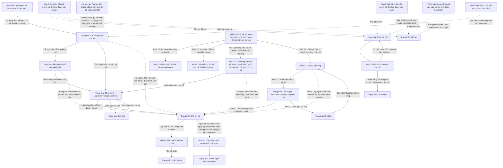
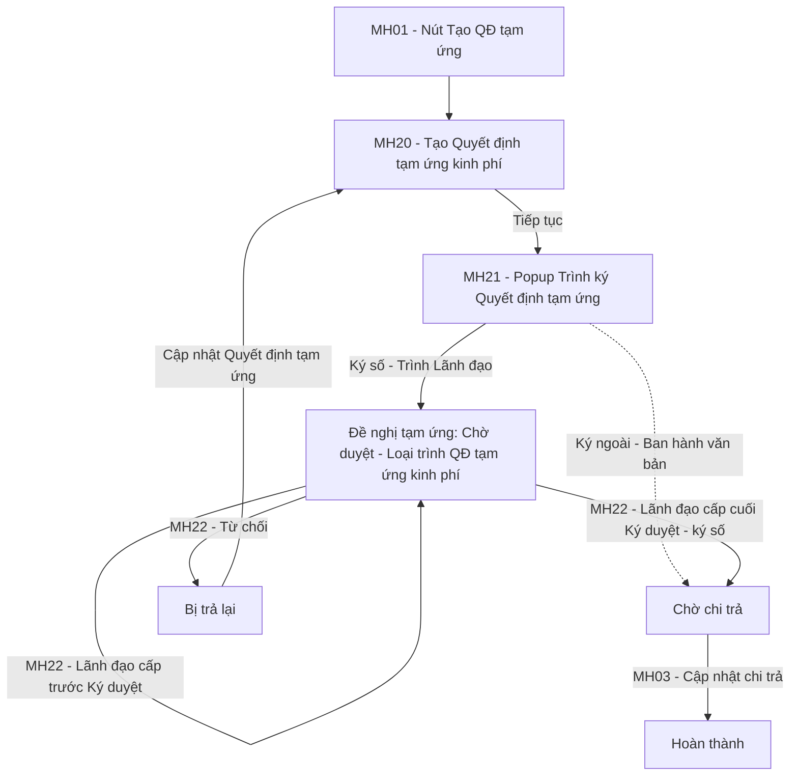

### 4.3.3. Dành cho Cán bộ Công tác bồi thường nhà nước

#### 4.3.3.2. Tạm ứng kinh phí bồi thường/Chi trả tiền bồi thường

##### 4.3.3.2.1. Mục đích
Quản lý toàn diện vòng đời của hồ sơ kinh phí bồi thường nhà nước và tạm ứng kinh phí nhằm chuẩn hóa quy trình lập tờ trình, phê duyệt ngân sách, giải ngân chi trả thực tế một lần duy nhất và theo dõi xử lý nghĩa vụ tài chính sau bồi thường, bao gồm:
- Menu `Kinh phí` gồm 02 menu con `Tạm ứng kinh phí`, `Chi trả tiền bồi thường`; mỗi menu con chỉ hiển thị bản ghi của menu, xem [Quy tắc menu Kinh phí - Tạm ứng kinh phí bồi thường/Chi trả tiền bồi thường - Công tác bồi thường nhà nước (Website Quản trị)](#kp-menu).
- Danh sách của mỗi menu con chia 02 tab `Chờ xử lý` / `Đã xử lý` theo người dùng đang đăng nhập (vai trò Cán bộ xử lý / Lãnh đạo), xem [Quy tắc 02 tab Chờ xử lý / Đã xử lý - Tạm ứng kinh phí bồi thường/Chi trả tiền bồi thường - Công tác bồi thường nhà nước (Website Quản trị)](#kp-tab-xu-ly).
- Quyết định tạm ứng kinh phí (Mẫu 07/BTNN), Thông báo chi trả tiền bồi thường (Mẫu số 32/BTNN): Cán bộ chọn Hình thức ký `Ký số trên hệ thống` hoặc `Ký ngoài`, xem [Quy tắc Hình thức ký - Tạm ứng kinh phí bồi thường/Chi trả tiền bồi thường - Công tác bồi thường nhà nước (Website Quản trị)](#kp-hinh-thuc-ky).
- Tra cứu và quản lý danh sách đề xuất tạm ứng kinh phí, đề nghị cấp kinh phí bồi thường theo phân trang, hỗ trợ tìm kiếm đa tiêu chí theo mã đề xuất, mã vụ việc, trạng thái và khoảng thời gian.
- Cảnh báo tự động các khoản chi quá hạn 03 năm kể từ ngày người yêu cầu nhận thông báo chi trả mà không đến nhận tiền, kịp thời kích hoạt luồng thủ tục trả lại ngân sách nhà nước theo đúng quy định pháp luật.
- Bản ghi kinh phí chỉ phát sinh theo luồng: Loại `Tạm ứng kinh phí` tạo tại Tạo QĐ tạm ứng; Loại `Chi trả tiền bồi thường` tạo tự động khi Quyết định giải quyết bồi thường được ban hành, khi vụ việc tại Tòa án chuyển `Đã có bản án/QĐ`, hoặc tại Tạo thông báo chi trả; không có trạng thái `Chờ lập đề nghị`.
- Tiếp nhận tự động 01 bản ghi Loại `Chi trả tiền bồi thường` ở trạng thái `Chờ thông báo chi trả` khi Quyết định giải quyết bồi thường được cập nhật `Có hiệu lực` tại Module Quyết định giải quyết bồi thường; Tạo thông báo chi trả từ Quyết định giải quyết bồi thường `Có hiệu lực`; Trình ký Thông báo chi trả tiền bồi thường (Mẫu số 32/BTNN), Đề nghị cấp bổ sung kinh phí, Lãnh đạo Ký duyệt / Từ chối, Cập nhật chi trả, xem [Luồng Chi trả tiền bồi thường - Tạm ứng kinh phí bồi thường/Chi trả tiền bồi thường - Công tác bồi thường nhà nước (Website Quản trị)](#kp-chi-tra-tien-bt).
- Tiếp nhận tự động 01 bản ghi Loại `Chi trả tiền bồi thường` ở trạng thái `Chờ thông báo chi trả` khi vụ việc có yêu cầu bồi thường thiệt hại bằng tiền tại [Theo dõi vụ việc tại Tòa án - Giải quyết bồi thường - Bồi thường nhà nước (Website Quản trị)](SRS_BTNN_TheoDoiVuViecToaAn.md) chuyển trạng thái `Đã có bản án/QĐ`; xử lý tiếp theo [Luồng Chi trả tiền bồi thường - Tạm ứng kinh phí bồi thường/Chi trả tiền bồi thường - Công tác bồi thường nhà nước (Website Quản trị)](#kp-chi-tra-tien-bt).
- Tạo Quyết định tạm ứng kinh phí (Mẫu 07/BTNN) từ vụ việc đang giải quyết; Trình ký / Ban hành; Lãnh đạo Ký duyệt / Từ chối; sau khi ban hành, xử lý tiếp như Đề nghị tạm ứng, xem [Luồng Tạo Quyết định tạm ứng kinh phí - Tạm ứng kinh phí bồi thường/Chi trả tiền bồi thường - Công tác bồi thường nhà nước (Website Quản trị)](#kp-qd-tam-ung).
- Xử lý liên thông khi Quyết định giải quyết bồi thường bị hủy hoặc bị sửa chữa, bổ sung: Tự động chuyển các bản ghi kinh phí liên quan sang trạng thái `Đã hủy` hoặc `Chờ thu hồi`, hoặc đưa bản ghi `Chi trả tiền bồi thường` về `Chờ thông báo chi trả` để lập lại Thông báo chi trả theo nội dung đã điều chỉnh; lưu đầy đủ căn cứ để đối chiếu.
- Xử lý liên thông khi vụ việc bị Đình chỉ giải quyết hoặc Dừng giải quyết: bản ghi chưa chi tự chuyển `Đã hủy`, bản ghi đã chi chuyển `Chờ thu hồi`, xem [Quy tắc liên thông khi vụ việc bị Đình chỉ giải quyết - Tạm ứng kinh phí bồi thường/Chi trả tiền bồi thường - Công tác bồi thường nhà nước (Website Quản trị)](#kp-dinh-chi).
- Cập nhật thu hồi kinh phí đã chi đối với các khoản chuyển sang trạng thái `Chờ thu hồi`, áp dụng cho cả 02 menu con `Tạm ứng kinh phí` và `Chi trả tiền bồi thường` (Số tiền, Ngày thu hồi, Hình thức nộp trả, Diễn giải); hệ thống tự tính Số tiền phải thu hồi theo căn cứ thu hồi; cho phép lưu nhiều lần thu hồi, mỗi lần lưu thêm 01 dòng và cộng dồn lũy kế, bản ghi giữ `Chờ thu hồi`; khi lũy kế bằng Số tiền phải thu hồi, Cán bộ xử lý bấm `Hoàn thành thu hồi` để chuyển `Đã thu hồi`.
- **Định nghĩa "bản ghi có hiệu lực"** dùng cho quy tắc kiểm tra trùng lặp: gồm các trạng thái `Chờ thông báo chi trả`, `Đề nghị cấp bổ sung kinh phí`, `Chờ duyệt`, `Chờ chi trả`, `Chờ thu hồi`, `Hoàn thành`, `Trả lại ngân sách nhà nước`. Các trạng thái `Bị trả lại`, `Đã hủy` và `Đã thu hồi` không còn hiệu lực.
- Xét duyệt tờ trình kinh phí: Cho phép phê duyệt hoặc từ chối cấp phát kinh phí kèm ý kiến chỉ đạo.
- Cập nhật chi trả: Ghi nhận kết quả chi trả thực tế 1 lần duy nhất (qua chuyển khoản ngân hàng hoặc chi tiền mặt), số tiền mặc định bằng 100% số tiền đã duyệt, cho phép điều chỉnh nhưng không vượt số tiền đã duyệt; hoàn thành hồ sơ kinh phí; dùng chung 01 màn hình cho cả 02 menu con.
- Thông tin thông báo chi trả tiền bồi thường và hạn nhận tiền bồi thường: chỉ với Loại `Chi trả tiền bồi thường`, sau khi Thông báo chi trả tiền bồi thường đã ký; Cán bộ nhập 01 lần Số thông báo, Ngày người yêu cầu nhận thông báo, Ghi chú, Tài liệu đính kèm khi bản ghi `Chờ chi trả` tại màn hình chi tiết hoặc màn hình Cập nhật chi trả (không thuộc luồng ký duyệt, ban hành Thông báo chi trả), không sửa sau khi lưu; hệ thống tính Hạn nhận tiền bồi thường = Ngày người yêu cầu nhận thông báo + 03 năm.
- Lập và hoàn thành thủ tục Trả lại ngân sách nhà nước đối với các khoản kinh phí bồi thường quá hạn 03 năm không có người đến nhận, trả lại ngân sách nhà nước 100% toàn bộ khoản kinh phí vào ngân sách nhà nước.

a. Phân quyền
Hệ thống phân quyền thao tác theo các quyền nghiệp vụ được cấp:
- **Xem**: Tra cứu danh sách đề xuất kinh phí, xem chi tiết đề nghị kinh phí/tạm ứng (thông qua click dòng dữ liệu), xem thông tin theo dõi hạn 3 năm, xem và tải tài liệu/chứng từ liên quan.
- **Tạo QĐ tạm ứng**: Tạo, cập nhật (khi `Bị trả lại`) và trình ký / ban hành Quyết định tạm ứng kinh phí.
- **Tạo thông báo chi trả**: Tạo, trình ký / ban hành Thông báo chi trả tiền bồi thường (Mẫu số 32/BTNN) từ Quyết định giải quyết bồi thường đã ban hành.
- **Sửa**: Cập nhật Quyết định tạm ứng ở trạng thái `Bị trả lại`.
- **Ký duyệt**: Ký duyệt Quyết định tạm ứng kinh phí, Thông báo chi trả tiền bồi thường `Chờ duyệt`.
- **Từ chối**: Từ chối phê duyệt tờ trình đề xuất cấp kinh phí kèm nội dung lý do chỉ đạo.
- **Cập nhật chi trả**: Ghi nhận kết quả chi trả thực tế 1 lần duy nhất kèm chứng từ giải ngân, áp dụng cho cả 02 menu con; bản ghi `Chờ thu hồi` của cả 02 menu con: Cập nhật thu hồi (cùng quyền, cùng nút).
- **Cập nhật thông báo**: Nhập 01 lần thông tin thông báo nhận tiền tại Khối Thông tin thông báo chi trả tiền bồi thường và hạn nhận tiền bồi thường (MH10, MH03) của bản ghi `Chi trả tiền bồi thường` ở trạng thái `Chờ chi trả`.
- **Trả lại ngân sách nhà nước**: Lập hồ sơ và xác nhận hoàn thành thủ tục trả lại ngân sách nhà nước đối với các khoản kinh phí quá hạn 03 năm không có người đến nhận tiền.

b. Quy tắc menu Kinh phí

| Menu con | Bản ghi hiển thị | Tiêu đề màn hình | Nút tạo mới | Thao tác chỉ có tại menu con | Click dòng dữ liệu |
| :--- | :--- | :--- | :--- | :--- | :--- |
| Tạm ứng kinh phí | Bản ghi tạo tại `Tạo QĐ tạm ứng` | `Tạm ứng kinh phí` | `Tạo QĐ tạm ứng` | Cập nhật Quyết định tạm ứng | Mở [MH23 - Màn hình Chi tiết Tạm ứng kinh phí - Tạm ứng kinh phí bồi thường/Chi trả tiền bồi thường - Công tác bồi thường nhà nước (Website Quản trị)](#kp-mh23) |
| Chi trả tiền bồi thường | Bản ghi tiếp nhận tự động khi Quyết định giải quyết bồi thường được ban hành, khi vụ việc tại Tòa án chuyển `Đã có bản án/QĐ`, hoặc tạo tại `Tạo thông báo chi trả` | `Chi trả tiền bồi thường` | `Tạo thông báo chi trả` | Trình thông báo chi trả, Đề nghị cấp bổ sung kinh phí; cột `Hạn nhận/Trả lại ngân sách nhà nước` | Mở [MH10 - Màn hình Chi tiết chi trả tiền bồi thường - Tạm ứng kinh phí bồi thường/Chi trả tiền bồi thường - Công tác bồi thường nhà nước (Website Quản trị)](#kp-mh10) |

- Menu `Kinh phí` thuộc nhóm menu `Bồi thường nhà nước`, đặt sau nhóm menu `Giải quyết bồi thường`; gồm 02 menu con theo thứ tự: `Tạm ứng kinh phí`, `Chi trả tiền bồi thường`.
- 02 menu con dùng chung MH01; mỗi menu con chỉ hiển thị bản ghi của menu con, không có cột, bộ lọc `Loại kinh phí`.
- Mỗi menu con gồm 02 tab `Chờ xử lý` / `Đã xử lý` theo [Quy tắc 02 tab Chờ xử lý / Đã xử lý - Tạm ứng kinh phí bồi thường/Chi trả tiền bồi thường - Công tác bồi thường nhà nước (Website Quản trị)](#kp-tab-xu-ly).
- Badge menu con: số bản ghi tab `Chờ xử lý` của menu con theo người dùng đang đăng nhập; badge menu `Kinh phí`: tổng badge 02 menu con; bằng 0 thì ẩn.
- Mở bản ghi kinh phí từ phân hệ khác hoặc theo đường dẫn màn hình chi tiết: mở menu con theo bản ghi, đánh dấu menu con tương ứng tại menu trái.

c. Quy tắc 02 tab Chờ xử lý / Đã xử lý

| Vai trò | Tab `Chờ xử lý` | Tab `Đã xử lý` |
| :--- | :--- | :--- |
| Cán bộ xử lý | Đề nghị ở trạng thái: `Chờ duyệt`, `Chờ chi trả`, `Bị trả lại`, `Chờ thu hồi`, `Chờ thông báo chi trả`, `Đề nghị cấp bổ sung kinh phí` | Đề nghị ở trạng thái: `Hoàn thành`, `Trả lại ngân sách nhà nước`, `Đã thu hồi`, `Đã hủy` |
| Lãnh đạo | Đề nghị `Chờ duyệt` (cần Lãnh đạo Ký duyệt / Từ chối); bản ghi `Chi trả tiền bồi thường` chỉ hiển thị với Lãnh đạo được giao tại cấp ký duyệt hiện hành | Đề nghị đã qua bước Ký duyệt / Từ chối: `Chờ chi trả`, `Bị trả lại`, `Chờ thu hồi`, `Hoàn thành`, `Trả lại ngân sách nhà nước`, `Đã thu hồi`; `Đã hủy` khi đề nghị đã được Ký duyệt trước khi hủy; bản ghi `Chi trả tiền bồi thường` mà Lãnh đạo đã Ký duyệt / Từ chối |

- Đổi tab thì danh sách về Trang 1, bộ lọc `Trạng thái` đặt lại `Tất cả`.
- Trường `Trạng thái` của bộ lọc chỉ gồm các trạng thái của tab đang chọn theo vai trò.
- Thao tác trên từng bản ghi theo trạng thái như mô tả tại cột `Thao tác`.
- Tab `Đã xử lý` chỉ xem: không có cột `Thao tác`, không có nút `Tạo thông báo chi trả`, `Tạo QĐ tạm ứng`, không có Lọc nhanh.
- Vai trò Lãnh đạo: không có nút `Tạo thông báo chi trả`, `Tạo QĐ tạm ứng`, không có Lọc nhanh.

- **Ký duyệt cấp kinh phí**:
  + Đề nghị tạm ứng, Đề nghị cấp kinh phí bồi thường `Chờ duyệt` do Thủ trưởng cơ quan giải quyết bồi thường của vụ việc Ký duyệt / Từ chối: Nhóm lãnh đạo của đơn vị cử người giải quyết, theo [Trình Lãnh đạo phê duyệt nhiều cấp - Giải quyết yêu cầu bồi thường - Công tác bồi thường nhà nước (Website Quản trị)](SRS_BTNN_GiaiQuyetBT_GiaiQuyet_YCBT.md#gq-trinh-duyet).
  + Lãnh đạo Ký duyệt / Từ chối tại tab `Chờ xử lý` của danh sách hoặc màn hình chi tiết (vai trò Lãnh đạo).
  + Nhãn nút `Ký duyệt`; ký số hay không ký số khi Lãnh đạo Ký duyệt: Thực hiện theo luồng đã cấu hình tương ứng tại [Cấu hình luồng xử lý - Cấu hình luồng xử lý - Quản trị hệ thống (Website Quản trị)](../01_Quan_tri_he_thong/Cau_hinh_luong_xu_ly.md).
  + Loại trình của phân hệ chỉ gồm: `Thông báo chi trả` (Thông báo chi trả tiền bồi thường - Mẫu số 32/BTNN), `QĐ tạm ứng kinh phí` (Quyết định tạm ứng kinh phí - Mẫu số 07/BTNN).
  + Thông báo chi trả tiền bồi thường, Quyết định tạm ứng kinh phí trình nhiều cấp: Ký duyệt / Từ chối theo [MH07 - Màn hình Ký duyệt / Từ chối thông báo chi trả - Tạm ứng kinh phí bồi thường/Chi trả tiền bồi thường - Công tác bồi thường nhà nước (Website Quản trị)](#kp-mh07) và [MH22 - Màn hình Ký duyệt / Từ chối Quyết định tạm ứng - Tạm ứng kinh phí bồi thường/Chi trả tiền bồi thường - Công tác bồi thường nhà nước (Website Quản trị)](#kp-mh22); quy tắc chung theo [Quy tắc trình ký - phê duyệt - Xác định cơ quan giải quyết bồi thường - Công tác bồi thường nhà nước (Website Quản trị)](SRS_BTNN_GiaiQuyetBT__Xac%20định%20cơ%20quan%20GQBT.md#xd-quy-tac-phe-duyet).

d. Quy tắc Hình thức ký

- Áp dụng cho Quyết định tạm ứng kinh phí (MH21) và Thông báo chi trả tiền bồi thường (MH06), cùng cách như trình ký Quyết định giải quyết bồi thường, Xác định cơ quan giải quyết bồi thường.
- `Hình thức ký` gồm `Ký số trên hệ thống` (mặc định) và `Ký ngoài`.
- `Ký số trên hệ thống`: Trình Lãnh đạo; Lãnh đạo cấp cuối Ký duyệt thì lưu văn bản đã ký kèm người ký, thời điểm ký; bản ghi chuyển `Chờ chi trả`.
- `Ký ngoài`:
  + Trên cùng popup trình ký, Cán bộ tải lên tệp PDF đã ký & đóng dấu, bấm `Ban hành văn bản` và xác nhận; không trình Lãnh đạo.
  + Bản ghi chuyển `Chờ chi trả`, lưu tệp đã ký; không có bước đính kèm văn bản đã ký riêng sau khi ban hành.
  + Bản ghi phát sinh trước đây có Hình thức ký `Ký ngoài`: tệp đã ký lưu cùng bản ghi như trên.

e. Quy tắc liên thông khi vụ việc bị Đình chỉ giải quyết

| STT | Quy tắc | Mô tả |
| :--- | :--- | :--- |
| 1 | Thời điểm áp dụng | - Quyết định đình chỉ giải quyết bồi thường được ban hành theo [Popup Trình ký Quyết định Đình chỉ giải quyết yêu cầu bồi thường - Giải quyết yêu cầu bồi thường - Công tác bồi thường nhà nước (Website Quản trị)](SRS_BTNN_GiaiQuyetBT_GiaiQuyet_YCBT.md#gq-popup-dinh-chi): + Ký số trên hệ thống: Lãnh đạo cấp cuối Ký duyệt. + Ký ngoài: Cán bộ Ban hành văn bản. - Áp dụng mọi trạng thái vụ việc được Đình chỉ giải quyết, gồm cả `Chờ chi trả`, `Hoàn thành`; quy tắc 2 - 7 không phân biệt trạng thái trước của vụ việc. - Không chặn đình chỉ vì lý do kinh phí. - Thông báo dừng giải quyết yêu cầu bồi thường được ban hành theo [Popup Trình ký Thông báo dừng giải quyết yêu cầu bồi thường - Giải quyết yêu cầu bồi thường - Công tác bồi thường nhà nước (Website Quản trị)](SRS_BTNN_GiaiQuyetBT_GiaiQuyet_YCBT.md#gq-popup-dung-giai-quyet) (cấp cuối Ký duyệt hoặc Ký ngoài ban hành): áp dụng toàn bộ quy tắc 2 - 7 như vụ việc bị Đình chỉ giải quyết. |
| 2 | Phạm vi | - Các bản ghi kinh phí có `Mã hồ sơ GQBT` là hồ sơ bị đình chỉ hoặc dừng giải quyết. - Bản ghi `Đã hủy`, `Đã thu hồi`, `Chờ thu hồi`, `Trả lại ngân sách nhà nước`: giữ nguyên. |
| 3 | Bản ghi chưa chi | - Điều kiện: bản ghi chưa chi đồng nào, gồm `Chờ thông báo chi trả`, `Đề nghị cấp bổ sung kinh phí`, `Chờ duyệt`, `Bị trả lại`, `Chờ chi trả` chưa Cập nhật chi trả. - Hệ thống tự chuyển `Đã hủy`. - Phiếu trình đang `Chờ duyệt` (Loại trình `Thông báo chi trả`, `QĐ tạm ứng kinh phí`) bị hủy theo; bản ghi không còn tại tab `Chờ xử lý` của Lãnh đạo, badge số lượng cập nhật lại. |
| 4 | Bản ghi đã chi | - Điều kiện: bản ghi `Hoàn thành` hoặc có Số tiền chi trả đã cập nhật lớn hơn 0. - Xử lý theo `Thu hồi kinh phí bồi thường đã chi` của Quyết định đình chỉ / Thông báo dừng giải quyết: + `Thu hồi`: Hệ thống tự chuyển `Chờ thu hồi`. + `Không thu hồi`: giữ nguyên trạng thái hiện có, không hiển thị dòng phụ; ghi Lịch sử xử lý theo quy tắc 6. - Văn bản không có lựa chọn (dữ liệu trước khi bổ sung trường): xử lý như `Thu hồi`. |
| 5 | Lưu căn cứ | - Lưu trên bản ghi kinh phí: Lý do `Vụ việc bị đình chỉ giải quyết theo Quyết định đình chỉ giải quyết bồi thường`, Thời điểm chuyển trạng thái, Trạng thái trước, Số quyết định, Ngày quyết định, File quyết định, Mã vụ việc, Mã hồ sơ GQBT. - Dừng giải quyết: Lý do `Dừng giải quyết bồi thường`; Số văn bản, Ngày văn bản, File văn bản theo Thông báo dừng giải quyết yêu cầu bồi thường. - Ký ngoài không nhập Số, Ngày quyết định: lưu trống, hiển thị `-`. - Bản ghi đã chi giữ nguyên do `Không thu hồi`: lưu căn cứ kèm Lý do không thu hồi để không áp dụng lại liên thông; không hiển thị khối `Căn cứ thay đổi trạng thái`. - Hiển thị tại khối `Căn cứ thay đổi trạng thái` của [MH10 - Màn hình Chi tiết chi trả tiền bồi thường - Tạm ứng kinh phí bồi thường/Chi trả tiền bồi thường - Công tác bồi thường nhà nước (Website Quản trị)](#kp-mh10) và [MH23 - Màn hình Chi tiết Tạm ứng kinh phí - Tạm ứng kinh phí bồi thường/Chi trả tiền bồi thường - Công tác bồi thường nhà nước (Website Quản trị)](#kp-mh23). |
| 6 | Lịch sử xử lý | - Ghi 01 dòng vào Lịch sử xử lý của bản ghi kinh phí; Người thực hiện `Hệ thống`. - Thao tác: + `Hủy do đình chỉ giải quyết` + `Chuyển Chờ thu hồi do đình chỉ giải quyết` + `Không thu hồi kinh phí bồi thường đã chi` + `Hủy do dừng giải quyết bồi thường` + `Chuyển Chờ thu hồi do dừng giải quyết bồi thường` - Nội dung: Số, Ngày quyết định (nếu có), Mã vụ việc, Mã hồ sơ GQBT, Trạng thái trước, Số tiền đã chi (bản ghi đã chi), phiếu trình bị hủy (nếu có). - Thao tác `Không thu hồi kinh phí bồi thường đã chi`: nội dung bắt đầu `Không thu hồi do đình chỉ giải quyết bồi thường. Lý do: [Lý do không thu hồi].` (Dừng giải quyết: `Không thu hồi do dừng giải quyết bồi thường. Lý do: [Lý do không thu hồi].`), tiếp theo Số, Ngày quyết định (nếu có), Mã vụ việc, Mã hồ sơ GQBT, trạng thái giữ nguyên. |
| 7 | Hiển thị | - MH01: dòng phụ `Do đình chỉ giải quyết` dưới badge `Chờ thu hồi`, `Đã hủy`. - MH10, MH23: dòng phụ `Do đình chỉ giải quyết` dưới nhãn `Trạng thái`. - Dừng giải quyết: dòng phụ `Do dừng giải quyết bồi thường`. - Tệp văn bản của bản ghi `Đã hủy`: theo trạng thái trước khi hủy. |

f. Điều kiện thực hiện
- Người dùng đã đăng nhập vào hệ thống thành công.
- Người dùng được phân quyền truy cập chức năng "Quản lý kinh phí bồi thường".

##### 4.3.3.2.2. Sơ đồ luồng nghiệp vụ theo giao diện

---

##### 4.3.3.2.3. MH01 - Màn hình Danh sách Cấp kinh phí

###### 4.3.3.2.3.1. Màn hình

###### 4.3.3.2.3.2. Mô tả thông tin trên màn hình

| Trường thông tin | Kiểu dữ liệu | Bắt buộc | Mặc định | Mô tả |
| :--- | :--- | :--- | :--- | :--- |
| **Tiêu đề màn hình** | - | - | Theo menu con | Control UI: Label. - Menu `Tạm ứng kinh phí`: `Tạm ứng kinh phí`. - Menu `Chi trả tiền bồi thường`: `Chi trả tiền bồi thường`. |
| **Tab danh sách** | Tab | - | `Chờ xử lý` | Control UI: Tab. Gồm: + Chờ xử lý + Đã xử lý - Tab `Chờ xử lý` kèm số bản ghi của menu con đang chọn; số này là badge của menu con và cộng vào badge menu `Kinh phí` theo [Quy tắc menu Kinh phí - Tạm ứng kinh phí bồi thường/Chi trả tiền bồi thường - Công tác bồi thường nhà nước (Website Quản trị)](#kp-menu). - Bản ghi của từng tab theo vai trò người dùng đang đăng nhập: [Quy tắc 02 tab Chờ xử lý / Đã xử lý - Tạm ứng kinh phí bồi thường/Chi trả tiền bồi thường - Công tác bồi thường nhà nước (Website Quản trị)](#kp-tab-xu-ly). |
| **Khối Bộ lọc tìm kiếm** | Section | - | Mở rộng | Control UI: Section. - Nút `Thu gọn`/`Mở rộng`; thu gọn vẫn giữ giá trị lọc đã nhập. |
| Mã kinh phí | String(50) | Không | Trống | Control UI: Textbox. - Tìm gần đúng, không phân biệt hoa thường. - `Placeholder: Nhập mã kinh phí...` |
| Mã hồ sơ GQBT | String(50) | Không | Trống | Control UI: Textbox. - Tìm gần đúng theo Mã hồ sơ giải quyết bồi thường, không phân biệt hoa thường. - `Placeholder: Nhập mã hồ sơ GQBT...` |
| Trạng thái | Enum(String(50)) | Không | `Tất cả` | Control UI: Dropdown/Select. - Gồm `Tất cả` và các trạng thái của tab đang chọn theo vai trò ([Quy tắc 02 tab Chờ xử lý / Đã xử lý - Tạm ứng kinh phí bồi thường/Chi trả tiền bồi thường - Công tác bồi thường nhà nước (Website Quản trị)](#kp-tab-xu-ly)). |
| Tên cá nhân/Tổ chức yêu cầu | String(255) | Không | Trống | Control UI: Textbox. - Tìm gần đúng. - `Placeholder: Nhập tên cá nhân/tổ chức yêu cầu...` |
| Từ ngày | Date | Không | Ngày đầu tháng hiện tại | Control UI: Datepicker. - Định dạng `dd/mm/yyyy`. - Lọc theo Ngày tạo bản ghi. - `Placeholder: dd/mm/yyyy` |
| Đến ngày | Date | Không | Ngày hiện tại | Control UI: Datepicker. - Định dạng `dd/mm/yyyy`. - Lọc theo Ngày tạo bản ghi. - Không nhỏ hơn `Từ ngày`. - `Placeholder: dd/mm/yyyy` |
| Cán bộ xử lý | String(255) | Không | Trống | Control UI: Textbox. - Tìm gần đúng. - `Placeholder: Nhập tên cán bộ xử lý...` |
| **Cảnh báo khoản chi quá hạn** | Alert Banner | - | Ẩn | Control UI: Alert Banner. - Chỉ hiển thị khi có ít nhất 01 bản ghi `Chờ chi trả` đã có thông báo và quá 03 năm kể từ Ngày người yêu cầu nhận thông báo mà chưa chi trả. - Tiêu đề: `Cảnh báo khoản chi đã quá hạn 3 năm`. - Nội dung: `[X] khoản Chờ chi trả đủ điều kiện xử lý trả lại ngân sách nhà nước, tổng số tiền [Y] VNĐ (Theo Điều 45 Luật TNBTCNN).` - [X]: số bản ghi thỏa mãn điều kiện hiển thị. - [Y]: tổng số tiền chưa chi trả của [X] bản ghi, phân cách hàng nghìn bằng dấu chấm. - Kèm nút `Xem khoản cần xử lý`. - Tính theo bản ghi của menu con đang chọn. |
| **Lọc nhanh** | Button group | - | `Tất cả` | Control UI: Button group, mỗi nút kèm số bản ghi. Gồm: + Tất cả + Chờ duyệt + Bị trả lại - Số bản ghi tính theo menu con đang chọn. - Chỉ hiển thị tại tab `Chờ xử lý`, vai trò Cán bộ xử lý. |
| **Bảng danh sách đề xuất kinh phí** | List(Object) | - | 20 bản ghi/trang | Control UI: Data grid. - Chỉ gồm bản ghi của menu con đang chọn. - Mở màn hình: tải Trang 1. - Click tiêu đề cột STT, Mã kinh phí, Mã hồ sơ GQBT, Tên cá nhân/Tổ chức yêu cầu, Tổng số tiền duyệt chi, Ngày trình, Trạng thái: sắp xếp tăng/giảm. - Xem chi tiết: click dòng dữ liệu. - Không có dữ liệu: 01 dòng thông báo [MSG-INF-SYS-001]. |
| STT | - | - | - | Control UI: Label. - Tăng dần theo phân trang. |
| Mã kinh phí | - | - | - | Control UI: Label. - Theo dữ liệu bản ghi. |
| Mã hồ sơ GQBT | - | - | - | Control UI: HyperLink. - Theo dữ liệu bản ghi. - Click: mở màn hình Chi tiết hồ sơ tại [Giải quyết yêu cầu bồi thường - Giải quyết yêu cầu bồi thường - Bồi thường nhà nước (Website Quản trị)](SRS_BTNN_GiaiQuyetBT_GiaiQuyet_YCBT.md); hồ sơ thuộc Theo dõi vụ việc tại Tòa án: mở Xem chi tiết tại [Theo dõi vụ việc tại Tòa án - Giải quyết bồi thường - Bồi thường nhà nước (Website Quản trị)](SRS_BTNN_TheoDoiVuViecToaAn.md). |
| Tên cá nhân/Tổ chức yêu cầu | - | - | - | Control UI: Label. - Theo dữ liệu bản ghi. |
| Tổng số tiền duyệt chi | - | - | - | Control UI: Label. - Menu `Tạm ứng kinh phí`: Số tiền tạm ứng kinh phí của Quyết định tạm ứng. - Menu `Chi trả tiền bồi thường`: Số tiền chi trả của Thông báo chi trả. - Căn phải, phân cách hàng nghìn bằng dấu chấm. |
| Cán bộ xử lý | - | - | - | Control UI: Label. - Cán bộ xử lý gần nhất của bản ghi. - Chưa có: `-`. |
| Ngày trình | - | - | - | Control UI: Label. - Ngày Trình ký gần nhất (Ký số) hoặc ngày Ban hành văn bản (Ký ngoài). - Chưa trình: `-`. - Định dạng `dd/mm/yyyy`. |
| Hạn nhận/Trả lại ngân sách nhà nước | - | - | - | Control UI: Label. - Chỉ hiển thị tại menu `Chi trả tiền bồi thường`. - Chưa có dữ liệu: `-`. - Đã trả lại ngân sách nhà nước: `Đã trả lại ngân sách nhà nước [Ngày trả lại ngân sách nhà nước]`; dòng phụ Số tiền trả lại ngân sách nhà nước. - Chưa trả lại ngân sách nhà nước, đã có thông báo: Hạn nhận = Ngày người yêu cầu nhận thông báo + 03 năm, định dạng `dd/mm/yyyy`. - Bản ghi `Chờ chi trả`: dòng phụ `Còn X ngày` hoặc `Quá hạn X ngày`; quá hạn 03 năm thêm `Đủ điều kiện trả lại ngân sách nhà nước`. |
| Trạng thái | - | - | - | Control UI: Badge. - Theo dữ liệu bản ghi. - Bản ghi `Chờ duyệt`, `Bị trả lại`: dòng phụ Loại trình. - Loại trình gồm: + QĐ tạm ứng kinh phí + Thông báo chi trả - Bản ghi `Chờ thu hồi`, `Đã hủy` do vụ việc bị Đình chỉ giải quyết: dòng phụ `Do đình chỉ giải quyết`. - Bản ghi `Chờ thu hồi`, `Đã hủy` do vụ việc bị Dừng giải quyết: dòng phụ `Do dừng giải quyết bồi thường`. - Bản ghi `Chờ chi trả` đã quá hạn 03 năm kể từ ngày thông báo gần nhất mà chưa chi trả: thêm nhãn `Quá hạn 3 năm` dưới badge. |
| Thao tác | - | - | - | Control UI: Icon button group. - Chỉ có tại tab `Chờ xử lý`. - Mọi dòng hiển thị cùng 01 bộ thao tác theo quyền của người dùng, cùng thứ tự, cùng vị trí. - Thao tác không được phép ở trạng thái hiện tại: hiển thị mờ, không cho phép click; di chuột hiển thị tooltip `[Tên thao tác]: [Điều kiện được phép]`. - Thao tác được phép: di chuột hiển thị tooltip tên thao tác. - Bộ thao tác đầy đủ, theo thứ tự: + Ký duyệt: quyền Ký duyệt; bản ghi `Chờ duyệt` được giao cho người dùng tại cấp ký duyệt hiện hành + Từ chối: quyền Từ chối; điều kiện như Ký duyệt + Cập nhật Quyết định tạm ứng (chỉ menu `Tạm ứng kinh phí`): quyền Sửa; bản ghi `Bị trả lại` + Trình thông báo chi trả (chỉ menu `Chi trả tiền bồi thường`): quyền Tạo thông báo chi trả; bản ghi `Chờ thông báo chi trả`, `Đề nghị cấp bổ sung kinh phí`, `Bị trả lại` + Đề nghị cấp bổ sung kinh phí (chỉ menu `Chi trả tiền bồi thường`): quyền Tạo thông báo chi trả; bản ghi `Chờ thông báo chi trả` + Cập nhật chi trả / Cập nhật thu hồi: quyền Cập nhật chi trả; 01 nút, nhãn theo trạng thái: bản ghi `Chờ chi trả` còn trong hạn 03 năm (cả 02 menu con) nhãn `Cập nhật chi trả`; bản ghi `Chờ thu hồi` nhãn `Cập nhật thu hồi`; trạng thái khác hiển thị mờ, nhãn `Cập nhật chi trả` + Trả lại ngân sách nhà nước: quyền Trả lại ngân sách nhà nước; bản ghi `Chờ chi trả` đã quá hạn 03 năm kể từ ngày người yêu cầu nhận thông báo mà chưa chi trả - Người dùng không có quyền của thao tác: không hiển thị thao tác đó. - Vai trò Lãnh đạo: Ký duyệt, Từ chối. - Vai trò Cán bộ xử lý: các thao tác còn lại của menu con đang chọn, không có Ký duyệt, Từ chối. - Cột cố định bên phải lưới khi cuộn ngang. |

###### 4.3.3.2.3.3. Chức năng trên màn hình

| STT | Tên chức năng | Định dạng | Mô tả |
| :--- | :--- | :--- | :--- |
| 1 | Chuyển tab Chờ xử lý / Đã xử lý | Tab | Hiển thị bản ghi của menu con đang chọn thuộc tab theo vai trò người dùng đang đăng nhập; đưa danh sách về Trang 1, đặt lại bộ lọc `Trạng thái` về `Tất cả`. |
| 2 | Xóa bộ lọc | Button | Đưa bộ lọc về giá trị mặc định và tải lại danh sách. |
| 3 | Tìm kiếm | Button | - **TH1 - Khoảng ngày không hợp lệ** (`Từ ngày` lớn hơn `Đến ngày`): Hệ thống hiển thị [MSG-ERR-VAL-007], không tìm kiếm. - **TH2 - Hợp lệ**: Lọc danh sách theo các tiêu chí đã nhập, đưa về Trang 1. |
| 4 | Xem khoản cần xử lý | Button | Lọc danh sách các bản ghi `Chờ chi trả` đã quá hạn 03 năm kể từ ngày người yêu cầu nhận thông báo mà chưa chi trả, đưa về Trang 1. |
| 5 | Lọc nhanh | Button group | Lọc danh sách theo nút được chọn: + Tất cả: không lọc thêm + Chờ duyệt: bản ghi `Chờ duyệt` + Bị trả lại: bản ghi `Bị trả lại` |
| 6 | Tạo thông báo chi trả | Button | - Chỉ hiển thị tại menu `Chi trả tiền bồi thường`, vai trò Cán bộ xử lý, tab `Chờ xử lý`. - Mở [MH24 - Màn hình Tạo thông báo chi trả - Tạm ứng kinh phí bồi thường/Chi trả tiền bồi thường - Công tác bồi thường nhà nước (Website Quản trị)](#kp-mh24). |
| 7 | Tạo QĐ tạm ứng | Button | - Chỉ hiển thị tại menu `Tạm ứng kinh phí`, vai trò Cán bộ xử lý, tab `Chờ xử lý`. - Mở [MH20 - Màn hình Tạo Quyết định tạm ứng kinh phí - Tạm ứng kinh phí bồi thường/Chi trả tiền bồi thường - Công tác bồi thường nhà nước (Website Quản trị)](#kp-mh20) ở chế độ tạo mới. |
| 8 | Kết xuất Excel | Button | Kết xuất danh sách của menu con đang chọn theo điều kiện tìm kiếm hiện hành ra tệp Excel. |
| 9 | Click dòng dữ liệu | Row click | - Menu `Tạm ứng kinh phí`: mở [MH23 - Màn hình Chi tiết Tạm ứng kinh phí - Tạm ứng kinh phí bồi thường/Chi trả tiền bồi thường - Công tác bồi thường nhà nước (Website Quản trị)](#kp-mh23). - Menu `Chi trả tiền bồi thường`: mở [MH10 - Màn hình Chi tiết Chi trả tiền bồi thường - Tạm ứng kinh phí bồi thường/Chi trả tiền bồi thường - Công tác bồi thường nhà nước (Website Quản trị)](#kp-mh10). - Click icon thao tác hoặc `Mã hồ sơ GQBT`: thực hiện chức năng của icon/liên kết, không mở chi tiết. |
| 10 | Mã hồ sơ GQBT | HyperLink | Mở màn hình chi tiết hồ sơ theo mô tả cột `Mã hồ sơ GQBT`. |
| 11 | Ký duyệt | Icon button | - Bản ghi Loại trình `QĐ tạm ứng kinh phí`: mở [MH22 - Màn hình Ký duyệt / Từ chối Quyết định tạm ứng - Tạm ứng kinh phí bồi thường/Chi trả tiền bồi thường - Công tác bồi thường nhà nước (Website Quản trị)](#kp-mh22) với thao tác `Ký duyệt`. - Bản ghi Loại trình `Thông báo chi trả`: mở [MH07 - Màn hình Ký duyệt / Từ chối thông báo chi trả - Tạm ứng kinh phí bồi thường/Chi trả tiền bồi thường - Công tác bồi thường nhà nước (Website Quản trị)](#kp-mh07) với thao tác `Ký duyệt`. |
| 12 | Từ chối | Icon button | Mở MH22 hoặc MH07 như chức năng `Ký duyệt`, với thao tác `Từ chối`. |
| 13 | Trình thông báo chi trả | Icon button | - Chỉ có tại menu `Chi trả tiền bồi thường`. - Mở [MH06 - Popup Trình ký thông báo chi trả - Tạm ứng kinh phí bồi thường/Chi trả tiền bồi thường - Công tác bồi thường nhà nước (Website Quản trị)](#kp-mh06). |
| 14 | Đề nghị cấp bổ sung kinh phí | Icon button | - Chỉ có tại menu `Chi trả tiền bồi thường`. - Mở MH08 - Popup Đề nghị cấp bổ sung kinh phí. |
| 15 | Cập nhật Quyết định tạm ứng | Icon button | - Chỉ có tại menu `Tạm ứng kinh phí`. - Mở [MH20 - Màn hình Tạo Quyết định tạm ứng kinh phí - Tạm ứng kinh phí bồi thường/Chi trả tiền bồi thường - Công tác bồi thường nhà nước (Website Quản trị)](#kp-mh20) ở chế độ cập nhật. |
| 16 | Cập nhật chi trả / Cập nhật thu hồi | Icon button | - 01 nút, cùng vị trí; nhãn, tooltip theo trạng thái bản ghi. - Bản ghi `Chờ chi trả` (nhãn `Cập nhật chi trả`): mở [MH03 - Màn hình Cập nhật chi trả - Tạm ứng kinh phí bồi thường/Chi trả tiền bồi thường - Công tác bồi thường nhà nước (Website Quản trị)](#kp-mh03), áp dụng cho cả 02 menu con. - Bản ghi `Chờ thu hồi` (nhãn `Cập nhật thu hồi`), áp dụng cho cả 02 menu con: mở màn hình chi tiết của bản ghi ở Chế độ Cập nhật thu hồi theo [Khối Thu hồi kinh phí - MH23 - Màn hình Chi tiết Tạm ứng kinh phí - Tạm ứng kinh phí bồi thường/Chi trả tiền bồi thường - Công tác bồi thường nhà nước (Website Quản trị)](#kp-mh23-thu-hoi). |
| 17 | Trả lại ngân sách nhà nước | Icon button | Mở [MH04 - Màn hình Cập nhật trả lại ngân sách nhà nước - Tạm ứng kinh phí bồi thường/Chi trả tiền bồi thường - Công tác bồi thường nhà nước (Website Quản trị)](#kp-mh04), áp dụng cho cả 02 menu con. |

---

##### 4.3.3.2.4. MH03 - Màn hình Cập nhật chi trả

###### 4.3.3.2.4.1. Màn hình

- Mở từ thao tác `Cập nhật chi trả` tại MH01 hoặc Footer màn hình chi tiết, áp dụng cho cả 02 menu con; bản ghi `Chờ chi trả` (còn trong hạn hoặc đã quá hạn 03 năm kể từ ngày người yêu cầu nhận thông báo).
- Dạng màn hình thay vùng danh sách, cùng màn hình chi tiết của bản ghi:
  + Loại `Tạm ứng kinh phí`: các khối như [MH23 - Màn hình Chi tiết Tạm ứng kinh phí - Tạm ứng kinh phí bồi thường/Chi trả tiền bồi thường - Công tác bồi thường nhà nước (Website Quản trị)](#kp-mh23).
  + Loại `Chi trả tiền bồi thường`: các khối như [MH10 - Màn hình Chi tiết chi trả tiền bồi thường - Tạm ứng kinh phí bồi thường/Chi trả tiền bồi thường - Công tác bồi thường nhà nước (Website Quản trị)](#kp-mh10).
- Các khối của màn hình chi tiết: cùng nội dung, cùng điều kiện hiển thị; mặc định thu gọn; click tiêu đề khối để mở rộng/thu gọn.
- Loại `Chi trả tiền bồi thường`: [Khối Thông tin thông báo chi trả tiền bồi thường và hạn nhận tiền bồi thường - MH10 - Màn hình Chi tiết chi trả tiền bồi thường - Tạm ứng kinh phí bồi thường/Chi trả tiền bồi thường - Công tác bồi thường nhà nước (Website Quản trị)](#kp-mh10-thong-bao) mặc định mở rộng; bản ghi chưa có thông tin thông báo: khối mở sẵn Chế độ Nhập thông báo, Cán bộ nhập (01 lần) cùng lúc với kết quả chi trả thực tế hoặc lưu riêng bằng nút `Lưu thông báo`; không bắt buộc nhập thông báo khi Hoàn thành chi trả; đã có thông tin thông báo: khối chỉ xem.
- Khối `Thông tin kết quả chi trả thực tế` đặt sau các khối chi tiết, trước Khối Lịch sử xử lý; mở màn hình: cuộn tới và focus vào khối.
- Footer nút cố định cuối màn hình.

###### 4.3.3.2.4.2. Mô tả thông tin trên màn hình

| Trường thông tin | Kiểu dữ liệu | Bắt buộc | Mặc định | Mô tả |
| :--- | :--- | :--- | :--- | :--- |
| Tiêu đề màn hình | - | - | `CẬP NHẬT CHI TRẢ: [Mã kinh phí]` | Control UI: Label. - Kèm nhãn `Trạng thái` theo dữ liệu bản ghi. |
| **Các khối thông tin chi tiết** | Section | - | Thu gọn | Control UI: Section mở rộng/thu gọn. - Theo MH23 (Loại `Tạm ứng kinh phí`) hoặc MH10 (Loại `Chi trả tiền bồi thường`). |
| **Khối Thông tin kết quả chi trả thực tế** | Section | - | Mở rộng | Control UI: Section. - Mở màn hình: cuộn tới và focus vào khối. |
| Ngày thực hiện chi trả | Date | Có | Ngày hiện tại | Control UI: Datepicker. - Định dạng `dd/mm/yyyy`. - Không lớn hơn ngày hiện tại. - `Placeholder: dd/mm/yyyy` |
| Số tiền thực tế chi trả (VNĐ) | Decimal(18,0) | Có | 100% số tiền đã duyệt của bản ghi | Control UI: Input number. - Lớn hơn 0 và không vượt quá số tiền đã duyệt. - Chi trả một lần. - Phân cách hàng nghìn bằng dấu chấm. - `Placeholder: Nhập số tiền thực tế chi trả...` |
| Phương thức chi trả thực tế | Enum(String(100)) | Có | Theo Quyết định tạm ứng / Quyết định giải quyết bồi thường / đề nghị | Control UI: Radio button. Gồm: + Nhận qua chuyển khoản + Nhận tiền mặt |
| Họ và tên người nhận | String(255) | Có | Theo Quyết định tạm ứng / Quyết định giải quyết bồi thường / đề nghị | Control UI: Input text. - `Placeholder: Nhập họ tên người nhận...` |
| Địa chỉ người nhận | String(500) | Có | Theo Quyết định tạm ứng / Quyết định giải quyết bồi thường / đề nghị | Control UI: Input text. - `Placeholder: Nhập địa chỉ...` |
| Số tài khoản chuyển | String(30) | Có | Theo Quyết định tạm ứng / Quyết định giải quyết bồi thường / đề nghị | Control UI: Input text. - Chỉ hiển thị khi `Nhận qua chuyển khoản`. - `Placeholder: Nhập số tài khoản chuyển...` |
| Tên chủ tài khoản nhận | String(255) | Có | Theo Quyết định tạm ứng / Quyết định giải quyết bồi thường / đề nghị | Control UI: Input text. - Chỉ hiển thị khi `Nhận qua chuyển khoản`. - `Placeholder: Nhập tên chủ tài khoản nhận...` |
| Tên ngân hàng nhận | String(255) | Có | Theo Quyết định tạm ứng / Quyết định giải quyết bồi thường / đề nghị | Control UI: Input text. - Chỉ hiển thị khi `Nhận qua chuyển khoản`. - `Placeholder: Nhập tên ngân hàng nhận...` |
| Chi nhánh ngân hàng nhận | String(255) | Không | Theo Quyết định tạm ứng / Quyết định giải quyết bồi thường / đề nghị | Control UI: Input text. - Chỉ hiển thị khi `Nhận qua chuyển khoản`. - `Placeholder: Nhập chi nhánh ngân hàng nhận...` |
| Ý kiến / Nội dung thực hiện chi trả | Text(1000) | Không | Trống | Control UI: Textarea. - Tối đa 1000 ký tự. - `Placeholder: Nhập ghi chú chi tiết quá trình chi trả (nếu có)...` |
| Tài liệu đính kèm | List(Object) | Không | 01 dòng trống | Control UI: Bảng động. - Chứng từ giải ngân/ủy nhiệm chi/phiếu chi có chữ ký xác nhận. - Cột, nút, định dạng, dung lượng, cách nhập như bảng `Tài liệu đính kèm` tại [MH21 - Popup Trình ký Quyết định tạm ứng kinh phí - Tạm ứng kinh phí bồi thường/Chi trả tiền bồi thường - Công tác bồi thường nhà nước (Website Quản trị)](#kp-mh21). - Dòng đã nhập phải đủ `Tên tài liệu, văn bản` và tệp. |

###### 4.3.3.2.4.3. Chức năng trên màn hình

| STT | Tên chức năng | Định dạng | Mô tả |
| :--- | :--- | :--- | :--- |
| 1 | Chọn Phương thức chi trả thực tế | Radio button | - `Nhận qua chuyển khoản`: hiển thị Số tài khoản chuyển, Tên chủ tài khoản nhận, Tên ngân hàng nhận, Chi nhánh ngân hàng nhận. - `Nhận tiền mặt`: ẩn các trường tài khoản. |
| 2 | Mở rộng/Thu gọn khối | Toggle | Click tiêu đề khối để mở rộng/thu gọn. |
| 3 | Hoàn thành chi trả / Hoàn thành tạm ứng | Button (Footer) | - Nhãn nút: Loại `Tạm ứng kinh phí` là `Hoàn thành tạm ứng`; Loại `Chi trả tiền bồi thường` là `Hoàn thành chi trả`. - Đang mở Chế độ Nhập thông báo và đã nhập ít nhất 01 trường của khối: hệ thống kiểm tra thông báo theo TH1, TH2 của chức năng `Lưu thông báo`; thông báo chưa hợp lệ thì không lưu kết quả chi trả; chưa nhập trường nào thì bỏ qua khối thông báo. - **TH1 - Bỏ trống trường bắt buộc**: Hệ thống tô viền đỏ ô lỗi, hiển thị [MSG-ERR-VAL-001] dưới ô lỗi và focus vào ô lỗi đầu tiên; không lưu. - **TH2 - Ngày thực hiện chi trả lớn hơn ngày hiện tại**: tô viền đỏ ô ngày, hiển thị cảnh báo dưới ô và focus vào ô; không lưu. - **TH3 - Số tiền thực tế chi trả không lớn hơn 0 hoặc vượt quá số tiền đã duyệt**: tô viền đỏ ô số tiền, hiển thị cảnh báo dưới ô và focus vào ô; không lưu. - **TH4 - Hợp lệ**: Hệ thống hiển thị popup xác nhận: + Tiêu đề: Loại `Tạm ứng kinh phí` là `Xác nhận hoàn thành tạm ứng kinh phí`; Loại `Chi trả tiền bồi thường` là `Xác nhận hoàn thành chi trả kinh phí bồi thường` + Thông tin đối chiếu: Mã kinh phí, Họ và tên người nhận, Phương thức chi trả (kèm số tài khoản, ngân hàng, chủ tài khoản khi chuyển khoản), Ngày chi trả, Số tiền thực tế chi trả kèm số tiền viết bằng chữ + Có nhập thông báo: thêm Số thông báo (nếu có), Ngày người yêu cầu nhận thông báo, Hạn nhận tiền bồi thường và lưu ý `Sau khi lưu không sửa lại được thông tin thông báo.` + Nút `Đồng ý`, `Hủy bỏ` - Chọn `Đồng ý`: có nhập thông báo thì lưu thông tin thông báo như TH3 chức năng `Lưu thông báo` (không hiển thị thêm [MSG-SUC-BTNN-KP-006]); lưu kết quả chi trả, Tài liệu đính kèm; bản ghi chuyển `Hoàn thành`; ghi lịch sử `Cập nhật chi trả`; chuyển về màn hình chi tiết của bản ghi; Loại `Chi trả tiền bồi thường` hiển thị [MSG-SUC-BTNN-KP-005]; Loại `Tạm ứng kinh phí` hiển thị [MSG-SUC-BTNN-KP-013]. - Chọn `Hủy bỏ`: đóng popup xác nhận, giữ nguyên dữ liệu đang nhập. |
| 4 | Thêm tài liệu / Tải file / Xem file / Xóa (Tài liệu đính kèm) | Button / Icon button | Như chức năng `Thêm tài liệu`, `Tải file (Tài liệu đính kèm)`, `Xem file / Xóa (Tài liệu đính kèm)` tại [MH21 - Popup Trình ký Quyết định tạm ứng kinh phí - Tạm ứng kinh phí bồi thường/Chi trả tiền bồi thường - Công tác bồi thường nhà nước (Website Quản trị)](#kp-mh21). |
| 5 | Hủy | Button (Footer) | Không lưu dữ liệu đang nhập; chuyển về màn hình chi tiết của bản ghi. |

---

##### 4.3.3.2.5. MH04 - Màn hình Cập nhật trả lại ngân sách nhà nước

###### 4.3.3.2.5.1. Màn hình

- Mở từ thao tác `Trả lại ngân sách nhà nước` tại MH01 hoặc Footer màn hình chi tiết, áp dụng cho cả 02 menu con; bản ghi `Chờ chi trả` đã quá hạn 03 năm kể từ ngày người yêu cầu nhận thông báo mà chưa chi trả.
- Dạng màn hình thay vùng danh sách, cùng màn hình chi tiết của bản ghi:
  + Loại `Tạm ứng kinh phí`: các khối như [MH23 - Màn hình Chi tiết Tạm ứng kinh phí - Tạm ứng kinh phí bồi thường/Chi trả tiền bồi thường - Công tác bồi thường nhà nước (Website Quản trị)](#kp-mh23).
  + Loại `Chi trả tiền bồi thường`: các khối như [MH10 - Màn hình Chi tiết chi trả tiền bồi thường - Tạm ứng kinh phí bồi thường/Chi trả tiền bồi thường - Công tác bồi thường nhà nước (Website Quản trị)](#kp-mh10).
- Các khối của màn hình chi tiết: cùng nội dung, cùng điều kiện hiển thị; mặc định thu gọn; click tiêu đề khối để mở rộng/thu gọn.
- Khối `Thông tin trả lại ngân sách nhà nước` đặt sau các khối chi tiết, trước Khối Lịch sử xử lý; mở màn hình: cuộn tới và focus vào khối.
- Footer nút cố định cuối màn hình.

###### 4.3.3.2.5.2. Mô tả thông tin trên màn hình

| Trường thông tin | Kiểu dữ liệu | Bắt buộc | Mặc định | Mô tả |
| :--- | :--- | :--- | :--- | :--- |
| Tiêu đề màn hình | - | - | `CẬP NHẬT TRẢ LẠI NGÂN SÁCH NHÀ NƯỚC: [Mã kinh phí]` | Control UI: Label. - Kèm nhãn `Trạng thái` theo dữ liệu bản ghi. |
| **Các khối thông tin chi tiết** | Section | - | Thu gọn | Control UI: Section mở rộng/thu gọn. - Theo MH23 (Loại `Tạm ứng kinh phí`) hoặc MH10 (Loại `Chi trả tiền bồi thường`). |
| **Khối Thông tin trả lại ngân sách nhà nước** | Section | - | Mở rộng | Control UI: Section. - Mở màn hình: cuộn tới và focus vào khối. |
| Ngày người yêu cầu nhận thông báo | - | - | Theo bản ghi | Control UI: Label. - Theo dữ liệu bản ghi. |
| Hạn nhận tiền bồi thường | - | - | Theo bản ghi | Control UI: Label. - Theo dữ liệu bản ghi. - Loại `Tạm ứng kinh phí`: nhãn `Hạn nhận tiền tạm ứng`. |
| Số tiền trả lại ngân sách nhà nước (VNĐ) | - | - | 100% số tiền chưa chi trả | Control UI: Label. - Phân cách hàng nghìn bằng dấu chấm. |
| Số chứng từ / quyết định trả lại ngân sách nhà nước | String(100) | Có | Trống | Control UI: Input text. - `Placeholder: Nhập số chứng từ...` |
| Ngày trả lại ngân sách nhà nước | Date | Có | Ngày hiện tại | Control UI: Datepicker. - Định dạng `dd/mm/yyyy`. - Không lớn hơn ngày hiện tại. - `Placeholder: dd/mm/yyyy` |
| Căn cứ / lý do trả lại ngân sách nhà nước | Text(2000) | Có | `Người yêu cầu bồi thường đã quá thời hạn 03 năm kể từ ngày nhận thông báo chi trả nhưng không đến nhận tiền bồi thường theo quy định của Luật Trách nhiệm bồi thường của Nhà nước.` | Control UI: Textarea. - Loại `Tạm ứng kinh phí`: mặc định `Người yêu cầu đã quá thời hạn 03 năm kể từ ngày nhận thông báo nhưng không đến nhận tiền tạm ứng theo quy định của Luật Trách nhiệm bồi thường của Nhà nước.` - Tối đa 2000 ký tự. - `Placeholder: Nhập căn cứ, lý do trả lại ngân sách nhà nước...` |
| Tài liệu đính kèm | List(Object) | Không | 01 dòng trống | Control UI: Bảng động. - Chứng từ nộp ngân sách nhà nước. - Cột, nút, định dạng, dung lượng, cách nhập như bảng `Tài liệu đính kèm` tại [MH21 - Popup Trình ký Quyết định tạm ứng kinh phí - Tạm ứng kinh phí bồi thường/Chi trả tiền bồi thường - Công tác bồi thường nhà nước (Website Quản trị)](#kp-mh21). - Dòng đã nhập phải đủ `Tên tài liệu, văn bản` và tệp. |

###### 4.3.3.2.5.3. Chức năng trên màn hình

| STT | Tên chức năng | Định dạng | Mô tả |
| :--- | :--- | :--- | :--- |
| 1 | Mở rộng/Thu gọn khối | Toggle | Click tiêu đề khối để mở rộng/thu gọn. |
| 2 | Hoàn thành trả lại ngân sách nhà nước | Button (Footer) | - **TH1 - Bỏ trống trường bắt buộc**: Hệ thống tô viền đỏ ô lỗi, hiển thị [MSG-ERR-VAL-001] dưới ô lỗi và focus vào ô lỗi đầu tiên; không lưu. - **TH2 - Ngày trả lại ngân sách nhà nước lớn hơn ngày hiện tại**: tô viền đỏ ô ngày, hiển thị cảnh báo dưới ô và focus vào ô; không lưu. - **TH3 - Không còn đủ điều kiện trả lại ngân sách nhà nước**: hiển thị thông báo `Khoản chi này không còn đủ điều kiện trả lại ngân sách nhà nước.`; không lưu. - **TH4 - Hợp lệ**: Hệ thống hiển thị popup xác nhận, tiêu đề `Xác nhận hoàn thành thủ tục trả lại ngân sách nhà nước`, nội dung nêu số tiền trả lại ngân sách nhà nước và trạng thái `Trả lại ngân sách nhà nước` sau xác nhận; nút `Đồng ý`, `Hủy bỏ`. - Chọn `Đồng ý`: lưu thông tin trả lại ngân sách nhà nước, Tài liệu đính kèm; bản ghi chuyển `Trả lại ngân sách nhà nước`; ghi lịch sử `Trả lại ngân sách nhà nước`; bản ghi Loại `Chi trả tiền bồi thường`: vụ việc liên kết chuyển Trạng thái Giải quyết YCBT `Hoàn thành` và ghi tiến trình `Trả lại ngân sách nhà nước` (vụ việc còn nhánh Phục hồi danh dự chưa hoàn thành: giữ nguyên trạng thái vụ việc, chỉ ghi tiến trình; bản ghi `Tạm ứng kinh phí`: giữ nguyên trạng thái vụ việc); chuyển về màn hình chi tiết của bản ghi; hiển thị thông báo thành công. - Chọn `Hủy bỏ`: đóng popup xác nhận, giữ nguyên dữ liệu đang nhập. |
| 3 | Thêm tài liệu / Tải file / Xem file / Xóa (Tài liệu đính kèm) | Button / Icon button | Như chức năng `Thêm tài liệu`, `Tải file (Tài liệu đính kèm)`, `Xem file / Xóa (Tài liệu đính kèm)` tại [MH21 - Popup Trình ký Quyết định tạm ứng kinh phí - Tạm ứng kinh phí bồi thường/Chi trả tiền bồi thường - Công tác bồi thường nhà nước (Website Quản trị)](#kp-mh21). |
| 4 | Hủy | Button (Footer) | Không lưu dữ liệu đang nhập; chuyển về màn hình chi tiết của bản ghi. |

---

##### 4.3.3.2.6. Luồng Chi trả tiền bồi thường

###### 4.3.3.2.6.1. Quy tắc chung

| STT | Quy tắc | Mô tả |
| :--- | :--- | :--- |
| 1 | Tạo bản ghi | - Khi Cán bộ xử lý cập nhật Quyết định giải quyết bồi thường từ `Đã ban hành` sang `Có hiệu lực` theo [Quy tắc chung - Quyết định giải quyết bồi thường - Bồi thường nhà nước (Website Quản trị)](SRS_BTNN_GiaiQuyetBT_QuyetDinh_GQBT.md#qd-quy-tac-chung), hệ thống tự động tạo 01 bản ghi. - Quyết định `Đã ban hành` chưa cập nhật hiệu lực hoặc cập nhật thẳng sang `Không có hiệu lực`: không tạo bản ghi. - Loại đề nghị: `Chi trả tiền bồi thường`. - Trạng thái: `Chờ thông báo chi trả`. - Mỗi Quyết định chỉ tạo 01 bản ghi. - Dữ liệu lấy từ Quyết định đã ban hành: Mã hồ sơ, Người yêu cầu, Địa chỉ, Số/Ngày Quyết định, Cơ quan ban hành, Tổng số tiền bồi thường, Số tiền đã tạm ứng, Phương thức chi trả, thông tin người nhận tiền / tài khoản nhận tiền. - Số tiền chi trả = Tổng số tiền bồi thường trừ Số tiền đã tạm ứng. - Ngày đề nghị = Ngày ban hành Quyết định. - Khi vụ việc có yêu cầu bồi thường bằng tiền tại [Theo dõi vụ việc tại Tòa án - Giải quyết bồi thường - Bồi thường nhà nước (Website Quản trị)](SRS_BTNN_TheoDoiVuViecToaAn.md) chuyển `Đã có bản án/QĐ`: hệ thống tự động tạo 01 bản ghi cùng Loại, cùng trạng thái; mỗi vụ việc chỉ tạo 01 bản ghi (khóa theo Mã vụ việc). - Bản ghi từ vụ việc tại Tòa án: Số/Ngày Quyết định = Số Bản án/Quyết định, Ngày Bản án/Quyết định có hiệu lực; Cơ quan ban hành = Cơ quan giải quyết của vụ việc; Số tiền chi trả = Tổng các khoản thiệt hại yêu cầu bồi thường; các khoản thiệt hại cộng theo nhóm thiệt hại, gồm khoản `Các thiệt hại khác` khi có số tiền, theo [Quy tắc chung - Theo dõi vụ việc tại Tòa án - Công tác bồi thường nhà nước (Website Quản trị)](SRS_BTNN_TheoDoiVuViecToaAn.md#tdta-quy-tac-chung); Phương thức chi trả = `Nhận qua chuyển khoản`, thông tin tài khoản để trống; Ngày đề nghị = Ngày tạo bản ghi. - Cán bộ chủ động tạo tại [MH24 - Màn hình Tạo thông báo chi trả - Tạm ứng kinh phí bồi thường/Chi trả tiền bồi thường - Công tác bồi thường nhà nước (Website Quản trị)](#kp-mh24): Trình Lãnh đạo (Ký số) hoặc Ban hành văn bản (Ký ngoài) thì lưu bản ghi; Quyết định đã có bản ghi `Chờ thông báo chi trả`, `Đề nghị cấp bổ sung kinh phí`, `Bị trả lại` thì cập nhật chính bản ghi đó, không tạo bản ghi mới; Quyết định chưa có bản ghi thì tạo 01 bản ghi mới (Mã đề nghị hệ thống tự sinh, Ngày đề nghị = ngày tạo). |
| 1a | Chặn trùng Thông báo chi trả | - Quyết định giải quyết bồi thường đã có Thông báo chi trả ở trạng thái `Chờ duyệt`, `Chờ chi trả`, `Hoàn thành` hoặc `Trả lại ngân sách nhà nước`: không cho tạo Thông báo chi trả mới; kiểm tra khi bấm `Tiếp tục` tại MH24, hiển thị [MSG-ERR-BTNN-KP-013]. |
| 2 | Trạng thái | - `Chờ thông báo chi trả`: bản ghi vừa tạo từ Quyết định. - `Đề nghị cấp bổ sung kinh phí`: Cán bộ đã thực hiện Đề nghị cấp bổ sung kinh phí. - `Chờ duyệt`: đã Trình thông báo chi trả (Ký số), chờ Lãnh đạo Ký duyệt; Loại trình `Thông báo chi trả`. - `Bị trả lại`: Lãnh đạo Từ chối. - `Chờ chi trả`: Lãnh đạo cấp cuối Ký duyệt (Ký số) hoặc Cán bộ Ban hành văn bản (Ký ngoài). - `Hoàn thành`: đã Cập nhật chi trả. - `Trả lại ngân sách nhà nước`: đã hoàn thành thủ tục Trả lại ngân sách nhà nước. |
| 3 | Thao tác theo trạng thái (Cán bộ xử lý) | - Thao tác hiển thị ở vị trí cố định: Trình thông báo chi trả, Đề nghị cấp bổ sung kinh phí, Cập nhật chi trả, Trả lại ngân sách nhà nước; thao tác không được phép hiển thị mờ, không cho phép click. - `Chờ thông báo chi trả`: Trình thông báo chi trả, Đề nghị cấp bổ sung kinh phí. - `Đề nghị cấp bổ sung kinh phí`: Trình thông báo chi trả. - `Bị trả lại`: Trình thông báo chi trả. - `Chờ chi trả` còn trong hạn 03 năm: Cập nhật chi trả. - `Chờ chi trả` đã quá hạn 03 năm: Cập nhật chi trả, Trả lại ngân sách nhà nước. |
| 4 | Thao tác Lãnh đạo | - Ký duyệt, Từ chối: chỉ hiển thị với Lãnh đạo được giao tại cấp ký duyệt hiện hành của bản ghi `Chờ duyệt`; cấp chưa giao đích danh thì Nhóm lãnh đạo của cấp đó. - Cán bộ xử lý không có thao tác Ký duyệt, Từ chối. |
| 5 | Luồng ký duyệt | - Theo cấu hình luồng xử lý như Trình ký Quyết định giải quyết bồi thường: [MH02b - Popup Trình ký Quyết định giải quyết bồi thường - Quyết định giải quyết bồi thường - Bồi thường nhà nước (Website Quản trị)](SRS_BTNN_GiaiQuyetBT_QuyetDinh_GQBT.md). - Ký số Thông báo chi trả: Thực hiện theo luồng đã cấu hình tương ứng tại [Cấu hình luồng xử lý - Cấu hình luồng xử lý - Quản trị hệ thống (Website Quản trị)](../01_Quan_tri_he_thong/Cau_hinh_luong_xu_ly.md). |
| 6 | Văn bản | - Thông báo chi trả tiền bồi thường sinh theo Mẫu số 32/BTNN (`Mau_32_BTNN_Template.docx`). - Tên tệp: `Mau_32_BTNN_Thong_bao_chi_tra_[Mã hồ sơ]`. - Nội dung điền vào mẫu: [Mẫu 32/BTNN - Thông báo về việc chi trả tiền bồi thường - Bảng mapping trường dữ liệu biểu mẫu BTNN - Công tác bồi thường nhà nước](../../../Bieu_mau/Boi_thuong_nha_nuoc/Bang_mapping_truong_du_lieu_bieu_mau_BTNN.md); đoạn nội dung chi trả theo `Phương thức nhận tiền` của Quyết định (`Nhận tiền mặt`: mời đến nhận tiền kèm Thời gian, Địa điểm; `Nhận qua chuyển khoản`: chi trả bằng phương thức chuyển khoản theo thông tin ghi trong Quyết định). |
| 7 | Hạn nhận kinh phí 03 năm / Trả lại ngân sách nhà nước | - Áp dụng như các loại đề nghị khác: Cảnh báo khoản chi quá hạn, cột `Hạn nhận/Trả lại ngân sách nhà nước`; Trả lại ngân sách nhà nước tại MH04 - Màn hình Cập nhật trả lại ngân sách nhà nước. - Ngày người yêu cầu nhận thông báo (mốc bắt đầu tính hạn 03 năm): Cán bộ xử lý nhập 01 lần tại Khối Thông tin thông báo chi trả tiền bồi thường và hạn nhận tiền bồi thường (MH10, MH03) khi bản ghi `Chờ chi trả`; không thuộc luồng Trình ký / Ký duyệt / Ban hành Thông báo chi trả, hệ thống không tự gán, không yêu cầu nhập tại các bước này. - Không thêm lần thông báo; đã lưu thì không sửa. - Hạn nhận tiền bồi thường = Ngày người yêu cầu nhận thông báo + 03 năm. - Chưa nhập thông tin thông báo: chưa tính hạn, không cảnh báo quá hạn, không Trả lại ngân sách nhà nước. - Cảnh báo khoản chi quá hạn, cột `Hạn nhận/Trả lại ngân sách nhà nước`, nhãn `Quá hạn 3 năm`, điều kiện Trả lại ngân sách nhà nước đọc theo Hạn nhận tiền bồi thường. - Quá hạn mà chưa chi trả: MH01, MH10 hiển thị nhãn `Quá hạn 3 năm`. - Quá hạn mà chưa chi trả: vẫn cho phép Cập nhật chi trả, cho phép thêm Trả lại ngân sách nhà nước; Trả lại ngân sách nhà nước hợp lệ thì bản ghi chuyển `Trả lại ngân sách nhà nước`. |
| 8 | Quyết định không có hiệu lực | - Quyết định giải quyết bồi thường của bản ghi ở trạng thái `Không có hiệu lực` theo [Quy tắc chung - Quyết định giải quyết bồi thường - Bồi thường nhà nước (Website Quản trị)](SRS_BTNN_GiaiQuyetBT_QuyetDinh_GQBT.md#qd-quy-tac-chung): không cho phép `Trình thông báo chi trả`, `Cập nhật chi trả`. - Lưới MH01: 02 thao tác hiển thị mờ, không cho phép click; tooltip `[Tên thao tác]: Quyết định giải quyết bồi thường không có hiệu lực, không thực hiện chi trả.` - Màn hình chi tiết: ẩn 02 thao tác tại Footer; hiển thị Khối cảnh báo `QUYẾT ĐỊNH GIẢI QUYẾT BỒI THƯỜNG KHÔNG CÓ HIỆU LỰC` gồm Số quyết định, thời điểm cập nhật trạng thái, Lý do cập nhật trạng thái. - Nhãn `QĐ không có hiệu lực`: dưới badge trạng thái tại lưới MH01, cạnh trạng thái tại màn hình chi tiết. - Thực hiện thao tác từ điểm gọi khác: hiển thị `Quyết định giải quyết bồi thường không có hiệu lực, không thực hiện chi trả.`, không mở màn hình xử lý. - Thông báo chi trả đang `Chờ duyệt`: không cho phép `Ký duyệt` (lưới MH01 hiển thị mờ kèm tooltip trên; Footer màn hình chi tiết ẩn; tại [MH07 - Màn hình Ký duyệt / Từ chối thông báo chi trả - Tạm ứng kinh phí bồi thường/Chi trả tiền bồi thường - Công tác bồi thường nhà nước (Website Quản trị)](#kp-mh07) không ký duyệt); `Từ chối` vẫn cho phép. - [MH24 - Màn hình Tạo thông báo chi trả - Tạm ứng kinh phí bồi thường/Chi trả tiền bồi thường - Công tác bồi thường nhà nước (Website Quản trị)](#kp-mh24) và MH24a: không cho chọn Quyết định `Không có hiệu lực` (loại khỏi danh sách gợi ý và Tìm kiếm nâng cao; nhập mã trực tiếp thì báo thông báo trên); không cho chọn Quyết định `Đã ban hành` chưa cập nhật hiệu lực (loại khỏi danh sách gợi ý và Tìm kiếm nâng cao; nhập mã trực tiếp thì báo `Quyết định giải quyết bồi thường chưa được cập nhật trạng thái Có hiệu lực, không thực hiện chi trả.`). - `Không có hiệu lực` là trạng thái cuối của Quyết định: bản ghi giữ nguyên trạng thái, không mở lại các thao tác trên. - Thao tác khác giữ nguyên theo quy tắc 3, quy tắc 4. |

###### 4.3.3.2.6.2. MH06 - Popup Trình ký thông báo chi trả

- Mở từ thao tác `Trình thông báo chi trả` (dòng hoặc màn hình chi tiết) của bản ghi `Chờ thông báo chi trả`, `Đề nghị cấp bổ sung kinh phí`, `Bị trả lại`; hoặc từ nút `Tiếp tục` của [MH24 - Màn hình Tạo thông báo chi trả - Tạm ứng kinh phí bồi thường/Chi trả tiền bồi thường - Công tác bồi thường nhà nước (Website Quản trị)](#kp-mh24).
- Mở từ MH24: không hiển thị nhóm `Nội dung thông báo` (Thời gian, Địa điểm) và 02 khối `Tài liệu ban hành kèm theo`, `Tài liệu không ban hành kèm theo` (đã nhập tại MH24); `Ký ngoài` chỉ lưu `Tài liệu ban hành kèm theo` đã nhập tại MH24.
- Bố cục như [MH02b - Popup Trình ký Quyết định giải quyết bồi thường - Quyết định giải quyết bồi thường - Bồi thường nhà nước (Website Quản trị)](SRS_BTNN_GiaiQuyetBT_QuyetDinh_GQBT.md).
- `Ký số trên hệ thống`: 02 bước `Nhập thông tin` → `Kéo ô ký & chọn Lãnh đạo`.
- `Ký ngoài`: không hiển thị Thanh bước; chỉ tải lên tệp PDF đã ký & đóng dấu; bấm `Ban hành văn bản`, xác nhận để ban hành trực tiếp, không trình Lãnh đạo.

| Trường thông tin | Kiểu dữ liệu | Bắt buộc | Mặc định | Mô tả |
| :--- | :--- | :--- | :--- | :--- |
| Tiêu đề popup | String(100) | - | `TRÌNH KÝ THÔNG BÁO CHI TRẢ` | Control UI: Header popup. - Icon, tiêu đề. - Dòng phụ: Mã vụ việc, Người yêu cầu, Đơn vị (cơ quan ban hành Quyết định). |
| Thanh bước | Stepper | - | Bước 1 | Control UI: Stepper 2 bước. - Bước 1: `Nhập thông tin`. - Bước 2: `Kéo ô ký & chọn Lãnh đạo`. - Chỉ hiển thị khi `Hình thức ký` = `Ký số trên hệ thống`; ẩn khi `Ký ngoài`. |
| Hình thức ký | Radio card | Có | `Ký số trên hệ thống` | Control UI: Radio button dạng 02 thẻ chọn cùng chiều cao, đặt đầu form. - Mỗi thẻ gồm tiêu đề và mô tả bên dưới. Gồm: + Ký số trên hệ thống: mô tả `Trình Lãnh đạo ký duyệt trên phần mềm` + Ký ngoài (Ban hành trực tiếp): mô tả `Tải lên văn bản PDF đã ký và đóng dấu` |
| Tệp văn bản trình ký | Segmented | Có | `Sinh văn bản theo mẫu 32/BTNN` | Control UI: Segmented button. Gồm: + Sinh văn bản theo mẫu 32/BTNN + Tải lên từ máy - Chỉ hiển thị khi `Ký số trên hệ thống`. |
| **Khối Thông tin điền vào Mẫu 32/BTNN** | Section | - | - | Control UI: Khối nền xám. - Chỉ hiển thị khi `Ký số trên hệ thống` và `Sinh văn bản theo mẫu 32/BTNN`. |
| Số, ký hiệu văn bản | String(100) | Có | `     /TB-` | Control UI: Input text. - `Placeholder: Nhập số, ký hiệu văn bản` |
| Ngày văn bản | Date | Có | Ngày hiện tại | Control UI: Datepicker. - Định dạng `dd/mm/yyyy`. - `Placeholder: dd/mm/yyyy` |
| **Nội dung thông báo** | Section | - | - | Control UI: Nhóm trường trong Khối Thông tin điền vào Mẫu 32/BTNN. - Chỉ hiển thị khi Phương thức chi trả tiền bồi thường của Quyết định là `Nhận tiền mặt`. |
| Thời gian | DateTime | Không | Trống | Control UI: Datetimepicker. - Định dạng `hh:mm dd/mm/yyyy`. - `Placeholder: hh:mm dd/mm/yyyy` |
| Địa điểm | String(500) | Không | Trống | Control UI: Input text. - `Placeholder: Nhập địa điểm chi trả` |
| Nơi nhận | Text(2000) | Không | `- Như trên;` `- ……….;` `- Lưu: VT, HSVV.` | Control UI: Textarea. - Mỗi nơi nhận 01 dòng. - Dòng `……….`: cơ quan quản lý nhà nước về công tác bồi thường nhà nước. - `Placeholder: Mỗi nơi nhận 01 dòng` |
| Văn bản sinh theo mẫu | Panel | - | - | Control UI: Dòng ghi chú `Hệ thống tự động sinh Thông báo chi trả tiền bồi thường theo Mẫu 32/BTNN từ thông tin đang nhập.` cùng 01 dòng với nút `Xem trước văn bản`. - Chỉ hiển thị khi `Sinh văn bản theo mẫu 32/BTNN`. |
| Tệp văn bản trình ký | File | Có | Trống | Control UI: Vùng kéo thả tệp. - Chỉ hiển thị khi `Tải lên từ máy`. - Chưa có tệp: nội dung `Kéo thả tệp vào đây hoặc Chọn tệp từ máy`, ghi chú `Chấp nhận tệp .pdf, .doc, .docx (tối đa 50MB)`; bấm vào vùng để mở trình chọn tệp. - Tệp `.doc`, `.docx`: hệ thống chuyển đổi sang PDF; trong lúc chuyển đổi hiển thị `Đang chuyển đổi sang PDF...` và nút `Tiếp tục` bị khóa. - Có tệp: Thẻ tệp gồm biểu tượng định dạng, tên tệp, dung lượng (tệp đã chuyển đổi kèm ghi chú tên tệp gốc); nút `Xem file`, `Xóa`. - Định dạng `.pdf`, `.doc`, `.docx`. - Dung lượng tối đa 50MB/file. |
| Tệp văn bản PDF đã ký & đóng dấu | File | Có | Trống | Control UI: Vùng kéo thả tệp. - Chỉ hiển thị khi `Ký ngoài`; là trường duy nhất cần nhập khi Ký ngoài. - Nội dung: `Kéo thả tệp PDF đã ký & đóng dấu vào đây, hoặc bấm Tải file (Chỉ chấp nhận .pdf, tối đa 50MB)`; bấm vào vùng để mở trình chọn tệp. - Có tệp: Thẻ tệp (biểu tượng định dạng, tên tệp, dung lượng; nút `Xem file`, `Xóa`) thay cho vùng kéo thả. - Định dạng `.pdf`. - Dung lượng tối đa 50MB/file. |
| Thông báo trạng thái sau ban hành | Label | - | - | Control UI: Dòng thông báo dưới khối tệp, chỉ hiển thị khi `Ký ngoài`. - Nội dung: *"Khi bấm Ban hành văn bản, Thông báo chi trả được ban hành trực tiếp (không qua bước duyệt của Lãnh đạo trên hệ thống) và bản ghi chuyển sang trạng thái Chờ chi trả."* |
| Tài liệu ban hành kèm theo / Tài liệu không ban hành kèm theo | List(Object) | Không | Trống (Bản ghi `Bị trả lại`: theo lần trình trước) | Control UI: Bảng động, đặt ngay dưới khối Tệp văn bản trình ký. - 02 khối riêng: `Tài liệu ban hành kèm theo`, `Tài liệu không ban hành kèm theo`; mỗi khối là 01 bảng theo mô tả dưới đây. - `Ký ngoài`: chỉ hiển thị khối `Tài liệu ban hành kèm theo`. - Quy tắc tại [Quy tắc Tài liệu ban hành kèm theo / Tài liệu không ban hành kèm theo - Danh mục và Phụ lục - Tài liệu tổng hợp](../../Tai%20lieu%20tong%20hop/04_Danh_muc_va_Phu_luc.md#quy-tac-tai-lieu-ban-hanh-kem-theo). - Cột, nút, định dạng, dung lượng, cách nhập như bảng `Tài liệu đính kèm` tại [MH21 - Popup Trình ký Quyết định tạm ứng kinh phí - Tạm ứng kinh phí bồi thường/Chi trả tiền bồi thường - Công tác bồi thường nhà nước (Website Quản trị)](#kp-mh21). - Lưu cùng phiếu trình; Lãnh đạo xem tại [MH07 - Màn hình Ký duyệt / Từ chối thông báo chi trả - Tạm ứng kinh phí bồi thường/Chi trả tiền bồi thường - Công tác bồi thường nhà nước (Website Quản trị)](#kp-mh07). |
| Xem trước văn bản (Bước 2) | Panel | - | - | Control UI: Trang A4 văn bản trình ký. - Ô ký của từng cấp kéo thả được trên văn bản. |
| Cấp ký duyệt | Card | - | Theo luồng | Control UI: 01 thẻ/cấp theo luồng phê duyệt. - Tiêu đề: `Cấp [n] - [Đơn vị]`. - Nhãn `Ký nháy` hiển thị khi cấp đó được cấu hình Ký nháy tại [Cấu hình luồng xử lý - Cấu hình luồng xử lý - Quản trị hệ thống (Website Quản trị)](../01_Quan_tri_he_thong/Cau_hinh_luong_xu_ly.md); không cấu hình thì không hiển thị nhãn. - Nút `Đặt chữ ký`; sau khi đặt: `Nhỏ`, `Vừa`, `Lớn`, `Đặt lại`. |
| Lãnh đạo (từng cấp) | Combobox | Có | Lãnh đạo đầu tiên của Nhóm lãnh đạo cấp đó | Control UI: Combobox. - Danh sách Lãnh đạo của cấp theo cấu hình luồng xử lý. |
| Nội dung trình | Text(2000) | Không | Trống | Control UI: Textarea. - `Placeholder: Nhập nội dung trình Lãnh đạo...` |

| STT | Tên chức năng | Định dạng | Mô tả |
| :--- | :--- | :--- | :--- |
| 1 | Chọn Hình thức ký | Radio card | - `Ký số trên hệ thống`: hiển thị Thanh bước, Tệp văn bản trình ký, khối theo nguồn tệp; nút `Tiếp tục`. - `Ký ngoài`: ẩn Thanh bước, Tệp văn bản trình ký, Khối Thông tin điền vào Mẫu 32/BTNN; hiển thị Tệp văn bản PDF đã ký & đóng dấu; nút `Ban hành văn bản`. |
| 2 | Xem trước văn bản | Button | - **TH1 - Bỏ trống trường bắt buộc**: Hệ thống tô viền đỏ ô lỗi, hiển thị [MSG-ERR-VAL-001] dưới ô lỗi và focus vào ô lỗi đầu tiên. - **TH2 - Hợp lệ**: sinh văn bản Mẫu 32/BTNN từ thông tin đang nhập và mở [MH04 - Popup Xem văn bản - Quyết định giải quyết bồi thường - Bồi thường nhà nước (Website Quản trị)](SRS_BTNN_GiaiQuyetBT_QuyetDinh_GQBT.md). |
| 3 | Tiếp tục | Button | - **TH1 - Bỏ trống trường bắt buộc** (gồm dòng `Tài liệu ban hành kèm theo` / `Tài liệu không ban hành kèm theo` đã nhập thiếu `Tên tài liệu, văn bản` hoặc tệp): Hệ thống tô viền đỏ ô lỗi, hiển thị [MSG-ERR-VAL-001] dưới ô lỗi và focus vào ô lỗi đầu tiên. - **TH2 - Hợp lệ**: sinh văn bản (Sinh văn bản theo mẫu) hoặc dùng tệp đã tải lên; chuyển Bước 2. |
| 4 | Đặt chữ ký | Button | Sinh ô ký của cấp tương ứng trên văn bản; kéo ô để đặt vị trí. |
| 5 | Quay lại | Button | Về Bước 1, giữ dữ liệu đã nhập. |
| 6 | Trình Lãnh đạo | Button | - **TH1 - Bỏ trống Lãnh đạo hoặc chưa đặt chữ ký**: Hệ thống tô viền đỏ ô lỗi, hiển thị [MSG-ERR-VAL-001] dưới ô lỗi và focus vào ô lỗi đầu tiên; cấp chưa đặt chữ ký hiển thị "Chưa đặt chữ ký". - **TH2 - Hợp lệ**: tạo / cập nhật bản ghi theo quy tắc 1 (mở từ MH24); bản ghi chuyển `Chờ duyệt`, Loại trình `Thông báo chi trả`; lưu văn bản trình ký, Nơi nhận, Lãnh đạo từng cấp, vị trí chữ ký, Nội dung trình, Tài liệu đính kèm; ghi lịch sử "Trình ký"; đóng popup (và MH24), về MH01, hiển thị thông báo thành công. |
| 7 | Ban hành văn bản | Button | Chỉ hiển thị khi `Ký ngoài`. - **TH1 - Chưa tải tệp PDF đã ký**: Hiển thị *"Vui lòng tải lên tệp văn bản PDF đã ký và đóng dấu."* dưới vùng tải tệp, viền đỏ vùng kéo thả; không ban hành. - **TH2 - Hợp lệ**: Hiển thị popup xác nhận, tiêu đề `Xác nhận ban hành văn bản`, nội dung nêu việc ban hành trực tiếp bỏ qua bước duyệt của Lãnh đạo trên hệ thống và trạng thái `Chờ chi trả` sau ban hành; nút `Ban hành`, `Hủy bỏ`. - Xác nhận `Ban hành`: bản ghi chuyển `Chờ chi trả`; lưu tệp đã ký; ghi lịch sử "Ban hành Thông báo chi trả (Ký ngoài)"; đóng popup, hiển thị thông báo thành công. - Chọn `Hủy bỏ` tại popup xác nhận: đóng popup xác nhận, giữ nguyên thông tin đã nhập. |
| 8 | Hủy bỏ | Button | Đóng popup, không lưu. |
| 9 | Tải tệp | Vùng kéo thả | Kéo thả tệp vào vùng hoặc bấm vào vùng để mở trình chọn tệp: - **TH1 - Sai định dạng file**: Tệp không thuộc định dạng `.pdf`, `.doc`, `.docx` (Ký ngoài: `.pdf`): hiển thị [MSG-ERR-FILE-001], không tiếp nhận tệp. - **TH2 - File quá dung lượng**: Tệp vượt quá 50MB: hiển thị [MSG-ERR-FILE-002], không tiếp nhận tệp. - **TH3 - Tệp `.doc`, `.docx` (Ký số trên hệ thống)**: Hệ thống chuyển đổi tệp sang PDF; trong lúc chuyển đổi hiển thị `Đang chuyển đổi sang PDF...`, khóa nút `Tiếp tục`; chuyển đổi xong hiển thị Thẻ tệp của tệp PDF. - **TH Hợp lệ**: Hiển thị Thẻ tệp thay cho vùng kéo thả. |
| 10 | Xem file / Xóa | Button | Tại Thẻ tệp. - `Xem file`: mở tệp đã tải lên tại tab mới. - `Xóa`: gỡ tệp, hiển thị lại vùng kéo thả. |
| 11 | Thêm tài liệu / Tải file / Xem file / Xóa (Tài liệu ban hành / không ban hành kèm theo) | Button / Icon button | Như chức năng `Thêm tài liệu`, `Tải file (Tài liệu ban hành / không ban hành kèm theo)`, `Xem file / Xóa (Tài liệu ban hành / không ban hành kèm theo)` tại [MH21 - Popup Trình ký Quyết định tạm ứng kinh phí - Tạm ứng kinh phí bồi thường/Chi trả tiền bồi thường - Công tác bồi thường nhà nước (Website Quản trị)](#kp-mh21). |

###### 4.3.3.2.6.3. MH07 - Màn hình Ký duyệt / Từ chối thông báo chi trả

*a. Màn hình*

- Theo [Màn hình Ký duyệt / Từ chối - Xác định cơ quan giải quyết bồi thường - Công tác bồi thường nhà nước (Website Quản trị)](SRS_BTNN_GiaiQuyetBT__Xac%20định%20cơ%20quan%20GQBT.md#xd-ky-duyet).
- Mở từ thao tác `Ký duyệt` / `Từ chối` (dòng hoặc màn hình chi tiết) của bản ghi `Chờ duyệt`, chỉ với Lãnh đạo theo quy tắc 4.
- Quyết định giải quyết bồi thường của bản ghi `Không có hiệu lực`: không mở thao tác `Ký duyệt`, vẫn cho phép `Từ chối`, theo quy tắc 8.

*b. Mô tả thông tin trên màn hình*

- Theo [Mô tả thông tin trên màn hình - Màn hình Ký duyệt / Từ chối - Xác định cơ quan giải quyết bồi thường - Công tác bồi thường nhà nước (Website Quản trị)](SRS_BTNN_GiaiQuyetBT__Xac%20định%20cơ%20quan%20GQBT.md#xd-ky-duyet-mo-ta).
- Khác biệt hiển thị:
  + Thông tin tổng quan có thêm `Mã đề nghị` (đầu khối) và `Số tiền chi trả` (`[Số tiền] đồng`).
  + Loại trình: Thông báo chi trả; Văn bản trình ký: Thông báo chi trả (Mẫu số 32/BTNN).
  + `Tài liệu ban hành kèm theo`, `Tài liệu không ban hành kèm theo`: 02 khối riêng theo 02 khối cán bộ nhập khi trình tại MH06; mỗi khối chỉ hiển thị khi có dữ liệu; quy tắc tại [Quy tắc Tài liệu ban hành kèm theo / Tài liệu không ban hành kèm theo - Danh mục và Phụ lục - Tài liệu tổng hợp](../../Tai%20lieu%20tong%20hop/04_Danh_muc_va_Phu_luc.md#quy-tac-tai-lieu-ban-hanh-kem-theo).

*c. Chức năng trên màn hình*

| STT | Tên chức năng | Định dạng | Mô tả |
| :-- | :--- | :--- | :--- |
| 1 | Ký duyệt | Button | - Chỉ hiển thị khi thao tác là `Ký duyệt`; nhãn `Ký duyệt` ở mọi cấp. - Khi người dùng click nút, hệ thống kiểm tra dữ liệu và xử lý theo các trường hợp bên dưới. |
|  |  |  | **TH1 - Bản ghi không còn hợp lệ** (kiểm tra tại máy chủ): Hệ thống hiển thị [MSG-ERR-BTNN-LXL-005], đóng màn hình và tải lại danh sách. |
|  |  |  | **TH1a - Quyết định không có hiệu lực**: Quyết định giải quyết bồi thường của bản ghi có Hiệu lực `Không có hiệu lực` tại thời điểm Ký duyệt: Hệ thống hiển thị `Quyết định giải quyết bồi thường không có hiệu lực, không thực hiện chi trả.`; không ký duyệt, bản ghi giữ `Chờ duyệt`. |
|  |  |  | **TH2 - Ký số không thành công** (luồng đã cấu hình ký số): Bản ghi giữ `Chờ duyệt`; hệ thống hiển thị thông báo lỗi ký số và giữ màn hình để Lãnh đạo thực hiện lại. |
|  |  |  | **TH3 - Hợp lệ, chưa phải cấp cuối**: - Ghi kết quả Ký duyệt của cấp hiện hành, kèm Ý kiến (nếu có). - Bản ghi tự chuyển đến Lãnh đạo cấp tiếp theo cán bộ đã chọn khi trình; giữ `Chờ duyệt`. - Ghi Lịch sử trình ký `Ký duyệt và chuyển xử lý đến [Họ tên Lãnh đạo cấp tiếp theo]`; ghi lịch sử `Ký duyệt`. - Đóng màn hình, tải lại danh sách, hiển thị [MSG-SUC-BTNN-KP-010]. |
|  |  |  | **TH4 - Hợp lệ, cấp cuối**: - Lưu Thông báo chi trả đã ký, người ký, thời điểm ký. - Bản ghi chuyển `Chờ chi trả`. - Ghi Lịch sử trình ký `Ký duyệt`; ghi lịch sử `Ký duyệt`. - Đóng màn hình, tải lại danh sách, hiển thị [MSG-SUC-BTNN-KP-011]. |
|  |  |  | **Xử lý chung TH3 - TH4**: Ký số hay không ký số: Thực hiện theo luồng đã cấu hình tương ứng tại [Cấu hình luồng xử lý - Cấu hình luồng xử lý - Quản trị hệ thống (Website Quản trị)](../01_Quan_tri_he_thong/Cau_hinh_luong_xu_ly.md). |
| 2 | Từ chối | Button | - Chỉ hiển thị khi thao tác là `Từ chối`. - Khi người dùng click nút, hệ thống kiểm tra dữ liệu và xử lý theo các trường hợp bên dưới. |
|  |  |  | **TH1 - Bỏ trống trường bắt buộc** (`Lý do từ chối`): Hệ thống tô viền đỏ ô lỗi, hiển thị [MSG-ERR-VAL-001] dưới ô lỗi và focus vào ô lỗi đầu tiên; không lưu. |
|  |  |  | **TH2 - Bản ghi không còn hợp lệ** (kiểm tra tại máy chủ): Hệ thống hiển thị [MSG-ERR-BTNN-LXL-005], đóng màn hình và tải lại danh sách. |
|  |  |  | **TH3 - Hợp lệ** (mọi cấp): - Bản ghi chuyển `Bị trả lại` về cán bộ trình; lưu người từ chối, đơn vị, thời điểm, Lý do từ chối; kết quả Ký duyệt của các cấp trong lượt trình này không còn hiệu lực. - Ghi Lịch sử trình ký `Từ chối - trả lại cán bộ trình`; ghi lịch sử `Từ chối phê duyệt`. - Đóng màn hình, tải lại danh sách, hiển thị [MSG-SUC-BTNN-KP-012]. |
| 3 | Hủy bỏ | Button | Đóng màn hình, không lưu dữ liệu, quay về màn hình trước; bản ghi giữ nguyên trạng thái. |
| 4 | Xem file | Icon button / Link | Mở tệp tài liệu đính kèm tại tab mới. |

###### 4.3.3.2.6.4. MH08 - Popup Đề nghị cấp bổ sung kinh phí

- Mở từ thao tác `Đề nghị cấp bổ sung kinh phí` của bản ghi `Chờ thông báo chi trả`.
- Thao tác chỉ dùng để cập nhật trạng thái bản ghi sang `Đề nghị cấp bổ sung kinh phí`; các trường trên popup không bắt buộc.

| Trường thông tin | Kiểu dữ liệu | Bắt buộc | Mặc định | Mô tả |
| :--- | :--- | :--- | :--- | :--- |
| Tiêu đề popup | String(100) | - | `ĐỀ NGHỊ CẤP BỔ SUNG KINH PHÍ` | Control UI: Header popup. - Dòng phụ: Mã đề nghị, Người yêu cầu, Số tiền chi trả. |
| Nội dung đề nghị | Text(2000) | Không | Trống | Control UI: Textarea. - `Placeholder: Nhập nội dung đề nghị cấp bổ sung kinh phí` |
| Văn bản đề nghị | File | Không | Trống | Control UI: Khối tải tệp. - Định dạng `.pdf`, `.doc`, `.docx`. - Dung lượng tối đa 50MB/file. |

| STT | Tên chức năng | Định dạng | Mô tả |
| :--- | :--- | :--- | :--- |
| 1 | Đề nghị cấp bổ sung | Button | Không kiểm tra trường bắt buộc. - Bản ghi chuyển `Đề nghị cấp bổ sung kinh phí`; lưu Nội dung đề nghị, Văn bản đề nghị (nếu có); ghi lịch sử "Đề nghị cấp bổ sung kinh phí"; đóng popup, hiển thị thông báo thành công. |
| 2 | Hủy bỏ | Button | Đóng popup, không lưu. |

###### 4.3.3.2.6.5. MH09 - Cập nhật chi trả

- Thực hiện tại [MH03 - Màn hình Cập nhật chi trả - Tạm ứng kinh phí bồi thường/Chi trả tiền bồi thường - Công tác bồi thường nhà nước (Website Quản trị)](#kp-mh03), dùng chung cho cả 02 menu con; không có popup riêng.

###### 4.3.3.2.6.6. MH10 - Màn hình Chi tiết chi trả tiền bồi thường

- Mở khi click dòng dữ liệu tại MH01 của menu `Chi trả tiền bồi thường`; hoặc mở trực tiếp theo đường dẫn màn hình chi tiết của bản ghi từ khối Chi trả tiền bồi thường theo Quyết định giải quyết bồi thường tại [Giải quyết yêu cầu bồi thường - Giải quyết yêu cầu bồi thường - Bồi thường nhà nước (Website Quản trị)](SRS_BTNN_GiaiQuyetBT_GiaiQuyet_YCBT.md).
- Dạng màn hình thay vùng danh sách, chỉ xem (trừ chức năng Nhập thông báo, Cập nhật thu hồi); chỉ có khối Lịch sử xử lý, không có khối Lịch sử trình ký.
- Bố cục thông tin chỉ xem: nhãn đặt trên giá trị, lưới 04 cột trên màn hình rộng; trường dài (Địa chỉ, Nội dung, Ghi chú, bảng Tài liệu đính kèm) chiếm toàn bộ chiều ngang khối.
- Các khối mở rộng/thu gọn bằng click tiêu đề khối.
- Footer nút cố định cuối màn hình khi cuộn; nút `Đóng` chỉ đặt tại Footer.

| Trường thông tin | Kiểu dữ liệu | Bắt buộc | Mặc định | Mô tả |
| :--- | :--- | :--- | :--- | :--- |
| Tiêu đề màn hình | - | - | `CHI TIẾT CHI TRẢ TIỀN BỒI THƯỜNG: [Mã kinh phí]` | Control UI: Label. - Kèm nhãn `Trạng thái`: theo dữ liệu bản ghi; bản ghi `Chờ duyệt`, `Bị trả lại` có dòng phụ Loại trình; bản ghi `Chờ thu hồi`, `Đã hủy` do vụ việc bị Đình chỉ giải quyết có dòng phụ `Do đình chỉ giải quyết`, do vụ việc bị Dừng giải quyết có dòng phụ `Do dừng giải quyết bồi thường`. - Bản ghi `Chờ chi trả` đã quá hạn 03 năm kể từ ngày thông báo gần nhất mà chưa chi trả: thêm nhãn `Quá hạn 3 năm` cạnh nhãn `Trạng thái`. |
| **Khối Lý do bị trả lại** | Section | - | - | Control UI: Section. - Chỉ hiển thị khi `Bị trả lại`. |
| Người từ chối - Thời điểm | - | - | Theo bản ghi | Control UI: Label. - Theo dữ liệu bản ghi. - Thời điểm định dạng `dd/mm/yyyy HH:mm`. |
| Lý do bị trả lại | - | - | Theo bản ghi | Control UI: Label. - Theo dữ liệu bản ghi. |
| **Khối Căn cứ thay đổi trạng thái** | Section | - | - | Control UI: Section. - Chỉ hiển thị khi bản ghi bị hệ thống tự chuyển trạng thái `Chờ thu hồi`, `Đã hủy` hoặc `Chờ thông báo chi trả` do vụ việc bị Đình chỉ giải quyết, Dừng giải quyết theo [Quy tắc liên thông khi vụ việc bị Đình chỉ giải quyết - Tạm ứng kinh phí bồi thường/Chi trả tiền bồi thường - Công tác bồi thường nhà nước (Website Quản trị)](#kp-dinh-chi), hoặc do Quyết định giải quyết bồi thường bị hủy, sửa chữa, bổ sung. - Quyết định hủy, sửa chữa, bổ sung: hiển thị thêm Loại quyết định, Lý do hủy / Nội dung sửa chữa, bổ sung, Số tiền trước và sau điều chỉnh (sửa chữa, bổ sung). |
| Mã vụ việc | - | - | Theo bản ghi | Control UI: HyperLink. - Theo dữ liệu bản ghi/hồ sơ. - Click: mở chi tiết vụ việc tại tab mới theo [Đường dẫn mở chi tiết vụ việc - Giải quyết yêu cầu bồi thường - Công tác bồi thường nhà nước (Website Quản trị)](SRS_BTNN_GiaiQuyetBT_GiaiQuyet_YCBT.md#gq-url-chi-tiet). |
| Mã hồ sơ GQBT | - | - | Theo bản ghi | Control UI: HyperLink. - Theo dữ liệu bản ghi/hồ sơ. - Click: như trường `Mã vụ việc` của khối. |
| Lý do | - | - | Theo bản ghi | Control UI: Label. - Theo dữ liệu bản ghi/hồ sơ. |
| Thời điểm chuyển trạng thái | - | - | Theo bản ghi | Control UI: Label. - Theo dữ liệu bản ghi/hồ sơ. - Định dạng `dd/mm/yyyy HH:mm`. |
| Trạng thái trước | - | - | Theo bản ghi | Control UI: Label. - Theo dữ liệu bản ghi/hồ sơ. |
| Số quyết định | - | - | Theo bản ghi | Control UI: Label. - Theo dữ liệu bản ghi/hồ sơ. - Dừng giải quyết: nhãn `Số văn bản`. - Không có: `-`. |
| Ngày quyết định | - | - | Theo bản ghi | Control UI: Label. - Theo dữ liệu bản ghi/hồ sơ. - Dừng giải quyết: nhãn `Ngày văn bản`. - Không có: `-`. |
| File quyết định | - | - | Theo bản ghi | Control UI: Label. - Theo dữ liệu bản ghi/hồ sơ. - Dừng giải quyết: nhãn `File văn bản`. - Nút `Xem file`, `Tải file`. - Không có: `-`. |
| **Khối Thông tin chung** | Section | - | - | Control UI: Section. |
| Mã kinh phí | - | - | Theo bản ghi | Control UI: Label. - Theo dữ liệu bản ghi. |
| Mã hồ sơ GQBT | - | - | Theo bản ghi | Control UI: HyperLink. - Theo dữ liệu bản ghi. - Click: như cột `Mã hồ sơ GQBT` tại MH01. |
| Mã vụ việc | - | - | Theo bản ghi | Control UI: Label. - Theo dữ liệu bản ghi. |
| Tên cá nhân/Tổ chức yêu cầu | - | - | Theo bản ghi | Control UI: Label. - Theo dữ liệu bản ghi. |
| Số tiền chi trả | - | - | Theo bản ghi | Control UI: Label. - Theo dữ liệu bản ghi. |
| Ngày tạo | - | - | Theo bản ghi | Control UI: Label. - Theo dữ liệu bản ghi. |
| Cán bộ xử lý | - | - | Theo bản ghi | Control UI: Label. - Theo dữ liệu bản ghi. |
| Trạng thái | - | - | Theo bản ghi | Control UI: Label. - Theo dữ liệu bản ghi. |
| **Khối Đề nghị cấp bổ sung kinh phí** | Section | - | - | Control UI: Section. - Chỉ hiển thị khi bản ghi đã Đề nghị cấp bổ sung kinh phí. |
| Ngày đề nghị | - | - | Theo bản ghi | Control UI: Label. - Theo dữ liệu bản ghi. |
| Cán bộ đề nghị | - | - | Theo bản ghi | Control UI: Label. - Theo dữ liệu bản ghi. |
| Văn bản đề nghị | - | - | Theo bản ghi | Control UI: Label. - Theo dữ liệu bản ghi. |
| Nội dung đề nghị | - | - | Theo bản ghi | Control UI: Label. - Theo dữ liệu bản ghi. |
| **Khối Thông báo chi trả tiền bồi thường** | Section | - | - | Control UI: Section. |
| Hình thức ký | - | - | Theo bản ghi | Control UI: Label. - Theo dữ liệu bản ghi. |
| Tệp văn bản | - | - | Theo bản ghi | Control UI: Label. - Theo dữ liệu bản ghi. - Nút `Xem file`, `Tải file`. - `Chờ duyệt`, `Bị trả lại`: tệp PDF dự thảo đã trình. - `Chờ chi trả`, `Hoàn thành`, `Trả lại ngân sách nhà nước`: tệp PDF đã ký số (Ký số) hoặc tệp PDF ký ngoài (Ký ngoài). |
| Tài liệu ban hành kèm theo / Tài liệu không ban hành kèm theo | List(Object) | - | - | Control UI: Bảng (Read-only), 02 khối riêng. - Tài liệu của lần trình / ban hành Thông báo chi trả. - Mỗi khối chỉ hiển thị khi có dữ liệu; khối `Tài liệu không ban hành kèm theo` chỉ hiển thị với đơn vị trình. - Cột: STT, Tên tài liệu, văn bản, File đính kèm, Thao tác (Xem file, Tải file). - Quy tắc tại [Quy tắc Tài liệu ban hành kèm theo / Tài liệu không ban hành kèm theo - Danh mục và Phụ lục - Tài liệu tổng hợp](../../Tai%20lieu%20tong%20hop/04_Danh_muc_va_Phu_luc.md#quy-tac-tai-lieu-ban-hanh-kem-theo). |
| **Khối Thông tin thông báo chi trả tiền bồi thường và hạn nhận tiền bồi thường** | Section | - | Mở rộng | Control UI: Section mở rộng/thu gọn. - Chỉ hiển thị với Loại `Chi trả tiền bồi thường`, sau khi Thông báo chi trả tiền bồi thường đã ký (Ký số: Lãnh đạo cấp cuối Ký duyệt; Ký ngoài: Ban hành văn bản): trạng thái `Chờ chi trả`, `Hoàn thành`, `Trả lại ngân sách nhà nước`, `Chờ thu hồi`, `Đã thu hồi`; `Đã hủy` khi đã có thông báo. - Loại `Tạm ứng kinh phí`: không có khối. - Khối dùng chung tại màn hình chi tiết (MH10) và MH03 - Màn hình Cập nhật chi trả. - Không thuộc luồng Trình ký / Ký duyệt / Ban hành Thông báo chi trả. - Thông tin thông báo nhập 01 lần; không có thao tác thêm lần thông báo. - MH10, chưa nhập thông báo: hiển thị `Chưa có thông tin thông báo.`; nút `Nhập thông báo` tại tiêu đề khối chỉ hiển thị với vai trò Cán bộ xử lý, bản ghi `Chờ chi trả`. - MH03, chưa nhập thông báo: khối mở sẵn Chế độ Nhập thông báo; không bắt buộc nhập khi Hoàn thành chi trả. - Đã lưu thông báo: khối chỉ xem, không sửa, không xóa. - Dòng ghi chú cuối khối: `Hạn nhận tiền bồi thường: 03 năm kể từ ngày người yêu cầu nhận thông báo. Thông tin thông báo nhập 01 lần, không sửa sau khi lưu.` |
| **Chế độ Nhập thông báo** | Section | - | - | Control UI: Nhóm trường nhập trong khối. - Mở bằng nút `Nhập thông báo`. - Tiêu đề khối hiển thị nút `Hủy`, `Lưu thông báo`. - Đã lưu thông báo: các trường hiển thị dạng Label. |
| Số thông báo | String(100) | Không | Trống | Control UI: Input text. - `Placeholder: Nhập số thông báo...` |
| Ngày người yêu cầu nhận thông báo | Date | Có | Trống | Control UI: Datepicker. - Ngày người yêu cầu bồi thường nhận được Thông báo chi trả tiền bồi thường. - Định dạng `dd/mm/yyyy`. - Không lớn hơn ngày hiện tại. - `Placeholder: dd/mm/yyyy` |
| Hạn nhận tiền bồi thường | Date | - | Hệ thống tính | Control UI: Label. - Ngày người yêu cầu nhận thông báo cộng 03 năm, định dạng `dd/mm/yyyy`. - Tính lại ngay khi thay đổi Ngày người yêu cầu nhận thông báo. - Chưa nhập Ngày người yêu cầu nhận thông báo: `-`. |
| Ghi chú thông báo | Text(1000) | Không | Trống | Control UI: Textarea. - Tối đa 1000 ký tự. - `Placeholder: Nhập hình thức gửi, kết quả liên hệ...` |
| Tài liệu đính kèm | List(Object) | Không | 01 dòng trống | Control UI: Bảng động. - Văn bản/phiếu báo phát có xác nhận của người nhận thông báo. - Cột, nút, định dạng, dung lượng, cách nhập như bảng `Tài liệu đính kèm` tại [MH21 - Popup Trình ký Quyết định tạm ứng kinh phí - Tạm ứng kinh phí bồi thường/Chi trả tiền bồi thường - Công tác bồi thường nhà nước (Website Quản trị)](#kp-mh21). - Dòng đã nhập phải đủ `Tên tài liệu, văn bản` và tệp. - Đã lưu thông báo: Bảng (Read-only), chỉ hiển thị khi có dữ liệu; cột STT, Tên tài liệu, văn bản, File đính kèm, Thao tác (Xem file, Tải file). |
| **Khối Thông tin chi trả** | Section | - | - | Control UI: Section. - Chưa Cập nhật chi trả: Phương thức chi trả, người nhận / tài khoản theo Quyết định giải quyết bồi thường; các trường còn lại `-`. |
| Phương thức chi trả | - | - | Theo bản ghi | Control UI: Label. - Theo dữ liệu bản ghi. |
| Người nhận tiền | - | - | Theo bản ghi | Control UI: Label. - Theo dữ liệu bản ghi. - Chỉ hiển thị khi `Nhận tiền mặt`. |
| Số định danh cá nhân/CCCD | - | - | Theo bản ghi | Control UI: Label. - Theo dữ liệu bản ghi. - Chỉ hiển thị khi `Nhận tiền mặt`. |
| Chủ tài khoản | - | - | Theo bản ghi | Control UI: Label. - Theo dữ liệu bản ghi. - Chỉ hiển thị khi `Nhận qua chuyển khoản`. |
| Số tài khoản | - | - | Theo bản ghi | Control UI: Label. - Theo dữ liệu bản ghi. - Chỉ hiển thị khi `Nhận qua chuyển khoản`. |
| Ngân hàng | - | - | Theo bản ghi | Control UI: Label. - Theo dữ liệu bản ghi. - Chỉ hiển thị khi `Nhận qua chuyển khoản`. |
| Ngày chi trả | - | - | Theo bản ghi | Control UI: Label. - Theo dữ liệu bản ghi. |
| Số tiền chi trả | - | - | Theo bản ghi | Control UI: Label. - Theo dữ liệu bản ghi. |
| Tài liệu đính kèm | List(Object) | - | - | Control UI: Bảng (Read-only). - Chỉ hiển thị khi có dữ liệu. - Cột: STT, Tên tài liệu, văn bản, File đính kèm, Thao tác (Xem file, Tải file). |
| **Khối Thông tin Trả lại ngân sách nhà nước** | Section | - | - | Control UI: Section. - Chỉ hiển thị khi `Trả lại ngân sách nhà nước`. |
| Số chứng từ / quyết định trả lại ngân sách nhà nước | - | - | Theo bản ghi | Control UI: Label. - Theo dữ liệu bản ghi. |
| Ngày trả lại ngân sách nhà nước | - | - | Theo bản ghi | Control UI: Label. - Theo dữ liệu bản ghi. |
| Số tiền trả lại ngân sách nhà nước (VNĐ) | - | - | Theo bản ghi | Control UI: Label. - Theo dữ liệu bản ghi. |
| Căn cứ / lý do trả lại ngân sách nhà nước | - | - | Theo bản ghi | Control UI: Label. - Theo dữ liệu bản ghi. |
| Tài liệu đính kèm | List(Object) | - | - | Control UI: Bảng (Read-only). - Chỉ hiển thị khi có dữ liệu. - Cột: STT, Tên tài liệu, văn bản, File đính kèm, Thao tác (Xem file, Tải file). |
| **Khối Thu hồi kinh phí** | Section | - | Mở rộng | Control UI: Section mở rộng/thu gọn. - Điều kiện hiển thị, trường, Chế độ Cập nhật thu hồi như [Khối Thu hồi kinh phí - MH23 - Màn hình Chi tiết Tạm ứng kinh phí - Tạm ứng kinh phí bồi thường/Chi trả tiền bồi thường - Công tác bồi thường nhà nước (Website Quản trị)](#kp-mh23-thu-hoi). |
| **Khối Lịch sử xử lý** | List(Object) | - | Thu gọn | Control UI: Section mở rộng/thu gọn; tiêu đề kèm số dòng. - Mỗi dòng: Thời điểm, Người thực hiện, Thao tác, Nội dung. - Sắp xếp giảm dần theo thời gian. |

| STT | Tên chức năng | Định dạng | Mô tả |
| :--- | :--- | :--- | :--- |
| 1 | Đề nghị cấp bổ sung kinh phí | Button | Hiển thị theo quy tắc 3; mở MH08. |
| 2 | Trình thông báo chi trả | Button | Hiển thị theo quy tắc 3; mở MH06. |
| 3 | Cập nhật chi trả | Button | Hiển thị theo quy tắc 3; mở [MH03 - Màn hình Cập nhật chi trả - Tạm ứng kinh phí bồi thường/Chi trả tiền bồi thường - Công tác bồi thường nhà nước (Website Quản trị)](#kp-mh03). |
| 4 | Trả lại ngân sách nhà nước | Button | Hiển thị theo quy tắc 3; mở [MH04 - Màn hình Cập nhật trả lại ngân sách nhà nước - Tạm ứng kinh phí bồi thường/Chi trả tiền bồi thường - Công tác bồi thường nhà nước (Website Quản trị)](#kp-mh04). |
| 5 | Từ chối | Button | Hiển thị theo quy tắc 4; mở MH07 với thao tác `Từ chối`. |
| 6 | Ký duyệt | Button | Hiển thị theo quy tắc 4; mở MH07 với thao tác `Ký duyệt`. |
| 7 | Xem file / Tải file | Button | - `Xem file`: mở tệp tại tab mới. - `Tải file`: tải tệp về máy. |
| 8 | Mở rộng/Thu gọn khối | Toggle | Click tiêu đề khối để mở rộng/thu gọn. |
| 9 | Đóng | Button (Footer) | Đóng màn hình chi tiết, về MH01. |
| 10 | Nhập thông báo | Button (Khối thông báo) | Mở Chế độ Nhập thông báo; chỉ hiển thị khi bản ghi chưa có thông tin thông báo. |
| 11 | Lưu thông báo | Button (Khối thông báo) | - **TH1 - Bỏ trống trường bắt buộc**: Hệ thống tô viền đỏ ô lỗi, hiển thị [MSG-ERR-VAL-001] dưới ô lỗi và focus vào ô lỗi đầu tiên; không lưu. - **TH2 - Ngày người yêu cầu nhận thông báo lớn hơn ngày hiện tại**: tô viền đỏ ô ngày, hiển thị `Ngày người yêu cầu nhận thông báo không được lớn hơn ngày hiện tại` dưới ô và focus vào ô; không lưu. - **TH3 - Hợp lệ**: Hệ thống hiển thị popup xác nhận: + Tiêu đề: `Xác nhận lưu thông báo chi trả tiền bồi thường` + Thông tin đối chiếu: Số thông báo (nếu có), Ngày người yêu cầu nhận thông báo, Hạn nhận tiền bồi thường + Lưu ý: `Sau khi lưu không sửa lại được thông tin thông báo.` + Nút `Đồng ý`, `Hủy bỏ` - Chọn `Hủy bỏ`: đóng popup xác nhận, giữ nguyên dữ liệu đang nhập. - Chọn `Đồng ý`: lưu thông tin thông báo (01 lần); tính Hạn nhận tiền bồi thường = Ngày người yêu cầu nhận thông báo + 03 năm và cảnh báo quá hạn theo quy tắc 7; ghi lịch sử `Nhập thông báo chi trả`, nội dung: Số thông báo (nếu có), Ngày người yêu cầu nhận thông báo, Hạn nhận tiền bồi thường; khối chuyển chỉ xem, ẩn nút `Nhập thông báo`; hiển thị [MSG-SUC-BTNN-KP-006]. - Tại MH03: chỉ vẽ lại khối thông báo, giữ nguyên dữ liệu đang nhập tại Khối Thông tin kết quả chi trả thực tế. |
| 12 | Hủy (Khối thông báo) | Button (Khối thông báo) | Không lưu dữ liệu đang nhập; khối về trạng thái chưa có thông tin thông báo. |
| 13 | Cập nhật thu hồi | Button (Footer) | Cùng vị trí nút `Cập nhật chi trả` (01 nút, nhãn theo trạng thái); như chức năng cùng tên tại [Khối Thu hồi kinh phí - MH23 - Màn hình Chi tiết Tạm ứng kinh phí - Tạm ứng kinh phí bồi thường/Chi trả tiền bồi thường - Công tác bồi thường nhà nước (Website Quản trị)](#kp-mh23-thu-hoi). |

###### 4.3.3.2.6.7. MH11 - Cập nhật trả lại ngân sách nhà nước

- Thực hiện tại [MH04 - Màn hình Cập nhật trả lại ngân sách nhà nước - Tạm ứng kinh phí bồi thường/Chi trả tiền bồi thường - Công tác bồi thường nhà nước (Website Quản trị)](#kp-mh04), dùng chung cho cả 02 menu con; không có popup riêng.

###### 4.3.3.2.6.8. MH24 - Màn hình Tạo thông báo chi trả

- Mở từ nút `Tạo thông báo chi trả` tại MH01.
- Bố cục như [MH20 - Màn hình Tạo Quyết định tạm ứng kinh phí - Tạm ứng kinh phí bồi thường/Chi trả tiền bồi thường - Công tác bồi thường nhà nước (Website Quản trị)](#kp-mh20).
- Khi mở chỉ hiển thị Khối Quyết định giải quyết bồi thường; các khối Thông tin người yêu cầu, Phương thức chi trả tiền bồi thường, Tài liệu đính kèm chỉ hiển thị sau khi chọn được Quyết định.
- Quyết định được chọn: Quyết định giải quyết bồi thường trạng thái `Có hiệu lực` VÀ hồ sơ giải quyết bồi thường trạng thái `Chờ chi trả` (áp dụng cho ô tìm nhanh và [MH24a - Popup Tìm kiếm nâng cao Quyết định giải quyết bồi thường - Tạm ứng kinh phí bồi thường/Chi trả tiền bồi thường - Công tác bồi thường nhà nước (Website Quản trị)](#kp-mh24a)).
- Không gồm Quyết định `Đã ban hành` chưa cập nhật hiệu lực, Quyết định `Không có hiệu lực` theo quy tắc 8 tại [Quy tắc chung - Luồng Chi trả tiền bồi thường - Tạm ứng kinh phí bồi thường/Chi trả tiền bồi thường - Công tác bồi thường nhà nước (Website Quản trị)](#kp-qd-khong-hieu-luc).

| Trường thông tin | Kiểu dữ liệu | Bắt buộc | Mặc định | Mô tả |
| :--- | :--- | :--- | :--- | :--- |
| Tiêu đề màn hình | String(200) | - | `TẠO THÔNG BÁO CHI TRẢ TIỀN BỒI THƯỜNG` | Control UI: Thanh tiêu đề form. |
| **Khối Quyết định giải quyết bồi thường** | Section | - | - | Control UI: Thẻ thông tin. |
| Mã hồ sơ giải quyết bồi thường / Số quyết định | String(50) | Có | Trống | Control UI: Textbox có danh sách gợi ý kèm nút `Tìm kiếm`, `Tìm kiếm nâng cao`. - Danh sách gợi ý: Mã hồ sơ giải quyết bồi thường - Số quyết định - Người yêu cầu của các Quyết định được chọn. - Nhập Mã hồ sơ giải quyết bồi thường hoặc Số quyết định. - Chọn được Quyết định: hiển thị nhãn Số quyết định, Ngày quyết định - Mã hồ sơ giải quyết bồi thường - Mã vụ việc - Người yêu cầu. - `Placeholder: Nhập hoặc chọn mã hồ sơ GQBT / số quyết định...` |
| Cơ quan giải quyết bồi thường | String(255) | - | Theo Quyết định | Control UI: Textbox chỉ đọc. - Chỉ hiển thị sau khi chọn được Quyết định. |
| Dòng hướng dẫn | Label | - | - | Control UI: Dòng ghi chú khi chưa chọn Quyết định. - Nội dung: `Chọn Quyết định giải quyết bồi thường để hệ thống tự động điền thông tin theo Quyết định.` |
| **Khối Thông tin người yêu cầu** | Section | - | - | Control UI: Thẻ thông tin. |
| Họ và tên | String(255) | Có | Họ và tên người yêu cầu bồi thường của Quyết định | Control UI: Textbox. - `Placeholder: Nhập họ và tên` |
| Địa chỉ chi tiết | String(1000) | Có | Địa chỉ người yêu cầu bồi thường của Quyết định | Control UI: Textbox. - `Placeholder: Nhập địa chỉ chi tiết` |
| **Khối Phương thức chi trả tiền bồi thường** | Section | - | - | Control UI: Thẻ thông tin. - Phương thức và các trường kèm theo tự động lấy theo Quyết định đã chọn. |
| Phương thức nhận tiền | Enum(String(50)) | - | Theo Quyết định | Control UI: Textbox chỉ đọc. Gồm: + Nhận qua chuyển khoản + Nhận tiền mặt |
| Cơ quan chi trả tiền bồi thường | String(255) | Có | Cơ quan giải quyết bồi thường của Quyết định | Control UI: Textbox. - `Placeholder: Nhập tên cơ quan chi trả tiền bồi thường` |
| Chủ tài khoản | String(255) | - | Theo Quyết định | Control UI: Textbox chỉ đọc. - Chỉ hiển thị khi `Nhận qua chuyển khoản`. |
| Số tài khoản ngân hàng | String(50) | - | Theo Quyết định | Control UI: Textbox chỉ đọc. - Chỉ hiển thị khi `Nhận qua chuyển khoản`. |
| Tên ngân hàng | String(255) | - | Theo Quyết định | Control UI: Textbox chỉ đọc. - Chỉ hiển thị khi `Nhận qua chuyển khoản`. |
| Chi nhánh ngân hàng | String(255) | - | Theo Quyết định | Control UI: Textbox chỉ đọc. - Chỉ hiển thị khi `Nhận qua chuyển khoản`. |
| Cơ quan / Địa chỉ chi trả tiền mặt | String(255) | - | Theo Quyết định | Control UI: Textbox chỉ đọc. - Chỉ hiển thị khi `Nhận tiền mặt`. |
| Số biên lai / Ghi chú chi trả | String(255) | - | Theo Quyết định | Control UI: Textbox chỉ đọc. - Chỉ hiển thị khi `Nhận tiền mặt`. |
| Thời gian nhận tiền | DateTime | Có (khi hiển thị) | Trống | Control UI: Datetimepicker. - Chỉ hiển thị khi `Nhận tiền mặt`. - Định dạng `hh:mm dd/mm/yyyy`. - `Placeholder: hh:mm dd/mm/yyyy` |
| Địa điểm nhận tiền | String(500) | Có | `Cơ quan / Địa chỉ chi trả tiền mặt` của Quyết định | Control UI: Textbox. - Chỉ hiển thị khi `Nhận tiền mặt`. - `Placeholder: Nhập địa điểm nhận tiền` |
| **Khối Tài liệu ban hành kèm theo / Tài liệu không ban hành kèm theo** | List(Object) | Không | 01 dòng trống | Control UI: Bảng động, 02 khối riêng: `Tài liệu ban hành kèm theo`, `Tài liệu không ban hành kèm theo`; mỗi khối 01 bảng như sau. - Tại MH06: `Ký ngoài` chỉ lưu khối `Tài liệu ban hành kèm theo`; quy tắc tại [Quy tắc Tài liệu ban hành kèm theo / Tài liệu không ban hành kèm theo - Danh mục và Phụ lục - Tài liệu tổng hợp](../../Tai%20lieu%20tong%20hop/04_Danh_muc_va_Phu_luc.md#quy-tac-tai-lieu-ban-hanh-kem-theo). - Cột: `STT`, `Tên tài liệu, văn bản`, `File đính kèm`, `Thao tác`: Xem file, Xóa (dạng icon). - Nút `Thêm tài liệu` dưới bảng. - Dòng đã nhập phải có đủ `Tên tài liệu, văn bản` và tệp; dòng trống không lưu. - Định dạng, dung lượng như bảng tài liệu tại [MH21 - Popup Trình ký Quyết định tạm ứng kinh phí - Tạm ứng kinh phí bồi thường/Chi trả tiền bồi thường - Công tác bồi thường nhà nước (Website Quản trị)](#kp-mh21). - Cột `Thao tác` cố định bên phải lưới khi cuộn ngang. |

| STT | Tên chức năng | Định dạng | Mô tả |
| :--- | :--- | :--- | :--- |
| 1 | Tìm kiếm | Button | - **TH1 - Bỏ trống Mã hồ sơ giải quyết bồi thường / Số quyết định**: Hệ thống tô viền đỏ ô lỗi, hiển thị [MSG-ERR-VAL-001] dưới ô lỗi và focus vào ô lỗi đầu tiên. - **TH2 - Không tìm thấy Quyết định được chọn**: hiển thị "Không tìm thấy Quyết định giải quyết bồi thường đủ điều kiện tạo Thông báo chi trả." dưới ô. - **TH2a - Quyết định không có hiệu lực**: Mã hồ sơ / Số quyết định nhập trực tiếp là của Quyết định `Không có hiệu lực`: tô viền đỏ ô, hiển thị `Quyết định giải quyết bồi thường không có hiệu lực, không thực hiện chi trả.` dưới ô; không chọn Quyết định. - **TH2b - Quyết định chưa cập nhật hiệu lực**: Mã hồ sơ / Số quyết định nhập trực tiếp là của Quyết định `Đã ban hành` chưa cập nhật hiệu lực: tô viền đỏ ô, hiển thị `Quyết định giải quyết bồi thường chưa được cập nhật trạng thái Có hiệu lực, không thực hiện chi trả.` dưới ô; không chọn Quyết định. - **TH3 - Tìm thấy**: hiển thị các khối thông tin, nạp dữ liệu theo cột Mặc định; Phương thức nhận tiền `Nhận tiền mặt` thì hiển thị nhóm trường tiền mặt, `Nhận qua chuyển khoản` thì hiển thị nhóm trường chuyển khoản. - Chọn từ danh sách gợi ý: xử lý như TH3. |
| 2 | Tìm kiếm nâng cao | Button | Mở MH24a. |
| 3 | Xem file / Xóa (Tài liệu ban hành / không ban hành kèm theo) | Icon button | - `Xem file`: mở chính tệp đã tải lên tại tab mới; chỉ bấm được khi dòng đã có tệp. - `Xóa`: xóa dòng, không hiển thị popup xác nhận. |
| 4 | Tiếp tục | Button | - **TH1 - Chưa chọn Quyết định hoặc bỏ trống trường bắt buộc** (gồm dòng `Tài liệu ban hành kèm theo` / `Tài liệu không ban hành kèm theo` đã nhập thiếu `Tên tài liệu, văn bản` hoặc tệp): Hệ thống tô viền đỏ ô lỗi, hiển thị [MSG-ERR-VAL-001] dưới ô lỗi và focus vào ô lỗi đầu tiên. - **TH1a - Quyết định không có hiệu lực** (Quyết định đã chọn được cập nhật `Không có hiệu lực` trong lúc nhập): hiển thị `Quyết định giải quyết bồi thường không có hiệu lực, không thực hiện chi trả.`; không mở popup Trình ký. - **TH2 - Quyết định đã có Thông báo chi trả** theo quy tắc 1a: hiển thị [MSG-ERR-BTNN-KP-013], không mở popup. - **TH3 - Hợp lệ**: mở [MH06 - Popup Trình ký thông báo chi trả - Tạm ứng kinh phí bồi thường/Chi trả tiền bồi thường - Công tác bồi thường nhà nước (Website Quản trị)](#kp-mh06) để chọn Hình thức ký: `Ký số trên hệ thống` (Sinh văn bản theo mẫu 32/BTNN hoặc Tải lên từ máy; 02 bước; chọn Lãnh đạo) hoặc `Ký ngoài` (tải PDF đã ký, ban hành trực tiếp). - Trình Lãnh đạo: bản ghi `Chờ duyệt`, Loại trình `Thông báo chi trả`; ký số hay không ký số: Thực hiện theo luồng đã cấu hình tương ứng tại [Cấu hình luồng xử lý - Cấu hình luồng xử lý - Quản trị hệ thống (Website Quản trị)](../01_Quan_tri_he_thong/Cau_hinh_luong_xu_ly.md). |
| 5 | Hủy bỏ | Button | Đóng màn hình, quay về MH01, không lưu. |

###### 4.3.3.2.6.9. MH24a - Popup Tìm kiếm nâng cao Quyết định giải quyết bồi thường

- Mở từ nút `Tìm kiếm nâng cao` của MH24.
- Danh sách chỉ gồm Quyết định giải quyết bồi thường trạng thái `Có hiệu lực` VÀ hồ sơ giải quyết bồi thường trạng thái `Chờ chi trả`.
- Không gồm Quyết định `Đã ban hành` chưa cập nhật hiệu lực, Quyết định `Không có hiệu lực`.
- Khi mở tải danh sách Trang 1 theo điều kiện trên.

| Trường thông tin | Kiểu dữ liệu | Bắt buộc | Mặc định | Mô tả |
| :--- | :--- | :--- | :--- | :--- |
| Tiêu đề popup | String(100) | - | `TÌM KIẾM NÂNG CAO QUYẾT ĐỊNH GIẢI QUYẾT BỒI THƯỜNG` | Control UI: Header popup. - Dòng phụ: điều kiện trạng thái Quyết định, trạng thái hồ sơ. |
| Số quyết định | String(50) | Không | Trống | Control UI: Textbox. - Tìm gần đúng, không phân biệt hoa thường. |
| Ngày quyết định: Từ ngày | Date | Không | Trống | Control UI: Datepicker. - Định dạng `dd/mm/yyyy`. |
| Ngày quyết định: Đến ngày | Date | Không | Trống | Control UI: Datepicker. - Định dạng `dd/mm/yyyy`. - Không nhỏ hơn `Từ ngày`. |
| Mã vụ việc | String(50) | Không | Trống | Control UI: Textbox. - Tìm gần đúng theo Mã vụ việc. |
| Mã hồ sơ giải quyết bồi thường | String(50) | Không | Trống | Control UI: Textbox. - Tìm gần đúng theo Mã hồ sơ giải quyết bồi thường. |
| Tên cá nhân/Tổ chức yêu cầu | String(255) | Không | Trống | Control UI: Textbox. - Tìm gần đúng. |
| Tên cá nhân/Tổ chức bị thiệt hại | String(255) | Không | Trống | Control UI: Textbox. - Tìm gần đúng. |
| **Bảng kết quả** | List(Object) | - | 10 bản ghi/trang | Control UI: Data grid có phân trang. - Không có dữ liệu: 01 dòng thông báo "Không tìm thấy Quyết định phù hợp với điều kiện tìm kiếm." |
| STT | Integer(10) | - | Tự tăng | Control UI: Text. - Căn giữa, tăng dần theo phân trang. |
| Mã vụ việc | String(50) | - | Theo dữ liệu | Control UI: Text. |
| Mã hồ sơ GQBT | String(50) | - | Theo dữ liệu | Control UI: Text. |
| Số quyết định | String(50) | - | Theo dữ liệu | Control UI: HyperLink. - Click: mở màn hình Chi tiết Quyết định tại [Quyết định giải quyết bồi thường - Quyết định giải quyết bồi thường - Bồi thường nhà nước (Website Quản trị)](SRS_BTNN_GiaiQuyetBT_QuyetDinh_GQBT.md) tại tab mới. |
| Ngày quyết định | Date | - | Theo dữ liệu | Control UI: Text. - Định dạng `dd/mm/yyyy`. |
| Tên cá nhân/Tổ chức yêu cầu | String(255) | - | Theo dữ liệu | Control UI: Text. |
| Tên cá nhân/Tổ chức bị thiệt hại | String(255) | - | Theo dữ liệu | Control UI: Text. |
| Trạng thái | Enum(String(50)) | - | Theo dữ liệu | Control UI: Badge trạng thái Quyết định. |
| Thao tác | Action button | - | Theo dòng | Control UI: Button `Chọn`. - Cột cố định bên phải lưới khi cuộn ngang. |

| STT | Tên chức năng | Định dạng | Mô tả |
| :--- | :--- | :--- | :--- |
| 1 | Tìm kiếm | Button | - **TH1 - Khoảng ngày không hợp lệ** (`Đến ngày` nhỏ hơn `Từ ngày`): tô viền đỏ ô `Đến ngày`, hiển thị cảnh báo dưới ô, không tìm kiếm. - **TH2 - Hợp lệ**: lọc danh sách theo các tiêu chí đã nhập, đưa về Trang 1. |
| 2 | Xóa bộ lọc | Button | Xóa các tiêu chí, tải lại danh sách Trang 1. |
| 3 | Số quyết định | HyperLink | Mở màn hình Chi tiết Quyết định giải quyết bồi thường tại tab mới. |
| 4 | Chọn | Button | Đóng popup; điền Quyết định vào MH24 và nạp thông tin như TH3 chức năng Tìm kiếm của MH24. |
| 5 | Đóng | Button | Đóng popup, không chọn Quyết định. |

---

##### 4.3.3.2.7. Luồng Tạo Quyết định tạm ứng kinh phí

###### 4.3.3.2.7.1. Quy tắc chung

| STT | Quy tắc | Mô tả |
| :--- | :--- | :--- |
| 1 | Hồ sơ được chọn | - Hồ sơ bằng tiền (không gồm hồ sơ chỉ yêu cầu phục hồi danh dự). - Hồ sơ có tích chọn `Có đề nghị tạm ứng kinh phí bồi thường`. - Áp dụng cho ô tìm nhanh và MH20a. - Trạng thái Giải quyết YCBT là một trong: `Xác minh thiệt hại`, `Thương lượng`, `Chờ ban hành QĐ` theo [Trạng thái vụ việc Giải quyết YCBT - Giải quyết yêu cầu bồi thường - Bồi thường nhà nước (Website Quản trị)](SRS_BTNN_GiaiQuyetBT_GiaiQuyet_YCBT.md#gq-trang-thai-vu-viec). - Dữ liệu cũ lưu trạng thái tên cũ: chuẩn hóa sang tên mới trước khi lọc. |
| 1a | Chặn trùng Quyết định tạm ứng | - Vụ việc đã có Quyết định tạm ứng kinh phí ở trạng thái `Chờ chi trả`, `Hoàn thành`, hoặc `Chờ duyệt` với Loại trình `QĐ tạm ứng kinh phí`: không cho tạo Quyết định tạm ứng mới. - Kiểm tra khi bấm `Tiếp tục` tại MH20, hiển thị [MSG-ERR-BTNN-KP-012]. |
| 1b | Cập nhật Quyết định tạm ứng `Bị trả lại` | - Hồ sơ của bản ghi phải còn ở Trạng thái Giải quyết YCBT theo quy tắc 1. - Kiểm tra khi bấm `Cập nhật Quyết định tạm ứng` và khi bấm `Tiếp tục` tại MH20 chế độ cập nhật. - Không thỏa mãn: hệ thống không mở / không chuyển bước, hiển thị thông báo `Vụ việc không còn ở trạng thái được phép tạo Quyết định tạm ứng.` |
| 2 | Tạo bản ghi | - Trình Lãnh đạo (Ký số) hoặc Ban hành văn bản (Ký ngoài) lần đầu: hệ thống tạo 01 bản ghi Loại đề nghị `Đề nghị tạm ứng`. - Mã đề nghị hệ thống tự sinh; Ngày đề nghị = ngày tạo bản ghi. - Số tiền đề nghị = `Số tiền tạm ứng kinh phí`. - Lưu toàn bộ thông tin của MH20 và MH21. - Trình lại bản ghi `Bị trả lại`: cập nhật chính bản ghi đó, không tạo bản ghi mới. |
| 3 | Trạng thái | - `Chờ duyệt`: đã Trình Lãnh đạo (Ký số); Loại trình `QĐ tạm ứng kinh phí`. - `Bị trả lại`: Lãnh đạo Từ chối. - `Chờ chi trả`: Lãnh đạo cấp cuối Ký duyệt (Ký số) hoặc Cán bộ Ban hành văn bản (Ký ngoài). - Từ `Chờ chi trả`: theo luồng Đề nghị tạm ứng hiện có (Cập nhật chi trả → `Hoàn thành`; Ghi nhận thông báo, Trả lại ngân sách nhà nước, Thu hồi). |
| 4 | Thao tác Cán bộ xử lý | - Thao tác ở vị trí cố định theo cột `Thao tác` tại MH01; thao tác không được phép hiển thị mờ, không cho phép click. - `Bị trả lại`: `Cập nhật Quyết định tạm ứng`, mở MH20 chế độ cập nhật. - `Chờ chi trả`: `Cập nhật chi trả`, mở [MH03 - Màn hình Cập nhật chi trả - Tạm ứng kinh phí bồi thường/Chi trả tiền bồi thường - Công tác bồi thường nhà nước (Website Quản trị)](#kp-mh03); điền sẵn Người nhận, Địa chỉ, Phương thức chi trả, thông tin tài khoản và Số tiền theo Quyết định tạm ứng. - Hoàn thành chi trả tạm ứng không thay đổi Trạng thái vụ việc. |
| 5 | Thao tác Lãnh đạo | - Ký duyệt, Từ chối: chỉ hiển thị với Lãnh đạo được giao tại cấp ký duyệt hiện hành của bản ghi `Chờ duyệt`; cấp chưa giao đích danh thì Nhóm lãnh đạo của cấp đó. - Tab `Chờ xử lý` của Lãnh đạo: chỉ gồm bản ghi Lãnh đạo được giao tại cấp hiện hành. - Tab `Đã xử lý` của Lãnh đạo: bản ghi Lãnh đạo đã Ký duyệt / Từ chối. - Lãnh đạo ký duyệt tại màn hình này. |
| 6 | Luồng ký duyệt | - Theo cấu hình luồng xử lý như [MH02b - Popup Trình ký Quyết định giải quyết bồi thường - Quyết định giải quyết bồi thường - Bồi thường nhà nước (Website Quản trị)](SRS_BTNN_GiaiQuyetBT_QuyetDinh_GQBT.md#qd-mh02b). - Ký số Quyết định tạm ứng: Thực hiện theo luồng đã cấu hình tương ứng tại [Cấu hình luồng xử lý - Cấu hình luồng xử lý - Quản trị hệ thống (Website Quản trị)](../01_Quan_tri_he_thong/Cau_hinh_luong_xu_ly.md). |
| 7 | Văn bản | - Quyết định tạm ứng kinh phí sinh theo Mẫu 07/BTNN (`Mau_07_BTNN_Template.docx`). - Tên tệp: `Mau_07_BTNN_Quyet_dinh_tam_ung_[Mã vụ việc]`. - Nội dung điền vào mẫu: [Mẫu 07/BTNN - Quyết định tạm ứng kinh phí bồi thường - Bảng mapping trường dữ liệu biểu mẫu BTNN - Công tác bồi thường nhà nước](../../../Bieu_mau/Boi_thuong_nha_nuoc/Bang_mapping_truong_du_lieu_bieu_mau_BTNN.md#mau-07-tam-ung). - Điều 2 (thông tin người nhận tạm ứng) chỉ sinh khi Người nhận tạm ứng khác Người yêu cầu, theo quy tắc 8. - Họ tên người giải quyết bồi thường (dòng "Xét đề nghị của Ông/Bà ..."): hệ thống tự lấy cán bộ giải quyết bồi thường được cử của vụ việc, không có trường nhập; vụ việc chưa có thì để dòng chấm. |
| 8 | Điều 2 có điều kiện | - Người nhận tạm ứng khác Người yêu cầu khi `Họ và tên người nhận tạm ứng kinh phí` khác `Họ và tên/Tên tổ chức`, hoặc `Số định danh cá nhân/hộ chiếu/giấy tờ đi lại có giá trị quốc tế` của người nhận khác `Số định danh cá nhân/hộ chiếu/giấy tờ đi lại có giá trị quốc tế/Mã số của tổ chức` của người yêu cầu. - Luôn so sánh cả 02 thông tin Họ và tên và Số giấy tờ; các trường này bắt buộc nhập nên không có trường hợp để trống. - So sánh không phân biệt hoa thường, bỏ khoảng trắng thừa. - Có Điều 2: văn bản gồm Điều 1 đến Điều 5; Điều 5 ghi người yêu cầu và người nhận tạm ứng. - Không có Điều 2: bỏ khối Điều 2; đánh số lại Điều 3 → Điều 2, Điều 4 → Điều 3, Điều 5 → Điều 4; Điều 4 chỉ ghi người yêu cầu. - Không có Điều 2: trong Nơi nhận, "Như Điều 5" thay bằng "Như Điều 4". |

###### 4.3.3.2.7.2. MH20 - Màn hình Tạo Quyết định tạm ứng kinh phí

- Mở từ nút `Tạo QĐ tạm ứng` tại MH01 (tạo mới) hoặc thao tác `Cập nhật Quyết định tạm ứng` của bản ghi `Bị trả lại` (cập nhật).
- Bố cục như [MH02 - Màn hình Lập/Cập nhật Quyết định giải quyết bồi thường - Quyết định giải quyết bồi thường - Bồi thường nhà nước (Website Quản trị)](SRS_BTNN_GiaiQuyetBT_QuyetDinh_GQBT.md#qd-mh02).
- Khi mở hiển thị Khối Hồ sơ (Tìm kiếm / Tìm kiếm nâng cao Mã hồ sơ); các khối thông tin khác hiển thị sau khi chọn được hồ sơ; toàn bộ giá trị mặc định lấy theo hồ sơ vụ việc, cho phép sửa.

| Trường thông tin | Kiểu dữ liệu | Bắt buộc | Mặc định | Mô tả |
| :--- | :--- | :--- | :--- | :--- |
| Tiêu đề màn hình | String(200) | - | `TẠO QUYẾT ĐỊNH TẠM ỨNG KINH PHÍ BỒI THƯỜNG`; chế độ cập nhật: `CẬP NHẬT QUYẾT ĐỊNH TẠM ỨNG KINH PHÍ BỒI THƯỜNG: [Mã đề nghị]` | Control UI: Thanh tiêu đề form. |
| **Khối Lý do bị trả lại** | Section | - | - | Control UI: Khối cảnh báo chỉ đọc. - Chỉ hiển thị ở chế độ cập nhật. - Người từ chối, Thời điểm, Lý do bị trả lại. |
| **Khối Hồ sơ** | Section | - | - | Control UI: Thẻ thông tin. |
| Mã hồ sơ | String(50) | Có | Trống | Control UI: Textbox có danh sách gợi ý kèm nút `Tìm kiếm`, `Tìm kiếm nâng cao`. - Danh sách gợi ý: Mã hồ sơ - Mã vụ việc - Họ và tên người yêu cầu của hồ sơ theo quy tắc 1. - Nhập Mã hồ sơ hoặc Mã vụ việc. - Chọn được hồ sơ: hiển thị nhãn Mã hồ sơ - Mã vụ việc - Người yêu cầu - Trạng thái hồ sơ. - Chế độ cập nhật: chỉ đọc, ẩn nút `Tìm kiếm`, `Tìm kiếm nâng cao`. - `Placeholder: Nhập hoặc chọn mã hồ sơ...` |
| Cơ quan giải quyết | String(255) | - | Theo hồ sơ | Control UI: Textbox chỉ đọc. - Chỉ hiển thị sau khi chọn được hồ sơ. |
| Dòng hướng dẫn | Label | - | - | Control UI: Dòng ghi chú khi chưa chọn hồ sơ. - Nội dung: `Chọn Mã hồ sơ để hệ thống tự động điền thông tin theo hồ sơ vụ việc.` |
| **Khối Thông tin người yêu cầu** | Section | - | - | Control UI: Thẻ thông tin. |
| Họ và tên/Tên tổ chức | String(255) | Có | Theo vụ việc | Control UI: Input text. - Cá nhân: Họ và tên; Tổ chức: Tên tổ chức. - `Placeholder: Nhập họ và tên/tên tổ chức` |
| Số định danh cá nhân/hộ chiếu/giấy tờ đi lại có giá trị quốc tế/Mã số của tổ chức | String(50) | Có | Theo vụ việc | Control UI: Input text. - Cá nhân: Số giấy tờ thân nhân; Tổ chức: Mã số tổ chức. - `Placeholder: Nhập số giấy tờ/mã số tổ chức` |
| Địa chỉ | String(1000) | Có | Theo vụ việc | Control UI: Input text. - Mặc định ghép Địa chỉ chi tiết, Phường/Xã, Tỉnh/Thành phố, Quốc gia của người yêu cầu; bỏ mã đơn vị hành chính, không lặp phần đã có. - `Placeholder: Địa chỉ chi tiết, Phường/Xã, Tỉnh/Thành phố, Quốc gia` |
| **Khối Số tiền tạm ứng kinh phí** | Section | - | - | Control UI: Thẻ thông tin. - Dòng gợi ý: Tổng số tiền tạm ứng được tính theo các thiệt hại = Thiệt hại về tinh thần + Thiệt hại khác có thể tính được ngay mà không cần xác minh. |
| Thiệt hại về tinh thần (đồng) | Decimal(18,0) | Không | Số tiền đề nghị tạm ứng thiệt hại về tinh thần của vụ việc | Control UI: Input number. - Phân cách hàng nghìn bằng dấu chấm. - Thay đổi giá trị: hệ thống tính lại `Số tiền tạm ứng kinh phí`. - `Placeholder: 0` |
| Thiệt hại khác có thể tính được ngay mà không cần xác minh (đồng) | Decimal(18,0) | Không | Số tiền đề nghị tạm ứng thiệt hại khác của vụ việc | Control UI: Input number. - Phân cách hàng nghìn bằng dấu chấm. - Thay đổi giá trị: hệ thống tính lại `Số tiền tạm ứng kinh phí`. - `Placeholder: 0` |
| Tỷ lệ tạm ứng trên tổng số tiền thiệt hại (%) | Decimal(5,2) | Có | `75` | Control UI: Textbox số. - Cho phép cán bộ sửa. - Tối đa 02 chữ số thập phân; rời ô thì làm tròn 02 chữ số thập phân, bỏ số 0 thừa. - Không kiểm tra mức tạm ứng tối thiểu. - Thay đổi Tỷ lệ, Thiệt hại về tinh thần hoặc Thiệt hại khác: `Số tiền tạm ứng kinh phí` = (`Thiệt hại về tinh thần` + `Thiệt hại khác có thể tính được ngay mà không cần xác minh`) × `Tỷ lệ` / 100, làm tròn đến đồng. - Tổng 02 khoản thiệt hại = 0: `Số tiền tạm ứng kinh phí` = 0. |
| Số tiền tạm ứng kinh phí (đồng) | Decimal(18,0) | Có | Hệ thống tính theo công thức tại trường `Tỷ lệ tạm ứng trên tổng số tiền thiệt hại (%)` | Control UI: Textbox số. - Số nguyên, phân cách hàng nghìn bằng dấu chấm. - Cho phép cán bộ sửa; khi sửa: `Tỷ lệ` = `Số tiền tạm ứng kinh phí` / (`Thiệt hại về tinh thần` + `Thiệt hại khác có thể tính được ngay mà không cần xác minh`) × 100, làm tròn 02 chữ số thập phân, bỏ số 0 thừa. - Tổng 02 khoản thiệt hại = 0: giữ nguyên `Tỷ lệ`, không tính lại. |
| Viết bằng chữ | String(500) | - | Hệ thống tính | Control UI: Dòng chữ nghiêng dưới `Số tiền tạm ứng kinh phí`. - Tự động chuyển số tiền thành chữ, kết thúc bằng "đồng". |
| **Khối Thông tin người nhận tạm ứng** | Section | - | - | Control UI: Thẻ thông tin. - Dòng ghi chú cuối khối: Người nhận khác / là Người yêu cầu và việc có / không có Điều 2 theo quy tắc 8. |
| Họ và tên người nhận tạm ứng kinh phí | String(255) | Có | Họ và tên người nhận tạm ứng của vụ việc; vụ việc không có thì Họ và tên/Tên tổ chức người yêu cầu | Control UI: Input text. - `Placeholder: Nhập họ và tên người nhận` |
| Số định danh cá nhân/hộ chiếu/giấy tờ đi lại có giá trị quốc tế | String(50) | Có | Số giấy tờ người nhận tạm ứng của vụ việc; vụ việc không có thì số giấy tờ của người yêu cầu | Control UI: Input text. - `Placeholder: Nhập số giấy tờ` |
| Địa chỉ | String(1000) | Có | Địa chỉ người nhận tạm ứng đã nhập trong hồ sơ vụ việc; vụ việc không có thì Địa chỉ người yêu cầu | Control UI: Input text. - `Placeholder: Địa chỉ nơi cư trú của người nhận` |
| **Khối Phương thức chi trả tiền tạm ứng** | Section | - | - | Control UI: Thẻ thông tin. |
| Phương thức nhận tiền | Enum(String(50)) | Có | Theo kênh nhận tạm ứng của vụ việc; vụ việc không có thì `Nhận qua chuyển khoản` | Control UI: Dropdown/Select. Gồm: + Nhận qua chuyển khoản + Nhận tiền mặt |
| Chủ tài khoản | String(255) | Có (khi hiển thị) | Theo tài khoản nhận tạm ứng của vụ việc | Control UI: Input text. - Chỉ hiển thị khi `Nhận qua chuyển khoản`. - `Placeholder: Nhập họ và tên chủ tài khoản...` |
| Số tài khoản ngân hàng | String(50) | Có (khi hiển thị) | Theo tài khoản nhận tạm ứng của vụ việc | Control UI: Input text. - Chỉ hiển thị khi `Nhận qua chuyển khoản`. - `Placeholder: Nhập số tài khoản...` |
| Tên ngân hàng | String(255) | Có (khi hiển thị) | Theo tài khoản nhận tạm ứng của vụ việc | Control UI: Input text. - Chỉ hiển thị khi `Nhận qua chuyển khoản`. - `Placeholder: Nhập tên ngân hàng...` |
| Chi nhánh ngân hàng | String(255) | Không | Theo tài khoản nhận tạm ứng của vụ việc | Control UI: Input text. - Chỉ hiển thị khi `Nhận qua chuyển khoản`. - `Placeholder: Nhập chi nhánh...` |
| Cơ quan chi trả tiền mặt | String(255) | Có (khi hiển thị) | Tên Cơ quan giải quyết | Control UI: Input text. - Chỉ hiển thị khi `Nhận tiền mặt`. - `Placeholder: Tên cơ quan giải quyết` |

| STT | Tên chức năng | Định dạng | Mô tả |
| :--- | :--- | :--- | :--- |
| 1 | Tìm kiếm | Button | - **TH1 - Bỏ trống Mã hồ sơ**: Hệ thống tô viền đỏ ô lỗi, hiển thị [MSG-ERR-VAL-001] dưới ô lỗi và focus vào ô lỗi đầu tiên. - **TH2 - Không tìm thấy hồ sơ theo quy tắc 1**: hiển thị "Không tìm thấy hồ sơ đủ điều kiện tạo Quyết định tạm ứng." dưới ô Mã hồ sơ. - **TH3 - Tìm thấy**: nạp thông tin hồ sơ vào các khối theo cột Mặc định. - Chọn từ danh sách gợi ý: xử lý như TH3. |
| 2 | Tìm kiếm nâng cao | Button | Mở MH20a. |
| 3 | Tiếp tục | Button | - **TH1 - Chưa chọn hồ sơ hoặc bỏ trống trường bắt buộc**: Hệ thống tô viền đỏ ô lỗi, hiển thị [MSG-ERR-VAL-001] dưới ô lỗi và focus vào ô lỗi đầu tiên. - **TH2 - Vụ việc đã có Quyết định tạm ứng** theo quy tắc 1a: hiển thị [MSG-ERR-BTNN-KP-012], không mở MH21. - **TH3 - Hợp lệ**: mở MH21. |
| 4 | Hủy bỏ | Button | Đóng màn hình, quay về MH01, không lưu. |

###### 4.3.3.2.7.3. MH20a - Popup Tìm kiếm nâng cao Mã hồ sơ

- Mở từ nút `Tìm kiếm nâng cao` của MH20.
- Danh sách chỉ gồm hồ sơ theo quy tắc 1 (có tích chọn Tạm ứng VÀ Trạng thái Giải quyết YCBT `Xác minh thiệt hại`, `Thương lượng`, `Chờ ban hành QĐ`).
- Khi mở tải danh sách Trang 1 theo điều kiện trên.

| Trường thông tin | Kiểu dữ liệu | Bắt buộc | Mặc định | Mô tả |
| :--- | :--- | :--- | :--- | :--- |
| Tiêu đề popup | String(100) | - | `TÌM KIẾM NÂNG CAO MÃ HỒ SƠ GIẢI QUYẾT BỒI THƯỜNG` | Control UI: Header popup. - Dòng phụ: điều kiện tạm ứng, trạng thái hồ sơ. |
| Mã vụ việc | String(50) | Không | Trống | Control UI: Textbox. - Tìm gần đúng theo Mã vụ việc, không phân biệt hoa thường. |
| Mã hồ sơ GQBT | String(50) | Không | Trống | Control UI: Textbox. - Tìm gần đúng theo Mã hồ sơ, không phân biệt hoa thường. |
| Tên cá nhân/Tổ chức yêu cầu | String(255) | Không | Trống | Control UI: Textbox. - Tìm gần đúng. |
| Tên cá nhân/Tổ chức bị thiệt hại | String(255) | Không | Trống | Control UI: Textbox. - Tìm gần đúng. |
| **Bảng kết quả** | List(Object) | - | 10 bản ghi/trang | Control UI: Data grid có phân trang. - Không có dữ liệu: 01 dòng thông báo "Không tìm thấy hồ sơ phù hợp với điều kiện tìm kiếm." |
| STT | Integer(10) | - | Tự tăng | Control UI: Text. - Căn giữa, tăng dần theo phân trang. |
| Mã vụ việc | String(50) | - | Theo dữ liệu | Control UI: Text. |
| Mã hồ sơ GQBT | String(50) | - | Theo dữ liệu | Control UI: HyperLink. - Click: mở màn hình Chi tiết hồ sơ tại [Giải quyết yêu cầu bồi thường - Giải quyết yêu cầu bồi thường - Bồi thường nhà nước (Website Quản trị)](SRS_BTNN_GiaiQuyetBT_GiaiQuyet_YCBT.md) tại tab mới. |
| Tên cá nhân/Tổ chức yêu cầu | String(255) | - | Theo dữ liệu | Control UI: Text. |
| Tên cá nhân/Tổ chức bị thiệt hại | String(255) | - | Theo dữ liệu | Control UI: Text. |
| Số tiền đề nghị tạm ứng | Decimal(18,0) | - | Theo dữ liệu | Control UI: Text. - Căn phải, phân cách hàng nghìn bằng dấu chấm. |
| Trạng thái | Enum(String(50)) | - | Theo dữ liệu | Control UI: Badge trạng thái hồ sơ. |
| Thao tác | Action button | - | Theo dòng | Control UI: Button `Chọn`. - Cột cố định bên phải lưới khi cuộn ngang. |

| STT | Tên chức năng | Định dạng | Mô tả |
| :--- | :--- | :--- | :--- |
| 1 | Tìm kiếm | Button | Lọc danh sách theo các tiêu chí đã nhập, đưa về Trang 1. |
| 2 | Xóa bộ lọc | Button | Xóa các tiêu chí, tải lại danh sách Trang 1. |
| 3 | Mã hồ sơ GQBT | HyperLink | Mở màn hình Chi tiết hồ sơ tại tab mới. |
| 4 | Chọn | Button | Đóng popup; điền Mã hồ sơ vào MH20 và nạp thông tin như TH3 chức năng Tìm kiếm của MH20. |
| 5 | Đóng | Button | Đóng popup, không chọn hồ sơ. |

###### 4.3.3.2.7.4. MH21 - Popup Trình ký Quyết định tạm ứng kinh phí

- Mở từ nút `Tiếp tục` của MH20.
- Bố cục như [MH02b - Popup Trình ký Quyết định giải quyết bồi thường - Quyết định giải quyết bồi thường - Bồi thường nhà nước (Website Quản trị)](SRS_BTNN_GiaiQuyetBT_QuyetDinh_GQBT.md#qd-mh02b).
- `Ký số trên hệ thống`: 02 bước `Nhập thông tin` → `Kéo ô ký & chọn Lãnh đạo`; Bước 1 có 02 khối `Tài liệu ban hành kèm theo`, `Tài liệu không ban hành kèm theo` ngay dưới khối Tệp văn bản trình ký.
- `Ký ngoài`: không hiển thị Thanh bước; tải lên tệp PDF đã ký & đóng dấu, bấm `Ban hành văn bản`, xác nhận để ban hành trực tiếp, không trình Lãnh đạo; không có bước đính kèm văn bản đã ký riêng sau khi ban hành.
- Trình lại bản ghi `Bị trả lại`: điền lại đúng toàn bộ dữ liệu lần trình trước, gồm thông tin MH20, nguồn tệp văn bản, thông tin điền vào Mẫu 07/BTNN, tệp văn bản trình ký đã tải lên, `Tài liệu ban hành kèm theo`, `Tài liệu không ban hành kèm theo`, Lãnh đạo từng cấp, vị trí ô ký, `Nội dung trình`.
- Nội dung văn bản: [Mẫu 07/BTNN - Quyết định tạm ứng kinh phí bồi thường - Bảng mapping trường dữ liệu biểu mẫu BTNN - Công tác bồi thường nhà nước](../../../Bieu_mau/Boi_thuong_nha_nuoc/Bang_mapping_truong_du_lieu_bieu_mau_BTNN.md#mau-07-tam-ung); Điều 2 và đánh số lại các Điều theo quy tắc 8.

| Trường thông tin | Kiểu dữ liệu | Bắt buộc | Mặc định | Mô tả |
| :--- | :--- | :--- | :--- | :--- |
| Tiêu đề popup | String(100) | - | `TRÌNH KÝ QUYẾT ĐỊNH TẠM ỨNG KINH PHÍ BỒI THƯỜNG` | Control UI: Header popup. - Icon, tiêu đề. - Dòng phụ: Mã vụ việc, Người yêu cầu, Đơn vị (Cơ quan giải quyết). |
| Thanh bước | Stepper | - | Bước 1 | Control UI: Stepper 2 bước. - Bước 1: `Nhập thông tin`. - Bước 2: `Kéo ô ký & chọn Lãnh đạo`. - Chỉ hiển thị khi `Hình thức ký` = `Ký số trên hệ thống`; ẩn khi `Ký ngoài`. |
| Hình thức ký | Radio card | Có | `Ký số trên hệ thống` | Control UI: Radio button dạng 02 thẻ chọn cùng chiều cao, đặt đầu form. - Mỗi thẻ gồm tiêu đề và mô tả bên dưới. Gồm: + Ký số trên hệ thống: mô tả `Trình Lãnh đạo ký duyệt trên phần mềm` + Ký ngoài (Ban hành trực tiếp): mô tả `Tải lên văn bản PDF đã ký và đóng dấu` |
| Tệp văn bản trình ký | Segmented | Có | `Sinh văn bản theo mẫu 07/BTNN` | Control UI: Segmented button. Gồm: + Sinh văn bản theo mẫu 07/BTNN + Tải lên từ máy - Chỉ hiển thị khi `Ký số trên hệ thống`. |
| **Khối Thông tin điền vào Mẫu 07/BTNN** | Section | - | - | Control UI: Khối nền xám. - Chỉ hiển thị khi `Ký số trên hệ thống` và `Sinh văn bản theo mẫu 07/BTNN`. |
| Số, ký hiệu văn bản | String(100) | Có | `     /QĐ-` | Control UI: Input text. - `Placeholder: Nhập số, ký hiệu văn bản` |
| Ngày văn bản | Date | Có | Ngày hiện tại | Control UI: Datepicker. - Định dạng `dd/mm/yyyy`. - `Placeholder: dd/mm/yyyy` |
| Căn cứ | Text(4000) | Không | `Căn cứ Điều 44 Luật Trách nhiệm bồi thường của Nhà nước số 10/2017/QH14 đã được sửa đổi, bổ sung bởi Luật số 81/2025/QH15 và Luật số 15/2026/QH16;` `Căn cứ…………………………….(4)…………………………………….;` `Căn cứ Văn bản yêu cầu bồi thường ngày .../.../... của Ông/Bà….(5)….;` | Control UI: Textarea. - Mỗi căn cứ 01 dòng. - `Placeholder: Nhập căn cứ, mỗi căn cứ 01 dòng` |
| Nơi nhận | Text(2000) | Không | Có Điều 2: `- Như Điều 5;` Không có Điều 2: `- Như Điều 4;` `- ……….;` `- Lưu: VT, HSVV.` | Control UI: Textarea. - Mỗi nơi nhận 01 dòng. - Dòng gợi ý dưới ô: văn bản có / không có Điều 2 theo quy tắc 8. - `Placeholder: Nhập nơi nhận, mỗi nơi nhận 01 dòng` |
| Văn bản sinh theo mẫu | Panel | - | - | Control UI: Dòng ghi chú `Hệ thống tự động sinh Quyết định theo Mẫu 07/BTNN từ thông tin đang nhập.` cùng 01 dòng với nút `Xem trước văn bản`. - Chỉ hiển thị khi `Sinh văn bản theo mẫu 07/BTNN`. |
| Tệp văn bản trình ký (Tải lên từ máy) | File | Có | Trống | Control UI: Vùng kéo thả tệp. - Chỉ hiển thị khi `Tải lên từ máy`. - Chưa có tệp: nội dung `Kéo thả tệp vào đây hoặc Chọn tệp từ máy`, ghi chú `Chấp nhận tệp .pdf, .doc, .docx (tối đa 50MB)`; bấm vào vùng để mở trình chọn tệp. - Tệp `.doc`, `.docx`: hệ thống chuyển đổi sang PDF; trong lúc chuyển đổi hiển thị `Đang chuyển đổi sang PDF...` và nút `Tiếp tục` bị khóa. - Có tệp: Thẻ tệp gồm biểu tượng định dạng, tên tệp, dung lượng (tệp đã chuyển đổi kèm ghi chú tên tệp gốc); nút `Xem file`, `Xóa`. - Định dạng `.pdf`, `.doc`, `.docx`. - Dung lượng tối đa 50MB/file. |
| Tài liệu ban hành kèm theo / Tài liệu không ban hành kèm theo | List(Object) | Không | Trống (Bản ghi `Bị trả lại`: theo lần trình trước) | Control UI: Bảng động, đặt ngay dưới khối Tệp văn bản trình ký. - 02 khối riêng: `Tài liệu ban hành kèm theo`, `Tài liệu không ban hành kèm theo`; mỗi khối là 01 bảng theo mô tả dưới đây. - `Ký ngoài`: chỉ hiển thị khối `Tài liệu ban hành kèm theo`. - Quy tắc tại [Quy tắc Tài liệu ban hành kèm theo / Tài liệu không ban hành kèm theo - Danh mục và Phụ lục - Tài liệu tổng hợp](../../Tai%20lieu%20tong%20hop/04_Danh_muc_va_Phu_luc.md#quy-tac-tai-lieu-ban-hanh-kem-theo). - Cột: `STT`, `Tên tài liệu, văn bản`, `File đính kèm`, `Thao tác`: Xem file, Xóa (dạng icon). - Nút `Thêm tài liệu` dưới bảng. - Mặc định 01 dòng trống. - Dòng đã nhập phải có đủ `Tên tài liệu, văn bản` và tệp; dòng trống không lưu. - Tên tài liệu, văn bản: Input text, tối đa 500 ký tự; placeholder `Nhập tên tài liệu, văn bản`. - File đính kèm: nút `Tải file`; có tệp thì hiển thị tên tệp, dung lượng. - Định dạng `.pdf`, `.doc`, `.docx`, `.jpg`, `.jpeg`, `.png`. - Dung lượng tối đa 50MB/tệp. - Lưu cùng phiếu trình; Lãnh đạo xem tại [MH22 - Màn hình Ký duyệt / Từ chối Quyết định tạm ứng - Tạm ứng kinh phí bồi thường/Chi trả tiền bồi thường - Công tác bồi thường nhà nước (Website Quản trị)](#kp-mh22). |
| Số quyết định | String(100) | Có (khi hiển thị) | Trống | Control UI: Input text. - Chỉ hiển thị khi `Ký ngoài`. - `Placeholder: Nhập số quyết định` |
| Ngày quyết định | Date | Có (khi hiển thị) | Trống | Control UI: Datepicker. - Chỉ hiển thị khi `Ký ngoài`. - Định dạng `dd/mm/yyyy`. - `Placeholder: dd/mm/yyyy` |
| Người ký | Combobox | Có | Trống | Control UI: Combobox. - Chỉ hiển thị khi `Ký ngoài`. - Danh sách Lãnh đạo các cấp của luồng phê duyệt. |
| Tệp văn bản PDF đã ký & đóng dấu | File | Có | Trống | Control UI: Vùng kéo thả tệp. - Chỉ hiển thị khi `Ký ngoài`. - Nội dung: `Kéo thả tệp PDF đã ký & đóng dấu vào đây, hoặc bấm Tải file (Chỉ chấp nhận .pdf, tối đa 50MB)`; bấm vào vùng để mở trình chọn tệp. - Có tệp: Thẻ tệp (biểu tượng định dạng, tên tệp, dung lượng; nút `Xem file`, `Xóa`) thay cho vùng kéo thả. - Định dạng `.pdf`. - Dung lượng tối đa 50MB/file. |
| Thông báo trạng thái sau ban hành | Label | - | - | Control UI: Dòng thông báo dưới khối tệp, chỉ hiển thị khi `Ký ngoài`. - Nội dung: *"Khi bấm Ban hành văn bản, Quyết định tạm ứng được ban hành trực tiếp (không qua bước duyệt của Lãnh đạo trên hệ thống) và đề nghị tạm ứng chuyển sang trạng thái Chờ chi trả."* |
| Xem trước văn bản (Bước 2) | Panel | - | - | Control UI: Trang A4 văn bản trình ký. - Ô ký của từng cấp kéo thả được trên văn bản. |
| Cấp ký duyệt | Card | - | Theo luồng | Control UI: 01 thẻ/cấp theo luồng phê duyệt. - Tiêu đề: `Cấp [n] - [Đơn vị]`. - Nhãn `Ký nháy` hiển thị khi cấp đó được cấu hình Ký nháy tại [Cấu hình luồng xử lý - Cấu hình luồng xử lý - Quản trị hệ thống (Website Quản trị)](../01_Quan_tri_he_thong/Cau_hinh_luong_xu_ly.md); không cấu hình thì không hiển thị nhãn. - Nút `Đặt chữ ký`; sau khi đặt: `Nhỏ`, `Vừa`, `Lớn`, `Đặt lại`. |
| Lãnh đạo (từng cấp) | Combobox | Có | Lãnh đạo đầu tiên của Nhóm lãnh đạo cấp đó; trình lại: Lãnh đạo đã chọn lần trình trước | Control UI: Combobox. - Danh sách Lãnh đạo của cấp theo cấu hình luồng xử lý. |
| Nội dung trình | Text(2000) | Không | Trống | Control UI: Textarea. - `Placeholder: Nhập nội dung trình Lãnh đạo...` |

| STT | Tên chức năng | Định dạng | Mô tả |
| :--- | :--- | :--- | :--- |
| 1 | Chọn Hình thức ký | Radio card | - `Ký số trên hệ thống`: hiển thị Thanh bước, Tệp văn bản trình ký, khối theo nguồn tệp; nút `Tiếp tục`. - `Ký ngoài`: ẩn Thanh bước, Tệp văn bản trình ký, Khối Thông tin điền vào Mẫu 07/BTNN; hiển thị Số quyết định, Ngày quyết định, Người ký, Tệp văn bản PDF đã ký & đóng dấu; nút `Ban hành văn bản`. |
| 2 | Xem trước văn bản | Button | - **TH1 - Bỏ trống trường bắt buộc**: Hệ thống tô viền đỏ ô lỗi, hiển thị [MSG-ERR-VAL-001] dưới ô lỗi và focus vào ô lỗi đầu tiên. - **TH2 - Hợp lệ**: sinh văn bản Mẫu 07/BTNN từ thông tin MH20 và MH21, mở [MH04 - Popup Xem văn bản - Quyết định giải quyết bồi thường - Bồi thường nhà nước (Website Quản trị)](SRS_BTNN_GiaiQuyetBT_QuyetDinh_GQBT.md#qd-mh04). |
| 3 | Tiếp tục | Button | - **TH1 - Bỏ trống trường bắt buộc** (gồm dòng `Tài liệu ban hành kèm theo` / `Tài liệu không ban hành kèm theo` đã nhập thiếu `Tên tài liệu, văn bản` hoặc tệp): Hệ thống tô viền đỏ ô lỗi, hiển thị [MSG-ERR-VAL-001] dưới ô lỗi và focus vào ô lỗi đầu tiên. - **TH2 - Hợp lệ**: sinh văn bản (Sinh văn bản theo mẫu) hoặc dùng tệp đã tải lên; chuyển Bước 2. |
| 4 | Đặt chữ ký | Button | Sinh ô ký của cấp tương ứng trên văn bản; kéo ô để đặt vị trí. |
| 5 | Quay lại | Button | Về Bước 1, giữ dữ liệu đã nhập. |
| 6 | Trình Lãnh đạo | Button | - **TH1 - Bỏ trống Lãnh đạo hoặc chưa đặt chữ ký**: Hệ thống tô viền đỏ ô lỗi, hiển thị [MSG-ERR-VAL-001] dưới ô lỗi và focus vào ô lỗi đầu tiên; cấp chưa đặt chữ ký hiển thị "Chưa đặt chữ ký". - **TH2 - Hợp lệ**: tạo / cập nhật bản ghi theo quy tắc 2, chuyển `Chờ duyệt`, Loại trình `QĐ tạm ứng kinh phí`; lưu văn bản trình ký, Lãnh đạo từng cấp, vị trí chữ ký, Nội dung trình; ghi lịch sử "Trình ký"; đóng popup và MH20, về MH01, hiển thị thông báo thành công. |
| 7 | Ban hành văn bản | Button | Chỉ hiển thị khi `Ký ngoài`. - **TH1 - Bỏ trống trường bắt buộc**: Hệ thống tô viền đỏ ô lỗi, hiển thị [MSG-ERR-VAL-001] dưới ô lỗi và focus vào ô lỗi đầu tiên; chưa tải tệp PDF đã ký: hiển thị *"Vui lòng tải lên tệp văn bản PDF đã ký và đóng dấu."* dưới vùng tải tệp, viền đỏ vùng kéo thả; không ban hành. - **TH2 - Hợp lệ**: Hiển thị popup xác nhận, tiêu đề `Xác nhận ban hành văn bản`, nội dung nêu việc ban hành trực tiếp bỏ qua bước duyệt của Lãnh đạo trên hệ thống và trạng thái `Chờ chi trả` sau ban hành; nút `Ban hành`, `Hủy bỏ`. - Xác nhận `Ban hành`: tạo / cập nhật bản ghi theo quy tắc 2, chuyển `Chờ chi trả`; lưu Số quyết định, Ngày quyết định, Người ký, tệp đã ký; ghi lịch sử "Ban hành Quyết định tạm ứng (Ký ngoài)"; đóng popup và MH20, về MH01, hiển thị thông báo thành công. - Chọn `Hủy bỏ` tại popup xác nhận: đóng popup xác nhận, giữ nguyên thông tin đã nhập. |
| 8 | Hủy bỏ | Button | Đóng popup, giữ nguyên dữ liệu MH20, không lưu. |
| 9 | Tải tệp | Vùng kéo thả | Kéo thả tệp vào vùng hoặc bấm vào vùng để mở trình chọn tệp: - **TH1 - Sai định dạng file**: Tệp không thuộc định dạng `.pdf`, `.doc`, `.docx` (Ký ngoài: `.pdf`): hiển thị [MSG-ERR-FILE-001], không tiếp nhận tệp. - **TH2 - File quá dung lượng**: Tệp vượt quá 50MB: hiển thị [MSG-ERR-FILE-002], không tiếp nhận tệp. - **TH3 - Tệp `.doc`, `.docx` (Ký số trên hệ thống)**: Hệ thống chuyển đổi tệp sang PDF; trong lúc chuyển đổi hiển thị `Đang chuyển đổi sang PDF...`, khóa nút `Tiếp tục`; chuyển đổi xong hiển thị Thẻ tệp của tệp PDF. - **TH Hợp lệ**: Hiển thị Thẻ tệp thay cho vùng kéo thả. |
| 10 | Xem file / Xóa | Button | Tại Thẻ tệp. - `Xem file`: mở tệp đã tải lên tại tab mới. - `Xóa`: gỡ tệp, hiển thị lại vùng kéo thả. |
| 11 | Thêm tài liệu | Button | Tại từng bảng `Tài liệu ban hành kèm theo` / `Tài liệu không ban hành kèm theo`: thêm 01 dòng trống vào cuối bảng. |
| 12 | Tải file (Tài liệu ban hành / không ban hành kèm theo) | Button | Tại dòng của bảng `Tài liệu ban hành kèm theo` / `Tài liệu không ban hành kèm theo`, hệ thống mở hộp thoại chọn tệp và xử lý theo các trường hợp: - **TH1 - Sai định dạng file**: Tệp không thuộc `.pdf`, `.doc`, `.docx`, `.jpg`, `.jpeg`, `.png`: hiển thị cảnh báo lỗi [MSG-ERR-FILE-001] dưới ô, không tiếp nhận tệp. - **TH2 - File quá dung lượng**: Tệp vượt quá 50MB: hiển thị cảnh báo lỗi [MSG-ERR-FILE-002] dưới ô, không tiếp nhận tệp. - **TH Hợp lệ**: Hiển thị tên tệp, dung lượng tại cột `File đính kèm`; `Tên tài liệu, văn bản` đang trống thì điền theo tên tệp (bỏ phần mở rộng). |
| 13 | Xem file / Xóa (Tài liệu ban hành / không ban hành kèm theo) | Icon button | - `Xem file`: mở chính tệp đã tải lên tại tab mới; chỉ bấm được khi dòng đã có tệp. - `Xóa`: xóa dòng ngay, không hiển thị popup xác nhận. |

###### 4.3.3.2.7.5. MH22 - Màn hình Ký duyệt / Từ chối Quyết định tạm ứng

*a. Màn hình*

- Theo [Màn hình Ký duyệt / Từ chối - Xác định cơ quan giải quyết bồi thường - Công tác bồi thường nhà nước (Website Quản trị)](SRS_BTNN_GiaiQuyetBT__Xac%20định%20cơ%20quan%20GQBT.md#xd-ky-duyet).
- Mở từ thao tác `Ký duyệt` / `Từ chối` (dòng hoặc MH23) của bản ghi `Chờ duyệt`, chỉ với Lãnh đạo theo quy tắc 5.

*b. Mô tả thông tin trên màn hình*

- Theo [Mô tả thông tin trên màn hình - Màn hình Ký duyệt / Từ chối - Xác định cơ quan giải quyết bồi thường - Công tác bồi thường nhà nước (Website Quản trị)](SRS_BTNN_GiaiQuyetBT__Xac%20định%20cơ%20quan%20GQBT.md#xd-ky-duyet-mo-ta).
- Khác biệt hiển thị:
  + Thông tin tổng quan có thêm `Mã đề nghị` (đầu khối) và `Số tiền tạm ứng` (`[Số tiền] đồng`).
  + Loại trình: QĐ tạm ứng kinh phí; Văn bản trình ký: Quyết định tạm ứng (Mẫu 07/BTNN).
  + `Tài liệu ban hành kèm theo`, `Tài liệu không ban hành kèm theo`: 02 khối riêng theo 02 khối cán bộ nhập khi trình tại [MH21 - Popup Trình ký Quyết định tạm ứng kinh phí - Tạm ứng kinh phí bồi thường/Chi trả tiền bồi thường - Công tác bồi thường nhà nước (Website Quản trị)](#kp-mh21); mỗi khối chỉ hiển thị khi có dữ liệu; quy tắc tại [Quy tắc Tài liệu ban hành kèm theo / Tài liệu không ban hành kèm theo - Danh mục và Phụ lục - Tài liệu tổng hợp](../../Tai%20lieu%20tong%20hop/04_Danh_muc_va_Phu_luc.md#quy-tac-tai-lieu-ban-hanh-kem-theo).

*c. Chức năng trên màn hình*

| STT | Tên chức năng | Định dạng | Mô tả |
| :-- | :--- | :--- | :--- |
| 1 | Ký duyệt | Button | - Chỉ hiển thị khi thao tác là `Ký duyệt`; nhãn `Ký duyệt` ở mọi cấp. - Khi người dùng click nút, hệ thống kiểm tra dữ liệu và xử lý theo các trường hợp bên dưới. |
|  |  |  | **TH1 - Bản ghi không còn hợp lệ** (kiểm tra tại máy chủ): Hệ thống hiển thị [MSG-ERR-BTNN-LXL-005], đóng màn hình và tải lại danh sách. |
|  |  |  | **TH2 - Ký số không thành công** (luồng đã cấu hình ký số): Bản ghi giữ `Chờ duyệt`; hệ thống hiển thị thông báo lỗi ký số và giữ màn hình để Lãnh đạo thực hiện lại. |
|  |  |  | **TH3 - Hợp lệ, chưa phải cấp cuối**: - Ghi kết quả Ký duyệt của cấp hiện hành, kèm Ý kiến (nếu có). - Bản ghi tự chuyển đến Lãnh đạo cấp tiếp theo cán bộ đã chọn khi trình; giữ `Chờ duyệt`. - Ghi Lịch sử trình ký `Ký duyệt và chuyển xử lý đến [Họ tên Lãnh đạo cấp tiếp theo]`; ghi lịch sử `Ký duyệt`. - Đóng màn hình, tải lại danh sách, hiển thị [MSG-SUC-BTNN-KP-010]. |
|  |  |  | **TH4 - Hợp lệ, cấp cuối**: - Lưu Quyết định tạm ứng đã ký kèm người ký, thời điểm ký. - Đề nghị tạm ứng chuyển `Chờ chi trả`. - Ghi Lịch sử trình ký `Ký duyệt`; ghi lịch sử `Ký duyệt`. - Đóng màn hình, tải lại danh sách, hiển thị [MSG-SUC-BTNN-KP-011]. |
|  |  |  | **Xử lý chung TH3 - TH4**: Ký số hay không ký số: Thực hiện theo luồng đã cấu hình tương ứng tại [Cấu hình luồng xử lý - Cấu hình luồng xử lý - Quản trị hệ thống (Website Quản trị)](../01_Quan_tri_he_thong/Cau_hinh_luong_xu_ly.md). |
| 2 | Từ chối | Button | - Chỉ hiển thị khi thao tác là `Từ chối`. - Khi người dùng click nút, hệ thống kiểm tra dữ liệu và xử lý theo các trường hợp bên dưới. |
|  |  |  | **TH1 - Bỏ trống trường bắt buộc** (`Lý do từ chối`): Hệ thống tô viền đỏ ô lỗi, hiển thị [MSG-ERR-VAL-001] dưới ô lỗi và focus vào ô lỗi đầu tiên; không lưu. |
|  |  |  | **TH2 - Bản ghi không còn hợp lệ** (kiểm tra tại máy chủ): Hệ thống hiển thị [MSG-ERR-BTNN-LXL-005], đóng màn hình và tải lại danh sách. |
|  |  |  | **TH3 - Hợp lệ** (mọi cấp): - Bản ghi chuyển `Bị trả lại` về cán bộ trình; lưu người từ chối, đơn vị, thời điểm, Lý do từ chối; kết quả Ký duyệt của các cấp trong lượt trình này không còn hiệu lực. - Ghi Lịch sử trình ký `Từ chối - trả lại cán bộ trình`; ghi lịch sử `Từ chối phê duyệt`. - Cán bộ xử lý `Cập nhật Quyết định tạm ứng` và trình lại theo quy tắc 4. - Đóng màn hình, tải lại danh sách, hiển thị [MSG-SUC-BTNN-KP-012]. |
| 3 | Hủy bỏ | Button | Đóng màn hình, không lưu dữ liệu, quay về màn hình trước; bản ghi giữ nguyên trạng thái. |
| 4 | Xem file | Icon button / Link | Mở tệp tài liệu đính kèm tại tab mới. |

###### 4.3.3.2.7.6. MH23 - Màn hình Chi tiết Tạm ứng kinh phí

- Mở khi click dòng dữ liệu tại MH01 của menu `Tạm ứng kinh phí`; hoặc mở trực tiếp theo đường dẫn màn hình chi tiết của bản ghi từ khối Chi trả tiền bồi thường theo Quyết định giải quyết bồi thường tại [Giải quyết yêu cầu bồi thường - Giải quyết yêu cầu bồi thường - Bồi thường nhà nước (Website Quản trị)](SRS_BTNN_GiaiQuyetBT_GiaiQuyet_YCBT.md).
- Dạng màn hình thay vùng danh sách, chỉ xem; chỉ có khối Lịch sử xử lý, không có khối Lịch sử trình ký.
- Bố cục, mở rộng/thu gọn khối, Footer cố định, nút `Đóng` như [MH10 - Màn hình Chi tiết chi trả tiền bồi thường - Tạm ứng kinh phí bồi thường/Chi trả tiền bồi thường - Công tác bồi thường nhà nước (Website Quản trị)](#kp-mh10).
- Không có Khối Thông tin thông báo chi trả tiền bồi thường và hạn nhận tiền bồi thường.

| Trường thông tin | Kiểu dữ liệu | Bắt buộc | Mặc định | Mô tả |
| :--- | :--- | :--- | :--- | :--- |
| Tiêu đề màn hình | - | - | `CHI TIẾT TẠM ỨNG KINH PHÍ: [Mã kinh phí]` | Control UI: Label. - Kèm nhãn `Trạng thái`: theo dữ liệu bản ghi; bản ghi `Chờ duyệt`, `Bị trả lại` có dòng phụ Loại trình; bản ghi `Chờ thu hồi`, `Đã hủy` do vụ việc bị Đình chỉ giải quyết có dòng phụ `Do đình chỉ giải quyết`, do vụ việc bị Dừng giải quyết có dòng phụ `Do dừng giải quyết bồi thường`. - Bản ghi `Chờ chi trả` đã quá hạn 03 năm kể từ ngày thông báo gần nhất mà chưa chi trả: thêm nhãn `Quá hạn 3 năm` cạnh nhãn `Trạng thái`. |
| **Khối Lý do bị trả lại** | Section | - | - | Control UI: Section. - Chỉ hiển thị khi `Bị trả lại`. |
| Người từ chối - Thời điểm | - | - | Theo bản ghi | Control UI: Label. - Theo dữ liệu bản ghi. - Thời điểm định dạng `dd/mm/yyyy HH:mm`. |
| Lý do bị trả lại | - | - | Theo bản ghi | Control UI: Label. - Theo dữ liệu bản ghi. |
| **Khối Căn cứ thay đổi trạng thái** | Section | - | - | Control UI: Section. - Như khối cùng tên tại [MH10 - Màn hình Chi tiết chi trả tiền bồi thường - Tạm ứng kinh phí bồi thường/Chi trả tiền bồi thường - Công tác bồi thường nhà nước (Website Quản trị)](#kp-mh10): cùng điều kiện hiển thị, cùng các trường Mã vụ việc, Mã hồ sơ GQBT, Lý do, Thời điểm chuyển trạng thái, Trạng thái trước, Số quyết định, Ngày quyết định, File quyết định. |
| **Khối Hồ sơ** | Section | - | - | Control UI: Section. |
| Mã hồ sơ | - | - | Theo bản ghi | Control UI: HyperLink. - Theo dữ liệu bản ghi, kèm Mã vụ việc. - Click: như cột `Mã hồ sơ GQBT` tại MH01. |
| Cơ quan giải quyết | - | - | Theo bản ghi | Control UI: Label. - Theo dữ liệu bản ghi. |
| **Khối Thông tin người yêu cầu** | Section | - | - | Control UI: Section. |
| Họ và tên/Tên tổ chức | - | - | Theo bản ghi | Control UI: Label. - Theo dữ liệu bản ghi. |
| Số định danh cá nhân/hộ chiếu/giấy tờ đi lại có giá trị quốc tế/Mã số của tổ chức | - | - | Theo bản ghi | Control UI: Label. - Theo dữ liệu bản ghi. |
| Địa chỉ | - | - | Theo bản ghi | Control UI: Label. - Theo dữ liệu bản ghi. |
| **Khối Số tiền tạm ứng kinh phí** | Section | - | - | Control UI: Section. - Dòng ghi chú cuối khối: `Tổng số tiền tạm ứng được tính theo các thiệt hại: [Tổng] đồng.` |
| Thiệt hại về tinh thần (đồng) | - | - | Theo bản ghi | Control UI: Label. - Theo dữ liệu bản ghi. |
| Thiệt hại khác có thể tính được ngay mà không cần xác minh (đồng) | - | - | Theo bản ghi | Control UI: Label. - Theo dữ liệu bản ghi. |
| Tỷ lệ tạm ứng trên tổng số tiền thiệt hại (%) | - | - | Theo bản ghi | Control UI: Label. - Theo dữ liệu bản ghi. |
| Số tiền tạm ứng kinh phí (đồng) | - | - | Theo bản ghi | Control UI: Label. - Theo dữ liệu bản ghi. - Dòng phụ `Viết bằng chữ: [Số tiền bằng chữ]`. |
| **Khối Thông tin người nhận tạm ứng** | Section | - | - | Control UI: Section. - Dòng ghi chú cuối khối: Người nhận khác / là Người yêu cầu và việc có / không có Điều 2 theo quy tắc 8. |
| Họ và tên người nhận tạm ứng kinh phí | - | - | Theo bản ghi | Control UI: Label. - Theo dữ liệu bản ghi. |
| Số định danh cá nhân/hộ chiếu/giấy tờ đi lại có giá trị quốc tế | - | - | Theo bản ghi | Control UI: Label. - Theo dữ liệu bản ghi. |
| Địa chỉ | - | - | Theo bản ghi | Control UI: Label. - Theo dữ liệu bản ghi. |
| **Khối Phương thức chi trả tiền tạm ứng** | Section | - | - | Control UI: Section. |
| Phương thức nhận tiền | - | - | Theo bản ghi | Control UI: Label. - Theo dữ liệu bản ghi. |
| Cơ quan chi trả tiền mặt | - | - | Theo bản ghi | Control UI: Label. - Theo dữ liệu bản ghi. - Chỉ hiển thị khi `Nhận tiền mặt`. |
| Chủ tài khoản | - | - | Theo bản ghi | Control UI: Label. - Theo dữ liệu bản ghi. - Chỉ hiển thị khi `Nhận qua chuyển khoản`. |
| Số tài khoản ngân hàng | - | - | Theo bản ghi | Control UI: Label. - Theo dữ liệu bản ghi. - Chỉ hiển thị khi `Nhận qua chuyển khoản`. |
| Tên ngân hàng | - | - | Theo bản ghi | Control UI: Label. - Theo dữ liệu bản ghi. - Chỉ hiển thị khi `Nhận qua chuyển khoản`. |
| Chi nhánh ngân hàng | - | - | Theo bản ghi | Control UI: Label. - Theo dữ liệu bản ghi. - Chỉ hiển thị khi `Nhận qua chuyển khoản`. |
| **Khối Quyết định tạm ứng kinh phí** | Section | - | - | Control UI: Section. |
| Hình thức ký | - | - | Theo bản ghi | Control UI: Label. - Theo dữ liệu bản ghi. |
| Số Quyết định | - | - | Theo bản ghi | Control UI: Label. - Theo dữ liệu bản ghi. |
| Ngày Quyết định | - | - | Theo bản ghi | Control UI: Label. - Theo dữ liệu bản ghi. |
| Tệp Quyết định | - | - | Theo bản ghi | Control UI: Label. - Theo dữ liệu bản ghi. - Nút `Xem file`, `Tải file`. - `Chờ duyệt`, `Bị trả lại`: tệp PDF dự thảo đã trình. - Đã ký duyệt cấp cuối: tệp PDF đã ký số. - Ban hành Ký ngoài: tệp PDF ký ngoài. |
| **Khối Tài liệu ban hành kèm theo / Tài liệu không ban hành kèm theo** | List(Object) | - | - | Control UI: Bảng (Read-only), 02 khối riêng. - Tài liệu nhập tại MH21. - Mỗi khối chỉ hiển thị khi có dữ liệu; khối `Tài liệu không ban hành kèm theo` chỉ hiển thị với đơn vị trình. - Cột: STT, Tên tài liệu, văn bản, File đính kèm, Thao tác (Xem file, Tải file). - Quy tắc tại [Quy tắc Tài liệu ban hành kèm theo / Tài liệu không ban hành kèm theo - Danh mục và Phụ lục - Tài liệu tổng hợp](../../Tai%20lieu%20tong%20hop/04_Danh_muc_va_Phu_luc.md#quy-tac-tai-lieu-ban-hanh-kem-theo). |
| **Khối Thông tin Trả lại ngân sách nhà nước** | Section | - | Mở rộng | Control UI: Section mở rộng/thu gọn. - Chỉ hiển thị khi bản ghi `Trả lại ngân sách nhà nước`. |
| Số chứng từ / quyết định trả lại ngân sách nhà nước | - | - | Theo bản ghi | Control UI: Label. - Theo dữ liệu bản ghi. |
| Ngày trả lại ngân sách nhà nước | - | - | Theo bản ghi | Control UI: Label. - Theo dữ liệu bản ghi. |
| Số tiền trả lại ngân sách nhà nước (VNĐ) | - | - | Theo bản ghi | Control UI: Label. - Theo dữ liệu bản ghi. |
| Căn cứ / lý do trả lại ngân sách nhà nước | - | - | Theo bản ghi | Control UI: Label. - Theo dữ liệu bản ghi. |
| Tài liệu đính kèm (trả lại ngân sách nhà nước) | List(Object) | - | Theo bản ghi | Control UI: Bảng (Read-only). - Chỉ hiển thị khi có dữ liệu. - Cột: STT, Tên tài liệu, văn bản, File đính kèm, Thao tác (Xem file, Tải file). |
| **Khối Thu hồi kinh phí** | Section | - | Mở rộng | Control UI: Section mở rộng/thu gọn. - Chỉ hiển thị khi bản ghi `Chờ thu hồi` hoặc đã có dữ liệu thu hồi (gồm bản ghi `Đã thu hồi`). |
| Căn cứ thu hồi | - | - | Theo bản ghi | Control UI: HyperLink. - Số và Ngày Quyết định làm căn cứ: Quyết định hủy, Quyết định sửa chữa, bổ sung Quyết định giải quyết bồi thường hoặc Quyết định đình chỉ giải quyết bồi thường; Số và Ngày Thông báo dừng giải quyết yêu cầu bồi thường. - Click: mở chi tiết Quyết định. |
| Số tiền phải thu hồi (VNĐ) | Decimal(18,0) | - | Hệ thống tính | Control UI: Label (chỉ đọc). - Hệ thống tự tính theo căn cứ thu hồi, không cho sửa. - Quyết định đình chỉ giải quyết, Thông báo dừng giải quyết, Quyết định hủy Quyết định giải quyết: bằng Số tiền đã chi thực tế của khoản kinh phí. - Quyết định sửa chữa, bổ sung giảm số tiền: Số tiền đã chi thực tế trừ Số tiền theo Quyết định sau sửa chữa, bổ sung (phần chi thừa). - Căn cứ khác: Số tiền phải thu hồi ghi nhận theo căn cứ; chưa có thì bằng Số tiền đã chi thực tế. - Số tiền đã chi thực tế: Số tiền thực tế chi trả tại Cập nhật chi trả. - Dòng phụ: diễn giải cách tính. - Đình chỉ / Dừng giải quyết / Hủy: `Bằng Số tiền đã chi thực tế [Số tiền] đồng (thu hồi toàn bộ do [lý do])`. - Sửa chữa, bổ sung: `Số tiền đã chi thực tế [A] − Số tiền theo Quyết định sau sửa chữa, bổ sung [B] = [A − B] đồng (phần chi thừa)`. - Phân cách hàng nghìn bằng dấu chấm. |
| Số tiền đã thu hồi lũy kế (VNĐ) | Decimal(18,0) | - | Hệ thống tính | Control UI: Label. - Tổng Số tiền thu hồi của các lần đã lưu. |
| Số tiền còn phải thu hồi (VNĐ) | Decimal(18,0) | - | Hệ thống tính | Control UI: Label. - Số tiền phải thu hồi trừ Số tiền đã thu hồi lũy kế. |
| Các lần thu hồi | List(Object) | - | Theo bản ghi | Control UI: Bảng (Read-only). - Chỉ hiển thị khi có dữ liệu. - Cột: Lần, Ngày thu hồi, Số tiền thu hồi (VNĐ), Hình thức nộp trả, Diễn giải, Tài liệu đính kèm. - Mỗi lần `Lưu lần thu hồi` thêm 01 dòng; hiển thị đủ các lần đã lưu. - Dòng cuối `Tổng`: Số tiền đã thu hồi lũy kế, Số tiền còn phải thu hồi. - Sắp xếp tăng dần theo lần thu hồi. |
| **Chế độ Cập nhật thu hồi** | Section | - | - | Control UI: Nhóm trường nhập trong khối. - Mở bằng thao tác `Cập nhật thu hồi` tại MH01 hoặc Footer màn hình chi tiết. - Áp dụng cho bản ghi `Chờ thu hồi` của cả 02 menu con: `Tạm ứng kinh phí` (MH23), `Chi trả tiền bồi thường` (MH10). - Menu con `Tạm ứng kinh phí`: nhãn, thông báo, lịch sử không dùng từ `bồi thường`, trừ tên văn bản làm Căn cứ thu hồi. - Thực hiện được nhiều lần khi bản ghi còn `Chờ thu hồi`; mỗi lần nhập kết quả của 01 lần thu hồi. - Tiêu đề màn hình: `CẬP NHẬT THU HỒI: [Mã kinh phí]`. - Các khối khác thu gọn; cuộn tới và focus Khối Thu hồi kinh phí. - Số tiền còn phải thu hồi bằng 0: không hiển thị các trường nhập; hiển thị dòng `Đã thu hồi đủ Số tiền phải thu hồi. Bấm Hoàn thành thu hồi để chuyển bản ghi sang Đã thu hồi.` - Footer: `Hủy`, `Lưu lần thu hồi`, `Hoàn thành thu hồi`. |
| Lần thu hồi | - | - | Hệ thống tính | Control UI: Label. - Hiển thị `Lần thu hồi thứ [N]`; N bằng số lần đã thu hồi cộng 1. - Dòng dưới: `Số tiền còn phải thu hồi: [Số tiền] đồng`. |
| Ngày thu hồi | Date | Có | Ngày hiện tại | Control UI: Datepicker. - Định dạng `dd/mm/yyyy`. - Không lớn hơn ngày hiện tại. - `Placeholder: dd/mm/yyyy` |
| Số tiền thu hồi lần này (VNĐ) | Decimal(18,0) | Có | Trống | Control UI: Input number. - Số tiền thu hồi của lần này. - Lớn hơn 0, không vượt quá Số tiền còn phải thu hồi. - Phân cách hàng nghìn bằng dấu chấm. - Nhập, sửa số tiền: hệ thống tính lại trạng thái nút `Hoàn thành thu hồi`. - `Placeholder: Nhập số tiền thu hồi lần này...` |
| Hình thức nộp trả | Enum(String(50)) | Có | Trống | Control UI: Radio button. Gồm: + Chuyển khoản + Tiền mặt |
| Diễn giải | Text(1000) | Không | Trống | Control UI: Textarea. - Diễn giải của lần thu hồi. - Tối đa 1000 ký tự. - `Placeholder: Nhập diễn giải lần thu hồi...` |
| Tài liệu đính kèm (thu hồi) | List(Object) | Không | 01 dòng trống | Control UI: Bảng động. - Chứng từ nộp trả ngân sách. - Cột, nút, định dạng, dung lượng, cách nhập như bảng `Tài liệu đính kèm` tại [MH21 - Popup Trình ký Quyết định tạm ứng kinh phí - Tạm ứng kinh phí bồi thường/Chi trả tiền bồi thường - Công tác bồi thường nhà nước (Website Quản trị)](#kp-mh21). - Dòng đã nhập phải đủ `Tên tài liệu, văn bản` và tệp. |
| **Khối Lịch sử xử lý** | List(Object) | - | Thu gọn | Control UI: Section mở rộng/thu gọn; tiêu đề kèm số dòng. - Mỗi dòng: Thời điểm, Người thực hiện, Thao tác, Nội dung. - Sắp xếp giảm dần theo thời gian. |

| STT | Tên chức năng | Định dạng | Mô tả |
| :--- | :--- | :--- | :--- |
| 1 | Cập nhật Quyết định tạm ứng | Button | Hiển thị theo quy tắc 4; mở MH20 chế độ cập nhật. |
| 2 | Cập nhật chi trả | Button | Hiển thị theo quy tắc 4, kể cả khi bản ghi đã quá hạn 03 năm; mở [MH03 - Màn hình Cập nhật chi trả - Tạm ứng kinh phí bồi thường/Chi trả tiền bồi thường - Công tác bồi thường nhà nước (Website Quản trị)](#kp-mh03). |
| 3 | Trả lại ngân sách nhà nước | Button | Bản ghi `Chờ chi trả` quá hạn 03 năm kể từ ngày người yêu cầu nhận thông báo; mở MH04. |
| 4 | Từ chối | Button | Hiển thị theo quy tắc 5; mở MH22 với thao tác `Từ chối`. |
| 5 | Ký duyệt | Button | Hiển thị theo quy tắc 5; mở MH22 với thao tác `Ký duyệt`. |
| 6 | Xem file / Tải file | Button | - `Xem file`: mở tệp tại tab mới. - `Tải file`: tải tệp về máy. |
| 7 | Mở rộng/Thu gọn khối | Toggle | Click tiêu đề khối để mở rộng/thu gọn. |
| 8 | Cập nhật thu hồi | Button (Footer) | - Chỉ hiển thị với vai trò Cán bộ xử lý, bản ghi `Chờ thu hồi` của cả 02 menu con. - Vai trò Lãnh đạo: không có thao tác. - Cùng vị trí nút `Cập nhật chi trả` (01 nút, nhãn theo trạng thái). - Chuyển màn hình sang Chế độ Cập nhật thu hồi. |
| 8a | Lưu lần thu hồi | Button (Footer) | - Hiển thị mờ, không cho click khi Số tiền còn phải thu hồi bằng 0. - **TH1 - Bỏ trống trường bắt buộc**: Hệ thống tô viền đỏ ô lỗi, hiển thị [MSG-ERR-VAL-001] dưới ô lỗi và focus vào ô lỗi đầu tiên; không lưu. - **TH2 - Số tiền thu hồi lần này không lớn hơn 0 hoặc vượt quá Số tiền còn phải thu hồi**: tô viền đỏ ô số tiền, hiển thị cảnh báo dưới ô `Số tiền thu hồi lần này không được vượt quá Số tiền còn phải thu hồi ([Số tiền] đồng)` và focus vào ô; không lưu. - **TH3 - Ngày thu hồi lớn hơn ngày hiện tại**: tô viền đỏ ô ngày, hiển thị cảnh báo dưới ô và focus vào ô; không lưu. - **TH4 - Hợp lệ**: thêm 01 dòng vào bảng Các lần thu hồi; cộng dồn Số tiền đã thu hồi lũy kế, tính lại Số tiền còn phải thu hồi; bản ghi giữ `Chờ thu hồi` (kể cả khi đã thu hồi đủ); ghi lịch sử `Cập nhật thu hồi` (Lần, Ngày thu hồi, Số tiền, Hình thức nộp trả, Lũy kế, Số tiền còn phải thu hồi); giữ Chế độ Cập nhật thu hồi để nhập lần tiếp theo hoặc `Hoàn thành thu hồi`; hiển thị thông báo thành công kèm Số tiền còn phải thu hồi. |
| 8c | Hoàn thành thu hồi | Button (Footer) | - Chỉ cho click khi Số tiền đã thu hồi lũy kế cộng Số tiền thu hồi lần này (nếu đang nhập) bằng Số tiền phải thu hồi. - Chưa đủ: hiển thị mờ, không cho click; tooltip `Còn phải thu hồi [Số tiền] đồng`. - Số tiền thu hồi lần này vượt quá Số tiền còn phải thu hồi: hiển thị mờ; tooltip `Số tiền thu hồi lần này vượt quá Số tiền còn phải thu hồi ([Số tiền] đồng)`. - Đang nhập Số tiền thu hồi lần này: kiểm tra các trường của lần thu hồi như chức năng `Lưu lần thu hồi` (TH1–TH3) trước khi mở popup. - Hệ thống hiển thị popup xác nhận: + Tiêu đề: `Xác nhận hoàn thành thu hồi` + Thông tin: Mã kinh phí, Số tiền phải thu hồi, Số tiền đã thu hồi lũy kế (số lần, gồm lần đang nhập nếu có), Số tiền còn phải thu hồi bằng 0 + Nút `Đồng ý`, `Hủy bỏ` - Chọn `Đồng ý`: lưu lần đang nhập (nếu có) như `Lưu lần thu hồi`; bản ghi chuyển `Đã thu hồi` (tab `Đã xử lý`), không còn nút `Cập nhật thu hồi`; ghi lịch sử `Hoàn thành thu hồi` (Số tiền phải thu hồi, Số tiền đã thu hồi lũy kế); về màn hình danh sách; hiển thị thông báo thành công. - Chọn `Hủy bỏ`: đóng popup, giữ nguyên dữ liệu đang nhập. - Tab `Chờ xử lý`, Lọc nhanh, badge menu cập nhật theo trạng thái mới. |
| 8b | Hủy (Cập nhật thu hồi) | Button (Footer) | Không lưu dữ liệu đang nhập; về màn hình chi tiết của bản ghi. |
| 9 | Đóng | Button (Footer) | Đóng màn hình chi tiết, về MH01. |
