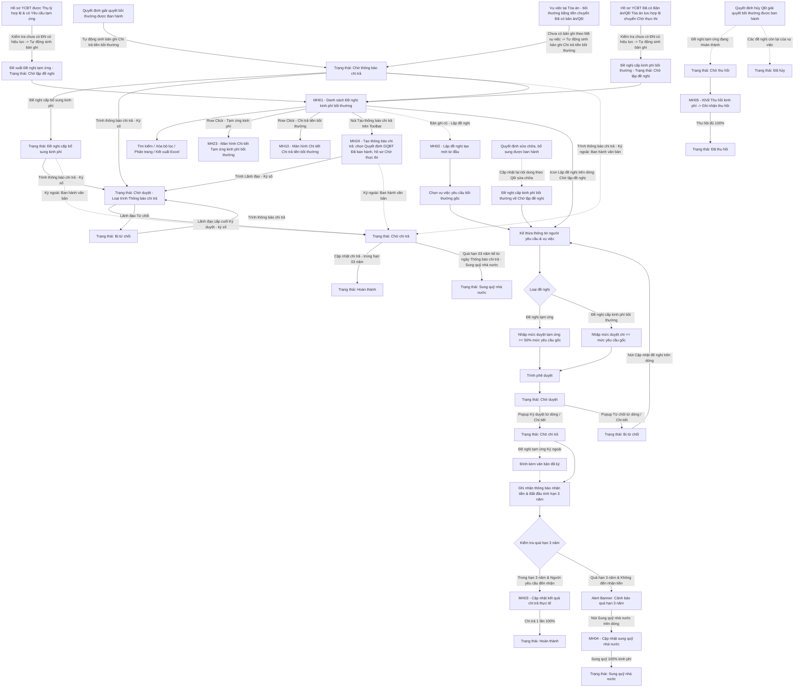
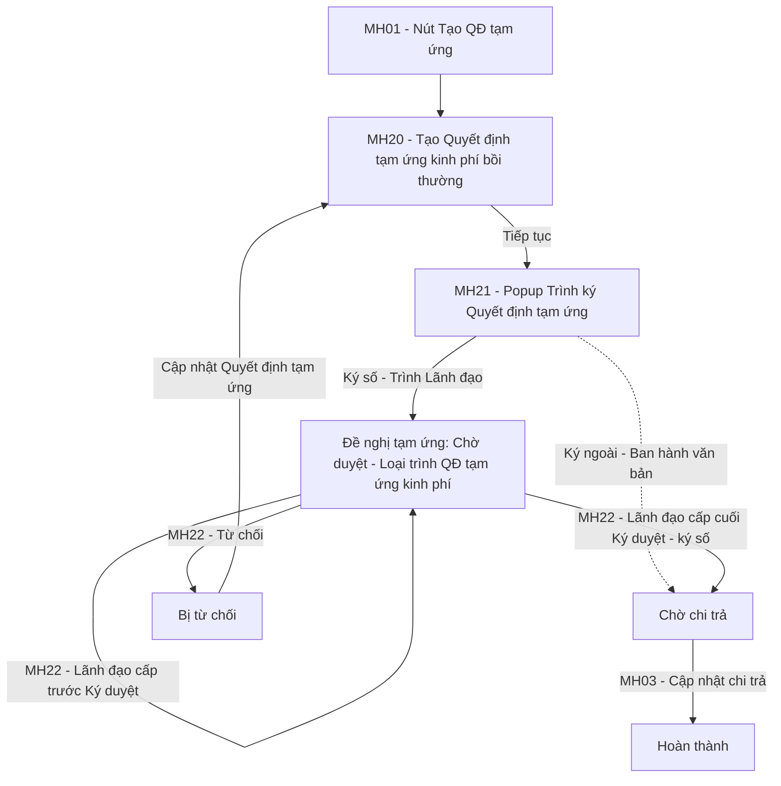

### 4.3.3. Dành cho Cán bộ Công tác bồi thường nhà nước

#### 4.3.3.2. Tạm ứng kinh phí bồi thường/Chi trả tiền bồi thường

##### 4.3.3.2.1. Mục đích
Quản lý toàn diện vòng đời của hồ sơ kinh phí bồi thường nhà nước và tạm ứng kinh phí nhằm chuẩn hóa quy trình lập tờ trình, phê duyệt ngân sách, giải ngân chi trả thực tế một lần duy nhất và theo dõi xử lý nghĩa vụ tài chính sau bồi thường, bao gồm:
- Danh sách chia 02 tab `Chờ xử lý` / `Đã xử lý` theo người dùng đang đăng nhập (vai trò Cán bộ xử lý / Lãnh đạo), xem [Quy tắc 02 tab Chờ xử lý / Đã xử lý - Tạm ứng kinh phí bồi thường/Chi trả tiền bồi thường - Công tác bồi thường nhà nước (Website Quản trị)](#kp-tab-xu-ly).
- Đề nghị tạm ứng: hệ thống sinh văn bản dự thảo Quyết định tạm ứng kinh phí bồi thường theo `Mẫu 07_Template`; Cán bộ chọn Hình thức ký `Ký số trên hệ thống` hoặc `Ký ngoài`, xem [Quy tắc Hình thức ký Đề nghị tạm ứng - Tạm ứng kinh phí bồi thường/Chi trả tiền bồi thường - Công tác bồi thường nhà nước (Website Quản trị)](#kp-hinh-thuc-ky).
- Tra cứu và quản lý danh sách đề xuất tạm ứng kinh phí, đề nghị cấp kinh phí bồi thường theo phân trang, hỗ trợ tìm kiếm đa tiêu chí theo mã đề xuất, mã vụ việc, loại đề nghị, trạng thái và khoảng thời gian.
- Cảnh báo tự động các khoản chi quá hạn 03 năm kể từ ngày người yêu cầu nhận thông báo chi trả mà không đến nhận tiền, kịp thời kích hoạt luồng thủ tục sung quỹ nhà nước theo đúng quy định pháp luật.
- Lập tờ trình đề nghị cấp kinh phí bồi thường hoặc tạm ứng kinh phí mới với cơ chế tự động kế thừa và ánh xạ dữ liệu từ hồ sơ vụ việc yêu cầu bồi thường gốc; tiếp nhận tự động bản ghi "Đề nghị tạm ứng" ở trạng thái `Chờ lập đề nghị` ngay khi hồ sơ yêu cầu bồi thường có yêu cầu tạm ứng kinh phí được xác nhận thụ lý hợp lệ (sau khi hệ thống đã kiểm tra điều kiện trùng lặp đảm bảo vụ việc chưa tồn tại đề nghị có hiệu lực); tiếp nhận tự động bản ghi "Đề nghị cấp kinh phí bồi thường" ở trạng thái `Chờ lập đề nghị` khi hồ sơ Đã có Bản án/Quyết định của Tòa án chuyển sang Chờ thực thi (sau khi hệ thống đã kiểm tra điều kiện trùng lặp đảm bảo vụ việc chưa tồn tại đề nghị cấp kinh phí có hiệu lực); kiểm soát chặt chẽ định mức tạm ứng (tối thiểu 50% mức yêu cầu của từng loại thiệt hại) và hạn mức cấp kinh phí bồi thường (không vượt quá mức yêu cầu bồi thường gốc).
- Tiếp nhận tự động 01 bản ghi Loại `Chi trả tiền bồi thường` ở trạng thái `Chờ thông báo chi trả` khi Quyết định giải quyết bồi thường được Ban hành tại Module Quyết định giải quyết bồi thường; Tạo thông báo chi trả từ Quyết định giải quyết bồi thường đã ban hành; Trình ký Thông báo chi trả tiền bồi thường (Mẫu số 32/BTNN), Đề nghị cấp bổ sung kinh phí, Lãnh đạo Ký duyệt / Từ chối, Cập nhật chi trả, xem [Luồng Chi trả tiền bồi thường - Tạm ứng kinh phí bồi thường/Chi trả tiền bồi thường - Công tác bồi thường nhà nước (Website Quản trị)](#kp-chi-tra-tien-bt).
- Tiếp nhận tự động 01 bản ghi Loại `Chi trả tiền bồi thường` ở trạng thái `Chờ thông báo chi trả` khi vụ việc có yêu cầu bồi thường thiệt hại bằng tiền tại [Theo dõi vụ việc tại Tòa án - Giải quyết bồi thường - Bồi thường nhà nước (Website Quản trị)](SRS_BTNN_TheoDoiVuViecToaAn.md) chuyển trạng thái `Đã có bản án/QĐ`; xử lý tiếp theo [Luồng Chi trả tiền bồi thường - Tạm ứng kinh phí bồi thường/Chi trả tiền bồi thường - Công tác bồi thường nhà nước (Website Quản trị)](#kp-chi-tra-tien-bt).
- Tạo Quyết định tạm ứng kinh phí bồi thường (Mẫu 07/BTNN) từ vụ việc đang giải quyết; Trình ký / Ban hành; Lãnh đạo Ký duyệt / Từ chối; sau khi ban hành, xử lý tiếp như Đề nghị tạm ứng, xem [Luồng Tạo Quyết định tạm ứng kinh phí bồi thường - Tạm ứng kinh phí bồi thường/Chi trả tiền bồi thường - Công tác bồi thường nhà nước (Website Quản trị)](#kp-qd-tam-ung).
- Xử lý liên thông khi Quyết định giải quyết bồi thường bị hủy hoặc bị sửa chữa, bổ sung: Tự động chuyển các đề nghị kinh phí liên quan sang trạng thái `Đã hủy` hoặc `Chờ thu hồi`, hoặc đưa về `Chờ lập đề nghị` để lập lại theo nội dung đã điều chỉnh; lưu đầy đủ căn cứ để đối chiếu.
- Ghi nhận thu hồi kinh phí đã tạm ứng đối với các khoản chuyển sang trạng thái `Chờ thu hồi` do Quyết định giải quyết bồi thường bị hủy; thu hồi đủ 100% thì đề nghị chuyển `Đã thu hồi`.
- **Định nghĩa "đề nghị có hiệu lực"** dùng cho toàn bộ quy tắc kiểm tra trùng lặp: gồm các trạng thái `Chờ lập đề nghị`, `Chờ duyệt`, `Chờ chi trả`, `Chờ thu hồi`, `Hoàn thành`, `Sung quỹ nhà nước`. Các trạng thái `Bị từ chối`, `Đã hủy` và `Đã thu hồi` KHÔNG còn hiệu lực, do đó vụ việc có đề nghị ở các trạng thái này vẫn được phép khởi tạo đề nghị mới.
- Xét duyệt tờ trình kinh phí: Cho phép phê duyệt hoặc từ chối cấp phát kinh phí kèm ý kiến chỉ đạo.
- Cập nhật kết quả chi trả thực tế: Thực hiện giải ngân chi trả 1 lần duy nhất toàn bộ 100% số tiền bồi thường được duyệt (qua chuyển khoản ngân hàng hoặc chi tiền mặt) kèm chứng từ giải ngân, hoàn thành dứt điểm hồ sơ kinh phí.
- Ghi nhận thông báo chi trả và theo dõi hạn 03 năm: Trong giai đoạn chờ chi trả, ghi nhận mốc thời gian người yêu cầu nhận thông báo nhận kinh phí kèm văn bản/chứng từ chứng minh để kích hoạt đồng hồ theo dõi hạn 03 năm.
- Lập và hoàn thành thủ tục Sung quỹ nhà nước đối với các khoản kinh phí bồi thường quá hạn 03 năm không có người đến nhận, sung quỹ 100% toàn bộ khoản kinh phí vào ngân sách nhà nước.

a. Phân quyền
Hệ thống phân quyền thao tác theo các quyền nghiệp vụ được cấp:
- **Xem**: Tra cứu danh sách đề xuất kinh phí, xem chi tiết đề nghị kinh phí/tạm ứng (thông qua click dòng dữ liệu), xem thông tin theo dõi hạn 3 năm, xem và tải tài liệu/chứng từ liên quan.
- **Lập đề nghị**: Tạo mới đề xuất tạm ứng kinh phí hoặc đề xuất cấp kinh phí bồi thường từ vụ việc yêu cầu bồi thường gốc; hoặc chủ động hoàn thiện đề nghị từ bản ghi được hệ thống tự động khởi tạo ở trạng thái `Chờ lập đề nghị` (sau khi kiểm tra trùng lặp đảm bảo chưa tồn tại đề nghị có hiệu lực) khi: (1) hồ sơ yêu cầu bồi thường có yêu cầu tạm ứng được xác nhận thụ lý hợp lệ; hoặc (2) hồ sơ Đã có Bản án/Quyết định của Tòa án chuyển sang Chờ thực thi.
- **Tạo QĐ tạm ứng**: Tạo, cập nhật (khi `Bị từ chối`) và trình ký / ban hành Quyết định tạm ứng kinh phí bồi thường.
- **Tạo thông báo chi trả**: Tạo, trình ký / ban hành Thông báo chi trả tiền bồi thường (Mẫu số 32/BTNN) từ Quyết định giải quyết bồi thường đã ban hành.
- **Sửa**: Cập nhật thông tin đề xuất kinh phí ở trạng thái `Bị từ chối`.
- **Ký duyệt**: Xét duyệt chấp thuận cấp phát kinh phí bồi thường/tạm ứng cho tờ trình đề xuất (Đề nghị tạm ứng Hình thức ký `Ký số trên hệ thống`: hệ thống ký số Quyết định tạm ứng).
- **Đính kèm văn bản đã ký**: Đề nghị tạm ứng Hình thức ký `Ký ngoài` đã được Lãnh đạo Ký duyệt: đính kèm văn bản Quyết định tạm ứng đã ký ngoài hệ thống.
- **Từ chối**: Từ chối phê duyệt tờ trình đề xuất cấp kinh phí kèm nội dung lý do chỉ đạo.
- **Cập nhật chi trả**: Ghi nhận kết quả giải ngân chi trả thực tế 1 lần duy nhất toàn bộ 100% kinh phí kèm chứng từ giải ngân.
- **Sung quỹ nhà nước**: Lập hồ sơ và xác nhận hoàn thành thủ tục sung quỹ nhà nước đối với các khoản kinh phí quá hạn 03 năm không có người đến nhận tiền.
- **Xóa**: Xóa đề xuất kinh phí ở trạng thái `Chờ lập đề nghị`.

b. Quy tắc 02 tab Chờ xử lý / Đã xử lý

| Vai trò | Tab `Chờ xử lý` | Tab `Đã xử lý` |
| :--- | :--- | :--- |
| Cán bộ xử lý | Đề nghị ở trạng thái: `Chờ lập đề nghị`, `Chờ duyệt`, `Chờ chi trả`, `Bị từ chối`, `Chờ thu hồi`, `Chờ thông báo chi trả`, `Đề nghị cấp bổ sung kinh phí` | Đề nghị ở trạng thái: `Hoàn thành`, `Sung quỹ nhà nước`, `Đã thu hồi`, `Đã hủy` |
| Lãnh đạo | Đề nghị `Chờ duyệt` (cần Lãnh đạo Ký duyệt / Từ chối); bản ghi `Chi trả tiền bồi thường` chỉ hiển thị với Lãnh đạo được giao tại cấp ký duyệt hiện hành | Đề nghị đã qua bước Ký duyệt / Từ chối: `Chờ chi trả`, `Bị từ chối`, `Chờ thu hồi`, `Hoàn thành`, `Sung quỹ nhà nước`, `Đã thu hồi`; `Đã hủy` khi đề nghị đã được Ký duyệt trước khi hủy; bản ghi `Chi trả tiền bồi thường` mà Lãnh đạo đã Ký duyệt / Từ chối |

- Đổi tab thì danh sách về Trang 1, bộ lọc `Trạng thái` đặt lại `Tất cả`.
- Trường `Trạng thái` của bộ lọc chỉ gồm các trạng thái của tab đang chọn theo vai trò.
- Thao tác trên từng bản ghi theo trạng thái như mô tả tại cột `Thao tác`.
- Tab `Đã xử lý` chỉ xem: không có cột `Thao tác`, không có nút `Tạo thông báo chi trả`, `Tạo QĐ tạm ứng`, không có Lọc nhanh.
- Vai trò Lãnh đạo: không có nút `Tạo thông báo chi trả`, `Tạo QĐ tạm ứng`, không có Lọc nhanh.

- **Ký duyệt cấp kinh phí**:
  + Đề nghị tạm ứng, Đề nghị cấp kinh phí bồi thường `Chờ duyệt` do Thủ trưởng cơ quan giải quyết bồi thường của vụ việc Ký duyệt / Từ chối: Nhóm lãnh đạo của đơn vị cử người giải quyết, theo [Trình Lãnh đạo phê duyệt nhiều cấp - Giải quyết yêu cầu bồi thường - Công tác bồi thường nhà nước (Website Quản trị)](SRS_BTNN_GiaiQuyetBT_GiaiQuyet_YCBT.md#gq-trinh-duyet).
  + Lãnh đạo Ký duyệt / Từ chối tại tab `Chờ xử lý` của danh sách hoặc màn hình chi tiết (vai trò Lãnh đạo).
  + Nhãn nút `Ký duyệt`; ký số hay không ký số khi Lãnh đạo Ký duyệt: Thực hiện theo luồng đã cấu hình tương ứng tại [Cấu hình luồng xử lý - Cấu hình luồng xử lý - Quản trị hệ thống (Website Quản trị)](../01_Quan_tri_he_thong/Cau_hinh_luong_xu_ly.md).
  + Loại trình của phân hệ chỉ gồm: `Thông báo chi trả` (Thông báo chi trả tiền bồi thường - Mẫu số 32/BTNN), `QĐ tạm ứng kinh phí` (Quyết định tạm ứng kinh phí bồi thường - Mẫu số 07/BTNN).
  + Thông báo chi trả tiền bồi thường, Quyết định tạm ứng kinh phí bồi thường trình nhiều cấp: Ký duyệt / Từ chối theo [MH07 - Màn hình Ký duyệt / Từ chối thông báo chi trả - Tạm ứng kinh phí bồi thường/Chi trả tiền bồi thường - Công tác bồi thường nhà nước (Website Quản trị)](#kp-mh07) và [MH22 - Màn hình Ký duyệt / Từ chối Quyết định tạm ứng - Tạm ứng kinh phí bồi thường/Chi trả tiền bồi thường - Công tác bồi thường nhà nước (Website Quản trị)](#kp-mh22); quy tắc chung theo [Quy tắc trình ký - phê duyệt - Xác định cơ quan giải quyết bồi thường - Công tác bồi thường nhà nước (Website Quản trị)](SRS_BTNN_GiaiQuyetBT__Xac%20định%20cơ%20quan%20GQBT.md#xd-quy-tac-phe-duyet).

c. Quy tắc Hình thức ký Đề nghị tạm ứng

- Chỉ áp dụng cho `Đề nghị tạm ứng`. Hệ thống sinh văn bản dự thảo Quyết định tạm ứng kinh phí bồi thường theo `Mẫu 07_Template` (tệp Word mẫu đã định nghĩa) từ dữ liệu đề nghị.
- `Hình thức ký` gồm `Ký số trên hệ thống` (mặc định) và `Ký ngoài`; lưu cùng đề nghị khi Trình phê duyệt.
- `Ký số trên hệ thống`:
  + Bắt buộc nhập `Số, ký hiệu văn bản` và `Ngày văn bản` khi Trình phê duyệt.
  + Lãnh đạo Ký duyệt (tại tab `Chờ xử lý` của danh sách hoặc màn hình chi tiết, vai trò Lãnh đạo): ký số Quyết định tạm ứng theo luồng đã cấu hình tại Cấu hình luồng xử lý, lưu tệp Quyết định đã ký kèm người ký và thời điểm ký; đề nghị chuyển `Chờ chi trả`.
- `Ký ngoài`:
  + `Số, ký hiệu văn bản`, `Ngày văn bản` không bắt buộc khi Trình phê duyệt.
  + Lãnh đạo Ký duyệt trên hệ thống: đề nghị chuyển `Chờ chi trả`; Quyết định được ký ngoài hệ thống.
  + Cán bộ xử lý thực hiện `Đính kèm văn bản đã ký` (bắt buộc Số, ký hiệu văn bản; Ngày ký; tệp văn bản đã ký `.pdf`). Chưa đính kèm thì `Cập nhật chi trả` khóa mờ, không cho phép thao tác.

d. Điều kiện thực hiện
- Người dùng đã đăng nhập vào hệ thống thành công.
- Người dùng được phân quyền truy cập chức năng "Quản lý kinh phí bồi thường".

##### 4.3.3.2.2. Sơ đồ luồng nghiệp vụ theo giao diện

---

##### 4.3.3.2.3. MH01 - Màn hình Danh sách Cấp kinh phí

###### 4.3.3.2.3.1. Màn hình

###### 4.3.3.2.3.2. Mô tả thông tin trên màn hình

| Trường thông tin | Kiểu dữ liệu | Bắt buộc | Mặc định | Mô tả |
| :--- | :--- | :--- | :--- | :--- |
| **Tiêu đề màn hình** | - | - | `Tạm ứng kinh phí bồi thường/Chi trả tiền bồi thường` | Control UI: Label. |
| **Tab danh sách** | Tab | - | `Chờ xử lý` | Control UI: Tab. Gồm: + Chờ xử lý + Đã xử lý - Tab `Chờ xử lý` kèm số bản ghi; số này cộng vào badge nhóm menu `Giải quyết bồi thường` theo [Tab Chờ xử lý - Giải quyết yêu cầu bồi thường - Công tác bồi thường nhà nước (Website Quản trị)](SRS_BTNN_GiaiQuyetBT_GiaiQuyet_YCBT.md). - Bản ghi của từng tab theo vai trò người dùng đang đăng nhập: [Quy tắc 02 tab Chờ xử lý / Đã xử lý - Tạm ứng kinh phí bồi thường/Chi trả tiền bồi thường - Công tác bồi thường nhà nước (Website Quản trị)](#kp-tab-xu-ly). |
| **Khối Bộ lọc tìm kiếm** | Section | - | Mở rộng | Control UI: Section. - Nút `Thu gọn`/`Mở rộng`; thu gọn vẫn giữ giá trị lọc đã nhập. |
| Mã kinh phí | String(50) | Không | Trống | Control UI: Textbox. - Tìm gần đúng, không phân biệt hoa thường. - `Placeholder: Nhập mã kinh phí...` |
| Loại kinh phí | Enum(String(50)) | Không | `Tất cả` | Control UI: Dropdown/Select. Gồm: + Tất cả + Tạm ứng kinh phí + Chi trả tiền bồi thường |
| Mã hồ sơ GQBT | String(50) | Không | Trống | Control UI: Textbox. - Tìm gần đúng theo Mã hồ sơ giải quyết bồi thường, không phân biệt hoa thường. - `Placeholder: Nhập mã hồ sơ GQBT...` |
| Trạng thái | Enum(String(50)) | Không | `Tất cả` | Control UI: Dropdown/Select. - Gồm `Tất cả` và các trạng thái của tab đang chọn theo vai trò ([Quy tắc 02 tab Chờ xử lý / Đã xử lý - Tạm ứng kinh phí bồi thường/Chi trả tiền bồi thường - Công tác bồi thường nhà nước (Website Quản trị)](#kp-tab-xu-ly)). |
| Tên cá nhân/Tổ chức yêu cầu | String(255) | Không | Trống | Control UI: Textbox. - Tìm gần đúng. - `Placeholder: Nhập tên cá nhân/tổ chức yêu cầu...` |
| Từ ngày | Date | Không | Ngày đầu tháng hiện tại | Control UI: Datepicker. - Định dạng `dd/mm/yyyy`. - Lọc theo Ngày tạo bản ghi. - `Placeholder: dd/mm/yyyy` |
| Đến ngày | Date | Không | Ngày hiện tại | Control UI: Datepicker. - Định dạng `dd/mm/yyyy`. - Lọc theo Ngày tạo bản ghi. - Không nhỏ hơn `Từ ngày`. - `Placeholder: dd/mm/yyyy` |
| Cán bộ xử lý | String(255) | Không | Trống | Control UI: Textbox. - Tìm gần đúng. - `Placeholder: Nhập tên cán bộ xử lý...` |
| **Cảnh báo khoản chi quá hạn** | Alert Banner | - | Ẩn | Control UI: Alert Banner. - Chỉ hiển thị khi có ít nhất 01 bản ghi `Chờ chi trả` đã có Ngày người yêu cầu nhận thông báo và quá 03 năm kể từ ngày đó mà chưa chi trả. - Tiêu đề: `Cảnh báo khoản chi đã quá hạn 3 năm`. - Nội dung: `[X] khoản Chờ chi trả đủ điều kiện xử lý sung quỹ, tổng số tiền [Y] VNĐ (Theo Điều 45 Luật TNBTCNN).` - [X]: số bản ghi thỏa mãn điều kiện hiển thị. - [Y]: tổng số tiền chưa chi trả của [X] bản ghi, phân cách hàng nghìn bằng dấu chấm. - Kèm nút `Xem khoản cần xử lý`. |
| **Lọc nhanh** | Button group | - | `Tất cả` | Control UI: Button group, mỗi nút kèm số bản ghi. Gồm: + Tất cả + Chờ duyệt + Bị từ chối - Chỉ hiển thị tại tab `Chờ xử lý`, vai trò Cán bộ xử lý. |
| **Bảng danh sách đề xuất kinh phí** | List(Object) | - | 20 bản ghi/trang | Control UI: Data grid. - Mở màn hình: tải Trang 1. - Click tiêu đề cột STT, Mã kinh phí, Mã hồ sơ GQBT, Loại kinh phí, Tên cá nhân/Tổ chức yêu cầu, Tổng số tiền duyệt chi, Ngày trình, Trạng thái: sắp xếp tăng/giảm. - Xem chi tiết: click dòng dữ liệu. - Không có dữ liệu: 01 dòng thông báo [MSG-INF-SYS-001]. |
| STT | - | - | - | Control UI: Label. - Tăng dần theo phân trang. |
| Mã kinh phí | - | - | - | Control UI: Label. - Theo dữ liệu bản ghi. |
| Mã hồ sơ GQBT | - | - | - | Control UI: HyperLink. - Theo dữ liệu bản ghi. - Click: mở màn hình Chi tiết hồ sơ tại [Giải quyết yêu cầu bồi thường - Giải quyết yêu cầu bồi thường - Bồi thường nhà nước (Website Quản trị)](SRS_BTNN_GiaiQuyetBT_GiaiQuyet_YCBT.md); hồ sơ thuộc Theo dõi vụ việc tại Tòa án: mở Xem chi tiết tại [Theo dõi vụ việc tại Tòa án - Giải quyết bồi thường - Bồi thường nhà nước (Website Quản trị)](SRS_BTNN_TheoDoiVuViecToaAn.md). |
| Loại kinh phí | - | - | - | Control UI: Label. Gồm: + Tạm ứng kinh phí + Chi trả tiền bồi thường |
| Tên cá nhân/Tổ chức yêu cầu | - | - | - | Control UI: Label. - Theo dữ liệu bản ghi. |
| Tổng số tiền duyệt chi | - | - | - | Control UI: Label. - Loại `Tạm ứng kinh phí`: Số tiền tạm ứng kinh phí bồi thường của Quyết định tạm ứng. - Loại `Chi trả tiền bồi thường`: Số tiền chi trả của Thông báo chi trả. - Căn phải, phân cách hàng nghìn bằng dấu chấm. |
| Cán bộ xử lý | - | - | - | Control UI: Label. - Cán bộ xử lý gần nhất của bản ghi. - Chưa có: `-`. |
| Ngày trình | - | - | - | Control UI: Label. - Ngày Trình ký gần nhất (Ký số) hoặc ngày Ban hành văn bản (Ký ngoài). - Chưa trình: `-`. - Định dạng `dd/mm/yyyy`. |
| Hạn nhận/Sung quỹ | - | - | - | Control UI: Label. - Chỉ áp dụng bản ghi Loại `Chi trả tiền bồi thường`; bản ghi `Tạm ứng kinh phí` hoặc chưa có dữ liệu: `-`. - Đã sung quỹ: `Đã sung quỹ [Ngày sung quỹ]`; dòng phụ Số tiền sung quỹ. - Chưa sung quỹ, đã có Ngày người yêu cầu nhận thông báo: Hạn nhận = Ngày người yêu cầu nhận thông báo + 03 năm, định dạng `dd/mm/yyyy`. - Bản ghi `Chờ chi trả`: dòng phụ `Còn X ngày` hoặc `Quá hạn X ngày`; quá hạn 03 năm thêm `Đủ điều kiện sung quỹ`. |
| Trạng thái | - | - | - | Control UI: Badge. - Theo dữ liệu bản ghi. - Bản ghi `Chờ duyệt`, `Bị từ chối`: dòng phụ Loại trình. - Loại trình gồm: + QĐ tạm ứng kinh phí + Thông báo chi trả |
| Thao tác | - | - | - | Control UI: Icon button group. - Chỉ có tại tab `Chờ xử lý`. - Thao tác hiển thị ở vị trí cố định; thao tác không được phép ở trạng thái hiện tại hiển thị mờ, không cho phép click. - Vai trò Lãnh đạo, gồm: + Ký duyệt: bản ghi `Chờ duyệt` + Từ chối: bản ghi `Chờ duyệt` - Vai trò Cán bộ xử lý, bản ghi Loại `Chi trả tiền bồi thường` tạo theo [Luồng Chi trả tiền bồi thường - Tạm ứng kinh phí bồi thường/Chi trả tiền bồi thường - Công tác bồi thường nhà nước (Website Quản trị)](#kp-chi-tra-tien-bt), gồm: + Trình thông báo chi trả + Đề nghị cấp bổ sung kinh phí + Cập nhật chi trả + Sung quỹ nhà nước - Điều kiện được phép theo quy tắc Thao tác theo trạng thái của luồng Chi trả tiền bồi thường. - Vai trò Cán bộ xử lý, bản ghi còn lại, gồm: + Lập đề nghị: bản ghi `Chờ lập đề nghị` + Cập nhật đề nghị: bản ghi `Bị từ chối`; bản ghi Quyết định tạm ứng: nhãn `Cập nhật Quyết định tạm ứng` + Đính kèm văn bản đã ký: Đề nghị tạm ứng Hình thức ký `Ký ngoài`, trạng thái `Chờ chi trả`, chưa đính kèm văn bản đã ký + Cập nhật chi trả: bản ghi `Chờ chi trả` còn trong hạn 03 năm; khóa mờ khi Đề nghị tạm ứng `Ký ngoài` chưa đính kèm văn bản đã ký + Sung quỹ nhà nước: bản ghi `Chờ chi trả` đã quá hạn 03 năm kể từ ngày nhận thông báo mà chưa chi trả + Xóa: bản ghi `Chờ lập đề nghị` - Cột cố định bên phải lưới khi cuộn ngang. |

###### 4.3.3.2.3.3. Chức năng trên màn hình

| STT | Tên chức năng | Định dạng | Mô tả |
| :--- | :--- | :--- | :--- |
| 1 | Chuyển tab Chờ xử lý / Đã xử lý | Tab | Hiển thị bản ghi của tab theo vai trò người dùng đang đăng nhập; đưa danh sách về Trang 1, đặt lại bộ lọc `Trạng thái` về `Tất cả`. |
| 2 | Xóa bộ lọc | Button | Đưa bộ lọc về giá trị mặc định và tải lại danh sách. |
| 3 | Tìm kiếm | Button | - **TH1 - Khoảng ngày không hợp lệ** (`Từ ngày` lớn hơn `Đến ngày`): Hệ thống hiển thị [MSG-ERR-VAL-007], không tìm kiếm. - **TH2 - Hợp lệ**: Lọc danh sách theo các tiêu chí đã nhập, đưa về Trang 1. |
| 4 | Xem khoản cần xử lý | Button | Lọc danh sách các bản ghi `Chờ chi trả` đã quá hạn 03 năm kể từ ngày nhận thông báo mà chưa chi trả, đưa về Trang 1. |
| 5 | Lọc nhanh | Button group | Lọc danh sách theo nút được chọn: + Tất cả: không lọc thêm + Chờ duyệt: bản ghi `Chờ duyệt` + Bị từ chối: bản ghi `Bị từ chối` |
| 6 | Tạo thông báo chi trả | Button | - Chỉ hiển thị với vai trò Cán bộ xử lý, tab `Chờ xử lý`. - Mở [MH24 - Màn hình Tạo thông báo chi trả - Tạm ứng kinh phí bồi thường/Chi trả tiền bồi thường - Công tác bồi thường nhà nước (Website Quản trị)](#kp-mh24). |
| 7 | Tạo QĐ tạm ứng | Button | - Chỉ hiển thị với vai trò Cán bộ xử lý, tab `Chờ xử lý`. - Mở [MH20 - Màn hình Tạo Quyết định tạm ứng kinh phí bồi thường - Tạm ứng kinh phí bồi thường/Chi trả tiền bồi thường - Công tác bồi thường nhà nước (Website Quản trị)](#kp-mh20) ở chế độ tạo mới. |
| 8 | Kết xuất Excel | Button | Kết xuất danh sách theo điều kiện tìm kiếm hiện hành ra tệp Excel. |
| 9 | Click dòng dữ liệu | Row click | - Tạm ứng kinh phí: mở [MH23 - Màn hình Chi tiết Tạm ứng kinh phí bồi thường - Tạm ứng kinh phí bồi thường/Chi trả tiền bồi thường - Công tác bồi thường nhà nước (Website Quản trị)](#kp-mh23). - Chi trả tiền bồi thường: mở [MH10 - Màn hình Chi tiết Chi trả tiền bồi thường - Tạm ứng kinh phí bồi thường/Chi trả tiền bồi thường - Công tác bồi thường nhà nước (Website Quản trị)](#kp-mh10). - Click icon thao tác hoặc `Mã hồ sơ GQBT`: thực hiện chức năng của icon/liên kết, không mở chi tiết. |
| 10 | Mã hồ sơ GQBT | HyperLink | Mở màn hình chi tiết hồ sơ theo mô tả cột `Mã hồ sơ GQBT`. |
| 11 | Ký duyệt | Icon button | - Bản ghi Loại trình `QĐ tạm ứng kinh phí`: mở [MH22 - Màn hình Ký duyệt / Từ chối Quyết định tạm ứng - Tạm ứng kinh phí bồi thường/Chi trả tiền bồi thường - Công tác bồi thường nhà nước (Website Quản trị)](#kp-mh22) với thao tác `Ký duyệt`. - Bản ghi Loại trình `Thông báo chi trả`: mở [MH07 - Màn hình Ký duyệt / Từ chối thông báo chi trả - Tạm ứng kinh phí bồi thường/Chi trả tiền bồi thường - Công tác bồi thường nhà nước (Website Quản trị)](#kp-mh07) với thao tác `Ký duyệt`. |
| 12 | Từ chối | Icon button | Mở MH22 hoặc MH07 như chức năng `Ký duyệt`, với thao tác `Từ chối`. |
| 13 | Trình thông báo chi trả | Icon button | Mở [MH06 - Popup Trình ký thông báo chi trả - Tạm ứng kinh phí bồi thường/Chi trả tiền bồi thường - Công tác bồi thường nhà nước (Website Quản trị)](#kp-mh06). |
| 14 | Đề nghị cấp bổ sung kinh phí | Icon button | Mở MH08 - Popup Đề nghị cấp bổ sung kinh phí. |
| 15 | Lập đề nghị | Icon button | Mở MH02 - Màn hình Lập/Cập nhật đề nghị cấp kinh phí, nạp dữ liệu từ bản ghi `Chờ lập đề nghị`; `Mã vụ việc gốc` chỉ đọc. |
| 16 | Cập nhật đề nghị | Icon button | - Bản ghi Quyết định tạm ứng (nhãn `Cập nhật Quyết định tạm ứng`): mở [MH20 - Màn hình Tạo Quyết định tạm ứng kinh phí bồi thường - Tạm ứng kinh phí bồi thường/Chi trả tiền bồi thường - Công tác bồi thường nhà nước (Website Quản trị)](#kp-mh20) ở chế độ cập nhật. - Bản ghi còn lại: mở MH02 ở chế độ cập nhật, kèm Khối Lý do bị từ chối. |
| 17 | Đính kèm văn bản đã ký | Icon button | Mở popup `Đính kèm văn bản đã ký`: - Thông tin đối chiếu: Mã đề nghị, Người yêu cầu, Lãnh đạo ký duyệt, Thời điểm ký duyệt. - `Số, ký hiệu văn bản`: Input text, bắt buộc, tối đa 50 ký tự, mặc định theo giá trị đã nhập khi lập đề nghị. - `Ngày ký`: Datepicker, bắt buộc, định dạng `dd/mm/yyyy`; `Placeholder: dd/mm/yyyy`. - `Tệp văn bản đã ký (.pdf)`: nút `Tải lên`, bắt buộc, định dạng `.pdf`. - Nút `Hủy bỏ`, `Lưu`. - **TH1 - Bỏ trống trường bắt buộc**: Hệ thống tô viền đỏ ô lỗi, hiển thị [MSG-ERR-VAL-001] dưới ô lỗi và focus vào ô lỗi đầu tiên; không lưu. - **TH2 - Sai định dạng file** (không phải `.pdf`): Hệ thống hiển thị [MSG-ERR-FILE-001], không tiếp nhận tệp. - **TH3 - Hợp lệ** (`Lưu`): lưu Số, ký hiệu văn bản, Ngày ký, tệp đã ký; đóng popup, hiển thị thông báo thành công; bản ghi giữ `Chờ chi trả`, thao tác `Cập nhật chi trả` được phép. - `Hủy bỏ`: đóng popup, không lưu. |
| 18 | Cập nhật chi trả | Icon button | - Bản ghi theo luồng Chi trả tiền bồi thường: mở MH09 - Popup Cập nhật chi trả. - Bản ghi còn lại: mở MH03 - Màn hình Cập nhật kết quả chi trả thực tế. |
| 19 | Sung quỹ nhà nước | Icon button | - Bản ghi theo luồng Chi trả tiền bồi thường: mở MH11 - Popup Cập nhật sung quỹ nhà nước. - Bản ghi còn lại: mở MH04 - Màn hình Cập nhật sung quỹ nhà nước. |
| 20 | Xóa | Icon button | Hiển thị popup xác nhận [MSG-CFM-SYS-001]; đồng ý thì xóa bản ghi `Chờ lập đề nghị`, hiển thị [MSG-SUC-SYS-004]. |

---

##### 4.3.3.2.4. MH02 - Màn hình Lập/Cập nhật đề nghị cấp kinh phí

###### 4.3.3.2.4.1. Màn hình

###### 4.3.3.2.4.2. Mô tả thông tin trên màn hình

| Trường thông tin | Kiểu dữ liệu | Bắt buộc | Mặc định | Mô tả |
| :--- | :--- | :--- | :--- | :--- |
| **Tiêu đề form** | String(200) | Không | Theo ngữ cảnh | Hiển thị động theo chế độ: - Khi tạo mới: `LẬP ĐỀ NGHỊ CẤP KINH PHÍ BỒI THƯỜNG / TẠM ỨNG MỚI`. - Khi cập nhật bị từ chối: `CẬP NHẬT ĐỀ NGHỊ CẤP KINH PHÍ BỒI THƯỜNG / TẠM ỨNG`. |
| **Khối Lý do bị từ chối** | Section | - | Ẩn | Khối thông báo đặt ở phía trên cùng của form; chỉ hiển thị khi mở màn hình đối với đề xuất ở trạng thái `Bị từ chối`. Bao gồm các trường thông tin chỉ đọc dưới đây: |
| Ngày từ chối | Date | Không | Theo dữ liệu | Chỉ đọc. Định dạng `dd/mm/yyyy`. Hiển thị ngày cấp có thẩm quyền thực hiện từ chối phê duyệt tờ trình. |
| Người từ chối | String(100) | Không | Theo dữ liệu | Chỉ đọc. Hiển thị họ và tên người đã thực hiện từ chối phê duyệt tờ trình. |
| Nội dung ý kiến chỉ đạo / Lý do từ chối | Text(2000) | Không | Theo dữ liệu | Chỉ đọc. Hiển thị chi tiết nội dung lý do từ chối và ý kiến chỉ đạo điều chỉnh của cấp phê duyệt. |
| **Khối Thông tin chung tờ trình** | Section | - | - | Khối thông tin liên kết và hành chính đề xuất. |
| Mã đề xuất kinh phí | String(50) | Có | Hệ thống tự sinh | *Hệ thống tự sinh.* Định dạng `KP-YYYY-XXX` (YYYY: Năm hiện tại, XXX: Số tăng dần). Khóa chỉ đọc. |
| Ngày lập đề nghị | Date | Có | Ngày hiện tại | *Hệ thống tự sinh.* Định dạng `dd/mm/yyyy`. Khóa chỉ đọc. - Với bản ghi tự động khởi tạo từ Quyết định giải quyết bồi thường: lấy Ngày ban hành Quyết định. - Với bản ghi tự động khởi tạo từ yêu cầu tạm ứng: lấy Ngày xác nhận thụ lý hồ sơ. |
| Cán bộ đề xuất xử lý | String(255) | Có | Tên tài khoản | *Cán bộ nhập.* Gán theo tài khoản người mở form lập đề nghị; không gán tại thời điểm hệ thống tự động khởi tạo bản ghi. Tên cán bộ đang đăng nhập hệ thống. Khóa chỉ đọc. |
| Loại đề nghị | Enum(String(50)) | Có | `Đề nghị tạm ứng` | Control UI: Radio button. Gồm: + Đề nghị tạm ứng + Đề nghị cấp kinh phí bồi thường - Khi thay đổi loại đề nghị, hệ thống tự động chuyển đổi bảng phân rã nội dung tương ứng (Khối Bảng tạm ứng hoặc Khối Bảng cấp kinh phí bồi thường). - Nếu form đã chọn sẵn Mã vụ việc gốc: Hệ thống tự động kiểm tra lại tính tương thích của vụ việc với Loại đề nghị mới. Nếu vụ việc không thỏa mãn điều kiện (vi phạm trạng thái hoặc đã tồn tại Đề nghị cấp kinh phí bồi thường), hệ thống hiển thị popup cảnh báo và tự động xóa trắng thông tin vụ việc đã chọn để người dùng chọn lại (chi tiết tại STT 3 bảng Chức năng). |
| Cơ quan cấp phát kinh phí | Enum(String(255)) | Có | Trống | *Cán bộ nhập.* Để trống tại thời điểm khởi tạo bản ghi. Control UI: Combobox có tìm kiếm. Gồm: + [Mã đơn vị] - [Tên đơn vị] (lấy theo danh mục đơn vị [DM_DON_VI]) Người dùng chọn cơ quan tài chính có thẩm quyền cấp phát kinh phí. |
| Mã vụ việc gốc | String(50) | Có | Trống / Theo bản ghi chọn | Control UI: Input text kết hợp Text link xem chi tiết. - **Khi lập đề nghị từ Toolbar ngoài lưới**: Hiển thị ô nhập kèm nút `Tìm kiếm` và liên kết `Tìm kiếm nâng cao`. Popup được mở khác nhau theo `Loại đề nghị`:   + `Đề nghị tạm ứng`: Mở [Popup chuẩn Tìm kiếm vụ việc/hồ sơ gốc liên quan](SRS_BTNN_GiaiQuyetBT_GiaiQuyet_YCBT.md#433110-popup-chuẩn-tìm-kiếm-vụ-việchồ-sơ-gốc-liên-quan) (Nguồn 4: Phân hệ Cấp kinh phí bồi thường)    + `Đề nghị cấp kinh phí bồi thường`: Mở [Popup Tìm kiếm Quyết định giải quyết bồi thường](#popup-tim-kiem-quyet-dinh-gqbt), tìm trên danh sách Quyết định ở trạng thái `Đã ban hành`. - Sau khi chọn trên Popup, hệ thống tự động điền mã vụ việc và kế thừa dữ liệu theo đúng nguồn của từng loại đề nghị. - **Khi lập từ icon dòng hoặc Cập nhật đề nghị**: Tự động hiển thị mã vụ việc ở chế độ Chỉ đọc, ẩn nút `Tìm kiếm` và `Tìm kiếm nâng cao`. |
| Số Quyết định làm căn cứ | String(50) | Có khi `Loại đề nghị` là `Đề nghị cấp kinh phí bồi thường` | Theo Quyết định được chọn | Control UI: Text link. - Chỉ đọc. Hiển thị Số quyết định của Quyết định giải quyết bồi thường làm căn cứ lập đề nghị. - Khi người dùng click, hệ thống mở màn hình Chi tiết Quyết định giải quyết bồi thường tương ứng ở chế độ chỉ xem. - **Ẩn hoàn toàn khi `Loại đề nghị` là `Đề nghị tạm ứng`* |
| Ngày Quyết định làm căn cứ | Date | Có khi `Loại đề nghị` là `Đề nghị cấp kinh phí bồi thường` | Theo Quyết định được chọn | Control UI: Text. - Chỉ đọc. Hiển thị Ngày quyết định của Quyết định giải quyết bồi thường làm căn cứ lập đề nghị. - Định dạng `dd/mm/yyyy`. - **Ẩn hoàn toàn khi `Loại đề nghị` là `Đề nghị tạm ứng`**. |
| **Khối Chi tiết thông tin người yêu cầu bồi thường** | Section | - | - | Control UI: 02 khối thẻ hiển thị song song, tự động kế thừa từ hồ sơ vụ việc gốc (đối với Đề nghị tạm ứng) hoặc từ Quyết định giải quyết bồi thường đã ban hành (đối với Đề nghị cấp kinh phí bồi thường) ở chế độ Chỉ đọc. |
| Họ và tên người yêu cầu bồi thường | String(255) | Có | Pre-fill theo nguồn | Chỉ đọc. Với `Đề nghị cấp kinh phí bồi thường`: lấy theo Quyết định giải quyết bồi thường đã ban hành. Với `Đề nghị tạm ứng`: lấy theo thông tin hồ sơ vụ việc. |
| Tỉnh/Thành phố | Enum(String(100)) | Có | Pre-fill theo nguồn | Chỉ đọc. Với `Đề nghị cấp kinh phí bồi thường`: lấy theo Quyết định giải quyết bồi thường đã ban hành. Với `Đề nghị tạm ứng`: lấy theo thông tin hồ sơ vụ việc. |
| Phường/Xã | Enum(String(100)) | Có | Pre-fill theo nguồn | Chỉ đọc. Với `Đề nghị cấp kinh phí bồi thường`: lấy theo Quyết định giải quyết bồi thường đã ban hành. Với `Đề nghị tạm ứng`: lấy theo thông tin hồ sơ vụ việc. |
| Địa chỉ chi tiết | Text(1000) | Có | Pre-fill theo nguồn | Chỉ đọc. Với `Đề nghị cấp kinh phí bồi thường`: lấy theo Quyết định giải quyết bồi thường đã ban hành. Với `Đề nghị tạm ứng`: lấy theo thông tin hồ sơ vụ việc. |
| **Khối Bảng nội dung đề xuất cấp tạm ứng** | Section | - | - | Chỉ hiển thị khi `Loại đề nghị` là "Đề nghị tạm ứng". |
| STT | Integer(10) | - | Tự tăng | Chỉ đọc. Số thứ tự dòng. |
| Nội dung tạm ứng | Enum(String(255)) | - | Theo hồ sơ gốc | Control UI: Label.Chỉ đọc. Hiển thị loại thiệt hại có yêu cầu bồi thường trong hồ sơ gốc liên kết. |
| Mức đề nghị trong hồ sơ gốc (VNĐ) | Decimal(18,0) | - | Theo hồ sơ gốc | Control UI: Label.Chỉ đọc. Căn lề phải. Định dạng phân cách hàng nghìn bằng dấu chấm (VNĐ). |
| Số tiền duyệt cấp tạm ứng (VNĐ) | Decimal(18,0) | Có | Trống | Control UI: Label. Chỉ đọc . Căn lề phải. Định dạng phân cách hàng nghìn bằng dấu chấm (VNĐ). Quy tắc: Mức duyệt tạm ứng phải đạt tối thiểu 50% mức yêu cầu trong hồ sơ gốc. |
| Tổng cộng tạm ứng | Decimal(18,0) | - | Hệ thống tính | Chỉ đọc. Căn lề phải. Định dạng phân cách hàng nghìn bằng dấu chấm (VNĐ). Tự động tính tổng tiền tạm ứng và hiển thị số tiền bằng chữ ngay phía dưới. |
| **Khối Bảng nội dung đề xuất cấp kinh phí bồi thường** | Section | - | - | Chỉ hiển thị khi `Loại đề nghị` là "Đề nghị cấp kinh phí bồi thường". |
| STT | Integer(10) | - | Tự tăng | Chỉ đọc. Số thứ tự dòng. |
| Loại thiệt hại được yêu cầu | Enum(String(255)) | - | Theo QĐ | Control UI: Label   Chỉ đọc. Hiển thị các loại thiệt hại theo Quyết định giải quyết bồi thường.   Lưu ý chỉ hiển thị các loại thiệt lại có số tiền bồi thường > 0|
| Mức đề nghị trong hồ sơ gốc (VNĐ) | Decimal(18,0) | - | Theo QĐ | Control UI: Label   Chỉ đọc. Căn lề phải. Định dạng phân cách hàng nghìn bằng dấu chấm (VNĐ). Lấy theo thông tin trong quyết định đã ban hành|
| Số tiền duyệt cấp bồi thường (VNĐ) | Decimal(18,0) | - | Theo QĐ | Control UI: Label.  Căn lề phải. Định dạng phân cách hàng nghìn bằng dấu chấm (VNĐ).   |
| Tổng kinh phí duyệt cấp | Decimal(18,0) | - | Hệ thống tính | Control UI: Label   Chỉ đọc. Căn lề phải. Định dạng phân cách hàng nghìn bằng dấu chấm (VNĐ). Tự động tính tổng tiền duyệt cấp và hiển thị bằng chữ. |
| Số tiền bồi thường đã tạm ứng | Decimal(18,0) | - | Theo hồ sơ gốc | Control UI: Label. Chỉ đọc. Căn lề phải. Định dạng phân cách hàng nghìn bằng dấu chấm (VNĐ). Lấy theo thông tin Quyết định giải quyết bồi thường|
| Số tiền thực nhận còn lại | Decimal(18,0) | - | Hệ thống tính | Control UI: Label. Chỉ đọc. Căn lề phải. Định dạng phân cách hàng nghìn bằng dấu chấm (VNĐ). Bằng Tổng kinh phí duyệt cấp trừ đi Số tiền tạm ứng đã cấp. Đây là số tiền sẽ được giải ngân chi trả 1 lần duy nhất. |
| **Khối Người nhận bồi thường và Phương thức chi trả** | Section | - | - | Khối thông tin thụ hưởng và chi trả. |
| Họ và tên người nhận | String(100) | Có | Theo QĐ | Control UI: InputText . Lấy theo thông tin trong Quyết định đã ban hành, cho phép sửa. |
| Số giấy tờ thân nhân | String(50) | Có | Theo QĐ| Chỉ đọc. - Với `Đề nghị cấp kinh phí bồi thường`: lấy theo Quyết định giải quyết bồi thường đã ban hành. Với `Đề nghị tạm ứng`: lấy theo thông tin hồ sơ vụ việc. - Dùng để đối chiếu, xác minh danh tính người nhận tiền tại thời điểm chi trả. |
| Địa chỉ | String(500) | Có | Pre-fill từ hồ sơ | Chỉ đọc. Hiển thị địa chỉ liên lạc của người nhận tiền. |
| Phương thức chi trả tiền bồi thường | Enum(String(100)) | Có | Pre-fill từ hồ sơ | Control UI: Radio button. Gồm: + Nhận tiền mặt + Nhận qua chuyển khoản |
| Chủ tài khoản | String(255) | Có tùy điều kiện | Pre-fill | Chỉ hiển thị khi Phương thức chi trả tiền bồi thường là "Nhận qua chuyển khoản". Chủ tài khoản thụ hưởng nhận tiền bồi thường. |
| Số tài khoản | String(50) | Có tùy điều kiện | Pre-fill | Chỉ hiển thị khi Phương thức chi trả tiền bồi thường là "Nhận qua chuyển khoản". Số tài khoản ngân hàng của người thụ hưởng. |
| Tên ngân hàng | String(255) | Có tùy điều kiện | Pre-fill | Chỉ hiển thị khi Phương thức chi trả tiền bồi thường là "Nhận qua chuyển khoản". Tên ngân hàng thụ hưởng nhận tiền. |
| Chi nhánh | String(255) | Không | Pre-fill | Chỉ hiển thị khi Phương thức chi trả tiền bồi thường là "Nhận qua chuyển khoản". Tên chi nhánh ngân hàng thụ hưởng. |
| **Khối Nội dung tờ trình và Tài liệu gửi kèm** | Section | - | - | Khối thông tin nội dung tờ trình và hồ sơ tài liệu gửi kèm. |
| Ý kiến đề xuất / Trích yếu nội dung tờ trình | Text(2000) | Có | Trống | Control UI: Textarea. Nhập nội dung tờ trình tóm tắt căn cứ cấp phát kinh phí bồi thường. Tối đa 2000 ký tự. |
| Tài liệu kèm theo | List(Object) | Có | 01 dòng trống | Control UI: Bảng động. - Cột, nút, định dạng, dung lượng, cách nhập như bảng `Tài liệu kèm theo` tại [MH21 - Popup Trình ký Quyết định tạm ứng kinh phí bồi thường - Tạm ứng kinh phí bồi thường/Chi trả tiền bồi thường - Công tác bồi thường nhà nước (Website Quản trị)](#kp-mh21). - Bắt buộc tối thiểu 01 dòng đủ `Tên văn bản, căn cứ` và tệp. |
| **Khối Văn bản Quyết định tạm ứng và Hình thức ký** | Section | - | Ẩn | Chỉ hiển thị khi `Loại đề nghị` là "Đề nghị tạm ứng". Quy tắc: [Quy tắc Hình thức ký Đề nghị tạm ứng - Tạm ứng kinh phí bồi thường/Chi trả tiền bồi thường - Công tác bồi thường nhà nước (Website Quản trị)](#kp-hinh-thuc-ky). |
| Hình thức ký | Enum(String(50)) | Có | `Ký số trên hệ thống` | Control UI: Radio button. Gồm: + Ký số trên hệ thống + Ký ngoài |
| Số, ký hiệu văn bản | String(50) | Có khi `Hình thức ký` là `Ký số trên hệ thống` | Trống / Theo dữ liệu | Control UI: Input text. Số, ký hiệu của Quyết định tạm ứng kinh phí bồi thường. Dấu `*` chỉ hiển thị khi chọn `Ký số trên hệ thống`. |
| Ngày văn bản | Date | Có khi `Hình thức ký` là `Ký số trên hệ thống` | Trống / Theo dữ liệu | Control UI: Datepicker, định dạng `dd/mm/yyyy`. Dấu `*` chỉ hiển thị khi chọn `Ký số trên hệ thống`. |
| Văn bản dự thảo Quyết định tạm ứng kinh phí bồi thường | Link | - | `Du_thao_QD_tam_ung_[Mã đề nghị].doc` | Control UI: Text link. Hệ thống sinh văn bản dự thảo theo `Mẫu 07_Template` từ dữ liệu đang nhập; click mở popup xem văn bản (trang A4; nút `Tải file (Word .doc)`, `In`, `Đóng`). |

###### 4.3.3.2.4.3. Chức năng trên màn hình

| STT | Tên chức năng | Định dạng | Mô tả |
| :--- | :--- | :--- | :--- |
| 1 | Tìm kiếm (tại trường Mã vụ việc gốc) | Button | - **TH1 - Chưa nhập dữ liệu tại ô tìm kiếm**: Hệ thống hiển thị Custom Modal cảnh báo [MSG-ERR-VAL-001] (*"Vui lòng nhập ít nhất một tiêu chí tìm kiếm!"*) và không mở popup. - **TH2 - Có nhập dữ liệu**: Hệ thống mở popup tìm kiếm tương ứng với `Loại đề nghị` đang chọn: + `Đề nghị tạm ứng`: Mở [Popup chuẩn Tìm kiếm vụ việc/hồ sơ gốc liên quan](SRS_BTNN_GiaiQuyetBT_GiaiQuyet_YCBT.md#433110-popup-chuẩn-tìm-kiếm-vụ-việchồ-sơ-gốc-liên-quan) (Nguồn 4: Phân hệ Cấp kinh phí bồi thường). + `Đề nghị cấp kinh phí bồi thường`: Mở [Popup Tìm kiếm Quyết định giải quyết bồi thường](#popup-tim-kiem-quyet-dinh-gqbt). + Hệ thống tự động điền giá trị đang nhập vào trường tìm kiếm tương ứng trên Popup và kích hoạt tìm kiếm theo đúng cấu hình lọc và loại trừ của `Loại đề nghị` đang chọn. - **Khi chọn vụ việc trên Popup**: Hệ thống tự động điền mã vụ việc vào form chính, đồng thời kế thừa toàn bộ thông tin tại Khối Chi tiết thông tin người yêu cầu bồi thường và nạp mức đề nghị gốc vào bảng phân rã kinh phí tương ứng. |
| 2 | Tìm kiếm nâng cao (tại trường Mã vụ việc gốc) | Button | - Hệ thống mở popup tìm kiếm tương ứng với `Loại đề nghị` đang chọn ở chế độ mở rộng đầy đủ các tiêu chí lọc: + `Đề nghị tạm ứng`: Mở [Popup chuẩn Tìm kiếm vụ việc/hồ sơ gốc liên quan](SRS_BTNN_GiaiQuyetBT_GiaiQuyet_YCBT.md#433110-popup-chuẩn-tìm-kiếm-vụ-việchồ-sơ-gốc-liên-quan) (Nguồn 4: Phân hệ Cấp kinh phí bồi thường). + `Đề nghị cấp kinh phí bồi thường`: Mở [Popup Tìm kiếm Quyết định giải quyết bồi thường](#popup-tim-kiem-quyet-dinh-gqbt). - Tự động kế thừa giá trị mã vụ việc đang nhập ở form chính (nếu có). - Cho phép Cán bộ nhập thêm các tiêu chí lọc và bấm nút `Tìm kiếm` trên Popup; việc lọc và loại trừ dữ liệu tuân thủ theo đúng cấu hình Nguồn 4 trên Popup chuẩn. - Khi người dùng chọn vụ việc trên Popup: Hệ thống tự động điền mã vụ việc vào form chính, đồng thời kế thừa toàn bộ thông tin người yêu cầu và nạp mức đề nghị gốc vào bảng phân rã kinh phí. |
| 3 | Thay đổi Loại đề nghị (Radio button onChange) | Radio button | Khi Cán bộ thay đổi lựa chọn giữa `Đề nghị tạm ứng` và `Đề nghị cấp kinh phí bồi thường`: - Nếu chưa chọn Mã vụ việc gốc: Hệ thống chuyển đổi hiển thị bảng phân rã nội dung tương ứng (Khối Bảng tạm ứng hoặc Khối Bảng cấp kinh phí bồi thường). - Nếu đã chọn Mã vụ việc gốc trước đó: Hệ thống tự động kiểm tra lại tính tương thích của vụ việc với loại đề nghị mới:   + **TH1 - Chuyển sang "Đề nghị tạm ứng" nhưng không thỏa mãn điều kiện**: Nếu vụ việc đã chọn có trạng thái không thuộc giai đoạn tạm ứng HOẶC vụ việc đó đã tồn tại Đề nghị cấp kinh phí bồi thường trên hệ thống: Hệ thống mở Custom Modal cảnh báo [MSG-WRN-BTNN-KP-001] (*"Vụ việc đã chọn không thỏa mãn điều kiện lập Đề nghị tạm ứng (do trạng thái không hợp lệ hoặc đã tồn tại Đề nghị cấp kinh phí bồi thường). Thông tin vụ việc đã chọn sẽ được xóa để bạn chọn lại!"*), đồng thời tự động xóa trắng thông tin vụ việc đã chọn và các dữ liệu kế thừa liên quan trên form.   + **TH2 - Chuyển sang "Đề nghị cấp kinh phí bồi thường" nhưng không thỏa mãn điều kiện**: Nếu vụ việc đã chọn chưa có Quyết định giải quyết bồi thường có hiệu lực (trạng thái chưa đạt `Chờ thực thi`) HOẶC vụ việc đã tồn tại Đề nghị cấp kinh phí bồi thường: Hệ thống mở Custom Modal cảnh báo [MSG-WRN-BTNN-KP-002] (*"Vụ việc đã chọn chưa có Quyết định giải quyết bồi thường (trạng thái chưa đạt 'Chờ thực thi') hoặc đã tồn tại Đề nghị cấp kinh phí bồi thường. Thông tin vụ việc đã chọn sẽ được xóa để bạn chọn lại!"*), đồng thời tự động xóa trắng thông tin vụ việc đã chọn và các dữ liệu kế thừa liên quan trên form.   + **TH3 - Hợp lệ**: Giữ nguyên thông tin vụ việc đã chọn và chuyển đổi hiển thị bảng phân rã kinh phí tương ứng. |
| 4 | Liên kết Mã vụ việc gốc | Link | Mở màn hình [MH05 - Màn hình Xem chi tiết hồ sơ yêu cầu bồi thường](SRS_BTNN_GiaiQuyetBT_GiaiQuyet_YCBT.md#43317-mh05---màn-hình-xem-chi-tiết-hồ-sơ-yêu-cầu-bồi-thường) (thuộc Module Giải quyết yêu cầu bồi thường) trong một tab trình duyệt mới ở chế độ Chỉ xem. |
| 5 | Thêm tài liệu / Tải file / Xem file / Xóa (Tài liệu kèm theo) | Button / Icon button | Như chức năng `Thêm tài liệu`, `Tải file (Tài liệu kèm theo)`, `Xem file / Xóa (Tài liệu kèm theo)` tại [MH21 - Popup Trình ký Quyết định tạm ứng kinh phí bồi thường - Tạm ứng kinh phí bồi thường/Chi trả tiền bồi thường - Công tác bồi thường nhà nước (Website Quản trị)](#kp-mh21). |
| 6 | Trình phê duyệt | Button (Footer) | Là thao tác lưu duy nhất của màn hình; màn hình không có thao tác lưu tạm, dữ liệu chỉ được lưu khi Trình phê duyệt hợp lệ. Hệ thống kiểm tra tính hợp lệ của dữ liệu trước khi lưu: - **TH1 - Bỏ trống trường bắt buộc**: Hệ thống tô viền đỏ ô lỗi, hiển thị [MSG-ERR-VAL-001] dưới ô lỗi và focus vào ô lỗi đầu tiên; không lưu. - **TH2 - Trùng lặp Đề nghị cấp kinh phí bồi thường khi lập Đề nghị tạm ứng**: Nếu `Loại đề nghị` là "Đề nghị tạm ứng" mà vụ việc liên kết đã tồn tại Đề nghị cấp kinh phí bồi thường trên hệ thống ở các trạng thái có hiệu lực (`Chờ lập đề nghị`, `Chờ duyệt`, `Chờ chi trả`, `Chờ thu hồi`, `Hoàn thành`, `Sung quỹ nhà nước`), hệ thống chặn lưu, mở Custom Modal cảnh báo lỗi [MSG-ERR-BTNN-KP-009] (*"Vụ việc đã tồn tại Đề nghị cấp kinh phí bồi thường. Không được phép lập mới Đề nghị tạm ứng kinh phí!"*) và giữ nguyên form. - **TH3 - Trùng lặp đề nghị cùng loại đã tồn tại**: Nếu vụ việc liên kết đã tồn tại đề nghị cùng loại (`Đề nghị tạm ứng` hoặc `Đề nghị cấp kinh phí bồi thường`) đang trong vòng đời xử lý có hiệu lực (ở các trạng thái: `Chờ lập đề nghị`, `Chờ duyệt`, `Chờ chi trả`, `Chờ thu hồi`, `Hoàn thành` hoặc `Sung quỹ nhà nước`), hệ thống chặn lưu, mở Custom Modal cảnh báo lỗi [MSG-ERR-BTNN-KP-010] (*"Vụ việc đã tồn tại đề nghị cấp kinh phí/tạm ứng đang được xử lý. Không được phép tạo trùng lặp!"*) và giữ nguyên form. - **TH4 - Sai lệch trạng thái vụ việc liên kết**: Đề nghị cấp kinh phí mà vụ việc chưa đạt `Chờ thực thi`, hoặc Đề nghị tạm ứng mà vụ việc chưa tới giai đoạn xác minh thiệt hại: hệ thống chặn lưu, mở Custom Modal cảnh báo lỗi [MSG-ERR-BTNN-KP-011] (*"Trạng thái hiện tại của vụ việc không thỏa mãn điều kiện để lập đề nghị!"*). - **TH4a - Thiếu Số, ký hiệu văn bản / Ngày văn bản (Đề nghị tạm ứng, Hình thức ký `Ký số trên hệ thống`)**: Hệ thống tô viền đỏ ô lỗi, hiển thị [MSG-ERR-VAL-001] dưới ô lỗi và focus vào ô lỗi đầu tiên; không lưu. - **TH4b - Ngày văn bản sai định dạng**: hiển thị "Ngày văn bản không đúng định dạng dd/mm/yyyy" dưới ô; không lưu. - **TH5 - Mức duyệt kinh phí không hợp lệ**: Nếu là Đề nghị tạm ứng mà mức duyệt nhỏ hơn 50% mức yêu cầu gốc, hoặc Đề nghị cấp kinh phí mà mức duyệt vượt quá mức yêu cầu gốc trong hồ sơ vụ việc: tô viền đỏ ô nhập số tiền bị vi phạm, hiển thị thông báo lỗi [MSG-ERR-BTNN-KP-001] ngay dưới ô nhập và tự động focus con trỏ. Không lưu dữ liệu. - **TH Hợp lệ**: Hệ thống thực hiện lưu dữ liệu (Đề nghị tạm ứng: lưu thêm Hình thức ký, Số, ký hiệu văn bản, Ngày văn bản và văn bản dự thảo `Mẫu 07_Template`) và điều chuyển trạng thái theo ngữ cảnh:   + *Trường hợp Lập mới đề nghị*: Lưu bản ghi đề xuất mới vào CSDL, tự động cấp mã đề xuất mới `KP-YYYY-XXX`, chuyển trạng thái đề xuất thành `Chờ duyệt`, ghi log lịch xử lý tờ trình vào nhật ký hệ thống, đóng modal form, hiển thị thông báo thành công [MSG-SUC-BTNN-KP-003] và tải lại bảng danh sách đề xuất.   + *Trường hợp Cập nhật đề nghị (khi hồ sơ ở trạng thái `Bị từ chối`)*: Cập nhật nội dung tờ trình đã sửa, chuyển trạng thái đề xuất từ `Bị từ chối` sang `Chờ duyệt`, ghi log lịch sử sửa và trình lại tờ trình, đóng modal form, hiển thị thông báo thành công [MSG-SUC-BTNN-KP-007] và tải lại bảng danh sách đề xuất. |
| 7 | Hủy | Button (Footer) | Mở Custom Confirmation Modal với tiêu đề *"Xác nhận hủy bỏ"*, nội dung *"Bạn có chắc chắn muốn hủy bỏ các thay đổi đang nhập và đóng biểu mẫu không?"*. - Khi người dùng chọn "Đồng ý": Hệ thống đóng màn hình và hủy bỏ các thay đổi đang nhập. - Khi người dùng chọn "Hủy bỏ": Đóng modal xác nhận và giữ nguyên màn hình cùng dữ liệu đang nhập. |

---

##### 4.3.3.2.5. MH03 - Màn hình Cập nhật kết quả chi trả thực tế

###### 4.3.3.2.5.1. Màn hình

###### 4.3.3.2.5.2. Mô tả thông tin trên màn hình

| Trường thông tin | Kiểu dữ liệu | Bắt buộc | Mặc định | Mô tả |
| :--- | :--- | :--- | :--- | :--- |
| **1. Khối Thông tin chung đề nghị kinh phí** | Section | - | Thu gọn | Mặc định ở trạng thái Thu gọn (Collapsed). Cho phép click tiêu đề để mở rộng xem lại thông tin. |
| Mã đề xuất kinh phí | String(50) | Không | Theo đề nghị | Dạng chỉ đọc - theo thông tin đề nghị. |
| Loại đề nghị cấp kinh phí | Enum(String(100)) | Không | Theo đề nghị | Dạng chỉ đọc - theo thông tin đề nghị. |
| Ngày lập đề nghị | Date | Không | Theo đề nghị | Dạng chỉ đọc - theo thông tin đề nghị. |
| Cán bộ đề xuất xử lý | String(255) | Không | Theo đề nghị | Dạng chỉ đọc - theo thông tin đề nghị. |
| Cơ quan cấp phát kinh phí | Enum(String(255)) | Không | Theo đề nghị | Dạng chỉ đọc - theo thông tin đề nghị. |
| Trạng thái đề nghị | Enum(String(50)) | Không | `Chờ chi trả` | Control UI: Badge trạng thái. Dạng chỉ đọc - theo thông tin đề nghị. |
| Mã vụ việc gốc | String(50) | Không | Theo vụ việc | Dạng chỉ đọc - theo thông tin đề nghị. Hỗ trợ liên kết xem chi tiết vụ việc gốc. |
| Cơ quan chịu trách nhiệm | String(255) | Không | Theo vụ việc | Dạng chỉ đọc - theo thông tin đề nghị. |
| Số tiền gốc theo vụ việc (VNĐ) | Decimal(18,0) | Không | Theo vụ việc | Dạng chỉ đọc - theo thông tin đề nghị. Căn lề phải, định dạng phân cách hàng nghìn (VNĐ). |
| **2. Khối Thông tin người yêu cầu bồi thường** | Section | - | Thu gọn | Mặc định ở trạng thái Thu gọn (Collapsed). Cho phép click tiêu đề để mở rộng xem lại thông tin. |
| Họ và tên người yêu cầu bồi thường | String(255) | Không | Theo vụ việc | Dạng chỉ đọc - theo thông tin đề nghị. |
| Tỉnh/Thành phố | Enum(String(100)) | Không | Theo vụ việc | Dạng chỉ đọc - theo thông tin đề nghị. |
| Phường/Xã | Enum(String(100)) | Không | Theo vụ việc | Dạng chỉ đọc - theo thông tin đề nghị. |
| Địa chỉ chi tiết | Text(1000) | Không | Theo vụ việc | Dạng chỉ đọc - theo thông tin đề nghị. |
| **3. Khối Bảng nội dung cấp tạm ứng** | Section | - | Thu gọn | Hiển thị khi Loại đề nghị là "Đề nghị tạm ứng". Mặc định ở trạng thái Thu gọn (Collapsed). |
| STT | Integer(10) | - | - | Dạng chỉ đọc - theo thông tin đề nghị. |
| Nội dung tạm ứng | String(500) | - | - | Dạng chỉ đọc - theo thông tin đề nghị. |
| Mức đề nghị trong hồ sơ gốc (VNĐ) | Decimal(18,0) | - | - | Dạng chỉ đọc - theo thông tin đề nghị. Căn lề phải, định dạng phân cách hàng nghìn (VNĐ). |
| Số tiền duyệt cấp tạm ứng (VNĐ) | Decimal(18,0) | - | - | Dạng chỉ đọc - theo thông tin đề nghị. Căn lề phải, định dạng phân cách hàng nghìn (VNĐ). |
| Tổng cộng tạm ứng (VNĐ) | Decimal(18,0) | - | - | Dạng chỉ đọc - theo thông tin đề nghị. Căn lề phải, định dạng phân cách hàng nghìn (VNĐ). |
| **4. Khối Bảng nội dung cấp kinh phí bồi thường** | Section | - | Thu gọn | Hiển thị khi Loại đề nghị là "Đề nghị cấp kinh phí bồi thường". Mặc định ở trạng thái Thu gọn (Collapsed). |
| STT | Integer(10) | - | - | Dạng chỉ đọc - theo thông tin đề nghị. |
| Loại thiệt hại được yêu cầu | Enum(String(255)) | - | - | Dạng chỉ đọc - theo thông tin đề nghị. |
| Mức đề nghị trong hồ sơ gốc (VNĐ) | Decimal(18,0) | - | - | Dạng chỉ đọc - theo thông tin đề nghị. Căn lề phải, định dạng phân cách hàng nghìn (VNĐ). |
| Số tiền duyệt cấp bồi thường (VNĐ) | Decimal(18,0) | - | - | Dạng chỉ đọc - theo thông tin đề nghị. Căn lề phải, định dạng phân cách hàng nghìn (VNĐ). |
| Tổng kinh phí duyệt cấp (VNĐ) | Decimal(18,0) | - | - | Dạng chỉ đọc - theo thông tin đề nghị. Căn lề phải, định dạng phân cách hàng nghìn (VNĐ). |
| Số tiền tạm ứng đã cấp (VNĐ) | Decimal(18,0) | - | - | Dạng chỉ đọc - theo thông tin đề nghị. Căn lề phải, định dạng phân cách hàng nghìn (VNĐ). |
| Số tiền thực nhận còn lại (VNĐ) | Decimal(18,0) | - | - | Dạng chỉ đọc - theo thông tin đề nghị. Căn lề phải, định dạng phân cách hàng nghìn (VNĐ). |
| **5. Khối Người nhận bồi thường và Phương thức chi trả** | Section | - | Thu gọn | Mặc định ở trạng thái Thu gọn (Collapsed). Cho phép click tiêu đề để mở rộng xem lại thông tin. |
| Họ và tên người nhận bồi thường | String(255) | - | - | Dạng chỉ đọc - theo thông tin đề nghị. |
| Số giấy tờ thân nhân | String(50) | - | - | Dạng chỉ đọc - theo thông tin đề nghị. |
| Địa chỉ người nhận bồi thường | Text(1000) | - | - | Dạng chỉ đọc - theo thông tin đề nghị. |
| Phương thức chi trả tiền bồi thường | Enum(String(100)) | - | - | Dạng chỉ đọc - theo thông tin đề nghị. |
| Số tài khoản chuyển | String(255) | - | - | Dạng chỉ đọc - theo thông tin đề nghị. Hiển thị khi phương thức là chuyển khoản. |
| Tên chủ tài khoản nhận | String(255) | - | - | Dạng chỉ đọc - theo thông tin đề nghị. Hiển thị khi phương thức là chuyển khoản. |
| Tên ngân hàng | String(255) | - | - | Dạng chỉ đọc - theo thông tin đề nghị. Hiển thị khi phương thức là chuyển khoản. |
| Chi nhánh | String(255) | - | - | Dạng chỉ đọc - theo thông tin đề nghị. Hiển thị khi phương thức là chuyển khoản. |
| **6. Khối Nội dung tờ trình và Tài liệu gửi kèm** | Section | - | Thu gọn | Mặc định ở trạng thái Thu gọn (Collapsed). Cho phép click tiêu đề để mở rộng xem lại thông tin. |
| Ý kiến đề xuất / Trích yếu nội dung tờ trình | Text(2000) | - | - | Dạng chỉ đọc - theo thông tin đề nghị. |
| Tài liệu kèm theo | List(Object) | - | - | Control UI: Bảng (Read-only). - Theo dữ liệu bản ghi. - Cột: STT, Tên văn bản, căn cứ, Tải file, Thao tác (Xem file, Tải file). |
| **Khối Văn bản Quyết định tạm ứng và Hình thức ký** | Section | - | Tùy loại đề nghị | Chỉ hiển thị với Đề nghị tạm ứng. Mặc định mở rộng. Chỉ đọc: Hình thức ký, Số, ký hiệu văn bản, Ngày văn bản và văn bản: + Chưa có văn bản đã ký: `Văn bản dự thảo Quyết định tạm ứng kinh phí bồi thường` (liên kết mở popup xem văn bản); Hình thức ký `Ký ngoài` đã được Ký duyệt: thêm nhãn `Chưa đính kèm văn bản đã ký`. + Đã có văn bản đã ký: `Văn bản Quyết định tạm ứng đã ký` (liên kết mở popup xem văn bản); `Ký số trên hệ thống` hiển thị thêm "Ký số bởi [Lãnh đạo] - [Thời điểm]". |
| **7. Khối Thông tin xét duyệt tờ trình** | Section | - | Thu gọn | Mặc định ở trạng thái Thu gọn (Collapsed). Cho phép click tiêu đề để mở rộng xem lại thông tin. |
| Ý kiến phê duyệt tờ trình | Text(2000) | - | Theo dữ liệu | Dạng chỉ đọc - theo thông tin đề nghị. |
| Lịch sử ý kiến phê duyệt | Text(4000) | - | Theo dữ liệu | Dạng chỉ đọc - theo thông tin đề nghị. |
| Thời gian xét duyệt | Datetime | - | Theo dữ liệu | Dạng chỉ đọc - theo thông tin đề nghị. Định dạng `dd/mm/yyyy HH:mm`. |
| Người xét duyệt | String(255) | - | Theo dữ liệu | Dạng chỉ đọc - theo thông tin đề nghị. |
| **8. Khối Thông tin thông báo nhận kinh phí và hạn 3 năm** | Section | - | Thu gọn | Mặc định ở trạng thái Thu gọn (Collapsed). Cho phép click tiêu đề để mở rộng xem lại thông tin hoặc thực hiện Lưu/Cập nhật thông báo nhận tiền. |
| Ngày người yêu cầu nhận thông báo | Date | Có tùy điều kiện | Trống hoặc theo dữ liệu | Control UI: Datepicker. - Định dạng `dd/mm/yyyy`. - Ngày người yêu cầu nhận được thông báo chi trả kinh phí. - Không lớn hơn ngày hiện tại. - Bắt buộc khi bấm `Lưu thông báo`; không bắt buộc khi `Hoàn thành chi trả`. - `Placeholder: dd/mm/yyyy` |
| Hạn nhận kinh phí | Date | Không | Hệ thống tính | Chỉ đọc. Định dạng `dd/mm/yyyy`. Hệ thống tự động tính bằng Ngày người yêu cầu nhận thông báo cộng 03 năm (nếu đã có ngày nhận thông báo). |
| Tệp chứng minh đã thông báo | File | Có tùy điều kiện | Trống hoặc theo dữ liệu | Control UI: Upload file. - Văn bản/phiếu báo phát có chữ ký xác nhận của người nhận bồi thường. - Định dạng `.pdf`. - Dung lượng tối đa 50MB/file. - Bắt buộc khi bấm `Lưu thông báo`. - **TH1 - Sai định dạng file**: Tệp không phải `.pdf`: hiển thị [MSG-ERR-FILE-001], không tiếp nhận tệp. - **TH2 - File quá dung lượng**: Tệp vượt quá 50MB: hiển thị [MSG-ERR-FILE-002], không tiếp nhận tệp. - **TH3 - Hợp lệ**: Hiển thị tên tệp kèm `Xem file`, `Xóa`. |
| Ghi chú thông báo | Text(1000) | Không | Trống hoặc theo dữ liệu | Control UI: Textarea. Nhập ghi chú chi tiết quá trình gửi và nhận thông báo. Tối đa 1000 ký tự. |
| Lưu thông báo | Button | - | - | Hiển thị tại khối khi hồ sơ chưa có dữ liệu thông báo hoặc khi đang ở chế độ sửa thông báo (sau khi bấm "Cập nhật thông báo"). |
| Cập nhật thông báo | Button | - | - | Hiển thị tại khối khi ĐÃ CÓ dữ liệu thông báo trước đó ở chế độ xem. Cho phép mở lại các ô nhập tại Khối 8 để Cán bộ điều chỉnh. |
| Hủy | Button | - | - | Hiển thị khi đang ở chế độ sửa thông báo tại Khối 8. Khôi phục lại dữ liệu thông báo đã lưu gần nhất và đóng chế độ sửa. |
| **9. Khối Theo dõi hạn nhận kinh phí / Sung quỹ** | Section | - | Thu gọn | Mặc định ở trạng thái Thu gọn (Collapsed). Cho phép click tiêu đề để mở rộng xem lại thông tin. Căn cứ Điều 45 Luật Trách nhiệm bồi thường của Nhà nước. |
| Số tiền kinh phí chưa đến nhận (VNĐ) | Decimal(18,0) | - | Theo dữ liệu | Dạng chỉ đọc - theo thông tin đề nghị. Căn lề phải, định dạng phân cách hàng nghìn (VNĐ). |
| Tình trạng hạn nhận kinh phí | Enum(String(100)) | - | Hệ thống tính | Control UI: Badge/Text. Dạng chỉ đọc - hệ thống tự động tính toán. Gồm: + Trong thời hạn 3 năm + Sắp đến hạn 3 năm + Đã quá hạn 3 năm (Đủ điều kiện sung quỹ) + Đã sung quỹ nhà nước |
| Thời gian còn lại / Số ngày quá hạn | Integer(10) | - | Hệ thống tính | Dạng chỉ đọc - hệ thống tính toán. Căn lề phải. Hiển thị "Còn X ngày" (nếu trong hạn) hoặc "Quá hạn X ngày" (chữ đỏ nổi bật nếu đã quá hạn 03 năm theo Điều 45 Luật TNBTCNN). |
| **10. Khối Thông tin Kết quả chi trả thực tế** | Section | - | Mở rộng | Control UI: Section. - Mở màn hình: focus vào khối. |
| Ngày thực hiện chi trả | Date | Có | Ngày hiện tại | Control UI: Datepicker. - Định dạng `dd/mm/yyyy`. - Ngày thực tế giải ngân tiền bồi thường. - Không lớn hơn ngày hiện tại. - `Placeholder: dd/mm/yyyy` |
| Số tiền thực tế chi trả (VNĐ) | Decimal(18,0) | Có | 100% số tiền thực nhận | Control UI: Input text (Read-only). - Căn phải, phân cách hàng nghìn bằng dấu chấm. - Bằng 100% số tiền được duyệt chi trả; chi trả một lần, không chi trả nhiều đợt. |
| Phương thức chi trả thực tế | Enum(String(100)) | Có | Theo đề xuất | Control UI: Radio button. Gồm: + Nhận qua chuyển khoản + Nhận tiền mặt |
| Họ và tên người nhận | String(255) | Có | Theo đề xuất | Control UI: Input text. - `Placeholder: Nhập họ tên người nhận...` |
| Địa chỉ người nhận | String(500) | Có | Theo đề xuất | Control UI: Input text. - `Placeholder: Nhập địa chỉ...` |
| Số tài khoản chuyển | String(255) | Có (khi hiển thị) | Theo đề xuất | Control UI: Input text. - Chỉ hiển thị khi `Nhận qua chuyển khoản`. - `Placeholder: Nhập số tài khoản chuyển...` |
| Tên chủ tài khoản nhận | String(255) | Có (khi hiển thị) | Theo đề xuất | Control UI: Input text. - Chỉ hiển thị khi `Nhận qua chuyển khoản`. - `Placeholder: Nhập tên chủ tài khoản nhận...` |
| Tên ngân hàng nhận | String(255) | Có (khi hiển thị) | Theo đề xuất | Control UI: Input text. - Chỉ hiển thị khi `Nhận qua chuyển khoản`. - `Placeholder: Nhập tên ngân hàng nhận...` |
| Chi nhánh ngân hàng nhận | String(255) | Không | Theo đề xuất | Control UI: Input text. - Chỉ hiển thị khi `Nhận qua chuyển khoản`. - `Placeholder: Nhập chi nhánh ngân hàng nhận...` |
| Số biên lai nhận tiền mặt | String(100) | Có (khi hiển thị) | Trống | Control UI: Input text. - Chỉ hiển thị khi `Nhận tiền mặt`. - `Placeholder: Nhập số biên lai/phiếu chi tiền mặt...` |
| Ý kiến / Nội dung thực hiện chi trả | Text(1000) | Không | Trống | Control UI: Textarea. - Tối đa 1000 ký tự. - `Placeholder: Nhập ghi chú chi tiết quá trình chi trả (nếu có)...` |
| Tài liệu kèm theo | List(Object) | Có | 01 dòng trống | Control UI: Bảng động. - Chứng từ giải ngân/ủy nhiệm chi/phiếu chi có chữ ký xác nhận. - Cột, nút, định dạng, dung lượng, cách nhập như bảng `Tài liệu kèm theo` tại [MH21 - Popup Trình ký Quyết định tạm ứng kinh phí bồi thường - Tạm ứng kinh phí bồi thường/Chi trả tiền bồi thường - Công tác bồi thường nhà nước (Website Quản trị)](#kp-mh21). - Bắt buộc tối thiểu 01 dòng đủ `Tên văn bản, căn cứ` và tệp. |

###### 4.3.3.2.5.3. Chức năng trên màn hình

| STT | Tên chức năng | Định dạng | Mô tả |
| :--- | :--- | :--- | :--- |
| 1 | Hoàn thành chi trả | Button (Footer) | Hệ thống kiểm tra dữ liệu chi trả tại Khối 10 (không bắt buộc nhập thông tin thông báo tại Khối 8): - **TH1 - Bỏ trống trường bắt buộc**: Hệ thống tô viền đỏ ô lỗi, hiển thị [MSG-ERR-VAL-001] dưới ô lỗi và focus vào ô lỗi đầu tiên; không lưu. - **TH2 - Ngày chi trả lớn hơn ngày hiện tại**: tô viền đỏ ô ngày, hiển thị cảnh báo dưới ô và focus vào ô; không lưu. - **TH3 - Hợp lệ**: Hệ thống mở Custom Confirmation Modal xác nhận giải ngân với các thông tin và nội dung chi tiết:   + **Tiêu đề popup**: *"Xác nhận hoàn thành chi trả kinh phí bồi thường"*.   + **Thông tin đối chiếu hiển thị trên popup**: Mã đề xuất kinh phí (`[Mã đề xuất]`), Họ và tên người nhận (`[Họ và tên người nhận]`), Phương thức chi trả (kèm số tài khoản/ngân hàng nếu chuyển khoản, hoặc số biên lai nếu chi tiền mặt), Ngày chi trả (`dd/mm/yyyy`) và Số tiền thực tế chi trả (**`[Số tiền thực tế chi trả] VNĐ`**, kèm số tiền viết bằng chữ).   + **Nội dung cảnh báo xác nhận**: *"Bạn có chắc chắn muốn xác nhận hoàn thành chi trả số tiền **[Số tiền thực tế chi trả] VNĐ** cho người nhận **[Họ và tên người nhận bồi thường]** không? Lưu ý: Hệ thống áp dụng quy tắc chi trả một lần trọn gói toàn bộ 100% kinh phí. Sau khi xác nhận, đề xuất cấp kinh phí sẽ chuyển sang trạng thái **Hoàn thành** và không thể điều chỉnh hoặc hoàn tác."*   + **Khi người dùng chọn "Đồng ý"**: Hệ thống đóng popup xác nhận, lưu kết quả chi trả 100% kinh phí vào CSDL (đồng thời tự động lưu dữ liệu thông báo tại Khối 8 nếu Cán bộ có nhập hợp lệ), chuyển trạng thái đề xuất sang `Hoàn thành`, ghi nhật ký xử lý hệ thống, đóng modal cập nhật chi trả (MH03), hiển thị thông báo thành công [MSG-SUC-BTNN-KP-005] (*"Cập nhật kết quả chi trả kinh phí bồi thường thành công!"*) và làm mới danh sách tại MH01.   + **Khi người dùng chọn "Hủy bỏ"**: Đóng popup xác nhận, không lưu dữ liệu và giữ nguyên màn hình MH03 cùng các dữ liệu đang nhập để Cán bộ tiếp tục rà soát. |
| 2 | Lưu thông báo | Button (Khối 8) | Khi Cán bộ click nút "Lưu thông báo" tại Khối 8, hệ thống kiểm tra dữ liệu thông báo: - **TH1 - Bỏ trống trường bắt buộc**: Hệ thống tô viền đỏ ô lỗi, hiển thị [MSG-ERR-VAL-001] dưới ô lỗi và focus vào ô lỗi đầu tiên; không lưu. - **TH2 - Ngày nhận thông báo lớn hơn ngày hiện tại**: tô viền đỏ ô ngày, hiển thị cảnh báo dưới ô và focus vào ô; không lưu. - **TH3 - Hợp lệ**: Hệ thống lưu mốc thời gian nhận thông báo và tệp chứng minh vào CSDL, tự động tính hạn nhận kinh phí 03 năm, hiển thị thông báo thành công [MSG-SUC-BTNN-KP-006] (*"Lưu thông tin thông báo nhận kinh phí thành công!"*), khóa các trường tại Khối 8 về chế độ xem và hiển thị nút "Cập nhật thông báo". |
| 3 | Cập nhật thông báo | Button (Khối 8) | Mở lại các ô nhập tại Khối 8 cho phép Cán bộ điều chỉnh ngày nhận thông báo, tải lại tệp chứng minh hoặc ghi chú; đồng thời ẩn nút "Cập nhật thông báo" và hiển thị 02 nút "Lưu thông báo" và "Hủy". |
| 4 | Hủy | Button (Khối 8) | Đóng chế độ sửa thông báo tại Khối 8, khôi phục lại dữ liệu thông báo đã lưu gần nhất và chuyển khối về chế độ xem. |
| 5 | Xem file (Tệp chứng minh đã thông báo) | Link | Mở tệp đã tải lên tại tab mới. |
| 6 | Xóa (Tệp chứng minh đã thông báo) | Button | Mở Custom Confirmation Modal xác nhận gỡ bỏ tệp tin đã tải lên với nội dung [MSG-CFM-SYS-001] (*"Bạn có chắc chắn muốn xóa tệp tin này không?"*): - Khi chọn "Đồng ý": Hệ thống xóa tệp tin khỏi biểu mẫu, đưa trường về trạng thái chưa có file. - Khi chọn "Hủy bỏ": Đóng modal xác nhận và giữ nguyên tệp tin. |
| 7 | Thêm tài liệu / Tải file / Xem file / Xóa (Tài liệu kèm theo) | Button / Icon button | Như chức năng `Thêm tài liệu`, `Tải file (Tài liệu kèm theo)`, `Xem file / Xóa (Tài liệu kèm theo)` tại [MH21 - Popup Trình ký Quyết định tạm ứng kinh phí bồi thường - Tạm ứng kinh phí bồi thường/Chi trả tiền bồi thường - Công tác bồi thường nhà nước (Website Quản trị)](#kp-mh21). |
| 8 | Đóng | Button (Footer) | Đóng modal cập nhật chi trả ngay lập tức, hủy bỏ các thay đổi đang nhập tạm. |

---

##### 4.3.3.2.6. MH04 - Màn hình Cập nhật sung quỹ nhà nước

###### 4.3.3.2.6.1. Màn hình

###### 4.3.3.2.6.2. Mô tả thông tin trên màn hình

| Trường thông tin | Kiểu dữ liệu | Bắt buộc | Mặc định | Mô tả |
| :--- | :--- | :--- | :--- | :--- |
| **1. Khối Thông tin chung đề nghị kinh phí** | Section | - | Thu gọn | Mặc định ở trạng thái Thu gọn (Collapsed). Cho phép click tiêu đề để mở rộng xem lại thông tin. |
| Mã đề xuất kinh phí | String(50) | Không | Theo đề nghị | Dạng chỉ đọc - theo thông tin đề nghị. |
| Loại đề nghị cấp kinh phí | Enum(String(100)) | Không | Theo đề nghị | Dạng chỉ đọc - theo thông tin đề nghị. |
| Ngày lập đề nghị | Date | Không | Theo đề nghị | Dạng chỉ đọc - theo thông tin đề nghị. |
| Cán bộ đề xuất xử lý | String(255) | Không | Theo đề nghị | Dạng chỉ đọc - theo thông tin đề nghị. |
| Cơ quan cấp phát kinh phí | Enum(String(255)) | Không | Theo đề nghị | Dạng chỉ đọc - theo thông tin đề nghị. |
| Trạng thái đề nghị | Enum(String(50)) | Không | `Chờ chi trả` | Control UI: Badge trạng thái. Dạng chỉ đọc - theo thông tin đề nghị. |
| Mã vụ việc gốc | String(50) | Không | Theo vụ việc | Dạng chỉ đọc - theo thông tin đề nghị. Hỗ trợ liên kết xem chi tiết vụ việc gốc. |
| Cơ quan chịu trách nhiệm | String(255) | Không | Theo vụ việc | Dạng chỉ đọc - theo thông tin đề nghị. |
| Số tiền gốc theo vụ việc (VNĐ) | Decimal(18,0) | Không | Theo vụ việc | Dạng chỉ đọc - theo thông tin đề nghị. Căn lề phải, định dạng phân cách hàng nghìn (VNĐ). |
| **2. Khối Thông tin người yêu cầu bồi thường** | Section | - | Thu gọn | Mặc định ở trạng thái Thu gọn (Collapsed). Cho phép click tiêu đề để mở rộng xem lại thông tin. |
| Họ và tên người yêu cầu bồi thường | String(255) | Không | Theo vụ việc | Dạng chỉ đọc - theo thông tin đề nghị. |
| Tỉnh/Thành phố | Enum(String(100)) | Không | Theo vụ việc | Dạng chỉ đọc - theo thông tin đề nghị. |
| Phường/Xã | Enum(String(100)) | Không | Theo vụ việc | Dạng chỉ đọc - theo thông tin đề nghị. |
| Địa chỉ chi tiết | Text(1000) | Không | Theo vụ việc | Dạng chỉ đọc - theo thông tin đề nghị. |
| **3. Khối Bảng nội dung cấp tạm ứng** | Section | - | Thu gọn | Hiển thị khi Loại đề nghị là "Đề nghị tạm ứng". Mặc định ở trạng thái Thu gọn (Collapsed). |
| STT | Integer(10) | - | - | Dạng chỉ đọc - theo thông tin đề nghị. |
| Nội dung tạm ứng | String(500) | - | - | Dạng chỉ đọc - theo thông tin đề nghị. |
| Mức đề nghị trong hồ sơ gốc (VNĐ) | Decimal(18,0) | - | - | Dạng chỉ đọc - theo thông tin đề nghị. Căn lề phải, định dạng phân cách hàng nghìn (VNĐ). |
| Số tiền duyệt cấp tạm ứng (VNĐ) | Decimal(18,0) | - | - | Dạng chỉ đọc - theo thông tin đề nghị. Căn lề phải, định dạng phân cách hàng nghìn (VNĐ). |
| Tổng cộng tạm ứng (VNĐ) | Decimal(18,0) | - | - | Dạng chỉ đọc - theo thông tin đề nghị. Căn lề phải, định dạng phân cách hàng nghìn (VNĐ). |
| **4. Khối Bảng nội dung cấp kinh phí bồi thường** | Section | - | Thu gọn | Hiển thị khi Loại đề nghị là "Đề nghị cấp kinh phí bồi thường". Mặc định ở trạng thái Thu gọn (Collapsed). |
| STT | Integer(10) | - | - | Dạng chỉ đọc - theo thông tin đề nghị. |
| Loại thiệt hại được yêu cầu | Enum(String(255)) | - | - | Dạng chỉ đọc - theo thông tin đề nghị. |
| Mức đề nghị trong hồ sơ gốc (VNĐ) | Decimal(18,0) | - | - | Dạng chỉ đọc - theo thông tin đề nghị. Căn lề phải, định dạng phân cách hàng nghìn (VNĐ). |
| Số tiền duyệt cấp bồi thường (VNĐ) | Decimal(18,0) | - | - | Dạng chỉ đọc - theo thông tin đề nghị. Căn lề phải, định dạng phân cách hàng nghìn (VNĐ). |
| Tổng kinh phí duyệt cấp (VNĐ) | Decimal(18,0) | - | - | Dạng chỉ đọc - theo thông tin đề nghị. Căn lề phải, định dạng phân cách hàng nghìn (VNĐ). |
| Số tiền tạm ứng đã cấp (VNĐ) | Decimal(18,0) | - | - | Dạng chỉ đọc - theo thông tin đề nghị. Căn lề phải, định dạng phân cách hàng nghìn (VNĐ). |
| Số tiền thực nhận còn lại (VNĐ) | Decimal(18,0) | - | - | Dạng chỉ đọc - theo thông tin đề nghị. Căn lề phải, định dạng phân cách hàng nghìn (VNĐ). |
| **5. Khối Người nhận bồi thường và Phương thức chi trả** | Section | - | Thu gọn | Mặc định ở trạng thái Thu gọn (Collapsed). Cho phép click tiêu đề để mở rộng xem lại thông tin. |
| Họ và tên người nhận bồi thường | String(255) | - | - | Dạng chỉ đọc - theo thông tin đề nghị. |
| Số giấy tờ thân nhân | String(50) | - | - | Dạng chỉ đọc - theo thông tin đề nghị. |
| Địa chỉ người nhận bồi thường | Text(1000) | - | - | Dạng chỉ đọc - theo thông tin đề nghị. |
| Phương thức chi trả tiền bồi thường | Enum(String(100)) | - | - | Dạng chỉ đọc - theo thông tin đề nghị. |
| Số tài khoản chuyển | String(255) | - | - | Dạng chỉ đọc - theo thông tin đề nghị. Hiển thị khi phương thức là chuyển khoản. |
| Tên chủ tài khoản nhận | String(255) | - | - | Dạng chỉ đọc - theo thông tin đề nghị. Hiển thị khi phương thức là chuyển khoản. |
| Tên ngân hàng | String(255) | - | - | Dạng chỉ đọc - theo thông tin đề nghị. Hiển thị khi phương thức là chuyển khoản. |
| Chi nhánh | String(255) | - | - | Dạng chỉ đọc - theo thông tin đề nghị. Hiển thị khi phương thức là chuyển khoản. |
| **6. Khối Nội dung tờ trình và Tài liệu gửi kèm** | Section | - | Thu gọn | Mặc định ở trạng thái Thu gọn (Collapsed). Cho phép click tiêu đề để mở rộng xem lại thông tin. |
| Ý kiến đề xuất / Trích yếu nội dung tờ trình | Text(2000) | - | - | Dạng chỉ đọc - theo thông tin đề nghị. |
| Tài liệu kèm theo | List(Object) | - | - | Control UI: Bảng (Read-only). - Theo dữ liệu bản ghi. - Cột: STT, Tên văn bản, căn cứ, Tải file, Thao tác (Xem file, Tải file). |
| **7. Khối Thông tin xét duyệt tờ trình** | Section | - | Thu gọn | Mặc định ở trạng thái Thu gọn (Collapsed). Cho phép click tiêu đề để mở rộng xem lại thông tin. |
| Ý kiến phê duyệt tờ trình | Text(2000) | - | Theo dữ liệu | Dạng chỉ đọc - theo thông tin đề nghị. |
| Lịch sử ý kiến phê duyệt | Text(4000) | - | Theo dữ liệu | Dạng chỉ đọc - theo thông tin đề nghị. |
| Thời gian xét duyệt | Datetime | - | Theo dữ liệu | Dạng chỉ đọc - theo thông tin đề nghị. Định dạng `dd/mm/yyyy HH:mm`. |
| Người xét duyệt | String(255) | - | Theo dữ liệu | Dạng chỉ đọc - theo thông tin đề nghị. |
| **8. Khối Thông tin thông báo nhận kinh phí và hạn 3 năm** | Section | - | Thu gọn | Mặc định ở trạng thái Thu gọn (Collapsed). Cho phép click tiêu đề để mở rộng xem lại thông tin. |
| Ngày người yêu cầu nhận thông báo | Date | - | Theo dữ liệu | Dạng chỉ đọc - theo thông tin đề nghị. Định dạng `dd/mm/yyyy`. |
| Hạn nhận kinh phí | Date | - | Hệ thống tính | Dạng chỉ đọc - theo thông tin đề nghị. Định dạng `dd/mm/yyyy`. |
| Tệp chứng minh đã thông báo | File | - | Theo dữ liệu | Dạng chỉ đọc - theo thông tin đề nghị. Hỗ trợ liên kết "Xem file" và "Tải file". |
| Ghi chú thông báo | Text(1000) | - | Theo dữ liệu | Dạng chỉ đọc - theo thông tin đề nghị. |
| **9. Khối Theo dõi hạn nhận kinh phí / Sung quỹ** | Section | - | Thu gọn | Mặc định ở trạng thái Thu gọn (Collapsed). Cho phép click tiêu đề để mở rộng xem lại thông tin. Căn cứ Điều 45 Luật Trách nhiệm bồi thường của Nhà nước. |
| Số tiền kinh phí chưa đến nhận (VNĐ) | Decimal(18,0) | - | Theo dữ liệu | Dạng chỉ đọc - theo thông tin đề nghị. Căn lề phải, định dạng phân cách hàng nghìn (VNĐ). |
| Tình trạng hạn nhận kinh phí | Enum(String(100)) | - | Hệ thống tính | Control UI: Badge/Text. Dạng chỉ đọc - hệ thống tự động tính toán. Gồm: + Trong thời hạn 3 năm + Sắp đến hạn 3 năm + Đã quá hạn 3 năm (Đủ điều kiện sung quỹ) + Đã sung quỹ nhà nước |
| Thời gian còn lại / Số ngày quá hạn | Integer(10) | - | Hệ thống tính | Dạng chỉ đọc - hệ thống tính toán. Căn lề phải. Hiển thị "Quá hạn X ngày" (chữ đỏ nổi bật theo Điều 45 Luật TNBTCNN). |
| **11. Khối Thông tin sung quỹ Nhà nước** | Section | - | Mở rộng | Control UI: Section. - Mở màn hình: focus vào khối. |
| Số chứng từ / quyết định sung quỹ | String(100) | Có | Trống | Control UI: Input text. - Số hiệu quyết định hoặc chứng từ nộp tiền vào ngân sách nhà nước. - `Placeholder: Nhập số chứng từ...` |
| Ngày sung quỹ | Date | Có | Ngày hiện tại | Control UI: Datepicker. - Định dạng `dd/mm/yyyy`. - Ngày thực hiện nộp tiền sung quỹ. - Không lớn hơn ngày hiện tại. - `Placeholder: dd/mm/yyyy` |
| Số tiền sung quỹ (VNĐ) | Decimal(18,0) | Có | 100% số tiền chưa nhận | Control UI: Input text (Read-only). - Căn phải, phân cách hàng nghìn bằng dấu chấm. - Bằng 100% số tiền chưa chi trả. |
| Căn cứ / lý do sung quỹ | Text(2000) | Có | `Người yêu cầu bồi thường đã quá thời hạn 03 năm kể từ ngày nhận thông báo chi trả kinh phí nhưng không đến nhận tiền bồi thường theo quy định của Luật Trách nhiệm bồi thường của Nhà nước.` | Control UI: Textarea. - Cho phép sửa, bổ sung căn cứ. - `Placeholder: Nhập căn cứ, lý do sung quỹ...` |
| Tài liệu kèm theo | List(Object) | Có | 01 dòng trống | Control UI: Bảng động. - Quyết định sung quỹ/giấy nộp tiền vào ngân sách nhà nước. - Cột, nút, cách nhập như bảng `Tài liệu kèm theo` tại [MH21 - Popup Trình ký Quyết định tạm ứng kinh phí bồi thường - Tạm ứng kinh phí bồi thường/Chi trả tiền bồi thường - Công tác bồi thường nhà nước (Website Quản trị)](#kp-mh21). - Định dạng `.pdf`; dung lượng tối đa 50MB/tệp. - Bắt buộc tối thiểu 01 dòng đủ `Tên văn bản, căn cứ` và tệp. |

###### 4.3.3.2.6.3. Chức năng trên màn hình

| STT | Tên chức năng | Định dạng | Mô tả |
| :--- | :--- | :--- | :--- |
| 1 | Hoàn thành sung quỹ | Button (Footer) | Kiểm tra dữ liệu sung quỹ trước khi lưu: - **TH1 - Bỏ trống trường bắt buộc**: Hệ thống tô viền đỏ ô lỗi, hiển thị [MSG-ERR-VAL-001] dưới ô lỗi và focus vào ô lỗi đầu tiên; không lưu. - **TH2 - Hợp lệ**: Hệ thống mở Custom Confirmation Modal xác nhận nộp ngân sách với các thông tin và nội dung chi tiết:   + **Tiêu đề popup**: *"Xác nhận hoàn thành thủ tục sung quỹ nhà nước"*.   + **Thông tin đối chiếu hiển thị trên popup**: Mã đề xuất kinh phí (`[Mã đề xuất]`), Vụ việc liên kết (`[Mã vụ việc] - [Họ và tên người yêu cầu bồi thường]`), Số chứng từ/quyết định sung quỹ, Ngày sung quỹ (`dd/mm/yyyy`) và Số tiền sung quỹ (**`[Số tiền sung quỹ] VNĐ`**, kèm số tiền viết bằng chữ).   + **Nội dung cảnh báo xác nhận**: *"Bạn có chắc chắn muốn xác nhận hoàn thành thủ tục nộp toàn bộ số tiền **[Số tiền sung quỹ] VNĐ** vào ngân sách nhà nước không? Lưu ý: Sau khi xác nhận, đề xuất cấp kinh phí và Vụ việc bồi thường gốc liên kết sẽ chuyển sang trạng thái **Sung quỹ nhà nước** và không thể điều chỉnh hoặc hoàn tác."*   + **Khi người dùng chọn "Đồng ý"**: Hệ thống đóng popup xác nhận, lưu thông tin sung quỹ vào CSDL, chuyển trạng thái đề xuất thành `Sung quỹ nhà nước`, đồng thời cập nhật trạng thái của Vụ việc bồi thường gốc liên kết sang `Sung quỹ nhà nước`, ghi nhật ký xử lý hệ thống, đóng modal cập nhật sung quỹ (MH04), hiển thị thông báo thành công [MSG-SUC-BTNN-KP-004] (*"Cập nhật sung quỹ nhà nước thành công!"*) và làm mới danh sách tại MH01.   + **Khi người dùng chọn "Hủy bỏ"**: Đóng popup xác nhận, không lưu dữ liệu và giữ nguyên màn hình MH04 để Cán bộ tiếp tục rà soát. |
| 2 | Thêm tài liệu / Tải file / Xem file / Xóa (Tài liệu kèm theo) | Button / Icon button | Như chức năng `Thêm tài liệu`, `Tải file (Tài liệu kèm theo)`, `Xem file / Xóa (Tài liệu kèm theo)` tại [MH21 - Popup Trình ký Quyết định tạm ứng kinh phí bồi thường - Tạm ứng kinh phí bồi thường/Chi trả tiền bồi thường - Công tác bồi thường nhà nước (Website Quản trị)](#kp-mh21); định dạng chỉ `.pdf`. |
| 3 | Đóng | Button (Footer) | Đóng modal cập nhật sung quỹ ngay lập tức, hủy bỏ các thay đổi đang nhập tạm. |

---

##### 4.3.3.2.7. MH05 - Màn hình Xem chi tiết đề nghị cấp kinh phí

###### 4.3.3.2.7.1. Màn hình

###### 4.3.3.2.7.2. Mô tả thông tin trên màn hình

Toàn bộ thông tin hiển thị tại màn hình Xem chi tiết ở chế độ **Chỉ đọc (Read-only)**, ngoại trừ trường hợp Cán bộ thực hiện cập nhật thông tin thông báo tại Khối 8 khi hồ sơ ở trạng thái `Chờ chi trả`.

| Trường thông tin | Kiểu dữ liệu | Bắt buộc | Mặc định | Mô tả |
| :--- | :--- | :--- | :--- | :--- |
| **Khối Lý do bị từ chối** | Section | - | Ẩn | Khối thông báo nổi bật đặt ở phía trên cùng của màn hình chi tiết; chỉ hiển thị khi mở màn hình đối với đề xuất ở trạng thái `Bị từ chối`. |
| Ngày từ chối | Date | Không | Theo dữ liệu | Dạng chỉ đọc - theo thông tin đề nghị. Định dạng `dd/mm/yyyy`. |
| Người từ chối | String(100) | Không | Theo dữ liệu | Dạng chỉ đọc - theo thông tin đề nghị. |
| Nội dung ý kiến chỉ đạo / Lý do từ chối | Text(2000) | Không | Theo dữ liệu | Dạng chỉ đọc - theo thông tin đề nghị. |
| **1. Khối Thông tin chung đề nghị kinh phí** | Section | - | Mở rộng | Mặc định ở trạng thái Mở rộng (Expanded). Cho phép click tiêu đề để thu gọn/mở rộng xem thông tin. |
| Mã đề xuất kinh phí | String(50) | Không | Theo đề nghị | Dạng chỉ đọc - theo thông tin đề nghị. |
| Loại đề nghị cấp kinh phí | Enum(String(100)) | Không | Theo đề nghị | Dạng chỉ đọc - theo thông tin đề nghị. |
| Ngày lập đề nghị | Date | Không | Theo đề nghị | Dạng chỉ đọc - theo thông tin đề nghị. |
| Cán bộ đề xuất xử lý | String(255) | Không | Theo đề nghị | Dạng chỉ đọc - theo thông tin đề nghị. |
| Cơ quan cấp phát kinh phí | Enum(String(255)) | Không | Theo đề nghị | Dạng chỉ đọc - theo thông tin đề nghị. |
| Trạng thái đề nghị | Enum(String(50)) | Không | Theo đề nghị | Control UI: Badge trạng thái. Dạng chỉ đọc - theo thông tin đề nghị. |
| Mã vụ việc gốc | String(50) | Không | Theo vụ việc | Dạng chỉ đọc - theo thông tin đề nghị. Hỗ trợ liên kết xem chi tiết vụ việc gốc. |
| Cơ quan chịu trách nhiệm | String(255) | Không | Theo vụ việc | Dạng chỉ đọc - theo thông tin đề nghị. |
| Số tiền gốc theo vụ việc (VNĐ) | Decimal(18,0) | Không | Theo vụ việc | Dạng chỉ đọc - theo thông tin đề nghị. Căn lề phải, định dạng phân cách hàng nghìn (VNĐ). |
| **2. Khối Thông tin người yêu cầu bồi thường** | Section | - | Mở rộng | Mặc định ở trạng thái Mở rộng (Expanded). Cho phép click tiêu đề để thu gọn/mở rộng xem thông tin. |
| Họ và tên người yêu cầu bồi thường | String(255) | Không | Theo vụ việc | Dạng chỉ đọc - theo thông tin đề nghị. |
| Tỉnh/Thành phố | Enum(String(100)) | Không | Theo vụ việc | Dạng chỉ đọc - theo thông tin đề nghị. |
| Phường/Xã | Enum(String(100)) | Không | Theo vụ việc | Dạng chỉ đọc - theo thông tin đề nghị. |
| Địa chỉ chi tiết | Text(1000) | Không | Theo vụ việc | Dạng chỉ đọc - theo thông tin đề nghị. |
| **3. Khối Bảng nội dung cấp tạm ứng** | Section | - | Tùy loại đề nghị | Chỉ hiển thị khi Loại đề nghị là "Đề nghị tạm ứng" (từ trạng thái Chờ duyệt trở đi). Mặc định ở trạng thái Mở rộng (Expanded). |
| STT | Integer(10) | - | - | Dạng chỉ đọc - theo thông tin đề nghị. |
| Nội dung tạm ứng | String(500) | - | - | Dạng chỉ đọc - theo thông tin đề nghị. |
| Mức đề nghị trong hồ sơ gốc (VNĐ) | Decimal(18,0) | - | - | Dạng chỉ đọc - theo thông tin đề nghị. Căn lề phải, định dạng phân cách hàng nghìn (VNĐ). |
| Số tiền duyệt cấp tạm ứng (VNĐ) | Decimal(18,0) | - | - | Dạng chỉ đọc - theo thông tin đề nghị. Căn lề phải, định dạng phân cách hàng nghìn (VNĐ). |
| Tổng cộng tạm ứng (VNĐ) | Decimal(18,0) | - | - | Dạng chỉ đọc - theo thông tin đề nghị. Căn lề phải, định dạng phân cách hàng nghìn (VNĐ). |
| **4. Khối Bảng nội dung cấp kinh phí bồi thường** | Section | - | Tùy loại đề nghị | Chỉ hiển thị khi Loại đề nghị là "Đề nghị cấp kinh phí bồi thường" (từ trạng thái Chờ duyệt trở đi). Mặc định ở trạng thái Mở rộng (Expanded). |
| STT | Integer(10) | - | - | Dạng chỉ đọc - theo thông tin đề nghị. |
| Loại thiệt hại được yêu cầu | Enum(String(255)) | - | - | Dạng chỉ đọc - theo thông tin đề nghị. |
| Mức đề nghị trong hồ sơ gốc (VNĐ) | Decimal(18,0) | - | - | Dạng chỉ đọc - theo thông tin đề nghị. Căn lề phải, định dạng phân cách hàng nghìn (VNĐ). |
| Số tiền duyệt cấp bồi thường (VNĐ) | Decimal(18,0) | - | - | Dạng chỉ đọc - theo thông tin đề nghị. Căn lề phải, định dạng phân cách hàng nghìn (VNĐ). |
| Tổng kinh phí duyệt cấp (VNĐ) | Decimal(18,0) | - | - | Dạng chỉ đọc - theo thông tin đề nghị. Căn lề phải, định dạng phân cách hàng nghìn (VNĐ). |
| Số tiền tạm ứng đã cấp (VNĐ) | Decimal(18,0) | - | - | Dạng chỉ đọc - theo thông tin đề nghị. Căn lề phải, định dạng phân cách hàng nghìn (VNĐ). |
| Số tiền thực nhận còn lại (VNĐ) | Decimal(18,0) | - | - | Dạng chỉ đọc - theo thông tin đề nghị. Căn lề phải, định dạng phân cách hàng nghìn (VNĐ). |
| **5. Khối Người nhận bồi thường và Phương thức chi trả** | Section | - | Tùy trạng thái | Chỉ hiển thị từ trạng thái Chờ duyệt trở đi. Mặc định ở trạng thái Mở rộng (Expanded). Cho phép click tiêu đề để thu gọn/mở rộng xem thông tin. |
| Họ và tên người nhận bồi thường | String(255) | - | - | Dạng chỉ đọc - theo thông tin đề nghị. |
| Số giấy tờ thân nhân | String(50) | - | - | Dạng chỉ đọc - theo thông tin đề nghị. |
| Địa chỉ người nhận bồi thường | Text(1000) | - | - | Dạng chỉ đọc - theo thông tin đề nghị. |
| Phương thức chi trả tiền bồi thường | Enum(String(100)) | - | - | Dạng chỉ đọc - theo thông tin đề nghị. |
| Số tài khoản chuyển | String(255) | - | - | Dạng chỉ đọc - theo thông tin đề nghị. Hiển thị khi chuyển khoản. |
| Tên chủ tài khoản nhận | String(255) | - | - | Dạng chỉ đọc - theo thông tin đề nghị. Hiển thị khi chuyển khoản. |
| Tên ngân hàng | String(255) | - | - | Dạng chỉ đọc - theo thông tin đề nghị. Hiển thị khi chuyển khoản. |
| Chi nhánh | String(255) | - | - | Dạng chỉ đọc - theo thông tin đề nghị. Hiển thị khi chuyển khoản. |
| **6. Khối Nội dung tờ trình và Tài liệu gửi kèm** | Section | - | Tùy trạng thái | Chỉ hiển thị từ trạng thái Chờ duyệt trở đi. Mặc định ở trạng thái Mở rộng (Expanded). Cho phép click tiêu đề để thu gọn/mở rộng xem thông tin. |
| Ý kiến đề xuất / Trích yếu nội dung tờ trình | Text(2000) | - | - | Dạng chỉ đọc - theo thông tin đề nghị. |
| Tài liệu kèm theo | List(Object) | - | - | Control UI: Bảng (Read-only). - Theo dữ liệu bản ghi. - Cột: STT, Tên văn bản, căn cứ, Tải file, Thao tác (Xem file, Tải file). |
| **7. Khối Thông tin xét duyệt tờ trình** | Section | - | Tùy trạng thái | Chỉ hiển thị khi đề xuất đã qua xét duyệt (ở trạng thái `Bị từ chối`, `Chờ chi trả`, `Hoàn thành`, `Sung quỹ nhà nước`). Mặc định ở trạng thái Mở rộng (Expanded) để xem ý kiến phê duyệt/lý do từ chối. |
| Ý kiến phê duyệt / Lý do từ chối tờ trình | Text(2000) | Không | Theo dữ liệu | Dạng chỉ đọc - theo thông tin đề nghị. |
| Lịch sử ý kiến phê duyệt | Text(4000) | Không | Theo dữ liệu | Dạng chỉ đọc - theo thông tin đề nghị. |
| Thời gian xử lý | Datetime | Không | Theo dữ liệu | Dạng chỉ đọc - theo thông tin đề nghị. Định dạng `dd/mm/yyyy HH:mm`. |
| Người xử lý | String(255) | Không | Theo dữ liệu | Dạng chỉ đọc - theo thông tin đề nghị. |
| **8. Khối Thông tin thông báo nhận kinh phí và hạn 3 năm** | Section | - | Tùy trạng thái | Chỉ hiển thị khi hồ sơ ở trạng thái `Chờ chi trả`, `Sung quỹ nhà nước` hoặc `Hoàn thành`. Mặc định ở trạng thái Mở rộng (Expanded) khi ở trạng thái `Chờ chi trả` (để theo dõi/cập nhật thông báo); Mặc định ở trạng thái Thu gọn (Collapsed) khi ở trạng thái `Hoàn thành` hoặc `Sung quỹ nhà nước`. |
| Ngày người yêu cầu nhận thông báo | Date | Có khi lưu/cập nhật | Trống hoặc theo dữ liệu | Định dạng `dd/mm/yyyy`. Ngày người yêu cầu nhận thông báo chi trả, làm mốc bắt đầu tính hạn 03 năm. - Khi ở trạng thái `Chờ chi trả`: Cho phép nhập hoặc sửa ngày nhận thông báo (không được lớn hơn ngày hiện tại theo [BR-VAL-008]). - Khi ở trạng thái `Hoàn thành` hoặc `Sung quỹ nhà nước`: Dạng chỉ đọc - theo thông tin đề nghị. |
| Hạn nhận kinh phí | Date | Không | Hệ thống tính | Dạng chỉ đọc - theo thông tin đề nghị. Định dạng `dd/mm/yyyy`. Hệ thống tự động tính bằng Ngày người yêu cầu nhận thông báo cộng 03 năm. |
| Tệp chứng minh đã thông báo | File | Có khi lưu/cập nhật | Trống hoặc theo dữ liệu | Tải lên tệp văn bản/phiếu báo phát có chữ ký xác nhận của người nhận bồi thường (.pdf tối đa 20MB theo [BR-FILE-010]). - Khi ở trạng thái `Chờ chi trả`: Cho phép tải lên, hỗ trợ `Xem file` và `Xóa file`. - Khi ở trạng thái `Hoàn thành` hoặc `Sung quỹ nhà nước`: Dạng chỉ đọc - theo thông tin đề nghị. |
| Ghi chú thông báo | Text(1000) | Không | Trống hoặc theo dữ liệu | Nhập ghi chú chi tiết quá trình gửi và nhận thông báo. - Khi ở trạng thái `Chờ chi trả`: Cho phép nhập/sửa. - Khi ở trạng thái khác: Dạng chỉ đọc - theo thông tin đề nghị. |
| Lưu thông báo | Button | - | - | Chỉ hiển thị tại khối khi hồ sơ ở trạng thái `Chờ chi trả` (khi chưa có dữ liệu thông báo hoặc khi đang ở chế độ sửa). Giống với chức năng Lưu thông báo (STT 2) tại MH03 - Màn hình Cập nhật kết quả chi trả thực tế. |
| Cập nhật thông báo | Button | - | - | Chỉ hiển thị tại khối khi hồ sơ ở trạng thái `Chờ chi trả` ĐÃ CÓ dữ liệu thông báo trước đó. Giống với chức năng Cập nhật thông báo (STT 3) tại MH03 - Màn hình Cập nhật kết quả chi trả thực tế. |
| Hủy | Button | - | - | Chỉ hiển thị khi đang ở chế độ sửa thông báo tại trạng thái `Chờ chi trả`. Giống với chức năng Hủy (STT 4) tại MH03 - Màn hình Cập nhật kết quả chi trả thực tế. |
| **9. Khối Theo dõi hạn nhận kinh phí / Sung quỹ** | Section | - | Tùy trạng thái | Chỉ hiển thị khi đã có ngày nhận thông báo tại trạng thái `Chờ chi trả` hoặc `Sung quỹ nhà nước`. Mặc định ở trạng thái Mở rộng (Expanded) để theo dõi đếm hạn. Căn cứ Điều 45 Luật Trách nhiệm bồi thường của Nhà nước. |
| Số tiền kinh phí chưa đến nhận (VNĐ) | Decimal(18,0) | Không | Hệ thống tính | Dạng chỉ đọc - theo thông tin đề nghị. Căn lề phải, định dạng phân cách hàng nghìn (VNĐ). |
| Tình trạng hạn nhận kinh phí | Enum(String(100)) | Không | Hệ thống tính | Control UI: Badge/Text. Dạng chỉ đọc - hệ thống tự động tính toán. Gồm: + Trong thời hạn 3 năm + Sắp đến hạn 3 năm + Đã quá hạn 3 năm (Đủ điều kiện sung quỹ) + Đã sung quỹ nhà nước |
| Thời gian còn lại / Số ngày quá hạn | Integer(10) | Không | Hệ thống tính | Dạng chỉ đọc - hệ thống tính toán. Căn lề phải. Hiển thị "Còn X ngày" (nếu trong hạn) hoặc "Quá hạn X ngày" (chữ đỏ nổi bật nếu đã quá hạn 03 năm theo Điều 45 Luật TNBTCNN). |
| **Khối Căn cứ thay đổi trạng thái theo Quyết định** | Section | - | Ẩn | Control UI: Alert Box đặt phía trên cùng màn hình, song song với Khối Lý do bị từ chối. - Chỉ hiển thị khi đề nghị đã bị hệ thống tự động thay đổi trạng thái do Quyết định giải quyết bồi thường bị hủy hoặc bị sửa chữa, bổ sung, tức khi đề nghị ở trạng thái `Đã hủy`, `Chờ thu hồi`, hoặc khi đề nghị đã bị đưa về `Chờ lập đề nghị` do Quyết định giải quyết bồi thường bị sửa chữa, bổ sung. - Nội dung hiển thị chỉ đọc gồm: + Loại quyết định tác động: `Quyết định hủy` hoặc `Quyết định sửa chữa, bổ sung` + Số quyết định và Ngày quyết định làm căn cứ, hiển thị dạng liên kết mở Chi tiết Quyết định + Lý do hủy hoặc Nội dung sửa chữa, bổ sung + Số tiền trước điều chỉnh và Số tiền sau điều chỉnh (chỉ với trường hợp sửa chữa, bổ sung) + Thời điểm hệ thống tự động thay đổi trạng thái, định dạng `dd/mm/yyyy HH:mm` + Trạng thái trước và sau khi thay đổi |
| **Khối Thu hồi kinh phí** | Section | - | Ẩn | Control UI: Khối nghiệp vụ có thể mở rộng/thu gọn. - Chỉ hiển thị khi đề nghị ở trạng thái `Chờ thu hồi`. Mặc định mở rộng. |
| Căn cứ thu hồi | String(255) | - | Theo dữ liệu | Chỉ đọc. Hiển thị Số và Ngày Quyết định là căn cứ phát sinh nghĩa vụ thu hồi, dạng liên kết mở Chi tiết Quyết định. Có 02 căn cứ: - `Quyết định hủy quyết định giải quyết bồi thường`: Vụ việc bị đình chỉ giải quyết nên toàn bộ khoản đã tạm ứng phải thu hồi. - `Quyết định sửa chữa, bổ sung quyết định giải quyết bồi thường`: Số tiền bồi thường sau sửa chữa nhỏ hơn số tiền đã tạm ứng, phần chi thừa phải thu hồi. |
| Số tiền phải thu hồi (VNĐ) | Decimal(18,0) | - | Hệ thống tính | Chỉ đọc. Căn lề phải, định dạng phân cách hàng nghìn bằng dấu chấm. Cách tính theo từng căn cứ thu hồi: - Căn cứ là `Quyết định hủy`: Bằng toàn bộ số tiền tạm ứng đã chi trả thực tế cho người yêu cầu bồi thường. - Căn cứ là `Quyết định sửa chữa, bổ sung`: Bằng `Số tiền tạm ứng đã chi trả thực tế` trừ `Tổng số tiền bồi thường sau sửa chữa, bổ sung`. |
| Ngày ghi nhận thu hồi | Date | Có khi ghi nhận thu hồi | Ngày hiện tại | Control UI: Datepicker. Định dạng `dd/mm/yyyy`. Không cho phép chọn ngày lớn hơn ngày hiện tại. |
| Số tiền đã thu hồi (VNĐ) | Decimal(18,0) | Có khi ghi nhận thu hồi | Trống | Control UI: Input number. - Chỉ nhận số nguyên không âm, không vượt quá `Số tiền phải thu hồi`. - Áp dụng [BR-VAL-001]. |
| Số tiền còn phải thu hồi (VNĐ) | Decimal(18,0) | - | Hệ thống tính | Chỉ đọc. Bằng `Số tiền phải thu hồi` trừ `Số tiền đã thu hồi`. |
| Ghi chú thu hồi | Text(1000) | Không | Trống | Control UI: Textarea. Ghi nhận diễn giải quá trình thu hồi, phương thức hoàn trả ngân sách. |
| Tài liệu đính kèm chứng từ thu hồi | File | Không | Trống | Cho phép đính kèm chứng từ hoàn trả theo quy chuẩn [BR-FILE-010]. Hiển thị các thao tác `Tải lên`, `Xem file`, `Xóa`. |
| Nút: Ghi nhận thu hồi | Button | Không | Hiển thị | Control UI: Button. Chỉ hiển thị khi đề nghị ở trạng thái `Chờ thu hồi`. |
| **10. Khối Thông tin Kết quả chi trả thực tế** | Section | - | Tùy trạng thái | Chỉ hiển thị khi hồ sơ ở trạng thái `Hoàn thành`. Mặc định ở trạng thái Mở rộng (Expanded) để đối chiếu kết quả chi trả thực tế. |
| Ngày thực hiện chi trả | Date | Không | Theo dữ liệu | Dạng chỉ đọc - theo thông tin đề nghị. Định dạng `dd/mm/yyyy`. |
| Số tiền thực tế chi trả (VNĐ) | Decimal(18,0) | Không | Theo dữ liệu | Dạng chỉ đọc - theo thông tin đề nghị. Căn lề phải, định dạng phân cách hàng nghìn (VNĐ). |
| Phương thức chi trả thực tế | Enum(String(100)) | Không | Theo dữ liệu | Dạng chỉ đọc - theo thông tin đề nghị. |
| Số tài khoản chuyển | String(255) | Không | Theo dữ liệu | Dạng chỉ đọc - theo thông tin đề nghị. Chỉ hiển thị khi Phương thức chi trả thực tế là "Nhận qua chuyển khoản". |
| Tên chủ tài khoản nhận | String(255) | Không | Theo dữ liệu | Dạng chỉ đọc - theo thông tin đề nghị. Chỉ hiển thị khi Phương thức chi trả thực tế là "Nhận qua chuyển khoản". |
| Tên ngân hàng nhận | String(255) | Không | Theo dữ liệu | Dạng chỉ đọc - theo thông tin đề nghị. Chỉ hiển thị khi Phương thức chi trả thực tế là "Nhận qua chuyển khoản". |
| Chi nhánh ngân hàng nhận | String(255) | Không | Theo dữ liệu | Dạng chỉ đọc - theo thông tin đề nghị. Chỉ hiển thị khi Phương thức chi trả thực tế là "Nhận qua chuyển khoản". |
| Số biên lai nhận tiền mặt | String(100) | Không | Theo dữ liệu | Dạng chỉ đọc - theo thông tin đề nghị. Chỉ hiển thị khi Phương thức chi trả thực tế là "Nhận tiền mặt". |
| Ý kiến / Nội dung thực hiện chi trả | Text(1000) | Không | Theo dữ liệu | Dạng chỉ đọc - theo thông tin đề nghị. |
| Tài liệu kèm theo | List(Object) | - | - | Control UI: Bảng (Read-only). - Theo dữ liệu bản ghi. - Cột: STT, Tên văn bản, căn cứ, Tải file, Thao tác (Xem file, Tải file). |
| **11. Khối Thông tin sung quỹ Nhà nước** | Section | - | Tùy trạng thái | Chỉ hiển thị khi hồ sơ ở trạng thái `Sung quỹ nhà nước`. Mặc định ở trạng thái Mở rộng (Expanded) để đối chiếu quyết định và chứng từ nộp ngân sách. |
| Số chứng từ / quyết định sung quỹ | String(100) | Không | Theo dữ liệu | Dạng chỉ đọc - theo thông tin đề nghị. |
| Ngày sung quỹ | Date | Không | Theo dữ liệu | Dạng chỉ đọc - theo thông tin đề nghị. Định dạng `dd/mm/yyyy`. |
| Số tiền sung quỹ (VNĐ) | Decimal(18,0) | Không | Theo dữ liệu | Dạng chỉ đọc - theo thông tin đề nghị. Căn lề phải, định dạng phân cách hàng nghìn (VNĐ). |
| Căn cứ / lý do sung quỹ | Text(2000) | Không | Theo dữ liệu | Dạng chỉ đọc - theo thông tin đề nghị. |
| Tài liệu kèm theo (sung quỹ) | List(Object) | - | - | Control UI: Bảng (Read-only). - Theo dữ liệu bản ghi. - Cột: STT, Tên văn bản, căn cứ, Tải file, Thao tác (Xem file, Tải file). |

###### 4.3.3.2.7.3. Chức năng trên màn hình

| STT | Tên chức năng | Định dạng | Mô tả |
| :--- | :--- | :--- | :--- |
| 1 | Lập đề nghị | Button (Footer) | - *Điều kiện hiển thị*: Hồ sơ ở trạng thái `Chờ lập đề nghị`. - Mở **MH02 - Màn hình Lập/Cập nhật đề nghị cấp kinh phí** để tiếp tục hoàn thiện tờ trình. |
| 2 | Cập nhật đề nghị | Button (Footer) | - *Điều kiện hiển thị*: Chỉ hiển thị khi hồ sơ ở trạng thái `Bị từ chối`. - Mở **MH02 - Màn hình Lập/Cập nhật đề nghị cấp kinh phí** để sửa lại thông tin theo ý kiến chỉ đạo. |
| 3 | Ký duyệt | Button (Footer) | - *Điều kiện hiển thị*: Vai trò Lãnh đạo; hồ sơ ở trạng thái `Chờ duyệt`. - *Mô tả*: Mở Custom Confirmation Modal xác nhận ký duyệt cấp kinh phí (giống với chức năng Ký duyệt - STT 10 tại MH01 - Màn hình Danh sách Cấp kinh phí). Khi Lãnh đạo xác nhận "Phê duyệt", hệ thống cập nhật trạng thái đề xuất thành `Chờ chi trả`, lưu ý kiến phê duyệt và lịch sử xét duyệt vào hệ thống, làm mới giao diện màn hình chi tiết sang trạng thái `Chờ chi trả` (hiển thị Khối 8 Thông tin thông báo và cập nhật lại các nút thao tác tương ứng) và hiển thị thông báo thành công [MSG-SUC-BTNN-KP-001]. |
| 4 | Từ chối | Button (Footer) | - *Điều kiện hiển thị*: Chỉ hiển thị khi hồ sơ ở trạng thái `Chờ duyệt`. - *Mô tả*: Mở Custom Modal từ chối phê duyệt tờ trình (giống với chức năng Từ chối - STT 11 tại MH01 - Màn hình Danh sách Cấp kinh phí). Lãnh đạo bắt buộc nhập `Lý do từ chối / Ý kiến chỉ đạo` (áp dụng kiểm tra [BR-VAL-001], tô viền đỏ `.is-invalid` nếu bỏ trống). Khi xác nhận "Xác nhận từ chối", hệ thống chuyển trạng thái đề xuất thành `Bị từ chối`, lưu nội dung lý do từ chối vào hệ thống, làm mới giao diện màn hình chi tiết sang trạng thái `Bị từ chối` và hiển thị thông báo thành công [MSG-SUC-BTNN-KP-002]. |
| 4a | Đính kèm văn bản đã ký | Button (Footer) | - *Điều kiện hiển thị*: Vai trò Cán bộ xử lý; Đề nghị tạm ứng Hình thức ký `Ký ngoài`, trạng thái `Chờ chi trả`, chưa đính kèm văn bản đã ký. - *Mô tả*: Giống với chức năng Đính kèm văn bản đã ký (STT 16) tại MH01; lưu thành công thì làm mới màn hình chi tiết. |
| 5 | Cập nhật chi trả | Button (Footer) | - *Điều kiện hiển thị*: Chỉ hiển thị khi hồ sơ ở trạng thái `Chờ chi trả` (khi còn trong hạn 03 năm); ẩn khi Đề nghị tạm ứng `Ký ngoài` chưa đính kèm văn bản đã ký. - Mở **MH03 - Màn hình Cập nhật kết quả chi trả thực tế**, tự động focus vào Khối Thông tin Kết quả chi trả thực tế. |
| 6 | Sung quỹ nhà nước | Button (Footer) | - *Điều kiện hiển thị*: Chỉ hiển thị khi hồ sơ ở trạng thái `Chờ chi trả` ĐỒNG THỜI đã quá hạn 03 năm kể từ ngày người yêu cầu nhận thông báo mà chưa chi trả. - Mở **MH04 - Màn hình Cập nhật sung quỹ nhà nước**, tự động focus vào Khối Thông tin sung quỹ Nhà nước. |
| 7 | Lưu thông báo | Button (Khối thông báo) | - *Điều kiện hiển thị*: Chỉ hiển thị tại **Khối Thông tin thông báo nhận kinh phí và hạn 3 năm** khi hồ sơ ở trạng thái `Chờ chi trả`. - *Mô tả*: Giống với chức năng Lưu thông báo (STT 2) tại **MH03 - Màn hình Cập nhật kết quả chi trả thực tế**. |
| 8 | Cập nhật thông báo | Button (Khối thông báo) | - *Điều kiện hiển thị*: Chỉ hiển thị tại **Khối Thông tin thông báo nhận kinh phí và hạn 3 năm** khi hồ sơ ở trạng thái `Chờ chi trả` VÀ đã có dữ liệu thông báo trước đó. - *Mô tả*: Giống với chức năng Cập nhật thông báo (STT 3) tại **MH03 - Màn hình Cập nhật kết quả chi trả thực tế**. |
| 9 | Hủy | Button (Khối thông báo) | - *Điều kiện hiển thị*: Hiển thị khi đang sửa thông báo tại trạng thái `Chờ chi trả`. - *Mô tả*: Giống với chức năng Hủy (STT 4) tại **MH03 - Màn hình Cập nhật kết quả chi trả thực tế**. |
| 10 | Xem file | Link (Dòng tài liệu / Tệp) | Mở xem nội dung tệp tin đính kèm tại một tab trình duyệt mới. |
| 11 | Tải file | Link/Button | Tải tệp tin đính kèm về thiết bị. |
| 12 | Ghi nhận thu hồi | Button (Khối Thu hồi kinh phí) | - *Điều kiện hiển thị*: Chỉ hiển thị khi đề nghị ở trạng thái `Chờ thu hồi`. - **TH1 - Bỏ trống trường bắt buộc**: Nếu thiếu `Ngày ghi nhận thu hồi` hoặc `Số tiền đã thu hồi`, vi phạm [BR-VAL-001], hệ thống highlight viền đỏ ô lỗi, hiển thị cảnh báo ngay dưới ô đó và tự động focus con trỏ vào ô lỗi đầu tiên. - **TH2 - Số tiền đã thu hồi vượt quá số tiền phải thu hồi**: Hệ thống hiển thị cảnh báo [MSG-WRN-SYS-001] và không cho phép lưu. - **TH3 - Thu hồi chưa đủ**: Nếu `Số tiền đã thu hồi` nhỏ hơn `Số tiền phải thu hồi`, hệ thống lưu thông tin, cập nhật `Số tiền còn phải thu hồi`, giữ nguyên trạng thái `Chờ thu hồi`, ghi lịch sử xử lý và hiển thị thông báo thành công. - **TH4 - Thu hồi đủ 100%**: Hệ thống lưu thông tin, chuyển đề nghị sang trạng thái `Đã thu hồi` (hiển thị tại tab `Đã xử lý`), ghi lịch sử xử lý kèm căn cứ Quyết định hủy và hiển thị thông báo thành công. |
| 13 | Đóng | Button (Footer) | Đóng màn hình xem chi tiết và quay về danh sách đề xuất kinh phí. Luôn hiển thị trên mọi trạng thái. |

---

##### 4.3.3.2.8. Popup Tìm kiếm Quyết định giải quyết bồi thường

Popup này chỉ áp dụng khi `Loại đề nghị` là `Đề nghị cấp kinh phí bồi thường`. Đối tượng tìm kiếm là Quyết định giải quyết bồi thường, không phải Vụ việc, nên bảng lưới kết quả khác hoàn toàn với Popup chuẩn Tìm kiếm vụ việc/hồ sơ gốc liên quan và được đặc tả riêng tại mục này.

###### 4.3.3.2.8.1. Màn hình

###### 4.3.3.2.8.2. Mô tả thông tin trên màn hình

| Trường thông tin | Kiểu dữ liệu | Bắt buộc | Mặc định | Mô tả |
| :--- | :--- | :--- | :--- | :--- |
| Tiêu đề popup | String(255) | - | - | Control UI: Modal Header (Sticky). Chỉ đọc. `Tìm kiếm Quyết định giải quyết bồi thường`. Khung modal chiều rộng `900px`, padding chuẩn `24px`. |
| Số quyết định | String(50) | Không | Trống | Control UI: Textbox. Tìm kiếm tương đối, không phân biệt chữ hoa chữ thường, tự động cắt khoảng trắng thừa. |
| Mã vụ việc | String(50) | Không | Trống | Control UI: Textbox. Tìm kiếm tương đối theo mã vụ việc yêu cầu bồi thường liên kết. |
| Tên cá nhân/Tổ chức yêu cầu | String(100) | Không | Trống | Control UI: Textbox. Tìm kiếm tương đối, không phân biệt chữ hoa chữ thường. |
| Cơ quan ban hành | Enum(String(255)) | Không | Theo phạm vi phân quyền | Control UI: Combobox có tìm kiếm. Tham chiếu Danh mục Cơ quan, Đơn vị giải quyết [DM_DON_VI]. |
| Ngày quyết định từ ngày | Date | Không | Trống | Control UI: Datepicker. Định dạng `dd/mm/yyyy`. |
| Ngày quyết định đến ngày | Date | Không | Trống | Control UI: Datepicker. Định dạng `dd/mm/yyyy`. Không được nhỏ hơn `Ngày quyết định từ ngày`. |
| Nút: Tìm kiếm | Button | Không | Hiển thị | Control UI: Button (icon `fa-magnifying-glass`). Luôn hiển thị khả dụng. |
| Nút: Xóa bộ lọc | Button | Không | Hiển thị | Control UI: Button (icon `fa-filter-circle-xmark`). Luôn hiển thị khả dụng. |
| **Bảng danh sách Quyết định khả dụng** | List(Object) | - | 10 bản ghi/trang | Control UI: Data grid. - **Phạm vi dữ liệu**: Chỉ hiển thị Quyết định có `Loại quyết định` là `Quyết định giải quyết bồi thường` và ở trạng thái `Đã ban hành`. - **Loại trừ**: Không hiển thị các Quyết định mà Vụ việc đã tồn tại `Đề nghị cấp kinh phí bồi thường` ở một trong 06 trạng thái `Chờ lập đề nghị`, `Chờ duyệt`, `Chờ chi trả`, `Chờ thu hồi`, `Hoàn thành`, `Sung quỹ nhà nước`, nhằm tránh lập trùng đề nghị. - Không tự động tải dữ liệu khi mở popup; chỉ tải sau khi người dùng bấm `Tìm kiếm`. - Trạng thái không có dữ liệu: Hiển thị 01 dòng căn giữa `colspan="7"` theo [MSG-INF-SYS-001]. |
| Cột: STT | Integer(10) | - | Tự tăng | Control UI: Text. Chỉ đọc. Căn giữa. Đánh số thứ tự từ 1 đến hết trang. |
| Cột: Mã vụ việc | String(50) | - | Theo dữ liệu | Control UI: Text link. Khi người dùng click, hệ thống mở màn hình Xem chi tiết vụ việc yêu cầu bồi thường tương ứng tại một tab trình duyệt mới ở chế độ chỉ xem. |
| Cột: Số quyết định | String(50) | - | Theo dữ liệu | Control UI: Text. Chỉ đọc. |
| Cột: Ngày quyết định | Date | - | Theo dữ liệu | Control UI: Text. Chỉ đọc. Định dạng `dd/mm/yyyy`. |
| Cột: Tên cá nhân/Tổ chức yêu cầu | String(100) | - | Theo dữ liệu | Control UI: Text. Chỉ đọc. Căn trái. |
| Cột: Trạng thái | Enum(String(50)) | - | Theo dữ liệu | Control UI: Badge trạng thái Quyết định. Chỉ đọc. |
| Cột: Thao tác | Action button | - | Theo dòng | Control UI: Button `Chọn`. Chỉ cho phép chọn 01 Quyết định trên một lần thao tác. - Cột cố định bên phải lưới khi cuộn ngang. |
| Thanh phân trang | Panel | - | 10 bản ghi/trang | Control UI: Pagination bar. Cho phép chọn số lượng bản ghi trên trang gồm các giá trị: + 10 + 20 + 50 + 100 |
| Nút: Đóng | Button | Không | Hiển thị | Control UI: Button đặt tại Footer (Sticky). |

###### 4.3.3.2.8.3. Chức năng trên màn hình

| STT | Tên chức năng | Định dạng | Mô tả |
| :--- | :--- | :--- | :--- |
| 1 | Tìm kiếm | Button | Khi người dùng click nút, hệ thống kiểm tra điều kiện dữ liệu và thực hiện tìm kiếm: - **TH1 - Khoảng ngày không hợp lệ**: Nếu `Ngày quyết định đến ngày` nhỏ hơn `Ngày quyết định từ ngày`, hệ thống hiển thị cảnh báo [MSG-ERR-VAL-001] và không thực hiện tìm kiếm. - **TH Hợp lệ**: Hệ thống lọc danh sách Quyết định theo các tiêu chí đã nhập, áp dụng đồng thời điều kiện chỉ lấy Quyết định `Đã ban hành` và loại trừ các Quyết định đã có đề nghị cấp kinh phí bồi thường có hiệu lực; hiển thị kết quả tại Trang 1. Nếu không có bản ghi phù hợp thì hiển thị thông báo [MSG-INF-SYS-001]. |
| 2 | Xóa bộ lọc | Button | Hệ thống đặt lại toàn bộ tiêu chí tìm kiếm về giá trị mặc định và xóa kết quả đang hiển thị trên lưới. |
| 3 | Click Mã vụ việc | Link | Hệ thống mở màn hình Xem chi tiết vụ việc yêu cầu bồi thường tương ứng tại một tab trình duyệt mới ở chế độ chỉ xem. |
| 4 | Chọn | Button (Dòng) | Hệ thống lấy Quyết định được chọn, đóng popup và tự động điền dữ liệu về màn hình **MH02 - Lập/Cập nhật đề nghị cấp kinh phí** theo đúng Bảng ánh xạ dữ liệu sinh Đề nghị cấp kinh phí bồi thường mô tả tại Khối Chi tiết thông tin người yêu cầu bồi thường và các khối liên quan của màn hình này; đồng thời điền 02 trường `Số Quyết định làm căn cứ` và `Ngày Quyết định làm căn cứ`. |
| 5 | Thanh phân trang | Panel | Khi người dùng chọn lại số lượng bản ghi trên trang, hệ thống áp dụng số lượng mới và đưa về Trang 1. Khi người dùng click nút số trang, `Trang trước` hoặc `Trang sau`, hệ thống tải lại kết quả theo đúng trang được chọn, giữ nguyên toàn bộ điều kiện lọc hiện hành. |
| 6 | Đóng | Button | Hệ thống đóng popup, không thực hiện chọn Quyết định và giữ nguyên dữ liệu đang nhập trên form lập đề nghị. |

---

##### 4.3.3.2.9. Luồng Chi trả tiền bồi thường

###### 4.3.3.2.9.1. Quy tắc chung

| STT | Quy tắc | Mô tả |
| :--- | :--- | :--- |
| 1 | Tạo bản ghi | - Khi Quyết định giải quyết bồi thường chuyển `Đã ban hành` (Ký số trên hệ thống: Lãnh đạo cấp cuối Ký duyệt; Ký ngoài: Ban hành văn bản) theo [Quy tắc chung - Quyết định giải quyết bồi thường - Bồi thường nhà nước (Website Quản trị)](SRS_BTNN_GiaiQuyetBT_QuyetDinh_GQBT.md#qd-quy-tac-chung), hệ thống tự động tạo 01 bản ghi. - Loại đề nghị: `Chi trả tiền bồi thường`. - Trạng thái: `Chờ thông báo chi trả`. - Mỗi Quyết định chỉ tạo 01 bản ghi. - Dữ liệu lấy từ Quyết định đã ban hành: Mã hồ sơ, Người yêu cầu, Địa chỉ, Số/Ngày Quyết định, Cơ quan ban hành, Tổng số tiền bồi thường, Số tiền đã tạm ứng, Phương thức chi trả, thông tin người nhận tiền / tài khoản nhận tiền. - Số tiền chi trả = Tổng số tiền bồi thường trừ Số tiền đã tạm ứng. - Ngày đề nghị = Ngày ban hành Quyết định. - Khi vụ việc có yêu cầu bồi thường bằng tiền tại [Theo dõi vụ việc tại Tòa án - Giải quyết bồi thường - Bồi thường nhà nước (Website Quản trị)](SRS_BTNN_TheoDoiVuViecToaAn.md) chuyển `Đã có bản án/QĐ`: hệ thống tự động tạo 01 bản ghi cùng Loại, cùng trạng thái; mỗi vụ việc chỉ tạo 01 bản ghi (khóa theo Mã vụ việc). - Bản ghi từ vụ việc tại Tòa án: Số/Ngày Quyết định = Số Bản án/Quyết định, Ngày Bản án/Quyết định có hiệu lực; Cơ quan ban hành = Cơ quan giải quyết của vụ việc; Số tiền chi trả = Tổng các khoản thiệt hại yêu cầu bồi thường; Phương thức chi trả = `Nhận qua chuyển khoản`, thông tin tài khoản để trống; Ngày đề nghị = Ngày tạo bản ghi. - Cán bộ chủ động tạo tại [MH24 - Màn hình Tạo thông báo chi trả - Tạm ứng kinh phí bồi thường/Chi trả tiền bồi thường - Công tác bồi thường nhà nước (Website Quản trị)](#kp-mh24): Trình Lãnh đạo (Ký số) hoặc Ban hành văn bản (Ký ngoài) thì lưu bản ghi; Quyết định đã có bản ghi `Chờ thông báo chi trả`, `Đề nghị cấp bổ sung kinh phí`, `Bị từ chối` thì cập nhật chính bản ghi đó, không tạo bản ghi mới; Quyết định chưa có bản ghi thì tạo 01 bản ghi mới (Mã đề nghị hệ thống tự sinh, Ngày đề nghị = ngày tạo). |
| 1a | Chặn trùng Thông báo chi trả | - Quyết định giải quyết bồi thường đã có Thông báo chi trả ở trạng thái `Chờ duyệt`, `Chờ chi trả`, `Hoàn thành` hoặc `Sung quỹ nhà nước`: không cho tạo Thông báo chi trả mới; kiểm tra khi bấm `Tiếp tục` tại MH24, hiển thị [MSG-ERR-BTNN-KP-013]. |
| 2 | Trạng thái | - `Chờ thông báo chi trả`: bản ghi vừa tạo từ Quyết định. - `Đề nghị cấp bổ sung kinh phí`: Cán bộ đã thực hiện Đề nghị cấp bổ sung kinh phí. - `Chờ duyệt`: đã Trình thông báo chi trả (Ký số), chờ Lãnh đạo Ký duyệt; Loại trình `Thông báo chi trả`. - `Bị từ chối`: Lãnh đạo Từ chối. - `Chờ chi trả`: Lãnh đạo cấp cuối Ký duyệt (Ký số) hoặc Cán bộ Ban hành văn bản (Ký ngoài). - `Hoàn thành`: đã Cập nhật chi trả. - `Sung quỹ nhà nước`: đã hoàn thành thủ tục Sung quỹ nhà nước. |
| 3 | Thao tác theo trạng thái (Cán bộ xử lý) | - Thao tác hiển thị ở vị trí cố định: Trình thông báo chi trả, Đề nghị cấp bổ sung kinh phí, Cập nhật chi trả, Sung quỹ nhà nước; thao tác không được phép hiển thị mờ, không cho phép click. - `Chờ thông báo chi trả`: Trình thông báo chi trả, Đề nghị cấp bổ sung kinh phí. - `Đề nghị cấp bổ sung kinh phí`: Trình thông báo chi trả. - `Bị từ chối`: Trình thông báo chi trả. - `Chờ chi trả` còn trong hạn 03 năm: Cập nhật chi trả. - `Chờ chi trả` đã quá hạn 03 năm: Sung quỹ nhà nước. |
| 4 | Thao tác Lãnh đạo | - Ký duyệt, Từ chối: chỉ hiển thị với Lãnh đạo được giao tại cấp ký duyệt hiện hành của bản ghi `Chờ duyệt`; cấp chưa giao đích danh thì Nhóm lãnh đạo của cấp đó. - Cán bộ xử lý không có thao tác Ký duyệt, Từ chối. |
| 5 | Luồng ký duyệt | - Theo cấu hình luồng xử lý như Trình ký Quyết định giải quyết bồi thường: [MH02b - Popup Trình ký Quyết định giải quyết bồi thường - Quyết định giải quyết bồi thường - Bồi thường nhà nước (Website Quản trị)](SRS_BTNN_GiaiQuyetBT_QuyetDinh_GQBT.md). - Ký số Thông báo chi trả: Thực hiện theo luồng đã cấu hình tương ứng tại [Cấu hình luồng xử lý - Cấu hình luồng xử lý - Quản trị hệ thống (Website Quản trị)](../01_Quan_tri_he_thong/Cau_hinh_luong_xu_ly.md). |
| 6 | Văn bản | - Thông báo chi trả tiền bồi thường sinh theo Mẫu số 32/BTNN (`Mau_32_BTNN_Template.docx`). - Tên tệp: `Mau_32_BTNN_Thong_bao_chi_tra_[Mã hồ sơ]`. - Nội dung điền vào mẫu: [Mẫu 32/BTNN - Thông báo về việc chi trả tiền bồi thường - Bảng mapping trường dữ liệu biểu mẫu BTNN - Công tác bồi thường nhà nước](Bieu_mau/Bang_mapping_truong_du_lieu_bieu_mau_BTNN.md); đoạn nội dung chi trả theo `Phương thức nhận tiền` của Quyết định (`Nhận tiền mặt`: mời đến nhận tiền kèm Thời gian, Địa điểm; `Nhận qua chuyển khoản`: chi trả bằng phương thức chuyển khoản theo thông tin ghi trong Quyết định). |
| 7 | Hạn nhận kinh phí 03 năm / Sung quỹ nhà nước | - Áp dụng như các loại đề nghị khác: Cảnh báo khoản chi quá hạn, cột `Hạn nhận/Sung quỹ`; Sung quỹ nhà nước tại MH11 - Popup Cập nhật sung quỹ nhà nước. - Ngày người yêu cầu nhận thông báo (mốc bắt đầu tính hạn 03 năm): hệ thống tự gán khi bản ghi chuyển `Chờ chi trả`. - Ký số: ngày Lãnh đạo cấp cuối Ký duyệt Thông báo chi trả. - Ký ngoài: ngày Cán bộ Ban hành văn bản. - Hạn nhận kinh phí = Ngày người yêu cầu nhận thông báo + 03 năm. - Quá hạn mà chưa chi trả: khóa Cập nhật chi trả, cho phép Sung quỹ nhà nước; Sung quỹ hợp lệ thì bản ghi chuyển `Sung quỹ nhà nước`. |

###### 4.3.3.2.9.2. MH06 - Popup Trình ký thông báo chi trả

- Mở từ thao tác `Trình thông báo chi trả` (dòng hoặc màn hình chi tiết) của bản ghi `Chờ thông báo chi trả`, `Đề nghị cấp bổ sung kinh phí`, `Bị từ chối`; hoặc từ nút `Tiếp tục` của [MH24 - Màn hình Tạo thông báo chi trả - Tạm ứng kinh phí bồi thường/Chi trả tiền bồi thường - Công tác bồi thường nhà nước (Website Quản trị)](#kp-mh24).
- Mở từ MH24: không hiển thị nhóm `Nội dung thông báo` (Thời gian, Địa điểm) và bảng `Tài liệu kèm theo` (đã nhập tại MH24).
- Bố cục như [MH02b - Popup Trình ký Quyết định giải quyết bồi thường - Quyết định giải quyết bồi thường - Bồi thường nhà nước (Website Quản trị)](SRS_BTNN_GiaiQuyetBT_QuyetDinh_GQBT.md).
- `Ký số trên hệ thống`: 02 bước `Nhập thông tin` → `Kéo ô ký & chọn Lãnh đạo`.
- `Ký ngoài`: không hiển thị Thanh bước; chỉ tải lên tệp PDF đã ký & đóng dấu; bấm `Ban hành văn bản`, xác nhận để ban hành trực tiếp, không trình Lãnh đạo.

| Trường thông tin | Kiểu dữ liệu | Bắt buộc | Mặc định | Mô tả |
| :--- | :--- | :--- | :--- | :--- |
| Tiêu đề popup | String(100) | - | `TRÌNH KÝ THÔNG BÁO CHI TRẢ` | Control UI: Header popup. - Icon, tiêu đề. - Dòng phụ: Mã vụ việc, Người yêu cầu, Đơn vị (cơ quan ban hành Quyết định). |
| Thanh bước | Stepper | - | Bước 1 | Control UI: Stepper 2 bước. - Bước 1: `Nhập thông tin`. - Bước 2: `Kéo ô ký & chọn Lãnh đạo`. - Chỉ hiển thị khi `Hình thức ký` = `Ký số trên hệ thống`; ẩn khi `Ký ngoài`. |
| Hình thức ký | Radio card | Có | `Ký số trên hệ thống` | Control UI: Radio button dạng 02 thẻ chọn cùng chiều cao, đặt đầu form. - Mỗi thẻ gồm tiêu đề và mô tả bên dưới. Gồm: + Ký số trên hệ thống: mô tả `Trình Lãnh đạo ký duyệt trên phần mềm` + Ký ngoài (Ban hành trực tiếp): mô tả `Tải lên văn bản PDF đã ký và đóng dấu` |
| Tệp văn bản trình ký | Segmented | Có | `Sinh văn bản theo mẫu 32/BTNN` | Control UI: Segmented button. Gồm: + Sinh văn bản theo mẫu 32/BTNN + Tải lên từ máy - Chỉ hiển thị khi `Ký số trên hệ thống`. |
| **Khối Thông tin điền vào Mẫu 32/BTNN** | Section | - | - | Control UI: Khối nền xám. - Chỉ hiển thị khi `Ký số trên hệ thống` và `Sinh văn bản theo mẫu 32/BTNN`. |
| Số, ký hiệu văn bản | String(100) | Có | `     /TB-` | Control UI: Input text. - `Placeholder: Nhập số, ký hiệu văn bản` |
| Ngày văn bản | Date | Có | Ngày hiện tại | Control UI: Datepicker. - Định dạng `dd/mm/yyyy`. - `Placeholder: dd/mm/yyyy` |
| **Nội dung thông báo** | Section | - | - | Control UI: Nhóm trường trong Khối Thông tin điền vào Mẫu 32/BTNN. - Chỉ hiển thị khi Phương thức chi trả tiền bồi thường của Quyết định là `Nhận tiền mặt`. |
| Thời gian | DateTime | Không | Trống | Control UI: Datetimepicker. - Định dạng `hh:mm dd/mm/yyyy`. - `Placeholder: hh:mm dd/mm/yyyy` |
| Địa điểm | String(500) | Không | Trống | Control UI: Input text. - `Placeholder: Nhập địa điểm chi trả` |
| Nơi nhận | Text(2000) | Không | `- Như trên;` `- ……….;` `- Lưu: VT, HSVV.` | Control UI: Textarea. - Mỗi nơi nhận 01 dòng. - Dòng `……….`: cơ quan quản lý nhà nước về công tác bồi thường nhà nước. - `Placeholder: Mỗi nơi nhận 01 dòng` |
| Văn bản sinh theo mẫu | Panel | - | - | Control UI: Dòng ghi chú `Hệ thống tự động sinh Thông báo chi trả tiền bồi thường theo Mẫu 32/BTNN từ thông tin đang nhập.` cùng 01 dòng với nút `Xem trước văn bản`. - Chỉ hiển thị khi `Sinh văn bản theo mẫu 32/BTNN`. |
| Tệp văn bản trình ký | File | Có | Trống | Control UI: Vùng kéo thả tệp. - Chỉ hiển thị khi `Tải lên từ máy`. - Chưa có tệp: nội dung `Kéo thả tệp vào đây hoặc Chọn tệp từ máy`, ghi chú `Chấp nhận tệp .pdf, .doc, .docx (tối đa 50MB)`; bấm vào vùng để mở trình chọn tệp. - Tệp `.doc`, `.docx`: hệ thống chuyển đổi sang PDF; trong lúc chuyển đổi hiển thị `Đang chuyển đổi sang PDF...` và nút `Tiếp tục` bị khóa. - Có tệp: Thẻ tệp gồm biểu tượng định dạng, tên tệp, dung lượng (tệp đã chuyển đổi kèm ghi chú tên tệp gốc); nút `Xem file`, `Xóa`. - Định dạng `.pdf`, `.doc`, `.docx`. - Dung lượng tối đa 50MB/file. |
| Tệp văn bản PDF đã ký & đóng dấu | File | Có | Trống | Control UI: Vùng kéo thả tệp. - Chỉ hiển thị khi `Ký ngoài`; là trường duy nhất cần nhập khi Ký ngoài. - Nội dung: `Kéo thả tệp PDF đã ký & đóng dấu vào đây, hoặc bấm Tải file (Chỉ chấp nhận .pdf, tối đa 50MB)`; bấm vào vùng để mở trình chọn tệp. - Có tệp: Thẻ tệp (biểu tượng định dạng, tên tệp, dung lượng; nút `Xem file`, `Xóa`) thay cho vùng kéo thả. - Định dạng `.pdf`. - Dung lượng tối đa 50MB/file. |
| Thông báo trạng thái sau ban hành | Label | - | - | Control UI: Dòng thông báo dưới khối tệp, chỉ hiển thị khi `Ký ngoài`. - Nội dung: *"Khi bấm Ban hành văn bản, Thông báo chi trả được ban hành trực tiếp (không qua bước duyệt của Lãnh đạo trên hệ thống) và bản ghi chuyển sang trạng thái Chờ chi trả."* |
| Tài liệu kèm theo | List(Object) | Không | Trống (Bản ghi `Bị từ chối`: theo lần trình trước) | Control UI: Bảng động, đặt ngay dưới khối Tệp văn bản trình ký. - Chỉ hiển thị khi `Hình thức ký` = `Ký số trên hệ thống`. - Cột, nút, định dạng, dung lượng, cách nhập như bảng `Tài liệu kèm theo` tại [MH21 - Popup Trình ký Quyết định tạm ứng kinh phí bồi thường - Tạm ứng kinh phí bồi thường/Chi trả tiền bồi thường - Công tác bồi thường nhà nước (Website Quản trị)](#kp-mh21). - Lưu cùng phiếu trình; Lãnh đạo xem tại [MH07 - Màn hình Ký duyệt / Từ chối thông báo chi trả - Tạm ứng kinh phí bồi thường/Chi trả tiền bồi thường - Công tác bồi thường nhà nước (Website Quản trị)](#kp-mh07). |
| Xem trước văn bản (Bước 2) | Panel | - | - | Control UI: Trang A4 văn bản trình ký. - Ô ký của từng cấp kéo thả được trên văn bản. |
| Cấp ký duyệt | Card | - | Theo luồng | Control UI: 01 thẻ/cấp theo luồng phê duyệt. - Tiêu đề: `Cấp [n] - [Đơn vị]`. - Nhãn `Ký nháy` hiển thị khi cấp đó được cấu hình Ký nháy tại [Cấu hình luồng xử lý - Cấu hình luồng xử lý - Quản trị hệ thống (Website Quản trị)](../01_Quan_tri_he_thong/Cau_hinh_luong_xu_ly.md); không cấu hình thì không hiển thị nhãn. - Nút `Đặt chữ ký`; sau khi đặt: `Nhỏ`, `Vừa`, `Lớn`, `Đặt lại`. |
| Lãnh đạo (từng cấp) | Combobox | Có | Lãnh đạo đầu tiên của Nhóm lãnh đạo cấp đó | Control UI: Combobox. - Danh sách Lãnh đạo của cấp theo cấu hình luồng xử lý. |
| Nội dung trình | Text(2000) | Không | Trống | Control UI: Textarea. - `Placeholder: Nhập nội dung trình Lãnh đạo...` |

| STT | Tên chức năng | Định dạng | Mô tả |
| :--- | :--- | :--- | :--- |
| 1 | Chọn Hình thức ký | Radio card | - `Ký số trên hệ thống`: hiển thị Thanh bước, Tệp văn bản trình ký, khối theo nguồn tệp; nút `Tiếp tục`. - `Ký ngoài`: ẩn Thanh bước, Tệp văn bản trình ký, Khối Thông tin điền vào Mẫu 32/BTNN; hiển thị Tệp văn bản PDF đã ký & đóng dấu; nút `Ban hành văn bản`. |
| 2 | Xem trước văn bản | Button | - **TH1 - Bỏ trống trường bắt buộc**: Hệ thống tô viền đỏ ô lỗi, hiển thị [MSG-ERR-VAL-001] dưới ô lỗi và focus vào ô lỗi đầu tiên. - **TH2 - Hợp lệ**: sinh văn bản Mẫu 32/BTNN từ thông tin đang nhập và mở [MH04 - Popup Xem văn bản - Quyết định giải quyết bồi thường - Bồi thường nhà nước (Website Quản trị)](SRS_BTNN_GiaiQuyetBT_QuyetDinh_GQBT.md). |
| 3 | Tiếp tục | Button | - **TH1 - Bỏ trống trường bắt buộc** (gồm dòng `Tài liệu kèm theo` đã nhập thiếu `Tên văn bản, căn cứ` hoặc tệp): Hệ thống tô viền đỏ ô lỗi, hiển thị [MSG-ERR-VAL-001] dưới ô lỗi và focus vào ô lỗi đầu tiên. - **TH2 - Hợp lệ**: sinh văn bản (Sinh văn bản theo mẫu) hoặc dùng tệp đã tải lên; chuyển Bước 2. |
| 4 | Đặt chữ ký | Button | Sinh ô ký của cấp tương ứng trên văn bản; kéo ô để đặt vị trí. |
| 5 | Quay lại | Button | Về Bước 1, giữ dữ liệu đã nhập. |
| 6 | Trình Lãnh đạo | Button | - **TH1 - Bỏ trống Lãnh đạo hoặc chưa đặt chữ ký**: Hệ thống tô viền đỏ ô lỗi, hiển thị [MSG-ERR-VAL-001] dưới ô lỗi và focus vào ô lỗi đầu tiên; cấp chưa đặt chữ ký hiển thị "Chưa đặt chữ ký". - **TH2 - Hợp lệ**: tạo / cập nhật bản ghi theo quy tắc 1 (mở từ MH24); bản ghi chuyển `Chờ duyệt`, Loại trình `Thông báo chi trả`; lưu văn bản trình ký, Nơi nhận, Lãnh đạo từng cấp, vị trí chữ ký, Nội dung trình, Tài liệu kèm theo; ghi lịch sử "Trình ký"; đóng popup (và MH24), về MH01, hiển thị thông báo thành công. |
| 7 | Ban hành văn bản | Button | Chỉ hiển thị khi `Ký ngoài`. - **TH1 - Chưa tải tệp PDF đã ký**: Hiển thị *"Vui lòng tải lên tệp văn bản PDF đã ký và đóng dấu."* dưới vùng tải tệp, viền đỏ vùng kéo thả; không ban hành. - **TH2 - Hợp lệ**: Hiển thị popup xác nhận, tiêu đề `Xác nhận ban hành văn bản`, nội dung nêu việc ban hành trực tiếp bỏ qua bước duyệt của Lãnh đạo trên hệ thống và trạng thái `Chờ chi trả` sau ban hành; nút `Ban hành`, `Hủy bỏ`. - Xác nhận `Ban hành`: bản ghi chuyển `Chờ chi trả`; lưu tệp đã ký; ghi lịch sử "Ban hành Thông báo chi trả (Ký ngoài)"; đóng popup, hiển thị thông báo thành công. - Chọn `Hủy bỏ` tại popup xác nhận: đóng popup xác nhận, giữ nguyên thông tin đã nhập. |
| 8 | Hủy bỏ | Button | Đóng popup, không lưu. |
| 9 | Tải tệp | Vùng kéo thả | Kéo thả tệp vào vùng hoặc bấm vào vùng để mở trình chọn tệp: - **TH1 - Sai định dạng file**: Tệp không thuộc định dạng `.pdf`, `.doc`, `.docx` (Ký ngoài: `.pdf`): hiển thị [MSG-ERR-FILE-001], không tiếp nhận tệp. - **TH2 - File quá dung lượng**: Tệp vượt quá 50MB: hiển thị [MSG-ERR-FILE-002], không tiếp nhận tệp. - **TH3 - Tệp `.doc`, `.docx` (Ký số trên hệ thống)**: Hệ thống chuyển đổi tệp sang PDF; trong lúc chuyển đổi hiển thị `Đang chuyển đổi sang PDF...`, khóa nút `Tiếp tục`; chuyển đổi xong hiển thị Thẻ tệp của tệp PDF. - **TH Hợp lệ**: Hiển thị Thẻ tệp thay cho vùng kéo thả. |
| 10 | Xem file / Xóa | Button | Tại Thẻ tệp. - `Xem file`: mở tệp đã tải lên tại tab mới. - `Xóa`: gỡ tệp, hiển thị lại vùng kéo thả. |
| 11 | Thêm tài liệu / Tải file / Xem file / Xóa (Tài liệu kèm theo) | Button / Icon button | Như chức năng `Thêm tài liệu`, `Tải file (Tài liệu kèm theo)`, `Xem file / Xóa (Tài liệu kèm theo)` tại [MH21 - Popup Trình ký Quyết định tạm ứng kinh phí bồi thường - Tạm ứng kinh phí bồi thường/Chi trả tiền bồi thường - Công tác bồi thường nhà nước (Website Quản trị)](#kp-mh21). |

###### 4.3.3.2.9.3. MH07 - Màn hình Ký duyệt / Từ chối thông báo chi trả

*a. Màn hình*

- Theo [Màn hình Ký duyệt / Từ chối - Xác định cơ quan giải quyết bồi thường - Công tác bồi thường nhà nước (Website Quản trị)](SRS_BTNN_GiaiQuyetBT__Xac%20định%20cơ%20quan%20GQBT.md#xd-ky-duyet).
- Mở từ thao tác `Ký duyệt` / `Từ chối` (dòng hoặc màn hình chi tiết) của bản ghi `Chờ duyệt`, chỉ với Lãnh đạo theo quy tắc 4.

*b. Mô tả thông tin trên màn hình*

- Theo [Mô tả thông tin trên màn hình - Màn hình Ký duyệt / Từ chối - Xác định cơ quan giải quyết bồi thường - Công tác bồi thường nhà nước (Website Quản trị)](SRS_BTNN_GiaiQuyetBT__Xac%20định%20cơ%20quan%20GQBT.md#xd-ky-duyet-mo-ta).
- Khác biệt hiển thị:
  + Thông tin tổng quan có thêm `Mã đề nghị` (đầu khối) và `Số tiền chi trả` (`[Số tiền] đồng`).
  + Loại trình: Thông báo chi trả; Văn bản trình ký: Thông báo chi trả (Mẫu số 32/BTNN).
  + Tài liệu kèm theo: theo bảng `Tài liệu kèm theo` cán bộ nhập khi trình tại MH06.

*c. Chức năng trên màn hình*

| STT | Tên chức năng | Định dạng | Mô tả |
| :-- | :--- | :--- | :--- |
| 1 | Ký duyệt | Button | - Chỉ hiển thị khi thao tác là `Ký duyệt`; nhãn `Ký duyệt` ở mọi cấp. - Khi người dùng click nút, hệ thống kiểm tra dữ liệu và xử lý theo các trường hợp bên dưới. |
|  |  |  | **TH1 - Bản ghi không còn hợp lệ** (kiểm tra tại máy chủ): Hệ thống hiển thị [MSG-ERR-BTNN-LXL-005], đóng màn hình và tải lại danh sách. |
|  |  |  | **TH2 - Ký số không thành công** (luồng đã cấu hình ký số): Bản ghi giữ `Chờ duyệt`; hệ thống hiển thị thông báo lỗi ký số và giữ màn hình để Lãnh đạo thực hiện lại. |
|  |  |  | **TH3 - Hợp lệ, chưa phải cấp cuối**: - Ghi kết quả Ký duyệt của cấp hiện hành, kèm Ý kiến (nếu có). - Bản ghi tự chuyển đến Lãnh đạo cấp tiếp theo cán bộ đã chọn khi trình; giữ `Chờ duyệt`. - Ghi Lịch sử trình ký `Ký duyệt và chuyển xử lý đến [Họ tên Lãnh đạo cấp tiếp theo]`; ghi lịch sử `Ký duyệt`. - Đóng màn hình, tải lại danh sách, hiển thị [MSG-SUC-BTNN-KP-010]. |
|  |  |  | **TH4 - Hợp lệ, cấp cuối**: - Lưu Thông báo chi trả đã ký, người ký, thời điểm ký. - Bản ghi chuyển `Chờ chi trả`; Ngày người yêu cầu nhận thông báo = ngày Ký duyệt (mốc tính hạn 03 năm theo quy tắc 7). - Ghi Lịch sử trình ký `Ký duyệt`; ghi lịch sử `Ký duyệt`. - Đóng màn hình, tải lại danh sách, hiển thị [MSG-SUC-BTNN-KP-011]. |
|  |  |  | **Xử lý chung TH3 - TH4**: Ký số hay không ký số: Thực hiện theo luồng đã cấu hình tương ứng tại [Cấu hình luồng xử lý - Cấu hình luồng xử lý - Quản trị hệ thống (Website Quản trị)](../01_Quan_tri_he_thong/Cau_hinh_luong_xu_ly.md). |
| 2 | Từ chối | Button | - Chỉ hiển thị khi thao tác là `Từ chối`. - Khi người dùng click nút, hệ thống kiểm tra dữ liệu và xử lý theo các trường hợp bên dưới. |
|  |  |  | **TH1 - Bỏ trống trường bắt buộc** (`Lý do từ chối`): Hệ thống tô viền đỏ ô lỗi, hiển thị [MSG-ERR-VAL-001] dưới ô lỗi và focus vào ô lỗi đầu tiên; không lưu. |
|  |  |  | **TH2 - Bản ghi không còn hợp lệ** (kiểm tra tại máy chủ): Hệ thống hiển thị [MSG-ERR-BTNN-LXL-005], đóng màn hình và tải lại danh sách. |
|  |  |  | **TH3 - Hợp lệ** (mọi cấp): - Bản ghi chuyển `Bị từ chối` về cán bộ trình; lưu người từ chối, đơn vị, thời điểm, Lý do từ chối; kết quả Ký duyệt của các cấp trong lượt trình này không còn hiệu lực. - Ghi Lịch sử trình ký `Từ chối - trả lại cán bộ trình`; ghi lịch sử `Từ chối phê duyệt`. - Đóng màn hình, tải lại danh sách, hiển thị [MSG-SUC-BTNN-KP-012]. |
| 3 | Hủy bỏ | Button | Đóng màn hình, không lưu dữ liệu, quay về màn hình trước; bản ghi giữ nguyên trạng thái. |
| 4 | Xem file | Icon button / Link | Mở tệp tài liệu kèm theo tại tab mới. |

###### 4.3.3.2.9.4. MH08 - Popup Đề nghị cấp bổ sung kinh phí

- Mở từ thao tác `Đề nghị cấp bổ sung kinh phí` của bản ghi `Chờ thông báo chi trả`.
- Thao tác chỉ dùng để cập nhật trạng thái bản ghi sang `Đề nghị cấp bổ sung kinh phí`; các trường trên popup không bắt buộc.

| Trường thông tin | Kiểu dữ liệu | Bắt buộc | Mặc định | Mô tả |
| :--- | :--- | :--- | :--- | :--- |
| Tiêu đề popup | String(100) | - | `ĐỀ NGHỊ CẤP BỔ SUNG KINH PHÍ` | Control UI: Header popup. - Dòng phụ: Mã đề nghị, Người yêu cầu, Số tiền chi trả. |
| Nội dung đề nghị | Text(2000) | Không | Trống | Control UI: Textarea. - `Placeholder: Nhập nội dung đề nghị cấp bổ sung kinh phí` |
| Văn bản đề nghị | File | Không | Trống | Control UI: Khối tải tệp. - Định dạng `.pdf`, `.doc`, `.docx`. - Dung lượng tối đa 50MB/file. |

| STT | Tên chức năng | Định dạng | Mô tả |
| :--- | :--- | :--- | :--- |
| 1 | Đề nghị cấp bổ sung | Button | Không kiểm tra trường bắt buộc. - Bản ghi chuyển `Đề nghị cấp bổ sung kinh phí`; lưu Nội dung đề nghị, Văn bản đề nghị (nếu có); ghi lịch sử "Đề nghị cấp bổ sung kinh phí"; đóng popup, hiển thị thông báo thành công. |
| 2 | Hủy bỏ | Button | Đóng popup, không lưu. |

###### 4.3.3.2.9.5. MH09 - Popup Cập nhật chi trả

- Mở từ thao tác `Cập nhật chi trả` của bản ghi `Chờ chi trả` còn trong hạn 03 năm.

| Trường thông tin | Kiểu dữ liệu | Bắt buộc | Mặc định | Mô tả |
| :--- | :--- | :--- | :--- | :--- |
| Tiêu đề popup | String(100) | - | `CẬP NHẬT CHI TRẢ` | Control UI: Header popup. - Dòng phụ: Mã đề nghị, Người yêu cầu, Số/Ngày Quyết định. |
| Phương thức chi trả | String(100) | - | Theo Quyết định đã ban hành | Control UI: Textbox chỉ đọc. - `Nhận tiền mặt` hoặc `Nhận qua chuyển khoản`. |
| Họ và tên người nhận tiền | String(255) | Có | Theo Quyết định đã ban hành | Control UI: Textbox. - Chỉ hiển thị khi `Nhận tiền mặt`. |
| Số định danh cá nhân/CCCD | String(20) | Không | Theo Quyết định đã ban hành | Control UI: Textbox. - Chỉ hiển thị khi `Nhận tiền mặt`. |
| Chủ tài khoản | String(255) | Có | Theo Quyết định đã ban hành | Control UI: Textbox. - Chỉ hiển thị khi `Nhận qua chuyển khoản`. |
| Số tài khoản | String(30) | Có | Theo Quyết định đã ban hành | Control UI: Textbox. - Chỉ hiển thị khi `Nhận qua chuyển khoản`. |
| Ngân hàng | String(255) | Có | Theo Quyết định đã ban hành | Control UI: Textbox. - Chỉ hiển thị khi `Nhận qua chuyển khoản`. |
| Chi nhánh | String(255) | Không | Theo Quyết định đã ban hành | Control UI: Textbox. - Chỉ hiển thị khi `Nhận qua chuyển khoản`. |
| Ngày chi trả | Date | Có | Trống | Control UI: Datepicker. - Định dạng `dd/mm/yyyy`. - `Placeholder: dd/mm/yyyy` |
| Số tiền chi trả | Decimal(18,0) | Có | Trống | Control UI: Textbox số. - Phân cách hàng nghìn bằng dấu chấm. - Dòng gợi ý: Số tiền theo Thông báo chi trả. |
| Tài liệu kèm theo | List(Object) | Không | 01 dòng trống | Control UI: Bảng động. - Cột, nút, định dạng, dung lượng, cách nhập như bảng `Tài liệu kèm theo` tại [MH21 - Popup Trình ký Quyết định tạm ứng kinh phí bồi thường - Tạm ứng kinh phí bồi thường/Chi trả tiền bồi thường - Công tác bồi thường nhà nước (Website Quản trị)](#kp-mh21). - Dòng đã nhập phải đủ `Tên văn bản, căn cứ` và tệp. |

| STT | Tên chức năng | Định dạng | Mô tả |
| :--- | :--- | :--- | :--- |
| 1 | Hoàn thành | Button | - **TH1 - Bỏ trống trường bắt buộc**: Hệ thống tô viền đỏ ô lỗi, hiển thị [MSG-ERR-VAL-001] dưới ô lỗi và focus vào ô lỗi đầu tiên. - **TH2 - Hợp lệ**: bản ghi chuyển `Hoàn thành`; lưu thông tin chi trả, tệp đính kèm; ghi lịch sử "Cập nhật chi trả"; đóng popup, hiển thị thông báo thành công. |
| 2 | Hủy bỏ | Button | Đóng popup, không lưu. |

###### 4.3.3.2.9.6. MH10 - Màn hình Chi tiết chi trả tiền bồi thường

- Mở khi click dòng bản ghi Loại kinh phí `Chi trả tiền bồi thường` tại MH01; hoặc mở trực tiếp theo đường dẫn màn hình chi tiết của bản ghi từ khối Thực thi Quyết định giải quyết bồi thường tại [Giải quyết yêu cầu bồi thường - Giải quyết yêu cầu bồi thường - Bồi thường nhà nước (Website Quản trị)](SRS_BTNN_GiaiQuyetBT_GiaiQuyet_YCBT.md).
- Dạng màn hình thay vùng danh sách, chỉ xem; chỉ có khối Lịch sử xử lý, không có khối Lịch sử trình ký.

| Trường thông tin | Kiểu dữ liệu | Bắt buộc | Mặc định | Mô tả |
| :--- | :--- | :--- | :--- | :--- |
| Tiêu đề màn hình | - | - | `CHI TIẾT CHI TRẢ TIỀN BỒI THƯỜNG: [Mã kinh phí]` | Control UI: Label. - Kèm nhãn `Trạng thái`: theo dữ liệu bản ghi; bản ghi `Chờ duyệt`, `Bị từ chối` có dòng phụ Loại trình. |
| **Khối Lý do bị từ chối** | Section | - | - | Control UI: Section. - Chỉ hiển thị khi `Bị từ chối`. |
| Người từ chối - Thời điểm | - | - | Theo bản ghi | Control UI: Label. - Theo dữ liệu bản ghi. - Thời điểm định dạng `dd/mm/yyyy HH:mm`. |
| Lý do từ chối | - | - | Theo bản ghi | Control UI: Label. - Theo dữ liệu bản ghi. |
| **Khối Thông tin chung** | Section | - | - | Control UI: Section. |
| Mã kinh phí | - | - | Theo bản ghi | Control UI: Label. - Theo dữ liệu bản ghi. |
| Loại kinh phí | - | - | Theo bản ghi | Control UI: Label. - Theo dữ liệu bản ghi. |
| Mã hồ sơ GQBT | - | - | Theo bản ghi | Control UI: HyperLink. - Theo dữ liệu bản ghi. - Click: như cột `Mã hồ sơ GQBT` tại MH01. |
| Mã vụ việc | - | - | Theo bản ghi | Control UI: Label. - Theo dữ liệu bản ghi. |
| Tên cá nhân/Tổ chức yêu cầu | - | - | Theo bản ghi | Control UI: Label. - Theo dữ liệu bản ghi. |
| Số tiền chi trả | - | - | Theo bản ghi | Control UI: Label. - Theo dữ liệu bản ghi. |
| Ngày tạo | - | - | Theo bản ghi | Control UI: Label. - Theo dữ liệu bản ghi. |
| Cán bộ xử lý | - | - | Theo bản ghi | Control UI: Label. - Theo dữ liệu bản ghi. |
| Trạng thái | - | - | Theo bản ghi | Control UI: Label. - Theo dữ liệu bản ghi. |
| **Khối Đề nghị cấp bổ sung kinh phí** | Section | - | - | Control UI: Section. - Chỉ hiển thị khi bản ghi đã Đề nghị cấp bổ sung kinh phí. |
| Ngày đề nghị | - | - | Theo bản ghi | Control UI: Label. - Theo dữ liệu bản ghi. |
| Cán bộ đề nghị | - | - | Theo bản ghi | Control UI: Label. - Theo dữ liệu bản ghi. |
| Văn bản đề nghị | - | - | Theo bản ghi | Control UI: Label. - Theo dữ liệu bản ghi. |
| Nội dung đề nghị | - | - | Theo bản ghi | Control UI: Label. - Theo dữ liệu bản ghi. |
| **Khối Thông báo chi trả tiền bồi thường** | Section | - | - | Control UI: Section. |
| Hình thức ký | - | - | Theo bản ghi | Control UI: Label. - Theo dữ liệu bản ghi. |
| Tệp văn bản | - | - | Theo bản ghi | Control UI: Label. - Theo dữ liệu bản ghi. - Nút `Xem file`, `Tải file`. - `Chờ duyệt`, `Bị từ chối`: tệp PDF dự thảo đã trình. - `Chờ chi trả`, `Hoàn thành`, `Sung quỹ nhà nước`: tệp PDF đã ký số (Ký số) hoặc tệp PDF ký ngoài (Ký ngoài). |
| Tài liệu kèm theo | List(Object) | - | - | Control UI: Bảng (Read-only). - Tài liệu kèm theo của lần trình / ban hành Thông báo chi trả. - Cột: STT, Tên văn bản, căn cứ, Tải file, Thao tác (Xem file, Tải file). |
| **Khối Theo dõi hạn nhận kinh phí/Sung quỹ** | Section | - | - | Control UI: Section. - Dòng ghi chú cuối khối: `Hạn nhận kinh phí bồi thường: 03 năm kể từ ngày người yêu cầu nhận được thông báo.` |
| Ngày người yêu cầu nhận thông báo | - | - | Theo bản ghi | Control UI: Label. - Theo dữ liệu bản ghi. |
| Hạn nhận kinh phí bồi thường | - | - | Theo bản ghi | Control UI: Label. - Theo dữ liệu bản ghi. |
| **Khối Thông tin chi trả** | Section | - | - | Control UI: Section. - Chưa Cập nhật chi trả: Phương thức chi trả, người nhận / tài khoản theo Quyết định giải quyết bồi thường; các trường còn lại `-`. |
| Phương thức chi trả | - | - | Theo bản ghi | Control UI: Label. - Theo dữ liệu bản ghi. |
| Người nhận tiền | - | - | Theo bản ghi | Control UI: Label. - Theo dữ liệu bản ghi. - Chỉ hiển thị khi `Nhận tiền mặt`. |
| Số định danh cá nhân/CCCD | - | - | Theo bản ghi | Control UI: Label. - Theo dữ liệu bản ghi. - Chỉ hiển thị khi `Nhận tiền mặt`. |
| Chủ tài khoản | - | - | Theo bản ghi | Control UI: Label. - Theo dữ liệu bản ghi. - Chỉ hiển thị khi `Nhận qua chuyển khoản`. |
| Số tài khoản | - | - | Theo bản ghi | Control UI: Label. - Theo dữ liệu bản ghi. - Chỉ hiển thị khi `Nhận qua chuyển khoản`. |
| Ngân hàng | - | - | Theo bản ghi | Control UI: Label. - Theo dữ liệu bản ghi. - Chỉ hiển thị khi `Nhận qua chuyển khoản`. |
| Ngày chi trả | - | - | Theo bản ghi | Control UI: Label. - Theo dữ liệu bản ghi. |
| Số tiền chi trả | - | - | Theo bản ghi | Control UI: Label. - Theo dữ liệu bản ghi. |
| Tài liệu kèm theo | List(Object) | - | - | Control UI: Bảng (Read-only). - Cột: STT, Tên văn bản, căn cứ, Tải file, Thao tác (Xem file, Tải file). |
| **Khối Thông tin Sung quỹ nhà nước** | Section | - | - | Control UI: Section. - Chỉ hiển thị khi `Sung quỹ nhà nước`. |
| Số chứng từ / quyết định sung quỹ | - | - | Theo bản ghi | Control UI: Label. - Theo dữ liệu bản ghi. |
| Ngày sung quỹ | - | - | Theo bản ghi | Control UI: Label. - Theo dữ liệu bản ghi. |
| Số tiền sung quỹ (VNĐ) | - | - | Theo bản ghi | Control UI: Label. - Theo dữ liệu bản ghi. |
| Căn cứ / lý do sung quỹ | - | - | Theo bản ghi | Control UI: Label. - Theo dữ liệu bản ghi. |
| Tài liệu kèm theo | List(Object) | - | - | Control UI: Bảng (Read-only). - Cột: STT, Tên văn bản, căn cứ, Tải file, Thao tác (Xem file, Tải file). |
| **Khối Lịch sử xử lý** | List(Object) | - | Thu gọn | Control UI: Section mở rộng/thu gọn; tiêu đề kèm số dòng. - Mỗi dòng: Thời điểm, Người thực hiện, Thao tác, Nội dung. - Sắp xếp giảm dần theo thời gian. |

| STT | Tên chức năng | Định dạng | Mô tả |
| :--- | :--- | :--- | :--- |
| 1 | Đề nghị cấp bổ sung kinh phí | Button | Hiển thị theo quy tắc 3; mở MH08. |
| 2 | Trình thông báo chi trả | Button | Hiển thị theo quy tắc 3; mở MH06. |
| 3 | Cập nhật chi trả | Button | Hiển thị theo quy tắc 3; mở MH09. |
| 4 | Sung quỹ nhà nước | Button | Hiển thị theo quy tắc 3; mở MH11. |
| 5 | Từ chối | Button | Hiển thị theo quy tắc 4; mở MH07 với thao tác `Từ chối`. |
| 6 | Ký duyệt | Button | Hiển thị theo quy tắc 4; mở MH07 với thao tác `Ký duyệt`. |
| 7 | Xem file / Tải file | Button | - `Xem file`: mở tệp tại tab mới. - `Tải file`: tải tệp về máy. |
| 8 | Mở rộng/Thu gọn Lịch sử xử lý | Toggle | Click tiêu đề khối để mở rộng/thu gọn. |
| 9 | Quay lại danh sách | Button | Về MH01. |

###### 4.3.3.2.9.7. MH11 - Popup Cập nhật sung quỹ nhà nước

- Mở từ thao tác `Sung quỹ nhà nước` (dòng hoặc màn hình chi tiết) của bản ghi `Chờ chi trả` đã quá hạn 03 năm.
- Trường thông tin, kiểm tra dữ liệu và kết quả như Khối Thông tin sung quỹ Nhà nước tại [MH04 - Màn hình Cập nhật sung quỹ nhà nước - Tạm ứng kinh phí bồi thường/Chi trả tiền bồi thường - Công tác bồi thường nhà nước (Website Quản trị)](#43326-mh04---màn-hình-cập-nhật-sung-quỹ-nhà-nước).

| Trường thông tin | Kiểu dữ liệu | Bắt buộc | Mặc định | Mô tả |
| :--- | :--- | :--- | :--- | :--- |
| Tiêu đề popup | String(100) | - | `CẬP NHẬT SUNG QUỸ NHÀ NƯỚC` | Control UI: Header popup. - Dòng phụ: Mã đề nghị, Người yêu cầu. |
| Ngày người yêu cầu nhận thông báo | Date | - | Theo dữ liệu | Control UI: Textbox chỉ đọc. - Định dạng `dd/mm/yyyy`. |
| Hạn nhận kinh phí | Date | - | Hệ thống tính | Control UI: Textbox chỉ đọc. - Ngày người yêu cầu nhận thông báo + 03 năm. |
| Số chứng từ / quyết định sung quỹ | String(100) | Có | Trống | Control UI: Textbox. |
| Ngày sung quỹ | Date | Có | Ngày hiện tại | Control UI: Datepicker. - Định dạng `dd/mm/yyyy`. - Không lớn hơn ngày hiện tại. - `Placeholder: dd/mm/yyyy` |
| Số tiền sung quỹ (VNĐ) | Decimal(18,0) | - | 100% số tiền chưa nhận | Control UI: Textbox chỉ đọc. - Phân cách hàng nghìn bằng dấu chấm. |
| Căn cứ / lý do sung quỹ | Text(2000) | Có | Gợi ý hệ thống | Control UI: Textarea. - Gợi ý như MH04. |
| Tài liệu kèm theo | List(Object) | Có | 01 dòng trống | Control UI: Bảng động. - Chứng từ nộp ngân sách nhà nước. - Cột, nút, cách nhập như bảng `Tài liệu kèm theo` tại [MH21 - Popup Trình ký Quyết định tạm ứng kinh phí bồi thường - Tạm ứng kinh phí bồi thường/Chi trả tiền bồi thường - Công tác bồi thường nhà nước (Website Quản trị)](#kp-mh21). - Định dạng `.pdf`; dung lượng tối đa 50MB/tệp. - Bắt buộc tối thiểu 01 dòng đủ `Tên văn bản, căn cứ` và tệp. |

| STT | Tên chức năng | Định dạng | Mô tả |
| :--- | :--- | :--- | :--- |
| 1 | Hoàn thành sung quỹ | Button | - **TH1 - Bỏ trống trường bắt buộc**: Hệ thống tô viền đỏ ô lỗi, hiển thị [MSG-ERR-VAL-001] dưới ô lỗi và focus vào ô lỗi đầu tiên. - **TH2 - Không còn đủ điều kiện sung quỹ**: thông báo "Khoản chi này không còn đủ điều kiện sung quỹ.", không lưu. - **TH3 - Hợp lệ**: sau khi người dùng xác nhận, bản ghi chuyển `Sung quỹ nhà nước`; lưu thông tin sung quỹ; ghi lịch sử "Sung quỹ nhà nước"; đóng popup, hiển thị thông báo thành công. |
| 2 | Hủy bỏ | Button | Đóng popup, không lưu. |

###### 4.3.3.2.9.8. MH24 - Màn hình Tạo thông báo chi trả

- Mở từ nút `Tạo thông báo chi trả` tại MH01.
- Bố cục như [MH20 - Màn hình Tạo Quyết định tạm ứng kinh phí bồi thường - Tạm ứng kinh phí bồi thường/Chi trả tiền bồi thường - Công tác bồi thường nhà nước (Website Quản trị)](#kp-mh20).
- Khi mở chỉ hiển thị Khối Quyết định giải quyết bồi thường; các khối Thông tin người yêu cầu, Phương thức chi trả tiền bồi thường, Tài liệu kèm theo chỉ hiển thị sau khi chọn được Quyết định.
- Quyết định được chọn: Quyết định giải quyết bồi thường trạng thái `Đã ban hành` VÀ hồ sơ giải quyết bồi thường trạng thái `Chờ thực thi` (áp dụng cho ô tìm nhanh và [MH24a - Popup Tìm kiếm nâng cao Quyết định giải quyết bồi thường - Tạm ứng kinh phí bồi thường/Chi trả tiền bồi thường - Công tác bồi thường nhà nước (Website Quản trị)](#kp-mh24a)).

| Trường thông tin | Kiểu dữ liệu | Bắt buộc | Mặc định | Mô tả |
| :--- | :--- | :--- | :--- | :--- |
| Tiêu đề màn hình | String(200) | - | `TẠO THÔNG BÁO CHI TRẢ TIỀN BỒI THƯỜNG` | Control UI: Thanh tiêu đề form. |
| **Khối Quyết định giải quyết bồi thường** | Section | - | - | Control UI: Thẻ thông tin. |
| Mã hồ sơ giải quyết bồi thường / Số quyết định | String(50) | Có | Trống | Control UI: Textbox có danh sách gợi ý kèm nút `Tìm kiếm`, `Tìm kiếm nâng cao`. - Danh sách gợi ý: Mã hồ sơ giải quyết bồi thường - Số quyết định - Người yêu cầu của các Quyết định được chọn. - Nhập Mã hồ sơ giải quyết bồi thường hoặc Số quyết định. - Chọn được Quyết định: hiển thị nhãn Số quyết định, Ngày quyết định - Mã hồ sơ giải quyết bồi thường - Mã vụ việc - Người yêu cầu. - `Placeholder: Nhập hoặc chọn mã hồ sơ GQBT / số quyết định...` |
| Cơ quan giải quyết bồi thường | String(255) | - | Theo Quyết định | Control UI: Textbox chỉ đọc. - Chỉ hiển thị sau khi chọn được Quyết định. |
| Dòng hướng dẫn | Label | - | - | Control UI: Dòng ghi chú khi chưa chọn Quyết định. - Nội dung: `Chọn Quyết định giải quyết bồi thường để hệ thống tự động điền thông tin theo Quyết định.` |
| **Khối Thông tin người yêu cầu** | Section | - | - | Control UI: Thẻ thông tin. |
| Họ và tên | String(255) | Có | Họ và tên người yêu cầu bồi thường của Quyết định | Control UI: Textbox. - `Placeholder: Nhập họ và tên` |
| Địa chỉ chi tiết | String(1000) | Có | Địa chỉ người yêu cầu bồi thường của Quyết định | Control UI: Textbox. - `Placeholder: Nhập địa chỉ chi tiết` |
| **Khối Phương thức chi trả tiền bồi thường** | Section | - | - | Control UI: Thẻ thông tin. - Phương thức và các trường kèm theo tự động lấy theo Quyết định đã chọn. |
| Phương thức nhận tiền | Enum(String(50)) | - | Theo Quyết định | Control UI: Textbox chỉ đọc. Gồm: + Nhận qua chuyển khoản + Nhận tiền mặt |
| Cơ quan chi trả tiền bồi thường | String(255) | Có | Cơ quan giải quyết bồi thường của Quyết định | Control UI: Textbox. - `Placeholder: Nhập tên cơ quan chi trả tiền bồi thường` |
| Chủ tài khoản | String(255) | - | Theo Quyết định | Control UI: Textbox chỉ đọc. - Chỉ hiển thị khi `Nhận qua chuyển khoản`. |
| Số tài khoản ngân hàng | String(50) | - | Theo Quyết định | Control UI: Textbox chỉ đọc. - Chỉ hiển thị khi `Nhận qua chuyển khoản`. |
| Tên ngân hàng | String(255) | - | Theo Quyết định | Control UI: Textbox chỉ đọc. - Chỉ hiển thị khi `Nhận qua chuyển khoản`. |
| Chi nhánh ngân hàng | String(255) | - | Theo Quyết định | Control UI: Textbox chỉ đọc. - Chỉ hiển thị khi `Nhận qua chuyển khoản`. |
| Cơ quan / Địa chỉ chi trả tiền mặt | String(255) | - | Theo Quyết định | Control UI: Textbox chỉ đọc. - Chỉ hiển thị khi `Nhận tiền mặt`. |
| Số biên lai / Ghi chú chi trả | String(255) | - | Theo Quyết định | Control UI: Textbox chỉ đọc. - Chỉ hiển thị khi `Nhận tiền mặt`. |
| Thời gian nhận tiền | DateTime | Có (khi hiển thị) | Trống | Control UI: Datetimepicker. - Chỉ hiển thị khi `Nhận tiền mặt`. - Định dạng `hh:mm dd/mm/yyyy`. - `Placeholder: hh:mm dd/mm/yyyy` |
| Địa điểm nhận tiền | String(500) | Có | `Cơ quan / Địa chỉ chi trả tiền mặt` của Quyết định | Control UI: Textbox. - Chỉ hiển thị khi `Nhận tiền mặt`. - `Placeholder: Nhập địa điểm nhận tiền` |
| **Khối Tài liệu kèm theo** | List(Object) | Không | 01 dòng trống | Control UI: Bảng động. - Cột: `STT`, `Tên văn bản, căn cứ`, `Tải file`, `Thao tác`: Xem file, Xóa (dạng icon). - Nút `+ Thêm tài liệu` dưới bảng. - Dòng đã nhập phải có đủ `Tên văn bản, căn cứ` và tệp; dòng trống không lưu. - Định dạng, dung lượng như bảng `Tài liệu kèm theo` tại [MH21 - Popup Trình ký Quyết định tạm ứng kinh phí bồi thường - Tạm ứng kinh phí bồi thường/Chi trả tiền bồi thường - Công tác bồi thường nhà nước (Website Quản trị)](#kp-mh21). - Cột `Thao tác` cố định bên phải lưới khi cuộn ngang. |

| STT | Tên chức năng | Định dạng | Mô tả |
| :--- | :--- | :--- | :--- |
| 1 | Tìm kiếm | Button | - **TH1 - Bỏ trống Mã hồ sơ giải quyết bồi thường / Số quyết định**: Hệ thống tô viền đỏ ô lỗi, hiển thị [MSG-ERR-VAL-001] dưới ô lỗi và focus vào ô lỗi đầu tiên. - **TH2 - Không tìm thấy Quyết định được chọn**: hiển thị "Không tìm thấy Quyết định giải quyết bồi thường đủ điều kiện tạo Thông báo chi trả." dưới ô. - **TH3 - Tìm thấy**: hiển thị các khối thông tin, nạp dữ liệu theo cột Mặc định; Phương thức nhận tiền `Nhận tiền mặt` thì hiển thị nhóm trường tiền mặt, `Nhận qua chuyển khoản` thì hiển thị nhóm trường chuyển khoản. - Chọn từ danh sách gợi ý: xử lý như TH3. |
| 2 | Tìm kiếm nâng cao | Button | Mở MH24a. |
| 3 | Xem file / Xóa (Tài liệu kèm theo) | Icon button | - `Xem file`: mở chính tệp đã tải lên tại tab mới; chỉ bấm được khi dòng đã có tệp. - `Xóa`: xóa dòng, không hiển thị popup xác nhận. |
| 4 | Tiếp tục | Button | - **TH1 - Chưa chọn Quyết định hoặc bỏ trống trường bắt buộc** (gồm dòng `Tài liệu kèm theo` đã nhập thiếu `Tên văn bản, căn cứ` hoặc tệp): Hệ thống tô viền đỏ ô lỗi, hiển thị [MSG-ERR-VAL-001] dưới ô lỗi và focus vào ô lỗi đầu tiên. - **TH2 - Quyết định đã có Thông báo chi trả** theo quy tắc 1a: hiển thị [MSG-ERR-BTNN-KP-013], không mở popup. - **TH3 - Hợp lệ**: mở [MH06 - Popup Trình ký thông báo chi trả - Tạm ứng kinh phí bồi thường/Chi trả tiền bồi thường - Công tác bồi thường nhà nước (Website Quản trị)](#kp-mh06) để chọn Hình thức ký: `Ký số trên hệ thống` (Sinh văn bản theo mẫu 32/BTNN hoặc Tải lên từ máy; 02 bước; chọn Lãnh đạo) hoặc `Ký ngoài` (tải PDF đã ký, ban hành trực tiếp). - Trình Lãnh đạo: bản ghi `Chờ duyệt`, Loại trình `Thông báo chi trả`; ký số hay không ký số: Thực hiện theo luồng đã cấu hình tương ứng tại [Cấu hình luồng xử lý - Cấu hình luồng xử lý - Quản trị hệ thống (Website Quản trị)](../01_Quan_tri_he_thong/Cau_hinh_luong_xu_ly.md). |
| 5 | Hủy bỏ | Button | Đóng màn hình, quay về MH01, không lưu. |

###### 4.3.3.2.9.9. MH24a - Popup Tìm kiếm nâng cao Quyết định giải quyết bồi thường

- Mở từ nút `Tìm kiếm nâng cao` của MH24.
- Danh sách chỉ gồm Quyết định giải quyết bồi thường trạng thái `Đã ban hành` VÀ hồ sơ giải quyết bồi thường trạng thái `Chờ thực thi`.
- Khi mở tải danh sách Trang 1 theo điều kiện trên.

| Trường thông tin | Kiểu dữ liệu | Bắt buộc | Mặc định | Mô tả |
| :--- | :--- | :--- | :--- | :--- |
| Tiêu đề popup | String(100) | - | `TÌM KIẾM NÂNG CAO QUYẾT ĐỊNH GIẢI QUYẾT BỒI THƯỜNG` | Control UI: Header popup. - Dòng phụ: điều kiện trạng thái Quyết định, trạng thái hồ sơ. |
| Số quyết định | String(50) | Không | Trống | Control UI: Textbox. - Tìm gần đúng, không phân biệt hoa thường. |
| Ngày quyết định: Từ ngày | Date | Không | Trống | Control UI: Datepicker. - Định dạng `dd/mm/yyyy`. |
| Ngày quyết định: Đến ngày | Date | Không | Trống | Control UI: Datepicker. - Định dạng `dd/mm/yyyy`. - Không nhỏ hơn `Từ ngày`. |
| Mã vụ việc | String(50) | Không | Trống | Control UI: Textbox. - Tìm gần đúng theo Mã vụ việc. |
| Mã hồ sơ giải quyết bồi thường | String(50) | Không | Trống | Control UI: Textbox. - Tìm gần đúng theo Mã hồ sơ giải quyết bồi thường. |
| Tên cá nhân/Tổ chức yêu cầu | String(255) | Không | Trống | Control UI: Textbox. - Tìm gần đúng. |
| Tên cá nhân/Tổ chức bị thiệt hại | String(255) | Không | Trống | Control UI: Textbox. - Tìm gần đúng. |
| **Bảng kết quả** | List(Object) | - | 10 bản ghi/trang | Control UI: Data grid có phân trang. - Không có dữ liệu: 01 dòng thông báo "Không tìm thấy Quyết định phù hợp với điều kiện tìm kiếm." |
| STT | Integer(10) | - | Tự tăng | Control UI: Text. - Căn giữa, tăng dần theo phân trang. |
| Mã vụ việc | String(50) | - | Theo dữ liệu | Control UI: Text. |
| Mã hồ sơ GQBT | String(50) | - | Theo dữ liệu | Control UI: Text. |
| Số quyết định | String(50) | - | Theo dữ liệu | Control UI: HyperLink. - Click: mở màn hình Chi tiết Quyết định tại [Quyết định giải quyết bồi thường - Quyết định giải quyết bồi thường - Bồi thường nhà nước (Website Quản trị)](SRS_BTNN_GiaiQuyetBT_QuyetDinh_GQBT.md) tại tab mới. |
| Ngày quyết định | Date | - | Theo dữ liệu | Control UI: Text. - Định dạng `dd/mm/yyyy`. |
| Tên cá nhân/Tổ chức yêu cầu | String(255) | - | Theo dữ liệu | Control UI: Text. |
| Tên cá nhân/Tổ chức bị thiệt hại | String(255) | - | Theo dữ liệu | Control UI: Text. |
| Trạng thái | Enum(String(50)) | - | Theo dữ liệu | Control UI: Badge trạng thái Quyết định. |
| Thao tác | Action button | - | Theo dòng | Control UI: Button `Chọn`. - Cột cố định bên phải lưới khi cuộn ngang. |

| STT | Tên chức năng | Định dạng | Mô tả |
| :--- | :--- | :--- | :--- |
| 1 | Tìm kiếm | Button | - **TH1 - Khoảng ngày không hợp lệ** (`Đến ngày` nhỏ hơn `Từ ngày`): tô viền đỏ ô `Đến ngày`, hiển thị cảnh báo dưới ô, không tìm kiếm. - **TH2 - Hợp lệ**: lọc danh sách theo các tiêu chí đã nhập, đưa về Trang 1. |
| 2 | Xóa bộ lọc | Button | Xóa các tiêu chí, tải lại danh sách Trang 1. |
| 3 | Số quyết định | HyperLink | Mở màn hình Chi tiết Quyết định giải quyết bồi thường tại tab mới. |
| 4 | Chọn | Button | Đóng popup; điền Quyết định vào MH24 và nạp thông tin như TH3 chức năng Tìm kiếm của MH24. |
| 5 | Đóng | Button | Đóng popup, không chọn Quyết định. |

---

##### 4.3.3.2.10. Luồng Tạo Quyết định tạm ứng kinh phí bồi thường

###### 4.3.3.2.10.1. Quy tắc chung

| STT | Quy tắc | Mô tả |
| :--- | :--- | :--- |
| 1 | Hồ sơ giải quyết bồi thường được chọn | - Hồ sơ giải quyết bồi thường bằng tiền (không gồm hồ sơ chỉ yêu cầu phục hồi danh dự). - Hồ sơ có tích chọn `Có đề nghị tạm ứng kinh phí bồi thường`. - Áp dụng cho ô tìm nhanh và MH20a. - Trạng thái hồ sơ là một trong: `Cử người giải quyết bồi thường`, `Xác minh thiệt hại`, `Thương lượng`, `Chờ ban hành QĐ` theo [Trạng thái vụ việc Giải quyết YCBT - Giải quyết yêu cầu bồi thường - Bồi thường nhà nước (Website Quản trị)](SRS_BTNN_GiaiQuyetBT_GiaiQuyet_YCBT.md#gq-trang-thai-vu-viec). - Dữ liệu cũ lưu trạng thái tên cũ: chuẩn hóa sang tên mới trước khi lọc. |
| 1a | Chặn trùng Quyết định tạm ứng | - Vụ việc đã có Quyết định tạm ứng kinh phí ở trạng thái `Chờ chi trả`, `Hoàn thành`, hoặc `Chờ duyệt` với Loại trình `QĐ tạm ứng kinh phí`: không cho tạo Quyết định tạm ứng mới. - Kiểm tra khi bấm `Tiếp tục` tại MH20, hiển thị [MSG-ERR-BTNN-KP-012]. |
| 2 | Tạo bản ghi | - Trình Lãnh đạo (Ký số) hoặc Ban hành văn bản (Ký ngoài) lần đầu: hệ thống tạo 01 bản ghi Loại đề nghị `Đề nghị tạm ứng`. - Mã đề nghị hệ thống tự sinh; Ngày đề nghị = ngày tạo bản ghi. - Số tiền đề nghị = `Số tiền tạm ứng kinh phí bồi thường`. - Lưu toàn bộ thông tin của MH20 và MH21. - Trình lại bản ghi `Bị từ chối`: cập nhật chính bản ghi đó, không tạo bản ghi mới. |
| 3 | Trạng thái | - `Chờ duyệt`: đã Trình Lãnh đạo (Ký số); Loại trình `QĐ tạm ứng kinh phí`. - `Bị từ chối`: Lãnh đạo Từ chối. - `Chờ chi trả`: Lãnh đạo cấp cuối Ký duyệt (Ký số) hoặc Cán bộ Ban hành văn bản (Ký ngoài). - Từ `Chờ chi trả`: theo luồng Đề nghị tạm ứng hiện có (Cập nhật chi trả → `Hoàn thành`; Ghi nhận thông báo, Sung quỹ nhà nước, Thu hồi). |
| 4 | Thao tác Cán bộ xử lý | - Thao tác ở vị trí cố định như Đề nghị tạm ứng; thao tác không được phép hiển thị mờ, không cho phép click. - `Bị từ chối`: `Cập nhật Quyết định tạm ứng` (vị trí icon Cập nhật đề nghị), mở MH20 chế độ cập nhật. - `Chờ chi trả`: `Cập nhật chi trả`, mở [MH03 - Màn hình Cập nhật kết quả chi trả thực tế - Tạm ứng kinh phí bồi thường/Chi trả tiền bồi thường - Công tác bồi thường nhà nước (Website Quản trị)](#43325-mh03---màn-hình-cập-nhật-kết-quả-chi-trả-thực-tế); điền sẵn Người nhận, Địa chỉ, Phương thức chi trả, thông tin tài khoản và Số tiền theo Quyết định tạm ứng. - Hoàn thành chi trả tạm ứng không thay đổi Trạng thái vụ việc. |
| 5 | Thao tác Lãnh đạo | - Ký duyệt, Từ chối: chỉ hiển thị với Lãnh đạo được giao tại cấp ký duyệt hiện hành của bản ghi `Chờ duyệt`; cấp chưa giao đích danh thì Nhóm lãnh đạo của cấp đó. - Tab `Chờ xử lý` của Lãnh đạo: chỉ gồm bản ghi Lãnh đạo được giao tại cấp hiện hành. - Tab `Đã xử lý` của Lãnh đạo: bản ghi Lãnh đạo đã Ký duyệt / Từ chối. - Lãnh đạo ký duyệt tại màn hình này. |
| 6 | Luồng ký duyệt | - Theo cấu hình luồng xử lý như [MH02b - Popup Trình ký Quyết định giải quyết bồi thường - Quyết định giải quyết bồi thường - Bồi thường nhà nước (Website Quản trị)](SRS_BTNN_GiaiQuyetBT_QuyetDinh_GQBT.md#qd-mh02b). - Ký số Quyết định tạm ứng: Thực hiện theo luồng đã cấu hình tương ứng tại [Cấu hình luồng xử lý - Cấu hình luồng xử lý - Quản trị hệ thống (Website Quản trị)](../01_Quan_tri_he_thong/Cau_hinh_luong_xu_ly.md). |
| 7 | Văn bản | - Quyết định tạm ứng kinh phí bồi thường sinh theo Mẫu 07/BTNN (`Mau_07_BTNN_Template.docx`). - Tên tệp: `Mau_07_BTNN_Quyet_dinh_tam_ung_[Mã vụ việc]`. - Nội dung điền vào mẫu: [Mẫu 07/BTNN - Quyết định tạm ứng kinh phí bồi thường - Bảng mapping trường dữ liệu biểu mẫu BTNN - Công tác bồi thường nhà nước](Bieu_mau/Bang_mapping_truong_du_lieu_bieu_mau_BTNN.md#mau-07-tam-ung). - Điều 2 (thông tin người nhận tạm ứng) chỉ sinh khi Người nhận tạm ứng khác Người yêu cầu bồi thường, theo quy tắc 8. - Họ tên người giải quyết bồi thường (dòng "Xét đề nghị của Ông/Bà ..."): hệ thống tự lấy cán bộ giải quyết bồi thường được cử của vụ việc, không có trường nhập; vụ việc chưa có thì để dòng chấm. |
| 8 | Điều 2 có điều kiện | - Người nhận tạm ứng khác Người yêu cầu bồi thường khi `Họ và tên người nhận tạm ứng kinh phí bồi thường` khác `Họ và tên/Tên tổ chức`, hoặc `Số định danh cá nhân/hộ chiếu/giấy tờ đi lại có giá trị quốc tế` của người nhận khác `Số định danh cá nhân/hộ chiếu/giấy tờ đi lại có giá trị quốc tế/Mã số của tổ chức` của người yêu cầu. - Luôn so sánh cả 02 thông tin Họ và tên và Số giấy tờ; các trường này bắt buộc nhập nên không có trường hợp để trống. - So sánh không phân biệt hoa thường, bỏ khoảng trắng thừa. - Có Điều 2: văn bản gồm Điều 1 đến Điều 5; Điều 5 ghi người yêu cầu và người nhận tạm ứng. - Không có Điều 2: bỏ khối Điều 2; đánh số lại Điều 3 → Điều 2, Điều 4 → Điều 3, Điều 5 → Điều 4; Điều 4 chỉ ghi người yêu cầu. - Không có Điều 2: trong Nơi nhận, "Như Điều 5" thay bằng "Như Điều 4". |

###### 4.3.3.2.10.2. MH20 - Màn hình Tạo Quyết định tạm ứng kinh phí bồi thường

- Mở từ nút `Tạo QĐ tạm ứng` tại MH01 (tạo mới) hoặc thao tác `Cập nhật Quyết định tạm ứng` của bản ghi `Bị từ chối` (cập nhật).
- Bố cục như [MH02 - Màn hình Lập/Cập nhật Quyết định giải quyết bồi thường - Quyết định giải quyết bồi thường - Bồi thường nhà nước (Website Quản trị)](SRS_BTNN_GiaiQuyetBT_QuyetDinh_GQBT.md#qd-mh02).
- Khi mở hiển thị Khối Hồ sơ giải quyết bồi thường (Tìm kiếm / Tìm kiếm nâng cao Mã hồ sơ giải quyết bồi thường); các khối thông tin khác hiển thị sau khi chọn được hồ sơ; toàn bộ giá trị mặc định lấy theo hồ sơ vụ việc, cho phép sửa.

| Trường thông tin | Kiểu dữ liệu | Bắt buộc | Mặc định | Mô tả |
| :--- | :--- | :--- | :--- | :--- |
| Tiêu đề màn hình | String(200) | - | `TẠO QUYẾT ĐỊNH TẠM ỨNG KINH PHÍ BỒI THƯỜNG`; chế độ cập nhật: `CẬP NHẬT QUYẾT ĐỊNH TẠM ỨNG KINH PHÍ BỒI THƯỜNG: [Mã đề nghị]` | Control UI: Thanh tiêu đề form. |
| **Khối Lý do bị từ chối** | Section | - | - | Control UI: Khối cảnh báo chỉ đọc. - Chỉ hiển thị ở chế độ cập nhật. - Người từ chối, Thời điểm, Lý do từ chối. |
| **Khối Hồ sơ giải quyết bồi thường** | Section | - | - | Control UI: Thẻ thông tin. |
| Mã hồ sơ giải quyết bồi thường | String(50) | Có | Trống | Control UI: Textbox có danh sách gợi ý kèm nút `Tìm kiếm`, `Tìm kiếm nâng cao`. - Danh sách gợi ý: Mã hồ sơ giải quyết bồi thường - Mã vụ việc - Họ và tên người yêu cầu của hồ sơ theo quy tắc 1. - Nhập Mã hồ sơ giải quyết bồi thường hoặc Mã vụ việc. - Chọn được hồ sơ: hiển thị nhãn Mã hồ sơ - Mã vụ việc - Người yêu cầu - Trạng thái hồ sơ. - Chế độ cập nhật: chỉ đọc, ẩn nút `Tìm kiếm`, `Tìm kiếm nâng cao`. - `Placeholder: Nhập hoặc chọn mã hồ sơ giải quyết bồi thường...` |
| Cơ quan giải quyết bồi thường | String(255) | - | Theo hồ sơ | Control UI: Textbox chỉ đọc. - Chỉ hiển thị sau khi chọn được hồ sơ. |
| Dòng hướng dẫn | Label | - | - | Control UI: Dòng ghi chú khi chưa chọn hồ sơ. - Nội dung: `Chọn Mã hồ sơ giải quyết bồi thường để hệ thống tự động điền thông tin theo hồ sơ vụ việc.` |
| **Khối Thông tin người yêu cầu bồi thường** | Section | - | - | Control UI: Thẻ thông tin. |
| Họ và tên/Tên tổ chức | String(255) | Có | Theo vụ việc | Control UI: Input text. - Cá nhân: Họ và tên; Tổ chức: Tên tổ chức. - `Placeholder: Nhập họ và tên/tên tổ chức` |
| Số định danh cá nhân/hộ chiếu/giấy tờ đi lại có giá trị quốc tế/Mã số của tổ chức | String(50) | Có | Theo vụ việc | Control UI: Input text. - Cá nhân: Số giấy tờ thân nhân; Tổ chức: Mã số tổ chức. - `Placeholder: Nhập số giấy tờ/mã số tổ chức` |
| Địa chỉ | String(1000) | Có | Theo vụ việc | Control UI: Input text. - Mặc định ghép Địa chỉ chi tiết, Phường/Xã, Tỉnh/Thành phố, Quốc gia của người yêu cầu; bỏ mã đơn vị hành chính, không lặp phần đã có. - `Placeholder: Địa chỉ chi tiết, Phường/Xã, Tỉnh/Thành phố, Quốc gia` |
| **Khối Số tiền tạm ứng kinh phí bồi thường** | Section | - | - | Control UI: Thẻ thông tin. - Dòng gợi ý: Tổng số tiền tạm ứng được tính theo các thiệt hại = Thiệt hại về tinh thần + Thiệt hại khác có thể tính được ngay mà không cần xác minh. |
| Thiệt hại về tinh thần (đồng) | Decimal(18,0) | Không | Số tiền đề nghị tạm ứng thiệt hại về tinh thần của vụ việc | Control UI: Input number. - Phân cách hàng nghìn bằng dấu chấm. - Thay đổi giá trị: hệ thống tính lại `Số tiền tạm ứng kinh phí bồi thường`. - `Placeholder: 0` |
| Thiệt hại khác có thể tính được ngay mà không cần xác minh (đồng) | Decimal(18,0) | Không | Số tiền đề nghị tạm ứng thiệt hại khác của vụ việc | Control UI: Input number. - Phân cách hàng nghìn bằng dấu chấm. - Thay đổi giá trị: hệ thống tính lại `Số tiền tạm ứng kinh phí bồi thường`. - `Placeholder: 0` |
| Tỷ lệ tạm ứng trên tổng số tiền thiệt hại (%) | Decimal(5,2) | Có | `50` | Control UI: Textbox số. - Tối đa 02 chữ số thập phân; rời ô thì làm tròn 02 chữ số thập phân, bỏ số 0 thừa. - Không kiểm tra mức tạm ứng tối thiểu. - Thay đổi Tỷ lệ, Thiệt hại về tinh thần hoặc Thiệt hại khác: `Số tiền tạm ứng kinh phí bồi thường` = (`Thiệt hại về tinh thần` + `Thiệt hại khác có thể tính được ngay mà không cần xác minh`) × `Tỷ lệ` / 100, làm tròn đến đồng. - Tổng 02 khoản thiệt hại = 0: `Số tiền tạm ứng kinh phí bồi thường` = 0. |
| Số tiền tạm ứng kinh phí bồi thường (đồng) | Decimal(18,0) | Có | Hệ thống tính theo công thức tại trường `Tỷ lệ tạm ứng trên tổng số tiền thiệt hại (%)` | Control UI: Textbox số. - Số nguyên, phân cách hàng nghìn bằng dấu chấm. - Cho phép cán bộ sửa; khi sửa: `Tỷ lệ` = `Số tiền tạm ứng kinh phí bồi thường` / (`Thiệt hại về tinh thần` + `Thiệt hại khác có thể tính được ngay mà không cần xác minh`) × 100, làm tròn 02 chữ số thập phân, bỏ số 0 thừa. - Tổng 02 khoản thiệt hại = 0: giữ nguyên `Tỷ lệ`, không tính lại. |
| Viết bằng chữ | String(500) | - | Hệ thống tính | Control UI: Dòng chữ nghiêng dưới `Số tiền tạm ứng kinh phí bồi thường`. - Tự động chuyển số tiền thành chữ, kết thúc bằng "đồng". |
| **Khối Thông tin người nhận tiền bồi thường** | Section | - | - | Control UI: Thẻ thông tin. - Dòng ghi chú cuối khối: Người nhận khác / là Người yêu cầu bồi thường và việc có / không có Điều 2 theo quy tắc 8. |
| Họ và tên người nhận tạm ứng kinh phí bồi thường | String(255) | Có | Họ và tên người nhận tạm ứng của vụ việc; vụ việc không có thì Họ và tên/Tên tổ chức người yêu cầu | Control UI: Input text. - `Placeholder: Nhập họ và tên người nhận` |
| Số định danh cá nhân/hộ chiếu/giấy tờ đi lại có giá trị quốc tế | String(50) | Có | Số giấy tờ người nhận tạm ứng của vụ việc; vụ việc không có thì số giấy tờ của người yêu cầu | Control UI: Input text. - `Placeholder: Nhập số giấy tờ` |
| Địa chỉ | String(1000) | Có | Địa chỉ người nhận tạm ứng đã nhập trong hồ sơ vụ việc; vụ việc không có thì Địa chỉ người yêu cầu | Control UI: Input text. - `Placeholder: Địa chỉ nơi cư trú của người nhận` |
| **Khối Phương thức chi trả tiền bồi thường** | Section | - | - | Control UI: Thẻ thông tin. |
| Phương thức nhận tiền | Enum(String(50)) | Có | Theo kênh nhận tạm ứng của vụ việc; vụ việc không có thì `Nhận qua chuyển khoản` | Control UI: Dropdown/Select. Gồm: + Nhận qua chuyển khoản + Nhận tiền mặt |
| Chủ tài khoản | String(255) | Có (khi hiển thị) | Theo tài khoản nhận tạm ứng của vụ việc | Control UI: Input text. - Chỉ hiển thị khi `Nhận qua chuyển khoản`. - `Placeholder: Nhập họ và tên chủ tài khoản...` |
| Số tài khoản ngân hàng | String(50) | Có (khi hiển thị) | Theo tài khoản nhận tạm ứng của vụ việc | Control UI: Input text. - Chỉ hiển thị khi `Nhận qua chuyển khoản`. - `Placeholder: Nhập số tài khoản...` |
| Tên ngân hàng | String(255) | Có (khi hiển thị) | Theo tài khoản nhận tạm ứng của vụ việc | Control UI: Input text. - Chỉ hiển thị khi `Nhận qua chuyển khoản`. - `Placeholder: Nhập tên ngân hàng...` |
| Chi nhánh ngân hàng | String(255) | Không | Theo tài khoản nhận tạm ứng của vụ việc | Control UI: Input text. - Chỉ hiển thị khi `Nhận qua chuyển khoản`. - `Placeholder: Nhập chi nhánh...` |
| Cơ quan chi trả tiền mặt | String(255) | Có (khi hiển thị) | Tên Cơ quan giải quyết bồi thường | Control UI: Input text. - Chỉ hiển thị khi `Nhận tiền mặt`. - `Placeholder: Tên cơ quan giải quyết bồi thường` |

| STT | Tên chức năng | Định dạng | Mô tả |
| :--- | :--- | :--- | :--- |
| 1 | Tìm kiếm | Button | - **TH1 - Bỏ trống Mã hồ sơ giải quyết bồi thường**: Hệ thống tô viền đỏ ô lỗi, hiển thị [MSG-ERR-VAL-001] dưới ô lỗi và focus vào ô lỗi đầu tiên. - **TH2 - Không tìm thấy hồ sơ theo quy tắc 1**: hiển thị "Không tìm thấy hồ sơ giải quyết bồi thường đủ điều kiện tạo Quyết định tạm ứng." dưới ô Mã hồ sơ giải quyết bồi thường. - **TH3 - Tìm thấy**: nạp thông tin hồ sơ vào các khối theo cột Mặc định. - Chọn từ danh sách gợi ý: xử lý như TH3. |
| 2 | Tìm kiếm nâng cao | Button | Mở MH20a. |
| 3 | Tiếp tục | Button | - **TH1 - Chưa chọn hồ sơ hoặc bỏ trống trường bắt buộc**: Hệ thống tô viền đỏ ô lỗi, hiển thị [MSG-ERR-VAL-001] dưới ô lỗi và focus vào ô lỗi đầu tiên. - **TH2 - Vụ việc đã có Quyết định tạm ứng** theo quy tắc 1a: hiển thị [MSG-ERR-BTNN-KP-012], không mở MH21. - **TH3 - Hợp lệ**: mở MH21. |
| 4 | Hủy bỏ | Button | Đóng màn hình, quay về MH01, không lưu. |

###### 4.3.3.2.10.3. MH20a - Popup Tìm kiếm nâng cao Mã hồ sơ giải quyết bồi thường

- Mở từ nút `Tìm kiếm nâng cao` của MH20.
- Danh sách chỉ gồm hồ sơ giải quyết bồi thường theo quy tắc 1 (có tích chọn Tạm ứng VÀ trạng thái `Cử người giải quyết bồi thường`, `Xác minh thiệt hại`, `Thương lượng`, `Chờ ban hành QĐ`).
- Khi mở tải danh sách Trang 1 theo điều kiện trên.

| Trường thông tin | Kiểu dữ liệu | Bắt buộc | Mặc định | Mô tả |
| :--- | :--- | :--- | :--- | :--- |
| Tiêu đề popup | String(100) | - | `TÌM KIẾM NÂNG CAO MÃ HỒ SƠ GIẢI QUYẾT BỒI THƯỜNG` | Control UI: Header popup. - Dòng phụ: điều kiện tạm ứng, trạng thái hồ sơ. |
| Mã vụ việc | String(50) | Không | Trống | Control UI: Textbox. - Tìm gần đúng theo Mã vụ việc, không phân biệt hoa thường. |
| Mã hồ sơ GQBT | String(50) | Không | Trống | Control UI: Textbox. - Tìm gần đúng theo Mã hồ sơ giải quyết bồi thường, không phân biệt hoa thường. |
| Tên cá nhân/Tổ chức yêu cầu | String(255) | Không | Trống | Control UI: Textbox. - Tìm gần đúng. |
| Tên cá nhân/Tổ chức bị thiệt hại | String(255) | Không | Trống | Control UI: Textbox. - Tìm gần đúng. |
| **Bảng kết quả** | List(Object) | - | 10 bản ghi/trang | Control UI: Data grid có phân trang. - Không có dữ liệu: 01 dòng thông báo "Không tìm thấy hồ sơ phù hợp với điều kiện tìm kiếm." |
| STT | Integer(10) | - | Tự tăng | Control UI: Text. - Căn giữa, tăng dần theo phân trang. |
| Mã vụ việc | String(50) | - | Theo dữ liệu | Control UI: Text. |
| Mã hồ sơ GQBT | String(50) | - | Theo dữ liệu | Control UI: HyperLink. - Click: mở màn hình Chi tiết hồ sơ tại [Giải quyết yêu cầu bồi thường - Giải quyết yêu cầu bồi thường - Bồi thường nhà nước (Website Quản trị)](SRS_BTNN_GiaiQuyetBT_GiaiQuyet_YCBT.md) tại tab mới. |
| Tên cá nhân/Tổ chức yêu cầu | String(255) | - | Theo dữ liệu | Control UI: Text. |
| Tên cá nhân/Tổ chức bị thiệt hại | String(255) | - | Theo dữ liệu | Control UI: Text. |
| Số tiền đề nghị tạm ứng | Decimal(18,0) | - | Theo dữ liệu | Control UI: Text. - Căn phải, phân cách hàng nghìn bằng dấu chấm. |
| Trạng thái | Enum(String(50)) | - | Theo dữ liệu | Control UI: Badge trạng thái hồ sơ. |
| Thao tác | Action button | - | Theo dòng | Control UI: Button `Chọn`. - Cột cố định bên phải lưới khi cuộn ngang. |

| STT | Tên chức năng | Định dạng | Mô tả |
| :--- | :--- | :--- | :--- |
| 1 | Tìm kiếm | Button | Lọc danh sách theo các tiêu chí đã nhập, đưa về Trang 1. |
| 2 | Xóa bộ lọc | Button | Xóa các tiêu chí, tải lại danh sách Trang 1. |
| 3 | Mã hồ sơ GQBT | HyperLink | Mở màn hình Chi tiết hồ sơ giải quyết bồi thường tại tab mới. |
| 4 | Chọn | Button | Đóng popup; điền Mã hồ sơ giải quyết bồi thường vào MH20 và nạp thông tin như TH3 chức năng Tìm kiếm của MH20. |
| 5 | Đóng | Button | Đóng popup, không chọn hồ sơ. |

###### 4.3.3.2.10.4. MH21 - Popup Trình ký Quyết định tạm ứng kinh phí bồi thường

- Mở từ nút `Tiếp tục` của MH20.
- Bố cục như [MH02b - Popup Trình ký Quyết định giải quyết bồi thường - Quyết định giải quyết bồi thường - Bồi thường nhà nước (Website Quản trị)](SRS_BTNN_GiaiQuyetBT_QuyetDinh_GQBT.md#qd-mh02b).
- `Ký số trên hệ thống`: 02 bước `Nhập thông tin` → `Kéo ô ký & chọn Lãnh đạo`; Bước 1 có bảng `Tài liệu kèm theo` ngay dưới khối Tệp văn bản trình ký.
- `Ký ngoài`: không hiển thị Thanh bước; bấm `Ban hành văn bản`, xác nhận để ban hành trực tiếp, không trình Lãnh đạo.
- Trình lại bản ghi `Bị từ chối`: điền lại đúng toàn bộ dữ liệu lần trình trước, gồm thông tin MH20, nguồn tệp văn bản, thông tin điền vào Mẫu 07/BTNN, tệp văn bản trình ký đã tải lên, `Tài liệu kèm theo`, Lãnh đạo từng cấp, vị trí ô ký, `Nội dung trình`.
- Nội dung văn bản: [Mẫu 07/BTNN - Quyết định tạm ứng kinh phí bồi thường - Bảng mapping trường dữ liệu biểu mẫu BTNN - Công tác bồi thường nhà nước](Bieu_mau/Bang_mapping_truong_du_lieu_bieu_mau_BTNN.md#mau-07-tam-ung); Điều 2 và đánh số lại các Điều theo quy tắc 8.

| Trường thông tin | Kiểu dữ liệu | Bắt buộc | Mặc định | Mô tả |
| :--- | :--- | :--- | :--- | :--- |
| Tiêu đề popup | String(100) | - | `TRÌNH KÝ QUYẾT ĐỊNH TẠM ỨNG KINH PHÍ BỒI THƯỜNG` | Control UI: Header popup. - Icon, tiêu đề. - Dòng phụ: Mã vụ việc, Người yêu cầu, Đơn vị (Cơ quan giải quyết bồi thường). |
| Thanh bước | Stepper | - | Bước 1 | Control UI: Stepper 2 bước. - Bước 1: `Nhập thông tin`. - Bước 2: `Kéo ô ký & chọn Lãnh đạo`. - Chỉ hiển thị khi `Hình thức ký` = `Ký số trên hệ thống`; ẩn khi `Ký ngoài`. |
| Hình thức ký | Radio card | Có | `Ký số trên hệ thống` | Control UI: Radio button dạng 02 thẻ chọn cùng chiều cao, đặt đầu form. - Mỗi thẻ gồm tiêu đề và mô tả bên dưới. Gồm: + Ký số trên hệ thống: mô tả `Trình Lãnh đạo ký duyệt trên phần mềm` + Ký ngoài (Ban hành trực tiếp): mô tả `Tải lên văn bản PDF đã ký và đóng dấu` |
| Tệp văn bản trình ký | Segmented | Có | `Sinh văn bản theo mẫu 07/BTNN` | Control UI: Segmented button. Gồm: + Sinh văn bản theo mẫu 07/BTNN + Tải lên từ máy - Chỉ hiển thị khi `Ký số trên hệ thống`. |
| **Khối Thông tin điền vào Mẫu 07/BTNN** | Section | - | - | Control UI: Khối nền xám. - Chỉ hiển thị khi `Ký số trên hệ thống` và `Sinh văn bản theo mẫu 07/BTNN`. |
| Số, ký hiệu văn bản | String(100) | Có | `     /QĐ-` | Control UI: Input text. - `Placeholder: Nhập số, ký hiệu văn bản` |
| Ngày văn bản | Date | Có | Ngày hiện tại | Control UI: Datepicker. - Định dạng `dd/mm/yyyy`. - `Placeholder: dd/mm/yyyy` |
| Căn cứ | Text(4000) | Không | `Căn cứ Điều 44 Luật Trách nhiệm bồi thường của Nhà nước số 10/2017/QH14 đã được sửa đổi, bổ sung bởi Luật số 81/2025/QH15 và Luật số 15/2026/QH16;` `Căn cứ…………………………….(4)…………………………………….;` `Căn cứ Văn bản yêu cầu bồi thường ngày .../.../... của Ông/Bà….(5)….;` | Control UI: Textarea. - Mỗi căn cứ 01 dòng. - `Placeholder: Nhập căn cứ, mỗi căn cứ 01 dòng` |
| Nơi nhận | Text(2000) | Không | Có Điều 2: `- Như Điều 5;` Không có Điều 2: `- Như Điều 4;` `- ……….;` `- Lưu: VT, HSVV.` | Control UI: Textarea. - Mỗi nơi nhận 01 dòng. - Dòng gợi ý dưới ô: văn bản có / không có Điều 2 theo quy tắc 8. - `Placeholder: Nhập nơi nhận, mỗi nơi nhận 01 dòng` |
| Văn bản sinh theo mẫu | Panel | - | - | Control UI: Dòng ghi chú `Hệ thống tự động sinh Quyết định theo Mẫu 07/BTNN từ thông tin đang nhập.` cùng 01 dòng với nút `Xem trước văn bản`. - Chỉ hiển thị khi `Sinh văn bản theo mẫu 07/BTNN`. |
| Tệp văn bản trình ký (Tải lên từ máy) | File | Có | Trống | Control UI: Vùng kéo thả tệp. - Chỉ hiển thị khi `Tải lên từ máy`. - Chưa có tệp: nội dung `Kéo thả tệp vào đây hoặc Chọn tệp từ máy`, ghi chú `Chấp nhận tệp .pdf, .doc, .docx (tối đa 50MB)`; bấm vào vùng để mở trình chọn tệp. - Tệp `.doc`, `.docx`: hệ thống chuyển đổi sang PDF; trong lúc chuyển đổi hiển thị `Đang chuyển đổi sang PDF...` và nút `Tiếp tục` bị khóa. - Có tệp: Thẻ tệp gồm biểu tượng định dạng, tên tệp, dung lượng (tệp đã chuyển đổi kèm ghi chú tên tệp gốc); nút `Xem file`, `Xóa`. - Định dạng `.pdf`, `.doc`, `.docx`. - Dung lượng tối đa 50MB/file. |
| Tài liệu kèm theo | List(Object) | Không | Trống (Bản ghi `Bị từ chối`: theo lần trình trước) | Control UI: Bảng động, đặt ngay dưới khối Tệp văn bản trình ký. - Chỉ hiển thị khi `Hình thức ký` = `Ký số trên hệ thống`. - Cột: `STT`, `Tên văn bản, căn cứ`, `Tải file`, `Thao tác`: Xem file, Xóa (dạng icon). - Nút `+ Thêm tài liệu` dưới bảng. - Mặc định 01 dòng trống. - Dòng đã nhập phải có đủ `Tên văn bản, căn cứ` và tệp; dòng trống không lưu. - Tên văn bản, căn cứ: Input text, tối đa 500 ký tự; placeholder `Nhập tên văn bản, căn cứ`. - Tải file: nút `Tải file`; có tệp thì hiển thị tên tệp, dung lượng. - Định dạng `.pdf`, `.doc`, `.docx`, `.jpg`, `.jpeg`, `.png`. - Dung lượng tối đa 50MB/tệp. - Lưu cùng phiếu trình; Lãnh đạo xem tại [MH22 - Màn hình Ký duyệt / Từ chối Quyết định tạm ứng - Tạm ứng kinh phí bồi thường/Chi trả tiền bồi thường - Công tác bồi thường nhà nước (Website Quản trị)](#kp-mh22). |
| Số quyết định | String(100) | Có (khi hiển thị) | Trống | Control UI: Input text. - Chỉ hiển thị khi `Ký ngoài`. - `Placeholder: Nhập số quyết định` |
| Ngày quyết định | Date | Có (khi hiển thị) | Trống | Control UI: Datepicker. - Chỉ hiển thị khi `Ký ngoài`. - Định dạng `dd/mm/yyyy`. - `Placeholder: dd/mm/yyyy` |
| Người ký | Combobox | Có | Trống | Control UI: Combobox. - Chỉ hiển thị khi `Ký ngoài`. - Danh sách Lãnh đạo các cấp của luồng phê duyệt. |
| Tệp văn bản PDF đã ký & đóng dấu | File | Có | Trống | Control UI: Vùng kéo thả tệp. - Chỉ hiển thị khi `Ký ngoài`. - Nội dung: `Kéo thả tệp PDF đã ký & đóng dấu vào đây, hoặc bấm Tải file (Chỉ chấp nhận .pdf, tối đa 50MB)`; bấm vào vùng để mở trình chọn tệp. - Có tệp: Thẻ tệp (biểu tượng định dạng, tên tệp, dung lượng; nút `Xem file`, `Xóa`) thay cho vùng kéo thả. - Định dạng `.pdf`. - Dung lượng tối đa 50MB/file. |
| Thông báo trạng thái sau ban hành | Label | - | - | Control UI: Dòng thông báo dưới khối tệp, chỉ hiển thị khi `Ký ngoài`. - Nội dung: *"Khi bấm Ban hành văn bản, Quyết định tạm ứng được ban hành trực tiếp (không qua bước duyệt của Lãnh đạo trên hệ thống) và đề nghị tạm ứng chuyển sang trạng thái Chờ chi trả."* |
| Xem trước văn bản (Bước 2) | Panel | - | - | Control UI: Trang A4 văn bản trình ký. - Ô ký của từng cấp kéo thả được trên văn bản. |
| Cấp ký duyệt | Card | - | Theo luồng | Control UI: 01 thẻ/cấp theo luồng phê duyệt. - Tiêu đề: `Cấp [n] - [Đơn vị]`. - Nhãn `Ký nháy` hiển thị khi cấp đó được cấu hình Ký nháy tại [Cấu hình luồng xử lý - Cấu hình luồng xử lý - Quản trị hệ thống (Website Quản trị)](../01_Quan_tri_he_thong/Cau_hinh_luong_xu_ly.md); không cấu hình thì không hiển thị nhãn. - Nút `Đặt chữ ký`; sau khi đặt: `Nhỏ`, `Vừa`, `Lớn`, `Đặt lại`. |
| Lãnh đạo (từng cấp) | Combobox | Có | Lãnh đạo đầu tiên của Nhóm lãnh đạo cấp đó; trình lại: Lãnh đạo đã chọn lần trình trước | Control UI: Combobox. - Danh sách Lãnh đạo của cấp theo cấu hình luồng xử lý. |
| Nội dung trình | Text(2000) | Không | Trống | Control UI: Textarea. - `Placeholder: Nhập nội dung trình Lãnh đạo...` |

| STT | Tên chức năng | Định dạng | Mô tả |
| :--- | :--- | :--- | :--- |
| 1 | Chọn Hình thức ký | Radio card | - `Ký số trên hệ thống`: hiển thị Thanh bước, Tệp văn bản trình ký, khối theo nguồn tệp; nút `Tiếp tục`. - `Ký ngoài`: ẩn Thanh bước, Tệp văn bản trình ký, Khối Thông tin điền vào Mẫu 07/BTNN; hiển thị Số quyết định, Ngày quyết định, Người ký, Tệp văn bản PDF đã ký & đóng dấu; nút `Ban hành văn bản`. |
| 2 | Xem trước văn bản | Button | - **TH1 - Bỏ trống trường bắt buộc**: Hệ thống tô viền đỏ ô lỗi, hiển thị [MSG-ERR-VAL-001] dưới ô lỗi và focus vào ô lỗi đầu tiên. - **TH2 - Hợp lệ**: sinh văn bản Mẫu 07/BTNN từ thông tin MH20 và MH21, mở [MH04 - Popup Xem văn bản - Quyết định giải quyết bồi thường - Bồi thường nhà nước (Website Quản trị)](SRS_BTNN_GiaiQuyetBT_QuyetDinh_GQBT.md#qd-mh04). |
| 3 | Tiếp tục | Button | - **TH1 - Bỏ trống trường bắt buộc** (gồm dòng `Tài liệu kèm theo` đã nhập thiếu `Tên văn bản, căn cứ` hoặc tệp): Hệ thống tô viền đỏ ô lỗi, hiển thị [MSG-ERR-VAL-001] dưới ô lỗi và focus vào ô lỗi đầu tiên. - **TH2 - Hợp lệ**: sinh văn bản (Sinh văn bản theo mẫu) hoặc dùng tệp đã tải lên; chuyển Bước 2. |
| 4 | Đặt chữ ký | Button | Sinh ô ký của cấp tương ứng trên văn bản; kéo ô để đặt vị trí. |
| 5 | Quay lại | Button | Về Bước 1, giữ dữ liệu đã nhập. |
| 6 | Trình Lãnh đạo | Button | - **TH1 - Bỏ trống Lãnh đạo hoặc chưa đặt chữ ký**: Hệ thống tô viền đỏ ô lỗi, hiển thị [MSG-ERR-VAL-001] dưới ô lỗi và focus vào ô lỗi đầu tiên; cấp chưa đặt chữ ký hiển thị "Chưa đặt chữ ký". - **TH2 - Hợp lệ**: tạo / cập nhật bản ghi theo quy tắc 2, chuyển `Chờ duyệt`, Loại trình `QĐ tạm ứng kinh phí`; lưu văn bản trình ký, Lãnh đạo từng cấp, vị trí chữ ký, Nội dung trình; ghi lịch sử "Trình ký"; đóng popup và MH20, về MH01, hiển thị thông báo thành công. |
| 7 | Ban hành văn bản | Button | Chỉ hiển thị khi `Ký ngoài`. - **TH1 - Bỏ trống trường bắt buộc**: Hệ thống tô viền đỏ ô lỗi, hiển thị [MSG-ERR-VAL-001] dưới ô lỗi và focus vào ô lỗi đầu tiên; chưa tải tệp PDF đã ký: hiển thị *"Vui lòng tải lên tệp văn bản PDF đã ký và đóng dấu."* dưới vùng tải tệp, viền đỏ vùng kéo thả; không ban hành. - **TH2 - Hợp lệ**: Hiển thị popup xác nhận, tiêu đề `Xác nhận ban hành văn bản`, nội dung nêu việc ban hành trực tiếp bỏ qua bước duyệt của Lãnh đạo trên hệ thống và trạng thái `Chờ chi trả` sau ban hành; nút `Ban hành`, `Hủy bỏ`. - Xác nhận `Ban hành`: tạo / cập nhật bản ghi theo quy tắc 2, chuyển `Chờ chi trả`; lưu Số quyết định, Ngày quyết định, Người ký, tệp đã ký; ghi lịch sử "Ban hành Quyết định tạm ứng (Ký ngoài)"; đóng popup và MH20, về MH01, hiển thị thông báo thành công. - Chọn `Hủy bỏ` tại popup xác nhận: đóng popup xác nhận, giữ nguyên thông tin đã nhập. |
| 8 | Hủy bỏ | Button | Đóng popup, giữ nguyên dữ liệu MH20, không lưu. |
| 9 | Tải tệp | Vùng kéo thả | Kéo thả tệp vào vùng hoặc bấm vào vùng để mở trình chọn tệp: - **TH1 - Sai định dạng file**: Tệp không thuộc định dạng `.pdf`, `.doc`, `.docx` (Ký ngoài: `.pdf`): hiển thị [MSG-ERR-FILE-001], không tiếp nhận tệp. - **TH2 - File quá dung lượng**: Tệp vượt quá 50MB: hiển thị [MSG-ERR-FILE-002], không tiếp nhận tệp. - **TH3 - Tệp `.doc`, `.docx` (Ký số trên hệ thống)**: Hệ thống chuyển đổi tệp sang PDF; trong lúc chuyển đổi hiển thị `Đang chuyển đổi sang PDF...`, khóa nút `Tiếp tục`; chuyển đổi xong hiển thị Thẻ tệp của tệp PDF. - **TH Hợp lệ**: Hiển thị Thẻ tệp thay cho vùng kéo thả. |
| 10 | Xem file / Xóa | Button | Tại Thẻ tệp. - `Xem file`: mở tệp đã tải lên tại tab mới. - `Xóa`: gỡ tệp, hiển thị lại vùng kéo thả. |
| 11 | Thêm tài liệu | Button | Tại bảng `Tài liệu kèm theo`: thêm 01 dòng trống vào cuối bảng. |
| 12 | Tải file (Tài liệu kèm theo) | Button | Tại dòng của bảng `Tài liệu kèm theo`, hệ thống mở hộp thoại chọn tệp và xử lý theo các trường hợp: - **TH1 - Sai định dạng file**: Tệp không thuộc `.pdf`, `.doc`, `.docx`, `.jpg`, `.jpeg`, `.png`: hiển thị cảnh báo lỗi [MSG-ERR-FILE-001] dưới ô, không tiếp nhận tệp. - **TH2 - File quá dung lượng**: Tệp vượt quá 50MB: hiển thị cảnh báo lỗi [MSG-ERR-FILE-002] dưới ô, không tiếp nhận tệp. - **TH Hợp lệ**: Hiển thị tên tệp, dung lượng tại cột `Tải file`; `Tên văn bản, căn cứ` đang trống thì điền theo tên tệp (bỏ phần mở rộng). |
| 13 | Xem file / Xóa (Tài liệu kèm theo) | Icon button | - `Xem file`: mở chính tệp đã tải lên tại tab mới; chỉ bấm được khi dòng đã có tệp. - `Xóa`: xóa dòng ngay, không hiển thị popup xác nhận. |

###### 4.3.3.2.10.5. MH22 - Màn hình Ký duyệt / Từ chối Quyết định tạm ứng

*a. Màn hình*

- Theo [Màn hình Ký duyệt / Từ chối - Xác định cơ quan giải quyết bồi thường - Công tác bồi thường nhà nước (Website Quản trị)](SRS_BTNN_GiaiQuyetBT__Xac%20định%20cơ%20quan%20GQBT.md#xd-ky-duyet).
- Mở từ thao tác `Ký duyệt` / `Từ chối` (dòng hoặc MH23) của bản ghi `Chờ duyệt`, chỉ với Lãnh đạo theo quy tắc 5.

*b. Mô tả thông tin trên màn hình*

- Theo [Mô tả thông tin trên màn hình - Màn hình Ký duyệt / Từ chối - Xác định cơ quan giải quyết bồi thường - Công tác bồi thường nhà nước (Website Quản trị)](SRS_BTNN_GiaiQuyetBT__Xac%20định%20cơ%20quan%20GQBT.md#xd-ky-duyet-mo-ta).
- Khác biệt hiển thị:
  + Thông tin tổng quan có thêm `Mã đề nghị` (đầu khối) và `Số tiền tạm ứng` (`[Số tiền] đồng`).
  + Loại trình: QĐ tạm ứng kinh phí; Văn bản trình ký: Quyết định tạm ứng (Mẫu 07/BTNN).
  + Tài liệu kèm theo: theo bảng `Tài liệu kèm theo` cán bộ nhập khi trình tại [MH21 - Popup Trình ký Quyết định tạm ứng kinh phí bồi thường - Tạm ứng kinh phí bồi thường/Chi trả tiền bồi thường - Công tác bồi thường nhà nước (Website Quản trị)](#kp-mh21).

*c. Chức năng trên màn hình*

| STT | Tên chức năng | Định dạng | Mô tả |
| :-- | :--- | :--- | :--- |
| 1 | Ký duyệt | Button | - Chỉ hiển thị khi thao tác là `Ký duyệt`; nhãn `Ký duyệt` ở mọi cấp. - Khi người dùng click nút, hệ thống kiểm tra dữ liệu và xử lý theo các trường hợp bên dưới. |
|  |  |  | **TH1 - Bản ghi không còn hợp lệ** (kiểm tra tại máy chủ): Hệ thống hiển thị [MSG-ERR-BTNN-LXL-005], đóng màn hình và tải lại danh sách. |
|  |  |  | **TH2 - Ký số không thành công** (luồng đã cấu hình ký số): Bản ghi giữ `Chờ duyệt`; hệ thống hiển thị thông báo lỗi ký số và giữ màn hình để Lãnh đạo thực hiện lại. |
|  |  |  | **TH3 - Hợp lệ, chưa phải cấp cuối**: - Ghi kết quả Ký duyệt của cấp hiện hành, kèm Ý kiến (nếu có). - Bản ghi tự chuyển đến Lãnh đạo cấp tiếp theo cán bộ đã chọn khi trình; giữ `Chờ duyệt`. - Ghi Lịch sử trình ký `Ký duyệt và chuyển xử lý đến [Họ tên Lãnh đạo cấp tiếp theo]`; ghi lịch sử `Ký duyệt`. - Đóng màn hình, tải lại danh sách, hiển thị [MSG-SUC-BTNN-KP-010]. |
|  |  |  | **TH4 - Hợp lệ, cấp cuối**: - Lưu Quyết định tạm ứng đã ký kèm người ký, thời điểm ký. - Đề nghị tạm ứng chuyển `Chờ chi trả`. - Ghi Lịch sử trình ký `Ký duyệt`; ghi lịch sử `Ký duyệt`. - Đóng màn hình, tải lại danh sách, hiển thị [MSG-SUC-BTNN-KP-011]. |
|  |  |  | **Xử lý chung TH3 - TH4**: Ký số hay không ký số: Thực hiện theo luồng đã cấu hình tương ứng tại [Cấu hình luồng xử lý - Cấu hình luồng xử lý - Quản trị hệ thống (Website Quản trị)](../01_Quan_tri_he_thong/Cau_hinh_luong_xu_ly.md). |
| 2 | Từ chối | Button | - Chỉ hiển thị khi thao tác là `Từ chối`. - Khi người dùng click nút, hệ thống kiểm tra dữ liệu và xử lý theo các trường hợp bên dưới. |
|  |  |  | **TH1 - Bỏ trống trường bắt buộc** (`Lý do từ chối`): Hệ thống tô viền đỏ ô lỗi, hiển thị [MSG-ERR-VAL-001] dưới ô lỗi và focus vào ô lỗi đầu tiên; không lưu. |
|  |  |  | **TH2 - Bản ghi không còn hợp lệ** (kiểm tra tại máy chủ): Hệ thống hiển thị [MSG-ERR-BTNN-LXL-005], đóng màn hình và tải lại danh sách. |
|  |  |  | **TH3 - Hợp lệ** (mọi cấp): - Bản ghi chuyển `Bị từ chối` về cán bộ trình; lưu người từ chối, đơn vị, thời điểm, Lý do từ chối; kết quả Ký duyệt của các cấp trong lượt trình này không còn hiệu lực. - Ghi Lịch sử trình ký `Từ chối - trả lại cán bộ trình`; ghi lịch sử `Từ chối phê duyệt`. - Cán bộ xử lý `Cập nhật Quyết định tạm ứng` và trình lại theo quy tắc 4. - Đóng màn hình, tải lại danh sách, hiển thị [MSG-SUC-BTNN-KP-012]. |
| 3 | Hủy bỏ | Button | Đóng màn hình, không lưu dữ liệu, quay về màn hình trước; bản ghi giữ nguyên trạng thái. |
| 4 | Xem file | Icon button / Link | Mở tệp tài liệu kèm theo tại tab mới. |

###### 4.3.3.2.10.6. MH23 - Màn hình Chi tiết Tạm ứng kinh phí bồi thường

- Mở khi click dòng bản ghi Loại kinh phí `Tạm ứng kinh phí` tại MH01; hoặc mở trực tiếp theo đường dẫn màn hình chi tiết của bản ghi từ khối Thực thi Quyết định giải quyết bồi thường tại [Giải quyết yêu cầu bồi thường - Giải quyết yêu cầu bồi thường - Bồi thường nhà nước (Website Quản trị)](SRS_BTNN_GiaiQuyetBT_GiaiQuyet_YCBT.md).
- Dạng màn hình thay vùng danh sách, chỉ xem; chỉ có khối Lịch sử xử lý, không có khối Lịch sử trình ký.

| Trường thông tin | Kiểu dữ liệu | Bắt buộc | Mặc định | Mô tả |
| :--- | :--- | :--- | :--- | :--- |
| Tiêu đề màn hình | - | - | `CHI TIẾT TẠM ỨNG KINH PHÍ BỒI THƯỜNG: [Mã kinh phí]` | Control UI: Label. - Kèm nhãn `Trạng thái`: theo dữ liệu bản ghi; bản ghi `Chờ duyệt`, `Bị từ chối` có dòng phụ Loại trình. |
| **Khối Lý do bị từ chối** | Section | - | - | Control UI: Section. - Chỉ hiển thị khi `Bị từ chối`. |
| Người từ chối - Thời điểm | - | - | Theo bản ghi | Control UI: Label. - Theo dữ liệu bản ghi. - Thời điểm định dạng `dd/mm/yyyy HH:mm`. |
| Lý do từ chối | - | - | Theo bản ghi | Control UI: Label. - Theo dữ liệu bản ghi. |
| **Khối Hồ sơ giải quyết bồi thường** | Section | - | - | Control UI: Section. |
| Mã hồ sơ giải quyết bồi thường | - | - | Theo bản ghi | Control UI: HyperLink. - Theo dữ liệu bản ghi, kèm Mã vụ việc. - Click: như cột `Mã hồ sơ GQBT` tại MH01. |
| Cơ quan giải quyết bồi thường | - | - | Theo bản ghi | Control UI: Label. - Theo dữ liệu bản ghi. |
| **Khối Thông tin người yêu cầu bồi thường** | Section | - | - | Control UI: Section. |
| Họ và tên/Tên tổ chức | - | - | Theo bản ghi | Control UI: Label. - Theo dữ liệu bản ghi. |
| Số định danh cá nhân/hộ chiếu/giấy tờ đi lại có giá trị quốc tế/Mã số của tổ chức | - | - | Theo bản ghi | Control UI: Label. - Theo dữ liệu bản ghi. |
| Địa chỉ | - | - | Theo bản ghi | Control UI: Label. - Theo dữ liệu bản ghi. |
| **Khối Số tiền tạm ứng kinh phí bồi thường** | Section | - | - | Control UI: Section. - Dòng ghi chú cuối khối: `Tổng số tiền tạm ứng được tính theo các thiệt hại: [Tổng] đồng.` |
| Thiệt hại về tinh thần (đồng) | - | - | Theo bản ghi | Control UI: Label. - Theo dữ liệu bản ghi. |
| Thiệt hại khác có thể tính được ngay mà không cần xác minh (đồng) | - | - | Theo bản ghi | Control UI: Label. - Theo dữ liệu bản ghi. |
| Tỷ lệ tạm ứng trên tổng số tiền thiệt hại (%) | - | - | Theo bản ghi | Control UI: Label. - Theo dữ liệu bản ghi. |
| Số tiền tạm ứng kinh phí bồi thường (đồng) | - | - | Theo bản ghi | Control UI: Label. - Theo dữ liệu bản ghi. - Dòng phụ `Viết bằng chữ: [Số tiền bằng chữ]`. |
| **Khối Thông tin người nhận tiền bồi thường** | Section | - | - | Control UI: Section. - Dòng ghi chú cuối khối: Người nhận khác / là Người yêu cầu bồi thường và việc có / không có Điều 2 theo quy tắc 8. |
| Họ và tên người nhận tạm ứng kinh phí bồi thường | - | - | Theo bản ghi | Control UI: Label. - Theo dữ liệu bản ghi. |
| Số định danh cá nhân/hộ chiếu/giấy tờ đi lại có giá trị quốc tế | - | - | Theo bản ghi | Control UI: Label. - Theo dữ liệu bản ghi. |
| Địa chỉ | - | - | Theo bản ghi | Control UI: Label. - Theo dữ liệu bản ghi. |
| **Khối Phương thức chi trả tiền bồi thường** | Section | - | - | Control UI: Section. |
| Phương thức nhận tiền | - | - | Theo bản ghi | Control UI: Label. - Theo dữ liệu bản ghi. |
| Cơ quan chi trả tiền mặt | - | - | Theo bản ghi | Control UI: Label. - Theo dữ liệu bản ghi. - Chỉ hiển thị khi `Nhận tiền mặt`. |
| Chủ tài khoản | - | - | Theo bản ghi | Control UI: Label. - Theo dữ liệu bản ghi. - Chỉ hiển thị khi `Nhận qua chuyển khoản`. |
| Số tài khoản ngân hàng | - | - | Theo bản ghi | Control UI: Label. - Theo dữ liệu bản ghi. - Chỉ hiển thị khi `Nhận qua chuyển khoản`. |
| Tên ngân hàng | - | - | Theo bản ghi | Control UI: Label. - Theo dữ liệu bản ghi. - Chỉ hiển thị khi `Nhận qua chuyển khoản`. |
| Chi nhánh ngân hàng | - | - | Theo bản ghi | Control UI: Label. - Theo dữ liệu bản ghi. - Chỉ hiển thị khi `Nhận qua chuyển khoản`. |
| **Khối Quyết định tạm ứng kinh phí bồi thường** | Section | - | - | Control UI: Section. |
| Hình thức ký | - | - | Theo bản ghi | Control UI: Label. - Theo dữ liệu bản ghi. |
| Số Quyết định | - | - | Theo bản ghi | Control UI: Label. - Theo dữ liệu bản ghi. |
| Ngày Quyết định | - | - | Theo bản ghi | Control UI: Label. - Theo dữ liệu bản ghi. |
| Tệp Quyết định | - | - | Theo bản ghi | Control UI: Label. - Theo dữ liệu bản ghi. - Nút `Xem file`, `Tải file`. - `Chờ duyệt`, `Bị từ chối`: tệp PDF dự thảo đã trình. - Đã ký duyệt cấp cuối: tệp PDF đã ký số. - Ban hành Ký ngoài: tệp PDF ký ngoài. |
| **Khối Tài liệu kèm theo** | List(Object) | - | - | Control UI: Bảng (Read-only). - Tài liệu kèm theo nhập tại MH21. - Cột: STT, Tên văn bản, căn cứ, Tải file, Thao tác (Xem file, Tải file). |
| **Khối Lịch sử xử lý** | List(Object) | - | Thu gọn | Control UI: Section mở rộng/thu gọn; tiêu đề kèm số dòng. - Mỗi dòng: Thời điểm, Người thực hiện, Thao tác, Nội dung. - Sắp xếp giảm dần theo thời gian. |

| STT | Tên chức năng | Định dạng | Mô tả |
| :--- | :--- | :--- | :--- |
| 1 | Lập đề nghị | Button | Vai trò Cán bộ xử lý, bản ghi `Chờ lập đề nghị`; mở MH02. |
| 2 | Cập nhật Quyết định tạm ứng | Button | Hiển thị theo quy tắc 4; mở MH20 chế độ cập nhật. - Bản ghi không phải Quyết định tạm ứng: nhãn `Cập nhật đề nghị`, mở MH02 chế độ cập nhật. |
| 3 | Cập nhật chi trả | Button | Hiển thị theo quy tắc 4, ẩn khi bản ghi đã quá hạn 03 năm; mở MH03. |
| 4 | Sung quỹ nhà nước | Button | Bản ghi `Chờ chi trả` quá hạn 03 năm kể từ ngày nhận thông báo; mở MH04. |
| 5 | Từ chối | Button | Hiển thị theo quy tắc 5; mở MH22 với thao tác `Từ chối`. |
| 6 | Ký duyệt | Button | Hiển thị theo quy tắc 5; mở MH22 với thao tác `Ký duyệt`. |
| 7 | Xem file / Tải file | Button | - `Xem file`: mở tệp tại tab mới. - `Tải file`: tải tệp về máy. |
| 8 | Mở rộng/Thu gọn Lịch sử xử lý | Toggle | Click tiêu đề khối để mở rộng/thu gọn. |
| 9 | Quay lại danh sách | Button | Về MH01. |
