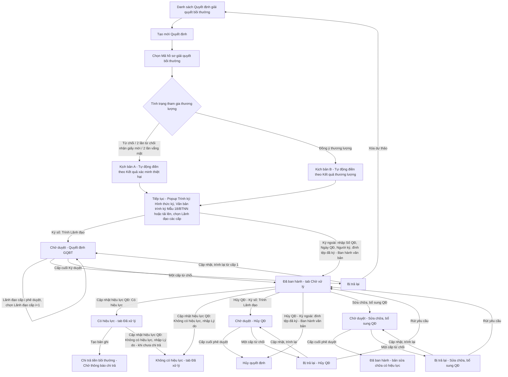
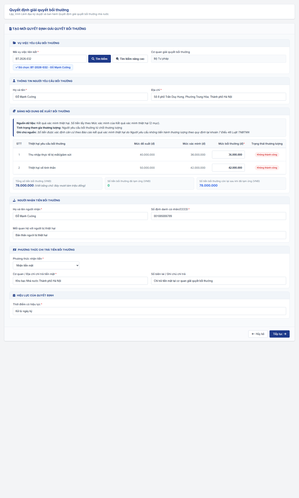
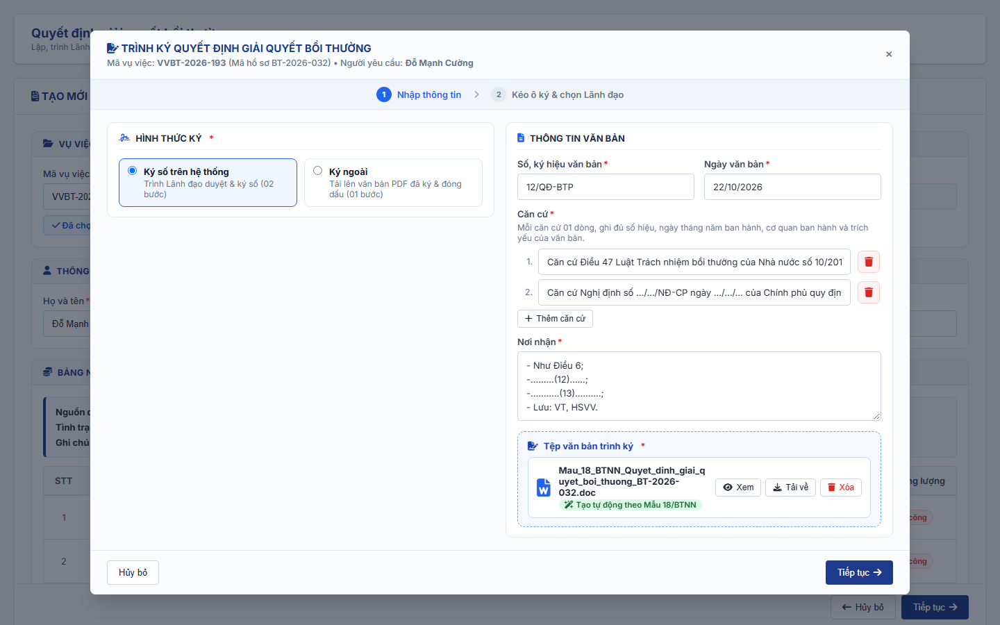
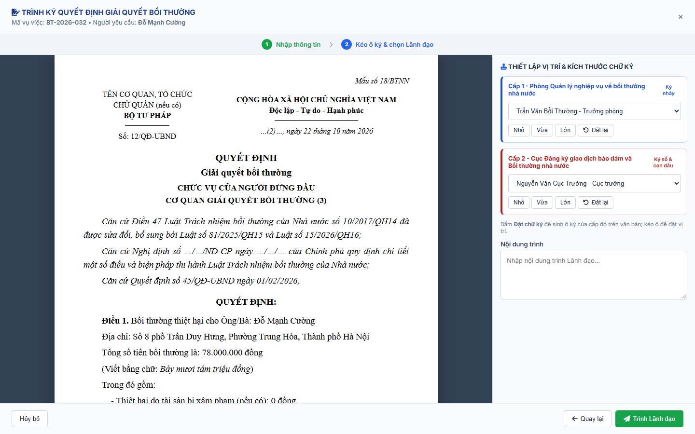

#### 4.3.3.3. Quyết định giải quyết bồi thường

##### 4.3.3.3.1. Mục đích
Quản lý toàn bộ vòng đời của Quyết định giải quyết bồi thường (QĐ GQBT), từ lập dự thảo, trình Lãnh đạo ký duyệt nhiều cấp, ban hành đến hủy hoặc sửa chữa, bổ sung sau ban hành, gồm:
- Tra cứu danh sách quyết định theo Số quyết định, Mã hồ sơ GQBT, Mã vụ việc, trạng thái, Nội dung trình, cơ quan ban hành và khoảng Ngày quyết định.
- Lập dự thảo quyết định với cơ chế tự động điền dữ liệu từ hồ sơ vụ việc yêu cầu bồi thường: thông tin người yêu cầu, bảng đề xuất bồi thường theo Kết quả xác minh thiệt hại hoặc Kết quả thương lượng (căn cứ Tình trạng tham gia thương lượng), thông tin người nhận tiền.
- Văn bản trình ký: hệ thống sinh theo Mẫu 18/BTNN hoặc cán bộ tải lên từ máy.
- Trình Lãnh đạo ký duyệt theo luồng phê duyệt nhiều cấp dùng chung của phân hệ Bồi thường nhà nước; cán bộ chọn Hình thức ký: Ký số trên hệ thống (mặc định) hoặc Ký ngoài.
- Ban hành quyết định:
  + Ký số trên hệ thống: Lãnh đạo cấp cuối Ký duyệt thì quyết định chuyển `Đã ban hành` ngay, không có bước Ban hành riêng của cán bộ.
  + Ký ngoài: cán bộ nhập Số quyết định, Ngày quyết định, Người ký, đính kèm tệp quyết định đã ký và ban hành trực tiếp, không trình Lãnh đạo duyệt trên hệ thống.
- Trình Lãnh đạo phê duyệt yêu cầu Hủy QĐ (Mẫu 20/BTNN) hoặc Sửa chữa, bổ sung QĐ (Mẫu 21/BTNN) đối với quyết định đã ban hành; Ký ngoài thì đính kèm tệp đã ký và ban hành trực tiếp.
- Cập nhật hiệu lực quyết định đã ban hành: `Có hiệu lực` (hệ thống tạo bản ghi Chi trả tiền bồi thường) hoặc `Không có hiệu lực`.
- Danh sách chia 02 tab `Chờ xử lý` / `Đã xử lý`; thao tác trên từng quyết định theo phân quyền Cán bộ xử lý / Lãnh đạo.

a. Phân quyền
- Xem: Tra cứu danh sách theo 02 tab, xem chi tiết quyết định, xem văn bản dự thảo / văn bản đã ký ban hành.
- Cán bộ xử lý (cán bộ chủ trì giải quyết vụ việc): Tạo mới và trình Lãnh đạo ký duyệt; Sửa, Xóa quyết định Bị trả lại; Ban hành trực tiếp (Ký ngoài); Sửa chữa, bổ sung QĐ; Hủy QĐ; Cập nhật hiệu lực QĐ.
- Lãnh đạo: Ký duyệt / Từ chối quyết định `Chờ duyệt` - chỉ Lãnh đạo được giao đích danh tại cấp phê duyệt hiện hành.

b. Điều kiện thực hiện
- Người dùng đã đăng nhập và được cấp quyền truy cập chức năng "Quyết định giải quyết bồi thường".
- Tạo mới quyết định: vụ việc bồi thường bằng tiền (mã `BT-yyyy-xxx`) ở trạng thái `Chờ ban hành QĐ` và chưa có Quyết định giải quyết bồi thường còn hiệu lực (khác `Hủy quyết định`). Vụ việc Phục hồi danh dự (mã `PHDD-yyyy-xxx`) không lập Quyết định giải quyết bồi thường.
- Trình Lãnh đạo: người trình phải là cán bộ chủ trì của hồ sơ luồng của vụ việc.

##### 4.3.3.3.2. Quy tắc chung

| STT | Quy tắc | Mô tả |
| :--- | :--- | :--- |
| 1 | Ký duyệt và Hình thức ký | Lãnh đạo ký duyệt bằng thao tác Ký duyệt / Từ chối trên hệ thống. Hình thức ký do cán bộ chọn khi trình: + `Ký số trên hệ thống` (mặc định): trình Lãnh đạo Ký duyệt trên hệ thống; ký số / không ký số thực hiện theo luồng đã cấu hình tương ứng tại [Cấu hình luồng xử lý - Cấu hình luồng xử lý - Quản trị hệ thống (Website Quản trị)](../01_Quan_tri_he_thong/Cau_hinh_luong_xu_ly.md); Lãnh đạo cấp cuối Ký duyệt thì quyết định chuyển `Đã ban hành` ngay. + `Ký ngoài`: Lãnh đạo ký văn bản giấy ngoài hệ thống; cán bộ nhập Số quyết định, Ngày quyết định, Người ký, đính kèm tệp quyết định đã ký và bấm `Ban hành văn bản`; quyết định chuyển `Đã ban hành` trực tiếp, không trình Lãnh đạo duyệt trên hệ thống. |
| 2 | Trạng thái quyết định | Gồm: + `Chờ duyệt`: Quyết định hoặc yêu cầu Hủy QĐ / Sửa chữa, bổ sung QĐ đang chờ Lãnh đạo phê duyệt. + `Bị trả lại`: Một cấp Lãnh đạo từ chối; cán bộ cập nhật và trình lại. + `Đã ban hành`: Lãnh đạo cấp cuối đã Ký duyệt quyết định (Ký số trên hệ thống) hoặc cán bộ đã ban hành trực tiếp (Ký ngoài); chờ Cán bộ xử lý cập nhật hiệu lực theo quy tắc 18. + `Có hiệu lực`: Cán bộ xử lý đã cập nhật quyết định có hiệu lực theo quy tắc 18. + `Không có hiệu lực`: Cán bộ xử lý đã cập nhật quyết định không có hiệu lực theo quy tắc 18. + `Hủy quyết định`: Yêu cầu Hủy QĐ đã được Lãnh đạo cấp cuối phê duyệt. - Không có trạng thái `Chờ ban hành`. - Dữ liệu cũ: `Chờ ban hành` chuyển `Đã ban hành` và thực hiện liên thông theo quy tắc 9; `Đã hủy` chuyển `Hủy quyết định`. - Trình Hủy QĐ / Sửa chữa, bổ sung QĐ từ quyết định `Đã ban hành`, `Có hiệu lực`: Sửa chữa, bổ sung QĐ được phê duyệt hoặc rút yêu cầu thì quyết định trở về trạng thái trước khi trình. |
| 3 | Nội dung trình | Lưu trong phiếu trình của hồ sơ luồng, phân biệt việc Lãnh đạo đang duyệt, gồm: + `Quyết định GQBT` + `Hủy QĐ` + `Sửa chữa, bổ sung QĐ` - Trên lưới và tiêu đề màn hình chi tiết, dưới badge trạng thái `Chờ duyệt`/`Bị trả lại` hiển thị dòng phụ chỉ gồm tên Nội dung trình, không hiển thị cấp phê duyệt. |
| 4 | Khóa phiếu trình | Phiếu trình dùng Mã vụ việc làm khóa (hồ sơ luồng phân hệ Giải quyết yêu cầu bồi thường). Nếu vụ việc chưa có hồ sơ luồng, khi trình hệ thống tự tạo hồ sơ luồng với cán bộ chủ trì là người trình. Mỗi vụ việc tại một thời điểm chỉ có 01 phiếu trình đang chờ duyệt. |
| 5 | Luồng phê duyệt nhiều cấp | Luồng phê duyệt đi ngược chiều luồng phân công thực tế của hồ sơ; hồ sơ không có lượt phân công thì đi theo cây đơn vị của cán bộ chủ trì lên đơn vị gốc (chỉ gồm đơn vị có nhóm lãnh đạo). Lãnh đạo các cấp do cán bộ chọn khi trình; cấp n ký duyệt thì hồ sơ tự chuyển đến Lãnh đạo cấp n+1 đã chọn. Chỉ Lãnh đạo được giao thấy và thao tác. Chi tiết tại [Quy tắc trình ký - phê duyệt - Xác định cơ quan giải quyết bồi thường - Công tác bồi thường nhà nước (Website Quản trị)](SRS_BTNN_GiaiQuyetBT__Xac%20định%20cơ%20quan%20GQBT.md#xd-quy-tac-phe-duyet). - Các cấp ký duyệt hiển thị theo Cấu hình luồng xử lý tương ứng đơn vị của cán bộ trình, mỗi cấp 01 thẻ tại Bước 2 của popup trình ký. |
| 6 | Trình lại | Hồ sơ `Bị trả lại` khi trình lại bắt đầu lại từ cấp phê duyệt đầu tiên. |
| 7 | Kết quả khi cấp cuối phê duyệt | Trạng thái hồ sơ luồng (resultStatus) và trạng thái quyết định: + `Quyết định GQBT` → hồ sơ luồng `Đã ban hành`; quyết định `Đã ban hành`, xử lý liên thông theo quy tắc 9. + `Hủy QĐ` → hồ sơ luồng `Hủy quyết định`; quyết định `Hủy quyết định`, lưu Lý do hủy Quyết định, Ngày có hiệu lực, Lãnh đạo phê duyệt và thời điểm. + `Sửa chữa, bổ sung QĐ` → hồ sơ luồng `Đã ban hành`; quyết định trở về trạng thái trước khi trình (`Đã ban hành` / `Có hiệu lực`); lưu 01 lần Quyết định sửa chữa, bổ sung đã ban hành (Số quyết định, Ngày quyết định, Hình thức ký, Lãnh đạo ký duyệt, Nội dung sửa chữa, bổ sung, Ngày có hiệu lực, văn bản) vào Khối Quyết định sửa chữa, bổ sung. |
| 8 | Đồng bộ trạng thái | Lãnh đạo Ký duyệt / Từ chối tại tab `Chờ xử lý` của màn này (vai trò Lãnh đạo). Mỗi lần mở danh sách/chi tiết, hệ thống đồng bộ trạng thái quyết định đang `Chờ duyệt` theo phiếu trình cùng Mã vụ việc, cùng Nội dung trình và cùng thời điểm trình: phiếu bị từ chối → `Bị trả lại`; phiếu được cấp cuối phê duyệt → áp dụng quy tắc 7. |
| 9 | Ban hành | Quyết định chuyển `Đã ban hành` khi Lãnh đạo cấp cuối Ký duyệt (Ký số trên hệ thống) hoặc khi cán bộ bấm `Ban hành văn bản` (Ký ngoài). Khi đó hệ thống: - Lưu Số quyết định, Ngày quyết định và văn bản ban hành: + Ký số trên hệ thống: Số quyết định theo `Số, ký hiệu văn bản` đã nhập khi trình; Ngày quyết định là ngày Lãnh đạo cấp cuối Ký duyệt; văn bản ban hành là Văn bản trình ký đã được Ký duyệt. + Ký ngoài: theo thông tin cán bộ nhập tại [MH02b - Popup Trình ký Quyết định giải quyết bồi thường - Quyết định giải quyết bồi thường - Bồi thường nhà nước (Website Quản trị)](#qd-mh02b). - Chuyển hồ sơ luồng của vụ việc sang `Đã ban hành`. - Ghi Số, Ngày quyết định, Số tiền và trạng thái quyết định vào vụ việc; vụ việc đang `Chờ ban hành QĐ` chuyển `Chờ chi trả`. - Quyết định nằm tại tab `Chờ xử lý` của Cán bộ xử lý, hiển thị thao tác `Cập nhật hiệu lực QĐ`. - Chưa tạo bản ghi `Chi trả tiền bồi thường`; bản ghi chỉ được tạo khi quyết định chuyển `Có hiệu lực` theo quy tắc 18. |
| 10 | Văn bản trình ký | Chọn tại [MH02b - Popup Trình ký Quyết định giải quyết bồi thường - Quyết định giải quyết bồi thường - Bồi thường nhà nước (Website Quản trị)](#qd-mh02b), gồm: + `Sinh văn bản theo mẫu 18/BTNN` (mặc định): hệ thống sinh văn bản theo `Mẫu 18_Template` từ dữ liệu đang nhập. + `Tải lên từ máy`: tệp `.pdf`, `.doc`, `.docx`. - Văn bản trình ký được lưu cùng phiếu trình tại thời điểm trình để Lãnh đạo xem đúng bản đã trình. |
| 11 | Trường bắt buộc | - Bỏ trống trường bắt buộc khi bấm nút xử lý: Hệ thống tô viền đỏ ô lỗi, hiển thị [MSG-ERR-VAL-001] dưới ô lỗi và focus vào ô lỗi đầu tiên; không lưu dữ liệu. - Thao tác xóa / rút yêu cầu / ban hành Ký ngoài dùng popup xác nhận của hệ thống. |
| 12 | Ẩn/Hiện khối thông tin theo Mã hồ sơ giải quyết bồi thường | - Khi chưa chọn Mã hồ sơ giải quyết bồi thường, hệ thống ẩn: + (1) Thông tin người yêu cầu bồi thường + (2) Bảng nội dung đề xuất bồi thường + (3) Người nhận tiền bồi thường + (4) Phương thức chi trả tiền bồi thường + (5) Hiệu lực của Quyết định + Nút `Tiếp tục` - Chỉ hiển thị khi đã chọn được Mã hồ sơ giải quyết bồi thường hợp lệ. |
| 13 | Phương thức chi trả tiền bồi thường | Nguồn dữ liệu theo `Tình trạng tham gia thương lượng` tại [Quy tắc tự động điền khi chọn Mã hồ sơ giải quyết bồi thường - Quyết định giải quyết bồi thường - Bồi thường nhà nước (Website Quản trị)](#qd-quy-tac-tu-dong-dien). Gồm: + `Nhận qua chuyển khoản`: bắt buộc Chủ tài khoản, Số tài khoản ngân hàng, Tên ngân hàng; Chi nhánh ngân hàng không bắt buộc. + `Nhận tiền mặt`: bắt buộc Cơ quan / Địa chỉ chi trả tiền mặt; Số biên lai / Ghi chú chi trả không bắt buộc. |
| 14 | Tab danh sách theo vai trò | Danh sách chia 02 tab theo vai trò: - Cán bộ xử lý: + `Chờ xử lý`: quyết định `Chờ duyệt`, `Bị trả lại`, `Đã ban hành`. + `Đã xử lý`: quyết định `Có hiệu lực`, `Không có hiệu lực`, `Hủy quyết định`. - Lãnh đạo: + `Chờ xử lý`: quyết định `Chờ duyệt` mà người dùng là Lãnh đạo được giao ở cấp phê duyệt hiện hành. + `Đã xử lý`: quyết định người dùng đã Ký duyệt / Từ chối. |
| 15 | Thao tác theo phân quyền | Thao tác trên từng quyết định (tại lưới danh sách hoặc khi xem chi tiết) theo vai trò: - Cán bộ xử lý: Sửa, Xóa, Sửa chữa, bổ sung QĐ, Hủy QĐ, Cập nhật hiệu lực QĐ; tab `Đã xử lý` không có Sửa, Xóa. - Lãnh đạo: Ký duyệt, Từ chối; áp dụng cho cả 03 Loại trình. - Quyết định `Không có hiệu lực`: không cho phép thực hiện thao tác nào (danh sách hiển thị các thao tác khóa mờ), chỉ Xem chi tiết; thao tác được gọi trên quyết định này: hệ thống hiển thị cảnh báo `Quyết định Không có hiệu lực, không cho phép thực hiện thao tác.`, không xử lý. - Điều kiện cho phép từng thao tác theo cột Thao tác tại [MH01 - Màn hình Danh sách Quyết định giải quyết bồi thường - Quyết định giải quyết bồi thường - Bồi thường nhà nước (Website Quản trị)](#qd-mh01). |
| 16 | Quyết định gốc và Quyết định sửa chữa, bổ sung | - Quyết định sửa chữa, bổ sung không tạo bản ghi quyết định mới; được lưu trên chính bản ghi Quyết định giải quyết bồi thường (Quyết định gốc). - Mỗi Quyết định gốc có thể có nhiều lần sửa chữa, bổ sung; tại một thời điểm chỉ có 01 dự thảo đang trình. - Số quyết định, Ngày quyết định, Hình thức ký, Số tiền, văn bản tại Khối Thông tin chung và Khối Văn bản luôn là của Quyết định gốc; không thay đổi khi sửa chữa, bổ sung. - Dự thảo đang trình và các lần đã ban hành hiển thị tại Khối Quyết định sửa chữa, bổ sung trên màn hình chi tiết của Quyết định gốc. - Lưới danh sách hiển thị 01 dòng cho Quyết định gốc; khi đang trình sửa chữa, bổ sung, trạng thái `Chờ duyệt` / `Bị trả lại` kèm dòng phụ `Sửa chữa, bổ sung QĐ`. |
| 17 | Tài liệu ban hành kèm theo / Tài liệu không ban hành kèm theo | - Popup trình ký Quyết định GQBT, Hủy QĐ, Sửa chữa, bổ sung QĐ: `Ký số trên hệ thống` có 02 khối `Tài liệu ban hành kèm theo`, `Tài liệu không ban hành kèm theo`; `Ký ngoài` chỉ có khối `Tài liệu ban hành kèm theo`. - Popup Hủy Quyết định giải quyết bồi thường, `Ký số trên hệ thống`: khối `Tài liệu không ban hành kèm theo` bắt buộc tối thiểu 01 dòng có đủ `Tên tài liệu, văn bản` và tệp. - Màn hình Ký duyệt / Từ chối và màn hình Chi tiết Quyết định (Quyết định gốc, Quyết định hủy, Quyết định sửa chữa, bổ sung, dự thảo đang trình): hiển thị 02 khối riêng; mỗi khối chỉ hiển thị khi có dữ liệu; khối `Tài liệu không ban hành kèm theo` chỉ hiển thị với đơn vị trình (đơn vị giải quyết bồi thường của hồ sơ). - Quy tắc tại [Quy tắc Tài liệu ban hành kèm theo / Tài liệu không ban hành kèm theo - Xác định cơ quan giải quyết bồi thường - Công tác bồi thường nhà nước (Website Quản trị)](SRS_BTNN_GiaiQuyetBT__Xac%20định%20cơ%20quan%20GQBT.md#xd-tai-lieu-trinh-ky). |
| 18 | Hiệu lực của Quyết định | - Cán bộ xử lý cập nhật hiệu lực tại [MH06 - Popup Cập nhật hiệu lực Quyết định giải quyết bồi thường - Quyết định giải quyết bồi thường - Bồi thường nhà nước (Website Quản trị)](#qd-mh-hieu-luc), gồm: + `Đã ban hành` → `Có hiệu lực`: không nhập Lý do cập nhật trạng thái; quyết định chuyển tab `Đã xử lý`; hệ thống tạo 01 bản ghi `Chi trả tiền bồi thường` trạng thái `Chờ thông báo chi trả` theo [Luồng Chi trả tiền bồi thường - Tạm ứng kinh phí bồi thường/Chi trả tiền bồi thường - Bồi thường nhà nước (Website Quản trị)](SRS_BTNN_GiaiQuyetBT_KinhPhi_BT.md#kp-chi-tra-tien-bt) và [Ánh xạ dữ liệu liên thông sang Module Quản lý kinh phí bồi thường - Quyết định giải quyết bồi thường - Bồi thường nhà nước (Website Quản trị)](#bang-anh-xa-lien-thong-kinh-phi). + `Đã ban hành` → `Không có hiệu lực`: bắt buộc nhập Lý do cập nhật trạng thái; quyết định chuyển tab `Đã xử lý`; không tạo bản ghi `Chi trả tiền bồi thường`. + `Có hiệu lực` → `Không có hiệu lực`: bắt buộc nhập Lý do cập nhật trạng thái; chỉ cho phép khi khoản Chi trả tiền bồi thường của Quyết định chưa chi trả: bản ghi Chi trả tiền bồi thường chưa ở trạng thái `Hoàn thành`, `Trả lại ngân sách nhà nước` và chưa có số tiền chi trả thực tế; kiểm tra lại khi lưu. - `Không có hiệu lực` là trạng thái cuối: không cho phép cập nhật lại, không cho phép Sửa chữa, bổ sung QĐ, Hủy QĐ hay thao tác khác theo quy tắc 15. - Mỗi bản ghi chỉ tạo 01 bản ghi `Chi trả tiền bồi thường`; quyết định đã có bản ghi thì không tạo thêm. - Dữ liệu cũ: quyết định `Đã ban hành` đã có bản ghi `Chi trả tiền bồi thường` chuyển `Có hiệu lực`; chưa có bản ghi giữ `Đã ban hành`. - Quyết định `Không có hiệu lực`: bản ghi Chi trả tiền bồi thường của Quyết định (nếu có) giữ nguyên trạng thái, không cho phép `Trình thông báo chi trả`, `Cập nhật chi trả`, theo [Quyết định không có hiệu lực - Tạm ứng kinh phí bồi thường/Chi trả tiền bồi thường - Bồi thường nhà nước (Website Quản trị)](SRS_BTNN_GiaiQuyetBT_KinhPhi_BT.md#kp-qd-khong-hieu-luc). |

**Quy tắc tự động điền khi chọn Mã hồ sơ giải quyết bồi thường**

Dữ liệu vụ việc lấy từ danh sách vụ việc của [MH03 - Màn hình Cập nhật kết quả xử lý hồ sơ yêu cầu bồi thường - Giải quyết yêu cầu bồi thường - Bồi thường nhà nước (Website Quản trị)](SRS_BTNN_GiaiQuyetBT_GiaiQuyet_YCBT.md#mh03-mo-ta-thong-tin-xu-ly-ho-so). Chỉ áp dụng cho vụ việc bồi thường bằng tiền (mã `BT-yyyy-xxx`, loại yêu cầu khác Phục hồi danh dự); vụ việc Phục hồi danh dự (mã `PHDD-yyyy-xxx`) không thuộc phạm vi Quyết định giải quyết bồi thường.

Nguồn số tiền được xác định theo `Tình trạng tham gia thương lượng` đã cập nhật tại [Thương lượng việc bồi thường - Giải quyết yêu cầu bồi thường - Bồi thường nhà nước (Website Quản trị)](SRS_BTNN_GiaiQuyetBT_GiaiQuyet_YCBT.md#gq-thuong-luong), gồm: + `Người yêu cầu bồi thường từ chối thương lượng` + `Người yêu cầu bồi thường hai lần từ chối nhận giấy mời tham gia thương lượng` + `Người yêu cầu bồi thường hai lần không đến địa điểm thương lượng khi đã nhận giấy mời mà không có lý do chính đáng` + `Đồng ý thương lượng`

Tương thích dữ liệu cũ: kết quả thương lượng cũ "Từ chối thương lượng" được hiểu là `Người yêu cầu bồi thường từ chối thương lượng`; "Đồng ý thương lượng" giữ nguyên `Đồng ý thương lượng`.

| STT | Trường hợp | Nguồn Bảng đề xuất bồi thường | Số tiền bồi thường (giá trị nguồn) | Ghi chú nguồn |
| :--- | :--- | :--- | :--- | :--- |
| 1 | **Kịch bản A** - Tình trạng tham gia thương lượng là: + `Người yêu cầu bồi thường từ chối thương lượng` + `Người yêu cầu bồi thường hai lần từ chối nhận giấy mời tham gia thương lượng` + `Người yêu cầu bồi thường hai lần không đến địa điểm thương lượng khi đã nhận giấy mời mà không có lý do chính đáng` hoặc vụ việc không có kết quả thương lượng | Kết quả xác minh thiệt hại: mỗi dòng thiệt hại đã xác minh là 01 dòng (Thiệt hại yêu cầu bồi thường, Mức đề xuất, Mức xác minh). Vụ việc chưa có danh sách xác minh theo cấu trúc mới thì lấy theo danh sách thiệt hại yêu cầu (Mức đề xuất) và Mức xác minh đã cập nhật trên từng dòng thiệt hại (thiếu Mức xác minh thì lấy Mức đề xuất). | Mức bồi thường = Mức xác minh. Với 03 trường hợp từ chối / không tham gia thương lượng: Trạng thái thương lượng từng dòng = `Không thành công`. | "Số tiền được xác định căn cứ theo Báo cáo kết quả xác minh thiệt hại do Người yêu cầu không tiến hành thương lượng theo quy định tại khoản 7 Điều 46 Luật TNBTNN" |
| 2 | **Kịch bản B** - Tình trạng tham gia thương lượng là `Đồng ý thương lượng` và có kết quả thương lượng từng thiệt hại | Kết quả thương lượng: mỗi mục chi tiết thiệt hại thương lượng là 01 dòng, gồm Mức đề xuất, Mức xác minh, Mức tiền bồi thường đã thương lượng, Trạng thái thương lượng. Hệ thống đếm số mục `Thành công`, `Không thành công`, `Không tiếp tục thương lượng`, hiển thị trên dòng Nguồn dữ liệu. | Mức bồi thường theo Trạng thái thương lượng của từng mục: + `Thành công`: Mức tiền bồi thường đã thương lượng. + `Không thành công`: Mức xác minh; không có Mức xác minh thì bằng 0. + `Không tiếp tục thương lượng`: không chuyển sang Bảng nội dung đề xuất bồi thường. | "Số tiền được xác định căn cứ theo Biên bản thương lượng giải quyết bồi thường" |
| 3 | `Đồng ý thương lượng` nhưng chưa có kết quả thương lượng từng thiệt hại | Kết quả xác minh thiệt hại như trường hợp 1. | Mức xác minh. | Không hiển thị. |
| 4 | Vụ việc không có danh sách thiệt hại | 01 dòng "Thiệt hại yêu cầu bồi thường". | Tổng số tiền đã xác minh của vụ việc; không có thì Tổng số tiền yêu cầu. | Theo trường hợp 1 hoặc 3 tương ứng với Tình trạng tham gia thương lượng. |

Bảng đề xuất bồi thường lấy dữ liệu theo từng mục chi tiết của [Danh mục Loại thiệt hại yêu cầu bồi thường - Danh mục dữ liệu dùng chung - Tổng quan và quy tắc chung](../../Tai%20lieu%20tong%20hop/00_Tong_quan_va_Quy_tac_chung.md#danh-muc-dung-chung) [DM_27]; dữ liệu cũ lưu theo 06 loại thiệt hại được quy đổi sang mục chi tiết đầu tiên của nhóm tương ứng, giữ nguyên số tiền.

Khối Nguồn dữ liệu hiển thị phía trên Bảng nội dung đề xuất bồi thường (MH02, MH03), gồm: Nguồn dữ liệu, Tình trạng tham gia thương lượng (vụ việc có kết quả thương lượng), Ghi chú nguồn. Các thông tin này được lưu cùng quyết định khi trình và phục vụ phần Căn cứ của văn bản Mẫu 18/BTNN.

**Nguồn dữ liệu theo Tình trạng tham gia thương lượng**

| STT | Nhóm thông tin | Tình trạng tham gia thương lượng = `Đồng ý thương lượng` | Tình trạng tham gia thương lượng khác `Đồng ý thương lượng` |
| :--- | :--- | :--- | :--- |
| 1 | Bảng nội dung đề xuất bồi thường | - Lấy theo [Khối Kết quả thương lượng theo từng thiệt hại yêu cầu bồi thường - Giải quyết yêu cầu bồi thường - Bồi thường nhà nước (Website Quản trị)](SRS_BTNN_GiaiQuyetBT_GiaiQuyet_YCBT.md#gq-ket-qua-thuong-luong). - Chi tiết theo Kịch bản B; chưa có kết quả thương lượng từng thiệt hại thì theo trường hợp 3. | - Lấy theo Kết quả xác minh thiệt hại tại [Khối Xác minh thiệt hại thực tế - Giải quyết yêu cầu bồi thường - Bồi thường nhà nước (Website Quản trị)](SRS_BTNN_GiaiQuyetBT_GiaiQuyet_YCBT.md#gq-khoi-xac-minh). - Chi tiết theo Kịch bản A. |
| 2 | Người nhận tiền bồi thường | - Lấy theo [Khối Phương thức chi trả tiền bồi thường của Kết quả thương lượng - Giải quyết yêu cầu bồi thường - Bồi thường nhà nước (Website Quản trị)](SRS_BTNN_GiaiQuyetBT_GiaiQuyet_YCBT.md#gq-pt-chi-tra-thuong-luong). - Họ và tên người nhận: theo `Họ và tên người nhận tiền`. - Số định danh cá nhân/CCCD: theo `Số giấy tờ thân nhân người nhận`. | - Lấy theo `Thông tin người nhận tiền` đã nhập ở bước Tiếp nhận tại [Khối Thông tin người nhận tiền - Màn hình Nhập liệu hồ sơ vụ việc - Giải quyết yêu cầu bồi thường - Bồi thường nhà nước (Website Quản trị)](SRS_BTNN_GiaiQuyetBT_GiaiQuyet_YCBT.md#mh02-thong-tin-nguoi-nhan-tien). - Họ và tên người nhận: theo `Họ và tên người nhận tiền`. - Số định danh cá nhân/CCCD: theo `Số giấy tờ thân nhân người nhận`. |
| 3 | Phương thức chi trả tiền bồi thường | - Lấy theo [Khối Phương thức chi trả tiền bồi thường của Kết quả thương lượng - Giải quyết yêu cầu bồi thường - Bồi thường nhà nước (Website Quản trị)](SRS_BTNN_GiaiQuyetBT_GiaiQuyet_YCBT.md#gq-pt-chi-tra-thuong-luong). - Gồm Phương thức chi trả, Chủ tài khoản, Số tài khoản, Ngân hàng, Chi nhánh, Số biên lai nhận tiền mặt. | - Lấy theo `Thông tin người nhận tiền` đã nhập ở bước Tiếp nhận tại [Khối Thông tin người nhận tiền - Màn hình Nhập liệu hồ sơ vụ việc - Giải quyết yêu cầu bồi thường - Bồi thường nhà nước (Website Quản trị)](SRS_BTNN_GiaiQuyetBT_GiaiQuyet_YCBT.md#mh02-thong-tin-nguoi-nhan-tien). - Gồm Phương thức chi trả, Chủ tài khoản, Số tài khoản, Ngân hàng, Chi nhánh. |
| 4 | Thông tin người yêu cầu bồi thường | - Lấy theo thông tin đã ghi trong hồ sơ ban đầu khi nhập liệu tại [MH02 - Màn hình Nhập liệu hồ sơ vụ việc - Giải quyết yêu cầu bồi thường - Bồi thường nhà nước (Website Quản trị)](SRS_BTNN_GiaiQuyetBT_GiaiQuyet_YCBT.md). | - Như cột `Đồng ý thương lượng`. |
| 5 | Số tiền bồi thường đã tạm ứng | - Tổng số tiền đã tạm ứng của vụ việc. | - Như cột `Đồng ý thương lượng`. |

Quy tắc chi tiết các trường:
- Họ và tên người yêu cầu: Họ và tên người yêu cầu bồi thường của vụ việc.
- Địa chỉ: tự ghép theo thứ tự Địa chỉ chi tiết (số nhà/đường), Phường/Xã, Tỉnh/Thành phố, phân cách bằng dấu phẩy; bỏ mã đơn vị hành chính và không lặp lại phần đã có trong Địa chỉ chi tiết. Vụ việc chỉ có địa chỉ dạng một chuỗi thì lấy nguyên chuỗi đó.
- Cơ quan ban hành: không hiển thị tại MH02, lưu cùng quyết định; lấy theo đơn vị gốc của hồ sơ luồng; vụ việc chưa có hồ sơ luồng thì lấy theo tên cơ quan giải quyết của vụ việc, không đối chiếu được thì lấy đơn vị gốc của cán bộ đang thao tác.

##### 4.3.3.3.3. Sơ đồ luồng nghiệp vụ theo giao diện

---

##### 4.3.3.3.4. MH01 - Màn hình Danh sách Quyết định giải quyết bồi thường

###### 4.3.3.3.4.1. Màn hình

###### 4.3.3.3.4.2. Mô tả thông tin trên màn hình

| Trường thông tin | Kiểu dữ liệu | Bắt buộc | Mặc định | Mô tả |
| :--- | :--- | :--- | :--- | :--- |
| **Tiêu đề màn hình** | String(200) | - | `Quyết định giải quyết bồi thường` | Control UI: Label. |
| **Thanh tab** | Tab | - | `Chờ xử lý` | Control UI: Tab. - Gồm 02 tab `Chờ xử lý`, `Đã xử lý`. - Badge số lượng tại mục menu `Quyết định giải quyết bồi thường`: số bản ghi thuộc tab `Chờ xử lý` của người dùng. - Số này được cộng vào badge nhóm menu `Giải quyết bồi thường` theo [Tab Chờ xử lý - Giải quyết yêu cầu bồi thường - Công tác bồi thường nhà nước (Website Quản trị)](SRS_BTNN_GiaiQuyetBT_GiaiQuyet_YCBT.md). - Phạm vi dữ liệu của tab theo vai trò tại quy tắc 14 tại [Quy tắc chung - Quyết định giải quyết bồi thường - Bồi thường nhà nước (Website Quản trị)](#qd-quy-tac-chung). |
| **Khối Bộ lọc tìm kiếm** | Section | - | Mở rộng | Control UI: Khối thu gọn/mở rộng. - Khi thu gọn, các giá trị lọc đã nhập được giữ nguyên. |
| Số quyết định | String(50) | Không | Trống | Control UI: Input text. - Placeholder: `Nhập số quyết định...` - Tìm gần đúng, không phân biệt hoa thường, tự động bỏ khoảng trắng đầu/cuối. |
| Mã hồ sơ GQBT | String(50) | Không | Trống | Control UI: Input text. - Placeholder: `Nhập mã hồ sơ GQBT...` - Tìm gần đúng theo Mã hồ sơ giải quyết bồi thường (`BT-yyyy-xxx`), không phân biệt hoa thường, tự động bỏ khoảng trắng đầu/cuối. |
| Mã vụ việc | String(50) | Không | Trống | Control UI: Input text. - Placeholder: `Nhập mã vụ việc...` - Tìm gần đúng theo Mã vụ việc (`VVBT-yyyy-xxx`), không phân biệt hoa thường, tự động bỏ khoảng trắng đầu/cuối. |
| Cơ quan ban hành | Enum(String(255)) | Không | `Tất cả` | Control UI: Dropdown. - Danh sách cơ quan ban hành có trong dữ liệu quyết định. |
| Trạng thái | Enum(String(50)) | Không | `Tất cả` | Control UI: Dropdown. - Tab `Chờ xử lý` (Cán bộ xử lý), gồm: + `Tất cả` + `Chờ duyệt` + `Bị trả lại` + `Đã ban hành` - Tab `Đã xử lý` (Cán bộ xử lý), gồm: + `Tất cả` + `Có hiệu lực` + `Không có hiệu lực` + `Hủy quyết định` - Tab `Chờ xử lý` (Lãnh đạo), gồm: + `Tất cả` + `Chờ duyệt` - Tab `Đã xử lý` (Lãnh đạo), gồm: + `Tất cả` + `Chờ duyệt` + `Bị trả lại` + `Đã ban hành` + `Có hiệu lực` + `Không có hiệu lực` + `Hủy quyết định` |
| Nội dung trình | Enum(String(100)) | Không | `Tất cả` | Control UI: Dropdown. - Chỉ áp dụng cho quyết định ở trạng thái `Chờ duyệt` hoặc `Bị trả lại`. - Gồm: + `Tất cả` + `Quyết định GQBT` + `Hủy QĐ` + `Sửa chữa, bổ sung QĐ` |
| Từ ngày | Date | Không | Trống | Control UI: DatePicker. - Placeholder: `dd/mm/yyyy` - Lọc quyết định có Ngày quyết định từ ngày này. |
| Đến ngày | Date | Không | Trống | Control UI: DatePicker. - Placeholder: `dd/mm/yyyy` - Lọc quyết định có Ngày quyết định đến ngày này. - Từ ngày không được lớn hơn Đến ngày. |
| **Bảng danh sách quyết định** | List(Object) | - | 10 bản ghi/trang | Control UI: Data grid. - Click vào dòng (trừ liên kết và nút thao tác): mở [MH03 - Màn hình Chi tiết Quyết định giải quyết bồi thường - Quyết định giải quyết bồi thường - Bồi thường nhà nước (Website Quản trị)](#qd-mh03). - Không có dữ liệu: hiển thị `Không tìm thấy dữ liệu phù hợp với điều kiện tìm kiếm.` |
| STT | Integer | - | Tự tăng | Control UI: Label. - Tăng theo phân trang. |
| Số quyết định | String(50) | - | - | Control UI: Label. - Theo dữ liệu bản ghi. - Chưa ban hành: hiển thị `Chưa cấp số`. |
| Ngày quyết định | Date | - | - | Control UI: Label. - Theo dữ liệu bản ghi, định dạng `dd/mm/yyyy`. - Chưa ban hành: hiển thị `-`. |
| Tổng số tiền bồi thường (VNĐ) | Decimal(18,0) | - | - | Control UI: Label. - Theo dữ liệu bản ghi. - Phân cách hàng nghìn bằng dấu chấm. |
| Lãnh đạo ký duyệt | String(100) | - | - | Control UI: Label. - Theo dữ liệu bản ghi. - Đã ban hành: Lãnh đạo đã Ký duyệt cấp cuối (Ký ngoài: Người ký). - Chưa ban hành: Lãnh đạo cấp 1 được trình ký. |
| Cơ quan ban hành | String(255) | - | - | Control UI: Label. - Theo dữ liệu bản ghi. |
| Mã hồ sơ GQBT | String(50) | - | - | Control UI: Hyperlink. - Theo dữ liệu bản ghi (`BT-yyyy-xxx`). - Click: mở màn hình xem chi tiết hồ sơ tại [Giải quyết yêu cầu bồi thường - Giải quyết yêu cầu bồi thường - Bồi thường nhà nước (Website Quản trị)](SRS_BTNN_GiaiQuyetBT_GiaiQuyet_YCBT.md). |
| Mã vụ việc | String(50) | - | - | Control UI: Label. - Theo dữ liệu bản ghi (`VVBT-yyyy-xxx`). |
| Trạng thái | Enum(String(50)) | - | - | Control UI: Badge. - Theo dữ liệu bản ghi. - Dưới badge hiển thị dòng phụ Nội dung trình theo quy tắc 3 tại [Quy tắc chung - Quyết định giải quyết bồi thường - Bồi thường nhà nước (Website Quản trị)](#qd-quy-tac-chung). - Giá trị theo quy tắc 2: `Chờ duyệt`, `Bị trả lại`, `Đã ban hành`, `Có hiệu lực`, `Không có hiệu lực`, `Đã hủy`. |
| Thao tác | Action Buttons | - | - | Control UI: Icon button group. - Vai trò Cán bộ xử lý, thứ tự: + `Sửa`: cho phép khi trạng thái `Bị trả lại`. + `Xóa`: cho phép khi trạng thái `Bị trả lại`; Nội dung trình `Quyết định GQBT` là xóa dự thảo, `Hủy QĐ` / `Sửa chữa, bổ sung QĐ` là rút yêu cầu. + `Sửa chữa, bổ sung QĐ`: cho phép khi trạng thái `Đã ban hành`, `Có hiệu lực`. + `Hủy QĐ`: cho phép khi trạng thái `Đã ban hành`, `Có hiệu lực`. + `Cập nhật hiệu lực QĐ`: cho phép khi trạng thái `Đã ban hành`, hoặc `Có hiệu lực` và khoản Chi trả tiền bồi thường của Quyết định chưa chi trả theo quy tắc 18 tại [Quy tắc chung - Quyết định giải quyết bồi thường - Bồi thường nhà nước (Website Quản trị)](#qd-quy-tac-chung). + `Cập nhật hiệu lực QĐ` không được phép, tooltip: + Bản ghi `Hoàn thành` hoặc đã có số tiền chi trả thực tế: `Cập nhật hiệu lực QĐ: Quyết định đã hoàn thành chi trả, không cho phép cập nhật hiệu lực`. + Bản ghi `Trả lại ngân sách nhà nước`: `Cập nhật hiệu lực QĐ: Khoản chi trả của Quyết định đã Trả lại ngân sách nhà nước, không cho phép cập nhật hiệu lực`. - Cán bộ xử lý, tab `Chờ xử lý`: mỗi dòng hiển thị đủ các thao tác ở vị trí cố định; thao tác không được phép theo trạng thái hiển thị khóa mờ, không cho thao tác. - Cán bộ xử lý, tab `Đã xử lý`: không hiển thị `Sửa`, `Xóa`; các thao tác còn lại hiển thị ở vị trí cố định, thao tác không được phép hiển thị khóa mờ. - Quyết định `Không có hiệu lực`: `Sửa chữa, bổ sung QĐ`, `Hủy QĐ`, `Cập nhật hiệu lực QĐ` hiển thị khóa mờ, không cho thao tác, tooltip `[Tên thao tác]: Quyết định Không có hiệu lực`; Xem chi tiết khi bấm vào dòng. - Vai trò Lãnh đạo, thứ tự: + `Ký duyệt` + `Từ chối` - Lãnh đạo: chỉ hiển thị khi quyết định `Chờ duyệt` và người dùng là Lãnh đạo được giao đích danh tại cấp phê duyệt hiện hành; quyết định khác không hiển thị thao tác. - Lãnh đạo, tab `Đã xử lý`: không hiển thị cột `Thao tác`. |
| Phân trang | Pagination | - | 10 | Control UI: Pagination. - Số dòng hiển thị: 10, 20, 50. - Nút Đầu, Trước, số trang, Sau, Cuối. - Hiển thị `Hiển thị [từ]-[đến] trong tổng số [n] bản ghi`. |

###### 4.3.3.3.4.3. Chức năng trên màn hình

| STT | Tên chức năng | Định dạng | Mô tả |
| :--- | :--- | :--- | :--- |
| 1 | Tìm kiếm | Button | Hệ thống kiểm tra dữ liệu và xử lý theo các trường hợp bên dưới: - **TH1 - Từ ngày lớn hơn Đến ngày**: Hệ thống tô viền đỏ ô Từ ngày, hiển thị `Từ ngày không được lớn hơn Đến ngày` dưới ô; không tìm kiếm. - **TH Hợp lệ**: Lọc đồng thời theo các tiêu chí (Từ ngày, Đến ngày so với Ngày quyết định), về Trang 1. |
| 2 | Xóa bộ lọc | Button | Đưa bộ lọc về giá trị mặc định và tải lại danh sách. |
| 3 | Tạo mới Quyết định | Button | - Chỉ hiển thị với vai trò Cán bộ xử lý. - Mở [MH02 - Màn hình Lập/Cập nhật Quyết định giải quyết bồi thường - Quyết định giải quyết bồi thường - Bồi thường nhà nước (Website Quản trị)](#qd-mh02) ở chế độ tạo mới. |
| 4 | Kết xuất Excel | Button | - **TH1 - Không có dữ liệu**: Hệ thống hiển thị `Không có dữ liệu để kết xuất Excel.` - **TH Hợp lệ**: Kết xuất theo kết quả lọc hiện hành. |
| 5 | Mã hồ sơ GQBT | Hyperlink | Mở màn hình xem chi tiết hồ sơ giải quyết bồi thường tương ứng. |
| 6 | Ký duyệt / Từ chối | Icon button | - Chỉ hiển thị khi: vai trò Lãnh đạo, quyết định `Chờ duyệt` (cả 03 Loại trình) và người dùng là Lãnh đạo được giao đích danh tại cấp phê duyệt hiện hành. - Mở [MH07 - Màn hình Ký duyệt / Từ chối - Quyết định giải quyết bồi thường - Bồi thường nhà nước (Website Quản trị)](#qd-mh07) theo thao tác đã chọn: + `Ký duyệt`: thao tác Ký duyệt. + `Từ chối`: thao tác Từ chối. |
| 7 | Sửa (Quyết định GQBT) | Icon button | Mở [MH02 - Màn hình Lập/Cập nhật Quyết định giải quyết bồi thường - Quyết định giải quyết bồi thường - Bồi thường nhà nước (Website Quản trị)](#qd-mh02) ở chế độ cập nhật, hiển thị Khối Lý do bị trả lại. |
| 8 | Xóa | Icon button | Hiển thị popup xác nhận `Xóa dự thảo Quyết định giải quyết bồi thường của vụ việc [Mã hồ sơ GQBT] - [Người yêu cầu]?`, nút `Hủy bỏ`, `Xóa`. Bấm `Xóa`: - Xóa quyết định; hồ sơ luồng của vụ việc trở về trạng thái trước khi trình. - Hiển thị `Đã xóa dự thảo Quyết định.`, tải lại danh sách. |
| 9 | Sửa (Hủy QĐ / Sửa chữa, bổ sung QĐ) | Icon button | Mở popup theo Nội dung trình với dữ liệu lần trình trước và lý do bị trả lại: - `Hủy QĐ`: [MH05 - Popup Hủy Quyết định giải quyết bồi thường - Quyết định giải quyết bồi thường - Bồi thường nhà nước (Website Quản trị)](#qd-mh05). - `Sửa chữa, bổ sung QĐ`: [MH05b - Popup Trình ký Quyết định Sửa chữa, Bổ sung Quyết định giải quyết bồi thường - Quyết định giải quyết bồi thường - Bồi thường nhà nước (Website Quản trị)](#qd-mh05b). |
| 10 | Xóa (rút yêu cầu Hủy QĐ / Sửa chữa, bổ sung QĐ) | Icon button | Hiển thị popup xác nhận `Rút yêu cầu [Nội dung trình] đối với Quyết định [Số quyết định]? Quyết định giữ nguyên trạng thái [Trạng thái trước khi trình].`, nút `Hủy bỏ`, `Đồng ý`. Bấm `Đồng ý`: - Quyết định trở về trạng thái trước khi trình (`Đã ban hành` / `Có hiệu lực` / `Không có hiệu lực`); hồ sơ luồng về `Đã ban hành`. - Ghi Lịch sử xử lý `Rút yêu cầu`. - Hiển thị `Đã rút yêu cầu.`, tải lại danh sách. |
| 11 | Sửa chữa, bổ sung QĐ / Hủy QĐ | Icon button | - `Sửa chữa, bổ sung QĐ`: mở [MH05b - Popup Trình ký Quyết định Sửa chữa, Bổ sung Quyết định giải quyết bồi thường - Quyết định giải quyết bồi thường - Bồi thường nhà nước (Website Quản trị)](#qd-mh05b). - `Hủy QĐ`: mở [MH05 - Popup Hủy Quyết định giải quyết bồi thường - Quyết định giải quyết bồi thường - Bồi thường nhà nước (Website Quản trị)](#qd-mh05). |
| 12 | Chọn tab | Tab | Tải danh sách theo tab và vai trò, về Trang 1. |
| 13 | Cập nhật hiệu lực QĐ | Icon button | - Chỉ cho phép theo điều kiện tại cột Thao tác. - Mở [MH06 - Popup Cập nhật hiệu lực Quyết định giải quyết bồi thường - Quyết định giải quyết bồi thường - Bồi thường nhà nước (Website Quản trị)](#qd-mh-hieu-luc). |

---

##### 4.3.3.3.5. MH02 - Màn hình Lập/Cập nhật Quyết định giải quyết bồi thường

###### 4.3.3.3.5.1. Màn hình

###### 4.3.3.3.5.2. Mô tả thông tin trên màn hình

| Trường thông tin | Kiểu dữ liệu | Bắt buộc | Mặc định | Mô tả |
| :--- | :--- | :--- | :--- | :--- |
| **Tiêu đề** | String(200) | - | Theo chế độ | Control UI: Label. - Tạo mới: `TẠO MỚI QUYẾT ĐỊNH GIẢI QUYẾT BỒI THƯỜNG`. - Cập nhật: `CẬP NHẬT QUYẾT ĐỊNH GIẢI QUYẾT BỒI THƯỜNG`. |
| **Khối Lý do bị trả lại** | Section | - | Ẩn | Control UI: Alert panel (Read-only). - Chỉ hiển thị khi cập nhật quyết định `Bị trả lại`. - Tiêu đề: `LÝ DO BỊ TRẢ LẠI`. - Nội dung: `Người từ chối: [Họ tên - Chức vụ] - [dd/mm/yyyy HH:mm]` và Lý do bị trả lại. |
| **Khối Vụ việc yêu cầu bồi thường** | Section | - | - | Control UI: Section. |
| Mã hồ sơ giải quyết bồi thường | String(100) | Có | Trống | Control UI: Input text có danh sách gợi ý. - Placeholder: `Nhập hoặc chọn mã hồ sơ giải quyết bồi thường...` - Danh sách gợi ý: hồ sơ đủ điều kiện trong phạm vi đơn vị của người đăng nhập, hiển thị `[Mã hồ sơ GQBT]` kèm `[Mã vụ việc] - [Người yêu cầu]`; chọn 01 dòng thì hệ thống tự chọn hồ sơ. - Cho phép nhập Mã hồ sơ giải quyết bồi thường (`BT-yyyy-xxx`) hoặc Mã vụ việc (`VVBT-yyyy-xxx`); tự động bỏ khoảng trắng đầu/cuối. - Hồ sơ đủ điều kiện: vụ việc bồi thường bằng tiền ở trạng thái `Chờ ban hành QĐ`, chưa có quyết định còn hiệu lực; không gồm vụ việc Phục hồi danh dự. - Chọn thành công: hiển thị nhãn `Đã chọn: [Mã hồ sơ GQBT] (Mã vụ việc [Mã vụ việc]) - [Người yêu cầu]` dưới ô; tự động điền dữ liệu theo [Quy tắc tự động điền khi chọn Mã hồ sơ giải quyết bồi thường - Quyết định giải quyết bồi thường - Bồi thường nhà nước (Website Quản trị)](#qd-quy-tac-tu-dong-dien); hiển thị các khối (1) đến (5) và nút `Tiếp tục` theo quy tắc 12. - Chế độ cập nhật: khóa ô nhập, nút `Tìm kiếm`, `Tìm kiếm nâng cao`; không cho đổi hồ sơ. |
| **(1) Thông tin người yêu cầu bồi thường** | Section | - | - | Control UI: Section. |
| Họ và tên | String(255) | Có | Theo vụ việc | Control UI: Input text. - Cho phép sửa. |
| Địa chỉ | String(1000) | Có | Theo vụ việc | Control UI: Input text. - Placeholder: `Số nhà/đường, Phường/Xã, Tỉnh/Thành phố` - Cho phép sửa. |
| **(2) Bảng nội dung đề xuất bồi thường** | List(Object) | Có | Theo vụ việc | Control UI: Data grid 02 cấp theo [Danh mục Loại thiệt hại yêu cầu bồi thường - Danh mục dữ liệu dùng chung - Tổng quan và quy tắc chung](../../Tai%20lieu%20tong%20hop/00_Tong_quan_va_Quy_tac_chung.md#danh-muc-dung-chung) [DM_27]. - Danh sách các khoản thiệt hại đề xuất bồi thường theo mục chi tiết. - Cấp 1: dòng nhóm thiệt hại; cấp 2: các mục chi tiết của nhóm. - Chỉ hiển thị nhóm và mục chi tiết có dữ liệu. - Nhóm `VII. Các thiệt hại khác` (cuối bảng): các dòng thiệt hại khác của vụ việc, tên theo dữ liệu nhập; dòng nhóm VII cộng vào Tổng số tiền bồi thường. - Nút `Mở rộng tất cả`, `Thu gọn tất cả` tại tiêu đề cột Thiệt hại yêu cầu bồi thường. - Vụ việc không có danh sách thiệt hại (trường hợp 4): hiển thị 01 dòng, không chia nhóm. |
| Khối Nguồn dữ liệu | Section | - | Theo vụ việc | Control UI: Khối thông tin (Read-only), phía trên bảng. - Gồm Nguồn dữ liệu, Tình trạng tham gia thương lượng, Ghi chú nguồn theo [Quy tắc tự động điền khi chọn Mã hồ sơ giải quyết bồi thường - Quyết định giải quyết bồi thường - Bồi thường nhà nước (Website Quản trị)](#qd-quy-tac-tu-dong-dien). |
| Dòng nhóm thiệt hại | Label | - | Mở rộng | Control UI: Dòng tiêu đề nhóm (Read-only). - Hiển thị: số La Mã, tên nhóm, căn cứ (Điều). - Bấm để mở rộng / thu gọn các mục chi tiết của nhóm. - Mức đề xuất, Mức xác minh, Mức bồi thường của nhóm = tổng các mục chi tiết của nhóm. |
| Thiệt hại yêu cầu bồi thường | String(255) | - | Theo vụ việc | Control UI: Label. - Số thứ tự trong nhóm, tên mục chi tiết và căn cứ theo [Danh mục Loại thiệt hại yêu cầu bồi thường - Danh mục dữ liệu dùng chung - Tổng quan và quy tắc chung](../../Tai%20lieu%20tong%20hop/00_Tong_quan_va_Quy_tac_chung.md#danh-muc-dung-chung) [DM_27]. |
| Mức đề xuất (đ) | Decimal(18,0) | - | Theo vụ việc | Control UI: Label. |
| Mức xác minh (đ) | Decimal(18,0) | - | Theo vụ việc | Control UI: Label. |
| Mức bồi thường (đ) | Decimal(18,0) | Có | Giá trị nguồn | Control UI: Input text số. - Nhập theo từng mục chi tiết. - Phân cách hàng nghìn bằng dấu chấm. - Giá trị nguồn theo quy tắc tự động điền; cho phép sửa. - Dòng có số tiền khác giá trị nguồn được đánh dấu. - Dòng nhóm và Tổng số tiền bồi thường tự cộng lại khi sửa. |
| Trạng thái thương lượng | Enum(String(50)) | - | Theo vụ việc | Control UI: Badge. - Chỉ hiển thị khi vụ việc có Tình trạng tham gia thương lượng. - `Đồng ý thương lượng`: theo kết quả thương lượng từng mục (`Thành công` / `Không thành công`); mục `Không tiếp tục thương lượng` không chuyển sang. - Từ chối thương lượng, 02 lần từ chối nhận giấy mời, 02 lần không đến địa điểm: `Không thành công`. |
| Tổng số tiền bồi thường (VNĐ) | Decimal(18,0) | - | Hệ thống tính | Control UI: Label. - Tổng cột Mức bồi thường. - Lớn hơn 0: kèm `(Viết bằng chữ: ...)`. |
| Số tiền bồi thường đã tạm ứng (VNĐ) | Decimal(18,0) | - | Theo vụ việc | Control UI: Label. |
| Số tiền bồi thường còn lại sau khi đã tạm ứng (VNĐ) | Decimal(18,0) | - | Hệ thống tính | Control UI: Label. - Tổng số tiền bồi thường trừ Số tiền bồi thường đã tạm ứng. |
| Lý do điều chỉnh | Text(2000) | Có (khi hiển thị) | Trống | Control UI: Textarea. - Placeholder: `Nhập lý do điều chỉnh số tiền bồi thường...` - Chỉ hiển thị khi có ít nhất 01 dòng Mức bồi thường khác giá trị nguồn. - Kèm cảnh báo `Số tiền bồi thường đã được điều chỉnh khác với giá trị nguồn (các dòng tô vàng).` |
| **(3) Người nhận tiền bồi thường** | Section | - | - | Control UI: Section. |
| Họ và tên người nhận | String(255) | Có | Theo vụ việc | Control UI: Input text. - Nguồn theo [Nguồn dữ liệu theo Tình trạng tham gia thương lượng - Quyết định giải quyết bồi thường - Bồi thường nhà nước (Website Quản trị)](#qd-nguon-theo-thuong-luong); cho phép sửa. |
| Số định danh cá nhân/CCCD | String(20) | Có | Theo vụ việc | Control UI: Input text. - Nguồn theo [Nguồn dữ liệu theo Tình trạng tham gia thương lượng - Quyết định giải quyết bồi thường - Bồi thường nhà nước (Website Quản trị)](#qd-nguon-theo-thuong-luong); cho phép sửa. |
| **(4) Phương thức chi trả tiền bồi thường** | Section | - | - | Control UI: Section. |
| Phương thức nhận tiền | Enum(String(50)) | Có | Theo vụ việc | Control UI: Dropdown. - Gồm: + `Nhận qua chuyển khoản` + `Nhận tiền mặt` - Nguồn theo [Nguồn dữ liệu theo Tình trạng tham gia thương lượng - Quyết định giải quyết bồi thường - Bồi thường nhà nước (Website Quản trị)](#qd-nguon-theo-thuong-luong); cho phép thay đổi. |
| Chủ tài khoản | String(255) | Có (khi hiển thị) | Theo vụ việc | Control UI: Input text. - Placeholder: `Nhập họ và tên chủ tài khoản...` - Chỉ hiển thị khi Phương thức nhận tiền = `Nhận qua chuyển khoản`. |
| Số tài khoản ngân hàng | String(50) | Có (khi hiển thị) | Theo vụ việc | Control UI: Input text. - Placeholder: `Nhập số tài khoản...` - Chỉ hiển thị khi Phương thức nhận tiền = `Nhận qua chuyển khoản`. |
| Tên ngân hàng | String(255) | Có (khi hiển thị) | Theo vụ việc | Control UI: Input text. - Chỉ hiển thị khi Phương thức nhận tiền = `Nhận qua chuyển khoản`. |
| Chi nhánh ngân hàng | String(255) | Không | Theo vụ việc | Control UI: Input text. - Chỉ hiển thị khi Phương thức nhận tiền = `Nhận qua chuyển khoản`. |
| Cơ quan / Địa chỉ chi trả tiền mặt | String(255) | Có (khi hiển thị) | Theo vụ việc | Control UI: Input text. - Chỉ hiển thị khi Phương thức nhận tiền = `Nhận tiền mặt`. |
| Số biên lai / Ghi chú chi trả | String(255) | Không | Theo vụ việc | Control UI: Input text. - Placeholder: `Ghi chú nhận tiền mặt hoặc số biên lai chi trả...` - Chỉ hiển thị khi Phương thức nhận tiền = `Nhận tiền mặt`. |
| **(5) Hiệu lực của Quyết định** | Section | - | - | Control UI: Section. |
| Thời điểm có hiệu lực | String(255) | - | Theo Kết quả thương lượng của vụ việc | Control UI: Label (Read-only). - Khi chọn Mã hồ sơ giải quyết bồi thường, hệ thống tự điền: + Kết quả thương lượng `Đồng ý thương lượng` có tích `Thỏa thuận hiệu lực sớm hơn của Quyết định giải quyết bồi thường`: nội dung thỏa thuận đã nhập. + Trường hợp còn lại: `60 ngày kể từ ngày người yêu cầu bồi thường nhận được quyết định`. - Chỉ xem, không cho sửa. - Điền vào Điều 5 của văn bản Mẫu 18/BTNN. |

###### 4.3.3.3.5.3. Chức năng trên màn hình

| STT | Tên chức năng | Định dạng | Mô tả |
| :--- | :--- | :--- | :--- |
| 1 | Tìm kiếm | Button | Tìm hồ sơ theo mã đã nhập trong danh sách hồ sơ đủ điều kiện (bấm nút hoặc chọn từ danh sách gợi ý): - **TH1 - Bỏ trống trường bắt buộc**: Hệ thống tô viền đỏ ô lỗi, hiển thị [MSG-ERR-VAL-001] dưới ô lỗi và focus vào ô lỗi đầu tiên. - **TH2 - Không tìm thấy**: Hệ thống tô viền đỏ ô nhập, hiển thị `Không tìm thấy vụ việc bồi thường phù hợp hoặc vụ việc chưa đủ điều kiện lập quyết định` dưới ô. - **TH Hợp lệ**: Chọn hồ sơ, tự động điền dữ liệu và hiển thị các khối (1) đến (5), nút `Tiếp tục`. |
| 2 | Tìm kiếm nâng cao | Button | Mở [MH02a - Popup Tìm kiếm nâng cao vụ việc liên kết - Quyết định giải quyết bồi thường - Bồi thường nhà nước (Website Quản trị)](#qd-mh02a). |
| 3 | Nhập Mức bồi thường | Input | Tính lại Tổng số tiền bồi thường, số tiền bằng chữ, Số tiền còn lại; đánh dấu dòng khác giá trị nguồn; hiện/ẩn Lý do điều chỉnh. |
| 4 | Thay đổi Phương thức nhận tiền | Dropdown | Chuyển nhóm trường hiển thị: - `Nhận qua chuyển khoản`: Chủ tài khoản, Số tài khoản ngân hàng, Tên ngân hàng, Chi nhánh ngân hàng. - `Nhận tiền mặt`: Cơ quan / Địa chỉ chi trả tiền mặt, Số biên lai / Ghi chú chi trả. |
| 5 | Tiếp tục | Button | Chỉ hiển thị sau khi chọn Mã hồ sơ giải quyết bồi thường. Hệ thống kiểm tra dữ liệu và xử lý theo các trường hợp bên dưới: - **TH1 - Bỏ trống trường bắt buộc**: Hệ thống tô viền đỏ ô lỗi, hiển thị [MSG-ERR-VAL-001] dưới ô lỗi và focus vào ô lỗi đầu tiên; không mở popup. - **TH2 - Vụ việc chưa có dữ liệu đề xuất bồi thường**: Hệ thống hiển thị `Vụ việc chưa có dữ liệu đề xuất bồi thường.`; không mở popup. - **TH Hợp lệ**: Mở [MH02b - Popup Trình ký Quyết định giải quyết bồi thường - Quyết định giải quyết bồi thường - Bồi thường nhà nước (Website Quản trị)](#qd-mh02b). |
| 6 | Hủy bỏ | Button | Đóng màn hình, không lưu, quay về danh sách. |

---

##### 4.3.3.3.5.4. MH02a - Popup Tìm kiếm nâng cao vụ việc liên kết

- Mở khi bấm `Tìm kiếm nâng cao` tại [MH02 - Màn hình Lập/Cập nhật Quyết định giải quyết bồi thường - Quyết định giải quyết bồi thường - Bồi thường nhà nước (Website Quản trị)](#qd-mh02).

###### Mô tả thông tin trên popup

| Trường thông tin | Kiểu dữ liệu | Bắt buộc | Mặc định | Mô tả |
| :--- | :--- | :--- | :--- | :--- |
| **Tiêu đề popup** | Label | - | `Tìm kiếm nâng cao vụ việc yêu cầu bồi thường liên kết` | Control UI: Modal header. |
| **Bộ lọc tìm kiếm** | Section | - | - | Control UI: Section. |
| Mã vụ việc | String(100) | Không | Trống | Control UI: Input text. - Placeholder: `Nhập mã vụ việc...` - Tìm gần đúng theo Mã vụ việc (`VVBT-yyyy-xxx`). |
| Mã hồ sơ GQBT | String(100) | Không | Trống | Control UI: Input text. - Placeholder: `Nhập mã hồ sơ GQBT...` - Tìm gần đúng theo Mã hồ sơ giải quyết bồi thường (`BT-yyyy-xxx`). |
| Tên cá nhân/Tổ chức yêu cầu | String(255) | Không | Trống | Control UI: Input text. - Placeholder: `Nhập tên cá nhân/tổ chức yêu cầu...` |
| Tên cá nhân/Tổ chức bị thiệt hại | String(255) | Không | Trống | Control UI: Input text. - Placeholder: `Nhập tên cá nhân/tổ chức bị thiệt hại...` |
| **Bảng danh sách kết quả** | List(Object) | - | 10 bản ghi/trang | Control UI: Data grid. - Phạm vi: vụ việc bồi thường bằng tiền ở trạng thái `Chờ ban hành QĐ`, chưa có quyết định còn hiệu lực, thuộc phạm vi đơn vị quản lý của người đang đăng nhập (cây đơn vị gốc của người dùng). - Sắp xếp theo thời điểm cập nhật trạng thái gần nhất của vụ việc tăng dần. - Không có dữ liệu: hiển thị `Không tìm thấy vụ việc bồi thường phù hợp với điều kiện tìm kiếm.` |
| STT | Integer | - | Tự tăng | Control UI: Label. - Tăng theo phân trang. |
| Mã vụ việc | String(100) | - | - | Control UI: Label. - Theo dữ liệu bản ghi. |
| Mã hồ sơ GQBT | String(100) | - | - | Control UI: Label. - Theo dữ liệu bản ghi (`BT-yyyy-xxx`). |
| Tên cá nhân/Tổ chức yêu cầu | String(255) | - | - | Control UI: Label. - Theo dữ liệu bản ghi. |
| Tên cá nhân/Tổ chức bị thiệt hại | String(255) | - | - | Control UI: Label. - Theo dữ liệu bản ghi. |
| Tổng số tiền đề xuất | Decimal(18,0) | - | - | Control UI: Label. - Theo dữ liệu bản ghi. - Phân cách hàng nghìn bằng dấu chấm. |
| Trạng thái | Enum(String(50)) | - | - | Control UI: Badge. - Trạng thái vụ việc theo dữ liệu bản ghi. |
| Thao tác | Action Button | - | - | Control UI: Button. - Nút `Chọn`. |
| Phân trang | Pagination | - | 10 | Control UI: Pagination. - Số dòng hiển thị: 10, 20, 50. - Nút Đầu, Trước, số trang, Sau, Cuối. - Hiển thị `Hiển thị [từ]-[đến] trong tổng số [n] bản ghi`. |
| **Chân popup** | Toolbar | - | - | Control UI: Footer. - Nút `Hủy bỏ`. |

###### Chức năng trên popup

| STT | Tên chức năng | Định dạng | Mô tả |
| :--- | :--- | :--- | :--- |
| 1 | Tìm kiếm | Button | Lọc danh sách vụ việc đồng thời theo các điều kiện đã nhập. |
| 2 | Xóa bộ lọc | Button | Đưa bộ lọc về giá trị mặc định và tải lại danh sách. |
| 3 | Chọn | Button | Điền Mã hồ sơ giải quyết bồi thường vào [MH02 - Màn hình Lập/Cập nhật Quyết định giải quyết bồi thường - Quyết định giải quyết bồi thường - Bồi thường nhà nước (Website Quản trị)](#qd-mh02), tự động điền dữ liệu, hiển thị các khối (1) đến (5) và đóng popup. |
| 4 | Hủy bỏ / Đóng (×) | Button | Đóng popup, giữ nguyên dữ liệu trên MH02. |

---

##### 4.3.3.3.5.5. MH02b - Popup Trình ký Quyết định giải quyết bồi thường

- Mở khi bấm `Tiếp tục` tại [MH02 - Màn hình Lập/Cập nhật Quyết định giải quyết bồi thường - Quyết định giải quyết bồi thường - Bồi thường nhà nước (Website Quản trị)](#qd-mh02).
- `Ký số trên hệ thống`: 02 bước.
  + Bước 1 - Nhập thông tin: Hình thức ký, Tệp văn bản trình ký (Sinh văn bản theo mẫu 18/BTNN hoặc Tải lên từ máy), `Tài liệu ban hành kèm theo`, `Tài liệu không ban hành kèm theo` (`Ký ngoài` chỉ có khối `Tài liệu ban hành kèm theo`).
  + Bước 2 - Kéo ô ký & chọn Lãnh đạo: hiển thị toàn màn hình; vùng trái là văn bản trình ký, vùng phải là thẻ từng cấp ký duyệt theo luồng đã cấu hình và `Nội dung trình`.
- `Ký ngoài`: không hiển thị Thanh bước; nhập Số quyết định, Ngày quyết định, Người ký và tải lên tệp PDF đã ký & đóng dấu; bấm `Ban hành văn bản`, xác nhận để ban hành trực tiếp, không trình Lãnh đạo.

###### Mô tả thông tin trên popup

| Trường thông tin | Kiểu dữ liệu | Bắt buộc | Mặc định | Mô tả |
| :--- | :--- | :--- | :--- | :--- |
| Tiêu đề popup | String(255) | - | - | Control UI: Heading text (Read-only). - Nội dung: `TRÌNH KÝ QUYẾT ĐỊNH GIẢI QUYẾT BỒI THƯỜNG`. - Dòng phụ: `Mã vụ việc: [Mã vụ việc] • Người yêu cầu: [Họ và tên] • Đơn vị: [Cơ quan giải quyết bồi thường]`. |
| Thanh bước | Component | - | Bước 1 | Control UI: Stepper 2 bước. - Bước 1: `Nhập thông tin`. - Bước 2: `Kéo ô ký & chọn Lãnh đạo`. - Chỉ hiển thị khi `Hình thức ký` = `Ký số trên hệ thống`. |
| **HÌNH THỨC KÝ** | Section | - | - | Control UI: Section header. |
| Hình thức ký | Enum(String(30)) | Có | `Ký số trên hệ thống` | Control UI: Radio card. - Mỗi thẻ gồm tiêu đề và mô tả. - Gồm: + `Ký số trên hệ thống`: mô tả `Trình Lãnh đạo ký duyệt trên phần mềm` + `Ký ngoài (Ban hành trực tiếp)`: mô tả `Tải lên văn bản PDF đã ký và đóng dấu` |
| **TỆP VĂN BẢN TRÌNH KÝ** | Section | - | - | Control UI: Section header. - Tiêu đề đổi thành `VĂN BẢN BAN HÀNH` khi `Hình thức ký` = `Ký ngoài`. |
| Nguồn tệp văn bản | Enum(String(30)) | Có (khi hiển thị) | `Sinh văn bản theo mẫu 18/BTNN` | Control UI: Segmented control. - Gồm: + `Sinh văn bản theo mẫu 18/BTNN` + `Tải lên từ máy` - Chỉ hiển thị khi `Hình thức ký` = `Ký số trên hệ thống`. |
| **THÔNG TIN ĐIỀN VÀO MẪU 18/BTNN** | Section | - | - | Control UI: Khối con. - Chỉ hiển thị khi `Hình thức ký` = `Ký số trên hệ thống`. - Nguồn `Tải lên từ máy`: chỉ hiển thị trường `Số, ký hiệu văn bản`, ẩn tiêu đề khối và các trường còn lại. |
| Số, ký hiệu văn bản | String(100) | Có (khi hiển thị) | `     /QĐ-` | Control UI: Input text. - Placeholder: `Nhập số, ký hiệu văn bản` - Hiển thị với cả 02 nguồn tệp văn bản. - Nguồn `Sinh văn bản theo mẫu 18/BTNN`: điền vào phần Số của văn bản Mẫu 18/BTNN. - Lưu làm Số quyết định khi Lãnh đạo cấp cuối Ký duyệt. - Chỉ có giá trị mặc định `/QĐ-` được coi là bỏ trống. |
| Ngày văn bản | Date | Có (khi hiển thị) | Ngày hiện tại | Control UI: DatePicker. - Placeholder: `dd/mm/yyyy` - Định dạng `dd/mm/yyyy`. - Chỉ hiển thị khi `Nguồn tệp văn bản` = `Sinh văn bản theo mẫu 18/BTNN`. - Điền vào phần địa danh, ngày tháng năm của văn bản Mẫu 18/BTNN. |
| Căn cứ | Text(4000) | Không | Dòng 1: `Căn cứ Điều 47 Luật Trách nhiệm bồi thường của Nhà nước số 10/2017/QH14 đã được sửa đổi, bổ sung bởi Luật số 81/2025/QH15 và Luật số 15/2026/QH16` Dòng 2: `Căn cứ Nghị định số …/…/NĐ-CP ngày …/…/… của Chính phủ quy định chi tiết một số điều và biện pháp thi hành Luật Trách nhiệm bồi thường của Nhà nước` | Control UI: Textarea. - Placeholder: `Nhập căn cứ, mỗi căn cứ 01 dòng` - Chỉ hiển thị khi `Nguồn tệp văn bản` = `Sinh văn bản theo mẫu 18/BTNN`. - Mỗi căn cứ 01 dòng; cho phép sửa. - Ô nhập tự giãn chiều cao theo nội dung, không có thanh cuộn trong ô. - Gợi ý cạnh nhãn: `Mỗi căn cứ trên 01 dòng`. - Gợi ý dưới ô: `Mỗi căn cứ ghi đủ số hiệu, ngày tháng năm ban hành, cơ quan ban hành và trích yếu của văn bản; mỗi căn cứ 01 dòng.` - Mỗi dòng sinh thành 01 đoạn căn cứ của văn bản theo biến `##CanCu##`; bỏ dòng trống. |
| Nơi nhận | Text(2000) | Không | Dòng 1: `- Như Điều 6;` Dòng 2: `-………(12)……;` Dòng 3: `-..…......(13)..........;` Dòng 4: `- Lưu: VT, HSVV.` | Control UI: Textarea. - Placeholder: `Nhập nơi nhận, mỗi nơi nhận 01 dòng` - Chỉ hiển thị khi `Nguồn tệp văn bản` = `Sinh văn bản theo mẫu 18/BTNN`. - Mỗi nơi nhận 01 dòng; cho phép sửa. - Ô nhập tự giãn chiều cao theo nội dung, không có thanh cuộn trong ô. - Gợi ý cạnh nhãn: `Mỗi nơi nhận trên 01 dòng`. - In đúng từng dòng vào phần Nơi nhận của văn bản; bỏ dòng trống. |
| Văn bản sinh theo mẫu | Component | - | - | Control UI: Khối thông tin (Read-only). - Chỉ hiển thị khi `Hình thức ký` = `Ký số trên hệ thống` và `Nguồn tệp văn bản` = `Sinh văn bản theo mẫu 18/BTNN`. - Nội dung `Hệ thống tự động sinh Quyết định theo Mẫu 18/BTNN từ thông tin đang nhập.` kèm nút `Xem trước văn bản`. |
| Tệp văn bản trình ký | File | Có (khi hiển thị) | Trống | Control UI: Vùng kéo thả tệp (Drag & Drop). - Chỉ hiển thị khi `Hình thức ký` = `Ký số trên hệ thống` và `Nguồn tệp văn bản` = `Tải lên từ máy`. - Chưa có tệp: nội dung `Kéo thả tệp vào đây hoặc Chọn tệp từ máy` và `Chấp nhận tệp .pdf, .doc, .docx (tối đa 50MB)`; cho phép kéo thả tệp hoặc bấm vào vùng để chọn tệp. - Đang chuyển đổi tệp `.doc`, `.docx`: hiển thị `Đang chuyển đổi sang PDF...`. - Có tệp: File Card gồm tên tệp, dung lượng; nút `Xem file`, `Xóa`. - Định dạng `.pdf`, `.doc`, `.docx`. - Dung lượng tối đa 50MB/file. |
| **TÀI LIỆU BAN HÀNH KÈM THEO** | List(Object) | Không | - 01 dòng trống - Hồ sơ `Bị trả lại`: theo lần trình trước | Control UI: Bảng động. - Hiển thị với cả 02 Hình thức ký. - Nút `Thêm tài liệu` dưới bảng. - Dòng gợi ý dưới bảng: `Chấp nhận tệp .pdf, .doc, .docx, .jpg, .jpeg, .png (tối đa 50MB/tệp). Tài liệu phát hành cùng văn bản (phụ lục, bảng kê...); hiển thị cho mọi đơn vị được nhận / xem văn bản sau khi ban hành.` - Dòng trống không lưu. - Lưu cùng phiếu trình (`Ký số trên hệ thống`) / văn bản ban hành (`Ký ngoài`). |
| **TÀI LIỆU KHÔNG BAN HÀNH KÈM THEO** | List(Object) | Không | - 01 dòng trống - Hồ sơ `Bị trả lại`: theo lần trình trước | Control UI: Bảng động, đặt dưới khối `TÀI LIỆU BAN HÀNH KÈM THEO`. - Chỉ hiển thị khi `Hình thức ký` = `Ký số trên hệ thống`. - Nút `Thêm tài liệu` dưới bảng. - Dòng gợi ý dưới bảng: `Chấp nhận tệp .pdf, .doc, .docx, .jpg, .jpeg, .png (tối đa 50MB/tệp). Tài liệu nội bộ phục vụ trình duyệt (tờ trình, ý kiến, hồ sơ tham khảo...); chỉ đơn vị trình và Lãnh đạo ký duyệt của đơn vị xem được, không chuyển cho đơn vị khác.` - Lưu cùng phiếu trình; Lãnh đạo xem tại [MH07 - Màn hình Ký duyệt / Từ chối - Quyết định giải quyết bồi thường - Bồi thường nhà nước (Website Quản trị)](#qd-mh07). |
| STT | Integer | - | Tự tăng | Control UI: Label. |
| Tên tài liệu, văn bản | String(500) | Có (khi dòng có dữ liệu) | Trống | Control UI: Input text. - Placeholder: `Nhập tên tài liệu, văn bản` - Để trống khi tải tệp: lấy theo tên tệp (bỏ phần mở rộng). |
| File đính kèm | File | Có (khi dòng có dữ liệu) | Trống | Control UI: Button `Tải file`. - Có tệp: hiển thị tên tệp, dung lượng. - Định dạng `.pdf`, `.doc`, `.docx`, `.jpg`, `.jpeg`, `.png`. - Dung lượng tối đa 50MB/tệp. |
| Thao tác | Action Buttons | - | - | Control UI: Icon button group. - `Xem file`: khóa mờ khi dòng chưa có tệp. - `Xóa`. |
| Số quyết định | String(100) | Có (khi hiển thị) | Trống | Control UI: Input text. - Placeholder: `Nhập số quyết định` - Chỉ hiển thị khi `Hình thức ký` = `Ký ngoài`. - Số, ký hiệu văn bản của Quyết định đã ký. |
| Ngày quyết định | Date | Có (khi hiển thị) | Ngày hiện tại | Control UI: DatePicker. - Placeholder: `dd/mm/yyyy` - Định dạng `dd/mm/yyyy`. - Chỉ hiển thị khi `Hình thức ký` = `Ký ngoài`. - Ngày văn bản của Quyết định đã ký. |
| Người ký | Enum(String(50)) | Có (khi hiển thị) | Trống | Control UI: Combobox. - Placeholder: `-- Chọn Lãnh đạo --` - Danh sách là Nhóm lãnh đạo các cấp theo luồng đã cấu hình. - Hiển thị `[Họ tên] - [Chức danh]`. - Chỉ hiển thị khi `Hình thức ký` = `Ký ngoài`. |
| Tệp văn bản PDF đã ký & đóng dấu | File | Có (khi hiển thị) | Trống | Control UI: Vùng kéo thả tệp (Drag & Drop). - Chưa có tệp: nội dung `Kéo thả tệp PDF đã ký & đóng dấu vào đây, hoặc bấm Tải file` và `(Chỉ chấp nhận .pdf, tối đa 50MB)`; cho phép kéo thả tệp hoặc bấm vào vùng để chọn tệp. - Có tệp: File Card gồm tên tệp, dung lượng; nút `Xem file`, `Xóa`. - Định dạng `.pdf`. - Dung lượng tối đa 50MB/file. - Thông báo dưới khối: `Khi bấm Ban hành văn bản, Quyết định được ban hành trực tiếp (không qua bước duyệt của Lãnh đạo trên hệ thống) và chuyển sang trạng thái Đã ban hành.` - Chỉ hiển thị khi `Hình thức ký` = `Ký ngoài`. |
| **BƯỚC 2 - VĂN BẢN TRÌNH KÝ** | Component | - | Tệp văn bản trình ký | Control UI: Xem trước văn bản (vùng trái, Read-only). - Ô ký của từng cấp chỉ xuất hiện sau khi bấm `Đặt chữ ký` tại thẻ cấp đó. |
| **BƯỚC 2 - THIẾT LẬP VỊ TRÍ & KÍCH THƯỚC CHỮ KÝ** | List | - | Theo luồng đã cấu hình | Control UI: Panel (vùng phải), mỗi cấp ký duyệt 01 thẻ. - Tiêu đề thẻ: `Cấp [n] - [Tên đơn vị]`. - Nhãn `Ký nháy` hiển thị khi cấp đó được cấu hình Ký nháy tại [Cấu hình luồng xử lý - Cấu hình luồng xử lý - Quản trị hệ thống (Website Quản trị)](../01_Quan_tri_he_thong/Cau_hinh_luong_xu_ly.md); không cấu hình thì không hiển thị nhãn. |
| Lãnh đạo | Enum(String(50)) | Có | Lãnh đạo đầu tiên | Control UI: Combobox. - Placeholder: `-- Chọn Lãnh đạo --` - Danh sách là Nhóm lãnh đạo của đơn vị ở cấp tương ứng. - Hiển thị `[Họ tên] - [Chức danh]`. - Trình lại: điền sẵn Lãnh đạo đã chọn lần trình trước. |
| Ô ký | Draggable Box | Có | Chưa có | Control UI: Khung kéo thả. - Hiển thị `Cấp [n] - [Họ tên Lãnh đạo]`. - Chưa đặt: hiển thị `Chưa đặt chữ ký` dưới nút `Đặt chữ ký` khi bấm `Trình Lãnh đạo`. |
| Nội dung trình | Text(2000) | Không | Trống | Control UI: Textarea. - Placeholder: `Nhập nội dung trình Lãnh đạo...` |

###### Chức năng trên popup

| STT | Tên chức năng | Định dạng | Mô tả |
| :--- | :--- | :--- | :--- |
| 1 | Chọn Hình thức ký | Radio card | - `Ký số trên hệ thống`: Thanh bước 02 bước; hiển thị `Nguồn tệp văn bản`, khối theo nguồn tệp, `Tài liệu ban hành kèm theo`, `Tài liệu không ban hành kèm theo`; nút `Hủy bỏ`, `Tiếp tục`. - `Ký ngoài`: ẩn Thanh bước; ẩn `Nguồn tệp văn bản`, khối `Thông tin điền vào Mẫu 18/BTNN`, `Tài liệu không ban hành kèm theo`; hiển thị `Tài liệu ban hành kèm theo`, Số quyết định, Ngày quyết định, Người ký, Tệp văn bản PDF đã ký & đóng dấu; nút `Hủy bỏ`, `Ban hành văn bản`. |
| 2 | Chọn Nguồn tệp văn bản | Segmented control | - `Sinh văn bản theo mẫu 18/BTNN`: hiển thị khối `Thông tin điền vào Mẫu 18/BTNN` và nút `Xem trước văn bản`. - `Tải lên từ máy`: trong khối `Thông tin điền vào Mẫu 18/BTNN` chỉ giữ trường `Số, ký hiệu văn bản`; hiển thị khối tải `Tệp văn bản trình ký`. - Đổi nguồn thì gỡ tệp văn bản trình ký đang có. |
| 3 | Chọn tệp / Kéo thả tệp | Drag & Drop | Kéo thả tệp vào vùng hoặc bấm vào vùng để chọn tệp cho `Tệp văn bản trình ký` (Ký số) hoặc `Tệp văn bản PDF đã ký & đóng dấu` (Ký ngoài): - **TH1 - Sai định dạng file**: Tệp không đúng định dạng (`.pdf`, `.doc`, `.docx` với Ký số; `.pdf` với Ký ngoài): hiển thị cảnh báo lỗi [MSG-ERR-FILE-001], không tiếp nhận tệp. - **TH2 - File quá dung lượng**: Tệp vượt quá 50MB: hiển thị cảnh báo lỗi [MSG-ERR-FILE-002], không tiếp nhận tệp. - **TH Hợp lệ**: Gắn tệp vào khối dạng File Card, thay thế tệp hiện có. - Tệp `.doc`, `.docx` (Ký số): hệ thống chuyển đổi sang PDF trước khi gắn; trong lúc chuyển đổi hiển thị `Đang chuyển đổi sang PDF...` và khóa nút `Tiếp tục`. |
| 4 | Xem trước văn bản | Button | Hệ thống kiểm tra dữ liệu và xử lý theo các trường hợp bên dưới: - **TH1 - Bỏ trống trường bắt buộc**: Hệ thống tô viền đỏ ô lỗi, hiển thị [MSG-ERR-VAL-001] dưới ô lỗi và focus vào ô lỗi đầu tiên. - **TH Hợp lệ**: Sinh văn bản theo Mẫu 18/BTNN từ Số, ký hiệu văn bản, Ngày văn bản, Căn cứ, Nơi nhận đang nhập theo [Ánh xạ dữ liệu sinh văn bản Quyết định - Quyết định giải quyết bồi thường - Bồi thường nhà nước (Website Quản trị)](#bang-anh-xa-sinh-qd-gqbt-mau18); mở xem văn bản tại [MH04 - Popup Xem văn bản - Quyết định giải quyết bồi thường - Bồi thường nhà nước (Website Quản trị)](#qd-mh04). |
| 5 | Xem file / Xóa | Button | Tại File Card: - `Xem file`: mở tệp đã tải lên tại tab mới. - `Xóa`: gỡ tệp, khối trở về vùng kéo thả. |
| 6 | Tiếp tục | Button | Chỉ hiển thị tại Bước 1 khi `Hình thức ký` = `Ký số trên hệ thống`; bị khóa trong lúc chuyển đổi tệp sang PDF. - **TH1 - Bỏ trống trường bắt buộc**: Hệ thống tô viền đỏ ô lỗi, hiển thị [MSG-ERR-VAL-001] dưới ô lỗi và focus vào ô lỗi đầu tiên; không chuyển bước. - **TH Hợp lệ**: - Nguồn `Sinh văn bản theo mẫu 18/BTNN`: sinh văn bản Mẫu 18/BTNN từ thông tin đang nhập làm Tệp văn bản trình ký. - Nguồn `Tải lên từ máy`: dùng tệp đã tải lên. - Chuyển sang Bước 2, hiển thị văn bản trình ký và thẻ các cấp ký duyệt; Bước 1 trên Thanh bước chuyển trạng thái hoàn thành. |
| 7 | Đặt chữ ký / Nhỏ / Vừa / Lớn / Đặt lại | Button | Tại thẻ từng cấp: `Đặt chữ ký` sinh ô ký của cấp đó trên văn bản; `Nhỏ` / `Vừa` / `Lớn` đổi kích thước; `Đặt lại` đưa ô ký về vị trí mặc định. |
| 8 | Quay lại | Button | Tại Bước 2: về Bước 1, giữ nguyên thông tin đã nhập. |
| 9 | Trình Lãnh đạo | Button | Chỉ hiển thị tại Bước 2. - **TH1 - Bỏ trống trường bắt buộc**: Hệ thống tô viền đỏ ô lỗi, hiển thị [MSG-ERR-VAL-001] dưới ô lỗi và focus vào ô lỗi đầu tiên; không trình. - **TH Hợp lệ**: - Lưu Quyết định, trạng thái `Chờ duyệt` với dòng phụ `Quyết định GQBT`. - Giao Lãnh đạo cấp 1 đã chọn; Lãnh đạo các cấp sau theo lựa chọn tại từng thẻ. - Lưu thông tin văn bản, tệp văn bản trình ký, vị trí ô ký, `Tài liệu ban hành kèm theo`, `Tài liệu không ban hành kèm theo` theo lần trình (bỏ dòng trống). - Ghi Lịch sử xử lý `Trình ký duyệt` (trình lại: `Trình lại`). - Ghi Lịch sử trình ký `Trình ký đến [Họ tên Lãnh đạo cấp 1]`, kèm danh sách tài liệu của lần trình theo 02 nhóm `Tài liệu ban hành kèm theo`, `Tài liệu không ban hành kèm theo`. - Đóng popup, hiển thị `Đã trình Lãnh đạo ký duyệt Quyết định giải quyết bồi thường.`, quay về danh sách. |
| 10 | Ban hành văn bản | Button | Chỉ hiển thị khi `Hình thức ký` = `Ký ngoài`. - **TH1 - Bỏ trống trường bắt buộc**: Hệ thống tô viền đỏ ô lỗi, hiển thị [MSG-ERR-VAL-001] dưới ô lỗi và focus vào ô lỗi đầu tiên; không ban hành. - Chưa tải `Tệp văn bản PDF đã ký & đóng dấu`: hiển thị `Vui lòng tải lên tệp văn bản PDF đã ký và đóng dấu.` dưới vùng tải tệp, tô viền đỏ vùng kéo thả. - **TH Hợp lệ**: Hiển thị popup xác nhận `Xác nhận ban hành văn bản` nêu văn bản được ban hành trực tiếp, bỏ qua bước duyệt của Lãnh đạo trên hệ thống và Quyết định chuyển sang trạng thái `Đã ban hành`; nút `Hủy bỏ`, `Ban hành`. Bấm `Ban hành`: - Quyết định chuyển `Đã ban hành`, không trình Lãnh đạo. - Lưu Số quyết định, Ngày quyết định, Người ký và tệp PDF đã ký & đóng dấu; dữ liệu quyết định lấy theo MH02. - Xử lý liên thông theo quy tắc 9 tại [Quy tắc chung - Quyết định giải quyết bồi thường - Bồi thường nhà nước (Website Quản trị)](#qd-quy-tac-chung), gồm tạo 01 bản ghi `Chi trả tiền bồi thường` trạng thái `Chờ thông báo chi trả` theo [Luồng Chi trả tiền bồi thường - Tạm ứng kinh phí bồi thường/Chi trả tiền bồi thường - Bồi thường nhà nước (Website Quản trị)](SRS_BTNN_GiaiQuyetBT_KinhPhi_BT.md#kp-chi-tra-tien-bt). - Ghi Lịch sử xử lý `Ban hành Quyết định (Ký ngoài)`. - Đóng popup, hiển thị `Đã ban hành Quyết định giải quyết bồi thường (Ký ngoài).`, quay về danh sách. |
| 11 | Hủy bỏ / Đóng (×) | Button | Đóng popup, không lưu; giữ nguyên dữ liệu tại MH02. |
| 12 | Thêm tài liệu | Button | Tại từng bảng `Tài liệu ban hành kèm theo` / `Tài liệu không ban hành kèm theo`: thêm 01 dòng trống vào cuối bảng. |
| 13 | Tải file (Tài liệu ban hành / không ban hành kèm theo) | Button | Tại dòng của bảng `Tài liệu ban hành kèm theo` / `Tài liệu không ban hành kèm theo`, hệ thống mở hộp thoại chọn tệp và xử lý theo các trường hợp: - **TH1 - Sai định dạng file**: Tệp không thuộc `.pdf`, `.doc`, `.docx`, `.jpg`, `.jpeg`, `.png`: hiển thị [MSG-ERR-FILE-001] dưới ô, không tiếp nhận tệp. - **TH2 - File quá dung lượng**: Tệp vượt quá 50MB: hiển thị [MSG-ERR-FILE-002] dưới ô, không tiếp nhận tệp. - **TH Hợp lệ**: gắn tệp vào dòng; Tên tài liệu, văn bản đang trống thì lấy theo tên tệp (bỏ phần mở rộng). |
| 14 | Xem file / Xóa (Tài liệu ban hành / không ban hành kèm theo) | Icon button | - `Xem file`: mở chính tệp đã tải lên tại tab mới. - `Xóa`: xóa dòng ngay, không hiển thị popup xác nhận; đánh lại STT. |

---

##### 4.3.3.3.6. MH03 - Màn hình Chi tiết Quyết định giải quyết bồi thường

###### 4.3.3.3.6.1. Màn hình

###### 4.3.3.3.6.2. Mô tả thông tin trên màn hình

| Trường thông tin | Kiểu dữ liệu | Bắt buộc | Mặc định | Mô tả |
| :--- | :--- | :--- | :--- | :--- |
| **Tiêu đề** | - | - | Theo bản ghi | Control UI: Label. - `CHI TIẾT QUYẾT ĐỊNH GIẢI QUYẾT BỒI THƯỜNG`, kèm badge trạng thái và dòng phụ Nội dung trình theo dữ liệu bản ghi. |
| **Khối cảnh báo Bị trả lại** | - | - | Theo bản ghi | Control UI: Alert panel (Read-only). - Chỉ hiển thị khi trạng thái `Bị trả lại`. - Tiêu đề: `BỊ TRẢ LẠI - [Nội dung trình]`. |
| Người từ chối | - | - | Theo bản ghi | Control UI: Label. - Theo dữ liệu bản ghi, kèm thời điểm `dd/mm/yyyy HH:mm`. |
| Lý do | - | - | Theo bản ghi | Control UI: Label. - Theo dữ liệu bản ghi. |
| **Khối Quyết định đã bị hủy** | - | - | Theo bản ghi | Control UI: Section (Read-only). - Chỉ hiển thị khi trạng thái `Hủy quyết định`. - Tiêu đề: `QUYẾT ĐỊNH ĐÃ BỊ HỦY`. - Gồm 02 phần tách riêng: thông tin hủy (lưới nhãn - giá trị) và File Quyết định hủy. |
| Hình thức ký | - | - | Theo bản ghi | Control UI: Label. - Theo dữ liệu bản ghi: `Ký số trên hệ thống` / `Ký ngoài`. |
| Lãnh đạo ký duyệt hủy / Người ban hành | - | - | Theo bản ghi | Control UI: Label. - Theo dữ liệu bản ghi. - Ký số trên hệ thống: nhãn `Lãnh đạo ký duyệt hủy`, theo Lãnh đạo cấp cuối Ký duyệt. - Ký ngoài: nhãn `Người ban hành`, theo cán bộ ban hành. |
| Thời điểm hủy | - | - | Theo bản ghi | Control UI: Label. - Theo dữ liệu bản ghi, định dạng `HH:mm dd/mm/yyyy`. |
| Số quyết định hủy | - | - | Theo bản ghi | Control UI: Label. - Theo dữ liệu bản ghi. - Không có dữ liệu thì không hiển thị. |
| Hiệu lực | - | - | `Kể từ ngày ký` | Control UI: Label (Read-only). - Cố định: `Kể từ ngày ký` (Quyết định hủy có hiệu lực kể từ ngày ký theo Mẫu 20/BTNN). |
| Lý do hủy Quyết định | - | - | Theo bản ghi | Control UI: Label. - Theo dữ liệu bản ghi. - Hiển thị hết chiều ngang khối. |
| File Quyết định hủy Quyết định giải quyết bồi thường | - | - | Theo bản ghi | Control UI: File (Xem file, Tải file). - Theo dữ liệu bản ghi: văn bản Quyết định hủy đã ban hành. - Hiển thị 01 dòng riêng, phân cách với phần thông tin hủy. - Xem file: mở [MH04 - Popup Xem văn bản - Quyết định giải quyết bồi thường - Bồi thường nhà nước (Website Quản trị)](#qd-mh04). - Tải file: tải tệp về máy. |
| **Khối Dự thảo Quyết định hủy đang trình** | - | - | Theo bản ghi | Control UI: Section (Read-only). - Chỉ hiển thị khi có yêu cầu `Hủy QĐ` ở trạng thái `Chờ duyệt` / `Bị trả lại`. - Tiêu đề: `DỰ THẢO QUYẾT ĐỊNH HỦY ĐANG TRÌNH`, kèm nhãn trạng thái. - Ghi chú cuối khối: `Quyết định gốc vẫn giữ hiệu lực cho đến khi Quyết định hủy được ban hành.` - Các trường: như Dự thảo Quyết định sửa chữa, bổ sung đang trình; nhãn `Lý do hủy Quyết định` thay cho `Nội dung sửa chữa, bổ sung`; nhãn file `File dự thảo Quyết định hủy`. |
| **Khối Thông tin chung của Quyết định** | - | - | Theo bản ghi | Control UI: Section (Read-only). - Thông tin của Quyết định gốc. - Có Quyết định sửa chữa, bổ sung (đang trình hoặc đã ban hành): cạnh tiêu đề hiển thị nhãn `Quyết định gốc`. - Trường chưa có giá trị hiển thị `-`. |
| Mã vụ việc - Người yêu cầu | - | - | Theo bản ghi | Control UI: Hyperlink + Label. - Theo dữ liệu bản ghi. - Click Mã vụ việc: mở chi tiết vụ việc tại [Giải quyết yêu cầu bồi thường - Giải quyết yêu cầu bồi thường - Bồi thường nhà nước (Website Quản trị)](SRS_BTNN_GiaiQuyetBT_GiaiQuyet_YCBT.md). |
| Cơ quan ban hành | - | - | Theo bản ghi | Control UI: Label. - Theo dữ liệu bản ghi. |
| Trạng thái | - | - | Theo bản ghi | Control UI: Badge. - Theo dữ liệu bản ghi, kèm dòng phụ Nội dung trình. |
| Số quyết định | - | - | Theo bản ghi | Control UI: Label. - Theo dữ liệu bản ghi. |
| Ngày quyết định | - | - | Theo bản ghi | Control UI: Label. - Theo dữ liệu bản ghi. |
| Hình thức ký | - | - | Theo bản ghi | Control UI: Label. - Theo dữ liệu bản ghi: `Ký số trên hệ thống` / `Ký ngoài`. |
| Tổng số tiền bồi thường (VNĐ) | - | - | Theo bản ghi | Control UI: Label. - Theo dữ liệu bản ghi. |
| Lãnh đạo ký duyệt | - | - | Theo bản ghi | Control UI: Label. - Theo dữ liệu bản ghi: Lãnh đạo đã Ký duyệt cấp cuối (Ký ngoài: Người ký); chưa ban hành là Lãnh đạo cấp 1 được trình ký. |
| **Khối Lịch sử cập nhật hiệu lực** | List(Object) | - | Theo bản ghi | Control UI: Data grid (Read-only). - Chỉ hiển thị khi Quyết định có ít nhất 01 lần cập nhật hiệu lực. - Hiển thị ngay sau Khối Thông tin chung của Quyết định. - Sắp xếp theo thời gian tăng dần. - Các cột căn trái. |
| STT | Integer | - | Tự tăng | Control UI: Label. |
| Thời điểm | DateTime | - | Theo bản ghi | Control UI: Label. - Định dạng `HH:mm dd/mm/yyyy`. |
| Người cập nhật | String(100) | - | Theo bản ghi | Control UI: Label. - Họ tên cán bộ thực hiện cập nhật. |
| Trạng thái trước | Enum(String(50)) | - | Theo bản ghi | Control UI: Label. - Trạng thái quyết định trước khi cập nhật: `Đã ban hành` / `Có hiệu lực`. |
| Trạng thái sau | Enum(String(50)) | - | Theo bản ghi | Control UI: Label. - Trạng thái quyết định sau khi cập nhật: `Có hiệu lực` / `Không có hiệu lực`. |
| Lý do cập nhật trạng thái | Text(1000) | - | Theo bản ghi | Control UI: Label. - Theo dữ liệu bản ghi. - Không có lý do (cập nhật `Có hiệu lực`): hiển thị `-`. |
| Tài liệu đính kèm | List(Object) | - | Theo bản ghi | Control UI: Hyperlink. - Danh sách Tên tài liệu, văn bản đã đính kèm khi cập nhật. - Click: mở tệp tại tab mới. - Không có tài liệu: hiển thị `-`. |
| **Khối Văn bản** | - | - | Theo bản ghi | Control UI: Section (Read-only). - Văn bản của Quyết định gốc. - Tiêu đề: `Văn bản Quyết định đã ký ban hành` khi Quyết định gốc đã ban hành (gồm cả khi đang trình Hủy QĐ / Sửa chữa, bổ sung QĐ và khi `Hủy quyết định`); `Văn bản dự thảo trình Lãnh đạo` khi chưa ban hành. |
| File | - | - | Theo bản ghi | Control UI: File (Xem file, Tải file). - Theo dữ liệu bản ghi. - Chưa ban hành: kèm nhãn `Bản dự thảo`. - Không hiển thị Số, Ngày quyết định, Hình thức ký (đã có tại Khối Thông tin chung). - Xem file: mở [MH04 - Popup Xem văn bản - Quyết định giải quyết bồi thường - Bồi thường nhà nước (Website Quản trị)](#qd-mh04). - Tải file: tải tệp về máy. |
| **Khối Quyết định sửa chữa, bổ sung** | - | - | Theo bản ghi | Control UI: Section (Read-only). - Chỉ hiển thị khi Quyết định gốc có dự thảo Quyết định sửa chữa, bổ sung đang trình hoặc có ít nhất 01 lần Quyết định sửa chữa, bổ sung đã ban hành. - Tiêu đề: `QUYẾT ĐỊNH SỬA CHỮA, BỔ SUNG`, kèm nhãn `Sửa chữa, bổ sung cho Quyết định số [Số quyết định gốc]`. - Thứ tự: Dự thảo đang trình trên cùng; tiếp theo các lần đã ban hành, lần mới nhất trên cùng. |
| *Dự thảo Quyết định sửa chữa, bổ sung đang trình* | - | - | Theo bản ghi | Control UI: Section (Read-only). - Chỉ hiển thị khi có yêu cầu `Sửa chữa, bổ sung QĐ` ở trạng thái `Chờ duyệt` / `Bị trả lại`. - Tiêu đề kèm nhãn trạng thái `Chờ duyệt` / `Bị trả lại`. - Ghi chú cuối khối: `Quyết định gốc giữ nguyên nội dung cho đến khi Quyết định sửa chữa, bổ sung được ban hành.` |
| Hình thức ký | - | - | Theo bản ghi | Control UI: Label. - Theo dữ liệu bản ghi. |
| Người trình | - | - | Theo bản ghi | Control UI: Label. - Theo dữ liệu bản ghi. |
| Thời điểm trình | - | - | Theo bản ghi | Control UI: Label. - Theo dữ liệu bản ghi, định dạng `HH:mm dd/mm/yyyy`. |
| Lãnh đạo được trình | - | - | Theo bản ghi | Control UI: Label. - Theo dữ liệu bản ghi: Lãnh đạo cấp 1 được trình ký. |
| Hiệu lực của Quyết định | - | - | Theo bản ghi | Control UI: Label. - Theo dữ liệu bản ghi (nội dung text đã nhập). - Không có dữ liệu thì không hiển thị. |
| Nội dung sửa chữa, bổ sung | - | - | Theo bản ghi | Control UI: Label. - Theo dữ liệu bản ghi. - Hiển thị hết chiều ngang khối. |
| File dự thảo Quyết định sửa chữa, bổ sung | - | - | Theo bản ghi | Control UI: File (Xem file, Tải file). - Theo dữ liệu bản ghi, kèm nhãn `Bản dự thảo`. - Xem file: mở [MH04 - Popup Xem văn bản - Quyết định giải quyết bồi thường - Bồi thường nhà nước (Website Quản trị)](#qd-mh04). - Tải file: tải tệp về máy. |
| *Quyết định sửa chữa, bổ sung lần [n] - Đã ban hành* | - | - | Theo bản ghi | Control UI: Section (Read-only). - Lặp theo từng lần Quyết định sửa chữa, bổ sung đã ban hành (Lãnh đạo cấp cuối Ký duyệt hoặc ban hành Ký ngoài). |
| Số quyết định | - | - | Theo bản ghi | Control UI: Label. - Theo dữ liệu bản ghi. |
| Ngày quyết định | - | - | Theo bản ghi | Control UI: Label. - Theo dữ liệu bản ghi. |
| Hình thức ký | - | - | Theo bản ghi | Control UI: Label. - Theo dữ liệu bản ghi: `Ký số trên hệ thống` / `Ký ngoài`. |
| Lãnh đạo ký duyệt / Người ban hành | - | - | Theo bản ghi | Control UI: Label. - Theo dữ liệu bản ghi. - Ký số trên hệ thống: nhãn `Lãnh đạo ký duyệt`. - Ký ngoài: nhãn `Người ban hành`. |
| Hiệu lực của Quyết định | - | - | Theo bản ghi | Control UI: Label. - Theo dữ liệu bản ghi (nội dung text đã nhập). - Không có dữ liệu thì không hiển thị. |
| Nội dung sửa chữa, bổ sung | - | - | Theo bản ghi | Control UI: Label. - Theo dữ liệu bản ghi. - Không có dữ liệu thì không hiển thị. |
| File Quyết định sửa chữa, bổ sung đã ký ban hành | - | - | Theo bản ghi | Control UI: File (Xem file, Tải file). - Theo dữ liệu bản ghi. - Xem file: mở [MH04 - Popup Xem văn bản - Quyết định giải quyết bồi thường - Bồi thường nhà nước (Website Quản trị)](#qd-mh04). - Tải file: tải tệp về máy. |
| **Khối Thông tin chi tiết Quyết định** | - | - | Thu gọn | Control UI: Accordion (Read-only). - 01 khối mở rộng/thu gọn chung, các mục con hiển thị liên tiếp. |
| Thông tin người yêu cầu bồi thường | - | - | Theo bản ghi | Control UI: Label. - Theo dữ liệu bản ghi. - Gồm: Họ và tên, Địa chỉ. |
| Bảng nội dung đề xuất bồi thường | - | - | Theo bản ghi | Control UI: Label. - Theo dữ liệu bản ghi. - Gồm: Khối Nguồn dữ liệu; bảng 02 cấp (dòng nhóm, mục chi tiết như Bảng nội dung đề xuất bồi thường tại form thêm mới, chỉ đọc) gồm Thiệt hại yêu cầu bồi thường, Mức đề xuất (đ), Mức xác minh (đ), Mức bồi thường (đ), Trạng thái thương lượng; Tổng số tiền bồi thường (VNĐ), Số tiền bồi thường đã tạm ứng (VNĐ), Số tiền bồi thường còn lại sau khi đã tạm ứng (VNĐ); Lý do điều chỉnh. - Dòng đã điều chỉnh: hiển thị thêm `Giá trị nguồn: [số tiền]`. |
| Người nhận tiền bồi thường | - | - | Theo bản ghi | Control UI: Label. - Theo dữ liệu bản ghi. - Gồm: Họ và tên người nhận, Số định danh cá nhân/CCCD. |
| Phương thức chi trả tiền bồi thường | - | - | Theo bản ghi | Control UI: Label. - Theo dữ liệu bản ghi. - Gồm: Phương thức nhận tiền; `Nhận qua chuyển khoản`: Chủ tài khoản, Số tài khoản, Ngân hàng, Chi nhánh; `Nhận tiền mặt`: Cơ quan / Địa chỉ chi trả tiền mặt, Số biên lai / Ghi chú chi trả. |
| **Khối Luồng phê duyệt** | - | - | Thu gọn | Control UI: Accordion (Read-only). - Chỉ hiển thị khi có phiếu trình của vụ việc tương ứng quyết định. - Theo dữ liệu bản ghi: Nội dung trình, người trình, thời điểm; bảng Cấp, Đơn vị phê duyệt, Nhóm lãnh đạo, Kết quả. |
| **Khối Lịch sử xử lý** | - | - | Theo bản ghi | Control UI: Data grid (Read-only). - Theo dữ liệu bản ghi, sắp xếp theo thời gian tăng dần. - Cột: Thời gian, Người thực hiện, Nội dung thực hiện. - Các cột căn trái. - Thể hiện liên tiếp các bước của Quyết định gốc và các lần Hủy QĐ / Sửa chữa, bổ sung QĐ trên cùng bản ghi. - Nội dung thực hiện gồm tên bước: + `Trình ký duyệt` + `Trình lại` + `Ký duyệt` + `Phê duyệt cấp cuối` + `Từ chối phê duyệt` + `Ban hành Quyết định (Ký ngoài)` + `Trình Hủy QĐ` + `Trình lại Hủy QĐ` + `Trình Sửa chữa, bổ sung QĐ` + `Trình lại Sửa chữa, bổ sung QĐ` + `Rút yêu cầu` + `Ban hành Quyết định sửa chữa, bổ sung (Ký ngoài)` + `Ban hành Quyết định hủy Quyết định giải quyết bồi thường (Ký ngoài)` + `Cập nhật hiệu lực QĐ`: nội dung gồm Trạng thái trước, Trạng thái sau, Lý do cập nhật trạng thái (nếu có), tên tệp Tài liệu đính kèm (nếu có). + `Tạo bản ghi Chi trả tiền bồi thường`: khi quyết định chuyển `Có hiệu lực`. - Nội dung `Phê duyệt cấp cuối` gồm Loại trình và trạng thái quyết định sau phê duyệt (`Đã ban hành` / `Có hiệu lực` / `Hủy quyết định`). |

###### 4.3.3.3.6.3. Chức năng trên màn hình

| STT | Tên chức năng | Định dạng | Mô tả |
| :--- | :--- | :--- | :--- |
| 1 | Mở rộng / Thu gọn khối | Accordion | Mở rộng hoặc thu gọn Khối Thông tin chi tiết Quyết định hoặc Khối Luồng phê duyệt. |
| 2 | Xem file / Tải file | Icon button | - Áp dụng cho các dòng File tại Khối Văn bản, Khối Quyết định đã bị hủy, Khối Dự thảo Quyết định hủy đang trình, Khối Quyết định sửa chữa, bổ sung. - Xem file: mở văn bản tại [MH04 - Popup Xem văn bản - Quyết định giải quyết bồi thường - Bồi thường nhà nước (Website Quản trị)](#qd-mh04). - Tải file: tải tệp về máy. |
| 3 | Ký duyệt / Từ chối | Button | - Chỉ hiển thị khi: vai trò Lãnh đạo, quyết định `Chờ duyệt` và người dùng là Lãnh đạo được giao đích danh tại cấp phê duyệt hiện hành. - Xử lý như chức năng `Ký duyệt / Từ chối` tại [Chức năng trên màn hình - MH01 - Màn hình Danh sách Quyết định giải quyết bồi thường - Quyết định giải quyết bồi thường - Bồi thường nhà nước (Website Quản trị)](#qd-mh01). |
| 4 | Sửa / Xóa / Xóa (rút yêu cầu) / Sửa chữa, bổ sung QĐ / Hủy QĐ / Cập nhật hiệu lực QĐ | Button | - Vai trò Cán bộ xử lý: chỉ hiển thị thao tác được phép theo trạng thái quyết định; không hiển thị nút khóa mờ. - Quyết định `Không có hiệu lực`: không hiển thị thao tác nào, chỉ có nút `Đóng`. - Xử lý như các chức năng cùng tên tại [Chức năng trên màn hình - MH01 - Màn hình Danh sách Quyết định giải quyết bồi thường - Quyết định giải quyết bồi thường - Bồi thường nhà nước (Website Quản trị)](#qd-mh01). |
| 5 | Đóng | Button | Quay về danh sách, giữ tab và bộ lọc. |

---

##### 4.3.3.3.7. MH04 - Popup Xem văn bản

Popup mở trên màn hình đang thao tác; đóng popup thì quay lại màn hình trước đó.

| Trường thông tin | Kiểu dữ liệu | Bắt buộc | Mặc định | Mô tả |
| :--- | :--- | :--- | :--- | :--- |
| Thanh công cụ | Toolbar | - | - | Control UI: Toolbar. - Tiêu đề: `Xem văn bản - [tên tệp]`. - Gồm các nút: + `Tải file (Word .doc)` + `In` + `Mở tab mới` + `Đóng` |
| Nội dung văn bản | HTML | - | Theo dữ liệu | Control UI: Xem trước văn bản (Read-only). - Trang khổ A4 theo thể thức văn bản hành chính, dựng theo bảng ánh xạ tương ứng tại [Ánh xạ dữ liệu sinh văn bản Quyết định - Quyết định giải quyết bồi thường - Bồi thường nhà nước (Website Quản trị)](#anh-xa-sinh-van-ban-quyet-dinh). |

---

##### 4.3.3.3.8. MH05 - Popup Hủy Quyết định giải quyết bồi thường

- Mở khi bấm `Hủy QĐ` với quyết định `Đã ban hành`, `Có hiệu lực` (tại lưới danh sách hoặc màn Xem chi tiết Quyết định), hoặc `Sửa` với yêu cầu `Hủy QĐ` ở trạng thái `Bị trả lại` (điền sẵn dữ liệu lần trình trước).
- Bố cục, Hình thức ký, Thanh bước, Bước 2 và Ký ngoài giống [MH05b - Popup Trình ký Quyết định Sửa chữa, Bổ sung Quyết định giải quyết bồi thường - Quyết định giải quyết bồi thường - Bồi thường nhà nước (Website Quản trị)](#qd-mh05b); văn bản sinh theo Mẫu 20/BTNN.
- `Ký số trên hệ thống`: 02 bước.
  + Bước 1 - Nhập thông tin: Hình thức ký, Tệp văn bản trình ký (Sinh văn bản theo mẫu 20/BTNN hoặc Tải lên từ máy), `Tài liệu ban hành kèm theo`, `Tài liệu không ban hành kèm theo` (`Ký ngoài` chỉ có khối `Tài liệu ban hành kèm theo`).
  + Bước 2 - Kéo ô ký & chọn Lãnh đạo: hiển thị toàn màn hình; vùng trái là văn bản trình ký, vùng phải là thẻ từng cấp ký duyệt theo luồng đã cấu hình và `Nội dung trình`.
- `Ký ngoài`: không hiển thị Thanh bước; chỉ tải lên tệp PDF đã ký & đóng dấu; bấm `Ban hành văn bản`, xác nhận để ban hành trực tiếp, không trình Lãnh đạo.
- Trình lại yêu cầu `Bị trả lại`: điền lại đúng toàn bộ dữ liệu lần trình trước, gồm nguồn tệp văn bản, thông tin điền vào mẫu, tệp văn bản trình ký đã tải lên, `Tài liệu ban hành kèm theo`, `Tài liệu không ban hành kèm theo`, Lãnh đạo từng cấp, vị trí ô ký, `Nội dung trình`.

###### 4.3.3.3.8.1. Mô tả thông tin trên màn hình

| Trường thông tin | Kiểu dữ liệu | Bắt buộc | Mặc định | Mô tả |
| :--- | :--- | :--- | :--- | :--- |
| Tiêu đề popup | String(255) | - | - | Control UI: Heading text (Read-only). - Nội dung: `Hủy Quyết định giải quyết bồi thường`. - Dòng phụ: `Mã vụ việc: [Mã vụ việc] • Người yêu cầu: [Họ và tên] • Đơn vị: [Cơ quan giải quyết bồi thường]`. |
| Thanh bước | Component | - | Bước 1 | Control UI: Stepper 2 bước. - Bước 1: `Nhập thông tin`. - Bước 2: `Kéo ô ký & chọn Lãnh đạo`. - Chỉ hiển thị khi `Hình thức ký` = `Ký số trên hệ thống`. |
| Khối thông tin quyết định | String(500) | - | Theo quyết định | Control UI: Khối thông tin (Read-only). - Nội dung: `Quyết định bị hủy: số [Số quyết định] ngày [Ngày ban hành] - [Cơ quan ban hành]` của bản ghi Quyết định đang chọn. - Trình lại yêu cầu bị trả lại: thêm dòng `Bị trả lại bởi [Họ tên] ([Thời điểm]): [Lý do]`. |
| **HÌNH THỨC KÝ** | Section | - | - | Control UI: Section header. |
| Hình thức ký | Enum(String(30)) | Có | `Ký số trên hệ thống` | Control UI: Radio card. - Mỗi thẻ gồm tiêu đề và mô tả. - Gồm: + `Ký số trên hệ thống`: mô tả `Trình Lãnh đạo ký duyệt trên phần mềm` + `Ký ngoài (Ban hành trực tiếp)`: mô tả `Tải lên văn bản PDF đã ký và đóng dấu` |
| **TỆP VĂN BẢN TRÌNH KÝ** | Section | - | - | Control UI: Section header. - Tiêu đề đổi thành `VĂN BẢN BAN HÀNH` khi `Hình thức ký` = `Ký ngoài`. |
| Nguồn tệp văn bản | Enum(String(30)) | Có (khi hiển thị) | `Sinh văn bản theo mẫu 20/BTNN` | Control UI: Segmented control. - Gồm: + `Sinh văn bản theo mẫu 20/BTNN` + `Tải lên từ máy` - Chỉ hiển thị khi `Hình thức ký` = `Ký số trên hệ thống`. |
| **THÔNG TIN ĐIỀN VÀO MẪU 20/BTNN** | Section | - | - | Control UI: Khối con. - Chỉ hiển thị khi `Hình thức ký` = `Ký số trên hệ thống`. - Nguồn `Tải lên từ máy`: tiêu đề đổi thành `THÔNG TIN HỦY QUYẾT ĐỊNH`, chỉ gồm `Lý do hủy Quyết định` và `Ngày có hiệu lực`. |
| Số, ký hiệu văn bản | String(100) | Có (khi hiển thị) | `     /QĐ-` | Control UI: Input text. - Placeholder: `Nhập số, ký hiệu văn bản` - Chỉ hiển thị khi `Nguồn tệp văn bản` = `Sinh văn bản theo mẫu 20/BTNN`. - Điền vào phần Số của văn bản Mẫu 20/BTNN. |
| Ngày văn bản | Date | Có (khi hiển thị) | Ngày hiện tại | Control UI: DatePicker. - Placeholder: `dd/mm/yyyy` - Định dạng `dd/mm/yyyy`. - Chỉ hiển thị khi `Nguồn tệp văn bản` = `Sinh văn bản theo mẫu 20/BTNN`. - Điền vào phần địa danh, ngày tháng năm của văn bản Mẫu 20/BTNN. |
| Căn cứ | Text(4000) | Có (khi hiển thị) | Dòng 1: `Căn cứ khoản ...(4)..  Điều 48 Luật Trách nhiệm bồi thường của Nhà nước năm 2017 (được sửa đổi, bổ sung bởi Luật số 15/2026/QH16);` Dòng 2: `Căn cứ ………………………………(5)………..……………………….,` | Control UI: Textarea. - Placeholder: `Nhập căn cứ, mỗi căn cứ 01 dòng` - Chỉ hiển thị khi `Nguồn tệp văn bản` = `Sinh văn bản theo mẫu 20/BTNN`. - Mỗi căn cứ 01 dòng; cho phép sửa. - Mỗi dòng sinh thành 01 đoạn căn cứ của văn bản; bỏ dòng trống. |
| Lý do hủy Quyết định | Text(4000) | Có | Trống (Hồ sơ `Bị trả lại`: nội dung đã trình lần trước) | Control UI: Textarea. - Placeholder: `Nhập lý do hủy Quyết định`. - Hiển thị với cả 02 nguồn tệp văn bản. - Nguồn `Sinh văn bản theo mẫu 20/BTNN`: điền vào Điều 1 của văn bản. - Lưu và hiển thị tại Khối Quyết định đã bị hủy của MH03 khi yêu cầu được phê duyệt. |
| Hậu quả pháp lý và biện pháp xử lý | Text(4000) | Có (khi hiển thị) | Trống (Hồ sơ `Bị trả lại`: nội dung đã trình lần trước) | Control UI: Textarea. - Placeholder: `Nhập hậu quả pháp lý và biện pháp xử lý`. - Chỉ hiển thị khi `Nguồn tệp văn bản` = `Sinh văn bản theo mẫu 20/BTNN`. - Dòng đầu điền vào Điều 2 của văn bản (trước cụm *"đối với vụ việc yêu cầu bồi thường của Ông/Bà ..."*); các dòng sau là đoạn tiếp theo của Điều 2; bỏ dòng trống. |
| Hiệu lực của Quyết định hủy | - | - | `Có hiệu lực kể từ ngày ký` | Control UI: Label (Read-only). - Quyết định hủy có hiệu lực kể từ ngày ký (cố định trong Mẫu 20/BTNN); không nhập, không dùng biến hiệu lực trong mẫu. - Hiển thị với cả 02 nguồn tệp văn bản. |
| Nơi nhận | Text(2000) | Có (khi hiển thị) | Dòng 1: `- Như Điều 4;` Dòng 2: `- ……..(10)…….;` Dòng 3: `- ……...(11)……;` Dòng 4: `- Lưu: VT, HSVV.` | Control UI: Textarea. - Placeholder: `Nhập nơi nhận, mỗi nơi nhận 01 dòng` - Chỉ hiển thị khi `Nguồn tệp văn bản` = `Sinh văn bản theo mẫu 20/BTNN`. - Mỗi nơi nhận 01 dòng; cho phép sửa. - In đúng từng dòng vào phần Nơi nhận của văn bản; bỏ dòng trống. |
| Văn bản sinh theo mẫu | Component | - | - | Control UI: Khối thông tin (Read-only). - Chỉ hiển thị khi `Hình thức ký` = `Ký số trên hệ thống` và `Nguồn tệp văn bản` = `Sinh văn bản theo mẫu 20/BTNN`. - Nội dung `Hệ thống tự động sinh Quyết định theo Mẫu 20/BTNN từ thông tin đang nhập.` kèm nút `Xem trước văn bản`. |
| Tệp văn bản trình ký | File | Có (khi hiển thị) | Trống | Control UI: Vùng kéo thả tệp (Drag & Drop). - Chỉ hiển thị khi `Hình thức ký` = `Ký số trên hệ thống` và `Nguồn tệp văn bản` = `Tải lên từ máy`. - Chưa có tệp: nội dung `Kéo thả tệp vào đây hoặc Chọn tệp từ máy` và `Chấp nhận tệp .pdf, .doc, .docx (tối đa 50MB)`; cho phép kéo thả tệp hoặc bấm vào vùng để chọn tệp. - Đang chuyển đổi tệp `.doc`, `.docx`: hiển thị `Đang chuyển đổi sang PDF...`. - Có tệp: File Card gồm tên tệp, dung lượng; nút `Xem file`, `Xóa`. - Định dạng `.pdf`, `.doc`, `.docx`. - Dung lượng tối đa 50MB/file. |
| Tệp văn bản PDF đã ký & đóng dấu | File | Có (khi hiển thị) | Trống | Control UI: Vùng kéo thả tệp (Drag & Drop). - Chỉ hiển thị khi `Hình thức ký` = `Ký ngoài`; là trường duy nhất cần nhập khi Ký ngoài. - Chưa có tệp: nội dung `Kéo thả tệp PDF đã ký & đóng dấu vào đây, hoặc bấm Tải file` và `(Chỉ chấp nhận .pdf, tối đa 50MB)`; cho phép kéo thả tệp hoặc bấm vào vùng để chọn tệp. - Có tệp: File Card gồm tên tệp, dung lượng; nút `Xem file`, `Xóa`. - Định dạng `.pdf`. - Dung lượng tối đa 50MB/file. - Thông báo dưới khối: `Khi bấm Ban hành văn bản, Quyết định hủy Quyết định giải quyết bồi thường được ban hành trực tiếp (không qua bước duyệt của Lãnh đạo trên hệ thống) và Quyết định giải quyết bồi thường chuyển sang trạng thái Đã hủy.` |
| **TÀI LIỆU BAN HÀNH KÈM THEO** | List(Object) | Không | - 01 dòng trống - Hồ sơ `Bị trả lại`: theo lần trình trước | Control UI: Bảng động. - Hiển thị với cả 02 Hình thức ký. - Nút `Thêm tài liệu` dưới bảng. - Dòng gợi ý dưới bảng: `Chấp nhận tệp .pdf, .doc, .docx, .jpg, .jpeg, .png (tối đa 50MB/tệp). Tài liệu phát hành cùng văn bản (phụ lục, bảng kê...); hiển thị cho mọi đơn vị được nhận / xem văn bản sau khi ban hành.` - Dòng trống không lưu. - Lưu cùng phiếu trình (`Ký số trên hệ thống`) / văn bản ban hành (`Ký ngoài`). |
| **TÀI LIỆU KHÔNG BAN HÀNH KÈM THEO** | List(Object) | Có (khi `Hình thức ký` = `Ký số trên hệ thống`) | - 01 dòng trống - Hồ sơ `Bị trả lại`: theo lần trình trước | Control UI: Bảng động, đặt dưới khối `TÀI LIỆU BAN HÀNH KÈM THEO`. - Chỉ hiển thị khi `Hình thức ký` = `Ký số trên hệ thống`. - Nút `Thêm tài liệu` dưới bảng. - Dòng gợi ý dưới bảng: `Chấp nhận tệp .pdf, .doc, .docx, .jpg, .jpeg, .png (tối đa 50MB/tệp). Tài liệu nội bộ phục vụ trình duyệt (tờ trình, ý kiến, hồ sơ tham khảo...); chỉ đơn vị trình và Lãnh đạo ký duyệt của đơn vị xem được, không chuyển cho đơn vị khác.` - Bắt buộc tối thiểu 01 dòng có đủ `Tên tài liệu, văn bản` và tệp; bỏ trống khi `Tiếp tục`: viền đỏ, hiển thị [MSG-ERR-VAL-001] dưới bảng. - Lưu cùng phiếu trình; Lãnh đạo xem tại [MH07 - Màn hình Ký duyệt / Từ chối - Quyết định giải quyết bồi thường - Bồi thường nhà nước (Website Quản trị)](#qd-mh07). |
| STT | Integer | - | Tự tăng | Control UI: Label. |
| Tên tài liệu, văn bản | String(500) | Có (khi dòng có dữ liệu) | Trống | Control UI: Input text. - Placeholder: `Nhập tên tài liệu, văn bản` - Để trống khi tải tệp: lấy theo tên tệp (bỏ phần mở rộng). |
| File đính kèm | File | Có (khi dòng có dữ liệu) | Trống | Control UI: Button `Tải file`. - Có tệp: hiển thị tên tệp, dung lượng. - Định dạng `.pdf`, `.doc`, `.docx`, `.jpg`, `.jpeg`, `.png`. - Dung lượng tối đa 50MB/tệp. |
| Thao tác | Action Buttons | - | - | Control UI: Icon button group. - `Xem file`: khóa mờ khi dòng chưa có tệp. - `Xóa`. |
| **BƯỚC 2 - VĂN BẢN TRÌNH KÝ** | Component | - | Tệp văn bản trình ký | Control UI: Xem trước văn bản (vùng trái, Read-only). - Ô ký của từng cấp chỉ xuất hiện sau khi bấm `Đặt chữ ký` tại thẻ cấp đó. |
| **BƯỚC 2 - THIẾT LẬP VỊ TRÍ & KÍCH THƯỚC CHỮ KÝ** | List | - | Theo luồng đã cấu hình | Control UI: Panel (vùng phải), mỗi cấp ký duyệt 01 thẻ. - Tiêu đề thẻ: `Cấp [n] - [Tên đơn vị]`. - Nhãn `Ký nháy` hiển thị khi cấp đó được cấu hình Ký nháy tại [Cấu hình luồng xử lý - Cấu hình luồng xử lý - Quản trị hệ thống (Website Quản trị)](../01_Quan_tri_he_thong/Cau_hinh_luong_xu_ly.md); không cấu hình thì không hiển thị nhãn. |
| Lãnh đạo | Enum(String(50)) | Có | Lãnh đạo đầu tiên | Control UI: Combobox. - Placeholder: `-- Chọn Lãnh đạo --` - Danh sách là Nhóm lãnh đạo của đơn vị ở cấp tương ứng. - Hiển thị `[Họ tên] - [Chức danh]`. - Trình lại: điền sẵn Lãnh đạo đã chọn lần trình trước. |
| Ô ký | Draggable Box | Có | Chưa có (Hồ sơ `Bị trả lại`: theo lần trình trước) | Control UI: Khung kéo thả. - Hiển thị `Cấp [n] - [Họ tên Lãnh đạo]`. - Chưa đặt: hiển thị `Chưa đặt chữ ký` dưới nút `Đặt chữ ký` khi bấm `Trình Lãnh đạo`. |
| Nội dung trình | Text(2000) | Không | Trống (Hồ sơ `Bị trả lại`: theo lần trình trước) | Control UI: Textarea. - Placeholder: `Nhập nội dung trình Lãnh đạo`. |

###### 4.3.3.3.8.2. Chức năng trên màn hình

| STT | Tên chức năng | Định dạng | Mô tả |
| :--- | :--- | :--- | :--- |
| 1 | Chọn Hình thức ký | Radio card | - `Ký số trên hệ thống`: Thanh bước 02 bước; hiển thị `Nguồn tệp văn bản`, khối thông tin và khối tệp theo nguồn tệp; nút `Hủy bỏ`, `Tiếp tục`. - `Ký ngoài`: ẩn Thanh bước; ẩn `Nguồn tệp văn bản`, khối thông tin; chỉ hiển thị `Tệp văn bản PDF đã ký & đóng dấu`; nút `Hủy bỏ`, `Ban hành văn bản`. |
| 2 | Chọn Nguồn tệp văn bản | Segmented control | - `Sinh văn bản theo mẫu 20/BTNN`: hiển thị đủ khối `Thông tin điền vào Mẫu 20/BTNN` và nút `Xem trước văn bản`. - `Tải lên từ máy`: khối thông tin chỉ gồm `Lý do hủy Quyết định`, `Ngày có hiệu lực`; hiển thị khối tải `Tệp văn bản trình ký`. - Đổi nguồn thì gỡ tệp văn bản trình ký đang có; giữ nguyên thông tin đã nhập. |
| 3 | Chọn tệp / Kéo thả tệp | Drag & Drop | Kéo thả tệp vào vùng hoặc bấm vào vùng để chọn tệp cho `Tệp văn bản trình ký` (Ký số) hoặc `Tệp văn bản PDF đã ký & đóng dấu` (Ký ngoài): - **TH1 - Sai định dạng file**: Tệp không đúng định dạng (`.pdf`, `.doc`, `.docx` với Ký số; `.pdf` với Ký ngoài): hiển thị cảnh báo lỗi [MSG-ERR-FILE-001], không tiếp nhận tệp. - **TH2 - File quá dung lượng**: Tệp vượt quá 50MB: hiển thị cảnh báo lỗi [MSG-ERR-FILE-002], không tiếp nhận tệp. - **TH Hợp lệ**: Gắn tệp vào khối dạng File Card, thay thế tệp hiện có. - Tệp `.doc`, `.docx` (Ký số): hệ thống chuyển đổi sang PDF trước khi gắn; trong lúc chuyển đổi hiển thị `Đang chuyển đổi sang PDF...` và khóa nút `Tiếp tục`. |
| 4 | Xem trước văn bản | Button | Hệ thống kiểm tra dữ liệu và xử lý theo các trường hợp bên dưới: - **TH1 - Bỏ trống trường bắt buộc**: Hệ thống tô viền đỏ ô lỗi, hiển thị [MSG-ERR-VAL-001] dưới ô lỗi và focus vào ô lỗi đầu tiên. - **TH Hợp lệ**: Sinh văn bản theo Mẫu 20/BTNN từ Số, ký hiệu văn bản, Ngày văn bản, Căn cứ, Lý do hủy Quyết định, Ngày có hiệu lực, Nơi nhận đang nhập và thông tin Quyết định bị hủy theo [Bảng 2 - Ánh xạ sinh Quyết định hủy Quyết định giải quyết bồi thường (Mẫu 20/BTNN) - Quyết định giải quyết bồi thường - Bồi thường nhà nước (Website Quản trị)](#bang-anh-xa-sinh-qd-huy); mở xem văn bản tại [MH04 - Popup Xem văn bản - Quyết định giải quyết bồi thường - Bồi thường nhà nước (Website Quản trị)](#qd-mh04). |
| 5 | Xem file / Xóa | Button | Tại File Card: - `Xem file`: mở tệp đã tải lên tại tab mới. - `Xóa`: gỡ tệp, khối trở về vùng kéo thả. |
| 6 | Tiếp tục | Button | Chỉ hiển thị tại Bước 1 khi `Hình thức ký` = `Ký số trên hệ thống`; bị khóa trong lúc chuyển đổi tệp sang PDF. - **TH1 - Bỏ trống trường bắt buộc** (gồm bảng `Tài liệu không ban hành kèm theo` chưa có dòng đủ `Tên tài liệu, văn bản` và tệp): Hệ thống tô viền đỏ ô lỗi, hiển thị [MSG-ERR-VAL-001] dưới ô lỗi và focus vào ô lỗi đầu tiên; không chuyển bước. - **TH Hợp lệ**: - Nguồn `Sinh văn bản theo mẫu 20/BTNN`: sinh văn bản Mẫu 20/BTNN từ thông tin đang nhập làm Tệp văn bản trình ký. - Nguồn `Tải lên từ máy`: dùng tệp đã tải lên. - Chuyển sang Bước 2, hiển thị văn bản trình ký và thẻ các cấp ký duyệt; Bước 1 trên Thanh bước chuyển trạng thái hoàn thành. |
| 7 | Đặt chữ ký / Nhỏ / Vừa / Lớn / Đặt lại | Button | Tại thẻ từng cấp: `Đặt chữ ký` sinh ô ký của cấp đó trên văn bản; `Nhỏ` / `Vừa` / `Lớn` đổi kích thước; `Đặt lại` đưa ô ký về vị trí mặc định. |
| 8 | Quay lại | Button | Tại Bước 2: về Bước 1, giữ nguyên thông tin đã nhập. |
| 9 | Trình Lãnh đạo | Button | Chỉ hiển thị tại Bước 2. - **TH1 - Bỏ trống trường bắt buộc**: Hệ thống tô viền đỏ ô lỗi, hiển thị [MSG-ERR-VAL-001] dưới ô lỗi và focus vào ô lỗi đầu tiên; không trình. - **TH Hợp lệ**: - Tạo phiếu trình Nội dung trình `Hủy QĐ`; giao Lãnh đạo cấp 1 đã chọn, Lãnh đạo các cấp sau theo lựa chọn tại từng thẻ; kết quả khi cấp cuối phê duyệt theo quy tắc 7 tại [Quy tắc chung - Quyết định giải quyết bồi thường - Bồi thường nhà nước (Website Quản trị)](#qd-quy-tac-chung). - Quyết định chuyển `Chờ duyệt` với dòng phụ `Hủy QĐ`; Quyết định gốc vẫn giữ hiệu lực trong thời gian chờ duyệt. - Lưu Lý do hủy Quyết định, Ngày có hiệu lực, thông tin văn bản, tệp văn bản trình ký, vị trí ô ký, `Tài liệu ban hành kèm theo`, `Tài liệu không ban hành kèm theo` theo lần trình. - Ghi Lịch sử xử lý `Trình Hủy QĐ` (trình lại: `Trình lại Hủy QĐ`). - Ghi Lịch sử trình ký `Trình ký đến [Họ tên Lãnh đạo cấp 1]`, kèm danh sách tài liệu của lần trình theo 02 nhóm `Tài liệu ban hành kèm theo`, `Tài liệu không ban hành kèm theo`. - Đóng popup, hiển thị thông báo `Đã trình Lãnh đạo phê duyệt Hủy QĐ.`, quay về danh sách. |
| 10 | Ban hành văn bản | Button | Chỉ hiển thị khi `Hình thức ký` = `Ký ngoài`. - **TH1 - Bỏ trống trường bắt buộc**: Hệ thống tô viền đỏ ô lỗi, hiển thị [MSG-ERR-VAL-001] dưới ô lỗi và focus vào ô lỗi đầu tiên; không ban hành. - Chưa tải `Tệp văn bản PDF đã ký & đóng dấu`: hiển thị `Vui lòng tải lên tệp văn bản PDF đã ký và đóng dấu.` dưới vùng tải tệp, tô viền đỏ vùng kéo thả. - **TH Hợp lệ**: Hiển thị popup xác nhận `Xác nhận ban hành văn bản` nêu văn bản được ban hành trực tiếp, bỏ qua bước duyệt của Lãnh đạo trên hệ thống và Quyết định giải quyết bồi thường chuyển sang trạng thái `Hủy quyết định`; nút `Hủy bỏ`, `Ban hành`. Bấm `Ban hành`: - Không trình Lãnh đạo; quyết định chuyển `Hủy quyết định`; hồ sơ luồng của vụ việc (nếu có) chuyển `Hủy quyết định`. - Lưu tệp PDF đã ký & đóng dấu, cán bộ ban hành và thời điểm; hiển thị tại Khối Quyết định đã bị hủy của MH03. - Ghi Lịch sử xử lý `Ban hành Quyết định hủy Quyết định giải quyết bồi thường (Ký ngoài)`. - Đóng popup, hiển thị `Đã ban hành Quyết định hủy Quyết định giải quyết bồi thường (Ký ngoài).`, quay về danh sách. |
| 11 | Hủy bỏ / Đóng (×) | Button | - `Hủy bỏ` chỉ hiển thị tại Bước 1. - Đóng popup, không lưu các thông tin vừa nhập, giữ nguyên trạng thái quyết định. |
| 12 | Thêm tài liệu | Button | Tại từng bảng `Tài liệu ban hành kèm theo` / `Tài liệu không ban hành kèm theo`: thêm 01 dòng trống vào cuối bảng. |
| 13 | Tải file (Tài liệu ban hành / không ban hành kèm theo) | Button | Tại dòng của bảng `Tài liệu ban hành kèm theo` / `Tài liệu không ban hành kèm theo`, hệ thống mở hộp thoại chọn tệp và xử lý theo các trường hợp: - **TH1 - Sai định dạng file**: Tệp không thuộc `.pdf`, `.doc`, `.docx`, `.jpg`, `.jpeg`, `.png`: hiển thị cảnh báo lỗi [MSG-ERR-FILE-001] dưới ô, không tiếp nhận tệp. - **TH2 - File quá dung lượng**: Tệp vượt quá 50MB: hiển thị cảnh báo lỗi [MSG-ERR-FILE-002] dưới ô, không tiếp nhận tệp. - **TH Hợp lệ**: Hiển thị tên tệp, dung lượng tại cột `File đính kèm`; `Tên tài liệu, văn bản` đang trống thì điền theo tên tệp (bỏ phần mở rộng). |
| 14 | Xem file / Xóa (Tài liệu ban hành / không ban hành kèm theo) | Icon button | - `Xem file`: mở chính tệp đã tải lên tại tab mới; chỉ bấm được khi dòng đã có tệp. - `Xóa`: xóa dòng ngay, không hiển thị popup xác nhận. |

##### 4.3.3.3.8.3. MH05b - Popup Trình ký Quyết định Sửa chữa, Bổ sung Quyết định giải quyết bồi thường

- Mở khi bấm `Sửa chữa, bổ sung QĐ` với quyết định `Đã ban hành`, `Có hiệu lực`, hoặc `Sửa` với yêu cầu `Sửa chữa, bổ sung QĐ` ở trạng thái `Bị trả lại` (điền sẵn dữ liệu lần trình trước).
- Trình lại yêu cầu `Bị trả lại`: điền lại đúng toàn bộ dữ liệu lần trình trước, gồm nguồn tệp văn bản, thông tin điền vào mẫu, tệp văn bản trình ký đã tải lên, `Tài liệu ban hành kèm theo`, `Tài liệu không ban hành kèm theo`, Lãnh đạo từng cấp, vị trí ô ký, `Nội dung trình`.
- `Ký số trên hệ thống`: 02 bước.
  + Bước 1 - Nhập thông tin: Hình thức ký, Tệp văn bản trình ký (Sinh văn bản theo mẫu 21/BTNN hoặc Tải lên từ máy), `Tài liệu ban hành kèm theo`, `Tài liệu không ban hành kèm theo` (`Ký ngoài` chỉ có khối `Tài liệu ban hành kèm theo`).
  + Bước 2 - Kéo ô ký & chọn Lãnh đạo: hiển thị toàn màn hình; vùng trái là văn bản trình ký, vùng phải là thẻ từng cấp ký duyệt theo luồng đã cấu hình và `Nội dung trình`.
- `Ký ngoài`: không hiển thị Thanh bước; chỉ tải lên tệp PDF đã ký & đóng dấu; bấm `Ban hành văn bản`, xác nhận để ban hành trực tiếp, không trình Lãnh đạo.

###### Mô tả thông tin trên popup

| Trường thông tin | Kiểu dữ liệu | Bắt buộc | Mặc định | Mô tả |
| :--- | :--- | :--- | :--- | :--- |
| Tiêu đề popup | String(255) | - | - | Control UI: Heading text (Read-only). - Nội dung: `Trình ký Quyết định Sửa chữa, Bổ sung Quyết định giải quyết bồi thường`. - Dòng phụ: `Mã vụ việc: [Mã vụ việc] • Người yêu cầu: [Họ và tên] • Đơn vị: [Cơ quan giải quyết bồi thường]`. |
| Thanh bước | Component | - | Bước 1 | Control UI: Stepper 2 bước. - Bước 1: `Nhập thông tin`. - Bước 2: `Kéo ô ký & chọn Lãnh đạo`. - Chỉ hiển thị khi `Hình thức ký` = `Ký số trên hệ thống`. |
| Khối thông tin quyết định | String(500) | - | Theo quyết định | Control UI: Khối thông tin (Read-only). - Nội dung: `Quyết định được sửa chữa, bổ sung: số [Số quyết định] ngày [Ngày ban hành] - [Cơ quan ban hành]`. - Trình lại yêu cầu bị trả lại: thêm dòng `Bị trả lại bởi [Họ tên] ([Thời điểm]): [Lý do]`. |
| **HÌNH THỨC KÝ** | Section | - | - | Control UI: Section header. |
| Hình thức ký | Enum(String(30)) | Có | `Ký số trên hệ thống` | Control UI: Radio card. - Mỗi thẻ gồm tiêu đề và mô tả. - Gồm: + `Ký số trên hệ thống`: mô tả `Trình Lãnh đạo ký duyệt trên phần mềm` + `Ký ngoài (Ban hành trực tiếp)`: mô tả `Tải lên văn bản PDF đã ký và đóng dấu` |
| **TỆP VĂN BẢN TRÌNH KÝ** | Section | - | - | Control UI: Section header. - Tiêu đề đổi thành `VĂN BẢN BAN HÀNH` khi `Hình thức ký` = `Ký ngoài`. |
| Nguồn tệp văn bản | Enum(String(30)) | Có (khi hiển thị) | `Sinh văn bản theo mẫu 21/BTNN` | Control UI: Segmented control. - Gồm: + `Sinh văn bản theo mẫu 21/BTNN` + `Tải lên từ máy` - Chỉ hiển thị khi `Hình thức ký` = `Ký số trên hệ thống`. |
| **THÔNG TIN ĐIỀN VÀO MẪU 21/BTNN** | Section | - | - | Control UI: Khối con. - Chỉ hiển thị khi `Hình thức ký` = `Ký số trên hệ thống`. - Nguồn `Tải lên từ máy`: tiêu đề đổi thành `THÔNG TIN SỬA CHỮA, BỔ SUNG`, chỉ gồm `Nội dung sửa chữa, bổ sung` và `Ngày có hiệu lực`. |
| Số, ký hiệu văn bản | String(100) | Có (khi hiển thị) | `     /QĐ-` | Control UI: Input text. - Placeholder: `Nhập số, ký hiệu văn bản` - Chỉ hiển thị khi `Nguồn tệp văn bản` = `Sinh văn bản theo mẫu 21/BTNN`. - Điền vào phần Số của văn bản Mẫu 21/BTNN. |
| Ngày văn bản | Date | Có (khi hiển thị) | Ngày hiện tại | Control UI: DatePicker. - Placeholder: `dd/mm/yyyy` - Định dạng `dd/mm/yyyy`. - Chỉ hiển thị khi `Nguồn tệp văn bản` = `Sinh văn bản theo mẫu 21/BTNN`. - Điền vào phần địa danh, ngày tháng năm của văn bản Mẫu 21/BTNN. |
| Nội dung sửa chữa, bổ sung | Text(4000) | Có | Dòng 1: `Tại dòng thứ ……. trang…… Điều .... của Quyết định số [Số quyết định] đã ghi: ……………………(4)……………………` Dòng 2: `Nay sửa chữa, bổ sung như sau: ………….(5)……………………` (Hồ sơ `Bị trả lại`: nội dung đã trình lần trước) | Control UI: Textarea. - Placeholder: `Nhập nội dung sửa chữa, bổ sung` - Hiển thị với cả 02 nguồn tệp văn bản. - Nguồn `Sinh văn bản theo mẫu 21/BTNN`: mỗi dòng sinh thành 01 đoạn tại Điều 1 của văn bản; bỏ dòng trống. - Lưu vào khối `Nội dung sửa chữa, bổ sung có hiệu lực` tại MH03 khi yêu cầu được phê duyệt. |
| Hiệu lực của Quyết định | Text(500) | Có | Hiệu lực của Quyết định giải quyết bồi thường gốc; không có: `60 ngày kể từ ngày người yêu cầu bồi thường nhận được quyết định`; trình lại: theo lần trình trước | Control UI: Textarea. - Placeholder: `Nhập hiệu lực của Quyết định...`. - Cho phép sửa. - Hiển thị với cả 02 nguồn tệp văn bản. - Nguồn `Sinh văn bản theo mẫu 21/BTNN`: điền vào Điều 2 của văn bản. - Để trống: Hệ thống tô viền đỏ ô lỗi, hiển thị [MSG-ERR-VAL-001] dưới ô lỗi và focus vào ô lỗi đầu tiên. |
| Nơi nhận | Text(2000) | Có (khi hiển thị) | Dòng 1: `- Như Điều 3;` Dòng 2: `- …….(7)……..;` Dòng 3: `- …….(8)…......;` Dòng 4: `- Lưu: VT, HSVV.` | Control UI: Textarea. - Placeholder: `Nhập nơi nhận, mỗi nơi nhận 01 dòng` - Chỉ hiển thị khi `Nguồn tệp văn bản` = `Sinh văn bản theo mẫu 21/BTNN`. - Mỗi nơi nhận 01 dòng; cho phép sửa. - In đúng từng dòng vào phần Nơi nhận của văn bản; bỏ dòng trống. |
| Văn bản sinh theo mẫu | Component | - | - | Control UI: Khối thông tin (Read-only). - Chỉ hiển thị khi `Hình thức ký` = `Ký số trên hệ thống` và `Nguồn tệp văn bản` = `Sinh văn bản theo mẫu 21/BTNN`. - Nội dung `Hệ thống tự động sinh Quyết định theo Mẫu 21/BTNN từ thông tin đang nhập.` kèm nút `Xem trước văn bản`. |
| Tệp văn bản trình ký | File | Có (khi hiển thị) | Trống | Control UI: Vùng kéo thả tệp (Drag & Drop). - Chỉ hiển thị khi `Hình thức ký` = `Ký số trên hệ thống` và `Nguồn tệp văn bản` = `Tải lên từ máy`. - Chưa có tệp: nội dung `Kéo thả tệp vào đây hoặc Chọn tệp từ máy` và `Chấp nhận tệp .pdf, .doc, .docx (tối đa 50MB)`; cho phép kéo thả tệp hoặc bấm vào vùng để chọn tệp. - Đang chuyển đổi tệp `.doc`, `.docx`: hiển thị `Đang chuyển đổi sang PDF...`. - Có tệp: File Card gồm tên tệp, dung lượng; nút `Xem file`, `Xóa`. - Định dạng `.pdf`, `.doc`, `.docx`. - Dung lượng tối đa 50MB/file. |
| Tệp văn bản PDF đã ký & đóng dấu | File | Có (khi hiển thị) | Trống | Control UI: Vùng kéo thả tệp (Drag & Drop). - Chỉ hiển thị khi `Hình thức ký` = `Ký ngoài`; là trường duy nhất cần nhập khi Ký ngoài. - Chưa có tệp: nội dung `Kéo thả tệp PDF đã ký & đóng dấu vào đây, hoặc bấm Tải file` và `(Chỉ chấp nhận .pdf, tối đa 50MB)`; cho phép kéo thả tệp hoặc bấm vào vùng để chọn tệp. - Có tệp: File Card gồm tên tệp, dung lượng; nút `Xem file`, `Xóa`. - Định dạng `.pdf`. - Dung lượng tối đa 50MB/file. - Thông báo dưới khối: `Khi bấm Ban hành văn bản, Quyết định sửa chữa, bổ sung được ban hành trực tiếp (không qua bước duyệt của Lãnh đạo trên hệ thống); Quyết định giải quyết bồi thường giữ trạng thái Đã ban hành.` |
| **TÀI LIỆU BAN HÀNH KÈM THEO** | List(Object) | Không | - 01 dòng trống - Hồ sơ `Bị trả lại`: theo lần trình trước | Control UI: Bảng động. - Hiển thị với cả 02 Hình thức ký. - Nút `Thêm tài liệu` dưới bảng. - Dòng gợi ý dưới bảng: `Chấp nhận tệp .pdf, .doc, .docx, .jpg, .jpeg, .png (tối đa 50MB/tệp). Tài liệu phát hành cùng văn bản (phụ lục, bảng kê...); hiển thị cho mọi đơn vị được nhận / xem văn bản sau khi ban hành.` - Dòng trống không lưu. - Lưu cùng phiếu trình (`Ký số trên hệ thống`) / văn bản ban hành (`Ký ngoài`). |
| **TÀI LIỆU KHÔNG BAN HÀNH KÈM THEO** | List(Object) | Không | - 01 dòng trống - Hồ sơ `Bị trả lại`: theo lần trình trước | Control UI: Bảng động, đặt dưới khối `TÀI LIỆU BAN HÀNH KÈM THEO`. - Chỉ hiển thị khi `Hình thức ký` = `Ký số trên hệ thống`. - Nút `Thêm tài liệu` dưới bảng. - Dòng gợi ý dưới bảng: `Chấp nhận tệp .pdf, .doc, .docx, .jpg, .jpeg, .png (tối đa 50MB/tệp). Tài liệu nội bộ phục vụ trình duyệt (tờ trình, ý kiến, hồ sơ tham khảo...); chỉ đơn vị trình và Lãnh đạo ký duyệt của đơn vị xem được, không chuyển cho đơn vị khác.` - Lưu cùng phiếu trình; Lãnh đạo xem tại [MH07 - Màn hình Ký duyệt / Từ chối - Quyết định giải quyết bồi thường - Bồi thường nhà nước (Website Quản trị)](#qd-mh07). |
| STT | Integer | - | Tự tăng | Control UI: Label. |
| Tên tài liệu, văn bản | String(500) | Có (khi dòng có dữ liệu) | Trống | Control UI: Input text. - Placeholder: `Nhập tên tài liệu, văn bản` - Để trống khi tải tệp: lấy theo tên tệp (bỏ phần mở rộng). |
| File đính kèm | File | Có (khi dòng có dữ liệu) | Trống | Control UI: Button `Tải file`. - Có tệp: hiển thị tên tệp, dung lượng. - Định dạng `.pdf`, `.doc`, `.docx`, `.jpg`, `.jpeg`, `.png`. - Dung lượng tối đa 50MB/tệp. |
| Thao tác | Action Buttons | - | - | Control UI: Icon button group. - `Xem file`: khóa mờ khi dòng chưa có tệp. - `Xóa`. |
| **BƯỚC 2 - VĂN BẢN TRÌNH KÝ** | Component | - | Tệp văn bản trình ký | Control UI: Xem trước văn bản (vùng trái, Read-only). - Ô ký của từng cấp chỉ xuất hiện sau khi bấm `Đặt chữ ký` tại thẻ cấp đó. |
| **BƯỚC 2 - THIẾT LẬP VỊ TRÍ & KÍCH THƯỚC CHỮ KÝ** | List | - | Theo luồng đã cấu hình | Control UI: Panel (vùng phải), mỗi cấp ký duyệt 01 thẻ. - Tiêu đề thẻ: `Cấp [n] - [Tên đơn vị]`. - Nhãn `Ký nháy` hiển thị khi cấp đó được cấu hình Ký nháy tại [Cấu hình luồng xử lý - Cấu hình luồng xử lý - Quản trị hệ thống (Website Quản trị)](../01_Quan_tri_he_thong/Cau_hinh_luong_xu_ly.md); không cấu hình thì không hiển thị nhãn. |
| Lãnh đạo | Enum(String(50)) | Có | Lãnh đạo đầu tiên | Control UI: Combobox. - Placeholder: `-- Chọn Lãnh đạo --` - Danh sách là Nhóm lãnh đạo của đơn vị ở cấp tương ứng. - Hiển thị `[Họ tên] - [Chức danh]`. - Trình lại: điền sẵn Lãnh đạo đã chọn lần trình trước. |
| Ô ký | Draggable Box | Có | Chưa có (Hồ sơ `Bị trả lại`: theo lần trình trước) | Control UI: Khung kéo thả. - Hiển thị `Cấp [n] - [Họ tên Lãnh đạo]`. - Chưa đặt: hiển thị `Chưa đặt chữ ký` dưới nút `Đặt chữ ký` khi bấm `Trình Lãnh đạo`. |
| Nội dung trình | Text(2000) | Không | Trống (Hồ sơ `Bị trả lại`: theo lần trình trước) | Control UI: Textarea. - Placeholder: `Nhập nội dung trình Lãnh đạo`. |

###### Chức năng trên popup

| STT | Tên chức năng | Định dạng | Mô tả |
| :--- | :--- | :--- | :--- |
| 1 | Chọn Hình thức ký | Radio card | - `Ký số trên hệ thống`: Thanh bước 02 bước; hiển thị `Nguồn tệp văn bản`, khối thông tin và khối tệp theo nguồn tệp; nút `Hủy bỏ`, `Tiếp tục`. - `Ký ngoài`: ẩn Thanh bước; ẩn `Nguồn tệp văn bản`, khối thông tin; chỉ hiển thị `Tệp văn bản PDF đã ký & đóng dấu`; nút `Hủy bỏ`, `Ban hành văn bản`. |
| 2 | Chọn Nguồn tệp văn bản | Segmented control | - `Sinh văn bản theo mẫu 21/BTNN`: hiển thị đủ khối `Thông tin điền vào Mẫu 21/BTNN` và nút `Xem trước văn bản`. - `Tải lên từ máy`: khối thông tin chỉ gồm `Nội dung sửa chữa, bổ sung`, `Ngày có hiệu lực`; hiển thị khối tải `Tệp văn bản trình ký`. - Đổi nguồn thì gỡ tệp văn bản trình ký đang có; giữ nguyên thông tin đã nhập. |
| 3 | Chọn tệp / Kéo thả tệp | Drag & Drop | Kéo thả tệp vào vùng hoặc bấm vào vùng để chọn tệp cho `Tệp văn bản trình ký` (Ký số) hoặc `Tệp văn bản PDF đã ký & đóng dấu` (Ký ngoài): - **TH1 - Sai định dạng file**: Tệp không đúng định dạng (`.pdf`, `.doc`, `.docx` với Ký số; `.pdf` với Ký ngoài): hiển thị cảnh báo lỗi [MSG-ERR-FILE-001], không tiếp nhận tệp. - **TH2 - File quá dung lượng**: Tệp vượt quá 50MB: hiển thị cảnh báo lỗi [MSG-ERR-FILE-002], không tiếp nhận tệp. - **TH Hợp lệ**: Gắn tệp vào khối dạng File Card, thay thế tệp hiện có. - Tệp `.doc`, `.docx` (Ký số): hệ thống chuyển đổi sang PDF trước khi gắn; trong lúc chuyển đổi hiển thị `Đang chuyển đổi sang PDF...` và khóa nút `Tiếp tục`. |
| 4 | Xem trước văn bản | Button | Hệ thống kiểm tra dữ liệu và xử lý theo các trường hợp bên dưới: - **TH1 - Bỏ trống trường bắt buộc**: Hệ thống tô viền đỏ ô lỗi, hiển thị [MSG-ERR-VAL-001] dưới ô lỗi và focus vào ô lỗi đầu tiên. - **TH Hợp lệ**: Sinh văn bản theo Mẫu 21/BTNN từ Số, ký hiệu văn bản, Ngày văn bản, Nội dung sửa chữa, bổ sung, Ngày có hiệu lực, Nơi nhận đang nhập theo [Bảng 3 - Ánh xạ sinh Quyết định sửa chữa, bổ sung Quyết định giải quyết bồi thường - Quyết định giải quyết bồi thường - Bồi thường nhà nước (Website Quản trị)](#bang-anh-xa-sinh-qd-sua-chua); mở xem văn bản tại [MH04 - Popup Xem văn bản - Quyết định giải quyết bồi thường - Bồi thường nhà nước (Website Quản trị)](#qd-mh04). |
| 5 | Xem file / Xóa | Button | Tại File Card: - `Xem file`: mở tệp đã tải lên tại tab mới. - `Xóa`: gỡ tệp, khối trở về vùng kéo thả. |
| 6 | Tiếp tục | Button | Chỉ hiển thị tại Bước 1 khi `Hình thức ký` = `Ký số trên hệ thống`; bị khóa trong lúc chuyển đổi tệp sang PDF. - **TH1 - Bỏ trống trường bắt buộc**: Hệ thống tô viền đỏ ô lỗi, hiển thị [MSG-ERR-VAL-001] dưới ô lỗi và focus vào ô lỗi đầu tiên; không chuyển bước. - **TH Hợp lệ**: - Nguồn `Sinh văn bản theo mẫu 21/BTNN`: sinh văn bản Mẫu 21/BTNN từ thông tin đang nhập làm Tệp văn bản trình ký. - Nguồn `Tải lên từ máy`: dùng tệp đã tải lên. - Chuyển sang Bước 2, hiển thị văn bản trình ký và thẻ các cấp ký duyệt; Bước 1 trên Thanh bước chuyển trạng thái hoàn thành. |
| 7 | Đặt chữ ký / Nhỏ / Vừa / Lớn / Đặt lại | Button | Tại thẻ từng cấp: `Đặt chữ ký` sinh ô ký của cấp đó trên văn bản; `Nhỏ` / `Vừa` / `Lớn` đổi kích thước; `Đặt lại` đưa ô ký về vị trí mặc định. |
| 8 | Quay lại | Button | Tại Bước 2: về Bước 1, giữ nguyên thông tin đã nhập. |
| 9 | Trình Lãnh đạo | Button | Chỉ hiển thị tại Bước 2. - **TH1 - Bỏ trống trường bắt buộc**: Hệ thống tô viền đỏ ô lỗi, hiển thị [MSG-ERR-VAL-001] dưới ô lỗi và focus vào ô lỗi đầu tiên; không trình. - **TH Hợp lệ**: - Tạo phiếu trình Nội dung trình `Sửa chữa, bổ sung QĐ`; giao Lãnh đạo cấp 1 đã chọn, Lãnh đạo các cấp sau theo lựa chọn tại từng thẻ; kết quả khi cấp cuối phê duyệt theo quy tắc 7 tại [Quy tắc chung - Quyết định giải quyết bồi thường - Bồi thường nhà nước (Website Quản trị)](#qd-quy-tac-chung). - Quyết định chuyển `Chờ duyệt` với dòng phụ `Sửa chữa, bổ sung QĐ`; Quyết định gốc vẫn giữ hiệu lực trong thời gian chờ duyệt. - Lưu Nội dung sửa chữa, bổ sung, Ngày có hiệu lực, thông tin văn bản, tệp văn bản trình ký, vị trí ô ký, `Tài liệu ban hành kèm theo`, `Tài liệu không ban hành kèm theo` theo lần trình (bỏ dòng trống). - Ghi Lịch sử xử lý `Trình Sửa chữa, bổ sung QĐ` (trình lại: `Trình lại Sửa chữa, bổ sung QĐ`). - Ghi Lịch sử trình ký `Trình ký đến [Họ tên Lãnh đạo cấp 1]`, kèm danh sách tài liệu của lần trình theo 02 nhóm `Tài liệu ban hành kèm theo`, `Tài liệu không ban hành kèm theo`. - Đóng popup, hiển thị thông báo `Đã trình Lãnh đạo phê duyệt Sửa chữa, bổ sung QĐ.`, quay về danh sách. |
| 10 | Ban hành văn bản | Button | Chỉ hiển thị khi `Hình thức ký` = `Ký ngoài`. - **TH1 - Bỏ trống trường bắt buộc**: Hệ thống tô viền đỏ ô lỗi, hiển thị [MSG-ERR-VAL-001] dưới ô lỗi và focus vào ô lỗi đầu tiên; không ban hành. - Chưa tải `Tệp văn bản PDF đã ký & đóng dấu`: hiển thị `Vui lòng tải lên tệp văn bản PDF đã ký và đóng dấu.` dưới vùng tải tệp, tô viền đỏ vùng kéo thả. - **TH Hợp lệ**: Hiển thị popup xác nhận `Xác nhận ban hành văn bản` nêu văn bản được ban hành trực tiếp, bỏ qua bước duyệt của Lãnh đạo trên hệ thống và Quyết định giải quyết bồi thường giữ trạng thái `Đã ban hành`; nút `Hủy bỏ`, `Ban hành`. Bấm `Ban hành`: - Không trình Lãnh đạo; quyết định giữ trạng thái `Đã ban hành`. - Lưu tệp PDF đã ký & đóng dấu thành 01 lần sửa chữa, bổ sung tại Khối Quyết định sửa chữa, bổ sung của MH03. - Yêu cầu bị từ chối: hồ sơ luồng về `Đã ban hành`. - Ghi Lịch sử xử lý `Ban hành Quyết định sửa chữa, bổ sung (Ký ngoài)`. - Đóng popup, hiển thị `Đã ban hành Quyết định sửa chữa, bổ sung Quyết định giải quyết bồi thường (Ký ngoài).`, quay về danh sách. |
| 11 | Hủy bỏ / Đóng (×) | Button | - `Hủy bỏ` chỉ hiển thị tại Bước 1. - Đóng popup, không lưu các thông tin vừa nhập, giữ nguyên trạng thái quyết định. |
| 12 | Thêm tài liệu | Button | Tại từng bảng `Tài liệu ban hành kèm theo` / `Tài liệu không ban hành kèm theo`: thêm 01 dòng trống vào cuối bảng. |
| 13 | Tải file (Tài liệu ban hành / không ban hành kèm theo) | Button | Tại dòng của bảng `Tài liệu ban hành kèm theo` / `Tài liệu không ban hành kèm theo`, hệ thống mở hộp thoại chọn tệp và xử lý theo các trường hợp: - **TH1 - Sai định dạng file**: Tệp không thuộc `.pdf`, `.doc`, `.docx`, `.jpg`, `.jpeg`, `.png`: hiển thị cảnh báo lỗi [MSG-ERR-FILE-001] dưới ô, không tiếp nhận tệp. - **TH2 - File quá dung lượng**: Tệp vượt quá 50MB: hiển thị cảnh báo lỗi [MSG-ERR-FILE-002] dưới ô, không tiếp nhận tệp. - **TH Hợp lệ**: Hiển thị tên tệp, dung lượng tại cột `File đính kèm`; `Tên tài liệu, văn bản` đang trống thì điền theo tên tệp (bỏ phần mở rộng). |
| 14 | Xem file / Xóa (Tài liệu ban hành / không ban hành kèm theo) | Icon button | - `Xem file`: mở chính tệp đã tải lên tại tab mới; chỉ bấm được khi dòng đã có tệp. - `Xóa`: xóa dòng ngay, không hiển thị popup xác nhận. |

---

##### 4.3.3.3.8.4. MH06 - Popup Cập nhật hiệu lực Quyết định giải quyết bồi thường

- Mở khi Cán bộ xử lý bấm `Cập nhật hiệu lực QĐ` với quyết định `Đã ban hành`, hoặc `Có hiệu lực` có khoản Chi trả tiền bồi thường chưa chi trả (tại lưới danh sách hoặc màn Xem chi tiết Quyết định), theo quy tắc 18 tại [Quy tắc chung - Quyết định giải quyết bồi thường - Bồi thường nhà nước (Website Quản trị)](#qd-quy-tac-chung).

###### Mô tả thông tin trên popup

| Trường thông tin | Kiểu dữ liệu | Bắt buộc | Mặc định | Mô tả |
| :--- | :--- | :--- | :--- | :--- |
| Tiêu đề popup | String(255) | - | - | Control UI: Heading text (Read-only). - Nội dung: `Cập nhật hiệu lực Quyết định giải quyết bồi thường`. |
| Khối thông tin quyết định | String(500) | - | Theo quyết định | Control UI: Khối thông tin (Read-only). - Dòng 1: `Quyết định số [Số quyết định] ngày [Ngày quyết định] - [Cơ quan ban hành]`. - Dòng 2: `Mã hồ sơ GQBT: [Mã hồ sơ GQBT] • Người yêu cầu: [Họ và tên]`. |
| Trạng thái hiện tại | Enum(String(50)) | - | Theo quyết định | Control UI: Label (Read-only). - Trạng thái hiện tại của quyết định: `Đã ban hành` / `Có hiệu lực`. |
| Trạng thái cập nhật | Enum(String(50)) | Có | `Có hiệu lực` (Trạng thái hiện tại `Đã ban hành`); `Không có hiệu lực` (Trạng thái hiện tại `Có hiệu lực`) | Control UI: Radio button. - Khi mở popup: Trạng thái hiện tại `Đã ban hành` mặc định chọn `Có hiệu lực`; Trạng thái hiện tại `Có hiệu lực` mặc định chọn `Không có hiệu lực`. - Trạng thái hiện tại `Đã ban hành`, gồm: + `Có hiệu lực` + `Không có hiệu lực` - Trạng thái hiện tại `Có hiệu lực`, gồm: + `Không có hiệu lực` - Đổi lựa chọn: ẩn/hiện Lý do cập nhật trạng thái, cập nhật tính bắt buộc của bảng Tài liệu đính kèm, giữ các dòng tài liệu đã nhập. |
| Lý do cập nhật trạng thái | Text(1000) | Có (khi Trạng thái cập nhật = `Không có hiệu lực`) | Trống | Control UI: Textarea. - Chỉ hiển thị khi Trạng thái cập nhật = `Không có hiệu lực`. - Placeholder: `Nhập lý do cập nhật trạng thái` - Tối đa 1000 ký tự, hiển thị bộ đếm ký tự. |
| **Tài liệu đính kèm** | List(Object) | Có (khi Trạng thái cập nhật = `Không có hiệu lực`) | 01 dòng trống | Control UI: Data grid nhập liệu. - Cột: STT, Tên tài liệu, văn bản, File đính kèm, Thao tác. - Bắt buộc tối thiểu 01 dòng có đủ `Tên tài liệu, văn bản` và tệp khi Trạng thái cập nhật = `Không có hiệu lực`. - Không bắt buộc khi Trạng thái cập nhật = `Có hiệu lực`; dòng đã nhập phải có đủ `Tên tài liệu, văn bản` và tệp. - Nút `Thêm tài liệu` dưới bảng. - Chấp nhận tệp `.pdf`, `.doc`, `.docx`, `.jpg`, `.jpeg`, `.png`, tối đa 50MB/tệp. |
| STT | Integer | - | Tự tăng | Control UI: Label. |
| Tên tài liệu, văn bản | String(500) | Có (khi dòng có dữ liệu) | Trống | Control UI: Input text. - Placeholder: `Nhập tên tài liệu, văn bản` |
| File đính kèm | File | Có (khi dòng có dữ liệu) | Trống | Control UI: Button `Tải file`. - Đã tải tệp: hiển thị tên tệp, dung lượng. |
| Thao tác | Action Buttons | - | - | Control UI: Icon button group. - Gồm `Xem file`, `Xóa`. |

###### Chức năng trên popup

| STT | Tên chức năng | Định dạng | Mô tả |
| :--- | :--- | :--- | :--- |
| 1 | Chọn Trạng thái cập nhật | Radio button | - `Có hiệu lực`: ẩn Lý do cập nhật trạng thái; bảng Tài liệu đính kèm không bắt buộc. - `Không có hiệu lực`: hiển thị Lý do cập nhật trạng thái (bắt buộc); bảng Tài liệu đính kèm bắt buộc. |
| 2 | Thêm tài liệu | Button | Thêm 01 dòng trống vào cuối bảng Tài liệu đính kèm. |
| 3 | Tải file | Button | Hệ thống mở hộp thoại chọn tệp và xử lý theo các trường hợp: - **TH1 - Sai định dạng file**: Tệp không thuộc `.pdf`, `.doc`, `.docx`, `.jpg`, `.jpeg`, `.png`: hiển thị cảnh báo lỗi [MSG-ERR-FILE-001] dưới ô, không tiếp nhận tệp. - **TH2 - File quá dung lượng**: Tệp vượt quá 50MB: hiển thị cảnh báo lỗi [MSG-ERR-FILE-002] dưới ô, không tiếp nhận tệp. - **TH Hợp lệ**: Hiển thị tên tệp, dung lượng tại cột `File đính kèm`; `Tên tài liệu, văn bản` đang trống thì điền theo tên tệp (bỏ phần mở rộng). |
| 4 | Xem file / Xóa | Icon button | - `Xem file`: mở chính tệp đã tải lên tại tab mới; chỉ bấm được khi dòng đã có tệp. - `Xóa`: xóa dòng ngay, không hiển thị popup xác nhận. |
| 5 | Lưu | Button | Hệ thống kiểm tra dữ liệu và xử lý theo các trường hợp bên dưới: - **TH1 - Bỏ trống trường bắt buộc** (gồm Lý do cập nhật trạng thái và bảng Tài liệu đính kèm chưa có dòng đủ `Tên tài liệu, văn bản` và tệp khi Trạng thái cập nhật = `Không có hiệu lực`): Hệ thống tô viền đỏ ô lỗi, hiển thị [MSG-ERR-VAL-001] dưới ô lỗi và focus vào ô lỗi đầu tiên; không lưu. - **TH2 - Không còn được cập nhật**: tại thời điểm lưu, quyết định đã `Không có hiệu lực` hoặc bản ghi Chi trả tiền bồi thường của Quyết định đã `Hoàn thành`, `Trả lại ngân sách nhà nước` hoặc đã có số tiền chi trả thực tế: hiển thị nội dung tooltip tương ứng tại cột Thao tác của [MH01 - Màn hình Danh sách Quyết định giải quyết bồi thường - Quyết định giải quyết bồi thường - Bồi thường nhà nước (Website Quản trị)](#qd-mh01); không lưu. - **TH3 - Hợp lệ, chọn `Có hiệu lực`**: Hiển thị popup xác nhận `Cập nhật Quyết định số [Số quyết định] từ [Đã ban hành] sang [Có hiệu lực]? Hệ thống tạo bản ghi Chi trả tiền bồi thường trạng thái Chờ thông báo chi trả.`, nút `Hủy bỏ`, `Đồng ý`. Bấm `Đồng ý`: - Quyết định chuyển `Có hiệu lực`, chuyển tab `Đã xử lý`. - Tạo 01 bản ghi `Chi trả tiền bồi thường` trạng thái `Chờ thông báo chi trả` theo [Ánh xạ dữ liệu liên thông sang Module Quản lý kinh phí bồi thường - Quyết định giải quyết bồi thường - Bồi thường nhà nước (Website Quản trị)](#bang-anh-xa-lien-thong-kinh-phi); quyết định đã có bản ghi thì không tạo thêm. - **TH4 - Hợp lệ, chọn `Không có hiệu lực`**: Hiển thị popup xác nhận `Cập nhật Quyết định số [Số quyết định] từ [Trạng thái hiện tại] sang [Không có hiệu lực]? Sau khi cập nhật, không cho phép cập nhật lại trạng thái Quyết định.`; quyết định đã có bản ghi Chi trả tiền bồi thường thì thêm nội dung `Khoản chi trả tiền bồi thường của Quyết định không được Trình thông báo chi trả / Cập nhật chi trả.`; nút `Hủy bỏ`, `Đồng ý`. Bấm `Đồng ý`: - Quyết định chuyển `Không có hiệu lực`, chuyển tab `Đã xử lý`; không cho phép cập nhật lại. - Bản ghi Chi trả tiền bồi thường của Quyết định (nếu có) giữ nguyên trạng thái, bị chặn theo [Quyết định không có hiệu lực - Tạm ứng kinh phí bồi thường/Chi trả tiền bồi thường - Bồi thường nhà nước (Website Quản trị)](SRS_BTNN_GiaiQuyetBT_KinhPhi_BT.md#kp-qd-khong-hieu-luc). - **Xử lý chung TH3 - TH4**: - Lưu 01 dòng Lịch sử cập nhật hiệu lực gồm Thời điểm, Người cập nhật, Trạng thái trước, Trạng thái sau, Lý do cập nhật trạng thái, Tài liệu đính kèm. - Ghi Lịch sử xử lý `Cập nhật hiệu lực QĐ`; TH3 ghi thêm `Tạo bản ghi Chi trả tiền bồi thường`. - Đóng popup, hiển thị `Đã cập nhật trạng thái Quyết định: [Trạng thái cập nhật].`, tải lại danh sách hoặc màn hình chi tiết đang mở. |
| 6 | Hủy bỏ / Đóng (×) | Button | Đóng popup, không lưu các thông tin vừa nhập. |

---

##### 4.3.3.3.9. MH07 - Màn hình Ký duyệt / Từ chối

###### 4.3.3.3.9.1. Màn hình

- Theo [Màn hình Ký duyệt / Từ chối - Xác định cơ quan giải quyết bồi thường - Công tác bồi thường nhà nước (Website Quản trị)](SRS_BTNN_GiaiQuyetBT__Xac%20định%20cơ%20quan%20GQBT.md#xd-ky-duyet).
- Mở khi Lãnh đạo được giao đích danh ở cấp phê duyệt hiện hành click `Ký duyệt` hoặc `Từ chối` với quyết định `Chờ duyệt` tại MH01 / MH03.

###### 4.3.3.3.9.2. Mô tả thông tin trên màn hình

- Theo [Mô tả thông tin trên màn hình - Màn hình Ký duyệt / Từ chối - Xác định cơ quan giải quyết bồi thường - Công tác bồi thường nhà nước (Website Quản trị)](SRS_BTNN_GiaiQuyetBT__Xac%20định%20cơ%20quan%20GQBT.md#xd-ky-duyet-mo-ta).
- Khác biệt hiển thị:
  + Tiêu đề màn hình: `Ký duyệt - [Loại trình] - [Mã hồ sơ]` / `Từ chối - [Loại trình] - [Mã hồ sơ]`.
  + Loại trình gồm: Quyết định GQBT, Hủy QĐ, Sửa chữa, bổ sung QĐ.
  + `Tài liệu ban hành kèm theo`, `Tài liệu không ban hành kèm theo`: theo 02 khối cán bộ nhập khi trình tại [MH02b - Popup Trình ký Quyết định giải quyết bồi thường - Quyết định giải quyết bồi thường - Bồi thường nhà nước (Website Quản trị)](#qd-mh02b), [MH05 - Popup Hủy Quyết định giải quyết bồi thường - Quyết định giải quyết bồi thường - Bồi thường nhà nước (Website Quản trị)](#qd-mh05), [MH05b - Popup Trình ký Quyết định Sửa chữa, Bổ sung Quyết định giải quyết bồi thường - Quyết định giải quyết bồi thường - Bồi thường nhà nước (Website Quản trị)](#qd-mh05b).
  + `Tài liệu ban hành kèm theo`, `Tài liệu không ban hành kèm theo`: 02 khối riêng, đặt ngay dưới khối `Thông tin tổng quan`; chỉ đọc; mỗi khối chỉ hiển thị khi lần trình đang chờ duyệt có tài liệu thuộc khối đó.
  + Không hiển thị khối `Ký số` (không có Chứng thư số, Mã PIN).
  + Nút ở mọi cấp, kể cả cấp cuối, có nhãn `Ký duyệt`.
  + Ký số / không ký số: thực hiện theo luồng đã cấu hình tương ứng tại [Cấu hình luồng xử lý - Cấu hình luồng xử lý - Quản trị hệ thống (Website Quản trị)](../01_Quan_tri_he_thong/Cau_hinh_luong_xu_ly.md).

###### 4.3.3.3.9.3. Chức năng trên màn hình

| STT | Tên chức năng | Định dạng | Mô tả |
| :-- | :--- | :--- | :--- |
| 1 | Ký duyệt | Button | - Chỉ hiển thị khi thao tác là `Ký duyệt`; nhãn `Ký duyệt` ở mọi cấp. - Khi người dùng click nút, hệ thống kiểm tra dữ liệu và xử lý theo các trường hợp bên dưới. |
|  |  |  | **TH1 - Quyết định không còn hợp lệ** (kiểm tra tại máy chủ): Hệ thống hiển thị [MSG-ERR-BTNN-LXL-005], đóng màn hình và tải lại danh sách. |
|  |  |  | **TH2 - Ký số không thành công** (luồng đã cấu hình có ký số): Quyết định giữ `Chờ duyệt`; hệ thống hiển thị thông báo lỗi ký số và giữ màn hình để Lãnh đạo thực hiện lại. |
|  |  |  | **TH3 - Hợp lệ, chưa phải cấp cuối** (mọi Loại trình): - Ghi kết quả Ký duyệt của cấp hiện hành, kèm Ý kiến (nếu có). - Phiếu trình tự chuyển đến Lãnh đạo cấp tiếp theo cán bộ đã chọn khi trình; quyết định giữ `Chờ duyệt`, dòng phụ giữ Loại trình. - Ghi Lịch sử trình ký `Ký duyệt và chuyển xử lý đến [Họ tên Lãnh đạo cấp tiếp theo]`; ghi Lịch sử xử lý `Ký duyệt`. - Đóng màn hình, hiển thị [MSG-SUC-BTNN-QD-006], quay về màn hình đã mở. |
|  |  |  | **TH4 - Hợp lệ, cấp cuối, Loại trình `Quyết định GQBT`**: - Ký số Văn bản trình ký theo luồng đã cấu hình tương ứng tại [Cấu hình luồng xử lý - Cấu hình luồng xử lý - Quản trị hệ thống (Website Quản trị)](../01_Quan_tri_he_thong/Cau_hinh_luong_xu_ly.md); văn bản đã Ký duyệt là văn bản ban hành của quyết định. - Quyết định chuyển `Đã ban hành` ngay, không qua bước Ban hành của cán bộ; hồ sơ luồng của vụ việc chuyển `Đã ban hành`. - Xử lý liên thông theo quy tắc 9 tại [Quy tắc chung - Quyết định giải quyết bồi thường - Bồi thường nhà nước (Website Quản trị)](#qd-quy-tac-chung): lưu Số, Ngày quyết định; vụ việc chuyển `Chờ chi trả`. - Quyết định nằm tại tab `Chờ xử lý` của Cán bộ xử lý, chờ `Cập nhật hiệu lực QĐ`; chưa tạo bản ghi `Chi trả tiền bồi thường` (tạo khi quyết định chuyển `Có hiệu lực` theo quy tắc 18). |
|  |  |  | **TH5 - Hợp lệ, cấp cuối, Loại trình `Hủy QĐ`**: - Quyết định chuyển `Hủy quyết định`; hồ sơ luồng của vụ việc chuyển `Hủy quyết định`. - Lưu Lý do hủy Quyết định, Ngày có hiệu lực, Lãnh đạo phê duyệt và thời điểm; hiển thị tại Khối Quyết định đã bị hủy của MH03. - Quyết định hủy (Mẫu 20/BTNN) là văn bản ban hành. |
|  |  |  | **TH6 - Hợp lệ, cấp cuối, Loại trình `Sửa chữa, bổ sung QĐ`**: - Quyết định trở về trạng thái trước khi trình (`Đã ban hành` / `Có hiệu lực`); hồ sơ luồng của vụ việc chuyển `Đã ban hành`. - Nội dung sửa chữa, bổ sung, Ngày có hiệu lực, văn bản (Mẫu 21/BTNN) ghi thêm 01 lần vào Khối Quyết định sửa chữa, bổ sung của MH03. |
|  |  |  | **Xử lý chung TH4 - TH6**: - Ghi Lịch sử trình ký `Ký duyệt`; ghi Lịch sử xử lý `Phê duyệt cấp cuối`. - Đóng màn hình, hiển thị [MSG-SUC-BTNN-QD-007] (Trạng thái: `Đã ban hành` với `Quyết định GQBT` và `Sửa chữa, bổ sung QĐ`; `Hủy quyết định` với `Hủy QĐ`), quay về màn hình đã mở. |
| 2 | Từ chối | Button | - Chỉ hiển thị khi thao tác là `Từ chối`. - Khi người dùng click nút, hệ thống kiểm tra dữ liệu và xử lý theo các trường hợp bên dưới. |
|  |  |  | **TH1 - Bỏ trống trường bắt buộc**: Hệ thống tô viền đỏ ô lỗi, hiển thị [MSG-ERR-VAL-001] dưới ô lỗi và focus vào ô lỗi đầu tiên; không lưu. |
|  |  |  | **TH2 - Quyết định không còn hợp lệ** (kiểm tra tại máy chủ): Hệ thống hiển thị [MSG-ERR-BTNN-LXL-005], đóng màn hình và tải lại danh sách. |
|  |  |  | **TH3 - Hợp lệ** (mọi cấp, mọi Loại trình): - Quyết định chuyển `Bị trả lại` về cán bộ trình, dòng phụ giữ Loại trình bị từ chối; quyết định gốc (Hủy QĐ, Sửa chữa, bổ sung QĐ) giữ hiệu lực. - Lưu người từ chối, đơn vị, thời điểm, Lý do từ chối; kết quả Ký duyệt của các cấp trong lượt trình này không còn hiệu lực. - Ghi Lịch sử trình ký `Từ chối - trả lại cán bộ trình`; ghi Lịch sử xử lý `Từ chối phê duyệt`. - Đóng màn hình, hiển thị [MSG-SUC-BTNN-QD-008], quay về màn hình đã mở. |
| 3 | Hủy bỏ | Button | Đóng màn hình, không lưu dữ liệu, quay về màn hình đã mở; quyết định giữ nguyên trạng thái. |
| 4 | Xem file | Icon button / Link | Mở tệp tài liệu đính kèm tại tab mới. |

---

##### 4.3.3.3.10. Ánh xạ dữ liệu liên thông sang Module Quản lý kinh phí bồi thường

Ánh xạ sang [MH10 - Màn hình Chi tiết chi trả tiền bồi thường - Tạm ứng kinh phí bồi thường/Chi trả tiền bồi thường - Công tác bồi thường nhà nước (Website Quản trị)](SRS_BTNN_GiaiQuyetBT_KinhPhi_BT.md#kp-mh10):
- **Khởi tạo mới**: khi Cán bộ xử lý cập nhật Quyết định giải quyết bồi thường từ `Đã ban hành` sang `Có hiệu lực` tại [MH06 - Popup Cập nhật hiệu lực Quyết định giải quyết bồi thường - Quyết định giải quyết bồi thường - Bồi thường nhà nước (Website Quản trị)](#qd-mh-hieu-luc), hệ thống tạo 01 bản ghi Loại `Chi trả tiền bồi thường` trạng thái `Chờ thông báo chi trả` tại Module Tạm ứng kinh phí bồi thường/Chi trả tiền bồi thường, theo [Luồng Chi trả tiền bồi thường - Tạm ứng kinh phí bồi thường/Chi trả tiền bồi thường - Bồi thường nhà nước (Website Quản trị)](SRS_BTNN_GiaiQuyetBT_KinhPhi_BT.md#kp-chi-tra-tien-bt).
- **Cập nhật theo Sửa chữa, bổ sung QĐ**: khi yêu cầu Sửa chữa, bổ sung QĐ được Lãnh đạo cấp cuối phê duyệt, hệ thống cập nhật các đề nghị cấp kinh phí đang tồn tại của vụ việc theo cột thứ ba.
- **Hủy QĐ**: khi yêu cầu Hủy QĐ được Lãnh đạo cấp cuối phê duyệt (hoặc Quyết định hủy Ký ngoài được ban hành), các đề nghị kinh phí của vụ việc chưa chi trả chuyển `Đã hủy`; đề nghị tạm ứng đã chi trả chuyển `Chờ thu hồi`, lưu căn cứ là lý do hủy và thời điểm phê duyệt.

| Trường thông tin trên Đề nghị cấp kinh phí | Nguồn dữ liệu khi khởi tạo mới | Quy tắc khi Sửa chữa, bổ sung QĐ |
| :--- | :--- | :--- |
| **Khối Thông tin chung tờ trình** | | |
| Mã đề xuất kinh phí | Hệ thống tự sinh `KP-YYYY-XXX`, `YYYY` là năm ban hành quyết định | Giữ nguyên |
| Ngày lập đề nghị | Ngày ban hành quyết định | Giữ nguyên |
| Loại đề nghị | Cố định `Chi trả tiền bồi thường` | Giữ nguyên |
| Mã vụ việc gốc | Mã vụ việc của quyết định | Giữ nguyên |
| Số Quyết định làm căn cứ | Số quyết định | Giữ nguyên |
| Ngày Quyết định làm căn cứ | Ngày ban hành | Giữ nguyên |
| Trạng thái đề nghị | Cố định `Chờ thông báo chi trả` | Chuyển về `Chờ thông báo chi trả`; nếu đang `Chờ chi trả` thì Thông báo chi trả đã duyệt bị thu hồi |
| **Khối Chi tiết thông tin người yêu cầu bồi thường** | | |
| Họ và tên người yêu cầu bồi thường | Họ và tên tại khối Thông tin người yêu cầu | Cập nhật theo nội dung sửa chữa, bổ sung (nếu có) |
| Địa chỉ | Địa chỉ tại khối Thông tin người yêu cầu | Cập nhật theo nội dung sửa chữa, bổ sung (nếu có) |
| **Khối Bảng nội dung đề xuất cấp kinh phí bồi thường** | | |
| Loại thiệt hại được yêu cầu | Các dòng có Số tiền bồi thường lớn hơn 0 | Cập nhật theo nội dung sửa chữa, bổ sung (nếu có) |
| Mức đề nghị trong hồ sơ gốc (VNĐ) | Mức đề xuất của từng dòng | Giữ nguyên |
| Số tiền duyệt cấp bồi thường (VNĐ) | Số tiền bồi thường của từng dòng | Cập nhật theo nội dung sửa chữa, bổ sung (nếu có) |
| Tổng kinh phí duyệt cấp | Tổng số tiền bồi thường | Tính lại |
| Số tiền tạm ứng đã cấp | Số tiền bồi thường đã tạm ứng | Giữ nguyên |
| Số tiền thực nhận còn lại | Số tiền còn lại sau khi đã tạm ứng | Tính lại; nhỏ hơn 0 thì gán 0 và chuyển đề nghị tạm ứng `Hoàn thành` sang `Chờ thu hồi` với số tiền phải thu hồi bằng phần chênh lệch |
| **Khối Người nhận bồi thường** | | |
| Họ và tên người nhận | Họ và tên người nhận | Cập nhật theo nội dung sửa chữa, bổ sung (nếu có) |
| Số giấy tờ | Số định danh cá nhân/CCCD | Cập nhật theo nội dung sửa chữa, bổ sung (nếu có) |
| Phương thức chi trả | Cố định `Nhận qua chuyển khoản` | Giữ nguyên |
| Số tài khoản, Tên ngân hàng, Chi nhánh | Số tài khoản, Ngân hàng, Chi nhánh (Chi nhánh có thể trống) | Cập nhật theo nội dung sửa chữa, bổ sung (nếu có) |
| **Khối Nội dung tờ trình và Tài liệu gửi kèm** | | |
| Tài liệu gửi kèm - dòng `Quyết định giải quyết bồi thường` | Văn bản ban hành của Quyết định (văn bản đã Ký duyệt hoặc tệp đã ký Ký ngoài) | Giữ nguyên, bổ sung 01 dòng văn bản sửa chữa, bổ sung |
| **Khối Căn cứ thay đổi trạng thái theo Quyết định** | Không phát sinh | Ghi nhận: Nội dung trình, Nội dung sửa chữa, bổ sung, Lãnh đạo phê duyệt, thời điểm phê duyệt, trạng thái trước và sau |

---

##### 4.3.3.3.11. Ánh xạ dữ liệu sinh văn bản Quyết định

**Bảng 1 - Sinh Quyết định giải quyết bồi thường (Mẫu 18/BTNN)**

- Hệ thống sinh văn bản dự thảo Quyết định giải quyết bồi thường theo `Mẫu 18_Template` (tệp Word mẫu đã định nghĩa), điền dữ liệu đang nhập trên [MH02 - Màn hình Lập/Cập nhật Quyết định giải quyết bồi thường - Quyết định giải quyết bồi thường - Bồi thường nhà nước (Website Quản trị)](#qd-mh02) và [MH02b - Popup Trình ký Quyết định giải quyết bồi thường - Quyết định giải quyết bồi thường - Bồi thường nhà nước (Website Quản trị)](#qd-mh02b).
- Văn bản sinh tại thời điểm trình được lưu cùng phiếu trình để Lãnh đạo xem đúng bản đã trình.

**Bảng 2 - Ánh xạ sinh Quyết định hủy Quyết định giải quyết bồi thường (Mẫu 20/BTNN)**

| Thành phần trên văn bản | Nguồn dữ liệu |
| :--- | :--- |
| Số, ký hiệu | `Số, ký hiệu văn bản` tại [MH05 - Popup Hủy Quyết định giải quyết bồi thường - Quyết định giải quyết bồi thường - Bồi thường nhà nước (Website Quản trị)](#qd-mh05) |
| Địa danh, ngày tháng năm | `Ngày văn bản` tại MH05, định dạng `ngày dd tháng mm năm yyyy` |
| Tên loại và trích yếu | `QUYẾT ĐỊNH` / `Hủy quyết định giải quyết bồi thường` |
| Thẩm quyền ban hành | Chức vụ của người đứng đầu cơ quan giải quyết bồi thường, in hoa |
| Căn cứ | `Căn cứ` tại MH05, mỗi dòng nhập là 01 đoạn, bỏ dòng trống |
| Điều 1 | Hủy Quyết định giải quyết bồi thường số [Số quyết định] ngày [Ngày ban hành] của [Chức vụ người đứng đầu] [Cơ quan ban hành] vì [`Lý do hủy Quyết định` tại MH05]; Số, Ngày, Cơ quan ban hành lấy theo bản ghi Quyết định đang chọn khi bấm `Hủy QĐ` |
| Điều 2 | `Hậu quả pháp lý và biện pháp xử lý` tại MH05 + *"đối với vụ việc yêu cầu bồi thường của Ông/Bà [Người yêu cầu bồi thường]."*; các dòng sau của trường là đoạn tiếp theo |
| Điều 3 | Hiệu lực kể từ `Ngày có hiệu lực` tại MH05 |
| Điều 4 | Trách nhiệm thi hành: Ông/Bà [Người yêu cầu bồi thường] và cơ quan, tổ chức, cá nhân có liên quan |
| Nơi nhận | `Nơi nhận` tại MH05, in đúng từng dòng, bỏ dòng trống |

**Bảng 3 - Ánh xạ sinh Quyết định sửa chữa, bổ sung Quyết định giải quyết bồi thường (Mẫu 21/BTNN)**

| Thành phần trên văn bản | Nguồn dữ liệu |
| :--- | :--- |
| Số, ký hiệu | `Số, ký hiệu văn bản` tại [MH05b - Popup Trình ký Quyết định Sửa chữa, Bổ sung Quyết định giải quyết bồi thường - Quyết định giải quyết bồi thường - Bồi thường nhà nước (Website Quản trị)](#qd-mh05b) |
| Địa danh, ngày tháng năm | `Ngày văn bản` tại MH05b, định dạng `ngày dd tháng mm năm yyyy` |
| Tên loại và trích yếu | `QUYẾT ĐỊNH` / `Sửa chữa, bổ sung quyết định giải quyết bồi thường` |
| Căn cứ | Cố định theo mẫu: `Căn cứ khoản 4, 5 Điều 48 Luật Trách nhiệm bồi thường của Nhà nước năm 2017,` |
| Điều 1 | Số, ngày ban hành, cơ quan ban hành của quyết định gốc; tiếp theo là `Nội dung sửa chữa, bổ sung` tại MH05b, mỗi dòng nhập là 01 đoạn, bỏ dòng trống |
| Điều 2 | Hiệu lực kể từ `Ngày có hiệu lực` tại MH05b |
| Điều 3 | Trách nhiệm thi hành: Ông/Bà [Người yêu cầu bồi thường] và cơ quan, tổ chức, cá nhân có liên quan |
| Nơi nhận | `Nơi nhận` tại MH05b, in đúng từng dòng, bỏ dòng trống |
