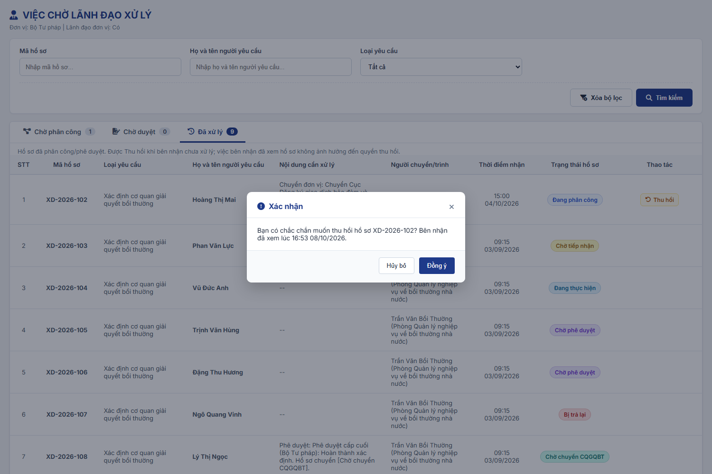

### 4.3.3. Dành cho Cán bộ Công tác bồi thường nhà nước

#### 4.3.3.1. Tiếp nhận hồ sơ

##### 4.3.3.1.1. Mục đích
Quản lý tập trung bước tiếp nhận ban đầu và phân công xử lý hồ sơ của 02 Loại hồ sơ: `Xác định cơ quan giải quyết bồi thường` và `Giải quyết yêu cầu bồi thường`, bao gồm:
- Tra cứu danh sách hồ sơ theo mã vụ việc, loại hồ sơ, nguồn hồ sơ, người yêu cầu, hình thức tiếp nhận, lĩnh vực phát sinh thiệt hại, trạng thái và khoảng thời gian tiếp nhận.
- Hồ sơ được nhận diện bằng `Mã vụ việc` và `Họ và tên người yêu cầu`.
- Tiếp nhận mới hồ sơ: Cán bộ tiếp nhận ghi nhận thông tin tổng quan (loại hồ sơ, hình thức tiếp nhận, lĩnh vực phát sinh thiệt hại), thông tin người yêu cầu, thông tin người bị thiệt hại (khi người yêu cầu không phải là người bị thiệt hại) và đính kèm tài liệu ban đầu.
- Nhận hồ sơ từ các nguồn khác vào danh sách để Lãnh đạo phân công:
  + Hồ sơ gửi từ Dịch vụ công quốc gia.
  + Hồ sơ do cơ quan khác Chuyển CQGQBT đến (thao tác Chuyển CQGQBT, hoặc Không thụ lý với lý do KTL_01 tại phân hệ Giải quyết yêu cầu bồi thường; Bộ Tư pháp / Sở Tư pháp nhận hồ sơ Loại hồ sơ `Xác định cơ quan giải quyết bồi thường` khi cơ quan chuyển chọn `Chuyển Bộ Tư pháp` / `Chuyển Sở Tư pháp`).
  + Hồ sơ do Bộ Tư pháp / Sở Tư pháp chuyển đến sau khi hoàn thành Xác định cơ quan giải quyết bồi thường.
- Phân công: Lãnh đạo chuyển hồ sơ xuống đơn vị cấp dưới hoặc phân công trực tiếp cán bộ xử lý theo luồng tương ứng với Loại hồ sơ tại [Cấu hình luồng xử lý - Cấu hình luồng xử lý - Quản trị hệ thống (Website Quản trị)](../01_Quan_tri_he_thong/Cau_hinh_luong_xu_ly.md).
- Khi phân công cán bộ, hồ sơ chuyển `Chờ tiếp nhận` tại phân hệ **Xác định cơ quan giải quyết bồi thường** hoặc phân hệ **Giải quyết yêu cầu bồi thường** theo Loại hồ sơ.
- Danh sách chia 02 tab `Chờ xử lý` / `Đã xử lý` theo thao tác của người dùng đang đăng nhập trên từng hồ sơ.
- Số hồ sơ chờ phân công của Lãnh đạo hiển thị tại khối `Chờ phân công` của [MH01 - Màn hình Dashboard Lãnh đạo - Dashboard Lãnh đạo - Công tác bồi thường nhà nước (Website Quản trị)](SRS_BTNN_ViecChoLanhDaoXuLy.md#vcld-mh01).
- Hồ sơ cũng có thể được tạo trực tiếp tại phân hệ Xác định cơ quan giải quyết bồi thường và phân hệ Giải quyết yêu cầu bồi thường; hồ sơ tạo trực tiếp không đi qua màn hình này.

a. Phân quyền
Hệ thống phân quyền thao tác theo các quyền nghiệp vụ được cấp:
- **Xem**: Tra cứu danh sách hồ sơ, xem chi tiết, tài liệu đính kèm, quá trình phân công và lịch sử xử lý.
- **Tạo mới**: Tiếp nhận mới hồ sơ, nhập thông tin tiếp nhận ban đầu và đính kèm tài liệu.
- **Sửa**: Sửa thông tin tiếp nhận khi đồng thời:
  + Hồ sơ có `Nguồn hồ sơ` = `Tiếp nhận mới`.
  + Hồ sơ do chính người dùng tiếp nhận.
  + Hồ sơ ở trạng thái `Chờ phân công`, chưa có lãnh đạo nào thao tác (chưa có lượt chuyển/phân công).
  + Hồ sơ thuộc các nguồn khác không được Sửa.
- **Xóa**: Cùng điều kiện với quyền Sửa.
- **In phiếu tiếp nhận**: Hồ sơ có `Nguồn hồ sơ` = `Tiếp nhận mới` và `Hình thức tiếp nhận` = `Trực tiếp`, ở mọi trạng thái.
- **Phân công** (Lãnh đạo): Chuyển đơn vị hoặc Phân công cán bộ khi đồng thời:
  + Hồ sơ ở trạng thái `Chờ phân công` / `Đang phân công`.
  + Lãnh đạo thuộc Nhóm lãnh đạo của đơn vị đang phân công.
- **Thu hồi** (Lãnh đạo): Thu hồi lượt Chuyển đơn vị / Phân công cán bộ gần nhất do chính đơn vị mình thực hiện, khi bên nhận chưa xử lý; chi tiết tại [Quy tắc Thu hồi - Tiếp nhận hồ sơ - Công tác bồi thường nhà nước (Website Quản trị)](#tn-thu-hoi).
- **Loại hồ sơ theo đơn vị**:
  + Ô chọn và bộ lọc `Loại hồ sơ` chỉ hiển thị các giá trị của [Danh mục Loại hồ sơ - Quản lý danh mục - Quản trị hệ thống (Website Quản trị)](../01_Quan_tri_he_thong/Quan_ly_danh_muc.md) [DM_54] có `Đơn vị áp dụng` chứa đơn vị của người dùng.
  + Tính cả đơn vị cha: chọn đơn vị cha thì áp dụng cho toàn bộ đơn vị trực thuộc.
  + `Xác định cơ quan giải quyết bồi thường` chỉ áp dụng cho Bộ Tư pháp và các Sở Tư pháp.
  + Ủy ban nhân dân cấp tỉnh không tiếp nhận, không phân công hồ sơ Xác định cơ quan giải quyết bồi thường; chỉ xem hồ sơ của Sở Tư pháp trực thuộc tại phân hệ Xác định cơ quan giải quyết bồi thường.

b. Điều kiện thực hiện
- Người dùng đã đăng nhập vào hệ thống thành công (Website quản trị).
- Người dùng được phân quyền truy cập chức năng "Tiếp nhận hồ sơ".

c. Nguồn hồ sơ

| Nguồn hồ sơ | Cách tạo | Loại hồ sơ | Hình thức tiếp nhận | Cán bộ tiếp nhận |
| :--- | :--- | :--- | :--- | :--- |
| `Tiếp nhận mới` | Cán bộ tiếp nhận nhập tại [MH02 - Màn hình Tiếp nhận hồ sơ](#43313-mh02---màn-hình-tiếp-nhận-hồ-sơ). | Cán bộ chọn | Cán bộ chọn `Trực tiếp` hoặc `Qua dịch vụ bưu chính`. | Người tạo hồ sơ. |
| `Dịch vụ công quốc gia` | - Hệ thống tự tạo khi nhận hồ sơ gửi từ Dịch vụ công quốc gia. - Đơn vị tiếp nhận là cơ quan giải quyết bồi thường người dân đã chọn. | `Giải quyết yêu cầu bồi thường` | Theo dữ liệu nhận từ Dịch vụ công quốc gia. | - Người đầu tiên thao tác Phân công hồ sơ tại màn hình này. - Trước đó hiển thị `-`. |
| `Chuyển CQGQBT` | - Hệ thống tự tạo tại phân hệ Giải quyết yêu cầu bồi thường khi: + Cấp cuối phê duyệt Nội dung trình `Chuyển CQGQBT`. + Cấp cuối phê duyệt Nội dung trình `Không thụ lý` với lý do `KTL_01`, hoặc Thủ trưởng cơ quan giải quyết bồi thường xác nhận Không thụ lý lý do `KTL_01` với hồ sơ `Chờ thụ lý`; hồ sơ được chuyển theo 01 trong 03 tùy chọn tại khối `Chuyển cơ quan tiếp nhận mới` ([Không thụ lý hồ sơ yêu cầu bồi thường - Giải quyết yêu cầu bồi thường - Công tác bồi thường nhà nước (Website Quản trị)](SRS_BTNN_GiaiQuyetBT_GiaiQuyet_YCBT.md#gq-khong-thu-ly)). - Đơn vị tiếp nhận là cơ quan được chuyển đến: + `Chuyển Bộ Tư pháp`: Bộ Tư pháp. + `Chuyển Sở Tư pháp`: Sở Tư pháp quản lý đơn vị (cùng tỉnh/thành phố với đơn vị gốc của hồ sơ, theo cây Cơ cấu tổ chức). + `Chuyển trực tiếp tới Cơ quan giải quyết bồi thường` và thao tác `Chuyển CQGQBT`: đơn vị đã chọn tại `Cơ quan tiếp nhận mới`. - Giữ nguyên `Mã vụ việc` của hồ sơ gốc; kèm văn bản Mẫu 04/BTNN - Thông báo không thụ lý hồ sơ yêu cầu bồi thường (với lý do `KTL_01`), Nội dung/Căn cứ chuyển, tài liệu đính kèm và toàn bộ tài liệu hồ sơ. | - `Xác định cơ quan giải quyết bồi thường`: Không thụ lý lý do `KTL_01`, tùy chọn `Chuyển Bộ Tư pháp` hoặc `Chuyển Sở Tư pháp`. - `Giải quyết yêu cầu bồi thường`: thao tác `Chuyển CQGQBT`; Không thụ lý lý do `KTL_01`, tùy chọn `Chuyển trực tiếp tới Cơ quan giải quyết bồi thường`. | Kế thừa từ hồ sơ gốc. | Như nguồn `Dịch vụ công quốc gia`. |
| `Xác định CQGQBT` | - Hệ thống tự tạo khi Lãnh đạo cấp cuối của Bộ Tư pháp / Sở Tư pháp Ký duyệt văn bản Kết quả xác định CQGQBT tại phân hệ Xác định cơ quan giải quyết bồi thường (tự động chuyển CQGQBT, theo [Tự động chuyển CQGQBT - Xác định cơ quan giải quyết bồi thường - Công tác bồi thường nhà nước (Website Quản trị)](SRS_BTNN_GiaiQuyetBT__Xac%20định%20cơ%20quan%20GQBT.md)). - Đơn vị tiếp nhận là CQGQBT đã chọn tại kết quả xác định (`Chọn CQGQBT trên hệ thống`). | `Giải quyết yêu cầu bồi thường` | Kế thừa từ hồ sơ gốc. | Như nguồn `Dịch vụ công quốc gia`. |

- Hồ sơ mới của mọi nguồn ở trạng thái `Chờ phân công` tại đơn vị gốc của đơn vị tiếp nhận.
- `Hình thức tiếp nhận` tham chiếu [Danh mục Hình thức tiếp nhận - Danh mục dữ liệu dùng chung - Tổng quan và quy tắc chung](../../Tai%20lieu%20tong%20hop/00_Tong_quan_va_Quy_tac_chung.md#danh-muc-dung-chung) [DM_25].
- Form Tiếp nhận mới chỉ cho chọn `Trực tiếp`, `Qua dịch vụ bưu chính`.

d. Mã vụ việc và mã hồ sơ
- `Mã vụ việc` (`VVBT-yyyy-xxx`) là mã toàn trình, duy nhất trên hệ thống; mỗi vụ việc chỉ quản lý 01 `Mã vụ việc`.
- Hệ thống sinh `Mã vụ việc` **01 lần** tại điểm vào đầu tiên của vụ việc:
  + Tiếp nhận mới tại [MH02 - Màn hình Tiếp nhận hồ sơ](#43313-mh02---màn-hình-tiếp-nhận-hồ-sơ).
  + Nhận hồ sơ từ Dịch vụ công quốc gia.
  + Thêm mới trực tiếp tại phân hệ Xác định cơ quan giải quyết bồi thường hoặc Giải quyết yêu cầu bồi thường, khi chọn `Mã vụ việc` = `Vụ việc mới`.
- Mọi bước xử lý sau kế thừa `Mã vụ việc`, không sinh lại.
- `Mã vụ việc` chỉ đọc, không cho sửa.
- Số thứ tự đã cấp không cấp lại, kể cả khi hồ sơ bị xóa.
- Mỗi phân hệ xử lý có `Mã hồ sơ` riêng, sinh khi hồ sơ vào phân hệ và luôn gắn với `Mã vụ việc`:
  + Phân hệ Xác định cơ quan giải quyết bồi thường: `XD-yyyy-xxx`.
  + Phân hệ Giải quyết yêu cầu bồi thường: `BT-yyyy-xxx`; dùng 01 mã cho cả 03 giá trị `Loại yêu cầu giải quyết bồi thường` (bồi thường tiền, phục hồi danh dự, cả hai).
  + Phân hệ Xem xét hoàn trả: `HT-yyyy-xxx`.
- Kế thừa mã khi hồ sơ chuyển tiếp:

| Chuyển tiếp | Mã vụ việc | Mã hồ sơ |
| :--- | :--- | :--- |
| Tiếp nhận hồ sơ → Xác định CQGQBT / Giải quyết YCBT | Giữ nguyên | Sinh `XD-` / `BT-` |
| Xác định CQGQBT → Giải quyết YCBT | Giữ nguyên | Sinh `BT-` |
| Chuyển CQGQBT sang cơ quan khác | Giữ nguyên | Sinh `BT-` mới tại cơ quan nhận; hồ sơ cũ đóng |
| Không thụ lý lý do `KTL_01` - `Chuyển Bộ Tư pháp` / `Chuyển Sở Tư pháp` | Giữ nguyên | Sinh `XD-` khi hồ sơ vào phân hệ Xác định cơ quan giải quyết bồi thường; hồ sơ cũ đóng |
| Không thụ lý lý do `KTL_01` - `Chuyển trực tiếp tới Cơ quan giải quyết bồi thường` | Giữ nguyên | Sinh `BT-` mới khi hồ sơ vào phân hệ Giải quyết yêu cầu bồi thường tại cơ quan nhận; hồ sơ cũ đóng |
| Giải quyết YCBT → Xem xét hoàn trả | Giữ nguyên | Sinh `HT-` |

- 01 vụ việc chỉ có 01 hồ sơ hoàn trả; danh sách cán bộ chịu trách nhiệm hoàn trả quản lý trong hồ sơ đó.
- Người yêu cầu nộp lại hồ sơ sau khi bị từ chối: hồ sơ là vụ việc mới, hệ thống sinh `Mã vụ việc` mới.
- Trường `Vụ việc liên quan` (không bắt buộc) ghi nhận vụ việc trước đó:
  + Có tại các form sinh `Mã vụ việc` mới: [MH02 - Màn hình Tiếp nhận hồ sơ](#43313-mh02---màn-hình-tiếp-nhận-hồ-sơ), Thêm mới trực tiếp tại Xác định CQGQBT / Giải quyết YCBT khi chọn `Vụ việc mới`.
  + Chọn từ danh sách vụ việc trên hệ thống; hiển thị `Mã vụ việc - Họ và tên người yêu cầu`.
  + Kế thừa sang hồ sơ của các bước sau.
- Thêm mới trực tiếp tại Xác định CQGQBT / Giải quyết YCBT có trường `Mã vụ việc` (Radio button):
  + `Vụ việc mới` (mặc định): hệ thống sinh `Mã vụ việc` khi lưu.
  + `Vụ việc đã có Mã vụ việc`: bắt buộc chọn vụ việc; hồ sơ mới mang `Mã vụ việc` đã chọn, không sinh mã mới.
- Hiển thị thống nhất trên mọi phân hệ:
  + Cột/nhãn `Mã vụ việc` hiển thị `VVBT-...`.
  + Cột/nhãn `Mã hồ sơ` hiển thị mã của phân hệ đó.
  + Bộ lọc `Mã vụ việc` tìm theo `VVBT-...`.
  + Định danh vụ việc: `Mã vụ việc - Họ và tên người yêu cầu`.

e. Luồng phân công theo Loại hồ sơ

| Loại hồ sơ | Đơn vị tiếp nhận | Luồng áp dụng tại Cấu hình luồng xử lý | Ví dụ nhánh luồng |
| :--- | :--- | :--- | :--- |
| Xác định cơ quan giải quyết bồi thường | Bộ Tư pháp | `Xác định CQGQBT - Bộ Tư pháp` | Lãnh đạo Bộ Tư pháp → Lãnh đạo Cục Giao dịch bảo đảm và bồi thường nhà nước → Lãnh đạo Phòng/Ban phụ trách → Cán bộ |
| Xác định cơ quan giải quyết bồi thường | Sở Tư pháp | `Xác định CQGQBT - Sở Tư pháp` của Sở Tư pháp đó | Lãnh đạo Sở Tư pháp → Lãnh đạo Phòng phụ trách → Cán bộ |
| Giải quyết yêu cầu bồi thường | Cơ quan giải quyết bồi thường | `Giải quyết YCBT` của đơn vị gốc | Theo cấu hình của từng cơ quan |

- Hệ thống chọn luồng theo Loại hồ sơ và đơn vị gốc tại thời điểm Lãnh đạo thao tác Phân công.

f. Trạng thái tại màn hình Tiếp nhận hồ sơ

| Trạng thái | Ý nghĩa |
| :--- | :--- |
| `Chờ phân công` | - Hồ sơ mới, đang chờ Lãnh đạo đơn vị gốc phân công. - Hoặc hồ sơ đã được thu hồi về đơn vị gốc. |
| `Đang phân công` | - Lãnh đạo đã chuyển hồ sơ cho đơn vị cấp dưới. - Hồ sơ đang chờ Lãnh đạo đơn vị nhận phân công tiếp. |

- Khi Lãnh đạo phân công cán bộ, hồ sơ chuyển `Chờ tiếp nhận` tại phân hệ xử lý tương ứng với `Loại hồ sơ`.

g. Quy tắc 02 tab Chờ xử lý / Đã xử lý
- Tab của hồ sơ xác định theo thao tác của người dùng đang đăng nhập trên hồ sơ đó, không cố định theo trạng thái.
- Cùng 01 hồ sơ có thể nằm ở tab `Chờ xử lý` của người dùng này và tab `Đã xử lý` của người dùng khác.

| Vai trò | Tab `Chờ xử lý` | Tab `Đã xử lý` |
| :--- | :--- | :--- |
| Cán bộ tiếp nhận | - Hồ sơ do người dùng tiếp nhận (`Nguồn hồ sơ` = `Tiếp nhận mới`). - Hồ sơ chưa được phân công đến cán bộ xử lý (`Chờ phân công`, `Đang phân công`). | - Hồ sơ do người dùng tiếp nhận. - Hồ sơ đã được phân công cán bộ xử lý (từ `Chờ tiếp nhận` trở đi). |
| Lãnh đạo (thuộc Nhóm lãnh đạo tại Cấu hình luồng xử lý) | - Hồ sơ `Chờ phân công` / `Đang phân công`. - Đơn vị đang phân công là đơn vị mà Lãnh đạo thuộc Nhóm lãnh đạo, theo [Quy tắc chung - Dashboard Lãnh đạo - Công tác bồi thường nhà nước (Website Quản trị)](SRS_BTNN_ViecChoLanhDaoXuLy.md#vcld-quy-tac-chung). | - Hồ sơ Lãnh đạo đã Chuyển đơn vị / Phân công cán bộ. - Trạng thái có thể vẫn là `Đang phân công` khi đơn vị cấp dưới chưa phân công tiếp. |

- Ví dụ:
  + Cán bộ tiếp nhận của Sở Tư pháp tạo hồ sơ: hồ sơ ở tab `Chờ xử lý` của cán bộ.
  + Lãnh đạo Sở chuyển hồ sơ cho Lãnh đạo Phòng: hồ sơ sang tab `Đã xử lý` của Lãnh đạo Sở (trạng thái `Đang phân công`), hiển thị tại tab `Chờ xử lý` của Lãnh đạo Phòng, vẫn ở tab `Chờ xử lý` của cán bộ tiếp nhận.
  + Lãnh đạo Phòng phân công cán bộ xử lý: hồ sơ chuyển `Chờ tiếp nhận`, sang tab `Đã xử lý` của Lãnh đạo Phòng và của cán bộ tiếp nhận.
- Thu hồi thành công: hồ sơ trở lại tab `Chờ xử lý` của Lãnh đạo đã thu hồi.
- Tab `Chờ xử lý` hiển thị badge số lượng hồ sơ chờ xử lý của người dùng đang đăng nhập; tab `Đã xử lý` không có badge.
- Mục menu trái `Tiếp nhận hồ sơ` hiển thị badge cùng số lượng với tab `Chờ xử lý`, tính theo người dùng đang đăng nhập; bằng 0 thì không hiển thị badge.
- Mặc định mở tab `Chờ xử lý`. Mở màn hình kèm tham số `tab=done` (từ Dashboard Lãnh đạo hoặc liên kết) thì chọn sẵn tab `Đã xử lý`.
- Nút `Tiếp nhận mới`: chỉ hiển thị khi chọn tab `Chờ xử lý`; khi chuyển sang tab `Đã xử lý` thì hệ thống tự động ẩn nút này.
- Trường `Trạng thái` của bộ lọc chỉ gồm các trạng thái đang có của hồ sơ thuộc tab đang chọn.
- Click dòng hồ sơ: mở [MH03 - Màn hình Xem chi tiết hồ sơ tiếp nhận](#43314-mh03---màn-hình-xem-chi-tiết-hồ-sơ-tiếp-nhận) của bản ghi.

h. Quy tắc Thu hồi

- Thu hồi dùng để lấy lại hồ sơ Lãnh đạo đã Chuyển đơn vị hoặc Phân công cán bộ khi bên nhận chưa xử lý. Không có thao tác "Trả lại" từ cấp dưới lên cấp trên; cấp trên dùng Thu hồi.
- **Người thực hiện**: Lãnh đạo thuộc Nhóm lãnh đạo (tại Cấu hình luồng xử lý) của đơn vị đã thực hiện lượt chuyển gần nhất của hồ sơ.
- **Vị trí thao tác**: tab `Đã xử lý` của [MH01 - Màn hình Danh sách hồ sơ tiếp nhận](#43312-mh01---màn-hình-danh-sách-hồ-sơ-tiếp-nhận) và [MH03 - Màn hình Xem chi tiết hồ sơ tiếp nhận](#43314-mh03---màn-hình-xem-chi-tiết-hồ-sơ-tiếp-nhận).
- **Điều kiện thu hồi** (thỏa đồng thời):
  + Chỉ thu hồi **lượt chuyển gần nhất** trong `Quá trình phân công`; không thu hồi lượt chuyển trước đó khi đã có lượt chuyển tiếp theo.
  + Lượt chuyển gần nhất có Tình trạng `Chưa xử lý`.
  + Theo hình thức của lượt chuyển gần nhất:

| Hình thức lượt chuyển | Hồ sơ được thu hồi khi | Hồ sơ không còn được thu hồi khi |
| :--- | :--- | :--- |
| `Chuyển đơn vị` | Hồ sơ `Đang phân công` tại đơn vị nhận (Lãnh đạo đơn vị nhận chưa Chuyển đơn vị / Phân công cán bộ tiếp) | Lãnh đạo đơn vị nhận đã Chuyển đơn vị hoặc Phân công cán bộ |
| `Phân công cán bộ` | Hồ sơ `Chờ tiếp nhận` (cán bộ chủ trì chưa tiếp nhận tại phân hệ xử lý) | Cán bộ chủ trì đã thao tác trên hồ sơ tại phân hệ xử lý (Tiếp nhận, Yêu cầu bổ sung, Không thụ lý...) |

  + Bên nhận đã mở xem hồ sơ vẫn được thu hồi; việc xem không tính là đã xử lý.
- **Kết quả thu hồi**:
  + Xóa lượt chuyển gần nhất khỏi `Quá trình phân công`.
  + Hồ sơ trở lại đơn vị đã chuyển:
    - Không còn lượt chuyển nào (đơn vị đã chuyển là đơn vị gốc): trạng thái `Chờ phân công`.
    - Còn lượt chuyển trước đó: trạng thái `Đang phân công`; lượt chuyển liền trước trở lại Tình trạng `Chưa xử lý`.
  + Thu hồi lượt `Phân công cán bộ`: xóa cán bộ chủ trì; hồ sơ không còn hiển thị tại phân hệ xử lý (Xác định cơ quan giải quyết bồi thường / Giải quyết yêu cầu bồi thường) của cán bộ đó.
  + Hồ sơ trở lại tab `Chờ xử lý` của Lãnh đạo đã thu hồi; không còn ở tab `Chờ xử lý` của bên nhận (Lãnh đạo đơn vị nhận hoặc cán bộ chủ trì). Badge số lượng của các bên được cập nhật theo.
  + Ghi `Lịch sử xử lý`: hành động `Thu hồi`, nội dung "Thu hồi hồ sơ đã chuyển [Tên đơn vị nhận]." (Chuyển đơn vị) hoặc "Thu hồi phân công cán bộ [Họ và tên]." (Phân công cán bộ), kèm người thực hiện và thời điểm.
- **Kiểm tra đồng thời**: hệ thống kiểm tra lại điều kiện thu hồi tại máy chủ khi Lãnh đạo bấm `Thu hồi` và khi bấm `Đồng ý` trên popup; bên nhận đã xử lý trong lúc đó thì không thu hồi, hiển thị [MSG-ERR-BTNN-LXL-004].

---

##### 4.3.3.1.2. MH01 - Màn hình Danh sách hồ sơ tiếp nhận

###### 4.3.3.1.2.1. Màn hình

###### 4.3.3.1.2.2. Mô tả thông tin trên màn hình

| Trường thông tin | Kiểu dữ liệu | Bắt buộc | Mặc định | Mô tả |
| :--- | :--- | :--- | :--- | :--- |
| Tiêu đề màn hình | String(255) | - | - | Control UI: Text heading (Read-only). - Hiển thị `DANH SÁCH HỒ SƠ TIẾP NHẬN`. - Dòng mô tả dưới tiêu đề: *"Tiếp nhận hồ sơ Xác định cơ quan giải quyết bồi thường và Giải quyết yêu cầu bồi thường; Lãnh đạo phân công đơn vị/cán bộ xử lý theo Cấu hình luồng xử lý."* |
| **Tab danh sách** | Tab | - | `Chờ xử lý` | Control UI: Tab. - Đặt phía trên bộ lọc. - Gồm tab `Chờ xử lý` và tab `Đã xử lý`. - Tab `Chờ xử lý` kèm badge số lượng hồ sơ chờ xử lý của người dùng đang đăng nhập. - Tab `Đã xử lý` không có badge số lượng. - Mục menu trái `Tiếp nhận hồ sơ` hiển thị badge cùng số lượng với tab `Chờ xử lý`; bằng 0 thì không hiển thị badge. - Bản ghi của từng tab theo [Quy tắc 02 tab Chờ xử lý / Đã xử lý - Tiếp nhận hồ sơ - Công tác bồi thường nhà nước (Website Quản trị)](#tn-tab-xu-ly). |
| **I. Bộ lọc tìm kiếm** | Section | - | - | Control UI: Filter panel dạng thu gọn/mở rộng (Accordion). - Hiển thị phía trên bảng danh sách. - Các tiêu chí có dữ liệu được kết hợp theo điều kiện AND. - Mặc định hiển thị dạng mở rộng. - Click nút "Thu gọn"/"Mở rộng" ở góc phải khối để thu gọn/mở rộng. - Khi thu gọn, các giá trị lọc đã nhập được giữ nguyên. |
| Mã vụ việc | String(50) | Không | Trống | Control UI: Input text. - Placeholder: `Nhập mã vụ việc...`. - Tìm kiếm gần đúng, không phân biệt hoa thường theo `Mã vụ việc`. |
| Loại hồ sơ | Enum(String(100)) | Không | `Tất cả` | Control UI: Combobox. - Tham chiếu [Danh mục Loại hồ sơ - Quản lý danh mục - Quản trị hệ thống (Website Quản trị)](../01_Quan_tri_he_thong/Quan_ly_danh_muc.md) [DM_54]. - Chỉ gồm các giá trị có `Đơn vị áp dụng` chứa đơn vị của người dùng. - Có thêm giá trị `Tất cả`. |
| Nguồn hồ sơ | Enum(String(50)) | Không | `Tất cả` | Control UI: Combobox. - Giá trị gồm: + `Tất cả` + `Tiếp nhận mới` + `Dịch vụ công quốc gia` + `Chuyển CQGQBT` + `Xác định CQGQBT` - Ý nghĩa từng giá trị theo [Nguồn hồ sơ - Tiếp nhận hồ sơ - Công tác bồi thường nhà nước (Website Quản trị)](#tn-nguon-ho-so). |
| Tên cá nhân/Tổ chức yêu cầu | String(255) | Không | Trống | Control UI: Input text. - Placeholder: `Nhập tên cá nhân/tổ chức...`. - Tìm kiếm gần đúng, không phân biệt hoa thường theo `Tên cá nhân/Tổ chức yêu cầu`. |
| Hình thức tiếp nhận | Enum(String(50)) | Không | `Tất cả` | Control UI: Combobox. - Tham chiếu [Danh mục Hình thức tiếp nhận - Danh mục dữ liệu dùng chung - Tổng quan và quy tắc chung](../../Tai%20lieu%20tong%20hop/00_Tong_quan_va_Quy_tac_chung.md#danh-muc-dung-chung) [DM_25]. - Có thêm giá trị `Tất cả`. |
| Lĩnh vực phát sinh thiệt hại | Enum(String(100)) | Không | `Tất cả` | Control UI: Combobox. - Tham chiếu danh mục Lĩnh vực phát sinh thiệt hại [DM_22]. - Có thêm giá trị `Tất cả`. |
| Trạng thái | Enum(String(50)) | Không | `Tất cả` | Control UI: Combobox. - Gồm `Tất cả` và các trạng thái đang có của hồ sơ thuộc tab đang chọn. |
| Từ ngày | Date | Không | Ngày hiện tại lùi 03 tháng | Control UI: DatePicker (chọn ngày trên lịch hoặc nhập trực tiếp). - Định dạng `dd/mm/yyyy`. - Mặc định là cùng ngày của 03 tháng trước ngày hiện tại (VD: ngày hiện tại 07/10/2026 thì Từ ngày là 07/07/2026). - Lọc theo `Thời điểm tiếp nhận`. - `Từ ngày` không được lớn hơn `Đến ngày`. |
| Đến ngày | Date | Không | Ngày hiện tại | Control UI: DatePicker (chọn ngày trên lịch hoặc nhập trực tiếp). - Định dạng `dd/mm/yyyy`. - Lọc theo `Thời điểm tiếp nhận`. - `Đến ngày` không được nhỏ hơn `Từ ngày`. |
| **II. Bảng danh sách hồ sơ** | Section | - | 20 bản ghi/trang | Control UI: Data grid. - Khi truy cập màn hình, hệ thống tự động tải Trang 1 với 20 bản ghi. - Sắp xếp mặc định theo "Thời điểm tiếp nhận" giảm dần (mới nhất lên đầu). - Phạm vi dữ liệu theo tab đang chọn và vai trò người dùng ([Quy tắc 02 tab Chờ xử lý / Đã xử lý - Tiếp nhận hồ sơ - Công tác bồi thường nhà nước (Website Quản trị)](#tn-tab-xu-ly)). - Chỉ gồm hồ sơ có `Loại hồ sơ` thuộc các giá trị được áp dụng cho đơn vị của người dùng. - Không có dữ liệu: bảng hiển thị 01 dòng căn giữa trên toàn bộ chiều rộng bảng (`colspan`), in nghiêng, nội dung theo [MSG-INF-SYS-001]. - Tổng số bản ghi hiển thị tại thanh phân trang phía dưới bảng. |
| STT | Integer(10) | - | Tự tăng | Control UI: Text (Read-only). - Số thứ tự dòng dữ liệu trên trang hiện tại. |
| Mã vụ việc | String(50) | - | Theo dữ liệu | Control UI: Text (Read-only). - Hiển thị đậm. - Theo dữ liệu bản ghi, ví dụ `VVBT-2026-xxx`. |
| Tên cá nhân/Tổ chức yêu cầu | String(255) | - | Theo dữ liệu | Control UI: Text (Read-only). - Hiển thị đậm. - Họ và tên cá nhân hoặc Tên tổ chức yêu cầu, theo dữ liệu bản ghi. |
| Loại hồ sơ | Enum(String(100)) | - | Theo dữ liệu | Control UI: Text (Read-only). - Theo dữ liệu bản ghi. |
| Nguồn hồ sơ | Enum(String(50)) | - | Theo dữ liệu | Control UI: Badge (Read-only). - Theo dữ liệu bản ghi. |
| Hình thức tiếp nhận | Enum(String(50)) | - | Theo dữ liệu | Control UI: Badge (Read-only). - Theo dữ liệu bản ghi. |
| Lĩnh vực phát sinh thiệt hại | Enum(String(100)) | - | Theo dữ liệu | Control UI: Text (Read-only). - Theo dữ liệu bản ghi. |
| Thời điểm tiếp nhận | DateTime | - | Theo dữ liệu | Control UI: Text (Read-only). - Định dạng `dd/mm/yyyy HH:mm`. - Hồ sơ nguồn khác `Tiếp nhận mới`: thời điểm hồ sơ được tạo tại màn hình này. |
| Cán bộ tiếp nhận | String(255) | - | Theo dữ liệu | Control UI: Text (Read-only). - Theo cột `Cán bộ tiếp nhận` tại [Nguồn hồ sơ - Tiếp nhận hồ sơ - Công tác bồi thường nhà nước (Website Quản trị)](#tn-nguon-ho-so). - Chưa có thì hiển thị `-`. |
| Đơn vị đang phân công | String(255) | - | Theo dữ liệu | Control UI: Text (Read-only). - Đơn vị mà Nhóm lãnh đạo đang giữ hồ sơ để phân công. - Hồ sơ `Chờ phân công`: đơn vị gốc. - Hồ sơ `Đang phân công`: đơn vị cấp dưới đã được chuyển. - Hồ sơ đã phân công cán bộ: hiển thị `-`. |
| Trạng thái | Enum(String(50)) | - | Theo dữ liệu | Control UI: Badge (Read-only). - Theo dữ liệu bản ghi. |
| Thao tác | Action Buttons | - | Theo tab/điều kiện | Control UI: Icon buttons (Fixed-slot Action Column). - Mỗi tab chỉ hiển thị các thao tác của tab đó. - Thao tác của tab nhưng hồ sơ không thỏa điều kiện: hiển thị mờ (disabled), không cho click. - **Phân công**, **Thu hồi** chỉ hiển thị với người dùng thuộc Nhóm lãnh đạo tại Cấu hình luồng xử lý. - **Tab `Chờ xử lý`** gồm 04 thao tác: + **Phân công**: Hồ sơ `Chờ phân công` / `Đang phân công`; người dùng thuộc Nhóm lãnh đạo của đơn vị đang phân công. + **In phiếu tiếp nhận**: Hồ sơ có `Nguồn hồ sơ` = `Tiếp nhận mới` và `Hình thức tiếp nhận` = `Trực tiếp`, ở mọi trạng thái. + **Sửa**: Hồ sơ có `Nguồn hồ sơ` = `Tiếp nhận mới`; do chính người dùng tiếp nhận; trạng thái `Chờ phân công`, chưa có lãnh đạo nào thao tác. + **Xóa**: Cùng điều kiện với **Sửa**. - **Tab `Đã xử lý`** gồm 02 thao tác (không hiển thị Phân công, Sửa, Xóa): + **In phiếu tiếp nhận**: Cùng điều kiện với tab `Chờ xử lý`. + **Thu hồi**: Người dùng thuộc Nhóm lãnh đạo của đơn vị đã chuyển/phân công; hồ sơ thỏa điều kiện thu hồi tại quy tắc 7 của [Quy tắc chung - Dashboard Lãnh đạo - Công tác bồi thường nhà nước (Website Quản trị)](SRS_BTNN_ViecChoLanhDaoXuLy.md#vcld-quy-tac-chung) (hồ sơ `Đang phân công` tại đơn vị nhận, hoặc `Chờ tiếp nhận` khi cán bộ chưa tiếp nhận). |

###### 4.3.3.1.2.3. Chức năng trên màn hình

| STT | Tên chức năng | Định dạng | Mô tả |
| :--- | :--- | :--- | :--- |
| 1 | Tìm kiếm | Button | Khi người dùng click nút, hệ thống xử lý theo các trường hợp: - **TH1 - Khoảng ngày không hợp lệ**: `Từ ngày` lớn hơn `Đến ngày`. + Hiển thị cảnh báo lỗi [MSG-ERR-VAL-007]. + Không tìm kiếm. - **TH2 - Có dữ liệu phù hợp**: + Hiển thị các bản ghi thuộc phạm vi dữ liệu của người dùng, thỏa mãn đồng thời các tiêu chí đã nhập/chọn. + Đưa về Trang 1. - **TH3 - Không có dữ liệu**: + Bảng hiển thị 01 dòng căn giữa (`colspan`), in nghiêng, nội dung theo [MSG-INF-SYS-001]. + Thanh phân trang hiển thị *"Hiển thị 0-0 trong tổng số 0 bản ghi"*. + Các nút điều hướng trang khóa mờ (Disabled). |
| 2 | Xóa bộ lọc | Button | - Xóa các điều kiện lọc (gồm cả `Trạng thái`). - Đưa Từ ngày, Đến ngày về khoảng 03 tháng gần nhất. - Tải lại danh sách theo điều kiện mặc định. |
| 3 | Tiếp nhận mới | Button | - Nút nằm phía trên bên phải bảng danh sách. - **Điều kiện hiển thị**: Chỉ hiển thị khi chọn tab `Chờ xử lý`; khi chọn tab `Đã xử lý` thì hệ thống không hiển thị nút này. - Click nút: mở [MH02 - Màn hình Tiếp nhận hồ sơ](#43313-mh02---màn-hình-tiếp-nhận-hồ-sơ) ở trạng thái rỗng để nhập mới. |
| 4 | Click dòng dữ liệu | Row click | - Click dòng dữ liệu (trừ click vào icon trong cột `Thao tác`): mở [MH03 - Màn hình Xem chi tiết hồ sơ tiếp nhận](#43314-mh03---màn-hình-xem-chi-tiết-hồ-sơ-tiếp-nhận) của bản ghi. - Click icon trong cột `Thao tác`: thực hiện chức năng của icon, không kích hoạt row click. |
| 5 | In Phiếu tiếp nhận | Icon button | - Mở [MH04 - Popup In Phiếu tiếp nhận hồ sơ](#43315-mh04---popup-in-phiếu-tiếp-nhận-hồ-sơ) để xem trước và in Phiếu tiếp nhận hồ sơ. |
| 6 | Sửa | Icon button | - Mở [MH02 - Màn hình Tiếp nhận hồ sơ](#43313-mh02---màn-hình-tiếp-nhận-hồ-sơ) ở chế độ sửa. - Tự động điền dữ liệu của bản ghi. |
| 7 | Xóa | Icon button | - Hiển thị popup xác nhận xóa (Custom Confirmation Modal) với nội dung [MSG-CFM-SYS-001]. - Tại popup, người dùng chọn: + **Đồng ý**: Hệ thống **xóa mềm** hồ sơ (cập nhật cờ đã xóa, không xóa vật lý) để lưu vết audit log và thanh tra; gỡ hồ sơ khỏi tab `Chờ xử lý` của lãnh đạo; bản ghi không còn hiển thị trên danh sách; hiển thị thông báo thành công [MSG-SUC-BTNN-TN-001]. + **Hủy bỏ**: Đóng popup, không xóa hồ sơ. |
| 8 | Chuyển tab | Tab | - Hiển thị danh sách của tab `Chờ xử lý` hoặc `Đã xử lý`. - Nạp lại bộ lọc `Trạng thái` theo tab. - Đưa về Trang 1. |
| 9 | Phân công | Icon button | - Mở [MH05 - Popup Phân công xử lý hồ sơ](#tn-mh05-phan-cong). |
| 10 | Thu hồi | Icon button | - Mở [MH06 - Popup Xác nhận thu hồi](#tn-mh06-thu-hoi). - Thu hồi thành công: xử lý theo [Quy tắc Thu hồi - Tiếp nhận hồ sơ - Công tác bồi thường nhà nước (Website Quản trị)](#tn-thu-hoi). |

---

##### 4.3.3.1.3. MH02 - Màn hình Tiếp nhận hồ sơ

###### 4.3.3.1.3.1. Màn hình

###### 4.3.3.1.3.2. Mô tả thông tin trên màn hình

| Trường thông tin | Kiểu dữ liệu | Bắt buộc | Mặc định | Mô tả |
| :--- | :--- | :--- | :--- | :--- |
| Tiêu đề màn hình | String(255) | - | Theo ngữ cảnh | Control UI: Text heading (Read-only). - Thêm mới: `TIẾP NHẬN HỒ SƠ`. - Sửa bản ghi `Chờ phân công`: `SỬA THÔNG TIN TIẾP NHẬN`. |
| Mã vụ việc | String(50) | - | Tự sinh | Control UI: Text (Read-only). - **Không hiển thị khi thêm mới** (mã chỉ được sinh sau khi lưu thành công). - Mở lại bản ghi đã tồn tại: hiển thị mã đã sinh, ví dụ `VVBT-2026-xxx`. |
| Thời điểm tiếp nhận | DateTime | - | Tự sinh | Control UI: Text (Read-only). - **Không hiển thị khi thêm mới** (chỉ được ghi nhận sau khi lưu thành công). - Mở lại bản ghi đã tồn tại: thời điểm người dùng bấm `Lưu thông tin` lần đầu. - Định dạng `dd/mm/yyyy HH:mm`. |
| Cán bộ tiếp nhận | String(255) | - | Theo dữ liệu | Control UI: Text (Read-only). - **Không hiển thị khi thêm mới**. - Họ tên cán bộ đã tiếp nhận hồ sơ. |
| Trạng thái | Enum(String(50)) | - | Theo dữ liệu | Control UI: Badge (Read-only). - **Không hiển thị khi thêm mới**. - Theo dữ liệu bản ghi. |
| **Thông tin tổng quan vụ việc** | Section | - | - | Control UI: Section header. - Thêm mới: bố trí trên lưới 3 cột (1 dòng duy nhất gồm `Loại hồ sơ`, `Hình thức tiếp nhận`, `Lĩnh vực phát sinh thiệt hại`), không hiển thị `Vụ việc liên quan`. - Mở lại bản ghi đã tồn tại (Sửa/Chi tiết): bố trí trên lưới 2 cột đồng nhất (mỗi dòng đúng 2 thông tin): + Dòng 1: `Loại hồ sơ`, `Hình thức tiếp nhận`. + Dòng 2: `Lĩnh vực phát sinh thiệt hại`, `Vụ việc liên quan`. - `Loại yêu cầu giải quyết bồi thường`: 01 dòng riêng ngay dưới lưới. Chỉ hiển thị khi `Loại hồ sơ` = `Giải quyết yêu cầu bồi thường`. |
| Nguồn hồ sơ | Enum(String(50)) | - | `Tiếp nhận mới` | Control UI: Text (Read-only). - **Không hiển thị khi thêm mới**. - Hệ thống gán `Tiếp nhận mới` cho hồ sơ tạo tại màn hình này. |
| Loại hồ sơ | Enum(String(100)) | Có | Trống | Control UI: Combobox. - Placeholder: `Chọn loại hồ sơ...`. - Tham chiếu [Danh mục Loại hồ sơ - Quản lý danh mục - Quản trị hệ thống (Website Quản trị)](../01_Quan_tri_he_thong/Quan_ly_danh_muc.md) [DM_54]. - Chỉ gồm các giá trị có `Đơn vị áp dụng` chứa đơn vị của người dùng. - Loại hồ sơ quyết định luồng phân công tại [Luồng phân công theo Loại hồ sơ - Tiếp nhận hồ sơ - Công tác bồi thường nhà nước (Website Quản trị)](#tn-luong-phan-cong). - Loại hồ sơ quyết định phân hệ xử lý hồ sơ sau khi lãnh đạo phân công cán bộ. |
| Hình thức tiếp nhận | Enum(String(50)) | Có | `Trực tiếp` | Control UI: Combobox. - Tham chiếu [Danh mục Hình thức tiếp nhận - Danh mục dữ liệu dùng chung - Tổng quan và quy tắc chung](../../Tai%20lieu%20tong%20hop/00_Tong_quan_va_Quy_tac_chung.md#danh-muc-dung-chung) [DM_25]. - Chỉ cho chọn 02 giá trị: `Trực tiếp`, `Qua dịch vụ bưu chính`. |
| Lĩnh vực phát sinh thiệt hại | Enum(String(100)) | Có | Trống | Control UI: Combobox. - Placeholder: `Chọn lĩnh vực...`. - Tham chiếu danh mục Lĩnh vực phát sinh thiệt hại [DM_22]. |
| Vụ việc liên quan | String(50) | Không | Trống | Control UI: Combobox có tìm kiếm. - **Không hiển thị khi thêm mới**. - Mở lại bản ghi đã tồn tại: Placeholder `Gõ Mã vụ việc hoặc Họ và tên người yêu cầu...`. - Danh sách gồm các vụ việc đã có `Mã vụ việc` trên hệ thống; không gồm vụ việc của chính hồ sơ đang sửa. - Mỗi giá trị hiển thị `Mã vụ việc - Họ và tên người yêu cầu`. - Cho phép gõ tìm theo `Mã vụ việc` hoặc `Họ và tên người yêu cầu`. - Dùng khi người yêu cầu nộp lại hồ sơ sau khi bị từ chối: hồ sơ mới là vụ việc mới, ghi nhận vụ việc trước đó tại trường này. - Hệ thống lưu `Mã vụ việc` của vụ việc được chọn; giá trị kế thừa sang hồ sơ tại phân hệ xử lý. - Có dữ liệu nhưng không thuộc danh sách: không cho lưu. - Quy tắc mã theo [Mã vụ việc và mã hồ sơ - Tiếp nhận hồ sơ - Công tác bồi thường nhà nước (Website Quản trị)](#tn-ma-vu-viec). |
| Loại yêu cầu giải quyết bồi thường | Enum(String(100)) | Có (khi hiển thị) | `Yêu cầu cả hai (Bồi thường tiền & Phục hồi danh dự)` | Control UI: Radio button. - Chỉ hiển thị khi `Loại hồ sơ` = `Giải quyết yêu cầu bồi thường`. - Giá trị gồm: + `Yêu cầu cả hai (Bồi thường tiền & Phục hồi danh dự)` + `Chỉ yêu cầu bồi thường thiệt hại bằng tiền` + `Chỉ yêu cầu phục hồi danh dự` - `Loại hồ sơ` khác: ẩn, không lưu giá trị. - Giá trị kế thừa sang trường cùng tên tại [MH02 - Màn hình Nhập liệu hồ sơ vụ việc - Giải quyết yêu cầu bồi thường - Công tác bồi thường nhà nước (Website Quản trị)](SRS_BTNN_GiaiQuyetBT_GiaiQuyet_YCBT.md#43314-mh02---màn-hình-nhập-liệu-hồ-sơ-vụ-việc). |
| **Thông tin người yêu cầu** | Section | - | - | Control UI: Section header, bố trí trên 01 Card form duy nhất với hệ thống 2 cột (50% - 50%) đồng nhất xuyên suốt, mỗi dòng có đúng 02 thông tin: - Dòng 1: `Loại người yêu cầu` và `Tư cách người yêu cầu`. - Dòng 2: `Họ và tên`/`Tên tổ chức` và `Giấy tờ thân nhân` (gồm Loại + Số giấy tờ thân nhân trên cùng 1 ô) hoặc `Mã số tổ chức` (khi là Tổ chức). - Dòng 3: `Số điện thoại` và `Email`. - Dòng 4: `Quốc gia` và `Tỉnh/Thành phố` (Xem chi tiết: `Địa chỉ đầy đủ`). - Dòng 5: `Phường/Xã` và `Địa chỉ chi tiết`. |
| Loại người yêu cầu | Enum(String(20)) | Có | `Cá nhân` | Control UI: Radio button. - Đặt ngay trước trường `Tư cách người yêu cầu`. - Giá trị gồm: + `Cá nhân` + `Tổ chức` - Chọn trước trường Tư cách; không bị khóa. - Đổi `Loại người yêu cầu`: nếu Tư cách đang chọn không thuộc danh sách của Loại mới thì hệ thống xóa giá trị Tư cách, người dùng chọn lại. - `Cá nhân`: hiển thị `Loại giấy tờ thân nhân`, `Số giấy tờ thân nhân`; ẩn `Mã số tổ chức`. - `Tổ chức`: hiển thị `Mã số tổ chức`; ẩn `Loại giấy tờ thân nhân`, `Số giấy tờ thân nhân`. - Hồ sơ cũ chưa có giá trị: coi là `Cá nhân`. |
| Tư cách người yêu cầu | Enum(String(100)) | Có | `Người bị thiệt hại` | Control UI: Combobox. - Tham chiếu [Danh mục Tư cách người yêu cầu bồi thường - Danh mục dữ liệu dùng chung - Tổng quan và quy tắc chung](../../Tai%20lieu%20tong%20hop/00_Tong_quan_va_Quy_tac_chung.md#danh-muc-dung-chung) [DM_26]. - Danh sách giá trị lọc theo `Loại người yêu cầu`: + `Cá nhân`: `Người bị thiệt hại`, `Người thừa kế của người bị thiệt hại`, `Người đại diện cho những người thừa kế của người bị thiệt hại`, `Người đại diện theo pháp luật của người bị thiệt hại`, `Cá nhân, pháp nhân được ủy quyền hợp pháp`. + `Tổ chức`: `Người bị thiệt hại`, `Tổ chức kế thừa quyền, nghĩa vụ của tổ chức bị thiệt hại đã chấm dứt tồn tại`, `Cá nhân, pháp nhân được ủy quyền hợp pháp`. - Chọn giá trị khác `Người bị thiệt hại`: hiển thị khối `Thông tin người bị thiệt hại`. - Chọn `Tổ chức kế thừa quyền, nghĩa vụ của tổ chức bị thiệt hại đã chấm dứt tồn tại`: khối hiển thị dạng `Thông tin tổ chức bị thiệt hại đã chấm dứt tồn tại`. - Chọn lại `Người bị thiệt hại`: ẩn khối, dữ liệu trong khối không được lưu.|
| Họ và tên / Tên tổ chức | String(255) | Có | Trống | Control UI: Input text. - Nhãn theo `Loại người yêu cầu`: + `Cá nhân`: `Họ và tên`, placeholder `Nhập họ và tên...`. + `Tổ chức`: `Tên tổ chức`, placeholder `Nhập tên tổ chức...`. |
| Loại giấy tờ thân nhân | Enum(String(50)) | Không | Trống | Control UI: Combobox. - Chỉ hiển thị khi `Loại người yêu cầu` = `Cá nhân`. - Placeholder: `-- Chọn loại giấy tờ --`. - Tham chiếu [Danh mục Loại giấy tờ pháp lý - Danh mục dữ liệu dùng chung - Tổng quan và quy tắc chung](../../Tai%20lieu%20tong%20hop/00_Tong_quan_va_Quy_tac_chung.md#danh-muc-dung-chung) [DM_10]. - Chỉ gồm các giá trị dành cho cá nhân, không gồm `Mã số thuế`. |
| Số giấy tờ thân nhân | String(50) | Không | Trống | Control UI: Input text. - Chỉ hiển thị khi `Loại người yêu cầu` = `Cá nhân`. - Placeholder: `Nhập số giấy tờ thân nhân...`. |
| Mã số tổ chức | String(50) | Có (khi `Tổ chức`) | Trống | Control UI: Input text. - Chỉ hiển thị khi `Loại người yêu cầu` = `Tổ chức`. - Placeholder: `Nhập mã số doanh nghiệp / mã số thuế / mã số khác...`. - Nhập mã số doanh nghiệp, mã số thuế hoặc mã số khác của tổ chức. |
| Số điện thoại | String(20) | Có | Trống | Control UI: Input text. - Placeholder: `Nhập số điện thoại...`. - Áp dụng quy tắc số điện thoại [BR-VAL-003]. |
| Email | String(255) | Không | Trống | Control UI: Input text. - Placeholder: `Nhập email...`. - Nếu có dữ liệu, áp dụng quy tắc Email [BR-VAL-002]. |
| Quốc gia | Enum(String(100)) | Có | `Việt Nam` | Control UI: Combobox. - Tham chiếu [Danh mục Quốc tịch / Quốc gia - Danh mục dữ liệu dùng chung - Tổng quan và quy tắc chung](../../Tai%20lieu%20tong%20hop/00_Tong_quan_va_Quy_tac_chung.md#danh-muc-dung-chung) [DM_09]. - Quyết định kiểu nhập của `Tỉnh/Thành phố`, `Phường/Xã`. |
| Tỉnh/Thành phố | Enum(String(100)) / String(100) | Có | Trống | Control UI: Combobox có tìm kiếm / Input text. - Placeholder: `Gõ Mã hoặc Tên Tỉnh/Thành phố...`. - `Quốc gia` = `Việt Nam`: tham chiếu Danh mục Tỉnh/Thành phố [DM_13]. - `Quốc gia` = `Việt Nam`: cho phép gõ tìm theo Mã hoặc Tên. - `Quốc gia` khác `Việt Nam`: ô nhập văn bản tự do. |
| Phường/Xã | Enum(String(100)) / String(100) | Có | Trống | Control UI: Combobox có tìm kiếm / Input text. - Phụ thuộc `Tỉnh/Thành phố` đã chọn. - `Quốc gia` = `Việt Nam`: tham chiếu Danh mục Xã/Phường/Thị trấn [DM_15], lọc theo Tỉnh/Thành phố đã chọn. - `Quốc gia` = `Việt Nam`: cho phép gõ tìm theo Mã hoặc Tên. - Chưa chọn Tỉnh/Thành phố: khóa mờ (Disabled). - Placeholder khi khóa: *"Vui lòng chọn Tỉnh/Thành phố trước"*. - `Quốc gia` khác `Việt Nam`: ô nhập văn bản tự do. |
| Địa chỉ chi tiết | Text(1000) / String(500) | Có | Trống | Control UI: Input text. - Placeholder: `Nhập địa chỉ chi tiết...`. - Nhập số nhà, tên đường/phố, thôn/xóm/ấp... |
| **Thông tin người bị thiệt hại** | Section | - | Ẩn | Control UI: Section header, bố trí trên 01 Card form với hệ thống 2 cột đồng nhất (mỗi dòng đúng 02 thông tin): - Chỉ hiển thị khi `Tư cách người yêu cầu` khác `Người bị thiệt hại`. - Trường hợp `Tổ chức kế thừa quyền, nghĩa vụ của tổ chức bị thiệt hại đã chấm dứt tồn tại`: Tiêu đề khối `Thông tin tổ chức bị thiệt hại đã chấm dứt tồn tại`, gồm 01 dòng 2 cột: `Tên tổ chức bị thiệt hại` và `Mã số tổ chức`. - Trường hợp cá nhân: Gồm 03 dòng, mỗi dòng đúng 02 thông tin: + Dòng 1: `Họ và tên người bị thiệt hại` và `Ngày sinh`. + Dòng 2: `Giấy tờ thân nhân` (Loại + Số) và `Tỉnh/Thành phố` (Xem chi tiết: `Địa chỉ đầy đủ`). + Dòng 3: `Phường/Xã` và `Địa chỉ chi tiết`. |
| Tên tổ chức bị thiệt hại | String(255) | Không | Trống | Control UI: Input text. - Chỉ hiển thị khi `Tư cách người yêu cầu` = `Tổ chức kế thừa quyền, nghĩa vụ của tổ chức bị thiệt hại đã chấm dứt tồn tại`. - Placeholder: `Nhập tên tổ chức bị thiệt hại...`. |
| Mã số tổ chức (tổ chức bị thiệt hại) | String(50) | Không | Trống | Control UI: Input text. - Chỉ hiển thị cùng điều kiện với `Tên tổ chức bị thiệt hại`. - Placeholder: `Nhập mã số doanh nghiệp / mã số thuế / mã số khác...`. |
| Họ và tên người bị thiệt hại | String(100) | Không | Trống | Control UI: Input text. - Placeholder: `Nhập họ và tên người bị thiệt hại...`. |
| Ngày sinh | Date | Không | Trống | Control UI: DatePicker. - Định dạng `dd/mm/yyyy`. |
| Loại giấy tờ thân nhân | Enum(String(50)) | Không | Trống | Control UI: Combobox. - Chỉ hiển thị khi khối người bị thiệt hại là cá nhân. - Placeholder: `-- Chọn loại giấy tờ --`. - Tham chiếu [Danh mục Loại giấy tờ pháp lý - Danh mục dữ liệu dùng chung - Tổng quan và quy tắc chung](../../Tai%20lieu%20tong%20hop/00_Tong_quan_va_Quy_tac_chung.md#danh-muc-dung-chung) [DM_10]. - Chỉ gồm các giá trị dành cho cá nhân, không gồm `Mã số thuế`. |
| Số giấy tờ thân nhân | String(50) | Không | Trống | Control UI: Input text. - Placeholder: `Nhập số giấy tờ thân nhân...`. |
| Tỉnh/Thành phố | Enum(String(100)) | Không | Trống | Control UI: Combobox có tìm kiếm. - Placeholder: `Gõ Mã hoặc Tên Tỉnh/Thành phố...`. - Tham chiếu Danh mục Tỉnh/Thành phố [DM_13]. |
| Phường/Xã | String(100) | Không | Trống | Control UI: Input text. - Placeholder: `Nhập phường/xã...`. |
| Địa chỉ chi tiết | String(500) | Không | Trống | Control UI: Input text. - Placeholder: `Nhập địa chỉ chi tiết...`. |
| **Thông tin hành vi gây thiệt hại** | Section | - | - | Control UI: Section header, bố trí trên 01 Card form. - Luôn hiển thị. - Đặt sau khối thông tin người yêu cầu / người bị thiệt hại, trước khối `Văn bản làm căn cứ yêu cầu bồi thường`. |
| Hành vi gây thiệt hại của người thi hành công vụ | Text(2000) | Không | Trống | Control UI: Textarea. - Placeholder: `Tóm tắt hành vi gây thiệt hại của người thi hành công vụ`. - Tối đa 2000 ký tự. - Áp dụng cho mọi `Loại hồ sơ`. - Giá trị lưu vào hồ sơ tiếp nhận, kế thừa sang trường cùng tên tại [MH02 - Màn hình Tiếp nhận/Cập nhật xác định cơ quan giải quyết bồi thường - Xác định cơ quan giải quyết bồi thường - Công tác bồi thường nhà nước (Website Quản trị)](SRS_BTNN_GiaiQuyetBT__Xac%20định%20cơ%20quan%20GQBT.md#43314-mh02---màn-hình-tiếp-nhậncập-nhật-xác-định-cơ-quan-giải-quyết-bồi-thường) và [MH02 - Màn hình Nhập liệu hồ sơ vụ việc - Giải quyết yêu cầu bồi thường - Công tác bồi thường nhà nước (Website Quản trị)](SRS_BTNN_GiaiQuyetBT_GiaiQuyet_YCBT.md#43314-mh02---màn-hình-nhập-liệu-hồ-sơ-vụ-việc); cán bộ xử lý được sửa. |
| **VĂN BẢN LÀM CĂN CỨ YÊU CẦU BỒI THƯỜNG** | List(Object) | Không | 01 dòng trống | Control UI: Data grid nhiều dòng. - Không bắt buộc nhập. - Cột: `STT` \| `Tên văn bản, căn cứ` \| `Tải file` \| `Thao tác`. - Nút `Thêm dòng` dưới bảng để bổ sung văn bản, căn cứ. - Dòng không có tên và không có file được bỏ qua khi lưu. |
| STT | Integer(10) | - | Tự tăng | Control UI: Text (Read-only). - Căn giữa. - Tự tăng theo số dòng. |
| Tên văn bản, căn cứ | String(255) | Không | Trống | Control UI: Input text. - Placeholder: `Nhập tên văn bản, căn cứ...`. - Tải file mà chưa nhập tên: hệ thống tự điền tên theo tên file (bỏ phần mở rộng). |
| Tải file | File | Không | Trống | Control UI: File upload (nút `Tải file`). - Sau khi chọn hiển thị tên file. - Chỉ hỗ trợ định dạng `.pdf`, `.jpg`, `.png`. |
| Thao tác | Action | - | - | Control UI: Link/Icon button. - `Xem file`: mở file của dòng; mờ khi dòng chưa có file. - `Xóa`: xóa dòng. |
| **Bảng tài liệu đính kèm** | List(Object) | Không | Trống | Control UI: Data grid nhiều dòng. - Cho phép nhập nhiều tài liệu liên quan đến bước tiếp nhận. - Mỗi dòng gồm tên tài liệu và file đính kèm. |
| STT | Integer(10) | - | Tự tăng | Control UI: Text (Read-only). - Căn giữa. - Tăng theo số dòng tài liệu. |
| Tên tài liệu | String(255) | Có khi dòng có file | Trống | Control UI: Input text. - Placeholder: `Nhập tên tài liệu...`. - Bắt buộc khi dòng tài liệu có file. - Tải file lên mà chưa nhập tên: hệ thống lấy tên file (bỏ phần mở rộng) làm tên tài liệu. |
| File đính kèm | File | Không | Trống | Control UI: File upload. - Theo quy tắc file dùng chung. - Định dạng `.pdf`, `.doc`, `.docx`, `.jpg`, `.png`. - Tối đa 20MB/file. |
| **Quá trình phân công** | List(Object) | - | Ẩn khi thêm mới | Control UI: Data grid (Read-only). - Chỉ hiển thị khi mở lại bản ghi đã tồn tại. - Theo dõi quá trình chuyển tiếp và phân công hồ sơ. - Không có dữ liệu: hiển thị `Không có dữ liệu`. |
| STT | Integer(10) | - | Tự tăng | Control UI: Text (Read-only). - Số thứ tự lượt phân công. |
| Nội dung | String(1000) | - | Theo dữ liệu | Control UI: Text (Read-only). - Người chuyển, đơn vị chuyển, đơn vị/cán bộ nhận. - `Ý kiến chỉ đạo` (nếu có). |
| Thời điểm | DateTime | - | Theo dữ liệu | Control UI: Text (Read-only). - Thời điểm chuyển/phân công. - Định dạng `dd/mm/yyyy HH:mm`. |
| Tình trạng | Enum(String(50)) | - | Theo dữ liệu | Control UI: Badge (Read-only). - Giá trị gồm: + `Đã xử lý` + `Chưa xử lý - Chưa xem` + `Chưa xử lý - Đã xem lúc [hh:mm dd/mm/yyyy]` |
| **Lịch sử xử lý** | List(Object) | - | Ẩn khi thêm mới | Control UI: Timeline (Read-only). - Chỉ hiển thị khi mở lại bản ghi đã tồn tại. - Sắp xếp mới nhất lên đầu. - Mỗi dòng gồm `[Hành động] - [Người thực hiện] - [Thời điểm]` và nội dung. - Ví dụ hành động: `Tiếp nhận hồ sơ`, `Cập nhật thông tin tiếp nhận`, `Chuyển đơn vị`, `Thu hồi`. |

###### 4.3.3.1.3.3. Chức năng trên màn hình

| STT | Tên chức năng | Định dạng | Mô tả |
| :--- | :--- | :--- | :--- |
| 1 | Hủy bỏ | Button | - Đóng màn hình tiếp nhận. - Quay về [MH01 - Màn hình Danh sách hồ sơ tiếp nhận](#43312-mh01---màn-hình-danh-sách-hồ-sơ-tiếp-nhận). |
| 2 | Thêm dòng tài liệu | Button | - Nút `Thêm dòng`. - Thêm một dòng tài liệu mới để nhập `Tên tài liệu` và chọn file đính kèm. |
| 3 | Tải lên | Button | Khi người dùng chọn tệp tin tải lên cho dòng tài liệu, hệ thống xử lý theo các trường hợp: - **TH1 - File sai định dạng** (khác `.pdf`, `.doc`, `.docx`, `.jpg`, `.png`): + Hiển thị cảnh báo lỗi [MSG-ERR-FILE-001]. + Không tiếp nhận tệp. - **TH2 - File quá dung lượng** (lớn hơn 20MB/file): + Hiển thị cảnh báo lỗi [MSG-ERR-FILE-002]. + Không tiếp nhận tệp. - **TH3 - Hợp lệ**: + Tải tệp lên thành công. + Hiển thị tên tệp kèm liên kết "Xem file" và nút "Xóa". |
| 4 | Xem file | Link | - Mở xem nội dung tệp tin đã tải lên tại tab trình duyệt mới. |
| 5 | Xóa | Link/Icon button | - Click: hiển thị popup xác nhận gỡ bỏ tệp tin/dòng tài liệu (Custom Confirmation Modal) với nội dung [MSG-CFM-SYS-001]. - Tại popup, người dùng chọn: + **Đồng ý**: Gỡ dòng tài liệu hoặc tệp tin đính kèm khỏi biểu mẫu. + **Hủy bỏ**: Đóng popup, giữ nguyên tài liệu. |
| 6 | Lưu thông tin | Button | Khi người dùng click nút, hệ thống xử lý theo các trường hợp: - **TH1 - Bỏ trống trường bắt buộc** [BR-VAL-001]: + Bôi đỏ viền ô lỗi đầu tiên (class `.is-invalid`). + Hiển thị cảnh báo lỗi [MSG-ERR-VAL-001] phía dưới ô nhập. + Focus vào ô lỗi đầu tiên. + Không cho lưu. - **TH2 - `Số điện thoại` không đúng định dạng** [BR-VAL-003]: + Hiển thị cảnh báo lỗi [MSG-ERR-VAL-003] dưới ô nhập. + Không cho lưu. - **TH3 - `Email` có dữ liệu nhưng không đúng định dạng** [BR-VAL-002]: + Hiển thị cảnh báo lỗi [MSG-ERR-VAL-002] dưới ô nhập. + Không cho lưu. - **TH4 - `Vụ việc liên quan` có dữ liệu nhưng không thuộc danh sách vụ việc trên hệ thống**: + Bôi đỏ viền ô `Vụ việc liên quan`. + Hiển thị cảnh báo lỗi "Vụ việc không tồn tại trên hệ thống" dưới ô nhập. + Không cho lưu. - **TH5 - Thêm mới, dữ liệu hợp lệ** (áp dụng cho cả hai Loại hồ sơ): + Sinh `Mã vụ việc` (mã toàn trình) theo [Mã vụ việc và mã hồ sơ - Tiếp nhận hồ sơ - Công tác bồi thường nhà nước (Website Quản trị)](#tn-ma-vu-viec). + Lưu `Vụ việc liên quan` (nếu có); giá trị được kế thừa sang hồ sơ tại phân hệ xử lý. + Gán `Nguồn hồ sơ` = `Tiếp nhận mới`. + Ghi nhận `Thời điểm tiếp nhận` và cán bộ tiếp nhận. + Lưu thông tin tổng quan, người yêu cầu, người bị thiệt hại và tài liệu đính kèm. + `Loại hồ sơ` = `Giải quyết yêu cầu bồi thường`: lưu `Loại yêu cầu giải quyết bồi thường`; giá trị được kế thừa sang hồ sơ tại phân hệ Giải quyết yêu cầu bồi thường. + Hồ sơ ở trạng thái `Chờ phân công`; đơn vị tiếp nhận là đơn vị gốc của cán bộ tiếp nhận. + Hồ sơ chuyển đến tab `Chờ xử lý` của Nhóm lãnh đạo đơn vị gốc theo [Cấu hình luồng xử lý - Cấu hình luồng xử lý - Quản trị hệ thống (Website Quản trị)](../01_Quan_tri_he_thong/Cau_hinh_luong_xu_ly.md) đã cấu hình cho Loại hồ sơ của hồ sơ: + `Xác định cơ quan giải quyết bồi thường` tiếp nhận tại Bộ Tư pháp: luồng `Xác định CQGQBT - Bộ Tư pháp`. + `Xác định cơ quan giải quyết bồi thường` tiếp nhận tại Sở Tư pháp: luồng `Xác định CQGQBT - Sở Tư pháp` của Sở Tư pháp đó. + `Giải quyết yêu cầu bồi thường`: luồng `Giải quyết YCBT` của đơn vị gốc. + Ghi Lịch sử xử lý `Tiếp nhận hồ sơ`. + Hiển thị thông báo thành công [MSG-SUC-BTNN-LXL-001]. + Quay về [MH01 - Màn hình Danh sách hồ sơ tiếp nhận](#43312-mh01---màn-hình-danh-sách-hồ-sơ-tiếp-nhận). - **TH6 - Sửa, lãnh đạo đã thao tác** (hồ sơ không còn `Chờ phân công` hoặc lãnh đạo đã chuyển/phân công trong lúc sửa; kiểm tra lại tại máy chủ): + Hiển thị cảnh báo lỗi [MSG-ERR-BTNN-LXL-003]. + Không lưu. + Quay về [MH01 - Màn hình Danh sách hồ sơ tiếp nhận](#43312-mh01---màn-hình-danh-sách-hồ-sơ-tiếp-nhận). - **TH7 - Sửa, dữ liệu hợp lệ**: + Ghi nhận thông tin cập nhật (gồm `Vụ việc liên quan`, `Loại yêu cầu giải quyết bồi thường`), giữ nguyên trạng thái `Chờ phân công`. + Đổi `Loại hồ sơ` sang `Xác định cơ quan giải quyết bồi thường`: xóa giá trị `Loại yêu cầu giải quyết bồi thường`. + Ghi Lịch sử xử lý `Cập nhật thông tin tiếp nhận`. + Hiển thị thông báo thành công [MSG-SUC-BTNN-TN-002]. + Quay về [MH01 - Màn hình Danh sách hồ sơ tiếp nhận](#43312-mh01---màn-hình-danh-sách-hồ-sơ-tiếp-nhận). |
| 7 | In Phiếu tiếp nhận | Button | - **Điều kiện hiển thị**: Mở lại bản ghi đã tồn tại có `Hình thức tiếp nhận` = `Trực tiếp`. - Click nút: mở [MH04 - Popup In Phiếu tiếp nhận hồ sơ](#43315-mh04---popup-in-phiếu-tiếp-nhận-hồ-sơ) để xem trước và in Phiếu tiếp nhận hồ sơ. |

---

##### 4.3.3.1.4. MH03 - Màn hình Xem chi tiết hồ sơ tiếp nhận

###### 4.3.3.1.4.1. Màn hình

###### 4.3.3.1.4.2. Mô tả thông tin trên màn hình

| Trường thông tin | Kiểu dữ liệu | Bắt buộc | Mặc định | Mô tả |
| :--- | :--- | :--- | :--- | :--- |
| Tiêu đề màn hình | - | - | - | Control UI: Text heading (Read-only). - Hiển thị `CHI TIẾT HỒ SƠ TIẾP NHẬN`. |
| Mã vụ việc | - | - | Theo dữ liệu | Control UI: Label. - Theo dữ liệu bản ghi. |
| Thời điểm tiếp nhận | - | - | Theo dữ liệu | Control UI: Label. - Theo dữ liệu bản ghi. - Định dạng `dd/mm/yyyy HH:mm`. |
| Cán bộ tiếp nhận | - | - | Theo dữ liệu | Control UI: Label. - Theo dữ liệu bản ghi. - Chưa có thì hiển thị `-`. |
| Trạng thái | - | - | Theo dữ liệu | Control UI: Badge (Read-only). - Theo dữ liệu bản ghi. |
| Nguồn hồ sơ | - | - | Theo dữ liệu | Control UI: Badge (Read-only). - Theo dữ liệu bản ghi. |
| Loại hồ sơ | - | - | Theo dữ liệu | Control UI: Label. - Theo dữ liệu bản ghi. |
| Hình thức tiếp nhận | - | - | Theo dữ liệu | Control UI: Label. - Theo dữ liệu bản ghi. |
| Lĩnh vực phát sinh thiệt hại | - | - | Theo dữ liệu | Control UI: Label. - Theo dữ liệu bản ghi. |
| Vụ việc liên quan | - | - | Theo dữ liệu | Control UI: Label. - Theo dữ liệu bản ghi. - Hiển thị `Mã vụ việc - Họ và tên người yêu cầu`. - Không có dữ liệu: hiển thị `-`. |
| Loại yêu cầu giải quyết bồi thường | - | - | Theo dữ liệu | Control UI: Label. - Theo dữ liệu bản ghi. - Chỉ hiển thị khi `Loại hồ sơ` = `Giải quyết yêu cầu bồi thường`. - Không có dữ liệu: hiển thị `-`. |
| Loại người yêu cầu | - | - | Theo dữ liệu | Control UI: Label. - Theo dữ liệu bản ghi. - Hồ sơ cũ chưa có giá trị: hiển thị `Cá nhân`. |
| Tư cách người yêu cầu | - | - | Theo dữ liệu | Control UI: Label. - Theo dữ liệu bản ghi. |
| Họ và tên / Tên tổ chức | - | - | Theo dữ liệu | Control UI: Label. - Theo dữ liệu bản ghi. - Nhãn theo `Loại người yêu cầu`: `Cá nhân` hiển thị `Họ và tên`; `Tổ chức` hiển thị `Tên tổ chức`. |
| Loại giấy tờ thân nhân | - | - | Theo dữ liệu | Control UI: Label. - Theo dữ liệu bản ghi. - Chỉ hiển thị khi `Loại người yêu cầu` = `Cá nhân`. |
| Số giấy tờ thân nhân | - | - | Theo dữ liệu | Control UI: Label. - Theo dữ liệu bản ghi. - Chỉ hiển thị khi `Loại người yêu cầu` = `Cá nhân`. - Không có dữ liệu: hiển thị `-`. |
| Mã số tổ chức | - | - | Theo dữ liệu | Control UI: Label. - Theo dữ liệu bản ghi. - Chỉ hiển thị khi `Loại người yêu cầu` = `Tổ chức`. - Không có dữ liệu: hiển thị `-`. |
| Số điện thoại | - | - | Theo dữ liệu | Control UI: Label. - Theo dữ liệu bản ghi. - Không có dữ liệu: hiển thị `-`. |
| Email | - | - | Theo dữ liệu | Control UI: Label. - Theo dữ liệu bản ghi. - Không có dữ liệu: hiển thị `-`. |
| Địa chỉ | - | - | Theo dữ liệu | Control UI: Label. - Theo dữ liệu bản ghi. - Hiển thị 01 dòng: `[Địa chỉ chi tiết], [Phường/Xã], [Tỉnh/Thành phố]`. - Phần không có dữ liệu được bỏ qua (không hiển thị dấu phẩy thừa). |
| **Thông tin người bị thiệt hại** | - | - | Ẩn | Control UI: Section header. - Chỉ hiển thị khi `Tư cách người yêu cầu` khác `Người bị thiệt hại`. - `Tư cách người yêu cầu` = `Tổ chức kế thừa quyền, nghĩa vụ của tổ chức bị thiệt hại đã chấm dứt tồn tại`: tiêu đề khối `Thông tin tổ chức bị thiệt hại đã chấm dứt tồn tại`; chỉ gồm `Tên tổ chức bị thiệt hại`, `Mã số tổ chức`. - Tư cách khác: hiển thị các trường cá nhân từ `Họ và tên người bị thiệt hại` đến `Địa chỉ`. |
| Tên tổ chức bị thiệt hại | - | - | Theo dữ liệu | Control UI: Label. - Theo dữ liệu bản ghi. |
| Mã số tổ chức (tổ chức bị thiệt hại) | - | - | Theo dữ liệu | Control UI: Label. - Theo dữ liệu bản ghi. |
| Họ và tên người bị thiệt hại | - | - | Theo dữ liệu | Control UI: Label. - Theo dữ liệu bản ghi. |
| Ngày sinh | - | - | Theo dữ liệu | Control UI: Label. - Theo dữ liệu bản ghi. - Định dạng `dd/mm/yyyy`. |
| Loại giấy tờ thân nhân | - | - | Theo dữ liệu | Control UI: Label. - Theo dữ liệu bản ghi. |
| Số giấy tờ thân nhân | - | - | Theo dữ liệu | Control UI: Label. - Theo dữ liệu bản ghi. |
| Địa chỉ | - | - | Theo dữ liệu | Control UI: Label. - Theo dữ liệu bản ghi. - Hiển thị 01 dòng: `[Địa chỉ chi tiết], [Phường/Xã], [Tỉnh/Thành phố]`. - Phần không có dữ liệu được bỏ qua (không hiển thị dấu phẩy thừa). - Không có dữ liệu: hiển thị `-`. |
| **Thông tin hành vi gây thiệt hại** | - | - | - | Control UI: Section header. |
| Hành vi gây thiệt hại của người thi hành công vụ | - | - | Theo dữ liệu | Control UI: Label. - Theo dữ liệu bản ghi. - Không có dữ liệu: hiển thị `-`. |
| **Văn bản làm căn cứ yêu cầu bồi thường** | - | - | Theo dữ liệu | Control UI: Data grid (Read-only). - Không có dữ liệu: hiển thị `Không có dữ liệu`. |
| STT | - | - | Tự tăng | Control UI: Label. - Số thứ tự dòng văn bản. |
| Tên văn bản, căn cứ | - | - | Theo dữ liệu | Control UI: Label. - Theo dữ liệu bản ghi. |
| Tải file | - | - | Theo dữ liệu | Control UI: Label. - Theo dữ liệu bản ghi. - Hiển thị tên file đã tải lên. |
| Thao tác | - | - | - | Control UI: Link. - `Xem file`: mở file của dòng tại tab mới. |
| **Bảng tài liệu đính kèm** | - | - | Theo dữ liệu | Control UI: Data grid (Read-only). - Danh sách tài liệu ban đầu đã đính kèm. - Không có dữ liệu: hiển thị `Không có dữ liệu`. |
| STT | - | - | Tự tăng | Control UI: Label. - Số thứ tự dòng tài liệu. |
| Tên tài liệu | - | - | Theo dữ liệu | Control UI: Label. - Theo dữ liệu bản ghi. |
| File đính kèm | - | - | Theo dữ liệu | Control UI: Link. - Theo dữ liệu bản ghi. - Hiển thị tên file; click mở file tại tab mới. |
| **Quá trình phân công** | - | - | Theo dữ liệu | Control UI: Data grid (Read-only). - Theo dõi quá trình chuyển tiếp và phân công hồ sơ. - Không có dữ liệu: hiển thị `Không có dữ liệu`. |
| STT | - | - | Tự tăng | Control UI: Label. - Số thứ tự lượt phân công. |
| Nội dung | - | - | Theo dữ liệu | Control UI: Label. - Theo dữ liệu bản ghi. - Gồm người chuyển, đơn vị chuyển, đơn vị/cán bộ nhận và `Ý kiến chỉ đạo` (nếu có). |
| Thời điểm | - | - | Theo dữ liệu | Control UI: Label. - Theo dữ liệu bản ghi. - Định dạng `dd/mm/yyyy HH:mm`. |
| Tình trạng | - | - | Theo dữ liệu | Control UI: Badge (Read-only). - Theo dữ liệu bản ghi. |
| **Lịch sử xử lý** | - | - | Theo dữ liệu | Control UI: Timeline (Read-only). - Sắp xếp mới nhất lên đầu. - Mỗi dòng gồm `[Hành động] - [Người thực hiện] - [Thời điểm]` và nội dung. |
| Thanh thao tác cuối màn hình | - | - | Theo điều kiện | Control UI: Action bar. - Hiển thị các nút theo bảng Chức năng trên màn hình bên dưới. |

###### 4.3.3.1.4.3. Chức năng trên màn hình

| STT | Tên chức năng | Định dạng | Mô tả |
| :--- | :--- | :--- | :--- |
| 1 | Đóng | Button | - Luôn hiển thị. - Đóng màn hình xem chi tiết, quay về [MH01 - Màn hình Danh sách hồ sơ tiếp nhận](#43312-mh01---màn-hình-danh-sách-hồ-sơ-tiếp-nhận). |
| 2 | In Phiếu tiếp nhận | Button | - **Hiển thị khi**: Hồ sơ có `Nguồn hồ sơ` = `Tiếp nhận mới` và `Hình thức tiếp nhận` = `Trực tiếp`, ở mọi trạng thái. - Click nút: mở [MH04 - Popup In Phiếu tiếp nhận hồ sơ](#43315-mh04---popup-in-phiếu-tiếp-nhận-hồ-sơ). |
| 3 | Sửa | Button | - **Hiển thị khi** đồng thời: + Hồ sơ có `Nguồn hồ sơ` = `Tiếp nhận mới`. + Hồ sơ do chính người dùng tiếp nhận. + Hồ sơ ở trạng thái `Chờ phân công`, chưa có lãnh đạo nào thao tác (chưa có lượt chuyển/phân công). - Click nút: mở [MH02 - Màn hình Tiếp nhận hồ sơ](#43313-mh02---màn-hình-tiếp-nhận-hồ-sơ) ở chế độ sửa. |
| 4 | Xóa | Button | - **Hiển thị khi**: Cùng điều kiện với nút `Sửa`. - Click nút: hiển thị popup xác nhận xóa (Custom Confirmation Modal) với nội dung [MSG-CFM-SYS-001]. - Tại popup, người dùng chọn: + **Đồng ý**: Xóa mềm hồ sơ như chức năng Xóa (STT 7 của MH01); hiển thị thông báo [MSG-SUC-BTNN-TN-001]; quay về [MH01 - Màn hình Danh sách hồ sơ tiếp nhận](#43312-mh01---màn-hình-danh-sách-hồ-sơ-tiếp-nhận). + **Hủy bỏ**: Đóng popup, giữ nguyên màn hình chi tiết. |
| 5 | Phân công | Button | - **Hiển thị khi** đồng thời: + Người dùng thuộc Nhóm lãnh đạo của đơn vị đang phân công tại Cấu hình luồng xử lý. + Hồ sơ ở trạng thái `Chờ phân công` hoặc `Đang phân công`. - Click nút: mở [MH05 - Popup Phân công xử lý hồ sơ](#tn-mh05-phan-cong). |
| 6 | Thu hồi | Button | - **Hiển thị khi** đồng thời: + Người dùng thuộc Nhóm lãnh đạo của đơn vị đã chuyển/phân công hồ sơ. + Hồ sơ thỏa điều kiện thu hồi tại [Quy tắc Thu hồi - Tiếp nhận hồ sơ - Công tác bồi thường nhà nước (Website Quản trị)](#tn-thu-hoi). - Click nút: mở [MH06 - Popup Xác nhận thu hồi](#tn-mh06-thu-hoi). |

- Nút không thỏa điều kiện hiển thị: không hiển thị trên thanh thao tác.

---

##### 4.3.3.1.5. MH04 - Popup In Phiếu tiếp nhận hồ sơ

###### 4.3.3.1.5.1. Màn hình

###### 4.3.3.1.5.2. Mô tả thông tin trên màn hình

- Nội dung phiếu theo Mẫu số 02/BTNN - Giấy tiếp nhận yêu cầu bồi thường: [Mau_02_BTNN_Template.docx](Bieu_mau/Mau_02_BTNN_Template.docx).
- Dữ liệu điền vào phiếu theo [Mẫu số 02/BTNN - Bảng mapping trường dữ liệu biểu mẫu BTNN - Công tác bồi thường nhà nước](Bieu_mau/Bang_mapping_truong_du_lieu_bieu_mau_BTNN.md).

###### 4.3.3.1.5.3. Chức năng trên màn hình

| STT | Tên chức năng | Định dạng | Mô tả |
| :--- | :--- | :--- | :--- |
| 1 | Tải file | Button | - Tải phiếu về dạng file Word. - Tên file: `Mau_02_BTNN_Giay_tiep_nhan_[Mã vụ việc].docx`. |
| 2 | In phiếu | Button | - Mở hộp thoại in của trình duyệt (`window.print()`) để in phiếu. |
| 3 | Đóng | Button | - Nút tại footer popup hoặc icon `×` trên header. - Đóng popup, giữ nguyên màn hình làm việc hiện tại ([MH01](#43312-mh01---màn-hình-danh-sách-hồ-sơ-tiếp-nhận), [MH02](#43313-mh02---màn-hình-tiếp-nhận-hồ-sơ) hoặc [MH03](#43314-mh03---màn-hình-xem-chi-tiết-hồ-sơ-tiếp-nhận)). |

---

##### 4.3.3.1.6. MH05 - Popup Phân công xử lý hồ sơ

###### 4.3.3.1.6.1. Màn hình

- Hình thức phân công bắt buộc theo đúng luồng xử lý đã cấu hình cho đơn vị đang phân công, trong luồng tương ứng với Loại hồ sơ tại [Luồng phân công theo Loại hồ sơ - Tiếp nhận hồ sơ - Công tác bồi thường nhà nước (Website Quản trị)](#tn-luong-phan-cong); người dùng không chọn hình thức.
  + Hình thức phân công `Chuyển đơn vị`: popup chỉ hiển thị trường `Đơn vị nhận`.
  + Hình thức phân công `Phân công cán bộ`: popup chỉ hiển thị trường `Cán bộ chủ trì`.

###### 4.3.3.1.6.2. Mô tả thông tin trên màn hình

| Trường thông tin | Kiểu dữ liệu | Bắt buộc | Mặc định | Mô tả |
| :--- | :--- | :--- | :--- | :--- |
| Tiêu đề popup | String(255) | - | - | Control UI: Heading text (Read-only). - Hiển thị "Phân công xử lý hồ sơ [Mã vụ việc]". |
| Thông tin ngữ cảnh | String(500) | - | Theo dữ liệu | Control UI: Text (Read-only). - Hiển thị "Đơn vị đang phân công: [Tên đơn vị]". |
| Thông báo chưa cấu hình | String(255) | - | Ẩn | Control UI: Text (Read-only). - Chỉ hiển thị khi đơn vị đang phân công chưa được cấu hình luồng xử lý. - Nội dung: "Đơn vị chưa được cấu hình luồng xử lý." |
| Đơn vị nhận | Enum(String(255)) | Có (khi hiển thị) | Trống | Control UI: Combobox có tìm kiếm. - Placeholder: "Chọn đơn vị nhận...". - Tìm kiếm gần đúng, không phân biệt hoa thường theo Mã đơn vị hoặc Tên đơn vị. - Không có đơn vị phù hợp: hiển thị "Không tìm thấy đơn vị phù hợp". - Chỉ hiển thị khi luồng xử lý của đơn vị đang phân công được cấu hình Hình thức phân công là `Chuyển đơn vị`. - Danh sách: các đơn vị cấp dưới trực tiếp đã chọn tại cấu hình của đơn vị đang phân công. |
| Cán bộ chủ trì | Enum(String(255)) | Có (khi hiển thị) | Trống | Control UI: Combobox có tìm kiếm, chọn 01 cán bộ. - Placeholder ô tìm kiếm: "Tìm theo tên cán bộ...". - Tìm kiếm gần đúng, không phân biệt hoa thường theo Họ tên cán bộ. - Không có cán bộ phù hợp: hiển thị "Không tìm thấy cán bộ phù hợp". - Chỉ hiển thị khi luồng xử lý của đơn vị đang phân công được cấu hình Hình thức phân công là `Phân công cán bộ`. - Danh sách: cán bộ đã chọn tại cấu hình của đơn vị đang phân công. - Hiển thị dạng "[Họ tên] - [Chức vụ]". |
| Ý kiến chỉ đạo | Text(2000) | Không | Trống | Control UI: Textarea. - Placeholder: "Nhập ý kiến chỉ đạo...". |

###### 4.3.3.1.6.3. Chức năng trên màn hình

| STT | Tên chức năng | Định dạng | Mô tả |
| :--- | :--- | :--- | :--- |
| 1 | Xác nhận phân công | Button | Khi người dùng click nút, hệ thống xử lý theo các trường hợp: - **TH1 - Bỏ trống trường bắt buộc** (Đơn vị nhận hoặc Cán bộ chủ trì): + Hiển thị "Đây là trường bắt buộc" dưới trường. + Không lưu. - **TH2 - Hồ sơ không còn hợp lệ** (đã được thành viên khác xử lý, đã bị thu hồi hoặc người dùng không còn thuộc Nhóm lãnh đạo): + Hiển thị "Hồ sơ đã được xử lý bởi người khác hoặc bạn không có quyền phân công. Vui lòng tải lại danh sách." - **TH3 - Đơn vị nhận không còn thuộc cấu hình của đơn vị đang phân công**: + Hiển thị "Đơn vị nhận không thuộc cấu hình luồng của đơn vị hiện tại." - **TH4 - Hình thức phân công của đơn vị đang phân công đã thay đổi** (không còn là `Phân công cán bộ`): + Hiển thị "Đơn vị hiện tại không được cấu hình phân công cán bộ." - **TH5 - Hợp lệ, đã chọn Đơn vị nhận (Chuyển đơn vị)**: + Lượt chuyển gần nhất (nếu có) chuyển "Đã xử lý"; tạo lượt chuyển mới "Chưa xử lý". + Đơn vị đang phân công = Đơn vị nhận; hồ sơ chuyển `Đang phân công`. + Ghi Lịch sử xử lý "Chuyển đơn vị": "Chuyển [Đơn vị nhận] phân công. Ý kiến chỉ đạo: [Nội dung]". - **TH6 - Hợp lệ, đã chọn Cán bộ chủ trì (Phân công cán bộ)**: + Lượt chuyển gần nhất (nếu có) chuyển "Đã xử lý"; tạo lượt chuyển mới "Chưa xử lý". + Lưu Cán bộ chủ trì. + Hồ sơ chuyển `Chờ tiếp nhận` tại phân hệ tương ứng với Loại hồ sơ (Xác định cơ quan giải quyết bồi thường hoặc Giải quyết yêu cầu bồi thường). + Ghi Lịch sử xử lý "Phân công cán bộ": "Chủ trì: [Họ tên]. Ý kiến chỉ đạo: [Nội dung]". - Sau TH5, TH6: + Hồ sơ nguồn khác `Tiếp nhận mới` chưa có Cán bộ tiếp nhận: ghi người phân công làm Cán bộ tiếp nhận. + Đóng popup, tải lại danh sách; hồ sơ chuyển sang tab `Đã xử lý` của người phân công. + Hiển thị "Đã phân công hồ sơ [Mã vụ việc]. Trạng thái: [Trạng thái]." |
| 2 | Hủy bỏ / Đóng (x) | Button / Icon | - Đóng popup, không lưu. |

---

##### 4.3.3.1.7. MH06 - Popup Xác nhận thu hồi

###### 4.3.3.1.7.1. Màn hình

- Popup mở khi Lãnh đạo click `Thu hồi` tại tab `Đã xử lý` của MH01 hoặc tại MH03.
- Trước khi mở popup, hệ thống kiểm tra điều kiện thu hồi theo [Quy tắc Thu hồi - Tiếp nhận hồ sơ - Công tác bồi thường nhà nước (Website Quản trị)](#tn-thu-hoi); hồ sơ không còn thỏa điều kiện thì hiển thị [MSG-ERR-BTNN-LXL-004], tải lại danh sách, không mở popup.

###### 4.3.3.1.7.2. Mô tả thông tin trên màn hình

| Trường thông tin | Kiểu dữ liệu | Bắt buộc | Mặc định | Mô tả |
| :--- | :--- | :--- | :--- | :--- |
| Tiêu đề popup | String(50) | - | `Xác nhận` | Control UI: Heading text (Read-only). |
| Nội dung xác nhận | String(500) | - | Theo dữ liệu bản ghi | Control UI: Text (Read-only). - Nội dung theo [MSG-CFM-BTNN-LXL-001]: "Bạn có chắc chắn muốn thu hồi hồ sơ [Mã vụ việc]?". - Bên nhận đã mở xem hồ sơ: thêm " Bên nhận đã xem lúc [hh:mm dd/mm/yyyy]." |

###### 4.3.3.1.7.3. Chức năng trên màn hình

| STT | Tên chức năng | Định dạng | Mô tả |
| :--- | :--- | :--- | :--- |
| 1 | Đồng ý | Button | Khi người dùng click nút, hệ thống kiểm tra lại điều kiện thu hồi và xử lý theo các trường hợp: - **TH1 - Hồ sơ không còn thỏa điều kiện thu hồi** (bên nhận đã xử lý trong lúc popup đang mở): + Đóng popup. + Hiển thị thông báo lỗi [MSG-ERR-BTNN-LXL-004]. + Tải lại danh sách; hồ sơ giữ nguyên. - **TH Hợp lệ**: + Thực hiện thu hồi theo Kết quả thu hồi tại [Quy tắc Thu hồi - Tiếp nhận hồ sơ - Công tác bồi thường nhà nước (Website Quản trị)](#tn-thu-hoi). + Đóng popup, hiển thị thông báo thành công [MSG-SUC-BTNN-LXL-002]: "Đã thu hồi hồ sơ [Mã vụ việc]. Trạng thái: [Trạng thái]." + Tải lại danh sách và badge số lượng; hồ sơ hiển thị tại tab `Chờ xử lý` của Lãnh đạo đã thu hồi. |
| 2 | Hủy bỏ | Button / Icon | - Đóng popup, không thu hồi; hồ sơ giữ nguyên. |
