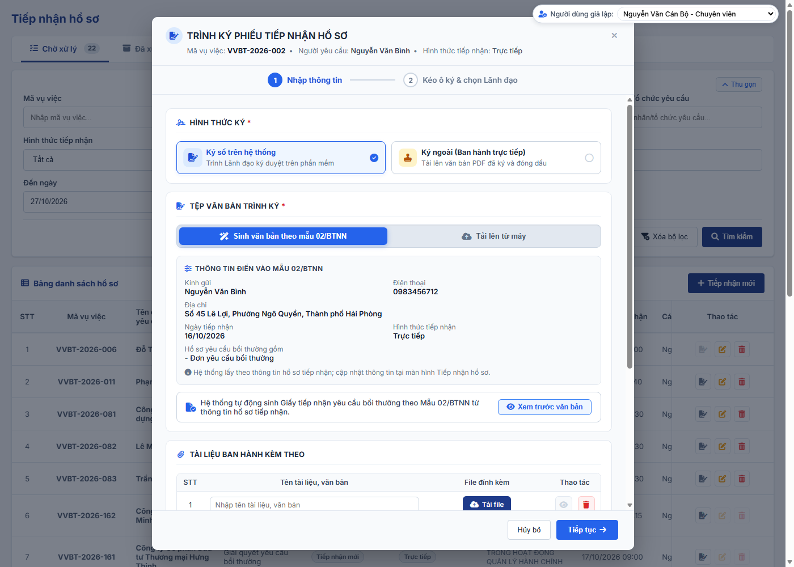

### 4.3.3. Dành cho Cán bộ Công tác bồi thường nhà nước

#### 4.3.3.1. Tiếp nhận hồ sơ

##### 4.3.3.1.1. Mục đích
Quản lý tập trung bước tiếp nhận ban đầu và phân công xử lý hồ sơ của 02 Loại hồ sơ: `Xác định cơ quan giải quyết bồi thường` và `Giải quyết yêu cầu bồi thường`, bao gồm:
- Tra cứu danh sách hồ sơ theo mã vụ việc, loại hồ sơ, nguồn hồ sơ, người yêu cầu, hình thức tiếp nhận, lĩnh vực phát sinh thiệt hại, trạng thái và khoảng thời gian tiếp nhận.
- Hồ sơ được nhận diện bằng `Mã vụ việc` và `Họ và tên người yêu cầu`.
- Tiếp nhận mới hồ sơ: Cán bộ tiếp nhận ghi nhận thông tin tổng quan (loại hồ sơ, hình thức tiếp nhận, lĩnh vực phát sinh thiệt hại), thông tin người yêu cầu, thông tin người bị thiệt hại (khi người yêu cầu không phải là người bị thiệt hại) và đính kèm tài liệu ban đầu.
- Duyệt tiếp nhận: hồ sơ `Tiếp nhận mới` có `Hình thức tiếp nhận` = `Trực tiếp` / `Qua dịch vụ bưu chính` sau khi lưu và trình Phiếu tiếp nhận (Dự thảo, lập theo `Loại hồ sơ`) chuyển `Chờ duyệt tiếp nhận`, Lãnh đạo các cấp ký duyệt theo luồng đã cấu hình; Lãnh đạo cấp cuối Ký duyệt thì hồ sơ chuyển `Chờ phân công`, Lãnh đạo Từ chối thì hồ sơ chuyển `Bị trả lại`, theo [Quy tắc Phiếu tiếp nhận - Tiếp nhận hồ sơ - Công tác bồi thường nhà nước (Website Quản trị)](#tn-phieu-tiep-nhan).
- Nhận hồ sơ từ các nguồn khác vào danh sách để Lãnh đạo phân công:
  + Hồ sơ gửi từ Dịch vụ công.
  + Hồ sơ do cơ quan khác Chuyển CQGQBT đến (thao tác Chuyển CQGQBT, hoặc Không thụ lý với lý do `Yêu cầu bồi thường không thuộc thẩm quyền giải quyết của mình` tại phân hệ Giải quyết yêu cầu bồi thường; Bộ Tư pháp / Sở Tư pháp nhận hồ sơ Loại hồ sơ `Xác định cơ quan giải quyết bồi thường` khi cơ quan chuyển chọn `Chuyển hồ sơ cho` = `Bộ Tư pháp` / `Sở Tư pháp [Tên tỉnh, thành phố]`, theo [Quy tắc Chuyển hồ sơ cho - Giải quyết yêu cầu bồi thường - Công tác bồi thường nhà nước (Website Quản trị)](SRS_BTNN_GiaiQuyetBT_GiaiQuyet_YCBT.md#gq-ktl-quy-tac-chuyen)).
  + Hồ sơ do Bộ Tư pháp / Sở Tư pháp chuyển đến sau khi hoàn thành Xác định cơ quan giải quyết bồi thường.
  + Hồ sơ do cơ quan khác chuyển đến chỉ kèm văn bản đã ký và `Tài liệu ban hành kèm theo`; không kèm `Tài liệu không ban hành kèm theo` theo [Quy tắc Tài liệu ban hành kèm theo / Tài liệu không ban hành kèm theo - Danh mục và Phụ lục - Tài liệu tổng hợp](../../Tai%20lieu%20tong%20hop/04_Danh_muc_va_Phu_luc.md#quy-tac-tai-lieu-ban-hanh-kem-theo).
- Phân công: Lãnh đạo chuyển hồ sơ xuống đơn vị cấp dưới hoặc phân công trực tiếp cán bộ xử lý theo luồng tương ứng với Loại hồ sơ tại [Cấu hình luồng xử lý - Cấu hình luồng xử lý - Quản trị hệ thống (Website Quản trị)](../01_Quan_tri_he_thong/Cau_hinh_luong_xu_ly.md).
- Khi phân công cán bộ, hồ sơ chuyển `Chờ tiếp nhận` tại phân hệ **Xác định cơ quan giải quyết bồi thường** hoặc phân hệ **Giải quyết yêu cầu bồi thường** theo Loại hồ sơ.
- Thu hồi: Lãnh đạo thu hồi lượt Chuyển đơn vị / Phân công cán bộ gần nhất của đơn vị mình khi bên nhận chưa xử lý.
- Lãnh đạo Phân công, Thu hồi hồ sơ tại màn hình này; Ký duyệt / Từ chối Phiếu tiếp nhận tại màn hình này hoặc màn hình Việc chờ Lãnh đạo xử lý.
- Danh sách chia 02 tab `Chờ xử lý` / `Đã xử lý` theo thao tác của người dùng đang đăng nhập trên từng hồ sơ.
- Hồ sơ cũng có thể được tạo trực tiếp tại phân hệ Xác định cơ quan giải quyết bồi thường và phân hệ Giải quyết yêu cầu bồi thường; hồ sơ tạo trực tiếp không đi qua màn hình này.

a. Phân quyền
Hệ thống phân quyền thao tác theo các quyền nghiệp vụ được cấp:
- **Xem**: Tra cứu danh sách hồ sơ, xem chi tiết, tài liệu đính kèm, quá trình phân công và lịch sử xử lý.
- **Tạo mới**: Tiếp nhận mới hồ sơ, nhập thông tin tiếp nhận ban đầu và đính kèm tài liệu.
- **Sửa**: Sửa thông tin tiếp nhận khi đồng thời:
  + Hồ sơ có `Nguồn hồ sơ` = `Tiếp nhận mới`.
  + Hồ sơ do chính người dùng tiếp nhận.
  + Hồ sơ ở trạng thái `Bị trả lại` (cập nhật để trình lại Phiếu tiếp nhận).
  + Hồ sơ ở trạng thái khác (`Chờ duyệt tiếp nhận`, `Chờ phân công`, `Đang phân công` và các trạng thái sau) không được Sửa.
  + Hồ sơ thuộc các nguồn khác không được Sửa.
- **Xóa**: Cùng điều kiện với quyền Sửa.
- **Ký duyệt / Từ chối Phiếu tiếp nhận**: Người dùng thuộc Nhóm lãnh đạo của cấp đang ký duyệt Phiếu tiếp nhận, hồ sơ ở trạng thái `Chờ duyệt tiếp nhận`, theo [Quy tắc Phiếu tiếp nhận - Tiếp nhận hồ sơ - Công tác bồi thường nhà nước (Website Quản trị)](#tn-phieu-tiep-nhan).
- **Phân công**: Chuyển đơn vị hoặc Phân công cán bộ khi đồng thời:
  + Hồ sơ ở trạng thái `Chờ phân công` / `Đang phân công`.
  + Người dùng thuộc Nhóm lãnh đạo của đơn vị đang phân công.
  + Chi tiết tại [Quy tắc phân công - Tiếp nhận hồ sơ - Công tác bồi thường nhà nước (Website Quản trị)](#tn-quy-tac-phan-cong).
- **Thu hồi**: Thu hồi lượt Chuyển đơn vị / Phân công cán bộ gần nhất do đơn vị của người dùng thực hiện, khi bên nhận chưa xử lý; chi tiết tại [Quy tắc Thu hồi - Tiếp nhận hồ sơ - Công tác bồi thường nhà nước (Website Quản trị)](#tn-thu-hoi).
- **Lãnh đạo**: tài khoản thuộc Nhóm lãnh đạo của đơn vị tại [Cấu hình luồng xử lý - Cấu hình luồng xử lý - Quản trị hệ thống (Website Quản trị)](../01_Quan_tri_he_thong/Cau_hinh_luong_xu_ly.md).
  + Không có chức năng ủy quyền Phân công, Thu hồi.
- **Loại hồ sơ theo đơn vị**:
  + Ô chọn, bộ lọc `Loại hồ sơ` và danh sách hồ sơ chỉ gồm các giá trị của [Danh mục Loại hồ sơ - Quản lý danh mục - Quản trị hệ thống (Website Quản trị)](../01_Quan_tri_he_thong/Quan_ly_danh_muc.md) [DM_54] có `Đơn vị áp dụng` chứa đơn vị của người dùng, theo [Phân quyền theo đơn vị và Đơn vị áp dụng - Quản lý danh mục dùng chung (Master Data) - Quản trị hệ thống (Website Quản trị)](../01_Quan_tri_he_thong/Quan_ly_danh_muc.md#dm-don-vi-ap-dung).
  + Tính cả đơn vị cha: chọn đơn vị cha thì áp dụng cho toàn bộ đơn vị trực thuộc.
  + `Xác định cơ quan giải quyết bồi thường` chỉ áp dụng cho Bộ Tư pháp và các Sở Tư pháp; Lãnh đạo đơn vị khác không thấy hồ sơ loại này.
  + Ủy ban nhân dân cấp tỉnh không tiếp nhận, không phân công, không phê duyệt hồ sơ Xác định cơ quan giải quyết bồi thường; chỉ xem hồ sơ của Sở Tư pháp trực thuộc tại phân hệ Xác định cơ quan giải quyết bồi thường.

b. Điều kiện thực hiện
- Người dùng đã đăng nhập vào hệ thống thành công (Website quản trị).
- Người dùng được phân quyền truy cập chức năng "Tiếp nhận hồ sơ".
- Phân công, Thu hồi: đơn vị gốc của hồ sơ đã được cấu hình luồng xử lý tại [Cấu hình luồng xử lý - Cấu hình luồng xử lý - Quản trị hệ thống (Website Quản trị)](../01_Quan_tri_he_thong/Cau_hinh_luong_xu_ly.md).

c. Nguồn hồ sơ

| Nguồn hồ sơ | Cách tạo | Loại hồ sơ | Hình thức tiếp nhận | Cán bộ tiếp nhận |
| :--- | :--- | :--- | :--- | :--- |
| `Tiếp nhận mới` | Cán bộ tiếp nhận nhập tại [MH02 - Màn hình Tiếp nhận hồ sơ](#43313-mh02---màn-hình-tiếp-nhận-hồ-sơ). | Cán bộ chọn | Cán bộ chọn `Trực tiếp` hoặc `Qua dịch vụ bưu chính`. | Người tạo hồ sơ. |
| `Dịch vụ công` | - Hệ thống tự tạo khi nhận hồ sơ gửi từ Dịch vụ công. - Đơn vị tiếp nhận là cơ quan giải quyết bồi thường người dân đã chọn. - Hồ sơ gồm đầy đủ thông tin người dân đã nhập trên Dịch vụ công theo [Hồ sơ nguồn Dịch vụ công - Tiếp nhận hồ sơ - Công tác bồi thường nhà nước (Website Quản trị)](#tn-dvc). | `Giải quyết yêu cầu bồi thường` (cố định) | `Dịch vụ công` (cố định). | - Người đầu tiên thao tác Phân công hồ sơ tại màn hình này. - Trước đó hiển thị `-`. |
| `Chuyển CQGQBT` | - Hệ thống tự tạo tại phân hệ Giải quyết yêu cầu bồi thường khi: + Cấp cuối phê duyệt Nội dung trình `Chuyển CQGQBT`. + Cấp cuối phê duyệt Nội dung trình `Không thụ lý` với lý do `Yêu cầu bồi thường không thuộc thẩm quyền giải quyết của mình`; hồ sơ được chuyển theo lựa chọn tại khối `Chuyển hồ sơ cho` ([Quy tắc Chuyển hồ sơ cho - Giải quyết yêu cầu bồi thường - Công tác bồi thường nhà nước (Website Quản trị)](SRS_BTNN_GiaiQuyetBT_GiaiQuyet_YCBT.md#gq-ktl-quy-tac-chuyen)). - Đơn vị tiếp nhận là cơ quan được chuyển đến: + `Bộ Tư pháp`: Bộ Tư pháp, tạo hồ sơ Loại `Xác định cơ quan giải quyết bồi thường`. + `Sở Tư pháp [Tên tỉnh, thành phố]`: Sở Tư pháp cùng tỉnh, thành phố với đơn vị gốc của tài khoản Không thụ lý, tạo hồ sơ Loại `Xác định cơ quan giải quyết bồi thường`; UBND cấp tỉnh chỉ xem. + `Cơ quan giải quyết bồi thường khác` và thao tác `Chuyển CQGQBT`: đơn vị đã chọn tại `Cơ quan tiếp nhận mới`. - Giữ nguyên `Mã vụ việc` của hồ sơ gốc; kèm văn bản Mẫu 04/BTNN - Thông báo không thụ lý hồ sơ yêu cầu bồi thường (với lý do `Yêu cầu bồi thường không thuộc thẩm quyền giải quyết của mình`) và `Tài liệu ban hành kèm theo` của văn bản này, Nội dung/Căn cứ chuyển, tài liệu đính kèm (thao tác `Chuyển CQGQBT`) và toàn bộ tài liệu hồ sơ. | - `Xác định cơ quan giải quyết bồi thường`: Không thụ lý lý do `Yêu cầu bồi thường không thuộc thẩm quyền giải quyết của mình`, lựa chọn `Bộ Tư pháp` hoặc `Sở Tư pháp [Tên tỉnh, thành phố]` (từ đơn vị thứ 2 của hồ sơ Tiếp nhận mới / Dịch vụ công chưa qua Xác định CQGQBT: bắt buộc, hệ thống tự tạo). - `Giải quyết yêu cầu bồi thường`: thao tác `Chuyển CQGQBT`; Không thụ lý lý do `Yêu cầu bồi thường không thuộc thẩm quyền giải quyết của mình`, lựa chọn `Cơ quan giải quyết bồi thường khác`. | Kế thừa từ hồ sơ gốc. | Như nguồn `Dịch vụ công`. |
| `Xác định CQGQBT` | - Hệ thống tự tạo khi Lãnh đạo cấp cuối của Bộ Tư pháp / Sở Tư pháp Ký duyệt văn bản Kết quả xác định CQGQBT tại phân hệ Xác định cơ quan giải quyết bồi thường (tự động chuyển CQGQBT, theo [Tự động chuyển CQGQBT - Xác định cơ quan giải quyết bồi thường - Công tác bồi thường nhà nước (Website Quản trị)](SRS_BTNN_GiaiQuyetBT__Xac%20định%20cơ%20quan%20GQBT.md)). - Đơn vị tiếp nhận là CQGQBT đã chọn tại kết quả xác định (`Chọn CQGQBT trên hệ thống`). | `Giải quyết yêu cầu bồi thường` | Kế thừa từ hồ sơ gốc. | Như nguồn `Dịch vụ công`. |

- Hồ sơ mới ở trạng thái `Chờ phân công` tại đơn vị gốc của đơn vị tiếp nhận, trừ hồ sơ `Tiếp nhận mới` có `Hình thức tiếp nhận` = `Trực tiếp` / `Qua dịch vụ bưu chính`:
  + Sau khi lưu: trạng thái `Chờ duyệt tiếp nhận`.
  + Lãnh đạo cấp cuối Ký duyệt Phiếu tiếp nhận: trạng thái `Chờ phân công` tại đơn vị gốc.
  + Chi tiết tại [Quy tắc Phiếu tiếp nhận - Tiếp nhận hồ sơ - Công tác bồi thường nhà nước (Website Quản trị)](#tn-phieu-tiep-nhan).
- `Hình thức tiếp nhận` tham chiếu [Danh mục Hình thức tiếp nhận - Danh mục dữ liệu dùng chung - Tổng quan và quy tắc chung](../../Tai%20lieu%20tong%20hop/00_Tong_quan_va_Quy_tac_chung.md#danh-muc-dung-chung) [DM_25].
  + Tại Tiếp nhận hồ sơ chỉ áp dụng `Dịch vụ công`, `Trực tiếp`, `Bộ phận Một cửa`, `Qua dịch vụ bưu chính`; giá trị `Cán bộ chủ động phục hồi danh dự khi có đủ thông tin` chỉ do hệ thống gán cho hồ sơ tạo tại [Hồ sơ cán bộ chủ động phục hồi danh dự - Giải quyết yêu cầu bồi thường - Công tác bồi thường nhà nước (Website Quản trị)](SRS_BTNN_GiaiQuyetBT_GiaiQuyet_YCBT.md#gq-cdpd).
- Form Tiếp nhận mới chỉ cho chọn `Trực tiếp`, `Qua dịch vụ bưu chính`.

d. Mã vụ việc và mã hồ sơ
- `Mã vụ việc` (`VVBT-yyyy-xxx`) là mã toàn trình, duy nhất trên hệ thống; mỗi vụ việc chỉ quản lý 01 `Mã vụ việc`.
- Hệ thống sinh `Mã vụ việc` **01 lần** tại điểm vào đầu tiên của vụ việc:
  + Tiếp nhận mới tại [MH02 - Màn hình Tiếp nhận hồ sơ](#43313-mh02---màn-hình-tiếp-nhận-hồ-sơ).
  + Nhận hồ sơ từ Dịch vụ công.
  + Thêm mới trực tiếp tại phân hệ Xác định cơ quan giải quyết bồi thường hoặc Giải quyết yêu cầu bồi thường, khi chọn `Mã vụ việc` = `Vụ việc mới`.
- Mọi bước xử lý sau kế thừa `Mã vụ việc`, không sinh lại.
- `Mã vụ việc` chỉ đọc, không cho sửa.
- Số thứ tự đã cấp không cấp lại, kể cả khi hồ sơ bị xóa.
- Mỗi phân hệ xử lý có `Mã hồ sơ` riêng, sinh khi hồ sơ vào phân hệ và luôn gắn với `Mã vụ việc`:
  + Phân hệ Xác định cơ quan giải quyết bồi thường: `XD-yyyy-xxx`.
  + Phân hệ Giải quyết yêu cầu bồi thường: `BT-yyyy-xxx`; dùng 01 mã cho cả 03 giá trị `Loại yêu cầu giải quyết bồi thường` (bồi thường tiền, phục hồi danh dự, cả hai).
  + Phân hệ Xem xét hoàn trả: `HT-yyyy-xxx`.
- Kế thừa mã khi hồ sơ chuyển tiếp:

| Chuyển tiếp | Mã vụ việc | Mã hồ sơ |
| :--- | :--- | :--- |
| Tiếp nhận hồ sơ → Xác định CQGQBT / Giải quyết YCBT | Giữ nguyên | Sinh `XD-` / `BT-` |
| Xác định CQGQBT → Giải quyết YCBT | Giữ nguyên | Sinh `BT-` |
| Chuyển CQGQBT sang cơ quan khác | Giữ nguyên | Sinh `BT-` mới tại cơ quan nhận; hồ sơ cũ đóng |
| Không thụ lý lý do `Yêu cầu bồi thường không thuộc thẩm quyền giải quyết của mình` - `Bộ Tư pháp` / `Sở Tư pháp [Tên tỉnh, thành phố]` | Giữ nguyên | Sinh `XD-` ngay khi hệ thống tạo hồ sơ mới ở trạng thái `Chờ phân công` tại Bộ Tư pháp / Sở Tư pháp; hồ sơ cũ đóng |
| Không thụ lý lý do `Yêu cầu bồi thường không thuộc thẩm quyền giải quyết của mình` - `Cơ quan giải quyết bồi thường khác` | Giữ nguyên | Sinh `BT-` mới ngay khi hệ thống tạo hồ sơ mới ở trạng thái `Chờ phân công` tại cơ quan nhận; hồ sơ cũ đóng |
| Giải quyết YCBT → Xem xét hoàn trả | Giữ nguyên | Sinh `HT-` |

- 01 vụ việc chỉ có 01 hồ sơ hoàn trả; danh sách người thi hành công vụ gây thiệt hại quản lý trong hồ sơ đó.
- Người yêu cầu nộp lại hồ sơ sau khi hồ sơ trước bị `Không thụ lý`: hồ sơ là vụ việc mới, hệ thống sinh `Mã vụ việc` mới.
- Người yêu cầu nộp lại hồ sơ sau khi vụ việc ở trạng thái `Dừng giải quyết`, `Đình chỉ giải quyết`, `Từ chối phục hồi danh dự`: hồ sơ mới mang `Mã vụ việc` của vụ việc đó.
- Thêm mới trực tiếp tại Giải quyết YCBT có trường `Mã vụ việc` (Radio button); Thêm mới trực tiếp tại Xác định CQGQBT luôn sinh `Mã vụ việc` mới:
  + `Vụ việc mới` (mặc định): hệ thống sinh `Mã vụ việc` khi lưu.
  + `Đã tồn tại vụ việc`: bắt buộc chọn vụ việc; hồ sơ mới mang `Mã vụ việc` đã chọn, không sinh mã mới.
  + Tìm kiếm trên toàn bộ vụ việc của hệ thống, mọi trạng thái; được chọn mọi vụ việc.
- Hiển thị thống nhất trên mọi phân hệ:
  + Cột/nhãn `Mã vụ việc` hiển thị `VVBT-...`.
  + Cột/nhãn `Mã hồ sơ` hiển thị mã của phân hệ đó.
  + Bộ lọc `Mã vụ việc` tìm theo `VVBT-...`.
  + Định danh vụ việc: `Mã vụ việc - Họ và tên người yêu cầu`.

e. Luồng phân công theo Loại hồ sơ

| Loại hồ sơ | Đơn vị tiếp nhận | Luồng áp dụng tại Cấu hình luồng xử lý | Nhánh luồng |
| :--- | :--- | :--- | :--- |
| Xác định cơ quan giải quyết bồi thường | Bộ Tư pháp | `Xác định CQGQBT - Bộ Tư pháp` | Lãnh đạo Bộ Tư pháp → Lãnh đạo Cục Giao dịch bảo đảm và bồi thường nhà nước → Lãnh đạo Phòng/Ban phụ trách → Cán bộ |
| Xác định cơ quan giải quyết bồi thường | Sở Tư pháp | `Xác định CQGQBT - Sở Tư pháp` của Sở Tư pháp đó | Lãnh đạo Sở Tư pháp → Lãnh đạo Phòng phụ trách → Cán bộ |
| Giải quyết yêu cầu bồi thường | Cơ quan giải quyết bồi thường | `Giải quyết YCBT` của đơn vị gốc | Theo cấu hình của từng cơ quan |

- Hệ thống chọn luồng theo Loại hồ sơ và đơn vị gốc tại thời điểm Lãnh đạo thao tác Phân công.

f. Quy tắc phân công

| STT | Nội dung | Quy tắc |
| :-- | :--- | :--- |
| 1 | Đơn vị gốc và đơn vị đang phân công | - Đơn vị gốc là đơn vị cấp cao nhất trên cây Cơ cấu tổ chức chứa đơn vị tiếp nhận của hồ sơ theo [Nguồn hồ sơ - Tiếp nhận hồ sơ - Công tác bồi thường nhà nước (Website Quản trị)](#tn-nguon-ho-so). - Hồ sơ mới ở trạng thái `Chờ phân công`; đơn vị đang phân công là đơn vị gốc. - Mỗi lần Chuyển đơn vị: đơn vị đang phân công đổi thành đơn vị nhận, hồ sơ chuyển `Đang phân công`. |
| 2 | Người phân công | - Bất kỳ tài khoản nào thuộc Nhóm lãnh đạo của đơn vị đang phân công đều được phân công hồ sơ. - Người thao tác trước xử lý hồ sơ; hồ sơ không còn ở tab `Chờ xử lý` của các thành viên khác trong nhóm. - Không có chức năng ủy quyền. |
| 3 | Hình thức phân công | - Chỉ dùng Hình thức phân công đã cấu hình cho đơn vị đang phân công, trong Loại luồng tương ứng với Loại hồ sơ theo [Luồng phân công theo Loại hồ sơ - Tiếp nhận hồ sơ - Công tác bồi thường nhà nước (Website Quản trị)](#tn-luong-phan-cong). - `Chuyển đơn vị`: chỉ chuyển đến đơn vị cấp dưới trực tiếp đã chọn tại cấu hình. - `Phân công cán bộ`: chỉ chọn cán bộ đã chọn tại cấu hình. - Không có thao tác "Trả lại" hồ sơ lên cấp trên; cấp trên dùng `Thu hồi`. |
| 4 | Thời hạn | - Không quy định thời hạn cho từng bước phân công. |
| 5 | Lượt chuyển và tình trạng | - Mỗi lần Chuyển đơn vị hoặc Phân công cán bộ tạo 01 lượt chuyển tại `Quá trình phân công`, Tình trạng ban đầu `Chưa xử lý`. - Lượt chuyển đến đơn vị chuyển `Đã xử lý` khi Lãnh đạo đơn vị nhận Chuyển đơn vị hoặc Phân công cán bộ tiếp. - Lượt chuyển đến cán bộ chuyển `Đã xử lý` khi cán bộ chủ trì thực hiện `Tiếp nhận` hồ sơ tại phân hệ xử lý. - Bên nhận mở xem hồ sơ lần đầu (Lãnh đạo đơn vị nhận mở popup Phân công; cán bộ chủ trì mở hồ sơ): hệ thống ghi thời điểm xem, Tình trạng hiển thị `Chưa xử lý - Đã xem lúc [dd/mm/yyyy HH:mm]`. - Chưa xem: hiển thị `Chưa xử lý - Chưa xem`. - Việc xem hồ sơ không tính là đã xử lý. |
| 6 | Kiểm tra đồng thời | - Thao tác Phân công, Thu hồi kiểm tra lại trạng thái hồ sơ và quyền của người dùng tại máy chủ ngay khi mở popup và khi xác nhận. - Mở popup Phân công mà hồ sơ đã được xử lý: hiển thị [MSG-ERR-BTNN-LXL-001], tải lại danh sách. - Xác nhận Phân công mà không còn hợp lệ: hiển thị [MSG-ERR-BTNN-LXL-002]. - Thu hồi mà bên nhận đã xử lý: hiển thị [MSG-ERR-BTNN-LXL-004]. |
| 7 | Lịch sử xử lý | - Mỗi thao tác ghi 01 dòng `Lịch sử xử lý` gồm Hành động, Người thực hiện, Thời điểm, Nội dung. - Hành động của Lãnh đạo tại Tiếp nhận hồ sơ: + `Chuyển đơn vị` + `Phân công cán bộ` + `Thu hồi` |

g. Trạng thái tại màn hình Tiếp nhận hồ sơ

| Trạng thái | Ý nghĩa | Hiển thị với Lãnh đạo |
| :--- | :--- | :--- |
| `Chờ duyệt tiếp nhận` | - Hồ sơ `Tiếp nhận mới` có `Hình thức tiếp nhận` = `Trực tiếp` / `Qua dịch vụ bưu chính` đã lưu (hoặc đã cập nhật, trình lại). - Phiếu tiếp nhận (Dự thảo) đang chờ Lãnh đạo các cấp ký duyệt theo luồng đã cấu hình. - Chưa vào luồng phân công; chưa hiển thị tại các phân hệ xử lý. | - Tab `Chờ xử lý` của Nhóm lãnh đạo cấp đang ký duyệt. - Tab `Đã xử lý` của Lãnh đạo đã Ký duyệt cấp trước. |
| `Bị trả lại` | - Lãnh đạo Từ chối Phiếu tiếp nhận. - Cán bộ tiếp nhận cập nhật hồ sơ để trình lại. | - Tab `Đã xử lý` của Lãnh đạo đã Ký duyệt / Từ chối. |
| `Chờ phân công` | - Hồ sơ mới (nguồn khác `Tiếp nhận mới`), đang chờ Lãnh đạo đơn vị gốc phân công. - Hồ sơ `Tiếp nhận mới` đã được Lãnh đạo cấp cuối Ký duyệt Phiếu tiếp nhận. - Hoặc hồ sơ đã được thu hồi về đơn vị gốc. | - Tab `Chờ xử lý` của Nhóm lãnh đạo đơn vị gốc. |
| `Đang phân công` | - Lãnh đạo đã chuyển hồ sơ cho đơn vị cấp dưới. - Hồ sơ đang chờ Lãnh đạo đơn vị nhận phân công tiếp. | - Tab `Chờ xử lý` của Nhóm lãnh đạo đơn vị đang phân công. - Tab `Đã xử lý` của Lãnh đạo đã chuyển. |
| `Chờ tiếp nhận` | - Lãnh đạo đã phân công cán bộ chủ trì. - Hồ sơ chờ cán bộ chủ trì tiếp nhận tại phân hệ xử lý tương ứng với `Loại hồ sơ` (Xác định cơ quan giải quyết bồi thường hoặc Giải quyết yêu cầu bồi thường). | - Tab `Đã xử lý` của Lãnh đạo đã phân công. |

- Trạng thái từ bước cán bộ chủ trì tiếp nhận trở đi mô tả tại [Xác định cơ quan giải quyết bồi thường - Xác định cơ quan giải quyết bồi thường - Công tác bồi thường nhà nước (Website Quản trị)](SRS_BTNN_GiaiQuyetBT__Xac%20định%20cơ%20quan%20GQBT.md) và [Giải quyết yêu cầu bồi thường - Giải quyết yêu cầu bồi thường - Công tác bồi thường nhà nước (Website Quản trị)](SRS_BTNN_GiaiQuyetBT_GiaiQuyet_YCBT.md).

h. Quy tắc 02 tab Chờ xử lý / Đã xử lý
- Tab của hồ sơ xác định theo thao tác của người dùng đang đăng nhập trên hồ sơ đó, không cố định theo trạng thái.
- Cùng 01 hồ sơ có thể nằm ở tab `Chờ xử lý` của người dùng này và tab `Đã xử lý` của người dùng khác.

| Vai trò | Tab `Chờ xử lý` | Tab `Đã xử lý` |
| :--- | :--- | :--- |
| Cán bộ tiếp nhận | - Hồ sơ do người dùng tiếp nhận (`Nguồn hồ sơ` = `Tiếp nhận mới`). - Hồ sơ chưa được phân công đến cán bộ xử lý (`Chờ duyệt tiếp nhận`, `Bị trả lại`, `Chờ phân công`, `Đang phân công`). | - Hồ sơ do người dùng tiếp nhận. - Hồ sơ đã được phân công cán bộ xử lý (từ `Chờ tiếp nhận` trở đi). |
| Lãnh đạo (thuộc Nhóm lãnh đạo tại Cấu hình luồng xử lý) | - Hồ sơ `Chờ phân công` / `Đang phân công`; đơn vị đang phân công là đơn vị mà Lãnh đạo thuộc Nhóm lãnh đạo, theo [Quy tắc phân công - Tiếp nhận hồ sơ - Công tác bồi thường nhà nước (Website Quản trị)](#tn-quy-tac-phan-cong). - Hồ sơ `Chờ duyệt tiếp nhận`; Lãnh đạo thuộc Nhóm lãnh đạo của cấp đang ký duyệt Phiếu tiếp nhận. | - Hồ sơ Lãnh đạo đã Chuyển đơn vị / Phân công cán bộ. - Trạng thái có thể vẫn là `Đang phân công` khi đơn vị cấp dưới chưa phân công tiếp. - Hồ sơ Lãnh đạo đã Ký duyệt / Từ chối Phiếu tiếp nhận, không còn chờ Lãnh đạo xử lý. |

- Luồng điển hình:
  + Cán bộ tiếp nhận lưu hồ sơ `Trực tiếp`: hồ sơ `Chờ duyệt tiếp nhận`, ở tab `Chờ xử lý` của cán bộ và của Nhóm lãnh đạo cấp ký duyệt 1.
  + Lãnh đạo cấp 1 Ký duyệt: hồ sơ sang tab `Đã xử lý` của Lãnh đạo cấp 1, hiển thị tại tab `Chờ xử lý` của Nhóm lãnh đạo cấp 2.
  + Lãnh đạo cấp cuối Ký duyệt: hồ sơ `Chờ phân công`, hiển thị tại tab `Chờ xử lý` của Nhóm lãnh đạo đơn vị gốc.
  + Cán bộ tiếp nhận của Sở Tư pháp tạo hồ sơ: hồ sơ ở tab `Chờ xử lý` của cán bộ.
  + Lãnh đạo Sở chuyển hồ sơ cho Lãnh đạo Phòng: hồ sơ sang tab `Đã xử lý` của Lãnh đạo Sở (trạng thái `Đang phân công`), hiển thị tại tab `Chờ xử lý` của Lãnh đạo Phòng, vẫn ở tab `Chờ xử lý` của cán bộ tiếp nhận.
  + Lãnh đạo Phòng phân công cán bộ xử lý: hồ sơ chuyển `Chờ tiếp nhận`, sang tab `Đã xử lý` của Lãnh đạo Phòng và của cán bộ tiếp nhận.
- Thu hồi thành công: hồ sơ trở lại tab `Chờ xử lý` của Lãnh đạo đã thu hồi.
- Badge số lượng tab `Chờ xử lý` và mục menu `Tiếp nhận hồ sơ`: theo trường `Tab danh sách` tại [MH01 - Màn hình Danh sách hồ sơ tiếp nhận - Tiếp nhận hồ sơ - Công tác bồi thường nhà nước (Website Quản trị)](#43312-mh01---màn-hình-danh-sách-hồ-sơ-tiếp-nhận); tab `Đã xử lý` không có badge.
- Mặc định mở tab `Chờ xử lý`.
- Nút `Tiếp nhận mới`: chỉ hiển thị khi chọn tab `Chờ xử lý`; khi chuyển sang tab `Đã xử lý` thì hệ thống tự động ẩn nút này.
- Trường `Trạng thái` của bộ lọc chỉ gồm các trạng thái đang có của hồ sơ thuộc tab đang chọn.
- Click dòng hồ sơ: mở [MH03 - Màn hình Xem chi tiết hồ sơ tiếp nhận](#43314-mh03---màn-hình-xem-chi-tiết-hồ-sơ-tiếp-nhận) của bản ghi.

i. Quy tắc Thu hồi

- Thu hồi dùng để lấy lại hồ sơ Lãnh đạo đã Chuyển đơn vị hoặc Phân công cán bộ khi bên nhận chưa xử lý. Không có thao tác "Trả lại" từ cấp dưới lên cấp trên; cấp trên dùng Thu hồi.
- **Người thực hiện**: Lãnh đạo thuộc Nhóm lãnh đạo (tại Cấu hình luồng xử lý) của đơn vị đã thực hiện lượt chuyển gần nhất của hồ sơ.
- **Vị trí thao tác**: tab `Đã xử lý` của [MH01 - Màn hình Danh sách hồ sơ tiếp nhận](#43312-mh01---màn-hình-danh-sách-hồ-sơ-tiếp-nhận) và [MH03 - Màn hình Xem chi tiết hồ sơ tiếp nhận](#43314-mh03---màn-hình-xem-chi-tiết-hồ-sơ-tiếp-nhận).
- **Điều kiện thu hồi** (thỏa đồng thời):
  + Chỉ thu hồi **lượt chuyển gần nhất** trong `Quá trình phân công`; không thu hồi lượt chuyển trước đó khi đã có lượt chuyển tiếp theo.
  + Lượt chuyển gần nhất có Tình trạng `Chưa xử lý`.
  + Theo hình thức của lượt chuyển gần nhất:

| Hình thức lượt chuyển | Hồ sơ được thu hồi khi | Hồ sơ không còn được thu hồi khi |
| :--- | :--- | :--- |
| `Chuyển đơn vị` | Hồ sơ `Đang phân công` tại đơn vị nhận (Lãnh đạo đơn vị nhận chưa Chuyển đơn vị / Phân công cán bộ tiếp) | Lãnh đạo đơn vị nhận đã Chuyển đơn vị hoặc Phân công cán bộ |
| `Phân công cán bộ` | Hồ sơ `Chờ tiếp nhận` (cán bộ chủ trì chưa tiếp nhận tại phân hệ xử lý) | Cán bộ chủ trì đã thao tác trên hồ sơ tại phân hệ xử lý (Tiếp nhận, Yêu cầu bổ sung, Không thụ lý...) |

  + Bên nhận đã mở xem hồ sơ vẫn được thu hồi; việc xem không tính là đã xử lý.
- **Kết quả thu hồi**:
  + Xóa lượt chuyển gần nhất khỏi `Quá trình phân công`.
  + Hồ sơ trở lại đơn vị đã chuyển:
    - Không còn lượt chuyển nào (đơn vị đã chuyển là đơn vị gốc): trạng thái `Chờ phân công`.
    - Còn lượt chuyển trước đó: trạng thái `Đang phân công`; lượt chuyển liền trước trở lại Tình trạng `Chưa xử lý`.
  + Thu hồi lượt `Phân công cán bộ`: xóa cán bộ chủ trì; hồ sơ không còn hiển thị tại phân hệ xử lý (Xác định cơ quan giải quyết bồi thường / Giải quyết yêu cầu bồi thường) của cán bộ đó.
  + Hồ sơ trở lại tab `Chờ xử lý` của Lãnh đạo đã thu hồi; không còn ở tab `Chờ xử lý` của bên nhận (Lãnh đạo đơn vị nhận hoặc cán bộ chủ trì). Badge số lượng của các bên được cập nhật theo.
  + Ghi `Lịch sử xử lý`: hành động `Thu hồi`, nội dung "Thu hồi hồ sơ đã chuyển [Tên đơn vị nhận]." (Chuyển đơn vị) hoặc "Thu hồi phân công cán bộ [Họ và tên]." (Phân công cán bộ), kèm người thực hiện và thời điểm.
- **Kiểm tra đồng thời**: hệ thống kiểm tra lại điều kiện thu hồi tại máy chủ khi Lãnh đạo bấm `Thu hồi` và khi bấm `Đồng ý` trên popup; bên nhận đã xử lý trong lúc đó thì không thu hồi, hiển thị [MSG-ERR-BTNN-LXL-004].

j. Quy tắc Phiếu tiếp nhận

| STT | Nội dung | Quy tắc |
| :-- | :--- | :--- |
| 1 | Văn bản | - `Loại hồ sơ` = `Giải quyết yêu cầu bồi thường`: Phiếu tiếp nhận là Mẫu số 02/BTNN - Giấy tiếp nhận yêu cầu bồi thường, hệ thống sinh theo mẫu. - `Loại hồ sơ` = `Xác định cơ quan giải quyết bồi thường`: Phiếu tiếp nhận là tệp văn bản Cán bộ tiếp nhận đính kèm khi trình ký; hệ thống không sinh theo biểu mẫu. - Mỗi hồ sơ có 01 Phiếu tiếp nhận. |
| 2 | Hồ sơ áp dụng | - Hồ sơ có `Nguồn hồ sơ` = `Tiếp nhận mới`. - `Hình thức tiếp nhận` = `Trực tiếp` hoặc `Qua dịch vụ bưu chính`. - Hồ sơ không thỏa điều kiện (nguồn `Dịch vụ công`, `Chuyển CQGQBT`, `Xác định CQGQBT`; hình thức tiếp nhận khác): không có Phiếu tiếp nhận, không qua bước duyệt tiếp nhận; hồ sơ mới ở trạng thái `Chờ phân công`. - [MH03 - Màn hình Xem chi tiết hồ sơ tiếp nhận](#tn-mh03-chi-tiet) của hồ sơ không thỏa điều kiện không hiển thị khối `Thông tin Phiếu tiếp nhận`. |
| 3 | Lập và trình Phiếu tiếp nhận | - Thực hiện khi Cán bộ tiếp nhận `Lưu và trình ký` tại [MH02 - Màn hình Tiếp nhận hồ sơ](#43313-mh02---màn-hình-tiếp-nhận-hồ-sơ): hệ thống mở [MH07 - Popup Trình ký Phiếu tiếp nhận hồ sơ - Tiếp nhận hồ sơ - Công tác bồi thường nhà nước (Website Quản trị)](#tn-mh07-trinh-ky-ptn), chưa lưu hồ sơ. - `Giải quyết yêu cầu bồi thường`: Phiếu tiếp nhận (Dự thảo) sinh theo Mẫu 02/BTNN từ thông tin hồ sơ và thông tin nhập tại popup, hoặc là tệp tải lên từ máy. - `Xác định cơ quan giải quyết bồi thường`: hệ thống không sinh Phiếu tiếp nhận theo biểu mẫu; luồng trình như Loại trình `Không thụ lý` tại [Luồng trình ký hồ sơ Xác định cơ quan giải quyết bồi thường - Xác định cơ quan giải quyết bồi thường - Công tác bồi thường nhà nước (Website Quản trị)](SRS_BTNN_GiaiQuyetBT__Xac%20định%20cơ%20quan%20GQBT.md#xd-luong-trinh-ky). - Hồ sơ (thêm mới hoặc cập nhật hồ sơ `Bị trả lại`) chỉ được lưu khi `Trình Lãnh đạo` hoặc `Ban hành văn bản` thành công; `Hủy bỏ` thì không lưu, giữ dữ liệu đang nhập tại form. - `Trình Lãnh đạo` (`Ký số trên hệ thống`): trình Lãnh đạo được chọn của cấp 1, hồ sơ chuyển `Chờ duyệt tiếp nhận`. - `Ban hành văn bản` (`Ký ngoài`): Phiếu tiếp nhận ban hành trực tiếp, không trình Lãnh đạo; hồ sơ chuyển `Chờ phân công` tại đơn vị gốc như STT 5. - Hồ sơ `Chờ duyệt tiếp nhận` chưa tạo hồ sơ luồng phân công; hồ sơ chưa hiển thị tại các phân hệ xử lý. |
| 4 | Luồng ký duyệt | - Các cấp ký duyệt theo luồng phê duyệt từ đơn vị của Cán bộ tiếp nhận lên đơn vị gốc, theo Loại luồng tương ứng với `Loại hồ sơ` tại [Cấu hình luồng xử lý - Cấu hình luồng xử lý - Quản trị hệ thống (Website Quản trị)](../01_Quan_tri_he_thong/Cau_hinh_luong_xu_ly.md). - Hồ sơ được trình ký lần lượt qua các cấp theo luồng đã cấu hình và Lãnh đạo đã chọn tại [MH07 - Popup Trình ký Phiếu tiếp nhận hồ sơ - Tiếp nhận hồ sơ - Công tác bồi thường nhà nước (Website Quản trị)](#tn-mh07-trinh-ky-ptn). - Không xác định được cấp ký duyệt: không lưu hồ sơ, hiển thị *"Chưa xác định được cấp ký duyệt Phiếu tiếp nhận theo luồng đã cấu hình. Vui lòng liên hệ Quản trị hệ thống."* |
| 5 | Ký duyệt | - Lãnh đạo cấp trung gian Ký duyệt: hồ sơ giữ `Chờ duyệt tiếp nhận`, chuyển Nhóm lãnh đạo cấp tiếp theo. - Lãnh đạo cấp cuối Ký duyệt: + Hệ thống ký số Phiếu tiếp nhận bằng chứng thư số của Lãnh đạo, ban hành Phiếu tiếp nhận. + Hồ sơ chuyển `Chờ phân công` tại đơn vị gốc; hiển thị tại tab `Chờ xử lý` của Nhóm lãnh đạo đơn vị gốc để Phân công theo [Quy tắc phân công - Tiếp nhận hồ sơ - Công tác bồi thường nhà nước (Website Quản trị)](#tn-quy-tac-phan-cong). |
| 6 | Từ chối | - Lãnh đạo bất kỳ cấp nào Từ chối, bắt buộc nhập lý do từ chối. - Hồ sơ chuyển `Bị trả lại`, trở về Cán bộ tiếp nhận. - Cán bộ tiếp nhận `Sửa` (Cập nhật) hồ sơ; nút `Lưu và trình ký`: hệ thống mở [MH07 - Popup Trình ký Phiếu tiếp nhận hồ sơ - Tiếp nhận hồ sơ - Công tác bồi thường nhà nước (Website Quản trị)](#tn-mh07-trinh-ky-ptn), điền sẵn dữ liệu lần trình trước; thông tin cập nhật chỉ được ghi nhận khi trình ký lại / ban hành thành công. - `Trình Lãnh đạo` (Ký số): trình lại từ cấp 1, hồ sơ chuyển `Chờ duyệt tiếp nhận`. - `Ban hành văn bản` (Ký ngoài): Phiếu tiếp nhận ban hành trực tiếp, hồ sơ chuyển `Chờ phân công`. - Cán bộ tiếp nhận được `Xóa` hồ sơ `Bị trả lại`. |
| 7 | Lãnh đạo xử lý | - Hồ sơ `Chờ duyệt tiếp nhận` hiển thị với Nhóm lãnh đạo của cấp đang ký duyệt tại: + Tab `Chờ xử lý` của [MH01 - Màn hình Danh sách hồ sơ tiếp nhận](#43312-mh01---màn-hình-danh-sách-hồ-sơ-tiếp-nhận), thao tác `Ký duyệt`, `Từ chối`. + [MH03 - Màn hình Xem chi tiết hồ sơ tiếp nhận](#tn-mh03-chi-tiet), nút `Ký duyệt`, `Từ chối`. + Màn hình Việc chờ Lãnh đạo xử lý: Loại công việc `Phê duyệt`; Loại trình `Phiếu tiếp nhận`; Nội dung cần xử lý `Ký duyệt: Phiếu tiếp nhận - cấp [n]/[tổng số cấp]`; Trạng thái `Chờ duyệt tiếp nhận`. - Màn hình Ký duyệt / Từ chối theo [Màn hình Ký duyệt / Từ chối - Xác định cơ quan giải quyết bồi thường - Công tác bồi thường nhà nước (Website Quản trị)](SRS_BTNN_GiaiQuyetBT__Xac%20định%20cơ%20quan%20GQBT.md#xd-ky-duyet); `Ý kiến ký duyệt` không bắt buộc, `Lý do từ chối` bắt buộc. |
| 8 | Trạng thái Phiếu tiếp nhận | - `Dự thảo`: hồ sơ `Chờ duyệt tiếp nhận` hoặc `Bị trả lại`. - `Đã ký duyệt, ban hành`: Lãnh đạo cấp cuối đã Ký duyệt, hoặc Cán bộ tiếp nhận đã `Ban hành văn bản` (`Ký ngoài`). |
| 9 | Ảnh hưởng tới hồ sơ | - Trạng thái hồ sơ theo STT 3, 5, 6. - Phân công, Thu hồi hồ sơ không thay đổi Phiếu tiếp nhận. |
| 10 | Lịch sử xử lý | - Mỗi thao tác ghi 01 dòng `Lịch sử xử lý` của hồ sơ gồm Hành động, Người thực hiện, Thời điểm, Nội dung: + `Trình ký Phiếu tiếp nhận` / `Trình ký lại Phiếu tiếp nhận`: luồng ký duyệt, Lãnh đạo từng cấp, Nội dung trình. + `Ban hành Phiếu tiếp nhận (Ký ngoài)`: tệp đã ký & đóng dấu. + `Ký duyệt Phiếu tiếp nhận`: cấp ký duyệt, Lãnh đạo cấp tiếp theo hoặc ký số và ban hành, ý kiến ký duyệt. + `Từ chối Phiếu tiếp nhận`: cấp ký duyệt, lý do từ chối. - Hồ sơ `Xác định cơ quan giải quyết bồi thường`: nhãn như Loại trình `Không thụ lý` tại [Màn hình Ký duyệt / Từ chối - Xác định cơ quan giải quyết bồi thường - Công tác bồi thường nhà nước (Website Quản trị)](SRS_BTNN_GiaiQuyetBT__Xac%20định%20cơ%20quan%20GQBT.md#xd-ky-duyet): + `Trình phê duyệt`: Loại trình `Phiếu tiếp nhận`, Lãnh đạo từng cấp, Nội dung trình (trình lần đầu và trình lại). + `Ký duyệt`: cấp trung gian ghi Lãnh đạo cấp tiếp theo; cấp cuối ghi đã ký số văn bản, hồ sơ chuyển `Chờ phân công`. + `Từ chối phê duyệt`: lý do từ chối. + `Ban hành Phiếu tiếp nhận (Ký ngoài)`: tệp đã ký ngoài. + `Tiếp nhận hồ sơ`: khi hồ sơ chuyển `Chờ phân công`. |
| 11 | Kiểm tra đồng thời | - Mở màn hình Ký duyệt / Từ chối hoặc xác nhận mà Phiếu tiếp nhận đã được xử lý: hiển thị [MSG-ERR-BTNN-LXL-001], tải lại danh sách. |
| 12 | Dữ liệu trước khi áp dụng | - Hồ sơ `Tiếp nhận mới` đã ở trạng thái `Chờ phân công` trở đi giữ nguyên trạng thái, không qua bước duyệt tiếp nhận. - Phiếu tiếp nhận đã trình ký / ban hành trước đó (gồm `Ký ngoài`) vẫn hiển thị tại khối `Thông tin Phiếu tiếp nhận`. |

k. Hồ sơ nguồn Dịch vụ công

| STT | Nội dung | Quy tắc |
| :-- | :--- | :--- |
| 1 | Giá trị cố định | - Dịch vụ công chỉ gửi hồ sơ `Loại hồ sơ` = `Giải quyết yêu cầu bồi thường`; không gửi hồ sơ `Xác định cơ quan giải quyết bồi thường`. - `Loại hồ sơ` = `Giải quyết yêu cầu bồi thường`. - `Nguồn hồ sơ` = `Dịch vụ công`. - `Hình thức tiếp nhận` = `Dịch vụ công`. - 03 giá trị do hệ thống gán, chỉ đọc tại mọi màn hình: danh sách, Xem chi tiết tại Tiếp nhận hồ sơ, form Tiếp nhận và các màn hình sau tiếp nhận tại phân hệ Giải quyết yêu cầu bồi thường. |
| 2 | Dữ liệu hồ sơ | - Người dân nhập trên Dịch vụ công đủ các trường của [MH02 - Màn hình Nhập liệu hồ sơ vụ việc - Giải quyết yêu cầu bồi thường - Công tác bồi thường nhà nước (Website Quản trị)](SRS_BTNN_GiaiQuyetBT_GiaiQuyet_YCBT.md#gq-mh02-nhap-lieu), trừ các trường liên kết Mã vụ việc và trường `Pháp luật áp dụng để giải quyết bồi thường`. - Hệ thống lưu toàn bộ dữ liệu nhận được vào hồ sơ, không lược bớt trường. |
| 3 | Thành phần hồ sơ | - Tài liệu đính kèm nhận theo 04 thành phần hồ sơ tại [Thành phần hồ sơ - E-Form Dịch vụ công - Tài liệu tích hợp Dịch vụ công](../../../Tai_lieu_tich_hop/1.%20Dịch%20vụ%20công/EForm_DVC_YeuCauBoiThuong.md#ef-thanh-phan-ho-so): + (1) `Văn bản yêu cầu bồi thường`. + (2) `Văn bản làm căn cứ yêu cầu bồi thường`. + (3) `Văn bản ủy quyền thực hiện yêu cầu bồi thường`. + (4) `Các tài liệu kèm theo khác`. - Hệ thống lưu mã thành phần của từng tệp để hiển thị theo nhóm. - Thành phần (2) hiển thị tại bảng `Văn bản làm căn cứ yêu cầu bồi thường`. - Thành phần (1), (3), (4) hiển thị tại bảng `Tài liệu đính kèm`, nhóm theo thành phần. |
| 4 | Xem chi tiết | - Click dòng hồ sơ: mở [MH03 - Màn hình Xem chi tiết hồ sơ tiếp nhận - Tiếp nhận hồ sơ - Công tác bồi thường nhà nước (Website Quản trị)](#tn-mh03-chi-tiet). |
| 5 | Tiếp nhận | - Sau khi Lãnh đạo phân công cán bộ, hồ sơ chuyển `Chờ tiếp nhận` tại phân hệ Giải quyết yêu cầu bồi thường. - Cán bộ chủ trì bấm `Tiếp nhận`: hệ thống mở [MH02 - Màn hình Nhập liệu hồ sơ vụ việc - Giải quyết yêu cầu bồi thường - Công tác bồi thường nhà nước (Website Quản trị)](SRS_BTNN_GiaiQuyetBT_GiaiQuyet_YCBT.md#gq-mh02-nhap-lieu), điền sẵn toàn bộ dữ liệu nhận từ Dịch vụ công. - `Nguồn hồ sơ`, `Hình thức tiếp nhận`: chỉ đọc theo STT 1. - `Pháp luật áp dụng để giải quyết bồi thường`: Dịch vụ công không gửi; hiển thị giá trị mặc định của MH02. - Các trường còn lại: cán bộ được kiểm tra, sửa, bổ sung. - Tài liệu theo STT 3: mỗi tệp của thành phần (1), (3), (4) là 01 dòng `Tài liệu đính kèm`, `Tên tài liệu, văn bản` = `[Tên thành phần hồ sơ] - [Tên tài liệu]`; cán bộ được xem, xóa, bổ sung. - Kiểm tra dữ liệu, lưu và trình duyệt theo chức năng `Trình duyệt` của MH02; luồng sau tiếp nhận như hồ sơ các nguồn khác. |
| 6 | Mã vụ việc | - Theo [Mã vụ việc và mã hồ sơ - Tiếp nhận hồ sơ - Công tác bồi thường nhà nước (Website Quản trị)](#tn-ma-vu-viec): sinh khi nhận hồ sơ từ Dịch vụ công; phân hệ Giải quyết yêu cầu bồi thường kế thừa, chỉ sinh `Mã hồ sơ` `BT-`. |

---

##### 4.3.3.1.2. MH01 - Màn hình Danh sách hồ sơ tiếp nhận

###### 4.3.3.1.2.1. Màn hình

###### 4.3.3.1.2.2. Mô tả thông tin trên màn hình

| Trường thông tin | Kiểu dữ liệu | Bắt buộc | Mặc định | Mô tả |
| :--- | :--- | :--- | :--- | :--- |
| Tiêu đề màn hình | String(255) | - | `Tiếp nhận hồ sơ` | Control UI: Text heading (Read-only). - Hiển thị đúng tên mục Menu `Tiếp nhận hồ sơ`. - Không có dòng mô tả dưới tiêu đề. |
| **Tab danh sách** | Tab | - | `Chờ xử lý` | Control UI: Tab. - Đặt phía trên bộ lọc. - Gồm tab `Chờ xử lý` và tab `Đã xử lý`. - Badge số lượng: số bản ghi thuộc tab Chờ xử lý của người dùng; không hiển thị khi bằng 0. - Badge số lượng tại mục menu `Tiếp nhận hồ sơ` bằng badge tab Chờ xử lý của Tiếp nhận hồ sơ. - Tab `Đã xử lý` không có badge số lượng. - Bản ghi của từng tab theo [Quy tắc 02 tab Chờ xử lý / Đã xử lý - Tiếp nhận hồ sơ - Công tác bồi thường nhà nước (Website Quản trị)](#tn-tab-xu-ly). |
| **I. Bộ lọc tìm kiếm** | Section | - | Mở rộng | Control UI: Filter panel dạng thu gọn/mở rộng (Accordion). - Không hiển thị tiêu đề khối. - Các tiêu chí có dữ liệu được kết hợp theo điều kiện AND. - Click nút `Thu gọn`/`Mở rộng` để thu gọn/mở rộng khối. - Khi thu gọn, các giá trị lọc đã nhập được giữ nguyên. |
| Mã vụ việc | String(50) | Không | Trống | Control UI: Input text. - Placeholder: `Nhập mã vụ việc...`. - Tìm kiếm gần đúng, không phân biệt hoa thường theo `Mã vụ việc`. |
| Loại hồ sơ | Enum(String(100)) | Không | `Tất cả` | Control UI: Combobox. - Tham chiếu [Danh mục Loại hồ sơ - Quản lý danh mục - Quản trị hệ thống (Website Quản trị)](../01_Quan_tri_he_thong/Quan_ly_danh_muc.md) [DM_54]. - Chỉ gồm các giá trị có `Đơn vị áp dụng` chứa đơn vị của người dùng. - Có thêm giá trị `Tất cả`. |
| Nguồn hồ sơ | Enum(String(50)) | Không | `Tất cả` | Control UI: Combobox. - Giá trị gồm: + `Tất cả` + `Tiếp nhận mới` + `Dịch vụ công` + `Chuyển CQGQBT` + `Xác định CQGQBT` - Ý nghĩa từng giá trị theo [Nguồn hồ sơ - Tiếp nhận hồ sơ - Công tác bồi thường nhà nước (Website Quản trị)](#tn-nguon-ho-so). |
| Tên cá nhân/Tổ chức yêu cầu | String(255) | Không | Trống | Control UI: Input text. - Placeholder: `Nhập tên cá nhân/tổ chức yêu cầu...`. - Tìm kiếm gần đúng, không phân biệt hoa thường theo `Tên cá nhân/Tổ chức yêu cầu`. |
| Hình thức tiếp nhận | Enum(String(50)) | Không | `Tất cả` | Control UI: Combobox. - Tham chiếu [Danh mục Hình thức tiếp nhận - Danh mục dữ liệu dùng chung - Tổng quan và quy tắc chung](../../Tai%20lieu%20tong%20hop/00_Tong_quan_va_Quy_tac_chung.md#danh-muc-dung-chung) [DM_25]. - Có thêm giá trị `Tất cả`. |
| Lĩnh vực phát sinh thiệt hại | Enum(String(100)) | Không | `Tất cả` | Control UI: Combobox. - Tham chiếu danh mục Lĩnh vực phát sinh thiệt hại [DM_22]. - Có thêm giá trị `Tất cả`. |
| Trạng thái | Enum(String(50)) | Không | `Tất cả` | Control UI: Combobox. - Gồm `Tất cả` và các trạng thái đang có của hồ sơ thuộc tab đang chọn. |
| Từ ngày | Date | Không | Cùng ngày của 03 tháng trước ngày hiện tại | Control UI: DatePicker (chọn ngày trên lịch hoặc nhập trực tiếp). - Placeholder: `dd/mm/yyyy`. - Định dạng `dd/mm/yyyy`. - Lọc theo `Thời điểm tiếp nhận`. - `Từ ngày` không được lớn hơn `Đến ngày`. |
| Đến ngày | Date | Không | Ngày hiện tại | Control UI: DatePicker (chọn ngày trên lịch hoặc nhập trực tiếp). - Placeholder: `dd/mm/yyyy`. - Định dạng `dd/mm/yyyy`. - Lọc theo `Thời điểm tiếp nhận`. - `Đến ngày` không được nhỏ hơn `Từ ngày`. |
| **II. Bảng danh sách hồ sơ** | Section | - | 20 bản ghi/trang | Control UI: Data grid. - Không hiển thị tiêu đề phía trên bảng. - Khi truy cập màn hình, hệ thống tự động tải Trang 1 với 20 bản ghi. - Sắp xếp mặc định theo "Thời điểm tiếp nhận" giảm dần (mới nhất lên đầu). - Phạm vi dữ liệu theo tab đang chọn và người dùng đang đăng nhập ([Quy tắc 02 tab Chờ xử lý / Đã xử lý - Tiếp nhận hồ sơ - Công tác bồi thường nhà nước (Website Quản trị)](#tn-tab-xu-ly)). - Chỉ gồm hồ sơ có `Loại hồ sơ` thuộc các giá trị được áp dụng cho đơn vị của người dùng. - Không có dữ liệu: bảng hiển thị 01 dòng căn giữa trên toàn bộ chiều rộng bảng (`colspan`), in nghiêng, nội dung theo [MSG-INF-SYS-001]. - Thanh phân trang phía dưới bảng: ô chọn `Số dòng hiển thị` (10, 20, 50, 100) và tổng số bản ghi. |
| STT | Integer(10) | - | Tự tăng | Control UI: Text (Read-only). - Số thứ tự dòng dữ liệu trên trang hiện tại. |
| Mã vụ việc | String(50) | - | Theo dữ liệu | Control UI: Text (Read-only). - Theo dữ liệu bản ghi. - Hồ sơ có `Mã hồ sơ` khác `Mã vụ việc`: hiển thị thêm `Mã hồ sơ` ở dòng dưới. |
| Tên cá nhân/Tổ chức yêu cầu | String(255) | - | Theo dữ liệu | Control UI: Text (Read-only). - Theo dữ liệu bản ghi. |
| Loại hồ sơ | Enum(String(100)) | - | Theo dữ liệu | Control UI: Text (Read-only). - Theo dữ liệu bản ghi. |
| Nguồn hồ sơ | Enum(String(50)) | - | Theo dữ liệu | Control UI: Badge (Read-only). - Theo dữ liệu bản ghi. |
| Hình thức tiếp nhận | Enum(String(50)) | - | Theo dữ liệu | Control UI: Badge (Read-only). - Theo dữ liệu bản ghi. |
| Lĩnh vực phát sinh thiệt hại | Enum(String(100)) | - | Theo dữ liệu | Control UI: Text (Read-only). - Theo dữ liệu bản ghi. |
| Thời điểm tiếp nhận | DateTime | - | Theo dữ liệu | Control UI: Text (Read-only). - Định dạng `dd/mm/yyyy HH:mm`. - Hồ sơ nguồn khác `Tiếp nhận mới`: thời điểm hồ sơ được tạo tại màn hình này. |
| Cán bộ tiếp nhận | String(255) | - | Theo dữ liệu | Control UI: Text (Read-only). - Theo cột `Cán bộ tiếp nhận` tại [Nguồn hồ sơ - Tiếp nhận hồ sơ - Công tác bồi thường nhà nước (Website Quản trị)](#tn-nguon-ho-so). - Chưa có thì hiển thị `-`. |
| Đơn vị đang phân công | String(255) | - | Theo dữ liệu | Control UI: Text (Read-only). - Đơn vị mà Nhóm lãnh đạo đang giữ hồ sơ để phân công. - Hồ sơ `Chờ phân công`: đơn vị gốc. - Hồ sơ `Đang phân công`: đơn vị cấp dưới đã được chuyển. - Hồ sơ `Chờ duyệt tiếp nhận` / `Bị trả lại`: hiển thị `-`. - Hồ sơ đã phân công cán bộ: hiển thị `-`. |
| Trạng thái | Enum(String(50)) | - | Theo dữ liệu | Control UI: Badge (Read-only). - Theo dữ liệu bản ghi. |
| Thao tác | Action Buttons | - | Theo tab/điều kiện | Control UI: Icon button group. - Mỗi tab chỉ hiển thị các thao tác của tab đó. - Thao tác của tab nhưng hồ sơ không thỏa điều kiện: hiển thị mờ (disabled), không cho click. - Tooltip thao tác mờ: `[Tên thao tác] - [Lý do]`. - **Tab `Chờ xử lý`** gồm các thao tác: + **Ký duyệt**, **Từ chối** (Phiếu tiếp nhận): luôn hiển thị; chỉ cho phép khi hồ sơ `Chờ duyệt tiếp nhận` và người dùng thuộc Nhóm lãnh đạo của cấp đang ký duyệt Phiếu tiếp nhận, theo [Quy tắc Phiếu tiếp nhận - Tiếp nhận hồ sơ - Công tác bồi thường nhà nước (Website Quản trị)](#tn-phieu-tiep-nhan); trường hợp khác hiển thị mờ. + **Phân công**: luôn hiển thị; chỉ cho phép khi hồ sơ `Chờ phân công` / `Đang phân công` và người dùng thuộc Nhóm lãnh đạo của đơn vị đang phân công; trường hợp khác hiển thị mờ. + **Sửa**: Hồ sơ có `Nguồn hồ sơ` = `Tiếp nhận mới`; do chính người dùng tiếp nhận; trạng thái `Bị trả lại`. + **Xóa**: Cùng điều kiện với **Sửa**. - **Tab `Đã xử lý`** gồm các thao tác (không hiển thị Sửa, Xóa): + **Ký duyệt**, **Từ chối**, **Phân công**: luôn hiển thị; chỉ cho phép theo cùng điều kiện tại tab `Chờ xử lý`; trường hợp khác hiển thị mờ. + **Thu hồi**: Người dùng thuộc Nhóm lãnh đạo của đơn vị đã chuyển/phân công; hồ sơ thỏa điều kiện thu hồi tại [Quy tắc Thu hồi - Tiếp nhận hồ sơ - Công tác bồi thường nhà nước (Website Quản trị)](#tn-thu-hoi) (hồ sơ `Đang phân công` tại đơn vị nhận, hoặc `Chờ tiếp nhận` khi cán bộ chưa tiếp nhận). - Cột cố định bên phải lưới khi cuộn ngang. |

###### 4.3.3.1.2.3. Chức năng trên màn hình

| STT | Tên chức năng | Định dạng | Mô tả |
| :--- | :--- | :--- | :--- |
| 1 | Tìm kiếm | Button | Khi người dùng click nút, hệ thống xử lý theo các trường hợp: - **TH1 - Khoảng ngày không hợp lệ**: `Từ ngày` lớn hơn `Đến ngày`. + Hiển thị cảnh báo lỗi [MSG-ERR-VAL-007]. + Không tìm kiếm. - **TH2 - Có dữ liệu phù hợp**: + Hiển thị các bản ghi thuộc phạm vi dữ liệu của người dùng, thỏa mãn đồng thời các tiêu chí đã nhập/chọn. + Đưa về Trang 1. - **TH3 - Không có dữ liệu**: + Bảng hiển thị 01 dòng căn giữa (`colspan`), in nghiêng, nội dung theo [MSG-INF-SYS-001]. + Thanh phân trang hiển thị *"Hiển thị 0-0 trong tổng số 0 bản ghi"*. + Các nút điều hướng trang khóa mờ (Disabled). |
| 2 | Xóa bộ lọc | Button | - Đưa bộ lọc về giá trị mặc định và tải lại danh sách. |
| 3 | Tiếp nhận mới | Button | - Chỉ hiển thị khi chọn tab `Chờ xử lý`. - Click nút: mở [MH02 - Màn hình Tiếp nhận hồ sơ](#43313-mh02---màn-hình-tiếp-nhận-hồ-sơ) ở trạng thái rỗng để nhập mới. |
| 4 | Click dòng dữ liệu | Row click | - Click dòng dữ liệu (trừ click vào icon trong cột `Thao tác`): mở [MH03 - Màn hình Xem chi tiết hồ sơ tiếp nhận](#43314-mh03---màn-hình-xem-chi-tiết-hồ-sơ-tiếp-nhận) của bản ghi. - Click icon trong cột `Thao tác`: thực hiện chức năng của icon, không kích hoạt row click. |
| 5 | Ký duyệt / Từ chối | Icon button | - Mở [MH04 - Màn hình Ký duyệt / Từ chối Phiếu tiếp nhận - Tiếp nhận hồ sơ - Công tác bồi thường nhà nước (Website Quản trị)](#tn-mh04-ky-duyet-ptn) theo thao tác được chọn. |
| 6 | Sửa | Icon button | - Mở [MH02 - Màn hình Tiếp nhận hồ sơ](#43313-mh02---màn-hình-tiếp-nhận-hồ-sơ) ở chế độ sửa. - Tự động điền dữ liệu của bản ghi. |
| 7 | Xóa | Icon button | - Click: hiển thị popup `Xác nhận xóa` với nội dung [MSG-CFM-SYS-001]. - Tại popup, người dùng chọn: + **Đồng ý**: Hệ thống **xóa mềm** hồ sơ (cập nhật cờ đã xóa, không xóa vật lý); gỡ hồ sơ khỏi tab `Chờ xử lý` của lãnh đạo; bản ghi không còn hiển thị trên danh sách; hiển thị thông báo thành công [MSG-SUC-BTNN-TN-001]. + **Hủy bỏ**: Đóng popup, không xóa hồ sơ. |
| 8 | Chuyển tab | Tab | - Hiển thị danh sách của tab `Chờ xử lý` hoặc `Đã xử lý`. - Nạp lại bộ lọc `Trạng thái` theo tab. - Đưa về Trang 1. |
| 9 | Phân công | Icon button | - Mở [MH05 - Popup Phân công xử lý hồ sơ](#tn-mh05-phan-cong). |
| 10 | Thu hồi | Icon button | - Mở [MH06 - Popup Xác nhận thu hồi](#tn-mh06-thu-hoi). - Thu hồi thành công: xử lý theo [Quy tắc Thu hồi - Tiếp nhận hồ sơ - Công tác bồi thường nhà nước (Website Quản trị)](#tn-thu-hoi). |

---

##### 4.3.3.1.3. MH02 - Màn hình Tiếp nhận hồ sơ

###### 4.3.3.1.3.1. Màn hình

###### 4.3.3.1.3.2. Mô tả thông tin trên màn hình

| Trường thông tin | Kiểu dữ liệu | Bắt buộc | Mặc định | Mô tả |
| :--- | :--- | :--- | :--- | :--- |
| Tiêu đề màn hình | String(255) | - | Theo ngữ cảnh | Control UI: Text heading (Read-only). - Thêm mới: `TIẾP NHẬN HỒ SƠ`. - Sửa bản ghi `Bị trả lại`: `SỬA THÔNG TIN TIẾP NHẬN`. |
| Mã vụ việc | String(50) | - | Tự sinh | Control UI: Text (Read-only). - **Không hiển thị khi thêm mới** (mã chỉ được sinh sau khi lưu thành công). - Sửa bản ghi: hiển thị mã đã sinh. |
| Thời điểm tiếp nhận | DateTime | - | Tự sinh | Control UI: Text (Read-only). - **Không hiển thị khi thêm mới** (chỉ được ghi nhận sau khi lưu thành công). - Mở lại bản ghi đã tồn tại: thời điểm hồ sơ được lưu lần đầu (`Trình Lãnh đạo` / `Ban hành văn bản` thành công). - Định dạng `dd/mm/yyyy HH:mm`. |
| Cán bộ tiếp nhận | String(255) | - | Theo dữ liệu | Control UI: Text (Read-only). - **Không hiển thị khi thêm mới**. - Họ tên cán bộ đã tiếp nhận hồ sơ. |
| Trạng thái | Enum(String(50)) | - | Theo dữ liệu | Control UI: Badge (Read-only). - **Không hiển thị khi thêm mới**. - Theo dữ liệu bản ghi. |
| **Thông tin tổng quan vụ việc** | Section | - | - | Control UI: Section header. - Luôn hiển thị. |
| Nguồn hồ sơ | Enum(String(50)) | - | `Tiếp nhận mới` | Control UI: Text (Read-only). - **Không hiển thị khi thêm mới**. - Hệ thống gán `Tiếp nhận mới` cho hồ sơ tạo tại màn hình này. |
| Loại hồ sơ | Enum(String(100)) | Có | Trống | Control UI: Combobox. - Placeholder: `Chọn loại hồ sơ...`. - Tham chiếu [Danh mục Loại hồ sơ - Quản lý danh mục - Quản trị hệ thống (Website Quản trị)](../01_Quan_tri_he_thong/Quan_ly_danh_muc.md) [DM_54]. - Chỉ gồm các giá trị có `Đơn vị áp dụng` chứa đơn vị của người dùng. - Loại hồ sơ quyết định luồng phân công tại [Luồng phân công theo Loại hồ sơ - Tiếp nhận hồ sơ - Công tác bồi thường nhà nước (Website Quản trị)](#tn-luong-phan-cong). - Loại hồ sơ quyết định phân hệ xử lý hồ sơ sau khi lãnh đạo phân công cán bộ. |
| Hình thức tiếp nhận | Enum(String(50)) | Có | `Trực tiếp` | Control UI: Combobox. - Tham chiếu [Danh mục Hình thức tiếp nhận - Danh mục dữ liệu dùng chung - Tổng quan và quy tắc chung](../../Tai%20lieu%20tong%20hop/00_Tong_quan_va_Quy_tac_chung.md#danh-muc-dung-chung) [DM_25]. - Chỉ cho chọn 02 giá trị: `Trực tiếp`, `Qua dịch vụ bưu chính`. |
| Lĩnh vực phát sinh thiệt hại | Enum(String(100)) | Có | Trống | Control UI: Combobox. - Placeholder: `Chọn lĩnh vực...`. - Tham chiếu danh mục Lĩnh vực phát sinh thiệt hại [DM_22]. |
| Loại yêu cầu giải quyết bồi thường | Enum(String(100)) | Có (khi hiển thị) | `Yêu cầu cả hai (Bồi thường tiền & Phục hồi danh dự)` | Control UI: Radio button. - Chỉ hiển thị khi `Loại hồ sơ` = `Giải quyết yêu cầu bồi thường`. - Giá trị gồm: + `Yêu cầu cả hai (Bồi thường tiền & Phục hồi danh dự)` + `Chỉ yêu cầu bồi thường thiệt hại bằng tiền` + `Chỉ yêu cầu phục hồi danh dự` - `Loại hồ sơ` khác: ẩn, không lưu giá trị. - Giá trị kế thừa sang trường cùng tên tại [MH02 - Màn hình Nhập liệu hồ sơ vụ việc - Giải quyết yêu cầu bồi thường - Công tác bồi thường nhà nước (Website Quản trị)](SRS_BTNN_GiaiQuyetBT_GiaiQuyet_YCBT.md#43314-mh02---màn-hình-nhập-liệu-hồ-sơ-vụ-việc). |
| **Thông tin người yêu cầu** | Section | - | - | Control UI: Section header. - Luôn hiển thị. |
| Loại người yêu cầu | Enum(String(20)) | Có | `Cá nhân` | Control UI: Radio button. - 02 lựa chọn nằm ngang, không icon. - Đặt trước trường `Tư cách người yêu cầu bồi thường`. - Giá trị gồm: + `Cá nhân` + `Tổ chức` - Đổi `Loại người yêu cầu`: nếu Tư cách đang chọn không thuộc danh sách của Loại mới thì hệ thống xóa giá trị Tư cách, người dùng chọn lại. - `Cá nhân`: hiển thị `Loại giấy tờ thân nhân`, `Số giấy tờ thân nhân`; ẩn `Mã số tổ chức`. - `Tổ chức`: hiển thị `Mã số tổ chức`; ẩn `Loại giấy tờ thân nhân`, `Số giấy tờ thân nhân`. - Hồ sơ cũ chưa có giá trị: coi là `Cá nhân`. |
| Tư cách người yêu cầu bồi thường | Enum(String(100)) | Có | `Người bị thiệt hại` | Control UI: Combobox. - Placeholder: `-- Chọn tư cách người yêu cầu --`. - Tham chiếu [Danh mục Tư cách người yêu cầu bồi thường - Danh mục dữ liệu dùng chung - Tổng quan và quy tắc chung](../../Tai%20lieu%20tong%20hop/00_Tong_quan_va_Quy_tac_chung.md#danh-muc-dung-chung) [DM_26]. - Danh sách giá trị lọc theo `Loại người yêu cầu`: + `Cá nhân`: `Người bị thiệt hại`, `Người thừa kế của người bị thiệt hại`, `Người đại diện cho những người thừa kế của người bị thiệt hại`, `Người đại diện theo pháp luật của người bị thiệt hại`, `Cá nhân, pháp nhân được ủy quyền hợp pháp`. + `Tổ chức`: `Người bị thiệt hại`, `Tổ chức kế thừa quyền, nghĩa vụ của tổ chức bị thiệt hại đã chấm dứt tồn tại`, `Cá nhân, pháp nhân được ủy quyền hợp pháp`. - Chọn `Tổ chức kế thừa quyền, nghĩa vụ của tổ chức bị thiệt hại đã chấm dứt tồn tại`: hiển thị khối `Thông tin tổ chức bị thiệt hại đã chấm dứt tồn tại`. - Chọn giá trị khác (trừ `Người bị thiệt hại`): hiển thị khối `Thông tin người bị thiệt hại`. - Chọn lại `Người bị thiệt hại`: ẩn khối, dữ liệu trong khối không được lưu. |
| Họ và tên / Tên tổ chức | String(255) | Có | Trống | Control UI: Input text. - Nếu `Loại người yêu cầu` = `Cá nhân`: + Nhãn: `Họ và tên`. + Placeholder: `Nhập họ và tên...`. - Nếu `Loại người yêu cầu` = `Tổ chức`: + Nhãn: `Tên tổ chức`. + Placeholder: `Nhập tên tổ chức...`. |
| Loại giấy tờ thân nhân | Enum(String(50)) | Không | Trống | Control UI: Combobox. - Chỉ hiển thị khi `Loại người yêu cầu` = `Cá nhân`. - Hiển thị cùng ô `Số giấy tờ thân nhân` dưới nhãn `Giấy tờ thân nhân`. - Placeholder: `-- Chọn loại giấy tờ --`. - Tham chiếu [Danh mục Loại giấy tờ pháp lý - Danh mục dữ liệu dùng chung - Tổng quan và quy tắc chung](../../Tai%20lieu%20tong%20hop/00_Tong_quan_va_Quy_tac_chung.md#danh-muc-dung-chung) [DM_10]. - Chỉ gồm các giá trị dành cho cá nhân, không gồm `Mã số thuế`. |
| Số giấy tờ thân nhân | String(50) | Không | Trống | Control UI: Input text. - Chỉ hiển thị khi `Loại người yêu cầu` = `Cá nhân`. - Placeholder: `Nhập số giấy tờ thân nhân...`. |
| Mã số tổ chức | String(50) | Có (khi hiển thị) | Trống | Control UI: Input text. - Chỉ hiển thị khi `Loại người yêu cầu` = `Tổ chức`. - Placeholder: `Mã số doanh nghiệp / mã số thuế / mã số khác...`. |
| Số điện thoại | String(20) | Có | Trống | Control UI: Input text. - Placeholder: `Nhập số điện thoại...`. - Hệ thống bỏ khoảng trắng khi lưu. - Kiểm tra định dạng theo `Quốc gia` của khối: + `Việt Nam`: 10-11 chữ số, bắt đầu bằng `0`. + Quốc gia khác: 8-15 chữ số, cho phép dấu `+` ở đầu. - Sai định dạng: hiển thị [MSG-ERR-VAL-003] dưới ô nhập. |
| Email | String(255) | Không | Trống | Control UI: Input text. - Placeholder: `Nhập email...`. - Có dữ liệu: kiểm tra định dạng `tên@tên miền`, phần sau dấu chấm cuối gồm tối thiểu 2 chữ cái. - Sai định dạng: hiển thị [MSG-ERR-VAL-002] dưới ô nhập. |
| Quốc gia | Enum(String(100)) | Có | `Việt Nam` | Control UI: Combobox. - Tham chiếu [Danh mục Quốc tịch / Quốc gia - Danh mục dữ liệu dùng chung - Tổng quan và quy tắc chung](../../Tai%20lieu%20tong%20hop/00_Tong_quan_va_Quy_tac_chung.md#danh-muc-dung-chung) [DM_09]. - Quyết định kiểu nhập của `Tỉnh/Thành phố`, `Phường/Xã`. |
| Tỉnh/Thành phố | Enum(String(100)) / String(100) | Có | Trống | Control UI: Combobox có tìm kiếm / Input text. - Nếu `Quốc gia` = `Việt Nam`: + Combobox có tìm kiếm, tham chiếu Danh mục địa bàn (cấp Tỉnh/Thành phố). + Cho phép gõ tìm theo Mã hoặc Tên. + Placeholder: `Gõ Mã hoặc Tên Tỉnh/Thành phố...`. - Nếu `Quốc gia` khác `Việt Nam`: + Input text nhập tự do. + Placeholder: `Nhập Tỉnh/Thành phố...`. - Đổi `Quốc gia`: xóa giá trị `Tỉnh/Thành phố`, `Phường/Xã`. |
| Phường/Xã | Enum(String(100)) / String(100) | Có | Trống | Control UI: Combobox có tìm kiếm / Input text. - Nếu `Quốc gia` = `Việt Nam`: + Combobox có tìm kiếm, tham chiếu Danh mục địa bàn (cấp Phường/Xã), lọc theo `Tỉnh/Thành phố` đã chọn. + Cho phép gõ tìm theo Mã hoặc Tên. + Placeholder: `Gõ Mã hoặc Tên Phường/Xã...`. + Chưa chọn `Tỉnh/Thành phố`: khóa (Disabled), placeholder `Vui lòng chọn Tỉnh/Thành phố trước`. - Nếu `Quốc gia` khác `Việt Nam`: + Input text nhập tự do. + Placeholder: `Nhập Phường/Xã...`. |
| Địa chỉ chi tiết (Số nhà, tên đường, thôn/xóm...) | String(500) | Có | Trống | Control UI: Input text. - Placeholder: `Nhập số nhà, tên đường, thôn/xóm...`. |
| **Thông tin tổ chức bị thiệt hại đã chấm dứt tồn tại** | Section | - | Ẩn | Control UI: Section header. - Chỉ hiển thị khi `Tư cách người yêu cầu bồi thường` = `Tổ chức kế thừa quyền, nghĩa vụ của tổ chức bị thiệt hại đã chấm dứt tồn tại`. |
| Tên tổ chức bị thiệt hại | String(255) | Không | Trống | Control UI: Input text. - Placeholder: `Nhập tên tổ chức bị thiệt hại...`. |
| Mã số tổ chức | String(50) | Không | Trống | Control UI: Input text. - Placeholder: `Mã số doanh nghiệp / mã số thuế / mã số khác...`. |
| Quốc gia | Enum(String(100)) | Không | `Việt Nam` | Control UI: Combobox. - Tham chiếu [Danh mục Quốc tịch / Quốc gia - Danh mục dữ liệu dùng chung - Tổng quan và quy tắc chung](../../Tai%20lieu%20tong%20hop/00_Tong_quan_va_Quy_tac_chung.md#danh-muc-dung-chung) [DM_09]. - Quyết định kiểu nhập của `Tỉnh/Thành phố`, `Phường/Xã` như trường `Quốc gia` của khối `Thông tin người yêu cầu`. - Đổi `Quốc gia`: xóa giá trị `Tỉnh/Thành phố`, `Phường/Xã`. |
| Tỉnh/Thành phố | Enum(String(100)) / String(100) | Không | Trống | Control UI: Combobox có tìm kiếm / Input text. - Nếu `Quốc gia` = `Việt Nam`: + Combobox có tìm kiếm, tham chiếu Danh mục địa bàn (cấp Tỉnh/Thành phố). + Cho phép gõ tìm theo Mã hoặc Tên. + Placeholder: `Gõ Mã hoặc Tên Tỉnh/Thành phố...`. - Nếu `Quốc gia` khác `Việt Nam`: + Input text nhập tự do. + Placeholder: `Nhập Tỉnh/Thành phố...`. |
| Phường/Xã | Enum(String(100)) / String(100) | Không | Trống | Control UI: Combobox có tìm kiếm / Input text. - Nếu `Quốc gia` = `Việt Nam`: + Combobox có tìm kiếm, tham chiếu Danh mục địa bàn (cấp Phường/Xã), lọc theo `Tỉnh/Thành phố` đã chọn. + Cho phép gõ tìm theo Mã hoặc Tên. + Placeholder: `Gõ Mã hoặc Tên Phường/Xã...`. + Chưa chọn `Tỉnh/Thành phố`: khóa (Disabled), placeholder `Vui lòng chọn Tỉnh/Thành phố trước`. - Nếu `Quốc gia` khác `Việt Nam`: + Input text nhập tự do. + Placeholder: `Nhập Phường/Xã...`. |
| Địa chỉ chi tiết (Số nhà, tên đường, thôn/xóm...) | String(500) | Không | Trống | Control UI: Input text. - Placeholder: `Nhập số nhà, tên đường, thôn/xóm...`. - Khối không có `Số điện thoại`, `Email`. - Tiếp nhận hồ sơ không bắt buộc các trường của khối; bắt buộc khi trình Thông báo thụ lý theo [Chức năng Trình duyệt - MH02 - Màn hình Nhập liệu hồ sơ vụ việc - Giải quyết yêu cầu bồi thường - Công tác bồi thường nhà nước (Website Quản trị)](SRS_BTNN_GiaiQuyetBT_GiaiQuyet_YCBT.md#43314-mh02---màn-hình-nhập-liệu-hồ-sơ-vụ-việc). |
| **Thông tin người bị thiệt hại** | Section | - | Ẩn | Control UI: Section header. - Chỉ hiển thị khi `Tư cách người yêu cầu bồi thường` khác `Người bị thiệt hại` và khác `Tổ chức kế thừa quyền, nghĩa vụ của tổ chức bị thiệt hại đã chấm dứt tồn tại`. - Bộ trường, nhãn, thứ tự, placeholder như khối `Thông tin người yêu cầu` (không có `Tư cách người yêu cầu bồi thường`), bổ sung `Ngày sinh`. - Tiếp nhận hồ sơ không bắt buộc trường nào của khối; bắt buộc khi trình Thông báo thụ lý theo [Chức năng Trình duyệt - MH02 - Màn hình Nhập liệu hồ sơ vụ việc - Giải quyết yêu cầu bồi thường - Công tác bồi thường nhà nước (Website Quản trị)](SRS_BTNN_GiaiQuyetBT_GiaiQuyet_YCBT.md#43314-mh02---màn-hình-nhập-liệu-hồ-sơ-vụ-việc). |
| Loại người bị thiệt hại | Enum(String(20)) | Không | `Cá nhân` | Control UI: Radio button. - 02 lựa chọn nằm ngang, không icon. - Giá trị gồm: + `Cá nhân` + `Tổ chức` - Giá trị được chọn theo `Tư cách người yêu cầu bồi thường`: + `Người thừa kế của người bị thiệt hại`, `Người đại diện cho những người thừa kế của người bị thiệt hại`: chỉ `Cá nhân`, khóa (Disabled). + `Người đại diện theo pháp luật của người bị thiệt hại`, `Cá nhân, pháp nhân được ủy quyền hợp pháp`: chọn `Cá nhân` hoặc `Tổ chức`. - Đổi `Tư cách người yêu cầu bồi thường` sang giá trị chỉ áp dụng `Cá nhân` khi đang chọn `Tổ chức`: tự chuyển về `Cá nhân`, xóa dữ liệu `Mã số tổ chức`. - `Cá nhân`: hiển thị `Ngày sinh`, `Loại giấy tờ thân nhân`, `Số giấy tờ thân nhân`; ẩn `Mã số tổ chức`. - `Tổ chức`: hiển thị `Mã số tổ chức`; ẩn `Ngày sinh`, `Loại giấy tờ thân nhân`, `Số giấy tờ thân nhân`. - Hồ sơ cũ chưa có giá trị: coi là `Cá nhân`. |
| Ngày sinh | Date | Không | Trống | Control UI: DatePicker. - Chỉ hiển thị khi `Loại người bị thiệt hại` = `Cá nhân`. - Placeholder: `dd/mm/yyyy`. - Định dạng `dd/mm/yyyy`. |
| Họ và tên / Tên tổ chức | String(255) | Không | Trống | Control UI: Input text. - Nếu `Loại người bị thiệt hại` = `Cá nhân`: + Nhãn: `Họ và tên`. + Placeholder: `Nhập họ và tên...`. - Nếu `Loại người bị thiệt hại` = `Tổ chức`: + Nhãn: `Tên tổ chức`. + Placeholder: `Nhập tên tổ chức...`. |
| Loại giấy tờ thân nhân | Enum(String(50)) | Không | Trống | Control UI: Combobox. - Chỉ hiển thị khi `Loại người bị thiệt hại` = `Cá nhân`. - Hiển thị cùng ô `Số giấy tờ thân nhân` dưới nhãn `Giấy tờ thân nhân`. - Placeholder: `-- Chọn loại giấy tờ --`. - Tham chiếu [Danh mục Loại giấy tờ pháp lý - Danh mục dữ liệu dùng chung - Tổng quan và quy tắc chung](../../Tai%20lieu%20tong%20hop/00_Tong_quan_va_Quy_tac_chung.md#danh-muc-dung-chung) [DM_10]. - Chỉ gồm các giá trị dành cho cá nhân, không gồm `Mã số thuế`. |
| Số giấy tờ thân nhân | String(50) | Không | Trống | Control UI: Input text. - Chỉ hiển thị khi `Loại người bị thiệt hại` = `Cá nhân`. - Placeholder: `Nhập số giấy tờ thân nhân...`. |
| Mã số tổ chức | String(50) | Không | Trống | Control UI: Input text. - Chỉ hiển thị khi `Loại người bị thiệt hại` = `Tổ chức`. - Placeholder: `Mã số doanh nghiệp / mã số thuế / mã số khác...`. |
| Số điện thoại | String(20) | Không | Trống | Control UI: Input text. - Placeholder: `Nhập số điện thoại...`. - Hệ thống bỏ khoảng trắng khi lưu. - Có dữ liệu: kiểm tra định dạng như `Số điện thoại` của người yêu cầu, theo `Quốc gia` của khối người bị thiệt hại. - Sai định dạng: hiển thị [MSG-ERR-VAL-003] dưới ô nhập. |
| Email | String(255) | Không | Trống | Control UI: Input text. - Placeholder: `Nhập email...`. - Có dữ liệu: kiểm tra định dạng như `Email` của người yêu cầu. - Sai định dạng: hiển thị [MSG-ERR-VAL-002] dưới ô nhập. |
| Quốc gia | Enum(String(100)) | Không | `Việt Nam` | Control UI: Combobox. - Tham chiếu [Danh mục Quốc tịch / Quốc gia - Danh mục dữ liệu dùng chung - Tổng quan và quy tắc chung](../../Tai%20lieu%20tong%20hop/00_Tong_quan_va_Quy_tac_chung.md#danh-muc-dung-chung) [DM_09]. - Quyết định kiểu nhập của `Tỉnh/Thành phố`, `Phường/Xã`. - Đổi `Quốc gia`: xóa giá trị `Tỉnh/Thành phố`, `Phường/Xã`. |
| Tỉnh/Thành phố | Enum(String(100)) / String(100) | Không | Trống | Control UI: Combobox có tìm kiếm / Input text. - Nếu `Quốc gia` = `Việt Nam`: + Combobox có tìm kiếm, tham chiếu Danh mục địa bàn (cấp Tỉnh/Thành phố). + Cho phép gõ tìm theo Mã hoặc Tên. + Placeholder: `Gõ Mã hoặc Tên Tỉnh/Thành phố...`. - Nếu `Quốc gia` khác `Việt Nam`: + Input text nhập tự do. + Placeholder: `Nhập Tỉnh/Thành phố...`. |
| Phường/Xã | Enum(String(100)) / String(100) | Không | Trống | Control UI: Combobox có tìm kiếm / Input text. - Nếu `Quốc gia` = `Việt Nam`: + Combobox có tìm kiếm, tham chiếu Danh mục địa bàn (cấp Phường/Xã), lọc theo `Tỉnh/Thành phố` đã chọn. + Cho phép gõ tìm theo Mã hoặc Tên. + Placeholder: `Gõ Mã hoặc Tên Phường/Xã...`. + Chưa chọn `Tỉnh/Thành phố`: khóa (Disabled), placeholder `Vui lòng chọn Tỉnh/Thành phố trước`. - Nếu `Quốc gia` khác `Việt Nam`: + Input text nhập tự do. + Placeholder: `Nhập Phường/Xã...`. |
| Địa chỉ chi tiết (Số nhà, tên đường, thôn/xóm...) | String(500) | Không | Trống | Control UI: Input text. - Placeholder: `Nhập số nhà, tên đường, thôn/xóm...`. |
| **Thông tin hành vi gây thiệt hại** | Section | - | - | Control UI: Section header. - Luôn hiển thị. |
| Hành vi gây thiệt hại của người thi hành công vụ | Text(2000) | Không | Trống | Control UI: Textarea. - Placeholder: `Tóm tắt hành vi gây thiệt hại của người thi hành công vụ`. - Tối đa 2000 ký tự. - Áp dụng cho mọi `Loại hồ sơ`. - Giá trị lưu vào hồ sơ tiếp nhận, kế thừa sang trường cùng tên tại [MH02 - Màn hình Tiếp nhận/Cập nhật xác định cơ quan giải quyết bồi thường - Xác định cơ quan giải quyết bồi thường - Công tác bồi thường nhà nước (Website Quản trị)](SRS_BTNN_GiaiQuyetBT__Xac%20định%20cơ%20quan%20GQBT.md#43314-mh02---màn-hình-tiếp-nhậncập-nhật-xác-định-cơ-quan-giải-quyết-bồi-thường) và [MH02 - Màn hình Nhập liệu hồ sơ vụ việc - Giải quyết yêu cầu bồi thường - Công tác bồi thường nhà nước (Website Quản trị)](SRS_BTNN_GiaiQuyetBT_GiaiQuyet_YCBT.md#43314-mh02---màn-hình-nhập-liệu-hồ-sơ-vụ-việc); cán bộ xử lý được sửa. |
| **Văn bản làm căn cứ yêu cầu bồi thường** | List(Object) | Không | 01 dòng trống | Control UI: Data grid nhiều dòng. - Luôn hiển thị. - Nút `Thêm tài liệu` dưới bảng. - Dòng không có tên và không có file được bỏ qua khi lưu. |
| STT | Integer(10) | - | Tự tăng | Control UI: Text (Read-only). - Tự tăng theo số dòng. |
| Tên văn bản căn cứ | String(255) | Không | Trống | Control UI: Input text. - Placeholder: `Nhập tên văn bản căn cứ`. - Tải file mà chưa nhập tên: hệ thống tự điền tên theo tên file (bỏ phần mở rộng). |
| File đính kèm | File | Không | Trống | Control UI: File upload (nút `Tải file`). - Sau khi chọn hiển thị tên file. - Định dạng: `.pdf`, `.jpg`, `.jpeg`, `.png`; dung lượng tối đa 50MB/tệp. |
| Thao tác | Action | - | - | Control UI: Icon button group. - `Xem file`: khóa (Disabled) khi dòng chưa có file. - `Xóa`. |
| **Tài liệu đính kèm** | List(Object) | Có | 01 dòng `Văn bản yêu cầu bồi thường` | Control UI: Data grid nhiều dòng. - Luôn hiển thị. - Cột: `STT`, `Tên tài liệu, văn bản`, `File đính kèm`, `Thao tác`. - Dòng đầu tiên mặc định là `Văn bản yêu cầu bồi thường`, có nhãn `Bắt buộc`. - Nút `Thêm tài liệu` dưới bảng: thêm dòng tài liệu khác. - Dòng không có tên và không có file được bỏ qua khi lưu. - Hồ sơ đã có văn bản yêu cầu bồi thường (VD hồ sơ từ Dịch vụ công): file điền sẵn vào dòng `Văn bản yêu cầu bồi thường`. - Hồ sơ cũ có tài liệu tên `Đơn yêu cầu bồi thường`: điền vào dòng `Văn bản yêu cầu bồi thường`. |
| STT | Integer(10) | - | Tự tăng | Control UI: Text (Read-only). - Tự tăng theo số dòng. |
| Tên tài liệu, văn bản | String(255) | Có điều kiện | Dòng 1: `Văn bản yêu cầu bồi thường`; dòng khác: Trống | Control UI: Text (Read-only) / Input text. - Dòng `Văn bản yêu cầu bồi thường`: Text (Read-only), không sửa tên. - Dòng khác: Input text, placeholder `Nhập tên tài liệu, văn bản`. - Bắt buộc khi dòng có file. - Tải file lên mà chưa nhập tên: hệ thống lấy tên file (bỏ phần mở rộng) làm tên tài liệu. |
| File đính kèm | File | Có điều kiện | Trống | Control UI: File upload (nút `Tải file`). - Bắt buộc với dòng `Văn bản yêu cầu bồi thường`. - Sau khi chọn hiển thị tên file. - Định dạng: `.pdf`, `.doc`, `.docx`, `.jpg`, `.jpeg`, `.png`; dung lượng tối đa 50MB/tệp. |
| Thao tác | Action | - | - | Control UI: Icon button group. - `Xem file`: khóa (Disabled) khi dòng chưa có file. - `Xóa`: dòng `Văn bản yêu cầu bồi thường` chỉ xóa file, không xóa dòng; khóa (Disabled) khi dòng chưa có file. - Dòng khác: xóa dòng. |
| **Quá trình phân công** | List(Object) | - | Ẩn khi thêm mới | Control UI: Data grid (Read-only). - Chỉ hiển thị khi sửa bản ghi đã tồn tại. - Không có dữ liệu: hiển thị `Không có dữ liệu`. |
| STT | Integer(10) | - | Tự tăng | Control UI: Text (Read-only). - Số thứ tự lượt phân công. |
| Nội dung phân công | String(1000) | - | Theo dữ liệu | Control UI: Text (Read-only). - Hiển thị `[Người chuyển] ([Đơn vị chuyển]) chuyển [Đơn vị nhận]` hoặc `[Người chuyển] ([Đơn vị chuyển]) phân công chủ trì [Cán bộ chủ trì]`. - Có `Ý kiến chỉ đạo`: hiển thị thêm dòng `Ý kiến chỉ đạo: [Nội dung]`. |
| Thời điểm | DateTime | - | Theo dữ liệu | Control UI: Text (Read-only). - Thời điểm chuyển/phân công. - Định dạng `dd/mm/yyyy HH:mm`. |
| Tình trạng | Enum(String(50)) | - | Theo dữ liệu | Control UI: Text (Read-only). - Giá trị gồm: + `Đã xử lý` + `Chưa xử lý - Chưa xem` + `Chưa xử lý - Đã xem lúc [dd/mm/yyyy HH:mm]` |
| **Lịch sử xử lý** | List(Object) | - | Ẩn khi thêm mới | Control UI: Timeline (Read-only). - Chỉ hiển thị khi sửa bản ghi đã tồn tại. - Sắp xếp mới nhất lên đầu. - Mỗi dòng gồm `[Hành động] - [Người thực hiện] - [Thời điểm]` và nội dung. - Hành động gồm: + `Tiếp nhận hồ sơ` + `Nhận hồ sơ từ Dịch vụ công` + `Nhận hồ sơ chuyển CQGQBT` + `Nhận hồ sơ từ Xác định CQGQBT` + `Cập nhật thông tin tiếp nhận` + `Trình ký Phiếu tiếp nhận` / `Trình ký lại Phiếu tiếp nhận` + `Ký duyệt Phiếu tiếp nhận` / `Từ chối Phiếu tiếp nhận` + `Chuyển đơn vị` + `Phân công cán bộ` + `Thu hồi` |

###### 4.3.3.1.3.3. Chức năng trên màn hình

| STT | Tên chức năng | Định dạng | Mô tả |
| :--- | :--- | :--- | :--- |
| 1 | Hủy bỏ | Button | - Đóng màn hình tiếp nhận. - Quay về [MH01 - Màn hình Danh sách hồ sơ tiếp nhận](#43312-mh01---màn-hình-danh-sách-hồ-sơ-tiếp-nhận). |
| 2 | Thêm tài liệu | Button | - Thêm 01 dòng trống vào bảng `Văn bản làm căn cứ yêu cầu bồi thường` hoặc `Tài liệu đính kèm` tương ứng. |
| 3 | Tải file / Tải lên | Button | Khi người dùng chọn tệp tin tải lên cho dòng của bảng `Văn bản làm căn cứ yêu cầu bồi thường` (nút `Tải file`) hoặc `Tài liệu đính kèm` (nút `Tải file`), hệ thống xử lý theo các trường hợp: - **TH1 - File sai định dạng**: + Bảng `Văn bản làm căn cứ yêu cầu bồi thường` (chỉ nhận `.pdf`, `.jpg`, `.jpeg`, `.png`): hiển thị [MSG-ERR-FILE-003] dưới nút `Tải file` tại dòng. + Bảng `Tài liệu đính kèm` (nhận `.pdf`, `.doc`, `.docx`, `.jpg`, `.jpeg`, `.png`): hiển thị cảnh báo lỗi [MSG-ERR-FILE-007]. + Không tiếp nhận tệp. - **TH2 - File quá dung lượng** (lớn hơn 50MB/tệp): + Hiển thị [MSG-ERR-FILE-006]; bảng `Văn bản làm căn cứ yêu cầu bồi thường`: dưới nút `Tải file` tại dòng. + Không tiếp nhận tệp. - **TH3 - Hợp lệ**: + Tải tệp lên thành công. + Hiển thị tên tệp tại dòng. + Dòng chưa có tên: tự điền tên theo tên file (bỏ phần mở rộng). |
| 4 | Xem file | Link | - Mở xem nội dung tệp tin đã tải lên tại tab trình duyệt mới. |
| 5 | Xóa | Link | - Xóa dòng khỏi bảng, không hiển thị popup xác nhận. - Bảng `Văn bản làm căn cứ yêu cầu bồi thường` chỉ còn 01 dòng: xóa dữ liệu của dòng, giữ lại 01 dòng trống. - Dòng `Văn bản yêu cầu bồi thường` của `Tài liệu đính kèm`: chỉ xóa file, giữ dòng. |
| 6 | Lưu và trình ký | Button | - Nhãn nút cố định `Lưu và trình ký` (thêm mới và cập nhật hồ sơ `Bị trả lại`). - Khi người dùng click nút, hệ thống xử lý theo các trường hợp: - **TH1 - Bỏ trống trường bắt buộc**: Hệ thống tô viền đỏ ô lỗi, hiển thị [MSG-ERR-VAL-001] dưới ô lỗi và focus vào ô lỗi đầu tiên; không mở popup. - **TH2 - `Số điện thoại` không đúng định dạng**: tô viền đỏ ô lỗi, hiển thị [MSG-ERR-VAL-003] dưới ô nhập; không mở popup. - **TH3 - `Email` không đúng định dạng**: tô viền đỏ ô lỗi, hiển thị [MSG-ERR-VAL-002] dưới ô nhập; không mở popup. - **TH4 - Cập nhật, hồ sơ không còn `Bị trả lại`** (kiểm tra lại tại máy chủ): hiển thị [MSG-ERR-BTNN-LXL-003], không lưu, quay về [MH01 - Màn hình Danh sách hồ sơ tiếp nhận](#43312-mh01---màn-hình-danh-sách-hồ-sơ-tiếp-nhận). - **TH5 - Hợp lệ**: + Hệ thống chưa lưu hồ sơ, mở [MH07 - Popup Trình ký Phiếu tiếp nhận hồ sơ - Tiếp nhận hồ sơ - Công tác bồi thường nhà nước (Website Quản trị)](#tn-mh07-trinh-ky-ptn); không xác định được cấp ký duyệt thì không mở popup, hiển thị thông báo theo STT 4 tại [Quy tắc Phiếu tiếp nhận - Tiếp nhận hồ sơ - Công tác bồi thường nhà nước (Website Quản trị)](#tn-phieu-tiep-nhan). + Chỉ lưu khi `Trình Lãnh đạo` thành công (hồ sơ `Chờ duyệt tiếp nhận`) hoặc `Ban hành văn bản` thành công (hồ sơ `Chờ phân công`). + Khi lưu: thêm mới sinh `Mã vụ việc` theo [Mã vụ việc và mã hồ sơ - Tiếp nhận hồ sơ - Công tác bồi thường nhà nước (Website Quản trị)](#tn-ma-vu-viec), `Nguồn hồ sơ` = `Tiếp nhận mới`, `Thời điểm tiếp nhận`, cán bộ tiếp nhận; cập nhật hồ sơ `Bị trả lại` ghi Lịch sử xử lý `Cập nhật thông tin tiếp nhận`. + `Hủy bỏ` / đóng popup: không lưu, không thay đổi dữ liệu hồ sơ. |

---

##### 4.3.3.1.4. MH03 - Màn hình Xem chi tiết hồ sơ tiếp nhận

###### 4.3.3.1.4.1. Màn hình

- Màn hình chỉ xem, mở khi người dùng click dòng hồ sơ tại tab `Chờ xử lý` / `Đã xử lý` của [MH01 - Màn hình Danh sách hồ sơ tiếp nhận](#43312-mh01---màn-hình-danh-sách-hồ-sơ-tiếp-nhận).
- Dùng chung cho hồ sơ mọi Nguồn hồ sơ, kể cả hồ sơ không do người dùng đang đăng nhập tiếp nhận.
- Trường không có dữ liệu hiển thị `---`.

###### 4.3.3.1.4.2. Mô tả thông tin trên màn hình

| Trường thông tin | Kiểu dữ liệu | Bắt buộc | Mặc định | Mô tả |
| :--- | :--- | :--- | :--- | :--- |
| Tiêu đề màn hình | - | - | `CHI TIẾT HỒ SƠ TIẾP NHẬN` | Control UI: Text heading (Read-only). |
| Mã vụ việc | - | - | Theo bản ghi | Control UI: Label. - Theo dữ liệu bản ghi. |
| Thời điểm tiếp nhận | - | - | Theo bản ghi | Control UI: Label. - Theo dữ liệu bản ghi. |
| Cán bộ tiếp nhận | - | - | Theo bản ghi | Control UI: Label. - Theo dữ liệu bản ghi. - Không có dữ liệu: hiển thị `---`. |
| Trạng thái | - | - | Theo bản ghi | Control UI: Label. - Theo dữ liệu bản ghi. |
| **Thông tin tổng quan vụ việc / Thông tin Hồ sơ yêu cầu** | - | - | - | Control UI: Section header. - Hiển thị cố định `Thông tin Hồ sơ yêu cầu`|
| Nguồn hồ sơ | - | - | Theo bản ghi | Control UI: Label. - Theo dữ liệu bản ghi. |
| Loại hồ sơ | - | - | Theo bản ghi | Control UI: Label. - Theo dữ liệu bản ghi. |
| Hình thức tiếp nhận | - | - | Theo bản ghi | Control UI: Label. - Theo dữ liệu bản ghi. |
| Lĩnh vực phát sinh thiệt hại | - | - | Theo bản ghi | Control UI: Label. - Theo dữ liệu bản ghi. - Hiển thị dạng câu: viết hoa chữ cái đầu. |
| Cơ quan giải quyết bồi thường | - | - | Theo bản ghi | Control UI: Label. - Theo dữ liệu bản ghi. - Không có dữ liệu: hiển thị `---`. |
| Ngày văn bản yêu cầu bồi thường | - | - | Theo bản ghi | Control UI: Label. - Theo dữ liệu bản ghi. - Chỉ hiển thị khi `Nguồn hồ sơ` = `Dịch vụ công`. - Định dạng `dd/mm/yyyy`. |
| Loại yêu cầu giải quyết bồi thường | - | - | Theo bản ghi | Control UI: Label. - Theo dữ liệu bản ghi. - Chỉ hiển thị khi `Loại hồ sơ` = `Giải quyết yêu cầu bồi thường`. |
| **Thông tin người yêu cầu** | - | - | - | Control UI: Section header. -  nhãn khối `Thông tin người yêu cầu`.|
| Loại người yêu cầu | - | - | Theo bản ghi | Control UI: Label. - Theo dữ liệu bản ghi. |
| Tư cách người yêu cầu bồi thường | - | - | Theo bản ghi | Control UI: Label. - Theo dữ liệu bản ghi. |
| Trạng thái người bị thiệt hại | - | - | Theo bản ghi | Control UI: Label. - Chỉ hiển thị khi người bị thiệt hại là cá nhân: + `Tư cách người yêu cầu bồi thường` = `Người bị thiệt hại` và `Loại người yêu cầu` = `Cá nhân`; hoặc + Khối `Thông tin người bị thiệt hại` hiển thị và `Loại người bị thiệt hại` = `Cá nhân`. - Theo dữ liệu bản ghi: `Còn sống` hoặc `Đã mất`. - Không có dữ liệu: hiển thị `---`. |
| Họ và tên / Tên tổ chức | - | - | Theo bản ghi | Control UI: Label. - Theo dữ liệu bản ghi. |
| Ngày sinh | - | - | Theo bản ghi | Control UI: Label. - Chỉ hiển thị khi `Loại người yêu cầu` = `Cá nhân`. - Theo dữ liệu bản ghi, định dạng `dd/mm/yyyy`. - Không có dữ liệu: hiển thị `---`. |
| Mã số tổ chức | - | - | Theo bản ghi | Control UI: Label. - Chỉ hiển thị khi `Loại người yêu cầu` = `Tổ chức`. - Theo dữ liệu bản ghi. - Không có dữ liệu: hiển thị `---`. |
| Số điện thoại | - | - | Theo bản ghi | Control UI: Label. - Theo dữ liệu bản ghi. - Không có dữ liệu: hiển thị `---`. |
| Loại giấy tờ thân nhân | - | - | Theo bản ghi | Control UI: Label. - Chỉ hiển thị khi `Loại người yêu cầu` = `Cá nhân`. - Theo dữ liệu bản ghi. - Không có dữ liệu: hiển thị `---`. |
| Số giấy tờ thân nhân | - | - | Theo bản ghi | Control UI: Label. - Chỉ hiển thị khi `Loại người yêu cầu` = `Cá nhân`. - Theo dữ liệu bản ghi. - Không có dữ liệu: hiển thị `---`. |
| Số giấy tờ thành lập/đăng ký | - | - | Theo bản ghi | Control UI: Label. - Chỉ hiển thị khi `Loại người yêu cầu` = `Tổ chức`. - Theo dữ liệu bản ghi. - Không có dữ liệu: hiển thị `---`. |
| Ngày cấp | - | - | Theo bản ghi | Control UI: Label. - `Loại người yêu cầu` = `Cá nhân`: ngày cấp giấy tờ thân nhân. - `Loại người yêu cầu` = `Tổ chức`: ngày cấp giấy tờ thành lập/đăng ký. - Theo dữ liệu bản ghi, định dạng `dd/mm/yyyy`. - Không có dữ liệu: hiển thị `---`. |
| Nơi cấp | - | - | Theo bản ghi | Control UI: Label. - `Loại người yêu cầu` = `Cá nhân`: nơi cấp giấy tờ thân nhân. - `Loại người yêu cầu` = `Tổ chức`: nơi cấp giấy tờ thành lập/đăng ký. - Theo dữ liệu bản ghi. - Không có dữ liệu: hiển thị `---`. |
| Họ và tên người đại diện theo pháp luật | - | - | Theo bản ghi | Control UI: Label. - Chỉ hiển thị khi `Loại người yêu cầu` = `Tổ chức`. - Theo dữ liệu bản ghi. - Không có dữ liệu: hiển thị `---`. |
| Chức vụ người đại diện | - | - | Theo bản ghi | Control UI: Label. - Chỉ hiển thị khi `Loại người yêu cầu` = `Tổ chức`. - Theo dữ liệu bản ghi. - Không có dữ liệu: hiển thị `---`. |
| Email | - | - | Theo bản ghi | Control UI: Label. - Theo dữ liệu bản ghi. - Không có dữ liệu: hiển thị `---`. |
| Quốc gia | - | - | Theo bản ghi | Control UI: Label. - Theo dữ liệu bản ghi. - Không có dữ liệu: hiển thị `---`. |
| Tỉnh/Thành phố | - | - | Theo bản ghi | Control UI: Label. - Theo dữ liệu bản ghi. - Không có dữ liệu: hiển thị `---`. |
| Phường/Xã | - | - | Theo bản ghi | Control UI: Label. - Theo dữ liệu bản ghi, hiển thị tên Phường/Xã, không kèm mã. - Không có dữ liệu: hiển thị `---`. |
| Địa chỉ chi tiết | - | - | Theo bản ghi | Control UI: Label. - Theo dữ liệu bản ghi. - Không có dữ liệu: hiển thị `---`. |
| **Thông tin tổ chức bị thiệt hại đã chấm dứt tồn tại** | - | - | - | Control UI: Section header. - Chỉ hiển thị khi `Tư cách người yêu cầu bồi thường` = `Tổ chức kế thừa quyền, nghĩa vụ của tổ chức bị thiệt hại đã chấm dứt tồn tại`. |
| Tên tổ chức bị thiệt hại | - | - | Theo bản ghi | Control UI: Label. - Theo dữ liệu bản ghi. - Không có dữ liệu: hiển thị `---`. |
| Mã số tổ chức | - | - | Theo bản ghi | Control UI: Label. - Theo dữ liệu bản ghi. - Không có dữ liệu: hiển thị `---`. |
| Quốc gia | - | - | Theo bản ghi | Control UI: Label. - Theo dữ liệu bản ghi. - Không có dữ liệu: hiển thị `---`. |
| Tỉnh/Thành phố | - | - | Theo bản ghi | Control UI: Label. - Theo dữ liệu bản ghi. - Không có dữ liệu: hiển thị `---`. |
| Phường/Xã | - | - | Theo bản ghi | Control UI: Label. - Theo dữ liệu bản ghi, hiển thị tên Phường/Xã, không kèm mã. - Không có dữ liệu: hiển thị `---`. |
| Địa chỉ chi tiết | - | - | Theo bản ghi | Control UI: Label. - Theo dữ liệu bản ghi. - Không có dữ liệu: hiển thị `---`. |
| **Thông tin người bị thiệt hại** | - | - | - | Control UI: Section header. - Chỉ hiển thị khi `Tư cách người yêu cầu bồi thường` khác `Người bị thiệt hại` và khác `Tổ chức kế thừa quyền, nghĩa vụ của tổ chức bị thiệt hại đã chấm dứt tồn tại`. |
| Loại người bị thiệt hại | - | - | Theo bản ghi | Control UI: Label. - Theo dữ liệu bản ghi. - Hồ sơ cũ chưa có giá trị: `Cá nhân`. |
| Họ và tên / Tên tổ chức | - | - | Theo bản ghi | Control UI: Label. - Theo dữ liệu bản ghi. - Không có dữ liệu: hiển thị `---`. |
| Ngày sinh | - | - | Theo bản ghi | Control UI: Label. - Chỉ hiển thị khi `Loại người bị thiệt hại` = `Cá nhân`. - Theo dữ liệu bản ghi, định dạng `dd/mm/yyyy`. - Không có dữ liệu: hiển thị `---`. |
| Mã số tổ chức | - | - | Theo bản ghi | Control UI: Label. - Chỉ hiển thị khi `Loại người bị thiệt hại` = `Tổ chức`. - Theo dữ liệu bản ghi. - Không có dữ liệu: hiển thị `---`. |
| Số điện thoại | - | - | Theo bản ghi | Control UI: Label. - Theo dữ liệu bản ghi. - Không có dữ liệu: hiển thị `---`. |
| Loại giấy tờ thân nhân | - | - | Theo bản ghi | Control UI: Label. - Chỉ hiển thị khi `Loại người bị thiệt hại` = `Cá nhân`. - Theo dữ liệu bản ghi. - Không có dữ liệu: hiển thị `---`. |
| Số giấy tờ thân nhân | - | - | Theo bản ghi | Control UI: Label. - Chỉ hiển thị khi `Loại người bị thiệt hại` = `Cá nhân`. - Theo dữ liệu bản ghi. - Không có dữ liệu: hiển thị `---`. |
| Số giấy tờ thành lập/đăng ký | - | - | Theo bản ghi | Control UI: Label. - Chỉ hiển thị khi `Loại người bị thiệt hại` = `Tổ chức`. - Theo dữ liệu bản ghi. - Không có dữ liệu: hiển thị `---`. |
| Ngày cấp | - | - | Theo bản ghi | Control UI: Label. - `Loại người bị thiệt hại` = `Cá nhân`: ngày cấp giấy tờ thân nhân. - `Loại người bị thiệt hại` = `Tổ chức`: ngày cấp giấy tờ thành lập/đăng ký. - Theo dữ liệu bản ghi, định dạng `dd/mm/yyyy`. - Không có dữ liệu: hiển thị `---`. |
| Nơi cấp | - | - | Theo bản ghi | Control UI: Label. - `Loại người bị thiệt hại` = `Cá nhân`: nơi cấp giấy tờ thân nhân. - `Loại người bị thiệt hại` = `Tổ chức`: nơi cấp giấy tờ thành lập/đăng ký. - Theo dữ liệu bản ghi. - Không có dữ liệu: hiển thị `---`. |
| Họ và tên người đại diện theo pháp luật | - | - | Theo bản ghi | Control UI: Label. - Chỉ hiển thị khi `Loại người bị thiệt hại` = `Tổ chức`. - Theo dữ liệu bản ghi. - Không có dữ liệu: hiển thị `---`. |
| Chức vụ người đại diện | - | - | Theo bản ghi | Control UI: Label. - Chỉ hiển thị khi `Loại người bị thiệt hại` = `Tổ chức`. - Theo dữ liệu bản ghi. - Không có dữ liệu: hiển thị `---`. |
| Email | - | - | Theo bản ghi | Control UI: Label. - Theo dữ liệu bản ghi. - Không có dữ liệu: hiển thị `---`. |
| Quốc gia | - | - | Theo bản ghi | Control UI: Label. - Theo dữ liệu bản ghi. - Không có dữ liệu: hiển thị `---`. |
| Tỉnh/Thành phố | - | - | Theo bản ghi | Control UI: Label. - Theo dữ liệu bản ghi. - Không có dữ liệu: hiển thị `---`. |
| Phường/Xã | - | - | Theo bản ghi | Control UI: Label. - Theo dữ liệu bản ghi, hiển thị tên Phường/Xã, không kèm mã. - Không có dữ liệu: hiển thị `---`. |
| Địa chỉ chi tiết | - | - | Theo bản ghi | Control UI: Label. - Theo dữ liệu bản ghi. - Không có dữ liệu: hiển thị `---`. |
| **Thông tin hành vi gây thiệt hại** | - | - | - | Control UI: Section header. - Chỉ hiển thị khi `Nguồn hồ sơ` khác `Dịch vụ công`. |
| Hành vi gây thiệt hại của người thi hành công vụ | - | - | Theo bản ghi | Control UI: Label. - Theo dữ liệu bản ghi. - `Nguồn hồ sơ` khác `Dịch vụ công`: hiển thị tại khối `Thông tin hành vi gây thiệt hại`. - `Nguồn hồ sơ` = `Dịch vụ công`: hiển thị tại khối `Văn bản làm căn cứ yêu cầu bồi thường`, dưới bảng văn bản căn cứ. - Không có dữ liệu: hiển thị `---`. |
| **Văn bản làm căn cứ yêu cầu bồi thường** | - | - | Theo bản ghi | Control UI: Data grid (Read-only). - Cột `STT`, `Tên văn bản căn cứ`, `File đính kèm`, `Thao tác` (`Xem file`, `Tải file`). - `File đính kèm`: biểu tượng định dạng, tên tệp; click tên tệp mở xem tệp tại tab mới. - Dòng không có tệp: cột `File đính kèm`, `Thao tác` hiển thị `---`. - `Nguồn hồ sơ` khác `Dịch vụ công`: không có dữ liệu thì không hiển thị khối. - `Nguồn hồ sơ` = `Dịch vụ công`: dữ liệu là tệp của thành phần hồ sơ `Văn bản làm căn cứ yêu cầu bồi thường`. - `Nguồn hồ sơ` = `Dịch vụ công`: không có tệp, hiển thị `Không có dữ liệu`. - `Nguồn hồ sơ` = `Dịch vụ công`: dưới bảng hiển thị `Hành vi gây thiệt hại của người thi hành công vụ`, `Mối quan hệ nhân quả giữa thiệt hại thực tế xảy ra và hành vi gây thiệt hại`. |
| Mối quan hệ nhân quả giữa thiệt hại thực tế xảy ra và hành vi gây thiệt hại | - | - | Theo bản ghi | Control UI: Label. - Theo dữ liệu bản ghi. - Chỉ hiển thị khi `Nguồn hồ sơ` = `Dịch vụ công`. - Hiển thị sau `Hành vi gây thiệt hại của người thi hành công vụ`. |
| **Phương thức đề nghị nhận thông báo về việc giải quyết yêu cầu bồi thường** | - | - | - | Control UI: Section header. - Chỉ hiển thị khi `Nguồn hồ sơ` = `Dịch vụ công`. |
| Phương thức nhận thông báo | - | - | Theo bản ghi | Control UI: Label. - Theo dữ liệu bản ghi. |
| Địa chỉ, đầu mối nhận thông báo | - | - | Theo bản ghi | Control UI: Label. - Theo dữ liệu bản ghi. - Nhãn theo `Phương thức nhận thông báo`: + `Trực tiếp`: `Địa chỉ, đầu mối nhận thông báo (Trực tiếp tại trụ sở)`. + `Qua dịch vụ bưu chính`: `Địa chỉ nhận thông báo qua dịch vụ bưu chính`. + `Qua thư điện tử`: `Thư điện tử (Email) nhận thông báo`. + `Qua phương tiện điện tử khác`: `Địa chỉ, đầu mối nhận thông báo qua phương tiện điện tử khác`. + `Qua Cổng Dịch vụ công quốc gia hoặc Ứng dụng định danh quốc gia (VNeID)` hoặc chưa có giá trị: `Địa chỉ, đầu mối nhận thông báo (Tài khoản Cổng DVC / Số ĐDCN / VNeID)`. |
| **Thiệt hại yêu cầu bồi thường** | - | - | Theo bản ghi | Control UI: Section header kèm Data grid 02 cấp (Read-only). - Chỉ hiển thị khi `Nguồn hồ sơ` = `Dịch vụ công`. - Chỉ hiển thị khi `Loại yêu cầu giải quyết bồi thường` khác `Chỉ yêu cầu phục hồi danh dự`. - Chỉ hiển thị nhóm và mục thiệt hại có yêu cầu, theo [Danh mục Loại thiệt hại yêu cầu bồi thường - Danh mục dữ liệu dùng chung - Tổng quan và quy tắc chung](../../Tai%20lieu%20tong%20hop/00_Tong_quan_va_Quy_tac_chung.md#danh-muc-dung-chung) [DM_27]. - Các nhóm mở rộng khi mở màn hình. - Nút `Mở rộng tất cả`, `Thu gọn tất cả` phía trên bảng. - Không có dữ liệu: hiển thị `Không có thiệt hại yêu cầu bồi thường`. |
| Thiệt hại yêu cầu bồi thường | - | - | Theo bản ghi | Control UI: Label. - Dòng nhóm: số La Mã và tên nhóm thiệt hại theo [DM_27]; click để mở rộng / thu gọn nhóm. - Dòng mục: số thứ tự và tên mục thiệt hại theo [DM_27]. - Dòng thiệt hại khác: tên thiệt hại người yêu cầu đã nhập trên Dịch vụ công. |
| Cách tính / Diễn giải công thức áp dụng | - | - | Theo bản ghi | Control UI: Label. - Dòng mục: theo dữ liệu bản ghi. - Dòng nhóm: để trống. |
| Số tiền yêu cầu bồi thường (đồng) | - | - | Theo bản ghi | Control UI: Label. - Dòng mục: theo dữ liệu bản ghi. - Dòng nhóm: tổng số tiền các mục của nhóm. - Định dạng số tiền, phân cách hàng nghìn bằng dấu `.`, kèm `đ`. |
| Tổng cộng số tiền yêu cầu bồi thường | - | - | Tự tính | Control UI: Label. - Dòng cuối bảng. - Tổng số tiền của các nhóm. - Định dạng như `Số tiền yêu cầu bồi thường (đồng)`. |
| **Đề nghị tạm ứng kinh phí** | - | - | - | Control UI: Section header. - Chỉ hiển thị khi `Nguồn hồ sơ` = `Dịch vụ công`. - Chỉ hiển thị khi `Loại yêu cầu giải quyết bồi thường` khác `Chỉ yêu cầu phục hồi danh dự`. |
| Có đề nghị tạm ứng kinh phí bồi thường (Điều 44) | - | - | Theo bản ghi | Control UI: Label. - Theo dữ liệu bản ghi. - Giá trị: `Có` hoặc `Không`. |
| Tạm ứng Thiệt hại tinh thần (đồng) | - | - | Theo bản ghi | Control UI: Label. - Theo dữ liệu bản ghi. - Chỉ hiển thị khi `Có đề nghị tạm ứng kinh phí bồi thường (Điều 44)` = `Có`. - Định dạng số tiền, phân cách hàng nghìn bằng dấu `.`, kèm `đồng`. |
| Tạm ứng Thiệt hại khác tính được ngay (đồng) | - | - | Theo bản ghi | Control UI: Label. - Theo dữ liệu bản ghi. - Chỉ hiển thị khi `Có đề nghị tạm ứng kinh phí bồi thường (Điều 44)` = `Có`. - Định dạng số tiền, phân cách hàng nghìn bằng dấu `.`, kèm `đồng`. |
| Tổng số tiền đề nghị tạm ứng | - | - | Theo bản ghi | Control UI: Label. - Theo dữ liệu bản ghi. - Chỉ hiển thị khi `Có đề nghị tạm ứng kinh phí bồi thường (Điều 44)` = `Có`. - Định dạng số tiền, phân cách hàng nghìn bằng dấu `.`, kèm `đồng`. |
| **Thông tin người nhận & phương thức chi trả** | - | - | - | Control UI: Section header. - Chỉ hiển thị khi `Nguồn hồ sơ` = `Dịch vụ công`. - Chỉ hiển thị khi `Loại yêu cầu giải quyết bồi thường` khác `Chỉ yêu cầu phục hồi danh dự`. - Chỉ hiển thị khi `Có đề nghị tạm ứng kinh phí bồi thường (Điều 44)` = `Có` hoặc bảng `Thiệt hại yêu cầu bồi thường` có dữ liệu. |
| Họ và tên người nhận | - | - | Theo bản ghi | Control UI: Label. - Theo dữ liệu bản ghi. |
| Giấy tờ thân nhân | - | - | Theo bản ghi | Control UI: Label. - Theo dữ liệu bản ghi. |
| Địa chỉ chi tiết | - | - | Theo bản ghi | Control UI: Label. - Theo dữ liệu bản ghi. |
| Phương thức nhận tiền | - | - | Theo bản ghi | Control UI: Label. - Theo dữ liệu bản ghi. - Giá trị: `Nhận tiền mặt` hoặc `Nhận qua chuyển khoản`. |
| Chủ tài khoản | - | - | Theo bản ghi | Control UI: Label. - Theo dữ liệu bản ghi. - Chỉ hiển thị khi `Phương thức nhận tiền` = `Nhận qua chuyển khoản`. |
| Số tài khoản | - | - | Theo bản ghi | Control UI: Label. - Theo dữ liệu bản ghi. - Chỉ hiển thị khi `Phương thức nhận tiền` = `Nhận qua chuyển khoản`. |
| Tên ngân hàng | - | - | Theo bản ghi | Control UI: Label. - Theo dữ liệu bản ghi. - Chỉ hiển thị khi `Phương thức nhận tiền` = `Nhận qua chuyển khoản`. |
| Chi nhánh | - | - | Theo bản ghi | Control UI: Label. - Theo dữ liệu bản ghi. - Chỉ hiển thị khi `Phương thức nhận tiền` = `Nhận qua chuyển khoản`. |
| **Nội dung khác** | - | - | - | Control UI: Section header. - Chỉ hiển thị khi `Nguồn hồ sơ` = `Dịch vụ công`. |
| Đề nghị cơ quan giải quyết chủ động tiến hành phục hồi danh dự (Điều 57) | - | - | Theo bản ghi | Control UI: Label. - Theo dữ liệu bản ghi. - Chỉ hiển thị khi `Loại yêu cầu giải quyết bồi thường` = `Yêu cầu cả hai (Bồi thường tiền & Phục hồi danh dự)` hoặc `Chỉ yêu cầu phục hồi danh dự`. - Giá trị: `Có` hoặc `Không`. - `Loại yêu cầu giải quyết bồi thường` = `Chỉ yêu cầu phục hồi danh dự`: hiển thị `Có`. |
| Hình thức đề nghị phục hồi danh dự mong muốn (Điều 56) | - | - | Theo bản ghi | Control UI: Label. - Theo dữ liệu bản ghi. - Chỉ hiển thị khi `Loại yêu cầu giải quyết bồi thường` = `Yêu cầu cả hai (Bồi thường tiền & Phục hồi danh dự)` hoặc `Chỉ yêu cầu phục hồi danh dự`. - Nhiều hình thức: ngăn cách bằng dấu `;`. - Không phụ thuộc `Đề nghị cơ quan giải quyết chủ động tiến hành phục hồi danh dự (Điều 57)`. - Không có giá trị: hiển thị `---`. |
| Yêu cầu khôi phục quyền và lợi ích hợp pháp khác (nếu có) | - | - | Theo bản ghi | Control UI: Label. - Theo dữ liệu bản ghi. - Giá trị: `Có` hoặc `Không`. |
| Nội dung yêu cầu khôi phục quyền và lợi ích hợp pháp khác | - | - | Theo bản ghi | Control UI: Label. - Theo dữ liệu bản ghi. - Chỉ hiển thị khi `Yêu cầu khôi phục quyền và lợi ích hợp pháp khác (nếu có)` = `Có`. |
| **Tài liệu đính kèm** | - | - | Theo bản ghi | Control UI: Data grid (Read-only). - Theo dữ liệu bản ghi. - Cột `STT`, `Tên tài liệu, văn bản`, `File đính kèm`, `Thao tác` (`Xem file`, `Tải file`). - `File đính kèm`: biểu tượng định dạng, tên tệp; click tên tệp mở xem tệp tại tab mới. - Dòng không có tệp: cột `File đính kèm`, `Thao tác` hiển thị `---`. - `Nguồn hồ sơ` khác `Dịch vụ công`: không có dữ liệu thì không hiển thị khối. - `Nguồn hồ sơ` = `Dịch vụ công`: không có dữ liệu, hiển thị `Không có dữ liệu`. |
| **Lý do bị trả lại** | - | - | - | Control UI: Section header. - Chỉ hiển thị khi hồ sơ ở trạng thái `Bị trả lại`. - Đặt trên khối `Thông tin Phiếu tiếp nhận`. - Mở màn hình: hệ thống tự cuộn tới khối, focus và làm nổi viền khối. |
| Lý do trả lại | - | - | Theo bản ghi | Control UI: Label. - Lý do Lãnh đạo đã nhập khi Từ chối. |
| Lãnh đạo trả lại | - | - | Theo bản ghi | Control UI: Label. - `[Họ và tên] - [Chức vụ]`. |
| Thời điểm trả lại | - | - | Theo bản ghi | Control UI: Label. - Định dạng `HH:mm dd/mm/yyyy`. |
| Cấp ký duyệt | - | - | Theo bản ghi | Control UI: Label. - `Cấp [n]/[tổng số cấp] - [Tên đơn vị]` của cấp trả lại. |
| **Thông tin Phiếu tiếp nhận** | - | - | - | Control UI: Section header. - Chỉ hiển thị với hồ sơ thỏa STT 2 tại [Quy tắc Phiếu tiếp nhận - Tiếp nhận hồ sơ - Công tác bồi thường nhà nước (Website Quản trị)](#tn-phieu-tiep-nhan) và đã có Phiếu tiếp nhận. |
| Trạng thái Phiếu tiếp nhận | - | - | Theo bản ghi | Control UI: Badge (Read-only). - `Dự thảo`: hồ sơ `Chờ duyệt tiếp nhận` / `Bị trả lại`. - `Đã ký duyệt, ban hành`: Lãnh đạo cấp cuối đã Ký duyệt hoặc đã ban hành Ký ngoài. |
| Số, ký hiệu văn bản | - | - | Theo bản ghi | Control UI: Label. - Chỉ hiển thị khi `Loại hồ sơ` = `Giải quyết yêu cầu bồi thường`, Phiếu tiếp nhận trình `Ký số trên hệ thống` và sinh văn bản theo mẫu 02/BTNN. - Giá trị đã nhập tại [MH07 - Popup Trình ký Phiếu tiếp nhận hồ sơ - Tiếp nhận hồ sơ - Công tác bồi thường nhà nước (Website Quản trị)](#tn-mh07-trinh-ky-ptn). - Chưa có giá trị: hiển thị `---`. |
| Ngày văn bản | - | - | Theo bản ghi | Control UI: Label. - Điều kiện hiển thị như `Số, ký hiệu văn bản`. - Định dạng `dd/mm/yyyy`. - Chưa có giá trị: hiển thị `---`. |
| Phiếu tiếp nhận | - | - | Theo bản ghi | Control UI: Tên tệp kèm nút `Xem file`, `Tải file` trên cùng 01 dòng. - Nhãn: `Dự thảo Phiếu tiếp nhận`: Nếu hồ sơ ở trạng thái Chờ duyệt tiếp nhận hoặc Bị trả lại   - Nhãn là: `Phiếu tiếp nhận đã ký duyệt`: nếu hồ sơ ở trạng thái Chờ phân công hoặc Đang phân công. - Tệp luôn hiển thị định dạng PDF: `Dự thảo` là tệp dự thảo đang trình; sau ký duyệt là tệp đã ký số (Ký ngoài: tệp PDF đã ký tải lên). - `Xem file`: mở màn hình xem văn bản. - `Tải file`: tải tệp PDF về máy. - Click tên tệp: như `Xem file`. |
| Tài liệu ban hành kèm theo | - | - | Theo bản ghi | Control UI: Data grid (Read-only). - Chỉ hiển thị khi có dữ liệu. - Hiển thị với mọi người dùng được xem hồ sơ. |
| STT | - | - | Tự tăng | Control UI: Label. - Số thứ tự dòng tài liệu. |
| Tên tài liệu, văn bản | - | - | Theo bản ghi | Control UI: Label. - Tên tài liệu đã nhập khi trình ký / ban hành; không có tên: hiển thị tên tệp. |
| File đính kèm | - | - | Theo bản ghi | Control UI: Label. - Biểu tượng định dạng, tên tệp, dung lượng `(… KB/MB)`. - Click tên tệp: mở tệp tại tab mới. - Không có tệp: hiển thị `--`. |
| Thao tác | - | - | - | Control UI: Icon button group. - `Xem file`: mở tệp tại tab mới. - `Tải file`: tải tệp về máy. - Không có tệp: hiển thị `--`. |
| Tài liệu không ban hành kèm theo | - | - | Theo bản ghi | Control UI: Data grid (Read-only). - Chỉ hiển thị khi có dữ liệu. - Chỉ hiển thị với người dùng thuộc đơn vị trình (đơn vị gốc của người trình ký Phiếu tiếp nhận); đơn vị khác không xem được. |
| STT | - | - | Tự tăng | Control UI: Label. - Số thứ tự dòng tài liệu. |
| Tên tài liệu, văn bản | - | - | Theo bản ghi | Control UI: Label. - Tên tài liệu đã nhập khi trình ký / ban hành; không có tên: hiển thị tên tệp. |
| File đính kèm | - | - | Theo bản ghi | Control UI: Label. - Biểu tượng định dạng, tên tệp, dung lượng `(… KB/MB)`. - Click tên tệp: mở tệp tại tab mới. - Không có tệp: hiển thị `--`. |
| Thao tác | - | - | - | Control UI: Icon button group. - `Xem file`: mở tệp tại tab mới. - `Tải file`: tải tệp về máy. - Không có tệp: hiển thị `--`. |
| **Quá trình phân công** | - | - | Theo bản ghi | Control UI: Data grid (Read-only). - Cột: `STT`, `Nội dung phân công`, `Thời điểm`, `Tình trạng`. |
| **Lịch sử xử lý** | - | - | Theo bản ghi | Control UI: Timeline (Read-only). - Theo dữ liệu hồ sơ. - Gồm cả các bước của Phiếu tiếp nhận theo STT 10 tại [Quy tắc Phiếu tiếp nhận - Tiếp nhận hồ sơ - Công tác bồi thường nhà nước (Website Quản trị)](#tn-phieu-tiep-nhan); sắp xếp theo thời điểm, mới nhất lên đầu. |

###### 4.3.3.1.4.3. Chức năng trên màn hình

| STT | Tên chức năng | Định dạng | Mô tả |
| :--- | :--- | :--- | :--- |
| 1 | Đóng | Button | - Luôn hiển thị. - Đóng màn hình xem chi tiết, quay về [MH01 - Màn hình Danh sách hồ sơ tiếp nhận](#43312-mh01---màn-hình-danh-sách-hồ-sơ-tiếp-nhận). |
| 2 | Ký duyệt / Từ chối | Button | - Chỉ hiển thị khi đồng thời: + Hồ sơ ở trạng thái `Chờ duyệt tiếp nhận`. + Người dùng thuộc Nhóm lãnh đạo của cấp đang ký duyệt Phiếu tiếp nhận. - Click nút: mở [MH04 - Màn hình Ký duyệt / Từ chối Phiếu tiếp nhận - Tiếp nhận hồ sơ - Công tác bồi thường nhà nước (Website Quản trị)](#tn-mh04-ky-duyet-ptn) theo thao tác được chọn. |
| 3 | Sửa | Button | - Chỉ hiển thị khi đồng thời: + Hồ sơ có `Nguồn hồ sơ` = `Tiếp nhận mới`. + Hồ sơ do chính người dùng tiếp nhận. + Hồ sơ ở trạng thái `Bị trả lại`. - Click nút: mở [MH02 - Màn hình Tiếp nhận hồ sơ](#43313-mh02---màn-hình-tiếp-nhận-hồ-sơ) ở chế độ sửa. |
| 4 | Xóa | Button | - Chỉ hiển thị khi: Cùng điều kiện với nút `Sửa`. - Click nút: hiển thị popup `Xác nhận xóa` với nội dung [MSG-CFM-SYS-001]. - Tại popup, người dùng chọn: + **Đồng ý**: Xóa mềm hồ sơ như chức năng Xóa tại [MH01 - Màn hình Danh sách hồ sơ tiếp nhận](#43312-mh01---màn-hình-danh-sách-hồ-sơ-tiếp-nhận); hiển thị thông báo [MSG-SUC-BTNN-TN-001]; quay về [MH01 - Màn hình Danh sách hồ sơ tiếp nhận](#43312-mh01---màn-hình-danh-sách-hồ-sơ-tiếp-nhận). + **Hủy bỏ**: Đóng popup, giữ nguyên màn hình chi tiết. |
| 5 | Phân công | Button | - Chỉ hiển thị khi đồng thời: + Người dùng thuộc Nhóm lãnh đạo của đơn vị đang phân công tại Cấu hình luồng xử lý. + Hồ sơ ở trạng thái `Chờ phân công` hoặc `Đang phân công`. - Click nút: mở [MH05 - Popup Phân công xử lý hồ sơ](#tn-mh05-phan-cong). |
| 6 | Thu hồi | Button | - Chỉ hiển thị khi đồng thời: + Người dùng thuộc Nhóm lãnh đạo của đơn vị đã chuyển/phân công hồ sơ. + Hồ sơ thỏa điều kiện thu hồi tại [Quy tắc Thu hồi - Tiếp nhận hồ sơ - Công tác bồi thường nhà nước (Website Quản trị)](#tn-thu-hoi). - Click nút: mở [MH06 - Popup Xác nhận thu hồi](#tn-mh06-thu-hoi). |

---

##### 4.3.3.1.5. MH04 - Màn hình Ký duyệt / Từ chối Phiếu tiếp nhận

###### 4.3.3.1.5.1. Màn hình

- Mở từ thao tác `Ký duyệt` / `Từ chối` tại [MH01 - Màn hình Danh sách hồ sơ tiếp nhận](#43312-mh01---màn-hình-danh-sách-hồ-sơ-tiếp-nhận), [MH03 - Màn hình Xem chi tiết hồ sơ tiếp nhận](#tn-mh03-chi-tiet) và màn hình Việc chờ Lãnh đạo xử lý.
- Bố cục, hiển thị văn bản và lịch sử trình ký theo [Màn hình Ký duyệt / Từ chối - Xác định cơ quan giải quyết bồi thường - Công tác bồi thường nhà nước (Website Quản trị)](SRS_BTNN_GiaiQuyetBT__Xac%20định%20cơ%20quan%20GQBT.md#xd-ky-duyet).
- Văn bản hiển thị: Phiếu tiếp nhận (Dự thảo) theo Mẫu 02/BTNN.
- Hồ sơ `Xác định cơ quan giải quyết bồi thường`: màn hình, trường, chức năng như [Màn hình Ký duyệt / Từ chối - Xác định cơ quan giải quyết bồi thường - Công tác bồi thường nhà nước (Website Quản trị)](SRS_BTNN_GiaiQuyetBT__Xac%20định%20cơ%20quan%20GQBT.md#xd-ky-duyet) với Loại trình `Không thụ lý`; khác biệt:
  + Vùng trái: văn bản trình ký tiêu đề `PHIẾU TIẾP NHẬN HỒ SƠ YÊU CẦU XÁC ĐỊNH CƠ QUAN GIẢI QUYẾT BỒI THƯỜNG`, ô ký các cấp theo vị trí đã đặt khi trình; nút `Xem file` mở tệp đã tải lên.
  + `Thông tin tổng quan`: `Mã vụ việc`, `Loại trình` (`Phiếu tiếp nhận`), `Cán bộ trình`.
  + Kết quả theo Tiếp nhận hồ sơ: cấp trung gian Ký duyệt thì hồ sơ giữ `Chờ duyệt tiếp nhận`; cấp cuối Ký duyệt thì hồ sơ chuyển `Chờ phân công` theo STT 5; Từ chối thì hồ sơ chuyển `Bị trả lại` theo STT 6 tại [Quy tắc Phiếu tiếp nhận - Tiếp nhận hồ sơ - Công tác bồi thường nhà nước (Website Quản trị)](#tn-phieu-tiep-nhan).
  + Lịch sử xử lý theo STT 10 tại [Quy tắc Phiếu tiếp nhận - Tiếp nhận hồ sơ - Công tác bồi thường nhà nước (Website Quản trị)](#tn-phieu-tiep-nhan).
- Các bảng bên dưới áp dụng cho hồ sơ `Giải quyết yêu cầu bồi thường`.

###### 4.3.3.1.5.2. Mô tả thông tin trên màn hình

| Trường thông tin | Kiểu dữ liệu | Bắt buộc | Mặc định | Mô tả |
| :--- | :--- | :--- | :--- | :--- |
| **Thông tin trình ký** | Section | - | - | Control UI: Khối thông tin (Read-only). - Gồm `Loại trình` (`Phiếu tiếp nhận`), `Mã vụ việc`, `Người yêu cầu`, `Hình thức tiếp nhận`, `Trạng thái hồ sơ`, `Cán bộ trình`, `Cấp ký duyệt` (`[n]/[tổng số cấp] - [Tên đơn vị]`). |
| **Lịch sử trình ký** | List(Object) | - | Theo bản ghi | Control UI: Timeline (Read-only). - Các bước theo STT 10 tại [Quy tắc Phiếu tiếp nhận - Tiếp nhận hồ sơ - Công tác bồi thường nhà nước (Website Quản trị)](#tn-phieu-tiep-nhan). - Sắp xếp mới nhất lên đầu. |
| Hình thức ký | Label | - | `Ký số trên hệ thống` | Control UI: Khối thông báo. - Chỉ hiển thị khi `Ký duyệt`. - Cấp trung gian: nêu Lãnh đạo cấp tiếp theo. - Cấp cuối: nêu ký số bằng chứng thư số của Lãnh đạo, hồ sơ chuyển `Chờ phân công`, chuyển Lãnh đạo đơn vị gốc phân công. |
| Ý kiến ký duyệt | String(2000) | Không | Trống | Control UI: Textarea. - Chỉ hiển thị khi `Ký duyệt`. |
| Lý do từ chối | String(2000) | Có | Trống | Control UI: Textarea. - Chỉ hiển thị khi `Từ chối`. - Ghi chú dưới ô: *"Sau khi từ chối, hồ sơ chuyển [Bị trả lại] cho Cán bộ tiếp nhận cập nhật, trình lại."* |

###### 4.3.3.1.5.3. Chức năng trên màn hình

| STT | Tên chức năng | Định dạng | Mô tả |
| :--- | :--- | :--- | :--- |
| 1 | Hủy bỏ | Button | - Đóng màn hình, không lưu. |
| 2 | Ký duyệt | Button | Khi người dùng click nút, hệ thống xử lý theo các trường hợp: - **TH1 - Phiếu tiếp nhận đã được xử lý bởi người khác**: hiển thị [MSG-ERR-BTNN-LXL-001], đóng màn hình, tải lại danh sách. - **TH2 - Cấp trung gian**: ghi nhận Ký duyệt, chuyển Nhóm lãnh đạo cấp tiếp theo; hồ sơ giữ `Chờ duyệt tiếp nhận`; ghi Lịch sử xử lý `Ký duyệt Phiếu tiếp nhận`. - **TH3 - Cấp cuối**: ký số, ban hành Phiếu tiếp nhận; hồ sơ chuyển `Chờ phân công` tại đơn vị gốc theo STT 5 tại [Quy tắc Phiếu tiếp nhận - Tiếp nhận hồ sơ - Công tác bồi thường nhà nước (Website Quản trị)](#tn-phieu-tiep-nhan); ghi Lịch sử xử lý `Ký duyệt Phiếu tiếp nhận`, `Tiếp nhận hồ sơ`. - Hiển thị thông báo thành công, tải lại danh sách. |
| 3 | Từ chối | Button | Khi người dùng click nút, hệ thống xử lý theo các trường hợp: - **TH1 - Bỏ trống `Lý do từ chối`**: Hệ thống tô viền đỏ ô lỗi, hiển thị [MSG-ERR-VAL-001] dưới ô lỗi và focus vào ô lỗi đầu tiên. - **TH2 - Phiếu tiếp nhận đã được xử lý bởi người khác**: hiển thị [MSG-ERR-BTNN-LXL-001], đóng màn hình, tải lại danh sách. - **TH3 - Hợp lệ**: hồ sơ chuyển `Bị trả lại`; ghi Lịch sử xử lý `Từ chối Phiếu tiếp nhận`; hiển thị thông báo thành công, tải lại danh sách. |

---

##### 4.3.3.1.6. MH05 - Popup Phân công xử lý hồ sơ

###### 4.3.3.1.6.1. Màn hình

- Hình thức phân công bắt buộc theo đúng luồng xử lý đã cấu hình cho đơn vị đang phân công, trong luồng tương ứng với Loại hồ sơ tại [Luồng phân công theo Loại hồ sơ - Tiếp nhận hồ sơ - Công tác bồi thường nhà nước (Website Quản trị)](#tn-luong-phan-cong); người dùng không chọn hình thức.
  + Hình thức phân công `Chuyển đơn vị`: popup chỉ hiển thị trường `Đơn vị nhận`.
  + Hình thức phân công `Phân công cán bộ`: popup chỉ hiển thị trường `Cán bộ chủ trì`.
- Trước khi mở popup, hệ thống kiểm tra lại trạng thái hồ sơ tại máy chủ; hồ sơ đã được thành viên khác trong Nhóm lãnh đạo xử lý thì hiển thị [MSG-ERR-BTNN-LXL-001], tải lại danh sách, không mở popup.
- Mở popup lần đầu bởi Lãnh đạo đơn vị nhận: hệ thống ghi thời điểm xem cho lượt chuyển gần nhất theo quy tắc Lượt chuyển và tình trạng tại [Quy tắc phân công - Tiếp nhận hồ sơ - Công tác bồi thường nhà nước (Website Quản trị)](#tn-quy-tac-phan-cong).

###### 4.3.3.1.6.2. Mô tả thông tin trên màn hình

| Trường thông tin | Kiểu dữ liệu | Bắt buộc | Mặc định | Mô tả |
| :--- | :--- | :--- | :--- | :--- |
| Tiêu đề popup | String(255) | - | - | Control UI: Heading text (Read-only). - Hiển thị "Phân công xử lý hồ sơ [Mã vụ việc]". |
| Thông tin ngữ cảnh | String(500) | - | Theo dữ liệu | Control UI: Text (Read-only). - Hiển thị "Đơn vị đang phân công: [Tên đơn vị]". |
| Thông báo chưa cấu hình | String(255) | - | Ẩn | Control UI: Text (Read-only). - Chỉ hiển thị khi đơn vị đang phân công chưa được cấu hình luồng xử lý. - Nội dung: "Đơn vị chưa được cấu hình luồng xử lý." |
| Đơn vị nhận | Enum(String(255)) | Có (khi hiển thị) | Trống | Control UI: Combobox có tìm kiếm. - Placeholder: `Chọn đơn vị nhận...`. - Placeholder ô tìm kiếm: `Tìm theo mã hoặc tên đơn vị...`. - Tìm kiếm gần đúng, không phân biệt hoa thường theo Mã đơn vị hoặc Tên đơn vị. - Không có đơn vị phù hợp: hiển thị "Không tìm thấy đơn vị phù hợp". - Chỉ hiển thị khi luồng xử lý của đơn vị đang phân công được cấu hình Hình thức phân công là `Chuyển đơn vị`. - Danh sách: các đơn vị cấp dưới trực tiếp đã chọn tại cấu hình của đơn vị đang phân công. |
| Cán bộ chủ trì | Enum(String(255)) | Có (khi hiển thị) | Trống | Control UI: Combobox có tìm kiếm, chọn 01 cán bộ. - Placeholder: `Chọn cán bộ chủ trì...`. - Placeholder ô tìm kiếm: `Tìm theo tên cán bộ...`. - Tìm kiếm gần đúng, không phân biệt hoa thường theo Họ tên cán bộ. - Không có cán bộ phù hợp: hiển thị "Không tìm thấy cán bộ phù hợp". - Chỉ hiển thị khi luồng xử lý của đơn vị đang phân công được cấu hình Hình thức phân công là `Phân công cán bộ`. - Danh sách: cán bộ đã chọn tại cấu hình của đơn vị đang phân công. - Hiển thị dạng "[Họ tên] - [Chức vụ]". |
| Ý kiến chỉ đạo | Text(2000) | Không | Trống | Control UI: Textarea. - Placeholder: "Nhập ý kiến chỉ đạo...". |

###### 4.3.3.1.6.3. Chức năng trên màn hình

| STT | Tên chức năng | Định dạng | Mô tả |
| :--- | :--- | :--- | :--- |
| 1 | Xác nhận phân công | Button | Khi người dùng click nút, hệ thống xử lý theo các trường hợp: - **TH1 - Bỏ trống trường bắt buộc**: Hệ thống tô viền đỏ ô lỗi, hiển thị [MSG-ERR-VAL-001] dưới ô lỗi và focus vào ô lỗi đầu tiên; không lưu. - **TH2 - Hồ sơ không còn hợp lệ** (đã được thành viên khác xử lý, đã bị thu hồi hoặc người dùng không còn thuộc Nhóm lãnh đạo; hệ thống kiểm tra lại tại máy chủ): + Hiển thị thông báo lỗi [MSG-ERR-BTNN-LXL-002]. - **TH3 - Đơn vị nhận không còn thuộc cấu hình của đơn vị đang phân công**: + Hiển thị "Đơn vị nhận không thuộc cấu hình luồng của đơn vị hiện tại." - **TH4 - Hình thức phân công của đơn vị đang phân công đã thay đổi** (không còn là `Phân công cán bộ`): + Hiển thị "Đơn vị hiện tại không được cấu hình phân công cán bộ." - **TH5 - Hợp lệ, đã chọn Đơn vị nhận (Chuyển đơn vị)**: + Lượt chuyển gần nhất (nếu có) chuyển "Đã xử lý"; tạo lượt chuyển mới "Chưa xử lý". + Đơn vị đang phân công = Đơn vị nhận; hồ sơ chuyển `Đang phân công`. + Ghi Lịch sử xử lý "Chuyển đơn vị": "Chuyển [Đơn vị nhận] phân công. Ý kiến chỉ đạo: [Nội dung]". - **TH6 - Hợp lệ, đã chọn Cán bộ chủ trì (Phân công cán bộ)**: + Lượt chuyển gần nhất (nếu có) chuyển "Đã xử lý"; tạo lượt chuyển mới "Chưa xử lý". + Lưu Cán bộ chủ trì. + Hồ sơ chuyển `Chờ tiếp nhận` tại phân hệ tương ứng với Loại hồ sơ (Xác định cơ quan giải quyết bồi thường hoặc Giải quyết yêu cầu bồi thường). + Ghi Lịch sử xử lý "Phân công cán bộ": "Chủ trì: [Họ tên]. Ý kiến chỉ đạo: [Nội dung]". - Sau TH5, TH6: + Hồ sơ nguồn khác `Tiếp nhận mới` chưa có Cán bộ tiếp nhận: ghi người phân công làm Cán bộ tiếp nhận. + Đóng popup, tải lại danh sách; hồ sơ chuyển sang tab `Đã xử lý` của người phân công. + Hiển thị thông báo thành công [MSG-SUC-BTNN-LXL-003]: "Đã phân công hồ sơ [Mã vụ việc]. Trạng thái: [Trạng thái]." |
| 2 | Hủy bỏ / Đóng (x) | Button / Icon | - Đóng popup, không lưu. |

---

##### 4.3.3.1.7. MH06 - Popup Xác nhận thu hồi

###### 4.3.3.1.7.1. Màn hình

- Popup mở khi Lãnh đạo click `Thu hồi` tại tab `Đã xử lý` của MH01 hoặc tại MH03.
- Trước khi mở popup, hệ thống kiểm tra điều kiện thu hồi theo [Quy tắc Thu hồi - Tiếp nhận hồ sơ - Công tác bồi thường nhà nước (Website Quản trị)](#tn-thu-hoi); hồ sơ không còn thỏa điều kiện thì hiển thị [MSG-ERR-BTNN-LXL-004], tải lại danh sách, không mở popup.

###### 4.3.3.1.7.2. Mô tả thông tin trên màn hình

| Trường thông tin | Kiểu dữ liệu | Bắt buộc | Mặc định | Mô tả |
| :--- | :--- | :--- | :--- | :--- |
| Tiêu đề popup | String(50) | - | `Xác nhận` | Control UI: Heading text (Read-only). |
| Nội dung xác nhận | String(500) | - | Theo dữ liệu bản ghi | Control UI: Text (Read-only). - Nội dung theo [MSG-CFM-BTNN-LXL-001]: "Bạn có chắc chắn muốn thu hồi hồ sơ [Mã vụ việc]?". - Bên nhận đã mở xem hồ sơ: thêm " Bên nhận đã xem lúc [dd/mm/yyyy HH:mm]." |

###### 4.3.3.1.7.3. Chức năng trên màn hình

| STT | Tên chức năng | Định dạng | Mô tả |
| :--- | :--- | :--- | :--- |
| 1 | Đồng ý | Button | Khi người dùng click nút, hệ thống kiểm tra lại điều kiện thu hồi và xử lý theo các trường hợp: - **TH1 - Hồ sơ không còn thỏa điều kiện thu hồi** (bên nhận đã xử lý trong lúc popup đang mở): + Đóng popup. + Hiển thị thông báo lỗi [MSG-ERR-BTNN-LXL-004]. + Tải lại danh sách; hồ sơ giữ nguyên. - **TH2 - Hợp lệ**: + Thực hiện thu hồi theo Kết quả thu hồi tại [Quy tắc Thu hồi - Tiếp nhận hồ sơ - Công tác bồi thường nhà nước (Website Quản trị)](#tn-thu-hoi). + Đóng popup, hiển thị thông báo thành công [MSG-SUC-BTNN-LXL-002]: "Đã thu hồi hồ sơ [Mã vụ việc]. Trạng thái: [Trạng thái]." + Tải lại danh sách và badge số lượng; hồ sơ hiển thị tại tab `Chờ xử lý` của Lãnh đạo đã thu hồi. |
| 2 | Hủy bỏ | Button / Icon | - Đóng popup, không thu hồi; hồ sơ giữ nguyên. |

---

##### 4.3.3.1.8. MH07 - Popup Trình ký Phiếu tiếp nhận hồ sơ

###### 4.3.3.1.8.1. Màn hình

###### 4.3.3.1.8.2. Mô tả thông tin trên màn hình

| Trường thông tin | Kiểu dữ liệu | Bắt buộc | Mặc định | Mô tả |
| :--- | :--- | :--- | :--- | :--- |
| Popup | Modal | - | - | Control UI: Popup. - Mở từ Màn hình Tiếp nhận hồ sơ khi click `Lưu và trình ký`, dữ liệu form hợp lệ: + Thêm mới hồ sơ `Nguồn hồ sơ` = `Tiếp nhận mới`, `Hình thức tiếp nhận` = `Trực tiếp` / `Qua dịch vụ bưu chính`: hồ sơ chưa được lưu. + Cập nhật hồ sơ `Bị trả lại`: thông tin cập nhật của form chưa được ghi nhận; điền sẵn dữ liệu lần trình trước. - Thêm mới, không xác định được cấp ký duyệt theo luồng đã cấu hình: không mở popup, hiển thị `Chưa xác định được cấp ký duyệt Phiếu tiếp nhận theo luồng đã cấu hình. Vui lòng liên hệ Quản trị hệ thống.` - Bố cục theo `Loại hồ sơ` của hồ sơ: + `Giải quyết yêu cầu bồi thường`: văn bản trình ký sinh theo Mẫu 02/BTNN - Giấy tiếp nhận yêu cầu bồi thường hoặc tải lên từ máy. + `Xác định cơ quan giải quyết bồi thường`: văn bản trình ký là tệp tải lên từ máy; không sinh theo biểu mẫu. |
| Tiêu đề popup | String(100) | - | `TRÌNH KÝ PHIẾU TIẾP NHẬN HỒ SƠ` | Control UI: Header popup. - Icon `×`: đóng popup như nút `Hủy bỏ`. - Dòng phụ `Mã vụ việc`, `Người yêu cầu`, `Hình thức tiếp nhận` của hồ sơ: chỉ hiển thị khi `Loại hồ sơ` = `Giải quyết yêu cầu bồi thường`. |
| Thanh bước | Stepper | - | Bước 1 | Control UI: Stepper 02 bước. - Bước 1: `Nhập thông tin`. - Bước 2: `Kéo ô ký & chọn Lãnh đạo`. - Chỉ hiển thị khi `Hình thức ký` = `Ký số trên hệ thống`. |
| **Khối Lý do bị trả lại** | Section | - | Theo dữ liệu | Control UI: Khối thông tin (Read-only), đặt đầu Bước 1, tiêu đề `Lý do bị trả lại`. - Chỉ hiển thị khi cập nhật hồ sơ `Bị trả lại`. - Gồm `Lý do trả lại`, `Lãnh đạo trả lại`, `Thời điểm trả lại` của lần Từ chối gần nhất. |
| Hình thức ký | Radio card | Có | `Ký số trên hệ thống` | Control UI: Radio button dạng 02 thẻ chọn. - Mỗi thẻ gồm tiêu đề và mô tả. Gồm: + `Ký số trên hệ thống`: mô tả `Trình Lãnh đạo ký duyệt trên phần mềm`. + `Ký ngoài (Ban hành trực tiếp)`: mô tả `Tải lên văn bản PDF đã ký và đóng dấu`. - Mặc định `Ký số trên hệ thống`, kể cả khi cập nhật hồ sơ `Bị trả lại`. |
| Tệp văn bản trình ký | Segmented | Có | `Sinh văn bản theo mẫu 02/BTNN` | Control UI: Segmented button. - Chỉ hiển thị khi `Loại hồ sơ` = `Giải quyết yêu cầu bồi thường` và `Hình thức ký` = `Ký số trên hệ thống`. Gồm: + `Sinh văn bản theo mẫu 02/BTNN` + `Tải lên từ máy` - Cập nhật hồ sơ `Bị trả lại`: mặc định theo lần trình trước. |
| **Khối Thông tin điền vào Mẫu 02/BTNN** | Section | - | - | Control UI: Khối nhập liệu, tiêu đề `Thông tin điền vào Mẫu 02/BTNN`. - Chỉ hiển thị khi `Loại hồ sơ` = `Giải quyết yêu cầu bồi thường`, `Hình thức ký` = `Ký số trên hệ thống` và `Tệp văn bản trình ký` = `Sinh văn bản theo mẫu 02/BTNN`. - Gồm `Số, ký hiệu văn bản`, `Ngày văn bản`, `Nơi nhận`. - Các thông tin khác của Mẫu 02/BTNN (người yêu cầu, địa chỉ, điện thoại, ngày tiếp nhận, hình thức tiếp nhận, giấy tờ đã nhận) hệ thống lấy theo hồ sơ khi sinh văn bản. - Họ tên người ký: Lãnh đạo cấp ký duyệt cuối cùng chọn tại Bước 2. |
| Số, ký hiệu văn bản | String(100) | Có (khi hiển thị) | `/TB-` (để trống phần số); cập nhật hồ sơ `Bị trả lại`: theo lần trình trước | Control UI: Input text. - Chỉ hiển thị khi `Loại hồ sơ` = `Giải quyết yêu cầu bồi thường`, `Hình thức ký` = `Ký số trên hệ thống` và `Tệp văn bản trình ký` = `Sinh văn bản theo mẫu 02/BTNN`. - `Placeholder: Nhập số, ký hiệu văn bản` - Điền vào `##SoKyHieuVanBan##` của Mẫu 02/BTNN. |
| Ngày văn bản | Date | Có (khi hiển thị) | Ngày hiện tại; cập nhật hồ sơ `Bị trả lại`: theo lần trình trước | Control UI: Datepicker. - Điều kiện hiển thị như `Số, ký hiệu văn bản`. - Định dạng `dd/mm/yyyy`. - `Placeholder: dd/mm/yyyy` - Điền vào `##NgayThangNamBanHanh##` của Mẫu 02/BTNN. |
| Nơi nhận | Text(2000) | Không | `- Như trên;` `- [Tên đơn vị gốc] (để biết);` `- Lưu: VT, HSVV.` Cập nhật hồ sơ `Bị trả lại`: theo lần trình trước | Control UI: Textarea. - Chỉ hiển thị khi Khối Thông tin điền vào Mẫu 02/BTNN hiển thị. - Ghi chú cạnh nhãn: `Mỗi nơi nhận trên 01 dòng`. - `Placeholder: Nhập nơi nhận, mỗi nơi nhận 01 dòng` - Điền vào `##NoiNhan##` của Mẫu 02/BTNN, mỗi dòng 01 nơi nhận. |
| Văn bản sinh theo mẫu | Panel | - | - | Control UI: Dòng ghi chú kèm nút `Xem trước văn bản`. - Chỉ hiển thị khi Khối Thông tin điền vào Mẫu 02/BTNN hiển thị. - Nội dung ghi chú: `Hệ thống tự động sinh Giấy tiếp nhận yêu cầu bồi thường theo Mẫu 02/BTNN từ thông tin hồ sơ tiếp nhận.` |
| Tệp văn bản trình ký (tải lên) | File | Có (khi hiển thị) | Trống; cập nhật hồ sơ `Bị trả lại`: tệp đã tải lên lần trình trước | Control UI: Vùng kéo thả tệp. - Chỉ hiển thị khi `Hình thức ký` = `Ký số trên hệ thống` và: + `Loại hồ sơ` = `Giải quyết yêu cầu bồi thường`, `Tệp văn bản trình ký` = `Tải lên từ máy`. + `Loại hồ sơ` = `Xác định cơ quan giải quyết bồi thường`: tiêu đề khối `Tệp văn bản trình ký`. - Chưa có tệp: nội dung `Kéo thả tệp vào đây hoặc Chọn tệp từ máy`, ghi chú `Chấp nhận tệp .pdf, .doc, .docx (tối đa 50MB)`. - Đang chuyển đổi tệp `.doc`, `.docx`: hiển thị `Đang chuyển đổi sang PDF...`. - Có tệp: Thẻ tệp gồm tên tệp, dung lượng, ghi chú `Đã chuyển đổi từ [tên tệp gốc]` (tệp đã chuyển đổi); nút `Xem file`, `Xóa`. - Định dạng `.pdf`, `.doc`, `.docx`. - Dung lượng tối đa 50MB/file. |
| Tệp văn bản PDF đã ký & đóng dấu | File | Có (khi hiển thị) | Trống | Control UI: Vùng kéo thả tệp. - Chỉ hiển thị khi `Hình thức ký` = `Ký ngoài`. - `Loại hồ sơ` = `Giải quyết yêu cầu bồi thường`: nhãn `Tệp văn bản PDF đã ký & đóng dấu`, tiêu đề khối `Văn bản ban hành`. - `Loại hồ sơ` = `Xác định cơ quan giải quyết bồi thường`: + Tiêu đề khối `Tệp văn bản đã ký & đóng dấu`. + Dùng chung tệp với `Tệp văn bản trình ký (tải lên)`; đổi sang `Ký ngoài` thì tệp không phải `.pdf` bị gỡ. - Chưa có tệp: nội dung `Kéo thả tệp PDF đã ký & đóng dấu vào đây, hoặc bấm Tải file`, ghi chú `(Chỉ chấp nhận .pdf, tối đa 50MB)`. - Có tệp: Thẻ tệp gồm tên tệp, dung lượng; nút `Xem file`, `Xóa`. - Định dạng `.pdf`. - Dung lượng tối đa 50MB/file. |
| Thông báo trạng thái sau ban hành | Label | - | - | Control UI: Dòng thông báo dưới khối tệp. - Chỉ hiển thị khi `Hình thức ký` = `Ký ngoài`. - `Loại hồ sơ` = `Giải quyết yêu cầu bồi thường`: `Khi bấm Ban hành văn bản, Phiếu tiếp nhận được ban hành trực tiếp (không qua bước duyệt của Lãnh đạo trên hệ thống), chuyển trạng thái Đã ban hành; hồ sơ chuyển Chờ phân công.` - `Loại hồ sơ` = `Xác định cơ quan giải quyết bồi thường`: `Khi bấm Ban hành văn bản, văn bản được ban hành trực tiếp (không qua bước duyệt của Lãnh đạo trên hệ thống) và hồ sơ chuyển sang trạng thái Chờ phân công.` |
| Tài liệu ban hành kèm theo | List(Object) | Không | 01 dòng trống; cập nhật hồ sơ `Bị trả lại`: theo lần trình trước | Control UI: Data grid nhiều dòng, đặt dưới khối tệp văn bản. - Luôn hiển thị. - Cột: + `STT`: tự tăng. + `Tên tài liệu, văn bản`: Input text, tối đa 500 ký tự, `Placeholder: Nhập tên tài liệu, văn bản`. + `File đính kèm`: nút `Tải file`; có tệp: tên tệp, dung lượng. + `Thao tác`: `Xem file` (khóa khi dòng chưa có tệp), `Xóa`. - Nút `Thêm tài liệu` dưới bảng. - Ghi chú: `Chấp nhận tệp .pdf, .doc, .docx, .jpg, .jpeg, .png (tối đa 50MB/tệp). Tài liệu phát hành cùng văn bản (phụ lục, bảng kê...); hiển thị cho mọi đơn vị được nhận / xem văn bản sau khi ban hành.` - Dòng có dữ liệu bắt buộc đủ `Tên tài liệu, văn bản` và tệp; dòng trống được bỏ qua khi lưu. - Định dạng `.pdf`, `.doc`, `.docx`, `.jpg`, `.jpeg`, `.png`. - Dung lượng tối đa 50MB/file. |
| Tài liệu không ban hành kèm theo | List(Object) | Không | 01 dòng trống; cập nhật hồ sơ `Bị trả lại`: theo lần trình trước | Control UI: Data grid nhiều dòng, đặt dưới bảng `Tài liệu ban hành kèm theo`. - Chỉ hiển thị khi `Hình thức ký` = `Ký số trên hệ thống`. - Cột, nút, kiểm tra dữ liệu, định dạng, dung lượng như `Tài liệu ban hành kèm theo`. - Ghi chú: `Chấp nhận tệp .pdf, .doc, .docx, .jpg, .jpeg, .png (tối đa 50MB/tệp). Tài liệu nội bộ phục vụ trình duyệt (tờ trình, ý kiến, hồ sơ tham khảo...); chỉ đơn vị trình và Lãnh đạo ký duyệt của đơn vị xem được, không chuyển cho đơn vị khác.` |
| Văn bản trình ký (Bước 2) | Panel | - | - | Control UI: Trang A4 xem trước văn bản, bên trái Bước 2. - Theo thông tin file đã sinh ra hoặc tải lên từ máy. |
| **Khối Thiết lập vị trí & kích thước chữ ký** | Section | - | - | Control UI: Khối bên phải Bước 2, tiêu đề `THIẾT LẬP VỊ TRÍ & KÍCH THƯỚC CHỮ KÝ`. - `Loại hồ sơ` = `Giải quyết yêu cầu bồi thường`: + 01 thẻ/cấp ký duyệt, tiêu đề `Cấp [n] - [Tên đơn vị]`. + Ô ký trên văn bản: cấp cuối `KÝ SỐ & CON DẤU`, cấp khác `KÝ NHÁY`, kèm `Cấp [n] - [Họ tên Lãnh đạo]`. + Ghi chú: `Bấm Đặt chữ ký để sinh ô ký của cấp đó trên văn bản; kéo ô để đặt vị trí.` - `Loại hồ sơ` = `Xác định cơ quan giải quyết bồi thường`: + 02 thẻ: `Cấp 1 - [Tên đơn vị]` và `Cấp [tổng số cấp] - [Tên đơn vị gốc]`; luồng chỉ có 01 cấp: chỉ hiển thị thẻ cấp cuối. + Cấp trung gian không hiển thị thẻ. + Ô ký trên văn bản: `KÝ DUYỆT (LĐ PHÒNG)` nhãn `Cấp 1`, `KÝ SỐ & CON DẤU` nhãn `Cấp cuối (Ký số CA)`; kèm Họ tên Lãnh đạo, tọa độ. + Kéo góc dưới phải ô ký để đổi kích thước. + Ghi chú: `Kéo thẻ chữ ký vào vị trí và dùng góc dưới phải để kéo to/nhỏ khung chữ ký.` - Nhãn `Ký nháy` trên thẻ: hiển thị khi cấp đó được cấu hình Ký nháy tại Cấu hình luồng xử lý. - Mỗi thẻ có nút `Đặt chữ ký`; sau khi đặt: nút `Nhỏ`, `Vừa`, `Lớn`, `Đặt lại`. - Cập nhật hồ sơ `Bị trả lại`: vị trí ô ký theo lần trình trước. |
| Áp dụng ký nháy Lãnh đạo cấp 1 | Boolean | - | Chọn; cập nhật hồ sơ `Bị trả lại`: theo lần trình trước | Control UI: Checkbox tại thẻ Cấp 1. - Chỉ hiển thị khi luồng ký duyệt từ 02 cấp trở lên. - Áp dụng cho cả 02 `Loại hồ sơ`. - Chọn: bắt buộc `Đặt chữ ký` cho Cấp 1. - Bỏ chọn: ẩn nút `Đặt chữ ký` và ô ký Cấp 1 trên văn bản; Cấp 1 không bắt buộc đặt chữ ký; Lãnh đạo không thấy ô ký nháy Cấp 1 trên văn bản khi Ký duyệt. - Không ảnh hưởng trường `Lãnh đạo` của Cấp 1. |
| Lãnh đạo (từng cấp) | Combobox | Có | Lãnh đạo đầu tiên của danh sách; cập nhật hồ sơ `Bị trả lại`: Lãnh đạo đã chọn lần trình trước | Control UI: Combobox, đặt tại thẻ cấp ký duyệt. - Danh sách: Nhóm lãnh đạo của cấp tương ứng theo Cấu hình luồng xử lý. - `Loại hồ sơ` = `Giải quyết yêu cầu bồi thường`: mỗi cấp 01 combobox, `-- Chọn Lãnh đạo --`. - `Loại hồ sơ` = `Xác định cơ quan giải quyết bồi thường`: cấp 1 `-- Chọn Lãnh đạo Phòng duyệt --`, cấp cuối `-- Chọn Lãnh đạo Đơn vị ký số --`. |
| Nội dung trình | Text(2000) | Không | Trống; cập nhật hồ sơ `Bị trả lại`: theo lần trình trước | Control UI: Textarea, đặt dưới khối Thiết lập chữ ký. - `Placeholder: Nhập nội dung trình Lãnh đạo...` - `Loại hồ sơ` = `Xác định cơ quan giải quyết bồi thường`, bỏ trống: hệ thống lưu `Kính trình Lãnh đạo xem xét, phê duyệt.` |

###### 4.3.3.1.8.3. Chức năng trên màn hình

| STT | Tên chức năng | Định dạng | Mô tả |
| :--- | :--- | :--- | :--- |
| 1 | Chọn Hình thức ký | Radio card | - Đổi `Hình thức ký`: popup về Bước 1. - `Ký số trên hệ thống`: + Hiển thị Thanh bước, `Tài liệu ban hành kèm theo`, `Tài liệu không ban hành kèm theo`. + `Giải quyết yêu cầu bồi thường`: hiển thị `Tệp văn bản trình ký` và khối theo lựa chọn nguồn tệp. + `Xác định cơ quan giải quyết bồi thường`: hiển thị `Tệp văn bản trình ký (tải lên)`. + Footer Bước 1: `Hủy bỏ`, `Tiếp tục`; Bước 2: `Hủy bỏ`, `Quay lại`, `Trình Lãnh đạo`. - `Ký ngoài`: + Ẩn Thanh bước, `Tài liệu không ban hành kèm theo`. + Hiển thị `Tệp văn bản PDF đã ký & đóng dấu`. + Hiển thị `Thông báo trạng thái sau ban hành`. + Footer: `Hủy bỏ`, `Ban hành văn bản`. |
| 2 | Chọn Tệp văn bản trình ký | Segmented | - Chỉ hiển thị khi `Loại hồ sơ` = `Giải quyết yêu cầu bồi thường` và `Hình thức ký` = `Ký số trên hệ thống`. - `Sinh văn bản theo mẫu 02/BTNN`: hiển thị Khối Thông tin điền vào Mẫu 02/BTNN và `Văn bản sinh theo mẫu`. - `Tải lên từ máy`: hiển thị `Tệp văn bản trình ký (tải lên)`. - Đổi lựa chọn: gỡ tệp văn bản trình ký đã tải lên. |
| 3 | Xem trước văn bản | Button | - Tại `Văn bản sinh theo mẫu`. - Khi người dùng click nút, hệ thống xử lý theo các trường hợp: - **TH1 - Bỏ trống trường bắt buộc** (`Số, ký hiệu văn bản`, `Ngày văn bản`): Hệ thống tô viền đỏ ô lỗi, hiển thị [MSG-ERR-VAL-001] dưới ô lỗi và focus vào ô lỗi đầu tiên. - **TH2 - Hợp lệ**: + Sinh văn bản Mẫu 02/BTNN từ thông tin hồ sơ và Khối Thông tin điền vào Mẫu 02/BTNN; Họ tên người ký theo Lãnh đạo cấp cuối đang chọn. + Mở văn bản tại tab mới. |
| 4 | Tải tệp văn bản | Vùng kéo thả | - Tại `Tệp văn bản trình ký (tải lên)`, `Tệp văn bản PDF đã ký & đóng dấu`. - Kéo thả tệp vào vùng hoặc click vùng để chọn tệp; hệ thống xử lý theo các trường hợp: - **TH1 - Sai định dạng file** (không thuộc `.pdf`, `.doc`, `.docx`; `Ký ngoài`: không phải `.pdf`): hiển thị cảnh báo lỗi [MSG-ERR-FILE-001], không tiếp nhận tệp. - **TH2 - File quá dung lượng** (lớn hơn 50MB): hiển thị cảnh báo lỗi [MSG-ERR-FILE-006], không tiếp nhận tệp. - **TH3 - Tệp `.doc`, `.docx`** (`Ký số trên hệ thống`): + Hệ thống chuyển đổi tệp sang PDF; trong lúc chuyển đổi hiển thị `Đang chuyển đổi sang PDF...`. + Khóa nút `Tiếp tục`, tooltip `Đang chuyển đổi tệp sang PDF, vui lòng chờ`. + Chuyển đổi xong: hiển thị Thẻ tệp của tệp PDF. - **TH4 - Hợp lệ**: hiển thị Thẻ tệp thay cho vùng kéo thả. |
| 5 | Xem file / Xóa (Thẻ tệp) | Button | - `Xem file`: mở tệp đã tải lên tại tab mới. - `Xóa`: gỡ tệp, hiển thị lại vùng kéo thả. |
| 6 | Thêm tài liệu / Tải file / Xem file / Xóa (Tài liệu kèm theo) | Button / Icon button | - Tại `Tài liệu ban hành kèm theo`, `Tài liệu không ban hành kèm theo`. - `Thêm tài liệu`: thêm 01 dòng trống vào bảng. - `Tải file`: chọn tệp cho dòng; hệ thống xử lý theo các trường hợp: - **TH1 - Sai định dạng file** (không thuộc `.pdf`, `.doc`, `.docx`, `.jpg`, `.jpeg`, `.png`): hiển thị cảnh báo lỗi [MSG-ERR-FILE-007] dưới ô, không tiếp nhận tệp. - **TH2 - File quá dung lượng** (lớn hơn 50MB): hiển thị cảnh báo lỗi [MSG-ERR-FILE-006] dưới ô, không tiếp nhận tệp. - **TH3 - Hợp lệ**: hiển thị tên tệp, dung lượng; dòng chưa có tên: tự điền tên theo tên tệp (bỏ phần mở rộng). - `Xem file`: mở tệp của dòng tại tab mới. - `Xóa`: xóa dòng, không hiển thị popup xác nhận. |
| 7 | Tiếp tục | Button | - Chỉ hiển thị tại Bước 1, `Hình thức ký` = `Ký số trên hệ thống`. - Khi người dùng click nút, hệ thống xử lý theo các trường hợp: - **TH1 - Bỏ trống trường bắt buộc** (`Số, ký hiệu văn bản`, `Ngày văn bản` khi `Tệp văn bản trình ký` = `Sinh văn bản theo mẫu 02/BTNN`; `Tệp văn bản trình ký (tải lên)` khi hiển thị; dòng tài liệu kèm theo có dữ liệu nhưng thiếu `Tên tài liệu, văn bản` hoặc tệp): Hệ thống tô viền đỏ ô lỗi, hiển thị [MSG-ERR-VAL-001] dưới ô lỗi và focus vào ô lỗi đầu tiên. - **TH2 - Hợp lệ**: + `Sinh văn bản theo mẫu 02/BTNN`: sinh văn bản theo Mẫu 02/BTNN. + Chuyển Bước 2, hiển thị văn bản trình ký và thẻ cấp ký duyệt. |
| 8 | Đặt chữ ký / Nhỏ / Vừa / Lớn / Đặt lại | Button | - Tại thẻ cấp ký duyệt, Bước 2. - `Đặt chữ ký`: sinh ô ký của cấp tương ứng trên văn bản; kéo ô để đặt vị trí. - `Nhỏ`, `Vừa`, `Lớn`: đổi kích thước ô ký. - `Đặt lại`: đưa ô ký về vị trí mặc định. - Thẻ Cấp 1 bỏ chọn `Áp dụng ký nháy Lãnh đạo cấp 1`: ẩn nút `Đặt chữ ký`, ô ký Cấp 1; chọn lại: hiển thị lại nút `Đặt chữ ký` / ô ký đã đặt. |
| 9 | Quay lại | Button | - Chỉ hiển thị tại Bước 2. - Về Bước 1, giữ dữ liệu đã nhập. |
| 10 | Trình Lãnh đạo | Button | - Chỉ hiển thị tại Bước 2. - Khi người dùng click nút, hệ thống xử lý theo các trường hợp: - **TH1 - Bỏ trống trường bắt buộc**: + Bỏ trống `Lãnh đạo`: Hệ thống tô viền đỏ ô lỗi, hiển thị [MSG-ERR-VAL-001] dưới ô lỗi và focus vào ô lỗi đầu tiên. + Cấp bắt buộc đặt chữ ký mà chưa đặt: hiển thị `Chưa đặt chữ ký` dưới nút `Đặt chữ ký` của cấp đó. + Cấp bắt buộc đặt chữ ký: `Giải quyết yêu cầu bồi thường`: thẻ cấp cuối, thẻ cấp trung gian; `Xác định cơ quan giải quyết bồi thường`: thẻ cấp cuối (không có thẻ cấp trung gian). + Thẻ Cấp 1 của luồng từ 02 cấp: chỉ bắt buộc đặt chữ ký khi chọn `Áp dụng ký nháy Lãnh đạo cấp 1`. + Không hiển thị thông báo dạng toast. + Không trình. - **TH2 - Hợp lệ**: + Lưu hồ sơ với dữ liệu form Tiếp nhận hồ sơ (thêm mới: sinh `Mã vụ việc`, `Nguồn hồ sơ` = `Tiếp nhận mới`; cập nhật hồ sơ `Bị trả lại`: ghi Lịch sử xử lý `Cập nhật thông tin tiếp nhận`, trình lại từ cấp 1). + Hồ sơ chuyển `Chờ duyệt tiếp nhận`; chưa tạo hồ sơ luồng phân công. + Lưu Phiếu tiếp nhận (Dự thảo): văn bản trình ký, thông tin điền vào Mẫu 02/BTNN, Lãnh đạo từng cấp, `Áp dụng ký nháy Lãnh đạo cấp 1`, vị trí ô ký, `Nội dung trình`, `Tài liệu ban hành kèm theo`, `Tài liệu không ban hành kèm theo`. + Hồ sơ được trình ký lần lượt qua các cấp theo luồng xử lý đã cấu hình và Lãnh đạo đã chọn. + `Giải quyết yêu cầu bồi thường`: ghi Lịch sử xử lý `Trình ký Phiếu tiếp nhận` (thêm mới) / `Trình ký lại Phiếu tiếp nhận` (hồ sơ `Bị trả lại`), nội dung gồm Lãnh đạo cấp 1, Lãnh đạo cấp tiếp theo, `Nội dung trình`. + `Xác định cơ quan giải quyết bồi thường`: ghi Lịch sử xử lý `Trình phê duyệt`, nội dung gồm Loại trình `Phiếu tiếp nhận`, Lãnh đạo cấp 1, cấp tiếp theo, `Nội dung trình`. + Đóng popup và form, quay về Danh sách hồ sơ tiếp nhận. + Hiển thị thông báo thành công. |
| 11 | Ban hành văn bản | Button | - Chỉ hiển thị khi `Hình thức ký` = `Ký ngoài`. - Khi người dùng click nút, hệ thống xử lý theo các trường hợp: - **TH1 - Bỏ trống trường bắt buộc** (`Tệp văn bản PDF đã ký & đóng dấu`; dòng `Tài liệu ban hành kèm theo` có dữ liệu nhưng thiếu tên hoặc tệp): + Hệ thống tô viền đỏ ô lỗi, hiển thị [MSG-ERR-VAL-001] dưới ô lỗi và focus vào ô lỗi đầu tiên. + `Xác định cơ quan giải quyết bồi thường`, chưa có tệp: hiển thị `Vui lòng tải lên tệp văn bản PDF đã ký và đóng dấu.` dưới vùng kéo thả. + Không ban hành. - **TH2 - Hợp lệ**: + Hiển thị popup xác nhận, tiêu đề `Xác nhận ban hành văn bản`, nút `Hủy bỏ`, `Ban hành`. + Nội dung xác nhận `Giải quyết yêu cầu bồi thường`: `Văn bản ký ngoài sẽ được ban hành trực tiếp, bỏ qua bước duyệt của Lãnh đạo trên hệ thống. Phiếu tiếp nhận sẽ chuyển sang trạng thái "Đã ban hành". Bạn có chắc chắn muốn ban hành văn bản?` + Nội dung xác nhận `Xác định cơ quan giải quyết bồi thường`: `Văn bản ký ngoài sẽ được ban hành trực tiếp, bỏ qua bước duyệt của Lãnh đạo trên hệ thống; hồ sơ chuyển sang trạng thái Chờ phân công. Bạn có chắc chắn muốn ban hành văn bản?` + `Hủy bỏ`: đóng popup xác nhận, giữ dữ liệu popup Trình ký. + `Ban hành`: lưu hồ sơ với dữ liệu form Tiếp nhận hồ sơ như chức năng `Trình Lãnh đạo`. + Phiếu tiếp nhận chuyển `Đã ban hành`, không trình Lãnh đạo; lưu tệp đã ký, `Tài liệu ban hành kèm theo`. + Hồ sơ chuyển `Chờ phân công` tại đơn vị gốc, hiển thị tại tab `Chờ xử lý` của Nhóm lãnh đạo đơn vị gốc để Phân công. + Ghi Lịch sử xử lý `Ban hành Phiếu tiếp nhận (Ký ngoài)`, nội dung `Tệp đã ký & đóng dấu: [Tên tệp].` + Đóng popup và form, quay về Danh sách hồ sơ tiếp nhận, hiển thị thông báo thành công. |
| 12 | Hủy bỏ | Button | - Nút tại footer popup hoặc icon `×` trên header. - Đóng popup, không trình, không ban hành. - Không lưu hồ sơ, không thay đổi dữ liệu hồ sơ; quay lại form Tiếp nhận hồ sơ, giữ dữ liệu đang nhập. - Cập nhật hồ sơ `Bị trả lại`: hồ sơ giữ `Bị trả lại`. |