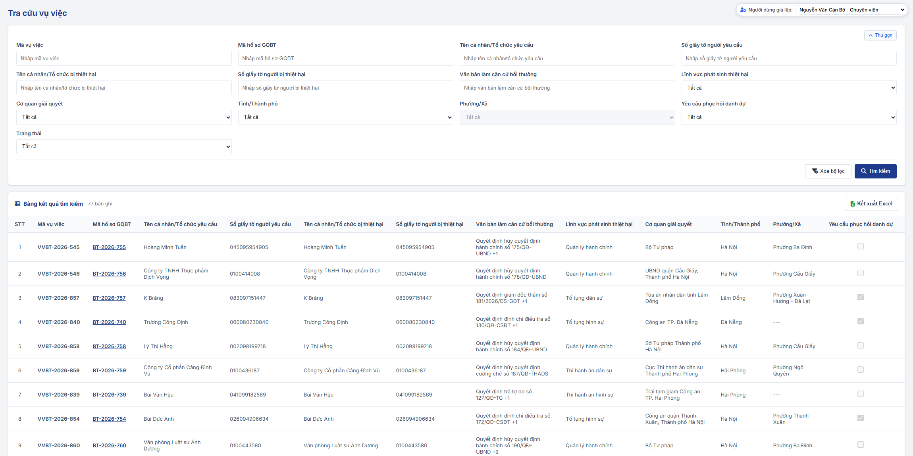

### 4.3.3. Tra cứu Vụ việc Bồi thường nhà nước

#### 4.3.3.4. Tra cứu vụ việc

##### 4.3.3.4.1. Mục đích

\- Cho phép tra cứu vụ việc bồi thường nhà nước trên toàn hệ thống, trên 01 danh sách chung, không tách riêng vụ việc yêu cầu bồi thường thiệt hại và vụ việc yêu cầu phục hồi danh dự.

\- Màn hình chỉ phục vụ:
  + Tra cứu vụ việc
  + Xem chi tiết toàn trình vụ việc ở chế độ chỉ xem (chỉ vụ việc người dùng được xem chi tiết)
  + Kết xuất danh sách ra Excel

\- Màn hình không có thao tác thêm mới, cập nhật, trình duyệt, ký duyệt hoặc xử lý nghiệp vụ.

\- Xem chi tiết vụ việc của cơ quan khác: chỉ hiển thị văn bản đã ký và `Tài liệu ban hành kèm theo`; không hiển thị `Tài liệu không ban hành kèm theo` theo [Quy tắc Tài liệu ban hành kèm theo / Tài liệu không ban hành kèm theo - Danh mục và Phụ lục - Tài liệu tổng hợp](../../Tai%20lieu%20tong%20hop/04_Danh_muc_va_Phu_luc.md#quy-tac-tai-lieu-ban-hanh-kem-theo).

\- **Phạm vi danh sách**: toàn bộ vụ việc của mọi cơ quan giải quyết bồi thường trên toàn hệ thống, từ trạng thái `Chờ tiếp nhận` trở đi, gồm các Trạng thái vụ việc:
  + Chờ tiếp nhận
  + Yêu cầu bổ sung
  + Không thụ lý
  + Cử người giải quyết bồi thường
  + Cử người phục hồi danh dự
  + Chờ duyệt (mọi Nội dung trình, gồm `Thông báo thụ lý hồ sơ`, `Thông báo Không thụ lý`)
  + Bị trả lại (mọi Nội dung trình)
  + Xác minh thiệt hại
  + Thương lượng
  + Chờ ban hành QĐ
  + Chờ chi trả
  + Hoãn giải quyết
  + Tạm đình chỉ
  + Đình chỉ giải quyết
  + Đã chuyển CQGQBT (gồm hồ sơ chuyển do `Không thụ lý` lý do `Yêu cầu bồi thường không thuộc thẩm quyền giải quyết của mình` và hồ sơ chuyển bằng thao tác `Chuyển CQGQBT`)
  + Đang phục hồi danh dự
  + Hoãn phục hồi danh dự
  + Từ chối phục hồi danh dự
  + Hoàn thành

\- Mỗi dòng là 01 hồ sơ Giải quyết yêu cầu bồi thường (`Mã hồ sơ GQBT` `BT-yyyy-xxx`; chưa có mã thì hiển thị `-`), kèm `Mã vụ việc` `VVBT-yyyy-xxx` theo [Mã vụ việc và mã hồ sơ - Tiếp nhận hồ sơ - Công tác bồi thường nhà nước (Website Quản trị)](SRS_BTNN_GiaiQuyetBT_TiepNhan_YCBT.md#tn-ma-vu-viec).

\- Trạng thái vụ việc theo [Trạng thái vụ việc Giải quyết YCBT - Giải quyết yêu cầu bồi thường - Công tác bồi thường nhà nước (Website Quản trị)](SRS_BTNN_GiaiQuyetBT_GiaiQuyet_YCBT.md#gq-trang-thai-vu-viec).

*a. Phân quyền và phạm vi dữ liệu*

\- **Xem danh sách**: mọi người dùng được phân quyền chức năng `Tra cứu vụ việc` tìm kiếm được vụ việc của mọi cơ quan giải quyết bồi thường trên toàn hệ thống, trong phạm vi tại [Phạm vi danh sách - Tra cứu vụ việc - Công tác bồi thường nhà nước (Website Quản trị)](#tcvv-pham-vi-trang-thai).

\- **Xem chi tiết**: mở chi tiết hồ sơ theo `Mã hồ sơ GQBT` của dòng khi người dùng đang đăng nhập thỏa mãn 01 trong các điều kiện:
  + `Cơ quan giải quyết` của hồ sơ là đơn vị của người dùng.
  + Đơn vị của người dùng là Sở Tư pháp quản lý `Cơ quan giải quyết` của hồ sơ.
  + Người dùng thuộc Bộ Tư pháp hoặc Cục Đăng ký giao dịch bảo đảm và Bồi thường nhà nước: mọi hồ sơ trên toàn quốc.

\- Quy tắc xác định:
  + Đơn vị của người dùng: người dùng thuộc Sở Tư pháp (đơn vị công tác là Sở Tư pháp hoặc phòng, ban trực thuộc Sở Tư pháp) là Sở Tư pháp chứa đơn vị công tác, theo [Quy tắc phạm vi dữ liệu Bộ Tư pháp - Sở Tư pháp - Danh mục và Phụ lục - Tài liệu tổng hợp](../../Tai%20lieu%20tong%20hop/04_Danh_muc_va_Phu_luc.md#quy-tac-pham-vi-du-lieu-btp-stp); người dùng khác là đơn vị cấp cao nhất chứa đơn vị công tác của người dùng trên cây cơ cấu tổ chức, theo [MH02 - Popup Thêm mới / Sửa cơ quan, đơn vị - Quản lý cơ cấu tổ chức - Quản trị hệ thống (Website Quản trị)](../01_Quan_tri_he_thong/Quan_ly_co_cau_to_chuc.md#cctc-mh02).
  + Sở Tư pháp quản lý `Cơ quan giải quyết`: Sở Tư pháp (cơ quan, đơn vị có Loại cơ quan `Sở` và tên bắt đầu bằng "Sở Tư pháp", theo [Quy tắc nhận diện Sở Tư pháp - Danh mục và Phụ lục - Tài liệu tổng hợp](../../Tai%20lieu%20tong%20hop/04_Danh_muc_va_Phu_luc.md#quy-tac-nhan-dien-so-tu-phap)) có `Tỉnh/Thành phố` trùng `Tỉnh/Thành phố` của đơn vị gốc của `Cơ quan giải quyết`, áp dụng khi `Cơ quan giải quyết` có `Cấp đơn vị` là `Địa phương`, theo [Cấp đơn vị - Quản lý cơ cấu tổ chức - Quản trị hệ thống (Website Quản trị)](../01_Quan_tri_he_thong/Quan_ly_co_cau_to_chuc.md#cctc-cap-don-vi).
  + Thuộc Bộ Tư pháp hoặc Cục Đăng ký giao dịch bảo đảm và Bồi thường nhà nước: đơn vị công tác của người dùng là đơn vị này hoặc đơn vị trực thuộc trên cây cơ cấu tổ chức.
  + `Cơ quan giải quyết`: cơ quan giải quyết bồi thường hiện hành của hồ sơ; vụ việc `Đã chuyển CQGQBT` tính theo cơ quan nhận chuyển.

\- Hồ sơ không thỏa mãn điều kiện nào:
  + Chỉ xem thông tin trên danh sách.
  + `Mã hồ sơ GQBT` hiển thị dạng Text, không có link, có tooltip `Chỉ Cơ quan giải quyết, Sở Tư pháp quản lý Cơ quan giải quyết, Bộ Tư pháp và Cục Đăng ký giao dịch bảo đảm và Bồi thường nhà nước được xem chi tiết`.
  + Mở bằng đường dẫn chứa `Mã hồ sơ GQBT`: không mở chi tiết, hiển thị nội dung tooltip trên.

\- Vụ việc chưa có `Mã hồ sơ GQBT`: không mở chi tiết.

\- **Kết xuất Excel**: tải danh sách kết quả tra cứu theo bộ lọc hiện tại.

*b. Điều kiện thực hiện*

\- Người dùng đã đăng nhập Website quản trị và được phân quyền chức năng `Tra cứu vụ việc`.

\- Dữ liệu vụ việc lấy từ hồ sơ Giải quyết yêu cầu bồi thường và các phân hệ liên quan: Quyết định giải quyết bồi thường, Tạm ứng kinh phí bồi thường/Chi trả tiền bồi thường.

---

##### 4.3.3.4.2. MH01 - Màn hình Tra cứu vụ việc

###### 4.3.3.4.2.1. Màn hình

###### 4.3.3.4.2.2. Mô tả thông tin trên màn hình

| Trường thông tin | Kiểu dữ liệu | Bắt buộc | Mặc định | Mô tả |
| :--- | :--- | :--- | :--- | :--- |
| Tiêu đề màn hình | String(255) | - | `Tra cứu vụ việc` | Control UI: Text heading (Read-only). - Hiển thị đúng tên mục Menu `Tra cứu vụ việc`. - Không hiển thị dòng mô tả dưới tiêu đề. |
| **I. Khối Lọc, tìm kiếm thông tin** | Section | - | - | Control UI: Filter panel. - Các tiêu chí có dữ liệu kết hợp theo điều kiện AND. - Tìm trên toàn hệ thống, trong phạm vi tại [Phạm vi danh sách - Tra cứu vụ việc - Công tác bồi thường nhà nước (Website Quản trị)](#tcvv-pham-vi-trang-thai). - Ô nhập: tìm gần đúng, không phân biệt hoa thường, không phân biệt dấu; tự động cắt khoảng trắng đầu cuối. |
| Mã vụ việc | String(50) | Không | Trống | Control UI: Input text. - `Placeholder: Nhập mã vụ việc`. - Tìm theo cột `Mã vụ việc`. |
| Mã hồ sơ GQBT | String(50) | Không | Trống | Control UI: Input text. - `Placeholder: Nhập mã hồ sơ GQBT`. - Tìm theo cột `Mã hồ sơ GQBT`. |
| Tên cá nhân/Tổ chức yêu cầu | String(255) | Không | Trống | Control UI: Input text. - `Placeholder: Nhập tên cá nhân/tổ chức yêu cầu`. - Tìm theo cột `Tên cá nhân/Tổ chức yêu cầu`. |
| Số giấy tờ người yêu cầu | String(50) | Không | Trống | Control UI: Input text. - `Placeholder: Nhập số giấy tờ người yêu cầu`. - Tìm theo cột `Số giấy tờ người yêu cầu`. |
| Tên cá nhân/Tổ chức bị thiệt hại | String(255) | Không | Trống | Control UI: Input text. - `Placeholder: Nhập tên cá nhân/tổ chức bị thiệt hại`. - Tìm theo cột `Tên cá nhân/Tổ chức bị thiệt hại`. |
| Số giấy tờ người bị thiệt hại | String(50) | Không | Trống | Control UI: Input text. - `Placeholder: Nhập số giấy tờ người bị thiệt hại`. - Tìm theo cột `Số giấy tờ người bị thiệt hại`. |
| Văn bản làm căn cứ bồi thường | String(255) | Không | Trống | Control UI: Input text. - `Placeholder: Nhập văn bản làm căn cứ bồi thường`. - Tìm theo tên của mọi văn bản làm căn cứ bồi thường của hồ sơ; khớp 01 văn bản là thỏa mãn. |
| Lĩnh vực phát sinh thiệt hại | Enum(String(100)) | Không | `Tất cả` | Control UI: Combobox. - Tham chiếu [DM_22]. - Có thêm giá trị `Tất cả`. - Lọc chính xác theo Lĩnh vực phát sinh thiệt hại. |
| Cơ quan giải quyết | Enum(String(255)) | Không | `Tất cả` | Control UI: Combobox. - Danh sách cơ quan, đơn vị là cơ quan giải quyết bồi thường trên toàn hệ thống, theo [MH02 - Popup Thêm mới / Sửa cơ quan, đơn vị - Quản lý cơ cấu tổ chức - Quản trị hệ thống](../01_Quan_tri_he_thong/Quan_ly_co_cau_to_chuc.md#43173-mh02---popup-thêm-mới--sửa-cơ-quan-đơn-vị). - Có thêm giá trị `Tất cả`. - Sắp xếp theo tên A-Z. - Lọc chính xác theo Cơ quan giải quyết. |
| Tỉnh/Thành phố | Enum(String(100)) | Không | `Tất cả` | Control UI: Combobox có tìm kiếm. - Danh mục địa bàn (cấp Tỉnh/Thành phố); có thêm giá trị `Tất cả`. - Gõ tìm theo Mã hoặc Tên, gần đúng, không phân biệt hoa thường, không phân biệt dấu. - Lọc vụ việc có `Tỉnh/Thành phố` của Cơ quan giải quyết bằng giá trị đã chọn. - Đổi giá trị: `Phường/Xã` về `Tất cả`. |
| Phường/Xã | Enum(String(100)) | Không | `Tất cả` | Control UI: Combobox có tìm kiếm. - Danh mục địa bàn (cấp Phường/Xã), chỉ gồm Phường/Xã thuộc `Tỉnh/Thành phố` đã chọn; có thêm giá trị `Tất cả`. - `Tỉnh/Thành phố` = `Tất cả`: khóa, không chọn được. - Lọc vụ việc có `Phường/Xã` của Cơ quan giải quyết bằng giá trị đã chọn. |
| Yêu cầu phục hồi danh dự | Enum(String(10)) | Không | `Tất cả` | Control UI: Combobox. - Gồm: + Tất cả + Có + Không - `Có`: vụ việc có Loại yêu cầu `Phục hồi danh dự` hoặc `Bồi thường thiệt hại và Phục hồi danh dự`. - `Không`: vụ việc có Loại yêu cầu `Bồi thường thiệt hại`. |
| Trạng thái | Enum(String(50)) | Không | `Tất cả` | Control UI: Combobox. - Gồm `Tất cả` và các trạng thái thuộc [Phạm vi danh sách - Tra cứu vụ việc - Công tác bồi thường nhà nước (Website Quản trị)](#tcvv-pham-vi-trang-thai), theo thứ tự tại đó. - Lọc chính xác theo Trạng thái vụ việc. |
| Xóa bộ lọc | Button | - | - | Control UI: Button. |
| Tìm kiếm | Button | - | - | Control UI: Button. |
| **II. Bảng kết quả tìm kiếm** | Section | - | 20 bản ghi/trang | Control UI: Data grid. - Tải Trang 1 khi mở màn hình. - Sắp xếp mặc định theo Ngày tiếp nhận hồ sơ giảm dần. - Số dòng hiển thị: 10 / 20 / 50, mặc định 20. - Click vào dòng của vụ việc người dùng được xem chi tiết: cùng hành vi click `Mã hồ sơ GQBT` tại [Xem chi tiết - Tra cứu vụ việc - Công tác bồi thường nhà nước (Website Quản trị)](#tcvv-xem-chi-tiet). - Không có dữ liệu: 01 dòng căn giữa toàn bộ chiều rộng bảng, nội dung [MSG-INF-SYS-001]. |
| Kết xuất Excel | Button | - | - | Control UI: Button. - Vị trí: thanh tiêu đề Bảng kết quả tìm kiếm, cùng hàng số lượng bản ghi. |
| STT | Integer(10) | - | Tự tăng | Control UI: Text (Read-only). |
| Mã vụ việc | String(50) | - | Theo dữ liệu | Control UI: Text (Read-only). - Theo dữ liệu bản ghi. |
| Mã hồ sơ GQBT | String(50) | - | Theo dữ liệu | Control UI: HyperLink / Text (Read-only). - Theo dữ liệu bản ghi. - Hồ sơ người dùng được xem chi tiết: HyperLink, click mở xem chi tiết toàn trình của hồ sơ theo `Mã hồ sơ GQBT`, ở chế độ chỉ xem. - Hồ sơ còn lại: Text (Read-only), không có link; tooltip `Chỉ Cơ quan giải quyết, Sở Tư pháp quản lý Cơ quan giải quyết, Bộ Tư pháp và Cục Đăng ký giao dịch bảo đảm và Bồi thường nhà nước được xem chi tiết`. - Chưa có Mã hồ sơ GQBT: hiển thị `-`. - Quy tắc theo [Xem chi tiết - Phân quyền và phạm vi dữ liệu - Tra cứu vụ việc - Công tác bồi thường nhà nước (Website Quản trị)](#tcvv-quyen-xem-chi-tiet). |
| Tên cá nhân/Tổ chức yêu cầu | String(255) | - | Theo dữ liệu | Control UI: Text (Read-only). - Theo dữ liệu bản ghi: `Họ và tên` (cá nhân) hoặc `Tên tổ chức` (tổ chức) của người yêu cầu. |
| Số giấy tờ người yêu cầu | String(50) | - | Theo dữ liệu | Control UI: Text (Read-only). - Cá nhân: `Số giấy tờ thân nhân` của người yêu cầu. - Tổ chức: `Mã số tổ chức` của người yêu cầu. - Không có dữ liệu: hiển thị `-`. |
| Tên cá nhân/Tổ chức bị thiệt hại | String(255) | - | Theo dữ liệu | Control UI: Text (Read-only). - Cùng quy tắc cột `Tên cá nhân/Tổ chức bị thiệt hại` tại [MH01 - Màn hình Danh sách vụ việc/hồ sơ yêu cầu bồi thường - Giải quyết yêu cầu bồi thường - Công tác bồi thường nhà nước (Website Quản trị)](SRS_BTNN_GiaiQuyetBT_GiaiQuyet_YCBT.md#43313-mh01---màn-hình-danh-sách-vụ-việchồ-sơ-yêu-cầu-bồi-thường). |
| Số giấy tờ người bị thiệt hại | String(50) | - | Theo dữ liệu | Control UI: Text (Read-only). - Người yêu cầu là người bị thiệt hại: theo cột `Số giấy tờ người yêu cầu`. - Người bị thiệt hại là cá nhân: `Số giấy tờ thân nhân` của người bị thiệt hại. - Tổ chức bị thiệt hại: `Mã số tổ chức` của tổ chức bị thiệt hại. - Không có dữ liệu: hiển thị `-`. |
| Văn bản làm căn cứ bồi thường | String(500) | - | Theo dữ liệu | Control UI: Text (Read-only). - Theo dữ liệu bản ghi: tên văn bản làm căn cứ yêu cầu bồi thường của hồ sơ. - 01 văn bản: hiển thị tên văn bản. - Từ 02 văn bản: hiển thị tên văn bản đầu tiên và `+n` (n là số văn bản còn lại). - Tooltip: liệt kê đủ tên các văn bản, mỗi văn bản 01 dòng. - Không có dữ liệu: hiển thị `-`. |
| Lĩnh vực phát sinh thiệt hại | Enum(String(100)) | - | Theo dữ liệu | Control UI: Text (Read-only). - Theo dữ liệu bản ghi, tham chiếu [DM_22]. - Bỏ tiền tố `Trong hoạt động`. |
| Cơ quan giải quyết | String(255) | - | Theo dữ liệu | Control UI: Text (Read-only). - Theo dữ liệu bản ghi: hiển thị Tên cơ quan giải quyết bồi thường. |
| Tỉnh/Thành phố | String(100) | - | Theo dữ liệu | Control UI: Text (Read-only). - Tên Tỉnh/Thành phố của Cơ quan giải quyết bồi thường. - Không có dữ liệu: hiển thị `---`. |
| Phường/Xã | String(100) | - | Theo dữ liệu | Control UI: Text (Read-only). - Tên Phường/Xã của Cơ quan giải quyết bồi thường. - Không có dữ liệu: hiển thị `---`. |
| Yêu cầu phục hồi danh dự | Boolean | - | Theo dữ liệu | Control UI: Checkbox (Read-only). - Tích: Loại yêu cầu `Phục hồi danh dự` hoặc `Bồi thường thiệt hại và Phục hồi danh dự`. - Không tích: Loại yêu cầu `Bồi thường thiệt hại`. |
| Trạng thái | Enum(String(50)) | - | Theo dữ liệu | Control UI: Badge (Read-only). - Theo dữ liệu bản ghi. |
| Phân trang | - | - | Trang 1 | Control UI: Pagination. - Gồm Số dòng hiển thị, thông tin `Hiển thị [từ]-[đến] trong tổng số [n] bản ghi`, nút chuyển trang. |

###### 4.3.3.4.2.3. Chức năng trên màn hình

| STT | Tên chức năng | Định dạng | Mô tả |
| :--- | :--- | :--- | :--- |
| 1 | Tìm kiếm | Button | - Lọc danh sách theo các tiêu chí (điều kiện AND), trên toàn hệ thống. - `Tỉnh/Thành phố`, `Phường/Xã`: lọc theo địa chỉ của Cơ quan giải quyết. - Về Trang 1. |
| 2 | Xóa bộ lọc | Button | - Đưa bộ lọc về giá trị mặc định. - Tải lại danh sách. |
| 3 | Phân trang | Pagination | - Chuyển trang, đổi số dòng hiển thị (về Trang 1). - Giữ tiêu chí lọc. |
| 4 | Xem chi tiết | HyperLink / Dòng dữ liệu | - Áp dụng: vụ việc người dùng được xem chi tiết theo [Xem chi tiết - Phân quyền và phạm vi dữ liệu - Tra cứu vụ việc - Công tác bồi thường nhà nước (Website Quản trị)](#tcvv-quyen-xem-chi-tiet). - Click `Mã hồ sơ GQBT` hoặc click vào dòng: mở trên 01 tab mới của trình duyệt [MH05 - Màn hình Xem chi tiết hồ sơ yêu cầu bồi thường - Giải quyết yêu cầu bồi thường - Công tác bồi thường nhà nước (Website Quản trị)](SRS_BTNN_GiaiQuyetBT_GiaiQuyet_YCBT.md#43317-mh05---màn-hình-xem-chi-tiết-hồ-sơ-yêu-cầu-bồi-thường) của hồ sơ theo `Mã hồ sơ GQBT` của dòng, gồm 03 tab `Thông tin hồ sơ vụ việc` \| `Chi tiết giải quyết bồi thường` \| `Phục hồi danh dự`. - Hồ sơ còn lại: không mở chi tiết, kể cả mở bằng đường dẫn. Khác biệt ở chế độ chỉ xem: - Ẩn toàn bộ nút thao tác tại thanh thao tác và trong các tab; chỉ giữ chuyển tab, xem/tải tài liệu, xem chi tiết liên kết và nút `Đóng`. - Không áp dụng giới hạn chỉ cán bộ được cử giải quyết được xem hồ sơ. - Tab mở mặc định: `Phục hồi danh dự` khi Trạng thái là `Đang phục hồi danh dự` / `Hoãn phục hồi danh dự`; trường hợp khác: `Thông tin hồ sơ vụ việc`. - Màn hình Tra cứu vụ việc giữ nguyên ở tab cũ, giữ nguyên bộ lọc. - `Đóng`: đóng tab xem chi tiết. |
| 5 | Kết xuất Excel | Button | - Theo [Quy chuẩn Kết xuất Excel dùng chung - Danh mục và Phụ lục - Tài liệu tổng hợp](../../Tai%20lieu%20tong%20hop/04_Danh_muc_va_Phu_luc.md#quy-chuan-ket-xuat-excel): định dạng tệp, font chữ, căn lề, dòng tiêu đề, dòng thông tin, footer, ghi nhật ký. - Danh sách rỗng: không kết xuất, hiển thị [MSG-WRN-SYS-001]. - Có dữ liệu: tải tệp `.xlsx` gồm toàn bộ bản ghi theo bộ lọc và sắp xếp hiện tại (không theo trang). - Tên tệp: `yyyyMMdd_Tra_cuu_vu_viec.xlsx`. - Dòng 1 (tiêu đề): `DANH SÁCH TRA CỨU VỤ VIỆC`. - Dòng 2 (thông tin): `Thời điểm xuất: dd/mm/yyyy HH:mm`. - Cột xuất đúng thứ tự lưới: STT, Mã vụ việc, Mã hồ sơ GQBT, Tên cá nhân/Tổ chức yêu cầu, Số giấy tờ người yêu cầu, Tên cá nhân/Tổ chức bị thiệt hại, Số giấy tờ người bị thiệt hại, Văn bản làm căn cứ bồi thường, Lĩnh vực phát sinh thiệt hại, Cơ quan giải quyết, Tỉnh/Thành phố, Phường/Xã, Yêu cầu phục hồi danh dự, Trạng thái. - Cột `Văn bản làm căn cứ bồi thường`: liệt kê đủ tên các văn bản, phân tách bằng dấu `;`. - Cột `Yêu cầu phục hồi danh dự`: `x` khi có tích, để trống khi không tích. |
