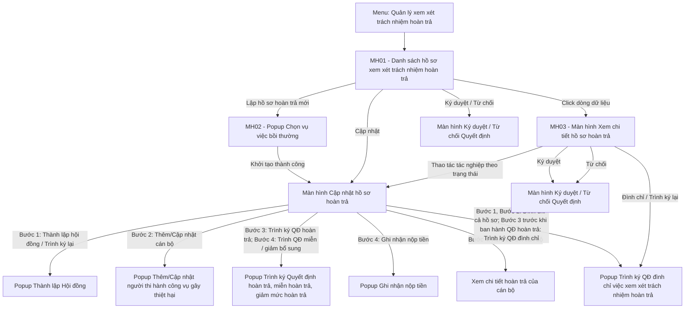

### 4.3.3.5. Quản lý xem xét trách nhiệm hoàn trả

#### 4.3.3.5.1. Mục đích

Cho phép quản lý toàn diện tiến trình xem xét, xác định và thực hiện nghĩa vụ hoàn trả kinh phí bồi thường của người thi hành công vụ có lỗi gây thiệt hại trên Website Quản trị, từ thời điểm vụ việc bồi thường nhà nước hoàn thành chi trả đến khi thu đủ tiền vào ngân sách nhà nước (bao gồm: thành lập Hội đồng hoàn trả, ghi nhận quá trình làm việc và kết luận/kiến nghị của Hội đồng, ban hành Quyết định hoàn trả, theo dõi đôn đốc thu tiền, miễn hoàn trả, giảm mức hoàn trả, đình chỉ việc xem xét trách nhiệm hoàn trả).

*a. Phân quyền*

\- Người dùng được phân quyền chức năng `Xem xét trách nhiệm hoàn trả` thực hiện thao tác trên hồ sơ theo:
  + Phạm vi dữ liệu tại [Phạm vi dữ liệu theo đơn vị - Xem xét trách nhiệm hoàn trả - Công tác bồi thường nhà nước (Website Quản trị)](#ht-pham-vi-du-lieu).
  + Trạng thái chi tiết của phần việc tại [Thao tác theo trạng thái - Xem xét trách nhiệm hoàn trả - Công tác bồi thường nhà nước (Website Quản trị)](#ht-thao-tac-trang-thai).

\- `Ký duyệt`, `Từ chối`: Lãnh đạo được giao tại cấp hiện hành theo luồng của đơn vị ban hành văn bản tại [Cấu hình luồng xử lý - Cấu hình luồng xử lý - Quản trị hệ thống (Website Quản trị)](../01_Quan_tri_he_thong/Cau_hinh_luong_xu_ly.md).

\- **Đơn vị ban hành Quyết định hoàn trả** (theo `Lĩnh vực phát sinh thiệt hại` của vụ việc):
  + Lĩnh vực tố tụng hình sự: Cơ quan trực tiếp quản lý người thi hành công vụ gây thiệt hại của phần đơn vị.
  + Lĩnh vực khác: Đơn vị tạo Quyết định thành lập Hội đồng.
  + Đơn vị ban hành Quyết định hoàn trả trình ký, ban hành Quyết định hoàn trả của phần đơn vị (thể hiện giảm mức hoàn trả, miễn hoàn trả theo ý kiến của Hội đồng; không ban hành Quyết định miễn hoàn trả, giảm mức hoàn trả riêng) và Quyết định miễn hoàn trả, giảm mức hoàn trả bổ sung tại bước Thu tiền hoàn trả.
  + Luồng ký duyệt theo luồng của đơn vị ban hành Quyết định hoàn trả.
  + Quyết định hoàn trả sau khi ban hành được gửi cho Cơ quan, tổ chức đang trực tiếp quản lý, sử dụng, trả lương của từng người thi hành công vụ gây thiệt hại.

\- **Thu tiền hoàn trả**: ghi nhận nộp tiền đối với người thi hành công vụ gây thiệt hại sau khi Quyết định hoàn trả của phần đơn vị được ban hành; đơn vị được thực hiện:
  + Cơ quan, tổ chức đang trực tiếp quản lý, sử dụng, trả lương: cán bộ do mình quản lý, sử dụng, trả lương.
  + Đơn vị tạo Quyết định thành lập Hội đồng: toàn bộ cán bộ của hồ sơ.
  + Sở Tư pháp hoặc Bộ Tư pháp theo [Phân quyền Sở Tư pháp, Bộ Tư pháp - Xem xét trách nhiệm hoàn trả - Công tác bồi thường nhà nước (Website Quản trị)](#ht-phan-quyen-stp).
  + Trình Quyết định miễn hoàn trả, giảm mức hoàn trả bổ sung: chỉ đơn vị ban hành Quyết định hoàn trả.

\- Sở Tư pháp hoặc Bộ Tư pháp xác định theo `Cấp đơn vị` của Cơ quan trực tiếp quản lý người thi hành công vụ gây thiệt hại của phần đơn vị:
  + `Trung ương` (bộ, cơ quan ngang bộ): Bộ Tư pháp.
  + `Địa phương` (đơn vị cấp tỉnh, cấp xã): Sở Tư pháp tỉnh, thành phố nơi đơn vị đặt trụ sở.
  + Được ghi nhận nộp tiền hoàn trả cho cán bộ trong phạm vi dữ liệu.
  + Không được thực hiện `Miễn hoàn trả`, `Giảm mức hoàn trả`, `Đình chỉ`.

\- Cán bộ tra cứu: chỉ xem danh sách, chi tiết hồ sơ trong phạm vi dữ liệu và kết xuất Excel; không thực hiện thao tác tác nghiệp.

\- **Phạm vi dữ liệu theo đơn vị**:
  + Mỗi vụ việc có 01 hồ sơ hoàn trả (`HT-`) dùng chung cho các đơn vị.
  + Khi chốt ý kiến của Hội đồng, danh sách người thi hành công vụ gây thiệt hại được phân tách thành phần đơn vị theo `Cơ quan trực tiếp quản lý người thi hành công vụ gây thiệt hại` của cán bộ; không sinh mã hồ sơ mới.
  + Đơn vị tạo Hội đồng (đơn vị lập hồ sơ): hiển thị hồ sơ từ khi khởi tạo; toàn bộ phần đơn vị, cán bộ và văn bản của hồ sơ.
  + Cơ quan trực tiếp quản lý người thi hành công vụ gây thiệt hại: hiển thị hồ sơ từ khi hồ sơ chuyển `Chờ ban hành QĐ hoàn trả`; chỉ hiển thị cán bộ thuộc đơn vị và ý kiến của Hội đồng đối với các cán bộ đó; Bước 1, Bước 2 chỉ xem.
  + Cơ quan, tổ chức đang trực tiếp quản lý, sử dụng, trả lương (khác Cơ quan trực tiếp quản lý người thi hành công vụ gây thiệt hại): hiển thị hồ sơ sau khi Quyết định hoàn trả của phần đơn vị được ban hành; chỉ hiển thị cán bộ do đơn vị quản lý, sử dụng, trả lương.
  + Sở Tư pháp / Bộ Tư pháp theo `Cấp đơn vị` của Cơ quan trực tiếp quản lý người thi hành công vụ gây thiệt hại tại [Phân quyền Sở Tư pháp, Bộ Tư pháp - Xem xét trách nhiệm hoàn trả - Công tác bồi thường nhà nước (Website Quản trị)](#ht-phan-quyen-stp): hiển thị hồ sơ sau khi đơn vị ban hành Quyết định hoàn trả (Lãnh đạo cấp cuối `Ký duyệt` hoặc ban hành Ký ngoài); chỉ hiển thị cán bộ của đơn vị đó và các Quyết định hoàn trả, miễn hoàn trả, giảm mức hoàn trả, đình chỉ của các cán bộ đó.
  + Đơn vị vừa tạo Hội đồng vừa quản lý người thi hành công vụ gây thiệt hại: theo phạm vi của đơn vị tạo Hội đồng.
  + Lãnh đạo: theo phạm vi của đơn vị công tác; hồ sơ `Chờ duyệt` hiển thị thao tác với Lãnh đạo được giao tại cấp hiện hành.
  + Số liệu tiền và tiến độ thu tiền: tổng hợp theo cán bộ trong phạm vi dữ liệu của người dùng (đơn vị tạo Hội đồng: tổng mọi đơn vị).
  + `Mã hồ sơ GQBT` hiển thị liên kết mở hồ sơ Giải quyết yêu cầu bồi thường chỉ khi đơn vị của người dùng là cơ quan giải quyết yêu cầu bồi thường của hồ sơ GQBT; trường hợp khác hiển thị dạng văn bản.

\- **Trạng thái hồ sơ hoàn trả**: gồm 02 tầng:
  + Trạng thái chi tiết: theo từng phần việc (hồ sơ, phần đơn vị, cán bộ); chỉ hiển thị tại màn hình chi tiết.
  + Trạng thái chung: hiển thị tại badge cột `Trạng thái` và bộ lọc `Trạng thái` của danh sách; tổng hợp từ trạng thái chi tiết trong phạm vi dữ liệu của người dùng theo [Quy tắc tổng hợp trạng thái chung - Xem xét trách nhiệm hoàn trả - Công tác bồi thường nhà nước (Website Quản trị)](#ht-trang-thai-chung).

| Phần việc | Trạng thái chi tiết | Nhóm trạng thái chung | Mô tả |
| :--- | :--- | :--- | :--- |
| Hồ sơ | Hồ sơ nháp (không hiển thị trạng thái) | Chờ xử lý | Mới khởi tạo, chưa trình/ban hành Quyết định thành lập Hội đồng. |
| Hồ sơ | Chờ duyệt (Loại trình `Thành lập hội đồng`) | Đang xử lý | Đã trình ký Quyết định thành lập Hội đồng. |
| Hồ sơ | Bị trả lại (Loại trình `Thành lập hội đồng`) | Chờ xử lý | Lãnh đạo từ chối; chờ trình ký lại. |
| Hồ sơ | Họp hội đồng | Chờ xử lý | Quyết định thành lập Hội đồng đã ban hành; chờ cập nhật ý kiến của Hội đồng. |
| Hồ sơ | Chờ duyệt (Loại trình `QĐ đình chỉ`) | Đang xử lý | Đã trình ký Quyết định đình chỉ trước khi chốt ý kiến của Hội đồng. |
| Hồ sơ | Bị trả lại (Loại trình `QĐ đình chỉ`) | Chờ xử lý | Lãnh đạo từ chối; chờ trình ký lại. |
| Hồ sơ | Đình chỉ xem xét hoàn trả | Đình chỉ xem xét hoàn trả | Quyết định đình chỉ được ban hành trước khi chốt ý kiến của Hội đồng; áp dụng toàn bộ hồ sơ. |
| Phần đơn vị | Chờ ban hành QĐ hoàn trả | Chờ xử lý | Ý kiến của Hội đồng đã chốt; đơn vị chưa trình/ban hành Quyết định hoàn trả. |
| Phần đơn vị | Chờ duyệt (Loại trình `QĐ hoàn trả`) | Đang xử lý | Đơn vị đã trình ký Quyết định hoàn trả. |
| Phần đơn vị | Bị trả lại (Loại trình `QĐ hoàn trả`) | Chờ xử lý | Lãnh đạo từ chối; chờ trình ký lại. |
| Cán bộ | Chờ duyệt (Loại trình `QĐ miễn hoàn trả`, `QĐ giảm mức hoàn trả` bổ sung; `QĐ đình chỉ`) | QĐ miễn / giảm bổ sung: Thu tiền hoàn trả; QĐ đình chỉ: Đang xử lý | Đã trình ký Quyết định đối với cán bộ (QĐ miễn / giảm bổ sung: cán bộ đang `Thu tiền hoàn trả`; QĐ đình chỉ: Quyết định hoàn trả của phần đơn vị chưa ban hành). |
| Cán bộ | Bị trả lại (Loại trình `QĐ miễn hoàn trả`, `QĐ giảm mức hoàn trả` bổ sung; `QĐ đình chỉ`) | QĐ miễn / giảm bổ sung: Thu tiền hoàn trả; QĐ đình chỉ: Chờ xử lý | Lãnh đạo từ chối; chờ trình ký lại. |
| Cán bộ | Thu tiền hoàn trả | Thu tiền hoàn trả | Quyết định hoàn trả đã ban hành (không giảm, không miễn hoặc `Giảm mức hoàn trả` theo ý kiến của Hội đồng); số tiền còn phải thu lớn hơn 0. |
| Cán bộ | Miễn hoàn trả | Miễn hoàn trả | Quyết định hoàn trả đã ban hành với ý kiến của Hội đồng `Miễn hoàn trả`, hoặc Quyết định miễn hoàn trả bổ sung được ban hành; kết thúc. |
| Cán bộ | Hoàn thành | Hoàn thành | Đã thu đủ số tiền phải hoàn trả; kết thúc. |
| Cán bộ | Đình chỉ hoàn trả | Đình chỉ xem xét hoàn trả | Quyết định đình chỉ đối với cán bộ được ban hành tại Bước 2 (đình chỉ một phần cán bộ) hoặc tại Bước 3 (trước khi ban hành Quyết định hoàn trả của phần đơn vị); kết thúc. |

  + Trạng thái phần đơn vị áp dụng cho từng cán bộ của đơn vị đến khi Quyết định hoàn trả của đơn vị được ban hành; cán bộ `Đình chỉ hoàn trả` không áp dụng.
  + Phần đơn vị có toàn bộ cán bộ `Đình chỉ hoàn trả` trước khi ban hành Quyết định hoàn trả: phần đơn vị hiển thị `Đình chỉ hoàn trả`, không ban hành Quyết định hoàn trả.
  + Thuật ngữ: `Đình chỉ hoàn trả` là trạng thái chi tiết của cán bộ; `Đình chỉ xem xét hoàn trả` là trạng thái chi tiết của hồ sơ (đình chỉ cả hồ sơ trước khi chốt ý kiến của Hội đồng) và là trạng thái chung.
  + Nhãn `Hoãn hoàn trả`: nhãn theo từng cán bộ, không phải trạng thái; hiển thị cạnh họ tên cán bộ khi cán bộ trong thời hạn hoãn; không ảnh hưởng trạng thái chung.

\- **Quy tắc tổng hợp trạng thái chung**:
  + Trạng thái chung gồm: `Chờ duyệt`, `Bị trả lại`, `Chờ xử lý`, `Đang xử lý`, `Thu tiền hoàn trả`, `Miễn hoàn trả`, `Hoàn thành`, `Đình chỉ xem xét hoàn trả`.
  + TH1 - Trước khi chốt ý kiến của Hội đồng, hồ sơ `Chờ duyệt` / `Bị trả lại` (Loại trình `Thành lập hội đồng` hoặc `QĐ đình chỉ` cả hồ sơ): badge `Chờ duyệt` / `Bị trả lại`, dưới badge 01 dòng Loại trình `QĐ thành lập hội đồng` / `QĐ đình chỉ` (ngoại lệ của quy tắc chỉ 01 badge).
  + Hồ sơ nháp, `Họp hội đồng`: `Chờ xử lý`; `Đình chỉ xem xét hoàn trả`: `Đình chỉ xem xét hoàn trả`.
  + Sau khi chốt ý kiến của Hội đồng: xét các cán bộ trong phạm vi dữ liệu của người dùng theo thứ tự dưới đây, lấy giá trị đầu tiên thỏa mãn.
  + Ưu tiên 1 - Trạng thái đích (toàn bộ cán bộ đã kết thúc): toàn bộ `Đình chỉ hoàn trả`: `Đình chỉ xem xét hoàn trả`; toàn bộ `Miễn hoàn trả`: `Miễn hoàn trả`; trường hợp còn lại (thu đủ, miễn, đình chỉ kết hợp): `Hoàn thành`.
  + Ưu tiên 2 - TH4: có ít nhất 01 cán bộ `Thu tiền hoàn trả` (chưa thu hết): `Thu tiền hoàn trả`.
  + Ưu tiên 3 - TH3: có ít nhất 01 đơn vị đang trình / `Chờ duyệt` hoặc đã ban hành Quyết định hoàn trả, hoặc có cán bộ đang trình Quyết định đình chỉ: `Đang xử lý`.
  + Ưu tiên 4 - TH2: toàn bộ đơn vị `Chờ ban hành QĐ hoàn trả` hoặc `Bị trả lại` (Loại trình `QĐ hoàn trả`), chưa đơn vị nào trình / ban hành: `Chờ xử lý`.
  + Badge `Trạng thái` đầu màn hình chi tiết hồ sơ áp dụng cùng quy tắc với cột `Trạng thái` của danh sách, theo phạm vi dữ liệu của người xem.

\- **Thao tác theo trạng thái** (thống nhất trên bản ghi; người dùng thực hiện với phần việc trong phạm vi dữ liệu, theo phân quyền):

| Phần việc | Trạng thái chi tiết | Thao tác |
| :--- | :--- | :--- |
| Hồ sơ | Hồ sơ nháp | Cập nhật (thành lập Hội đồng), Xóa |
| Hồ sơ | Chờ duyệt (Loại trình `Thành lập hội đồng`) | Đình chỉ (cả hồ sơ; đơn vị tạo Hội đồng) |
| Hồ sơ | Bị trả lại (Loại trình `Thành lập hội đồng`) | Cập nhật (trình ký lại), Đình chỉ (cả hồ sơ; đơn vị tạo Hội đồng) |
| Hồ sơ | Họp hội đồng | Cập nhật (ý kiến của Hội đồng), Đình chỉ (cả hồ sơ hoặc một phần cán bộ; đơn vị tạo Hội đồng) |
| Hồ sơ | Bị trả lại (Loại trình `QĐ đình chỉ`) | Trình ký lại |
| Phần đơn vị | Chờ ban hành QĐ hoàn trả | Cập nhật (trình ký/ban hành Quyết định hoàn trả) |
| Phần đơn vị | Bị trả lại (Loại trình `QĐ hoàn trả`) | Cập nhật (trình ký lại) |
| Cán bộ | Chờ ban hành QĐ hoàn trả, Bị trả lại (Loại trình `QĐ hoàn trả`) | Đình chỉ (chọn cán bộ) |
| Cán bộ | Thu tiền hoàn trả - Bị trả lại (Loại trình `QĐ miễn hoàn trả`, `QĐ giảm mức hoàn trả` bổ sung) | Trình ký lại Quyết định miễn / giảm bổ sung (Quyết định chung của các cán bộ) |
| Cán bộ | Bị trả lại (Loại trình `QĐ đình chỉ`) | Trình ký lại Quyết định đình chỉ |
| Cán bộ | Thu tiền hoàn trả | Ghi nhận nộp tiền; Miễn hoàn trả, Giảm mức hoàn trả bổ sung (chọn 01 hoặc nhiều cán bộ) |
| Hồ sơ, Phần đơn vị, Cán bộ | Chờ duyệt (mọi Loại trình) | Ký duyệt, Từ chối |
| Cán bộ | Miễn hoàn trả, Hoàn thành, Đình chỉ hoàn trả | Chỉ xem |

  + Sở Tư pháp, Bộ Tư pháp: không có thao tác `Đình chỉ`, `Miễn hoàn trả`, `Giảm mức hoàn trả` theo [Phân quyền Sở Tư pháp, Bộ Tư pháp - Xem xét trách nhiệm hoàn trả - Công tác bồi thường nhà nước (Website Quản trị)](#ht-phan-quyen-stp).
  + Cán bộ `Chờ duyệt` (mọi Loại trình) hoặc có trình ký Quyết định đình chỉ chưa ban hành: không được chọn đình chỉ.
  + Đình chỉ chỉ thực hiện khi Quyết định hoàn trả của phần đơn vị chưa ban hành; phần đơn vị đã ban hành Quyết định hoàn trả (và các trạng thái sau đó của cán bộ): không có thao tác `Đình chỉ`.

\- **Quy tắc căn lề bảng** (mọi bảng của module, gồm lưới danh sách và các bảng tại màn hình chi tiết):
  + Cột số tiền (`Tiền hoàn trả`, `Số tiền cần hoàn trả`, `Số tiền sau giảm`, `Số tiền phải hoàn trả`, `Đã nộp`, `Đã thu`, `Còn phải thu`): căn phải cả tiêu đề và giá trị.
  + Cột `STT`, `Trạng thái`, `Thao tác`: căn giữa.

\- **Quy tắc tải tệp đính kèm** (áp dụng các vùng đính kèm của module: Văn bản kiến nghị, Văn bản đính kèm của Điều kiện hoãn, Tài liệu đính kèm nộp tiền; không áp dụng cho tệp văn bản trong popup/khối trình ký):
  + Nút `Tải file`; cho phép tải nhiều tệp, mỗi tệp tối đa 50MB; định dạng theo từng trường.
  + Mỗi tệp hiển thị tên tệp, dung lượng, `Xem file` (mở tệp tại tab mới), `Xóa` (hiển thị popup xác nhận trước khi gỡ).
  + Tệp sai định dạng: hiển thị [MSG-ERR-FILE-001] dưới vùng tải tệp, không tiếp nhận tệp đó.
  + Tệp vượt quá 50MB: hiển thị [MSG-ERR-FILE-002] dưới vùng tải tệp, không tiếp nhận tệp đó.

\- **Quy tắc tự động chuyển trạng thái Hoàn thành**:
  + Áp dụng cho từng cán bộ ở trạng thái `Thu tiền hoàn trả`.
  + Sau mỗi lần ghi nhận nộp tiền hoặc ban hành Quyết định giảm mức hoàn trả bổ sung, hệ thống kiểm tra cán bộ.
  + Tổng số tiền đã nộp bằng số tiền phải hoàn trả (sau giảm mức hoàn trả, nếu có): cán bộ chuyển `Hoàn thành`.
  + Số tiền nộp mỗi đợt không lớn hơn số tiền còn phải thu; Số tiền hoàn trả được giảm bổ sung không lớn hơn số tiền còn phải thu: không phát sinh số tiền nộp thừa.
  + Trạng thái chung của hồ sơ theo [Quy tắc tổng hợp trạng thái chung - Xem xét trách nhiệm hoàn trả - Công tác bồi thường nhà nước (Website Quản trị)](#ht-trang-thai-chung).

\- **Quy tắc đình chỉ**:
  + Đình chỉ cả hồ sơ (trước khi chốt ý kiến của Hội đồng): người dùng thuộc đơn vị tạo Hội đồng; hồ sơ `Chờ duyệt` (Loại trình `Thành lập hội đồng`), `Bị trả lại` (Loại trình `Thành lập hội đồng`) hoặc `Họp hội đồng`; nút `Đình chỉ` tại thanh nút chân trang; Quyết định theo Mẫu 39/BTNN tại [Popup Trình ký Quyết định đình chỉ việc xem xét trách nhiệm hoàn trả - Xem xét trách nhiệm hoàn trả - Công tác bồi thường nhà nước (Website Quản trị)](#popup-dinh-chi-hoan-tra); ban hành thì hồ sơ chuyển `Đình chỉ xem xét hoàn trả` (kết thúc).
  + Đình chỉ tại Bước 2 (hồ sơ `Họp hội đồng`): người dùng thuộc đơn vị tạo Hội đồng chọn cán bộ tại bảng `Danh sách người thi hành công vụ gây thiệt hại` rồi bấm `Trình ký QĐ đình chỉ`; chọn toàn bộ cán bộ: đình chỉ cả hồ sơ; chọn một phần cán bộ: 01 Quyết định đình chỉ (Mẫu 39/BTNN) đối với các cán bộ được chọn.
  + Đình chỉ một phần cán bộ tại Bước 2: trong thời gian trình ký, hồ sơ `Chờ duyệt` / `Bị trả lại` (Loại trình `QĐ đình chỉ`); khi ban hành, các cán bộ được chọn chuyển `Đình chỉ hoàn trả`, hồ sơ trở lại `Họp hội đồng`; khi hoàn thành Bước 2, các cán bộ này không được phân tách về cơ quan trực tiếp quản lý người thi hành công vụ gây thiệt hại.
  + Đình chỉ cấp cán bộ (sau khi chốt ý kiến của Hội đồng, tại Bước 3, chỉ khi Quyết định hoàn trả của phần đơn vị chưa ban hành): người dùng thuộc cơ quan trực tiếp quản lý người thi hành công vụ gây thiệt hại; chọn 01, nhiều hoặc tất cả cán bộ đủ điều kiện của phần đơn vị rồi bấm `Trình ký QĐ đình chỉ`; các cán bộ được chọn dùng chung 01 Quyết định theo Mẫu 39/BTNN; đơn vị ban hành là cơ quan trực tiếp quản lý người thi hành công vụ gây thiệt hại.
  + Quyết định đình chỉ cấp cán bộ: tên cơ quan ban hành, cơ quan chủ quản, chức vụ người đứng đầu, chức vụ người ký trên Mẫu 39/BTNN lấy theo cơ quan trực tiếp quản lý người thi hành công vụ gây thiệt hại, theo [Mẫu 39/BTNN - Bảng mapping trường dữ liệu biểu mẫu BTNN - Công tác bồi thường nhà nước](Bieu_mau/Bang_mapping_truong_du_lieu_bieu_mau_BTNN.md#mau-39).
  + Sau khi chốt ý kiến của Hội đồng không còn nút `Đình chỉ` cả hồ sơ.
  + Cán bộ đủ điều kiện chọn: theo [Thao tác theo trạng thái - Xem xét trách nhiệm hoàn trả - Công tác bồi thường nhà nước (Website Quản trị)](#ht-thao-tac-trang-thai).
  + Khi Quyết định đình chỉ được ban hành, cán bộ được chọn chuyển `Đình chỉ hoàn trả`; chưa ban hành Quyết định hoàn trả nên không phát sinh số tiền đã nộp, không xử lý trả lại tiền.
  + Ký duyệt, Từ chối Quyết định đình chỉ: như các Quyết định khác tại [Màn hình Ký duyệt / Từ chối Quyết định - Xem xét trách nhiệm hoàn trả - Công tác bồi thường nhà nước (Website Quản trị)](#popup-phe-duyet-ky-so-quyet-dinh).
  + Trong thời gian Quyết định đình chỉ `Chờ duyệt` / `Bị trả lại`: khóa `Trình ký QĐ hoàn trả` / `Trình ký lại` Quyết định hoàn trả của phần đơn vị đến khi Quyết định đình chỉ được ban hành.
  + `Đình chỉ hoàn trả` là trạng thái kết thúc; mọi thao tác đối với cán bộ chỉ còn xem.
  + Sở Tư pháp không thực hiện đình chỉ.

\- **Ma trận chuyển trạng thái**:
  + Áp dụng cho từng cán bộ; trước khi chốt ý kiến của Hội đồng áp dụng cho hồ sơ (cột `Trạng thái hiện tại cán bộ` hiển thị trạng thái hồ sơ trong ngoặc).
  + `Quyền nhìn STP`: `Không` (Sở Tư pháp chưa thấy cán bộ); `Xem`; `Xem, thao tác`.
  + Ban hành Quyết định gồm: Lãnh đạo cấp cuối `Ký duyệt` (Ký số trên hệ thống) hoặc `Ban hành văn bản` (Ký ngoài).

| STT | Bước | Trạng thái hiện tại cán bộ | Thao tác/Sự kiện | Tác nhân | Quyền nhìn STP | Trạng thái mới cán bộ | Trạng thái Đơn vị | Trạng thái Hồ sơ gốc |
| :---: | :---: | :--- | :--- | :--- | :--- | :--- | :--- | :--- |
| 1 | 1 | - (Hồ sơ nháp) | Trình ký QĐ thành lập Hội đồng | Cán bộ đơn vị tạo Hội đồng | Không | - (Chờ duyệt (Thành lập hội đồng)) | - | Chờ duyệt (QĐ thành lập hội đồng) |
| 2 | 1 | - (Chờ duyệt (Thành lập hội đồng)) | Lãnh đạo trước cấp cuối Ký duyệt | Lãnh đạo được giao | Không | - (giữ Chờ duyệt) | - | Chờ duyệt (QĐ thành lập hội đồng) |
| 3 | 1 | - (Hồ sơ nháp, Chờ duyệt (Thành lập hội đồng)) | Ban hành QĐ thành lập Hội đồng | Lãnh đạo cấp cuối / Cán bộ đơn vị tạo Hội đồng (Ký ngoài) | Không | - (Họp hội đồng) | - | Chờ xử lý |
| 4 | 1 | - (Chờ duyệt (Thành lập hội đồng)) | Từ chối | Lãnh đạo được giao | Không | - (Bị trả lại (Thành lập hội đồng)) | - | Bị trả lại (QĐ thành lập hội đồng) |
| 5 | 1 | - (Bị trả lại (Thành lập hội đồng)) | Trình ký lại | Cán bộ đơn vị tạo Hội đồng | Không | - (Chờ duyệt (Thành lập hội đồng)) | - | Chờ duyệt (QĐ thành lập hội đồng) |
| 6 | 2 | - (Họp hội đồng) | Lưu ý kiến hội đồng | Cán bộ đơn vị tạo Hội đồng | Không | Chờ ban hành QĐ hoàn trả | Chờ ban hành QĐ hoàn trả | Chờ xử lý |
| 7 | 1, 2 | - (Chờ duyệt (Thành lập hội đồng), Bị trả lại (Thành lập hội đồng), Họp hội đồng) | Đình chỉ cả hồ sơ / một phần cán bộ (Bước 2): Trình ký QĐ đình chỉ | Cán bộ đơn vị tạo Hội đồng | Không | - (Chờ duyệt (QĐ đình chỉ)) | - | Chờ duyệt (QĐ đình chỉ) |
| 8 | 1, 2 | - (Như STT 7, Chờ duyệt (QĐ đình chỉ)) | Đình chỉ cả hồ sơ: Ban hành QĐ đình chỉ | Lãnh đạo cấp cuối / Cán bộ đơn vị tạo Hội đồng (Ký ngoài) | Không | - (Đình chỉ xem xét hoàn trả) | - | Đình chỉ xem xét hoàn trả |
| 9 | 2 | - (Chờ duyệt (QĐ đình chỉ), đình chỉ một phần cán bộ) | Ban hành QĐ đình chỉ một phần cán bộ | Lãnh đạo cấp cuối / Cán bộ đơn vị tạo Hội đồng (Ký ngoài) | Không | Cán bộ được chọn: Đình chỉ hoàn trả; hồ sơ: - (Họp hội đồng) | - (không phân tách về đơn vị) | Chờ xử lý |
| 10 | 1, 2 | - (Chờ duyệt (QĐ đình chỉ)) | Từ chối | Lãnh đạo được giao | Không | - (Bị trả lại (QĐ đình chỉ)) | - | Bị trả lại (QĐ đình chỉ) |
| 11 | 1, 2 | - (Bị trả lại (QĐ đình chỉ)) | Trình ký lại | Cán bộ đơn vị tạo Hội đồng | Không | - (Chờ duyệt (QĐ đình chỉ)) | - | Chờ duyệt (QĐ đình chỉ) |
| 12 | 3 | Chờ ban hành QĐ hoàn trả | Trình ký QĐ hoàn trả | Cán bộ đơn vị ban hành QĐ hoàn trả | Không | Chờ duyệt (QĐ hoàn trả) | Chờ duyệt (QĐ hoàn trả) | Roll-up (Đang xử lý) |
| 13 | 3 | Chờ duyệt (QĐ hoàn trả) | Lãnh đạo trước cấp cuối Ký duyệt | Lãnh đạo được giao | Không | Chờ duyệt (QĐ hoàn trả) | Chờ duyệt (QĐ hoàn trả) | Roll-up (Đang xử lý) |
| 14 | 3 | Chờ ban hành QĐ hoàn trả, Chờ duyệt (QĐ hoàn trả); không chọn `Giảm/Miễn hoàn trả` | Ban hành QĐ hoàn trả | Lãnh đạo cấp cuối / Cán bộ đơn vị ban hành QĐ hoàn trả (Ký ngoài) | Xem, thao tác | Thu tiền hoàn trả | Đã ban hành QĐ hoàn trả | Roll-up (Thu tiền hoàn trả) |
| 15 | 3 | Như STT 14; `Giảm/Miễn hoàn trả` = `Miễn hoàn trả` | Ban hành QĐ hoàn trả (thể hiện miễn hoàn trả theo ý kiến của Hội đồng, không ban hành QĐ miễn hoàn trả riêng) | Như STT 14 | Xem | Miễn hoàn trả | Đã ban hành QĐ hoàn trả | Roll-up |
| 16 | 3 | Như STT 14; `Giảm/Miễn hoàn trả` = `Giảm mức hoàn trả` | Ban hành QĐ hoàn trả (thể hiện giảm mức hoàn trả theo ý kiến của Hội đồng, không ban hành QĐ giảm mức hoàn trả riêng) | Như STT 14 | Xem, thao tác | Thu tiền hoàn trả (số tiền phải hoàn trả bằng Số tiền sau giảm) | Đã ban hành QĐ hoàn trả | Roll-up (Thu tiền hoàn trả) |
| 17 | 3 | Chờ duyệt (QĐ hoàn trả) | Từ chối | Lãnh đạo được giao | Không | Bị trả lại (QĐ hoàn trả) | Bị trả lại (QĐ hoàn trả) | Roll-up (Chờ xử lý) |
| 18 | 3 | Bị trả lại (QĐ hoàn trả) | Trình ký lại | Cán bộ đơn vị ban hành QĐ hoàn trả | Không | Chờ duyệt (QĐ hoàn trả) | Chờ duyệt (QĐ hoàn trả) | Roll-up (Đang xử lý) |
| 19 | 4 | Thu tiền hoàn trả | Ghi nhận nộp tiền; còn phải thu sau khi nộp > 0 | Cán bộ cơ quan, tổ chức đang trực tiếp quản lý, sử dụng, trả lương / đơn vị tạo Hội đồng / Sở Tư pháp, Bộ Tư pháp | Xem, thao tác | Thu tiền hoàn trả | Đã ban hành QĐ hoàn trả | Roll-up (Thu tiền hoàn trả) |
| 20 | 4 | Thu tiền hoàn trả | Ghi nhận nộp tiền; còn phải thu sau khi nộp = 0 | Cán bộ cơ quan, tổ chức đang trực tiếp quản lý, sử dụng, trả lương / đơn vị tạo Hội đồng / Sở Tư pháp, Bộ Tư pháp | Xem, thao tác | Hoàn thành | Đã ban hành QĐ hoàn trả | Roll-up |
| 21 | 4 | Thu tiền hoàn trả | Chọn 01 / nhiều cán bộ, Trình QĐ miễn bổ sung / Trình QĐ giảm bổ sung (01 Quyết định chung) | Cán bộ đơn vị ban hành QĐ hoàn trả | Xem | Thu tiền hoàn trả - Chờ duyệt (Loại trình tương ứng) | Đã ban hành QĐ hoàn trả | Roll-up (Thu tiền hoàn trả) |
| 22 | 4 | Thu tiền hoàn trả - Chờ duyệt (QĐ miễn hoàn trả) | Ban hành QĐ miễn bổ sung (miễn số tiền còn phải thu, không hoàn trả số tiền đã nộp) | Lãnh đạo cấp cuối / Cán bộ đơn vị ban hành QĐ hoàn trả (Ký ngoài) | Xem | Miễn hoàn trả | Đã ban hành QĐ hoàn trả | Roll-up |
| 23 | 4 | Thu tiền hoàn trả - Chờ duyệt (QĐ giảm mức hoàn trả) | Ban hành QĐ giảm bổ sung (từng cán bộ của Quyết định); số tiền sau giảm mới > đã nộp | Như STT 22 | Xem, thao tác | Thu tiền hoàn trả (số tiền phải hoàn trả bằng số tiền sau giảm mới) | Đã ban hành QĐ hoàn trả | Roll-up (Thu tiền hoàn trả) |
| 24 | 4 | Như STT 23 | Ban hành QĐ giảm bổ sung; số tiền sau giảm mới = đã nộp | Như STT 22 | Xem | Hoàn thành | Đã ban hành QĐ hoàn trả | Roll-up |
| 25 | 4 | Thu tiền hoàn trả - Chờ duyệt (QĐ miễn / QĐ giảm bổ sung) | Từ chối | Lãnh đạo được giao | Xem | Thu tiền hoàn trả - Bị trả lại (Loại trình tương ứng) | Đã ban hành QĐ hoàn trả | Roll-up (Thu tiền hoàn trả) |
| 26 | 3 | Chờ ban hành QĐ hoàn trả, Bị trả lại (QĐ hoàn trả) (Quyết định hoàn trả của phần đơn vị chưa ban hành) | Chọn cán bộ, Trình ký QĐ đình chỉ (Ký số) | Cán bộ cơ quan trực tiếp quản lý người thi hành công vụ gây thiệt hại | Không | [Trạng thái hiện tại] - Chờ duyệt (QĐ đình chỉ) | Giữ nguyên | Roll-up (Đang xử lý) |
| 27 | 3 | [Trạng thái] - Chờ duyệt (QĐ đình chỉ) | Từ chối | Lãnh đạo được giao | Không | [Trạng thái] - Bị trả lại (QĐ đình chỉ) | Giữ nguyên | Roll-up (Chờ xử lý) |
| 28 | 3 | [Trạng thái] - Bị trả lại (QĐ đình chỉ) | Trình ký lại | Cán bộ cơ quan trực tiếp quản lý người thi hành công vụ gây thiệt hại | Không | [Trạng thái] - Chờ duyệt (QĐ đình chỉ) | Giữ nguyên | Như STT 26 |
| 29 | 3 | Như STT 26 (kể cả đang Chờ duyệt (QĐ đình chỉ)) | Ban hành QĐ đình chỉ | Lãnh đạo cấp cuối / Cán bộ cơ quan trực tiếp quản lý người thi hành công vụ gây thiệt hại (Ký ngoài) | Không | Đình chỉ hoàn trả | Giữ nguyên; toàn bộ cán bộ của đơn vị `Đình chỉ hoàn trả`: Đình chỉ hoàn trả | Roll-up; toàn bộ cán bộ `Đình chỉ hoàn trả`: Đình chỉ xem xét hoàn trả |
| 30 | 3, 4 | Miễn hoàn trả, Hoàn thành, Đình chỉ hoàn trả | Mọi thao tác | - | Xem | Không đổi (kết thúc) | Giữ nguyên | Roll-up |

  + `Trạng thái Hồ sơ gốc`: trạng thái chung của hồ sơ hoàn trả theo phạm vi đơn vị tạo Hội đồng, tính theo [Quy tắc tổng hợp trạng thái chung - Xem xét trách nhiệm hoàn trả - Công tác bồi thường nhà nước (Website Quản trị)](#ht-trang-thai-chung); `Roll-up` là kết quả tổng hợp với các cán bộ còn lại.

*b. Điều kiện thực hiện*

\- Người dùng đã đăng nhập Website Quản trị thành công và được phân quyền truy cập chức năng `Quản lý xem xét trách nhiệm hoàn trả`.

\- Vụ việc bồi thường nhà nước gốc đã hoàn tất chi trả kinh phí bồi thường, chưa phát sinh hồ sơ xem xét trách nhiệm hoàn trả và thuộc phạm vi dữ liệu được phân quyền của người dùng đăng nhập.

\- Mã vụ việc và mã hồ sơ theo [Mã vụ việc và mã hồ sơ - Tiếp nhận hồ sơ - Công tác bồi thường nhà nước (Website Quản trị)](SRS_BTNN_GiaiQuyetBT_TiepNhan_YCBT.md#tn-ma-vu-viec):
  + Hồ sơ hoàn trả có `Mã hồ sơ` riêng `HT-yyyy-xxx` và kế thừa `Mã vụ việc` (`VVBT-yyyy-xxx`) của hồ sơ Giải quyết yêu cầu bồi thường (`Mã hồ sơ GQBT`, `BT-yyyy-xxx`); hệ thống không sinh `Mã vụ việc` mới.
  + 01 vụ việc chỉ có 01 hồ sơ xem xét trách nhiệm hoàn trả; danh sách người thi hành công vụ gây thiệt hại và các phần đơn vị quản lý trong hồ sơ đó.
  + Định danh vụ việc trên giao diện: `Mã vụ việc - Họ và tên người yêu cầu`.

---

*c. Quy tắc 02 tab Chờ xử lý / Đã xử lý*

- Tab xác định theo phần việc trong phạm vi dữ liệu của người dùng và thao tác người dùng được phép theo [Thao tác theo trạng thái - Xem xét trách nhiệm hoàn trả - Công tác bồi thường nhà nước (Website Quản trị)](#ht-thao-tac-trang-thai); không theo trạng thái chung.
- Tab `Chờ xử lý`: hồ sơ có ít nhất 01 phần việc trong phạm vi dữ liệu chờ người dùng thao tác:
  + Người dùng tác nghiệp: Hồ sơ nháp, `Bị trả lại` (mọi Loại trình), `Họp hội đồng`, `Chờ ban hành QĐ hoàn trả`, `Thu tiền hoàn trả`.
  + Sau khi chốt ý kiến của Hội đồng: chỉ xét cán bộ mà đơn vị của người dùng là đơn vị ban hành Quyết định hoàn trả (Bước 3, miễn, giảm bổ sung), Cơ quan, tổ chức đang trực tiếp quản lý, sử dụng, trả lương hoặc đơn vị tạo Hội đồng (`Thu tiền hoàn trả`) (Sở Tư pháp, Bộ Tư pháp: cán bộ trong phạm vi dữ liệu ở trạng thái `Thu tiền hoàn trả`).
  + Lãnh đạo: `Chờ duyệt` (mọi Loại trình) được giao tại cấp hiện hành.
- Tab `Đã xử lý`: hồ sơ người dùng đã thực hiện ít nhất 01 thao tác và không còn phần việc chờ người dùng thao tác.
- Cả 02 tab: cột `Trạng thái` chỉ hiển thị 01 badge trạng thái chung.
- Cột `Thao tác`: vị trí cố định; thao tác không được phép hiển thị dạng khóa mờ, không cho phép thao tác:
  + Người dùng tác nghiệp: `Cập nhật`, `Xóa`.
  + Lãnh đạo: `Ký duyệt`, `Từ chối`.
  + Cán bộ tra cứu: hiển thị `Chỉ xem`.
- Trường `Trạng thái` của bộ lọc chỉ gồm các trạng thái chung của tab đang chọn.

#### 4.3.3.5.2. Sơ đồ luồng nghiệp vụ theo giao diện

---

#### 4.3.3.5.3. MH01 - Màn hình Danh sách hồ sơ xem xét trách nhiệm hoàn trả

##### 4.3.3.5.3.1. Màn hình

##### 4.3.3.5.3.2. Mô tả thông tin trên màn hình

| Trường thông tin | Kiểu dữ liệu | Bắt buộc | Mặc định | Mô tả |
| :--- | :--- | :--- | :--- | :--- |
| **I. Khối thông tin chung màn hình** | Section | - | - | Vùng tiêu đề phía trên màn hình. |
| Tiêu đề màn hình | String(255) | - | `Xem xét trách nhiệm hoàn trả` | Control UI: Text heading (Read-only). - Hiển thị đúng tên mục Menu `Xem xét trách nhiệm hoàn trả`. - Không có dòng mô tả dưới tiêu đề. |
| **Tab danh sách** | Tab | - | `Chờ xử lý` | Control UI: 02 tab đặt phía trên khối bộ lọc tìm kiếm: + Chờ xử lý + Đã xử lý - Badge số lượng: số bản ghi thuộc tab Chờ xử lý của người dùng; không hiển thị khi bằng 0. - Badge số lượng tại mục menu `Xem xét trách nhiệm hoàn trả` bằng badge tab Chờ xử lý của Xem xét trách nhiệm hoàn trả. - Tab `Đã xử lý` không có badge số lượng. - Bản ghi của từng tab theo [Quy tắc 02 tab Chờ xử lý / Đã xử lý - Xem xét trách nhiệm hoàn trả - Công tác bồi thường nhà nước (Website Quản trị)](#ht-tab-xu-ly). |
| **II. Khối bộ lọc tìm kiếm** | Section | - | - | Control UI: Filter panel dạng thu gọn/mở rộng (Accordion). - Hiển thị phía trên bảng kết quả. - Mặc định hiển thị dạng mở rộng. - Cho phép thu gọn/mở rộng khi click vào nút "Thu gọn"/"Mở rộng" ở góc phải khối; khi thu gọn, các giá trị lọc đã nhập được giữ nguyên. |
| Mã hồ sơ | String(50) | Không | Trống | Control UI: Input text. - Placeholder: `Nhập mã hồ sơ (HT-...)`. - Tìm kiếm gần đúng theo `Mã hồ sơ` hoàn trả. |
| Mã vụ việc | String(50) | Không | Trống | Control UI: Input text. - Placeholder: `Nhập mã vụ việc (VVBT-...)`. - Tìm kiếm gần đúng theo `Mã vụ việc` (`VVBT-...`) của hồ sơ hoàn trả. |
| Mã hồ sơ GQBT | String(50) | Không | Trống | Control UI: Input text. - Placeholder: `Nhập mã hồ sơ GQBT (BT-...)`. - Tìm kiếm gần đúng theo `Mã hồ sơ GQBT` của hồ sơ hoàn trả. |
| Người thi hành công vụ gây thiệt hại | String(255) | Không | Trống | Control UI: Input text. - Placeholder: `Nhập họ tên cán bộ...`. - Tìm kiếm gần đúng theo họ và tên người thi hành công vụ gây thiệt hại trong phạm vi dữ liệu của người dùng. |
| Cơ quan trực tiếp quản lý người thi hành công vụ gây thiệt hại | Enum(String(255)) | Không | `Tất cả đơn vị` | Control UI: Combobox. - Danh sách: `Tất cả đơn vị` và các cơ quan trực tiếp quản lý người thi hành công vụ gây thiệt hại trong phạm vi dữ liệu của người dùng. - Lọc hồ sơ có ít nhất 01 cán bộ trong phạm vi dữ liệu thuộc đơn vị đã chọn. |
| Trạng thái | Enum(String(50)) | Không | `Tất cả` | Control UI: Combobox. - Lọc theo trạng thái chung. - Chỉ gồm `Tất cả` và các trạng thái chung của tab đang chọn, trong các giá trị: + Tất cả + Chờ duyệt + Bị trả lại + Chờ xử lý + Đang xử lý + Thu tiền hoàn trả + Miễn hoàn trả + Hoàn thành + Đình chỉ xem xét hoàn trả |
| Từ ngày | Date | Không | Ngày đầu tháng hiện tại | Control UI: Datepicker. - Placeholder: `dd/mm/yyyy`. - Lọc hồ sơ có ngày khởi tạo từ ngày này. |
| Đến ngày | Date | Không | Ngày hiện tại | Control UI: Datepicker. - Placeholder: `dd/mm/yyyy`. - Lọc hồ sơ có ngày khởi tạo đến ngày này. - Không nhỏ hơn `Từ ngày`. |
| Xóa bộ lọc | Button | Không | - | Control UI: Button. - Đặt cùng nút `Tìm kiếm` tại dòng riêng phía dưới các trường lọc, căn phải. |
| Tìm kiếm | Button | Không | - | Control UI: Button. |
| **III. Khối bảng kết quả tìm kiếm** | Section | - | 10 bản ghi/trang | Control UI: Data grid. - Mỗi hồ sơ hoàn trả 01 dòng. - Số liệu và trạng thái của dòng theo phạm vi dữ liệu của người dùng tại [Phạm vi dữ liệu theo đơn vị - Xem xét trách nhiệm hoàn trả - Công tác bồi thường nhà nước (Website Quản trị)](#ht-pham-vi-du-lieu). - Khi truy cập màn hình, hệ thống tải hồ sơ thuộc tab `Chờ xử lý`, sắp xếp mặc định theo ngày khởi tạo hồ sơ giảm dần. - Click tiêu đề cột (trừ cột `Thao tác`): sắp xếp tăng / giảm dần theo cột đó. - Số dòng hiển thị: 10 / 20 / 50 / 100 bản ghi/trang. |
| Lập hồ sơ hoàn trả mới | Button | Không | - | Control UI: Button. - Chỉ hiển thị tại tab `Chờ xử lý` với người dùng thuộc đơn vị tạo Hội đồng (đơn vị giải quyết bồi thường) được phân quyền lập hồ sơ. - Cơ quan trực tiếp quản lý người thi hành công vụ gây thiệt hại, Sở Tư pháp: không hiển thị. - Mở popup chọn vụ việc bồi thường để lập hồ sơ hoàn trả mới. |
| Kết xuất Excel | Button | Không | - | Control UI: Button. - Hiển thị tại cả 02 tab; tab `Đã xử lý` chỉ có nút này. - Kết xuất các cột của lưới và số liệu theo phạm vi dữ liệu: số tiền theo ý kiến của Hội đồng, số tiền sau giảm, đã thu, còn phải thu, số cán bộ theo hình thức xử lý (`Hoàn trả`, `Giảm mức hoàn trả`, `Miễn hoàn trả`, `Đình chỉ hoàn trả`). |
| STT | Integer(10) | Không | Tự tăng | Control UI: Text (Read-only). - Số thứ tự dòng dữ liệu trên trang hiện tại. |
| Mã hồ sơ | String(50) | Có | Theo dữ liệu | Control UI: Text (Read-only). - Theo dữ liệu bản ghi. |
| Người thi hành công vụ gây thiệt hại | String(500) | Không | Theo dữ liệu | Control UI: Text kèm Tooltip (Read-only). - Cán bộ trong phạm vi dữ liệu của người dùng. - Hiển thị họ và tên cán bộ đầu tiên. - Có từ 02 cán bộ: hiển thị thêm nhãn `+N khác` (N là số cán bộ còn lại). - Tooltip: mỗi cán bộ 01 dòng `[STT]. [Họ và tên] - [Đơn vị công tác] - [Trạng thái chi tiết]`; cán bộ có nhãn `Hoãn hoàn trả`: thêm `(Hoãn hoàn trả)`. - Chưa có cán bộ: hiển thị `—`. |
| Cơ quan trực tiếp quản lý người thi hành công vụ gây thiệt hại | String(255) | Không | Theo dữ liệu | Control UI: Text kèm Tooltip (Read-only). - Đơn vị công tác của cán bộ trong phạm vi dữ liệu của người dùng. - Hiển thị tên đơn vị đầu tiên. - Có từ 02 đơn vị: hiển thị thêm nhãn `+N đơn vị khác` (N là số đơn vị còn lại). - Tooltip: mỗi đơn vị 01 dòng `[STT]. [Tên đơn vị]`. - Chưa có cán bộ: hiển thị `—`. |
| Mã vụ việc | String(50) | Có | Theo dữ liệu | Control UI: Text (Read-only). - Theo dữ liệu bản ghi. - Tooltip: `Mã vụ việc - Họ và tên người yêu cầu`. |
| Mã hồ sơ GQBT | String(50) | Có | Theo dữ liệu | Control UI: Text link / Text (Read-only). - Theo dữ liệu bản ghi. - Hiển thị liên kết theo [Phạm vi dữ liệu theo đơn vị - Xem xét trách nhiệm hoàn trả - Công tác bồi thường nhà nước (Website Quản trị)](#ht-pham-vi-du-lieu). |
| Tiền hoàn trả (đ) | Decimal(18,0) | Không | Theo dữ liệu | Control UI: Text kèm Tooltip (Read-only). - Tổng số tiền phải hoàn trả sau miễn, giảm của cán bộ trong phạm vi dữ liệu đã ban hành Quyết định hoàn trả của đơn vị. - Cán bộ không giảm, không miễn: `Số tiền cần hoàn trả`. - Cán bộ `$1`: `Số tiền sau giảm` (kể cả khi chưa ban hành Quyết định giảm mức hoàn trả); sau giảm bổ sung: số tiền sau giảm mới. - Cán bộ `$1`, cán bộ `Đình chỉ hoàn trả`: bằng số tiền đã thu (0 khi chưa thu hoặc đã trả lại). - Tooltip: số tiền theo ý kiến của Hội đồng, tiền hoàn trả, đã thu, còn phải thu. - Căn phải, định dạng số có dấu phân cách hàng nghìn. - Chưa có cán bộ đã ban hành Quyết định hoàn trả: hiển thị `-`. |
| Tiến độ thu tiền | Decimal(5,2) | Không | Theo dữ liệu | Control UI: Progress bar kèm Text (Read-only). - Dòng 1: số tiền đã thu và tỷ lệ phần trăm `Đã thu / Tiền hoàn trả` (mẫu số là `Tiền hoàn trả (đ)` sau miễn, giảm), làm tròn đến số nguyên, tối đa 100%. - Dòng 2: `[Số cán bộ đã kết thúc]/[Tổng số cán bộ] cán bộ đã kết thúc` (`Hoàn thành`, `Miễn hoàn trả`, `Đình chỉ hoàn trả`). - `Tiền hoàn trả` bằng 0: chỉ hiển thị Dòng 2. - Chưa có cán bộ đã ban hành Quyết định hoàn trả: hiển thị `Chưa ban hành QĐ`. |
| Trạng thái | Enum(String(50)) | Không | Theo dữ liệu | Control UI: Badge (Read-only). - Chỉ hiển thị 01 badge trạng thái chung theo [Quy tắc tổng hợp trạng thái chung - Xem xét trách nhiệm hoàn trả - Công tác bồi thường nhà nước (Website Quản trị)](#ht-trang-thai-chung); không hiển thị trạng thái chi tiết (xem tại màn hình chi tiết). - Ngoại lệ: badge `Chờ duyệt` / `Bị trả lại` (trước khi chốt ý kiến của Hội đồng) có thêm 01 dòng Loại trình `QĐ thành lập hội đồng` hoặc `QĐ đình chỉ` dưới badge. - Bộ lọc `Trạng thái` = `Chờ duyệt` / `Bị trả lại`: lọc theo badge, gồm cả 02 Loại trình. - Áp dụng cả 02 tab `Chờ xử lý`, `Đã xử lý`. |
| Thao tác | Action | Không | - | Control UI: Icon button group, vị trí cố định; thao tác không được phép hiển thị dạng khóa mờ. - Tiêu đề cột: `Thao tác`. - Cán bộ tra cứu: hiển thị `Chỉ xem`. Gồm các nút: - **Cập nhật**: cho phép khi hồ sơ có phần việc chờ người dùng thao tác tại tab `Chờ xử lý` theo [Quy tắc 02 tab Chờ xử lý / Đã xử lý - Xem xét trách nhiệm hoàn trả - Công tác bồi thường nhà nước (Website Quản trị)](#ht-tab-xu-ly). - **Ký duyệt**, **Từ chối**: cho phép khi hồ sơ có phần việc `Chờ duyệt` (mọi Loại trình) được giao cho Lãnh đạo đang đăng nhập tại cấp hiện hành. - **Xóa**: chỉ hiển thị với người dùng thuộc đơn vị tạo Hội đồng; cho phép với hồ sơ nháp. - Cơ quan trực tiếp quản lý người thi hành công vụ gây thiệt hại, Sở Tư pháp: không hiển thị nút `Xóa`. - Cột cố định bên phải lưới khi cuộn ngang. |

##### 4.3.3.5.3.3. Chức năng trên màn hình

| STT | Tên chức năng | Định dạng | Mô tả |
| :--- | :--- | :--- | :--- |
| 1 | Chuyển tab | Tab | Hiển thị danh sách của tab `Chờ xử lý` hoặc `Đã xử lý`, nạp lại bộ lọc `Trạng thái` theo tab và đưa về Trang 1. |
| 2 | Tìm kiếm | Button | Khi người dùng click nút Tìm kiếm, hệ thống lọc dữ liệu theo các điều kiện đã nhập/chọn. - **TH1 - Khoảng ngày không hợp lệ**: `Từ ngày` lớn hơn `Đến ngày`: hiển thị [MSG-ERR-VAL-007], không tìm kiếm. - **TH2 - Không trả về dữ liệu**: Bảng kết quả hiển thị 01 dòng thông báo [MSG-INF-SYS-001]. - **TH Hợp lệ**: Hiển thị danh sách hồ sơ hoàn trả của tab đang chọn theo phân trang, về Trang 1. |
| 3 | Xóa bộ lọc | Button | Đưa bộ lọc về giá trị mặc định và tải lại danh sách. |
| 4 | Lập hồ sơ hoàn trả mới | Button | Khi người dùng click nút Lập hồ sơ hoàn trả mới, hệ thống mở [Popup Chọn vụ việc bồi thường để lập hồ sơ hoàn trả](#mh02-popup-chon-vu-viec-boi-thuong) và tải danh sách vụ việc bồi thường thỏa mãn đồng thời: đã hoàn tất chi trả kinh phí bồi thường, chưa phát sinh hồ sơ xem xét trách nhiệm hoàn trả và thuộc phạm vi dữ liệu được phân quyền của người dùng đăng nhập. |
| 5 | Kết xuất Excel | Button | Kết xuất danh sách của tab đang chọn theo điều kiện tìm kiếm hiện hành ra tệp Excel. |
| 6 | Sắp xếp | Click tiêu đề cột | Sắp xếp danh sách tăng dần; click lần nữa thì giảm dần. |
| 7 | Click dòng dữ liệu | Row click | Click dòng (trừ cột `Thao tác` và liên kết `Mã hồ sơ GQBT`): mở [MH03 - Màn hình Xem chi tiết hồ sơ hoàn trả - Xem xét trách nhiệm hoàn trả - Công tác bồi thường nhà nước (Website Quản trị)](#mh03-xem-chi-tiet-ho-so-hoan-tra), mở sẵn bước theo phần việc trong phạm vi dữ liệu: - Hồ sơ nháp, `Chờ duyệt` / `Bị trả lại` (Loại trình `Thành lập hội đồng`): `Bước 1: Thành lập Hội đồng`. - `Họp hội đồng`, `Chờ duyệt` / `Bị trả lại` (Loại trình `QĐ đình chỉ`) trước khi chốt ý kiến của Hội đồng, hồ sơ `Đình chỉ xem xét hoàn trả`: `Bước 2: Ý kiến hội đồng`. - Có cán bộ chưa kết thúc ở trạng thái khác `Thu tiền hoàn trả`: `Bước 3: Ban hành QĐ`. - Còn lại: `Bước 4: Thu tiền hoàn trả`. |
| 8 | Mã hồ sơ GQBT | Text link | Mở màn hình chi tiết hồ sơ Giải quyết yêu cầu bồi thường theo [Đường dẫn mở chi tiết vụ việc - Giải quyết yêu cầu bồi thường - Công tác bồi thường nhà nước (Website Quản trị)](SRS_BTNN_GiaiQuyetBT_GiaiQuyet_YCBT.md#gq-url-chi-tiet). |
| 9 | Cập nhật | Button | Mở [Màn hình Cập nhật hồ sơ hoàn trả - Xem xét trách nhiệm hoàn trả - Công tác bồi thường nhà nước (Website Quản trị)](#man-hinh-cap-nhat-ho-so-hoan-tra) tại bước như chức năng `Click dòng dữ liệu`. |
| 10 | Ký duyệt | Button | Khi click, hệ thống mở [Màn hình Ký duyệt / Từ chối Quyết định - Xem xét trách nhiệm hoàn trả - Công tác bồi thường nhà nước (Website Quản trị)](#popup-phe-duyet-ky-so-quyet-dinh) với thao tác `Ký duyệt`. |
| 11 | Từ chối | Button | Khi click, hệ thống mở [Màn hình Ký duyệt / Từ chối Quyết định - Xem xét trách nhiệm hoàn trả - Công tác bồi thường nhà nước (Website Quản trị)](#popup-tu-choi-phe-duyet-quyet-dinh) với thao tác `Từ chối`. |
| 12 | Xóa | Button | Click: hiển thị popup xác nhận [MSG-CFM-SYS-001]. - Tại popup chọn `Hủy bỏ`: đóng popup, không thay đổi dữ liệu. - Tại popup chọn `Đồng ý`: - **TH1 - Hồ sơ không còn là hồ sơ nháp**: hiển thị [MSG-ERR-BTNN-HT-008], không xóa. - **TH Hợp lệ**: Xóa hồ sơ hoàn trả; vụ việc trở lại danh sách đủ điều kiện lập hồ sơ hoàn trả; hiển thị [MSG-SUC-BTNN-HT-018]; tải lại danh sách. |

---

#### 4.3.3.5.4. MH02 - Popup Chọn vụ việc bồi thường để lập hồ sơ hoàn trả

##### 4.3.3.5.4.1. Màn hình

##### 4.3.3.5.4.2. Mô tả thông tin trên màn hình

| Trường thông tin | Kiểu dữ liệu | Bắt buộc | Mặc định | Mô tả |
| :--- | :--- | :--- | :--- | :--- |
| Tiêu đề popup | String(255) | - | - | Control UI: Text heading (Read-only). - Hiển thị `Lập hồ sơ hoàn trả: Chọn vụ việc bồi thường`. |
| Nội dung hướng dẫn | Text(500) | - | - | Control UI: Text (Read-only). - Hiển thị `Dưới đây là danh sách các vụ việc bồi thường nhà nước đã chi trả xong, đủ điều kiện để khởi tạo hồ sơ xem xét trách nhiệm hoàn trả công quỹ:`. |
| **Bảng danh sách vụ việc đủ điều kiện** | Section | - | - | Control UI: Data grid. - Danh sách vụ việc bồi thường nhà nước thỏa mãn đồng thời các điều kiện: + Vụ việc đã hoàn tất chi trả kinh phí bồi thường (đã có `Ngày hoàn tất chi trả bồi thường`). + Vụ việc chưa phát sinh hồ sơ xem xét trách nhiệm hoàn trả nào trên hệ thống. + Vụ việc thuộc phạm vi dữ liệu được phân quyền của người dùng đăng nhập (vụ việc do đơn vị của người dùng giải quyết bồi thường). - Sắp xếp theo `Ngày hoàn tất chi` tăng dần. - Không có dữ liệu: hiển thị 01 dòng [MSG-INF-SYS-001]. |
| Mã vụ việc | String(50) | Có | Theo dữ liệu | Control UI: Text (Read-only). - Theo dữ liệu bản ghi. - Hiển thị `Mã vụ việc` (`VVBT-yyyy-xxx`) in đậm. |
| Mã hồ sơ GQBT | String(50) | Có | Theo dữ liệu | Control UI: Text link (Read-only). - Theo dữ liệu bản ghi. - Hiển thị Mã hồ sơ Giải quyết yêu cầu bồi thường (`BT-yyyy-xxx`). - Click mở màn hình chi tiết hồ sơ Giải quyết yêu cầu bồi thường. |
| Tên cá nhân/Tổ chức yêu cầu | String(255) | Có | Theo dữ liệu | Control UI: Text (Read-only). - Hiển thị họ tên cá nhân/tổ chức yêu cầu bồi thường của vụ việc gốc. |
| Số tiền bồi thường (đ) | Decimal(18,0) | Có | Theo dữ liệu | Control UI: Text (Read-only). - Tổng số tiền Nhà nước đã chi trả bồi thường của vụ việc. - Căn phải, định dạng số có dấu phân cách hàng nghìn. |
| Ngày hoàn tất chi | Date | Có | Theo dữ liệu | Control UI: Text (Read-only). - Định dạng `dd/mm/yyyy`. - Ngày hoàn thành chi trả kinh phí bồi thường của vụ việc gốc. |
| Thao tác | Button | - | - | Control UI: Button `Khởi tạo hồ sơ` trên từng dòng. |

##### 4.3.3.5.4.3. Chức năng trên màn hình

| STT | Tên chức năng | Định dạng | Mô tả |
| :--- | :--- | :--- | :--- |
| 1 | Khởi tạo hồ sơ | Button | Khi người dùng click nút Khởi tạo hồ sơ trên một dòng vụ việc, hệ thống thực hiện kiểm tra và xử lý: - **TH Vụ việc đã có hồ sơ hoàn trả** (01 vụ việc chỉ có 01 hồ sơ hoàn trả, kể cả hồ sơ do người dùng khác vừa khởi tạo): Hệ thống hiển thị thông báo [MSG-ERR-BTNN-HT-009] kèm `Mã vụ việc` và `Mã hồ sơ` hoàn trả đã có, làm mới lại danh sách trong popup và không khởi tạo hồ sơ. - **TH Hợp lệ**: Hệ thống thực hiện tuần tự các bước: + Bước 1: Tự động sinh `Mã hồ sơ` theo quy tắc `HT-<năm>-<số thứ tự 3 chữ số>`. + Bước 2: Lưu hồ sơ hoàn trả vào cơ sở dữ liệu dưới dạng hồ sơ nháp (chưa có trạng thái; hồ sơ chỉ có trạng thái khi Cán bộ trình ký QĐ thành lập Hội đồng (Ký số trên hệ thống) - `Chờ duyệt` (Loại trình `Thành lập hội đồng`), hoặc ban hành QĐ thành lập Hội đồng (Ký ngoài) - `Họp hội đồng`), tự động kế thừa các thông tin từ vụ việc gốc gồm: Mã vụ việc (giữ nguyên, không sinh mới), Mã hồ sơ GQBT, Số và ngày Quyết định giải quyết bồi thường, Lĩnh vực phát sinh thiệt hại, Hành vi gây thiệt hại, Nội dung vụ việc, Đơn vị chi trả bồi thường, Tổng số tiền đã chi trả, Ngày hoàn thành chi trả, danh sách người thi hành công vụ gây thiệt hại kèm cơ quan trực tiếp quản lý người thi hành công vụ gây thiệt hại. + Bước 3: Ghi Audit Log thao tác khởi tạo hồ sơ hoàn trả. + Bước 4: Hiển thị thông báo thành công [MSG-SUC-BTNN-HT-001]. + Bước 5: Đóng popup và điều hướng sang [Màn hình Cập nhật hồ sơ hoàn trả - Xem xét trách nhiệm hoàn trả - Công tác bồi thường nhà nước (Website Quản trị)](#man-hinh-cap-nhat-ho-so-hoan-tra) tại `Bước 1: Thành lập Hội đồng`. |
| 2 | Đóng | Button | Khi người dùng click nút Đóng hoặc biểu tượng `×` trên tiêu đề popup, hệ thống đóng popup và quay lại [MH01 - Màn hình Danh sách hồ sơ xem xét trách nhiệm hoàn trả](#mh01-danh-sach-ho-so-hoan-tra), không thay đổi dữ liệu. |

---

#### 4.3.3.5.5. Màn hình Cập nhật hồ sơ hoàn trả

##### 4.3.3.5.5.1. Màn hình

##### 4.3.3.5.5.2. Mô tả thông tin trên màn hình

| Trường thông tin | Kiểu dữ liệu | Bắt buộc | Mặc định | Mô tả |
| :--- | :--- | :--- | :--- | :--- |
| **I. Khối điều hướng và tiêu đề hồ sơ** | Section | - | - | Vùng thông tin nhận dạng hồ sơ phía trên màn hình cập nhật. |
| Đường dẫn điều hướng | String(255) | - | - | Control UI: Breadcrumb (Read-only). - Hiển thị `Quản lý xem xét trách nhiệm hoàn trả / Cập nhật hồ sơ <Mã hồ sơ>`. |
| Tiêu đề hồ sơ | String(50) | Có | Theo dữ liệu | Control UI: Text heading (Read-only). - Hiển thị `Hồ sơ trách nhiệm hoàn trả: <Mã hồ sơ>`. |
| Trạng thái | Enum(String(50)) | Có | Theo dữ liệu | Control UI: Badge (Read-only). - Trạng thái chung theo phạm vi dữ liệu của người xem, cùng quy tắc với cột `Trạng thái` của danh sách tại [Quy tắc tổng hợp trạng thái chung - Xem xét trách nhiệm hoàn trả - Công tác bồi thường nhà nước (Website Quản trị)](#ht-trang-thai-chung). - Chỉ hiển thị 01 badge; trạng thái chi tiết xem tại từng bước. - Ngoại lệ: badge `Chờ duyệt` / `Bị trả lại` (trước khi chốt ý kiến của Hội đồng) có thêm dòng Loại trình `QĐ thành lập hội đồng` hoặc `QĐ đình chỉ`. |
| Mã vụ việc | String(50) | Có | Theo dữ liệu | Control UI: Text (Read-only). - Theo dữ liệu bản ghi. - Hiển thị `Mã vụ việc - Họ và tên người yêu cầu`. |
| Mã hồ sơ GQBT | String(50) | Có | Theo dữ liệu | Control UI: Text link (Read-only). - Theo dữ liệu bản ghi. - Hiển thị Mã hồ sơ Giải quyết yêu cầu bồi thường kèm nhãn `[Xem hồ sơ gốc]`. - Click mở màn hình chi tiết hồ sơ Giải quyết yêu cầu bồi thường. |
| **II. Thông tin vụ việc bồi thường gốc** | Section | - | Thu gọn | Control UI: Accordion (Read-only). - Click tiêu đề khối: mở rộng / thu gọn. - Kế thừa thông tin từ vụ việc bồi thường gốc. |
| Mã vụ việc | String(50) | Có | Theo dữ liệu | Control UI: Text (Read-only). - Theo dữ liệu bản ghi. - Hiển thị `Mã vụ việc - Họ và tên người yêu cầu`. |
| Mã hồ sơ GQBT | String(50) | Có | Theo dữ liệu | Control UI: Text link (Read-only). - Theo dữ liệu bản ghi. - Hiển thị Mã hồ sơ Giải quyết yêu cầu bồi thường kèm nhãn `[Xem hồ sơ gốc]`. |
| Ngày QĐ giải quyết bồi thường | Date | Có | Theo dữ liệu | Control UI: Text (Read-only). - Định dạng `dd/mm/yyyy`. Theo thông tin Hồ sơ vụ việc. |
| Ngày hoàn thành chi trả | Date | Có | Theo dữ liệu | Control UI: Text (Read-only). - Định dạng `dd/mm/yyyy`. Theo thông tin Hồ sơ vụ việc. |
| Lĩnh vực phát sinh thiệt hại | String(255) | Có | Theo dữ liệu | Control UI: Text (Read-only). - Theo thông tin Hồ sơ vụ việc. |
| Hành vi gây thiệt hại của người thi hành công vụ | Text(2000) | Có | Theo dữ liệu | Control UI: Text (Read-only). - Theo thông tin Hồ sơ vụ việc. |
| Nội dung vụ việc sai phạm gây bồi thường | Text(2000) | Có | Theo dữ liệu | Control UI: Text (Read-only). - Theo thông tin Hồ sơ vụ việc. |
| Đơn vị chi trả bồi thường | String(255) | Có | Theo dữ liệu | Control UI: Text (Read-only). - Theo thông tin Hồ sơ vụ việc. |
| Tổng số tiền Nhà nước đã chi trả bồi thường | Decimal(18,0) | Có | Theo dữ liệu | Control UI: Text (Read-only). - Định dạng số có dấu phân cách hàng nghìn, đơn vị `VNĐ`. Theo thông tin Hồ sơ vụ việc. |
| Trạng thái hồ sơ hoàn trả | Enum(String(50)) | - | Theo dữ liệu | Control UI: Badge (Read-only). - Giống trường `Trạng thái` của khối `I. Khối điều hướng và tiêu đề hồ sơ`. |
| **III. Khối thanh tiến trình xử lý hồ sơ** | Section | - | Bước theo trạng thái hồ sơ | Control UI: Stepper 04 bước cố định. Gồm: + Bước 1: Thành lập Hội đồng + Bước 2: Ý kiến hội đồng + Bước 3: Ban hành QĐ + Bước 4: Thu tiền hoàn trả - Màn hình chỉ hiển thị nội dung 01 bước đang chọn; mặc định mở bước như chức năng `Click dòng dữ liệu` tại [MH01 - Màn hình Danh sách hồ sơ xem xét trách nhiệm hoàn trả - Xem xét trách nhiệm hoàn trả - Công tác bồi thường nhà nước (Website Quản trị)](#mh01-danh-sach-ho-so-hoan-tra). - Toàn bộ cán bộ trong phạm vi đã kết thúc (`Hoàn thành`, `Miễn hoàn trả`, `Đình chỉ hoàn trả`): 04 bước ở trạng thái `Đã hoàn thành`. |
| Trạng thái hiển thị bước trên Stepper | Enum(String(50)) | - | Theo dữ liệu | Control UI: Step node. - `Đã hoàn thành`: bước nhỏ hơn bước hiện tại; click mở xem bước dạng chỉ đọc. - `Đang xử lý`: bước hiện tại của hồ sơ; click mở bước. - `Chưa mở khóa`: bước lớn hơn bước hiện tại; click hiển thị thông báo `Bước [n] chưa mở khóa theo tiến trình xử lý hồ sơ.`, không mở bước. - Hồ sơ `Đình chỉ xem xét hoàn trả`: giữ tại bước hồ sơ đang xử lý khi đình chỉ; các bước sau `Chưa mở khóa`. |
| **IV. Bước 1: Thành lập Hội đồng** | Section | - | - | Control UI: Section. - Tiêu đề: `Thành lập Hội đồng xem xét trách nhiệm hoàn trả`. |
| **Khối thông báo chưa thành lập Hội đồng** | Section | - | - | Control UI: Call-to-action card. - Chỉ hiển thị với hồ sơ nháp. |
| Tiêu đề thông báo | String(255) | - | `Chưa thành lập Hội đồng xem xét trách nhiệm hoàn trả` | Control UI: Text heading (Read-only). |
| Nội dung thông báo | Text(500) | - | `Hồ sơ chưa thành lập Hội đồng xem xét trách nhiệm hoàn trả. Vui lòng tạo Hội đồng qua chức năng tạo mới.` | Control UI: Text (Read-only). |
| Thành lập hội đồng | Button | - | - | Control UI: Button. - Chỉ hiển thị với hồ sơ nháp và người dùng thuộc đơn vị tạo Hội đồng. |
| **Khối thông tin cảnh báo từ chối** | Section | - | - | Control UI: Alert box. - Chỉ hiển thị khi hồ sơ ở trạng thái `Bị trả lại` (Loại trình `Thành lập hội đồng`). |
| Tiêu đề cảnh báo | String(255) | - | `Yêu cầu trình ký Quyết định thành lập bị từ chối` | Control UI: Text heading (Read-only). |
| Người từ chối | String(255) | - | Theo dữ liệu | Control UI: Text (Read-only). - Hiển thị họ tên và chức vụ của Lãnh đạo từ chối phê duyệt. |
| Thời gian từ chối | DateTime | - | Theo dữ liệu | Control UI: Text (Read-only). - Định dạng `dd/mm/yyyy HH:mm`. |
| Lý do từ chối | Text(1000) | - | Theo dữ liệu | Control UI: Text (Read-only). - Hiển thị nguyên văn ý kiến, lý do từ chối phê duyệt của Lãnh đạo. |
| **Thông tin văn bản Quyết định thành lập Hội đồng** | Section | - | - | Control UI: Info card (Read-only). - Hiển thị khi hồ sơ đã trình / ban hành QĐ thành lập Hội đồng. - Gồm các trường giống khối `Thông tin văn bản Quyết định thành lập Hội đồng` tại [MH03 - Màn hình Xem chi tiết hồ sơ hoàn trả - Xem xét trách nhiệm hoàn trả - Công tác bồi thường nhà nước (Website Quản trị)](#mh03-xem-chi-tiet-ho-so-hoan-tra). - Hồ sơ `Bị trả lại` (Loại trình `Thành lập hội đồng`): bảng `Văn bản liên quan` có thêm cột `Thao tác` (`Xóa văn bản`). - Sửa thông tin Quyết định thực hiện qua nút `Trình ký lại`. |
| Trình ký lại | Button | - | - | Control UI: Button. - Chỉ hiển thị khi hồ sơ ở trạng thái `Bị trả lại` (Loại trình `Thành lập hội đồng`), tại thanh nút chân trang. |
| Đình chỉ (Bước 1) | Button | - | - | Control UI: Button, tại thanh nút chân trang. - Chỉ hiển thị với người dùng thuộc đơn vị tạo Hội đồng, hồ sơ `Chờ duyệt` / `Bị trả lại` (Loại trình `Thành lập hội đồng`). - Đình chỉ cả hồ sơ theo [Quy tắc đình chỉ - Xem xét trách nhiệm hoàn trả - Công tác bồi thường nhà nước (Website Quản trị)](#ht-dinh-chi). |
| **V. Bước 2: Ý kiến hội đồng** | Section | - | - | Control UI: Section. - Tiêu đề: `Ý kiến của hội đồng`. - Mở khóa khi hồ sơ ở trạng thái `Họp hội đồng` hoặc các bước sau. - Cho phép nhập khi hồ sơ ở trạng thái `Họp hội đồng` và người dùng thuộc đơn vị tạo Hội đồng; trường hợp khác chỉ đọc. |
| **Ý kiến chung của Hội đồng** | Section | - | - | Control UI: Form card. |
| Ngày họp Hội đồng | Date | Có | Ngày hiện tại | Control UI: Datepicker. - Placeholder: `dd/mm/yyyy`. - Không được lớn hơn ngày hiện tại. |
| Ý kiến chung của Hội đồng | Text(4000) | Có | Trống | Control UI: Textarea. - Placeholder: `Nhập ý kiến chung của Hội đồng xem xét trách nhiệm hoàn trả`. |
| Tài liệu kèm theo | List(Object) | Không | Trống | Control UI: Bảng động. - Dùng để đính kèm Biên bản họp Hội đồng và tài liệu khác. - Cột: `STT`, `Tên tài liệu, văn bản`, `File đính kèm`, `Thao tác` (`Xem file`, `Xóa`). - `File đính kèm`: nút `Tải file` căn giữa cột; có tệp thì hiển thị tên tệp, dung lượng. - Nút `Thêm tài liệu` dưới bảng. - Ghi chú dưới bảng: `Chấp nhận tệp .pdf, .doc, .docx, .jpg, .jpeg, .png (tối đa 50MB/tệp).` - Dòng đã nhập phải có đủ `Tên tài liệu, văn bản` và tệp; dòng trống không lưu. - Tên tài liệu, văn bản: Input text, tối đa 500 ký tự; placeholder `Nhập tên tài liệu, văn bản`. - Định dạng `.pdf`, `.doc`, `.docx`, `.jpg`, `.jpeg`, `.png`; tối đa 50MB/tệp. - Chế độ chỉ đọc: chỉ hiển thị khi có tài liệu; thao tác chỉ có `Xem file`. |
| **Danh sách người thi hành công vụ gây thiệt hại** | Section | - | - | Control UI: Form card. |
| Thêm người thi hành công vụ gây thiệt hại | Button | Không | - | Control UI: Button primary. - Chỉ hiển thị khi Bước 2 cho phép nhập. - Mở [Popup Thêm/Cập nhật người thi hành công vụ gây thiệt hại - Xem xét trách nhiệm hoàn trả - Công tác bồi thường nhà nước (Website Quản trị)](#popup-them-cap-nhat-can-bo-hoan-tra) ở chế độ thêm mới. |
| Bảng danh sách người thi hành công vụ gây thiệt hại | Table | Có | - | Control UI: Data grid (Read-only). - Cán bộ trong phạm vi dữ liệu của người dùng tại [Phạm vi dữ liệu theo đơn vị - Xem xét trách nhiệm hoàn trả - Công tác bồi thường nhà nước (Website Quản trị)](#ht-pham-vi-du-lieu); đơn vị tạo Hội đồng hiển thị cán bộ của mọi đơn vị. - Cột: `Chọn`, `STT`, `Họ và tên` (dòng dưới: Chức vụ), `Cơ quan trực tiếp quản lý người thi hành công vụ gây thiệt hại` (dòng dưới: `Quản lý, sử dụng, trả lương: [Cơ quan, tổ chức đang trực tiếp quản lý, sử dụng, trả lương]`), `Mức độ lỗi`, `Số tiền cần hoàn trả (đ)`, `Giảm/Miễn hoàn trả`, `Số tiền sau giảm (đ)`, `Phương thức hoàn trả`, `Trạng thái`, `Thao tác`. - Dữ liệu các cột: theo dữ liệu bản ghi. - Cán bộ có `Điều kiện hoãn thực hiện việc hoàn trả (nếu có)`: hiển thị nhãn `Hoãn hoàn trả` cạnh họ tên. - Cán bộ đã đình chỉ tại Bước 2: hiển thị nhãn `Đình chỉ hoàn trả` cạnh họ tên; không có `Sửa cán bộ`, `Xóa cán bộ`. - `Giảm/Miễn hoàn trả`: hiển thị `Giảm mức hoàn trả` / `Miễn hoàn trả`; không giảm, không miễn hiển thị `-`; dòng dưới: + `Giảm mức hoàn trả`: `Lý do giảm: [Lý do giảm]` + `Miễn hoàn trả`: `Lý do miễn: [Lý do miễn hoàn trả]` - `Số tiền sau giảm (đ)`: không chọn `Giảm mức hoàn trả` hiển thị `-`. - `Phương thức hoàn trả`: `Một lần` / `Nhiều lần`; hình thức `Miễn hoàn trả` hiển thị `-`. - `Trạng thái`: chỉ hiển thị sau khi hoàn thành Bước 2; theo trạng thái chi tiết của cán bộ. - Cột `Chọn`: chỉ hiển thị khi Bước 2 cho phép nhập. - Cột `Thao tác`: luôn hiển thị. - Dòng `Tổng cộng` cuối bảng: + Cột `Số tiền cần hoàn trả (đ)`: tổng `Số tiền cần hoàn trả (đ)` của các cán bộ trên bảng + Cột `Số tiền sau giảm (đ)`, nhãn `Phải thu sau giảm / miễn`: tổng số tiền thực tế phải thu (không giảm, không miễn: `Số tiền cần hoàn trả (đ)`; `Giảm mức hoàn trả`: `Số tiền sau giảm (đ)`; `Miễn hoàn trả`: 0) + Không tính cán bộ đã đình chỉ tại Bước 2 - Danh sách trống: hiển thị `Danh sách cán bộ trống. Vui lòng bấm "Thêm người thi hành công vụ gây thiệt hại" để ghi nhận ý kiến của Hội đồng.` |
| Thao tác trên dòng | Action | Không | - | Control UI: Icon button group. Gồm: + Xem chi tiết cán bộ + Sửa cán bộ + Xóa cán bộ - Bước 2 cho phép nhập: hiển thị `Xem chi tiết cán bộ`, `Sửa cán bộ`, `Xóa cán bộ`. - Bước 2 ở chế độ chỉ đọc (đã hoàn thành Bước 2 hoặc người dùng chỉ xem: cơ quan trực tiếp quản lý người thi hành công vụ gây thiệt hại, Sở Tư pháp, Lãnh đạo): chỉ hiển thị `Xem chi tiết cán bộ`. |
| Chọn (Bước 2) | Checkbox | Không | Không chọn | Control UI: Checkbox tại đầu dòng; checkbox `Chọn tất cả` tại tiêu đề cột. - Chỉ hiển thị với người dùng thuộc đơn vị tạo Hội đồng, hồ sơ `Họp hội đồng`. - Không hiển thị tại dòng cán bộ đã đình chỉ. |
| Trình ký QĐ đình chỉ (Bước 2) | Button | - | - | Control UI: Button, phía trên bên phải bảng `Danh sách người thi hành công vụ gây thiệt hại`. - Hiển thị cùng điều kiện với cột `Chọn`. - Chưa chọn cán bộ: nút khóa mờ. - Đã chọn từ 01 cán bộ: nút cho phép bấm, nhãn kèm số cán bộ đã chọn `Trình ký QĐ đình chỉ ([Số cán bộ đã chọn])`; bỏ chọn toàn bộ: nút trở lại khóa mờ. - Xử lý theo chức năng `Trình ký QĐ đình chỉ (Bước 2)`. |
| Văn bản kiến nghị về việc ban hành quyết định hoàn trả đối với vụ việc yêu cầu bồi thường | File (Multiple) | Có | Trống | Control UI: File upload, nút `Tải file`. - Văn bản kiến nghị đã ký của Chủ tịch Hội đồng. - Định dạng `.pdf`, `.doc`, `.docx`; cho phép nhiều tệp, mỗi tệp tối đa 50MB; bắt buộc tối thiểu 01 tệp. - Hiển thị và kiểm tra tệp theo [Quy tắc tải tệp đính kèm - Xem xét trách nhiệm hoàn trả - Công tác bồi thường nhà nước (Website Quản trị)](#ht-quy-tac-tai-tep). - Liên kết `Tải Mẫu 35/BTNN` cạnh nhãn trường: tải văn bản sinh theo [Mẫu số 35/BTNN - Bảng mapping trường dữ liệu biểu mẫu - Công tác bồi thường nhà nước](Bieu_mau/Bang_mapping_truong_du_lieu_bieu_mau_BTNN.md), mỗi người thi hành công vụ gây thiệt hại 01 khối nội dung; chưa có cán bộ thì cảnh báo, không tải. - Bước 2 ở chế độ chỉ đọc: chỉ hiển thị `Xem file`. |
| **Phân tách theo cơ quan trực tiếp quản lý người thi hành công vụ gây thiệt hại** | Section | - | - | Control UI: Data grid (Read-only). - Chỉ hiển thị sau khi hoàn thành Bước 2. - Chỉ hiển thị đơn vị trong phạm vi dữ liệu của người dùng. - Cột: `STT`, `Cơ quan trực tiếp quản lý người thi hành công vụ gây thiệt hại`, `Số cán bộ`, `Cán bộ`, `Tài liệu kèm theo phần đơn vị`, `Trạng thái`. - Dữ liệu các cột: theo dữ liệu bản ghi. - Hiển thị toàn bộ phần đơn vị của hồ sơ trong phạm vi dữ liệu, mỗi đơn vị 01 dòng. - `Tài liệu kèm theo phần đơn vị`: tên tệp văn bản kiến nghị của phần đơn vị kèm biểu tượng `Xem`, `Tải`; mỗi tệp 01 dòng. - `Trạng thái`: badge trạng thái phần đơn vị như khối `Phần đơn vị` tại Bước 3. |
| Đình chỉ | Button | - | - | Control UI: Button, tại thanh nút chân trang. - Chỉ hiển thị khi Bước 2 cho phép nhập. - Đình chỉ cả hồ sơ theo [Quy tắc đình chỉ - Xem xét trách nhiệm hoàn trả - Công tác bồi thường nhà nước (Website Quản trị)](#ht-dinh-chi). |
| Lưu ý kiến hội đồng | Button | - | - | Control UI: Button primary, tại thanh nút chân trang. - Chỉ hiển thị khi Bước 2 cho phép nhập. |
| **VI. Bước 3: Ban hành QĐ** | Section | - | - | Control UI: Section. - Tiêu đề: `Ban hành Quyết định hoàn trả`. - Mở khóa khi hồ sơ hoàn thành Bước 2. - Mỗi phần đơn vị trong phạm vi dữ liệu của người dùng 01 khối `Phần đơn vị`. - Thao tác theo [Thao tác theo trạng thái - Xem xét trách nhiệm hoàn trả - Công tác bồi thường nhà nước (Website Quản trị)](#ht-thao-tac-trang-thai). |
| **Phần đơn vị** | Section | - | - | Control UI: Accordion (Card thu gọn / mở rộng). - Mỗi phần đơn vị trong phạm vi dữ liệu 01 khối; đơn vị tạo Hội đồng xem được khối của mọi đơn vị. - Thứ tự: khối của đơn vị người dùng đứng đầu, mặc định mở rộng, viền nổi bật, nhãn `Đơn vị của bạn (Trực tiếp xử lý)` (đơn vị của người dùng là đơn vị ban hành QĐ hoàn trả của khối); các khối khác xếp dưới, mặc định thu gọn, nhãn `Chỉ xem (Đơn vị phối hợp)`. - Người dùng không có phần đơn vị trong hồ sơ (Lãnh đạo, Sở Tư pháp): các khối mặc định mở rộng; Sở Tư pháp có nhãn `Chỉ xem`. - Tiêu đề khối gồm: + Nút thu gọn / mở rộng + `Phần đơn vị: [Cơ quan trực tiếp quản lý người thi hành công vụ gây thiệt hại]` + `Đơn vị ban hành QĐ hoàn trả: [Tên đơn vị]` theo [Đơn vị ban hành Quyết định hoàn trả - Xem xét trách nhiệm hoàn trả - Công tác bồi thường nhà nước (Website Quản trị)](#ht-don-vi-ban-hanh) + Badge trạng thái phần đơn vị + Nhãn đơn vị của bạn / chỉ xem như trên + Tóm tắt bên phải: `[Số] cán bộ`; chưa ban hành Quyết định hoàn trả: `Số tiền cần hoàn trả`; đã ban hành: `Phải thu`, `Đã thu` - Người dùng không thuộc đơn vị của khối: chỉ xem, không thao tác thay đơn vị. - Trạng thái phần đơn vị gồm: + Chờ ban hành QĐ hoàn trả + Chờ duyệt (QĐ hoàn trả) + Bị trả lại (QĐ hoàn trả) + Đã ban hành QĐ hoàn trả + Đình chỉ hoàn trả - Sở Tư pháp: chỉ hiển thị phần đơn vị đã ban hành Quyết định hoàn trả. |
| **Quyết định hoàn trả (Mẫu 36/BTNN)** | Section | - | - | Control UI: Section. - 01 Quyết định hoàn trả chung cho toàn bộ cán bộ của phần đơn vị. |
| Khối chưa ban hành Quyết định hoàn trả | Section | - | - | Control UI: Call-to-action card. - Chỉ hiển thị khi phần đơn vị `Chờ ban hành QĐ hoàn trả`. - Tiêu đề: `Chưa ban hành Quyết định hoàn trả`. - Nội dung: `Đơn vị ban hành Quyết định hoàn trả trình ký / ban hành 01 Quyết định hoàn trả (Mẫu 36/BTNN) chung cho các cán bộ của phần đơn vị.` |
| Khối không ban hành Quyết định hoàn trả | Section | - | - | Control UI: Info card (Read-only). - Chỉ hiển thị khi phần đơn vị `Đình chỉ hoàn trả`. - Tiêu đề: `Không ban hành Quyết định hoàn trả`. - Nội dung: `Toàn bộ cán bộ của đơn vị đã Đình chỉ hoàn trả.` |
| Trình ký QĐ hoàn trả | Button | - | - | Control UI: Button. - Chỉ hiển thị khi phần đơn vị `Chờ ban hành QĐ hoàn trả` và người dùng thuộc đơn vị đó. - Có cán bộ của đơn vị đang trình ký Quyết định đình chỉ (`Chờ duyệt` / `Bị trả lại`): khóa mờ, tooltip `Đơn vị đang trình ký Quyết định đình chỉ`; áp dụng cả nút `Trình ký lại`. - Quyết định hoàn trả không gồm cán bộ `Đình chỉ hoàn trả`. |
| Khối thông tin Quyết định hoàn trả | Section | - | - | Control UI: Info strip (Read-only), 01 hàng 04 cột: `Hình thức ký`, `Số, ký hiệu văn bản`, `Ngày văn bản`, `Tệp văn bản Quyết định`. - Hiển thị khi phần đơn vị đã trình ký hoặc đã ban hành. - `Lãnh đạo được giao ký duyệt`: dòng dưới dải thông tin, chỉ hiển thị khi `Chờ duyệt` (Loại trình `QĐ hoàn trả`). |
| Cảnh báo bị từ chối | - | - | Theo bản ghi | Control UI: Alert box. - Chỉ hiển thị khi phần đơn vị `Bị trả lại` (Loại trình `QĐ hoàn trả`). - Tiêu đề: `Quyết định hoàn trả bị từ chối`. - Gồm Người từ chối, Thời điểm, Lý do từ chối. |
| Hình thức ký | - | - | Theo bản ghi | Control UI: Label. - Theo dữ liệu bản ghi. |
| Số, ký hiệu văn bản | - | - | Theo bản ghi | Control UI: Label. - Theo dữ liệu bản ghi; chưa có số: `Chờ cấp số`. - Không hiển thị khi `Hình thức ký` = `Ký ngoài`. |
| Ngày văn bản | - | - | Theo bản ghi | Control UI: Label. - Theo dữ liệu bản ghi. - Không hiển thị khi `Hình thức ký` = `Ký ngoài`. |
| Lãnh đạo được giao ký duyệt | - | - | Theo bản ghi | Control UI: Label. - Chỉ hiển thị khi `Chờ duyệt` (Loại trình `QĐ hoàn trả`). - Hiển thị `Cấp [n]/[Tổng số cấp] - [Đơn vị]: [Lãnh đạo]`. |
| Tệp văn bản Quyết định | - | - | Theo bản ghi | Control UI: Label kèm biểu tượng `Xem`, `Tải` trên cùng 01 dòng. - Hiển thị tên tệp Quyết định hoàn trả theo dữ liệu bản ghi. - `Xem`: mở tệp tại tab mới; `Tải`: tải tệp về máy. |
| Ký duyệt / Từ chối | Button | - | - | Control UI: Button. - Chỉ hiển thị với Lãnh đạo được giao tại cấp hiện hành khi phần đơn vị `Chờ duyệt` (Loại trình `QĐ hoàn trả`). |
| Trình ký lại | Button | - | - | Control UI: Button. - Chỉ hiển thị khi phần đơn vị `Bị trả lại` (Loại trình `QĐ hoàn trả`) và người dùng thuộc đơn vị đó. |
| Tài liệu ban hành kèm theo / Tài liệu không ban hành kèm theo | - | - | Theo bản ghi | Control UI: Data grid (Read-only), 02 khối riêng. - Tài liệu của lần trình Quyết định hoàn trả. - Mỗi khối chỉ hiển thị khi có tài liệu; khối `Tài liệu không ban hành kèm theo` chỉ hiển thị với đơn vị trình (đơn vị khác, Sở Tư pháp không thấy). - Cột: `STT`, `Tên tài liệu, văn bản`, `File đính kèm`, `Thao tác` (`Xem file`, `Tải file`). - Quy tắc tại [Quy tắc Tài liệu ban hành kèm theo / Tài liệu không ban hành kèm theo - Xác định cơ quan giải quyết bồi thường - Công tác bồi thường nhà nước (Website Quản trị)](SRS_BTNN_GiaiQuyetBT__Xac%20định%20cơ%20quan%20GQBT.md#xd-tai-lieu-trinh-ky). |
| **Cán bộ của đơn vị** | Section | - | - | Control UI: Data grid (Read-only). - Cột: `Chọn` (chỉ hiển thị với người dùng thuộc đơn vị của phần đơn vị), `STT`, `Họ và tên` (dòng dưới: Chức vụ), `Mức độ lỗi`, `Giảm/Miễn hoàn trả`, `Phương thức hoàn trả`, `Số tiền cần hoàn trả (đ)`, `Số tiền sau giảm (đ)`, `Trạng thái`, `Thao tác`. - Dữ liệu các cột: theo dữ liệu bản ghi. - `Mức độ lỗi`: theo ý kiến của Hội đồng tại Bước 2; `Khác`: hiển thị `Nội dung mức độ lỗi`. - `Giảm/Miễn hoàn trả`: nhãn và dòng lý do giảm / miễn như bảng `Danh sách người thi hành công vụ gây thiệt hại` tại Bước 2. - `Phương thức hoàn trả`: `Một lần` / `Nhiều lần` theo ý kiến của Hội đồng; hình thức `Miễn hoàn trả` hiển thị `-`. - `Số tiền sau giảm (đ)`: hình thức khác `Giảm mức hoàn trả` hiển thị `-`. - `Trạng thái`: trạng thái chi tiết của cán bộ. - Cột `Thao tác`: các nút trên cùng 01 dòng, không xuống dòng. |
| Thao tác trên dòng | Action | - | - | Control UI: Icon button. Gồm: + Xem chi tiết cán bộ - `Xem chi tiết cán bộ`: cho phép với mọi người dùng xem được cán bộ. - Miễn hoàn trả, giảm mức hoàn trả theo ý kiến của Hội đồng thể hiện trong Quyết định hoàn trả của phần đơn vị; không có thao tác `Trình QĐ miễn`, `Trình QĐ giảm` tại Bước 3. |
| Chọn | Checkbox | Không | Không chọn | Control UI: Checkbox tại đầu dòng; checkbox `Chọn tất cả` tại tiêu đề cột. - Chỉ hiển thị với người dùng thuộc đơn vị của phần đơn vị (không áp dụng Sở Tư pháp, Lãnh đạo). - Chỉ hiển thị khi Quyết định hoàn trả của phần đơn vị chưa ban hành (`Chờ ban hành QĐ hoàn trả`, `Bị trả lại` (Loại trình `QĐ hoàn trả`)); phần đơn vị `Chờ duyệt` (Loại trình `QĐ hoàn trả`) hoặc đã ban hành Quyết định hoàn trả: không hiển thị cột. - Chỉ hiển thị tại dòng cán bộ đủ điều kiện đình chỉ theo [Thao tác theo trạng thái - Xem xét trách nhiệm hoàn trả - Công tác bồi thường nhà nước (Website Quản trị)](#ht-thao-tac-trang-thai). - `Chọn tất cả`: chọn / bỏ chọn toàn bộ cán bộ đủ điều kiện của bảng. |
| Trình ký QĐ đình chỉ | Button | - | - | Control UI: Button, phía trên bên phải bảng `Cán bộ của đơn vị`. - Chỉ hiển thị khi Quyết định hoàn trả của phần đơn vị chưa ban hành, bảng có cán bộ đủ điều kiện đình chỉ và người dùng thuộc đơn vị của phần đơn vị. - Chưa chọn cán bộ: nút khóa mờ. - Đã chọn từ 01 cán bộ: nút cho phép bấm, nhãn kèm số cán bộ đã chọn `Trình ký QĐ đình chỉ ([Số cán bộ đã chọn])`; bỏ chọn toàn bộ: nút trở lại khóa mờ. |
| **Quyết định đình chỉ (Mẫu 39/BTNN)** | Section | - | - | Control UI: Data grid (Read-only), dưới bảng `Cán bộ của đơn vị`. - Chỉ hiển thị khi phần đơn vị có lượt trình Quyết định đình chỉ. - Mỗi lượt trình 01 dòng. - Cột: `STT`, `Cán bộ` (mỗi cán bộ 01 dòng), `Hình thức ký`, `Trạng thái`, `Tệp văn bản` (`Xem file`), `Thao tác`. - `Trạng thái`: + `Chờ duyệt (QĐ đình chỉ) - Cấp [n]/[Tổng số cấp]: [Lãnh đạo]` + `Bị trả lại (QĐ đình chỉ)`, dòng dưới: lý do từ chối + `Đã ban hành số [Số, ký hiệu] ngày [Ngày]` - `Thao tác`: + Lãnh đạo được giao tại cấp hiện hành, `Chờ duyệt`: `Ký duyệt`, `Từ chối`. + Người dùng thuộc đơn vị, `Bị trả lại`: `Trình ký lại`. + Trường hợp khác: `--`. |
| **VII. Bước 4: Thu tiền hoàn trả** | Section | - | - | Control UI: Section. - Tiêu đề: `Thu tiền hoàn trả`. - Mở khóa khi có cán bộ trong phạm vi dữ liệu ở trạng thái `Thu tiền hoàn trả`, `Hoàn thành`, `Miễn hoàn trả` hoặc `Đình chỉ hoàn trả`. - Mỗi phần đơn vị trong phạm vi dữ liệu của người dùng 01 khối `Phần đơn vị`; chỉ hiển thị phần đơn vị có cán bộ ở các trạng thái trên. - Thao tác theo [Thao tác theo trạng thái - Xem xét trách nhiệm hoàn trả - Công tác bồi thường nhà nước (Website Quản trị)](#ht-thao-tac-trang-thai). |
| **Phần đơn vị** | Section | - | - | Control UI: Card, thu gọn / mở rộng; mặc định mở rộng. - Tiêu đề khối giống khối `Phần đơn vị` tại Bước 3. - Cơ quan, tổ chức đang trực tiếp quản lý, sử dụng, trả lương không phải đơn vị ban hành QĐ hoàn trả, không phải Cơ quan trực tiếp quản lý người thi hành công vụ gây thiệt hại của khối: chỉ hiển thị cán bộ do đơn vị quản lý, sử dụng, trả lương. - Đầu khối: `Cán bộ ở giai đoạn thu tiền`, `Tổng phải thu`, `Đã thu`, `Còn phải thu` của các cán bộ trong khối. |
| **Bảng thu tiền theo cán bộ** | Section | - | - | Control UI: Data grid (Read-only). - Không có thao tác `Đình chỉ` (Quyết định hoàn trả của phần đơn vị đã ban hành). - Cột: `Chọn` (chỉ hiển thị với người dùng thuộc đơn vị ban hành Quyết định hoàn trả của phần đơn vị), `STT`, `Họ và tên` (dòng dưới: Chức vụ), `Mức độ lỗi`, `Phương thức hoàn trả`, `Số tiền phải hoàn trả (đ)`, `Đã nộp (đ)`, `Còn phải thu (đ)`, `Trạng thái`, `Thao tác`. - Dữ liệu các cột: theo dữ liệu bản ghi. - `Phương thức hoàn trả`: `Một lần` / `Nhiều lần` theo ý kiến của Hội đồng tại Bước 2; cán bộ `Miễn hoàn trả` hiển thị `-`. |
| Chọn | Checkbox | Không | Không chọn | Control UI: Checkbox tại đầu dòng; checkbox `Chọn tất cả` tại tiêu đề cột. - Chỉ hiển thị với người dùng thuộc đơn vị ban hành Quyết định hoàn trả của phần đơn vị (không áp dụng Cơ quan, tổ chức đang trực tiếp quản lý, sử dụng, trả lương khác đơn vị ban hành, Sở Tư pháp, Bộ Tư pháp, Lãnh đạo). - Chỉ hiển thị tại dòng cán bộ đủ điều kiện: `Thu tiền hoàn trả`, `Còn phải thu (đ)` > 0, không có trình ký Quyết định miễn / giảm bổ sung đang `Chờ duyệt` / `Bị trả lại`. - `Chọn tất cả`: chọn / bỏ chọn toàn bộ cán bộ đủ điều kiện của bảng. |
| Trình QĐ miễn bổ sung / Trình QĐ giảm bổ sung | Button | - | - | Control UI: 02 Button, phía trên bên phải bảng `Bảng thu tiền theo cán bộ`. - Chỉ hiển thị khi bảng có cán bộ đủ điều kiện chọn và người dùng thuộc đơn vị ban hành Quyết định hoàn trả của phần đơn vị. - Chưa chọn cán bộ: nút khóa mờ. - Đã chọn từ 01 cán bộ: nút cho phép bấm, nhãn kèm số cán bộ đã chọn `Trình QĐ miễn bổ sung ([Số cán bộ đã chọn])` / `Trình QĐ giảm bổ sung ([Số cán bộ đã chọn])`; bỏ chọn toàn bộ: nút trở lại khóa mờ. |
| **Quyết định miễn / giảm mức hoàn trả bổ sung** | Section | - | - | Control UI: Data grid (Read-only), dưới `Bảng thu tiền theo cán bộ`. - Chỉ hiển thị khi phần đơn vị có lượt trình Quyết định miễn / giảm bổ sung. - Mỗi lượt trình 01 dòng. - Cột: `STT`, `Quyết định` (`Quyết định miễn hoàn trả (Mẫu 38/BTNN)` / `Quyết định giảm mức hoàn trả (Mẫu 37/BTNN)`), `Cán bộ` (mỗi cán bộ 01 dòng), `Hình thức ký`, `Trạng thái`, `Tệp văn bản` (`Xem file`), `Thao tác`. - `Trạng thái`: + `Chờ duyệt - Cấp [n]/[Tổng số cấp]: [Lãnh đạo]` + `Bị trả lại`, dòng dưới: lý do từ chối + `Đã ban hành số [Số, ký hiệu] ngày [Ngày]` - `Thao tác`: + Lãnh đạo được giao tại cấp hiện hành, `Chờ duyệt`: `Ký duyệt`, `Từ chối`. + Người dùng thuộc đơn vị ban hành Quyết định hoàn trả, `Bị trả lại`: `Trình ký lại`. + Trường hợp khác: `--`. |
| Số tiền phải hoàn trả (đ) | - | - | Theo bản ghi | Control UI: Label. - Theo Quyết định hoàn trả; `Giảm mức hoàn trả` theo ý kiến của Hội đồng: `Số tiền sau giảm (đ)`; sau Quyết định giảm mức hoàn trả bổ sung: số tiền sau giảm mới. - Cán bộ `Miễn hoàn trả`: bằng số tiền đã thu (0 khi chưa thu). - `Tổng phải thu` của phần đơn vị: tổng cột này của các cán bộ trong khối. |
| Còn phải thu (đ) | - | - | Theo bản ghi | Control UI: Label. - Bằng `Số tiền phải hoàn trả (đ)` trừ `Đã nộp (đ)`, tối thiểu 0. |
| Trạng thái | - | - | Theo bản ghi | Control UI: Label. - Trạng thái chi tiết của cán bộ. - Có trình ký miễn / giảm bổ sung: dòng dưới hiển thị `Chờ duyệt` / `Bị trả lại` kèm Loại trình; `Bị trả lại` hiển thị thêm lý do. - Cán bộ có `Điều kiện hoãn thực hiện việc hoàn trả (nếu có)`: nhãn `Hoãn hoàn trả`. |
| Thao tác | Action | - | - | Control UI: Icon button group; bộ nút cố định, mọi dòng cùng bộ nút, cùng vị trí; tooltip là tên nút; nút không được phép hiển thị khóa mờ, tooltip `[Tên nút] - [Lý do]`. Gồm: + Xem chi tiết cán bộ + Ghi nhận nộp tiền - `Xem chi tiết cán bộ`: cho phép với mọi người dùng xem được cán bộ; mở [Xem chi tiết hoàn trả của cán bộ - Xem xét trách nhiệm hoàn trả - Công tác bồi thường nhà nước (Website Quản trị)](#ht-xem-chi-tiet-hoan-tra-can-bo). - `Ghi nhận nộp tiền`: cho phép khi cán bộ `Thu tiền hoàn trả`, `Còn phải thu (đ)` > 0. - Lý do khóa `Ghi nhận nộp tiền` theo tình trạng: + `Cán bộ đã hoàn thành nghĩa vụ hoàn trả` + `Cán bộ được Miễn hoàn trả` + `Cán bộ đã Đình chỉ hoàn trả` + `Không còn số tiền phải nộp` - `Ghi nhận nộp tiền`: người dùng thuộc Cơ quan, tổ chức đang trực tiếp quản lý, sử dụng, trả lương của cán bộ, đơn vị tạo Hội đồng, Sở Tư pháp hoặc Bộ Tư pháp theo [Thu tiền hoàn trả - Xem xét trách nhiệm hoàn trả - Công tác bồi thường nhà nước (Website Quản trị)](#ht-thu-tien-hoan-tra); người dùng khác khóa mờ, tooltip `Chỉ Cơ quan, tổ chức đang trực tiếp quản lý, sử dụng, trả lương, đơn vị tạo Hội đồng hoặc Sở Tư pháp / Bộ Tư pháp thực hiện`. - `Trình QĐ miễn bổ sung`, `Trình QĐ giảm bổ sung`: thực hiện tại trường `Chọn` và nút phía trên bảng; không có tại cột `Thao tác`. - Lãnh đạo: `Xem chi tiết cán bộ`; Ký duyệt / Từ chối Quyết định miễn / giảm bổ sung tại khối `Quyết định miễn / giảm mức hoàn trả bổ sung`. |

##### 4.3.3.5.5.3. Chức năng trên màn hình

| STT | Tên chức năng | Định dạng | Mô tả |
| :--- | :--- | :--- | :--- |
| - | **Bước 1: Thành lập Hội đồng** | - | - |
| 1 | Thành lập hội đồng | Button | Mở [Popup Thành lập Hội đồng xem xét trách nhiệm hoàn trả - Xem xét trách nhiệm hoàn trả - Công tác bồi thường nhà nước (Website Quản trị)](#popup-tao-moi-hoi-dong). |
| 2 | Trình ký lại | Button | Mở [Popup Thành lập Hội đồng xem xét trách nhiệm hoàn trả - Xem xét trách nhiệm hoàn trả - Công tác bồi thường nhà nước (Website Quản trị)](#popup-tao-moi-hoi-dong). - Đầu popup hiển thị lý do từ chối, người từ chối, thời điểm từ chối. - Hệ thống điền sẵn dữ liệu lần trình gần nhất, người dùng được sửa trước khi trình: + `Hình thức ký` + Nguồn `Tệp văn bản trình ký`; nguồn `Tải lên từ máy`: tệp đã tải lên + `Số quyết định`, `Ngày quyết định` + `Bảng danh sách thành viên trong hội đồng`: `Họ và tên`, `Đơn vị công tác`, `Chức vụ`, `Chức danh trong hội đồng` của từng thành viên + `Lãnh đạo` từng cấp + `Nội dung trình` |
| 3 | Xóa văn bản (Văn bản liên quan) | Icon button | Click: hiển thị popup xác nhận [MSG-CFM-SYS-001]. - Tại popup chọn `Đồng ý`: gỡ văn bản khỏi bảng `Văn bản liên quan`. - Tại popup chọn `Hủy bỏ`: đóng popup, giữ nguyên dữ liệu. |
| - | **Bước 2: Ý kiến hội đồng** | - | - |
| 4 | Thêm người thi hành công vụ gây thiệt hại | Button | Mở [Popup Thêm/Cập nhật người thi hành công vụ gây thiệt hại - Xem xét trách nhiệm hoàn trả - Công tác bồi thường nhà nước (Website Quản trị)](#popup-them-cap-nhat-can-bo-hoan-tra) ở chế độ thêm mới. |
| 5 | Xem chi tiết cán bộ | Icon button | Tại cột `Thao tác` của bảng cán bộ Bước 2, Bước 3, Bước 4. Mở [Popup Thêm/Cập nhật người thi hành công vụ gây thiệt hại - Xem xét trách nhiệm hoàn trả - Công tác bồi thường nhà nước (Website Quản trị)](#popup-them-cap-nhat-can-bo-hoan-tra) ở chế độ chỉ xem, nạp sẵn dữ liệu của cán bộ. |
| 6 | Sửa cán bộ | Icon button | Mở [Popup Thêm/Cập nhật người thi hành công vụ gây thiệt hại - Xem xét trách nhiệm hoàn trả - Công tác bồi thường nhà nước (Website Quản trị)](#popup-them-cap-nhat-can-bo-hoan-tra) ở chế độ cập nhật, nạp sẵn dữ liệu của cán bộ. |
| 7 | Xóa cán bộ | Icon button | Click: hiển thị popup xác nhận [MSG-CFM-SYS-001]. - Tại popup chọn `Đồng ý`: xóa cán bộ khỏi danh sách, đánh lại STT, hiển thị [MSG-SUC-BTNN-HT-009]. - Tại popup chọn `Hủy bỏ`: đóng popup, giữ nguyên dữ liệu. |
| 8 | Tải Mẫu 35/BTNN | Link | - **TH1 - Chưa có cán bộ**: hiển thị cảnh báo, không tải. - **TH Hợp lệ**: Tải văn bản sinh theo Mẫu 35/BTNN, mỗi người thi hành công vụ gây thiệt hại 01 khối nội dung. |
| 9 | Thêm tài liệu / Tải file / Xem file / Xóa (Tài liệu kèm theo) | Button | Thao tác trên bảng `Tài liệu kèm theo` như bảng `Tài liệu kèm theo` của Bước 3 tại chức năng `Thêm tài liệu`, `Tải file (Tài liệu kèm theo)`, `Xem file / Xóa (Tài liệu kèm theo)`. |
| 10 | Tải file (Văn bản kiến nghị) | Button | Áp dụng [Quy tắc tải tệp đính kèm - Xem xét trách nhiệm hoàn trả - Công tác bồi thường nhà nước (Website Quản trị)](#ht-quy-tac-tai-tep) với định dạng `.pdf`, `.doc`, `.docx`. |
| 11 | Xóa tệp (Văn bản kiến nghị) | Text link | Hiển thị popup xác nhận; chọn `Đồng ý` thì gỡ tệp khỏi danh sách; chọn `Hủy bỏ` thì đóng popup. |
| 12 | Lưu ý kiến hội đồng | Button | Khi click, hệ thống kiểm tra dữ liệu và xử lý theo các trường hợp: - **TH1 - Bỏ trống trường bắt buộc**: Hệ thống tô viền đỏ ô lỗi, hiển thị [MSG-ERR-VAL-001] dưới ô lỗi và focus vào ô lỗi đầu tiên; không hoàn thành. - **TH2 - Chưa có cán bộ**: hiển thị [MSG-ERR-BTNN-HT-007] dưới bảng danh sách cán bộ; không hoàn thành. - **TH Hợp lệ**: hiển thị popup xác nhận `Danh sách người thi hành công vụ gây thiệt hại sẽ được phân tách về [Số đơn vị] cơ quan trực tiếp quản lý người thi hành công vụ gây thiệt hại và không được cập nhật ý kiến của Hội đồng. Bạn có chắc chắn muốn lưu ý kiến hội đồng?` (nút `Hủy bỏ`, `Lưu`); chọn `Lưu` thì: + Lưu ý kiến chung, tài liệu kèm theo, danh sách cán bộ và văn bản kiến nghị. + Phân tách danh sách cán bộ thành phần đơn vị theo `Cơ quan trực tiếp quản lý người thi hành công vụ gây thiệt hại`; mỗi phần đơn vị mang theo `Văn bản kiến nghị` và `Tài liệu kèm theo` của Bước 2. + Hồ sơ và từng cán bộ chuyển `Chờ ban hành QĐ hoàn trả`; mở khóa `Bước 3: Ban hành QĐ`. + Hồ sơ hiển thị với cơ quan trực tiếp quản lý người thi hành công vụ gây thiệt hại theo [Phạm vi dữ liệu theo đơn vị - Xem xét trách nhiệm hoàn trả - Công tác bồi thường nhà nước (Website Quản trị)](#ht-pham-vi-du-lieu). + Bước 2 chuyển chỉ đọc, hiển thị khối `Phân tách theo cơ quan trực tiếp quản lý người thi hành công vụ gây thiệt hại`. + Hệ thống chuyển sang `Bước 3: Ban hành QĐ`; các phần đơn vị ở trạng thái `Chờ ban hành QĐ hoàn trả`. + Hiển thị [MSG-SUC-BTNN-HT-006]. |
| 13 | Đình chỉ | Button | Đình chỉ cả hồ sơ: mở [Popup Trình ký Quyết định đình chỉ việc xem xét trách nhiệm hoàn trả - Xem xét trách nhiệm hoàn trả - Công tác bồi thường nhà nước (Website Quản trị)](#popup-dinh-chi-hoan-tra) ở chế độ cả hồ sơ; hồ sơ kết thúc ở trạng thái `Đình chỉ xem xét hoàn trả` khi Quyết định đình chỉ được ban hành (Ký ngoài) hoặc được Lãnh đạo cấp cuối Ký duyệt (Ký số trên hệ thống); thanh tiến trình giữ tại bước của hồ sơ khi đình chỉ. - Áp dụng cả nút `Đình chỉ (Bước 1)`. |
| 14 | Trình ký QĐ đình chỉ (Bước 2) | Button | Khi click, hệ thống kiểm tra và xử lý theo các trường hợp: - **TH1 - Chưa chọn cán bộ**: hiển thị cảnh báo `Vui lòng chọn ít nhất 01 cán bộ để trình ký Quyết định đình chỉ.`; không mở popup. - **TH2 - Chọn toàn bộ cán bộ**: như chức năng `Đình chỉ` (đình chỉ cả hồ sơ). - **TH3 - Chọn một phần cán bộ**: mở [Popup Trình ký Quyết định đình chỉ việc xem xét trách nhiệm hoàn trả - Xem xét trách nhiệm hoàn trả - Công tác bồi thường nhà nước (Website Quản trị)](#popup-dinh-chi-hoan-tra) ở chế độ cả hồ sơ, đầu popup hiển thị `Đình chỉ đối với cán bộ: [Danh sách cán bộ]`; trình Lãnh đạo: hồ sơ `Chờ duyệt` (Loại trình `QĐ đình chỉ`); ban hành: các cán bộ được chọn chuyển `Đình chỉ hoàn trả`, hồ sơ trở lại `Họp hội đồng`, ghi lịch sử `Ban hành Quyết định đình chỉ đối với cán bộ: [Danh sách cán bộ]`. - Lưu ý kiến hội đồng: cán bộ `Đình chỉ hoàn trả` không được phân tách về cơ quan trực tiếp quản lý người thi hành công vụ gây thiệt hại. |
| - | **Bước 3: Ban hành Quyết định hoàn trả** | - | - |
| 15 | Trình ký QĐ hoàn trả / Trình ký lại | Button | Mở [Popup Trình ký Quyết định hoàn trả, miễn hoàn trả, giảm mức hoàn trả - Xem xét trách nhiệm hoàn trả - Công tác bồi thường nhà nước (Website Quản trị)](#popup-ban-hanh-qd-hoan-tra) với Loại trình `QĐ hoàn trả` (Mẫu 36/BTNN), đơn vị ban hành là đơn vị của phần đơn vị. - `Trình ký lại`: đầu popup hiển thị lý do từ chối, người từ chối, thời điểm từ chối. - `Trình ký lại`: hệ thống điền sẵn dữ liệu lần trình gần nhất, người dùng được sửa trước khi trình: + `Hình thức ký` + Nguồn `Tệp văn bản trình ký`; nguồn `Tải lên từ máy`: tệp đã tải lên + `Số, ký hiệu văn bản`, `Ngày văn bản` + `Tài liệu ban hành kèm theo`, `Tài liệu không ban hành kèm theo` + `Lãnh đạo` từng cấp + `Nội dung trình` |
| 16 | Ký duyệt (QĐ hoàn trả) | Button | Mở [Màn hình Ký duyệt / Từ chối Quyết định - Xem xét trách nhiệm hoàn trả - Công tác bồi thường nhà nước (Website Quản trị)](#popup-phe-duyet-ky-so-quyet-dinh) với thao tác `Ký duyệt`; xử lý: - **TH1 - Lãnh đạo trước cấp cuối**: ghi Lịch sử trình ký hành động `Ký duyệt`; chuyển Lãnh đạo cấp tiếp theo; phần đơn vị giữ `Chờ duyệt` (Loại trình `QĐ hoàn trả`). - **TH2 - Lãnh đạo cấp cuối**: ký số văn bản (theo Cấu hình luồng xử lý), cấp Số, ký hiệu văn bản khi chưa có; ban hành Quyết định hoàn trả; thực hiện `Ban hành Quyết định hoàn trả`. |
| 17 | Từ chối (QĐ hoàn trả) | Button | Mở [Màn hình Ký duyệt / Từ chối Quyết định - Xem xét trách nhiệm hoàn trả - Công tác bồi thường nhà nước (Website Quản trị)](#popup-tu-choi-phe-duyet-quyet-dinh) với thao tác `Từ chối`; xử lý: - Lưu lý do, người từ chối, thời điểm; ghi Lịch sử trình ký hành động `Từ chối - trả lại cán bộ trình`. - Phần đơn vị và các cán bộ của đơn vị chuyển `Bị trả lại` (Loại trình `QĐ hoàn trả`). |
| 18 | Ban hành Quyết định hoàn trả | Hệ thống | Thực hiện khi Lãnh đạo cấp cuối `Ký duyệt` hoặc cán bộ `Ban hành văn bản` (Ký ngoài): - Phần đơn vị chuyển `Đã ban hành QĐ hoàn trả`. - Từng cán bộ của đơn vị (trừ cán bộ `Đình chỉ hoàn trả`) chuyển theo `Giảm/Miễn hoàn trả`: + Không giảm, không miễn: `Thu tiền hoàn trả`; số tiền phải hoàn trả bằng `Số tiền cần hoàn trả (đ)`. + Miễn hoàn trả: `Miễn hoàn trả` (kết thúc); không ban hành Quyết định miễn hoàn trả riêng. + Giảm mức hoàn trả: `Thu tiền hoàn trả`; số tiền phải hoàn trả bằng `Số tiền sau giảm (đ)`; không ban hành Quyết định giảm mức hoàn trả riêng. - Hồ sơ hiển thị với Cơ quan, tổ chức đang trực tiếp quản lý, sử dụng, trả lương, Sở Tư pháp / Bộ Tư pháp theo [Phạm vi dữ liệu theo đơn vị - Xem xét trách nhiệm hoàn trả - Công tác bồi thường nhà nước (Website Quản trị)](#ht-pham-vi-du-lieu). - Mở khóa `Bước 4: Thu tiền hoàn trả` khi có cán bộ `Thu tiền hoàn trả`. |
| 19 | Khối Quyết định miễn / giảm mức hoàn trả | Hệ thống | Tại popup `Xem chi tiết cán bộ` (Bước 4): hiển thị [Khối Quyết định miễn hoàn trả, giảm mức hoàn trả - Xem xét trách nhiệm hoàn trả - Công tác bồi thường nhà nước (Website Quản trị)](#popup-xem-qd-mien-giam) khi cán bộ có lượt trình Quyết định miễn / giảm. |
| 20 | Thêm tài liệu | Button | Tại từng bảng `Tài liệu ban hành kèm theo` / `Tài liệu không ban hành kèm theo`: thêm 01 dòng trống vào cuối bảng. |
| 21 | Tải file (Tài liệu ban hành / không ban hành kèm theo) | Button | Tại dòng của bảng `Tài liệu ban hành kèm theo` / `Tài liệu không ban hành kèm theo`, hệ thống mở hộp thoại chọn tệp và xử lý theo các trường hợp: - **TH1 - Sai định dạng file**: Tệp không thuộc `.pdf`, `.doc`, `.docx`, `.jpg`, `.jpeg`, `.png`: hiển thị cảnh báo lỗi [MSG-ERR-FILE-001] dưới ô, không tiếp nhận tệp. - **TH2 - File quá dung lượng**: Tệp vượt quá 50MB: hiển thị cảnh báo lỗi [MSG-ERR-FILE-002] dưới ô, không tiếp nhận tệp. - **TH Hợp lệ**: Hiển thị tên tệp, dung lượng tại cột `File đính kèm`; `Tên tài liệu, văn bản` đang trống thì điền theo tên tệp (bỏ phần mở rộng). |
| 22 | Xem file / Xóa (Tài liệu ban hành / không ban hành kèm theo) | Icon button | - `Xem file`: mở tệp đã tải lên tại tab mới; chỉ bấm được khi dòng đã có tệp. - `Xóa`: xóa dòng ngay, không hiển thị popup xác nhận. |
| - | **Bước 4: Thu tiền hoàn trả** | - | - |
| 23 | Xem chi tiết cán bộ (Bước 4) | Icon button | Mở [Xem chi tiết hoàn trả của cán bộ - Xem xét trách nhiệm hoàn trả - Công tác bồi thường nhà nước (Website Quản trị)](#ht-xem-chi-tiet-hoan-tra-can-bo). |
| 24 | Ghi nhận nộp tiền | Icon button | Mở [Popup Ghi nhận nộp tiền hoàn trả ngân sách - Xem xét trách nhiệm hoàn trả - Công tác bồi thường nhà nước (Website Quản trị)](#popup-ghi-nhan-nop-tien) cho cán bộ còn phải nộp. |
| 25 | Trình QĐ miễn bổ sung / Trình QĐ giảm bổ sung | Button | Khi click, hệ thống kiểm tra và xử lý theo các trường hợp: - **TH1 - Chưa chọn cán bộ**: hiển thị cảnh báo `Vui lòng chọn ít nhất 01 cán bộ.`; không mở popup. - **TH2 - Trình QĐ giảm bổ sung, có cán bộ `Mức độ lỗi` khác `Vô ý`**: hiển thị cảnh báo `Giảm mức hoàn trả chỉ áp dụng khi Mức độ lỗi là Vô ý: [Danh sách cán bộ].`; không mở popup. - **TH3 - Trình QĐ giảm bổ sung, có cán bộ đã được giảm đủ 30% Tổng số tiền phải hoàn trả**: hiển thị cảnh báo `Cán bộ đã được giảm đủ 30% Tổng số tiền phải hoàn trả: [Danh sách cán bộ].`; không mở popup. - **TH4 - Hợp lệ**: mở [Popup Trình ký Quyết định hoàn trả, miễn hoàn trả, giảm mức hoàn trả - Xem xét trách nhiệm hoàn trả - Công tác bồi thường nhà nước (Website Quản trị)](#popup-ban-hanh-qd-hoan-tra) với Loại trình `QĐ miễn hoàn trả` (Mẫu 38/BTNN) / `QĐ giảm mức hoàn trả` (Mẫu 37/BTNN); các cán bộ được chọn dùng chung 01 Quyết định; khối `Miễn / Giảm bổ sung` gồm bảng các cán bộ được chọn. - Trình Lãnh đạo: từng cán bộ giữ `Thu tiền hoàn trả`, dòng phụ `Chờ duyệt` (Loại trình tương ứng). - `Từ chối`: dòng phụ `Bị trả lại` (Loại trình tương ứng); trình ký lại tại khối `Quyết định miễn / giảm mức hoàn trả bổ sung`. |
| 26 | Ban hành QĐ miễn / QĐ giảm bổ sung | Hệ thống | Thực hiện khi Lãnh đạo cấp cuối `Ký duyệt` hoặc cán bộ `Ban hành văn bản` (Ký ngoài); áp dụng cho từng cán bộ của Quyết định: - Số tiền sau giảm mới là `Số tiền còn phải hoàn trả (đ)` của cán bộ trong Quyết định giảm bổ sung. - Lưu lịch sử ban hành: thời điểm, Số, ký hiệu và ngày Quyết định, `Số tiền phải hoàn trả (đ)`, `Số tiền hoàn trả được giảm (đ)`, `Số tiền còn phải hoàn trả (đ)`, tệp Quyết định đã ký. - **TH1 - QĐ miễn hoàn trả**: miễn số tiền còn phải thu, không hoàn trả số tiền đã nộp; cán bộ chuyển `Miễn hoàn trả`. - **TH2 - QĐ giảm, số tiền sau giảm mới lớn hơn số đã nộp**: số tiền phải hoàn trả bằng số tiền sau giảm mới; cán bộ giữ `Thu tiền hoàn trả`. - **TH3 - QĐ giảm, số tiền sau giảm mới bằng số đã nộp**: cán bộ chuyển `Hoàn thành`. |
| 27 | Tự động chuyển Hoàn thành | Hệ thống | Theo [Quy tắc tự động chuyển trạng thái Hoàn thành - Xem xét trách nhiệm hoàn trả - Công tác bồi thường nhà nước (Website Quản trị)](#ht-tu-dong-hoan-thanh). |
| - | **Đình chỉ cấp cán bộ (Bước 3, trước khi ban hành Quyết định hoàn trả)** | - | - |
| 28 | Chọn cán bộ / Chọn tất cả | Checkbox | Đánh dấu cán bộ đủ điều kiện đình chỉ của phần đơn vị; `Chọn tất cả` chọn / bỏ chọn toàn bộ cán bộ đủ điều kiện của bảng. |
| 29 | Trình ký QĐ đình chỉ | Button | Khi click, hệ thống kiểm tra và xử lý theo các trường hợp: - **TH1 - Chưa chọn cán bộ**: hiển thị cảnh báo `Vui lòng chọn ít nhất 01 cán bộ để trình ký Quyết định đình chỉ.`; không mở popup. - **TH2 - Quyết định hoàn trả của phần đơn vị đã ban hành**: hiển thị cảnh báo `Quyết định hoàn trả của đơn vị đã được ban hành, không thực hiện Đình chỉ xem xét hoàn trả.`; không mở popup. - **TH Hợp lệ**: mở [Popup Trình ký Quyết định đình chỉ việc xem xét trách nhiệm hoàn trả - Xem xét trách nhiệm hoàn trả - Công tác bồi thường nhà nước (Website Quản trị)](#popup-dinh-chi-hoan-tra) ở chế độ cấp cán bộ, kế thừa danh sách cán bộ đã chọn; đơn vị ban hành là đơn vị của phần đơn vị. - Trình Lãnh đạo: các cán bộ được chọn giữ trạng thái hiện tại kèm dòng phụ `Chờ duyệt (QĐ đình chỉ)`. |
| 30 | Ký duyệt / Từ chối (QĐ đình chỉ) | Icon button | Tại khối `Quyết định đình chỉ (Mẫu 39/BTNN)`; mở [Màn hình Ký duyệt / Từ chối Quyết định - Xem xét trách nhiệm hoàn trả - Công tác bồi thường nhà nước (Website Quản trị)](#popup-phe-duyet-ky-so-quyet-dinh) với thao tác tương ứng: - **TH1 - Ký duyệt, Lãnh đạo trước cấp cuối**: chuyển Lãnh đạo cấp tiếp theo; giữ `Chờ duyệt (QĐ đình chỉ)`. - **TH2 - Ký duyệt, Lãnh đạo cấp cuối**: ký số, cấp Số, ký hiệu văn bản khi chưa có; thực hiện `Ban hành Quyết định đình chỉ`. - **TH3 - Từ chối**: lưu lý do, người từ chối, thời điểm; các cán bộ của lượt trình có dòng phụ `Bị trả lại (QĐ đình chỉ)`; hiển thị nút `Trình ký lại`. |
| 31 | Trình ký lại (QĐ đình chỉ) | Button | Mở [Popup Trình ký Quyết định đình chỉ việc xem xét trách nhiệm hoàn trả - Xem xét trách nhiệm hoàn trả - Công tác bồi thường nhà nước (Website Quản trị)](#popup-dinh-chi-hoan-tra) ở chế độ cấp cán bộ. - Đầu popup hiển thị lý do từ chối, người từ chối, thời điểm từ chối. - Hệ thống điền sẵn dữ liệu lần trình gần nhất, người dùng được sửa trước khi trình: + Danh sách cán bộ + `Hình thức ký`, nguồn tệp và tệp đã tải lên + `Số, ký hiệu văn bản`, `Ngày văn bản` + `Căn cứ`, `Văn bản làm căn cứ yêu cầu bồi thường`, `Nơi nhận` + `Tài liệu ban hành kèm theo`, `Tài liệu không ban hành kèm theo` + `Lãnh đạo` từng cấp, `Nội dung trình` |
| 32 | Ban hành Quyết định đình chỉ | Hệ thống | Thực hiện khi Lãnh đạo cấp cuối `Ký duyệt` hoặc cán bộ `Ban hành văn bản` (Ký ngoài); xử lý từng cán bộ của Quyết định: - Cán bộ chuyển `Đình chỉ hoàn trả`. - Toàn bộ cán bộ của phần đơn vị `Đình chỉ hoàn trả` trước khi ban hành Quyết định hoàn trả: phần đơn vị chuyển `Đình chỉ hoàn trả`. - Trạng thái chung theo [Quy tắc tổng hợp trạng thái chung - Xem xét trách nhiệm hoàn trả - Công tác bồi thường nhà nước (Website Quản trị)](#ht-trang-thai-chung); toàn bộ cán bộ `Đình chỉ hoàn trả`: `Đình chỉ xem xét hoàn trả`. - Cán bộ `Đình chỉ hoàn trả`: khóa mọi thao tác, chỉ xem. |
| - | **Thao tác chung màn hình** | - | - |
| 33 | Đóng | Button | Đóng màn hình, quay lại [MH01 - Màn hình Danh sách hồ sơ xem xét trách nhiệm hoàn trả - Xem xét trách nhiệm hoàn trả - Công tác bồi thường nhà nước (Website Quản trị)](#mh01-danh-sach-ho-so-hoan-tra), không lưu dữ liệu. |
---

#### 4.3.3.5.6. Popup Thành lập Hội đồng xem xét trách nhiệm hoàn trả

##### 4.3.3.5.6.1. Màn hình

Popup mở khi Cán bộ xử lý click `Thành lập hội đồng` tại Bước 1 (hồ sơ nháp - mới khởi tạo, chưa có trạng thái; Ký số trên hệ thống: trình Lãnh đạo -> `Chờ duyệt` (Loại trình `Thành lập hội đồng`); Ký ngoài: ban hành -> `Họp hội đồng`) hoặc `Trình ký lại` (hồ sơ `Bị trả lại` (Loại trình `Thành lập hội đồng`)). Bố cục như [Popup Không thụ lý hồ sơ - SRS Giải quyết yêu cầu bồi thường - Công tác bồi thường nhà nước](SRS_BTNN_GiaiQuyetBT_GiaiQuyet_YCBT.md#433115-popup-không-thụ-lý-hồ-sơ).
- Thanh Stepper 2 bước chỉ hiển thị khi `Hình thức ký` = `Ký số trên hệ thống`; ẩn khi `Ký ngoài`.
- Ký số trên hệ thống: Wizard 2 bước; Bước 1 có 02 khối `Tài liệu ban hành kèm theo`, `Tài liệu không ban hành kèm theo` dưới khối tệp văn bản.
  + **Bước 1 - Nhập thông tin**: thứ tự khối `Hình thức ký` (đầu form), `Tệp văn bản trình ký` (nguồn tệp; Số quyết định, Ngày quyết định, Bảng danh sách thành viên trong hội đồng khi Sinh văn bản theo mẫu 33/BTNN).
  + **Bước 2 - Kéo ô ký & chọn Lãnh đạo**: vùng trái là văn bản A4 Mẫu 33/BTNN; vùng phải là các thẻ `Cấp [n] - [Đơn vị]` (chọn Lãnh đạo, `Đặt chữ ký`, ký nháy) và `Nội dung trình`.
- Luồng trình ký theo luồng đã cấu hình tại [Cấu hình luồng xử lý - Cấu hình luồng xử lý - Quản trị hệ thống (Website Quản trị)](../01_Quan_tri_he_thong/Cau_hinh_luong_xu_ly.md); số cấp theo cấu hình.
- Ký ngoài: chỉ có khối `Tài liệu ban hành kèm theo` dưới khối `Tệp văn bản đã ký & đóng dấu`.
- Ký ngoài: không hiển thị Stepper; thứ tự khối `Hình thức ký`, `Tệp văn bản đã ký & đóng dấu`; chỉ đính kèm văn bản PDF đã ký và ban hành trực tiếp, không nhập Số quyết định, Ngày quyết định, danh sách thành viên.
- Căn cứ vụ việc (Mã vụ việc, Mã hồ sơ GQBT, Quyết định giải quyết bồi thường) kế thừa từ hồ sơ, không nhập tại popup.
- Thanh nút: `Hủy bỏ` và nút chính (Ký số Bước 1: `Tiếp tục`; Ký số Bước 2: `Quay lại`, `Trình Lãnh đạo`; Ký ngoài: `Ban hành văn bản`).
- Văn bản: [Mẫu 33/BTNN - Quyết định thành lập Hội đồng xem xét trách nhiệm hoàn trả - Bảng mapping trường dữ liệu biểu mẫu BTNN - Công tác bồi thường nhà nước](Bieu_mau/Bang_mapping_truong_du_lieu_bieu_mau_BTNN.md#mau-33).
- Bước 2 mở rộng popup toàn màn hình; tiêu đề và thanh nút cố định, thân popup cuộn dọc.

##### 4.3.3.5.6.2. Mô tả thông tin trên màn hình

| Trường thông tin | Kiểu dữ liệu | Bắt buộc | Mặc định | Mô tả |
| :--- | :--- | :--- | :--- | :--- |
| Tiêu đề popup | String(255) | - | `THÀNH LẬP HỘI ĐỒNG XEM XÉT TRÁCH NHIỆM HOÀN TRẢ` | Control UI: Text heading (Read-only). - Dòng phụ đề: `Hồ sơ`, `Người yêu cầu bồi thường`, `Đơn vị chi trả bồi thường` theo hồ sơ hoàn trả. |
| Thanh chỉ trình (Stepper) | Component | - | Bước 1 active | Control UI: Stepper 2 bước. - Bước 1: `Nhập thông tin`. - Bước 2: `Kéo ô ký & chọn Lãnh đạo`. - Chỉ hiển thị khi `Hình thức ký` = `Ký số trên hệ thống`; ẩn khi `Ký ngoài`. |
| Khối Hồ sơ bị từ chối | Section | - | Ẩn | Control UI: Khối cảnh báo (Read-only). - Chỉ hiển thị khi hồ sơ `Bị trả lại` (Loại trình `Thành lập hội đồng`). - Gồm Lý do từ chối, Người từ chối, Thời điểm. - Các trường của popup điền theo lần trình trước. |
| Hình thức ký | Enum(String(50)) | Có | `Ký số trên hệ thống` | Control UI: Radio button dạng 02 thẻ chọn cùng chiều cao, khối đầu tiên của form. - Mỗi thẻ gồm tiêu đề và mô tả bên dưới. Gồm: + Ký số trên hệ thống: mô tả `Trình Lãnh đạo ký duyệt trên phần mềm` + Ký ngoài (Ban hành trực tiếp): mô tả `Tải lên văn bản PDF đã ký và đóng dấu` |
| **Khối Tệp văn bản trình ký** | Section | - | - | Control UI: Section header. - Khi chọn `Ký ngoài`, khối đổi thành `Tệp văn bản đã ký & đóng dấu`. |
| Tệp văn bản trình ký | File | Có (khi Ký số) | `Sinh văn bản theo mẫu 33/BTNN` | Control UI: Segmented control chọn nguồn tệp. - Chỉ hiển thị khi `Hình thức ký` = `Ký số trên hệ thống`. Gồm: + Sinh văn bản theo mẫu 33/BTNN + Tải lên từ máy - `Sinh văn bản theo mẫu 33/BTNN`: khối thông tin điền vào Mẫu 33/BTNN; dưới khối là dòng `Hệ thống tự động sinh Quyết định theo Mẫu 33/BTNN từ thông tin đang nhập.` và nút `Xem trước văn bản` trên cùng 1 dòng. - `Tải lên từ máy`: vùng kéo thả `Kéo thả tệp vào đây hoặc Chọn tệp từ máy`, dòng phụ `Chấp nhận tệp .pdf, .doc, .docx (tối đa 50MB)`; nhận tệp bằng kéo thả hoặc click. - Tệp `.doc`, `.docx`: hiển thị `Đang chuyển đổi sang PDF...` trong lúc hệ thống chuyển đổi sang PDF; khóa nút `Tiếp tục` đến khi chuyển đổi xong. - Có tệp: File Card gồm tên tệp, dung lượng (tệp đã chuyển đổi: kèm `Đã chuyển đổi từ [tên tệp gốc]`), nút `Xem file`, `Xóa`. |
| **Thông tin điền vào Mẫu 33/BTNN** | Section | - | - | Control UI: Section. - Chỉ hiển thị khi `Hình thức ký` = `Ký số trên hệ thống` và `Tệp văn bản trình ký` = `Sinh văn bản theo mẫu 33/BTNN`. |
| Số quyết định | String(50) | Có (khi hiển thị) | `     /QĐ-` | Control UI: Input text. - Placeholder: `Nhập số quyết định...`. - Điều kiện hiển thị như khối `Thông tin điền vào Mẫu 33/BTNN`. |
| Ngày quyết định | Date | Có (khi hiển thị) | Ngày hiện tại | Control UI: Datepicker. - Placeholder: `dd/mm/yyyy`. - Điều kiện hiển thị như `Số quyết định`. |
| Bảng danh sách thành viên trong hội đồng | Table | Có (khi hiển thị) | 01 dòng trống | Control UI: Editable Data grid kèm nút `Thêm thành viên`. - Điều kiện hiển thị như `Số quyết định`. - Cột: `STT` \| `Họ và tên` \| `Đơn vị công tác` \| `Chức vụ` \| `Chức danh trong hội đồng` \| `Xóa`. - Tối thiểu 01 thành viên; còn 01 dòng thì nút `Xóa` bị khóa. |
| STT | Integer | - | Hệ thống tự sinh | Control UI: Text (Read-only). - Đánh số 1, 2, 3... theo thứ tự dòng. |
| Họ và tên | String(255) | Có | Trống | Control UI: Input text. - Placeholder: `Nhập họ và tên...`. |
| Đơn vị công tác | Enum(String(255)) | Có | Trống | Control UI: Tree-Select (cây đơn vị phân cấp có tìm kiếm theo Tên hoặc Mã đơn vị). - Placeholder: `-- Chọn đơn vị --`. - Danh sách: cây cơ quan, đơn vị của hệ thống tại Quản lý cơ cấu tổ chức. - Hiển thị `[Mã đơn vị] - [Tên đơn vị]`. |
| Chức vụ | Enum(String(255)) | Có | Trống | Control UI: Combobox. - Placeholder: `-- Chọn chức vụ --`. - Danh sách: các chức vụ của Loại cơ quan [DM_57] của đơn vị đã chọn tại `Đơn vị công tác`, theo Danh mục Chức vụ [DM_58]. - Chưa chọn `Đơn vị công tác`: ô bị khóa. - Đổi `Đơn vị công tác`: hệ thống xóa giá trị đã chọn và nạp lại danh sách. |
| Chức danh trong hội đồng | String(255) | Có | Trống | Control UI: Input text. - Placeholder: `Nhập chức danh trong hội đồng...`. |
| Số, ký hiệu văn bản (Ký ngoài) | String(50) | Có (khi Ký ngoài) | Trống | Control UI: Input text. - Chỉ hiển thị khi `Hình thức ký` = `Ký ngoài`, đặt trên vùng tải tệp PDF đã ký. - Placeholder: `Nhập số, ký hiệu văn bản`. - Số, ký hiệu của văn bản đã ký; lưu và hiển thị tại thông tin Quyết định đã ban hành. |
| Ngày văn bản (Ký ngoài) | Date | Có (khi Ký ngoài) | Ngày hiện tại | Control UI: Datepicker. - Chỉ hiển thị khi `Hình thức ký` = `Ký ngoài`. - Placeholder: `dd/mm/yyyy`. - Ngày của văn bản đã ký; là Ngày Quyết định khi ban hành. |
| Tệp văn bản PDF đã ký & đóng dấu | File | Có (khi Ký ngoài) | Trống | Control UI: Vùng kéo thả. - Chỉ hiển thị khi `Hình thức ký` = `Ký ngoài`. - Nội dung: `Kéo thả tệp PDF đã ký & đóng dấu vào đây, hoặc bấm Tải file` và `(Chỉ chấp nhận .pdf, tối đa 50MB)`; nhận tệp bằng kéo thả hoặc click. - Có tệp: File Card gồm tên tệp, dung lượng, nút `Xem file`, `Xóa`. - Thông báo dưới vùng tải tệp: `Khi bấm Ban hành văn bản, văn bản được ban hành trực tiếp (không qua bước duyệt của Lãnh đạo trên hệ thống) và hồ sơ chuyển sang trạng thái Họp hội đồng.` |
| Tài liệu ban hành kèm theo / Tài liệu không ban hành kèm theo | List(Object) | Không | Trống; trình ký lại: theo lần trình trước | Control UI: Bảng động, 02 khối riêng, đặt dưới khối tệp văn bản: `Tài liệu ban hành kèm theo`, `Tài liệu không ban hành kèm theo`. - `Ký ngoài`: chỉ hiển thị khối `Tài liệu ban hành kèm theo`. - Cột, nút `Thêm tài liệu`, định dạng, dung lượng như bảng tài liệu tại [Popup Trình ký Quyết định hoàn trả, miễn hoàn trả, giảm mức hoàn trả - Xem xét trách nhiệm hoàn trả - Công tác bồi thường nhà nước (Website Quản trị)](#popup-ban-hanh-qd-hoan-tra). - Lưu cùng phiếu trình (Ký số trên hệ thống) / văn bản ban hành (Ký ngoài); Lãnh đạo xem tại màn hình Ký duyệt / Từ chối. - Quy tắc tại [Quy tắc Tài liệu ban hành kèm theo / Tài liệu không ban hành kèm theo - Xác định cơ quan giải quyết bồi thường - Công tác bồi thường nhà nước (Website Quản trị)](SRS_BTNN_GiaiQuyetBT__Xac%20định%20cơ%20quan%20GQBT.md#xd-tai-lieu-trinh-ky). |
| Khung văn bản A4 trực quan (Bước 2) | Component | - | Mẫu 33/BTNN | Control UI: Trang văn bản mô phỏng A4. - Nội dung theo [Mẫu 33/BTNN - Quyết định thành lập Hội đồng xem xét trách nhiệm hoàn trả - Bảng mapping trường dữ liệu biểu mẫu BTNN - Công tác bồi thường nhà nước](Bieu_mau/Bang_mapping_truong_du_lieu_bieu_mau_BTNN.md#mau-33). - `Tải lên từ máy`: hiển thị tệp đã tải lên. |
| Thẻ cấp ký (Bước 2) | Component | - | Theo luồng đã cấu hình | Control UI: Danh sách thẻ tại vùng phải Bước 2, mỗi cấp ký 01 thẻ. - Luồng trình ký theo luồng đã cấu hình tại [Cấu hình luồng xử lý - Cấu hình luồng xử lý - Quản trị hệ thống (Website Quản trị)](../01_Quan_tri_he_thong/Cau_hinh_luong_xu_ly.md) của cơ quan đã chi trả tiền bồi thường. - Tiêu đề thẻ: `Cấp [n] - [Đơn vị]`. - Nhãn `Ký nháy` hiển thị khi cấp đó được cấu hình Ký nháy tại [Cấu hình luồng xử lý - Cấu hình luồng xử lý - Quản trị hệ thống (Website Quản trị)](../01_Quan_tri_he_thong/Cau_hinh_luong_xu_ly.md); không cấu hình thì không hiển thị nhãn. - Mỗi thẻ gồm ô `Lãnh đạo` và nút `Đặt chữ ký`. |
| Lãnh đạo (từng cấp) | Enum(String(100)) | Có | Lãnh đạo đầu tiên của nhóm lãnh đạo cấp đó; hồ sơ `Bị trả lại` (Loại trình `Thành lập hội đồng`): Lãnh đạo đã chọn lần trình trước | Control UI: Combobox tại từng thẻ cấp ký. - Danh sách: nhóm lãnh đạo của cấp tương ứng theo Cấu hình luồng xử lý, hiển thị `[Họ tên] - [Chức vụ]`. - Cấp chưa cấu hình nhóm lãnh đạo: ô bị khóa, không bắt buộc. - Lãnh đạo cấp cuối hiển thị tại dòng ký của văn bản. |
| Áp dụng ký nháy Lãnh đạo cấp 1 | Boolean | - | Chọn | Control UI: Checkbox tại thẻ Cấp 1 (luồng từ 02 cấp trở lên). - Bỏ chọn: ẩn ô ký và nút `Đặt chữ ký` của Cấp 1. |
| Ô ký (từng cấp) | Draggable Box | - | Không hiển thị | Control UI: Khung kéo thả trên văn bản A4. - Chỉ sinh khi bấm `Đặt chữ ký` tại thẻ cấp tương ứng. - Nhãn: `KÝ NHÁY` / `KÝ SỐ & CON DẤU`, `Cấp [n]`, tên Lãnh đạo, tọa độ X, Y. - Kéo ô để đổi vị trí; kéo góc dưới phải để đổi kích thước. |
| Nội dung trình | Text(2000) | Có | `Kính trình Lãnh đạo xem xét, ký duyệt Quyết định thành lập Hội đồng xem xét trách nhiệm hoàn trả.` | Control UI: Textarea (4 dòng), cuối vùng phải Bước 2. - Placeholder: `Nhập nội dung trình Lãnh đạo...`. |

##### 4.3.3.5.6.3. Chức năng trên màn hình

| STT | Tên chức năng | Định dạng | Mô tả |
| :--- | :--- | :--- | :--- |
| 1 | Chọn hình thức ký | Radio | Chuyển đổi giữa `Ký số trên hệ thống` và `Ký ngoài`. - `Ký số trên hệ thống`: hiển thị Stepper 2 bước, khối Tệp văn bản trình ký, nút `Tiếp tục`. - `Ký ngoài`: ẩn Stepper; ẩn nguồn tệp, `Số quyết định`, `Ngày quyết định`, `Bảng danh sách thành viên trong hội đồng`; hiển thị vùng kéo thả Tệp văn bản PDF đã ký & đóng dấu, nút `Ban hành văn bản`. |
| 2 | Chọn nguồn Tệp văn bản trình ký | Segmented control | - `Sinh văn bản theo mẫu 33/BTNN`: hiển thị `Số quyết định`, `Ngày quyết định`, `Bảng danh sách thành viên trong hội đồng`, nút `Xem trước văn bản`. - `Tải lên từ máy`: ẩn các trường trên; hiển thị vùng kéo thả. - Đổi nguồn thì gỡ tệp đã tải lên, dừng chuyển đổi đang chạy. |
| 3 | Thêm thành viên | Button | Thêm 01 dòng trống cuối Bảng danh sách thành viên trong hội đồng; `STT` tự sinh. |
| 4 | Chọn Đơn vị công tác | Tree-Select | Nạp lại danh sách `Chức vụ` của dòng theo Loại cơ quan [DM_57] của đơn vị đã chọn trong Danh mục Chức vụ [DM_58]; xóa giá trị `Chức vụ` đã chọn. |
| 5 | Xóa dòng thành viên | Icon button | Hiển thị Popup xác nhận xóa thành viên khi dòng đã có dữ liệu; Đồng ý thì gỡ dòng và đánh lại `STT`. - Bảng còn 01 dòng: nút bị khóa. |
| 6 | Tải tệp | Drag & Drop / Click | Kéo thả tệp vào vùng tải tệp hoặc click vùng tải tệp để mở trình chọn tệp: - **TH1 - Sai định dạng file**: Tệp không thuộc định dạng `.pdf`, `.doc`, `.docx` (Ký ngoài: `.pdf`): hiển thị cảnh báo lỗi [MSG-ERR-FILE-001], tô viền đỏ vùng tải tệp, không tiếp nhận tệp. - **TH2 - File quá dung lượng**: Tệp vượt quá 50MB: hiển thị cảnh báo lỗi [MSG-ERR-FILE-002], tô viền đỏ vùng tải tệp, không tiếp nhận tệp. - **TH3 - Tệp .doc, .docx (Tải lên từ máy)**: hiển thị `Đang chuyển đổi sang PDF...`, khóa nút `Tiếp tục`; chuyển đổi xong thì hiển thị File Card của tệp PDF. - **TH Hợp lệ**: Hiển thị File Card gồm tên tệp, dung lượng, nút `Xem file`, `Xóa`. |
| 7 | Xem trước văn bản | Button | Sinh văn bản theo Mẫu 33/BTNN từ thông tin đang nhập và mở xem tại tab mới. |
| 8 | Xem file | Button | Mở xem tệp đã tải lên tại tab mới. |
| 9 | Xóa | Button | Gỡ tệp đã tải lên; hiển thị lại vùng kéo thả. |
| 10 | Tiếp tục | Button | Tại Bước 1 (Ký số trên hệ thống); bị khóa khi đang chuyển đổi tệp sang PDF. - **TH1 - Bỏ trống trường bắt buộc**: `Số quyết định`, `Ngày quyết định`, các cột bắt buộc của Bảng danh sách thành viên trong hội đồng (Sinh văn bản theo mẫu 33/BTNN) hoặc tệp tải lên (Tải lên từ máy): Hệ thống tô viền đỏ ô lỗi, hiển thị [MSG-ERR-VAL-001] dưới ô lỗi và focus vào ô lỗi đầu tiên; không chuyển bước. - **TH Hợp lệ**: Sinh văn bản theo Mẫu 33/BTNN (nguồn Sinh văn bản) làm Tệp văn bản trình ký; chuyển sang Bước 2, mở rộng popup toàn màn hình. |
| 11 | Đặt chữ ký | Button | Tại Bước 2, trên từng thẻ cấp ký. - Sinh ô ký của cấp đó trên văn bản A4 tại vị trí mặc định; ẩn nút `Đặt chữ ký`. - Thẻ cấp hiển thị tọa độ, kích thước và nút `Nhỏ`, `Vừa`, `Lớn`, `Đặt lại`. |
| 12 | Áp dụng ký nháy Lãnh đạo cấp 1 | Checkbox | Bỏ chọn: ẩn ô ký và nút `Đặt chữ ký` của Cấp 1; chọn lại: hiển thị lại. |
| 13 | Quay lại | Button | Chuyển từ Bước 2 về Bước 1, thu nhỏ popup, giữ nguyên thông tin đã nhập. |
| 14 | Trình Lãnh đạo | Button | Tại Bước 2 (Ký số trên hệ thống). - **TH1 - Bỏ trống trường bắt buộc**: `Lãnh đạo` từng cấp (cấp đã cấu hình nhóm lãnh đạo), `Nội dung trình`: Hệ thống tô viền đỏ ô lỗi, hiển thị [MSG-ERR-VAL-001] dưới ô lỗi và focus vào ô lỗi đầu tiên; không trình. - **TH Hợp lệ**: Lưu văn bản trình, Số quyết định, Ngày quyết định, danh sách thành viên, Lãnh đạo từng cấp, vị trí và kích thước ô ký, Nội dung trình; trình Lãnh đạo Cấp 1; hồ sơ chuyển `Chờ duyệt` (Loại trình `Thành lập hội đồng`); ghi Lịch sử xử lý Quyết định thành lập Hội đồng; đóng popup, hiển thị [MSG-SUC-BTNN-HT-002]. - Lãnh đạo được giao tại cấp hiện hành mới thấy nút `Ký duyệt`, `Từ chối` tại màn hình Xem chi tiết hồ sơ hoàn trả. - Cấp trước cấp cuối `Ký duyệt`: chuyển Lãnh đạo cấp tiếp theo, giữ `Chờ duyệt` (Loại trình `Thành lập hội đồng`). - Cấp cuối `Ký duyệt`: theo [Màn hình Ký duyệt / Từ chối Quyết định - Xem xét trách nhiệm hoàn trả - Công tác bồi thường nhà nước (Website Quản trị)](#popup-phe-duyet-ky-so-quyet-dinh); hồ sơ chuyển `Họp hội đồng`. - `Từ chối` tại bất kỳ cấp nào: theo [Màn hình Ký duyệt / Từ chối Quyết định - Xem xét trách nhiệm hoàn trả - Công tác bồi thường nhà nước (Website Quản trị)](#popup-tu-choi-phe-duyet-quyet-dinh); hồ sơ chuyển `Bị trả lại` (Loại trình `Thành lập hội đồng`), Cán bộ xử lý `Trình ký lại` qua popup này. |
| 15 | Ban hành văn bản (Ký ngoài) | Button | Chỉ hiển thị khi `Hình thức ký` = `Ký ngoài`. - **TH1 - Bỏ trống `Số, ký hiệu văn bản` / `Ngày văn bản` (Ký ngoài)**: Hệ thống tô viền đỏ ô lỗi, hiển thị [MSG-ERR-VAL-001] dưới ô lỗi và focus vào ô lỗi đầu tiên; không ban hành. - **TH2 - Chưa tải tệp PDF đã ký**: Hệ thống tô viền đỏ vùng tải tệp, hiển thị [MSG-ERR-VAL-001] dưới vùng tải tệp và focus vào vùng tải tệp; không ban hành. - **TH Hợp lệ**: Hiển thị Popup xác nhận `Văn bản ký ngoài sẽ được ban hành trực tiếp, bỏ qua bước duyệt của Lãnh đạo trên hệ thống. Hồ sơ sẽ chuyển sang trạng thái "Họp hội đồng". Bạn có chắc chắn muốn ban hành văn bản?` (nút `Hủy bỏ`, `Ban hành`); chọn `Ban hành` thì: + Lưu tệp PDF đã ký. + Ban hành trực tiếp, không qua Lãnh đạo duyệt trên hệ thống; hồ sơ chuyển `Họp hội đồng`. + Ghi Lịch sử xử lý; đóng popup, hiển thị [MSG-SUC-BTNN-HT-005]. |
| 16 | Hủy bỏ | Button | Đóng popup, không lưu thông tin đã nhập, giữ nguyên trạng thái hồ sơ; tương đương nút `×` trên tiêu đề popup. |

---

#### 4.3.3.5.7. MH03 - Màn hình Xem chi tiết hồ sơ hoàn trả

##### 4.3.3.5.7.1. Màn hình

##### 4.3.3.5.7.2. Mô tả thông tin trên màn hình

| Trường thông tin | Kiểu dữ liệu | Bắt buộc | Mặc định | Mô tả |
| :--- | :--- | :--- | :--- | :--- |
| **I. Khối điều hướng và tiêu đề hồ sơ** | Section | - | - | Control UI: Section (Read-only). - Màn hình chỉ đọc; Stepper mặc định mở bước theo trạng thái hồ sơ như chức năng `Click dòng dữ liệu` tại [MH01 - Màn hình Danh sách hồ sơ xem xét trách nhiệm hoàn trả - Xem xét trách nhiệm hoàn trả - Công tác bồi thường nhà nước (Website Quản trị)](#mh01-danh-sach-ho-so-hoan-tra). |
| Đường dẫn điều hướng | - | - | Theo bản ghi | Control UI: Breadcrumb. - Hiển thị `Quản lý xem xét trách nhiệm hoàn trả / Chi tiết hồ sơ <Mã hồ sơ>`. |
| Tiêu đề hồ sơ | - | - | Theo bản ghi | Control UI: Label. - Hiển thị `Hồ sơ trách nhiệm hoàn trả: <Mã hồ sơ>`. |
| Trạng thái | - | - | Theo bản ghi | Control UI: Badge. - Giống trường `Trạng thái` tại [Màn hình Cập nhật hồ sơ hoàn trả - Xem xét trách nhiệm hoàn trả - Công tác bồi thường nhà nước (Website Quản trị)](#man-hinh-cap-nhat-ho-so-hoan-tra) (01 badge trạng thái chung theo phạm vi dữ liệu của người xem). - Hồ sơ nháp: badge `Chờ xử lý`. |
| Mã vụ việc | - | - | Theo bản ghi | Control UI: Label. - Hiển thị `Mã vụ việc - Họ và tên người yêu cầu`. |
| Mã hồ sơ GQBT | - | - | Theo bản ghi | Control UI: Link. - Hiển thị `Mã hồ sơ GQBT` kèm `[Xem hồ sơ gốc]`; click mở hồ sơ Giải quyết yêu cầu bồi thường. |
| **II. Thông tin vụ việc bồi thường gốc** | Section | - | Thu gọn | Control UI: Accordion (Read-only). - Gồm các trường giống khối `II. Thông tin vụ việc bồi thường gốc` tại [Màn hình Cập nhật hồ sơ hoàn trả - Xem xét trách nhiệm hoàn trả - Công tác bồi thường nhà nước (Website Quản trị)](#man-hinh-cap-nhat-ho-so-hoan-tra). |
| **Khối Quyết định đình chỉ việc xem xét trách nhiệm hoàn trả** | Section | - | Ẩn | Control UI: Info card (Read-only), đặt trên Khối thanh tiến trình. - Chỉ hiển thị khi hồ sơ `Chờ duyệt` (Loại trình `QĐ đình chỉ`), `Bị trả lại` (Loại trình `QĐ đình chỉ`) hoặc `Đình chỉ xem xét hoàn trả`. - Gồm: Hình thức ký, Trạng thái hồ sơ, Văn bản (liên kết mở văn bản tại tab mới), Số, ký hiệu văn bản và Ngày văn bản (khi Sinh văn bản theo mẫu 39/BTNN), Lãnh đạo được giao ký duyệt (`Cấp [n]/[Tổng số cấp] - [Đơn vị]: [Lãnh đạo]`, khi `Chờ duyệt` (Loại trình `QĐ đình chỉ`)), Lý do từ chối kèm Người từ chối, Thời điểm (khi `Bị trả lại` (Loại trình `QĐ đình chỉ`)), 02 khối `Tài liệu ban hành kèm theo`, `Tài liệu không ban hành kèm theo` chỉ đọc. - Khối thanh tiến trình giữ theo bước của hồ sơ tại thời điểm đình chỉ. |
| **III. Khối thanh tiến trình xử lý hồ sơ** | Section | - | Bước theo trạng thái hồ sơ | Control UI: Stepper 04 bước. - Giống khối `III. Khối thanh tiến trình xử lý hồ sơ` tại [Màn hình Cập nhật hồ sơ hoàn trả - Xem xét trách nhiệm hoàn trả - Công tác bồi thường nhà nước (Website Quản trị)](#man-hinh-cap-nhat-ho-so-hoan-tra); nội dung bước hiển thị chỉ đọc. |
| **IV. Bước 1: Thành lập Hội đồng** | Section | - | - | Control UI: Section (Read-only). - Tiêu đề: `Thành lập Hội đồng xem xét trách nhiệm hoàn trả`. |
| Khối thông báo chưa thành lập Hội đồng | Section | - | - | Control UI: Call-to-action card. - Chỉ hiển thị với hồ sơ nháp. - Giống khối `Khối thông báo chưa thành lập Hội đồng` (kèm nút `Thành lập hội đồng`) tại [Màn hình Cập nhật hồ sơ hoàn trả - Xem xét trách nhiệm hoàn trả - Công tác bồi thường nhà nước (Website Quản trị)](#man-hinh-cap-nhat-ho-so-hoan-tra). |
| Khối thông tin cảnh báo từ chối | Section | - | - | Control UI: Alert box. - Chỉ hiển thị khi hồ sơ ở trạng thái `Bị trả lại` (Loại trình `Thành lập hội đồng`). - Tiêu đề: `Yêu cầu trình ký Quyết định thành lập bị từ chối`. |
| Người từ chối | - | - | Theo bản ghi | Control UI: Label. - Theo dữ liệu bản ghi. |
| Thời gian từ chối | - | - | Theo bản ghi | Control UI: Label. - Theo dữ liệu bản ghi. |
| Lý do từ chối | - | - | Theo bản ghi | Control UI: Label. - Theo dữ liệu bản ghi. |
| **Thông tin văn bản Quyết định thành lập Hội đồng** | Section | - | - | Control UI: Info card kèm badge trạng thái ở góc trên phải. - Hiển thị khi hồ sơ đã trình / ban hành QĐ thành lập Hội đồng. - Badge trạng thái: + `Chờ duyệt - QĐ thành lập hội đồng` + `Bị trả lại - QĐ thành lập hội đồng` + `Đã ban hành` - Hồ sơ `Chờ duyệt` / `Bị trả lại` (Loại trình `Thành lập hội đồng`): Bước 2, Bước 3, Bước 4 `Chưa mở khóa`. - `Hình thức ban hành` = `Ký ngoài`: chỉ hiển thị `Hình thức ban hành` và `Tệp văn bản Quyết định`; không hiển thị `Lịch sử xử lý Quyết định thành lập Hội đồng`. |
| Hình thức ban hành | - | - | Theo bản ghi | Control UI: Label. - Theo dữ liệu bản ghi. |
| Đơn vị ban hành | - | - | Theo bản ghi | Control UI: Label. - Theo dữ liệu bản ghi. |
| Số quyết định | - | - | Theo bản ghi | Control UI: Label. - Theo dữ liệu bản ghi. - `Chờ duyệt` / `Bị trả lại` (Loại trình `Thành lập hội đồng`) chưa có số: hiển thị `Chờ cấp số`. |
| Ngày quyết định | - | - | Theo bản ghi | Control UI: Label. - Theo dữ liệu bản ghi. |
| Lãnh đạo ký | - | - | Theo bản ghi | Control UI: Label. - Theo dữ liệu bản ghi. |
| Lãnh đạo được giao ký duyệt | - | - | Theo bản ghi | Control UI: Label. - Chỉ hiển thị khi `Chờ duyệt` (Loại trình `Thành lập hội đồng`). - Hiển thị `Cấp [n]/[Tổng số cấp] - [Đơn vị]: [Lãnh đạo]`. |
| Danh sách thành viên trong hội đồng | - | - | Theo bản ghi | Control UI: Data grid (Read-only). - Chỉ hiển thị khi có danh sách thành viên. - Cột: `STT`, `Họ và tên`, `Đơn vị công tác`, `Chức vụ`, `Chức danh trong hội đồng`. - Tiêu đề cột căn giữa; giá trị `STT` căn giữa; giá trị các cột còn lại căn trái. - Áp dụng cả bảng thành viên tại [Popup Thành lập Hội đồng xem xét trách nhiệm hoàn trả - Xem xét trách nhiệm hoàn trả - Công tác bồi thường nhà nước (Website Quản trị)](#popup-tao-moi-hoi-dong). || Tệp văn bản Quyết định | - | - | Theo bản ghi | Control UI: Label kèm liên kết `Xem file`, `Tải file`. - Theo dữ liệu bản ghi. |
| Văn bản liên quan | - | - | Theo bản ghi | Control UI: Data grid (Read-only). - Cột: `STT`, `Tên văn bản`, `Số hiệu`, `Ngày văn bản`, `Tệp đính kèm` (`Xem file`). |
| Lịch sử xử lý Quyết định thành lập Hội đồng | - | - | Theo bản ghi | Control UI: Data grid (Read-only). - Cột: `Thời gian thực hiện`, `Người thực hiện`, `Nội dung chi tiết / Lý do từ chối`. |
| **V. Bước 2: Ý kiến hội đồng** | Section | - | - | Control UI: Section (Read-only). - Tiêu đề: `Ý kiến của hội đồng`. |
| Ngày họp Hội đồng | - | - | Theo bản ghi | Control UI: Label. - Theo dữ liệu bản ghi. |
| Ý kiến chung của Hội đồng | - | - | Theo bản ghi | Control UI: Label. - Theo dữ liệu bản ghi. |
| Tài liệu ban hành kèm theo / Tài liệu không ban hành kèm theo | - | - | Theo bản ghi | Control UI: Data grid (Read-only), 02 khối riêng. - Tài liệu của Quyết định đình chỉ. - Mỗi khối chỉ hiển thị khi có tài liệu; khối `Tài liệu không ban hành kèm theo` chỉ hiển thị với đơn vị trình (đơn vị khác, Sở Tư pháp không thấy). - Cột: `STT`, `Tên tài liệu, văn bản`, `File đính kèm`, `Thao tác` (`Xem file`, `Tải file`). - Quy tắc tại [Quy tắc Tài liệu ban hành kèm theo / Tài liệu không ban hành kèm theo - Xác định cơ quan giải quyết bồi thường - Công tác bồi thường nhà nước (Website Quản trị)](SRS_BTNN_GiaiQuyetBT__Xac%20định%20cơ%20quan%20GQBT.md#xd-tai-lieu-trinh-ky). |
| Bảng danh sách người thi hành công vụ gây thiệt hại | - | - | Theo bản ghi | Control UI: Data grid (Read-only). - Gồm các cột giống `Bảng danh sách người thi hành công vụ gây thiệt hại` tại [Màn hình Cập nhật hồ sơ hoàn trả - Xem xét trách nhiệm hoàn trả - Công tác bồi thường nhà nước (Website Quản trị)](#man-hinh-cap-nhat-ho-so-hoan-tra). - Cán bộ trong phạm vi dữ liệu của người dùng. - Thao tác trên dòng: chỉ `Xem chi tiết cán bộ`. |
| Văn bản kiến nghị về việc ban hành quyết định hoàn trả đối với vụ việc yêu cầu bồi thường | - | - | Theo bản ghi | Control UI: Label kèm liên kết `Xem file`. - Theo dữ liệu bản ghi. |
| Phân tách theo cơ quan trực tiếp quản lý người thi hành công vụ gây thiệt hại | - | - | Theo bản ghi | Control UI: Data grid (Read-only). - Giống khối `Phân tách theo cơ quan trực tiếp quản lý người thi hành công vụ gây thiệt hại` tại [Màn hình Cập nhật hồ sơ hoàn trả - Xem xét trách nhiệm hoàn trả - Công tác bồi thường nhà nước (Website Quản trị)](#man-hinh-cap-nhat-ho-so-hoan-tra). |
| **VI. Bước 3: Ban hành QĐ** | Section | - | - | Control UI: Section. - Tiêu đề: `Ban hành Quyết định hoàn trả`. - Gồm các khối, trường, thao tác giống `VI. Bước 3: Ban hành QĐ` tại [Màn hình Cập nhật hồ sơ hoàn trả - Xem xét trách nhiệm hoàn trả - Công tác bồi thường nhà nước (Website Quản trị)](#man-hinh-cap-nhat-ho-so-hoan-tra); thao tác thực hiện ngay tại màn hình này. |
| **VII. Bước 4: Thu tiền hoàn trả** | Section | - | - | Control UI: Section. - Gồm các khối, trường giống `VII. Bước 4: Thu tiền hoàn trả` tại [Màn hình Cập nhật hồ sơ hoàn trả - Xem xét trách nhiệm hoàn trả - Công tác bồi thường nhà nước (Website Quản trị)](#man-hinh-cap-nhat-ho-so-hoan-tra), kể cả cột `Thao tác`. |
| **IX. Thanh nút chân trang** | Section | - | - | Control UI: Thanh nút cố định cuối màn hình. - Bên trái: `Hồ sơ: [Mã hồ sơ]`. |
| Từ chối / Ký duyệt | Button | - | - | Control UI: Button. - Chỉ hiển thị với Lãnh đạo được giao tại cấp hiện hành, hồ sơ `Chờ duyệt` (Loại trình `Thành lập hội đồng`, `QĐ đình chỉ`). - Loại trình `QĐ hoàn trả`, `QĐ miễn hoàn trả`, `QĐ giảm mức hoàn trả`: thao tác tại Bước 3. |
| Trình ký lại | Button | - | - | Control UI: Button. - Chỉ hiển thị với Cán bộ xử lý, hồ sơ `Bị trả lại` (Loại trình `QĐ đình chỉ`). |
| Đình chỉ | Button | - | - | Control UI: Button. - Đình chỉ cả hồ sơ; chỉ hiển thị với Cán bộ xử lý thuộc đơn vị tạo Hội đồng, hồ sơ `Chờ duyệt` / `Bị trả lại` (Loại trình `Thành lập hội đồng`) hoặc `Họp hội đồng`. - Sau khi chốt ý kiến của Hội đồng: không hiển thị; đình chỉ cấp cán bộ tại Bước 3 (khi Quyết định hoàn trả của phần đơn vị chưa ban hành) theo [Quy tắc đình chỉ - Xem xét trách nhiệm hoàn trả - Công tác bồi thường nhà nước (Website Quản trị)](#ht-dinh-chi). |
| Cập nhật | Button | - | - | Control UI: Button. - Chỉ hiển thị với Cán bộ xử lý, hồ sơ ở các trạng thái: + `Bị trả lại` (Loại trình `Thành lập hội đồng`) + `Họp hội đồng` - Sau khi chốt ý kiến của Hội đồng: không hiển thị; thao tác Bước 3, Bước 4 thực hiện ngay tại màn hình này. |
| Đóng | Button | - | - | Control UI: Button. - Luôn hiển thị. |

##### 4.3.3.5.7.3. Chức năng trên màn hình

| STT | Tên chức năng | Định dạng | Mô tả |
| :--- | :--- | :--- | :--- |
| 1 | Đóng | Button | Đóng màn hình, quay lại [MH01 - Màn hình Danh sách hồ sơ xem xét trách nhiệm hoàn trả - Xem xét trách nhiệm hoàn trả - Công tác bồi thường nhà nước (Website Quản trị)](#mh01-danh-sach-ho-so-hoan-tra). |
| 2 | Chuyển bước trên Stepper | Click step node | Theo `Trạng thái hiển thị bước trên Stepper` tại [Màn hình Cập nhật hồ sơ hoàn trả - Xem xét trách nhiệm hoàn trả - Công tác bồi thường nhà nước (Website Quản trị)](#man-hinh-cap-nhat-ho-so-hoan-tra). |
| 3 | Thao tác tại các bước | Button / Icon button | `Thành lập hội đồng`, `Trình ký QĐ hoàn trả`, `Trình ký lại`, `Ký duyệt`, `Từ chối` (Bước 3), `Ghi nhận nộp tiền`, `Chọn` cán bộ, `Trình QĐ miễn bổ sung`, `Trình QĐ giảm bổ sung` (Bước 4), `Chọn cán bộ`, `Trình ký QĐ đình chỉ`, `Ký duyệt / Từ chối (QĐ đình chỉ)`, `Trình ký lại (QĐ đình chỉ)` (Bước 3), `Xem chi tiết cán bộ`: thực hiện giống chức năng cùng tên tại [Chức năng trên màn hình - Màn hình Cập nhật hồ sơ hoàn trả - Xem xét trách nhiệm hoàn trả - Công tác bồi thường nhà nước (Website Quản trị)](#chuc-nang-man-hinh-cap-nhat-ho-so-hoan-tra). |
| 4 | Ký duyệt | Button | Khi click, hệ thống mở [Màn hình Ký duyệt / Từ chối Quyết định - Xem xét trách nhiệm hoàn trả - Công tác bồi thường nhà nước (Website Quản trị)](#popup-phe-duyet-ky-so-quyet-dinh) với thao tác `Ký duyệt`. |
| 5 | Từ chối | Button | Khi click, hệ thống mở [Màn hình Ký duyệt / Từ chối Quyết định - Xem xét trách nhiệm hoàn trả - Công tác bồi thường nhà nước (Website Quản trị)](#popup-tu-choi-phe-duyet-quyet-dinh) với thao tác `Từ chối`. |
| 6 | Cập nhật | Button | Chuyển sang [Màn hình Cập nhật hồ sơ hoàn trả - Xem xét trách nhiệm hoàn trả - Công tác bồi thường nhà nước (Website Quản trị)](#man-hinh-cap-nhat-ho-so-hoan-tra) tại bước theo trạng thái: - `Bị trả lại` (Loại trình `Thành lập hội đồng`): `Bước 1: Thành lập Hội đồng`. - `Họp hội đồng`: `Bước 2: Ý kiến hội đồng`. |
| 7 | Đình chỉ | Button | Mở [Popup Trình ký Quyết định đình chỉ việc xem xét trách nhiệm hoàn trả - Xem xét trách nhiệm hoàn trả - Công tác bồi thường nhà nước (Website Quản trị)](#popup-dinh-chi-hoan-tra) ở chế độ cả hồ sơ. |
| 8 | Trình ký lại | Button | Mở [Popup Trình ký Quyết định đình chỉ việc xem xét trách nhiệm hoàn trả - Xem xét trách nhiệm hoàn trả - Công tác bồi thường nhà nước (Website Quản trị)](#popup-dinh-chi-hoan-tra). - Đầu popup hiển thị lý do từ chối, người từ chối, thời điểm từ chối. - Hệ thống điền sẵn dữ liệu lần trình gần nhất, người dùng được sửa trước khi trình: + `Hình thức ký`, nguồn tệp và tệp đã tải lên + `Số, ký hiệu văn bản`, `Ngày văn bản` + `Căn cứ`, `Văn bản làm căn cứ yêu cầu bồi thường`, `Nơi nhận` + `Tài liệu ban hành kèm theo`, `Tài liệu không ban hành kèm theo` + `Lãnh đạo` từng cấp, `Nội dung trình` |

---

#### 4.3.3.5.9. Popup Thêm/Cập nhật người thi hành công vụ gây thiệt hại

##### 4.3.3.5.9.1. Màn hình

##### 4.3.3.5.9.2. Mô tả thông tin trên màn hình

| Trường thông tin | Kiểu dữ liệu | Bắt buộc | Mặc định | Mô tả |
| :--- | :--- | :--- | :--- | :--- |
| Tiêu đề popup | - | - | Theo chế độ mở | Control UI: Label. - Mở từ `Thêm người thi hành công vụ gây thiệt hại`: `Thêm người thi hành công vụ gây thiệt hại`. - Mở từ `Sửa cán bộ`: `Cập nhật người thi hành công vụ gây thiệt hại`. - Mở từ `Xem chi tiết cán bộ`: `Xem chi tiết người thi hành công vụ gây thiệt hại`; toàn bộ trường chỉ đọc, ẩn nút `Lưu`. |
| **I. Thông tin cán bộ gây thiệt hại** | Section | - | - | Control UI: Section. |
| Họ và tên cán bộ | String(255) | Có | Trống | Control UI: Input text. - Placeholder: `Nhập họ và tên cán bộ`. |
| Chức vụ | String(255) | Có | Trống | Control UI: Input text. - Placeholder: `Nhập chức vụ`. - Chức vụ của cán bộ tại thời điểm gây thiệt hại. |
| Cơ quan trực tiếp quản lý người thi hành công vụ gây thiệt hại | String(255) | Có | Trống | Control UI: Combobox có tìm kiếm. - Placeholder: `-- Chọn hoặc tìm kiếm đơn vị công tác --`. - Ô tìm kiếm: placeholder `Tìm theo mã hoặc tên đơn vị...`. - Danh sách: cơ quan, đơn vị trên hệ thống, hiển thị `[Mã đơn vị] - [Tên đơn vị]`. - Là căn cứ phân tách cán bộ về phần đơn vị khi hoàn thành Bước 2. |
| Cơ quan, tổ chức đang trực tiếp quản lý, sử dụng, trả lương | String(255) | Có | Theo `Cơ quan trực tiếp quản lý người thi hành công vụ gây thiệt hại` | Control UI: Combobox có tìm kiếm. - Placeholder: `-- Chọn hoặc tìm kiếm cơ quan, tổ chức --`. - Ô tìm kiếm, danh sách: như trường `Cơ quan trực tiếp quản lý người thi hành công vụ gây thiệt hại`. - Tự điền theo `Cơ quan trực tiếp quản lý người thi hành công vụ gây thiệt hại` khi chọn cơ quan đó, nếu người dùng chưa chọn lại trường này; cho phép chọn lại. - Là đơn vị nhận Quyết định hoàn trả và thực hiện Thu tiền hoàn trả đối với cán bộ. |
| **II. Ý kiến của Hội đồng** | Section | - | - | Control UI: Section. |
| Mức độ lỗi | Enum(String(50)) | Có | `Vô ý` | Control UI: Combobox. Gồm: + `Vô ý` + `Cố ý nhưng không bị truy cứu trách nhiệm hình sự` + `Cố ý mà có bản án đã có hiệu lực pháp luật tuyên phạm tội` + `Khác` - Chọn `Khác`: hiển thị ô `Nội dung mức độ lỗi` bên dưới. |
| Nội dung mức độ lỗi | Text(2000) | Có (khi hiển thị) | Trống | Control UI: Textarea. - Placeholder: `Nhập nội dung mức độ lỗi`. - Chỉ hiển thị khi `Mức độ lỗi` là `Khác`; chọn giá trị khác `Khác` thì ẩn và xóa nội dung đã nhập. |
| Số tiền cần hoàn trả (đ) | Decimal(18,0) | Có | Trống | Control UI: Input text. - Placeholder: `Nhập số tiền cần hoàn trả`. - Số tiền phải hoàn trả đầy đủ theo kết luận của Hội đồng; lớn hơn 0. - Căn lề phải, định dạng phân cách hàng nghìn bằng dấu chấm khi nhập. - Dưới ô hiển thị số tiền bằng chữ; chưa nhập: `Chưa nhập số tiền`. |
| Giảm/Miễn hoàn trả | Enum(String(50)) | Không | Không chọn | Control UI: Checkbox. Gồm: + Giảm mức hoàn trả + Miễn hoàn trả - Không bắt buộc; chọn tối đa 01 giá trị. - Không chọn (không giảm, không miễn), hiển thị: + Phương thức hoàn trả - `Giảm mức hoàn trả`, hiển thị: + Số tiền sau giảm (đ) + Lý do giảm + Phương thức hoàn trả - `Miễn hoàn trả`, hiển thị: + Lý do miễn hoàn trả |
| Số tiền sau giảm (đ) | Decimal(18,0) | Có (khi hiển thị) | Trống | Control UI: Input text. - Placeholder: `Nhập số tiền sau giảm`. - Chỉ hiển thị khi `Giảm/Miễn hoàn trả` = `Giảm mức hoàn trả`. - Lớn hơn 0 và nhỏ hơn `Số tiền cần hoàn trả (đ)`. - Mức giảm (`Số tiền cần hoàn trả (đ)` - `Số tiền sau giảm (đ)`) không lớn hơn 30% `Số tiền cần hoàn trả (đ)`. - Căn lề phải, định dạng phân cách hàng nghìn bằng dấu chấm khi nhập; dưới ô hiển thị số tiền bằng chữ. |
| Lý do giảm | Text(2000) | Có (khi hiển thị) | Trống | Control UI: Textarea. - Placeholder: `Nhập lý do giảm mức hoàn trả`. - Chỉ hiển thị khi `Giảm/Miễn hoàn trả` = `Giảm mức hoàn trả`. |
| Lý do miễn hoàn trả | Text(2000) | Có (khi hiển thị) | Trống | Control UI: Textarea. - Placeholder: `Nhập lý do miễn hoàn trả`. - Chỉ hiển thị khi `Giảm/Miễn hoàn trả` = `Miễn hoàn trả`. |
| Phương thức hoàn trả | Enum(String(50)) | Có (khi hiển thị) | Trống | Control UI: Combobox, ngay dưới khối `Giảm/Miễn hoàn trả`. - Placeholder: `-- Chọn phương thức hoàn trả --`. Gồm: + `Một lần` + `Nhiều lần` - Chỉ hiển thị khi không chọn `Giảm/Miễn hoàn trả` hoặc chọn `Giảm mức hoàn trả`. |
| Điều kiện hoãn thực hiện việc hoàn trả (nếu có) | Text(2000) | Không | Trống | Control UI: Textarea. - Placeholder: `Nhập điều kiện hoãn thực hiện việc hoàn trả`. - Có nội dung: cán bộ có nhãn `Hoãn hoàn trả`; hiển thị `Ngày bắt đầu hoãn`, `Ngày kết thúc hoãn (nếu có)`, `Văn bản đính kèm` bên dưới. - Không có nội dung: ẩn các trường hoãn bên dưới. |
| Ngày bắt đầu hoãn | Date | Có (khi hiển thị) | Trống | Control UI: Datepicker. - Placeholder: `dd/mm/yyyy`. - Chỉ hiển thị khi `Điều kiện hoãn thực hiện việc hoàn trả (nếu có)` có nội dung. |
| Ngày kết thúc hoãn (nếu có) | Date | Không | Trống | Control UI: Datepicker. - Placeholder: `dd/mm/yyyy`. - Chỉ hiển thị khi `Điều kiện hoãn thực hiện việc hoàn trả (nếu có)` có nội dung. - Không được nhỏ hơn `Ngày bắt đầu hoãn`. |
| Văn bản đính kèm | File (Multiple) | Có (khi hiển thị) | Trống | Control UI: File upload, nút `Tải file`. - Chỉ hiển thị khi `Điều kiện hoãn thực hiện việc hoàn trả (nếu có)` có nội dung. - Định dạng `.pdf`, `.doc`, `.docx`; cho phép nhiều tệp, mỗi tệp tối đa 50MB. - Hiển thị và kiểm tra tệp theo [Quy tắc tải tệp đính kèm - Xem xét trách nhiệm hoàn trả - Công tác bồi thường nhà nước (Website Quản trị)](#ht-quy-tac-tai-tep). |
##### 4.3.3.5.9.3. Chức năng trên màn hình

| STT | Tên chức năng | Định dạng | Mô tả |
| :--- | :--- | :--- | :--- |
| 1 | Chọn cơ quan trực tiếp quản lý người thi hành công vụ gây thiệt hại | Combobox | Khi người dùng click vào ô `Cơ quan trực tiếp quản lý người thi hành công vụ gây thiệt hại`, hệ thống mở danh sách đơn vị kèm ô tìm kiếm; người dùng nhập Mã hoặc Tên đơn vị để lọc và chọn 01 đơn vị. - Trường `Cơ quan, tổ chức đang trực tiếp quản lý, sử dụng, trả lương` chưa được chọn lại: hệ thống tự điền theo đơn vị vừa chọn. - Trường `Cơ quan, tổ chức đang trực tiếp quản lý, sử dụng, trả lương` chọn tương tự, không phụ thuộc trường này sau khi người dùng đã chọn lại. |
| 2 | Chọn Giảm/Miễn hoàn trả | Checkbox | - Không chọn: hiển thị `Phương thức hoàn trả`; ẩn `Số tiền sau giảm (đ)`, `Lý do giảm`, `Lý do miễn`. - `Giảm mức hoàn trả`: hiển thị `Số tiền sau giảm (đ)`, `Lý do giảm`, `Phương thức hoàn trả`; ẩn `Lý do miễn`. - `Miễn hoàn trả`: hiển thị `Lý do miễn`; ẩn `Số tiền sau giảm (đ)`, $1 - Chọn `Giảm mức hoàn trả` khi đang chọn `Miễn hoàn trả` (hoặc ngược lại): bỏ chọn giá trị đang chọn. - Bỏ chọn giá trị đang chọn: trở về Không chọn. - Trường bị ẩn được xóa giá trị đã nhập. |
| 3 | Nhập Điều kiện hoãn thực hiện việc hoàn trả | Textarea | - Nhập nội dung: hệ thống hiển thị `Ngày bắt đầu hoãn`, `Ngày kết thúc hoãn (nếu có)`, `Văn bản đính kèm`; `Ngày bắt đầu hoãn`, `Văn bản đính kèm` bắt buộc. - Xóa hết nội dung: hệ thống ẩn các trường hoãn; cán bộ không có nhãn `Hoãn hoàn trả`. |
| 4 | Tải file | Button | Áp dụng [Quy tắc tải tệp đính kèm - Xem xét trách nhiệm hoàn trả - Công tác bồi thường nhà nước (Website Quản trị)](#ht-quy-tac-tai-tep) với định dạng `.pdf`, `.doc`, `.docx`. |
| 5 | Xem file | Text link | Mở xem nội dung tệp đính kèm tại một tab trình duyệt mới. |
| 6 | Xóa (tệp đính kèm) | Text link | Click: hiển thị popup xác nhận. - Tại popup chọn `Đồng ý`: gỡ tệp khỏi popup. - Tại popup chọn `Hủy bỏ`: đóng popup xác nhận. |
| 7 | Lưu | Button | Hệ thống kiểm tra tính hợp lệ của dữ liệu trước khi lưu: - **TH1 - Bỏ trống trường bắt buộc**: Hệ thống tô viền đỏ ô lỗi, hiển thị [MSG-ERR-VAL-001] dưới ô lỗi và focus vào ô lỗi đầu tiên; không lưu. - **TH2 - Số tiền cần hoàn trả không lớn hơn 0**: tô viền đỏ ô, hiển thị `Số tiền cần hoàn trả phải lớn hơn 0.` dưới ô; không lưu. - **TH3 - Số tiền sau giảm không hợp lệ** (không lớn hơn 0 hoặc không nhỏ hơn `Số tiền cần hoàn trả (đ)`): tô viền đỏ ô, hiển thị `Số tiền sau giảm phải lớn hơn 0 và nhỏ hơn Số tiền cần hoàn trả.` dưới ô; không lưu. - **TH4 - Giảm mức hoàn trả khi Mức độ lỗi khác Vô ý**: `Giảm/Miễn hoàn trả` = `Giảm mức hoàn trả` và `Mức độ lỗi` khác `Vô ý`: hiển thị `Giảm mức hoàn trả chỉ áp dụng khi Mức độ lỗi là Vô ý.` dưới `Giảm/Miễn hoàn trả`; không lưu. - **TH5 - Mức giảm lớn hơn 30% Số tiền cần hoàn trả**: tô viền đỏ ô `Số tiền sau giảm (đ)`, hiển thị `Mức giảm không được lớn hơn 30% Số tiền cần hoàn trả (Số tiền sau giảm tối thiểu [Số tiền] đ).` dưới ô; không lưu. - **TH6 - Hợp lệ, chế độ thêm mới**: Thêm 01 dòng cán bộ vào cuối bảng danh sách cán bộ tại Bước 2, đánh lại STT; đóng popup; hiển thị thông báo thành công. - **TH7 - Hợp lệ, chế độ cập nhật**: Cập nhật dữ liệu cán bộ đang chọn; đóng popup; hiển thị thông báo thành công. |
| 8 | Đóng | Button | Đóng popup, hủy thay đổi đang nhập; tương đương nút `×` trên tiêu đề popup. |

---

#### 4.3.3.5.10. Popup Ghi nhận nộp tiền hoàn trả ngân sách

##### 4.3.3.5.10.1. Màn hình

- Popup của thao tác `Ghi nhận nộp tiền` tại Bước 4 (mỗi lần 01 đợt nộp).
- Người dùng thuộc Cơ quan, tổ chức đang trực tiếp quản lý, sử dụng, trả lương của cán bộ, đơn vị tạo Hội đồng, Sở Tư pháp hoặc Bộ Tư pháp theo [Thu tiền hoàn trả - Xem xét trách nhiệm hoàn trả - Công tác bồi thường nhà nước (Website Quản trị)](#ht-thu-tien-hoan-tra) thực hiện được; hệ thống lưu người nhập, đơn vị nhập, thời điểm nhập.

##### 4.3.3.5.10.2. Mô tả thông tin trên màn hình

| Trường thông tin | Kiểu dữ liệu | Bắt buộc | Mặc định | Mô tả |
| :--- | :--- | :--- | :--- | :--- |
| Tiêu đề popup | String(255) | - | `Ghi nhận nộp tiền hoàn trả` | Control UI: Text heading (Read-only). |
| **Thông tin cán bộ** | Section | - | - | Control UI: Info card (Read-only). - Gồm: Cán bộ (họ tên, chức vụ, đơn vị), Phương thức hoàn trả, Số tiền phải hoàn trả, Đã nộp, Còn phải thu. - Dữ liệu theo bản ghi. |
| Số tiền nộp đợt này (đ) | Decimal(18,0) | Có | Phương thức `Một lần`: số còn phải thu; `Nhiều lần`: Trống | Control UI: Input text. - Placeholder: `Nhập số tiền nộp đợt này`. - Căn phải, định dạng phân cách hàng nghìn. - Phương thức `Một lần`: dòng ghi chú `Phương thức Một lần: gợi ý 100% số còn phải thu.` |
| Ngày nộp | Date | Có | Ngày hiện tại | Control UI: Datepicker. - Placeholder: `dd/mm/yyyy`. - Không lớn hơn ngày hiện tại. |
| Tài liệu kèm theo | List(Object) | Không | Trống | Control UI: Bảng động. - Cột: `STT`, `Tên tài liệu, văn bản`, `File đính kèm`, `Thao tác` (`Xem file`, `Xóa`). - `File đính kèm`: nút `Tải file` căn giữa cột; nút `Thêm tài liệu` dưới bảng. - Ghi chú dưới bảng: `Chấp nhận tệp .pdf, .doc, .docx, .jpg, .jpeg, .png (tối đa 50MB/tệp).` - Dòng đã nhập phải có đủ `Tên tài liệu, văn bản` và tệp. |

##### 4.3.3.5.10.3. Chức năng trên màn hình

| STT | Tên chức năng | Định dạng | Mô tả |
| :--- | :--- | :--- | :--- |
| 1 | Thêm tài liệu / Tải file / Xem file / Xóa (Tài liệu kèm theo) | Button | Như chức năng cùng tên của bảng `Tài liệu kèm theo` tại [Chức năng trên màn hình - Màn hình Cập nhật hồ sơ hoàn trả - Xem xét trách nhiệm hoàn trả - Công tác bồi thường nhà nước (Website Quản trị)](#chuc-nang-man-hinh-cap-nhat-ho-so-hoan-tra). |
| 2 | Lưu (Ghi nhận nộp tiền) | Button | Khi người dùng click nút Lưu, hệ thống kiểm tra dữ liệu và xử lý: - **TH1 - Bỏ trống trường bắt buộc**: Hệ thống tô viền đỏ ô lỗi, hiển thị [MSG-ERR-VAL-001] dưới ô lỗi và focus vào ô lỗi đầu tiên; không lưu. - **TH2 - Ngày nộp lớn hơn ngày hiện tại**: tô viền đỏ ô, hiển thị `Ngày không được lớn hơn ngày hiện tại.` dưới ô; không lưu. - **TH3 - Số tiền không hợp lệ** (nhỏ hơn hoặc bằng 0, hoặc lớn hơn số còn phải thu): tô viền đỏ ô, hiển thị `Số tiền nộp phải lớn hơn 0 và không lớn hơn số còn phải thu.` dưới ô; không lưu. - **TH Hợp lệ**: + Lưu đợt nộp gồm Ngày nộp, Số tiền, Tài liệu kèm theo, người nhập, đơn vị nhập, thời điểm nhập. + Cộng dồn `Đã nộp`; tính lại `Còn phải thu` của cán bộ. + `Còn phải thu` bằng 0: cán bộ chuyển `Hoàn thành`; lớn hơn 0: giữ `Thu tiền hoàn trả`. + Cập nhật trạng thái chung theo [Quy tắc tổng hợp trạng thái chung - Xem xét trách nhiệm hoàn trả - Công tác bồi thường nhà nước (Website Quản trị)](#ht-trang-thai-chung). + Đóng popup, hiển thị [MSG-SUC-BTNN-HT-014]. |
| 3 | Đóng | Button | Đóng popup, hủy dữ liệu đang nhập; tương đương nút `×` trên tiêu đề popup. |

---

#### 4.3.3.5.11. Xem chi tiết hoàn trả của cán bộ

##### 4.3.3.5.11.1. Màn hình

- Mở khi click `Xem chi tiết cán bộ` tại cột `Thao tác` của bảng cán bộ Bước 4 `Thu tiền hoàn trả`; áp dụng mọi người dùng xem được cán bộ theo [Phạm vi dữ liệu theo đơn vị - Xem xét trách nhiệm hoàn trả - Công tác bồi thường nhà nước (Website Quản trị)](#ht-pham-vi-du-lieu); chỉ xem.
- Popup Modal kích thước lớn; tiêu đề và nút `Đóng` cố định, thân popup cuộn dọc.
- Gồm các khối theo thứ tự: `Thông tin hoàn trả`, `Quyết định giảm mức hoàn trả`, `Quyết định miễn hoàn trả`, `Lịch sử hoàn trả`.
- Khối `Thông tin hoàn trả`, `Lịch sử hoàn trả` luôn hiển thị; các khối khác chỉ hiển thị khi có dữ liệu.

##### 4.3.3.5.11.2. Mô tả thông tin trên màn hình

| Trường thông tin | Kiểu dữ liệu | Bắt buộc | Mặc định | Mô tả |
| :--- | :--- | :--- | :--- | :--- |
| Tiêu đề popup | - | - | - | Control UI: Label. - Hiển thị `Xem chi tiết hoàn trả của cán bộ`. |
| **Khối Thông tin hoàn trả** | Section | - | - | Control UI: Info card (Read-only), lưới 03 cột. - Luôn hiển thị. |
| Họ và tên | - | - | Theo bản ghi | Control UI: Label. - Theo dữ liệu bản ghi. |
| Chức vụ | - | - | Theo bản ghi | Control UI: Label. - Theo dữ liệu bản ghi. |
| Cơ quan trực tiếp quản lý người thi hành công vụ gây thiệt hại | - | - | Theo bản ghi | Control UI: Label. - Theo dữ liệu bản ghi. |
| Cơ quan, tổ chức đang trực tiếp quản lý, sử dụng, trả lương | - | - | Theo bản ghi | Control UI: Label. - Theo dữ liệu bản ghi. |
| Mức độ lỗi | - | - | Theo bản ghi | Control UI: Label. - Theo ý kiến của Hội đồng. |
| Giảm/Miễn hoàn trả | - | - | Theo bản ghi | Control UI: Label. - Theo ý kiến của Hội đồng. - Không giảm, không miễn: hiển thị `-`. |
| Phương thức hoàn trả | - | - | Theo bản ghi | Control UI: Label. - Cán bộ `Miễn hoàn trả`: hiển thị `-`. |
| Số tiền phải hoàn trả theo QĐ hoàn trả | - | - | Theo bản ghi | Control UI: Label. - Định dạng phân cách hàng nghìn, đơn vị `đ`. |
| Số tiền hoàn trả được giảm | - | - | Theo bản ghi | Control UI: Label. - Chỉ hiển thị khi cán bộ có Quyết định giảm mức hoàn trả đã ban hành (kể cả giảm bổ sung) và không `Miễn hoàn trả`. - Bằng `Số tiền phải hoàn trả theo QĐ hoàn trả` trừ `Số tiền còn phải hoàn trả`. |
| Số tiền còn phải hoàn trả | - | - | Theo bản ghi | Control UI: Label. - Chỉ hiển thị khi như `Số tiền hoàn trả được giảm`. - Theo `Số tiền còn phải hoàn trả (đ)` của Quyết định giảm mức hoàn trả mới nhất đã ban hành. |
| Số tiền được miễn | - | - | Theo bản ghi | Control UI: Label. - Chỉ hiển thị khi cán bộ `Miễn hoàn trả`. - Bằng `Số tiền phải hoàn trả theo QĐ hoàn trả` trừ số tiền đã nộp. |
| Số tiền đã nộp (lũy kế) | - | - | Theo bản ghi | Control UI: Label. - Tổng các đợt nộp tiền đã ghi nhận, trừ số tiền đã trả lại. |
| Số tiền còn phải thu | - | - | Theo bản ghi | Control UI: Label. - Cán bộ `Thu tiền hoàn trả`: số tiền phải hoàn trả hiện tại trừ số tiền đã nộp; trạng thái khác: `0`. |
| Số tiền cần trả lại | - | - | Theo bản ghi | Control UI: Label. - Chỉ hiển thị khi cán bộ có số tiền cần trả lại (nộp thừa sau giảm bổ sung). |
| Trạng thái | - | - | Theo bản ghi | Control UI: Badge. - Trạng thái chi tiết của cán bộ; có trình ký bổ sung: dòng phụ Loại trình. |
| **Khối Quyết định giảm mức hoàn trả** | Section | - | - | Control UI: Info card (Read-only). - Chỉ hiển thị khi cán bộ có lượt trình Quyết định giảm mức hoàn trả bổ sung (Bước 4). - Nhiều Quyết định: mỗi Quyết định 01 thẻ, mới nhất trên cùng. - Nội dung từng thẻ theo [Khối Quyết định miễn hoàn trả, giảm mức hoàn trả - Xem xét trách nhiệm hoàn trả - Công tác bồi thường nhà nước (Website Quản trị)](#popup-xem-qd-mien-giam): Số, ký hiệu; Ngày Quyết định; Số tiền phải hoàn trả; Số tiền hoàn trả được giảm; Số tiền còn phải hoàn trả; Tệp Quyết định đã ký (`Xem file`, `Tải file`); Tài liệu ban hành / không ban hành kèm theo. |
| **Khối Quyết định miễn hoàn trả** | Section | - | - | Control UI: Info card (Read-only). - Chỉ hiển thị khi cán bộ có lượt trình Quyết định miễn hoàn trả bổ sung (Bước 4). - Nội dung từng thẻ theo [Khối Quyết định miễn hoàn trả, giảm mức hoàn trả - Xem xét trách nhiệm hoàn trả - Công tác bồi thường nhà nước (Website Quản trị)](#popup-xem-qd-mien-giam): Số, ký hiệu; Ngày Quyết định; Số tiền được miễn; Tệp Quyết định đã ký (`Xem file`, `Tải file`); Tài liệu ban hành / không ban hành kèm theo. |
| **Khối Lịch sử hoàn trả** | Section | - | - | Control UI: Data grid (Read-only), rộng hết khung. - Luôn hiển thị. - Gồm các sự kiện: các đợt nộp tiền, ban hành Quyết định giảm mức hoàn trả bổ sung, ban hành Quyết định miễn hoàn trả bổ sung. - Sắp xếp theo thời điểm giảm dần. - Chưa có sự kiện: hiển thị `Chưa có lịch sử hoàn trả.` |
| STT | - | - | Tự động | Control UI: Label. - Số thứ tự dòng. |
| Thời điểm | - | - | Theo bản ghi | Control UI: Label. - Định dạng `dd/mm/yyyy hh:mm`; Quyết định: ngày Quyết định. |
| Nội dung | - | - | Theo bản ghi | Control UI: Label. - Nộp tiền: `Nộp tiền hoàn trả đợt [n] (ngày nộp [Ngày nộp])`. - Quyết định: `Ban hành [Tên Quyết định] số [Số, ký hiệu] - [Hình thức ký]`; Quyết định bổ sung có hậu tố `(bổ sung)`. |
| Số tiền | - | - | Theo bản ghi | Control UI: Label, căn phải. - Nộp tiền: số tiền của lần ghi nhận. - Quyết định giảm: `Được giảm [Số tiền hoàn trả được giảm]`. - Quyết định miễn: `Được miễn [Số tiền được miễn]`. |
| Người thực hiện | - | - | Theo bản ghi | Control UI: Label. - Nộp tiền: người nhập, đơn vị nhập. - Quyết định Ký số: Lãnh đạo ký ban hành; Ký ngoài: cán bộ ban hành. |
| Tài liệu / chứng từ | File | - | Theo bản ghi | Control UI: Danh sách tên tệp kèm thao tác `Xem file`, `Tải file`. - Nộp tiền: tài liệu kèm theo của lần ghi nhận. - Quyết định: tệp Quyết định đã ký. - Không có tệp: hiển thị `-`. |

##### 4.3.3.5.11.3. Chức năng trên màn hình

| STT | Tên chức năng | Định dạng | Mô tả |
| :--- | :--- | :--- | :--- |
| 1 | Xem file | Link | Mở xem tệp tại tab mới. |
| 2 | Tải file | Link | Tải tệp về máy. |
| 3 | Đóng | Button | Đóng popup, không thay đổi dữ liệu; tương đương nút `×` trên tiêu đề popup. |

---

#### 4.3.3.5.12. Khối Quyết định miễn hoàn trả, giảm mức hoàn trả

##### 4.3.3.5.12.1. Màn hình

- Khối hiển thị trong popup `Xem chi tiết cán bộ` tại Bước 4 ([Xem chi tiết hoàn trả của cán bộ - Xem xét trách nhiệm hoàn trả - Công tác bồi thường nhà nước (Website Quản trị)](#ht-xem-chi-tiet-hoan-tra-can-bo)) và popup `Ghi nhận nộp tiền` ([Popup Ghi nhận nộp tiền hoàn trả ngân sách - Xem xét trách nhiệm hoàn trả - Công tác bồi thường nhà nước (Website Quản trị)](#popup-ghi-nhan-nop-tien)).
- Chỉ hiển thị khi cán bộ có lượt trình Quyết định miễn hoàn trả / giảm mức hoàn trả bổ sung tại Bước 4; mỗi Quyết định 01 khối (Quyết định chung nhiều cán bộ: số tiền, lý do của cán bộ đang xem).
- Hiển thị lần trình gần nhất; các lần trình trước hiển thị tại `Lịch sử xử lý` của khối.
- Người dùng xem được cán bộ theo [Phạm vi dữ liệu theo đơn vị - Xem xét trách nhiệm hoàn trả - Công tác bồi thường nhà nước (Website Quản trị)](#ht-pham-vi-du-lieu); chỉ xem.

##### 4.3.3.5.12.2. Mô tả thông tin trên màn hình

| Trường thông tin | Kiểu dữ liệu | Bắt buộc | Mặc định | Mô tả |
| :--- | :--- | :--- | :--- | :--- |
| Tiêu đề khối | - | - | Theo bản ghi | Control UI: Label kèm badge trạng thái. - `Quyết định miễn hoàn trả` / `Quyết định giảm mức hoàn trả`; Quyết định bổ sung có hậu tố `(bổ sung)`. - Trạng thái: `Chờ duyệt` / `Bị trả lại` / `Đã ban hành`. |
| Số tiền phải hoàn trả | - | - | Theo bản ghi | Control UI: Label. - Chỉ hiển thị khi Quyết định giảm mức hoàn trả. - Theo `Số tiền phải hoàn trả (đ)` của lượt trình. |
| Số tiền hoàn trả được giảm | - | - | Theo bản ghi | Control UI: Label. - Chỉ hiển thị khi Quyết định giảm mức hoàn trả. - Theo `Số tiền hoàn trả được giảm (đ)` của lượt trình. |
| Số tiền còn phải hoàn trả | - | - | Theo bản ghi | Control UI: Label. - Chỉ hiển thị khi Quyết định giảm mức hoàn trả. - Theo `Số tiền còn phải hoàn trả (đ)` của lượt trình. |
| Số tiền được miễn | - | - | Theo bản ghi | Control UI: Label. - Chỉ hiển thị khi Quyết định miễn hoàn trả. |
| Lý do giảm / Lý do miễn | - | - | Theo bản ghi | Control UI: Label. - Theo dữ liệu bản ghi. |
| Lãnh đạo được trình | - | - | Theo bản ghi | Control UI: Label. - Chỉ hiển thị khi `Chờ duyệt` / `Bị trả lại`. - Lãnh đạo tại cấp hiện hành của lần trình. |
| Thời điểm trình | - | - | Theo bản ghi | Control UI: Label. - Chỉ hiển thị khi `Chờ duyệt` / `Bị trả lại`. |
| Tệp văn bản | - | - | Theo bản ghi | Control UI: Label tên tệp kèm biểu tượng `Xem`, `Tải`. - Chỉ hiển thị khi `Chờ duyệt` / `Bị trả lại`. - Kèm nhãn `Bản dự thảo`. |
| Lý do từ chối / Người từ chối / Thời điểm từ chối | - | - | Theo bản ghi | Control UI: Label. - Chỉ hiển thị khi `Bị trả lại`. |
| Hình thức ký | - | - | Theo bản ghi | Control UI: Label. - Chỉ hiển thị khi `Đã ban hành`. - `Ký số trên hệ thống` / `Ký ngoài`. |
| Số, ký hiệu văn bản | - | - | Theo bản ghi | Control UI: Label. - Chỉ hiển thị khi `Đã ban hành`. |
| Ngày Quyết định | - | - | Theo bản ghi | Control UI: Label. - Chỉ hiển thị khi `Đã ban hành`. |
| Tệp Quyết định | File | - | Theo bản ghi | Control UI: Label tên tệp kèm thao tác `Xem file`, `Tải file`. - Chỉ hiển thị khi `Đã ban hành`. - Ký số: Quyết định đã ký số; Ký ngoài: tệp PDF đã ký và đóng dấu. |
| Tài liệu ban hành kèm theo / Tài liệu không ban hành kèm theo | List(Object) | - | Theo bản ghi | Control UI: 02 bảng (Read-only), mỗi dòng tên tài liệu kèm tệp (`Xem file`, `Tải file`). - Chỉ hiển thị khi lượt trình có tài liệu. - Khối `Tài liệu không ban hành kèm theo` chỉ hiển thị với đơn vị trình. |
| Lịch sử xử lý | - | - | Thu gọn | Control UI: Accordion. - Chỉ hiển thị khi có các lần xử lý trước lần gần nhất. - Mỗi dòng: `[Thời điểm] - [Người xử lý]: [Nội dung]`. |

##### 4.3.3.5.12.3. Chức năng trên màn hình

| STT | Tên chức năng | Định dạng | Mô tả |
| :--- | :--- | :--- | :--- |
| 1 | Xem file | Link | Mở tệp (bản dự thảo / Quyết định đã ban hành) tại tab mới. |
| 2 | Tải file | Link | Tải tệp về máy. |

---

#### 4.3.3.5.13. Popup Trình ký Quyết định đình chỉ việc xem xét trách nhiệm hoàn trả

##### 4.3.3.5.13.1. Màn hình

Popup có 02 chế độ theo [Quy tắc đình chỉ - Xem xét trách nhiệm hoàn trả - Công tác bồi thường nhà nước (Website Quản trị)](#ht-dinh-chi):
- Chế độ cả hồ sơ: mở khi Cán bộ xử lý thuộc đơn vị tạo Hội đồng click `Đình chỉ` tại thanh nút chân trang (hồ sơ `Chờ duyệt` / `Bị trả lại` (Loại trình `Thành lập hội đồng`), `Họp hội đồng`) hoặc `Trình ký lại` (hồ sơ `Bị trả lại` (Loại trình `QĐ đình chỉ`)); đơn vị ban hành là đơn vị tạo Hội đồng.
- Chế độ cấp cán bộ: mở khi người dùng thuộc cơ quan trực tiếp quản lý người thi hành công vụ gây thiệt hại chọn cán bộ rồi click `Trình ký QĐ đình chỉ` tại Bước 3 (Quyết định hoàn trả của phần đơn vị chưa ban hành), hoặc `Trình ký lại` tại khối `Quyết định đình chỉ (Mẫu 39/BTNN)`; đơn vị ban hành là cơ quan trực tiếp quản lý người thi hành công vụ gây thiệt hại; có thêm khối `Cán bộ được đình chỉ` đặt ngay dưới khối `Hình thức ký` (hiển thị với cả 02 hình thức ký); các trường `Căn cứ`, `Văn bản làm căn cứ yêu cầu bồi thường`, `Nơi nhận` thuộc khối `Thông tin điền vào Mẫu 39/BTNN` như chế độ cả hồ sơ.

Bố cục như [Popup Không thụ lý hồ sơ - SRS Giải quyết yêu cầu bồi thường - Công tác bồi thường nhà nước](SRS_BTNN_GiaiQuyetBT_GiaiQuyet_YCBT.md#433115-popup-không-thụ-lý-hồ-sơ).
- Áp dụng khi văn bản làm căn cứ yêu cầu bồi thường bị thu hồi, thay thế, hủy bỏ (khoản 2 Điều 69 Luật Trách nhiệm bồi thường của Nhà nước).
- Bố cục Bước 1 theo thứ tự: khối `Hình thức ký` (đầu form), khối `Cán bộ được đình chỉ` (chế độ cấp cán bộ), khối tệp văn bản theo hình thức ký, 02 khối `Tài liệu ban hành kèm theo`, `Tài liệu không ban hành kèm theo` (`Ký ngoài` chỉ có khối `Tài liệu ban hành kèm theo`).
- Thanh Stepper 2 bước chỉ hiển thị khi `Hình thức ký` = `Ký số trên hệ thống`; ẩn khi `Ký ngoài`.
- Ký số trên hệ thống: Wizard 2 bước.
  + **Bước 1 - Nhập thông tin**: `Tệp văn bản trình ký` (Sinh văn bản theo mẫu 39/BTNN kèm Thông tin điền vào Mẫu 39/BTNN; hoặc Tải lên từ máy), 02 khối `Tài liệu ban hành kèm theo`, `Tài liệu không ban hành kèm theo`.
  + **Bước 2 - Kéo ô ký & chọn Lãnh đạo**: vùng trái là văn bản A4 Mẫu 39/BTNN; vùng phải là các thẻ `Cấp [n] - [Đơn vị]` (chọn Lãnh đạo, `Đặt chữ ký`, ký nháy) và `Nội dung trình`.
- Luồng trình ký theo luồng đã cấu hình tại [Cấu hình luồng xử lý - Cấu hình luồng xử lý - Quản trị hệ thống (Website Quản trị)](../01_Quan_tri_he_thong/Cau_hinh_luong_xu_ly.md); số cấp theo cấu hình.
- Ký ngoài: không hiển thị Stepper; chỉ đính kèm văn bản PDF đã ký & đóng dấu và ban hành trực tiếp, không qua bước duyệt của Lãnh đạo trên hệ thống.
- Thanh nút: `Hủy bỏ` và nút chính (Ký số Bước 1: `Tiếp tục`; Ký số Bước 2: `Quay lại`, `Trình Lãnh đạo`; Ký ngoài: `Ban hành văn bản`).
- Văn bản: [Mẫu 39/BTNN - Quyết định đình chỉ việc xem xét trách nhiệm hoàn trả - Bảng mapping trường dữ liệu biểu mẫu BTNN - Công tác bồi thường nhà nước](Bieu_mau/Bang_mapping_truong_du_lieu_bieu_mau_BTNN.md#mau-39).
- Bước 2 mở rộng popup toàn màn hình; tiêu đề và thanh nút cố định, thân popup cuộn dọc.

##### 4.3.3.5.13.2. Mô tả thông tin trên màn hình

| Trường thông tin | Kiểu dữ liệu | Bắt buộc | Mặc định | Mô tả |
| :--- | :--- | :--- | :--- | :--- |
| Tiêu đề popup | String(255) | - | `TRÌNH KÝ QUYẾT ĐỊNH ĐÌNH CHỈ VIỆC XEM XÉT TRÁCH NHIỆM HOÀN TRẢ` | Control UI: Label (chỉ đọc). - Dòng phụ chế độ cả hồ sơ: `Hồ sơ: [Mã hồ sơ] • Người yêu cầu bồi thường: [Họ và tên] • Đơn vị chi trả bồi thường: [Tên đơn vị]`. - Dòng phụ chế độ cấp cán bộ: `Hồ sơ: [Mã hồ sơ] • Đơn vị ban hành: [Cơ quan trực tiếp quản lý người thi hành công vụ gây thiệt hại] • Số cán bộ: [Số cán bộ được chọn]`. |
| **Khối Cán bộ được đình chỉ** | Section | - | - | Control UI: Data grid (Read-only), ngay dưới khối `Hình thức ký`. - Chỉ hiển thị ở chế độ cấp cán bộ. - Kế thừa danh sách cán bộ đã chọn; `Trình ký lại`: danh sách của lần trình trước. - Cột: `STT`, `Họ và tên` (dòng dưới: Chức vụ), `Trạng thái`. - Dữ liệu các cột: theo dữ liệu bản ghi. |
| Thanh chỉ trình (Stepper) | Component | - | Bước 1 active | Control UI: Stepper 2 bước. - Bước 1: `Nhập thông tin`. - Bước 2: `Kéo ô ký & chọn Lãnh đạo`. - Chỉ hiển thị khi `Hình thức ký` = `Ký số trên hệ thống`; ẩn khi `Ký ngoài`. |
| Khối Hồ sơ bị từ chối | Section | - | Ẩn | Control UI: Alert box (Read-only). - Chỉ hiển thị khi hồ sơ `Bị trả lại` (Loại trình `QĐ đình chỉ`). - Nội dung: Lý do từ chối, Người từ chối, Thời điểm. - Các trường của popup điền sẵn theo lần trình trước. |
| Hình thức ký | Enum(String(50)) | Có | `Ký số trên hệ thống` | Control UI: Radio button dạng 02 thẻ chọn cùng chiều cao, đặt đầu form. - Mỗi thẻ gồm tiêu đề và mô tả bên dưới. Gồm: + Ký số trên hệ thống: mô tả `Trình Lãnh đạo ký duyệt trên phần mềm` + Ký ngoài (Ban hành trực tiếp): mô tả `Tải lên văn bản PDF đã ký và đóng dấu` |
| **Khối Tệp văn bản trình ký** | Section | - | - | Control UI: Section header. - Khi chọn `Ký ngoài`, khối đổi thành `Tệp văn bản đã ký & đóng dấu`. |
| Tệp văn bản trình ký | File | Có (khi Ký số) | `Sinh văn bản theo mẫu 39/BTNN` | Control UI: Segmented control chọn nguồn tệp. - Chỉ hiển thị khi `Hình thức ký` = `Ký số trên hệ thống`. Gồm: + Sinh văn bản theo mẫu 39/BTNN + Tải lên từ máy - `Sinh văn bản theo mẫu 39/BTNN`: dòng mô tả `Hệ thống tự động sinh Quyết định theo Mẫu 39/BTNN từ thông tin đang nhập.` cùng 01 dòng với nút `Xem trước văn bản`. - `Tải lên từ máy`: vùng kéo thả, nội dung `Kéo thả tệp vào đây hoặc Chọn tệp từ máy`, ghi chú `Chấp nhận tệp .pdf, .doc, .docx (tối đa 50MB)`; bấm vào vùng để mở trình chọn tệp. - Tệp `.doc`, `.docx`: hệ thống chuyển đổi sang PDF; trong lúc chuyển đổi hiển thị `Đang chuyển đổi sang PDF...` và nút `Tiếp tục` bị khóa. - Có tệp: hiển thị Thẻ tệp. - Đổi nguồn thì gỡ tệp hiện có. |
| **Khối Thông tin điền vào Mẫu 39/BTNN** | Section | - | - | Control UI: Section. - Chỉ hiển thị khi `Hình thức ký` = `Ký số trên hệ thống` và `Tệp văn bản trình ký` = `Sinh văn bản theo mẫu 39/BTNN`. |
| Số, ký hiệu văn bản | String(50) | Có (khi hiển thị) | `     /QĐ-` | Control UI: Input text. - Placeholder: `Nhập số, ký hiệu văn bản`. |
| Ngày văn bản | Date | Có (khi hiển thị) | Ngày hiện tại | Control UI: Datepicker. - Placeholder: `dd/mm/yyyy`. |
| Căn cứ | Text(4000) | Có (chế độ cấp cán bộ, khi hiển thị) | 02 dòng căn cứ theo Mẫu 39/BTNN | Control UI: Textarea, mỗi căn cứ 01 dòng, cho phép sửa. - Placeholder: `Nhập căn cứ, mỗi căn cứ 01 dòng`. - Ghi chú dưới ô: `Ghi rõ tên, số, ngày ban hành văn bản thu hồi, thay thế, hủy bỏ văn bản làm căn cứ yêu cầu bồi thường.` - Mặc định: + Căn cứ khoản 2 Điều 69 của Luật Trách nhiệm bồi thường của Nhà nước số 10/2017/QH14 (đã được sửa đổi, bổ sung bởi Luật số 15/2026/QH16); + Căn cứ ………………………………, |
| Văn bản làm căn cứ yêu cầu bồi thường | Text(1000) | Có (chế độ cấp cán bộ, khi hiển thị) | Theo hồ sơ | Control UI: Textarea (2 dòng), cho phép sửa. - Placeholder: `Nhập tên, số hiệu, ngày ban hành, cơ quan ban hành văn bản làm căn cứ yêu cầu bồi thường`. - Mặc định: tên các văn bản làm căn cứ yêu cầu bồi thường của hồ sơ Giải quyết yêu cầu bồi thường gốc, nối bằng `; `. |
| Nơi nhận | Text(2000) | Không | Theo Mẫu 39/BTNN | Control UI: Textarea, mỗi nơi nhận 01 dòng, cho phép sửa. - Placeholder: `Nhập nơi nhận, mỗi nơi nhận 01 dòng`. - Mặc định: + - [Họ và tên người thi hành công vụ gây thiệt hại]; + - [Tên cơ quan quản lý nhà nước về công tác bồi thường nhà nước]; + - …………….; + - Lưu: VT, HSVV. - Người thi hành công vụ gây thiệt hại: theo danh sách người thi hành công vụ gây thiệt hại của hồ sơ, nối bằng `, `; chưa có cán bộ thì hiển thị `……(7)……`. - Cơ quan quản lý nhà nước về công tác bồi thường nhà nước: cơ quan cấp Trung ương là `Cục Bồi thường nhà nước - Bộ Tư pháp`; cấp địa phương là Sở Tư pháp tỉnh/thành phố của đơn vị chi trả bồi thường. |
| Số, ký hiệu văn bản (Ký ngoài) | String(50) | Có (khi Ký ngoài) | Trống | Control UI: Input text. - Chỉ hiển thị khi `Hình thức ký` = `Ký ngoài`, đặt trên vùng tải tệp PDF đã ký. - Placeholder: `Nhập số, ký hiệu văn bản`. - Số, ký hiệu của văn bản đã ký; lưu và hiển thị tại thông tin Quyết định đã ban hành. |
| Ngày văn bản (Ký ngoài) | Date | Có (khi Ký ngoài) | Ngày hiện tại | Control UI: Datepicker. - Chỉ hiển thị khi `Hình thức ký` = `Ký ngoài`. - Placeholder: `dd/mm/yyyy`. - Ngày của văn bản đã ký; là Ngày Quyết định khi ban hành. |
| Tệp văn bản PDF đã ký & đóng dấu | File | Có (khi Ký ngoài) | Trống | Control UI: Vùng kéo thả. - Chỉ hiển thị khi `Hình thức ký` = `Ký ngoài`. - Nội dung: `Kéo thả tệp PDF đã ký & đóng dấu vào đây, hoặc bấm Tải file (Chỉ chấp nhận .pdf, tối đa 50MB)`; bấm vào vùng để mở trình chọn tệp. - Định dạng `.pdf`, tối đa 50MB/file. - Có tệp: Thẻ tệp thay cho vùng kéo thả. |
| Thẻ tệp | Component | - | Ẩn | Control UI: Thẻ tệp dùng chung cho `Tệp văn bản trình ký` (Tải lên từ máy) và `Tệp văn bản PDF đã ký & đóng dấu`. - Bên trái: tên tệp, dung lượng. - Tệp đã chuyển đổi từ `.doc`, `.docx`: tên tệp PDF sau chuyển đổi, kèm ghi chú tên tệp gốc. - Bên phải: nút `Xem file`, `Xóa`. |
| Thông báo trạng thái sau ban hành | Label | - | - | Control UI: Dòng thông báo dưới khối tệp, chỉ hiển thị khi `Hình thức ký` = `Ký ngoài`. - Nội dung chế độ cả hồ sơ: *"Khi bấm Ban hành văn bản, văn bản được ban hành trực tiếp (không qua bước duyệt của Lãnh đạo trên hệ thống) và hồ sơ chuyển sang trạng thái Đình chỉ xem xét hoàn trả."* - Nội dung chế độ cấp cán bộ: *"Khi bấm Ban hành văn bản, văn bản được ban hành trực tiếp (không qua bước duyệt của Lãnh đạo trên hệ thống)."* |
| Tài liệu ban hành kèm theo / Tài liệu không ban hành kèm theo | List(Object) | Có (khối `Tài liệu không ban hành kèm theo`, khi Ký số) | Trống (Hồ sơ `Bị trả lại` (Loại trình `QĐ đình chỉ`): theo lần trình trước) | Control UI: Bảng động, đặt dưới khối `Tệp văn bản trình ký`. - 02 khối riêng: `Tài liệu ban hành kèm theo`, `Tài liệu không ban hành kèm theo`; mỗi khối là 01 bảng theo mô tả dưới đây. - `Ký ngoài`: chỉ hiển thị khối `Tài liệu ban hành kèm theo`. - Quy tắc tại [Quy tắc Tài liệu ban hành kèm theo / Tài liệu không ban hành kèm theo - Xác định cơ quan giải quyết bồi thường - Công tác bồi thường nhà nước (Website Quản trị)](SRS_BTNN_GiaiQuyetBT__Xac%20định%20cơ%20quan%20GQBT.md#xd-tai-lieu-trinh-ky). - Cột: `STT`, `Tên tài liệu, văn bản`, `File đính kèm`, `Thao tác`: Xem file, Xóa (dạng icon). - Nút `Thêm tài liệu` dưới bảng. - Tối thiểu 01 dòng có đủ `Tên tài liệu, văn bản` và tệp; dòng đã nhập phải có đủ 02 trường; dòng trống không lưu. - Định dạng `.pdf`, `.doc`, `.docx`, `.jpg`, `.jpeg`, `.png`. - Dung lượng tối đa 50MB/tệp. - Lãnh đạo xem tại màn Ký duyệt / Từ chối theo [Màn hình Ký duyệt / Từ chối Quyết định - Xem xét trách nhiệm hoàn trả - Công tác bồi thường nhà nước (Website Quản trị)](#popup-phe-duyet-ky-so-quyet-dinh). |
| Thẻ cấp ký (Bước 2) | Component | - | Theo luồng đã cấu hình | Control UI: Danh sách thẻ tại vùng phải Bước 2, mỗi cấp ký 01 thẻ. - Tiêu đề thẻ: `Cấp [n] - [Đơn vị]`. - Nhãn `Ký nháy` hiển thị khi cấp đó được cấu hình Ký nháy tại [Cấu hình luồng xử lý - Cấu hình luồng xử lý - Quản trị hệ thống (Website Quản trị)](../01_Quan_tri_he_thong/Cau_hinh_luong_xu_ly.md); không cấu hình thì không hiển thị nhãn. - Mỗi thẻ gồm ô `Lãnh đạo` và nút `Đặt chữ ký`. |
| Lãnh đạo (từng cấp) | Enum(String(100)) | Có | Lãnh đạo đầu tiên của nhóm lãnh đạo cấp đó; hồ sơ `Bị trả lại` (Loại trình `QĐ đình chỉ`): Lãnh đạo đã chọn lần trình trước | Control UI: Combobox tại từng thẻ cấp ký. - Danh sách: nhóm lãnh đạo của cấp tương ứng theo Cấu hình luồng xử lý, hiển thị `[Họ tên] - [Chức vụ]`. - Cấp chưa cấu hình nhóm lãnh đạo: ô bị khóa, không bắt buộc. - Lãnh đạo cấp cuối hiển thị tại dòng ký của văn bản. |
| Áp dụng ký nháy Lãnh đạo cấp 1 | Boolean | - | Chọn | Control UI: Checkbox tại thẻ Cấp 1 (luồng từ 02 cấp trở lên). - Bỏ chọn: ẩn ô ký và nút `Đặt chữ ký` của Cấp 1. |
| Khung văn bản A4 (Bước 2) | Component | - | Mẫu 39/BTNN | Control UI: Trang văn bản mô phỏng A4. - `Sinh văn bản theo mẫu 39/BTNN`: hiển thị văn bản sinh theo Mẫu 39/BTNN. - `Tải lên từ máy`: hiển thị tên tệp đã tải lên. |
| Ô ký (từng cấp) | Draggable Box | - | Không hiển thị | Control UI: Khung kéo thả trên văn bản A4. - Chỉ sinh khi bấm `Đặt chữ ký` tại thẻ cấp tương ứng. - Nhãn: `KÝ NHÁY` / `KÝ SỐ & CON DẤU`, `Cấp [n]`, tên Lãnh đạo, tọa độ X, Y. - Kéo ô để đổi vị trí; kéo góc dưới phải để đổi kích thước. |
| Nội dung trình | Text(2000) | Có | `Kính trình Lãnh đạo xem xét, ký duyệt Quyết định đình chỉ việc xem xét trách nhiệm hoàn trả.` | Control UI: Textarea (4 dòng), cuối vùng phải Bước 2. - Placeholder: `Nhập nội dung trình Lãnh đạo...`. |

##### 4.3.3.5.13.3. Chức năng trên màn hình

| STT | Tên chức năng | Định dạng | Mô tả |
| :--- | :--- | :--- | :--- |
| 1 | Chọn hình thức ký | Radio | - `Ký số trên hệ thống`: hiển thị Stepper 2 bước, khối Tệp văn bản trình ký, 02 khối `Tài liệu ban hành kèm theo`, `Tài liệu không ban hành kèm theo`, nút `Tiếp tục`. - `Ký ngoài`: ẩn Stepper, khối Thông tin điền vào Mẫu 39/BTNN, khối `Tài liệu không ban hành kèm theo`; hiển thị khối `Tài liệu ban hành kèm theo`, `Số, ký hiệu văn bản (Ký ngoài)`, `Ngày văn bản (Ký ngoài)`, vùng tải Tệp văn bản PDF đã ký & đóng dấu, thông báo trạng thái sau ban hành, nút `Ban hành văn bản`. |
| 2 | Chọn nguồn Tệp văn bản trình ký | Segmented control | - `Sinh văn bản theo mẫu 39/BTNN`: hiển thị khối Thông tin điền vào Mẫu 39/BTNN, nút `Xem trước văn bản`. - `Tải lên từ máy`: ẩn khối Thông tin điền vào Mẫu 39/BTNN, hiển thị vùng kéo thả. - Đổi nguồn thì gỡ tệp hiện có. |
| 3 | Tải tệp | Vùng kéo thả | Kéo thả tệp vào vùng hoặc bấm vào vùng để mở trình chọn tệp: - **TH1 - Sai định dạng file**: Tệp không thuộc định dạng `.pdf`, `.doc`, `.docx` (Ký ngoài: `.pdf`): hiển thị [MSG-ERR-FILE-001], không tiếp nhận tệp. - **TH2 - File quá dung lượng**: Tệp vượt quá 50MB: hiển thị [MSG-ERR-FILE-002], không tiếp nhận tệp. - **TH3 - Tệp `.doc`, `.docx` (Ký số trên hệ thống)**: Hệ thống chuyển đổi tệp sang PDF; trong lúc chuyển đổi hiển thị `Đang chuyển đổi sang PDF...`, khóa nút `Tiếp tục`; chuyển đổi xong hiển thị Thẻ tệp của tệp PDF. - **TH Hợp lệ**: Hiển thị Thẻ tệp thay cho vùng kéo thả. |
| 4 | Xem trước văn bản | Button | Sinh văn bản theo [Mẫu 39/BTNN - Quyết định đình chỉ việc xem xét trách nhiệm hoàn trả - Bảng mapping trường dữ liệu biểu mẫu BTNN - Công tác bồi thường nhà nước](Bieu_mau/Bang_mapping_truong_du_lieu_bieu_mau_BTNN.md#mau-39) từ thông tin đang nhập và mở xem tại tab mới. |
| 5 | Xem file | Button | Tại Thẻ tệp. Mở xem tệp đã tải lên tại tab mới. |
| 6 | Xóa | Button | Tại Thẻ tệp. Gỡ tệp đã tải lên; hiển thị lại vùng kéo thả. |
| 7 | Thêm tài liệu / Tải file / Xem file / Xóa (Tài liệu ban hành / không ban hành kèm theo) | Button | Thao tác trên từng bảng `Tài liệu ban hành kèm theo` / `Tài liệu không ban hành kèm theo` như bảng `Tài liệu kèm theo` của Bước 3 tại [Chức năng trên màn hình - Màn hình Cập nhật hồ sơ hoàn trả - Xem xét trách nhiệm hoàn trả - Công tác bồi thường nhà nước (Website Quản trị)](#chuc-nang-man-hinh-cap-nhat-ho-so-hoan-tra). |
| 8 | Tiếp tục | Button | Tại Bước 1 (Ký số trên hệ thống); bị khóa khi đang chuyển đổi tệp sang PDF. - **TH1 - Bỏ trống trường bắt buộc** (gồm bảng `Tài liệu không ban hành kèm theo` chưa có dòng đủ `Tên tài liệu, văn bản` và tệp): Hệ thống tô viền đỏ ô lỗi, hiển thị [MSG-ERR-VAL-001] dưới ô lỗi và focus vào ô lỗi đầu tiên; không chuyển bước. - **TH Hợp lệ**: Chuyển sang Bước 2, mở rộng popup toàn màn hình. |
| 9 | Đặt chữ ký | Button | Tại Bước 2, trên từng thẻ cấp ký. - Sinh ô ký của cấp đó trên văn bản A4 tại vị trí mặc định; ẩn nút `Đặt chữ ký`. - Thẻ cấp hiển thị tọa độ, kích thước và nút `Nhỏ`, `Vừa`, `Lớn`, `Đặt lại`. |
| 10 | Quay lại | Button | Chuyển từ Bước 2 về Bước 1, thu nhỏ popup, giữ nguyên thông tin đã nhập. |
| 11 | Trình Lãnh đạo | Button | Tại Bước 2 (Ký số trên hệ thống). - **TH1 - Bỏ trống trường bắt buộc**: `Lãnh đạo` từng cấp (cấp đã cấu hình nhóm lãnh đạo) hoặc `Nội dung trình` bỏ trống: Hệ thống tô viền đỏ ô lỗi, hiển thị [MSG-ERR-VAL-001] dưới ô lỗi và focus vào ô lỗi đầu tiên; không trình. - **TH Hợp lệ**: - Lưu văn bản trình (Mẫu 39/BTNN hoặc tệp tải lên), thông tin điền vào Mẫu 39/BTNN, `Tài liệu ban hành kèm theo`, `Tài liệu không ban hành kèm theo`, Lãnh đạo từng cấp, vị trí và kích thước ô ký, `Nội dung trình`. - Trình Lãnh đạo Cấp 1 theo luồng đã cấu hình; chế độ cả hồ sơ: hồ sơ chuyển `Chờ duyệt` (Loại trình `QĐ đình chỉ`); chế độ cấp cán bộ: các cán bộ được chọn giữ trạng thái kèm dòng phụ `Chờ duyệt (QĐ đình chỉ)`; ghi lịch sử xử lý. - Chế độ cấp cán bộ: kết quả Ký duyệt cấp cuối / Từ chối theo chức năng `Ký duyệt / Từ chối (QĐ đình chỉ)`, `Ban hành Quyết định đình chỉ` tại [Chức năng trên màn hình - Màn hình Cập nhật hồ sơ hoàn trả - Xem xét trách nhiệm hoàn trả - Công tác bồi thường nhà nước (Website Quản trị)](#chuc-nang-man-hinh-cap-nhat-ho-so-hoan-tra); các ý dưới đây áp dụng chế độ cả hồ sơ. - Đóng popup, hiển thị thông báo thành công. - Lãnh đạo các cấp lần lượt Ký duyệt / Từ chối theo [Màn hình Ký duyệt / Từ chối Quyết định - Xem xét trách nhiệm hoàn trả - Công tác bồi thường nhà nước (Website Quản trị)](#popup-phe-duyet-ky-so-quyet-dinh); cấp cuối Ký duyệt: hồ sơ chuyển `Đình chỉ xem xét hoàn trả` (kết thúc việc xem xét trách nhiệm hoàn trả). - Lãnh đạo Từ chối (nhập Lý do từ chối): hồ sơ chuyển `Bị trả lại` (Loại trình `QĐ đình chỉ`); nút `Trình ký lại` mở lại popup với toàn bộ dữ liệu lần trình trước và Khối Hồ sơ bị từ chối. |
| 12 | Ban hành văn bản (Ký ngoài) | Button | Chỉ hiển thị khi `Hình thức ký` = `Ký ngoài`. - **TH1 - Bỏ trống `Số, ký hiệu văn bản` / `Ngày văn bản` (Ký ngoài)**: Hệ thống tô viền đỏ ô lỗi, hiển thị [MSG-ERR-VAL-001] dưới ô lỗi và focus vào ô lỗi đầu tiên; không ban hành. - **TH2 - Chưa tải tệp PDF đã ký**: Hiển thị *"Vui lòng tải lên tệp văn bản PDF đã ký và đóng dấu."* dưới vùng tải tệp, viền đỏ vùng kéo thả; không ban hành. - **TH Hợp lệ**: Hiển thị popup xác nhận, tiêu đề `Xác nhận ban hành văn bản`, nội dung nêu việc ban hành trực tiếp bỏ qua bước duyệt của Lãnh đạo trên hệ thống và trạng thái `Đình chỉ xem xét hoàn trả`; nút `Ban hành`, `Hủy bỏ`. - Xác nhận `Ban hành`: lưu tệp PDF đã ký; chế độ cả hồ sơ: hồ sơ chuyển `Đình chỉ xem xét hoàn trả`; chế độ cấp cán bộ: thực hiện `Ban hành Quyết định đình chỉ` tại [Chức năng trên màn hình - Màn hình Cập nhật hồ sơ hoàn trả - Xem xét trách nhiệm hoàn trả - Công tác bồi thường nhà nước (Website Quản trị)](#chuc-nang-man-hinh-cap-nhat-ho-so-hoan-tra); ghi lịch sử xử lý; đóng popup, hiển thị thông báo thành công. - Chọn `Hủy bỏ` tại popup xác nhận: đóng popup xác nhận, giữ nguyên thông tin đã nhập. |
| 13 | Hủy bỏ | Button | Đóng popup, không lưu thông tin đã nhập; hồ sơ giữ nguyên trạng thái. |

---

#### 4.3.3.5.14. Popup Trình ký Quyết định hoàn trả, miễn hoàn trả, giảm mức hoàn trả

##### 4.3.3.5.14.1. Màn hình

- Popup dùng chung cho 03 Loại trình:
  + `QĐ hoàn trả`: Mẫu 36/BTNN, 01 Quyết định cho toàn bộ cán bộ của phần đơn vị; mở từ `Trình ký QĐ hoàn trả` / `Trình ký lại` tại Bước 3.
  + `QĐ miễn hoàn trả` (bổ sung): Mẫu 38/BTNN, 01 Quyết định chung cho 01 hoặc nhiều cán bộ được chọn của phần đơn vị; mở từ `Trình QĐ miễn bổ sung` tại Bước 4.
  + `QĐ giảm mức hoàn trả` (bổ sung): Mẫu 37/BTNN, 01 Quyết định chung cho 01 hoặc nhiều cán bộ được chọn của phần đơn vị; mở từ `Trình QĐ giảm bổ sung` tại Bước 4.
  + Miễn hoàn trả, giảm mức hoàn trả theo ý kiến của Hội đồng thể hiện trong `QĐ hoàn trả`; không trình Quyết định miễn, giảm riêng tại Bước 3.
- Bố cục như [Popup Thành lập Hội đồng xem xét trách nhiệm hoàn trả - Xem xét trách nhiệm hoàn trả - Công tác bồi thường nhà nước (Website Quản trị)](#popup-tao-moi-hoi-dong); văn bản theo mẫu tương ứng tại [Bảng mapping trường dữ liệu biểu mẫu BTNN - Biểu mẫu - Công tác bồi thường nhà nước](Bieu_mau/Bang_mapping_truong_du_lieu_bieu_mau_BTNN.md).
- Mẫu 36/BTNN: `Số tiền hoàn trả` của từng cán bộ là `Số tiền cần hoàn trả (đ)` (đầy đủ theo kết luận của Hội đồng); dòng Hoãn / Giảm / Miễn ghi theo ý kiến của Hội đồng (nếu có).
- Luồng trình ký theo luồng của đơn vị ban hành tại [Cấu hình luồng xử lý - Cấu hình luồng xử lý - Quản trị hệ thống (Website Quản trị)](../01_Quan_tri_he_thong/Cau_hinh_luong_xu_ly.md); số cấp theo cấu hình.
- Bố cục Bước 1 theo thứ tự: khối `Hình thức ký` (đầu form), khối thông tin số tiền / lý do (Miễn / Giảm bổ sung), khối `Tệp văn bản trình ký` (nguồn tệp, khối `Thông tin điền vào Mẫu [Số mẫu]/BTNN`, `Xem trước văn bản`; Ký ngoài: tệp PDF đã ký), 02 khối `Tài liệu ban hành kèm theo`, `Tài liệu không ban hành kèm theo` (`Ký ngoài` chỉ có khối `Tài liệu ban hành kèm theo`).
- Ký số trên hệ thống: Stepper 02 bước (`Nhập thông tin`, `Kéo ô ký & chọn Lãnh đạo`); Ký ngoài: không hiển thị Stepper, chỉ đính kèm văn bản PDF đã ký và ban hành trực tiếp.
- Thanh nút: `Hủy bỏ` và nút chính (Ký số Bước 1: `Tiếp tục`; Ký số Bước 2: `Quay lại`, `Trình Lãnh đạo`; Ký ngoài: `Ban hành văn bản`).

##### 4.3.3.5.14.2. Mô tả thông tin trên màn hình

| Trường thông tin | Kiểu dữ liệu | Bắt buộc | Mặc định | Mô tả |
| :--- | :--- | :--- | :--- | :--- |
| Tiêu đề popup | String(255) | - | Theo Loại trình | Control UI: Text heading (Read-only). - `TRÌNH KÝ QUYẾT ĐỊNH HOÀN TRẢ` / `TRÌNH KÝ QUYẾT ĐỊNH MIỄN HOÀN TRẢ` / `TRÌNH KÝ QUYẾT ĐỊNH GIẢM MỨC HOÀN TRẢ`. - Dòng phụ: `Hồ sơ`, `Đơn vị ban hành`; QĐ miễn / giảm bổ sung: thêm `Số cán bộ`. |
| Khối bị từ chối | Section | - | Ẩn | Control UI: Alert box (Read-only). - Chỉ hiển thị khi trình ký lại sau khi `Bị trả lại`. - Gồm Lý do từ chối, Người từ chối, Thời điểm. - Các trường của popup điền theo lần trình trước. |
| **Khối Thông tin miễn / giảm bổ sung** | Section | - | - | Control UI: Section, đặt dưới khối `Hình thức ký`; hiển thị với cả 02 hình thức ký. - Chỉ hiển thị khi mở từ `Trình QĐ miễn bổ sung` / `Trình QĐ giảm bổ sung` (Bước 4). - Tiêu đề: `Thông tin giảm mức hoàn trả bổ sung ([Số cán bộ] cán bộ)` / `Thông tin miễn hoàn trả bổ sung ([Số cán bộ] cán bộ)`. - Dòng ghi chú: QĐ giảm: `Số tiền hoàn trả được giảm của từng cán bộ không lớn hơn 30% Tổng số tiền phải hoàn trả theo Quyết định hoàn trả (cộng dồn các lần giảm) và không lớn hơn Số tiền còn phải thu.`; QĐ miễn: `Miễn toàn bộ Số tiền còn phải thu của từng cán bộ.` |
| Bảng cán bộ được chọn | Table | Có | Các cán bộ được chọn tại Bước 4 | Control UI: Data grid, mỗi cán bộ 01 dòng. - Cột: `STT`, `Họ và tên` (dòng dưới: Chức vụ), `Số tiền phải hoàn trả (đ)`, `Đã nộp (đ)`, `Còn phải thu (đ)`; QĐ giảm: `Số tiền hoàn trả được giảm (đ)`, `Số tiền còn phải hoàn trả (đ)`; QĐ miễn: `Số tiền được miễn (đ)`; `Lý do giảm` / `Lý do miễn`. - `Số tiền phải hoàn trả (đ)`, `Đã nộp (đ)`, `Còn phải thu (đ)`: chỉ đọc, theo dữ liệu cán bộ; căn lề phải. |
| Số tiền hoàn trả được giảm (đ) | Decimal(18,0) | Có (QĐ giảm) | Trống; trình ký lại: theo lần trình trước | Control UI: Input text tại từng dòng. - Placeholder: `Nhập số tiền`. - Dưới ô hiển thị `Tối đa [Số tiền] đ`: số nhỏ hơn giữa (30% `Số tiền phải hoàn trả theo QĐ hoàn trả` trừ tổng số tiền đã được giảm các lần trước, kể cả giảm theo ý kiến của Hội đồng) và `Còn phải thu (đ)`. - Căn lề phải, định dạng phân cách hàng nghìn. |
| Số tiền còn phải hoàn trả (đ) | Decimal(18,0) | - | Hệ thống tính | Control UI: Label tại từng dòng. - Bằng `Số tiền phải hoàn trả (đ)` trừ `Số tiền hoàn trả được giảm (đ)`; cập nhật ngay khi nhập; chưa nhập: `--`. |
| Số tiền được miễn (đ) | Decimal(18,0) | - | Hệ thống tính | Control UI: Label tại từng dòng (QĐ miễn). - Bằng `Còn phải thu (đ)` của cán bộ (toàn bộ số tiền còn lại phải hoàn trả); không cho sửa. |
| Lý do giảm / Lý do miễn | Text(2000) | Có | Trống; trình ký lại: theo lần trình trước | Control UI: Textarea tại từng dòng. - Placeholder: `Nhập lý do giảm mức hoàn trả` / `Nhập lý do miễn hoàn trả`. |
| Hình thức ký | Enum(String(50)) | Có | `Ký số trên hệ thống` | Control UI: Radio button dạng 02 thẻ chọn. Gồm: + Ký số trên hệ thống: mô tả `Trình Lãnh đạo ký duyệt trên phần mềm` + Ký ngoài (Ban hành trực tiếp): mô tả `Tải lên văn bản PDF đã ký và đóng dấu` |
| Tệp văn bản trình ký | File | Có (khi hiển thị) | `Sinh văn bản theo mẫu [Số mẫu]/BTNN` | Control UI: Segmented control chọn nguồn tệp. - Chỉ hiển thị khi `Hình thức ký` = `Ký số trên hệ thống`. Gồm: + Sinh văn bản theo mẫu [Số mẫu]/BTNN + Tải lên từ máy - `Tải lên từ máy`: vùng kéo thả `Kéo thả tệp vào đây hoặc Chọn tệp từ máy`, dòng phụ `Chấp nhận tệp .pdf, .doc, .docx (tối đa 50MB)`; có tệp: thẻ tệp gồm tên tệp, dung lượng, `Xem file`, `Xóa`. |
| Số, ký hiệu văn bản | String(50) | Có (khi hiển thị) | Trống | Control UI: Input text. - Placeholder: `Nhập số, ký hiệu văn bản`. - Chỉ hiển thị khi `Hình thức ký` = `Ký số trên hệ thống` và nguồn tệp `Sinh văn bản theo mẫu`. |
| Ngày văn bản | Date | Có (khi hiển thị) | Ngày hiện tại | Control UI: Datepicker. - Placeholder: `dd/mm/yyyy`. - Điều kiện hiển thị như `Số, ký hiệu văn bản`. |
| Xem trước văn bản | Button | - | - | Control UI: Button. - Cùng dòng với ghi chú `Hệ thống tự động sinh [Tên Quyết định] theo Mẫu [Số mẫu]/BTNN từ thông tin đang nhập.` |
| Tài liệu ban hành kèm theo / Tài liệu không ban hành kèm theo | List(Object) | Không | Trống; trình ký lại: theo lần trình trước | Control UI: Bảng động. - 02 khối riêng: `Tài liệu ban hành kèm theo`, `Tài liệu không ban hành kèm theo`; mỗi khối là 01 bảng theo mô tả dưới đây. - `Ký ngoài`: chỉ hiển thị khối `Tài liệu ban hành kèm theo`. - Quy tắc tại [Quy tắc Tài liệu ban hành kèm theo / Tài liệu không ban hành kèm theo - Xác định cơ quan giải quyết bồi thường - Công tác bồi thường nhà nước (Website Quản trị)](SRS_BTNN_GiaiQuyetBT__Xac%20định%20cơ%20quan%20GQBT.md#xd-tai-lieu-trinh-ky). - Cột: `STT`, `Tên tài liệu, văn bản`, `File đính kèm`, `Thao tác` (`Xem file`, `Xóa`). - `File đính kèm`: nút `Tải file` căn giữa cột; nút `Thêm tài liệu` dưới bảng. - Ghi chú dưới bảng: `Chấp nhận tệp .pdf, .doc, .docx, .jpg, .jpeg, .png (tối đa 50MB/tệp). Lãnh đạo xem được các tài liệu này khi Ký duyệt/Từ chối.` - Dòng đã nhập phải có đủ `Tên tài liệu, văn bản` và tệp. |
| Số, ký hiệu văn bản (Ký ngoài) | String(50) | Có (khi Ký ngoài) | Trống | Control UI: Input text. - Chỉ hiển thị khi `Hình thức ký` = `Ký ngoài`, đặt trên vùng tải tệp PDF đã ký. - Placeholder: `Nhập số, ký hiệu văn bản`. - Số, ký hiệu của văn bản đã ký; lưu và hiển thị tại thông tin Quyết định đã ban hành. |
| Ngày văn bản (Ký ngoài) | Date | Có (khi Ký ngoài) | Ngày hiện tại | Control UI: Datepicker. - Chỉ hiển thị khi `Hình thức ký` = `Ký ngoài`. - Placeholder: `dd/mm/yyyy`. - Ngày của văn bản đã ký; là Ngày Quyết định khi ban hành. |
| Tệp văn bản PDF đã ký & đóng dấu | File | Có (khi hiển thị) | Trống | Control UI: Vùng kéo thả. - Chỉ hiển thị khi `Hình thức ký` = `Ký ngoài`. - Nội dung: `Kéo thả tệp PDF đã ký & đóng dấu vào đây, hoặc bấm Tải file` và `(Chỉ chấp nhận .pdf, tối đa 50MB)`. - Thông báo dưới vùng: `Khi bấm Ban hành văn bản, văn bản được ban hành trực tiếp (không qua bước duyệt của Lãnh đạo trên hệ thống).` |
| Khung văn bản A4 (Bước 2) | Component | - | Theo mẫu | Control UI: Trang văn bản mô phỏng A4. - Nguồn `Sinh văn bản theo mẫu`: văn bản sinh theo mẫu; `Tải lên từ máy`: tệp đã tải lên. |
| Thẻ cấp ký (Bước 2) | Component | - | Theo luồng đã cấu hình | Control UI: Danh sách thẻ, mỗi cấp ký 01 thẻ. - Tiêu đề thẻ: `Cấp [n] - [Đơn vị]`; nhãn `Ký nháy` chỉ hiển thị khi cấp đó được cấu hình Ký nháy. - Mỗi thẻ gồm ô `Lãnh đạo` và nút `Đặt chữ ký`. |
| Lãnh đạo (từng cấp) | Enum(String(100)) | Có | Lãnh đạo đầu tiên của nhóm lãnh đạo cấp đó; trình ký lại: theo lần trình trước | Control UI: Combobox. - Danh sách: nhóm lãnh đạo của cấp theo Cấu hình luồng xử lý, hiển thị `[Họ tên] - [Chức vụ]`. |
| Nội dung trình | Text(2000) | Có | `Kính trình Lãnh đạo xem xét, ký duyệt [Tên Quyết định].` | Control UI: Textarea. - Placeholder: `Nhập nội dung trình Lãnh đạo...`. |

##### 4.3.3.5.14.3. Chức năng trên màn hình

| STT | Tên chức năng | Định dạng | Mô tả |
| :--- | :--- | :--- | :--- |
| 1 | Chọn hình thức ký | Radio | - `Ký số trên hệ thống`: hiển thị Stepper, nguồn tệp, 02 khối `Tài liệu ban hành kèm theo`, `Tài liệu không ban hành kèm theo`, nút `Tiếp tục`. - `Ký ngoài`: ẩn Stepper, nguồn tệp, `Số, ký hiệu văn bản`, `Ngày văn bản`, `Tài liệu không ban hành kèm theo`; hiển thị khối `Tài liệu ban hành kèm theo`, `Số, ký hiệu văn bản (Ký ngoài)`, `Ngày văn bản (Ký ngoài)`, vùng tải Tệp văn bản PDF đã ký & đóng dấu, nút `Ban hành văn bản`. |
| 2 | Chọn nguồn Tệp văn bản trình ký | Segmented control | - `Sinh văn bản theo mẫu`: hiển thị `Số, ký hiệu văn bản`, `Ngày văn bản`, `Xem trước văn bản`. - `Tải lên từ máy`: ẩn các trường trên; hiển thị vùng kéo thả. - Đổi nguồn thì gỡ tệp đã tải lên. |
| 3 | Tải tệp | Vùng kéo thả | - **TH1 - Sai định dạng file**: Tệp không thuộc `.pdf`, `.doc`, `.docx` (Ký ngoài: `.pdf`): hiển thị [MSG-ERR-FILE-001], không tiếp nhận tệp. - **TH2 - File quá dung lượng**: Tệp vượt quá 50MB: hiển thị [MSG-ERR-FILE-002], không tiếp nhận tệp. - **TH Hợp lệ**: Hiển thị thẻ tệp gồm tên tệp, dung lượng, `Xem file`, `Xóa`. |
| 4 | Xem trước văn bản | Button | Sinh văn bản theo mẫu từ thông tin đang nhập và mở xem tại tab mới. |
| 5 | Tiếp tục | Button | Tại Bước 1 (Ký số trên hệ thống). - **TH1 - Bỏ trống trường bắt buộc**: Hệ thống tô viền đỏ ô lỗi, hiển thị [MSG-ERR-VAL-001] dưới ô lỗi và focus vào ô lỗi đầu tiên; không chuyển bước. - **TH2 - Số tiền hoàn trả được giảm không hợp lệ** (QĐ giảm bổ sung; áp dụng cả `Ban hành văn bản` khi Ký ngoài): tại dòng cán bộ, tô viền đỏ ô, hiển thị `Số tiền hoàn trả được giảm phải lớn hơn 0.` dưới ô, focus vào ô lỗi đầu tiên; không chuyển bước. - **TH3 - Số tiền hoàn trả được giảm vượt mức tối đa** (áp dụng cả `Ban hành văn bản` khi Ký ngoài): tại dòng cán bộ, tô viền đỏ ô, hiển thị `Không được lớn hơn [Số tiền] đ.` dưới ô, focus vào ô lỗi đầu tiên; không chuyển bước. + Mức tối đa theo `Số tiền hoàn trả được giảm (đ)` của khối Thông tin miễn / giảm bổ sung. - **TH Hợp lệ**: Sinh văn bản theo mẫu (nguồn Sinh văn bản) làm Tệp văn bản trình ký; chuyển sang Bước 2. |
| 6 | Đặt chữ ký | Button | Tại Bước 2, trên từng thẻ cấp ký: sinh ô ký của cấp đó trên văn bản A4 (cấp có nhãn `Ký nháy`: ô `KÝ NHÁY`; cấp cuối: ô `KÝ SỐ & CON DẤU`). |
| 7 | Quay lại | Button | Chuyển từ Bước 2 về Bước 1, giữ nguyên thông tin đã nhập. |
| 8 | Trình Lãnh đạo | Button | Tại Bước 2. - **TH1 - Bỏ trống trường bắt buộc**: Hệ thống tô viền đỏ ô lỗi, hiển thị [MSG-ERR-VAL-001] dưới ô lỗi và focus vào ô lỗi đầu tiên; không trình. - **TH2 - Chưa đặt chữ ký Lãnh đạo cấp cuối**: hiển thị `Vui lòng đặt chữ ký của Lãnh đạo cấp cuối.` dưới thẻ cấp cuối; không trình. - **TH Hợp lệ**: + Lưu văn bản trình, Số, ký hiệu, Ngày văn bản, `Tài liệu ban hành kèm theo`, `Tài liệu không ban hành kèm theo`, Lãnh đạo từng cấp, vị trí ô ký, Nội dung trình. + Trình Lãnh đạo Cấp 1; ghi Lịch sử trình ký hành động `Trình ký`. + `QĐ hoàn trả`: phần đơn vị và các cán bộ của đơn vị chuyển `Chờ duyệt` (Loại trình `QĐ hoàn trả`). + `QĐ miễn hoàn trả` / `QĐ giảm mức hoàn trả` bổ sung: từng cán bộ của Quyết định giữ `Thu tiền hoàn trả`, dòng phụ `Chờ duyệt` (Loại trình tương ứng). + Đóng popup, hiển thị thông báo thành công. |
| 9 | Ban hành văn bản (Ký ngoài) | Button | - **TH1 - Bỏ trống `Số, ký hiệu văn bản` / `Ngày văn bản` (Ký ngoài)**: Hệ thống tô viền đỏ ô lỗi, hiển thị [MSG-ERR-VAL-001] dưới ô lỗi và focus vào ô lỗi đầu tiên; không ban hành. - **TH2 - Chưa tải tệp PDF đã ký**: tô viền đỏ vùng tải tệp, hiển thị `Vui lòng tải lên tệp văn bản PDF đã ký và đóng dấu.` dưới vùng tải tệp; không ban hành. - **TH Hợp lệ**: hiển thị popup xác nhận `Văn bản ký ngoài sẽ được ban hành trực tiếp, bỏ qua bước duyệt của Lãnh đạo trên hệ thống. Bạn có chắc chắn muốn ban hành văn bản?` (nút `Hủy bỏ`, `Ban hành`); chọn `Ban hành` thì: + Lưu tệp PDF đã ký; ghi Lịch sử xử lý. + `QĐ hoàn trả`: thực hiện `Ban hành Quyết định hoàn trả` tại Bước 3. + Miễn / Giảm bổ sung tại Bước 4: thực hiện `Ban hành QĐ miễn / QĐ giảm bổ sung` tại [Chức năng trên màn hình - Màn hình Cập nhật hồ sơ hoàn trả - Xem xét trách nhiệm hoàn trả - Công tác bồi thường nhà nước (Website Quản trị)](#chuc-nang-man-hinh-cap-nhat-ho-so-hoan-tra). + Đóng popup, hiển thị thông báo thành công. |
| 10 | Hủy bỏ | Button | Đóng popup, không lưu thông tin đã nhập; giữ nguyên trạng thái. |

---

#### 4.3.3.5.20. Màn hình Ký duyệt / Từ chối Quyết định

##### 4.3.3.5.20.1. Màn hình

- Theo [Màn hình Ký duyệt / Từ chối - Xác định cơ quan giải quyết bồi thường - Công tác bồi thường nhà nước (Website Quản trị)](SRS_BTNN_GiaiQuyetBT__Xac%20định%20cơ%20quan%20GQBT.md#xd-ky-duyet).
- Mở khi Lãnh đạo được giao ở cấp hiện hành click `Ký duyệt` / `Từ chối` với hồ sơ `Chờ duyệt` (Loại trình `Thành lập hội đồng`, `QĐ hoàn trả`, `QĐ miễn hoàn trả`, `QĐ giảm mức hoàn trả` hoặc `QĐ đình chỉ`) tại MH01 / MH03.
- Dùng chung 01 màn hình cho MH01 và MH03, cho mọi Loại trình và mọi cấp ký duyệt (cấp trước cấp cuối và cấp cuối).

##### 4.3.3.5.20.2. Mô tả thông tin trên màn hình

- Theo [Mô tả thông tin trên màn hình - Màn hình Ký duyệt / Từ chối - Xác định cơ quan giải quyết bồi thường - Công tác bồi thường nhà nước (Website Quản trị)](SRS_BTNN_GiaiQuyetBT__Xac%20định%20cơ%20quan%20GQBT.md#xd-ky-duyet-mo-ta).
- Khác biệt hiển thị:
  + Tiêu đề màn hình: `Ký duyệt - [Tên quyết định] - [Mã hồ sơ]` / `Từ chối - [Tên quyết định] - [Mã hồ sơ]`.
  + Thông tin tổng quan có thêm `Nội dung trình` của lần trình.
  + Xem trước văn bản trình ký: - Thanh trên khung xem trước: tên tệp Văn bản trình ký và liên kết `Mở xem văn bản` (mở tại tab mới). - Văn bản sinh theo mẫu: hiển thị nội dung văn bản đã sinh của lần trình. - Văn bản tải lên từ máy: hiển thị tên tệp; xem nội dung qua `Mở xem văn bản`.
  + Loại trình và văn bản trình ký: + `Thành lập hội đồng`: Quyết định thành lập Hội đồng xem xét trách nhiệm hoàn trả (Mẫu 33/BTNN) + `QĐ hoàn trả`: Quyết định hoàn trả của phần đơn vị (Mẫu 36/BTNN) + `QĐ miễn hoàn trả`: Quyết định miễn hoàn trả của cán bộ (Mẫu 38/BTNN) + `QĐ giảm mức hoàn trả`: Quyết định giảm mức hoàn trả của cán bộ (Mẫu 37/BTNN) + `QĐ đình chỉ`: Quyết định đình chỉ việc xem xét trách nhiệm hoàn trả (Mẫu 39/BTNN) của cả hồ sơ hoặc của các cán bộ được chọn trong phần đơn vị
  + `Tài liệu ban hành kèm theo`, `Tài liệu không ban hành kèm theo` (02 khối riêng, mỗi khối chỉ hiển thị khi có dữ liệu): theo 02 khối cán bộ nhập tại popup trình ký của Loại trình tương ứng ([Popup Thành lập Hội đồng xem xét trách nhiệm hoàn trả - Xem xét trách nhiệm hoàn trả - Công tác bồi thường nhà nước (Website Quản trị)](#popup-tao-moi-hoi-dong), [Popup Trình ký Quyết định hoàn trả, miễn hoàn trả, giảm mức hoàn trả - Xem xét trách nhiệm hoàn trả - Công tác bồi thường nhà nước (Website Quản trị)](#popup-ban-hanh-qd-hoan-tra), [Popup Trình ký Quyết định đình chỉ việc xem xét trách nhiệm hoàn trả - Xem xét trách nhiệm hoàn trả - Công tác bồi thường nhà nước (Website Quản trị)](#popup-dinh-chi-hoan-tra)); quy tắc tại [Quy tắc Tài liệu ban hành kèm theo / Tài liệu không ban hành kèm theo - Xác định cơ quan giải quyết bồi thường - Công tác bồi thường nhà nước (Website Quản trị)](SRS_BTNN_GiaiQuyetBT__Xac%20định%20cơ%20quan%20GQBT.md#xd-tai-lieu-trinh-ky).

##### 4.3.3.5.20.3. Chức năng trên màn hình

| STT | Tên chức năng | Định dạng | Mô tả |
| :-- | :--- | :--- | :--- |
| 1 | Ký duyệt | Button | - Chỉ hiển thị khi thao tác là `Ký duyệt`; nhãn `Ký duyệt` ở mọi cấp. - Khi người dùng click nút, hệ thống kiểm tra dữ liệu và xử lý theo các trường hợp bên dưới. |
|  |  |  | **TH1 - Hồ sơ không còn hợp lệ** (kiểm tra tại máy chủ): Hệ thống hiển thị [MSG-ERR-BTNN-LXL-005], đóng màn hình và tải lại danh sách. |
|  |  |  | **TH2 - Ký số không thành công** (luồng đã cấu hình ký số): Hồ sơ giữ `Chờ duyệt`; hệ thống hiển thị thông báo lỗi ký số và giữ màn hình để Lãnh đạo thực hiện lại. |
|  |  |  | **TH3 - Hợp lệ, chưa phải cấp cuối** (mọi Loại trình): - Ghi kết quả Ký duyệt của cấp hiện hành, kèm Ý kiến (nếu có). - Hồ sơ tự chuyển đến Lãnh đạo cấp tiếp theo cán bộ đã chọn khi trình; giữ `Chờ duyệt`, dòng phụ giữ Loại trình. - Ghi Lịch sử trình ký `Ký duyệt và chuyển xử lý đến [Họ tên Lãnh đạo cấp tiếp theo]`. - Đóng màn hình, tải lại danh sách, hiển thị [MSG-SUC-BTNN-HT-021]. |
|  |  |  | **TH4 - Hợp lệ, cấp cuối, Loại trình `Thành lập hội đồng`**: - Quyết định thành lập Hội đồng giữ Số, Ngày quyết định cán bộ nhập khi trình. - Hồ sơ chuyển `Họp hội đồng`. - Hiển thị [MSG-SUC-BTNN-HT-003]. |
|  |  |  | **TH5 - Hợp lệ, cấp cuối, Loại trình `QĐ hoàn trả`, `QĐ miễn hoàn trả`, `QĐ giảm mức hoàn trả`**: - Quyết định chưa có Số, ký hiệu: tự động cấp số văn bản từ Sổ văn bản điện tử. - `QĐ hoàn trả`: thực hiện `Ban hành Quyết định hoàn trả` tại [Chức năng trên màn hình - Màn hình Cập nhật hồ sơ hoàn trả - Xem xét trách nhiệm hoàn trả - Công tác bồi thường nhà nước (Website Quản trị)](#chuc-nang-man-hinh-cap-nhat-ho-so-hoan-tra). - `QĐ miễn hoàn trả`: cán bộ chuyển `Miễn hoàn trả`. - `QĐ giảm mức hoàn trả`: số tiền phải hoàn trả bằng `Số tiền sau giảm (đ)`; cán bộ chuyển `Thu tiền hoàn trả`. - Miễn / Giảm bổ sung tại Bước 4: theo chức năng `Ban hành QĐ miễn / QĐ giảm bổ sung` tại [Chức năng trên màn hình - Màn hình Cập nhật hồ sơ hoàn trả - Xem xét trách nhiệm hoàn trả - Công tác bồi thường nhà nước (Website Quản trị)](#chuc-nang-man-hinh-cap-nhat-ho-so-hoan-tra). - Hiển thị [MSG-SUC-BTNN-HT-013]. |
|  |  |  | **TH6 - Hợp lệ, cấp cuối, Loại trình `QĐ đình chỉ`**: - Quyết định đình chỉ tự động cấp số văn bản từ Sổ văn bản điện tử. - Đình chỉ cả hồ sơ: hồ sơ chuyển `Đình chỉ xem xét hoàn trả` (kết thúc xử lý). - Đình chỉ cấp cán bộ: theo chức năng `Ban hành Quyết định đình chỉ` tại [Chức năng trên màn hình - Màn hình Cập nhật hồ sơ hoàn trả - Xem xét trách nhiệm hoàn trả - Công tác bồi thường nhà nước (Website Quản trị)](#chuc-nang-man-hinh-cap-nhat-ho-so-hoan-tra). - Hiển thị [MSG-SUC-BTNN-HT-022]. |
|  |  |  | **Xử lý chung TH3 - TH6**: - Ký số hay không ký số: Thực hiện theo luồng đã cấu hình tương ứng tại [Cấu hình luồng xử lý - Cấu hình luồng xử lý - Quản trị hệ thống (Website Quản trị)](../01_Quan_tri_he_thong/Cau_hinh_luong_xu_ly.md). - TH4 - TH6: gán thông tin chữ ký vào ô ký đã đặt khi trình, văn bản đã ký là văn bản ban hành của hồ sơ; ghi Lịch sử trình ký `Ký duyệt`; ghi `Bảng Lịch sử xử lý Quyết định`; đóng màn hình, tải lại danh sách. |
| 2 | Từ chối | Button | - Chỉ hiển thị khi thao tác là `Từ chối`. - Khi người dùng click nút, hệ thống kiểm tra dữ liệu và xử lý theo các trường hợp bên dưới. |
|  |  |  | **TH1 - Bỏ trống trường bắt buộc** (`Lý do từ chối`): Hệ thống tô viền đỏ ô lỗi, hiển thị [MSG-ERR-VAL-001] dưới ô lỗi và focus vào ô lỗi đầu tiên; không lưu. |
|  |  |  | **TH2 - Hồ sơ không còn hợp lệ** (kiểm tra tại máy chủ): Hệ thống hiển thị [MSG-ERR-BTNN-LXL-005], đóng màn hình và tải lại danh sách. |
|  |  |  | **TH3 - Hợp lệ** (mọi cấp): - Hồ sơ chuyển `Bị trả lại`, dòng phụ giữ Loại trình bị từ chối (`Thành lập hội đồng` [MSG-SUC-BTNN-HT-004]; `QĐ hoàn trả` [MSG-SUC-BTNN-HT-012]; `QĐ đình chỉ` [MSG-SUC-BTNN-HT-023]). - `QĐ hoàn trả`: phần đơn vị và các cán bộ của đơn vị chuyển `Bị trả lại`; `QĐ miễn hoàn trả`, `QĐ giảm mức hoàn trả`: cán bộ chuyển `Bị trả lại` [MSG-SUC-BTNN-HT-012]. - `QĐ đình chỉ` cấp cán bộ: các cán bộ của lượt trình giữ trạng thái, dòng phụ `Bị trả lại (QĐ đình chỉ)`. - Lưu Lý do từ chối, người từ chối, thời gian vào `Bảng Lịch sử xử lý Quyết định`; kết quả Ký duyệt của các cấp trong lượt trình này không còn hiệu lực. - Ghi Lịch sử trình ký `Từ chối - trả lại cán bộ trình`. - Đóng màn hình, tải lại danh sách. |
| 3 | Mở xem văn bản | Link | Mở Văn bản trình ký tại tab mới; giữ nguyên dữ liệu đang nhập trên màn hình. |
| 4 | Hủy bỏ | Button | Đóng màn hình, không lưu dữ liệu, quay về màn hình trước; hồ sơ giữ nguyên trạng thái. |
| 5 | Xem file | Icon button / Link | Mở tệp tài liệu kèm theo tại tab mới. |

