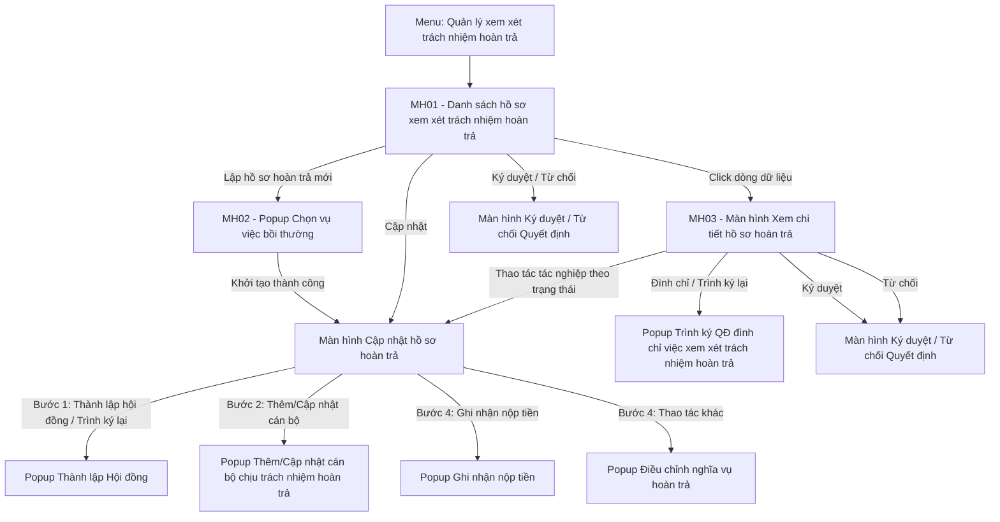

### 4.3.3.5. Quản lý xem xét trách nhiệm hoàn trả

#### 4.3.3.5.1. Mục đích

Cho phép quản lý toàn diện tiến trình xem xét, xác định và thực hiện nghĩa vụ hoàn trả kinh phí bồi thường của người thi hành công vụ có lỗi gây thiệt hại trên Website Quản trị, từ thời điểm vụ việc bồi thường nhà nước hoàn thành chi trả đến khi thu hồi đủ tiền vào ngân sách nhà nước (bao gồm: thành lập Hội đồng hoàn trả, ghi nhận quá trình làm việc và kết luận/kiến nghị của Hội đồng, ban hành Quyết định hoàn trả, theo dõi đôn đốc thu hồi tiền và xử lý điều chỉnh/miễn/hoãn nghĩa vụ hoàn trả, đình chỉ việc xem xét trách nhiệm hoàn trả).

*a. Phân quyền*

\- **Cán bộ xử lý (Chuyên viên)**: Khởi tạo hồ sơ hoàn trả, lập thành phần Hội đồng, ghi nhận tiến trình làm việc và kiến nghị của Hội đồng, lập dự thảo các quyết định, theo dõi và ghi nhận nộp tiền, lập hồ sơ điều chỉnh/miễn/hoãn hoàn trả, đình chỉ việc xem xét trách nhiệm hoàn trả, kết xuất Excel.

\- **Lãnh đạo phê duyệt**: Xem hồ sơ; `Ký duyệt` hoặc `Từ chối` (kèm lý do) hồ sơ `Chờ duyệt` (Loại trình `Thành lập hội đồng`, `QĐ hoàn trả`, `Đình chỉ xem xét hoàn trả`).

\- **Cán bộ tra cứu**: Chỉ xem danh sách và chi tiết hồ sơ hoàn trả trong phạm vi được phân quyền, kết xuất Excel; toàn bộ các nút tác nghiệp bị vô hiệu hóa.

\- **Phạm vi hiển thị dữ liệu**: Theo cơ quan, đơn vị công tác được phân quyền của người dùng đăng nhập.

\- **Nguyên tắc hiển thị cán bộ gây sai phạm theo đơn vị**:
  + Chỉ áp dụng tại Bước 4 `Thu hồi tiền hoàn trả` (Cập nhật hoàn trả: ghi nhận nộp tiền, điều chỉnh nghĩa vụ hoàn trả).
  + Người dùng thuộc đơn vị nào chỉ hiển thị và cập nhật hoàn trả cho cán bộ gây sai phạm có `Đơn vị công tác` là đơn vị đó; cán bộ thuộc đơn vị khác không hiển thị.
  + Bước 2 `Ý kiến của hội đồng`: Hội đồng, cơ quan giải quyết bồi thường hiển thị toàn bộ cán bộ gây sai phạm của hồ sơ.

\- **Quy tắc tải tệp đính kèm** (áp dụng các vùng đính kèm của module: Biên bản họp Hội đồng, Văn bản kiến nghị, Văn bản đính kèm của Điều kiện hoãn, Tài liệu đính kèm nộp tiền; không áp dụng cho tệp văn bản trong popup/khối trình ký):
  + Nút `Tải file`; cho phép tải nhiều tệp, mỗi tệp tối đa 50MB; định dạng theo từng trường.
  + Mỗi tệp hiển thị tên tệp, dung lượng, `Xem file` (mở tệp tại tab mới), `Xóa` (hiển thị popup xác nhận trước khi gỡ).
  + Tệp sai định dạng: hiển thị [MSG-ERR-FILE-001] dưới vùng tải tệp, không tiếp nhận tệp đó.
  + Tệp vượt quá 50MB: hiển thị [MSG-ERR-FILE-002] dưới vùng tải tệp, không tiếp nhận tệp đó.

\- **Quy tắc tự động chuyển trạng thái Hoàn thành**:
  + Hồ sơ ở trạng thái `Thu hồi tiền hoàn trả` sau khi Quyết định hoàn trả được ban hành.
  + Sau mỗi lần ghi nhận nộp tiền hoặc điều chỉnh nghĩa vụ hoàn trả, hệ thống kiểm tra toàn bộ cán bộ của hồ sơ.
  + Mọi cán bộ có tổng số tiền đã nộp lớn hơn hoặc bằng số tiền phải hoàn trả sau điều chỉnh (sau giảm mức, miễn hoàn trả): hệ thống tự động chuyển hồ sơ sang `Hoàn thành` và mở khóa Bước 5 `Hoàn thành`.

*b. Điều kiện thực hiện*

\- Người dùng đã đăng nhập Website Quản trị thành công và được phân quyền truy cập chức năng `Quản lý xem xét trách nhiệm hoàn trả`.

\- Vụ việc bồi thường nhà nước gốc đã hoàn tất chi trả kinh phí bồi thường, chưa phát sinh hồ sơ xem xét trách nhiệm hoàn trả và thuộc phạm vi dữ liệu được phân quyền của người dùng đăng nhập.

\- Mã vụ việc và mã hồ sơ theo [Mã vụ việc và mã hồ sơ - Tiếp nhận hồ sơ - Công tác bồi thường nhà nước (Website Quản trị)](SRS_BTNN_GiaiQuyetBT_TiepNhan_YCBT.md#tn-ma-vu-viec):
  + Hồ sơ hoàn trả có `Mã hồ sơ` riêng `HT-yyyy-xxx` và kế thừa `Mã vụ việc` (`VVBT-yyyy-xxx`) của hồ sơ Giải quyết yêu cầu bồi thường (`Mã hồ sơ GQBT`, `BT-yyyy-xxx`); hệ thống không sinh `Mã vụ việc` mới.
  + 01 vụ việc chỉ có 01 hồ sơ xem xét trách nhiệm hoàn trả; danh sách cán bộ chịu trách nhiệm hoàn trả quản lý trong hồ sơ đó.
  + Định danh vụ việc trên giao diện: `Mã vụ việc - Họ và tên người yêu cầu`.

---

*c. Quy tắc 02 tab Chờ xử lý / Đã xử lý*

- Tab được xác định theo **bước xử lý (gate) của người dùng**, không cố định theo trạng thái hồ sơ: hồ sơ đang chờ chính vai trò của người dùng thao tác nằm ở tab `Chờ xử lý`; hồ sơ người dùng đã qua ít nhất 01 bước xử lý và không còn chờ người dùng thao tác nằm ở tab `Đã xử lý`.

| Vai trò | Tab `Chờ xử lý` | Tab `Đã xử lý` |
| :--- | :--- | :--- |
| Cán bộ xử lý / Cán bộ tra cứu | Hồ sơ chờ cán bộ thao tác: hồ sơ nháp (mới khởi tạo, chưa trình/ban hành QĐ thành lập Hội đồng, không có trạng thái), `Bị từ chối` (mọi Loại trình), `Họp hội đồng`, `Chờ ban hành QĐ hoàn trả`, `Hoãn hoàn trả`, `Miễn hoàn trả`, `Thu hồi tiền hoàn trả` | Hồ sơ cán bộ đã trình chờ Lãnh đạo duyệt hoặc đã kết thúc (`Chờ duyệt` (mọi Loại trình), `Hoàn thành`, `Đình chỉ xem xét hoàn trả`) |
| Lãnh đạo phê duyệt | Hồ sơ chờ Lãnh đạo duyệt: `Chờ duyệt` (Loại trình `Thành lập hội đồng`, `QĐ hoàn trả`, `Đình chỉ xem xét hoàn trả`) | Hồ sơ Lãnh đạo đã Ký duyệt / Từ chối ít nhất 01 bước và không còn chờ Lãnh đạo duyệt |

- Tab `Đã xử lý`: cột `Trạng thái` hiển thị thêm danh sách bước người dùng đã xử lý, mỗi dòng `[Tên bước] ([Kết quả])`:
  + Cán bộ xử lý: Trình ký QĐ thành lập Hội đồng; Cập nhật kết luận Hội đồng; Trình ký QĐ hoàn trả; Đình chỉ xem xét hoàn trả; Hoàn tất thu hồi.
  + Lãnh đạo phê duyệt: Ký duyệt QĐ thành lập Hội đồng (Phê duyệt / Từ chối); Ký duyệt QĐ hoàn trả (Phê duyệt / Từ chối); Ký duyệt QĐ đình chỉ (Phê duyệt / Từ chối).
- Cột `Thao tác` theo vai trò, ở vị trí cố định; thao tác không được phép hiển thị dạng khóa mờ, không cho phép thao tác:
  + Cán bộ xử lý: `Cập nhật`, `Xóa`.
  + Lãnh đạo phê duyệt: `Ký duyệt`, `Từ chối` (chỉ được phép với hồ sơ chờ Lãnh đạo duyệt).
  + Cán bộ tra cứu: hiển thị `Chỉ xem`.
- Trường `Trạng thái` của bộ lọc chỉ gồm các trạng thái của tab đang chọn.

#### 4.3.3.5.2. Sơ đồ luồng nghiệp vụ theo giao diện

---

#### 4.3.3.5.3. MH01 - Màn hình Danh sách hồ sơ xem xét trách nhiệm hoàn trả

##### 4.3.3.5.3.1. Màn hình

##### 4.3.3.5.3.2. Mô tả thông tin trên màn hình

| Trường thông tin | Kiểu dữ liệu | Bắt buộc | Mặc định | Mô tả |
| :--- | :--- | :--- | :--- | :--- |
| **I. Khối thông tin chung màn hình** | Section | - | - | Vùng tiêu đề phía trên màn hình. |
| Tiêu đề màn hình | String(255) | - | `Xem xét trách nhiệm hoàn trả` | Control UI: Text heading (Read-only). - Hiển thị đúng tên mục Menu `Xem xét trách nhiệm hoàn trả`. - Không có dòng mô tả dưới tiêu đề. |
| **Tab danh sách** | Tab | - | `Chờ xử lý` | Control UI: 02 tab đặt phía trên khối bộ lọc tìm kiếm: + Chờ xử lý + Đã xử lý - Badge số lượng: số bản ghi thuộc tab Chờ xử lý của người dùng; không hiển thị khi bằng 0. - Badge số lượng tại mục menu `Xem xét trách nhiệm hoàn trả` bằng badge tab Chờ xử lý của Xem xét trách nhiệm hoàn trả. - Tab `Đã xử lý` không có badge số lượng. - Bản ghi của từng tab theo [Quy tắc 02 tab Chờ xử lý / Đã xử lý - Xem xét trách nhiệm hoàn trả - Công tác bồi thường nhà nước (Website Quản trị)](#ht-tab-xu-ly). |
| **II. Khối bộ lọc tìm kiếm** | Section | - | - | Control UI: Filter panel dạng thu gọn/mở rộng (Accordion). - Hiển thị phía trên bảng kết quả. - Mặc định hiển thị dạng mở rộng. - Cho phép thu gọn/mở rộng khi click vào nút "Thu gọn"/"Mở rộng" ở góc phải khối; khi thu gọn, các giá trị lọc đã nhập được giữ nguyên. |
| Mã hồ sơ | String(50) | Không | Trống | Control UI: Input text. - Placeholder: `Nhập mã hồ sơ (HT-...)`. - Tìm kiếm gần đúng theo `Mã hồ sơ` hoàn trả. |
| Mã vụ việc | String(50) | Không | Trống | Control UI: Input text. - Placeholder: `Nhập mã vụ việc (VVBT-...)`. - Tìm kiếm gần đúng theo `Mã vụ việc` (`VVBT-...`) của hồ sơ hoàn trả. |
| Cán bộ gây sai phạm | String(255) | Không | Trống | Control UI: Input text. - Placeholder: `Nhập họ tên cán bộ...`. - Tìm kiếm gần đúng theo họ và tên cán bộ chịu trách nhiệm hoàn trả thuộc hồ sơ. |
| Đơn vị công tác | Enum(String(255)) | Không | `Tất cả đơn vị` | Control UI: Combobox. - Danh sách: `Tất cả đơn vị` và các cơ quan, đơn vị trên hệ thống. - Lọc hồ sơ có ít nhất 01 cán bộ chịu trách nhiệm hoàn trả thuộc đơn vị đã chọn. |
| Trạng thái | Enum(String(50)) | Không | `Tất cả` | Control UI: Combobox. - Chỉ gồm `Tất cả` và các trạng thái của tab đang chọn, trong các giá trị: + Tất cả + Chờ duyệt + Bị từ chối + Họp hội đồng + Chờ ban hành QĐ hoàn trả + Hoãn hoàn trả + Miễn hoàn trả + Thu hồi tiền hoàn trả + Hoàn thành + Đình chỉ xem xét hoàn trả |
| Từ ngày | Date | Không | Ngày đầu tháng hiện tại | Control UI: Datepicker. - Placeholder: `dd/mm/yyyy`. - Lọc hồ sơ có ngày khởi tạo từ ngày này. |
| Đến ngày | Date | Không | Ngày hiện tại | Control UI: Datepicker. - Placeholder: `dd/mm/yyyy`. - Lọc hồ sơ có ngày khởi tạo đến ngày này. - Không nhỏ hơn `Từ ngày`. |
| Xóa bộ lọc | Button | Không | - | Control UI: Button. |
| Tìm kiếm | Button | Không | - | Control UI: Button. |
| **III. Khối bảng kết quả tìm kiếm** | Section | - | 10 bản ghi/trang | Control UI: Data grid. - Khi truy cập màn hình, hệ thống tự động tải toàn bộ hồ sơ hoàn trả thuộc phạm vi dữ liệu được phân quyền, sắp xếp mặc định theo ngày khởi tạo hồ sơ giảm dần. - Click tiêu đề cột (trừ cột `Thao tác`): sắp xếp tăng / giảm dần theo cột đó. - Số dòng hiển thị: 10 / 20 / 50 / 100 bản ghi/trang. |
| Lọc nhanh | Button group | Không | `Tất cả` | Control UI: Button group kèm số lượng hồ sơ. Gồm: + Tất cả + Chờ duyệt + Bị từ chối - Đặt phía trên bên trái lưới. |
| Lập hồ sơ hoàn trả mới | Button | Không | - | Control UI: Button. - Chỉ hiển thị với Cán bộ xử lý. - Mở popup chọn vụ việc bồi thường để lập hồ sơ hoàn trả mới. |
| Kết xuất Excel | Button | Không | - | Control UI: Button. - Cho phép kết xuất danh sách hồ sơ hoàn trả ra tệp Excel. |
| STT | Integer(10) | Không | Tự tăng | Control UI: Text (Read-only). - Số thứ tự dòng dữ liệu trên trang hiện tại. |
| Mã hồ sơ | String(50) | Có | Theo dữ liệu | Control UI: Text (Read-only). - Theo dữ liệu bản ghi. |
| Cán bộ gây sai phạm | String(500) | Không | Theo dữ liệu | Control UI: Text kèm Tooltip (Read-only). - Hiển thị họ và tên cán bộ đầu tiên kèm tên viết tắt đơn vị công tác trong ngoặc đơn. - Hồ sơ có từ 02 cán bộ: hiển thị thêm nhãn `+N khác` (N là số cán bộ còn lại). - Tooltip: danh sách đầy đủ cán bộ, mỗi cán bộ 01 dòng `[STT]. [Họ và tên] ([Chức vụ] - [Đơn vị công tác])`. - Chưa có cán bộ: hiển thị `—`. |
| Đơn vị công tác | String(255) | Không | Theo dữ liệu | Control UI: Text kèm Tooltip (Read-only). - Cán bộ thuộc 01 đơn vị: hiển thị tên đơn vị. - Cán bộ thuộc 02 đơn vị: hiển thị tên 02 đơn vị, phân tách bởi `&`. - Cán bộ thuộc từ 03 đơn vị: hiển thị `Liên ngành`; tooltip danh sách đầy đủ các đơn vị. |
| Mã vụ việc | String(50) | Có | Theo dữ liệu | Control UI: Text (Read-only). - Theo dữ liệu bản ghi. - Tooltip: `Mã vụ việc - Họ và tên người yêu cầu`. |
| Mã hồ sơ GQBT | String(50) | Có | Theo dữ liệu | Control UI: Text link (Read-only). - Theo dữ liệu bản ghi. |
| Tiền bồi thường (đ) | Decimal(18,0) | Có | Theo dữ liệu | Control UI: Text (Read-only). - Tổng số tiền Nhà nước đã chi trả bồi thường của vụ việc gốc. - Căn phải, định dạng số có dấu phân cách hàng nghìn. |
| Tiền hoàn trả (đ) | Decimal(18,0) | Không | Theo dữ liệu | Control UI: Text (Read-only). - Tổng số tiền phải hoàn trả của toàn bộ cán bộ theo Quyết định hoàn trả, đã trừ số tiền được giảm/miễn. - Căn phải, định dạng số có dấu phân cách hàng nghìn. - Chưa có số tiền hoàn trả: hiển thị `--`. |
| Tiến độ thu hồi | Decimal(5,2) | Không | Theo dữ liệu | Control UI: Progress bar (Read-only). - Hiển thị số tiền đã thu và tỷ lệ phần trăm `Đã thu / Tiền hoàn trả`. - Chưa có số tiền hoàn trả: hiển thị `Chưa ban hành QĐ`. |
| Trạng thái | Enum(String(50)) | Không | Theo dữ liệu | Control UI: Badge (Read-only). - Theo dữ liệu bản ghi. - Bản ghi `Chờ duyệt`, `Bị từ chối`: dòng phụ dưới badge hiển thị Loại trình: + Thành lập hội đồng + QĐ hoàn trả + Đình chỉ xem xét hoàn trả - Hồ sơ nháp (mới khởi tạo, chưa trình/ban hành QĐ thành lập Hội đồng): hiển thị `—`. - Tab `Đã xử lý`: dưới badge hiển thị danh sách bước người dùng đã xử lý theo [Quy tắc 02 tab Chờ xử lý / Đã xử lý - Xem xét trách nhiệm hoàn trả - Công tác bồi thường nhà nước (Website Quản trị)](#ht-tab-xu-ly). |
| Thao tác | Action | Không | - | Control UI: Icon button group, vị trí cố định theo vai trò; thao tác không được phép hiển thị dạng khóa mờ. - Tiêu đề cột: `Thao tác`. - Cán bộ tra cứu: hiển thị `Chỉ xem`. Gồm các nút: - **Cập nhật** (Cán bộ xử lý): Chỉ hiển thị với hồ sơ nháp (chưa trình/ban hành QĐ thành lập Hội đồng) hoặc khi hồ sơ ở các trạng thái: + `Bị từ chối` (Loại trình `Thành lập hội đồng`) + `Họp hội đồng` + `Bị từ chối` (Loại trình `QĐ hoàn trả`) + `Thu hồi tiền hoàn trả` - **Ký duyệt/Từ chối**: + Chỉ hiển thị khi người dùng được phân quyền Lãnh đạo phê duyệt. + Chỉ cho phép thao tác khi hồ sơ ở trạng thái `Chờ duyệt` (mọi Loại trình: `Thành lập hội đồng`, `QĐ hoàn trả`, `Đình chỉ xem xét hoàn trả`). - **Xóa** (Cán bộ xử lý): Chỉ hiển thị với hồ sơ nháp (chưa trình/ban hành QĐ thành lập Hội đồng). - Cột cố định bên phải lưới khi cuộn ngang. |

##### 4.3.3.5.3.3. Chức năng trên màn hình

| STT | Tên chức năng | Định dạng | Mô tả |
| :--- | :--- | :--- | :--- |
| 1 | Chuyển tab | Tab | Hiển thị danh sách của tab `Chờ xử lý` hoặc `Đã xử lý`, nạp lại bộ lọc `Trạng thái` theo tab và đưa về Trang 1. |
| 2 | Tìm kiếm | Button | Khi người dùng click nút Tìm kiếm, hệ thống lọc dữ liệu theo các điều kiện đã nhập/chọn. - **TH1 - Khoảng ngày không hợp lệ**: `Từ ngày` lớn hơn `Đến ngày`: hiển thị [MSG-ERR-VAL-007], không tìm kiếm. - **TH2 - Không trả về dữ liệu**: Bảng kết quả hiển thị 01 dòng thông báo [MSG-INF-SYS-001]. - **TH Hợp lệ**: Hiển thị danh sách hồ sơ hoàn trả theo phân trang, về Trang 1; chọn `Trạng thái` cụ thể thì `Lọc nhanh` về `Tất cả`. |
| 3 | Xóa bộ lọc | Button | Đưa bộ lọc và `Lọc nhanh` về giá trị mặc định và tải lại danh sách. |
| 4 | Lọc nhanh | Button group | Lọc danh sách theo nhóm đã chọn (`Tất cả`, `Chờ duyệt`, `Bị từ chối`), về Trang 1; chọn `Chờ duyệt` / `Bị từ chối` thì `Trạng thái` tại bộ lọc về `Tất cả`. |
| 5 | Lập hồ sơ hoàn trả mới | Button | Khi người dùng click nút Lập hồ sơ hoàn trả mới, hệ thống mở [Popup Chọn vụ việc bồi thường để lập hồ sơ hoàn trả](#mh02-popup-chon-vu-viec-boi-thuong) và tải danh sách vụ việc bồi thường thỏa mãn đồng thời: đã hoàn tất chi trả kinh phí bồi thường, chưa phát sinh hồ sơ xem xét trách nhiệm hoàn trả và thuộc phạm vi dữ liệu được phân quyền của người dùng đăng nhập. |
| 6 | Kết xuất Excel | Button | Kết xuất danh sách theo điều kiện tìm kiếm hiện hành ra tệp Excel. |
| 7 | Sắp xếp | Click tiêu đề cột | Sắp xếp danh sách tăng dần; click lần nữa thì giảm dần. |
| 8 | Click dòng dữ liệu | Row click | Click dòng (trừ cột `Thao tác` và liên kết `Mã hồ sơ GQBT`): mở [MH03 - Màn hình Xem chi tiết hồ sơ hoàn trả - Xem xét trách nhiệm hoàn trả - Công tác bồi thường nhà nước (Website Quản trị)](#mh03-xem-chi-tiet-ho-so-hoan-tra), mở sẵn bước theo trạng thái hồ sơ: - Hồ sơ nháp, `Chờ duyệt` / `Bị từ chối` (Loại trình `Thành lập hội đồng`): `Bước 1: Thành lập Hội đồng`. - `Họp hội đồng`, `Đình chỉ xem xét hoàn trả`: `Bước 2: Ý kiến hội đồng`. - `Chờ ban hành QĐ hoàn trả`, `Chờ duyệt` / `Bị từ chối` (Loại trình `QĐ hoàn trả`): `Bước 3: Ban hành QĐ`. - `Thu hồi tiền hoàn trả`: `Bước 4: Thu hồi tiền hoàn trả`. - `Hoàn thành`: `Bước 5: Hoàn thành`. |
| 9 | Mã hồ sơ GQBT | Text link | Mở màn hình chi tiết hồ sơ Giải quyết yêu cầu bồi thường theo [Đường dẫn mở chi tiết vụ việc - Giải quyết yêu cầu bồi thường - Công tác bồi thường nhà nước (Website Quản trị)](SRS_BTNN_GiaiQuyetBT_GiaiQuyet_YCBT.md#gq-url-chi-tiet). |
| 10 | Cập nhật | Button | Mở [Màn hình Cập nhật hồ sơ hoàn trả - Xem xét trách nhiệm hoàn trả - Công tác bồi thường nhà nước (Website Quản trị)](#man-hinh-cap-nhat-ho-so-hoan-tra) tại bước theo trạng thái hồ sơ: - Hồ sơ nháp, `Bị từ chối` (Loại trình `Thành lập hội đồng`): `Bước 1: Thành lập Hội đồng`. - `Họp hội đồng`: `Bước 2: Ý kiến hội đồng`. - `Bị từ chối` (Loại trình `QĐ hoàn trả`): `Bước 3: Ban hành QĐ`. - `Thu hồi tiền hoàn trả`: `Bước 4: Thu hồi tiền hoàn trả`. |
| 11 | Ký duyệt | Button | Khi click, hệ thống mở [Màn hình Ký duyệt / Từ chối Quyết định - Xem xét trách nhiệm hoàn trả - Công tác bồi thường nhà nước (Website Quản trị)](#popup-phe-duyet-ky-so-quyet-dinh) với thao tác `Ký duyệt`. |
| 12 | Từ chối | Button | Khi click, hệ thống mở [Màn hình Ký duyệt / Từ chối Quyết định - Xem xét trách nhiệm hoàn trả - Công tác bồi thường nhà nước (Website Quản trị)](#popup-tu-choi-phe-duyet-quyet-dinh) với thao tác `Từ chối`. |
| 13 | Xóa | Button | Click: hiển thị popup xác nhận [MSG-CFM-SYS-001]. - Tại popup chọn `Hủy bỏ`: đóng popup, không thay đổi dữ liệu. - Tại popup chọn `Đồng ý`: - **TH1 - Hồ sơ không còn là hồ sơ nháp**: hiển thị [MSG-ERR-BTNN-HT-008], không xóa. - **TH Hợp lệ**: Xóa hồ sơ hoàn trả; vụ việc trở lại danh sách đủ điều kiện lập hồ sơ hoàn trả; hiển thị [MSG-SUC-BTNN-HT-018]; tải lại danh sách. |

---

#### 4.3.3.5.4. MH02 - Popup Chọn vụ việc bồi thường để lập hồ sơ hoàn trả

##### 4.3.3.5.4.1. Màn hình

##### 4.3.3.5.4.2. Mô tả thông tin trên màn hình

| Trường thông tin | Kiểu dữ liệu | Bắt buộc | Mặc định | Mô tả |
| :--- | :--- | :--- | :--- | :--- |
| Tiêu đề popup | String(255) | - | - | Control UI: Text heading (Read-only). - Hiển thị `Lập hồ sơ hoàn trả: Chọn vụ việc bồi thường`. |
| Nội dung hướng dẫn | Text(500) | - | - | Control UI: Text (Read-only). - Hiển thị `Dưới đây là danh sách các vụ việc bồi thường nhà nước đã chi trả xong, đủ điều kiện để khởi tạo hồ sơ xem xét trách nhiệm hoàn trả công quỹ:`. |
| **Bảng danh sách vụ việc đủ điều kiện** | Section | - | - | Control UI: Data grid. - Danh sách vụ việc bồi thường nhà nước thỏa mãn đồng thời các điều kiện: + Vụ việc đã hoàn tất chi trả kinh phí bồi thường (đã có `Ngày hoàn tất chi trả bồi thường`). + Vụ việc chưa phát sinh hồ sơ xem xét trách nhiệm hoàn trả nào trên hệ thống. + Vụ việc thuộc phạm vi dữ liệu được phân quyền của người dùng đăng nhập. - Sắp xếp theo `Ngày hoàn tất chi` tăng dần. - Không có dữ liệu: hiển thị 01 dòng [MSG-INF-SYS-001]. |
| Mã vụ việc | String(50) | Có | Theo dữ liệu | Control UI: Text (Read-only). - Theo dữ liệu bản ghi. - Hiển thị `Mã vụ việc` (`VVBT-yyyy-xxx`) in đậm. |
| Mã hồ sơ GQBT | String(50) | Có | Theo dữ liệu | Control UI: Text link (Read-only). - Theo dữ liệu bản ghi. - Hiển thị Mã hồ sơ Giải quyết yêu cầu bồi thường (`BT-yyyy-xxx`). - Click mở màn hình chi tiết hồ sơ Giải quyết yêu cầu bồi thường. |
| Tên cá nhân/Tổ chức yêu cầu | String(255) | Có | Theo dữ liệu | Control UI: Text (Read-only). - Hiển thị họ tên cá nhân/tổ chức yêu cầu bồi thường của vụ việc gốc. |
| Số tiền bồi thường (đ) | Decimal(18,0) | Có | Theo dữ liệu | Control UI: Text (Read-only). - Tổng số tiền Nhà nước đã chi trả bồi thường của vụ việc. - Căn phải, định dạng số có dấu phân cách hàng nghìn. |
| Ngày hoàn tất chi | Date | Có | Theo dữ liệu | Control UI: Text (Read-only). - Định dạng `dd/mm/yyyy`. - Ngày hoàn thành chi trả kinh phí bồi thường của vụ việc gốc. |
| Thao tác | Button | - | - | Control UI: Button `Khởi tạo hồ sơ` trên từng dòng. |

##### 4.3.3.5.4.3. Chức năng trên màn hình

| STT | Tên chức năng | Định dạng | Mô tả |
| :--- | :--- | :--- | :--- |
| 1 | Khởi tạo hồ sơ | Button | Khi người dùng click nút Khởi tạo hồ sơ trên một dòng vụ việc, hệ thống thực hiện kiểm tra và xử lý: - **TH Vụ việc đã có hồ sơ hoàn trả** (01 vụ việc chỉ có 01 hồ sơ hoàn trả, kể cả hồ sơ do người dùng khác vừa khởi tạo): Hệ thống hiển thị thông báo [MSG-ERR-BTNN-HT-009] kèm `Mã vụ việc` và `Mã hồ sơ` hoàn trả đã có, làm mới lại danh sách trong popup và không khởi tạo hồ sơ. - **TH Hợp lệ**: Hệ thống thực hiện tuần tự các bước: + Bước 1: Tự động sinh `Mã hồ sơ` theo quy tắc `HT-<năm>-<số thứ tự 3 chữ số>`. + Bước 2: Lưu hồ sơ hoàn trả vào cơ sở dữ liệu dưới dạng hồ sơ nháp (chưa có trạng thái; hồ sơ chỉ có trạng thái khi Cán bộ trình ký QĐ thành lập Hội đồng (Ký số trên hệ thống) - `Chờ duyệt` (Loại trình `Thành lập hội đồng`), hoặc ban hành QĐ thành lập Hội đồng (Ký ngoài) - `Họp hội đồng`), tự động kế thừa các thông tin từ vụ việc gốc gồm: Mã vụ việc (giữ nguyên, không sinh mới), Mã hồ sơ GQBT, Nội dung vụ việc, Đơn vị chi trả bồi thường, Tổng số tiền đã chi trả, Ngày hoàn thành chi trả. + Bước 3: Ghi Audit Log thao tác khởi tạo hồ sơ hoàn trả. + Bước 4: Hiển thị thông báo thành công [MSG-SUC-BTNN-HT-001]. + Bước 5: Đóng popup và điều hướng sang [Màn hình Cập nhật hồ sơ hoàn trả - Xem xét trách nhiệm hoàn trả - Công tác bồi thường nhà nước (Website Quản trị)](#man-hinh-cap-nhat-ho-so-hoan-tra) tại `Bước 1: Thành lập Hội đồng`. |
| 2 | Đóng | Button | Khi người dùng click nút Đóng hoặc biểu tượng `×` trên tiêu đề popup, hệ thống đóng popup và quay lại [MH01 - Màn hình Danh sách hồ sơ xem xét trách nhiệm hoàn trả](#mh01-danh-sach-ho-so-hoan-tra), không thay đổi dữ liệu. |

---

#### 4.3.3.5.5. Màn hình Cập nhật hồ sơ hoàn trả

##### 4.3.3.5.5.1. Màn hình

##### 4.3.3.5.5.2. Mô tả thông tin trên màn hình

| Trường thông tin | Kiểu dữ liệu | Bắt buộc | Mặc định | Mô tả |
| :--- | :--- | :--- | :--- | :--- |
| **I. Khối điều hướng và tiêu đề hồ sơ** | Section | - | - | Vùng thông tin nhận dạng hồ sơ phía trên màn hình cập nhật. |
| Đường dẫn điều hướng | String(255) | - | - | Control UI: Breadcrumb (Read-only). - Hiển thị `Quản lý xem xét trách nhiệm hoàn trả / Cập nhật hồ sơ <Mã hồ sơ>`. |
| Tiêu đề hồ sơ | String(50) | Có | Theo dữ liệu | Control UI: Text heading (Read-only). - Hiển thị `Hồ sơ trách nhiệm hoàn trả: <Mã hồ sơ>`. |
| Trạng thái | Enum(String(50)) | Có | Theo dữ liệu | Control UI: Badge (Read-only). - Hiển thị trạng thái hiện tại của hồ sơ hoàn trả (chỉ đọc). Theo thông tin hồ sơ. |
| Mã vụ việc | String(50) | Có | Theo dữ liệu | Control UI: Text (Read-only). - Theo dữ liệu bản ghi. - Hiển thị `Mã vụ việc - Họ và tên người yêu cầu`. |
| Mã hồ sơ GQBT | String(50) | Có | Theo dữ liệu | Control UI: Text link (Read-only). - Theo dữ liệu bản ghi. - Hiển thị Mã hồ sơ Giải quyết yêu cầu bồi thường kèm nhãn `[Xem hồ sơ gốc]`. - Click mở màn hình chi tiết hồ sơ Giải quyết yêu cầu bồi thường. |
| **II. Thông tin vụ việc bồi thường gốc** | Section | - | Thu gọn | Control UI: Accordion (Read-only). - Click tiêu đề khối: mở rộng / thu gọn. - Kế thừa thông tin từ vụ việc bồi thường gốc. |
| Mã vụ việc | String(50) | Có | Theo dữ liệu | Control UI: Text (Read-only). - Theo dữ liệu bản ghi. - Hiển thị `Mã vụ việc - Họ và tên người yêu cầu`. |
| Mã hồ sơ GQBT | String(50) | Có | Theo dữ liệu | Control UI: Text link (Read-only). - Theo dữ liệu bản ghi. - Hiển thị Mã hồ sơ Giải quyết yêu cầu bồi thường kèm nhãn `[Xem hồ sơ gốc]`. |
| Ngày QĐ giải quyết bồi thường | Date | Có | Theo dữ liệu | Control UI: Text (Read-only). - Định dạng `dd/mm/yyyy`. Theo thông tin Hồ sơ vụ việc. |
| Ngày hoàn thành chi trả | Date | Có | Theo dữ liệu | Control UI: Text (Read-only). - Định dạng `dd/mm/yyyy`. Theo thông tin Hồ sơ vụ việc. |
| Lĩnh vực phát sinh thiệt hại | String(255) | Có | Theo dữ liệu | Control UI: Text (Read-only). - Theo thông tin Hồ sơ vụ việc. |
| Hành vi gây thiệt hại của người thi hành công vụ | Text(2000) | Có | Theo dữ liệu | Control UI: Text (Read-only). - Theo thông tin Hồ sơ vụ việc. |
| Nội dung vụ việc sai phạm gây bồi thường | Text(2000) | Có | Theo dữ liệu | Control UI: Text (Read-only). - Theo thông tin Hồ sơ vụ việc. |
| Đơn vị chi trả bồi thường | String(255) | Có | Theo dữ liệu | Control UI: Text (Read-only). - Theo thông tin Hồ sơ vụ việc. |
| Tổng số tiền Nhà nước đã chi trả bồi thường | Decimal(18,0) | Có | Theo dữ liệu | Control UI: Text (Read-only). - Định dạng số có dấu phân cách hàng nghìn, đơn vị `VNĐ`. Theo thông tin Hồ sơ vụ việc. |
| Trạng thái hồ sơ hoàn trả | Enum(String(50)) | - | Theo dữ liệu | Control UI: Badge (Read-only). - Trạng thái hiện tại của hồ sơ hoàn trả. |
| **III. Khối thanh tiến trình xử lý hồ sơ** | Section | - | Bước theo trạng thái hồ sơ | Control UI: Stepper 5 bước. Gồm: + Bước 1: Thành lập Hội đồng + Bước 2: Ý kiến hội đồng + Bước 3: Ban hành QĐ + Bước 4: Thu hồi tiền hoàn trả + Bước 5: Hoàn thành - Màn hình chỉ hiển thị nội dung 01 bước đang chọn; mặc định mở bước theo trạng thái hồ sơ. |
| Trạng thái hiển thị bước trên Stepper | Enum(String(50)) | - | Theo dữ liệu | Control UI: Step node. - `Đã hoàn thành`: bước nhỏ hơn bước hiện tại; click mở xem bước dạng chỉ đọc. - `Đang xử lý`: bước hiện tại của hồ sơ; click mở bước. - `Chưa mở khóa`: bước lớn hơn bước hiện tại; click hiển thị thông báo `Bước [n] chưa mở khóa theo tiến trình xử lý hồ sơ.`, không mở bước. - Hồ sơ `Đình chỉ xem xét hoàn trả`: giữ tại bước hồ sơ đang xử lý khi đình chỉ; các bước sau `Chưa mở khóa`. |
| **IV. Bước 1: Thành lập Hội đồng** | Section | - | - | Control UI: Section. - Tiêu đề: `Thành lập Hội đồng xem xét trách nhiệm hoàn trả`. |
| **Khối thông báo chưa thành lập Hội đồng** | Section | - | - | Control UI: Call-to-action card. - Chỉ hiển thị với hồ sơ nháp. |
| Tiêu đề thông báo | String(255) | - | `Chưa thành lập Hội đồng xem xét trách nhiệm hoàn trả` | Control UI: Text heading (Read-only). |
| Nội dung thông báo | Text(500) | - | `Hồ sơ chưa thành lập Hội đồng xem xét trách nhiệm hoàn trả. Vui lòng tạo Hội đồng qua chức năng tạo mới.` | Control UI: Text (Read-only). |
| Thành lập hội đồng | Button | - | - | Control UI: Button. - Chỉ hiển thị với hồ sơ nháp và Cán bộ xử lý. |
| **Khối thông tin cảnh báo từ chối** | Section | - | - | Control UI: Alert box. - Chỉ hiển thị khi hồ sơ ở trạng thái `Bị từ chối` (Loại trình `Thành lập hội đồng`). |
| Tiêu đề cảnh báo | String(255) | - | `Yêu cầu trình ký Quyết định thành lập bị từ chối` | Control UI: Text heading (Read-only). |
| Người từ chối | String(255) | - | Theo dữ liệu | Control UI: Text (Read-only). - Hiển thị họ tên và chức vụ của Lãnh đạo từ chối phê duyệt. |
| Thời gian từ chối | DateTime | - | Theo dữ liệu | Control UI: Text (Read-only). - Định dạng `dd/mm/yyyy HH:mm`. |
| Lý do từ chối | Text(1000) | - | Theo dữ liệu | Control UI: Text (Read-only). - Hiển thị nguyên văn ý kiến, lý do từ chối phê duyệt của Lãnh đạo. |
| **Thông tin văn bản Quyết định thành lập Hội đồng** | Section | - | - | Control UI: Info card (Read-only). - Hiển thị khi hồ sơ đã trình / ban hành QĐ thành lập Hội đồng. - Gồm các trường giống khối `Thông tin văn bản Quyết định thành lập Hội đồng` tại [MH03 - Màn hình Xem chi tiết hồ sơ hoàn trả - Xem xét trách nhiệm hoàn trả - Công tác bồi thường nhà nước (Website Quản trị)](#mh03-xem-chi-tiet-ho-so-hoan-tra). - Hồ sơ `Bị từ chối` (Loại trình `Thành lập hội đồng`): bảng `Văn bản liên quan` có thêm cột `Thao tác` (`Xóa văn bản`). - Sửa thông tin Quyết định thực hiện qua nút `Trình ký lại`. |
| Trình ký lại | Button | - | - | Control UI: Button. - Chỉ hiển thị khi hồ sơ ở trạng thái `Bị từ chối` (Loại trình `Thành lập hội đồng`), tại thanh nút chân trang. |
| **V. Bước 2: Ý kiến hội đồng** | Section | - | - | Control UI: Section. - Tiêu đề: `Ý kiến của hội đồng`. - Mở khóa khi hồ sơ ở trạng thái `Họp hội đồng` hoặc các bước sau. - Cho phép nhập khi hồ sơ ở trạng thái `Họp hội đồng`. |
| **Kết luận của Hội đồng xem xét trách nhiệm hoàn trả** | Section | - | - | Control UI: Form card. |
| Kết luận của Hội đồng | Enum(String(100)) | Có | `Có lỗi - Kiến nghị hoàn trả` | Control UI: Radio button. Gồm: + Có lỗi - Kiến nghị hoàn trả + Không xem xét - Người thi hành công vụ không có lỗi + Không xem xét - Người thi hành công vụ đã chết trước khi ra quyết định hoàn trả |
| Ngày họp / Lập biên bản kiến nghị | Date | Có | Ngày hiện tại | Control UI: Datepicker. - Placeholder: `dd/mm/yyyy`. - Không được lớn hơn ngày hiện tại. |
| Biên bản họp Hội đồng | File (Multiple) | Không | Trống | Control UI: File upload, nút `Tải file`. - Vùng đính kèm tệp biên bản họp, không bắt buộc, không có tệp mặc định. - Định dạng `.pdf`, `.doc`, `.docx`; cho phép nhiều tệp, mỗi tệp tối đa 50MB. - Hiển thị và kiểm tra tệp theo [Quy tắc tải tệp đính kèm - Xem xét trách nhiệm hoàn trả - Công tác bồi thường nhà nước (Website Quản trị)](#ht-quy-tac-tai-tep). |
| **Ý kiến kiến nghị của Hội đồng đối với từng cán bộ** | Section | - | - | Control UI: Form card. - Chỉ hiển thị khi `Kết luận của Hội đồng` là `Có lỗi - Kiến nghị hoàn trả`. |
| Thêm cán bộ gây sai phạm | Button | Không | - | Control UI: Button primary. - **Điều kiện hiển thị**: Chỉ hiển thị khi hồ sơ ở trạng thái `Họp hội đồng` và `Kết luận của Hội đồng` được chọn là `Có lỗi - Kiến nghị hoàn trả`. - Khi người dùng click, hệ thống mở [Popup Thêm/Cập nhật cán bộ chịu trách nhiệm hoàn trả](#popup-them-cap-nhat-can-bo-hoan-tra) ở chế độ thêm mới, toàn bộ trường để trống. |
| Danh sách ý kiến của Hội đồng theo từng cán bộ gây sai phạm | Section | Có | - | Control UI: Danh sách thẻ, mỗi cán bộ gây sai phạm 01 thẻ. - Hiển thị toàn bộ cán bộ gây sai phạm của hồ sơ (không áp dụng [Nguyên tắc hiển thị cán bộ gây sai phạm theo đơn vị - Xem xét trách nhiệm hoàn trả - Công tác bồi thường nhà nước (Website Quản trị)](#ht-nguyen-tac-don-vi)). - Danh sách trống: hiển thị `Danh sách cán bộ trống. Vui lòng bấm "Thêm cán bộ gây sai phạm" để ghi nhận ý kiến của Hội đồng.` - Toàn bộ thông tin trên thẻ chỉ đọc; việc nhập và sửa thực hiện tại [Popup Thêm/Cập nhật cán bộ chịu trách nhiệm hoàn trả - Xem xét trách nhiệm hoàn trả - Công tác bồi thường nhà nước (Website Quản trị)](#popup-them-cap-nhat-can-bo-hoan-tra). |
| Dòng thông tin cán bộ | String(1000) | - | Theo dữ liệu | Control UI: Text (Read-only), đầu thẻ. - Hiển thị `<STT>. Họ và tên cán bộ: <Họ và tên> \| Đơn vị: <Đơn vị công tác> \| Chức vụ: <Chức vụ>`. - STT tự động tăng (1, 2, 3...). |
| Mức độ lỗi | Enum(String(50)) | - | Theo dữ liệu | Control UI: Badge (Read-only). - Gồm: `Vô ý`, `Cố ý`, `Khác`. - `Khác`: hiển thị thêm nội dung mức độ lỗi đã nhập bên dưới nhãn. |
| Trách nhiệm hoàn trả và mức hoàn trả | Text(2000) | - | Theo dữ liệu | Control UI: Text (Read-only). - Hiển thị ý kiến của Hội đồng về trách nhiệm hoàn trả và mức hoàn trả. - Dòng dưới hiển thị `Số tiền phải hoàn trả: <số tiền> đ`, định dạng phân cách hàng nghìn bằng dấu chấm. |
| Giảm mức hoàn trả | Text(2000) | - | Theo dữ liệu | Control UI: Text (Read-only). - Không có dữ liệu: hiển thị `Không có`. |
| Miễn hoàn trả | Text(2000) | - | Theo dữ liệu | Control UI: Text (Read-only). - Không có dữ liệu: hiển thị `Không có`. |
| Điều kiện hoãn thực hiện việc hoàn trả (nếu có) | Text(2000) | - | Theo dữ liệu | Control UI: Text (Read-only). - Không có dữ liệu: hiển thị `Không có`. - Có dữ liệu: dòng dưới hiển thị `Hoãn từ ngày <Ngày bắt đầu hoãn> đến ngày <Ngày kết thúc hoãn>`; chưa có ngày kết thúc thì hiển thị `Chưa xác định`; kèm tên Văn bản đính kèm. |
| Phương thức hoàn trả | Enum(String(50)) | - | Theo dữ liệu | Control UI: Text (Read-only). - Gồm: `Một lần`, `Nhiều lần`. |
| Thao tác trên thẻ | Action | Không | - | Control UI: Icon button group đầu thẻ. Gồm: + Xem chi tiết cán bộ + Cập nhật ý kiến đối với cán bộ + Xóa cán bộ - `Cập nhật ý kiến đối với cán bộ`, `Xóa cán bộ`: chỉ hiển thị khi hồ sơ ở trạng thái `Họp hội đồng` và Cán bộ xử lý đang cập nhật. |
| Văn bản kiến nghị về việc ban hành quyết định hoàn trả đối với vụ việc yêu cầu bồi thường | File (Multiple) | Có | Trống | Control UI: File upload, nút `Tải file`. - Định dạng `.pdf`, `.doc`, `.docx`; cho phép nhiều tệp, mỗi tệp tối đa 50MB; bắt buộc tối thiểu 01 tệp. - Hiển thị và kiểm tra tệp theo [Quy tắc tải tệp đính kèm - Xem xét trách nhiệm hoàn trả - Công tác bồi thường nhà nước (Website Quản trị)](#ht-quy-tac-tai-tep). - Chỉ hiển thị khi `Kết luận của Hội đồng` là `Có lỗi - Kiến nghị hoàn trả`. - Liên kết `Tải Mẫu 35/BTNN` cạnh nhãn trường: tải văn bản sinh theo [Mẫu số 35/BTNN - Bảng mapping trường dữ liệu biểu mẫu - Công tác bồi thường nhà nước](Bieu_mau/Bang_mapping_truong_du_lieu_bieu_mau_BTNN.md), mỗi cán bộ gây sai phạm 01 khối nội dung; chưa có cán bộ thì cảnh báo, không tải. - Bước 2 ở chế độ chỉ đọc: chỉ hiển thị `Xem file`. |
| Khối hướng dẫn Đình chỉ | Section | - | - | Control UI: Alert box kèm Button `Đình chỉ`. - Chỉ hiển thị khi hồ sơ ở trạng thái `Họp hội đồng` và `Kết luận của Hội đồng` là 01 trong 02 giá trị `Không xem xét`. - Nội dung: `Kết luận này không phát sinh nghĩa vụ hoàn trả. Thực hiện Đình chỉ để trình/ban hành Quyết định đình chỉ việc xem xét trách nhiệm hoàn trả (Mẫu 39/BTNN); hồ sơ chuyển sang trạng thái Đình chỉ xem xét hoàn trả khi Quyết định được ban hành.` - Click `Đình chỉ`: mở [Popup Trình ký Quyết định đình chỉ việc xem xét trách nhiệm hoàn trả - Xem xét trách nhiệm hoàn trả - Công tác bồi thường nhà nước (Website Quản trị)](#popup-dinh-chi-hoan-tra). |
| Trình duyệt kiến nghị | Button | - | - | Control UI: Button primary. - **Điều kiện hiển thị**: Chỉ hiển thị khi hồ sơ ở trạng thái `Họp hội đồng` và `Kết luận của Hội đồng` được chọn là `Có lỗi - Kiến nghị hoàn trả`. |
| **VI. Bước 3: Ban hành QĐ** | Section | - | - | Control UI: Section. - Tiêu đề: `Ban hành Quyết định hoàn trả`. - Mở khóa khi hồ sơ ở trạng thái `Chờ ban hành QĐ hoàn trả` hoặc các bước sau. |
| Khối thông tin cảnh báo từ chối QĐ hoàn trả | Section | - | - | Control UI: Alert box. - Chỉ hiển thị khi hồ sơ ở trạng thái `Bị từ chối` (Loại trình `QĐ hoàn trả`). |
| Tiêu đề cảnh báo | String(255) | - | `Dự thảo Quyết định hoàn trả bị từ chối` | Control UI: Text heading (Read-only). |
| Người từ chối | String(255) | - | Theo dữ liệu | Control UI: Text (Read-only). - Hiển thị họ tên và chức vụ của Lãnh đạo từ chối phê duyệt. |
| Thời gian từ chối | DateTime | - | Theo dữ liệu | Control UI: Text (Read-only). - Định dạng `dd/mm/yyyy HH:mm`. |
| Lý do từ chối | Text(1000) | - | Theo dữ liệu | Control UI: Text (Read-only). - Hiển thị nguyên văn ý kiến, lý do từ chối phê duyệt dự thảo Quyết định của Lãnh đạo. |
| Khối thông báo chưa ban hành QĐ hoàn trả | Section | - | - | Control UI: Call-to-action card. - Chỉ hiển thị khi hồ sơ ở trạng thái `Chờ ban hành QĐ hoàn trả` và chưa click `Tạo QĐ hoàn trả`. |
| Tiêu đề thông báo | String(255) | - | `Chưa ban hành Quyết định hoàn trả` | Control UI: Text heading (Read-only). |
| Nội dung hướng dẫn | Text(500) | - | `Hội đồng đã hoàn tất kiến nghị. Vui lòng tạo Quyết định hoàn trả để nhập thông tin ban hành và văn bản quyết định.` | Control UI: Text (Read-only). |
| Ban hành QĐ hoàn trả | Button | Không | - | Control UI: Button, đặt trước nút `Tạo QĐ hoàn trả`. - Chỉ hiển thị khi hồ sơ ở trạng thái `Chờ ban hành QĐ hoàn trả`. |
| Tạo QĐ hoàn trả | Button | Không | - | Control UI: Button. - Chỉ hiển thị khi hồ sơ ở trạng thái `Chờ ban hành QĐ hoàn trả`. |
| **Thông tin văn bản Quyết định hoàn trả kinh phí bồi thường** | Section | - | - | Control UI: Form card kèm nhãn trạng thái dự thảo cạnh tiêu đề. - Hiển thị khi click `Tạo QĐ hoàn trả` hoặc hồ sơ ở các trạng thái: + `Chờ duyệt` (Loại trình `QĐ hoàn trả`) + `Bị từ chối` (Loại trình `QĐ hoàn trả`) + `Thu hồi tiền hoàn trả` + `Hoàn thành` - Cho phép nhập khi click `Tạo QĐ hoàn trả` hoặc hồ sơ `Bị từ chối` (Loại trình `QĐ hoàn trả`); trạng thái khác chỉ đọc. |
| Hình thức ban hành | Enum(String(50)) | Có | `Trình ký điện tử trên hệ thống` | Control UI: Radio button. Gồm: + Trình ký điện tử trên hệ thống + Ký ngoài hệ thống - Hồ sơ `Bị từ chối` (Loại trình `QĐ hoàn trả`): chỉ đọc. |
| Đơn vị ban hành | String(255) | Có | Đơn vị của người dùng đăng nhập | Control UI: Input text (Read-only). |
| Số quyết định | String(50) | Có (khi Ký ngoài hệ thống) | Theo dữ liệu | Control UI: Input text. - `Trình ký điện tử trên hệ thống`: chỉ đọc, hiển thị `[Dự thảo - Cấp tự động khi ký]`; hệ thống cấp số khi Lãnh đạo cấp cuối ký duyệt. - `Ký ngoài hệ thống`: cho phép nhập. |
| Ngày quyết định | Date | Có | Ngày hiện tại | Control UI: Datepicker. - Placeholder: `dd/mm/yyyy`. |
| Lãnh đạo ký | Enum(String(255)) | Có (khi hiển thị) | Lãnh đạo đầu tiên của danh sách | Control UI: Combobox. - Chỉ hiển thị khi `Hình thức ban hành` = `Trình ký điện tử trên hệ thống`. - Danh sách: Lãnh đạo của đơn vị ban hành, hiển thị `[Họ tên] ([Chức vụ])`. |
| Ngày ký | Date | - | `Chưa ký` | Control UI: Label. - Chỉ hiển thị khi `Hình thức ban hành` = `Ký ngoài hệ thống`. |
| Trích yếu | Text(2000) | Có | Trống | Control UI: Textarea. - Placeholder: `Nhập nội dung trích yếu Quyết định hoàn trả...`. |
| Tệp văn bản Quyết định hoàn trả | File | Có | Trống | Control UI: Vùng kéo thả / Thẻ tệp. - Chưa có tệp: vùng kéo thả `Kéo thả tệp vào đây hoặc Chọn tệp từ máy`, ghi chú `Chấp nhận tệp .pdf, .doc, .docx (tối đa 50MB)`; click vùng để mở trình chọn tệp. - Có tệp: Thẻ tệp gồm tên tệp, dung lượng, nút `Xem file`, `Xóa` (`Xóa` chỉ hiển thị khi được nhập). - Định dạng `.pdf`, `.doc`, `.docx`; tối đa 50MB. |
| Tài liệu kèm theo | List(Object) | Không | Văn bản liên quan sẵn có của hồ sơ (Hồ sơ `Bị từ chối` (Loại trình `QĐ hoàn trả`): theo lần trình trước) | Control UI: Bảng động, đặt dưới `Tệp văn bản Quyết định hoàn trả`. - Hiển thị với cả 02 `Hình thức ban hành`. - Cột: `STT`, `Tên văn bản, căn cứ`, `Tải file`, `Thao tác` (`Xem file`, `Xóa`). - Nút `Thêm tài liệu` dưới bảng. - Ghi chú dưới bảng: `Chấp nhận tệp .pdf, .doc, .docx, .jpg, .jpeg, .png (tối đa 50MB/tệp). Lãnh đạo xem được các tài liệu này khi Ký duyệt/Từ chối.` - Dòng đã nhập phải có đủ `Tên văn bản, căn cứ` và tệp; dòng trống không lưu. - Tên văn bản, căn cứ: Input text, tối đa 500 ký tự; placeholder `Nhập tên văn bản, căn cứ`. - Tải file: nút `Tải file`; có tệp thì hiển thị tên tệp, dung lượng. - Định dạng `.pdf`, `.doc`, `.docx`, `.jpg`, `.jpeg`, `.png`. - Dung lượng tối đa 50MB/tệp. - Chỉ đọc (khi khối chỉ đọc): cột `STT`, `Tên văn bản, căn cứ`, `Tệp` (tên tệp, dung lượng), `Thao tác` (`Xem file`). - Lưu khi `Trình ký` / `Ban hành QĐ`; Lãnh đạo xem tại [Màn hình Ký duyệt / Từ chối Quyết định - Xem xét trách nhiệm hoàn trả - Công tác bồi thường nhà nước (Website Quản trị)](#popup-phe-duyet-ky-so-quyet-dinh). |
| **Danh sách cán bộ chịu trách nhiệm hoàn trả** | Section | Có | Theo Bước 2 | Control UI: Data grid. - Kế thừa danh sách cán bộ từ Bước 2. - Cột: `STT`, `Cán bộ gây sai phạm`, `Chức vụ`, `Đơn vị công tác`, `Mức độ lỗi`, `Số tiền hoàn trả (VNĐ)`, `Phương thức`, `Trạng thái hoãn`, `Thao tác`. - Dữ liệu các cột: theo dữ liệu bản ghi. - `Trạng thái hoãn`: `Đề xuất hoãn` khi cán bộ có `Điều kiện hoãn thực hiện việc hoàn trả (nếu có)`; ngược lại `Không hoãn`. - Cột `Thao tác` chỉ hiển thị khi khối cho phép nhập. |
| Thao tác trên dòng | Action | Không | - | Control UI: Icon button group. Gồm: + Sửa cán bộ/mức hoàn trả + Xóa cán bộ khỏi danh sách dự thảo |
| Trình ký | Button | - | - | Control UI: Button, tại thanh nút chân trang. - Chỉ hiển thị khi khối cho phép nhập và `Hình thức ban hành` = `Trình ký điện tử trên hệ thống`. |
| Ban hành QĐ | Button | - | - | Control UI: Button, tại thanh nút chân trang. - Chỉ hiển thị khi khối cho phép nhập và `Hình thức ban hành` = `Ký ngoài hệ thống`. |
| **VII. Bước 4: Thu hồi tiền hoàn trả** | Section | - | - | Control UI: Section. - Tiêu đề: `Thu hồi tiền hoàn trả`. - Mở khóa khi Quyết định hoàn trả đã được ban hành. |
| Banner hoàn thành nghĩa vụ | Section | - | `Hồ sơ đã hoàn thành 100% nghĩa vụ hoàn trả.` | Control UI: Alert box (Read-only). - Chỉ hiển thị khi hồ sơ `Hoàn thành`. - Dòng phụ: `Toàn bộ thông tin các bước 1, 2, 3, 4 được hiển thị ở chế độ chỉ xem, không còn thao tác cập nhật/ghi nhận mới.` |
| **Quyết định hoàn trả kinh phí bồi thường** | Section | - | - | Control UI: Info card (Read-only). - Thông tin Quyết định hoàn trả đã ban hành. |
| Số quyết định | String(50) | - | Theo dữ liệu | Control UI: Label. - Theo dữ liệu bản ghi. |
| Ngày ban hành / hiệu lực | Date | - | Theo dữ liệu | Control UI: Label. - Theo dữ liệu bản ghi. |
| Người ký / phê duyệt | String(255) | - | Theo dữ liệu | Control UI: Label. - Theo dữ liệu bản ghi. |
| Tổng tiền hoàn trả | Decimal(18,0) | - | Theo dữ liệu | Control UI: Label. - Theo dữ liệu bản ghi. |
| Trích yếu / Căn cứ | Text(2000) | - | Theo dữ liệu | Control UI: Label. - Theo dữ liệu bản ghi. |
| Tệp quyết định chính thức | File | - | Theo dữ liệu | Control UI: Link. - Click tên tệp: mở tệp tại tab mới. - `Tải xuống`: tải tệp về máy. |
| **Bảng theo dõi và cập nhật nộp tiền thực tế theo từng cán bộ** | Section | Có | - | Control UI: Data grid. - Theo dõi việc nộp tiền vào ngân sách nhà nước của từng cán bộ theo Quyết định hoàn trả. - Chỉ hiển thị cán bộ thuộc đơn vị của người dùng đăng nhập theo [Nguyên tắc hiển thị cán bộ gây sai phạm theo đơn vị - Xem xét trách nhiệm hoàn trả - Công tác bồi thường nhà nước (Website Quản trị)](#ht-nguyen-tac-don-vi); STT đánh lại trong phạm vi các cán bộ được hiển thị. |
| STT | Integer | - | - | Control UI: Text (Read-only). - Số thứ tự tự động tăng (1, 2, 3...). |
| Cán bộ gây sai phạm | String(255) | Có | Theo dữ liệu | Control UI: Text (Read-only). - Dòng 1: họ và tên cán bộ. - Dòng 2: `[Chức vụ] ([Đơn vị công tác])`. |
| Phương thức hoàn trả | Enum(String(50)) | Có | Theo dữ liệu | Control UI: Text (Read-only). - Kế thừa từ Quyết định hoàn trả. |
| Số tiền hoàn trả (VNĐ) | Decimal(18,0) | Có | Theo dữ liệu | Control UI: Text (Read-only). - Kế thừa từ Quyết định hoàn trả. - Căn phải, định dạng phân cách hàng nghìn. |
| Số tiền đã nộp (VNĐ) | Decimal(18,0) | Không | Theo dữ liệu | Control UI: Text (Read-only). - Tổng số tiền thực tế cán bộ đã nộp vào NSNN tính đến thời điểm hiện tại. - Căn phải, định dạng phân cách hàng nghìn. |
| Số tiền còn thiếu (VNĐ) | Decimal(18,0) | Không | Theo dữ liệu | Control UI: Text (Read-only). - Số tiền cán bộ còn phải tiếp tục nộp (bằng Số tiền hoàn trả trừ đi Số tiền đã nộp và trừ Số tiền được giảm/miễn nếu có). - Căn phải, định dạng phân cách hàng nghìn. |
| Tiến độ thu hồi tiền | Decimal(5,2) | Không | Theo dữ liệu | Control UI: Progress bar kèm Text (Read-only). - Tỷ lệ % hoàn thành nghĩa vụ nộp tiền của cán bộ (tính theo Số tiền đã nộp / Số tiền hoàn trả). |
| Trạng thái hoàn trả | Enum(String(50)) | Có | Theo dữ liệu | Control UI: Badge (Read-only). Gồm: + Thu hồi tiền hoàn trả: cán bộ đang nộp tiền. + Đang hoãn: cán bộ trong thời hạn tạm hoãn (theo `Điều kiện hoãn thực hiện việc hoàn trả (nếu có)` tại Bước 2 hoặc thao tác `Hoãn hoàn trả` tại Bước 4); hiển thị kèm `(Từ dd/mm/yyyy đến dd/mm/yyyy)`. + Hoàn thành: `Số tiền còn thiếu` = 0. + Miễn hoàn trả: được miễn toàn bộ số tiền còn thiếu. - Cán bộ hết thời hạn tạm hoãn: hiển thị thêm nhãn `[Hết hạn hoãn từ dd/mm/yyyy]`. - Thời hạn tạm hoãn còn lại từ 05 ngày trở xuống: hiển thị thêm nhãn `[Sắp hết hạn hoãn: còn X ngày]`. |
| Click dòng dữ liệu | Row click | Không | - | Control UI: Row click. - Click dòng (trừ cột `Thao tác`): mở [Popup Chi tiết tiến trình nộp tiền của cán bộ - Xem xét trách nhiệm hoàn trả - Công tác bồi thường nhà nước (Website Quản trị)](#popup-chi-tiet-tien-trinh-nop-tien). |
| Thao tác | Action | Không | - | Control UI: Icon button group, vị trí cố định; thao tác không được phép hiển thị dạng khóa mờ. Gồm: + Ghi nhận nộp tiền hoàn trả ngân sách + Thao tác khác: menu `Giảm mức hoàn trả`, `Miễn hoàn trả`, `Hoãn hoàn trả` - Được phép khi cán bộ có `Số tiền còn thiếu` > 0, không ở trạng thái `Hoàn thành`, hồ sơ chưa `Hoàn thành` và người dùng là Cán bộ xử lý. - Cán bộ `Đang hoãn`: `Ghi nhận nộp tiền` có tooltip `Cán bộ đang hoãn (cho phép ghi nhận nộp tiền tự nguyện)`. |
| **VIII. Bước 5: Hoàn thành** | Section | - | - | Control UI: Section (Read-only). - Tiêu đề: `Hoàn thành nghĩa vụ hoàn trả`. - Mở khóa khi hồ sơ chuyển `Hoàn thành` theo [Quy tắc tự động chuyển trạng thái Hoàn thành - Xem xét trách nhiệm hoàn trả - Công tác bồi thường nhà nước (Website Quản trị)](#ht-tu-dong-hoan-thanh); Bước 1 - Bước 4 chuyển chỉ xem. |
| Banner thông báo hoàn tất nghĩa vụ | Section | - | - | Control UI: Alert box (Read-only). - Tiêu đề: `Hồ sơ đã hoàn thành 100% nghĩa vụ hoàn trả kinh phí bồi thường`. - Nội dung: `Toàn bộ các cán bộ liên quan đã hoàn thành nộp đủ số tiền phải hoàn trả vào Kho bạc Nhà nước. Hồ sơ đã hoàn tất quy trình xem xét và thi hành trách nhiệm hoàn trả.` - Nút `Quay lại danh sách (MH01)`. |
| Khối Báo cáo tổng hợp số liệu thu hồi | Section | - | - | Control UI: Stat cards (Read-only). Gồm: + Tổng số cán bộ hoàn thành: `[Số cán bộ hoàn thành] / [Tổng số cán bộ] cán bộ hoàn thành` + Tổng số tiền đã thu hồi + Số dư nợ còn lại |
| **Danh sách các đợt nộp tiền hoàn trả ngân sách đã đối soát KBNN** | Section | - | - | Control UI: Data grid (Read-only). - Cột: `Cán bộ thực hiện`, `Ngày nộp`, `Tài liệu đính kèm`, `Số tiền đã nộp (VNĐ)`, `Đối soát KBNN`. - Dữ liệu các cột: theo dữ liệu bản ghi. - Nút `Đóng` dưới bảng. |

##### 4.3.3.5.5.3. Chức năng trên màn hình

| STT | Tên chức năng | Định dạng | Mô tả |
| :--- | :--- | :--- | :--- |
| - | **Bước 1: Thành lập Hội đồng** | - | - |
| 1 | Thành lập hội đồng | Button | Mở [Popup Thành lập Hội đồng xem xét trách nhiệm hoàn trả - Xem xét trách nhiệm hoàn trả - Công tác bồi thường nhà nước (Website Quản trị)](#popup-tao-moi-hoi-dong). |
| 2 | Trình ký lại | Button | Mở [Popup Thành lập Hội đồng xem xét trách nhiệm hoàn trả - Xem xét trách nhiệm hoàn trả - Công tác bồi thường nhà nước (Website Quản trị)](#popup-tao-moi-hoi-dong), điền sẵn dữ liệu lần trình trước. |
| 3 | Xóa văn bản (Văn bản liên quan) | Icon button | Click: hiển thị popup xác nhận [MSG-CFM-SYS-001]. - Tại popup chọn `Đồng ý`: gỡ văn bản khỏi bảng `Văn bản liên quan`. - Tại popup chọn `Hủy bỏ`: đóng popup, giữ nguyên dữ liệu. |
| - | **Bước 2: Ý kiến hội đồng** | - | - |
| 4 | Chọn Kết luận của Hội đồng | Radio | - `Có lỗi - Kiến nghị hoàn trả`: hiển thị khối `Ý kiến kiến nghị của Hội đồng đối với từng cán bộ`, nút `Trình duyệt kiến nghị`. - 01 trong 02 giá trị `Không xem xét`: ẩn khối trên và nút `Trình duyệt kiến nghị`; hiển thị `Khối hướng dẫn Đình chỉ`. |
| 5 | Thêm cán bộ gây sai phạm | Button | Mở [Popup Thêm/Cập nhật cán bộ chịu trách nhiệm hoàn trả - Xem xét trách nhiệm hoàn trả - Công tác bồi thường nhà nước (Website Quản trị)](#popup-them-cap-nhat-can-bo-hoan-tra) ở chế độ thêm mới. |
| 6 | Xem chi tiết cán bộ | Icon button | Mở popup xem ý kiến của Hội đồng đối với cán bộ (chỉ đọc). |
| 7 | Cập nhật ý kiến đối với cán bộ | Icon button | Mở [Popup Thêm/Cập nhật cán bộ chịu trách nhiệm hoàn trả - Xem xét trách nhiệm hoàn trả - Công tác bồi thường nhà nước (Website Quản trị)](#popup-them-cap-nhat-can-bo-hoan-tra) ở chế độ cập nhật, nạp sẵn dữ liệu của cán bộ. |
| 8 | Xóa cán bộ | Icon button | Click: hiển thị popup xác nhận [MSG-CFM-SYS-001]. - Tại popup chọn `Đồng ý`: xóa cán bộ khỏi danh sách, đánh lại STT, hiển thị [MSG-SUC-BTNN-HT-009]. - Tại popup chọn `Hủy bỏ`: đóng popup, giữ nguyên dữ liệu. |
| 9 | Tải Mẫu 35/BTNN | Link | - **TH1 - Chưa có cán bộ**: hiển thị cảnh báo, không tải. - **TH Hợp lệ**: Tải văn bản sinh theo Mẫu 35/BTNN, mỗi cán bộ gây sai phạm 01 khối nội dung. |
| 10 | Đình chỉ (Khối hướng dẫn Đình chỉ) | Button | Mở [Popup Trình ký Quyết định đình chỉ việc xem xét trách nhiệm hoàn trả - Xem xét trách nhiệm hoàn trả - Công tác bồi thường nhà nước (Website Quản trị)](#popup-dinh-chi-hoan-tra); hồ sơ kết thúc ở trạng thái `Đình chỉ xem xét hoàn trả` khi Quyết định đình chỉ được ban hành (Ký ngoài) hoặc được Lãnh đạo cấp cuối Ký duyệt (Ký số trên hệ thống). Thanh tiến trình giữ tại Bước 2; các Bước 3, 4, 5 không mở khóa. |
| 11 | Trình duyệt kiến nghị | Button | Khi click, hệ thống kiểm tra dữ liệu và xử lý theo các trường hợp: - **TH1 - Bỏ trống trường bắt buộc** (gồm `Văn bản kiến nghị về việc ban hành quyết định hoàn trả đối với vụ việc yêu cầu bồi thường`): Hệ thống tô viền đỏ ô lỗi, hiển thị [MSG-ERR-VAL-001] dưới ô lỗi và focus vào ô lỗi đầu tiên; không trình. - **TH2 - Chưa có cán bộ**: hiển thị [MSG-ERR-BTNN-HT-007]; không trình. - **TH3 - Cán bộ bỏ trống `Trách nhiệm hoàn trả và mức hoàn trả`**: mở [Popup Thêm/Cập nhật cán bộ chịu trách nhiệm hoàn trả - Xem xét trách nhiệm hoàn trả - Công tác bồi thường nhà nước (Website Quản trị)](#popup-them-cap-nhat-can-bo-hoan-tra) của cán bộ đầu tiên bị thiếu, tô viền đỏ ô lỗi, hiển thị [MSG-ERR-VAL-001] dưới ô lỗi và focus vào ô lỗi; không trình. - **TH4 - Tổng số tiền hoàn trả bằng 0**: hiển thị [MSG-ERR-VAL-012]; không trình. - **TH Hợp lệ**: + Lưu kết luận, biên bản, danh sách cán bộ và văn bản kiến nghị. + Hồ sơ chuyển `Chờ ban hành QĐ hoàn trả`; mở khóa `Bước 3: Ban hành QĐ`. + Hiển thị [MSG-SUC-BTNN-HT-006]. |
| 12 | Tải file (Biên bản họp Hội đồng, Văn bản kiến nghị) | Button | Áp dụng [Quy tắc tải tệp đính kèm - Xem xét trách nhiệm hoàn trả - Công tác bồi thường nhà nước (Website Quản trị)](#ht-quy-tac-tai-tep) với định dạng `.pdf`, `.doc`, `.docx`. |
| 13 | Xóa tệp | Text link | Click: hiển thị popup xác nhận. - Tại popup chọn `Đồng ý`: gỡ tệp khỏi danh sách. - Tại popup chọn `Hủy bỏ`: đóng popup. |
| - | **Bước 3: Ban hành Quyết định hoàn trả** | - | - |
| 14 | Ban hành QĐ hoàn trả | Button | Mở [Popup Ban hành Quyết định hoàn trả - Xem xét trách nhiệm hoàn trả - Công tác bồi thường nhà nước (Website Quản trị)](#popup-ban-hanh-qd-hoan-tra). |
| 15 | Tạo QĐ hoàn trả | Button | Ẩn `Khối thông báo chưa ban hành QĐ hoàn trả`; hiển thị khối `Thông tin văn bản Quyết định hoàn trả kinh phí bồi thường` cho phép nhập. |
| 16 | Chọn Hình thức ban hành | Radio | - `Trình ký điện tử trên hệ thống`: `Số quyết định` chỉ đọc; hiển thị `Lãnh đạo ký`; ẩn `Ngày ký`; nút `Trình ký`. - `Ký ngoài hệ thống`: `Số quyết định` cho phép nhập, bắt buộc; ẩn `Lãnh đạo ký`; hiển thị `Ngày ký`; nút `Ban hành QĐ`. |
| 17 | Sửa cán bộ/mức hoàn trả | Icon button | Mở [Popup Thêm/Cập nhật cán bộ chịu trách nhiệm hoàn trả - Xem xét trách nhiệm hoàn trả - Công tác bồi thường nhà nước (Website Quản trị)](#popup-them-cap-nhat-can-bo-hoan-tra) ở chế độ cập nhật, nạp sẵn dữ liệu của cán bộ. |
| 18 | Xóa cán bộ khỏi danh sách dự thảo | Icon button | Click: hiển thị popup xác nhận [MSG-CFM-SYS-001]. - Tại popup chọn `Đồng ý`: xóa cán bộ khỏi danh sách dự thảo, hiển thị [MSG-SUC-BTNN-HT-009]. - Tại popup chọn `Hủy bỏ`: đóng popup, giữ nguyên dữ liệu. |
| 19 | Trình ký | Button | Khi click, hệ thống kiểm tra dữ liệu và xử lý theo các trường hợp: - **TH1 - Bỏ trống trường bắt buộc** (gồm dòng `Tài liệu kèm theo` đã nhập thiếu `Tên văn bản, căn cứ` hoặc tệp): Hệ thống tô viền đỏ ô lỗi, hiển thị [MSG-ERR-VAL-001] dưới ô lỗi và focus vào ô lỗi đầu tiên; không trình. - **TH Hợp lệ**: + Lưu thông tin dự thảo Quyết định hoàn trả, `Tài liệu kèm theo`, danh sách cán bộ. + Hồ sơ chuyển `Chờ duyệt` (Loại trình `QĐ hoàn trả`); ghi `Lịch sử xử lý Quyết định hoàn trả` hành động `Trình ký`. + Hiển thị [MSG-SUC-BTNN-HT-010]. |
| 20 | Ban hành QĐ | Button | Khi click, hệ thống kiểm tra dữ liệu và xử lý theo các trường hợp: - **TH1 - Bỏ trống trường bắt buộc** (gồm dòng `Tài liệu kèm theo` đã nhập thiếu `Tên văn bản, căn cứ` hoặc tệp): Hệ thống tô viền đỏ ô lỗi, hiển thị [MSG-ERR-VAL-001] dưới ô lỗi và focus vào ô lỗi đầu tiên; không ban hành. - **TH Hợp lệ**: + Lưu Quyết định hoàn trả đã ban hành. + Hồ sơ chuyển `Thu hồi tiền hoàn trả`; mở khóa `Bước 4: Thu hồi tiền hoàn trả`; ghi `Lịch sử xử lý Quyết định hoàn trả`. + Hiển thị [MSG-SUC-BTNN-HT-013]. |
| 21 | Thêm tài liệu | Button | Tại bảng `Tài liệu kèm theo`: thêm 01 dòng trống vào cuối bảng. |
| 22 | Tải file (Tài liệu kèm theo) | Button | Tại dòng của bảng `Tài liệu kèm theo`, hệ thống mở hộp thoại chọn tệp và xử lý theo các trường hợp: - **TH1 - Sai định dạng file**: Tệp không thuộc `.pdf`, `.doc`, `.docx`, `.jpg`, `.jpeg`, `.png`: hiển thị cảnh báo lỗi [MSG-ERR-FILE-001] dưới ô, không tiếp nhận tệp. - **TH2 - File quá dung lượng**: Tệp vượt quá 50MB: hiển thị cảnh báo lỗi [MSG-ERR-FILE-002] dưới ô, không tiếp nhận tệp. - **TH Hợp lệ**: Hiển thị tên tệp, dung lượng tại cột `Tải file`; `Tên văn bản, căn cứ` đang trống thì điền theo tên tệp (bỏ phần mở rộng). |
| 23 | Xem file / Xóa (Tài liệu kèm theo) | Icon button | - `Xem file`: mở tệp đã tải lên tại tab mới; chỉ bấm được khi dòng đã có tệp. - `Xóa`: xóa dòng ngay, không hiển thị popup xác nhận. |
| - | **Bước 4: Thu hồi tiền hoàn trả** | - | - |
| 24 | Click dòng cán bộ | Row click | Mở [Popup Chi tiết tiến trình nộp tiền của cán bộ - Xem xét trách nhiệm hoàn trả - Công tác bồi thường nhà nước (Website Quản trị)](#popup-chi-tiet-tien-trinh-nop-tien). |
| 25 | Ghi nhận nộp tiền hoàn trả ngân sách | Icon button | Mở [Popup Ghi nhận nộp tiền hoàn trả ngân sách - Xem xét trách nhiệm hoàn trả - Công tác bồi thường nhà nước (Website Quản trị)](#popup-ghi-nhan-nop-tien) của cán bộ. |
| 26 | Thao tác khác | Icon button / Menu | Mở menu; chọn `Giảm mức hoàn trả` / `Miễn hoàn trả` / `Hoãn hoàn trả`: mở [Popup Điều chỉnh nghĩa vụ hoàn trả - Xem xét trách nhiệm hoàn trả - Công tác bồi thường nhà nước (Website Quản trị)](#popup-dieu-chinh-nghia-vu-hoan-tra) với `Loại điều chỉnh` chọn sẵn theo mục đã chọn. |
| 27 | Tải xuống (Tệp quyết định chính thức) | Link | Tải tệp Quyết định hoàn trả về máy. |
| - | **Thao tác chung màn hình** | - | - |
| 28 | Đình chỉ | Button | Tại thanh nút chân trang; theo chức năng `Đình chỉ` tại [Chức năng trên màn hình - MH03 - Màn hình Xem chi tiết hồ sơ hoàn trả - Xem xét trách nhiệm hoàn trả - Công tác bồi thường nhà nước (Website Quản trị)](#mh03-xem-chi-tiet-ho-so-hoan-tra). |
| 29 | Đóng | Button | Đóng màn hình, quay lại [MH01 - Màn hình Danh sách hồ sơ xem xét trách nhiệm hoàn trả - Xem xét trách nhiệm hoàn trả - Công tác bồi thường nhà nước (Website Quản trị)](#mh01-danh-sach-ho-so-hoan-tra), không lưu dữ liệu. |
| 30 | Quay lại danh sách (MH01) | Button | Tại Bước 5; như `Đóng`. |

---

#### 4.3.3.5.6. Popup Thành lập Hội đồng xem xét trách nhiệm hoàn trả

##### 4.3.3.5.6.1. Màn hình

Popup mở khi Cán bộ xử lý click `Thành lập hội đồng` tại Bước 1 (hồ sơ nháp - mới khởi tạo, chưa có trạng thái; Ký số trên hệ thống: trình Lãnh đạo -> `Chờ duyệt` (Loại trình `Thành lập hội đồng`); Ký ngoài: ban hành -> `Họp hội đồng`) hoặc `Trình ký lại` (hồ sơ `Bị từ chối` (Loại trình `Thành lập hội đồng`)). Bố cục như [Popup Không thụ lý hồ sơ - SRS Giải quyết yêu cầu bồi thường - Công tác bồi thường nhà nước](SRS_BTNN_GiaiQuyetBT_GiaiQuyet_YCBT.md#433115-popup-không-thụ-lý-hồ-sơ).
- Thanh Stepper 2 bước chỉ hiển thị khi `Hình thức ký` = `Ký số trên hệ thống`; ẩn khi `Ký ngoài`.
- Ký số trên hệ thống: Wizard 2 bước.
  + **Bước 1 - Nhập thông tin**: thứ tự khối `Hình thức ký` (đầu form), `Tệp văn bản trình ký` (nguồn tệp; Số quyết định, Ngày quyết định, Bảng danh sách thành viên trong hội đồng khi Sinh văn bản theo mẫu 33/BTNN).
  + **Bước 2 - Kéo ô ký & chọn Lãnh đạo**: vùng trái là văn bản A4 Mẫu 33/BTNN; vùng phải là các thẻ `Cấp [n] - [Đơn vị]` (chọn Lãnh đạo, `Đặt chữ ký`, ký nháy) và `Nội dung trình`.
- Luồng trình ký theo luồng đã cấu hình tại [Cấu hình luồng xử lý - Cấu hình luồng xử lý - Quản trị hệ thống (Website Quản trị)](../01_Quan_tri_he_thong/Cau_hinh_luong_xu_ly.md); số cấp theo cấu hình.
- Ký ngoài: không hiển thị Stepper; thứ tự khối `Hình thức ký`, `Tệp văn bản đã ký & đóng dấu`; đính kèm văn bản PDF đã ký và ban hành trực tiếp.
- Thanh nút: `Hủy bỏ` và nút chính (Ký số Bước 1: `Tiếp tục`; Ký số Bước 2: `Quay lại`, `Trình Lãnh đạo`; Ký ngoài: `Ban hành văn bản`).
- Văn bản: [Mẫu 33/BTNN - Quyết định thành lập Hội đồng xem xét trách nhiệm hoàn trả - Bảng mapping trường dữ liệu biểu mẫu BTNN - Công tác bồi thường nhà nước](Bieu_mau/Bang_mapping_truong_du_lieu_bieu_mau_BTNN.md#mau-33).
- Bước 2 mở rộng popup toàn màn hình; tiêu đề và thanh nút cố định, thân popup cuộn dọc.

##### 4.3.3.5.6.2. Mô tả thông tin trên màn hình

| Trường thông tin | Kiểu dữ liệu | Bắt buộc | Mặc định | Mô tả |
| :--- | :--- | :--- | :--- | :--- |
| Tiêu đề popup | String(255) | - | `THÀNH LẬP HỘI ĐỒNG XEM XÉT TRÁCH NHIỆM HOÀN TRẢ` | Control UI: Text heading (Read-only). - Dòng phụ đề: `Hồ sơ`, `Người yêu cầu bồi thường`, `Đơn vị chi trả bồi thường` theo hồ sơ hoàn trả. |
| Thanh chỉ trình (Stepper) | Component | - | Bước 1 active | Control UI: Stepper 2 bước. - Bước 1: `Nhập thông tin`. - Bước 2: `Kéo ô ký & chọn Lãnh đạo`. - Chỉ hiển thị khi `Hình thức ký` = `Ký số trên hệ thống`; ẩn khi `Ký ngoài`. |
| Khối Hồ sơ bị từ chối | Section | - | Ẩn | Control UI: Khối cảnh báo (Read-only). - Chỉ hiển thị khi hồ sơ `Bị từ chối` (Loại trình `Thành lập hội đồng`). - Gồm Lý do từ chối, Người từ chối, Thời điểm. - Các trường của popup điền theo lần trình trước. |
| Hình thức ký | Enum(String(50)) | Có | `Ký số trên hệ thống` | Control UI: Radio button dạng 02 thẻ chọn cùng chiều cao, khối đầu tiên của form. - Mỗi thẻ gồm tiêu đề và mô tả bên dưới. Gồm: + Ký số trên hệ thống: mô tả `Trình Lãnh đạo ký duyệt trên phần mềm` + Ký ngoài (Ban hành trực tiếp): mô tả `Tải lên văn bản PDF đã ký và đóng dấu` |
| **Khối Tệp văn bản trình ký** | Section | - | - | Control UI: Section header. - Khi chọn `Ký ngoài`, khối đổi thành `Tệp văn bản đã ký & đóng dấu`. |
| Tệp văn bản trình ký | File | Có (khi Ký số) | `Sinh văn bản theo mẫu 33/BTNN` | Control UI: Segmented control chọn nguồn tệp. - Chỉ hiển thị khi `Hình thức ký` = `Ký số trên hệ thống`. Gồm: + Sinh văn bản theo mẫu 33/BTNN + Tải lên từ máy - `Sinh văn bản theo mẫu 33/BTNN`: khối thông tin điền vào Mẫu 33/BTNN; dưới khối là dòng `Hệ thống tự động sinh Quyết định theo Mẫu 33/BTNN từ thông tin đang nhập.` và nút `Xem trước văn bản` trên cùng 1 dòng. - `Tải lên từ máy`: vùng kéo thả `Kéo thả tệp vào đây hoặc Chọn tệp từ máy`, dòng phụ `Chấp nhận tệp .pdf, .doc, .docx (tối đa 50MB)`; nhận tệp bằng kéo thả hoặc click. - Tệp `.doc`, `.docx`: hiển thị `Đang chuyển đổi sang PDF...` trong lúc hệ thống chuyển đổi sang PDF; khóa nút `Tiếp tục` đến khi chuyển đổi xong. - Có tệp: File Card gồm tên tệp, dung lượng (tệp đã chuyển đổi: kèm `Đã chuyển đổi từ [tên tệp gốc]`), nút `Xem file`, `Xóa`. |
| **Thông tin điền vào Mẫu 33/BTNN** | Section | - | - | Control UI: Section. - Chỉ hiển thị khi `Hình thức ký` = `Ký số trên hệ thống` và `Tệp văn bản trình ký` = `Sinh văn bản theo mẫu 33/BTNN`. |
| Số quyết định | String(50) | Có (khi hiển thị) | `     /QĐ-` | Control UI: Input text. - Placeholder: `Nhập số quyết định...`. - Chỉ hiển thị khi `Hình thức ký` = `Ký số trên hệ thống` và `Tệp văn bản trình ký` = `Sinh văn bản theo mẫu 33/BTNN`. |
| Ngày quyết định | Date | Có (khi hiển thị) | Ngày hiện tại | Control UI: Datepicker. - Placeholder: `dd/mm/yyyy`. - Điều kiện hiển thị như `Số quyết định`. |
| Bảng danh sách thành viên trong hội đồng | Table | Có (khi hiển thị) | 01 dòng trống | Control UI: Editable Data grid kèm nút `Thêm thành viên`. - Điều kiện hiển thị như `Số quyết định`. - Cột: `STT` \| `Họ và tên` \| `Đơn vị công tác` \| `Chức vụ` \| `Chức danh trong hội đồng` \| `Xóa`. - Tối thiểu 01 thành viên; còn 01 dòng thì nút `Xóa` bị khóa. |
| STT | Integer | - | Hệ thống tự sinh | Control UI: Text (Read-only). - Đánh số 1, 2, 3... theo thứ tự dòng. |
| Họ và tên | String(255) | Có | Trống | Control UI: Input text. - Placeholder: `Nhập họ và tên...`. |
| Đơn vị công tác | Enum(String(255)) | Có | Trống | Control UI: Tree-Select (cây đơn vị phân cấp có tìm kiếm theo Tên hoặc Mã đơn vị). - Placeholder: `-- Chọn đơn vị --`. - Danh sách: cây cơ quan, đơn vị của hệ thống tại Quản lý cơ cấu tổ chức. - Hiển thị `[Mã đơn vị] - [Tên đơn vị]`. |
| Chức vụ | Enum(String(255)) | Có | Trống | Control UI: Combobox. - Placeholder: `-- Chọn chức vụ --`. - Danh sách: các chức vụ của Loại cơ quan [DM_57] của đơn vị đã chọn tại `Đơn vị công tác`, theo Danh mục Chức vụ [DM_58]. - Chưa chọn `Đơn vị công tác`: ô bị khóa. - Đổi `Đơn vị công tác`: hệ thống xóa giá trị đã chọn và nạp lại danh sách. |
| Chức danh trong hội đồng | String(255) | Có | Trống | Control UI: Input text. - Placeholder: `Nhập chức danh trong hội đồng...`. |
| Tệp văn bản PDF đã ký & đóng dấu | File | Có (khi Ký ngoài) | Trống | Control UI: Vùng kéo thả. - Chỉ hiển thị khi `Hình thức ký` = `Ký ngoài`. - Nội dung: `Kéo thả tệp PDF đã ký & đóng dấu vào đây, hoặc bấm Tải file` và `(Chỉ chấp nhận .pdf, tối đa 50MB)`; nhận tệp bằng kéo thả hoặc click. - Có tệp: File Card gồm tên tệp, dung lượng, nút `Xem file`, `Xóa`. - Thông báo dưới vùng tải tệp: `Khi bấm Ban hành văn bản, văn bản được ban hành trực tiếp (không qua bước duyệt của Lãnh đạo trên hệ thống) và hồ sơ chuyển sang trạng thái Họp hội đồng.` |
| Khung văn bản A4 trực quan (Bước 2) | Component | - | Mẫu 33/BTNN | Control UI: Trang văn bản mô phỏng A4. - Nội dung theo [Mẫu 33/BTNN - Quyết định thành lập Hội đồng xem xét trách nhiệm hoàn trả - Bảng mapping trường dữ liệu biểu mẫu BTNN - Công tác bồi thường nhà nước](Bieu_mau/Bang_mapping_truong_du_lieu_bieu_mau_BTNN.md#mau-33). - `Tải lên từ máy`: hiển thị tệp đã tải lên. |
| Thẻ cấp ký (Bước 2) | Component | - | Theo luồng đã cấu hình | Control UI: Danh sách thẻ tại vùng phải Bước 2, mỗi cấp ký 01 thẻ. - Luồng trình ký theo luồng đã cấu hình tại [Cấu hình luồng xử lý - Cấu hình luồng xử lý - Quản trị hệ thống (Website Quản trị)](../01_Quan_tri_he_thong/Cau_hinh_luong_xu_ly.md) của cơ quan đã chi trả tiền bồi thường. - Tiêu đề thẻ: `Cấp [n] - [Đơn vị]`. - Nhãn `Ký nháy` hiển thị khi cấp đó được cấu hình Ký nháy tại [Cấu hình luồng xử lý - Cấu hình luồng xử lý - Quản trị hệ thống (Website Quản trị)](../01_Quan_tri_he_thong/Cau_hinh_luong_xu_ly.md); không cấu hình thì không hiển thị nhãn. - Mỗi thẻ gồm ô `Lãnh đạo` và nút `Đặt chữ ký`. |
| Lãnh đạo (từng cấp) | Enum(String(100)) | Có | Lãnh đạo đầu tiên của nhóm lãnh đạo cấp đó; hồ sơ `Bị từ chối` (Loại trình `Thành lập hội đồng`): Lãnh đạo đã chọn lần trình trước | Control UI: Combobox tại từng thẻ cấp ký. - Danh sách: nhóm lãnh đạo của cấp tương ứng theo Cấu hình luồng xử lý, hiển thị `[Họ tên] - [Chức vụ]`. - Cấp chưa cấu hình nhóm lãnh đạo: ô bị khóa, không bắt buộc. - Lãnh đạo cấp cuối hiển thị tại dòng ký của văn bản. |
| Áp dụng ký nháy Lãnh đạo cấp 1 | Boolean | - | Chọn | Control UI: Checkbox tại thẻ Cấp 1 (luồng từ 02 cấp trở lên). - Bỏ chọn: ẩn ô ký và nút `Đặt chữ ký` của Cấp 1. |
| Ô ký (từng cấp) | Draggable Box | - | Không hiển thị | Control UI: Khung kéo thả trên văn bản A4. - Chỉ sinh khi bấm `Đặt chữ ký` tại thẻ cấp tương ứng. - Nhãn: `KÝ NHÁY` / `KÝ SỐ & CON DẤU`, `Cấp [n]`, tên Lãnh đạo, tọa độ X, Y. - Kéo ô để đổi vị trí; kéo góc dưới phải để đổi kích thước. |
| Nội dung trình | Text(2000) | Có | `Kính trình Lãnh đạo xem xét, ký duyệt Quyết định thành lập Hội đồng xem xét trách nhiệm hoàn trả.` | Control UI: Textarea (4 dòng), cuối vùng phải Bước 2. - Placeholder: `Nhập nội dung trình Lãnh đạo...`. |

##### 4.3.3.5.6.3. Chức năng trên màn hình

| STT | Tên chức năng | Định dạng | Mô tả |
| :--- | :--- | :--- | :--- |
| 1 | Chọn hình thức ký | Radio | Chuyển đổi giữa `Ký số trên hệ thống` và `Ký ngoài`. - `Ký số trên hệ thống`: hiển thị Stepper 2 bước, khối Tệp văn bản trình ký, nút `Tiếp tục`. - `Ký ngoài`: ẩn Stepper; ẩn nguồn tệp, `Số quyết định`, `Ngày quyết định`, `Bảng danh sách thành viên trong hội đồng`; hiển thị vùng kéo thả Tệp văn bản PDF đã ký & đóng dấu, nút `Ban hành văn bản`. |
| 2 | Chọn nguồn Tệp văn bản trình ký | Segmented control | - `Sinh văn bản theo mẫu 33/BTNN`: hiển thị `Số quyết định`, `Ngày quyết định`, `Bảng danh sách thành viên trong hội đồng`, nút `Xem trước văn bản`. - `Tải lên từ máy`: ẩn các trường trên; hiển thị vùng kéo thả. - Đổi nguồn thì gỡ tệp đã tải lên, dừng chuyển đổi đang chạy. |
| 3 | Thêm thành viên | Button | Thêm 01 dòng trống cuối Bảng danh sách thành viên trong hội đồng; `STT` tự sinh. |
| 4 | Chọn Đơn vị công tác | Tree-Select | Nạp lại danh sách `Chức vụ` của dòng theo Loại cơ quan [DM_57] của đơn vị đã chọn trong Danh mục Chức vụ [DM_58]; xóa giá trị `Chức vụ` đã chọn. |
| 5 | Xóa dòng thành viên | Icon button | Hiển thị Popup xác nhận xóa thành viên khi dòng đã có dữ liệu; Đồng ý thì gỡ dòng và đánh lại `STT`. - Bảng còn 01 dòng: nút bị khóa. |
| 6 | Tải tệp | Drag & Drop / Click | Kéo thả tệp vào vùng tải tệp hoặc click vùng tải tệp để mở trình chọn tệp: - **TH1 - Sai định dạng file**: Tệp không thuộc định dạng `.pdf`, `.doc`, `.docx` (Ký ngoài: `.pdf`): hiển thị cảnh báo lỗi [MSG-ERR-FILE-001], tô viền đỏ vùng tải tệp, không tiếp nhận tệp. - **TH2 - File quá dung lượng**: Tệp vượt quá 50MB: hiển thị cảnh báo lỗi [MSG-ERR-FILE-002], tô viền đỏ vùng tải tệp, không tiếp nhận tệp. - **TH3 - Tệp .doc, .docx (Tải lên từ máy)**: hiển thị `Đang chuyển đổi sang PDF...`, khóa nút `Tiếp tục`; chuyển đổi xong thì hiển thị File Card của tệp PDF. - **TH Hợp lệ**: Hiển thị File Card gồm tên tệp, dung lượng, nút `Xem file`, `Xóa`. |
| 7 | Xem trước văn bản | Button | Sinh văn bản theo Mẫu 33/BTNN từ thông tin đang nhập và mở xem tại tab mới. |
| 8 | Xem file | Button | Mở xem tệp đã tải lên tại tab mới. |
| 9 | Xóa | Button | Gỡ tệp đã tải lên; hiển thị lại vùng kéo thả. |
| 10 | Tiếp tục | Button | Tại Bước 1 (Ký số trên hệ thống); bị khóa khi đang chuyển đổi tệp sang PDF. - **TH1 - Bỏ trống trường bắt buộc**: `Số quyết định`, `Ngày quyết định`, các cột bắt buộc của Bảng danh sách thành viên trong hội đồng (Sinh văn bản theo mẫu 33/BTNN) hoặc tệp tải lên (Tải lên từ máy): Hệ thống tô viền đỏ ô lỗi, hiển thị [MSG-ERR-VAL-001] dưới ô lỗi và focus vào ô lỗi đầu tiên; không chuyển bước. - **TH Hợp lệ**: Sinh văn bản theo Mẫu 33/BTNN (nguồn Sinh văn bản) làm Tệp văn bản trình ký; chuyển sang Bước 2, mở rộng popup toàn màn hình. |
| 11 | Đặt chữ ký | Button | Tại Bước 2, trên từng thẻ cấp ký. - Sinh ô ký của cấp đó trên văn bản A4 tại vị trí mặc định; ẩn nút `Đặt chữ ký`. - Thẻ cấp hiển thị tọa độ, kích thước và nút `Nhỏ`, `Vừa`, `Lớn`, `Đặt lại`. |
| 12 | Áp dụng ký nháy Lãnh đạo cấp 1 | Checkbox | Bỏ chọn: ẩn ô ký và nút `Đặt chữ ký` của Cấp 1; chọn lại: hiển thị lại. |
| 13 | Quay lại | Button | Chuyển từ Bước 2 về Bước 1, thu nhỏ popup, giữ nguyên thông tin đã nhập. |
| 14 | Trình Lãnh đạo | Button | Tại Bước 2 (Ký số trên hệ thống). - **TH1 - Bỏ trống trường bắt buộc**: `Lãnh đạo` từng cấp (cấp đã cấu hình nhóm lãnh đạo), `Nội dung trình`: Hệ thống tô viền đỏ ô lỗi, hiển thị [MSG-ERR-VAL-001] dưới ô lỗi và focus vào ô lỗi đầu tiên; không trình. - **TH Hợp lệ**: Lưu văn bản trình, Số quyết định, Ngày quyết định, danh sách thành viên, Lãnh đạo từng cấp, vị trí và kích thước ô ký, Nội dung trình; trình Lãnh đạo Cấp 1; hồ sơ chuyển `Chờ duyệt` (Loại trình `Thành lập hội đồng`); ghi Lịch sử xử lý Quyết định thành lập Hội đồng; đóng popup, hiển thị [MSG-SUC-BTNN-HT-002]. - Lãnh đạo được giao tại cấp hiện hành mới thấy nút `Ký duyệt`, `Từ chối` tại màn hình Xem chi tiết hồ sơ hoàn trả. - Cấp trước cấp cuối `Ký duyệt`: chuyển Lãnh đạo cấp tiếp theo, giữ `Chờ duyệt` (Loại trình `Thành lập hội đồng`). - Cấp cuối `Ký duyệt`: theo [Màn hình Ký duyệt / Từ chối Quyết định - Xem xét trách nhiệm hoàn trả - Công tác bồi thường nhà nước (Website Quản trị)](#popup-phe-duyet-ky-so-quyet-dinh); hồ sơ chuyển `Họp hội đồng`. - `Từ chối` tại bất kỳ cấp nào: theo [Màn hình Ký duyệt / Từ chối Quyết định - Xem xét trách nhiệm hoàn trả - Công tác bồi thường nhà nước (Website Quản trị)](#popup-tu-choi-phe-duyet-quyet-dinh); hồ sơ chuyển `Bị từ chối` (Loại trình `Thành lập hội đồng`), Cán bộ xử lý `Trình ký lại` qua popup này. |
| 15 | Ban hành văn bản (Ký ngoài) | Button | Chỉ hiển thị khi `Hình thức ký` = `Ký ngoài`. - **TH1 - Chưa tải tệp PDF đã ký**: Hệ thống tô viền đỏ vùng tải tệp, hiển thị [MSG-ERR-VAL-001] dưới vùng tải tệp và focus vào vùng tải tệp; không ban hành. - **TH Hợp lệ**: Hiển thị Popup xác nhận `Văn bản ký ngoài sẽ được ban hành trực tiếp, bỏ qua bước duyệt của Lãnh đạo trên hệ thống. Hồ sơ sẽ chuyển sang trạng thái "Họp hội đồng". Bạn có chắc chắn muốn ban hành văn bản?` (nút `Hủy bỏ`, `Ban hành`); chọn `Ban hành` thì lưu tệp PDF đã ký; ban hành trực tiếp, không qua Lãnh đạo duyệt trên hệ thống; hồ sơ chuyển `Họp hội đồng`; ghi Lịch sử xử lý; đóng popup, hiển thị [MSG-SUC-BTNN-HT-005]. |
| 16 | Hủy bỏ | Button | Đóng popup, không lưu thông tin đã nhập, giữ nguyên trạng thái hồ sơ; tương đương nút `×` trên tiêu đề popup. |

---

#### 4.3.3.5.7. MH03 - Màn hình Xem chi tiết hồ sơ hoàn trả

##### 4.3.3.5.7.1. Màn hình

##### 4.3.3.5.7.2. Mô tả thông tin trên màn hình

| Trường thông tin | Kiểu dữ liệu | Bắt buộc | Mặc định | Mô tả |
| :--- | :--- | :--- | :--- | :--- |
| **I. Khối điều hướng và tiêu đề hồ sơ** | Section | - | - | Control UI: Section (Read-only). - Màn hình chỉ đọc; Stepper mặc định mở bước theo trạng thái hồ sơ như chức năng `Click dòng dữ liệu` tại [MH01 - Màn hình Danh sách hồ sơ xem xét trách nhiệm hoàn trả - Xem xét trách nhiệm hoàn trả - Công tác bồi thường nhà nước (Website Quản trị)](#mh01-danh-sach-ho-so-hoan-tra). |
| Đường dẫn điều hướng | - | - | Theo bản ghi | Control UI: Breadcrumb. - Hiển thị `Quản lý xem xét trách nhiệm hoàn trả / Chi tiết hồ sơ <Mã hồ sơ>`. |
| Tiêu đề hồ sơ | - | - | Theo bản ghi | Control UI: Label. - Hiển thị `Hồ sơ trách nhiệm hoàn trả: <Mã hồ sơ>`. |
| Trạng thái | - | - | Theo bản ghi | Control UI: Badge. - Theo dữ liệu bản ghi. - Hồ sơ nháp: không hiển thị. |
| Mã vụ việc | - | - | Theo bản ghi | Control UI: Label. - Hiển thị `Mã vụ việc - Họ và tên người yêu cầu`. |
| Mã hồ sơ GQBT | - | - | Theo bản ghi | Control UI: Link. - Hiển thị `Mã hồ sơ GQBT` kèm `[Xem hồ sơ gốc]`; click mở hồ sơ Giải quyết yêu cầu bồi thường. |
| **II. Thông tin vụ việc bồi thường gốc** | Section | - | Thu gọn | Control UI: Accordion (Read-only). - Gồm các trường giống khối `II. Thông tin vụ việc bồi thường gốc` tại [Màn hình Cập nhật hồ sơ hoàn trả - Xem xét trách nhiệm hoàn trả - Công tác bồi thường nhà nước (Website Quản trị)](#man-hinh-cap-nhat-ho-so-hoan-tra). |
| **Khối Quyết định đình chỉ việc xem xét trách nhiệm hoàn trả** | Section | - | Ẩn | Control UI: Info card (Read-only), đặt trên Khối thanh tiến trình. - Chỉ hiển thị khi hồ sơ `Chờ duyệt` (Loại trình `Đình chỉ xem xét hoàn trả`), `Bị từ chối` (Loại trình `Đình chỉ xem xét hoàn trả`) hoặc `Đình chỉ xem xét hoàn trả`. - Gồm: Hình thức ký, Trạng thái hồ sơ, Văn bản (liên kết mở văn bản tại tab mới), Số, ký hiệu văn bản và Ngày văn bản (khi Sinh văn bản theo mẫu 39/BTNN), Lãnh đạo được giao ký duyệt (`Cấp [n]/[Tổng số cấp] - [Đơn vị]: [Lãnh đạo]`, khi `Chờ duyệt` (Loại trình `Đình chỉ xem xét hoàn trả`)), Lý do từ chối kèm Người từ chối, Thời điểm (khi `Bị từ chối` (Loại trình `Đình chỉ xem xét hoàn trả`)), bảng `Tài liệu kèm theo` chỉ đọc. - Khối thanh tiến trình giữ theo bước của hồ sơ tại thời điểm đình chỉ. |
| **III. Khối thanh tiến trình xử lý hồ sơ** | Section | - | Bước theo trạng thái hồ sơ | Control UI: Stepper 5 bước. - Giống khối `III. Khối thanh tiến trình xử lý hồ sơ` tại [Màn hình Cập nhật hồ sơ hoàn trả - Xem xét trách nhiệm hoàn trả - Công tác bồi thường nhà nước (Website Quản trị)](#man-hinh-cap-nhat-ho-so-hoan-tra); nội dung bước hiển thị chỉ đọc. |
| **IV. Bước 1: Thành lập Hội đồng** | Section | - | - | Control UI: Section (Read-only). - Tiêu đề: `Thành lập Hội đồng xem xét trách nhiệm hoàn trả`. |
| Khối thông báo chưa thành lập Hội đồng | Section | - | - | Control UI: Call-to-action card. - Chỉ hiển thị với hồ sơ nháp. - Giống khối `Khối thông báo chưa thành lập Hội đồng` (kèm nút `Thành lập hội đồng`) tại [Màn hình Cập nhật hồ sơ hoàn trả - Xem xét trách nhiệm hoàn trả - Công tác bồi thường nhà nước (Website Quản trị)](#man-hinh-cap-nhat-ho-so-hoan-tra). |
| Khối thông tin cảnh báo từ chối | Section | - | - | Control UI: Alert box. - Chỉ hiển thị khi hồ sơ ở trạng thái `Bị từ chối` (Loại trình `Thành lập hội đồng`). - Tiêu đề: `Yêu cầu trình ký Quyết định thành lập bị từ chối`. |
| Người từ chối | - | - | Theo bản ghi | Control UI: Label. - Theo dữ liệu bản ghi. |
| Thời gian từ chối | - | - | Theo bản ghi | Control UI: Label. - Theo dữ liệu bản ghi. |
| Lý do từ chối | - | - | Theo bản ghi | Control UI: Label. - Theo dữ liệu bản ghi. |
| **Thông tin văn bản Quyết định thành lập Hội đồng** | Section | - | - | Control UI: Info card kèm badge trạng thái cạnh tiêu đề. - Hiển thị khi hồ sơ đã trình / ban hành QĐ thành lập Hội đồng. |
| Hình thức ban hành | - | - | Theo bản ghi | Control UI: Label. - Theo dữ liệu bản ghi. |
| Đơn vị ban hành | - | - | Theo bản ghi | Control UI: Label. - Theo dữ liệu bản ghi. |
| Số quyết định | - | - | Theo bản ghi | Control UI: Label. - Theo dữ liệu bản ghi. - `Chờ duyệt` / `Bị từ chối` (Loại trình `Thành lập hội đồng`) chưa có số: hiển thị `Chờ cấp số`. |
| Ngày quyết định | - | - | Theo bản ghi | Control UI: Label. - Theo dữ liệu bản ghi. |
| Trích yếu | - | - | Theo bản ghi | Control UI: Label. - Theo dữ liệu bản ghi. |
| Lãnh đạo ký | - | - | Theo bản ghi | Control UI: Label. - Theo dữ liệu bản ghi. |
| Lãnh đạo được giao ký duyệt | - | - | Theo bản ghi | Control UI: Label. - Chỉ hiển thị khi `Chờ duyệt` (Loại trình `Thành lập hội đồng`). - Hiển thị `Cấp [n]/[Tổng số cấp] - [Đơn vị]: [Lãnh đạo]`. |
| Danh sách thành viên trong hội đồng | - | - | Theo bản ghi | Control UI: Data grid (Read-only). - Chỉ hiển thị khi có danh sách thành viên. - Cột: `STT`, `Họ và tên`, `Đơn vị công tác`, `Chức vụ`, `Chức danh trong hội đồng`. |
| Ngày ký | - | - | Theo bản ghi | Control UI: Label. - Theo dữ liệu bản ghi; chưa ký: `Chưa ký`. |
| Tệp văn bản Quyết định | - | - | Theo bản ghi | Control UI: Label kèm liên kết `Xem file`, `Tải xuống`. - Theo dữ liệu bản ghi. |
| Văn bản liên quan | - | - | Theo bản ghi | Control UI: Data grid (Read-only). - Cột: `STT`, `Tên văn bản`, `Số hiệu`, `Ngày văn bản`, `Tệp đính kèm` (`Xem file`). |
| Lịch sử xử lý Quyết định thành lập Hội đồng | - | - | Theo bản ghi | Control UI: Data grid (Read-only). - Cột: `Thời gian thực hiện`, `Người thực hiện`, `Nội dung chi tiết / Lý do từ chối`. |
| **V. Bước 2: Ý kiến hội đồng** | Section | - | - | Control UI: Section (Read-only). - Tiêu đề: `Ý kiến của hội đồng`. |
| Kết luận của Hội đồng | - | - | Theo bản ghi | Control UI: Radio button (khóa). - Theo dữ liệu bản ghi. |
| Ngày họp / Lập biên bản kiến nghị | - | - | Theo bản ghi | Control UI: Label. - Theo dữ liệu bản ghi. |
| Biên bản họp Hội đồng | - | - | Theo bản ghi | Control UI: Label kèm liên kết `Xem file`. - Theo dữ liệu bản ghi. |
| **Ý kiến kiến nghị của Hội đồng đối với từng cán bộ** | Section | - | - | Control UI: Danh sách thẻ (Read-only), mỗi cán bộ 01 thẻ. - Chỉ hiển thị khi `Kết luận của Hội đồng` là `Có lỗi - Kiến nghị hoàn trả`. - Mỗi thẻ gồm các trường giống thẻ cán bộ tại Bước 2 [Màn hình Cập nhật hồ sơ hoàn trả - Xem xét trách nhiệm hoàn trả - Công tác bồi thường nhà nước (Website Quản trị)](#man-hinh-cap-nhat-ho-so-hoan-tra). - Thao tác trên thẻ: chỉ `Xem chi tiết cán bộ`. |
| Văn bản kiến nghị về việc ban hành quyết định hoàn trả đối với vụ việc yêu cầu bồi thường | - | - | Theo bản ghi | Control UI: Label kèm liên kết `Xem file`. - Theo dữ liệu bản ghi. |
| **VI. Bước 3: Ban hành QĐ** | Section | - | - | Control UI: Section. - Tiêu đề: `Ban hành Quyết định hoàn trả`. - Gồm các khối, trường giống `VI. Bước 3: Ban hành QĐ` tại [Màn hình Cập nhật hồ sơ hoàn trả - Xem xét trách nhiệm hoàn trả - Công tác bồi thường nhà nước (Website Quản trị)](#man-hinh-cap-nhat-ho-so-hoan-tra). - Hồ sơ `Chờ ban hành QĐ hoàn trả`: Cán bộ xử lý thao tác `Ban hành QĐ hoàn trả`, `Tạo QĐ hoàn trả`, `Trình ký`, `Ban hành QĐ` ngay tại màn hình này. - Trạng thái khác: khối `Thông tin văn bản Quyết định hoàn trả kinh phí bồi thường` chỉ đọc; bảng danh sách cán bộ không có cột `Thao tác`. |
| Lịch sử xử lý Quyết định hoàn trả | - | - | Theo bản ghi | Control UI: Data grid (Read-only). - Cột: `Thời gian`, `Người thực hiện`, `Hành động`, `Nội dung chi tiết / Lý do từ chối`. |
| **VII. Bước 4: Thu hồi tiền hoàn trả** | Section | - | - | Control UI: Section. - Gồm các khối, trường giống `VII. Bước 4: Thu hồi tiền hoàn trả` tại [Màn hình Cập nhật hồ sơ hoàn trả - Xem xét trách nhiệm hoàn trả - Công tác bồi thường nhà nước (Website Quản trị)](#man-hinh-cap-nhat-ho-so-hoan-tra), kể cả cột `Thao tác`. |
| **VIII. Bước 5: Hoàn thành** | Section | - | - | Control UI: Section (Read-only). - Gồm các khối giống `VIII. Bước 5: Hoàn thành` tại [Màn hình Cập nhật hồ sơ hoàn trả - Xem xét trách nhiệm hoàn trả - Công tác bồi thường nhà nước (Website Quản trị)](#man-hinh-cap-nhat-ho-so-hoan-tra). |
| **IX. Thanh nút chân trang** | Section | - | - | Control UI: Thanh nút cố định cuối màn hình. - Bên trái: `Hồ sơ: [Mã hồ sơ]`. |
| Từ chối / Ký duyệt | Button | - | - | Control UI: Button. - Chỉ hiển thị với Lãnh đạo được giao tại cấp hiện hành, hồ sơ `Chờ duyệt` (mọi Loại trình). |
| Trình ký lại | Button | - | - | Control UI: Button. - Chỉ hiển thị với Cán bộ xử lý, hồ sơ `Bị từ chối` (Loại trình `Đình chỉ xem xét hoàn trả`). |
| Đình chỉ | Button | - | - | Control UI: Button. - Chỉ hiển thị với Cán bộ xử lý, hồ sơ ở các trạng thái: + Họp hội đồng + Chờ ban hành QĐ hoàn trả + Hoãn hoàn trả + Miễn hoàn trả + Thu hồi tiền hoàn trả |
| Cập nhật | Button | - | - | Control UI: Button. - Chỉ hiển thị với Cán bộ xử lý, hồ sơ ở các trạng thái: + `Bị từ chối` (Loại trình `Thành lập hội đồng`) + `Họp hội đồng` + `Bị từ chối` (Loại trình `QĐ hoàn trả`) |
| Cập nhật hoàn trả | Button | - | - | Control UI: Button. - Chỉ hiển thị với Cán bộ xử lý, hồ sơ `Thu hồi tiền hoàn trả`. |
| Trình ký / Ban hành QĐ | Button | - | - | Control UI: Button. - Hiển thị khi đang tạo Quyết định hoàn trả tại Bước 3, theo `Hình thức ban hành`. |
| Đóng | Button | - | - | Control UI: Button. - Luôn hiển thị. |

##### 4.3.3.5.7.3. Chức năng trên màn hình

| STT | Tên chức năng | Định dạng | Mô tả |
| :--- | :--- | :--- | :--- |
| 1 | Đóng | Button | Đóng màn hình, quay lại [MH01 - Màn hình Danh sách hồ sơ xem xét trách nhiệm hoàn trả - Xem xét trách nhiệm hoàn trả - Công tác bồi thường nhà nước (Website Quản trị)](#mh01-danh-sach-ho-so-hoan-tra). |
| 2 | Chuyển bước trên Stepper | Click step node | Theo `Trạng thái hiển thị bước trên Stepper` tại [Màn hình Cập nhật hồ sơ hoàn trả - Xem xét trách nhiệm hoàn trả - Công tác bồi thường nhà nước (Website Quản trị)](#man-hinh-cap-nhat-ho-so-hoan-tra). |
| 3 | Thao tác tại các bước | Button / Icon button | `Thành lập hội đồng`, `Ban hành QĐ hoàn trả`, `Tạo QĐ hoàn trả`, `Trình ký`, `Ban hành QĐ`, `Ghi nhận nộp tiền hoàn trả ngân sách`, `Thao tác khác`, `Xem chi tiết cán bộ`: thực hiện giống chức năng cùng tên tại [Chức năng trên màn hình - Màn hình Cập nhật hồ sơ hoàn trả - Xem xét trách nhiệm hoàn trả - Công tác bồi thường nhà nước (Website Quản trị)](#chuc-nang-man-hinh-cap-nhat-ho-so-hoan-tra). |
| 4 | Ký duyệt | Button | Khi click, hệ thống mở [Màn hình Ký duyệt / Từ chối Quyết định - Xem xét trách nhiệm hoàn trả - Công tác bồi thường nhà nước (Website Quản trị)](#popup-phe-duyet-ky-so-quyet-dinh) với thao tác `Ký duyệt`. |
| 5 | Từ chối | Button | Khi click, hệ thống mở [Màn hình Ký duyệt / Từ chối Quyết định - Xem xét trách nhiệm hoàn trả - Công tác bồi thường nhà nước (Website Quản trị)](#popup-tu-choi-phe-duyet-quyet-dinh) với thao tác `Từ chối`. |
| 6 | Cập nhật | Button | Chuyển sang [Màn hình Cập nhật hồ sơ hoàn trả - Xem xét trách nhiệm hoàn trả - Công tác bồi thường nhà nước (Website Quản trị)](#man-hinh-cap-nhat-ho-so-hoan-tra) tại bước theo trạng thái: - `Bị từ chối` (Loại trình `Thành lập hội đồng`): `Bước 1: Thành lập Hội đồng`. - `Họp hội đồng`: `Bước 2: Ý kiến hội đồng`. - `Bị từ chối` (Loại trình `QĐ hoàn trả`): `Bước 3: Ban hành QĐ`. |
| 7 | Cập nhật hoàn trả | Button | Chuyển sang [Màn hình Cập nhật hồ sơ hoàn trả - Xem xét trách nhiệm hoàn trả - Công tác bồi thường nhà nước (Website Quản trị)](#man-hinh-cap-nhat-ho-so-hoan-tra) tại `Bước 4: Thu hồi tiền hoàn trả`. |
| 8 | Đình chỉ | Button | Mở [Popup Trình ký Quyết định đình chỉ việc xem xét trách nhiệm hoàn trả - Xem xét trách nhiệm hoàn trả - Công tác bồi thường nhà nước (Website Quản trị)](#popup-dinh-chi-hoan-tra). |
| 9 | Trình ký lại | Button | Mở [Popup Trình ký Quyết định đình chỉ việc xem xét trách nhiệm hoàn trả - Xem xét trách nhiệm hoàn trả - Công tác bồi thường nhà nước (Website Quản trị)](#popup-dinh-chi-hoan-tra), điền sẵn dữ liệu lần trình trước. |

---

#### 4.3.3.5.9. Popup Thêm/Cập nhật cán bộ chịu trách nhiệm hoàn trả

##### 4.3.3.5.9.1. Màn hình

##### 4.3.3.5.9.2. Mô tả thông tin trên màn hình

| Trường thông tin | Kiểu dữ liệu | Bắt buộc | Mặc định | Mô tả |
| :--- | :--- | :--- | :--- | :--- |
| Tiêu đề popup | - | - | Theo chế độ mở | Control UI: Label. - Mở từ `Thêm cán bộ gây sai phạm`: `Thêm cán bộ chịu trách nhiệm`. - Mở từ `Cập nhật ý kiến đối với cán bộ` / `Sửa cán bộ/mức hoàn trả`: `Cập nhật cán bộ chịu trách nhiệm`. |
| **I. Thông tin cán bộ gây thiệt hại** | Section | - | - | Control UI: Section. |
| Họ và tên cán bộ | String(255) | Có | Trống / Theo cán bộ được chọn | Control UI: Input text. - Placeholder: `Ví dụ: Nguyễn Văn A`. |
| Chức vụ | String(255) | Có | Trống / Theo cán bộ được chọn | Control UI: Input text. - Placeholder: `Ví dụ: Chuyên viên`. - Chức vụ của cán bộ tại thời điểm gây thiệt hại. |
| Đơn vị công tác | String(255) | Có | Trống / Theo cán bộ được chọn | Control UI: Combobox có tìm kiếm. - Placeholder: `-- Chọn hoặc tìm kiếm đơn vị công tác --`. - Ô tìm kiếm: placeholder `Tìm theo mã hoặc tên đơn vị...`. - Danh sách: cơ quan, đơn vị trên hệ thống, hiển thị `[Mã đơn vị] - [Tên đơn vị]`. |
| **II. Ý kiến của Hội đồng** | Section | - | - | Control UI: Section. |
| Mức độ lỗi | Enum(String(50)) | Có | `Vô ý` | Control UI: Combobox. Gồm: + `Vô ý` + `Cố ý` + `Khác` - Chọn `Khác`: hiển thị ô `Nội dung mức độ lỗi` bên dưới. |
| Nội dung mức độ lỗi | Text(2000) | Có (khi `Mức độ lỗi` là `Khác`) | Trống | Control UI: Textarea. - Placeholder: `Nhập nội dung mức độ lỗi`. - Chỉ hiển thị khi `Mức độ lỗi` là `Khác`; chọn lại `Vô ý`/`Cố ý` thì ẩn và xóa nội dung đã nhập. - Bỏ trống: Hệ thống tô viền đỏ ô lỗi, hiển thị [MSG-ERR-VAL-001] dưới ô lỗi và focus vào ô lỗi đầu tiên. |
| Trách nhiệm hoàn trả và mức hoàn trả | Text(2000) | Có | Trống | Control UI: Textarea. - Placeholder: `Nhập ý kiến của Hội đồng về trách nhiệm hoàn trả và mức hoàn trả`. - Bỏ trống: Hệ thống tô viền đỏ ô lỗi, hiển thị [MSG-ERR-VAL-001] dưới ô lỗi và focus vào ô lỗi đầu tiên. |
| Số tiền phải hoàn trả (đ) | Decimal(18,0) | Có | Trống | Control UI: Input text. - Placeholder: `Ví dụ: 50.000.000`. - Căn lề phải, định dạng phân cách hàng nghìn bằng dấu chấm khi nhập. - Dưới ô hiển thị số tiền bằng chữ; chưa nhập: `Chưa nhập số tiền`. |
| Giảm mức hoàn trả | Text(2000) | Không | Trống | Control UI: Textarea. - Placeholder: `Nhập ý kiến của Hội đồng về giảm mức hoàn trả`. |
| Miễn hoàn trả | Text(2000) | Không | Trống | Control UI: Textarea. - Placeholder: `Nhập ý kiến của Hội đồng về miễn hoàn trả`. |
| Điều kiện hoãn thực hiện việc hoàn trả (nếu có) | Text(2000) | Không | Trống | Control UI: Textarea. - Placeholder: `Nhập điều kiện hoãn thực hiện việc hoàn trả`. - Là phần giải trình cho trạng thái Hoãn hoàn trả của cán bộ. - Có nội dung: `Trạng thái hoãn` của cán bộ là `Đề xuất hoãn`; hiển thị `Ngày bắt đầu hoãn`, `Ngày kết thúc hoãn (nếu có)`, `Văn bản đính kèm` bên dưới. - Không có nội dung: `Trạng thái hoãn` là `Không hoãn`; ẩn các trường hoãn bên dưới. - Sau khi Quyết định hoàn trả được ban hành, cán bộ `Đề xuất hoãn` có trạng thái hoàn trả `Đang hoãn` tại Bước 4 `Thu hồi tiền hoàn trả` trong khoảng `Ngày bắt đầu hoãn` - `Ngày kết thúc hoãn`. |
| Ngày bắt đầu hoãn | Date | Có (khi hiển thị) | Trống | Control UI: Datepicker. - Placeholder: `dd/mm/yyyy`. - Chỉ hiển thị khi `Điều kiện hoãn thực hiện việc hoàn trả (nếu có)` có nội dung. |
| Ngày kết thúc hoãn (nếu có) | Date | Không | Trống | Control UI: Datepicker. - Placeholder: `dd/mm/yyyy`. - Chỉ hiển thị khi `Điều kiện hoãn thực hiện việc hoàn trả (nếu có)` có nội dung. - Không được nhỏ hơn `Ngày bắt đầu hoãn`. |
| Văn bản đính kèm | File (Multiple) | Có (khi hiển thị) | Trống | Control UI: File upload, nút `Tải file`. - Chỉ hiển thị khi `Điều kiện hoãn thực hiện việc hoàn trả (nếu có)` có nội dung. - Định dạng `.pdf`, `.doc`, `.docx`; cho phép nhiều tệp, mỗi tệp tối đa 50MB. - Hiển thị và kiểm tra tệp theo [Quy tắc tải tệp đính kèm - Xem xét trách nhiệm hoàn trả - Công tác bồi thường nhà nước (Website Quản trị)](#ht-quy-tac-tai-tep). |
| Phương thức hoàn trả | Enum(String(50)) | Có | `Một lần` | Control UI: Combobox. Gồm: + `Một lần` + `Nhiều lần` |
| Thông tin mô tả khác | Text(2000) | Không | Trống | Control UI: Textarea. - Placeholder: `Nhập các thông tin mô tả khác liên quan đến trách nhiệm hoàn trả của cán bộ (nếu có)...`. |

##### 4.3.3.5.9.3. Chức năng trên màn hình

| STT | Tên chức năng | Định dạng | Mô tả |
| :--- | :--- | :--- | :--- |
| 1 | Chọn đơn vị công tác | Combobox | Khi người dùng click vào ô `Đơn vị công tác`, hệ thống mở danh sách đơn vị kèm ô tìm kiếm; người dùng nhập Mã hoặc Tên đơn vị để lọc và chọn 01 đơn vị. |
| 2 | Nhập Điều kiện hoãn thực hiện việc hoàn trả | Textarea | - Nhập nội dung: hệ thống hiển thị `Ngày bắt đầu hoãn`, `Ngày kết thúc hoãn (nếu có)`, `Văn bản đính kèm`; `Ngày bắt đầu hoãn`, `Văn bản đính kèm` bắt buộc. - Xóa hết nội dung: hệ thống ẩn các trường hoãn, cán bộ không hoãn. |
| 3 | Tải file | Button | Áp dụng [Quy tắc tải tệp đính kèm - Xem xét trách nhiệm hoàn trả - Công tác bồi thường nhà nước (Website Quản trị)](#ht-quy-tac-tai-tep) với định dạng `.pdf`, `.doc`, `.docx`. |
| 4 | Xem file | Text link | Mở xem nội dung tệp đính kèm tại một tab trình duyệt mới. |
| 5 | Xóa (tệp đính kèm) | Text link | Click: hiển thị popup xác nhận. - Tại popup chọn `Đồng ý`: gỡ tệp khỏi popup. - Tại popup chọn `Hủy bỏ`: đóng popup xác nhận. |
| 6 | Lưu | Button | Hệ thống kiểm tra tính hợp lệ của dữ liệu trước khi lưu: - **TH1 - Bỏ trống trường bắt buộc**: Hệ thống tô viền đỏ ô lỗi, hiển thị [MSG-ERR-VAL-001] dưới ô lỗi và focus vào ô lỗi đầu tiên; không lưu. - **TH2 - Hợp lệ, chế độ thêm mới**: Thêm 01 thẻ cán bộ vào cuối danh sách tại Bước 2, đánh lại STT; đóng popup; hiển thị thông báo thành công. - **TH3 - Hợp lệ, chế độ cập nhật**: Cập nhật dữ liệu cán bộ đang chọn; đóng popup; hiển thị thông báo thành công. |
| 7 | Đóng | Button | Đóng popup, hủy thay đổi đang nhập; tương đương nút `×` trên tiêu đề popup. |

---

#### 4.3.3.5.10. Popup Ghi nhận nộp tiền hoàn trả ngân sách

##### 4.3.3.5.10.1. Màn hình

##### 4.3.3.5.10.2. Mô tả thông tin trên màn hình

| Trường thông tin | Kiểu dữ liệu | Bắt buộc | Mặc định | Mô tả |
| :--- | :--- | :--- | :--- | :--- |
| Tiêu đề popup | String(255) | - | - | Control UI: Text heading (Read-only). - Hiển thị `Ghi nhận nộp tiền hoàn trả ngân sách`. |
| **Thông tin cán bộ** | Section | - | - | Control UI: Info card (Read-only). |
| Cán bộ gây sai phạm | - | - | Theo bản ghi | Control UI: Label. - Dòng 1: họ và tên cán bộ. - Dòng 2: `[Chức vụ] — [Đơn vị công tác]`. |
| Số tiền còn thiếu | - | - | Theo bản ghi | Control UI: Label. - Theo dữ liệu bản ghi. |
| Mức phải hoàn trả | - | - | Theo bản ghi | Control UI: Label. - Theo dữ liệu bản ghi. |
| Đã nộp lũy kế | - | - | Theo bản ghi | Control UI: Label. - Theo dữ liệu bản ghi. |
| Phương thức hoàn trả | - | - | Theo bản ghi | Control UI: Label. - Theo dữ liệu bản ghi. |
| **Thông tin nộp tiền đợt này** | Section | - | - | Control UI: Section. |
| Số tiền nộp đợt này (VNĐ) | Decimal(18,0) | Có | Số tiền còn thiếu của cán bộ | Control UI: Input text. - Placeholder: `Ví dụ: 5.000.000`. - Căn phải, hiển thị dấu phân cách hàng nghìn khi nhập. - Lớn hơn 0 và không lớn hơn `Số tiền còn thiếu`. |
| Số tiền bằng chữ | String(500) | - | Theo số tiền nhập | Control UI: Label. - Chỉ hiển thị khi đã nhập `Số tiền nộp đợt này (VNĐ)`. - Hệ thống chuyển số tiền đang nhập sang chữ tiếng Việt. |
| Ngày nộp | Date | Có | Ngày hiện tại | Control UI: Datepicker. - Placeholder: `dd/mm/yyyy`. - Không lớn hơn ngày hiện tại. - Không nhỏ hơn `Ngày quyết định hoàn trả có hiệu lực`. |
| Tài liệu đính kèm | File (Multiple) | Không | Trống | Control UI: File upload, nút `Tải file`. - Ghi chú: `Định dạng: .pdf, .jpg, .jpeg, .png; cho phép nhiều tệp, mỗi tệp tối đa 50MB.` - Mỗi tệp hiển thị tên tệp, dung lượng, `Xem file` (mở tab mới), `Xóa`. |

##### 4.3.3.5.10.3. Chức năng trên màn hình

| STT | Tên chức năng | Định dạng | Mô tả |
| :--- | :--- | :--- | :--- |
| 1 | Tải file | Button | Áp dụng [Quy tắc tải tệp đính kèm - Xem xét trách nhiệm hoàn trả - Công tác bồi thường nhà nước (Website Quản trị)](#ht-quy-tac-tai-tep) với định dạng `.pdf`, `.jpg`, `.jpeg`, `.png`. |
| 2 | Xem file | Text link | Khi người dùng click liên kết `Xem file`, hệ thống mở tệp tin trên một tab mới của trình duyệt ở chế độ chỉ đọc. |
| 3 | Xóa | Text link | Click: hiển thị popup xác nhận. - Tại popup chọn `Đồng ý`: gỡ tệp khỏi danh sách. - Tại popup chọn `Hủy bỏ`: đóng popup xác nhận. |
| 4 | Lưu | Button | Khi người dùng click nút Lưu, hệ thống kiểm tra dữ liệu và xử lý: - **TH1 - Bỏ trống trường bắt buộc**: Hệ thống tô viền đỏ ô lỗi, hiển thị [MSG-ERR-VAL-001] dưới ô lỗi và focus vào ô lỗi đầu tiên; không lưu. - **TH2 - Số tiền nhỏ hơn hoặc bằng 0**: hiển thị [MSG-ERR-VAL-010]; không lưu. - **TH3 - Ngày nộp không hợp lệ** (lớn hơn ngày hiện tại hoặc nhỏ hơn `Ngày quyết định hoàn trả có hiệu lực`): hiển thị [MSG-ERR-BTNN-HT-004]; không lưu. - **TH4 - Số tiền nộp lớn hơn số tiền còn thiếu**: tô viền đỏ `Số tiền nộp đợt này`, hiển thị [MSG-ERR-BTNN-HT-003]; không lưu. - **TH Hợp lệ (Tuần tự các bước)**: 1. Lưu thông tin giao dịch nộp tiền vào sổ theo dõi của hồ sơ, gắn với cán bộ gây sai phạm kèm các tệp văn bản đính kèm. 2. Tự động tính toán lại các chỉ số: `Đã nộp`, `Còn thiếu` và `Tiến độ thu hồi tiền` của cán bộ. 3. Cập nhật cột `Trạng thái hoàn trả` của cán bộ sang `Hoàn thành` khi cán bộ đã nộp đủ nghĩa vụ (Số tiền còn thiếu = 0). 4. Ghi nhận lịch sử thao tác vào hệ thống (Audit Log). 5. Kiểm tra điều kiện hoàn tất hồ sơ theo [Quy tắc tự động chuyển trạng thái Hoàn thành - Xem xét trách nhiệm hoàn trả - Công tác bồi thường nhà nước (Website Quản trị)](#ht-tu-dong-hoan-thanh). 6. Hiển thị thông báo lưu thành công [MSG-SUC-BTNN-HT-014]. 7. Đóng popup và tự động làm mới lại bảng `Theo dõi và cập nhật nộp tiền thực tế theo từng cán bộ`. |
| 5 | Hủy bỏ | Button | Đóng popup, hủy dữ liệu đang nhập; tương đương nút `×` trên tiêu đề popup. |

---

#### 4.3.3.5.11. Popup Chi tiết tiến trình nộp tiền của cán bộ

##### 4.3.3.5.11.1. Màn hình

##### 4.3.3.5.11.2. Mô tả thông tin trên màn hình

| Trường thông tin | Kiểu dữ liệu | Bắt buộc | Mặc định | Mô tả |
| :--- | :--- | :--- | :--- | :--- |
| Tiêu đề popup | String(255) | - | - | Control UI: Text heading (Read-only). - Hiển thị `Chi tiết tiến trình nộp tiền cán bộ`. |
| **Phần 1: Thông tin cán bộ hoàn trả** | Section | - | - | Control UI: Section (Read-only). |
| Họ tên cán bộ | - | - | Theo bản ghi | Control UI: Label. - Theo dữ liệu bản ghi. |
| Chức vụ | - | - | Theo bản ghi | Control UI: Label. - Theo dữ liệu bản ghi. |
| Cơ quan công tác | - | - | Theo bản ghi | Control UI: Label. - Theo dữ liệu bản ghi. |
| Phương thức thực hiện | - | - | Theo bản ghi | Control UI: Label. - Theo dữ liệu bản ghi. |
| **Tình trạng tài chính** | Section | - | - | Control UI: Section (Read-only). |
| Số tiền phải nộp | - | - | Theo bản ghi | Control UI: Label. - Theo dữ liệu bản ghi. |
| Đã nộp | - | - | Theo bản ghi | Control UI: Label. - Theo dữ liệu bản ghi. |
| Còn thiếu | - | - | Theo bản ghi | Control UI: Label. - Theo dữ liệu bản ghi. |
| Tiến độ thu hồi | - | - | Theo bản ghi | Control UI: Progress bar. - Theo dữ liệu bản ghi. |
| **Phần 2: Chi tiết lịch sử nộp tiền** | - | - | Theo bản ghi | Control UI: Data grid (Read-only). - Cột: `Đợt`, `Ngày nộp thực tế`, `Số tiền đã nộp`, `Tài liệu đính kèm` (tên tệp kèm `Xem`, `Tải`). - Sắp xếp theo `Ngày nộp thực tế` tăng dần. |
| **Phần 3: Lịch sử điều chỉnh nghĩa vụ hoàn trả** | - | - | Theo bản ghi | Control UI: Data grid (Read-only). - Cột: `STT`, `Loại điều chỉnh`, `Số quyết định`, `Ngày QĐ`, `Nội dung điều chỉnh`, `Lý do điều chỉnh`, `Văn bản căn cứ`. - Chưa có điều chỉnh: hiển thị `Chưa có lịch sử điều chỉnh nghĩa vụ hoàn trả cho cán bộ này.` |

##### 4.3.3.5.11.3. Chức năng trên màn hình

| STT | Tên chức năng | Định dạng | Mô tả |
| :--- | :--- | :--- | :--- |
| 1 | Xem | Text link | Mở tệp tài liệu đính kèm tại tab mới. |
| 2 | Tải | Text link | Tải tệp về máy. |
| 3 | Ghi nhận nộp tiền | Button | - Chỉ hiển thị khi cán bộ có `Số tiền còn thiếu` > 0 và người dùng là Cán bộ xử lý, hồ sơ chưa `Hoàn thành`. - Mở [Popup Ghi nhận nộp tiền hoàn trả ngân sách - Xem xét trách nhiệm hoàn trả - Công tác bồi thường nhà nước (Website Quản trị)](#popup-ghi-nhan-nop-tien) của cán bộ. |
| 4 | Thao tác khác | Button / Menu | - Điều kiện hiển thị như `Ghi nhận nộp tiền`. - Menu `Giảm mức hoàn trả`, `Miễn hoàn trả`, `Hoãn hoàn trả` (`Hoãn hoàn trả` không hiển thị khi cán bộ `Đang hoãn`): mở [Popup Điều chỉnh nghĩa vụ hoàn trả - Xem xét trách nhiệm hoàn trả - Công tác bồi thường nhà nước (Website Quản trị)](#popup-dieu-chinh-nghia-vu-hoan-tra) với `Loại điều chỉnh` chọn sẵn. |
| 5 | Đóng | Button | Đóng popup, không thay đổi dữ liệu; tương đương nút `×` trên tiêu đề popup. |

---

#### 4.3.3.5.12. Popup Điều chỉnh nghĩa vụ hoàn trả

##### 4.3.3.5.12.1. Màn hình

##### 4.3.3.5.12.2. Mô tả thông tin trên màn hình

| Trường thông tin | Kiểu dữ liệu | Bắt buộc | Mặc định | Mô tả |
| :--- | :--- | :--- | :--- | :--- |
| Tiêu đề popup | String(255) | - | - | Control UI: Text heading (Read-only). - Hiển thị `Điều chỉnh nghĩa vụ hoàn trả`. |
| Mã hồ sơ | - | - | Theo bản ghi | Control UI: Input text (Disabled). - Theo dữ liệu bản ghi. |
| Mã vụ việc | - | - | Theo bản ghi | Control UI: Input text (Disabled). - Hiển thị `Mã vụ việc - Họ và tên người yêu cầu`. |
| Cán bộ gây sai phạm | - | - | Theo bản ghi | Control UI: Input text (Disabled). - Theo dữ liệu bản ghi. |
| Chức vụ | - | - | Theo bản ghi | Control UI: Input text (Disabled). - Theo dữ liệu bản ghi. |
| Đơn vị công tác | - | - | Theo bản ghi | Control UI: Input text (Disabled). - Theo dữ liệu bản ghi. |
| Số tiền hoàn trả (VNĐ) | - | - | Theo bản ghi | Control UI: Input text (Disabled). - Theo dữ liệu bản ghi. |
| Số tiền đã nộp (VNĐ) | - | - | Theo bản ghi | Control UI: Input text (Disabled). - Theo dữ liệu bản ghi. |
| Số tiền còn thiếu (VNĐ) | - | - | Theo bản ghi | Control UI: Input text (Disabled). - Theo dữ liệu bản ghi. |
| **II. Nội dung điều chỉnh nghĩa vụ hoàn trả** | Section | - | - | Control UI: Section. |
| Loại điều chỉnh | Enum(String(50)) | Có | Theo mục đã chọn tại menu `Thao tác khác` | Control UI: Combobox. Gồm: + Giảm mức hoàn trả + Miễn hoàn trả + Hoãn hoàn trả - Đổi giá trị: hiển thị nhóm trường tương ứng bên dưới. |
| Số tiền được giảm (VNĐ) | Decimal(18,0) | Có (khi hiển thị) | Trống | Control UI: Input text. - Chỉ hiển thị khi `Loại điều chỉnh` = `Giảm mức hoàn trả`. - Placeholder: `Ví dụ: 5.000.000`. - Căn phải, hiển thị dấu phân cách hàng nghìn khi nhập. - Lớn hơn 0 và không vượt quá `Số tiền còn thiếu (VNĐ)`. |
| Số tiền còn lại sau khi giảm (VNĐ) | Decimal(18,0) | - | `Số tiền còn thiếu (VNĐ)` | Control UI: Input text (Disabled). - Chỉ hiển thị khi `Loại điều chỉnh` = `Giảm mức hoàn trả`. - Bằng `Số tiền còn thiếu (VNĐ)` trừ `Số tiền được giảm (VNĐ)`, cập nhật khi nhập. |
| Phạm vi miễn | Enum(String(50)) | Có (khi hiển thị) | `Miễn toàn bộ` | Control UI: Radio button. - Chỉ hiển thị khi `Loại điều chỉnh` = `Miễn hoàn trả`. Gồm: + Miễn toàn bộ + Miễn một phần |
| Số tiền được miễn (VNĐ) | Decimal(18,0) | Có (khi hiển thị) | `Miễn toàn bộ`: `Số tiền còn thiếu (VNĐ)`; `Miễn một phần`: Trống | Control UI: Input text. - Chỉ hiển thị khi `Loại điều chỉnh` = `Miễn hoàn trả`. - `Miễn toàn bộ`: khóa, bằng `Số tiền còn thiếu (VNĐ)`. - `Miễn một phần`: cho phép nhập; placeholder `Ví dụ: 5.000.000`; lớn hơn 0 và không vượt quá `Số tiền còn thiếu (VNĐ)`. |
| Số tiền còn lại sau khi miễn (VNĐ) | Decimal(18,0) | - | Theo số tiền được miễn | Control UI: Input text (Disabled). - Chỉ hiển thị khi `Loại điều chỉnh` = `Miễn hoàn trả`. - Bằng `Số tiền còn thiếu (VNĐ)` trừ `Số tiền được miễn (VNĐ)`. |
| Thời gian tạm hoãn Từ ngày | Date | Có (khi hiển thị) | Trống | Control UI: Datepicker. - Chỉ hiển thị khi `Loại điều chỉnh` = `Hoãn hoàn trả`. - Placeholder: `dd/mm/yyyy`. |
| Thời gian tạm hoãn Đến ngày | Date | Có (khi hiển thị) | Trống | Control UI: Datepicker. - Chỉ hiển thị khi `Loại điều chỉnh` = `Hoãn hoàn trả`. - Placeholder: `dd/mm/yyyy`. - Không nhỏ hơn `Thời gian tạm hoãn Từ ngày`. |
| **IV. Lý do và Văn bản căn cứ** | Section | - | - | Control UI: Section. - Áp dụng mọi `Loại điều chỉnh`. |
| Lý do điều chỉnh | Text(2000) | Có | Trống | Control UI: Textarea. - Placeholder: `Nhập căn cứ pháp lý và lý do điều chỉnh nghĩa vụ hoàn trả...`. |
| Văn bản căn cứ | List(Object) | Có | 01 dòng trống | Control UI: Bảng động. - Cột: `STT`, `Tên văn bản, căn cứ`, `Tải file`, `Thao tác` (`Xem file`, `Xóa`). - Nút `Thêm tài liệu` dưới bảng; ghi chú `Chấp nhận tệp .pdf, .jpg, .jpeg, .png (tối đa 50MB/tệp).`; mỗi dòng 01 tệp, cho phép nhiều dòng. - Mặc định 01 dòng trống. - Bắt buộc tối thiểu 01 dòng có đủ `Tên văn bản, căn cứ` và tệp (văn bản/quyết định cho phép giảm, miễn, hoãn); dòng trống không lưu. - Tên văn bản, căn cứ: Input text, tối đa 500 ký tự; placeholder `Nhập tên văn bản, căn cứ`. - Tải file: nút `Tải file`; có tệp thì hiển thị tên tệp, dung lượng. - Định dạng `.pdf`, `.jpg`, `.jpeg`, `.png`. - Dung lượng tối đa 50MB/tệp. - Lưu cùng lần điều chỉnh của cán bộ. |

##### 4.3.3.5.12.3. Chức năng trên màn hình

| STT | Tên chức năng | Định dạng | Mô tả |
| :--- | :--- | :--- | :--- |
| 1 | Tải file | Button | Tại dòng của bảng `Văn bản căn cứ`, hệ thống mở hộp thoại chọn tệp và xử lý theo các trường hợp: - **TH1 - Sai định dạng file**: Tệp không thuộc `.pdf`, `.jpg`, `.jpeg`, `.png`: hiển thị cảnh báo lỗi [MSG-ERR-FILE-001] dưới ô, không tiếp nhận tệp. - **TH2 - File quá dung lượng**: Tệp vượt quá 50MB: hiển thị cảnh báo lỗi [MSG-ERR-FILE-002] dưới ô, không tiếp nhận tệp. - **TH Hợp lệ**: Hiển thị tên tệp, dung lượng tại cột `Tải file`; `Tên văn bản, căn cứ` đang trống thì điền theo tên tệp (bỏ phần mở rộng). |
| 2 | Xem file | Icon button | Tại cột `Thao tác`: mở tệp đã tải lên tại tab mới; chỉ bấm được khi dòng đã có tệp. |
| 3 | Xóa | Icon button | Tại cột `Thao tác`: xóa dòng ngay, không hiển thị popup xác nhận. |
| 4 | Lưu | Button | Khi người dùng click nút Lưu, hệ thống kiểm tra tính hợp lệ của dữ liệu và xử lý: - **TH1 - Bỏ trống trường bắt buộc** (gồm bảng `Văn bản căn cứ` chưa có dòng đủ `Tên văn bản, căn cứ` và tệp, hoặc dòng đã nhập thiếu tên / tệp): Hệ thống tô viền đỏ ô lỗi, hiển thị [MSG-ERR-VAL-001] dưới ô lỗi và focus vào ô lỗi đầu tiên; không lưu. - **TH2 - Số tiền nhỏ hơn hoặc bằng 0** (`Số tiền được giảm (VNĐ)` / `Số tiền được miễn (VNĐ)`): tô viền đỏ ô số tiền, hiển thị [MSG-ERR-VAL-010]; không lưu. - **TH3 - Số tiền được giảm lớn hơn số tiền còn thiếu**: tô viền đỏ ô số tiền, hiển thị [MSG-ERR-BTNN-HT-011]; không lưu. - **TH4 - Số tiền được miễn lớn hơn số tiền còn thiếu**: tô viền đỏ ô số tiền, hiển thị [MSG-ERR-BTNN-HT-012]; không lưu. - **TH5 - Đến ngày nhỏ hơn Từ ngày**: tô viền đỏ ô ngày, hiển thị [MSG-ERR-VAL-007]; không lưu. - **TH6 - Cán bộ đang có thời hạn hoãn còn hiệu lực mà tiếp tục hoãn**: hiển thị [MSG-ERR-BTNN-HT-013]; không lưu. - **TH Hợp lệ (Tuần tự các bước)**: (1) **Lưu lịch sử điều chỉnh**: Ghi nhận bản ghi điều chỉnh vào `Phần 3: Lịch sử điều chỉnh nghĩa vụ hoàn trả` của [Popup Chi tiết tiến trình nộp tiền của cán bộ - Xem xét trách nhiệm hoàn trả - Công tác bồi thường nhà nước (Website Quản trị)](#popup-chi-tiet-tien-trinh-nop-tien) gồm: Loại điều chỉnh, Ngày điều chỉnh (ngày hiện tại hệ thống), Số tiền điều chỉnh (nếu có), Thời gian tạm hoãn (nếu có), Lý do và Văn bản căn cứ đính kèm; (2) **Cập nhật trạng thái và số liệu cán bộ**: - *Giảm mức hoàn trả*: Trừ `Số tiền được giảm` vào số tiền hoàn trả của cán bộ và tính lại `Số tiền còn thiếu` của cán bộ cũng như tổng số tiền của hồ sơ; - *Miễn hoàn trả*: Trừ số tiền được miễn vào số tiền hoàn trả của cán bộ; trường hợp `Miễn toàn bộ` (hoặc số tiền miễn bằng toàn bộ số tiền còn thiếu), cập nhật `Trạng thái hoàn trả` của cán bộ sang `Miễn hoàn trả` và `Số tiền còn thiếu = 0`; - *Hoãn hoàn trả*: + Cập nhật `Trạng thái hoàn trả` của cán bộ trên Bảng theo dõi nộp tiền sang `Đang hoãn` kèm khoảng thời gian `(Từ dd/mm/yyyy đến dd/mm/yyyy)`. + Tự động gửi thông báo chuông (Notification) nhắc việc đến tài khoản cán bộ thụ lý hồ sơ vào ngày hết hạn hoãn; (3) **Ghi Audit Log** tác nghiệp điều chỉnh nghĩa vụ hoàn trả; (4) **Kiểm tra điều kiện hoàn thành hồ sơ** theo [Quy tắc tự động chuyển trạng thái Hoàn thành - Xem xét trách nhiệm hoàn trả - Công tác bồi thường nhà nước (Website Quản trị)](#ht-tu-dong-hoan-thanh); (5) **Thông báo thành công**: Hiển thị thông báo thành công [MSG-SUC-BTNN-HT-015]; (6) **Đóng popup và làm mới dữ liệu**: Đóng popup điều chỉnh và làm mới dữ liệu Bảng theo dõi và cập nhật nộp tiền thực tế theo từng cán bộ tại Bước 4: Thu hồi tiền hoàn trả. |
| 5 | Hủy | Button | Đóng popup, hủy dữ liệu đang nhập; tương đương nút `×` trên tiêu đề popup. |
| 6 | Thêm tài liệu | Button | Tại bảng `Văn bản căn cứ`: thêm 01 dòng trống vào cuối bảng. |

---

#### 4.3.3.5.13. Popup Trình ký Quyết định đình chỉ việc xem xét trách nhiệm hoàn trả

##### 4.3.3.5.13.1. Màn hình

Popup mở khi Cán bộ xử lý click `Đình chỉ` tại MH03 / Màn hình Cập nhật hồ sơ hoàn trả (hồ sơ `Họp hội đồng`, `Chờ ban hành QĐ hoàn trả`, `Hoãn hoàn trả`, `Miễn hoàn trả`, `Thu hồi tiền hoàn trả`) hoặc `Trình ký lại` (hồ sơ `Bị từ chối` (Loại trình `Đình chỉ xem xét hoàn trả`)). Bố cục như [Popup Không thụ lý hồ sơ - SRS Giải quyết yêu cầu bồi thường - Công tác bồi thường nhà nước](SRS_BTNN_GiaiQuyetBT_GiaiQuyet_YCBT.md#433115-popup-không-thụ-lý-hồ-sơ).
- Áp dụng khi văn bản làm căn cứ yêu cầu bồi thường bị thu hồi, thay thế, hủy bỏ (khoản 2 Điều 69 Luật Trách nhiệm bồi thường của Nhà nước).
- Bố cục Bước 1 theo thứ tự: khối `Hình thức ký` (đầu form), khối tệp văn bản theo hình thức ký, bảng `Tài liệu kèm theo` (chỉ khi Ký số).
- Thanh Stepper 2 bước chỉ hiển thị khi `Hình thức ký` = `Ký số trên hệ thống`; ẩn khi `Ký ngoài`.
- Ký số trên hệ thống: Wizard 2 bước.
  + **Bước 1 - Nhập thông tin**: `Tệp văn bản trình ký` (Sinh văn bản theo mẫu 39/BTNN kèm Thông tin điền vào Mẫu 39/BTNN; hoặc Tải lên từ máy), `Tài liệu kèm theo`.
  + **Bước 2 - Kéo ô ký & chọn Lãnh đạo**: vùng trái là văn bản A4 Mẫu 39/BTNN; vùng phải là các thẻ `Cấp [n] - [Đơn vị]` (chọn Lãnh đạo, `Đặt chữ ký`, ký nháy) và `Nội dung trình`.
- Luồng trình ký theo luồng đã cấu hình tại [Cấu hình luồng xử lý - Cấu hình luồng xử lý - Quản trị hệ thống (Website Quản trị)](../01_Quan_tri_he_thong/Cau_hinh_luong_xu_ly.md); số cấp theo cấu hình.
- Ký ngoài: không hiển thị Stepper; chỉ đính kèm văn bản PDF đã ký & đóng dấu và ban hành trực tiếp, không qua bước duyệt của Lãnh đạo trên hệ thống.
- Thanh nút: `Hủy bỏ` và nút chính (Ký số Bước 1: `Tiếp tục`; Ký số Bước 2: `Quay lại`, `Trình Lãnh đạo`; Ký ngoài: `Ban hành văn bản`).
- Văn bản: [Mẫu 39/BTNN - Quyết định đình chỉ việc xem xét trách nhiệm hoàn trả - Bảng mapping trường dữ liệu biểu mẫu BTNN - Công tác bồi thường nhà nước](Bieu_mau/Bang_mapping_truong_du_lieu_bieu_mau_BTNN.md#mau-39).
- Bước 2 mở rộng popup toàn màn hình; tiêu đề và thanh nút cố định, thân popup cuộn dọc.

##### 4.3.3.5.13.2. Mô tả thông tin trên màn hình

| Trường thông tin | Kiểu dữ liệu | Bắt buộc | Mặc định | Mô tả |
| :--- | :--- | :--- | :--- | :--- |
| Tiêu đề popup | String(255) | - | `TRÌNH KÝ QUYẾT ĐỊNH ĐÌNH CHỈ VIỆC XEM XÉT TRÁCH NHIỆM HOÀN TRẢ` | Control UI: Label (chỉ đọc). - Dòng phụ: `Hồ sơ: [Mã hồ sơ] • Người yêu cầu bồi thường: [Họ và tên] • Đơn vị chi trả bồi thường: [Tên đơn vị]`. |
| Thanh chỉ trình (Stepper) | Component | - | Bước 1 active | Control UI: Stepper 2 bước. - Bước 1: `Nhập thông tin`. - Bước 2: `Kéo ô ký & chọn Lãnh đạo`. - Chỉ hiển thị khi `Hình thức ký` = `Ký số trên hệ thống`; ẩn khi `Ký ngoài`. |
| Khối Hồ sơ bị từ chối | Section | - | Ẩn | Control UI: Alert box (Read-only). - Chỉ hiển thị khi hồ sơ `Bị từ chối` (Loại trình `Đình chỉ xem xét hoàn trả`). - Nội dung: Lý do từ chối, Người từ chối, Thời điểm. - Các trường của popup điền sẵn theo lần trình trước. |
| Hình thức ký | Enum(String(50)) | Có | `Ký số trên hệ thống` | Control UI: Radio button dạng 02 thẻ chọn cùng chiều cao, đặt đầu form. - Mỗi thẻ gồm tiêu đề và mô tả bên dưới. Gồm: + Ký số trên hệ thống: mô tả `Trình Lãnh đạo ký duyệt trên phần mềm` + Ký ngoài (Ban hành trực tiếp): mô tả `Tải lên văn bản PDF đã ký và đóng dấu` |
| **Khối Tệp văn bản trình ký** | Section | - | - | Control UI: Section header. - Khi chọn `Ký ngoài`, khối đổi thành `Tệp văn bản đã ký & đóng dấu`. |
| Tệp văn bản trình ký | File | Có (khi Ký số) | `Sinh văn bản theo mẫu 39/BTNN` | Control UI: Segmented control chọn nguồn tệp. - Chỉ hiển thị khi `Hình thức ký` = `Ký số trên hệ thống`. Gồm: + Sinh văn bản theo mẫu 39/BTNN + Tải lên từ máy - `Sinh văn bản theo mẫu 39/BTNN`: dòng mô tả `Hệ thống tự động sinh Quyết định theo Mẫu 39/BTNN từ thông tin đang nhập.` cùng 01 dòng với nút `Xem trước văn bản`. - `Tải lên từ máy`: vùng kéo thả, nội dung `Kéo thả tệp vào đây hoặc Chọn tệp từ máy`, ghi chú `Chấp nhận tệp .pdf, .doc, .docx (tối đa 50MB)`; bấm vào vùng để mở trình chọn tệp. - Tệp `.doc`, `.docx`: hệ thống chuyển đổi sang PDF; trong lúc chuyển đổi hiển thị `Đang chuyển đổi sang PDF...` và nút `Tiếp tục` bị khóa. - Có tệp: hiển thị Thẻ tệp. - Đổi nguồn thì gỡ tệp hiện có. |
| **Khối Thông tin điền vào Mẫu 39/BTNN** | Section | - | - | Control UI: Section. - Chỉ hiển thị khi `Hình thức ký` = `Ký số trên hệ thống` và `Tệp văn bản trình ký` = `Sinh văn bản theo mẫu 39/BTNN`. |
| Số, ký hiệu văn bản | String(50) | Có (khi hiển thị) | `     /QĐ-` | Control UI: Input text. - Placeholder: `VD: 39/QĐ-STP`. |
| Ngày văn bản | Date | Có (khi hiển thị) | Ngày hiện tại | Control UI: Datepicker. - Placeholder: `dd/mm/yyyy`. |
| Căn cứ | Text(4000) | Không | 02 dòng căn cứ theo Mẫu 39/BTNN | Control UI: Textarea, mỗi căn cứ 01 dòng, cho phép sửa. - Placeholder: `Nhập căn cứ, mỗi căn cứ 01 dòng`. - Ghi chú dưới ô: `Ghi rõ tên, số, ngày ban hành văn bản thu hồi, thay thế, hủy bỏ văn bản làm căn cứ yêu cầu bồi thường.` - Mặc định: + Căn cứ khoản 2 Điều 69 của Luật Trách nhiệm bồi thường của Nhà nước số 10/2017/QH14 (đã được sửa đổi, bổ sung bởi Luật số 15/2026/QH16); + Căn cứ ………………………………, |
| Văn bản làm căn cứ yêu cầu bồi thường | Text(1000) | Không | Theo hồ sơ | Control UI: Textarea (2 dòng), cho phép sửa. - Placeholder: `Nhập tên, số hiệu, ngày ban hành, cơ quan ban hành văn bản làm căn cứ yêu cầu bồi thường`. - Mặc định: tên các văn bản làm căn cứ yêu cầu bồi thường của hồ sơ Giải quyết yêu cầu bồi thường gốc, nối bằng `; `. |
| Nơi nhận | Text(2000) | Không | Theo Mẫu 39/BTNN | Control UI: Textarea, mỗi nơi nhận 01 dòng, cho phép sửa. - Placeholder: `Nhập nơi nhận, mỗi nơi nhận 01 dòng`. - Mặc định: + - [Họ và tên người thi hành công vụ gây thiệt hại]; + - [Tên cơ quan quản lý nhà nước về công tác bồi thường nhà nước]; + - …………….; + - Lưu: VT, HSVV. - Người thi hành công vụ gây thiệt hại: theo danh sách cán bộ chịu trách nhiệm hoàn trả của hồ sơ, nối bằng `, `; chưa có cán bộ thì hiển thị `……(7)……`. - Cơ quan quản lý nhà nước về công tác bồi thường nhà nước: cơ quan cấp Trung ương là `Cục Bồi thường nhà nước - Bộ Tư pháp`; cấp địa phương là Sở Tư pháp tỉnh/thành phố của đơn vị chi trả bồi thường. |
| Tệp văn bản PDF đã ký & đóng dấu | File | Có (khi Ký ngoài) | Trống | Control UI: Vùng kéo thả. - Chỉ hiển thị khi `Hình thức ký` = `Ký ngoài`. - Nội dung: `Kéo thả tệp PDF đã ký & đóng dấu vào đây, hoặc bấm Tải file (Chỉ chấp nhận .pdf, tối đa 50MB)`; bấm vào vùng để mở trình chọn tệp. - Định dạng `.pdf`, tối đa 50MB/file. - Có tệp: Thẻ tệp thay cho vùng kéo thả. |
| Thẻ tệp | Component | - | Ẩn | Control UI: Thẻ tệp dùng chung cho `Tệp văn bản trình ký` (Tải lên từ máy) và `Tệp văn bản PDF đã ký & đóng dấu`. - Bên trái: biểu tượng định dạng tệp, tên tệp, dung lượng. - Tệp đã chuyển đổi từ `.doc`, `.docx`: tên tệp PDF sau chuyển đổi, kèm ghi chú tên tệp gốc. - Bên phải: nút `Xem file`, `Xóa`. |
| Thông báo trạng thái sau ban hành | Label | - | - | Control UI: Dòng thông báo dưới khối tệp, chỉ hiển thị khi `Hình thức ký` = `Ký ngoài`. - Nội dung: *"Khi bấm Ban hành văn bản, văn bản được ban hành trực tiếp (không qua bước duyệt của Lãnh đạo trên hệ thống) và hồ sơ chuyển sang trạng thái Đình chỉ xem xét hoàn trả."* |
| Tài liệu kèm theo | List(Object) | Có (khi Ký số) | Trống (Hồ sơ `Bị từ chối` (Loại trình `Đình chỉ xem xét hoàn trả`): theo lần trình trước) | Control UI: Bảng động, đặt dưới khối `Tệp văn bản trình ký`. - Chỉ hiển thị khi `Hình thức ký` = `Ký số trên hệ thống`. - Cột: `STT`, `Tên văn bản, căn cứ`, `Tải file`, `Thao tác`: Xem file, Xóa (dạng icon). - Nút `+ Thêm tài liệu` dưới bảng. - Tối thiểu 01 dòng có đủ `Tên văn bản, căn cứ` và tệp; dòng đã nhập phải có đủ 02 trường; dòng trống không lưu. - Định dạng `.pdf`, `.doc`, `.docx`, `.jpg`, `.jpeg`, `.png`. - Dung lượng tối đa 50MB/tệp. - Lãnh đạo xem tại màn Ký duyệt / Từ chối theo [Màn hình Ký duyệt / Từ chối Quyết định - Xem xét trách nhiệm hoàn trả - Công tác bồi thường nhà nước (Website Quản trị)](#popup-phe-duyet-ky-so-quyet-dinh). |
| Thẻ cấp ký (Bước 2) | Component | - | Theo luồng đã cấu hình | Control UI: Danh sách thẻ tại vùng phải Bước 2, mỗi cấp ký 01 thẻ. - Tiêu đề thẻ: `Cấp [n] - [Đơn vị]`. - Nhãn `Ký nháy` hiển thị khi cấp đó được cấu hình Ký nháy tại [Cấu hình luồng xử lý - Cấu hình luồng xử lý - Quản trị hệ thống (Website Quản trị)](../01_Quan_tri_he_thong/Cau_hinh_luong_xu_ly.md); không cấu hình thì không hiển thị nhãn. - Mỗi thẻ gồm ô `Lãnh đạo` và nút `Đặt chữ ký`. |
| Lãnh đạo (từng cấp) | Enum(String(100)) | Có | Lãnh đạo đầu tiên của nhóm lãnh đạo cấp đó; hồ sơ `Bị từ chối` (Loại trình `Đình chỉ xem xét hoàn trả`): Lãnh đạo đã chọn lần trình trước | Control UI: Combobox tại từng thẻ cấp ký. - Danh sách: nhóm lãnh đạo của cấp tương ứng theo Cấu hình luồng xử lý, hiển thị `[Họ tên] - [Chức vụ]`. - Cấp chưa cấu hình nhóm lãnh đạo: ô bị khóa, không bắt buộc. - Lãnh đạo cấp cuối hiển thị tại dòng ký của văn bản. |
| Áp dụng ký nháy Lãnh đạo cấp 1 | Boolean | - | Chọn | Control UI: Checkbox tại thẻ Cấp 1 (luồng từ 02 cấp trở lên). - Bỏ chọn: ẩn ô ký và nút `Đặt chữ ký` của Cấp 1. |
| Khung văn bản A4 (Bước 2) | Component | - | Mẫu 39/BTNN | Control UI: Trang văn bản mô phỏng A4. - `Sinh văn bản theo mẫu 39/BTNN`: hiển thị văn bản sinh theo Mẫu 39/BTNN. - `Tải lên từ máy`: hiển thị tên tệp đã tải lên. |
| Ô ký (từng cấp) | Draggable Box | - | Không hiển thị | Control UI: Khung kéo thả trên văn bản A4. - Chỉ sinh khi bấm `Đặt chữ ký` tại thẻ cấp tương ứng. - Nhãn: `KÝ NHÁY` / `KÝ SỐ & CON DẤU`, `Cấp [n]`, tên Lãnh đạo, tọa độ X, Y. - Kéo ô để đổi vị trí; kéo góc dưới phải để đổi kích thước. |
| Nội dung trình | Text(2000) | Có | `Kính trình Lãnh đạo xem xét, ký duyệt Quyết định đình chỉ việc xem xét trách nhiệm hoàn trả.` | Control UI: Textarea (4 dòng), cuối vùng phải Bước 2. - Placeholder: `Nhập nội dung trình Lãnh đạo...`. |

##### 4.3.3.5.13.3. Chức năng trên màn hình

| STT | Tên chức năng | Định dạng | Mô tả |
| :--- | :--- | :--- | :--- |
| 1 | Chọn hình thức ký | Radio | - `Ký số trên hệ thống`: hiển thị Stepper 2 bước, khối Tệp văn bản trình ký, bảng `Tài liệu kèm theo`, nút `Tiếp tục`. - `Ký ngoài`: ẩn Stepper, khối Thông tin điền vào Mẫu 39/BTNN, bảng `Tài liệu kèm theo`; hiển thị vùng tải Tệp văn bản PDF đã ký & đóng dấu, thông báo trạng thái sau ban hành, nút `Ban hành văn bản`. |
| 2 | Chọn nguồn Tệp văn bản trình ký | Segmented control | - `Sinh văn bản theo mẫu 39/BTNN`: hiển thị khối Thông tin điền vào Mẫu 39/BTNN, nút `Xem trước văn bản`. - `Tải lên từ máy`: ẩn khối Thông tin điền vào Mẫu 39/BTNN, hiển thị vùng kéo thả. - Đổi nguồn thì gỡ tệp hiện có. |
| 3 | Tải tệp | Vùng kéo thả | Kéo thả tệp vào vùng hoặc bấm vào vùng để mở trình chọn tệp: - **TH1 - Sai định dạng file**: Tệp không thuộc định dạng `.pdf`, `.doc`, `.docx` (Ký ngoài: `.pdf`): hiển thị [MSG-ERR-FILE-001], không tiếp nhận tệp. - **TH2 - File quá dung lượng**: Tệp vượt quá 50MB: hiển thị [MSG-ERR-FILE-002], không tiếp nhận tệp. - **TH3 - Tệp `.doc`, `.docx` (Ký số trên hệ thống)**: Hệ thống chuyển đổi tệp sang PDF; trong lúc chuyển đổi hiển thị `Đang chuyển đổi sang PDF...`, khóa nút `Tiếp tục`; chuyển đổi xong hiển thị Thẻ tệp của tệp PDF. - **TH Hợp lệ**: Hiển thị Thẻ tệp thay cho vùng kéo thả. |
| 4 | Xem trước văn bản | Button | Sinh văn bản theo [Mẫu 39/BTNN - Quyết định đình chỉ việc xem xét trách nhiệm hoàn trả - Bảng mapping trường dữ liệu biểu mẫu BTNN - Công tác bồi thường nhà nước](Bieu_mau/Bang_mapping_truong_du_lieu_bieu_mau_BTNN.md#mau-39) từ thông tin đang nhập và mở xem tại tab mới. |
| 5 | Xem file | Button | Tại Thẻ tệp. Mở xem tệp đã tải lên tại tab mới. |
| 6 | Xóa | Button | Tại Thẻ tệp. Gỡ tệp đã tải lên; hiển thị lại vùng kéo thả. |
| 7 | Thêm tài liệu / Tải file / Xem file / Xóa (Tài liệu kèm theo) | Button | Thao tác trên bảng `Tài liệu kèm theo` như bảng `Tài liệu kèm theo` của Bước 3 tại [Chức năng trên màn hình - Màn hình Cập nhật hồ sơ hoàn trả - Xem xét trách nhiệm hoàn trả - Công tác bồi thường nhà nước (Website Quản trị)](#chuc-nang-man-hinh-cap-nhat-ho-so-hoan-tra). |
| 8 | Tiếp tục | Button | Tại Bước 1 (Ký số trên hệ thống); bị khóa khi đang chuyển đổi tệp sang PDF. - **TH1 - Bỏ trống trường bắt buộc** (gồm bảng `Tài liệu kèm theo` chưa có dòng đủ `Tên văn bản, căn cứ` và tệp): Hệ thống tô viền đỏ ô lỗi, hiển thị [MSG-ERR-VAL-001] dưới ô lỗi và focus vào ô lỗi đầu tiên; không chuyển bước. - **TH Hợp lệ**: Chuyển sang Bước 2, mở rộng popup toàn màn hình. |
| 9 | Đặt chữ ký | Button | Tại Bước 2, trên từng thẻ cấp ký. - Sinh ô ký của cấp đó trên văn bản A4 tại vị trí mặc định; ẩn nút `Đặt chữ ký`. - Thẻ cấp hiển thị tọa độ, kích thước và nút `Nhỏ`, `Vừa`, `Lớn`, `Đặt lại`. |
| 10 | Quay lại | Button | Chuyển từ Bước 2 về Bước 1, thu nhỏ popup, giữ nguyên thông tin đã nhập. |
| 11 | Trình Lãnh đạo | Button | Tại Bước 2 (Ký số trên hệ thống). - **TH1 - Bỏ trống trường bắt buộc**: `Lãnh đạo` từng cấp (cấp đã cấu hình nhóm lãnh đạo) hoặc `Nội dung trình` bỏ trống: Hệ thống tô viền đỏ ô lỗi, hiển thị [MSG-ERR-VAL-001] dưới ô lỗi và focus vào ô lỗi đầu tiên; không trình. - **TH Hợp lệ**: - Lưu văn bản trình (Mẫu 39/BTNN hoặc tệp tải lên), thông tin điền vào Mẫu 39/BTNN, `Tài liệu kèm theo`, Lãnh đạo từng cấp, vị trí và kích thước ô ký, `Nội dung trình`. - Trình Lãnh đạo Cấp 1 theo luồng đã cấu hình; hồ sơ chuyển `Chờ duyệt` (Loại trình `Đình chỉ xem xét hoàn trả`); ghi lịch sử xử lý. - Đóng popup, hiển thị thông báo thành công. - Lãnh đạo các cấp lần lượt Ký duyệt / Từ chối theo [Màn hình Ký duyệt / Từ chối Quyết định - Xem xét trách nhiệm hoàn trả - Công tác bồi thường nhà nước (Website Quản trị)](#popup-phe-duyet-ky-so-quyet-dinh); cấp cuối Ký duyệt: hồ sơ chuyển `Đình chỉ xem xét hoàn trả` (kết thúc việc xem xét trách nhiệm hoàn trả). - Lãnh đạo Từ chối (nhập Lý do từ chối): hồ sơ chuyển `Bị từ chối` (Loại trình `Đình chỉ xem xét hoàn trả`); nút `Trình ký lại` mở lại popup với toàn bộ dữ liệu lần trình trước và Khối Hồ sơ bị từ chối. |
| 12 | Ban hành văn bản (Ký ngoài) | Button | Chỉ hiển thị khi `Hình thức ký` = `Ký ngoài`. - **TH1 - Chưa tải tệp PDF đã ký**: Hiển thị *"Vui lòng tải lên tệp văn bản PDF đã ký và đóng dấu."* dưới vùng tải tệp, viền đỏ vùng kéo thả; không ban hành. - **TH Hợp lệ**: Hiển thị popup xác nhận, tiêu đề `Xác nhận ban hành văn bản`, nội dung nêu việc ban hành trực tiếp bỏ qua bước duyệt của Lãnh đạo trên hệ thống và trạng thái `Đình chỉ xem xét hoàn trả`; nút `Ban hành`, `Hủy bỏ`. - Xác nhận `Ban hành`: lưu tệp PDF đã ký; hồ sơ chuyển `Đình chỉ xem xét hoàn trả`; ghi lịch sử xử lý; đóng popup, hiển thị thông báo thành công. - Chọn `Hủy bỏ` tại popup xác nhận: đóng popup xác nhận, giữ nguyên thông tin đã nhập. |
| 13 | Hủy bỏ | Button | Đóng popup, không lưu thông tin đã nhập; hồ sơ giữ nguyên trạng thái. |

---

#### 4.3.3.5.14. Popup Ban hành Quyết định hoàn trả

##### 4.3.3.5.14.1. Màn hình

- Popup ghi nhận việc ban hành chính thức Quyết định hoàn trả đã ký số / ký đóng dấu: thông tin ban hành và tệp Quyết định đã ký.
- Mở khi Cán bộ xử lý click nút `Ban hành QĐ hoàn trả` tại Khối thông báo chưa ban hành Quyết định hoàn trả (Bước 3), chỉ hiển thị khi hồ sơ ở trạng thái `Chờ ban hành QĐ hoàn trả`.
- Tiêu đề `Ban hành Quyết định hoàn trả`; thanh nút `Hủy bỏ`, `Xác nhận Ban hành`.

##### 4.3.3.5.14.2. Mô tả thông tin trên màn hình

| Trường thông tin | Kiểu dữ liệu | Bắt buộc | Mặc định | Mô tả |
| :--- | :--- | :--- | :--- | :--- |
| Đơn vị ban hành | Enum(String(255)) | Có | Đơn vị đầu tiên của danh sách | Control UI: Combobox. - Danh sách cơ quan, đơn vị ban hành Quyết định hoàn trả. |
| Sổ văn bản áp dụng | Enum(String(255)) | Có | Sổ đầu tiên của danh sách | Control UI: Combobox. - Danh sách sổ văn bản Quyết định hoàn trả của đơn vị theo năm. |
| Hình thức ban hành | Enum(String(50)) | Có | `Ký số trên hệ thống` | Control UI: Combobox. Gồm: + Ký số trên hệ thống + Ký bên ngoài - `Ký số trên hệ thống`: hiển thị `Lãnh đạo ký ban hành`. - `Ký bên ngoài`: hiển thị `Người ký`, `Chức vụ người ký`. |
| Lãnh đạo ký ban hành | String(255) | Có (khi Ký số trên hệ thống) | Lãnh đạo ký theo hồ sơ | Control UI: Input text. |
| Người ký | String(255) | Có (khi Ký bên ngoài) | Trống | Control UI: Input text. - Placeholder: `Họ và tên người ký`. |
| Chức vụ người ký | String(255) | Có (khi Ký bên ngoài) | Trống | Control UI: Input text. - Placeholder: `Ví dụ: Giám đốc Sở`. |
| Số quyết định | String(50) | Có | Theo dữ liệu hồ sơ | Control UI: Input text. - Placeholder: `Ví dụ: 89/QĐ-STP`. |
| Ngày quyết định | Date | Có | Theo dữ liệu hồ sơ; chưa có: ngày hiện tại | Control UI: Datepicker. - Placeholder: `dd/mm/yyyy`. - Nhập thay đổi thì cập nhật `Ngày quyết định hoàn trả có hiệu lực` khi trường này chưa được sửa tay. |
| Ngày quyết định hoàn trả có hiệu lực | Date | Có | Theo `Ngày quyết định` | Control UI: Datepicker. - Placeholder: `dd/mm/yyyy`. - Ghi chú dưới ô: `Mặc định lấy theo Ngày quyết định; cho phép sửa nếu văn bản quy định thời điểm có hiệu lực khác.` |
| Trích yếu / Nội dung ngắn | Text(2000) | Không | Theo dữ liệu hồ sơ / Trích yếu dự thảo Bước 3 | Control UI: Textarea (3 dòng). - Placeholder: `Nhập trích yếu quyết định`. |
| Đính kèm file Quyết định đã ký số/đóng dấu | File | Có | Trống | Control UI: Vùng kéo thả. - Nội dung: `Kéo thả tệp Quyết định đã ký số/đóng dấu vào đây, hoặc bấm Tải file`, ghi chú `Chấp nhận tệp .pdf, .doc, .docx (tối đa 50MB)`; bấm vào vùng để mở trình chọn tệp. - Có tệp: Thẻ tệp thay cho vùng kéo thả, gồm tên tệp, dung lượng; nút `Xem file`, `Xóa`. |

##### 4.3.3.5.14.3. Chức năng trên màn hình

| STT | Tên chức năng | Định dạng | Mô tả |
| :--- | :--- | :--- | :--- |
| 1 | Chọn Hình thức ban hành | Combobox | - `Ký số trên hệ thống`: hiển thị `Lãnh đạo ký ban hành`; ẩn `Người ký`, `Chức vụ người ký`. - `Ký bên ngoài`: ẩn `Lãnh đạo ký ban hành`; hiển thị `Người ký`, `Chức vụ người ký`. |
| 2 | Tải tệp | Vùng kéo thả | Kéo thả tệp vào vùng hoặc bấm vào vùng để mở trình chọn tệp: - **TH1 - Sai định dạng file**: Tệp không thuộc định dạng `.pdf`, `.doc`, `.docx`: hiển thị [MSG-ERR-FILE-001], không tiếp nhận tệp. - **TH2 - File quá dung lượng**: Tệp vượt quá 50MB: hiển thị [MSG-ERR-FILE-002], không tiếp nhận tệp. - **TH Hợp lệ**: Hiển thị Thẻ tệp thay cho vùng kéo thả. |
| 3 | Xem file | Button | Tại Thẻ tệp. Mở xem tệp đã tải lên tại tab mới. |
| 4 | Xóa | Button | Tại Thẻ tệp. Gỡ tệp đã tải lên; hiển thị lại vùng kéo thả. |
| 5 | Xác nhận Ban hành | Button | - **TH1 - Bỏ trống trường bắt buộc**: Hệ thống tô viền đỏ ô lỗi, hiển thị [MSG-ERR-VAL-001] dưới ô lỗi và focus vào ô lỗi đầu tiên; không ban hành. - **TH2 - Chưa đính kèm tệp Quyết định đã ký**: Hiển thị *"Vui lòng tải lên tệp văn bản Quyết định đã ký số/đóng dấu."* dưới vùng tải tệp, viền đỏ vùng kéo thả; không ban hành. - **TH Hợp lệ**: - Lưu Số quyết định, Ngày quyết định, Ngày quyết định hoàn trả có hiệu lực, Trích yếu, Đơn vị ban hành, Sổ văn bản áp dụng, Hình thức ban hành, người ký và tệp Quyết định đã ký. - Quyết định hoàn trả chuyển `Đã ban hành`; hồ sơ chuyển `Thu hồi tiền hoàn trả`, mở `Bước 4: Thu hồi tiền hoàn trả`; ghi lịch sử xử lý. - Đóng popup, hiển thị thông báo thành công. |
| 6 | Hủy bỏ | Button | Đóng popup, không lưu thông tin đã nhập. |

---

#### 4.3.3.5.20. Màn hình Ký duyệt / Từ chối Quyết định

##### 4.3.3.5.20.1. Màn hình

- Theo [Màn hình Ký duyệt / Từ chối - Xác định cơ quan giải quyết bồi thường - Công tác bồi thường nhà nước (Website Quản trị)](SRS_BTNN_GiaiQuyetBT__Xac%20định%20cơ%20quan%20GQBT.md#xd-ky-duyet).
- Mở khi Lãnh đạo được giao ở cấp hiện hành click `Ký duyệt` / `Từ chối` với hồ sơ `Chờ duyệt` (Loại trình `Thành lập hội đồng`, `QĐ hoàn trả` hoặc `Đình chỉ xem xét hoàn trả`) tại MH01 / MH03.
- Dùng chung 01 màn hình cho MH01 và MH03, cho mọi Loại trình và mọi cấp ký duyệt (cấp trước cấp cuối và cấp cuối).

##### 4.3.3.5.20.2. Mô tả thông tin trên màn hình

- Theo [Mô tả thông tin trên màn hình - Màn hình Ký duyệt / Từ chối - Xác định cơ quan giải quyết bồi thường - Công tác bồi thường nhà nước (Website Quản trị)](SRS_BTNN_GiaiQuyetBT__Xac%20định%20cơ%20quan%20GQBT.md#xd-ky-duyet-mo-ta).
- Khác biệt hiển thị:
  + Tiêu đề màn hình: `Ký duyệt - [Tên quyết định] - [Mã hồ sơ]` / `Từ chối - [Tên quyết định] - [Mã hồ sơ]`.
  + Thông tin tổng quan có thêm `Nội dung trình` của lần trình.
  + Xem trước văn bản trình ký: - Thanh trên khung xem trước: tên tệp Văn bản trình ký và liên kết `Mở xem văn bản` (mở tại tab mới). - Văn bản sinh theo mẫu: hiển thị nội dung văn bản đã sinh của lần trình. - Văn bản tải lên từ máy: hiển thị tên tệp; xem nội dung qua `Mở xem văn bản`.
  + Loại trình và văn bản trình ký: + `Thành lập hội đồng`: Quyết định thành lập Hội đồng xem xét trách nhiệm hoàn trả (Mẫu 33/BTNN) + `QĐ hoàn trả`: dự thảo Quyết định hoàn trả (Mẫu 21/BTNN) + `Đình chỉ xem xét hoàn trả`: Quyết định đình chỉ việc xem xét trách nhiệm hoàn trả (Mẫu 39/BTNN)
  + Tài liệu kèm theo (chỉ hiển thị khi có): Quyết định thành lập Hội đồng không có; Quyết định hoàn trả theo bảng `Tài liệu kèm theo` của Bước 3 tại [Màn hình Cập nhật hồ sơ hoàn trả - Xem xét trách nhiệm hoàn trả - Công tác bồi thường nhà nước (Website Quản trị)](#man-hinh-cap-nhat-ho-so-hoan-tra); Quyết định đình chỉ theo bảng `Tài liệu kèm theo` tại [Popup Trình ký Quyết định đình chỉ việc xem xét trách nhiệm hoàn trả - Xem xét trách nhiệm hoàn trả - Công tác bồi thường nhà nước (Website Quản trị)](#popup-dinh-chi-hoan-tra).

##### 4.3.3.5.20.3. Chức năng trên màn hình

| STT | Tên chức năng | Định dạng | Mô tả |
| :-- | :--- | :--- | :--- |
| 1 | Ký duyệt | Button | - Chỉ hiển thị khi thao tác là `Ký duyệt`; nhãn `Ký duyệt` ở mọi cấp. - Khi người dùng click nút, hệ thống kiểm tra dữ liệu và xử lý theo các trường hợp bên dưới. |
|  |  |  | **TH1 - Hồ sơ không còn hợp lệ** (kiểm tra tại máy chủ): Hệ thống hiển thị [MSG-ERR-BTNN-LXL-005], đóng màn hình và tải lại danh sách. |
|  |  |  | **TH2 - Ký số không thành công** (luồng đã cấu hình ký số): Hồ sơ giữ `Chờ duyệt`; hệ thống hiển thị thông báo lỗi ký số và giữ màn hình để Lãnh đạo thực hiện lại. |
|  |  |  | **TH3 - Hợp lệ, chưa phải cấp cuối** (mọi Loại trình): - Ghi kết quả Ký duyệt của cấp hiện hành, kèm Ý kiến (nếu có). - Hồ sơ tự chuyển đến Lãnh đạo cấp tiếp theo cán bộ đã chọn khi trình; giữ `Chờ duyệt`, dòng phụ giữ Loại trình. - Ghi Lịch sử trình ký `Ký duyệt và chuyển xử lý đến [Họ tên Lãnh đạo cấp tiếp theo]`. - Đóng màn hình, tải lại danh sách, hiển thị [MSG-SUC-BTNN-HT-021]. |
|  |  |  | **TH4 - Hợp lệ, cấp cuối, Loại trình `Thành lập hội đồng`**: - Quyết định thành lập Hội đồng giữ Số, Ngày quyết định cán bộ nhập khi trình. - Hồ sơ chuyển `Họp hội đồng`. - Hiển thị [MSG-SUC-BTNN-HT-003]. |
|  |  |  | **TH5 - Hợp lệ, cấp cuối, Loại trình `QĐ hoàn trả`**: - Quyết định hoàn trả tự động cấp số văn bản từ Sổ văn bản điện tử. - Hồ sơ chuyển `Thu hồi tiền hoàn trả`. - Hiển thị [MSG-SUC-BTNN-HT-013]. |
|  |  |  | **TH6 - Hợp lệ, cấp cuối, Loại trình `Đình chỉ xem xét hoàn trả`**: - Quyết định đình chỉ tự động cấp số văn bản từ Sổ văn bản điện tử. - Hồ sơ chuyển `Đình chỉ xem xét hoàn trả` (kết thúc xử lý). - Hiển thị [MSG-SUC-BTNN-HT-022]. |
|  |  |  | **Xử lý chung TH3 - TH6**: - Ký số hay không ký số: Thực hiện theo luồng đã cấu hình tương ứng tại [Cấu hình luồng xử lý - Cấu hình luồng xử lý - Quản trị hệ thống (Website Quản trị)](../01_Quan_tri_he_thong/Cau_hinh_luong_xu_ly.md). - TH4 - TH6: gán thông tin chữ ký vào ô ký đã đặt khi trình, văn bản đã ký là văn bản ban hành của hồ sơ; ghi Lịch sử trình ký `Ký duyệt`; ghi `Bảng Lịch sử xử lý Quyết định`; đóng màn hình, tải lại danh sách. |
| 2 | Từ chối | Button | - Chỉ hiển thị khi thao tác là `Từ chối`. - Khi người dùng click nút, hệ thống kiểm tra dữ liệu và xử lý theo các trường hợp bên dưới. |
|  |  |  | **TH1 - Bỏ trống trường bắt buộc** (`Lý do từ chối`): Hệ thống tô viền đỏ ô lỗi, hiển thị [MSG-ERR-VAL-001] dưới ô lỗi và focus vào ô lỗi đầu tiên; không lưu. |
|  |  |  | **TH2 - Hồ sơ không còn hợp lệ** (kiểm tra tại máy chủ): Hệ thống hiển thị [MSG-ERR-BTNN-LXL-005], đóng màn hình và tải lại danh sách. |
|  |  |  | **TH3 - Hợp lệ** (mọi cấp): - Hồ sơ chuyển `Bị từ chối`, dòng phụ giữ Loại trình bị từ chối (`Thành lập hội đồng` [MSG-SUC-BTNN-HT-004]; `QĐ hoàn trả` [MSG-SUC-BTNN-HT-012]; `Đình chỉ xem xét hoàn trả` [MSG-SUC-BTNN-HT-023]). - Lưu Lý do từ chối, người từ chối, thời gian vào `Bảng Lịch sử xử lý Quyết định`; kết quả Ký duyệt của các cấp trong lượt trình này không còn hiệu lực. - Ghi Lịch sử trình ký `Từ chối - trả lại cán bộ trình`. - Đóng màn hình, tải lại danh sách. |
| 3 | Mở xem văn bản | Link | Mở Văn bản trình ký tại tab mới; giữ nguyên dữ liệu đang nhập trên màn hình. |
| 4 | Hủy bỏ | Button | Đóng màn hình, không lưu dữ liệu, quay về màn hình trước; hồ sơ giữ nguyên trạng thái. |
| 5 | Xem file | Icon button / Link | Mở tệp tài liệu kèm theo tại tab mới. |

