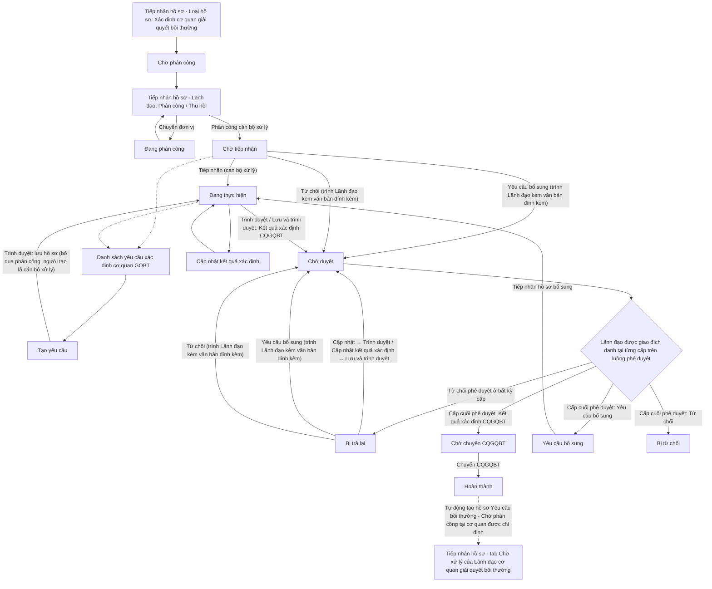
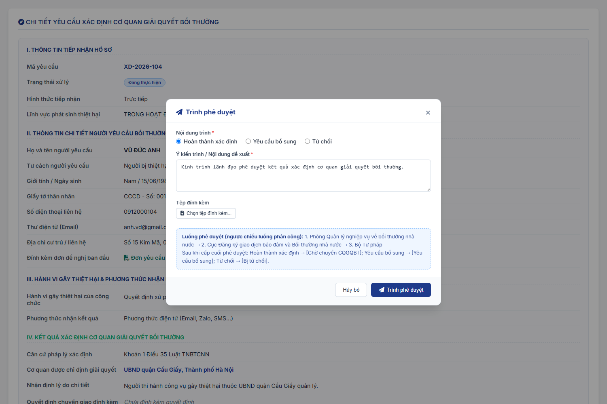
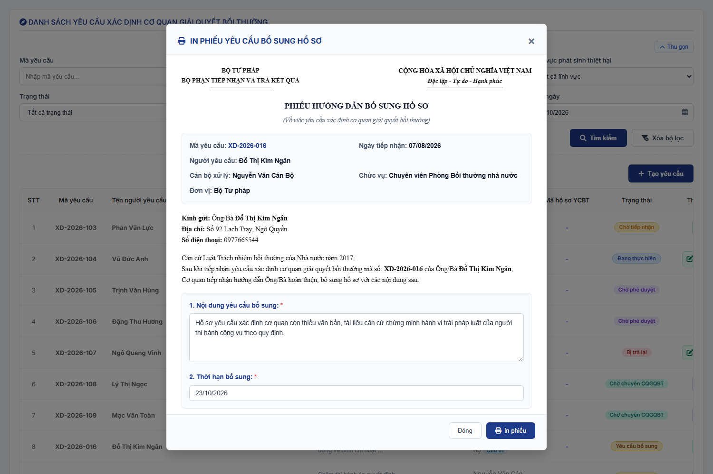

### 4.3.3. Dành cho Cán bộ nghiệp vụ bồi thường nhà nước

#### 4.3.3.1. Nhóm tính năng Xác định cơ quan giải quyết bồi thường

##### 4.3.3.1.1. Mục đích

\- Cho phép người dùng trên Website quản trị (menu `Xác định cơ quan giải quyết bồi thường`, phân hệ Bồi thường nhà nước) quản lý và xử lý hồ sơ yêu cầu xác định cơ quan giải quyết bồi thường, gồm:

+ Hồ sơ được tiếp nhận tại [MH02 - Màn hình Tiếp nhận hồ sơ - Tiếp nhận hồ sơ - Công tác bồi thường nhà nước (Website Quản trị)](SRS_BTNN_GiaiQuyetBT_TiepNhan_YCBT.md#43313-mh02---màn-hình-tiếp-nhận-hồ-sơ), được lãnh đạo phân công cán bộ xử lý tại tab `Chờ xử lý` của [Tiếp nhận hồ sơ - Tiếp nhận hồ sơ - Công tác bồi thường nhà nước (Website Quản trị)](SRS_BTNN_GiaiQuyetBT_TiepNhan_YCBT.md#tn-tab-xu-ly) và chuyển đến phân hệ ở trạng thái `Chờ tiếp nhận`.
+ Hồ sơ do cán bộ tạo mới trực tiếp tại phân hệ (`Tạo yêu cầu`).

\- Cán bộ xử lý tiếp nhận, cập nhật kết quả xác định, trình lãnh đạo phê duyệt và sau khi được phê duyệt thì chuyển hồ sơ cho cơ quan giải quyết bồi thường tiếp nhận (mặc định là cơ quan được chỉ định trong kết quả xác định; cán bộ xử lý chọn trên cây đơn vị). Khi chuyển, hệ thống tự động tạo hồ sơ yêu cầu bồi thường tại cơ quan tiếp nhận được chọn.

*a. Phân quyền*

\- Chỉ người dùng thuộc đơn vị được áp dụng giá trị `Xác định cơ quan giải quyết bồi thường` trong [Danh mục Loại hồ sơ - Quản lý danh mục - Quản trị hệ thống (Website Quản trị)](../01_Quan_tri_he_thong/Quan_ly_danh_muc.md) [DM_54] (trường `Đơn vị áp dụng`) mới xử lý được loại hồ sơ này. Theo cấu hình danh mục, giá trị này áp dụng cho 02 loại cơ quan:
+ Bộ Tư pháp.
+ Sở Tư pháp các tỉnh, thành phố trực thuộc Trung ương.
+ Đơn vị áp dụng tính cả đơn vị cha: khi chọn đơn vị cha trong `Đơn vị áp dụng` thì toàn bộ đơn vị trực thuộc được áp dụng.
+ Người dùng thuộc đơn vị không được áp dụng: không hiển thị nút `Tạo yêu cầu`; màn hình danh sách hiển thị thông báo theo [MSG-INF-BTNN-LXL-001].
+ Ủy ban nhân dân cấp tỉnh (UBND tỉnh, thành phố trực thuộc Trung ương), gọi tắt là UBND cấp tỉnh: chỉ xem danh sách và chi tiết hồ sơ của các Sở Tư pháp trực thuộc (Sở Tư pháp là đơn vị con của UBND cấp tỉnh trên cây Cơ cấu tổ chức) ở chế độ chỉ đọc; không có nút `Tạo yêu cầu`, không hiển thị thông báo [MSG-INF-BTNN-LXL-001], không hiển thị thao tác xử lý, phê duyệt.
+ Loại cơ quan xử lý (`Bộ Tư pháp`, `Sở Tư pháp`) được thể hiện tại cột `Cơ quan xử lý` và bộ lọc `Cơ quan xử lý` của MH01, trường `Đơn vị tiếp nhận` và `Lịch sử xử lý` của MH04.
+ Luồng phân công, phê duyệt: hồ sơ của Bộ Tư pháp theo luồng `Xác định CQGQBT - Bộ Tư pháp`; hồ sơ của Sở Tư pháp theo luồng `Xác định CQGQBT - Sở Tư pháp` tại [Cấu hình luồng xử lý - Cấu hình luồng xử lý - Quản trị hệ thống (Website Quản trị)](../01_Quan_tri_he_thong/Cau_hinh_luong_xu_ly.md).
+ Mã: Mỗi hồ sơ có `Mã yêu cầu` riêng của phân hệ và mang `Mã vụ việc` toàn trình theo [Mã vụ việc và mã hồ sơ - Tiếp nhận hồ sơ - Công tác bồi thường nhà nước (Website Quản trị)](SRS_BTNN_GiaiQuyetBT_TiepNhan_YCBT.md#tn-ma-vu-viec). Hồ sơ tạo trực tiếp tại phân hệ được sinh `Mã vụ việc` mới; hồ sơ Giải quyết yêu cầu bồi thường sinh ra khi Chuyển CQGQBT giữ nguyên `Mã vụ việc`.

\- Vai trò trên hồ sơ:

| Vai trò | Quyền trên hồ sơ |
| :--- | :--- |
| Cán bộ xử lý | Được lãnh đạo chỉ định khi phân công (01 người) hoặc là người tạo hồ sơ trực tiếp. Thực hiện toàn bộ thao tác xử lý: Tiếp nhận, Yêu cầu bổ sung, Từ chối, Cập nhật (hồ sơ `Bị trả lại`), Cập nhật kết quả xác định, Trình duyệt/Trình phê duyệt, Tiếp nhận hồ sơ bổ sung, Chuyển CQGQBT. |
| Người tạo | Hồ sơ tạo trực tiếp tại phân hệ: người tạo đồng thời là cán bộ xử lý của hồ sơ. |
| Lãnh đạo các đơn vị trên luồng | Lãnh đạo (thuộc Nhóm lãnh đạo) của các đơn vị đã chuyển/phân công hồ sơ và các đơn vị trên luồng phê duyệt được xem hồ sơ tại danh sách. Thao tác phân công, thu hồi phân công thực hiện tại [Tiếp nhận hồ sơ - Tiếp nhận hồ sơ - Công tác bồi thường nhà nước (Website Quản trị)](SRS_BTNN_GiaiQuyetBT_TiepNhan_YCBT.md#tn-tab-xu-ly); Phê duyệt, Từ chối phê duyệt (chỉ Lãnh đạo được giao đích danh tại cấp đang đến lượt) thực hiện tại tab `Chờ xử lý` của màn hình này, Thu hồi kết quả phê duyệt tại tab `Đã xử lý` ([Quy tắc 02 tab Chờ xử lý / Đã xử lý - Xác định cơ quan giải quyết bồi thường - Công tác bồi thường nhà nước (Website Quản trị)](#xd-tab-xu-ly)). Số hồ sơ chờ Lãnh đạo duyệt hiển thị tại khối `Chờ duyệt Xác định CQGQBT` của [MH01 - Màn hình Dashboard Lãnh đạo - Dashboard Lãnh đạo - Công tác bồi thường nhà nước (Website Quản trị)](SRS_BTNN_ViecChoLanhDaoXuLy.md#vcld-mh01). |

- Nhóm lãnh đạo, đơn vị được chuyển và cán bộ được phân công của từng đơn vị lấy theo [Cấu hình luồng xử lý - Cấu hình luồng xử lý - Quản trị hệ thống (Website Quản trị)](../01_Quan_tri_he_thong/Cau_hinh_luong_xu_ly.md).

*b. Điều kiện thực hiện*

- Người dùng truy cập màn hình `Xác định cơ quan giải quyết bồi thường` trên Website quản trị.

- Người dùng được phân quyền thực hiện tính năng.

*c. Nội dung trình và dòng phụ trạng thái*

- **Nội dung trình**: loại việc cán bộ xử lý trình Lãnh đạo, lưu trong phiếu trình; dùng cho dòng phụ dưới badge trạng thái và bộ lọc `Nội dung trình` tại MH01. Gồm:
+ `Yêu cầu bổ sung`: trình tại [Popup Yêu cầu bổ sung hồ sơ](#433110-popup-yêu-cầu-bổ-sung-hồ-sơ); cấp cuối phê duyệt thì hồ sơ chuyển `Yêu cầu bổ sung`.
+ `Từ chối`: trình tại [Popup Từ chối yêu cầu xác định cơ quan](#433111-popup-từ-chối-yêu-cầu-xác-định-cơ-quan); cấp cuối phê duyệt thì hồ sơ chuyển `Bị từ chối`.
+ `Kết quả xác định CQGQBT`: trình tại [Popup Trình duyệt](#43317-popup-trình-duyệt); cấp cuối phê duyệt thì hồ sơ chuyển `Chờ chuyển CQGQBT`.

- **Dòng phụ dưới badge trạng thái** (MH01, MH04):
+ Hồ sơ `Chờ duyệt`: `[Nội dung trình]` của phiếu trình đang chờ duyệt (VD `Yêu cầu bổ sung`); dòng phụ không hiển thị cấp phê duyệt.
+ Hồ sơ `Bị trả lại`: `[Nội dung trình]` của phiếu bị trả lại (VD `Từ chối`).
+ Các trạng thái khác: không hiển thị dòng phụ.

*d. Quy tắc trình - phê duyệt*

- **Luồng phê duyệt**: là luồng ngược chiều luồng phân công thực tế của chính hồ sơ. Hệ thống lấy danh sách các đơn vị đã chuyển/phân công hồ sơ theo thứ tự trong `Quá trình phân công`, đảo ngược và loại bỏ đơn vị trùng (ví dụ phân công Bộ Tư pháp → Cục → Phòng thì phê duyệt Phòng → Cục; luồng phê duyệt chỉ tới Cục, không gửi đến Bộ Tư pháp).

- **Hồ sơ tạo trực tiếp** (không có lượt phân công): luồng phê duyệt đi từ đơn vị của cán bộ xử lý lên đơn vị gốc theo cây Cơ cấu tổ chức, chỉ gồm các đơn vị có Nhóm lãnh đạo trong Cấu hình luồng xử lý. Nếu không xác định được cấp phê duyệt nào, hệ thống không cho trình và hiển thị cảnh báo lỗi [MSG-ERR-BTNN-LXL-006].

- **Hiển thị luồng phê duyệt trên popup trình Lãnh đạo**: trường `Luồng phê duyệt` (chỉ đọc, một dòng) đặt ngay dưới ô `Lãnh đạo phê duyệt`, định dạng `Cấp 1 - [Đơn vị] → Cấp 2 - [Đơn vị] → ...`; hiển thị động theo [Cấu hình luồng xử lý - Cấu hình luồng xử lý - Quản trị hệ thống (Website Quản trị)](../01_Quan_tri_he_thong/Cau_hinh_luong_xu_ly.md) tương ứng đơn vị của cán bộ thực hiện, VD:
+ Cán bộ thuộc đơn vị Cục/Phòng nghiệp vụ: `Cấp 1 - Phòng Quản lý nghiệp vụ về bồi thường nhà nước → Cấp 2 - Cục Đăng ký giao dịch bảo đảm và Bồi thường nhà nước` (chỉ tới Cục, không gửi đến Bộ Tư pháp)
+ Cán bộ thuộc Sở Tư pháp: `Cấp 1 - [Phòng chuyên môn thuộc Sở] → Cấp 2 - [Sở Tư pháp]`
+ Cán bộ thuộc cơ quan khác/UBND: các cấp lãnh đạo quản lý trực tiếp theo cây tổ chức đã thiết lập

- **Trình `Yêu cầu bổ sung`**: cán bộ xử lý không chuyển hồ sơ sang `Yêu cầu bổ sung` trực tiếp. Đối với hồ sơ `Chờ tiếp nhận` hoặc `Bị trả lại`, cán bộ xử lý nhập Nội dung yêu cầu bổ sung, bắt buộc tải lên Văn bản đính kèm trình Lãnh đạo (văn bản do cán bộ soạn; hệ thống không sinh văn bản dự thảo tự động) và bắt buộc chọn Lãnh đạo phê duyệt tại [Popup Yêu cầu bổ sung hồ sơ](#433110-popup-yêu-cầu-bổ-sung-hồ-sơ), rồi bấm `Trình Lãnh đạo`. Hồ sơ chuyển `Chờ duyệt` với Nội dung trình `Yêu cầu bổ sung` và đi theo cùng luồng phê duyệt nêu trên (ngược chiều luồng phân công). Cấp phê duyệt cuối cùng phê duyệt thì hồ sơ chuyển `Yêu cầu bổ sung`; bất kỳ cấp nào từ chối phê duyệt thì hồ sơ chuyển `Bị trả lại`. Khi trình từ hồ sơ `Chờ tiếp nhận`, lượt phân công gần nhất được cập nhật `Đã xử lý` (lãnh đạo không còn thu hồi được).

- **Trình `Từ chối`**: cán bộ xử lý không từ chối trực tiếp. Đối với hồ sơ `Chờ tiếp nhận` hoặc `Bị trả lại`, cán bộ xử lý nhập Lý do từ chối, bắt buộc tải lên Văn bản đính kèm trình Lãnh đạo và bắt buộc chọn Lãnh đạo phê duyệt tại [Popup Từ chối yêu cầu xác định cơ quan](#433111-popup-từ-chối-yêu-cầu-xác-định-cơ-quan), rồi bấm `Trình Lãnh đạo`. Hồ sơ chuyển `Chờ duyệt` với Nội dung trình `Từ chối`; cấp cuối phê duyệt thì hồ sơ chuyển `Bị từ chối`; bất kỳ cấp nào từ chối phê duyệt thì hồ sơ chuyển `Bị trả lại`.

- **Trình `Kết quả xác định CQGQBT`**: đối với hồ sơ `Đang thực hiện` hoặc `Bị trả lại` đã có kết quả xác định, cán bộ xử lý trình tại [Popup Trình duyệt](#43317-popup-trình-duyệt) (mở từ `Trình duyệt` tại MH02 hoặc `Lưu và trình duyệt` tại MH03). Hồ sơ chuyển `Chờ duyệt` với Nội dung trình `Kết quả xác định CQGQBT`; cấp cuối phê duyệt thì hồ sơ chuyển `Chờ chuyển CQGQBT`.

- **Lãnh đạo phê duyệt đích danh**: mọi lần trình đều bắt buộc chọn `Lãnh đạo phê duyệt` cấp 1 trong Nhóm lãnh đạo của cấp phê duyệt đầu tiên. Lãnh đạo cấp n khi `Phê duyệt` (chưa phải cấp cuối) bắt buộc chọn Lãnh đạo phê duyệt cấp n+1 trong Nhóm lãnh đạo của cấp tiếp theo. Chỉ Lãnh đạo được giao mới thấy hồ sơ tại tab `Chờ duyệt` và được phê duyệt/từ chối phê duyệt. Cấp phê duyệt đầu tiên chưa cấu hình Nhóm lãnh đạo thì ô `Lãnh đạo phê duyệt` bị khóa và không bắt buộc.

- **Phê duyệt tại từng cấp**: Lãnh đạo được giao đích danh tại cấp đang đến lượt xử lý tại tab `Chờ xử lý` của màn hình này (vai trò Lãnh đạo):
+ `Phê duyệt` (Ý kiến phê duyệt, không bắt buộc): nếu chưa phải cấp cuối, Lãnh đạo bắt buộc chọn Lãnh đạo phê duyệt cấp tiếp theo, hồ sơ chuyển cấp phê duyệt tiếp theo, giữ trạng thái `Chờ duyệt`; nếu là cấp cuối, hồ sơ chuyển trạng thái theo Nội dung trình: `Kết quả xác định CQGQBT` → `Chờ chuyển CQGQBT`; `Yêu cầu bổ sung` → `Yêu cầu bổ sung`; `Từ chối` → `Bị từ chối`.
+ `Từ chối` (Lý do từ chối phê duyệt, bắt buộc) tại bất kỳ cấp nào: hồ sơ chuyển `Bị trả lại` về cán bộ xử lý, ghi nhận người trả lại, đơn vị, thời điểm, lý do và Nội dung trình bị trả lại. Lịch xử lý ghi hành động `Từ chối phê duyệt` để phân biệt với nội dung trình `Từ chối` yêu cầu. Khi cán bộ xử lý trình lại, luồng phê duyệt bắt đầu lại từ cấp phê duyệt đầu tiên và cán bộ chọn lại Lãnh đạo phê duyệt cấp 1.
+ Lãnh đạo cấp dưới được thu hồi kết quả phê duyệt đã chuyển cấp trên khi cấp trên chưa phê duyệt/từ chối.
+ `Phê duyệt` là quyết định phê duyệt thuần túy. Phân hệ không sử dụng ký số; văn bản (nếu có) được xử lý theo hình thức ký duyệt + đính file, không gộp vào thao tác `Phê duyệt`.

- **Kiểm tra đồng thời**: mọi thao tác phân công, phê duyệt, từ chối, thu hồi đều được hệ thống kiểm tra lại trạng thái hồ sơ tại máy chủ trước khi ghi nhận. Nếu hồ sơ đã được người khác xử lý, hệ thống hiển thị cảnh báo lỗi tương ứng theo [MSG-ERR-BTNN-LXL-002] (phân công) hoặc [MSG-ERR-BTNN-LXL-005] (phê duyệt).

---

*e. Quy tắc 02 tab Chờ xử lý / Đã xử lý*

| Vai trò | Tab `Chờ xử lý` | Tab `Đã xử lý` |
| :--- | :--- | :--- |
| Cán bộ xử lý | Hồ sơ trong phạm vi xem ở trạng thái: `Chờ tiếp nhận`, `Đang thực hiện`, `Chờ duyệt`, `Bị trả lại`, `Chờ chuyển CQGQBT`, `Yêu cầu bổ sung` | Hồ sơ ở trạng thái: `Bị từ chối`, `Hoàn thành` |
| Lãnh đạo (thuộc Nhóm lãnh đạo tại Cấu hình luồng xử lý) | Hồ sơ `Chờ duyệt` mà Lãnh đạo được giao đích danh ở cấp phê duyệt hiện hành | Hồ sơ Lãnh đạo đã Phê duyệt / Từ chối phê duyệt, không còn chờ Lãnh đạo duyệt |

- Mỗi tab hiển thị số bản ghi; mặc định mở tab `Chờ xử lý`. Mở màn hình kèm tham số `tab=done` thì chọn sẵn tab `Đã xử lý`.
- Trường `Trạng thái` của bộ lọc chỉ gồm các trạng thái của tab đang chọn.
- Vai trò Lãnh đạo: cột `Thao tác` tại tab `Chờ xử lý` gồm `Phê duyệt`, `Từ chối`; tại tab `Đã xử lý` gồm `Thu hồi` (thu hồi kết quả phê duyệt đã chuyển cấp trên khi cấp trên chưa xử lý). Nút `Tạo yêu cầu` không hiển thị với vai trò Lãnh đạo và tại tab `Đã xử lý`.

##### 4.3.3.1.2. Sơ đồ luồng nghiệp vụ theo giao diện

---

##### 4.3.3.1.3. MH01 - Màn hình Danh sách yêu cầu xác định cơ quan giải quyết bồi thường

###### 4.3.3.1.3.1. Màn hình

###### 4.3.3.1.3.2. Mô tả thông tin trên màn hình

| Trường thông tin | Kiểu dữ liệu | Bắt buộc | Mặc định | Mô tả |
| :--- | :--- | :--- | :--- | :--- |
| **Tab danh sách** | Tab | - | `Chờ xử lý` | Control UI: 02 tab đặt phía trên bộ lọc, mỗi tab kèm số bản ghi: + Chờ xử lý + Đã xử lý - Bản ghi của từng tab theo [Quy tắc 02 tab Chờ xử lý / Đã xử lý - Xác định cơ quan giải quyết bồi thường - Công tác bồi thường nhà nước (Website Quản trị)](#xd-tab-xu-ly). |
| **Khối bộ lọc tìm kiếm** | String(255) | - | - | Control UI: Filter panel dạng thu gọn/mở rộng (Accordion). - Mặc định hiển thị dạng mở rộng. - Cho phép thu gọn/mở rộng khi click vào nút "Thu gọn"/"Mở rộng" ở góc phải khối; khi thu gọn, các giá trị lọc đã nhập được giữ nguyên. |
| Mã yêu cầu | String(50) | Không | Trống | Control UI: Input text. - Placeholder: `Nhập mã yêu cầu...`. - Tìm kiếm gần đúng theo mã yêu cầu xác định cơ quan, không phân biệt hoa thường, có trim khoảng trắng. |
| Mã YCBT | String(50) | Không | Trống | Control UI: Input text. - Placeholder: `Nhập mã YCBT...`. - Tìm kiếm gần đúng theo mã hồ sơ yêu cầu bồi thường được hệ thống tạo khi `Chuyển CQGQBT`. - Nếu hồ sơ chưa có mã YCBT, dữ liệu trên lưới hiển thị `-`. |
| Tên cá nhân/Tổ chức yêu cầu | String(255) | Không | Trống | Control UI: Input text. - Placeholder: `Nhập tên cá nhân/tổ chức yêu cầu...`. - Tìm kiếm gần đúng theo `Họ và tên` (cá nhân) hoặc `Tên tổ chức` của người yêu cầu, không phân biệt hoa thường, có trim khoảng trắng. |
| Lĩnh vực phát sinh thiệt hại | Enum(String(100)) | Không | `Tất cả lĩnh vực` | Control UI: Combobox. Tham chiếu danh mục Lĩnh vực phát sinh thiệt hại [DM_22]. |
| Trạng thái | Enum(String(50)) | Không | `Tất cả trạng thái` | Control UI: Combobox. Gồm: + Tất cả trạng thái + Chờ tiếp nhận + Đang thực hiện + Chờ duyệt + Bị trả lại + Chờ chuyển CQGQBT + Yêu cầu bổ sung + Bị từ chối + Hoàn thành |
| Nội dung trình | Enum(String(50)) | Không | `Tất cả` | Control UI: Combobox. - Chỉ hiển thị khi bộ lọc Trạng thái chọn là `Chờ duyệt` hoặc `Bị trả lại`. Gồm: + Tất cả + Yêu cầu bổ sung + Từ chối + Kết quả xác định CQGQBT |
| Cơ quan xử lý | Enum(String(50)) | Không | `Tất cả cơ quan` | Control UI: Combobox, các giá trị nhóm theo loại cơ quan có thẩm quyền xác định cơ quan giải quyết bồi thường. Gồm: + Tất cả cơ quan + Nhóm `Bộ Tư pháp`: Bộ Tư pháp + Nhóm `Sở Tư pháp`: `Tất cả Sở Tư pháp` và từng Sở Tư pháp được áp dụng - Danh sách cơ quan lấy theo `Đơn vị áp dụng` của giá trị `Xác định cơ quan giải quyết bồi thường` trong [Danh mục Loại hồ sơ - Quản lý danh mục - Quản trị hệ thống (Website Quản trị)](../01_Quan_tri_he_thong/Quan_ly_danh_muc.md) [DM_54]. Nhóm chỉ có 01 cơ quan thì không có dòng `Tất cả [Loại cơ quan]`. - Lọc theo đơn vị gốc tiếp nhận, xử lý hồ sơ; chọn `Tất cả [Loại cơ quan]` thì lọc toàn bộ cơ quan thuộc loại đó. - Người dùng thuộc UBND cấp tỉnh: chỉ có các Sở Tư pháp trực thuộc. |
| Từ ngày | Date | Không | Ngày hiện tại trừ 03 tháng | Control UI: Datepicker. - Định dạng hiển thị `dd/mm/yyyy`. - Có icon lịch. - Lọc theo ngày tiếp nhận từ ngày. |
| Đến ngày | Date | Không | Ngày hiện tại | Control UI: Datepicker. - Định dạng hiển thị `dd/mm/yyyy`. - Có icon lịch. - Lọc theo ngày tiếp nhận đến ngày. |
| **Bảng danh sách yêu cầu xác định cơ quan giải quyết bồi thường** | Text(4000) | - | 20 bản ghi/trang | Control UI: Data grid. - Khi người dùng truy cập màn hình, hệ thống tự động tải trang đầu tiên (Trang 1) với số lượng mặc định 20 bản ghi. - Sắp xếp mặc định: Sắp xếp theo "Thời điểm tiếp nhận" giảm dần (mới nhất hiển thị lên đầu). - **Phạm vi dữ liệu**: chỉ hiển thị hồ sơ người dùng là cán bộ xử lý, người tạo hoặc người dùng thuộc Nhóm lãnh đạo của một đơn vị trên luồng phân công/phê duyệt của hồ sơ. Hồ sơ ở trạng thái `Chờ phân công`, `Đang phân công` không hiển thị tại màn hình này. - Trạng thái có dữ liệu: Hiển thị danh sách các bản ghi kết quả theo cấu trúc các cột quy định. - Trạng thái không có dữ liệu (Empty State): Khi không tìm thấy kết quả phù hợp với điều kiện tìm kiếm, bảng hiển thị duy nhất 01 dòng căn giữa trên toàn bộ chiều rộng bảng (`colspan`), in nghiêng với nội dung theo MessageList dùng chung [MSG-INF-SYS-001]. |
| STT | Integer(10) | - | Tự tăng | Control UI: Text hiển thị (Read-only). - Căn giữa. - Hiển thị số thứ tự theo trang hiện tại. |
| Mã yêu cầu | String(50) | - | Theo dữ liệu | Control UI: Text hiển thị (Read-only). - Căn giữa. - Hiển thị mã yêu cầu xác định cơ quan giải quyết bồi thường. |
| Mã vụ việc | String(50) | - | Theo dữ liệu | Control UI: Text hiển thị (Read-only). - Căn giữa. - Mã vụ việc toàn trình (VD `VVBT-2026-001`), theo [Mã vụ việc và mã hồ sơ - Tiếp nhận hồ sơ - Công tác bồi thường nhà nước (Website Quản trị)](SRS_BTNN_GiaiQuyetBT_TiepNhan_YCBT.md#tn-ma-vu-viec). |
| Tên cá nhân/Tổ chức yêu cầu | String(255) | - | Theo dữ liệu | Control UI: Text hiển thị (Read-only). - Theo dữ liệu bản ghi: `Họ và tên` (người yêu cầu là cá nhân) hoặc `Tên tổ chức` (người yêu cầu là tổ chức). - Nếu chưa có dữ liệu, hiển thị `(Chưa nhập)`. |
| Họ và tên người bị thiệt hại | String(255) | - | Theo dữ liệu | Control UI: Text hiển thị (Read-only). - Theo dữ liệu bản ghi: + `Tư cách người yêu cầu bồi thường` = `Người bị thiệt hại`: bằng `Tên cá nhân/Tổ chức yêu cầu`. + `Tư cách người yêu cầu bồi thường` = `Tổ chức kế thừa quyền, nghĩa vụ của tổ chức bị thiệt hại đã chấm dứt tồn tại`: `Tên tổ chức bị thiệt hại`. + Tư cách khác: `Họ và tên người bị thiệt hại`. - Không có dữ liệu: hiển thị `-`. |
| Lĩnh vực thiệt hại | Enum(String(50)) | - | Theo dữ liệu | Control UI: Text hiển thị (Read-only). - Hiển thị lĩnh vực phát sinh thiệt hại theo danh mục [DM_22], bỏ tiền tố `TRONG HOẠT ĐỘNG`. |
| Hành vi gây thiệt hại | String(255) | - | Theo dữ liệu | Control UI: Text hiển thị (Read-only). - Hiển thị tóm tắt hành vi gây thiệt hại. - Nếu nội dung dài hơn giới hạn hiển thị của ô, hệ thống rút gọn và cho phép xem đầy đủ khi rê chuột vào nội dung. |
| Ngày tiếp nhận | Date | - | Theo dữ liệu | Control UI: Text hiển thị (Read-only). - Căn giữa. - Định dạng `dd/mm/yyyy`. |
| Cơ quan xử lý | String(255) | - | Theo dữ liệu | Theo thông tin bản ghi. |
| Cán bộ xử lý | String(100) | - | Theo dữ liệu | Control UI: Text hiển thị (Read-only) kèm nhãn vai trò. - Hiển thị họ tên cán bộ xử lý của hồ sơ; chưa có thì hiển thị `--`. - Kèm nhãn `Cán bộ xử lý` khi người dùng là cán bộ xử lý của hồ sơ. |
| Mã hồ sơ YCBT | String(50) | - | Theo dữ liệu | Control UI: Text hiển thị (Read-only). - Căn giữa. - Hiển thị mã vụ việc yêu cầu bồi thường tương ứng (01 mã `BT-...` cho cả hồ sơ có nhánh Phục hồi danh dự) được sinh thành công khi `Chuyển CQGQBT` (hồ sơ chuyển `Hoàn thành`). - Nếu chưa có mã: Hiển thị `-`. - Liên kết Hyperlink mở chi tiết ở tab mới đặt tại [MH04 - Màn hình Chi tiết yêu cầu xác định cơ quan giải quyết bồi thường](#43316-mh04---màn-hình-chi-tiết-yêu-cầu-xác-định-cơ-quan-giải-quyết-bồi-thường). |
| Trạng thái | Enum(String(50)) | - | Theo dữ liệu | Theo thông tin bản ghi. |
| Thao tác | String(255) | - | Theo trạng thái | Control UI: Action Buttons (Icon button). - Vai trò Lãnh đạo: tab `Chờ xử lý` gồm `Phê duyệt`, `Từ chối` (chỉ được phép khi Lãnh đạo được giao đích danh ở cấp phê duyệt hiện hành); tab `Đã xử lý` gồm `Thu hồi`. Thao tác không được phép hiển thị dạng khóa mờ, không cho phép thao tác. - Vai trò Cán bộ xử lý gồm: + Tiếp nhận: Chỉ hiển thị khi hồ sơ ở trạng thái `Chờ tiếp nhận` hoặc `Yêu cầu bổ sung`. + Yêu cầu bổ sung: Chỉ hiển thị khi hồ sơ ở trạng thái `Chờ tiếp nhận` hoặc `Bị trả lại`. + Từ chối: Chỉ hiển thị khi hồ sơ ở trạng thái `Chờ tiếp nhận` hoặc `Bị trả lại`. + Cập nhật: Chỉ hiển thị khi hồ sơ ở trạng thái `Đang thực hiện` hoặc `Bị trả lại`. + Chuyển CQGQBT: Chỉ hiển thị khi hồ sơ ở trạng thái `Chờ chuyển CQGQBT`. |
| Phân trang | Pagination | - | 20 bản ghi/trang | Control UI: Pagination. - Cho phép chọn cấu hình số lượng bản ghi hiển thị (10, 20, 50, 100); mặc định 20 bản ghi/trang. - Hiển thị dải bản ghi: "Hiển thị [từ]-[đến] trong số [tổng số] bản ghi" (khi không có dữ liệu hiển thị 0-0 trong số 0). - Đầy đủ các nút điều hướng trang: Đầu (&#124;&lt;&lt;), Trước (&lt;), các số trang, Sau (&gt;), Cuối (&gt;&gt;&#124;). |

###### 4.3.3.1.3.3. Chức năng trên màn hình

| STT | Tên chức năng | Định dạng | Mô tả |
| :--- | :--- | :--- | :--- |
| 1 | Tìm kiếm | Button | Khi người dùng click nút, hệ thống kiểm tra điều kiện dữ liệu và thực hiện tìm kiếm theo các trường hợp bên dưới: |
|  |  |  | **TH1 - Khoảng ngày không hợp lệ**: Nếu `Từ ngày` lớn hơn `Đến ngày`, hệ thống hiển thị cảnh báo lỗi [MSG-ERR-VAL-007] và không thực hiện tìm kiếm. |
|  |  |  | **TH Hợp lệ (Có dữ liệu phù hợp)**: Hệ thống lọc và hiển thị danh sách các bản ghi thuộc phạm vi dữ liệu của người dùng, thỏa mãn đồng thời các tiêu chí tìm kiếm/lọc đã nhập/chọn, hiển thị kết quả lên bảng và đưa về Trang 1. |
|  |  |  | **TH Không có dữ liệu trả về**: Bảng kết quả hiển thị duy nhất 01 dòng căn giữa trên toàn bộ chiều rộng bảng (`colspan`), in nghiêng với nội dung theo MessageList dùng chung [MSG-INF-SYS-001]; thanh phân trang hiển thị *"Hiển thị 0-0 trong số 0 bản ghi"*, các nút điều hướng trang ở trạng thái khóa mờ (Disabled). |
| 2 | Xóa bộ lọc | Button | Xóa các bộ lọc (gồm cả `Trạng thái`, `Nội dung trình`, `Cơ quan xử lý`, `Vai trò xử lý`), đưa Từ ngày, Đến ngày về khoảng 03 tháng gần nhất và tải lại danh sách về trang 1. |
| 3 | Tạo yêu cầu | Button | - **Điều kiện hiển thị**: Đơn vị của người dùng được áp dụng loại yêu cầu `Xác định cơ quan giải quyết bồi thường`. - **Hành vi**: Hệ thống mở [MH02 - Màn hình Thêm mới/Sửa yêu cầu xác định cơ quan giải quyết bồi thường](#43314-mh02---màn-hình-thêm-mớichỉnh-sửa-yêu-cầu-xác-định-cơ-quan-giải-quyết-bồi-thường) ở ngữ cảnh tạo mới trực tiếp; tiêu đề hiển thị `THÊM MỚI YÊU CẦU XÁC ĐỊNH CƠ QUAN GIẢI QUYẾT BỒI THƯỜNG` và toàn bộ trường thông tin trên form ở trạng thái trống/mặc định ban đầu. |
| 4 | Click dòng dữ liệu | Row click | Khi người dùng click vào dòng dữ liệu, hệ thống xử lý theo các trường hợp bên dưới. |
|  |  |  | **TH1 - Click vào dòng dữ liệu**: Hệ thống mở [MH04 - Màn hình Chi tiết yêu cầu xác định cơ quan giải quyết bồi thường](#43316-mh04---màn-hình-chi-tiết-yêu-cầu-xác-định-cơ-quan-giải-quyết-bồi-thường) của bản ghi được chọn. |
|  |  |  | **TH2 - Click vào icon thao tác trong cột Thao tác**: Không thực hiện row click; thực hiện đúng chức năng của icon được click. |
| 5 | Tiếp nhận | Icon button | Dành cho cán bộ xử lý, xử lý theo trạng thái hồ sơ: |
|  |  |  | **TH1 - Hồ sơ `Chờ tiếp nhận`**: Hệ thống mở [MH02 - Màn hình Thêm mới/Sửa yêu cầu xác định cơ quan giải quyết bồi thường](#43314-mh02---màn-hình-thêm-mớichỉnh-sửa-yêu-cầu-xác-định-cơ-quan-giải-quyết-bồi-thường) ở ngữ cảnh tiếp nhận hồ sơ được phân công; tiêu đề hiển thị `TIẾP NHẬN YÊU CẦU XÁC ĐỊNH CƠ QUAN GIẢI QUYẾT BỒI THƯỜNG`, tự động kế thừa dữ liệu tiếp nhận ban đầu và cho phép cán bộ xử lý sửa/nhập bổ sung trước khi bấm `Tiếp nhận`. |
|  |  |  | **TH2 - Hồ sơ `Yêu cầu bổ sung`**: Hệ thống xử lý như chức năng `Tiếp nhận hồ sơ bổ sung` tại [MH04 - Màn hình Chi tiết yêu cầu xác định cơ quan giải quyết bồi thường](#43316-mh04---màn-hình-chi-tiết-yêu-cầu-xác-định-cơ-quan-giải-quyết-bồi-thường) (xác nhận, chuyển hồ sơ sang `Đang thực hiện`). |
| 6 | Yêu cầu bổ sung | Icon button | Hồ sơ `Chờ tiếp nhận` hoặc `Bị trả lại`: hệ thống mở [Popup Yêu cầu bổ sung hồ sơ](#433110-popup-yêu-cầu-bổ-sung-hồ-sơ). |
| 7 | Từ chối | Icon button | Hồ sơ `Chờ tiếp nhận` hoặc `Bị trả lại`: hệ thống mở [Popup Từ chối yêu cầu xác định cơ quan](#433111-popup-từ-chối-yêu-cầu-xác-định-cơ-quan). |
| 8 | Cập nhật | Icon button | Dành cho cán bộ xử lý, xử lý theo trạng thái hồ sơ: |
|  |  |  | **TH1 - Hồ sơ `Đang thực hiện`**: Hệ thống mở [MH03 - Màn hình Cập nhật kết quả xác định cơ quan giải quyết bồi thường](#43315-mh03---màn-hình-cập-nhật-kết-quả-xác-định-cơ-quan-giải-quyết-bồi-thường). |
|  |  |  | **TH2 - Hồ sơ `Bị trả lại`**: Hệ thống mở [MH02 - Màn hình Thêm mới/Sửa yêu cầu xác định cơ quan giải quyết bồi thường](#43314-mh02---màn-hình-thêm-mớichỉnh-sửa-yêu-cầu-xác-định-cơ-quan-giải-quyết-bồi-thường) ở chế độ cập nhật, điền sẵn dữ liệu của bản ghi, hiển thị khối `LÝ DO HỒ SƠ BỊ TRẢ LẠI` trên cùng form; nút chính `Trình duyệt`. |
| 9a | Chuyển tab | Tab | Hiển thị danh sách của tab `Chờ xử lý` hoặc `Đã xử lý`, nạp lại bộ lọc `Trạng thái` theo tab và đưa về Trang 1. |
| 9b | Phê duyệt / Từ chối | Icon button | Vai trò Lãnh đạo, tab `Chờ xử lý`: mở [MH04 - Popup Phê duyệt / Từ chối phê duyệt - Dashboard Lãnh đạo - Công tác bồi thường nhà nước (Website Quản trị)](SRS_BTNN_ViecChoLanhDaoXuLy.md#vcld-mh04) ở chế độ tương ứng. Xử lý thành công: hồ sơ rời tab `Chờ xử lý` của Lãnh đạo, hiển thị tại tab `Đã xử lý`. |
| 9c | Thu hồi | Icon button | Vai trò Lãnh đạo, tab `Đã xử lý`: mở [MH05 - Popup Xác nhận thu hồi - Dashboard Lãnh đạo - Công tác bồi thường nhà nước (Website Quản trị)](SRS_BTNN_ViecChoLanhDaoXuLy.md#vcld-mh05) khi thỏa điều kiện thu hồi kết quả phê duyệt. |
| 9 | Chuyển CQGQBT | Icon button | Hồ sơ `Chờ chuyển CQGQBT`: hệ thống mở [Popup Chuyển cơ quan giải quyết bồi thường](#43318-popup-chuyển-cơ-quan-giải-quyết-bồi-thường). |

---

##### 4.3.3.1.4. MH02 - Màn hình Thêm mới/Sửa yêu cầu xác định cơ quan giải quyết bồi thường

###### 4.3.3.1.4.1. Màn hình

###### 4.3.3.1.4.2. Mô tả thông tin trên màn hình

| Trường thông tin | Kiểu dữ liệu | Bắt buộc | Mặc định | Mô tả |
| :--- | :--- | :--- | :--- | :--- |
| Tiêu đề màn hình | String(255) | - | Theo ngữ cảnh | Control UI: Text heading (Read-only). - Khi mở form do `Tiếp nhận` hồ sơ `Chờ tiếp nhận` đã được phân công: hiển thị `TIẾP NHẬN YÊU CẦU XÁC ĐỊNH CƠ QUAN GIẢI QUYẾT BỒI THƯỜNG`. - Khi `Tạo yêu cầu` trực tiếp tại phân hệ Xác định cơ quan: hiển thị `THÊM MỚI YÊU CẦU XÁC ĐỊNH CƠ QUAN GIẢI QUYẾT BỒI THƯỜNG`. - Khi `Cập nhật` hồ sơ `Bị trả lại`: hiển thị `CẬP NHẬT LẠI HỒ SƠ BỊ TRẢ LẠI`. |
| **LÝ DO HỒ SƠ BỊ TRẢ LẠI** | Section | - | Ẩn | Control UI: Alert banner (Màu cảnh báo nổi bật ở trên cùng form). - Chỉ hiển thị khi mở form cập nhật hồ sơ ở trạng thái `Bị trả lại`. |
| Người trả lại | String(255) | - | Theo dữ liệu | Control UI: Text (Read-only). - Họ và tên Lãnh đạo từ chối phê duyệt kèm Đơn vị: `[Họ và tên Lãnh đạo] - [Đơn vị]`. |
| Thời điểm trả lại | DateTime | - | Theo dữ liệu | Control UI: Text (Read-only). - Thời điểm Lãnh đạo từ chối phê duyệt (định dạng `dd/mm/yyyy HH:mm`). |
| Nội dung trình bị trả lại | String(100) | - | Theo dữ liệu | Control UI: Text (Read-only). - Hiển thị loại việc đã trình bị từ chối: `Yêu cầu bổ sung`, `Từ chối` hoặc `Kết quả xác định CQGQBT`. |
| Lý do trả lại | Text(2000) | - | Theo dữ liệu | Control UI: Text (Read-only). - Hiển thị chi tiết ý kiến/lý do từ chối phê duyệt do Lãnh đạo nhập. |
| **THÔNG TIN CHUNG** | String(255) | - | - | Control UI: Section header. - Khối thông tin chung của yêu cầu. |
| Trạng thái hồ sơ | Enum(String(50)) | - | Ẩn khi Thêm mới | Control UI: Badge trạng thái (Read-only). - Khi mở ở chế độ Thêm mới trực tiếp: **không hiển thị**. - Các chế độ còn lại: hiển thị badge trạng thái hiện tại của hồ sơ (`Chờ tiếp nhận` hoặc `Bị trả lại`). |
| Hình thức tiếp nhận | Enum(String(50)) | Có | `Trực tiếp` (thêm mới) / Theo dữ liệu kế thừa | Control UI: Combobox. - Tham chiếu [Danh mục Hình thức tiếp nhận - Danh mục dữ liệu dùng chung - Tổng quan và quy tắc chung](../../Tai%20lieu%20tong%20hop/00_Tong_quan_va_Quy_tac_chung.md#danh-muc-dung-chung) [DM_25]. - Thêm mới trực tiếp: chỉ cho chọn `Trực tiếp`, `Qua dịch vụ bưu chính`. - Hồ sơ kế thừa từ Tiếp nhận hồ sơ: mặc định theo `Hình thức tiếp nhận` của hồ sơ đã tiếp nhận; cho phép điều chỉnh, chọn đủ các giá trị của DM_25. |
| Lĩnh vực phát sinh thiệt hại | Enum(String(100)) | Có | `TRONG HOẠT ĐỘNG QUẢN LÝ HÀNH CHÍNH` | Control UI: Combobox. - Tham chiếu danh mục Lĩnh vực phát sinh thiệt hại [DM_22]. - Trường được điền sẵn theo dữ liệu kế thừa khi mở form từ `Tiếp nhận` hoặc theo bản ghi khi sửa; cán bộ được phép sửa. |
| Loại yêu cầu giải quyết bồi thường | Enum(String(100)) | Có | `Yêu cầu cả hai (Bồi thường tiền & Phục hồi danh dự)` | Control UI: Radio button. Gồm: + Yêu cầu cả hai (Bồi thường tiền & Phục hồi danh dự) + Chỉ yêu cầu bồi thường thiệt hại bằng tiền + Chỉ yêu cầu phục hồi danh dự - Bắt buộc chọn để xác định phạm vi nội dung mà người yêu cầu đề nghị xác định cơ quan giải quyết bồi thường. - Do cán bộ xử lý chọn tại phân hệ (Tiếp nhận hồ sơ không ghi nhận trường này). - Khi thực hiện Chuyển cơ quan giải quyết bồi thường (sau khi có Quyết định xác định), hệ thống sinh 01 hồ sơ Loại hồ sơ `Giải quyết yêu cầu bồi thường` ở trạng thái `Chờ phân công` tại Tiếp nhận hồ sơ của đơn vị nhận, giữ nguyên `Mã vụ việc` và kế thừa giá trị trường này; mã hồ sơ `BT-yyyy-xxx` dùng chung cho cả 03 giá trị (không sinh mã `PHDD-` riêng). |
| **THÔNG TIN CHI TIẾT NGƯỜI YÊU CẦU BỒI THƯỜNG** | String(100) | - | - | Control UI: Section header. - Khối thông tin người yêu cầu bồi thường, gồm 02 cột `Thông tin cá nhân & Liên hệ` và `Giấy tờ pháp lý & Địa chỉ`. |
| Tư cách người yêu cầu bồi thường | Enum(String(100)) | Có | `Người bị thiệt hại` | Control UI: Combobox. - Tham chiếu [Danh mục Tư cách người yêu cầu bồi thường - Danh mục dữ liệu dùng chung - Tổng quan và quy tắc chung](../../Tai%20lieu%20tong%20hop/00_Tong_quan_va_Quy_tac_chung.md#danh-muc-dung-chung) [DM_26]. - Trường được điền sẵn theo dữ liệu kế thừa khi mở form từ `Tiếp nhận` hoặc theo bản ghi khi sửa; cán bộ được phép sửa. - Khi chọn giá trị khác `Người bị thiệt hại`, hệ thống hiển thị khối `THÔNG TIN NGƯỜI BỊ THIỆT HẠI`; khi chọn lại `Người bị thiệt hại`, khối được ẩn và dữ liệu trong khối không được lưu. - Khi chọn `Tổ chức kế thừa quyền, nghĩa vụ của tổ chức bị thiệt hại đã chấm dứt tồn tại`, khối hiển thị dạng `THÔNG TIN TỔ CHỨC BỊ THIỆT HẠI ĐÃ CHẤM DỨT TỒN TẠI`. - Giá trị đã chọn quyết định ràng buộc của trường `Loại người yêu cầu`. |
| Loại người yêu cầu | Enum(String(20)) | Có | `Cá nhân` / Theo dữ liệu kế thừa | Control UI: Radio button. - Đặt ngay sau trường `Tư cách người yêu cầu bồi thường`. - Giá trị gồm: + `Cá nhân` + `Tổ chức` - Ràng buộc theo `Tư cách người yêu cầu bồi thường` (khóa radio khi bị ràng buộc): + `Tổ chức kế thừa quyền, nghĩa vụ của tổ chức bị thiệt hại đã chấm dứt tồn tại`: chọn sẵn `Tổ chức`, khóa radio. + `Người thừa kế của người bị thiệt hại`, `Người đại diện cho những người thừa kế của người bị thiệt hại`, `Người đại diện theo pháp luật của người bị thiệt hại`: chọn sẵn `Cá nhân`, khóa radio. + `Người bị thiệt hại`, `Cá nhân, pháp nhân được ủy quyền hợp pháp`: cho phép chọn. - `Cá nhân`: hiển thị nhóm trường cá nhân (`Ngày sinh`, `Loại giấy tờ thân nhân`, `Số giấy tờ thân nhân`, `Ngày cấp`, `Nơi cấp`); ẩn nhóm trường tổ chức. - `Tổ chức`: hiển thị nhóm trường tổ chức (`Mã số tổ chức`, `Số giấy tờ thành lập/đăng ký`, `Ngày cấp`, `Nơi cấp`, `Họ và tên người đại diện theo pháp luật`, `Chức vụ người đại diện`); ẩn nhóm trường cá nhân. - Hồ sơ kế thừa chưa có giá trị: coi là `Cá nhân`. |
| Họ và tên / Tên tổ chức | String(255) | Có | Theo ngữ cảnh | Control UI: Input text. - Nhãn theo `Loại người yêu cầu`: + `Cá nhân`: `Họ và tên`, placeholder `Nhập họ và tên...`. + `Tổ chức`: `Tên tổ chức`, placeholder `Nhập tên tổ chức...`. - Trường được điền sẵn theo dữ liệu kế thừa khi mở form từ `Tiếp nhận` hoặc theo bản ghi khi sửa; cán bộ được phép sửa. - Khi tạo mới trực tiếp, trường ở trạng thái trống để cán bộ nhập từ đầu. |
| Ngày sinh | Date | Có (khi `Cá nhân`) | Trống | Control UI: Datepicker. - Chỉ hiển thị khi `Loại người yêu cầu` = `Cá nhân`. - Placeholder: `dd/mm/yyyy`. - Có icon lịch. |
| Loại giấy tờ thân nhân | Enum(String(50)) | Có (khi `Cá nhân`) | `CCCD` | Control UI: Combobox. - Chỉ hiển thị khi `Loại người yêu cầu` = `Cá nhân`. - Tham chiếu danh mục loại giấy tờ pháp lý [DM_10]. |
| Số giấy tờ thân nhân | String(50) | Có (khi `Cá nhân`) | Trống | Control UI: Input text. - Chỉ hiển thị khi `Loại người yêu cầu` = `Cá nhân`. - Placeholder: `Nhập số giấy tờ...`. - Nhập số giấy tờ chứng minh tư cách pháp lý của người yêu cầu. |
| Ngày cấp | Date | Có (khi `Cá nhân`) | Trống | Control UI: Datepicker. - Chỉ hiển thị khi `Loại người yêu cầu` = `Cá nhân`. - Placeholder: `dd/mm/yyyy`. - Có icon lịch. |
| Nơi cấp | String(255) | Có (khi `Cá nhân`) | Trống | Control UI: Input text. - Chỉ hiển thị khi `Loại người yêu cầu` = `Cá nhân`. - Placeholder: `Nhập nơi cấp...`. - Nhập nơi cấp giấy tờ thân nhân. |
| Mã số tổ chức | String(50) | Không | Trống | Control UI: Input text. - Chỉ hiển thị khi `Loại người yêu cầu` = `Tổ chức`. - Placeholder: `Nhập mã số doanh nghiệp / mã số thuế / mã số khác...`. - Nhập mã số doanh nghiệp, mã số thuế hoặc mã số khác của tổ chức. |
| Số giấy tờ thành lập/đăng ký | String(50) | Có (khi `Tổ chức` và không có `Mã số tổ chức`) | Trống | Control UI: Input text. - Chỉ hiển thị khi `Loại người yêu cầu` = `Tổ chức`. - Placeholder: `Nhập số giấy tờ thành lập/đăng ký...`. - Bắt buộc khi `Mã số tổ chức` để trống. |
| Ngày cấp (giấy tờ thành lập/đăng ký) | Date | Có (khi `Tổ chức` và không có `Mã số tổ chức`) | Trống | Control UI: Datepicker. - Chỉ hiển thị khi `Loại người yêu cầu` = `Tổ chức`. - Nhãn hiển thị: `Ngày cấp`. - Placeholder: `dd/mm/yyyy`. - Bắt buộc khi `Mã số tổ chức` để trống. |
| Nơi cấp (giấy tờ thành lập/đăng ký) | String(255) | Có (khi `Tổ chức` và không có `Mã số tổ chức`) | Trống | Control UI: Input text. - Chỉ hiển thị khi `Loại người yêu cầu` = `Tổ chức`. - Nhãn hiển thị: `Nơi cấp`. - Placeholder: `Nhập nơi cấp...`. - Bắt buộc khi `Mã số tổ chức` để trống. |
| Họ và tên người đại diện theo pháp luật | String(100) | Có (khi `Tổ chức`) | Trống | Control UI: Input text. - Chỉ hiển thị khi `Loại người yêu cầu` = `Tổ chức`. - Placeholder: `Nhập họ và tên người đại diện theo pháp luật...`. |
| Chức vụ người đại diện | String(100) | Có (khi `Tổ chức`) | Trống | Control UI: Input text. - Chỉ hiển thị khi `Loại người yêu cầu` = `Tổ chức`. - Placeholder: `Nhập chức vụ người đại diện...`. |
| Số điện thoại | String(20) | Có | Trống | Control UI: Input text. - Placeholder: `Nhập số điện thoại...`. - Áp dụng quy tắc số điện thoại [BR-VAL-003]. |
| Email | String(255) | Không | Trống | Control UI: Input text. - Placeholder: `Nhập email...`. - Nếu có dữ liệu, áp dụng quy tắc Email [BR-VAL-002]. |
| Quốc gia | Enum(String(50)) | Có | `Việt Nam` | Control UI: Combobox. - Tham chiếu danh mục Quốc tịch/Quốc gia [DM_09]. |
| Tỉnh/Thành phố | Enum(String(100)) / String(100) | Có | Theo ngữ cảnh | Control UI: Combobox có tìm kiếm / Input text. - Nếu `Quốc gia` = `Việt Nam`: Tham chiếu Danh mục Tỉnh/Thành phố [DM_13]. Cho phép gõ tìm kiếm theo Mã hoặc Tên. - Nếu `Quốc gia` khác `Việt Nam`: Hiển thị ô nhập văn bản để người dùng tự do nhập. - Trường được điền sẵn theo dữ liệu kế thừa khi mở form từ `Tiếp nhận` hoặc theo bản ghi khi sửa; cán bộ được phép sửa. |
| Phường/Xã | Enum(String(100)) / String(100) | Có | Theo ngữ cảnh | Control UI: Combobox có tìm kiếm / Input text. - Phụ thuộc vào `Tỉnh/Thành phố` đã chọn. - Nếu `Quốc gia` = `Việt Nam`: Tham chiếu Danh mục Xã/Phường/Thị trấn [DM_15] (lọc động theo Tỉnh/Thành phố đã chọn). Cho phép gõ tìm kiếm theo Mã hoặc Tên. Nếu chưa chọn Tỉnh/Thành phố thì khóa mờ (Disabled) kèm placeholder *"Vui lòng chọn Tỉnh/Thành phố trước"*. - Nếu `Quốc gia` khác `Việt Nam`: Hiển thị ô nhập văn bản (Input text) để người dùng tự do nhập. - Trường được điền sẵn theo dữ liệu kế thừa khi mở form từ `Tiếp nhận` hoặc theo bản ghi khi sửa; cán bộ được phép sửa. |
| Địa chỉ chi tiết | Text(1000) / String(500) | Có | Theo ngữ cảnh | Control UI: Input text. - Placeholder: `Nhập số nhà, tên đường/phố, thôn/xóm/ấp...`. - Trường được điền sẵn theo dữ liệu kế thừa khi mở form từ `Tiếp nhận` hoặc theo bản ghi khi sửa; cán bộ được phép sửa. - Khi tạo mới trực tiếp, trường ở trạng thái trống để cán bộ nhập từ đầu. |
| **THÔNG TIN NGƯỜI BỊ THIỆT HẠI** | Section | - | Ẩn | Control UI: Section header. - Chỉ hiển thị khi `Tư cách người yêu cầu bồi thường` khác `Người bị thiệt hại`. - `Tư cách người yêu cầu bồi thường` = `Tổ chức kế thừa quyền, nghĩa vụ của tổ chức bị thiệt hại đã chấm dứt tồn tại`: tiêu đề khối `THÔNG TIN TỔ CHỨC BỊ THIỆT HẠI ĐÃ CHẤM DỨT TỒN TẠI`; chỉ gồm `Tên tổ chức bị thiệt hại`, `Mã số tổ chức`; không hiển thị các trường cá nhân. - Tư cách khác: hiển thị các trường cá nhân từ `Họ và tên người bị thiệt hại` đến `Địa chỉ chi tiết`. - Trường được điền sẵn theo dữ liệu kế thừa khi mở form từ `Tiếp nhận` (dữ liệu đã nhập tại bước Tiếp nhận hồ sơ) hoặc theo bản ghi khi sửa. |
| Tên tổ chức bị thiệt hại | String(255) | Có (khi khối tổ chức hiển thị) | Trống | Control UI: Input text. - Chỉ hiển thị khi `Tư cách người yêu cầu bồi thường` = `Tổ chức kế thừa quyền, nghĩa vụ của tổ chức bị thiệt hại đã chấm dứt tồn tại`. - Placeholder: `Nhập tên tổ chức bị thiệt hại...`. |
| Mã số tổ chức (tổ chức bị thiệt hại) | String(50) | Không | Trống | Control UI: Input text. - Chỉ hiển thị cùng điều kiện với `Tên tổ chức bị thiệt hại`. - Nhãn hiển thị: `Mã số tổ chức`. - Placeholder: `Nhập mã số doanh nghiệp / mã số thuế / mã số khác...`. |
| Họ và tên người bị thiệt hại | String(100) | Có | Trống | Control UI: Input text. - Placeholder: `Nhập họ và tên người bị thiệt hại...`. |
| Ngày tháng năm sinh | Date | Có | Trống | Control UI: Datepicker. - Placeholder: `dd/mm/yyyy`. - Có icon lịch. |
| Số điện thoại | String(20) | Không | Trống | Control UI: Input text. - Placeholder: `Nhập số điện thoại...`. - Nếu có dữ liệu, áp dụng quy tắc số điện thoại [BR-VAL-003]. |
| Email | String(255) | Không | Trống | Control UI: Input text. - Placeholder: `Nhập email...`. - Nếu có dữ liệu, áp dụng quy tắc Email [BR-VAL-002]. |
| Loại giấy tờ thân nhân | Enum(String(50)) | Có | `CCCD` | Control UI: Combobox. - Tham chiếu danh mục loại giấy tờ pháp lý [DM_10]. |
| Số giấy tờ thân nhân | String(50) | Có | Trống | Control UI: Input text. - Placeholder: `Nhập số giấy tờ...`. |
| Ngày cấp | Date | Không | Trống | Control UI: Datepicker. - Placeholder: `dd/mm/yyyy`. |
| Nơi cấp | String(255) | Không | Trống | Control UI: Input text. - Placeholder: `Nhập nơi cấp...`. |
| Quốc gia | Enum(String(50)) | Không | `Việt Nam` | Control UI: Combobox. - Tham chiếu danh mục Quốc tịch/Quốc gia [DM_09]. |
| Tỉnh/Thành phố | Enum(String(100)) | Không | Trống | Control UI: Combobox có tìm kiếm. - Tham chiếu Danh mục Tỉnh/Thành phố [DM_13]; placeholder `Gõ Mã hoặc Tên Tỉnh/Thành phố...`. |
| Phường/Xã | String(100) | Không | Trống | Control UI: Input text. - Placeholder: `Nhập phường/xã...`. |
| Địa chỉ chi tiết | String(500) | Không | Trống | Control UI: Input text. - Placeholder: `Nhập số nhà, tên đường/phố, thôn/xóm/ấp...`. |
| **VĂN BẢN LÀM CĂN CỨ YÊU CẦU BỒI THƯỜNG** | List(Object) | Không | 01 dòng trống / Kế thừa | Control UI: Data grid nhiều dòng (không bắt buộc). - Khối hiển thị ngay sau khối thông tin Người yêu cầu bồi thường / Người bị thiệt hại; không có dòng ghi chú diễn giải dưới tiêu đề khối. - Cột: `STT` \| `Tên văn bản, căn cứ` \| `Tải file` \| `Thao tác` (`Xem file`/`Xóa`). - Tự động kế thừa danh sách văn bản, căn cứ từ phân hệ Tiếp nhận hồ sơ nếu hồ sơ tiếp nhận đã có. - Nút `Thêm dòng tài liệu` dưới bảng để bổ sung văn bản, căn cứ. - Dòng không có tên và không có file được bỏ qua khi lưu. |
| STT | Integer(10) | - | Tự tăng | Control UI: Text (Read-only). Căn giữa, tự tăng theo số dòng. |
| Tên văn bản, căn cứ | String(255) | Không | Trống / Kế thừa | Control UI: Input text. - Placeholder: `Nhập tên văn bản, căn cứ...`. - Khi tải file mà chưa nhập tên, hệ thống tự điền tên theo tên file (bỏ phần mở rộng). |
| Tải file | File | Không | Trống / Kế thừa | Control UI: Nút `Tải file`; sau khi chọn hiển thị tên file. - Định dạng `.pdf`, `.doc`, `.docx`, `.jpg`, `.png`. |
| Thao tác | Action | - | - | - `Xem file`: mở file của dòng; mờ khi dòng chưa có file. - `Xóa`: xóa dòng; nếu là dòng cuối cùng thì đặt lại thành 01 dòng trống. |
| **HÀNH VI GÂY THIỆT HẠI & PHƯƠNG THỨC NHẬN THÔNG BÁO** | Section | - | - | Control UI: Section header. - Khối thông tin hành vi gây thiệt hại và phương thức nhận thông báo về việc giải quyết bồi thường. |
| Hành vi gây thiệt hại của người thi hành công vụ gây thiệt hại | Text(2000) | Có | Trống | Control UI: Textarea. - Placeholder: `Nhập tóm tắt hành vi gây thiệt hại và cơ quan gây thiệt hại...`. - Nhập nội dung hành vi bị phản ánh gây thiệt hại. |
| **PHƯƠNG THỨC ĐỀ NGHỊ NHẬN THÔNG BÁO VỀ VIỆC GIẢI QUYẾT YÊU CẦU BỒI THƯỜNG** | Section | - | - | Control UI: Khối thông tin phương thức và địa chỉ nhận thông báo giải quyết bồi thường. |
| Phương thức nhận thông báo | Enum(String(150)) | Có | `Qua Cổng Dịch vụ công quốc gia hoặc Ứng dụng định danh quốc gia (VNeID)` | Control UI: Radio button. Gồm: + `Qua Cổng Dịch vụ công quốc gia hoặc Ứng dụng định danh quốc gia (VNeID)` + `Qua phương tiện điện tử khác` + `Trực tiếp` + `Qua dịch vụ bưu chính` + `Qua thư điện tử` - Mặc định tích chọn `Qua Cổng Dịch vụ công quốc gia hoặc Ứng dụng định danh quốc gia (VNeID)`. |
| Địa chỉ, đầu mối nhận thông báo | String(500) | Có | Gợi ý theo thông tin NYC | Control UI: Input text. - Nhãn và placeholder thay đổi linh hoạt theo phương thức đã chọn: + Khi chọn `Qua Cổng Dịch vụ công quốc gia hoặc Ứng dụng định danh quốc gia (VNeID)`: Nhãn *"Địa chỉ, đầu mối nhận thông báo (Tài khoản Cổng DVC / Số ĐDCN / VNeID) \*"*, placeholder *"Nhập số định danh cá nhân / tài khoản VNeID hoặc tài khoản Cổng DVC nhận thông báo..."*, tự động gợi ý điền theo Số CCCD/ĐDCN của người yêu cầu. + Khi chọn `Qua phương tiện điện tử khác`: Nhãn *"Địa chỉ, đầu mối nhận thông báo qua phương tiện điện tử khác \*"*, placeholder *"Nhập thông tin phương tiện điện tử khác (số điện thoại, tài khoản số...)..."*, tự động gợi ý điền theo SĐT/Email của người yêu cầu. + Khi chọn `Trực tiếp`: Nhãn *"Địa chỉ, đầu mối nhận thông báo (Trực tiếp tại trụ sở) \*"*, placeholder *"Nhận trực tiếp tại trụ sở cơ quan giải quyết (hoặc thông tin người nhận)..."*, tự động điền *"Nhận trực tiếp tại trụ sở cơ quan giải quyết bồi thường"*. + Khi chọn `Qua dịch vụ bưu chính`: Nhãn *"Địa chỉ nhận thông báo qua dịch vụ bưu chính \*"*, placeholder *"Nhập địa chỉ chi tiết nhận thông báo qua dịch vụ bưu chính..."*, tự động gợi ý điền theo Địa chỉ chi tiết của người yêu cầu. + Khi chọn `Qua thư điện tử`: Nhãn *"Thư điện tử (Email) nhận thông báo \*"*, placeholder *"Nhập địa chỉ thư điện tử nhận thông báo (ví dụ: nguyenvanan@gmail.com)..."*, tự động gợi ý điền theo Email của người yêu cầu. - Bắt buộc nhập, áp dụng quy tắc viền đỏ và focus [BR-VAL-001]. |
| **BẢNG TÀI LIỆU ĐÍNH KÈM** | List(Object) | Không | Theo hồ sơ tiếp nhận / Trống | Control UI: Data grid. - Cho phép đính kèm nhiều tài liệu liên quan đến hồ sơ yêu cầu xác định cơ quan. - **Quy tắc kế thừa**: Đối với trường hợp mở form do `Tiếp nhận` hồ sơ `Chờ tiếp nhận`, hệ thống tự động kế thừa toàn bộ danh sách tài liệu đã có từ phân hệ **Tiếp nhận hồ sơ** gồm tên tài liệu và file đính kèm. - Cán bộ có thể bấm `Xem file`, `Xóa` file cũ hoặc bấm `Thêm dòng tài liệu` để đính kèm bổ sung tài liệu mới. - Khi tạo mới trực tiếp, bảng có 01 dòng trống; khi sửa, bảng hiển thị danh sách tài liệu đã lưu trong bản ghi. |
| STT | Integer(10) | - | Tự tăng | Control UI: Text (Read-only). Căn giữa, tự tăng theo số dòng tài liệu. |
| Tên tài liệu | String(255) | Có khi thêm dòng | Trống | Control UI: Input text. Placeholder `Nhập tên tài liệu...`. Khi tải file lên mà chưa nhập tên, hệ thống lấy tên file (bỏ phần mở rộng) làm tên tài liệu. |
| File đính kèm | File | Không | Trống | Control UI: File upload trigger (`Tải lên`). Cho phép chọn file tài liệu liên quan theo quy tắc file dùng chung (định dạng `.pdf`, `.doc`, `.docx`, `.jpg`, `.png`; tối đa 20MB/file). |
| Thao tác tài liệu | String(255) | - | Theo dòng | Control UI: Icon button group. - Gồm các icon: `Xem file` (khóa mờ khi dòng chưa có file), `Xóa tài liệu`. |
| **THÔNG TIN TRÌNH LÃNH ĐẠO PHÊ DUYỆT** | Section | - | - | Control UI: Section header. - Khối chọn Lãnh đạo phê duyệt tiếp nhận hồ sơ theo luồng cấu hình của đơn vị. |
| Lãnh đạo phê duyệt | Enum(String(100)) | Có | Theo luồng cấu hình | Control UI: Combobox. - Hiển thị danh sách Lãnh đạo cấp 1 của đơn vị theo luồng cấu hình xử lý tương ứng với đơn vị cán bộ (ví dụ: Lãnh đạo Phòng ban hoặc Lãnh đạo Vụ/Cục/Sở/UBND... theo cấu hình luồng phê duyệt). - Phía dưới hiển thị dòng thông tin luồng phê duyệt động: `Luồng phê duyệt: Cấp 1 - [Đơn vị] → Cấp 2 - [Đơn vị]...`. - Bắt buộc chọn Lãnh đạo phê duyệt trước khi bấm `Trình duyệt`. |
| Ý kiến / Ghi chú trình | Text(1000) | Không | Trống | Control UI: Textarea. - Placeholder: `Nhập tóm tắt đề xuất hoặc ý kiến trình Lãnh đạo phê duyệt...`. - Ghi nhận ý kiến đề xuất của cán bộ gửi kèm phiếu trình phê duyệt. |

###### 4.3.3.1.4.3. Chức năng trên màn hình

| STT | Tên chức năng | Định dạng | Mô tả |
| :--- | :--- | :--- | :--- |
| 1 | Hủy bỏ | Button | Hệ thống đóng màn hình thêm mới/sửa và quay về [MH01 - Màn hình Danh sách yêu cầu xác định cơ quan giải quyết bồi thường](#43313-mh01---màn-hình-danh-sách-yêu-cầu-xác-định-cơ-quan-giải-quyết-bồi-thường). |
| 2 | Trình duyệt | Button | Nút chính gửi yêu cầu tiếp nhận lên Lãnh đạo phê duyệt. Form không có nút `Lưu nháp`. Khi người dùng click nút, hệ thống kiểm tra dữ liệu và xử lý theo các trường hợp bên dưới: |
|  |  |  | **TH1 - Bỏ trống trường bắt buộc**: Nếu bỏ trống bất kỳ trường bắt buộc nào đang hiển thị trên form (gồm các trường thông tin chung, người yêu cầu, người bị thiệt hại, trường `Lãnh đạo phê duyệt`, và trường `Địa chỉ, đầu mối nhận thông báo`), hệ thống tô viền đỏ các ô lỗi (`.is-invalid`), hiển thị cảnh báo lỗi [MSG-ERR-VAL-001] ngay phía dưới ô nhập và auto-focus vào ô lỗi đầu tiên (tuân thủ quy chuẩn không dùng Toast cho lỗi bỏ trống). Không cho phép gửi trình. |
|  |  |  | **TH2 - Chưa nhập thông tin liên hệ**: Nếu bỏ trống đồng thời `Số điện thoại liên hệ` và `Thư điện tử (Email)`, hệ thống tô viền đỏ cả hai ô, hiển thị dưới ô nhập cảnh báo lỗi [MSG-ERR-BTNN-LXL-008] và không cho phép gửi trình. |
|  |  |  | **TH3 - Hợp lệ, Trình duyệt tiếp nhận yêu cầu**: Hệ thống lưu toàn bộ thông tin hồ sơ; nếu là tạo mới thì sinh mã yêu cầu dạng `XD-[năm]-[số thứ tự]`; nếu là tiếp nhận hồ sơ phân công thì cập nhật lượt phân công thành `Đã xử lý`. Hệ thống gửi yêu cầu phê duyệt đến Lãnh đạo đã chọn với Nội dung trình `Tiếp nhận yêu cầu`; hồ sơ chuyển trạng thái `Chờ duyệt`; ghi nhận Lịch sử xử lý `Trình phê duyệt`; hiển thị thông báo thành công [MSG-SUC-BTNN-XDCQ-016]; đóng form và quay về [MH01 - Màn hình Danh sách yêu cầu xác định cơ quan giải quyết bồi thường](#43313-mh01---màn-hình-danh-sách-yêu-cầu-xác-định-cơ-quan-giải-quyết-bồi-thường). Khi Lãnh đạo cấp cuối phê duyệt, hồ sơ tự động chuyển sang `Đang thực hiện` để cán bộ tiến hành xác minh theo Điều 40. |
| 3 | Thêm dòng tài liệu | Button | Khi người dùng click nút dưới khối `Văn bản làm căn cứ yêu cầu bồi thường` hoặc `Bảng tài liệu đính kèm`, hệ thống chèn thêm 01 dòng trống mới vào bảng tương ứng để cán bộ nhập tên văn bản/tài liệu và chọn file. |
| 4 | Tải lên | File trigger | Khi người dùng click nút tại dòng tài liệu tương ứng, hệ thống mở trình chọn file trên máy tính và xử lý theo các trường hợp: - **TH1 - Sai định dạng file**: Nếu tệp tin không đúng định dạng cho phép, hiển thị cảnh báo lỗi [MSG-ERR-FILE-001] và không tiếp nhận tệp. - **TH2 - File quá dung lượng**: Nếu dung lượng tệp vượt quá 20MB, hiển thị cảnh báo lỗi [MSG-ERR-FILE-002] và không tiếp nhận tệp. - **TH3 - Hợp lệ**: Tải tệp thành công, hiển thị tên file trên dòng tài liệu và thông báo thành công [MSG-SUC-BTNN-XDCQ-004]. |
| 5 | Xem file | Icon button | Khi người dùng click icon, hệ thống mở xem trước nội dung file đính kèm trong một tab mới của trình duyệt. |
| 6 | Xóa tài liệu | Icon button | Khi người dùng click icon, hệ thống xử lý theo các trường hợp bên dưới: - **TH1 - Dòng đã có tên tài liệu hoặc file**: Hệ thống mở Custom Confirmation Modal xác nhận xóa [MSG-CFM-BTNN-XDCQ-002]. Nếu người dùng chọn `Đồng ý`, hệ thống xóa dòng tài liệu tương ứng khỏi bảng (nếu là dòng duy nhất thì đưa dòng về trống). Nếu chọn `Hủy bỏ`, đóng modal và giữ nguyên dữ liệu. - **TH2 - Dòng trống**: Hệ thống xóa dòng tài liệu khỏi bảng, không yêu cầu xác nhận. |

---

##### 4.3.3.1.5. MH03 - Màn hình Cập nhật kết quả xác định cơ quan giải quyết bồi thường

###### 4.3.3.1.5.1. Màn hình

###### 4.3.3.1.5.2. Mô tả thông tin trên màn hình

| Trường thông tin | Kiểu dữ liệu | Bắt buộc | Mặc định | Mô tả |
| :--- | :--- | :--- | :--- | :--- |
| Tiêu đề màn hình | String(255) | - | - | Control UI: Text heading (Read-only). - Hiển thị `CẬP NHẬT KẾT QUẢ XÁC ĐỊNH CƠ QUAN GIẢI QUYẾT BỒI THƯỜNG`. |
| **Tóm tắt hồ sơ yêu cầu xác định** | String(255) | - | Theo hồ sơ | Control UI: Summary section. - Hiển thị thông tin tóm tắt của hồ sơ đang xử lý. |
| Mã yêu cầu | String(50) | - | Theo hồ sơ | Control UI: Text hiển thị (Read-only). - Hiển thị mã yêu cầu trong khối tóm tắt. |
| Họ tên người yêu cầu | String(100) | - | Theo hồ sơ | Control UI: Text hiển thị (Read-only). - Hiển thị họ tên người yêu cầu trong khối tóm tắt. |
| Lĩnh vực phát sinh thiệt hại | Enum(String(50)) | - | Theo hồ sơ | Control UI: Text hiển thị (Read-only). - Hiển thị lĩnh vực phát sinh thiệt hại trong khối tóm tắt theo danh mục [DM_22]. |
| Số điện thoại | String(20) | - | Theo hồ sơ | Control UI: Text hiển thị (Read-only). - Hiển thị số điện thoại liên hệ trong khối tóm tắt; nếu hồ sơ không có số điện thoại thì hiển thị Thư điện tử (Email). |
| Hành vi gây thiệt hại | String(255) | - | Theo hồ sơ | Control UI: Text hiển thị (Read-only). - Hiển thị tóm tắt hành vi gây thiệt hại trong khối tóm tắt. |
| **NỘI DUNG XÁC ĐỊNH THẨM QUYỀN (ĐIỀU 40 LUẬT TNBTCNN)** | Section | - | - | Control UI: Section header. - Khối nhập kết quả xác định thẩm quyền. |
| Căn cứ pháp lý xác định thẩm quyền | String(2000) | Có | Theo hồ sơ nếu có | Control UI: Input text. - Placeholder: `Nhập căn cứ pháp lý xác định thẩm quyền...`. - Nhập căn cứ pháp lý làm cơ sở xác định cơ quan có thẩm quyền giải quyết bồi thường. |
| Chỉ định Cơ quan có thẩm quyền giải quyết bồi thường | Enum(String(255)) | Có | Theo hồ sơ nếu có | Control UI: Combobox có tìm kiếm. - Placeholder: `Nhập hoặc tìm kiếm cơ quan có thẩm quyền...`. - Cho phép tìm kiếm theo tên đơn vị trong Danh sách đơn vị trên hệ thống. - Người dùng chọn một cơ quan có thẩm quyền giải quyết bồi thường từ kết quả tìm kiếm. |
| Nhận định lý do xác định chi tiết | Text(2000) | Có | Theo hồ sơ nếu có | Control UI: Textarea. - Placeholder: `Nhập lập luận, phân tích lý do chỉ định cơ quan giải quyết này dựa trên hồ sơ xác minh...`. - Nhập nhận định, phân tích và lý do chỉ định cơ quan giải quyết bồi thường. |
| Tài liệu kèm theo | File | Không | Theo hồ sơ nếu có | Control UI: File upload. - Cho phép đính kèm tài liệu kèm theo. - Sau khi đính kèm, hiển thị tên file đã chọn. - Chi tiết nghiệp vụ nút thao tác tệp đính kèm xem tại bảng Chức năng trên màn hình. |

###### 4.3.3.1.5.3. Chức năng trên màn hình

| STT | Tên chức năng | Định dạng | Mô tả |
| :--- | :--- | :--- | :--- |
| 1 | Hủy bỏ | Button | Hệ thống đóng màn hình cập nhật kết quả xác định và quay về [MH01 - Màn hình Danh sách yêu cầu xác định cơ quan giải quyết bồi thường](#43313-mh01---màn-hình-danh-sách-yêu-cầu-xác-định-cơ-quan-giải-quyết-bồi-thường). |
| 2 | Lưu kết quả | Button | Khi người dùng click nút, hệ thống kiểm tra dữ liệu và xử lý theo các trường hợp bên dưới. |
|  |  |  | **TH1 - Bỏ trống trường bắt buộc**: Nếu bỏ trống `Căn cứ pháp lý xác định thẩm quyền`, `Chỉ định Cơ quan có thẩm quyền giải quyết bồi thường` hoặc `Nhận định lý do xác định chi tiết`, hệ thống tô viền đỏ các ô lỗi (`.is-invalid`), hiển thị cảnh báo lỗi [MSG-ERR-VAL-001] ngay phía dưới ô lỗi và tự động focus vào ô lỗi đầu tiên (tuân thủ quy chuẩn không dùng Toast cho lỗi bỏ trống). Không cho phép lưu. |
|  |  |  | **TH Hợp lệ**: Hệ thống lưu các thông tin kết quả xác định, giữ nguyên trạng thái hồ sơ (`Đang thực hiện` hoặc `Bị trả lại`), ghi Lịch sử xử lý `Cập nhật kết quả xác định`, hiển thị thông báo thành công [MSG-SUC-BTNN-XDCQ-017] và mở [MH04 - Màn hình Chi tiết yêu cầu xác định cơ quan giải quyết bồi thường](#43316-mh04---màn-hình-chi-tiết-yêu-cầu-xác-định-cơ-quan-giải-quyết-bồi-thường). |
| 3 | Lưu và trình duyệt | Button | Khi người dùng click nút, hệ thống kiểm tra dữ liệu và xử lý theo các trường hợp bên dưới: - **TH1 - Bỏ trống trường bắt buộc**: Nếu bỏ trống `Căn cứ pháp lý xác định thẩm quyền`, `Chỉ định Cơ quan có thẩm quyền giải quyết bồi thường` hoặc `Nhận định lý do xác định chi tiết`, hệ thống tô viền đỏ các ô lỗi (`.is-invalid`), hiển thị cảnh báo lỗi [MSG-ERR-VAL-001] ngay phía dưới ô lỗi và tự động focus vào ô lỗi đầu tiên. Không cho phép mở popup. - **TH2 - Hợp lệ**: Hệ thống mở [Popup Trình duyệt](#43317-popup-trình-duyệt) với `Nội dung trình` là `Kết quả xác định CQGQBT`. **Hệ thống chưa lưu dữ liệu kết quả xác định vào cơ sở dữ liệu**, chỉ lưu tạm trên bộ nhớ giao diện. Dữ liệu kết quả xác định chỉ được chính thức lưu vào hồ sơ khi cán bộ xử lý thực hiện chức năng `Trình Lãnh đạo` thành công trên Popup Trình duyệt. |
| 4 | Chọn tệp đính kèm + | File trigger | Khi người dùng click nút, hệ thống mở trình chọn file trên máy tính và xử lý theo các trường hợp: - **TH1 - Sai định dạng file**: Nếu tệp tin không đúng định dạng cho phép, hiển thị cảnh báo lỗi [MSG-ERR-FILE-001] và không tiếp nhận tệp. - **TH2 - File quá dung lượng**: Nếu dung lượng tệp vượt quá 20MB, hiển thị cảnh báo lỗi [MSG-ERR-FILE-002] và không tiếp nhận tệp. - **TH3 - Hợp lệ**: Tải tệp thành công, hiển thị tên file kèm liên kết "Xem file" (mở tab mới) và nút "Xóa file". |
| 5 | Xem file | Link | Khi người dùng click link, hệ thống mở xem trước nội dung file đính kèm trong một tab mới của trình duyệt. |
| 6 | Xóa file | Link | Mở Custom Confirmation Modal xác nhận gỡ tệp đính kèm [MSG-CFM-BTNN-XDCQ-002]. Nếu người dùng chọn `Đồng ý`, hệ thống gỡ file và hiển thị thông báo thành công [MSG-SUC-BTNN-XDCQ-005]. Nếu chọn `Hủy bỏ`, đóng modal và giữ nguyên file đính kèm. |

---

##### 4.3.3.1.6. MH04 - Màn hình Chi tiết yêu cầu xác định cơ quan giải quyết bồi thường

###### 4.3.3.1.6.1. Màn hình

###### 4.3.3.1.6.2. Mô tả thông tin trên màn hình

| Trường thông tin | Kiểu dữ liệu | Bắt buộc | Mặc định | Mô tả |
| :--- | :--- | :--- | :--- | :--- |
| Tiêu đề màn hình | String(255) | - | - | Control UI: Text heading (Read-only). - Hiển thị `CHI TIẾT YÊU CẦU XÁC ĐỊNH CƠ QUAN GIẢI QUYẾT BỒI THƯỜNG`. |
| **THÔNG TIN HỒ SƠ BỊ TRẢ LẠI** | Section | - | Ẩn | Control UI: Alert banner (Màu cảnh báo nổi bật ở trên cùng màn hình). - Chỉ hiển thị khi hồ sơ ở trạng thái `Bị trả lại`. |
| Người trả lại | String(255) | - | Theo dữ liệu | Control UI: Text (Read-only). - Họ và tên Lãnh đạo từ chối phê duyệt kèm Đơn vị: `[Người từ chối] ([Đơn vị])`. |
| Thời điểm trả lại | DateTime | - | Theo dữ liệu | Control UI: Text (Read-only). - Thời điểm từ chối phê duyệt (định dạng `dd/mm/yyyy HH:mm`). |
| Nội dung trình bị trả lại | String(100) | - | Theo dữ liệu | Control UI: Text (Read-only). - Loại việc đã trình bị từ chối (`Yêu cầu bổ sung`, `Từ chối` hoặc `Kết quả xác định CQGQBT`). |
| Lý do trả lại | Text(2000) | - | Theo dữ liệu | Control UI: Text (Read-only). - Chi tiết lý do Lãnh đạo từ chối phê duyệt. |
| **THÔNG TIN YÊU CẦU BỔ SUNG** | Section | - | Ẩn | Control UI: Alert banner. - Chỉ hiển thị khi hồ sơ ở trạng thái `Yêu cầu bổ sung`. |
| Nội dung yêu cầu bổ sung | Text(2000) | - | Theo hồ sơ | Control UI: Text (Read-only). - Nội dung yêu cầu bổ sung đã được Lãnh đạo phê duyệt. |
| Văn bản thông báo bổ sung | File | - | Theo hồ sơ | Control UI: Text link (Read-only). - Tên file kèm liên kết `Xem file`. |
| Thông báo chế độ xem | String(255) | - | Ẩn | Control UI: Alert banner (Read-only). - Chỉ hiển thị khi mở màn hình từ liên kết hồ sơ liên quan với tham số chỉ xem (`readonly`): *"Chế độ xem: mở từ liên kết hồ sơ liên quan, không thực hiện thao tác xử lý."* |
| **THÔNG TIN TỪ CHỐI TIẾP NHẬN** | String(255) | - | Ẩn | Control UI: Section header. - Chỉ hiển thị khi trạng thái hồ sơ là `Bị từ chối`. |
| Lý do bị từ chối | Text(2000) | - | Theo hồ sơ | Dạng chỉ đọc. Hiển thị `Lý do từ chối` của lần trình `Từ chối` đã được cấp cuối phê duyệt. |
| Văn bản đính kèm | File | - | Theo hồ sơ | Dạng chỉ đọc. Hiển thị `Văn bản đính kèm trình Lãnh đạo` của lần trình `Từ chối` kèm liên kết "Xem file"; không có tệp thì hiển thị *"Không có tệp đính kèm"*. |
| **THÔNG TIN TIẾP NHẬN HỒ SƠ** | String(255) | - | - | Control UI: Section header. - Khối thông tin tiếp nhận hồ sơ. |
| Mã yêu cầu | String(50) | - | Theo hồ sơ | Dạng chỉ đọc. Hiển thị theo hồ sơ. |
| Mã vụ việc | String(50) | - | Theo hồ sơ | Dạng chỉ đọc. Mã vụ việc toàn trình của hồ sơ. |
| Trạng thái xử lý | Enum(String(50)) | - | Theo hồ sơ | Control UI: Badge trạng thái (Read-only). Hiển thị theo trạng thái hồ sơ, kèm dòng phụ Nội dung trình khi hồ sơ `Chờ duyệt` hoặc `Bị trả lại` (quy tắc tại mục Trạng thái hồ sơ của [Mục đích](#43311-mục-đích)). |
| Hình thức tiếp nhận | Enum(String(50)) | - | Theo hồ sơ | Control UI: Text (Read-only). - Theo dữ liệu bản ghi. |
| Thời điểm tiếp nhận | Datetime | - | Ẩn khi tạo trực tiếp | Dạng chỉ đọc. Hiển thị theo hồ sơ. - **Điều kiện hiển thị**: Ẩn khi hồ sơ được tạo mới trực tiếp tại phân hệ Xác định cơ quan; chỉ hiển thị khi hồ sơ được tiếp nhận từ phân hệ Tiếp nhận hồ sơ. |
| Cán bộ tiếp nhận | String(255) | - | Theo hồ sơ | Dạng chỉ đọc. Hiển thị theo hồ sơ. |
| Lĩnh vực phát sinh thiệt hại | Enum(String(50)) | - | Theo hồ sơ | Dạng chỉ đọc. Hiển thị theo hồ sơ. |
| Loại yêu cầu giải quyết bồi thường | Enum(String(100)) | - | Theo hồ sơ | Dạng chỉ đọc. Hiển thị loại yêu cầu giải quyết bồi thường của hồ sơ: `Yêu cầu cả hai (Bồi thường tiền & Phục hồi danh dự)`, `Chỉ yêu cầu bồi thường thiệt hại bằng tiền`, hoặc `Chỉ yêu cầu phục hồi danh dự`. |
| **THÔNG TIN CHI TIẾT NGƯỜI YÊU CẦU BỒI THƯỜNG** | String(100) | - | - | Control UI: Section header. - Khối thông tin người yêu cầu bồi thường. |
| Họ và tên người yêu cầu | String(100) | - | Theo hồ sơ | Dạng chỉ đọc. Hiển thị theo hồ sơ (in hoa). |
| Tư cách người yêu cầu | Enum(String(100)) | - | Theo hồ sơ | Dạng chỉ đọc. Hiển thị theo hồ sơ, tham chiếu Danh mục Tư cách người yêu cầu bồi thường [DM_26]. |
| Giới tính / Ngày sinh | Date | - | Theo hồ sơ | Dạng chỉ đọc. Hiển thị theo hồ sơ. |
| Giấy tờ thân nhân | String(255) | - | Theo hồ sơ | Dạng chỉ đọc. Hiển thị `[Loại giấy tờ] - Số: [Số giấy tờ] (Cấp ngày: [Ngày cấp] tại [Nơi cấp])`. |
| Số điện thoại liên hệ | String(20) | - | Theo hồ sơ | Dạng chỉ đọc. Không có dữ liệu thì hiển thị `Chưa cung cấp`. |
| Thư điện tử (Email) | String(255) | - | Theo hồ sơ | Dạng chỉ đọc. Không có dữ liệu thì hiển thị `Chưa cung cấp`. |
| Địa chỉ cư trú / liên hệ | String(500) | - | Theo hồ sơ | Dạng chỉ đọc. Hiển thị `[Địa chỉ chi tiết], [Phường/Xã], [Tỉnh/Thành phố], [Quốc gia]`. |
| Đính kèm đơn đề nghị ban đầu | File | - | Theo hồ sơ | Dạng chỉ đọc. Hiển thị danh sách tài liệu `[Tên tài liệu] - [Tên file]` kèm liên kết "Xem file". Không có tài liệu thì hiển thị *"Không có file đính kèm"*. |
| **THÔNG TIN NGƯỜI BỊ THIỆT HẠI** | Section | - | Ẩn | Control UI: Section header. - Chỉ hiển thị khi `Tư cách người yêu cầu` khác `Người bị thiệt hại` và hồ sơ có thông tin người bị thiệt hại. |
| Họ và tên người bị thiệt hại | String(100) | - | Theo hồ sơ | Dạng chỉ đọc. Hiển thị theo hồ sơ (in hoa). |
| Giới tính / Ngày sinh | String(100) | - | Theo hồ sơ | Dạng chỉ đọc. Hiển thị theo hồ sơ. |
| Giấy tờ thân nhân | String(255) | - | Theo hồ sơ | Dạng chỉ đọc. Hiển thị `[Loại giấy tờ] - Số: [Số giấy tờ] (Cấp ngày: [Ngày cấp] tại [Nơi cấp])`. |
| Liên hệ | String(255) | - | Theo hồ sơ | Dạng chỉ đọc. Hiển thị `[Số điện thoại] / [Email]`; không có dữ liệu thì hiển thị `Chưa cung cấp`. |
| Địa chỉ | String(500) | - | Theo hồ sơ | Dạng chỉ đọc. Hiển thị `[Địa chỉ chi tiết], [Phường/Xã], [Tỉnh/Thành phố], [Quốc gia]`; không có dữ liệu thì hiển thị `Chưa cung cấp`. |
| **VĂN BẢN LÀM CĂN CỨ YÊU CẦU BỒI THƯỜNG** | Section | - | - | Control UI: Section header. - Khối danh sách văn bản làm căn cứ yêu cầu bồi thường. |
| Văn bản làm căn cứ yêu cầu bồi thường | List(Object) | Không | Theo hồ sơ | Control UI: Data grid (Read-only). - Cột: `STT` \| `Tên văn bản, căn cứ` \| `Tải file` \| `Thao tác` (`Xem file`). - Không có dữ liệu thì hiển thị `Chưa cung cấp`. |
| **HÀNH VI GÂY THIỆT HẠI & PHƯƠNG THỨC NHẬN THÔNG BÁO** | Section | - | - | Control UI: Section header. - Khối hành vi và phương thức nhận thông báo về việc giải quyết bồi thường. |
| Hành vi gây thiệt hại của công chức | String(255) | - | Theo hồ sơ | Dạng chỉ đọc. Hiển thị theo hồ sơ. |
| Phương thức nhận thông báo | Enum(String(150)) | - | Theo hồ sơ | Dạng chỉ đọc. Hiển thị một trong các phương thức: + `Qua Cổng Dịch vụ công quốc gia hoặc Ứng dụng định danh quốc gia (VNeID)` + `Qua phương tiện điện tử khác` + `Trực tiếp` + `Qua dịch vụ bưu chính` + `Qua thư điện tử` |
| Địa chỉ, đầu mối nhận thông báo | String(500) | - | Theo hồ sơ | Dạng chỉ đọc. Hiển thị địa chỉ, thông tin đầu mối hoặc tài khoản nhận thông báo tương ứng với phương thức đã chọn. |
| **KẾT QUẢ XÁC ĐỊNH CƠ QUAN GIẢI QUYẾT BỒI THƯỜNG** | String(255) | - | Ẩn | Control UI: Section header. - Chỉ hiển thị khi hồ sơ đã có thông tin kết quả xác định hoặc hồ sơ `Chờ duyệt`/`Bị trả lại` có Nội dung trình `Kết quả xác định CQGQBT`, hoặc ở trạng thái `Chờ chuyển CQGQBT`, `Hoàn thành`. Trường chưa có dữ liệu hiển thị `Chưa cập nhật`. |
| Căn cứ pháp lý xác định | Text(2000) | - | Theo hồ sơ | Dạng chỉ đọc. Hiển thị theo hồ sơ. |
| Cơ quan được chỉ định giải quyết | String(255) | - | Theo hồ sơ | Dạng chỉ đọc. Hiển thị theo hồ sơ. |
| Nhận định lý do chi tiết | Text(2000) | - | Theo hồ sơ | Dạng chỉ đọc. Hiển thị theo hồ sơ. |
| Tài liệu kèm theo | File | - | Theo hồ sơ | Dạng chỉ đọc. Hiển thị tệp tài liệu kèm theo kèm liên kết "Xem file"; chưa có thì hiển thị *"Chưa có tệp đính kèm"*. |
| **KẾT QUẢ CHUYỂN CƠ QUAN GIẢI QUYẾT BỒI THƯỜNG** | Section | - | Ẩn | Control UI: Section header. - Chỉ hiển thị khi hồ sơ ở trạng thái `Hoàn thành` và hệ thống đã sinh thành công Mã hồ sơ YCBT tương ứng (đã thực hiện chuyển cơ quan giải quyết bồi thường). |
| Cơ quan nhận hồ sơ | String(255) | - | Theo hồ sơ | Dạng chỉ đọc. Đơn vị được chọn tại `Cơ quan tiếp nhận` khi `Chuyển CQGQBT` (đơn vị đã nhận hồ sơ). |
| Nội dung chuyển xử lý | Text(2000) | - | Theo hồ sơ | Dạng chỉ đọc. Nội dung đã nhập tại [Popup Chuyển cơ quan giải quyết bồi thường](#43318-popup-chuyển-cơ-quan-giải-quyết-bồi-thường). |
| Tệp đính kèm | File | - | Theo hồ sơ | Dạng chỉ đọc. Danh sách tệp đã đính kèm khi chuyển, kèm liên kết "Xem file". |
| Thời điểm chuyển | Datetime | - | Theo hồ sơ | Dạng chỉ đọc. Hiển thị `[hh:mm dd/mm/yyyy] - [Họ tên người chuyển]`. |
| Mã hồ sơ YCBT tương ứng | String(100) | - | Theo hồ sơ | Control UI: Hyperlink (mở tab mới). - **Điều kiện hiển thị**: Chỉ hiển thị khi hồ sơ ở trạng thái `Hoàn thành` và hệ thống đã sinh thành công Mã hồ sơ YCBT tương ứng. - **Quy tắc hiển thị và tương tác**: Hiển thị Mã vụ việc tương ứng dạng Hyperlink, cho phép click để mở màn hình xem chi tiết ở **Tab mới**: + **Mã Giải quyết YCBT**: Định dạng `BT-[năm]-[số thứ tự]` (VD: `BT-2026-003`). Hiển thị dạng Hyperlink nổi bật; khi click, hệ thống mở màn hình [MH05 - Màn hình Xem chi tiết hồ sơ yêu cầu bồi thường - Giải quyết yêu cầu bồi thường - Công tác bồi thường nhà nước (Website Quản trị)](SRS_BTNN_GiaiQuyetBT_GiaiQuyet_YCBT.md#43317-mh05---màn-hình-xem-chi-tiết-hồ-sơ-yêu-cầu-bồi-thường) ở Tab mới của trình duyệt. - Hồ sơ yêu cầu cả bồi thường tiền và phục hồi danh dự dùng chung 01 mã `BT-`; tab Phục hồi danh dự xem tại màn hình chi tiết của hồ sơ đó. |
| **THÔNG TIN XỬ LÝ** | Section | - | - | Control UI: Section header. - Thông tin xử lý theo luồng phân công - phê duyệt. |
| Đơn vị tiếp nhận | String(255) | - | Theo hồ sơ | Dạng chỉ đọc. Đơn vị gốc tiếp nhận hồ sơ (đơn vị gốc của cán bộ tiếp nhận hoặc của người tạo trực tiếp), kèm nhãn loại cơ quan có thẩm quyền (`Sở Tư pháp`; không hiển thị nhãn khi trùng tên cơ quan, VD Bộ Tư pháp). |
| Cán bộ xử lý | String(255) | - | Theo hồ sơ | Dạng chỉ đọc. Hiển thị `[Họ tên] - [Chức danh]`; chưa có thì hiển thị `Chưa phân công`. |
| **QUÁ TRÌNH PHÂN CÔNG** | Section / List(Object) | - | - | Control UI: Data grid (Read-only). Bảng theo dõi các lượt chuyển, phân công xử lý hồ sơ. Hồ sơ chưa có nội dung phân công (tạo trực tiếp) hiển thị *"Chưa có nội dung phân công."* |
| STT | Integer(10) | - | Tự tăng | Control UI: Text (Read-only). Căn giữa, số thứ tự lượt phân công. |
| Nội dung phân công | String(500) | - | Theo hồ sơ | Control UI: Text (Read-only). - Hiển thị nội dung: `[Người chuyển] ([Đơn vị]) chuyển [Đơn vị nhận]` hoặc `[Người phân công] ([Đơn vị]) phân công cán bộ xử lý [Cán bộ xử lý]`. - Kèm `Ý kiến chỉ đạo` (nếu có). |
| Thời điểm | DateTime | - | Theo hồ sơ | Control UI: Text (Read-only). Thời điểm thực hiện chuyển hoặc phân công (định dạng `dd/mm/yyyy HH:mm`). |
| Tình trạng | Enum(String(50)) | - | Theo hồ sơ | Control UI: Text (Read-only). - `Đã xử lý` - `Chưa xử lý - Chưa xem` - `Chưa xử lý - Đã xem lúc [hh:mm dd/mm/yyyy]` |
| Lịch sử xử lý | List(Object) | - | Theo hồ sơ | Control UI: Timeline (Read-only). - Sắp xếp mới nhất lên đầu; mỗi dòng gồm `[Hành động] - [Người thực hiện] ([Cơ quan của người thực hiện]) - [Thời điểm]`, cơ quan kèm nhãn loại cơ quan có thẩm quyền (`Sở Tư pháp`; không hiển thị nhãn khi trùng tên cơ quan) và nội dung (nếu có). Hành động từ chối hiển thị viền đỏ. - Chưa có dữ liệu thì không hiển thị. |

###### 4.3.3.1.6.3. Chức năng trên màn hình

| STT | Tên chức năng | Định dạng | Mô tả |
| :--- | :--- | :--- | :--- |
| 1 | Đóng | Button | - Chỉ hiển thị khi: Luôn hiển thị trên màn hình xem chi tiết. - Khi chọn thì hệ thống: Đóng màn hình chi tiết và quay về [MH01 - Màn hình Danh sách yêu cầu xác định cơ quan giải quyết bồi thường](#43313-mh01---màn-hình-danh-sách-yêu-cầu-xác-định-cơ-quan-giải-quyết-bồi-thường); trường hợp mở từ màn hình khác thì quay về màn hình trước đó đã mở. |
| 2 | Tiếp nhận | Button | - Chỉ hiển thị khi: Cán bộ xử lý khi hồ sơ ở trạng thái `Chờ tiếp nhận`. - Khi chọn thì hệ thống: Mở [MH02 - Màn hình Thêm mới/Sửa yêu cầu xác định cơ quan giải quyết bồi thường](#43314-mh02---màn-hình-thêm-mớichỉnh-sửa-yêu-cầu-xác-định-cơ-quan-giải-quyết-bồi-thường) ở chế độ tiếp nhận và kế thừa dữ liệu từ bước **Tiếp nhận hồ sơ**. |
| 3 | Cập nhật | Button | - Chỉ hiển thị khi: Cán bộ xử lý khi hồ sơ ở trạng thái `Bị trả lại`. - Khi chọn thì hệ thống: Mở [MH02 - Màn hình Thêm mới/Sửa yêu cầu xác định cơ quan giải quyết bồi thường](#43314-mh02---màn-hình-thêm-mớichỉnh-sửa-yêu-cầu-xác-định-cơ-quan-giải-quyết-bồi-thường) ở chế độ cập nhật, hiển thị khối `LÝ DO HỒ SƠ BỊ TRẢ LẠI` nổi bật trên đầu form; nút chính `Trình duyệt` (lưu hồ sơ rồi mở popup trình theo Nội dung trình bị trả lại, xem TH5 của chức năng `Trình duyệt / Tiếp nhận` tại MH02). |
| 4 | Yêu cầu bổ sung | Button | - Chỉ hiển thị khi: Cán bộ xử lý khi hồ sơ ở trạng thái `Chờ tiếp nhận` hoặc `Bị trả lại`. - Khi chọn thì hệ thống: Mở [Popup Yêu cầu bổ sung hồ sơ](#43319-popup-yêu-cầu-bổ-sung-hồ-sơ) để cán bộ nhập Nội dung yêu cầu bổ sung, tải lên Văn bản đính kèm trình Lãnh đạo, chọn Lãnh đạo phê duyệt và `Trình Lãnh đạo`. Hồ sơ chuyển `Chờ duyệt`; chỉ chuyển `Yêu cầu bổ sung` khi cấp phê duyệt cuối cùng phê duyệt. |
| 5 | Từ chối | Button | - Chỉ hiển thị khi: Cán bộ xử lý khi hồ sơ ở trạng thái `Chờ tiếp nhận` hoặc `Bị trả lại`. - Khi chọn thì hệ thống: Mở [Popup Từ chối yêu cầu xác định cơ quan](#433110-popup-từ-chối-yêu-cầu-xác-định-cơ-quan) để cán bộ nhập Lý do từ chối, tải lên Văn bản đính kèm trình Lãnh đạo, chọn Lãnh đạo phê duyệt và `Trình Lãnh đạo`. Hồ sơ chuyển `Chờ duyệt`; chỉ chuyển `Bị từ chối` khi cấp phê duyệt cuối cùng phê duyệt. |
| 6 | Cập nhật kết quả / Cập nhật kết quả xác định | Button | - Chỉ hiển thị khi: Cán bộ xử lý khi hồ sơ ở trạng thái `Đang thực hiện` (hiển thị nhãn `Cập nhật kết quả`, là nút thao tác duy nhất ngoài `Đóng`) hoặc `Bị trả lại` (hiển thị nhãn `Cập nhật kết quả xác định`). - Khi chọn thì hệ thống: Mở [MH03 - Màn hình Cập nhật kết quả xác định cơ quan giải quyết bồi thường](#43315-mh03---màn-hình-cập-nhật-kết-quả-xác-định-cơ-quan-giải-quyết-bồi-thường). |
| 7 | Chuyển CQGQBT | Button | - Chỉ hiển thị khi: Cán bộ xử lý khi hồ sơ ở trạng thái `Chờ chuyển CQGQBT`. - Khi chọn thì hệ thống: Mở [Popup Chuyển cơ quan giải quyết bồi thường](#43318-popup-chuyển-cơ-quan-giải-quyết-bồi-thường). |
| 8 | Xem file | Link | - Chỉ hiển thị khi: Hồ sơ có tệp tin đính kèm. - Khi chọn thì hệ thống: Mở xem nội dung file tại một tab riêng của trình duyệt. |
| 9 | Xem hồ sơ YCBT | Hyperlink | - Chỉ hiển thị khi: Hồ sơ ở trạng thái `Hoàn thành` và hệ thống đã sinh thành công Mã hồ sơ YCBT tương ứng (mã `BT-...`). - Khi chọn thì hệ thống: Mở màn hình xem chi tiết vụ việc tương ứng tại một **Tab mới** của trình duyệt: + Click mã Giải quyết YCBT (`BT-...`): Mở [MH05 - Màn hình Xem chi tiết hồ sơ yêu cầu bồi thường - Giải quyết yêu cầu bồi thường - Công tác bồi thường nhà nước (Website Quản trị)](SRS_BTNN_GiaiQuyetBT_GiaiQuyet_YCBT.md#43317-mh05---màn-hình-xem-chi-tiết-hồ-sơ-yêu-cầu-bồi-thường) tại Tab mới. |

---

##### 4.3.3.1.7. Popup Trình duyệt

###### 4.3.3.1.7.1. Màn hình

###### 4.3.3.1.7.2. Mô tả thông tin trên màn hình

| Trường thông tin | Kiểu dữ liệu | Bắt buộc | Mặc định | Mô tả |
| :--- | :--- | :--- | :--- | :--- |
| Tiêu đề popup | String(255) | - | `Trình duyệt kết quả xác định CQGQBT` | Control UI: Heading text (Read-only). |
| **TÓM TẮT HỒ SƠ YÊU CẦU** | Section | - | - | Control UI: Section header / Summary box (Read-only). |
| Mã yêu cầu | String(50) | - | Theo hồ sơ | Control UI: Text (Read-only). Hiển thị mã yêu cầu xác định cơ quan. |
| Người yêu cầu | String(100) | - | Theo hồ sơ | Control UI: Text (Read-only). Họ và tên người yêu cầu bồi thường. |
| Ngày tiếp nhận | Date | - | Theo hồ sơ | Control UI: Text (Read-only). Định dạng `dd/mm/yyyy`. |
| Trạng thái | Enum(String(50)) | - | Theo hồ sơ | Control UI: Badge trạng thái (Read-only); hồ sơ `Bị trả lại` kèm dòng phụ hiển thị Nội dung trình bị trả lại. |
| Cán bộ xử lý | String(100) | - | Theo hồ sơ | Control UI: Text (Read-only). Họ tên cán bộ xử lý thụ lý hồ sơ. |
| Đơn vị tiếp nhận | String(255) | - | Theo hồ sơ | Control UI: Text (Read-only). Đơn vị gốc tiếp nhận hồ sơ kèm nhãn loại cơ quan (không hiển thị nhãn khi trùng tên cơ quan). |
| Nội dung trình | Enum(String(50)) | - | `Kết quả xác định CQGQBT` | Control UI: Input text (Read-only). |
| Ý kiến trình | Text(2000) | Có | Trống | Control UI: Textarea. - Placeholder: `Nhập ý kiến trình Lãnh đạo...`. |
| Tệp đính kèm | List(File) | Không | Trống | Control UI: Vùng tải file (nút `Tải file`, chọn được nhiều tệp). - Danh sách tệp đã chọn hiển thị tên file kèm liên kết `Xem file`, `Xóa file`. |
| Lãnh đạo phê duyệt | Enum(String(50)) | Có | `-- Chọn Lãnh đạo phê duyệt --` | Control UI: Combobox. - Danh sách là Nhóm lãnh đạo của cấp phê duyệt đầu tiên trên luồng phê duyệt của hồ sơ (theo [Cấu hình luồng xử lý - Cấu hình luồng xử lý - Quản trị hệ thống (Website Quản trị)](../01_Quan_tri_he_thong/Cau_hinh_luong_xu_ly.md)); mỗi dòng hiển thị `[Họ tên] - [Chức danh]`. - Mặc định không chọn sẵn. - Cấp phê duyệt đầu tiên chưa cấu hình Nhóm lãnh đạo: ô bị khóa, hiển thị *"Cấp phê duyệt đầu tiên chưa cấu hình nhóm lãnh đạo"* và không bắt buộc. |
| Luồng phê duyệt | Text(1000) | - | Theo hồ sơ | Control UI: Text (Chỉ đọc), một dòng, hiển thị ngay dưới ô `Lãnh đạo phê duyệt`. - Định dạng: *"Luồng phê duyệt: Cấp 1 - [Đơn vị] → Cấp 2 - [Đơn vị] → ..."*. - Hiển thị động theo [Cấu hình luồng xử lý - Cấu hình luồng xử lý - Quản trị hệ thống (Website Quản trị)](../01_Quan_tri_he_thong/Cau_hinh_luong_xu_ly.md) tương ứng đơn vị của cán bộ thực hiện (mục Quy tắc trình - phê duyệt của [Mục đích](#43311-mục-đích)), VD: + Cán bộ thuộc đơn vị Cục/Phòng nghiệp vụ: `Cấp 1 - Phòng Quản lý nghiệp vụ về bồi thường nhà nước → Cấp 2 - Cục Đăng ký giao dịch bảo đảm và Bồi thường nhà nước` (chỉ tới Cục, không gửi đến Bộ Tư pháp) + Cán bộ thuộc Sở Tư pháp: `Cấp 1 - [Phòng chuyên môn thuộc Sở] → Cấp 2 - [Sở Tư pháp]` + Cán bộ thuộc cơ quan khác/UBND: các cấp lãnh đạo quản lý trực tiếp theo cây tổ chức đã thiết lập - Không xác định được cấp phê duyệt: hiển thị *"Luồng phê duyệt: Chưa xác định được cấp phê duyệt."* |

###### 4.3.3.1.7.3. Chức năng trên màn hình

| STT | Tên chức năng | Định dạng | Mô tả |
| :--- | :--- | :--- | :--- |
| 1 | Hủy bỏ | Button | Hệ thống đóng popup, giữ nguyên trạng thái hồ sơ. Tương đương click biểu tượng `×`. |
| 2 | Trình Lãnh đạo | Button | Khi người dùng click nút, hệ thống kiểm tra dữ liệu và xử lý theo các trường hợp bên dưới. |
|  |  |  | **TH1 - Bỏ trống trường bắt buộc**: Bỏ trống `Ý kiến trình` hoặc chưa chọn `Lãnh đạo phê duyệt` (khi ô không bị khóa): hệ thống tô viền đỏ các ô lỗi (`.is-invalid`), hiển thị thông báo lỗi [MSG-ERR-VAL-001] dưới ô lỗi và tự động focus vào ô lỗi đầu tiên. Không cho phép trình. Khi người dùng nhập/chọn lại giá trị, viền đỏ và dòng cảnh báo của ô đó được ẩn. |
|  |  |  | **TH2 - Không đủ điều kiện trình** (hệ thống kiểm tra lại tại máy chủ): người dùng không phải cán bộ xử lý ([MSG-ERR-BTNN-LXL-018]), trạng thái hồ sơ đã thay đổi ([MSG-ERR-BTNN-LXL-017]), không xác định được cấp phê duyệt ([MSG-ERR-BTNN-LXL-006]), chưa chọn Lãnh đạo phê duyệt ([MSG-ERR-BTNN-LXL-013]) hoặc Lãnh đạo đã chọn không còn thuộc Nhóm lãnh đạo của cấp đầu tiên ([MSG-ERR-BTNN-LXL-015]). Hệ thống hiển thị thông báo lỗi tương ứng, giữ nguyên popup và trạng thái hồ sơ. |
|  |  |  | **TH Hợp lệ**: Hệ thống thực hiện tuần tự: - **Lưu kết quả xác định thẩm quyền (khi mở từ nút Lưu và trình duyệt tại MH03)**: + Lưu các thông tin: `Căn cứ pháp lý xác định thẩm quyền`, `Chỉ định Cơ quan có thẩm quyền giải quyết bồi thường`, `Nhận định lý do xác định chi tiết` và tệp đính kèm scan quyết định vào hồ sơ. + Ghi nhận Lịch sử xử lý `Cập nhật kết quả xác định`. - **Tạo phiếu trình duyệt Lãnh đạo**: + Nội dung trình: `Kết quả xác định CQGQBT`. + Ý kiến trình: Nội dung do cán bộ xử lý nhập. + Tệp đính kèm: Danh sách tệp đính kèm cán bộ tải lên. + Luồng phê duyệt: Theo cấu hình luồng xử lý của đơn vị. + Lãnh đạo phê duyệt: Giao đích danh Lãnh đạo cấp 1 đã chọn. - **Cập nhật trạng thái hồ sơ**: + Hồ sơ chuyển trạng thái `Chờ duyệt` tại cấp phê duyệt đầu tiên. + Hồ sơ xuất hiện tại tab `Chờ xử lý` (vai trò Lãnh đạo) của màn hình này và khối `Chờ duyệt Xác định CQGQBT` tại [MH01 - Màn hình Dashboard Lãnh đạo - Dashboard Lãnh đạo - Công tác bồi thường nhà nước (Website Quản trị)](SRS_BTNN_ViecChoLanhDaoXuLy.md#vcld-mh01) của Lãnh đạo được giao. - **Ghi nhận lịch sử và thông báo**: + Ghi Lịch sử xử lý `Trình phê duyệt` (*"Kết quả xác định CQGQBT. Trình [Họ tên Lãnh đạo] - [Đơn vị cấp đầu tiên]. Nội dung: [Ý kiến trình]"*). + Đóng popup trình duyệt. + Hiển thị thông báo thành công [MSG-SUC-BTNN-XDCQ-019]. + Nếu đang ở MH04 thì tải lại màn hình MH04 của hồ sơ, các trường hợp khác tải lại danh sách MH01. - Việc phê duyệt / từ chối phê duyệt tại từng cấp theo mục Quy tắc trình - phê duyệt của [Mục đích](#43311-mục-đích). |
| 3 | Tải file | File trigger | Mở trình chọn file, cho phép chọn nhiều tệp; tệp được thêm vào danh sách tệp đính kèm và hiển thị thông báo [MSG-SUC-BTNN-XDCQ-004]. |
| 4 | Xem file | Link | Mở xem tệp tại tab mới. |
| 5 | Xóa file | Link | Mở Custom Confirmation Modal [MSG-CFM-SYS-001]. Chọn `Đồng ý`: gỡ tệp khỏi danh sách và hiển thị thông báo [MSG-SUC-BTNN-XDCQ-005]. Chọn `Hủy bỏ`: đóng modal, giữ nguyên tệp. |

---

##### 4.3.3.1.8. Popup Chuyển cơ quan giải quyết bồi thường

###### 4.3.3.1.8.1. Màn hình

###### 4.3.3.1.8.2. Mô tả thông tin trên màn hình

| Trường thông tin | Kiểu dữ liệu | Bắt buộc | Mặc định | Mô tả |
| :--- | :--- | :--- | :--- | :--- |
| Tiêu đề popup | String(255) | - | `Chuyển cơ quan giải quyết bồi thường` | Control UI: Heading text (Read-only). |
| Khối thông báo lỗi | Text(500) | - | Ẩn | Control UI: Alert banner (Read-only). Hiển thị lỗi khi không chuyển được hồ sơ (xem bảng Chức năng). |
| Cơ quan tiếp nhận | String(50) | Có | Đơn vị gốc trùng tên với `Chỉ định Cơ quan có thẩm quyền giải quyết bồi thường` tại kết quả xác định của hồ sơ; không có đơn vị trùng tên thì để trống | Control UI: Tree-Select (chọn đơn vị dạng cây phân cấp) có ô tìm kiếm. - Placeholder: `-- Chọn cơ quan tiếp nhận --`. - Danh sách đơn vị hiển thị dạng cây phân cấp theo Cơ cấu tổ chức (đơn vị gốc → đơn vị cấp dưới), cho phép mở/đóng từng nhánh. - Ô tìm kiếm (placeholder `Tìm theo tên hoặc mã đơn vị...`): tìm gần đúng theo Tên đơn vị hoặc Mã đơn vị, không phân biệt chữ hoa/thường, gõ không dấu vẫn tìm được; kết quả hiển thị đơn vị khớp kèm nhánh đơn vị cấp trên (tự mở rộng) và các đơn vị trực thuộc. Không có kết quả: hiển thị `Không tìm thấy đơn vị phù hợp.`. - Sau khi chọn, ô hiển thị `[Mã đơn vị] - [Tên đơn vị]` kèm nút `x` để xóa giá trị đã chọn. - Đơn vị hiện tại của hồ sơ xác định (đơn vị gốc và đơn vị đang xử lý hồ sơ) bị khóa: hiển thị mờ, không chọn được, tooltip `Đơn vị hiện tại của vụ việc, không được chọn`. - Chọn đơn vị gốc: hồ sơ yêu cầu bồi thường mới chờ lãnh đạo đơn vị gốc phân công. - Chọn đơn vị cấp dưới: hồ sơ yêu cầu bồi thường mới thuộc đơn vị gốc của đơn vị được chọn, chờ lãnh đạo của chính đơn vị được chọn phân công. - Dưới ô hiển thị dòng tham chiếu (chỉ đọc) *"Cơ quan được chỉ định trong kết quả xác định: [Tên cơ quan]"*; ẩn khi kết quả xác định chưa có cơ quan được chỉ định. |
| Nội dung chuyển xử lý | Text(2000) | Có | Trống | Control UI: Textarea. - Placeholder: `Nhập nội dung chuyển xử lý...`. |
| Tệp đính kèm | List(File) | Có | Trống | Control UI: Vùng tải file (nút `Tải file`, chọn được nhiều tệp). - Bắt buộc ít nhất 01 tệp. - Danh sách tệp đã chọn hiển thị tên file kèm `Xem file`, `Xóa file`. |

###### 4.3.3.1.8.3. Chức năng trên màn hình

| STT | Tên chức năng | Định dạng | Mô tả |
| :--- | :--- | :--- | :--- |
| 1 | Hủy bỏ | Button | Hệ thống đóng popup, giữ nguyên trạng thái hồ sơ. Tương đương click biểu tượng `×`. |
| 2 | Chuyển CQGQBT | Button | Khi người dùng click nút, hệ thống kiểm tra dữ liệu và xử lý theo các trường hợp bên dưới. |
|  |  |  | **TH1 - Bỏ trống trường bắt buộc**: Bỏ trống `Cơ quan tiếp nhận` hoặc `Nội dung chuyển xử lý` thì tô viền đỏ trường tương ứng (`.is-invalid`), hiển thị cảnh báo đỏ [MSG-ERR-VAL-001] ngay dưới trường và tự động focus tới trường bắt buộc đầu tiên còn trống; chưa đính kèm tệp thì tô viền đỏ vùng tải file (`.is-invalid`) và hiển thị [MSG-ERR-VAL-001]. Không cho phép chuyển. |
|  |  |  | **TH2 - Cơ quan tiếp nhận chưa được cấu hình luồng**: Nếu đơn vị gốc của đơn vị được chọn tại `Cơ quan tiếp nhận` chưa được cấu hình luồng phân công (đơn vị gốc chưa có Nhóm lãnh đạo hoặc chưa cấu hình Hình thức phân công tại [Cấu hình luồng xử lý - Cấu hình luồng xử lý - Quản trị hệ thống (Website Quản trị)](../01_Quan_tri_he_thong/Cau_hinh_luong_xu_ly.md)), hệ thống hiển thị trong popup thông báo [MSG-ERR-BTNN-LXL-007] và không chuyển hồ sơ. |
|  |  |  | **TH3 - Không đủ điều kiện chuyển** (hệ thống kiểm tra lại tại máy chủ): người dùng không phải cán bộ xử lý ([MSG-ERR-BTNN-XDCQ-001]) hoặc hồ sơ không còn ở trạng thái `Chờ chuyển CQGQBT` ([MSG-ERR-BTNN-XDCQ-002]). Hệ thống hiển thị thông báo lỗi trong popup và không chuyển hồ sơ. |
|  |  |  | **TH Hợp lệ**: Hệ thống thực hiện tuần tự: - **Khởi tạo hồ sơ vụ việc bồi thường mới**: + Mã vụ việc: Giữ nguyên `Mã vụ việc` toàn trình của hồ sơ xác định. + Mã hồ sơ YCBT: Cấp 01 mã `BT-[năm]-[số thứ tự]` cho cả 03 giá trị của `Loại yêu cầu giải quyết bồi thường`. + Nguồn hồ sơ: `Xác định CQGQBT` (liên kết với mã hồ sơ xác định tương ứng). + Đơn vị tiếp nhận: Là đơn vị gốc của đơn vị được chọn tại `Cơ quan tiếp nhận`. + Loại hồ sơ: `Giải quyết yêu cầu bồi thường`. + Trạng thái: `Chờ phân công` tại Tiếp nhận hồ sơ, Lãnh đạo của đơn vị được chọn (chọn đơn vị cấp dưới thì lãnh đạo đơn vị cấp dưới phân công; hồ sơ xuất hiện tại tab `Chờ xử lý` của Lãnh đạo; phân công theo luồng `Giải quyết YCBT`). + Ghi Lịch sử xử lý `Nhận hồ sơ từ Xác định CQGQBT`. - **Kế thừa thông tin sang hồ sơ vụ việc bồi thường**: + Kế thừa thông tin người yêu cầu, thông tin người bị thiệt hại, lĩnh vực phát sinh thiệt hại, hành vi gây thiệt hại, hình thức nhận kết quả, tài liệu đính kèm ban đầu. + Kế thừa `Nội dung chuyển xử lý` và tệp đính kèm khi chuyển sang hồ sơ mới. - **Cập nhật hồ sơ xác định cơ quan**: + Hồ sơ xác định chuyển trạng thái sang `Hoàn thành`. + Ghi nhận Mã hồ sơ YCBT tương ứng, cơ quan tiếp nhận, nội dung chuyển, tệp đính kèm, thời điểm chuyển và người thực hiện chuyển. + Ghi Lịch sử xử lý `Chuyển CQGQBT`. - **Hoàn tất thao tác**: + Đóng popup chuyển cơ quan. + Hiển thị thông báo thành công [MSG-SUC-BTNN-XDCQ-020]. + Tự động mở lại [MH04 - Màn hình Chi tiết yêu cầu xác định cơ quan giải quyết bồi thường](#43316-mh04---màn-hình-chi-tiết-yêu-cầu-xác-định-cơ-quan-giải-quyết-bồi-thường) của hồ sơ. |
| 3 | Tải file | File trigger | Mở trình chọn file, cho phép chọn nhiều tệp; tệp được thêm vào danh sách tệp đính kèm và hiển thị thông báo [MSG-SUC-BTNN-XDCQ-004]. |
| 4 | Xem file / Xóa file | Link | `Xem file`: mở xem tệp tại tab mới. `Xóa file`: mở Custom Confirmation Modal [MSG-CFM-SYS-001]; chọn `Đồng ý` thì gỡ tệp khỏi danh sách và hiển thị thông báo [MSG-SUC-BTNN-XDCQ-005], chọn `Hủy bỏ` thì giữ nguyên tệp. |

---

##### 4.3.3.1.9. Popup Yêu cầu bổ sung hồ sơ

###### 4.3.3.1.9.1. Màn hình

###### 4.3.3.1.9.2. Mô tả thông tin trên màn hình

| Trường thông tin | Kiểu dữ liệu | Bắt buộc | Mặc định | Mô tả |
| :--- | :--- | :--- | :--- | :--- |
| Tiêu đề popup | String(255) | - | `Yêu cầu bổ sung hồ sơ` | Control UI: Heading text (Chỉ đọc). |
| **TÓM TẮT HỒ SƠ YÊU CẦU** | Section | - | - | Control UI: Summary box (Chỉ đọc). |
| Mã yêu cầu | String(50) | - | Theo hồ sơ | Control UI: Text (Chỉ đọc). Hiển thị mã yêu cầu xác định cơ quan. |
| Người yêu cầu | String(100) | - | Theo hồ sơ | Control UI: Text (Chỉ đọc). Họ và tên người yêu cầu bồi thường. |
| Ngày tiếp nhận | Date | - | Theo hồ sơ | Control UI: Text (Chỉ đọc). Định dạng `dd/mm/yyyy`. |
| Trạng thái | Enum(String(50)) | - | Theo hồ sơ | Control UI: Badge trạng thái (Chỉ đọc); hồ sơ `Bị trả lại` kèm Nội dung trình bị trả lại. |
| Cán bộ xử lý | String(100) | - | Theo hồ sơ | Control UI: Text (Chỉ đọc). Họ tên cán bộ xử lý. |
| Đơn vị tiếp nhận | String(255) | - | Theo hồ sơ | Control UI: Text (Chỉ đọc). Đơn vị gốc tiếp nhận hồ sơ. |
| Nội dung yêu cầu bổ sung | Text(2000) | Có | Trống | Control UI: Textarea. - Placeholder: `Nhập chi tiết nội dung, tài liệu cần bổ sung...`. - Mặc định: trống. Trình lại hồ sơ `Bị trả lại` có Nội dung trình bị trả lại là `Yêu cầu bổ sung`: điền sẵn nội dung đã trình ở lần trước. - Cán bộ nhập rõ ràng, cụ thể các tài liệu hoặc nội dung cần người yêu cầu hoàn thiện. |
| Văn bản đính kèm trình Lãnh đạo | List(File) | Có | Trống | Control UI: Vùng tải file (nút `Tải file`, chọn được nhiều tệp). - Bắt buộc có ít nhất 01 tệp. - Định dạng `.pdf`, `.doc`, `.docx`, `.jpg`, `.png`. - Danh sách tệp đã chọn hiển thị tên file kèm liên kết `Xem file`, `Xóa file`. - Trình lại hồ sơ `Bị trả lại` có Nội dung trình bị trả lại là `Yêu cầu bổ sung`: điền sẵn các tệp đã trình ở lần trước. |
| Lãnh đạo phê duyệt | Enum(String(50)) | Có | `-- Chọn Lãnh đạo phê duyệt --` | Control UI: Combobox. - Danh sách là Nhóm lãnh đạo của cấp phê duyệt đầu tiên trên luồng phê duyệt của hồ sơ (theo [Cấu hình luồng xử lý - Cấu hình luồng xử lý - Quản trị hệ thống (Website Quản trị)](../01_Quan_tri_he_thong/Cau_hinh_luong_xu_ly.md)); mỗi dòng hiển thị `[Họ tên] - [Chức danh]`. - Mặc định không chọn sẵn. - Cấp phê duyệt đầu tiên chưa cấu hình Nhóm lãnh đạo: ô bị khóa, hiển thị *"Cấp phê duyệt đầu tiên chưa cấu hình nhóm lãnh đạo"* và không bắt buộc. |
| Luồng phê duyệt | Text(1000) | - | Theo hồ sơ | Control UI: Text (Chỉ đọc), một dòng, hiển thị ngay dưới ô `Lãnh đạo phê duyệt`; nội dung như trường cùng tên tại [Popup Trình duyệt](#43317-popup-trình-duyệt). |

###### 4.3.3.1.9.3. Chức năng trên màn hình

| STT | Tên chức năng | Định dạng | Mô tả |
| :--- | :--- | :--- | :--- |
| 1 | Tải file | File trigger | Mở trình chọn file, cho phép chọn nhiều tệp; tệp được thêm vào danh sách `Văn bản đính kèm trình Lãnh đạo` và hiển thị thông báo [MSG-SUC-BTNN-XDCQ-004]. Khi đã có tệp, viền đỏ và dòng cảnh báo của vùng tải file (nếu có) được ẩn. |
| 2 | Xem file | Link | Mở xem tệp tại tab mới. |
| 3 | Xóa file | Link | Mở Custom Confirmation Modal [MSG-CFM-SYS-001]. Chọn `Đồng ý`: gỡ tệp khỏi danh sách và hiển thị thông báo [MSG-SUC-BTNN-XDCQ-005]. Chọn `Hủy bỏ`: đóng modal, giữ nguyên tệp. |
| 4 | Trình Lãnh đạo | Button | Khi người dùng click nút, hệ thống kiểm tra dữ liệu và xử lý: - **TH1 - Bỏ trống trường bắt buộc**: Bỏ trống `Nội dung yêu cầu bổ sung`, chưa có tệp tại `Văn bản đính kèm trình Lãnh đạo` hoặc chưa chọn `Lãnh đạo phê duyệt` (khi ô không bị khóa): hệ thống tô viền đỏ các ô/vùng lỗi (`.is-invalid`), hiển thị cảnh báo đỏ [MSG-ERR-VAL-001] dưới từng ô/vùng lỗi và tự động focus vào ô lỗi đầu tiên. Không cho phép trình. - **TH2 - Không đủ điều kiện trình** (hệ thống kiểm tra lại tại máy chủ): người dùng không phải cán bộ xử lý ([MSG-ERR-BTNN-LXL-018]), trạng thái hồ sơ không còn là `Chờ tiếp nhận` hoặc `Bị trả lại` ([MSG-ERR-BTNN-LXL-017]), không xác định được cấp phê duyệt ([MSG-ERR-BTNN-LXL-006]), chưa chọn Lãnh đạo phê duyệt ([MSG-ERR-BTNN-LXL-013]) hoặc Lãnh đạo đã chọn không còn thuộc Nhóm lãnh đạo của cấp đầu tiên ([MSG-ERR-BTNN-LXL-015]). Hệ thống hiển thị thông báo lỗi tương ứng, giữ nguyên popup và trạng thái hồ sơ. - **TH3 - Hợp lệ**: Hệ thống thực hiện tuần tự: - **Tạo phiếu trình duyệt Lãnh đạo**: + Nội dung trình: `Yêu cầu bổ sung`. + Ý kiến trình: Nội dung do cán bộ xử lý nhập tại `Nội dung yêu cầu bổ sung`. + Tệp đính kèm: Các file tại `Văn bản đính kèm trình Lãnh đạo`. + Luồng phê duyệt: Theo luồng phê duyệt của đơn vị. + Lãnh đạo phê duyệt: Giao đích danh Lãnh đạo cấp 1 đã chọn. - **Lưu thông tin bổ sung vào hồ sơ**: + Lưu `Nội dung yêu cầu bổ sung` và danh sách văn bản đính kèm vào hồ sơ. - **Cập nhật trạng thái hồ sơ**: + Hồ sơ chuyển trạng thái `Chờ duyệt` tại cấp phê duyệt đầu tiên. + Hồ sơ xuất hiện tại tab `Chờ xử lý` (vai trò Lãnh đạo) của màn hình này và khối `Chờ duyệt Xác định CQGQBT` tại [MH01 - Màn hình Dashboard Lãnh đạo - Dashboard Lãnh đạo - Công tác bồi thường nhà nước (Website Quản trị)](SRS_BTNN_ViecChoLanhDaoXuLy.md#vcld-mh01) của Lãnh đạo được giao. + Nếu hồ sơ ở trạng thái `Chờ tiếp nhận`, lượt phân công gần nhất được cập nhật `Đã xử lý`. - **Ghi nhận lịch sử và phản hồi**: + Ghi Lịch sử xử lý `Trình phê duyệt` (*"Yêu cầu bổ sung. Trình [Họ tên Lãnh đạo] - [Đơn vị cấp đầu tiên]. Nội dung: [Nội dung yêu cầu bổ sung]"*). + Đóng popup. + Hiển thị thông báo thành công [MSG-SUC-BTNN-XDCQ-022]. + Nếu đang ở MH04 thì tải lại màn hình MH04 của hồ sơ, nếu đang ở MH01 thì tải lại danh sách (dưới badge `Chờ duyệt` hiển thị dòng phụ `Yêu cầu bổ sung`). - **Quy tắc duyệt sau khi trình**: + Cấp phê duyệt cuối cùng phê duyệt: Hồ sơ chuyển `Yêu cầu bổ sung`. + Bất kỳ cấp nào từ chối phê duyệt: Hồ sơ chuyển `Bị trả lại` (kèm Nội dung trình `Yêu cầu bổ sung`). |
| 5 | Hủy bỏ | Button | Đóng popup, không lưu các thông tin vừa nhập, giữ nguyên trạng thái hồ sơ. Tương đương click biểu tượng `×`. |

---

##### 4.3.3.1.10. Popup Từ chối yêu cầu xác định cơ quan

###### 4.3.3.1.10.1. Màn hình

###### 4.3.3.1.10.2. Mô tả thông tin trên màn hình

| Trường thông tin | Kiểu dữ liệu | Bắt buộc | Mặc định | Mô tả |
| :--- | :--- | :--- | :--- | :--- |
| Tiêu đề popup | String(255) | - | `Từ chối yêu cầu xác định cơ quan` | Control UI: Heading text (Chỉ đọc). |
| **TÓM TẮT HỒ SƠ YÊU CẦU** | Section | - | - | Control UI: Summary box (Chỉ đọc). |
| Mã yêu cầu | String(50) | - | Theo hồ sơ | Control UI: Text (Chỉ đọc). Hiển thị mã yêu cầu xác định cơ quan. |
| Người yêu cầu | String(100) | - | Theo hồ sơ | Control UI: Text (Chỉ đọc). Họ và tên người yêu cầu bồi thường. |
| Ngày tiếp nhận | Date | - | Theo hồ sơ | Control UI: Text (Chỉ đọc). Định dạng `dd/mm/yyyy`. |
| Trạng thái | Enum(String(50)) | - | Theo hồ sơ | Control UI: Badge trạng thái (Chỉ đọc); hồ sơ `Bị trả lại` kèm Nội dung trình bị trả lại. |
| Cán bộ xử lý | String(100) | - | Theo hồ sơ | Control UI: Text (Chỉ đọc). Họ tên cán bộ xử lý. |
| Đơn vị tiếp nhận | String(255) | - | Theo hồ sơ | Control UI: Text (Chỉ đọc). Đơn vị gốc tiếp nhận hồ sơ. |
| Lý do từ chối | Text(2000) | Có | Trống | Control UI: Textarea. - Placeholder: `Nhập căn cứ, lý do chi tiết từ chối yêu cầu xác định cơ quan...`. - Trình lại hồ sơ `Bị trả lại` có Nội dung trình bị trả lại là `Từ chối`: điền sẵn lý do đã trình ở lần trước. |
| Văn bản đính kèm trình Lãnh đạo | List(File) | Có | Trống | Control UI: Vùng tải file (nút `Tải file`, chọn được nhiều tệp). - Bắt buộc có ít nhất 01 tệp (văn bản thông báo từ chối). - Định dạng `.pdf`, `.doc`, `.docx`, `.jpg`, `.png`. - Danh sách tệp đã chọn hiển thị tên file kèm liên kết `Xem file`, `Xóa file`. - Trình lại hồ sơ `Bị trả lại` có Nội dung trình bị trả lại là `Từ chối`: điền sẵn các tệp đã trình ở lần trước. |
| Lãnh đạo phê duyệt | Enum(String(50)) | Có | `-- Chọn Lãnh đạo phê duyệt --` | Control UI: Combobox; quy tắc như trường cùng tên tại [Popup Yêu cầu bổ sung hồ sơ](#43319-popup-yêu-cầu-bổ-sung-hồ-sơ). |
| Luồng phê duyệt | Text(1000) | - | Theo hồ sơ | Control UI: Text (Chỉ đọc), một dòng, hiển thị ngay dưới ô `Lãnh đạo phê duyệt`; nội dung như trường cùng tên tại [Popup Trình duyệt](#43317-popup-trình-duyệt). |

###### 4.3.3.1.10.3. Chức năng trên màn hình

| STT | Tên chức năng | Định dạng | Mô tả |
| :--- | :--- | :--- | :--- |
| 1 | Tải file | File trigger | Mở trình chọn file, cho phép chọn nhiều tệp; tệp được thêm vào danh sách `Văn bản đính kèm trình Lãnh đạo` và hiển thị thông báo [MSG-SUC-BTNN-XDCQ-004]. |
| 2 | Xem file | Link | Mở xem tệp tại tab mới. |
| 3 | Xóa file | Link | Mở Custom Confirmation Modal [MSG-CFM-SYS-001]. Chọn `Đồng ý`: gỡ tệp khỏi danh sách và hiển thị thông báo [MSG-SUC-BTNN-XDCQ-005]. Chọn `Hủy bỏ`: đóng modal, giữ nguyên tệp. |
| 4 | Trình Lãnh đạo | Button | Khi người dùng click nút, hệ thống kiểm tra dữ liệu và xử lý: - **TH1 - Bỏ trống trường bắt buộc**: Bỏ trống `Lý do từ chối`, chưa có tệp tại `Văn bản đính kèm trình Lãnh đạo` hoặc chưa chọn `Lãnh đạo phê duyệt` (khi ô không bị khóa): hệ thống tô viền đỏ các ô/vùng lỗi (`.is-invalid`), hiển thị cảnh báo đỏ [MSG-ERR-VAL-001] dưới từng ô/vùng lỗi và tự động focus vào ô lỗi đầu tiên. Không cho phép trình. - **TH2 - Không đủ điều kiện trình** (hệ thống kiểm tra lại tại máy chủ): các thông báo như TH2 của chức năng `Trình Lãnh đạo` tại [Popup Yêu cầu bổ sung hồ sơ](#43319-popup-yêu-cầu-bổ-sung-hồ-sơ). Hệ thống giữ nguyên popup và trạng thái hồ sơ. - **TH3 - Hợp lệ**: Hệ thống thực hiện tuần tự: - **Tạo phiếu trình duyệt Lãnh đạo**: + Nội dung trình: `Từ chối`. + Ý kiến trình: Nội dung do cán bộ xử lý nhập tại `Lý do từ chối`. + Tệp đính kèm: Các file tại `Văn bản đính kèm trình Lãnh đạo`. + Luồng phê duyệt: Theo luồng phê duyệt của đơn vị. + Lãnh đạo phê duyệt: Giao đích danh Lãnh đạo cấp 1 đã chọn. - **Lưu lý do từ chối vào hồ sơ**: + Lưu `Lý do từ chối` vào hồ sơ. - **Cập nhật trạng thái hồ sơ**: + Hồ sơ chuyển trạng thái `Chờ duyệt` tại cấp phê duyệt đầu tiên. + Hồ sơ xuất hiện tại tab `Chờ xử lý` (vai trò Lãnh đạo) của màn hình này và khối `Chờ duyệt Xác định CQGQBT` tại [MH01 - Màn hình Dashboard Lãnh đạo - Dashboard Lãnh đạo - Công tác bồi thường nhà nước (Website Quản trị)](SRS_BTNN_ViecChoLanhDaoXuLy.md#vcld-mh01) của Lãnh đạo được giao. + Nếu hồ sơ ở trạng thái `Chờ tiếp nhận`, lượt phân công gần nhất được cập nhật `Đã xử lý`. - **Ghi nhận lịch xử lý và phản hồi**: + Ghi Lịch sử xử lý `Trình phê duyệt` (*"Từ chối. Trình [Họ tên Lãnh đạo] - [Đơn vị cấp đầu tiên]. Nội dung: [Lý do từ chối]"*). + Đóng popup. + Hiển thị thông báo thành công [MSG-SUC-BTNN-XDCQ-023]. + Nếu đang ở MH04 thì tải lại màn hình MH04 của hồ sơ, nếu đang ở MH01 thì tải lại danh sách (dưới badge `Chờ duyệt` hiển thị dòng phụ `Từ chối`). - **Quy tắc duyệt sau khi trình**: + Cấp phê duyệt cuối cùng phê duyệt: Hồ sơ chuyển `Bị từ chối` (trạng thái kết thúc; MH04 hiển thị khối `THÔNG TIN TỪ CHỐI TIẾP NHẬN`). + Bất kỳ cấp nào từ chối phê duyệt: Hồ sơ chuyển `Bị trả lại` (kèm Nội dung trình `Từ chối`). |
| 5 | Hủy bỏ | Button | Đóng popup, không lưu các thông tin vừa nhập, giữ nguyên trạng thái hồ sơ. Tương đương click biểu tượng `×`. |

---

##### 4.3.3.1.11. Bảng ánh xạ Business Rule và MessageList

| STT | Mã thông báo | Loại thông báo | Nội dung thông báo | Vị trí áp dụng |
| :--- | :--- | :--- | :--- | :--- |
| 1 | `[MSG-ERR-VAL-001]` | Cảnh báo viền/dưới ô | "Đây là trường bắt buộc" | Highlight đỏ `.is-invalid` và hiển thị dưới ô nhập bị bỏ trống tại tất cả các form và popup. |
| 2 | `[MSG-CFM-SYS-001]` | Xác nhận (Modal) | "Bạn có chắc chắn muốn xóa tệp \"[Tên file]\" không?" | Modal xác nhận gỡ tệp đính kèm tại MH02, MH03 và các popup. |
| 3 | `[MSG-CFM-BTNN-XDCQ-002]` | Xác nhận (Modal) | "Bạn có chắc chắn muốn hủy bỏ thao tác này không? Toàn bộ thông tin vừa nhập sẽ không được lưu." | Modal xác nhận khi bấm Hủy bỏ trên form tiếp nhận / cập nhật kết quả. |
| 4 | `[MSG-SUC-BTNN-XDCQ-004]` | Thành công (Toast) | "Đính kèm tập tin: [Tên file] thành công!" | Thông báo sau khi tải lên tệp đính kèm tại tất cả các form và popup. |
| 5 | `[MSG-SUC-BTNN-XDCQ-005]` | Thành công (Toast) | "Đã gỡ bỏ tập tin đính kèm!" | Thông báo sau khi xóa tệp đính kèm tại tất cả các form và popup. |
| 6 | `[MSG-SUC-BTNN-XDCQ-016]` | Thành công (Toast) | "Đã trình Lãnh đạo [Họ và tên Lãnh đạo] phê duyệt tiếp nhận yêu cầu [Mã yêu cầu]!" | Thông báo khi cán bộ xử lý trình duyệt tiếp nhận tại MH02. |
| 7 | `[MSG-SUC-BTNN-XDCQ-017]` | Thành công (Toast) | "Đã lưu kết quả xác định cơ quan giải quyết bồi thường!" | Thông báo khi lưu thành công kết quả xác định tại MH03. |
| 8 | `[MSG-SUC-BTNN-XDCQ-019]` | Thành công (Toast) | "Đã trình [Họ tên Lãnh đạo] phê duyệt hồ sơ [Mã yêu cầu]. Trạng thái: [Chờ duyệt] - Nội dung trình: Kết quả xác định CQGQBT." | Thông báo khi trình Lãnh đạo phê duyệt kết quả xác định CQGQBT tại Popup Trình duyệt. |
| 9 | `[MSG-SUC-BTNN-XDCQ-020]` | Thành công (Toast) | "Đã chuyển CQGQBT. Hồ sơ [Mã yêu cầu] chuyển [Hoàn thành]; tạo hồ sơ YCBT [Mã hồ sơ YCBT] chờ lãnh đạo [Tên đơn vị được chọn] phân công." | Thông báo khi chuyển cơ quan giải quyết bồi thường thành công tại Popup Chuyển CQGQBT. |
| 10 | `[MSG-SUC-BTNN-XDCQ-022]` | Thành công (Toast) | "Đã trình [Họ tên Lãnh đạo] phê duyệt yêu cầu bổ sung hồ sơ [Mã yêu cầu]. Trạng thái: [Chờ duyệt]." | Thông báo khi trình Lãnh đạo phê duyệt yêu cầu bổ sung hồ sơ tại Popup Yêu cầu bổ sung. |
| 11 | `[MSG-SUC-BTNN-XDCQ-023]` | Thành công (Toast) | "Đã trình [Họ tên Lãnh đạo] phê duyệt từ chối yêu cầu [Mã yêu cầu]. Trạng thái: [Chờ duyệt]." | Thông báo khi trình Lãnh đạo phê duyệt từ chối yêu cầu xác định cơ quan tại Popup Từ chối. |
| 12 | `[MSG-WRN-BTNN-XDCQ-001]` | Cảnh báo (Toast) | "Hồ sơ [Mã yêu cầu] chưa có kết quả xác định. Vui lòng Cập nhật kết quả xác định trước khi trình duyệt." | Cảnh báo khi bấm Trình duyệt nhưng hồ sơ chưa có kết quả xác định tại MH04. |
| 13 | `[MSG-ERR-BTNN-XDCQ-001]` | Lỗi (Alert/Modal) | "Chỉ cán bộ xử lý được chuyển cơ quan giải quyết bồi thường." | Lỗi kiểm tra quyền thực hiện chuyển CQGQBT. |
| 14 | `[MSG-ERR-BTNN-XDCQ-002]` | Lỗi (Alert/Modal) | "Hồ sơ không ở trạng thái Chờ chuyển CQGQBT." | Lỗi kiểm tra trạng thái hồ sơ khi chuyển CQGQBT. |
| 15 | `[MSG-INF-BTNN-LXL-001]` | Thông tin (Banner) | "Hồ sơ đang ở trạng thái chỉ đọc. Không thể thực hiện thao tác này." | Banner cảnh báo trạng thái chỉ đọc của hồ sơ. |
| 16 | `[MSG-ERR-BTNN-LXL-002]` | Lỗi (Alert/Modal) | "Tài khoản không thuộc danh sách cán bộ được phân công xử lý hồ sơ này." | Lỗi kiểm tra phân công cán bộ khi truy cập form MH02/MH03. |
| 17 | `[MSG-ERR-BTNN-LXL-005]` | Lỗi (Alert/Modal) | "Chỉ cán bộ xử lý mới có quyền thực hiện thao tác này." | Lỗi kiểm tra vai trò cán bộ xử lý khi thực hiện thao tác. |
| 18 | `[MSG-ERR-BTNN-LXL-006]` | Lỗi (Alert/Modal) | "Chưa xác định được cấp phê duyệt. Vui lòng liên hệ Quản trị hệ thống." | Lỗi cấu hình luồng xử lý chưa thiết lập cấp phê duyệt. |
| 19 | `[MSG-ERR-BTNN-LXL-007]` | Lỗi (Alert/Modal) | "Đơn vị [Tên đơn vị] chưa được cấu hình luồng phân công. Vui lòng liên hệ Quản trị hệ thống." | Lỗi đơn vị tiếp nhận chưa được cấu hình luồng phân công. |
| 20 | `[MSG-ERR-BTNN-LXL-008]` | Lỗi (Alert/Modal) | "Đơn vị chưa được cấu hình luồng tiếp nhận hồ sơ. Vui lòng liên hệ Quản trị hệ thống." | Lỗi đơn vị tiếp nhận chưa cấu hình luồng tiếp nhận tại MH02. |
| 21 | `[MSG-ERR-BTNN-LXL-013]` | Lỗi (Alert/Modal) | "Vui lòng chọn Lãnh đạo phê duyệt." | Lỗi chưa chọn Lãnh đạo phê duyệt trên popup trình duyệt. |
| 22 | `[MSG-ERR-BTNN-LXL-015]` | Lỗi (Alert/Modal) | "Lãnh đạo phê duyệt không thuộc nhóm lãnh đạo của cấp phê duyệt đầu tiên." | Lỗi Lãnh đạo đã chọn không còn thuộc nhóm Lãnh đạo phê duyệt. |
| 23 | `[MSG-ERR-BTNN-LXL-017]` | Lỗi (Alert/Modal) | "Trạng thái hồ sơ không cho phép trình phê duyệt." | Lỗi trạng thái hồ sơ bị thay đổi không cho phép trình duyệt. |
| 24 | `[MSG-ERR-BTNN-LXL-018]` | Lỗi (Alert/Modal) | "Chỉ cán bộ xử lý được trình phê duyệt." | Lỗi kiểm tra cán bộ xử lý khi gửi trình duyệt. |

---
