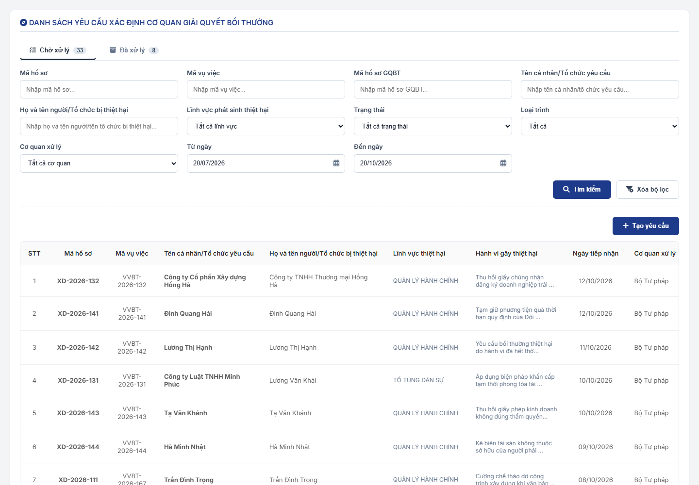
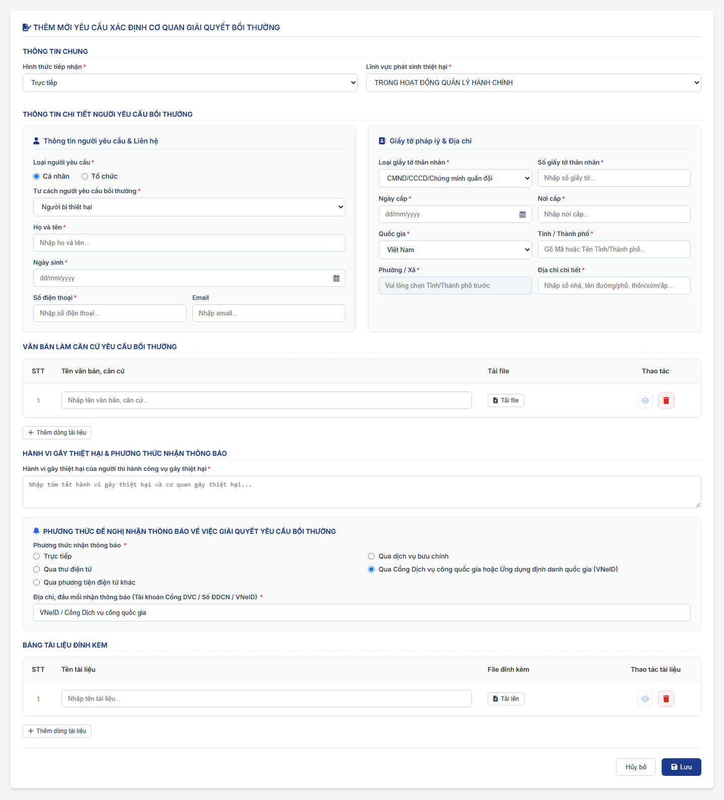
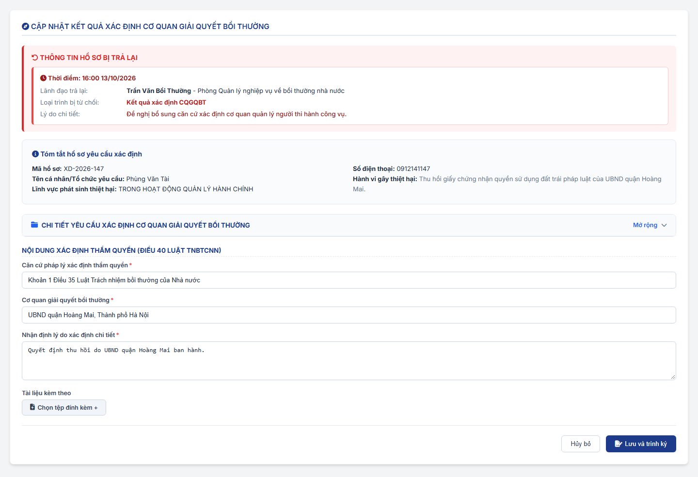
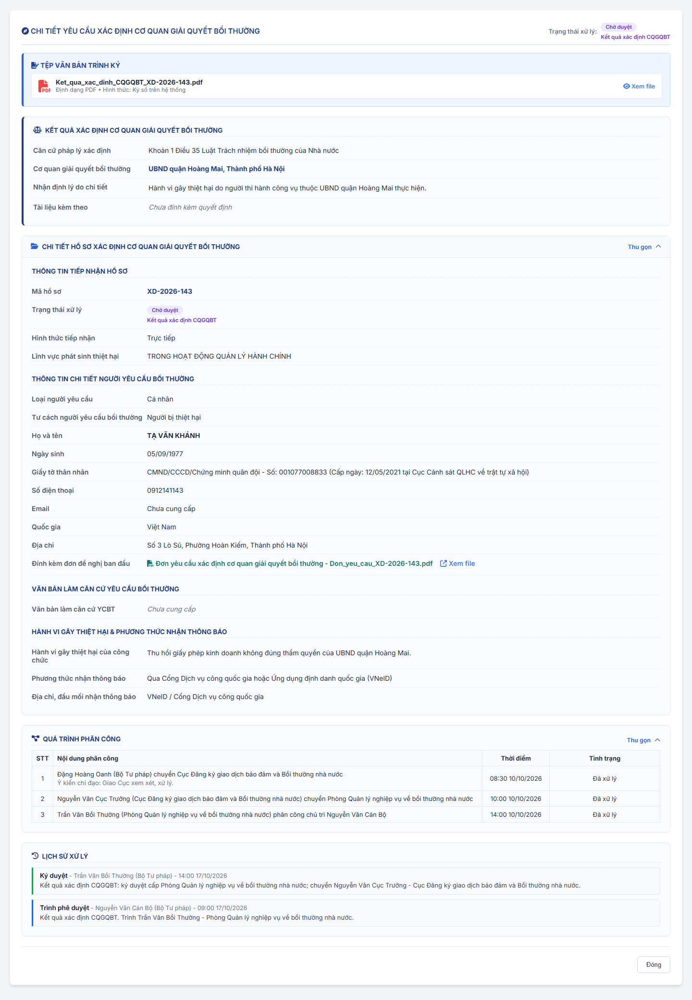
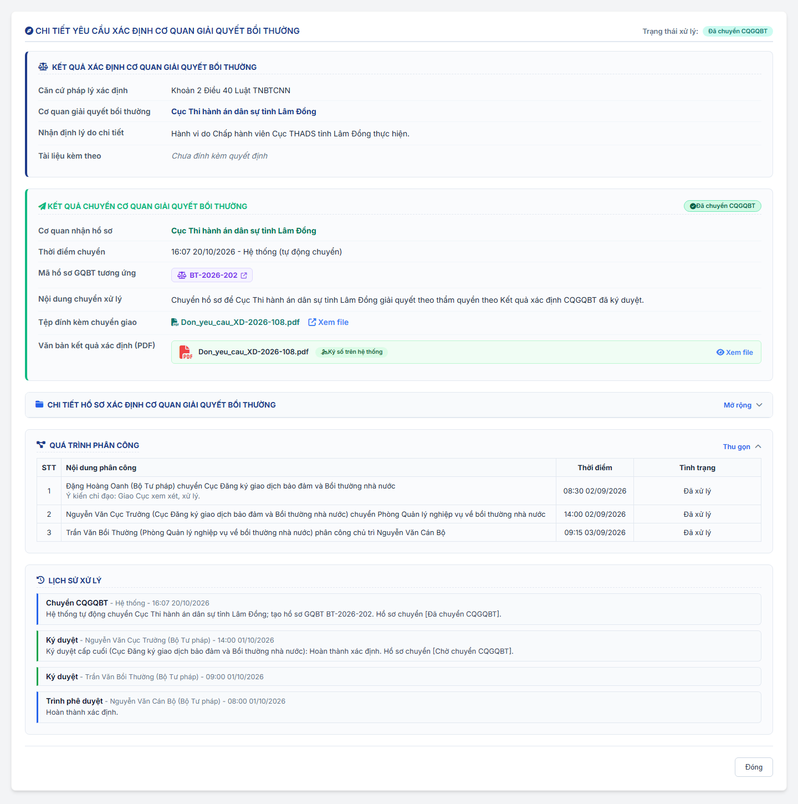

### 4.3.3. Dành cho Cán bộ nghiệp vụ bồi thường nhà nước

#### 4.3.3.1. Nhóm tính năng Xác định cơ quan giải quyết bồi thường

##### 4.3.3.1.1. Mục đích

\- Cho phép người dùng trên Website quản trị (menu `Xác định cơ quan giải quyết bồi thường`, phân hệ Bồi thường nhà nước) quản lý và xử lý hồ sơ yêu cầu xác định cơ quan giải quyết bồi thường, gồm:

+ Hồ sơ được tiếp nhận tại [MH02 - Màn hình Tiếp nhận hồ sơ - Tiếp nhận hồ sơ - Công tác bồi thường nhà nước (Website Quản trị)](SRS_BTNN_GiaiQuyetBT_TiepNhan_YCBT.md#43313-mh02---màn-hình-tiếp-nhận-hồ-sơ), được lãnh đạo phân công cán bộ xử lý tại tab `Chờ xử lý` của [Tiếp nhận hồ sơ - Tiếp nhận hồ sơ - Công tác bồi thường nhà nước (Website Quản trị)](SRS_BTNN_GiaiQuyetBT_TiepNhan_YCBT.md#tn-tab-xu-ly) và chuyển đến phân hệ ở trạng thái `Chờ tiếp nhận`.
+ Hồ sơ do cơ quan giải quyết bồi thường chuyển đến khi Không thụ lý với lý do `KTL_01` và chọn `Chuyển Bộ Tư pháp` / `Chuyển Sở Tư pháp` tại phân hệ Giải quyết yêu cầu bồi thường ([Không thụ lý hồ sơ yêu cầu bồi thường - Giải quyết yêu cầu bồi thường - Công tác bồi thường nhà nước (Website Quản trị)](SRS_BTNN_GiaiQuyetBT_GiaiQuyet_YCBT.md#gq-khong-thu-ly)): hồ sơ có `Nguồn hồ sơ` = `Chuyển CQGQBT`, Loại hồ sơ `Xác định cơ quan giải quyết bồi thường`, ở trạng thái `Chờ phân công` tại [Tiếp nhận hồ sơ - Tiếp nhận hồ sơ - Công tác bồi thường nhà nước (Website Quản trị)](SRS_BTNN_GiaiQuyetBT_TiepNhan_YCBT.md#tn-nguon-ho-so) của Bộ Tư pháp / Sở Tư pháp, giữ nguyên `Mã vụ việc`; được lãnh đạo phân công và chuyển đến phân hệ ở trạng thái `Chờ tiếp nhận` như hồ sơ tiếp nhận tại MH02.
+ Hồ sơ do cán bộ tạo mới trực tiếp tại phân hệ (`Tạo yêu cầu`).

\- Cán bộ xử lý tiếp nhận, nhập liệu và xác minh hồ sơ, cập nhật kết quả xác định cơ quan giải quyết bồi thường (chọn CQGQBT trên hệ thống) và trình ký Lãnh đạo theo luồng phê duyệt (Hình thức ký `Ký số trên hệ thống`): Lãnh đạo ở mọi cấp `Ký duyệt`, Lãnh đạo cấp cuối `Ký duyệt` thì hệ thống ký số văn bản. Hình thức ký `Ký ngoài`: cán bộ xử lý ban hành trực tiếp văn bản đã ký và đóng dấu ngoài hệ thống, không trình Lãnh đạo. Sau khi Lãnh đạo cấp cuối Ký duyệt văn bản Kết quả xác định CQGQBT (hoặc cán bộ ban hành Kết quả xác định CQGQBT Ký ngoài), hệ thống tự động chuyển hồ sơ cho CQGQBT đã chọn: tạo hồ sơ Giải quyết yêu cầu bồi thường ở trạng thái `Chờ phân công` tại CQGQBT đó, kèm văn bản đã ký và toàn bộ tài liệu của hồ sơ ([Tự động chuyển CQGQBT](#xd-tu-dong-chuyen)).

*a. Phân quyền*

\- Chỉ người dùng thuộc đơn vị được áp dụng giá trị `Xác định cơ quan giải quyết bồi thường` trong [Danh mục Loại hồ sơ - Quản lý danh mục - Quản trị hệ thống (Website Quản trị)](../01_Quan_tri_he_thong/Quan_ly_danh_muc.md) [DM_54] (trường `Đơn vị áp dụng`) mới xử lý được loại hồ sơ này. Theo cấu hình danh mục, giá trị này áp dụng cho 02 loại cơ quan:
+ Bộ Tư pháp.
+ Sở Tư pháp các tỉnh, thành phố trực thuộc Trung ương.
+ Đơn vị áp dụng tính cả đơn vị cha: khi chọn đơn vị cha trong `Đơn vị áp dụng` thì toàn bộ đơn vị trực thuộc được áp dụng.
+ Người dùng thuộc đơn vị không được áp dụng: không hiển thị nút `Tạo yêu cầu`; màn hình danh sách hiển thị thông báo theo [MSG-INF-BTNN-LXL-001].
+ Ủy ban nhân dân cấp tỉnh (UBND tỉnh, thành phố trực thuộc Trung ương), gọi tắt là UBND cấp tỉnh: chỉ xem danh sách và chi tiết hồ sơ của các Sở Tư pháp trực thuộc (Sở Tư pháp là đơn vị con của UBND cấp tỉnh trên cây Cơ cấu tổ chức) ở chế độ chỉ đọc; không có nút `Tạo yêu cầu`, không hiển thị thông báo [MSG-INF-BTNN-LXL-001], không hiển thị thao tác xử lý, phê duyệt.
+ Loại cơ quan xử lý (`Bộ Tư pháp`, `Sở Tư pháp`) được thể hiện tại cột `Cơ quan xử lý` và bộ lọc `Cơ quan xử lý` của MH01, trường `Đơn vị tiếp nhận` và `Lịch sử xử lý` của MH04.
+ Luồng phân công, phê duyệt: hồ sơ của Bộ Tư pháp theo luồng `Xác định CQGQBT - Bộ Tư pháp`; hồ sơ của Sở Tư pháp theo luồng `Xác định CQGQBT - Sở Tư pháp` tại [Cấu hình luồng xử lý - Cấu hình luồng xử lý - Quản trị hệ thống (Website Quản trị)](../01_Quan_tri_he_thong/Cau_hinh_luong_xu_ly.md).
+ Mã: Mỗi hồ sơ có `Mã hồ sơ` riêng của phân hệ (`XD-yyyy-xxx`) và mang `Mã vụ việc` toàn trình theo [Mã vụ việc và mã hồ sơ - Tiếp nhận hồ sơ - Công tác bồi thường nhà nước (Website Quản trị)](SRS_BTNN_GiaiQuyetBT_TiepNhan_YCBT.md#tn-ma-vu-viec). Hồ sơ tạo trực tiếp tại phân hệ: chọn `Vụ việc mới` thì được sinh `Mã vụ việc` mới, chọn `Vụ việc đã có Mã vụ việc` thì mang mã đã chọn; hồ sơ Giải quyết yêu cầu bồi thường (`Mã hồ sơ GQBT`, `BT-yyyy-xxx`) sinh ra khi hệ thống tự động chuyển CQGQBT giữ nguyên `Mã vụ việc`.

\- Vai trò trên hồ sơ:

| Vai trò | Quyền trên hồ sơ |
| :--- | :--- |
| Cán bộ xử lý | Được lãnh đạo chỉ định khi phân công (01 người) hoặc là người tạo hồ sơ trực tiếp. Thực hiện toàn bộ thao tác xử lý: Tiếp nhận, Sửa thông tin hồ sơ, Cập nhật kết quả xác định CQGQBT, Trình ký (`Kết quả xác định CQGQBT`, `Yêu cầu bổ sung`, `Không thụ lý`) hoặc ban hành trực tiếp (Hình thức ký `Ký ngoài`), Cập nhật hồ sơ `Bị trả lại`, Tiếp nhận hồ sơ `Yêu cầu bổ sung`. |
| Người tạo | Hồ sơ tạo trực tiếp tại phân hệ: người tạo đồng thời là cán bộ xử lý của hồ sơ. |
| Lãnh đạo các đơn vị trên luồng | Lãnh đạo (thuộc Nhóm lãnh đạo) của các đơn vị đã chuyển/phân công hồ sơ và các đơn vị trên luồng phê duyệt được xem hồ sơ tại danh sách. Thao tác phân công, thu hồi phân công thực hiện tại [Tiếp nhận hồ sơ - Tiếp nhận hồ sơ - Công tác bồi thường nhà nước (Website Quản trị)](SRS_BTNN_GiaiQuyetBT_TiepNhan_YCBT.md#tn-tab-xu-ly); Ký duyệt (mọi cấp; cấp cuối hệ thống ký số văn bản), Từ chối phê duyệt (chỉ Lãnh đạo được giao đích danh tại cấp đang đến lượt) thực hiện tại tab `Chờ xử lý` của màn hình này, Thu hồi kết quả ký duyệt tại tab `Đã xử lý` ([Quy tắc 02 tab Chờ xử lý / Đã xử lý - Xác định cơ quan giải quyết bồi thường - Công tác bồi thường nhà nước (Website Quản trị)](#xd-tab-xu-ly)). Số hồ sơ chờ Lãnh đạo duyệt hiển thị tại khối `Chờ duyệt Xác định CQGQBT` của [MH01 - Màn hình Dashboard Lãnh đạo - Dashboard Lãnh đạo - Công tác bồi thường nhà nước (Website Quản trị)](SRS_BTNN_ViecChoLanhDaoXuLy.md#vcld-mh01). |

- Nhóm lãnh đạo, đơn vị được chuyển và cán bộ được phân công của từng đơn vị lấy theo [Cấu hình luồng xử lý - Cấu hình luồng xử lý - Quản trị hệ thống (Website Quản trị)](../01_Quan_tri_he_thong/Cau_hinh_luong_xu_ly.md).

*b. Điều kiện thực hiện*

- Người dùng truy cập màn hình `Xác định cơ quan giải quyết bồi thường` trên Website quản trị.

- Người dùng được phân quyền thực hiện tính năng.

*c. Quy tắc trình ký - phê duyệt*

- **Luồng phê duyệt**: là luồng ngược chiều luồng phân công thực tế của chính hồ sơ. Hệ thống lấy danh sách các đơn vị đã chuyển/phân công hồ sơ theo thứ tự trong `Quá trình phân công`, đảo ngược và loại bỏ đơn vị trùng (ví dụ phân công Bộ Tư pháp → Cục → Phòng thì phê duyệt Phòng → Cục; luồng phê duyệt chỉ tới Cục, không gửi đến Bộ Tư pháp).

- **Hồ sơ tạo trực tiếp** (không có lượt phân công): luồng phê duyệt đi từ đơn vị của cán bộ xử lý lên đơn vị gốc theo cây Cơ cấu tổ chức, chỉ gồm các đơn vị có Nhóm lãnh đạo trong Cấu hình luồng xử lý (luồng `Xác định CQGQBT - Bộ Tư pháp` hoặc `Xác định CQGQBT - Sở Tư pháp` theo đơn vị gốc của cán bộ). Nếu không xác định được cấp phê duyệt nào, hệ thống không cho trình và hiển thị cảnh báo lỗi [MSG-ERR-BTNN-LXL-006].

- **Hiển thị luồng phê duyệt trên Popup Trình ký**: trường `Luồng phê duyệt` (chỉ đọc, một dòng) đặt ngay dưới ô `Lãnh đạo phê duyệt`, định dạng `Cấp 1 - [Đơn vị] → Cấp 2 - [Đơn vị] → ...`; hiển thị động theo [Cấu hình luồng xử lý - Cấu hình luồng xử lý - Quản trị hệ thống (Website Quản trị)](../01_Quan_tri_he_thong/Cau_hinh_luong_xu_ly.md) tương ứng đơn vị của cán bộ thực hiện, VD:
+ Cán bộ thuộc đơn vị Cục/Phòng nghiệp vụ: `Cấp 1 - Phòng Quản lý nghiệp vụ về bồi thường nhà nước → Cấp 2 - Cục Đăng ký giao dịch bảo đảm và Bồi thường nhà nước` (chỉ tới Cục, không gửi đến Bộ Tư pháp)
+ Cán bộ thuộc Sở Tư pháp: `Cấp 1 - [Phòng chuyên môn thuộc Sở] → Cấp 2 - [Sở Tư pháp]`
+ Cán bộ thuộc cơ quan khác/UBND: các cấp lãnh đạo quản lý trực tiếp theo cây tổ chức đã thiết lập

- **Trình ký**: cán bộ xử lý không chuyển hồ sơ sang trạng thái kết quả trực tiếp. Mọi Loại trình đều trình tại [Popup Trình ký](#xd-popup-trinh-ky), bắt buộc tải lên Văn bản trình ký (văn bản do cán bộ soạn; hệ thống không sinh văn bản theo mẫu), nhập `Loại trình` và chọn Lãnh đạo phê duyệt:
+ `Kết quả xác định CQGQBT`: hồ sơ `Xác minh CQGQBT`, hoặc hồ sơ `Bị trả lại` có Loại trình bị trả lại là `Kết quả xác định CQGQBT`; mở từ `Lưu và trình ký` tại [MH03 - Màn hình Cập nhật kết quả xác định cơ quan giải quyết bồi thường](#43315-mh03---màn-hình-cập-nhật-kết-quả-xác-định-cơ-quan-giải-quyết-bồi-thường). Hệ thống chặn trình khi CQGQBT đã chọn chưa được cấu hình luồng `Giải quyết YCBT` ([MSG-ERR-BTNN-LXL-007]).
+ `Yêu cầu bổ sung`, `Không thụ lý`: hồ sơ `Chờ tiếp nhận` hoặc `Bị trả lại`; mở từ nút `Yêu cầu bổ sung` / `Không thụ lý` tại MH01, MH04. Khi trình từ hồ sơ `Chờ tiếp nhận`, lượt phân công gần nhất được cập nhật `Đã xử lý` (lãnh đạo không còn thu hồi được).
+ Trình thành công (Hình thức ký `Ký số trên hệ thống`): hồ sơ chuyển `Chờ duyệt` với Loại trình tương ứng, đi theo luồng phê duyệt nêu trên.

- **Hình thức ký**: cán bộ xử lý chọn tại Popup Trình ký:
+ `Ký số trên hệ thống` (mặc định): cán bộ tải lên Văn bản trình ký, chọn Lãnh đạo phê duyệt và định vị hộp chữ ký của Lãnh đạo trên văn bản (Bước 2 của Popup Trình ký); hồ sơ trình Lãnh đạo theo luồng phê duyệt. Lãnh đạo ở mọi cấp `Ký duyệt`; hệ thống ký số văn bản tại bước cuối của luồng theo [Tích hợp ký số tại bước cuối của luồng](#xd-ky-so).
+ `Ký ngoài`: cán bộ tải lên tệp PDF văn bản đã ký và đóng dấu ngoài hệ thống và bấm `Hoàn thành`; hệ thống ban hành trực tiếp, **không trình Lãnh đạo** (không qua `Chờ duyệt`, không có `Bị trả lại`). Hồ sơ chuyển trạng thái theo Loại trình: `Kết quả xác định CQGQBT` → [Tự động chuyển CQGQBT](#xd-tu-dong-chuyen), hồ sơ chuyển `Đã chuyển CQGQBT`; `Yêu cầu bổ sung` → `Yêu cầu bổ sung`; `Không thụ lý` → `Không thụ lý`. Văn bản đã ký của hồ sơ là tệp cán bộ đã tải lên. Lịch sử xử lý ghi hành động `Ban hành [Loại trình] (Ký ngoài)`.
+ Trạng thái `Chờ duyệt` và `Bị trả lại` chỉ áp dụng cho Hình thức ký `Ký số trên hệ thống`.

- **Tích hợp ký số tại bước cuối của luồng** (Hình thức ký `Ký số trên hệ thống`):
+ Các cấp trước cấp cuối: `Ký duyệt` là đồng ý nội dung trình và chuyển cấp phê duyệt tiếp theo; hệ thống không ký số văn bản.
+ Cấp cuối: khi Lãnh đạo bấm `Ký duyệt`, hệ thống ký số Văn bản trình ký bằng chứng thư số của Lãnh đạo; gán thông tin chữ ký (họ tên, chức vụ, thời điểm ký) vào vị trí hộp chữ ký đã định tại Bước 2 của [Popup Trình ký](#xd-popup-trinh-ky); sinh tệp PDF đã ký số và lưu vào hồ sơ làm văn bản đã ký; sau đó hồ sơ chuyển trạng thái theo Loại trình.
+ Ký số không thành công: hệ thống không chuyển trạng thái, hồ sơ giữ `Chờ duyệt` tại cấp cuối; hiển thị thông báo lỗi ký số để Lãnh đạo thực hiện lại.

- **Lãnh đạo phê duyệt đích danh**: mọi lần trình đều bắt buộc chọn `Lãnh đạo phê duyệt` cấp 1 trong Nhóm lãnh đạo của cấp phê duyệt đầu tiên. Lãnh đạo cấp n khi `Ký duyệt` (chưa phải cấp cuối) bắt buộc chọn Lãnh đạo phê duyệt cấp n+1 trong Nhóm lãnh đạo của cấp tiếp theo. Chỉ Lãnh đạo được giao mới thấy hồ sơ tại tab `Chờ xử lý` và được phê duyệt/từ chối phê duyệt. Cấp phê duyệt đầu tiên chưa cấu hình Nhóm lãnh đạo thì ô `Lãnh đạo phê duyệt` bị khóa và không bắt buộc.

- **Xử lý tại từng cấp**: Lãnh đạo được giao đích danh tại cấp đang đến lượt xử lý tại tab `Chờ xử lý` của màn hình này (vai trò Lãnh đạo), qua [MH04 - Popup Phê duyệt / Từ chối phê duyệt - Dashboard Lãnh đạo - Công tác bồi thường nhà nước (Website Quản trị)](SRS_BTNN_ViecChoLanhDaoXuLy.md#vcld-mh04):
+ `Ký duyệt` tại các cấp trước cấp cuối (Ý kiến ký duyệt không bắt buộc): đồng ý chuyển cấp tiếp theo, không ký số; Lãnh đạo bắt buộc chọn Lãnh đạo phê duyệt cấp tiếp theo; hồ sơ chuyển cấp phê duyệt tiếp theo, giữ trạng thái `Chờ duyệt`.
+ `Ký duyệt` tại cấp cuối: hệ thống ký số văn bản theo [Tích hợp ký số tại bước cuối của luồng](#xd-ky-so). Cập nhật trạng thái hồ sơ theo Loại trình:   * Loại trình `Kết quả xác định CQGQBT`: chuyển trạng thái `Đã chuyển CQGQBT` (hệ thống tự động chuyển CQGQBT theo [Tự động chuyển CQGQBT](#xd-tu-dong-chuyen)).   * Loại trình `Yêu cầu bổ sung`: chuyển trạng thái `Yêu cầu bổ sung` (hệ thống ghi thêm 01 lần yêu cầu bổ sung vào khối `THÔNG TIN YÊU CẦU BỔ SUNG` của hồ sơ).   * Loại trình `Không thụ lý`: chuyển trạng thái `Không thụ lý`.
+ Lịch sử xử lý ghi hành động `Ký duyệt` ở mọi cấp; cấp cuối ghi thêm nội dung *"đã ký số văn bản"* kèm tên tệp đã ký số.
+ `Từ chối` (Lý do từ chối phê duyệt, bắt buộc) tại bất kỳ cấp nào: hồ sơ chuyển `Bị trả lại` về cán bộ xử lý, ghi nhận người trả lại, đơn vị, thời điểm, lý do và Loại trình bị trả lại; hệ thống ghi thêm 01 lần bị trả lại vào khối `THÔNG TIN HỒ SƠ BỊ TRẢ LẠI` của hồ sơ. Lịch sử xử lý ghi hành động `Từ chối phê duyệt`. Khi cán bộ xử lý trình ký lại, luồng phê duyệt bắt đầu lại từ cấp phê duyệt đầu tiên và cán bộ chọn lại Lãnh đạo phê duyệt cấp 1.
+ Lãnh đạo cấp dưới được thu hồi kết quả ký duyệt đã chuyển cấp trên khi cấp trên chưa ký duyệt/từ chối.

- **Lịch sử Yêu cầu bổ sung và Bị trả lại**: hệ thống lưu trên hồ sơ danh sách các lần ban hành Yêu cầu bổ sung và các lần bị trả lại, không xóa khi hồ sơ chuyển trạng thái:
+ Lần Yêu cầu bổ sung: ghi khi Lãnh đạo cấp cuối Ký duyệt phiếu trình `Yêu cầu bổ sung` (Ký số) hoặc cán bộ xử lý ban hành `Yêu cầu bổ sung` Ký ngoài; gồm Nội dung yêu cầu bổ sung, Hình thức ký, văn bản đã ký, người ban hành, đơn vị, thời điểm ban hành; khi cán bộ xử lý `Tiếp nhận` hồ sơ `Yêu cầu bổ sung` thì ghi nhận thời điểm và người tiếp nhận hồ sơ bổ sung của lần gần nhất.
+ Lần bị trả lại: ghi khi Lãnh đạo Từ chối phê duyệt; gồm Loại trình bị trả lại, Lý do trả lại, Lãnh đạo trả lại, đơn vị, thời điểm.
+ Dữ liệu hồ sơ trước đây chưa có danh sách: hệ thống dựng lại từ Lịch sử xử lý (`Từ chối phê duyệt`; `Ký duyệt` cấp cuối Loại trình `Yêu cầu bổ sung`; `Ban hành Yêu cầu bổ sung (Ký ngoài)`; `Tiếp nhận hồ sơ bổ sung`).
+ Hiển thị tại khối `THÔNG TIN YÊU CẦU BỔ SUNG` và `THÔNG TIN HỒ SƠ BỊ TRẢ LẠI` của MH02, MH04 (khối `THÔNG TIN HỒ SƠ BỊ TRẢ LẠI` hiển thị cả tại MH03).

- **Tự động chuyển CQGQBT**: hệ thống thực hiện ngay khi Lãnh đạo cấp cuối Ký duyệt thành công phiếu trình `Kết quả xác định CQGQBT` hoặc khi cán bộ xử lý ban hành `Kết quả xác định CQGQBT` Ký ngoài; không có thao tác Chuyển CQGQBT thủ công:
+ **Kiểm tra cấu hình**: CQGQBT đã chọn tại kết quả xác định (`Chọn CQGQBT trên hệ thống`) phải là đơn vị gốc đã cấu hình luồng `Giải quyết YCBT` (có Nhóm lãnh đạo và Hình thức phân công) tại [Cấu hình luồng xử lý - Cấu hình luồng xử lý - Quản trị hệ thống (Website Quản trị)](../01_Quan_tri_he_thong/Cau_hinh_luong_xu_ly.md). Chưa cấu hình: hệ thống không cho Ký duyệt, hiển thị [MSG-ERR-BTNN-LXL-007], hồ sơ giữ `Chờ duyệt`.
+ **Khởi tạo hồ sơ Giải quyết yêu cầu bồi thường**: `Mã vụ việc` giữ nguyên `Mã vụ việc` toàn trình của hồ sơ xác định; `Vụ việc liên quan` kế thừa từ hồ sơ xác định (nếu có); cấp 01 `Mã hồ sơ GQBT` dạng `BT-[năm]-[số thứ tự]` cho cả 03 giá trị của `Loại yêu cầu giải quyết bồi thường`; `Nguồn hồ sơ` = `Xác định CQGQBT` (liên kết với mã hồ sơ xác định); `Đơn vị tiếp nhận` là CQGQBT đã chọn; Loại hồ sơ `Giải quyết yêu cầu bồi thường`; trạng thái `Chờ phân công` tại Tiếp nhận hồ sơ, chờ Nhóm lãnh đạo của CQGQBT phân công theo luồng `Giải quyết YCBT` (hồ sơ xuất hiện tại tab `Chờ xử lý` của Lãnh đạo); ghi Lịch sử xử lý `Nhận hồ sơ từ Xác định CQGQBT`.
+ **Kế thừa thông tin và tài liệu**: thông tin người yêu cầu, thông tin người bị thiệt hại, lĩnh vực phát sinh thiệt hại, hành vi gây thiệt hại, phương thức và địa chỉ nhận thông báo, `Loại yêu cầu giải quyết bồi thường`, văn bản làm căn cứ yêu cầu bồi thường và toàn bộ tài liệu đính kèm của hồ sơ xác định. Tài liệu chuyển xử lý gồm văn bản Kết quả xác định CQGQBT đã ký (PDF) và `Tài liệu kèm theo` của kết quả xác định; Nội dung chuyển xử lý là `Loại trình` của phiếu trình `Kết quả xác định CQGQBT`.
+ **Cập nhật hồ sơ xác định**: hồ sơ chuyển `Đã chuyển CQGQBT`; ghi nhận Mã hồ sơ GQBT tương ứng, CQGQBT nhận hồ sơ, văn bản đã ký, Lãnh đạo Ký duyệt và thời điểm chuyển; ghi Lịch sử xử lý `Ký duyệt` và `Chuyển CQGQBT` (*"Tự động chuyển CQGQBT [Tên CQGQBT]; tạo hồ sơ GQBT [Mã hồ sơ GQBT]"*).
+ **Thông báo**: hiển thị cho Lãnh đạo Ký duyệt thông báo thành công [MSG-SUC-BTNN-XDCQ-020].
+ Mỗi hồ sơ xác định chỉ tạo 01 hồ sơ Giải quyết yêu cầu bồi thường; hệ thống không tạo trùng.
+ Hồ sơ Giải quyết yêu cầu bồi thường được tạo xử lý tiếp theo [Giải quyết yêu cầu bồi thường - Giải quyết yêu cầu bồi thường - Công tác bồi thường nhà nước (Website Quản trị)](SRS_BTNN_GiaiQuyetBT_GiaiQuyet_YCBT.md#quy-tac-nghiep-vu-chung-ycbt).

- **Kiểm tra đồng thời**: mọi thao tác phân công, phê duyệt, ký duyệt, từ chối, thu hồi đều được hệ thống kiểm tra lại trạng thái hồ sơ tại máy chủ trước khi ghi nhận. Nếu hồ sơ đã được người khác xử lý, hệ thống hiển thị cảnh báo lỗi tương ứng theo [MSG-ERR-BTNN-LXL-002] (phân công) hoặc [MSG-ERR-BTNN-LXL-005] (phê duyệt, ký duyệt).

---

*d. Quy tắc 02 tab Chờ xử lý / Đã xử lý*

| Vai trò | Tab `Chờ xử lý` | Tab `Đã xử lý` |
| :--- | :--- | :--- |
| Cán bộ xử lý | Hồ sơ trong phạm vi xem ở trạng thái: `Chờ tiếp nhận`, `Xác minh CQGQBT`, `Chờ duyệt`, `Bị trả lại`, `Yêu cầu bổ sung` | Hồ sơ ở trạng thái: `Không thụ lý`, `Đã chuyển CQGQBT` |
| Lãnh đạo (thuộc Nhóm lãnh đạo tại Cấu hình luồng xử lý) | Hồ sơ `Chờ duyệt` mà Lãnh đạo được giao đích danh ở cấp phê duyệt hiện hành | Hồ sơ Lãnh đạo đã Ký duyệt / Từ chối phê duyệt, không còn chờ Lãnh đạo duyệt |

- Mỗi tab hiển thị số bản ghi; mặc định mở tab `Chờ xử lý`. Mở màn hình kèm tham số `tab=done` thì chọn sẵn tab `Đã xử lý`.
- Tab `Chờ xử lý` và menu `Xác định cơ quan giải quyết bồi thường` tại thanh menu trái (Left Menu) hiển thị Badge số lượng hồ sơ chờ xử lý tương ứng với số lượng bản ghi thực tế cần xử lý.
- Trường `Trạng thái` của bộ lọc chỉ gồm các trạng thái của tab đang chọn.

##### 4.3.3.1.2. Sơ đồ luồng nghiệp vụ theo giao diện

\- Luồng đi của 01 hồ sơ Xác định cơ quan giải quyết bồi thường:

---

##### 4.3.3.1.3. MH01 - Màn hình Danh sách yêu cầu xác định cơ quan giải quyết bồi thường

###### 4.3.3.1.3.1. Màn hình

###### 4.3.3.1.3.2. Mô tả thông tin trên màn hình

| Trường thông tin | Kiểu dữ liệu | Bắt buộc | Mặc định | Mô tả |
| :--- | :--- | :--- | :--- | :--- |
| **Tab danh sách** | Tab | - | `Chờ xử lý` | Control UI: 02 tab đặt phía trên bộ lọc, mỗi tab kèm badge số lượng bản ghi tương ứng: + Chờ xử lý: hiển thị badge số lượng hồ sơ đang chờ xử lý (đồng bộ với badge số lượng tại menu `Xác định cơ quan giải quyết bồi thường` trên Left Menu) + Đã xử lý: hiển thị badge số lượng hồ sơ đã hoàn thành/kết thúc - Bản ghi của từng tab theo [Quy tắc 02 tab Chờ xử lý / Đã xử lý - Xác định cơ quan giải quyết bồi thường - Công tác bồi thường nhà nước (Website Quản trị)](#xd-tab-xu-ly). |
| **Khối bộ lọc tìm kiếm** | String(255) | - | - | Control UI: Filter panel dạng thu gọn/mở rộng (Accordion). - Mặc định hiển thị dạng mở rộng. - Cho phép thu gọn/mở rộng khi click vào nút "Thu gọn"/"Mở rộng" ở góc phải khối; khi thu gọn, các giá trị lọc đã nhập được giữ nguyên. |
| Mã hồ sơ | String(50) | Không | Trống | Control UI: Input text. - Placeholder: `Nhập mã hồ sơ...`. - Tìm kiếm gần đúng theo mã hồ sơ xác định cơ quan, không phân biệt hoa thường, có trim khoảng trắng. |
| Mã hồ sơ GQBT | String(50) | Không | Trống | Control UI: Input text. - Placeholder: `Nhập mã hồ sơ GQBT...`. - Tìm kiếm gần đúng theo `Mã hồ sơ` (`BT-...`) của hồ sơ Giải quyết YCBT được hệ thống tạo khi tự động chuyển CQGQBT. - Nếu hồ sơ chưa có `Mã hồ sơ GQBT`, dữ liệu trên lưới hiển thị `-`. |
| Tên cá nhân/Tổ chức yêu cầu | String(255) | Không | Trống | Control UI: Input text. - Placeholder: `Nhập tên cá nhân/tổ chức yêu cầu...`. - Tìm kiếm gần đúng theo `Họ và tên` (cá nhân) hoặc `Tên tổ chức` của người yêu cầu, không phân biệt hoa thường, có trim khoảng trắng. |
| Họ và tên người/Tổ chức bị thiệt hại | String(255) | Không | Trống | Control UI: Input text. - Placeholder: `Nhập họ và tên người/tên tổ chức bị thiệt hại...`. - Tìm kiếm gần đúng theo giá trị cột `Họ và tên người/Tổ chức bị thiệt hại` trên lưới, không phân biệt hoa thường, có trim khoảng trắng. |
| Lĩnh vực phát sinh thiệt hại | Enum(String(100)) | Không | `Tất cả lĩnh vực` | Control UI: Combobox. Tham chiếu danh mục Lĩnh vực phát sinh thiệt hại [DM_22]. |
| Trạng thái | Enum(String(50)) | Không | `Tất cả trạng thái` | Control UI: Combobox. - Danh sách giá trị theo tab đang chọn ([Quy tắc 02 tab Chờ xử lý / Đã xử lý - Xác định cơ quan giải quyết bồi thường - Công tác bồi thường nhà nước (Website Quản trị)](#xd-tab-xu-ly)). Gồm: + Tất cả trạng thái + Chờ tiếp nhận + Xác minh CQGQBT + Chờ duyệt + Bị trả lại + Yêu cầu bổ sung + Không thụ lý + Đã chuyển CQGQBT |
| Loại trình | Enum(String(50)) | Không | `Tất cả` | Control UI: Combobox. - Chỉ hiển thị khi bộ lọc Trạng thái chọn là `Chờ duyệt` hoặc `Bị trả lại`. Gồm: + Tất cả + Yêu cầu bổ sung + Không thụ lý + Kết quả xác định CQGQBT |
| Cơ quan xử lý | Enum(String(50)) | Không | `Tất cả` | Control UI: Multiselect Combobox có tìm kiếm. - Mặc định: `Tất cả`. - Cho phép gõ tìm kiếm và chọn 01 hoặc nhiều cơ quan bất kỳ để thực hiện tìm kiếm/lọc. Gồm: + Tất cả + Nhóm `Bộ Tư pháp`: Bộ Tư pháp + Nhóm `Sở Tư pháp`: từng Sở Tư pháp theo danh mục đơn vị áp dụng [DM_54] |
| Từ ngày | Date | Không | Ngày hiện tại trừ 03 tháng | Control UI: Datepicker. - Định dạng hiển thị `dd/mm/yyyy`. - Có icon lịch. - Lọc theo ngày tiếp nhận từ ngày. |
| Đến ngày | Date | Không | Ngày hiện tại | Control UI: Datepicker. - Định dạng hiển thị `dd/mm/yyyy`. - Có icon lịch. - Lọc theo ngày tiếp nhận đến ngày. |
| **Bảng danh sách yêu cầu xác định cơ quan giải quyết bồi thường** | - | - | 20 bản ghi/trang | Control UI: Data grid. - Khi người dùng truy cập màn hình, hệ thống tự động tải trang đầu tiên (Trang 1) với số lượng mặc định 20 bản ghi. - Sắp xếp mặc định: Sắp xếp theo "Thời điểm tiếp nhận" giảm dần (mới nhất hiển thị lên đầu). - **Phạm vi dữ liệu**: chỉ hiển thị hồ sơ người dùng là cán bộ xử lý, người tạo hoặc người dùng thuộc Nhóm lãnh đạo của một đơn vị trên luồng phân công/phê duyệt của hồ sơ. - Trạng thái có dữ liệu: Hiển thị danh sách các bản ghi kết quả theo cấu trúc các cột quy định. - Trạng thái không có dữ liệu (Empty State): Khi không tìm thấy kết quả phù hợp với điều kiện tìm kiếm, bảng hiển thị duy nhất 01 dòng căn giữa trên toàn bộ chiều rộng bảng (`colspan`), in nghiêng với nội dung theo MessageList dùng chung [MSG-INF-SYS-001]. |
| STT | Integer(10) | - | Tự tăng | Control UI: Text hiển thị (Read-only). - Căn giữa. - Hiển thị số thứ tự theo trang hiện tại. |
| Mã hồ sơ | String(50) | - | Theo dữ liệu | Control UI: Text hiển thị (Read-only). - Căn giữa. - Hiển thị mã hồ sơ xác định cơ quan giải quyết bồi thường. |
| Tên cá nhân/Tổ chức yêu cầu | String(255) | - | Theo dữ liệu | Control UI: Text hiển thị (Read-only). - Theo dữ liệu bản ghi: `Họ và tên` (người yêu cầu là cá nhân) hoặc `Tên tổ chức` (người yêu cầu là tổ chức). - Nếu chưa có dữ liệu, hiển thị `(Chưa nhập)`. |
| Họ và tên người/Tổ chức bị thiệt hại | String(255) | - | Theo dữ liệu | Control UI: Text hiển thị (Read-only). - Theo dữ liệu bản ghi: + `Tư cách người yêu cầu bồi thường` = `Người bị thiệt hại`: bằng `Tên cá nhân/Tổ chức yêu cầu`. + `Tư cách người yêu cầu bồi thường` = `Tổ chức kế thừa quyền, nghĩa vụ của tổ chức bị thiệt hại đã chấm dứt tồn tại`: `Tên tổ chức bị thiệt hại`. + Tư cách khác: `Họ và tên người bị thiệt hại`. - Không có dữ liệu: hiển thị `-`. |
| Lĩnh vực thiệt hại | Enum(String(50)) | - | Theo dữ liệu | Control UI: Text hiển thị (Read-only). - Hiển thị lĩnh vực phát sinh thiệt hại theo danh mục [DM_22], bỏ tiền tố `TRONG HOẠT ĐỘNG`. |
| Hành vi gây thiệt hại | String(255) | - | Theo dữ liệu | Control UI: Text hiển thị (Read-only). - Hiển thị tóm tắt hành vi gây thiệt hại. - Nếu nội dung dài hơn giới hạn hiển thị của ô, hệ thống rút gọn và cho phép xem đầy đủ khi rê chuột vào nội dung. |
| Ngày tiếp nhận | Date | - | Theo dữ liệu | Control UI: Text hiển thị (Read-only). - Căn giữa. - Định dạng `dd/mm/yyyy`. |
| Cơ quan xử lý | String(255) | - | Theo dữ liệu | Theo thông tin bản ghi. |
| Cán bộ xử lý | String(100) | - | Theo dữ liệu | Control UI: Text hiển thị (Read-only). - Hiển thị họ tên cán bộ xử lý của hồ sơ; chưa có thì hiển thị `--`. |
| Mã hồ sơ GQBT | String(50) | - | Theo dữ liệu | Control UI: Text hiển thị (Read-only) dạng Hyperlink. - Căn giữa. - Hiển thị `Mã hồ sơ` Giải quyết YCBT tương ứng (01 mã `BT-...` cho cả hồ sơ có nhánh Phục hồi danh dự), được sinh khi hệ thống tự động chuyển CQGQBT (hồ sơ `Đã chuyển CQGQBT`). - Nếu chưa có mã: hiển thị `-`. - Click mã: mở [MH05 - Màn hình Xem chi tiết hồ sơ yêu cầu bồi thường - Giải quyết yêu cầu bồi thường - Công tác bồi thường nhà nước (Website Quản trị)](SRS_BTNN_GiaiQuyetBT_GiaiQuyet_YCBT.md#43317-mh05---màn-hình-xem-chi-tiết-hồ-sơ-yêu-cầu-bồi-thường) ở tab mới. |
| Trạng thái | Enum(String(50)) | - | Theo dữ liệu | Control UI: Badge trạng thái (Read-only). - Theo dữ liệu bản ghi. - Hồ sơ `Chờ duyệt`, `Bị trả lại`: kèm dòng phụ Loại trình (`Kết quả xác định CQGQBT`, `Yêu cầu bổ sung`, `Không thụ lý`). |
| Thao tác | String(255) | - | Theo trạng thái | Control UI: Action Buttons (Icon button). Các nút thao tác hiển thị linh hoạt theo trạng thái của hồ sơ: + Tiếp nhận: Chỉ hiển thị khi hồ sơ ở trạng thái `Chờ tiếp nhận` hoặc `Yêu cầu bổ sung`. + Sửa: Chỉ hiển thị khi hồ sơ ở trạng thái `Xác minh CQGQBT`. + Cập nhật kết quả: Chỉ hiển thị khi hồ sơ ở trạng thái `Xác minh CQGQBT`. + Cập nhật: Chỉ hiển thị khi hồ sơ ở trạng thái `Bị trả lại`. + Yêu cầu bổ sung: Chỉ hiển thị khi hồ sơ ở trạng thái `Chờ tiếp nhận` hoặc `Bị trả lại`. + Không thụ lý: Chỉ hiển thị khi hồ sơ ở trạng thái `Chờ tiếp nhận` hoặc `Bị trả lại`. + Ký duyệt, Từ chối: Chỉ hiển thị khi hồ sơ ở trạng thái `Chờ duyệt`. + Thu hồi: Chỉ hiển thị khi hồ sơ ở trạng thái `Đã xử lý` (sau khi đã ký duyệt). |
| Phân trang | Pagination | - | 20 bản ghi/trang | Control UI: Pagination. - Cho phép chọn cấu hình số lượng bản ghi hiển thị (10, 20, 50, 100); mặc định 20 bản ghi/trang. - Hiển thị dải bản ghi: "Hiển thị [từ]-[đến] trong số [tổng số] bản ghi" (khi không có dữ liệu hiển thị 0-0 trong số 0). - Đầy đủ các nút điều hướng trang: Đầu (&#124;&lt;&lt;), Trước (&lt;), các số trang, Sau (&gt;), Cuối (&gt;&gt;&#124;). |

###### 4.3.3.1.3.3. Chức năng trên màn hình

| STT | Tên chức năng | Định dạng | Mô tả |
| :--- | :--- | :--- | :--- |
| 1 | Tìm kiếm | Button | Khi người dùng click nút, hệ thống kiểm tra điều kiện dữ liệu và thực hiện tìm kiếm theo các trường hợp bên dưới: |
|  |  |  | **TH1 - Khoảng ngày không hợp lệ**: Nếu `Từ ngày` lớn hơn `Đến ngày`, hệ thống hiển thị cảnh báo lỗi [MSG-ERR-VAL-007] và không thực hiện tìm kiếm. |
|  |  |  | **TH Hợp lệ (Có dữ liệu phù hợp)**: Hệ thống lọc và hiển thị danh sách các bản ghi thuộc phạm vi dữ liệu của người dùng, thỏa mãn đồng thời các tiêu chí tìm kiếm/lọc đã nhập/chọn, hiển thị kết quả lên bảng và đưa về Trang 1. |
|  |  |  | **TH Không có dữ liệu trả về**: Bảng kết quả hiển thị duy nhất 01 dòng căn giữa trên toàn bộ chiều rộng bảng (`colspan`), in nghiêng với nội dung theo MessageList dùng chung [MSG-INF-SYS-001]; thanh phân trang hiển thị *"Hiển thị 0-0 trong số 0 bản ghi"*, các nút điều hướng trang ở trạng thái khóa mờ (Disabled). |
| 2 | Xóa bộ lọc | Button | Xóa các bộ lọc (gồm cả `Trạng thái`, `Loại trình`, `Cơ quan xử lý`, `Vai trò xử lý`), đưa Từ ngày, Đến ngày về khoảng 03 tháng gần nhất và tải lại danh sách về trang 1. |
| 3 | Tạo yêu cầu | Button | - **Điều kiện hiển thị**: Đơn vị của người dùng được áp dụng loại yêu cầu `Xác định cơ quan giải quyết bồi thường`. - **Hành vi**: Hệ thống mở [MH02 - Màn hình Thêm mới/Sửa yêu cầu xác định cơ quan giải quyết bồi thường](#43314-mh02---màn-hình-thêm-mớisửa-yêu-cầu-xác-định-cơ-quan-giải-quyết-bồi-thường) ở ngữ cảnh tạo mới trực tiếp; tiêu đề hiển thị `THÊM MỚI YÊU CẦU XÁC ĐỊNH CƠ QUAN GIẢI QUYẾT BỒI THƯỜNG` và toàn bộ trường thông tin trên form ở trạng thái trống/mặc định ban đầu. |
| 4 | Click dòng dữ liệu | Row click | Khi người dùng click vào dòng dữ liệu, hệ thống xử lý theo các trường hợp bên dưới. |
|  |  |  | **TH1 - Click vào dòng dữ liệu**: Hệ thống mở [MH04 - Màn hình Chi tiết yêu cầu xác định cơ quan giải quyết bồi thường](#43316-mh04---màn-hình-chi-tiết-yêu-cầu-xác-định-cơ-quan-giải-quyết-bồi-thường) của bản ghi được chọn. |
|  |  |  | **TH2 - Click vào icon thao tác trong cột Thao tác**: Không thực hiện row click; thực hiện đúng chức năng của icon được click. |
| 5 | Tiếp nhận | Icon button | Hồ sơ `Chờ tiếp nhận`: hệ thống mở [MH02 - Màn hình Thêm mới/Sửa yêu cầu xác định cơ quan giải quyết bồi thường](#43314-mh02---màn-hình-thêm-mớisửa-yêu-cầu-xác-định-cơ-quan-giải-quyết-bồi-thường) ở ngữ cảnh tiếp nhận hồ sơ được phân công; tiêu đề hiển thị `TIẾP NHẬN YÊU CẦU XÁC ĐỊNH CƠ QUAN GIẢI QUYẾT BỒI THƯỜNG`, tự động kế thừa dữ liệu tiếp nhận ban đầu và cho phép cán bộ xử lý sửa/nhập bổ sung trước khi bấm `Lưu` (hồ sơ chuyển `Xác minh CQGQBT`, không trình Lãnh đạo). |
| 6 | Tiếp nhận (hồ sơ `Yêu cầu bổ sung`) | Icon button | Hồ sơ `Yêu cầu bổ sung`: hệ thống mở [MH02 - Màn hình Thêm mới/Sửa yêu cầu xác định cơ quan giải quyết bồi thường](#43314-mh02---màn-hình-thêm-mớisửa-yêu-cầu-xác-định-cơ-quan-giải-quyết-bồi-thường) ở ngữ cảnh Tiếp nhận; tiêu đề hiển thị `TIẾP NHẬN YÊU CẦU XÁC ĐỊNH CƠ QUAN GIẢI QUYẾT BỒI THƯỜNG`, điền sẵn dữ liệu của bản ghi và hiển thị khối `THÔNG TIN YÊU CẦU BỔ SUNG`; cán bộ cập nhật hồ sơ bổ sung rồi bấm `Lưu` (hồ sơ chuyển `Xác minh CQGQBT`, không trình Lãnh đạo). |
| 7 | Sửa | Icon button | Hồ sơ `Xác minh CQGQBT`: hệ thống mở [MH02 - Màn hình Thêm mới/Sửa yêu cầu xác định cơ quan giải quyết bồi thường](#43314-mh02---màn-hình-thêm-mớisửa-yêu-cầu-xác-định-cơ-quan-giải-quyết-bồi-thường) ở ngữ cảnh sửa, điền sẵn dữ liệu của bản ghi; tiêu đề hiển thị `SỬA YÊU CẦU XÁC ĐỊNH CƠ QUAN GIẢI QUYẾT BỒI THƯỜNG`. |
| 8 | Cập nhật kết quả xác định CQGQBT | Icon button | Hồ sơ `Xác minh CQGQBT`: hệ thống mở [MH03 - Màn hình Cập nhật kết quả xác định cơ quan giải quyết bồi thường](#43315-mh03---màn-hình-cập-nhật-kết-quả-xác-định-cơ-quan-giải-quyết-bồi-thường). |
| 9 | Cập nhật | Icon button | Hồ sơ `Bị trả lại`: hệ thống xử lý theo Loại trình bị trả lại: |
|  |  |  | **TH1 - Loại trình bị trả lại là `Kết quả xác định CQGQBT`**: Hệ thống mở [MH03 - Màn hình Cập nhật kết quả xác định cơ quan giải quyết bồi thường](#43315-mh03---màn-hình-cập-nhật-kết-quả-xác-định-cơ-quan-giải-quyết-bồi-thường), điền sẵn kết quả xác định đã lưu và hiển thị khối `THÔNG TIN HỒ SƠ BỊ TRẢ LẠI`; cán bộ sửa và bấm `Lưu và trình ký` để trình ký lại. |
|  |  |  | **TH2 - Loại trình bị trả lại là `Yêu cầu bổ sung` hoặc `Không thụ lý`**: Hệ thống mở [Popup Trình ký](#xd-popup-trinh-ky) với Loại trình bị trả lại, điền sẵn thông tin theo phiếu trình bị trả lại để cán bộ sửa và trình ký lại. |
| 10 | Yêu cầu bổ sung | Icon button | Hồ sơ `Chờ tiếp nhận` hoặc `Bị trả lại`: hệ thống mở [Popup Trình ký](#xd-popup-trinh-ky) với Loại trình `Yêu cầu bổ sung`. |
| 11 | Không thụ lý | Icon button | Hồ sơ `Chờ tiếp nhận` hoặc `Bị trả lại`: hệ thống mở [Popup Trình ký](#xd-popup-trinh-ky) với Loại trình `Không thụ lý`. |
| 12 | Chuyển tab | Tab | Hiển thị danh sách của tab `Chờ xử lý` hoặc `Đã xử lý`, nạp lại bộ lọc `Trạng thái` theo tab và đưa về Trang 1. |
| 13 | Ký duyệt / Từ chối | Icon button | Vai trò Lãnh đạo, tab `Chờ xử lý`: mở [MH04 - Popup Phê duyệt / Từ chối phê duyệt - Dashboard Lãnh đạo - Công tác bồi thường nhà nước (Website Quản trị)](SRS_BTNN_ViecChoLanhDaoXuLy.md#vcld-mh04) ở chế độ tương ứng; nhãn `Ký duyệt` ở mọi cấp (cấp cuối hệ thống ký số văn bản) và xử lý theo [Quy tắc trình ký - phê duyệt](#xd-quy-tac-trinh). Xử lý thành công: hồ sơ rời tab `Chờ xử lý` của Lãnh đạo, hiển thị tại tab `Đã xử lý`. |
| 14 | Thu hồi | Icon button | Vai trò Lãnh đạo, tab `Đã xử lý`: mở [MH05 - Popup Xác nhận thu hồi - Dashboard Lãnh đạo - Công tác bồi thường nhà nước (Website Quản trị)](SRS_BTNN_ViecChoLanhDaoXuLy.md#vcld-mh05) khi thỏa điều kiện thu hồi kết quả phê duyệt. |

---

##### 4.3.3.1.4. MH02 - Màn hình Thêm mới/Sửa yêu cầu xác định cơ quan giải quyết bồi thường

###### 4.3.3.1.4.1. Màn hình

###### 4.3.3.1.4.2. Mô tả thông tin trên màn hình

| Trường thông tin | Kiểu dữ liệu | Bắt buộc | Mặc định | Mô tả |
| :--- | :--- | :--- | :--- | :--- |
| Tiêu đề màn hình | String(255) | - | Theo ngữ cảnh | Control UI: Text heading (Read-only). - Khi mở form do `Tiếp nhận` hồ sơ `Chờ tiếp nhận` đã được phân công hoặc hồ sơ `Yêu cầu bổ sung`: hiển thị `TIẾP NHẬN YÊU CẦU XÁC ĐỊNH CƠ QUAN GIẢI QUYẾT BỒI THƯỜNG`. - Khi `Tạo yêu cầu` trực tiếp tại phân hệ Xác định cơ quan: hiển thị `THÊM MỚI YÊU CẦU XÁC ĐỊNH CƠ QUAN GIẢI QUYẾT BỒI THƯỜNG`. - Khi `Sửa` hồ sơ `Xác minh CQGQBT`: hiển thị `SỬA YÊU CẦU XÁC ĐỊNH CƠ QUAN GIẢI QUYẾT BỒI THƯỜNG`. |
| **THÔNG TIN YÊU CẦU BỔ SUNG** | Section | - | Ẩn | Control UI: Alert panel, đặt trên cùng form, dưới tiêu đề màn hình. - Chỉ hiển thị khi hồ sơ đang ở trạng thái `Yêu cầu bổ sung` hoặc trước đó từng có Yêu cầu bổ sung (đã ban hành văn bản yêu cầu bổ sung: Lãnh đạo cấp cuối Ký duyệt hoặc cán bộ ban hành Ký ngoài). - Không hiển thị ở ngữ cảnh `Tạo yêu cầu`. - Tiêu đề khối kèm nhãn trạng thái: `Đang chờ bổ sung` hoặc `Đã tiếp nhận bổ sung`. - Nội dung là danh sách các lần Yêu cầu bổ sung theo [Lịch sử Yêu cầu bổ sung và Bị trả lại](#xd-lich-su-ycbs-tra-lai); mỗi lần gồm các trường bên dưới. |
| Nội dung yêu cầu bổ sung | Text(2000) | - | Theo dữ liệu bản ghi | Control UI: Text (Read-only). - Nội dung yêu cầu bổ sung đã nhập khi trình ký / ban hành; giữ xuống dòng. |
| Hình thức ký | Enum(String(30)) | - | Theo dữ liệu bản ghi | Control UI: Label, Theo giá trị bản ghi. |
| Văn bản đã ký | File | - | Theo dữ liệu bản ghi | Control UI: Tên tệp kèm Text link `Xem file`. - Tệp PDF đã ký số hoặc tệp PDF Ký ngoài cán bộ đã tải lên. - Click `Xem file`: mở xem trước tệp. |
| Người ban hành - thời điểm | String(255) | - | Theo dữ liệu bản ghi | Control UI: Text (Read-only). - Định dạng `[Họ và tên] - [Đơn vị] - [HH:mm dd/mm/yyyy]`. - Ký số: Lãnh đạo cấp cuối Ký duyệt; Ký ngoài: cán bộ xử lý ban hành. |
| Tiếp nhận hồ sơ bổ sung | String(255) | - | Theo dữ liệu bản ghi | Control UI: Text (Read-only). - Đã tiếp nhận: `[HH:mm dd/mm/yyyy] - [Họ và tên cán bộ tiếp nhận]`. - Chưa tiếp nhận: `Chưa tiếp nhận`. |
| **THÔNG TIN HỒ SƠ BỊ TRẢ LẠI** | Section | - | Ẩn | Control UI: Alert panel, đặt trên cùng form, dưới khối `THÔNG TIN YÊU CẦU BỔ SUNG`. - Chỉ hiển thị khi hồ sơ đang ở trạng thái `Bị trả lại` hoặc trước đó từng bị trả lại. - Không hiển thị ở ngữ cảnh `Tạo yêu cầu`. - Nội dung là danh sách đầy đủ các lần bị trả lại theo [Lịch sử Yêu cầu bổ sung và Bị trả lại](#xd-lich-su-ycbs-tra-lai), sắp xếp theo thứ tự thời gian; không đánh số lần. - Mỗi lần gồm các trường bên dưới. |
| Thời điểm | DateTime | - | Theo dữ liệu bản ghi | Control UI: Label, Theo dữ liệu bản ghi. |
| Lãnh đạo trả lại | String(255) | - | Theo dữ liệu bản ghi | Control UI: Label, Theo dữ liệu bản ghi. |
| Loại trình | String(100) | - | Theo dữ liệu bản ghi | Control UI: Label, Theo dữ liệu bản ghi. |
| Lý do bị trả lại | Text(2000) | - | Theo dữ liệu bản ghi | Control UI: Label, Theo dữ liệu bản ghi. |
| **THÔNG TIN CHUNG** | String(255) | - | - | Control UI: Section header. - Khối thông tin chung của yêu cầu. |
| Trạng thái hồ sơ | Enum(String(50)) | - | Ẩn khi Thêm mới | Control UI: Badge trạng thái (Read-only). - Khi mở ở chế độ Thêm mới trực tiếp: **không hiển thị**. - Các chế độ còn lại: hiển thị badge trạng thái hiện tại của hồ sơ (`Chờ tiếp nhận`, `Yêu cầu bổ sung` hoặc `Xác minh CQGQBT`). |
| Hình thức tiếp nhận | Enum(String(50)) | Có | `Trực tiếp` (thêm mới) / Theo dữ liệu kế thừa | Control UI: Combobox. - Tham chiếu [Danh mục Hình thức tiếp nhận - Danh mục dữ liệu dùng chung - Tổng quan và quy tắc chung](../../Tai%20lieu%20tong%20hop/00_Tong_quan_va_Quy_tac_chung.md#danh-muc-dung-chung) [DM_25]. - Thêm mới trực tiếp: chỉ cho chọn `Trực tiếp`, `Qua dịch vụ bưu chính`. - Hồ sơ kế thừa từ Tiếp nhận hồ sơ: mặc định theo `Hình thức tiếp nhận` của hồ sơ đã tiếp nhận; cho phép điều chỉnh, chọn đủ các giá trị của DM_25. |
| Lĩnh vực phát sinh thiệt hại | Enum(String(100)) | Có | `TRONG HOẠT ĐỘNG QUẢN LÝ HÀNH CHÍNH` | Control UI: Combobox. - Tham chiếu danh mục Lĩnh vực phát sinh thiệt hại [DM_22]. - Trường được điền sẵn theo dữ liệu kế thừa khi mở form từ `Tiếp nhận` hoặc theo bản ghi khi sửa; cán bộ được phép sửa. |
| Loại yêu cầu giải quyết bồi thường | Enum(String(100)) | Có | `Yêu cầu cả hai (Bồi thường tiền & Phục hồi danh dự)` | Control UI: Radio button. Gồm: + Yêu cầu cả hai (Bồi thường tiền & Phục hồi danh dự) + Chỉ yêu cầu bồi thường thiệt hại bằng tiền + Chỉ yêu cầu phục hồi danh dự - Bắt buộc chọn để xác định phạm vi nội dung mà người yêu cầu đề nghị xác định cơ quan giải quyết bồi thường. - Do cán bộ xử lý chọn tại phân hệ (Tiếp nhận hồ sơ không ghi nhận trường này). - Khi hệ thống tự động chuyển CQGQBT (sau khi Lãnh đạo cấp cuối Ký duyệt văn bản Kết quả xác định CQGQBT), hệ thống sinh 01 hồ sơ Loại hồ sơ `Giải quyết yêu cầu bồi thường` ở trạng thái `Chờ phân công` tại Tiếp nhận hồ sơ của đơn vị nhận, kế thừa giá trị trường này; mã hồ sơ `BT-yyyy-xxx` dùng chung cho cả 03 giá trị (không sinh mã `PHDD-` riêng). |
| **THÔNG TIN CHI TIẾT NGƯỜI YÊU CẦU BỒI THƯỜNG** | String(100) | - | - | Control UI: Section header. - Khối thông tin người yêu cầu bồi thường, gồm 02 cột `Thông tin cá nhân & Liên hệ` và `Giấy tờ pháp lý & Địa chỉ`. |
| Loại người yêu cầu | Enum(String(20)) | Có | `Cá nhân` / Theo dữ liệu kế thừa | Control UI: Radio button. - Đặt ngay trước trường `Tư cách người yêu cầu`. - Giá trị gồm: + `Cá nhân` + `Tổ chức` - Chọn trước trường Tư cách; không bị khóa. - Đổi `Loại người yêu cầu`: nếu Tư cách đang chọn không thuộc danh sách của Loại mới thì hệ thống xóa giá trị Tư cách, người dùng chọn lại. - `Cá nhân`: hiển thị nhóm trường cá nhân (`Ngày sinh`, `Loại giấy tờ thân nhân`, `Số giấy tờ thân nhân`, `Ngày cấp`, `Nơi cấp`); ẩn nhóm trường tổ chức. - `Tổ chức`: hiển thị nhóm trường tổ chức (`Mã số tổ chức`, `Số giấy tờ thành lập/đăng ký`, `Ngày cấp`, `Nơi cấp`, `Họ và tên người đại diện theo pháp luật`, `Chức vụ người đại diện`); ẩn nhóm trường cá nhân. - Hồ sơ kế thừa chưa có giá trị: coi là `Cá nhân`. |
| Tư cách người yêu cầu bồi thường | Enum(String(100)) | Có | `Người bị thiệt hại` | Control UI: Combobox. - Tham chiếu [Danh mục Tư cách người yêu cầu bồi thường - Danh mục dữ liệu dùng chung - Tổng quan và quy tắc chung](../../Tai%20lieu%20tong%20hop/00_Tong_quan_va_Quy_tac_chung.md#danh-muc-dung-chung) [DM_26]. - Danh sách giá trị lọc theo `Loại người yêu cầu`: + `Cá nhân`: `Người bị thiệt hại`, `Người thừa kế của người bị thiệt hại`, `Người đại diện cho những người thừa kế của người bị thiệt hại`, `Người đại diện theo pháp luật của người bị thiệt hại`, `Cá nhân, pháp nhân được ủy quyền hợp pháp`. + `Tổ chức`: `Người bị thiệt hại`, `Tổ chức kế thừa quyền, nghĩa vụ của tổ chức bị thiệt hại đã chấm dứt tồn tại`, `Cá nhân, pháp nhân được ủy quyền hợp pháp`. - Trường được điền sẵn theo dữ liệu kế thừa khi mở form từ `Tiếp nhận` hoặc theo bản ghi khi sửa; cán bộ được phép sửa. - Khi chọn giá trị khác `Người bị thiệt hại`, hệ thống hiển thị khối `THÔNG TIN NGƯỜI BỊ THIỆT HẠI`; khi chọn lại `Người bị thiệt hại`, khối được ẩn và dữ liệu trong khối không được lưu. - Khi chọn `Tổ chức kế thừa quyền, nghĩa vụ của tổ chức bị thiệt hại đã chấm dứt tồn tại`, khối hiển thị dạng `THÔNG TIN TỔ CHỨC BỊ THIỆT HẠI ĐÃ CHẤM DỨT TỒN TẠI`.|
| Họ và tên / Tên tổ chức | String(255) | Có | Theo ngữ cảnh | Control UI: Input text. - Nhãn theo `Loại người yêu cầu`: + `Cá nhân`: `Họ và tên`, placeholder `Nhập họ và tên...`. + `Tổ chức`: `Tên tổ chức`, placeholder `Nhập tên tổ chức...`. - Trường được điền sẵn theo dữ liệu kế thừa khi mở form từ `Tiếp nhận` hoặc theo bản ghi khi sửa; cán bộ được phép sửa. - Khi tạo mới trực tiếp, trường ở trạng thái trống để cán bộ nhập từ đầu. |
| Ngày sinh | Date | Có (khi `Cá nhân`) | Trống | Control UI: Datepicker. - Chỉ hiển thị khi `Loại người yêu cầu` = `Cá nhân`. - Placeholder: `dd/mm/yyyy`. - Có icon lịch. |
| Loại giấy tờ thân nhân | Enum(String(50)) | Có (khi `Cá nhân`) | Trống | Control UI: Combobox. - Chỉ hiển thị khi `Loại người yêu cầu` = `Cá nhân`. - Placeholder: `-- Chọn loại giấy tờ --`. - Tham chiếu [Danh mục Loại giấy tờ pháp lý - Danh mục dữ liệu dùng chung - Tổng quan và quy tắc chung](../../Tai%20lieu%20tong%20hop/00_Tong_quan_va_Quy_tac_chung.md#danh-muc-dung-chung) [DM_10]. - Chỉ gồm các giá trị dành cho cá nhân, không gồm `Mã số thuế`. |
| Số giấy tờ thân nhân | String(50) | Có (khi `Cá nhân`) | Trống | Control UI: Input text. - Chỉ hiển thị khi `Loại người yêu cầu` = `Cá nhân`. - Placeholder: `Nhập số giấy tờ...`. - Nhập số giấy tờ chứng minh tư cách pháp lý của người yêu cầu. |
| Ngày cấp | Date | Có (khi `Cá nhân`) | Trống | Control UI: Datepicker. - Chỉ hiển thị khi `Loại người yêu cầu` = `Cá nhân`. - Placeholder: `dd/mm/yyyy`. - Có icon lịch. |
| Nơi cấp | String(255) | Có (khi `Cá nhân`) | Trống | Control UI: Input text. - Chỉ hiển thị khi `Loại người yêu cầu` = `Cá nhân`. - Placeholder: `Nhập nơi cấp...`. - Nhập nơi cấp giấy tờ thân nhân. |
| Mã số tổ chức | String(50) | Có (khi `Tổ chức`) | Trống | Control UI: Input text. - Chỉ hiển thị khi `Loại người yêu cầu` = `Tổ chức`. - Placeholder: `Nhập mã số doanh nghiệp / mã số thuế / mã số khác...`. - Nhập mã số doanh nghiệp, mã số thuế hoặc mã số khác của tổ chức. |
| Số giấy tờ thành lập/đăng ký | String(50) | Không | Trống | Control UI: Input text. - Chỉ hiển thị khi `Loại người yêu cầu` = `Tổ chức`. - Placeholder: `Nhập số giấy tờ thành lập/đăng ký...`. |
| Ngày cấp (giấy tờ thành lập/đăng ký) | Date | Không | Trống | Control UI: Datepicker. - Chỉ hiển thị khi `Loại người yêu cầu` = `Tổ chức`. - Nhãn hiển thị: `Ngày cấp`. - Placeholder: `dd/mm/yyyy`. |
| Nơi cấp (giấy tờ thành lập/đăng ký) | String(255) | Không | Trống | Control UI: Input text. - Chỉ hiển thị khi `Loại người yêu cầu` = `Tổ chức`. - Nhãn hiển thị: `Nơi cấp`. - Placeholder: `Nhập nơi cấp...`. |
| Họ và tên người đại diện theo pháp luật | String(100) | Có (khi `Tổ chức`) | Trống | Control UI: Input text. - Chỉ hiển thị khi `Loại người yêu cầu` = `Tổ chức`. - Placeholder: `Nhập họ và tên người đại diện theo pháp luật...`. |
| Chức vụ người đại diện | String(100) | Có (khi `Tổ chức`) | Trống | Control UI: Input text. - Chỉ hiển thị khi `Loại người yêu cầu` = `Tổ chức`. - Placeholder: `Nhập chức vụ người đại diện...`. |
| Số điện thoại | String(20) | Có | Trống | Control UI: Input text. - Placeholder: `Nhập số điện thoại...`. - Áp dụng quy tắc số điện thoại [BR-VAL-003]. |
| Email | String(255) | Không | Trống | Control UI: Input text. - Placeholder: `Nhập email...`. - Nếu có dữ liệu, áp dụng quy tắc Email [BR-VAL-002]. |
| Quốc gia | Enum(String(50)) | Có | `Việt Nam` | Control UI: Combobox. - Tham chiếu danh mục Quốc tịch/Quốc gia [DM_09]. |
| Tỉnh/Thành phố | Enum(String(100)) / String(100) | Có | Theo ngữ cảnh | Control UI: Combobox có tìm kiếm / Input text. - Nếu `Quốc gia` = `Việt Nam`: Tham chiếu Danh mục Tỉnh/Thành phố [DM_13]. Cho phép gõ tìm kiếm theo Mã hoặc Tên. - Nếu `Quốc gia` khác `Việt Nam`: Hiển thị ô nhập văn bản để người dùng tự do nhập. - Trường được điền sẵn theo dữ liệu kế thừa khi mở form từ `Tiếp nhận` hoặc theo bản ghi khi sửa; cán bộ được phép sửa. |
| Phường/Xã | Enum(String(100)) / String(100) | Có | Theo ngữ cảnh | Control UI: Combobox có tìm kiếm / Input text. - Phụ thuộc vào `Tỉnh/Thành phố` đã chọn. - Nếu `Quốc gia` = `Việt Nam`: Tham chiếu Danh mục Xã/Phường/Thị trấn [DM_15] (lọc động theo Tỉnh/Thành phố đã chọn). Cho phép gõ tìm kiếm theo Mã hoặc Tên. Nếu chưa chọn Tỉnh/Thành phố thì khóa mờ (Disabled) kèm placeholder *"Vui lòng chọn Tỉnh/Thành phố trước"*. - Nếu `Quốc gia` khác `Việt Nam`: Hiển thị ô nhập văn bản (Input text) để người dùng tự do nhập. - Trường được điền sẵn theo dữ liệu kế thừa khi mở form từ `Tiếp nhận` hoặc theo bản ghi khi sửa; cán bộ được phép sửa. |
| Địa chỉ chi tiết | Text(1000) / String(500) | Có | Theo ngữ cảnh | Control UI: Input text. - Placeholder: `Nhập số nhà, tên đường/phố, thôn/xóm/ấp...`. - Trường được điền sẵn theo dữ liệu kế thừa khi mở form từ `Tiếp nhận` hoặc theo bản ghi khi sửa; cán bộ được phép sửa. - Khi tạo mới trực tiếp, trường ở trạng thái trống để cán bộ nhập từ đầu. |
| **THÔNG TIN NGƯỜI BỊ THIỆT HẠI** | Section | - | Ẩn | Control UI: Section header. - Chỉ hiển thị khi `Tư cách người yêu cầu bồi thường` khác `Người bị thiệt hại`. - `Tư cách người yêu cầu bồi thường` = `Tổ chức kế thừa quyền, nghĩa vụ của tổ chức bị thiệt hại đã chấm dứt tồn tại`: tiêu đề khối `THÔNG TIN TỔ CHỨC BỊ THIỆT HẠI ĐÃ CHẤM DỨT TỒN TẠI`; chỉ gồm `Tên tổ chức bị thiệt hại`, `Mã số tổ chức`; không hiển thị các trường cá nhân. - Tư cách khác: hiển thị các trường cá nhân từ `Họ và tên người bị thiệt hại` đến `Địa chỉ chi tiết`. - Trường được điền sẵn theo dữ liệu kế thừa khi mở form từ `Tiếp nhận` (dữ liệu đã nhập tại bước Tiếp nhận hồ sơ) hoặc theo bản ghi khi sửa. |
| Tên tổ chức bị thiệt hại | String(255) | Có (khi khối tổ chức hiển thị) | Trống | Control UI: Input text. - Chỉ hiển thị khi `Tư cách người yêu cầu bồi thường` = `Tổ chức kế thừa quyền, nghĩa vụ của tổ chức bị thiệt hại đã chấm dứt tồn tại`. - Placeholder: `Nhập tên tổ chức bị thiệt hại...`. |
| Mã số tổ chức (tổ chức bị thiệt hại) | String(50) | Không | Trống | Control UI: Input text. - Chỉ hiển thị cùng điều kiện với `Tên tổ chức bị thiệt hại`. - Nhãn hiển thị: `Mã số tổ chức`. - Placeholder: `Nhập mã số doanh nghiệp / mã số thuế / mã số khác...`. |
| Họ và tên người bị thiệt hại | String(100) | Có | Trống | Control UI: Input text. - Placeholder: `Nhập họ và tên người bị thiệt hại...`. |
| Ngày tháng năm sinh | Date | Có | Trống | Control UI: Datepicker. - Placeholder: `dd/mm/yyyy`. - Có icon lịch. |
| Số điện thoại | String(20) | Không | Trống | Control UI: Input text. - Placeholder: `Nhập số điện thoại...`. - Nếu có dữ liệu, áp dụng quy tắc số điện thoại [BR-VAL-003]. |
| Email | String(255) | Không | Trống | Control UI: Input text. - Placeholder: `Nhập email...`. - Nếu có dữ liệu, áp dụng quy tắc Email [BR-VAL-002]. |
| Loại giấy tờ thân nhân | Enum(String(50)) | Có | Trống | Control UI: Combobox. - Chỉ hiển thị khi khối người bị thiệt hại là cá nhân. - Placeholder: `-- Chọn loại giấy tờ --`. - Tham chiếu [Danh mục Loại giấy tờ pháp lý - Danh mục dữ liệu dùng chung - Tổng quan và quy tắc chung](../../Tai%20lieu%20tong%20hop/00_Tong_quan_va_Quy_tac_chung.md#danh-muc-dung-chung) [DM_10]. - Chỉ gồm các giá trị dành cho cá nhân, không gồm `Mã số thuế`. |
| Số giấy tờ thân nhân | String(50) | Có | Trống | Control UI: Input text. - Placeholder: `Nhập số giấy tờ...`. |
| Ngày cấp | Date | Không | Trống | Control UI: Datepicker. - Placeholder: `dd/mm/yyyy`. |
| Nơi cấp | String(255) | Không | Trống | Control UI: Input text. - Placeholder: `Nhập nơi cấp...`. |
| Quốc gia | Enum(String(50)) | Không | `Việt Nam` | Control UI: Combobox. - Tham chiếu danh mục Quốc tịch/Quốc gia [DM_09]. |
| Tỉnh/Thành phố | Enum(String(100)) | Không | Trống | Control UI: Combobox có tìm kiếm. - Tham chiếu Danh mục Tỉnh/Thành phố [DM_13]; placeholder `Gõ Mã hoặc Tên Tỉnh/Thành phố...`. |
| Phường/Xã | String(100) | Không | Trống | Control UI: Input text. - Placeholder: `Nhập phường/xã...`. |
| Địa chỉ chi tiết | String(500) | Không | Trống | Control UI: Input text. - Placeholder: `Nhập số nhà, tên đường/phố, thôn/xóm/ấp...`. |
| **VĂN BẢN LÀM CĂN CỨ YÊU CẦU BỒI THƯỜNG** | List(Object) | Không | 01 dòng trống / Kế thừa | Control UI: Data grid nhiều dòng (không bắt buộc). - Khối hiển thị ngay sau khối thông tin Người yêu cầu bồi thường / Người bị thiệt hại; không có dòng ghi chú diễn giải dưới tiêu đề khối. - Cột: `STT` \| `Tên văn bản, căn cứ` \| `Tải file` \| `Thao tác` (`Xem file`/`Xóa`). - Tự động kế thừa danh sách văn bản, căn cứ từ phân hệ Tiếp nhận hồ sơ nếu hồ sơ tiếp nhận đã có. - Nút `Thêm dòng tài liệu` dưới bảng để bổ sung văn bản, căn cứ. - Dòng không có tên và không có file được bỏ qua khi lưu. |
| STT | Integer(10) | - | Tự tăng | Control UI: Text (Read-only). Căn giữa, tự tăng theo số dòng. |
| Tên văn bản, căn cứ | String(255) | Không | Trống / Kế thừa | Control UI: Input text. - Placeholder: `Nhập tên văn bản, căn cứ...`. - Khi tải file mà chưa nhập tên, hệ thống tự điền tên theo tên file (bỏ phần mở rộng). |
| Tải file | File | Không | Trống / Kế thừa | Control UI: Nút `Tải file`; sau khi chọn hiển thị tên file. - Định dạng `.pdf`, `.doc`, `.docx`, `.jpg`, `.png`. |
| Thao tác | Action | - | - | - `Xem file`: mở file của dòng; mờ khi dòng chưa có file. - `Xóa`: xóa dòng; nếu là dòng cuối cùng thì đặt lại thành 01 dòng trống. |
| **HÀNH VI GÂY THIỆT HẠI & PHƯƠNG THỨC NHẬN THÔNG BÁO** | Section | - | - | Control UI: Section header. - Khối thông tin hành vi gây thiệt hại và phương thức nhận thông báo về việc giải quyết bồi thường. |
| Hành vi gây thiệt hại của người thi hành công vụ gây thiệt hại | Text(2000) | Có | Trống | Control UI: Textarea. - Placeholder: `Nhập tóm tắt hành vi gây thiệt hại và cơ quan gây thiệt hại...`. - Nhập nội dung hành vi bị phản ánh gây thiệt hại. |
| **PHƯƠNG THỨC ĐỀ NGHỊ NHẬN THÔNG BÁO VỀ VIỆC GIẢI QUYẾT YÊU CẦU BỒI THƯỜNG** | Section | - | - | Control UI: Khối thông tin phương thức và địa chỉ nhận thông báo giải quyết bồi thường. |
| Phương thức nhận thông báo | Enum(String(150)) | Có | `Qua Cổng Dịch vụ công quốc gia hoặc Ứng dụng định danh quốc gia (VNeID)` | Control UI: Radio button. - Giá trị gồm (theo thứ tự Mẫu 01/BTNN): + `Trực tiếp` + `Qua dịch vụ bưu chính` + `Qua thư điện tử` + `Qua Cổng Dịch vụ công quốc gia hoặc Ứng dụng định danh quốc gia (VNeID)` + `Qua phương tiện điện tử khác` - Mặc định tích chọn `Qua Cổng Dịch vụ công quốc gia hoặc Ứng dụng định danh quốc gia (VNeID)`. |
| Địa chỉ, đầu mối nhận thông báo | String(500) | Có | Gợi ý theo thông tin NYC | Control UI: Input text. - Nhãn và placeholder thay đổi linh hoạt theo phương thức đã chọn: + Khi chọn `Trực tiếp`: Nhãn *"Địa chỉ, đầu mối nhận thông báo (Trực tiếp tại trụ sở) \*"*, placeholder *"Nhận trực tiếp tại trụ sở cơ quan giải quyết (hoặc thông tin người nhận)..."*, tự động điền *"Nhận trực tiếp tại trụ sở cơ quan giải quyết bồi thường"*. + Khi chọn `Qua dịch vụ bưu chính`: Nhãn *"Địa chỉ nhận thông báo qua dịch vụ bưu chính \*"*, placeholder *"Nhập địa chỉ chi tiết nhận thông báo qua dịch vụ bưu chính..."*, tự động gợi ý điền theo Địa chỉ chi tiết của người yêu cầu. + Khi chọn `Qua thư điện tử`: Nhãn *"Thư điện tử (Email) nhận thông báo \*"*, placeholder *"Nhập địa chỉ thư điện tử nhận thông báo (ví dụ: nguyenvanan@gmail.com)..."*, tự động gợi ý điền theo Email của người yêu cầu. + Khi chọn `Qua Cổng Dịch vụ công quốc gia hoặc Ứng dụng định danh quốc gia (VNeID)`: Nhãn *"Địa chỉ, đầu mối nhận thông báo (Tài khoản Cổng DVC / Số ĐDCN / VNeID) \*"*, placeholder *"Nhập số định danh cá nhân / tài khoản VNeID hoặc tài khoản Cổng DVC nhận thông báo..."*, tự động gợi ý điền theo Số CCCD/ĐDCN của người yêu cầu. + Khi chọn `Qua phương tiện điện tử khác`: Nhãn *"Địa chỉ, đầu mối nhận thông báo qua phương tiện điện tử khác \*"*, placeholder *"Nhập thông tin phương tiện điện tử khác (số điện thoại, tài khoản số...)..."*, tự động gợi ý điền theo Số điện thoại/Email của người yêu cầu. - Bắt buộc nhập, áp dụng quy tắc viền đỏ và focus [BR-VAL-001]. |
| **BẢNG TÀI LIỆU ĐÍNH KÈM** | List(Object) | Không | Theo hồ sơ tiếp nhận / Trống | Control UI: Data grid. - Cho phép đính kèm nhiều tài liệu liên quan đến hồ sơ yêu cầu xác định cơ quan. - **Quy tắc kế thừa**: Đối với trường hợp mở form do `Tiếp nhận` hồ sơ `Chờ tiếp nhận`, hệ thống tự động kế thừa toàn bộ danh sách tài liệu đã có từ phân hệ **Tiếp nhận hồ sơ** gồm tên tài liệu và file đính kèm. - Cán bộ có thể bấm `Xem file`, `Xóa` file cũ hoặc bấm `Thêm dòng tài liệu` để đính kèm bổ sung tài liệu mới. - Khi tạo mới trực tiếp, bảng có 01 dòng trống; khi sửa, bảng hiển thị danh sách tài liệu đã lưu trong bản ghi. |
| STT | Integer(10) | - | Tự tăng | Control UI: Text (Read-only). Căn giữa, tự tăng theo số dòng tài liệu. |
| Tên tài liệu | String(255) | Có khi thêm dòng | Trống | Control UI: Input text. Placeholder `Nhập tên tài liệu...`. Khi tải file lên mà chưa nhập tên, hệ thống lấy tên file (bỏ phần mở rộng) làm tên tài liệu. |
| File đính kèm | File | Không | Trống | Control UI: File upload trigger (`Tải lên`). Cho phép chọn file tài liệu liên quan theo quy tắc file dùng chung (định dạng `.pdf`, `.doc`, `.docx`, `.jpg`, `.png`; tối đa 20MB/file). |
| Thao tác tài liệu | String(255) | - | Theo dòng | Control UI: Icon button group. - Gồm các icon: `Xem file` (khóa mờ khi dòng chưa có file), `Xóa tài liệu`. |

###### 4.3.3.1.4.3. Chức năng trên màn hình

| STT | Tên chức năng | Định dạng | Mô tả |
| :--- | :--- | :--- | :--- |
| 1 | Hủy bỏ | Button | Hệ thống đóng màn hình thêm mới/sửa và quay về [MH01 - Màn hình Danh sách yêu cầu xác định cơ quan giải quyết bồi thường](#43313-mh01---màn-hình-danh-sách-yêu-cầu-xác-định-cơ-quan-giải-quyết-bồi-thường). |
| 2 | Lưu | Button | Nút chính lưu thông tin hồ sơ; không trình Lãnh đạo. Form không có nút `Lưu nháp`. Khi người dùng click nút, hệ thống kiểm tra dữ liệu và xử lý theo các trường hợp bên dưới: |
|  |  |  | **TH1 - Bỏ trống trường bắt buộc**: Nếu bỏ trống bất kỳ trường bắt buộc nào đang hiển thị trên form (gồm các trường thông tin chung, người yêu cầu, người bị thiệt hại và trường `Địa chỉ, đầu mối nhận thông báo`), hệ thống tô viền đỏ các ô lỗi (`.is-invalid`), hiển thị cảnh báo lỗi [MSG-ERR-VAL-001] ngay phía dưới ô nhập và auto-focus vào ô lỗi đầu tiên (tuân thủ quy chuẩn không dùng Toast cho lỗi bỏ trống). Không cho phép lưu. |
|  |  |  | **TH2 - `Số điện thoại` không đúng định dạng**: Vi phạm [BR-VAL-003], hệ thống tô viền đỏ ô nhập, hiển thị cảnh báo lỗi [MSG-ERR-VAL-003] ngay dưới ô nhập và focus vào ô lỗi. Không cho phép lưu. |
|  |  |  | **TH3 - `Email` có dữ liệu nhưng không đúng định dạng**: Vi phạm [BR-VAL-002], hệ thống tô viền đỏ ô nhập, hiển thị cảnh báo lỗi [MSG-ERR-VAL-002] ngay dưới ô nhập và focus vào ô lỗi. Không cho phép lưu. |
|  |  |  | **TH4 - `Chọn vụ việc` hoặc `Vụ việc liên quan` có dữ liệu nhưng không thuộc danh sách vụ việc trên hệ thống**: Hệ thống tô viền đỏ ô nhập, hiển thị cảnh báo lỗi "Vụ việc không tồn tại trên hệ thống" ngay dưới ô nhập và focus vào ô lỗi. Không cho phép lưu. |
|  |  |  | **TH5 - Hợp lệ, ngữ cảnh Tiếp nhận hồ sơ `Chờ tiếp nhận`**: Hệ thống lưu toàn bộ thông tin hồ sơ; cập nhật lượt phân công gần nhất thành `Đã xử lý`; hồ sơ chuyển trạng thái `Xác minh CQGQBT`; ghi Lịch sử xử lý `Tiếp nhận hồ sơ`; hiển thị thông báo thành công [MSG-SUC-BTNN-XDCQ-001]; đóng form và quay về [MH01 - Màn hình Danh sách yêu cầu xác định cơ quan giải quyết bồi thường](#43313-mh01---màn-hình-danh-sách-yêu-cầu-xác-định-cơ-quan-giải-quyết-bồi-thường). |
|  |  |  | **TH6 - Hợp lệ, ngữ cảnh Tạo yêu cầu**: Hệ thống lưu toàn bộ thông tin hồ sơ; sinh `Mã hồ sơ` dạng `XD-[năm]-[số thứ tự]`; gán `Mã vụ việc` theo lựa chọn (`Vụ việc mới`: sinh `Mã vụ việc` mới; `Vụ việc đã có Mã vụ việc`: mang mã đã chọn) và lưu `Vụ việc liên quan` (nếu có); người tạo là cán bộ xử lý của hồ sơ; hồ sơ ở trạng thái `Xác minh CQGQBT`; ghi Lịch sử xử lý `Tạo yêu cầu`; hiển thị thông báo thành công [MSG-SUC-BTNN-XDCQ-002]; đóng form và quay về [MH01 - Màn hình Danh sách yêu cầu xác định cơ quan giải quyết bồi thường](#43313-mh01---màn-hình-danh-sách-yêu-cầu-xác-định-cơ-quan-giải-quyết-bồi-thường). |
|  |  |  | **TH7 - Hợp lệ, ngữ cảnh Sửa**: Hệ thống lưu thông tin hồ sơ, giữ nguyên trạng thái `Xác minh CQGQBT`; ghi Lịch sử xử lý `Sửa thông tin hồ sơ`; hiển thị thông báo thành công [MSG-SUC-BTNN-XDCQ-009]; đóng form và quay về màn hình trước đó (MH01 hoặc MH04). |
|  |  |  | **TH8 - Hợp lệ, ngữ cảnh Tiếp nhận hồ sơ `Yêu cầu bổ sung`**: Hệ thống lưu toàn bộ thông tin hồ sơ; hồ sơ chuyển trạng thái `Xác minh CQGQBT`; ghi nhận thời điểm, cán bộ tiếp nhận hồ sơ bổ sung cho lần Yêu cầu bổ sung gần nhất tại khối `THÔNG TIN YÊU CẦU BỔ SUNG`; ghi Lịch sử xử lý `Tiếp nhận hồ sơ bổ sung`; hiển thị thông báo thành công [MSG-SUC-BTNN-XDCQ-018]; đóng form và quay về [MH01 - Màn hình Danh sách yêu cầu xác định cơ quan giải quyết bồi thường](#43313-mh01---màn-hình-danh-sách-yêu-cầu-xác-định-cơ-quan-giải-quyết-bồi-thường). |
| 3 | Thêm dòng tài liệu | Button | Khi người dùng click nút dưới khối `Văn bản làm căn cứ yêu cầu bồi thường` hoặc `Bảng tài liệu đính kèm`, hệ thống chèn thêm 01 dòng trống mới vào bảng tương ứng để cán bộ nhập tên văn bản/tài liệu và chọn file. |
| 4 | Tải lên | File trigger | Khi người dùng click nút tại dòng tài liệu tương ứng, hệ thống mở trình chọn file trên máy tính và xử lý theo các trường hợp: - **TH1 - Sai định dạng file**: Nếu tệp tin không đúng định dạng cho phép, hiển thị cảnh báo lỗi [MSG-ERR-FILE-001] và không tiếp nhận tệp. - **TH2 - File quá dung lượng**: Nếu dung lượng tệp vượt quá 20MB, hiển thị cảnh báo lỗi [MSG-ERR-FILE-002] và không tiếp nhận tệp. - **TH3 - Hợp lệ**: Tải tệp thành công, hiển thị tên file trên dòng tài liệu và thông báo thành công [MSG-SUC-BTNN-XDCQ-004]. |
| 5 | Xem file | Icon button | Khi người dùng click icon, hệ thống mở xem trước nội dung file đính kèm trong một tab mới của trình duyệt. |
| 6 | Xóa tài liệu | Icon button | Khi người dùng click icon, hệ thống xử lý theo các trường hợp bên dưới: - **TH1 - Dòng đã có tên tài liệu hoặc file**: Hệ thống mở Custom Confirmation Modal xác nhận xóa [MSG-CFM-BTNN-XDCQ-002]. Nếu người dùng chọn `Đồng ý`, hệ thống xóa dòng tài liệu tương ứng khỏi bảng (nếu là dòng duy nhất thì đưa dòng về trống). Nếu chọn `Hủy bỏ`, đóng modal và giữ nguyên dữ liệu. - **TH2 - Dòng trống**: Hệ thống xóa dòng tài liệu khỏi bảng, không yêu cầu xác nhận. |

---

##### 4.3.3.1.5. MH03 - Màn hình Cập nhật kết quả xác định cơ quan giải quyết bồi thường

###### 4.3.3.1.5.1. Màn hình

###### 4.3.3.1.5.2. Mô tả thông tin trên màn hình

| Trường thông tin | Kiểu dữ liệu | Bắt buộc | Mặc định | Mô tả |
| :--- | :--- | :--- | :--- | :--- |
| Tiêu đề màn hình | String(255) | - | - | Control UI: Text heading (Read-only). - Hiển thị `CẬP NHẬT KẾT QUẢ XÁC ĐỊNH CƠ QUAN GIẢI QUYẾT BỒI THƯỜNG`. |
| **THÔNG TIN HỒ SƠ BỊ TRẢ LẠI** | Section | - | Ẩn | Control UI: Alert panel ở trên cùng màn hình. - Chỉ hiển thị khi hồ sơ đang ở trạng thái `Bị trả lại` hoặc trước đó từng bị trả lại. - Nội dung và các trường giống khối `THÔNG TIN HỒ SƠ BỊ TRẢ LẠI` của [MH02 - Màn hình Thêm mới/Sửa yêu cầu xác định cơ quan giải quyết bồi thường](#43314-mh02---màn-hình-thêm-mớisửa-yêu-cầu-xác-định-cơ-quan-giải-quyết-bồi-thường): danh sách đầy đủ các lần bị trả lại theo thứ tự thời gian, không đánh số lần; mỗi lần gồm Thời điểm, Lãnh đạo trả lại, Loại trình, Lý do bị trả lại (Control UI: Label, Theo dữ liệu bản ghi). |
| **Tóm tắt hồ sơ yêu cầu xác định** | String(255) | - | Theo hồ sơ | Control UI: Summary section. - Hiển thị thông tin tóm tắt của hồ sơ đang xử lý. |
| Mã hồ sơ | String(50) | - | Theo hồ sơ | Control UI: Text hiển thị (Read-only). - Hiển thị mã hồ sơ trong khối tóm tắt. |
| Tên cá nhân/Tổ chức yêu cầu | String(255) | - | Theo hồ sơ | Control UI: Text hiển thị (Read-only). - Theo dữ liệu bản ghi: `Họ và tên` (cá nhân) hoặc `Tên tổ chức` của người yêu cầu, hiển thị trong khối tóm tắt. |
| Lĩnh vực phát sinh thiệt hại | Enum(String(50)) | - | Theo hồ sơ | Control UI: Text hiển thị (Read-only). - Hiển thị lĩnh vực phát sinh thiệt hại trong khối tóm tắt theo danh mục [DM_22]. |
| Số điện thoại | String(20) | - | Theo hồ sơ | Control UI: Text hiển thị (Read-only). - Theo dữ liệu bản ghi: `Số điện thoại` của người yêu cầu, hiển thị trong khối tóm tắt. - Hồ sơ cũ không có số điện thoại: hiển thị `Email`. |
| Hành vi gây thiệt hại | String(255) | - | Theo hồ sơ | Control UI: Text hiển thị (Read-only). - Hiển thị tóm tắt hành vi gây thiệt hại trong khối tóm tắt. |
| **NỘI DUNG XÁC ĐỊNH THẨM QUYỀN (ĐIỀU 40 LUẬT TNBTCNN)** | Section | - | - | Control UI: Section header. - Khối nhập kết quả xác định thẩm quyền. |
| Căn cứ pháp lý xác định thẩm quyền | String(2000) | Có | Theo hồ sơ nếu có | Control UI: Input text. - Placeholder: `Nhập căn cứ pháp lý xác định thẩm quyền...`. - Nhập căn cứ pháp lý làm cơ sở xác định cơ quan có thẩm quyền giải quyết bồi thường. |
| Chỉ định Cơ quan có thẩm quyền giải quyết bồi thường | Enum(String(255)) | Có | Theo hồ sơ nếu có | Control UI: Combobox có tìm kiếm. - Placeholder: `Nhập hoặc tìm kiếm cơ quan có thẩm quyền...`. - Cho phép tìm kiếm theo tên đơn vị trong Danh sách đơn vị trên hệ thống. - Người dùng chọn một cơ quan có thẩm quyền giải quyết bồi thường từ kết quả tìm kiếm. - Là tên cơ quan được chỉ định trong kết quả xác định. |
| Chọn CQGQBT trên hệ thống | Enum(String(255)) | Có | Theo hồ sơ nếu có / Trống | Control UI: Combobox có tìm kiếm. - Placeholder: `-- Chọn CQGQBT trên hệ thống --`. - Danh sách: các đơn vị gốc (cơ quan) đã được cấu hình luồng `Giải quyết YCBT` (đơn vị gốc có Nhóm lãnh đạo và Hình thức phân công) tại [Cấu hình luồng xử lý - Cấu hình luồng xử lý - Quản trị hệ thống (Website Quản trị)](../01_Quan_tri_he_thong/Cau_hinh_luong_xu_ly.md); mỗi giá trị hiển thị `[Mã đơn vị] - [Tên đơn vị]`. - Cho phép gõ tìm gần đúng theo Mã đơn vị hoặc Tên đơn vị, không phân biệt hoa thường. - Là cơ quan nhận hồ sơ Giải quyết yêu cầu bồi thường khi hệ thống [Tự động chuyển CQGQBT](#xd-tu-dong-chuyen) sau khi Lãnh đạo cấp cuối Ký duyệt. |
| Nhận định lý do xác định chi tiết | Text(2000) | Có | Theo hồ sơ nếu có | Control UI: Textarea. - Placeholder: `Nhập lập luận, phân tích lý do chỉ định cơ quan giải quyết này dựa trên hồ sơ xác minh...`. - Nhập nhận định, phân tích và lý do chỉ định cơ quan giải quyết bồi thường. |
| Tài liệu kèm theo | File | Không | Theo hồ sơ nếu có | Control UI: File upload. - Cho phép đính kèm tài liệu kèm theo. - Sau khi đính kèm, hiển thị tên file đã chọn. - Chi tiết nghiệp vụ nút thao tác tệp đính kèm xem tại bảng Chức năng trên màn hình. |

###### 4.3.3.1.5.3. Chức năng trên màn hình

| STT | Tên chức năng | Định dạng | Mô tả |
| :--- | :--- | :--- | :--- |
| 1 | Hủy bỏ | Button | Hệ thống đóng màn hình cập nhật kết quả xác định và quay về [MH01 - Màn hình Danh sách yêu cầu xác định cơ quan giải quyết bồi thường](#43313-mh01---màn-hình-danh-sách-yêu-cầu-xác-định-cơ-quan-giải-quyết-bồi-thường). |
| 2 | Lưu | Button | Khi người dùng click nút, hệ thống kiểm tra dữ liệu và xử lý theo các trường hợp bên dưới. |
|  |  |  | **TH1 - Bỏ trống trường bắt buộc**: Nếu bỏ trống `Căn cứ pháp lý xác định thẩm quyền`, `Chỉ định Cơ quan có thẩm quyền giải quyết bồi thường`, `Chọn CQGQBT trên hệ thống` hoặc `Nhận định lý do xác định chi tiết`, hệ thống tô viền đỏ các ô lỗi (`.is-invalid`), hiển thị cảnh báo lỗi [MSG-ERR-VAL-001] ngay phía dưới ô lỗi và tự động focus vào ô lỗi đầu tiên (tuân thủ quy chuẩn không dùng Toast cho lỗi bỏ trống). Không cho phép lưu. |
|  |  |  | **TH Hợp lệ**: Hệ thống lưu các thông tin kết quả xác định, giữ nguyên trạng thái hồ sơ (`Xác minh CQGQBT` hoặc `Bị trả lại`), ghi Lịch sử xử lý `Cập nhật kết quả xác định`, hiển thị thông báo thành công [MSG-SUC-BTNN-XDCQ-017] và mở [MH04 - Màn hình Chi tiết yêu cầu xác định cơ quan giải quyết bồi thường](#43316-mh04---màn-hình-chi-tiết-yêu-cầu-xác-định-cơ-quan-giải-quyết-bồi-thường). |
| 3 | Lưu và trình ký | Button | Khi người dùng click nút, hệ thống kiểm tra dữ liệu và xử lý theo các trường hợp bên dưới. |
|  |  |  | **TH1 - Bỏ trống trường bắt buộc**: Xử lý như TH1 của chức năng `Lưu`. Không cho phép mở popup. |
|  |  |  | **TH2 - CQGQBT đã chọn chưa được cấu hình luồng `Giải quyết YCBT`** (hệ thống kiểm tra lại tại máy chủ): Hệ thống hiển thị cảnh báo lỗi [MSG-ERR-BTNN-LXL-007] và không mở popup. |
|  |  |  | **TH Hợp lệ**: Hệ thống mở [Popup Trình ký](#xd-popup-trinh-ky) với Loại trình `Kết quả xác định CQGQBT`. **Hệ thống chưa lưu dữ liệu kết quả xác định vào cơ sở dữ liệu**, chỉ lưu tạm trên bộ nhớ giao diện. Dữ liệu kết quả xác định chỉ được chính thức lưu vào hồ sơ khi cán bộ xử lý thực hiện chức năng `Trình Lãnh đạo` thành công trên Popup Trình ký. |
| 4 | Chọn tệp đính kèm + | File trigger | Khi người dùng click nút, hệ thống mở trình chọn file trên máy tính và xử lý theo các trường hợp: - **TH1 - Sai định dạng file**: Nếu tệp tin không đúng định dạng cho phép, hiển thị cảnh báo lỗi [MSG-ERR-FILE-001] và không tiếp nhận tệp. - **TH2 - File quá dung lượng**: Nếu dung lượng tệp vượt quá 20MB, hiển thị cảnh báo lỗi [MSG-ERR-FILE-002] và không tiếp nhận tệp. - **TH3 - Hợp lệ**: Tải tệp thành công, hiển thị tên file kèm liên kết "Xem file" (mở tab mới) và nút "Xóa file". |
| 5 | Xem file | Link | Khi người dùng click link, hệ thống mở xem trước nội dung file đính kèm trong một tab mới của trình duyệt. |
| 6 | Xóa file | Link | Mở Custom Confirmation Modal xác nhận gỡ tệp đính kèm [MSG-CFM-BTNN-XDCQ-002]. Nếu người dùng chọn `Đồng ý`, hệ thống gỡ file và hiển thị thông báo thành công [MSG-SUC-BTNN-XDCQ-005]. Nếu chọn `Hủy bỏ`, đóng modal và giữ nguyên file đính kèm. |

---

##### 4.3.3.1.6. MH04 - Màn hình Chi tiết yêu cầu xác định cơ quan giải quyết bồi thường

###### 4.3.3.1.6.1. Màn hình

###### 4.3.3.1.6.2. Mô tả thông tin trên màn hình

| Trường thông tin | Kiểu dữ liệu | Bắt buộc | Mặc định | Mô tả |
| :--- | :--- | :--- | :--- | :--- |
| Tiêu đề màn hình | String(255) | - | - | Control UI: Text heading (Read-only). - Hiển thị `CHI TIẾT YÊU CẦU XÁC ĐỊNH CƠ QUAN GIẢI QUYẾT BỒI THƯỜNG`. |
| **THÔNG TIN HỒ SƠ BỊ TRẢ LẠI** | Section | - | Ẩn | Control UI: Alert panel ở trên cùng màn hình. - Chỉ hiển thị khi hồ sơ đang ở trạng thái `Bị trả lại` hoặc trước đó từng bị trả lại (VD hồ sơ đã trình ký lại, đang `Chờ duyệt` hoặc `Xác minh CQGQBT`). - Nội dung là danh sách đầy đủ các lần bị trả lại theo [Lịch sử Yêu cầu bổ sung và Bị trả lại](#xd-lich-su-ycbs-tra-lai), sắp xếp theo thứ tự thời gian; không đánh số lần. - Mỗi lần gồm các trường bên dưới. |
| Thời điểm | DateTime | - | Theo dữ liệu bản ghi | Control UI: Label, Theo dữ liệu bản ghi. |
| Lãnh đạo trả lại | String(255) | - | Theo dữ liệu bản ghi | Control UI: Label, Theo dữ liệu bản ghi. |
| Loại trình | String(100) | - | Theo dữ liệu bản ghi | Control UI: Label, Theo dữ liệu bản ghi. |
| Lý do bị trả lại | Text(2000) | - | Theo dữ liệu bản ghi | Control UI: Label, Theo dữ liệu bản ghi. |
| **THÔNG TIN YÊU CẦU BỔ SUNG** | Section | - | Ẩn | Control UI: Alert panel. - Chỉ hiển thị khi hồ sơ đang ở trạng thái `Yêu cầu bổ sung` hoặc trước đó từng có Yêu cầu bổ sung (đã ban hành văn bản yêu cầu bổ sung: Lãnh đạo cấp cuối Ký duyệt hoặc cán bộ ban hành Ký ngoài). - Tiêu đề khối kèm nhãn trạng thái: `Đang chờ bổ sung` hoặc `Đã tiếp nhận bổ sung`. - Nội dung là danh sách các lần Yêu cầu bổ sung theo [Lịch sử Yêu cầu bổ sung và Bị trả lại](#xd-lich-su-ycbs-tra-lai); mỗi lần gồm các trường bên dưới. |
| Nội dung yêu cầu bổ sung | Text(2000) | - | Theo dữ liệu bản ghi | Control UI: Text (Read-only). - Nội dung yêu cầu bổ sung đã nhập khi trình ký / ban hành; giữ xuống dòng. |
| Hình thức ký | Enum(String(30)) | - | Theo dữ liệu bản ghi | Control UI: Label, Theo giá trị bản ghi. |
| Văn bản đã ký | File | - | Theo dữ liệu bản ghi | Control UI: Tên tệp kèm Text link `Xem file`. - Tệp PDF đã ký số hoặc tệp PDF Ký ngoài cán bộ đã tải lên. - Click `Xem file`: mở xem trước tệp. |
| Người ban hành - thời điểm | String(255) | - | Theo dữ liệu bản ghi | Control UI: Text (Read-only). - Định dạng `[Họ và tên] - [Đơn vị] - [HH:mm dd/mm/yyyy]`. - Ký số: Lãnh đạo cấp cuối Ký duyệt; Ký ngoài: cán bộ xử lý ban hành. |
| Tiếp nhận hồ sơ bổ sung | String(255) | - | Theo dữ liệu bản ghi | Control UI: Text (Read-only). - Đã tiếp nhận: `[HH:mm dd/mm/yyyy] - [Họ và tên cán bộ tiếp nhận]`. - Chưa tiếp nhận: `Chưa tiếp nhận`. |
| Thông báo chế độ xem | String(255) | - | Ẩn | Control UI: Alert banner (Read-only). - Chỉ hiển thị khi mở màn hình từ liên kết hồ sơ liên quan với tham số chỉ xem (`readonly`): *"Chế độ xem: mở từ liên kết hồ sơ liên quan, không thực hiện thao tác xử lý."* |
| **THÔNG TIN KHÔNG THỤ LÝ** | Section | - | Ẩn | Control UI: Section header. - Chỉ hiển thị khi trạng thái hồ sơ là `Không thụ lý`. |
| Lý do không thụ lý | Text(2000) | - | Theo hồ sơ | Control UI: Text (Read-only). - Lý do không thụ lý của phiếu trình `Không thụ lý` đã được Lãnh đạo cấp cuối Ký duyệt. |
| Văn bản không thụ lý | File | - | Theo hồ sơ | Control UI: Text link (Read-only). - Văn bản không thụ lý đã ký (bản đã ký số hoặc tệp Ký ngoài) kèm liên kết `Xem file`. |
| **THÔNG TIN TIẾP NHẬN HỒ SƠ** | String(255) | - | - | Control UI: Section header. - Khối thông tin tiếp nhận hồ sơ. |
| Mã hồ sơ | String(50) | - | Theo hồ sơ | Dạng chỉ đọc. Hiển thị theo hồ sơ. |
| Trạng thái xử lý | Enum(String(50)) | - | Theo hồ sơ | Control UI: Badge trạng thái (Read-only). - Hiển thị theo trạng thái hồ sơ, kèm dòng phụ Loại trình khi hồ sơ `Chờ duyệt` hoặc `Bị trả lại`. |
| Hình thức tiếp nhận | Enum(String(50)) | - | Theo hồ sơ | Control UI: Text (Read-only). - Theo dữ liệu bản ghi. |
| Thời điểm tiếp nhận | Datetime | - | Ẩn khi tạo trực tiếp | Dạng chỉ đọc. Hiển thị theo hồ sơ. - **Điều kiện hiển thị**: Ẩn khi hồ sơ được tạo mới trực tiếp tại phân hệ Xác định cơ quan; chỉ hiển thị khi hồ sơ được tiếp nhận từ phân hệ Tiếp nhận hồ sơ. |
| Cán bộ tiếp nhận | String(255) | - | Theo hồ sơ | Dạng chỉ đọc. Hiển thị theo hồ sơ. |
| Lĩnh vực phát sinh thiệt hại | Enum(String(50)) | - | Theo hồ sơ | Dạng chỉ đọc. Hiển thị theo hồ sơ. |
| Loại yêu cầu giải quyết bồi thường | Enum(String(100)) | - | Theo hồ sơ | Dạng chỉ đọc. Hiển thị loại yêu cầu giải quyết bồi thường của hồ sơ: `Yêu cầu cả hai (Bồi thường tiền & Phục hồi danh dự)`, `Chỉ yêu cầu bồi thường thiệt hại bằng tiền`, hoặc `Chỉ yêu cầu phục hồi danh dự`. |
| **THÔNG TIN CHI TIẾT NGƯỜI YÊU CẦU BỒI THƯỜNG** | String(100) | - | - | Control UI: Section header. - Khối thông tin người yêu cầu bồi thường. |
| Loại người yêu cầu | Enum(String(20)) | - | Theo hồ sơ | Control UI: Text (Read-only). - Theo dữ liệu bản ghi (`Cá nhân` hoặc `Tổ chức`). - Hồ sơ cũ chưa có giá trị: hiển thị `Cá nhân`. |
| Tư cách người yêu cầu | Enum(String(100)) | - | Theo hồ sơ | Control UI: Text (Read-only). - Theo dữ liệu bản ghi, tham chiếu Danh mục Tư cách người yêu cầu bồi thường [DM_26]. |
| Họ và tên / Tên tổ chức | String(255) | - | Theo hồ sơ | Control UI: Text (Read-only). - Theo dữ liệu bản ghi (in hoa). - Nhãn theo `Loại người yêu cầu`: `Cá nhân` hiển thị `Họ và tên`; `Tổ chức` hiển thị `Tên tổ chức`. |
| Ngày sinh | Date | - | Theo hồ sơ | Control UI: Text (Read-only). - Chỉ hiển thị khi `Loại người yêu cầu` = `Cá nhân`. - Theo dữ liệu bản ghi, định dạng `dd/mm/yyyy`. |
| Giấy tờ thân nhân | String(255) | - | Theo hồ sơ | Control UI: Text (Read-only). - Chỉ hiển thị khi `Loại người yêu cầu` = `Cá nhân`. - Theo dữ liệu bản ghi, hiển thị `[Loại giấy tờ] - Số: [Số giấy tờ] (Cấp ngày: [Ngày cấp] tại [Nơi cấp])`. |
| Mã số tổ chức | String(50) | - | Theo hồ sơ | Control UI: Text (Read-only). - Chỉ hiển thị khi `Loại người yêu cầu` = `Tổ chức`. - Theo dữ liệu bản ghi; không có dữ liệu thì hiển thị `Chưa cung cấp`. |
| Giấy tờ thành lập/đăng ký | String(255) | - | Theo hồ sơ | Control UI: Text (Read-only). - Chỉ hiển thị khi `Loại người yêu cầu` = `Tổ chức`. - Theo dữ liệu bản ghi, hiển thị `Số: [Số giấy tờ thành lập/đăng ký] (Cấp ngày: [Ngày cấp] tại [Nơi cấp])`; không có dữ liệu thì hiển thị `Chưa cung cấp`. |
| Người đại diện theo pháp luật | String(255) | - | Theo hồ sơ | Control UI: Text (Read-only). - Chỉ hiển thị khi `Loại người yêu cầu` = `Tổ chức`. - Theo dữ liệu bản ghi, hiển thị `[Họ và tên người đại diện theo pháp luật] - [Chức vụ người đại diện]`. |
| Số điện thoại | String(20) | - | Theo hồ sơ | Control UI: Text (Read-only). - Theo dữ liệu bản ghi; không có dữ liệu thì hiển thị `Chưa cung cấp`. |
| Email | String(255) | - | Theo hồ sơ | Control UI: Text (Read-only). - Theo dữ liệu bản ghi; không có dữ liệu thì hiển thị `Chưa cung cấp`. |
| Địa chỉ | String(500) | - | Theo hồ sơ | Control UI: Text (Read-only). - Theo dữ liệu bản ghi, hiển thị 01 dòng: `[Địa chỉ chi tiết], [Phường/Xã], [Tỉnh/Thành phố]`. - Phần không có dữ liệu được bỏ qua (không hiển thị dấu phẩy thừa). |
| Đính kèm đơn đề nghị ban đầu | File | - | Theo hồ sơ | Dạng chỉ đọc. Hiển thị danh sách tài liệu `[Tên tài liệu] - [Tên file]` kèm liên kết "Xem file". Không có tài liệu thì hiển thị *"Không có file đính kèm"*. |
| **THÔNG TIN NGƯỜI BỊ THIỆT HẠI** | Section | - | Ẩn | Control UI: Section header. - Chỉ hiển thị khi `Tư cách người yêu cầu` khác `Người bị thiệt hại` và hồ sơ có thông tin người bị thiệt hại. - `Tư cách người yêu cầu` = `Tổ chức kế thừa quyền, nghĩa vụ của tổ chức bị thiệt hại đã chấm dứt tồn tại`: tiêu đề khối `THÔNG TIN TỔ CHỨC BỊ THIỆT HẠI ĐÃ CHẤM DỨT TỒN TẠI`; chỉ gồm `Tên tổ chức bị thiệt hại`, `Mã số tổ chức`. - Tư cách khác: hiển thị các trường cá nhân từ `Họ và tên người bị thiệt hại` đến `Địa chỉ`. |
| Tên tổ chức bị thiệt hại | String(255) | - | Theo hồ sơ | Control UI: Text (Read-only). - Chỉ hiển thị khi `Tư cách người yêu cầu` = `Tổ chức kế thừa quyền, nghĩa vụ của tổ chức bị thiệt hại đã chấm dứt tồn tại`. - Theo dữ liệu bản ghi (in hoa). |
| Mã số tổ chức (tổ chức bị thiệt hại) | String(50) | - | Theo hồ sơ | Control UI: Text (Read-only). - Chỉ hiển thị cùng điều kiện với `Tên tổ chức bị thiệt hại`. - Theo dữ liệu bản ghi; không có dữ liệu thì hiển thị `Chưa cung cấp`. |
| Họ và tên người bị thiệt hại | String(100) | - | Theo hồ sơ | Dạng chỉ đọc. Hiển thị theo hồ sơ (in hoa). |
| Ngày sinh | Date | - | Theo hồ sơ | Control UI: Text (Read-only). - Theo dữ liệu bản ghi, định dạng `dd/mm/yyyy`. |
| Giấy tờ thân nhân | String(255) | - | Theo hồ sơ | Dạng chỉ đọc. Hiển thị `[Loại giấy tờ] - Số: [Số giấy tờ] (Cấp ngày: [Ngày cấp] tại [Nơi cấp])`. |
| Liên hệ | String(255) | - | Theo hồ sơ | Dạng chỉ đọc. Hiển thị `[Số điện thoại] / [Email]`; không có dữ liệu thì hiển thị `Chưa cung cấp`. |
| Địa chỉ | String(500) | - | Theo hồ sơ | Control UI: Text (Read-only). - Theo dữ liệu bản ghi, hiển thị 01 dòng: `[Địa chỉ chi tiết], [Phường/Xã], [Tỉnh/Thành phố]` (bỏ phần không có dữ liệu). - Không có dữ liệu thì hiển thị `Chưa cung cấp`. |
| **VĂN BẢN LÀM CĂN CỨ YÊU CẦU BỒI THƯỜNG** | Section | - | - | Control UI: Section header. - Khối danh sách văn bản làm căn cứ yêu cầu bồi thường. |
| Văn bản làm căn cứ yêu cầu bồi thường | List(Object) | Không | Theo hồ sơ | Control UI: Data grid (Read-only). - Cột: `STT` \| `Tên văn bản, căn cứ` \| `Tải file` \| `Thao tác` (`Xem file`). - Không có dữ liệu thì hiển thị `Chưa cung cấp`. |
| **HÀNH VI GÂY THIỆT HẠI & PHƯƠNG THỨC NHẬN THÔNG BÁO** | Section | - | - | Control UI: Section header. - Khối hành vi và phương thức nhận thông báo về việc giải quyết bồi thường. |
| Hành vi gây thiệt hại của công chức | String(255) | - | Theo hồ sơ | Dạng chỉ đọc. Hiển thị theo hồ sơ. |
| Phương thức nhận thông báo | Enum(String(150)) | - | Theo hồ sơ | Dạng chỉ đọc. Hiển thị một trong các phương thức: + `Trực tiếp` + `Qua dịch vụ bưu chính` + `Qua thư điện tử` + `Qua Cổng Dịch vụ công quốc gia hoặc Ứng dụng định danh quốc gia (VNeID)` + `Qua phương tiện điện tử khác` |
| Địa chỉ, đầu mối nhận thông báo | String(500) | - | Theo hồ sơ | Dạng chỉ đọc. Hiển thị địa chỉ, thông tin đầu mối hoặc tài khoản nhận thông báo tương ứng với phương thức đã chọn. |
| **KẾT QUẢ XÁC ĐỊNH CƠ QUAN GIẢI QUYẾT BỒI THƯỜNG** | String(255) | - | Ẩn | Control UI: Section header. - Chỉ hiển thị khi hồ sơ đã có thông tin kết quả xác định, hoặc hồ sơ `Chờ duyệt`/`Bị trả lại` có Loại trình `Kết quả xác định CQGQBT`, hoặc hồ sơ `Đã chuyển CQGQBT`. - Trường chưa có dữ liệu hiển thị `Chưa cập nhật`. |
| Căn cứ pháp lý xác định | Text(2000) | - | Theo hồ sơ | Dạng chỉ đọc. Hiển thị theo hồ sơ. |
| Cơ quan được chỉ định giải quyết | String(255) | - | Theo hồ sơ | Dạng chỉ đọc. Hiển thị theo hồ sơ. |
| CQGQBT trên hệ thống | String(255) | - | Theo hồ sơ | Control UI: Text (Read-only). - Theo giá trị `Chọn CQGQBT trên hệ thống` tại MH03: `[Mã đơn vị] - [Tên đơn vị]`. |
| Nhận định lý do chi tiết | Text(2000) | - | Theo hồ sơ | Dạng chỉ đọc. Hiển thị theo hồ sơ. |
| Tài liệu kèm theo | File | - | Theo hồ sơ | Dạng chỉ đọc. Hiển thị tệp tài liệu kèm theo kèm liên kết "Xem file"; chưa có thì hiển thị *"Chưa có tệp đính kèm"*. |
| **KẾT QUẢ CHUYỂN CƠ QUAN GIẢI QUYẾT BỒI THƯỜNG** | Section | - | Ẩn | Control UI: Section header. - Chỉ hiển thị khi hồ sơ ở trạng thái `Đã chuyển CQGQBT` (hệ thống đã tự động chuyển CQGQBT và sinh Mã hồ sơ GQBT tương ứng). |
| Cơ quan nhận hồ sơ | String(255) | - | Theo hồ sơ | Control UI: Text (Read-only). - CQGQBT trên hệ thống đã nhận hồ sơ Giải quyết yêu cầu bồi thường. |
| Hình thức ký | Enum(String(30)) | - | Theo hồ sơ | Control UI: Text (Read-only). - `Ký số trên hệ thống` hoặc `Ký ngoài` của phiếu trình `Kết quả xác định CQGQBT` đã Ký duyệt. |
| Văn bản kết quả xác định CQGQBT đã ký | File | - | Theo hồ sơ | Control UI: Text link (Read-only). - Bản đã ký số (`Ký số trên hệ thống`) hoặc tệp đã ký cán bộ tải lên (`Ký ngoài`), kèm liên kết `Xem file`. |
| Thời điểm chuyển | Datetime | - | Theo hồ sơ | Control UI: Text (Read-only). - Hiển thị `[hh:mm dd/mm/yyyy] - Tự động sau khi [Họ tên Lãnh đạo] Ký duyệt`. |
| Mã hồ sơ GQBT tương ứng | String(100) | - | Theo hồ sơ | Control UI: Hyperlink (mở tab mới). - **Điều kiện hiển thị**: Chỉ hiển thị khi hồ sơ ở trạng thái `Đã chuyển CQGQBT` và hệ thống đã sinh thành công Mã hồ sơ GQBT tương ứng. - Định dạng `BT-[năm]-[số thứ tự]` (VD: `BT-2026-003`); khi click, hệ thống mở [MH05 - Màn hình Xem chi tiết hồ sơ yêu cầu bồi thường - Giải quyết yêu cầu bồi thường - Công tác bồi thường nhà nước (Website Quản trị)](SRS_BTNN_GiaiQuyetBT_GiaiQuyet_YCBT.md#43317-mh05---màn-hình-xem-chi-tiết-hồ-sơ-yêu-cầu-bồi-thường) ở Tab mới của trình duyệt. - Hồ sơ yêu cầu cả bồi thường tiền và phục hồi danh dự dùng chung 01 mã `BT-`; tab Phục hồi danh dự xem tại màn hình chi tiết của hồ sơ đó. |
| **THÔNG TIN XỬ LÝ** | Section | - | - | Control UI: Section header. - Thông tin xử lý theo luồng phân công - phê duyệt. |
| Đơn vị tiếp nhận | String(255) | - | Theo hồ sơ | Dạng chỉ đọc. Đơn vị gốc tiếp nhận hồ sơ (đơn vị gốc của cán bộ tiếp nhận hoặc của người tạo trực tiếp), kèm nhãn loại cơ quan có thẩm quyền (`Sở Tư pháp`; không hiển thị nhãn khi trùng tên cơ quan, VD Bộ Tư pháp). |
| Cán bộ xử lý | String(255) | - | Theo hồ sơ | Dạng chỉ đọc. Hiển thị `[Họ tên] - [Chức danh]`; chưa có thì hiển thị `Chưa phân công`. |
| **QUÁ TRÌNH PHÂN CÔNG** | Section / List(Object) | - | - | Control UI: Data grid (Read-only). Bảng theo dõi các lượt chuyển, phân công xử lý hồ sơ. Hồ sơ chưa có nội dung phân công (tạo trực tiếp) hiển thị *"Chưa có nội dung phân công."* |
| STT | Integer(10) | - | Tự tăng | Control UI: Text (Read-only). Căn giữa, số thứ tự lượt phân công. |
| Nội dung phân công | String(500) | - | Theo hồ sơ | Control UI: Text (Read-only). - Hiển thị nội dung: `[Người chuyển] ([Đơn vị]) chuyển [Đơn vị nhận]` hoặc `[Người phân công] ([Đơn vị]) phân công cán bộ xử lý [Cán bộ xử lý]`. - Kèm `Ý kiến chỉ đạo` (nếu có). |
| Thời điểm | DateTime | - | Theo hồ sơ | Control UI: Text (Read-only). Thời điểm thực hiện chuyển hoặc phân công (định dạng `dd/mm/yyyy HH:mm`). |
| Tình trạng | Enum(String(50)) | - | Theo hồ sơ | Control UI: Text (Read-only). - `Đã xử lý` - `Chưa xử lý - Chưa xem` - `Chưa xử lý - Đã xem lúc [hh:mm dd/mm/yyyy]` |
| Lịch sử xử lý | List(Object) | - | Theo hồ sơ | Control UI: Timeline (Read-only). - Sắp xếp mới nhất lên đầu; mỗi dòng gồm `[Hành động] - [Người thực hiện] ([Cơ quan của người thực hiện]) - [Thời điểm]`, cơ quan kèm nhãn loại cơ quan có thẩm quyền (`Sở Tư pháp`; không hiển thị nhãn khi trùng tên cơ quan) và nội dung (nếu có). - Chưa có dữ liệu thì không hiển thị. |

###### 4.3.3.1.6.3. Chức năng trên màn hình

| STT | Tên chức năng | Định dạng | Mô tả |
| :--- | :--- | :--- | :--- |
| 1 | Đóng | Button | - Chỉ hiển thị khi: Luôn hiển thị trên màn hình xem chi tiết. - Khi chọn thì hệ thống: Đóng màn hình chi tiết và quay về [MH01 - Màn hình Danh sách yêu cầu xác định cơ quan giải quyết bồi thường](#43313-mh01---màn-hình-danh-sách-yêu-cầu-xác-định-cơ-quan-giải-quyết-bồi-thường); trường hợp mở từ màn hình khác thì quay về màn hình trước đó đã mở. |
| 2 | Tiếp nhận | Button | - Chỉ hiển thị khi: Cán bộ xử lý khi hồ sơ ở trạng thái `Chờ tiếp nhận`. - Khi chọn thì hệ thống: Xử lý như chức năng `Tiếp nhận` tại MH01 (mở [MH02 - Màn hình Thêm mới/Sửa yêu cầu xác định cơ quan giải quyết bồi thường](#43314-mh02---màn-hình-thêm-mớisửa-yêu-cầu-xác-định-cơ-quan-giải-quyết-bồi-thường) ở chế độ tiếp nhận, kế thừa dữ liệu từ bước **Tiếp nhận hồ sơ**). |
| 3 | Cập nhật kết quả | Button | - Chỉ hiển thị khi: Cán bộ xử lý khi hồ sơ ở trạng thái `Xác minh CQGQBT`. - Khi chọn thì hệ thống: Mở [MH03 - Màn hình Cập nhật kết quả xác định cơ quan giải quyết bồi thường](#43315-mh03---màn-hình-cập-nhật-kết-quả-xác-định-cơ-quan-giải-quyết-bồi-thường). |
| 4 | Cập nhật | Button | - Chỉ hiển thị khi: Cán bộ xử lý khi hồ sơ ở trạng thái `Bị trả lại`. - Khi chọn thì hệ thống: Xử lý như chức năng `Cập nhật` tại MH01 (Loại trình bị trả lại `Kết quả xác định CQGQBT` mở MH03; `Yêu cầu bổ sung` / `Không thụ lý` mở [Popup Trình ký](#xd-popup-trinh-ky) điền sẵn theo phiếu bị trả lại). |
| 5 | Yêu cầu bổ sung | Button | - Chỉ hiển thị khi: Cán bộ xử lý khi hồ sơ ở trạng thái `Chờ tiếp nhận` hoặc `Bị trả lại`. - Khi chọn thì hệ thống: Mở [Popup Trình ký](#xd-popup-trinh-ky) với Loại trình `Yêu cầu bổ sung`. Hình thức ký `Ký số trên hệ thống`: hồ sơ chuyển `Chờ duyệt`, chỉ chuyển `Yêu cầu bổ sung` khi Lãnh đạo cấp cuối Ký duyệt; Hình thức ký `Ký ngoài`: hồ sơ chuyển `Yêu cầu bổ sung` ngay khi cán bộ bấm `Hoàn thành`. |
| 6 | Không thụ lý | Button | - Chỉ hiển thị khi: Cán bộ xử lý khi hồ sơ ở trạng thái `Chờ tiếp nhận` hoặc `Bị trả lại`. - Khi chọn thì hệ thống: Mở [Popup Trình ký](#xd-popup-trinh-ky) với Loại trình `Không thụ lý`. Hình thức ký `Ký số trên hệ thống`: hồ sơ chuyển `Chờ duyệt`, chỉ chuyển `Không thụ lý` khi Lãnh đạo cấp cuối Ký duyệt; Hình thức ký `Ký ngoài`: hồ sơ chuyển `Không thụ lý` ngay khi cán bộ bấm `Hoàn thành`. |
| 7 | Tiếp nhận (hồ sơ `Yêu cầu bổ sung`) | Button | - Chỉ hiển thị khi: Cán bộ xử lý khi hồ sơ ở trạng thái `Yêu cầu bổ sung`. - Khi chọn thì hệ thống: Xử lý như chức năng `Tiếp nhận (hồ sơ Yêu cầu bổ sung)` tại MH01 (mở MH02 ở ngữ cảnh Tiếp nhận; `Lưu` → `Xác minh CQGQBT`). |
| 8 | Ký duyệt / Từ chối | Button | - Chỉ hiển thị khi: Vai trò Lãnh đạo, hồ sơ `Chờ duyệt`; chỉ được phép khi Lãnh đạo được giao đích danh ở cấp phê duyệt hiện hành (nhãn `Ký duyệt` ở mọi cấp). - Khi chọn thì hệ thống: Xử lý như chức năng `Ký duyệt / Từ chối` tại MH01. |
| 9 | Xem file | Link | - Chỉ hiển thị khi: Hồ sơ có tệp tin đính kèm. - Khi chọn thì hệ thống: Mở xem nội dung file tại một tab riêng của trình duyệt. |
| 10 | Xem hồ sơ YCBT | Hyperlink | - Chỉ hiển thị khi: Hồ sơ ở trạng thái `Đã chuyển CQGQBT` và hệ thống đã sinh thành công Mã hồ sơ GQBT tương ứng (mã `BT-...`). - Khi chọn thì hệ thống: Mở [MH05 - Màn hình Xem chi tiết hồ sơ yêu cầu bồi thường - Giải quyết yêu cầu bồi thường - Công tác bồi thường nhà nước (Website Quản trị)](SRS_BTNN_GiaiQuyetBT_GiaiQuyet_YCBT.md#43317-mh05---màn-hình-xem-chi-tiết-hồ-sơ-yêu-cầu-bồi-thường) tại Tab mới. |

- Bố trí thanh nút MH04 (thứ tự từ trái sang phải):
  + `Đóng` luôn đặt đầu thanh nút.
  + Cán bộ xử lý: các nút phụ `Yêu cầu bổ sung`, `Không thụ lý` (khi hiển thị), sau đó là **01 nút chính** đặt cuối thanh nút. Nút chính theo trạng thái, không bao giờ hiển thị đồng thời: `Tiếp nhận` (`Chờ tiếp nhận`) / `Cập nhật kết quả` (`Xác minh CQGQBT`) / `Cập nhật` (`Bị trả lại`) / `Tiếp nhận` (`Yêu cầu bổ sung`).
  + Lãnh đạo: chỉ có `Từ chối` và `Ký duyệt` đặt cuối thanh nút, khi hồ sơ `Chờ duyệt` và Lãnh đạo được giao đích danh ở cấp phê duyệt hiện hành; Lãnh đạo không có thao tác xử lý khác tại MH04. Thu hồi kết quả ký duyệt thực hiện tại tab `Đã xử lý` của MH01.

---

##### 4.3.3.1.7. Popup Trình ký

###### 4.3.3.1.7.1. Màn hình

Popup dùng chung cho 03 Loại trình; Loại trình theo nút mở popup:
+ `Kết quả xác định CQGQBT`: nút `Lưu và trình ký` tại [MH03 - Màn hình Cập nhật kết quả xác định cơ quan giải quyết bồi thường](#43315-mh03---màn-hình-cập-nhật-kết-quả-xác-định-cơ-quan-giải-quyết-bồi-thường).
+ `Yêu cầu bổ sung`: nút `Yêu cầu bổ sung` tại MH01, MH04.
+ `Không thụ lý`: nút `Không thụ lý` tại MH01, MH04.
+ Nút `Cập nhật` của hồ sơ `Bị trả lại` có Loại trình bị trả lại là `Yêu cầu bổ sung` hoặc `Không thụ lý`: mở popup với Loại trình bị trả lại, điền sẵn theo phiếu trình bị trả lại.

- Giao diện theo mô hình 2 bước như [Popup Yêu cầu bổ sung hồ sơ - Giải quyết yêu cầu bồi thường - Công tác bồi thường nhà nước (Website Quản trị)](SRS_BTNN_GiaiQuyetBT_GiaiQuyet_YCBT.md#43319-popup-yêu-cầu-bổ-sung-hồ-sơ):
  + **Bước 1 (Soạn thông tin & Chọn lãnh đạo)**: Cửa sổ rộng 850px, chiều cao tối đa 92vh, cuộn nội dung độc lập. Cán bộ chọn Hình thức ký, tải lên Văn bản trình ký; Hình thức ký `Ký số trên hệ thống` thì nhập Nội dung trình và chọn Lãnh đạo phê duyệt theo luồng; Hình thức ký `Ký ngoài` thì chỉ có 01 bước, tải lên văn bản PDF đã ký và đóng dấu rồi bấm `Hoàn thành`.
  + **Bước 2 (Định vị chữ ký trên văn bản)**: Chỉ áp dụng khi Hình thức ký là `Ký số trên hệ thống`. Cửa sổ mở rộng (rộng 95vw, chiều cao 92vh) hiển thị Văn bản trình ký dạng trang A4; cán bộ kéo thả 01 hộp chữ ký của Lãnh đạo cấp cuối vào vị trí ký trên văn bản hoặc dùng nút căn vị trí chuẩn Nghị định 30/2020/NĐ-CP.
- Khác biệt so với popup của Giải quyết yêu cầu bồi thường:
  + Không sinh văn bản theo mẫu; cán bộ soạn văn bản và tải lên tại `Văn bản trình ký`.
  + Không có trường Số, ký hiệu văn bản và Ngày tháng văn bản.
  + `Ký ngoài`: cán bộ ban hành trực tiếp, không trình Lãnh đạo; popup ẩn Stepper, `Nội dung trình`, `Lãnh đạo phê duyệt`, `Luồng phê duyệt` và Bước 2; nút hành động `Hoàn thành`.
  + Chỉ 01 hộp chữ ký (Lãnh đạo cấp cuối); các cấp trước `Ký duyệt` nhưng không ký số.
  + Trường `Nội dung trình` (Textarea) thay cho Ý kiến trình / Ghi chú trình.

###### 4.3.3.1.7.2. Mô tả thông tin trên màn hình

| Trường thông tin | Kiểu dữ liệu | Bắt buộc | Mặc định | Mô tả |
| :--- | :--- | :--- | :--- | :--- |
| Tiêu đề popup | String(255) | - | Theo Loại trình | Control UI: Heading text (Read-only). - Theo Loại trình: + `Kết quả xác định CQGQBT`: `TRÌNH KÝ KẾT QUẢ XÁC ĐỊNH CƠ QUAN GIẢI QUYẾT BỒI THƯỜNG`. + `Yêu cầu bổ sung`: `TRÌNH KÝ YÊU CẦU BỔ SUNG HỒ SƠ`. + `Không thụ lý`: `TRÌNH KÝ KHÔNG THỤ LÝ HỒ SƠ`. - Dòng phụ đề: `[Mã hồ sơ] - [Tên cá nhân/Tổ chức yêu cầu]`. |
| Thanh chỉ trình (Stepper) | Component | - | Bước 1 active | Control UI: Stepper 2 bước. Gồm: + Bước 1: `Soạn thông tin & Chọn lãnh đạo` + Bước 2: `Định vị chữ ký trên văn bản` - Chỉ hiển thị khi `Hình thức ký` = `Ký số trên hệ thống`. |
| **THÔNG TIN HỒ SƠ BỊ TRẢ LẠI** | Section | - | Ẩn | Control UI: Alert panel (Read-only). - Chỉ hiển thị khi hồ sơ đang ở trạng thái `Bị trả lại` hoặc trước đó từng bị trả lại. - Nội dung và các trường giống khối `THÔNG TIN HỒ SƠ BỊ TRẢ LẠI` của [MH02 - Màn hình Thêm mới/Sửa yêu cầu xác định cơ quan giải quyết bồi thường](#43314-mh02---màn-hình-thêm-mớisửa-yêu-cầu-xác-định-cơ-quan-giải-quyết-bồi-thường): danh sách đầy đủ các lần bị trả lại theo thứ tự thời gian; mỗi lần gồm Thời điểm, Lãnh đạo trả lại, Loại trình, Lý do bị trả lại (Control UI: Label, Theo dữ liệu bản ghi). - Hồ sơ `Bị trả lại` có Loại trình bị trả lại trùng Loại trình của popup: các trường của popup được điền sẵn theo phiếu trình bị trả lại. |
| **TÓM TẮT HỒ SƠ YÊU CẦU** | Section | - | - | Control UI: Summary box (Read-only). |
| Mã hồ sơ | String(50) | - | Theo hồ sơ | Control UI: Text (Read-only). - Theo dữ liệu bản ghi. |
| Tên cá nhân/Tổ chức yêu cầu | String(255) | - | Theo hồ sơ | Control UI: Text (Read-only). - Theo dữ liệu bản ghi: `Họ và tên` (cá nhân) hoặc `Tên tổ chức` của người yêu cầu bồi thường. |
| Ngày tiếp nhận | Date | - | Theo hồ sơ | Control UI: Text (Read-only). - Định dạng `dd/mm/yyyy`. |
| Trạng thái | Enum(String(50)) | - | Theo hồ sơ | Control UI: Badge trạng thái (Read-only). - Hồ sơ `Bị trả lại` kèm dòng phụ Loại trình bị trả lại. |
| Cán bộ xử lý | String(100) | - | Theo hồ sơ | Control UI: Text (Read-only). - Họ tên cán bộ xử lý của hồ sơ. |
| Đơn vị tiếp nhận | String(255) | - | Theo hồ sơ | Control UI: Text (Read-only). - Đơn vị gốc tiếp nhận hồ sơ kèm nhãn loại cơ quan (không hiển thị nhãn khi trùng tên cơ quan). |
| CQGQBT trên hệ thống | String(255) | - | Theo kết quả xác định | Control UI: Text (Read-only). - Chỉ hiển thị khi Loại trình = `Kết quả xác định CQGQBT`. - Theo giá trị `Chọn CQGQBT trên hệ thống` tại MH03: `[Mã đơn vị] - [Tên đơn vị]`. |
| Nội dung yêu cầu bổ sung / Lý do không thụ lý | Text(2000) | Có (khi hiển thị) | Trống / Theo phiếu bị trả lại | Control UI: Textarea. - Chỉ hiển thị khi Loại trình là `Yêu cầu bổ sung` hoặc `Không thụ lý`. - Nhãn và placeholder theo Loại trình: + `Yêu cầu bổ sung`: nhãn `Nội dung yêu cầu bổ sung`, placeholder `Nhập chi tiết nội dung, tài liệu cần bổ sung...`. + `Không thụ lý`: nhãn `Lý do không thụ lý`, placeholder `Nhập căn cứ, lý do không thụ lý yêu cầu xác định cơ quan...`. |
| Hình thức ký | Enum(String(30)) | Có | `Ký số trên hệ thống` | Control UI: Radio button. Gồm: + Ký số trên hệ thống + Ký ngoài - `Ký số trên hệ thống`: hiển thị Stepper, `Nội dung trình`, `Lãnh đạo phê duyệt`, `Luồng phê duyệt`; nút hành động `Tiếp tục: Đặt vị trí chữ ký →`; Lãnh đạo ở mọi cấp Ký duyệt, cấp cuối hệ thống ký số văn bản. - `Ký ngoài`: ẩn Stepper, `Nội dung trình`, `Lãnh đạo phê duyệt`, `Luồng phê duyệt`; `Văn bản trình ký` là tệp PDF đã ký và đóng dấu ngoài hệ thống; nút hành động `Hoàn thành` (ban hành trực tiếp, không trình Lãnh đạo). - Quy tắc theo [Quy tắc trình ký - phê duyệt](#xd-quy-tac-trinh). |
| Văn bản trình ký | File | Có | Trống / Theo phiếu bị trả lại | Control UI: Khối tải tệp viền nét đứt, nút `Tải file từ máy tính`, chọn 01 tệp. - `Ký số trên hệ thống`: định dạng `.pdf`, `.doc`, `.docx` (tối đa 20MB); là văn bản Lãnh đạo cấp cuối ký số. - `Ký ngoài`: định dạng `.pdf` (tối đa 25MB); là văn bản đã ký và đóng dấu. - Văn bản theo Loại trình: văn bản kết quả xác định CQGQBT, văn bản yêu cầu bổ sung hồ sơ hoặc văn bản không thụ lý. - Sau khi có tệp: hiển thị tên tệp, dung lượng kèm `Xem file`, `Xóa file`. |
| Loại trình | Enum(String(50)) | - | Theo nút mở popup | Control UI: Hidden field (không hiển thị trên giao diện). - Chỉ dùng cho xử lý hệ thống: xác định loại việc trình theo nút mở popup (`Kết quả xác định CQGQBT` / `Yêu cầu bổ sung` / `Không thụ lý`), quyết định tiêu đề popup, trường hiển thị, trạng thái khi cấp cuối Ký duyệt, dòng phụ dưới badge và bộ lọc `Loại trình` tại MH01. - Người dùng không nhập, không xem trên popup. |
| Nội dung trình | Text(2000) | Có (khi hiển thị) | Trống / Theo phiếu bị trả lại | Control UI: Textarea. - Chỉ hiển thị khi Hình thức ký = `Ký số trên hệ thống`. - Placeholder: `Nhập nội dung trình Lãnh đạo...`. - Ghi nhận nội dung cán bộ trình Lãnh đạo; hiển thị tại popup Ký duyệt / Từ chối phê duyệt của Lãnh đạo. |
| Lãnh đạo phê duyệt | Enum(String(50)) | Có (khi hiển thị) | `-- Chọn Lãnh đạo phê duyệt --` | Control UI: Combobox. - Chỉ hiển thị khi Hình thức ký = `Ký số trên hệ thống`. - Danh sách là Nhóm lãnh đạo của cấp phê duyệt đầu tiên trên luồng phê duyệt của hồ sơ (theo [Cấu hình luồng xử lý - Cấu hình luồng xử lý - Quản trị hệ thống (Website Quản trị)](../01_Quan_tri_he_thong/Cau_hinh_luong_xu_ly.md), luồng `Xác định CQGQBT - Bộ Tư pháp` hoặc `Xác định CQGQBT - Sở Tư pháp` theo đơn vị gốc của người đăng nhập); mỗi dòng hiển thị `[Họ tên] - [Chức danh]`. - Mặc định không chọn sẵn. - Cấp phê duyệt đầu tiên chưa cấu hình Nhóm lãnh đạo: ô bị khóa, hiển thị *"Cấp phê duyệt đầu tiên chưa cấu hình nhóm lãnh đạo"* và không bắt buộc. |
| Luồng phê duyệt | Text(1000) | - | Theo hồ sơ | Control UI: Text (Read-only), một dòng, hiển thị ngay dưới ô `Lãnh đạo phê duyệt`. - Chỉ hiển thị khi Hình thức ký = `Ký số trên hệ thống`. - Định dạng: *"Luồng phê duyệt: Cấp 1 - [Đơn vị] → Cấp 2 - [Đơn vị] → ..."*. - Hiển thị động theo [Quy tắc trình ký - phê duyệt](#xd-quy-tac-trinh). - Không xác định được cấp phê duyệt: hiển thị *"Luồng phê duyệt: Chưa xác định được cấp phê duyệt."* |
| Khung văn bản A4 trực quan (Bước 2) | Component | - | Văn bản trình ký | Control UI: Trang văn bản mô phỏng A4 (rộng 794px). - Hiển thị nội dung `Văn bản trình ký` đã tải lên. |
| Hộp định vị chữ ký Lãnh đạo cấp cuối | Draggable Box | Có (khi Ký số) | Tọa độ (480, 860) | Control UI: Khung chữ nhật kéo thả viền nét đứt, nhãn `KÝ SỐ - LÃNH ĐẠO CẤP CUỐI`. - Chỉ có 01 hộp chữ ký. - Cho phép bấm giữ chuột và kéo thả tự do trên trang A4. - Hiển thị tọa độ x, y thời gian thực tại bảng điều khiển bên phải. - Nút `Đặt lại`: đưa khung về vị trí mặc định. |

###### 4.3.3.1.7.3. Chức năng trên màn hình

| STT | Tên chức năng | Định dạng | Mô tả |
| :--- | :--- | :--- | :--- |
| 1 | Tải file từ máy tính | File trigger | Mở trình chọn file, chọn 01 tệp cho `Văn bản trình ký`: |
|  |  |  | **TH1 - Sai định dạng file** (theo Hình thức ký đang chọn): Hệ thống hiển thị cảnh báo lỗi [MSG-ERR-FILE-001] và không tiếp nhận tệp. |
|  |  |  | **TH2 - File quá dung lượng**: Hệ thống hiển thị cảnh báo lỗi [MSG-ERR-FILE-002] và không tiếp nhận tệp. |
|  |  |  | **TH Hợp lệ**: Hệ thống hiển thị tên tệp, dung lượng trên khối `Văn bản trình ký` và thông báo thành công [MSG-SUC-BTNN-XDCQ-004]; viền đỏ và dòng cảnh báo của khối (nếu có) được ẩn. |
| 2 | Xem file | Link | Mở xem tệp tại tab mới. |
| 3 | Xóa file | Link | Mở Custom Confirmation Modal [MSG-CFM-SYS-001]. Chọn `Đồng ý`: gỡ tệp khỏi khối `Văn bản trình ký` và hiển thị thông báo [MSG-SUC-BTNN-XDCQ-005]. Chọn `Hủy bỏ`: đóng modal, giữ nguyên tệp. |
| 4 | Tiếp tục: Đặt vị trí chữ ký | Button | Chỉ hiển thị tại Bước 1 khi Hình thức ký là `Ký số trên hệ thống`. Hệ thống kiểm tra dữ liệu Bước 1: |
|  |  |  | **TH1 - Bỏ trống trường bắt buộc**: Bỏ trống `Nội dung yêu cầu bổ sung` / `Lý do không thụ lý` (khi hiển thị), chưa có `Văn bản trình ký`, bỏ trống `Nội dung trình` hoặc chưa chọn `Lãnh đạo phê duyệt` (khi ô không bị khóa): hệ thống tô viền đỏ các ô/vùng lỗi (`.is-invalid`), hiển thị [MSG-ERR-VAL-001] dưới từng ô/vùng lỗi và tự động focus vào ô lỗi đầu tiên. Không chuyển bước. |
|  |  |  | **TH Hợp lệ**: Hệ thống mở rộng popup sang 95vw, chuyển Stepper sang Bước 2, nạp Văn bản trình ký lên khung A4 và cho phép kéo thả hộp chữ ký Lãnh đạo cấp cuối. |
| 5 | Tự động căn vị trí chuẩn Nghị định 30 | Button | Tại Bước 2: hệ thống đưa hộp chữ ký về tọa độ chuẩn thể thức văn bản hành chính theo Nghị định 30/2020/NĐ-CP (x=480px, y=860px) và hiển thị thông báo *"Đã tự động căn vị trí chữ ký chuẩn Nghị định 30."*. |
| 6 | Quay lại | Button | Tại Bước 2: thu nhỏ popup về 850px, chuyển về Bước 1, giữ nguyên tệp và thông tin đã nhập. |
| 7 | Hoàn tất & Trình ký | Button | Chỉ hiển thị tại Bước 2 khi Hình thức ký là `Ký số trên hệ thống`. Hệ thống kiểm tra dữ liệu và xử lý theo các trường hợp bên dưới: |
|  |  |  | **TH1 - Bỏ trống trường bắt buộc**: Xử lý như TH1 của chức năng `Tiếp tục: Đặt vị trí chữ ký`. Không cho phép trình. Khi người dùng nhập/chọn lại giá trị, viền đỏ và dòng cảnh báo của ô đó được ẩn. |
|  |  |  | **TH2 - Không đủ điều kiện trình** (hệ thống kiểm tra lại tại máy chủ): người dùng không phải cán bộ xử lý ([MSG-ERR-BTNN-LXL-018]), trạng thái hồ sơ không còn cho phép trình Loại trình tương ứng ([MSG-ERR-BTNN-LXL-017]), không xác định được cấp phê duyệt ([MSG-ERR-BTNN-LXL-006]), chưa chọn Lãnh đạo phê duyệt ([MSG-ERR-BTNN-LXL-013]) hoặc Lãnh đạo đã chọn không còn thuộc Nhóm lãnh đạo của cấp đầu tiên ([MSG-ERR-BTNN-LXL-015]). Hệ thống hiển thị thông báo lỗi tương ứng, giữ nguyên popup và trạng thái hồ sơ. |
|  |  |  | **TH3 - Loại trình `Kết quả xác định CQGQBT`, CQGQBT đã chọn chưa được cấu hình luồng `Giải quyết YCBT`**: Hệ thống hiển thị thông báo lỗi [MSG-ERR-BTNN-LXL-007], giữ nguyên popup và trạng thái hồ sơ. |
|  |  |  | **TH Hợp lệ**: Hệ thống thực hiện tuần tự: - **Lưu dữ liệu nghiệp vụ**: + Loại trình `Kết quả xác định CQGQBT`: lưu `Căn cứ pháp lý xác định thẩm quyền`, `Chỉ định Cơ quan có thẩm quyền giải quyết bồi thường`, `Chọn CQGQBT trên hệ thống`, `Nhận định lý do xác định chi tiết` và `Tài liệu kèm theo` đang nhập tại MH03; ghi Lịch sử xử lý `Cập nhật kết quả xác định`. + Loại trình `Yêu cầu bổ sung` / `Không thụ lý`: lưu `Nội dung yêu cầu bổ sung` / `Lý do không thụ lý` vào hồ sơ. - **Tạo phiếu trình**: + Loại trình: theo nút mở popup. + Hình thức ký, Văn bản trình ký, vị trí hộp chữ ký (x, y) khi Ký số. + Loại trình do cán bộ nhập. + Luồng phê duyệt theo [Quy tắc trình ký - phê duyệt](#xd-quy-tac-trinh); giao đích danh Lãnh đạo cấp 1 đã chọn. - **Cập nhật trạng thái hồ sơ**: + Trạng thái hồ sơ: chuyển `Chờ duyệt` tại cấp phê duyệt đầu tiên, dòng phụ `[Loại trình]`. + Tab danh sách: hồ sơ xuất hiện tại tab `Chờ xử lý` (vai trò Lãnh đạo) của màn hình này và khối `Chờ duyệt Xác định CQGQBT` tại [MH01 - Màn hình Dashboard Lãnh đạo - Dashboard Lãnh đạo - Công tác bồi thường nhà nước (Website Quản trị)](SRS_BTNN_ViecChoLanhDaoXuLy.md#vcld-mh01) của Lãnh đạo được giao. + Lượt phân công: nếu hồ sơ đang ở trạng thái `Chờ tiếp nhận`, lượt phân công gần nhất được cập nhật thành `Đã xử lý`. - **Ghi nhận lịch sử và thông báo**: + Ghi Lịch sử xử lý `Trình ký` (*"[Loại trình] - [Hình thức ký]. Trình [Họ tên Lãnh đạo] - [Đơn vị cấp đầu tiên]. Nội dung: [Loại trình do cán bộ nhập]"*). + Đóng popup; hiển thị thông báo thành công theo Loại trình: `Kết quả xác định CQGQBT` [MSG-SUC-BTNN-XDCQ-019]; `Yêu cầu bổ sung` [MSG-SUC-BTNN-XDCQ-022]; `Không thụ lý` [MSG-SUC-BTNN-XDCQ-023]. + Đang ở MH04 thì tải lại MH04 của hồ sơ; các trường hợp khác tải lại danh sách MH01. - Ký duyệt, Từ chối phê duyệt tại từng cấp, ký số tại cấp cuối và Tự động chuyển CQGQBT theo [Quy tắc trình ký - phê duyệt](#xd-quy-tac-trinh). |
| 8 | Hủy bỏ | Button | Đóng popup, không lưu các thông tin vừa nhập, giữ nguyên trạng thái hồ sơ. Tương đương click biểu tượng `×`. |
| 9 | Hoàn thành | Button | Chỉ hiển thị tại Bước 1 khi Hình thức ký là `Ký ngoài`. Hệ thống kiểm tra dữ liệu và xử lý theo các trường hợp bên dưới: |
|  |  |  | **TH1 - Bỏ trống trường bắt buộc**: Chưa có văn bản PDF đã ký và đóng dấu hoặc bỏ trống `Nội dung yêu cầu bổ sung` / `Lý do không thụ lý` (khi hiển thị): hệ thống tô viền đỏ các ô/vùng lỗi, hiển thị [MSG-ERR-VAL-001] dưới từng ô/vùng lỗi và focus vào ô lỗi đầu tiên. Không ban hành. |
|  |  |  | **TH2 - Không đủ điều kiện ban hành** (hệ thống kiểm tra lại tại máy chủ): người dùng không phải cán bộ xử lý của hồ sơ; hoặc Loại trình `Kết quả xác định CQGQBT` có CQGQBT đã chọn chưa được cấu hình luồng `Giải quyết YCBT` ([MSG-ERR-BTNN-LXL-007]). Hệ thống hiển thị thông báo lỗi, giữ nguyên popup và trạng thái hồ sơ. |
|  |  |  | **TH Hợp lệ**: Hệ thống ban hành trực tiếp, không trình Lãnh đạo: - Lưu dữ liệu nghiệp vụ như TH Hợp lệ của chức năng `Hoàn tất & Trình ký`; lưu văn bản đã ký của hồ sơ là tệp PDF cán bộ tải lên. - **Cập nhật trạng thái hồ sơ theo Loại trình**: + Loại trình `Kết quả xác định CQGQBT`: chuyển trạng thái `Đã chuyển CQGQBT` (hệ thống tự động chuyển theo [Tự động chuyển CQGQBT](#xd-tu-dong-chuyen)). + Loại trình `Yêu cầu bổ sung`: chuyển trạng thái `Yêu cầu bổ sung` (ghi thêm 01 lần vào khối `THÔNG TIN YÊU CẦU BỔ SUNG`). + Loại trình `Không thụ lý`: chuyển trạng thái `Không thụ lý`. - Ghi Lịch sử xử lý `Ban hành [Loại trình] (Ký ngoài)` kèm tên tệp đã ký. - Đóng popup, hiển thị thông báo thành công *"Đã ban hành [Loại trình] (Ký ngoài) hồ sơ [Mã hồ sơ]. Trạng thái: [Trạng thái]."* (Loại trình `Kết quả xác định CQGQBT` ghi thêm CQGQBT nhận hồ sơ và Mã hồ sơ GQBT) và tải lại danh sách MH01. |
