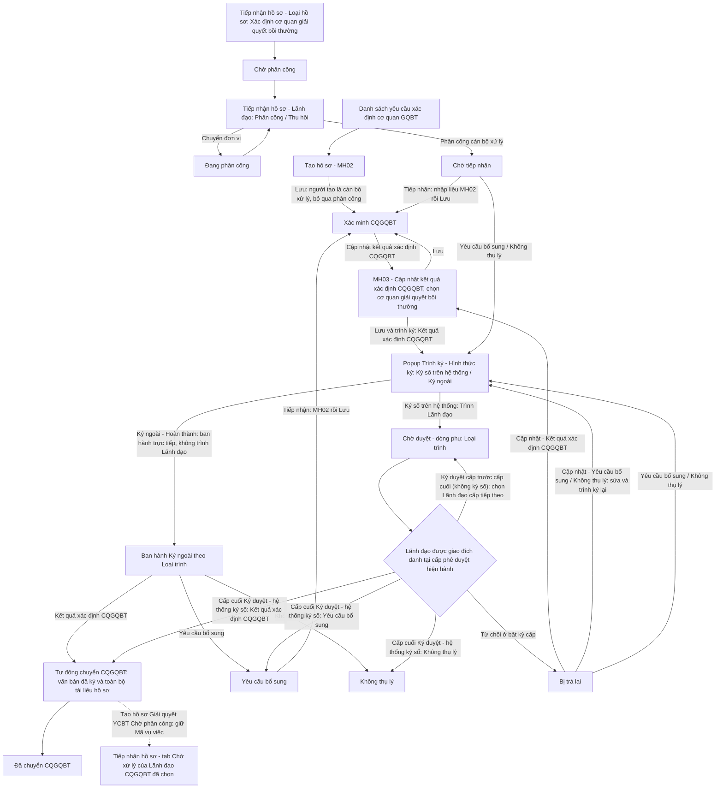

### 4.3.3. Dành cho Cán bộ nghiệp vụ bồi thường nhà nước

#### 4.3.3.1. Nhóm tính năng Xác định cơ quan giải quyết bồi thường

##### 4.3.3.1.1. Mục đích

\- Cho phép người dùng trên Website quản trị (menu `Xác định cơ quan giải quyết bồi thường`, phân hệ Bồi thường nhà nước) quản lý và xử lý hồ sơ yêu cầu xác định cơ quan giải quyết bồi thường, gồm:

+ Hồ sơ được tiếp nhận tại [MH02 - Màn hình Tiếp nhận hồ sơ - Tiếp nhận hồ sơ - Công tác bồi thường nhà nước (Website Quản trị)](SRS_BTNN_GiaiQuyetBT_TiepNhan_YCBT.md#43313-mh02---màn-hình-tiếp-nhận-hồ-sơ), được lãnh đạo phân công cán bộ xử lý tại tab `Chờ xử lý` của [Tiếp nhận hồ sơ - Tiếp nhận hồ sơ - Công tác bồi thường nhà nước (Website Quản trị)](SRS_BTNN_GiaiQuyetBT_TiepNhan_YCBT.md#tn-tab-xu-ly) và chuyển đến phân hệ ở trạng thái `Chờ tiếp nhận`.
+ Hồ sơ do cơ quan giải quyết bồi thường chuyển đến khi Không thụ lý với lý do `KTL_01` và chọn `Chuyển Bộ Tư pháp` / `Chuyển Sở Tư pháp` tại phân hệ Giải quyết yêu cầu bồi thường ([Không thụ lý hồ sơ yêu cầu bồi thường - Giải quyết yêu cầu bồi thường - Công tác bồi thường nhà nước (Website Quản trị)](SRS_BTNN_GiaiQuyetBT_GiaiQuyet_YCBT.md#gq-khong-thu-ly)): hồ sơ có `Nguồn hồ sơ` = `Chuyển CQGQBT`, Loại hồ sơ `Xác định cơ quan giải quyết bồi thường`, ở trạng thái `Chờ phân công` tại [Tiếp nhận hồ sơ - Tiếp nhận hồ sơ - Công tác bồi thường nhà nước (Website Quản trị)](SRS_BTNN_GiaiQuyetBT_TiepNhan_YCBT.md#tn-nguon-ho-so) của Bộ Tư pháp / Sở Tư pháp, giữ nguyên `Mã vụ việc`; được lãnh đạo phân công và chuyển đến phân hệ ở trạng thái `Chờ tiếp nhận` như hồ sơ tiếp nhận tại MH02.
+ Hồ sơ do cán bộ tạo mới trực tiếp tại phân hệ (`Tạo hồ sơ`).

\- Cán bộ xử lý tiếp nhận, nhập liệu và xác minh hồ sơ, cập nhật kết quả xác định cơ quan giải quyết bồi thường (chọn cơ quan giải quyết bồi thường) và trình ký Lãnh đạo theo luồng phê duyệt (Hình thức ký `Ký số trên hệ thống`): Lãnh đạo ở mọi cấp `Ký duyệt`, Lãnh đạo cấp cuối `Ký duyệt` thì hệ thống ký số văn bản. Hình thức ký `Ký ngoài`: cán bộ xử lý ban hành trực tiếp văn bản đã ký và đóng dấu ngoài hệ thống, không trình Lãnh đạo. Sau khi Lãnh đạo cấp cuối Ký duyệt văn bản Kết quả xác định CQGQBT (hoặc cán bộ ban hành Kết quả xác định CQGQBT Ký ngoài), hệ thống tự động chuyển hồ sơ cho CQGQBT đã chọn: tạo hồ sơ Giải quyết yêu cầu bồi thường ở trạng thái `Chờ phân công` tại CQGQBT đó, kèm văn bản đã ký và toàn bộ tài liệu của hồ sơ.

*a. Phân quyền*

- Chỉ dành cho Bộ Tư pháp, Sở Tư pháp và UBND cấp tỉnh.

*b. Điều kiện thực hiện*

- Người dùng truy cập màn hình `Xác định cơ quan giải quyết bồi thường` trên Website quản trị.

- Người dùng được phân quyền thực hiện tính năng.

*c. Quy tắc 02 tab Chờ xử lý / Đã xử lý*

| Vai trò | Tab `Chờ xử lý` | Tab `Đã xử lý` |
| :--- | :--- | :--- |
| Cán bộ xử lý | Hồ sơ trong phạm vi xem ở trạng thái: `Chờ tiếp nhận`, `Xác minh CQGQBT`, `Chờ duyệt`, `Bị trả lại`, `Yêu cầu bổ sung` | Hồ sơ ở trạng thái: `Không thụ lý`, `Đã chuyển CQGQBT` |
| Lãnh đạo (thuộc Nhóm lãnh đạo tại Cấu hình luồng xử lý) | Hồ sơ `Chờ duyệt` mà Lãnh đạo được giao đích danh ở cấp phê duyệt hiện hành | Hồ sơ Lãnh đạo đã Ký duyệt / Từ chối phê duyệt, không còn chờ Lãnh đạo duyệt |

##### 4.3.3.1.2. Sơ đồ luồng nghiệp vụ theo giao diện

\- Luồng đi của 01 hồ sơ Xác định cơ quan giải quyết bồi thường:

---

##### 4.3.3.1.3. MH01 - Màn hình Danh sách yêu cầu xác định cơ quan giải quyết bồi thường

###### 4.3.3.1.3.1. Màn hình

###### 4.3.3.1.3.2. Mô tả thông tin trên màn hình

| Trường thông tin | Kiểu dữ liệu | Bắt buộc | Mặc định | Mô tả |
| :--- | :--- | :--- | :--- | :--- |
| **Tab danh sách** | Tab | - | `Chờ xử lý` | Control UI: 02 tab đặt phía trên bộ lọc: + Chờ xử lý: hiển thị badge số lượng hồ sơ đang chờ xử lý (đồng bộ với badge số lượng tại menu `Xác định cơ quan giải quyết bồi thường` trên Left Menu) + Đã xử lý: không hiển thị badge số lượng - Bản ghi của từng tab theo [Quy tắc 02 tab Chờ xử lý / Đã xử lý - Xác định cơ quan giải quyết bồi thường - Công tác bồi thường nhà nước (Website Quản trị)](#xd-tab-xu-ly). |
| **Khối bộ lọc tìm kiếm** | String(255) | - | - | Control UI: Filter panel dạng thu gọn/mở rộng (Accordion). - Mặc định hiển thị dạng mở rộng. - Cho phép thu gọn/mở rộng khi click vào nút "Thu gọn"/"Mở rộng" ở góc phải khối; khi thu gọn, các giá trị lọc đã nhập được giữ nguyên. |
| Mã hồ sơ | String(50) | Không | Trống | Control UI: Input text. - Placeholder: `Nhập mã hồ sơ...`. - Tìm kiếm gần đúng theo mã hồ sơ xác định cơ quan, không phân biệt hoa thường, có trim khoảng trắng. |
| Tên cá nhân/Tổ chức yêu cầu | String(255) | Không | Trống | Control UI: Input text. - Placeholder: `Nhập tên cá nhân/tổ chức yêu cầu...`. - Tìm kiếm gần đúng theo `Họ và tên` (cá nhân) hoặc `Tên tổ chức` của người yêu cầu, không phân biệt hoa thường, có trim khoảng trắng. |
| Họ và tên người/Tổ chức bị thiệt hại | String(255) | Không | Trống | Control UI: Input text. - Placeholder: `Nhập họ và tên người/tên tổ chức bị thiệt hại...`. - Tìm kiếm gần đúng theo giá trị cột `Họ và tên người/Tổ chức bị thiệt hại` trên lưới, không phân biệt hoa thường, có trim khoảng trắng. |
| Lĩnh vực phát sinh thiệt hại | Enum(String(100)) | Không | `Tất cả lĩnh vực` | Control UI: Combobox. Tham chiếu danh mục Lĩnh vực phát sinh thiệt hại [DM_22]. |
| Trạng thái | Enum(String(50)) | Không | `Tất cả trạng thái` | Control UI: Combobox. - Danh sách giá trị theo tab đang chọn ([Quy tắc 02 tab Chờ xử lý / Đã xử lý - Xác định cơ quan giải quyết bồi thường - Công tác bồi thường nhà nước (Website Quản trị)](#xd-tab-xu-ly)). Gồm: + Tất cả trạng thái + Chờ tiếp nhận + Xác minh CQGQBT + Chờ duyệt + Bị trả lại + Yêu cầu bổ sung + Không thụ lý + Đã chuyển CQGQBT |
| Loại trình | Enum(String(50)) | Không | `Tất cả` | Control UI: Combobox. - Chỉ hiển thị khi bộ lọc Trạng thái chọn là `Chờ duyệt` hoặc `Bị trả lại`. Gồm: + Tất cả + Yêu cầu bổ sung + Không thụ lý + Kết quả xác định CQGQBT |
| Cơ quan xử lý | Enum(String(50)) | Không | `Tất cả` | Control UI: Multiselect Combobox có tìm kiếm. - Mặc định: `Tất cả`. - Cho phép gõ tìm kiếm và chọn 01 hoặc nhiều cơ quan bất kỳ để thực hiện tìm kiếm/lọc. |
| Từ ngày | Date | Không | Ngày hiện tại trừ 03 tháng | Control UI: Datepicker. - Định dạng hiển thị `dd/mm/yyyy`. - Có icon lịch. - Lọc theo ngày tiếp nhận từ ngày. |
| Đến ngày | Date | Không | Ngày hiện tại | Control UI: Datepicker. - Định dạng hiển thị `dd/mm/yyyy`. - Có icon lịch. - Lọc theo ngày tiếp nhận đến ngày. |
| **Bảng danh sách yêu cầu xác định cơ quan giải quyết bồi thường** | - | - | 20 bản ghi/trang | Control UI: Data grid. - Khi người dùng truy cập màn hình, hệ thống tự động tải trang đầu tiên (Trang 1) với số lượng mặc định 20 bản ghi. - Sắp xếp mặc định: Sắp xếp theo "Thời điểm tiếp nhận" giảm dần (mới nhất hiển thị lên đầu). - **Phạm vi dữ liệu**: chỉ hiển thị hồ sơ người dùng là cán bộ xử lý, người tạo hoặc người dùng thuộc Nhóm lãnh đạo của một đơn vị trên luồng phân công/phê duyệt của hồ sơ. - Trạng thái có dữ liệu: Hiển thị danh sách các bản ghi kết quả theo cấu trúc các cột quy định. - Trạng thái không có dữ liệu (Empty State): Khi không tìm thấy kết quả phù hợp với điều kiện tìm kiếm, bảng hiển thị duy nhất 01 dòng căn giữa trên toàn bộ chiều rộng bảng (`colspan`), in nghiêng với nội dung theo MessageList dùng chung [MSG-INF-SYS-001]. |
| STT | Integer(10) | - | Tự tăng | Control UI: Text hiển thị (Read-only). - Căn giữa. - Hiển thị số thứ tự theo trang hiện tại. |
| Mã hồ sơ | String(50) | - | Theo dữ liệu | Control UI: Text hiển thị (Read-only). - Căn giữa. - Hiển thị mã hồ sơ xác định cơ quan giải quyết bồi thường. |
| Tên cá nhân/Tổ chức yêu cầu | String(255) | - | Theo dữ liệu | Control UI: Text hiển thị (Read-only). - Theo dữ liệu bản ghi: `Họ và tên` (người yêu cầu là cá nhân) hoặc `Tên tổ chức` (người yêu cầu là tổ chức). - Nếu chưa có dữ liệu, hiển thị `(Chưa nhập)`. |
| Họ và tên người/Tổ chức bị thiệt hại | String(255) | - | Theo dữ liệu | Control UI: Text hiển thị (Read-only). - Theo dữ liệu bản ghi: + `Tư cách người yêu cầu bồi thường` = `Người bị thiệt hại`: bằng `Tên cá nhân/Tổ chức yêu cầu`. + `Tư cách người yêu cầu bồi thường` = `Tổ chức kế thừa quyền, nghĩa vụ của tổ chức bị thiệt hại đã chấm dứt tồn tại`: `Tên tổ chức bị thiệt hại`. + Tư cách khác: `Họ và tên người bị thiệt hại`. - Không có dữ liệu: hiển thị `-`. |
| Lĩnh vực thiệt hại | Enum(String(50)) | - | Theo dữ liệu | Control UI: Text hiển thị (Read-only). - Hiển thị lĩnh vực phát sinh thiệt hại theo danh mục [DM_22], bỏ tiền tố `TRONG HOẠT ĐỘNG`. |
| Hành vi gây thiệt hại của người thi hành công vụ | Text(2000) | - | Theo dữ liệu | Control UI: Text hiển thị (Read-only). - Theo dữ liệu bản ghi. - Nếu nội dung dài hơn giới hạn hiển thị của ô, hệ thống rút gọn và cho phép xem đầy đủ khi rê chuột vào nội dung. |
| Ngày tiếp nhận | Date | - | Theo dữ liệu | Control UI: Text hiển thị (Read-only). - Căn giữa. - Định dạng `dd/mm/yyyy`. |
| Cơ quan xử lý | String(255) | - | Theo dữ liệu | Theo thông tin bản ghi. |
| Cán bộ xử lý | String(100) | - | Theo dữ liệu | Control UI: Text hiển thị (Read-only). - Hiển thị họ tên cán bộ xử lý của hồ sơ; chưa có thì hiển thị `--`. |
| Trạng thái | Enum(String(50)) | - | Theo dữ liệu | Control UI: Badge trạng thái (Read-only). Theo dữ liệu bản ghi. |
| Thao tác | String(255) | - | Theo trạng thái | Control UI: Action Buttons (Icon button). Các nút thao tác hiển thị linh hoạt theo trạng thái của hồ sơ: + Tiếp nhận: Chỉ hiển thị khi hồ sơ ở trạng thái `Chờ tiếp nhận` hoặc `Yêu cầu bổ sung`. + Cập nhật kết quả: Chỉ hiển thị khi hồ sơ ở trạng thái `Xác minh CQGQBT`. + Cập nhật: Chỉ hiển thị khi hồ sơ ở trạng thái `Bị trả lại`. + Yêu cầu bổ sung: Chỉ hiển thị khi hồ sơ ở trạng thái `Chờ tiếp nhận` hoặc `Bị trả lại`. + Không thụ lý: Chỉ hiển thị khi hồ sơ ở trạng thái `Chờ tiếp nhận` hoặc `Bị trả lại`. + Ký duyệt: Chỉ hiển thị khi hồ sơ ở trạng thái `Chờ duyệt`. + Từ chối: Chỉ hiển thị khi hồ sơ ở trạng thái `Chờ duyệt`. |
| Phân trang | Pagination | - | 20 bản ghi/trang | Control UI: Pagination. - Cho phép chọn cấu hình số lượng bản ghi hiển thị (10, 20, 50, 100); mặc định 20 bản ghi/trang. - Hiển thị dải bản ghi: "Hiển thị [từ]-[đến] trong số [tổng số] bản ghi" (khi không có dữ liệu hiển thị 0-0 trong số 0). - Đầy đủ các nút điều hướng trang: Đầu (&#124;&lt;&lt;), Trước (&lt;), các số trang, Sau (&gt;), Cuối (&gt;&gt;&#124;). |

###### 4.3.3.1.3.3. Chức năng trên màn hình

| STT | Tên chức năng | Định dạng | Mô tả |
| :--- | :--- | :--- | :--- |
| 1 | Tìm kiếm | Button | Khi người dùng click nút, hệ thống kiểm tra điều kiện dữ liệu và thực hiện tìm kiếm theo các trường hợp bên dưới: |
|  |  |  | **TH1 - Khoảng ngày không hợp lệ**: Nếu `Từ ngày` lớn hơn `Đến ngày`, hệ thống hiển thị cảnh báo lỗi [MSG-ERR-VAL-007] và không thực hiện tìm kiếm. |
|  |  |  | **TH Hợp lệ (Có dữ liệu phù hợp)**: Hệ thống lọc và hiển thị danh sách các bản ghi thuộc phạm vi dữ liệu của người dùng, thỏa mãn đồng thời các tiêu chí tìm kiếm/lọc đã nhập/chọn, hiển thị kết quả lên bảng và đưa về Trang 1. |
|  |  |  | **TH Không có dữ liệu trả về**: Bảng kết quả hiển thị duy nhất 01 dòng căn giữa trên toàn bộ chiều rộng bảng (`colspan`), in nghiêng với nội dung theo MessageList dùng chung [MSG-INF-SYS-001]; thanh phân trang hiển thị *"Hiển thị 0-0 trong số 0 bản ghi"*, các nút điều hướng trang ở trạng thái khóa mờ (Disabled). |
| 2 | Xóa bộ lọc | Button | Đưa bộ lọc về giá trị mặc định và tải lại danh sách. |
| 3 | Tạo hồ sơ | Button | Hệ thống mở [MH02 - Màn hình Tiếp nhận/Cập nhật xác định cơ quan giải quyết bồi thường](#43314-mh02---màn-hình-tiếp-nhậncập-nhật-xác-định-cơ-quan-giải-quyết-bồi-thường) ở trường hợp Tạo mới hồ sơ; tiêu đề hiển thị `THÊM MỚI YÊU CẦU XÁC ĐỊNH CƠ QUAN GIẢI QUYẾT BỒI THƯỜNG` và toàn bộ trường thông tin trên form ở trạng thái trống/mặc định ban đầu. |
| 4 | Click dòng dữ liệu | Row click | Khi người dùng click vào dòng dữ liệu, hệ thống xử lý theo các trường hợp bên dưới. |
|  |  |  | **TH1 - Click vào dòng dữ liệu**: Hệ thống mở [MH04 - Màn hình Chi tiết yêu cầu xác định cơ quan giải quyết bồi thường](#43316-mh04---màn-hình-chi-tiết-yêu-cầu-xác-định-cơ-quan-giải-quyết-bồi-thường) của bản ghi được chọn. |
|  |  |  | **TH2 - Click vào icon thao tác trong cột Thao tác**: Không thực hiện row click; thực hiện đúng chức năng của icon được click. |
| 5 | Tiếp nhận | Icon button | Hệ thống mở [MH02 - Màn hình Tiếp nhận/Cập nhật xác định cơ quan giải quyết bồi thường](#43314-mh02---màn-hình-tiếp-nhậncập-nhật-xác-định-cơ-quan-giải-quyết-bồi-thường) ở trường hợp Tiếp nhận hồ sơ; tiêu đề hiển thị `TIẾP NHẬN YÊU CẦU XÁC ĐỊNH CƠ QUAN GIẢI QUYẾT BỒI THƯỜNG`, tự động kế thừa dữ liệu tiếp nhận ban đầu và cho phép cán bộ xử lý sửa/nhập bổ sung trước khi bấm `Lưu` (hồ sơ chuyển `Xác minh CQGQBT`). |
| 6 | Tiếp nhận (hồ sơ `Yêu cầu bổ sung`) | Icon button | Hệ thống mở [MH02 - Màn hình Tiếp nhận/Cập nhật xác định cơ quan giải quyết bồi thường](#43314-mh02---màn-hình-tiếp-nhậncập-nhật-xác-định-cơ-quan-giải-quyết-bồi-thường) ở trường hợp Tiếp nhận hồ sơ bổ sung; tiêu đề hiển thị `TIẾP NHẬN YÊU CẦU XÁC ĐỊNH CƠ QUAN GIẢI QUYẾT BỒI THƯỜNG`, điền sẵn dữ liệu của bản ghi và hiển thị khối `THÔNG TIN YÊU CẦU BỔ SUNG`. |
| 7 | Cập nhật kết quả xác định CQGQBT | Icon button | Hệ thống mở [MH03 - Màn hình Cập nhật kết quả xác định cơ quan giải quyết bồi thường](#43315-mh03---màn-hình-cập-nhật-kết-quả-xác-định-cơ-quan-giải-quyết-bồi-thường). |
| 8 | Cập nhật | Icon button | Hệ thống xử lý theo Loại trình bị trả lại: - **TH1 - Loại trình bị trả lại là `Kết quả xác định CQGQBT`**: Hệ thống mở [MH03 - Màn hình Cập nhật kết quả xác định cơ quan giải quyết bồi thường](#43315-mh03---màn-hình-cập-nhật-kết-quả-xác-định-cơ-quan-giải-quyết-bồi-thường), điền sẵn kết quả xác định đã lưu và hiển thị khối `THÔNG TIN HỒ SƠ BỊ TRẢ LẠI`. - **TH2 - Loại trình bị trả lại là `Yêu cầu bổ sung`**: Hệ thống mở [Popup Trình ký](#xd-popup-trinh-ky) với Loại trình `Yêu cầu bổ sung`, điền sẵn thông tin theo phiếu trình bị trả lại. - **TH3 - Loại trình bị trả lại là `Không thụ lý`**: Hệ thống mở [Popup Trình ký](#xd-popup-trinh-ky) với Loại trình `Không thụ lý`, điền sẵn thông tin theo phiếu trình bị trả lại. |
| 9 | Yêu cầu bổ sung | Icon button | Hệ thống mở [Popup Trình ký](#xd-popup-trinh-ky) với Loại trình `Yêu cầu bổ sung`. |
| 10 | Không thụ lý | Icon button | Hệ thống mở [Popup Trình ký](#xd-popup-trinh-ky) với Loại trình `Không thụ lý`. |
| 11 | Chuyển tab | Tab | Hệ thống hiển thị danh sách của tab `Chờ xử lý` hoặc `Đã xử lý`, nạp lại bộ lọc `Trạng thái` theo tab và đưa về Trang 1. |
| 12 | Ký duyệt | Icon button | Hệ thống mở [Màn hình Ký duyệt / Từ chối](#xd-ky-duyet) để thực hiện ký duyệt văn bản trình. |
| 13 | Từ chối | Icon button | Hệ thống mở [Màn hình Ký duyệt / Từ chối](#xd-tu-choi) để nhập lý do từ chối và trả lại hồ sơ. Xử lý thành công: hồ sơ chuyển trạng thái `Bị trả lại`. |

---

##### 4.3.3.1.4. MH02 - Màn hình Tiếp nhận/Cập nhật xác định cơ quan giải quyết bồi thường

###### 4.3.3.1.4.1. Màn hình

###### 4.3.3.1.4.2. Mô tả thông tin trên màn hình

| Trường thông tin | Kiểu dữ liệu | Bắt buộc | Mặc định | Mô tả |
| :--- | :--- | :--- | :--- | :--- |
| Tiêu đề màn hình | String(255) | - | Theo trường hợp | Control UI: Text heading (Read-only). - Khi mở form do `Tiếp nhận` hồ sơ `Chờ tiếp nhận` đã được phân công hoặc hồ sơ `Yêu cầu bổ sung`: hiển thị `TIẾP NHẬN YÊU CẦU XÁC ĐỊNH CƠ QUAN GIẢI QUYẾT BỒI THƯỜNG`. - Khi `Tạo hồ sơ` trực tiếp tại phân hệ Xác định cơ quan: hiển thị `THÊM MỚI YÊU CẦU XÁC ĐỊNH CƠ QUAN GIẢI QUYẾT BỒI THƯỜNG`. |
| **THÔNG TIN YÊU CẦU BỔ SUNG** | Section | - | Ẩn | Control UI: Alert panel, đặt trên cùng form, dưới tiêu đề màn hình. - Chỉ hiển thị khi hồ sơ đang ở trạng thái `Yêu cầu bổ sung` hoặc trước đó từng có Yêu cầu bổ sung (đã ban hành văn bản yêu cầu bổ sung: Lãnh đạo cấp cuối Ký duyệt hoặc cán bộ ban hành Ký ngoài). - Tiêu đề khối kèm nhãn trạng thái: `Đang chờ bổ sung` hoặc `Đã tiếp nhận bổ sung`. - Nội dung là danh sách các lần Yêu cầu bổ sung theo Lịch sử Yêu cầu bổ sung và Bị trả lại; mỗi lần gồm các trường bên dưới. |
| Nội dung yêu cầu bổ sung | Text(2000) | - | Theo dữ liệu bản ghi | Control UI: Text (Read-only). - Nội dung yêu cầu bổ sung đã nhập khi trình ký / ban hành; giữ xuống dòng. |
| Hình thức ký | Enum(String(30)) | - | Theo dữ liệu bản ghi | Control UI: Label, Theo giá trị bản ghi. |
| Văn bản đã ký | File | - | Theo dữ liệu bản ghi | Control UI: Tên tệp kèm Text link `Xem file`. - Tệp PDF đã ký số hoặc tệp PDF Ký ngoài cán bộ đã tải lên. - Click `Xem file`: mở xem trước tệp. |
| Người ban hành - thời điểm | String(255) | - | Theo dữ liệu bản ghi | Control UI: Text (Read-only). - Định dạng `[Họ và tên] - [Đơn vị] - [HH:mm dd/mm/yyyy]`. - Ký số: Lãnh đạo cấp cuối Ký duyệt; Ký ngoài: cán bộ xử lý ban hành. |
| Tiếp nhận hồ sơ bổ sung | String(255) | - | Theo dữ liệu bản ghi | Control UI: Text (Read-only). - Đã tiếp nhận: `[HH:mm dd/mm/yyyy] - [Họ và tên cán bộ tiếp nhận]`. - Chưa tiếp nhận: `Chưa tiếp nhận`. |
| **THÔNG TIN HỒ SƠ BỊ TRẢ LẠI** | Section | - | Ẩn | Control UI: Alert panel, đặt trên cùng form, dưới khối `THÔNG TIN YÊU CẦU BỔ SUNG`. - Chỉ hiển thị khi hồ sơ đang ở trạng thái `Bị trả lại` hoặc trước đó từng bị trả lại. - Nội dung là danh sách đầy đủ các lần bị trả lại theo Lịch sử Yêu cầu bổ sung và Bị trả lại, sắp xếp theo thứ tự thời gian; không đánh số lần. - Mỗi lần gồm các trường bên dưới. |
| Thời điểm | DateTime | - | Theo dữ liệu bản ghi | Control UI: Label, Theo dữ liệu bản ghi. |
| Lãnh đạo trả lại | String(255) | - | Theo dữ liệu bản ghi | Control UI: Label, Theo dữ liệu bản ghi. |
| Loại trình | String(100) | - | Theo dữ liệu bản ghi | Control UI: Label, Theo dữ liệu bản ghi. |
| Lý do bị trả lại | Text(2000) | - | Theo dữ liệu bản ghi | Control UI: Label, Theo dữ liệu bản ghi. |
| **THÔNG TIN CHUNG** | String(255) | - | - | Control UI: Section header. - Khối thông tin chung của yêu cầu. |
| Trạng thái hồ sơ | Enum(String(50)) | - | Ẩn khi Thêm mới | Control UI: Badge trạng thái (Read-only). - Khi mở ở trường hợp Tạo mới hồ sơ: **không hiển thị**. - Các trường hợp còn lại: hiển thị badge trạng thái hiện tại của hồ sơ (`Chờ tiếp nhận`, `Yêu cầu bổ sung` hoặc `Xác minh CQGQBT`). |
| Hình thức tiếp nhận | Enum(String(50)) | Có | `Trực tiếp` (thêm mới) / Theo dữ liệu kế thừa | Control UI: Combobox. - Tham chiếu [Danh mục Hình thức tiếp nhận - Danh mục dữ liệu dùng chung - Tổng quan và quy tắc chung](../../Tai%20lieu%20tong%20hop/00_Tong_quan_va_Quy_tac_chung.md#danh-muc-dung-chung) [DM_25]. - Thêm mới trực tiếp: chỉ cho chọn `Trực tiếp`, `Qua dịch vụ bưu chính`. - Hồ sơ kế thừa từ Tiếp nhận hồ sơ: mặc định theo `Hình thức tiếp nhận` của hồ sơ đã tiếp nhận; cho phép điều chỉnh, chọn đủ các giá trị của DM_25. |
| Lĩnh vực phát sinh thiệt hại | Enum(String(100)) | Có | `TRONG HOẠT ĐỘNG QUẢN LÝ HÀNH CHÍNH` | Control UI: Combobox. - Tham chiếu danh mục Lĩnh vực phát sinh thiệt hại [DM_22]. - Trường được điền sẵn theo dữ liệu kế thừa khi mở form từ `Tiếp nhận` hoặc theo bản ghi khi sửa; cán bộ được phép sửa. |
| Loại yêu cầu giải quyết bồi thường | Enum(String(100)) | Có | `Yêu cầu cả hai (Bồi thường tiền & Phục hồi danh dự)` | Control UI: Radio button. Gồm: + Yêu cầu cả hai (Bồi thường tiền & Phục hồi danh dự) + Chỉ yêu cầu bồi thường thiệt hại bằng tiền + Chỉ yêu cầu phục hồi danh dự |
| **THÔNG TIN CHI TIẾT NGƯỜI YÊU CẦU BỒI THƯỜNG** | String(100) | - | - | Control UI: Section header. - Khối thông tin người yêu cầu bồi thường, gồm 02 cột `Thông tin cá nhân & Liên hệ` và `Giấy tờ pháp lý & Địa chỉ`. |
| Loại người yêu cầu | Enum(String(20)) | Có | `Cá nhân` / Theo dữ liệu kế thừa | Control UI: Radio button. Giá trị gồm: + Cá nhân + Tổ chức |
| Tư cách người yêu cầu bồi thường | Enum(String(100)) | Có | `Người bị thiệt hại` | Control UI: Combobox. - Tham chiếu [Danh mục Tư cách người yêu cầu bồi thường - Danh mục dữ liệu dùng chung - Tổng quan và quy tắc chung](../../Tai%20lieu%20tong%20hop/00_Tong_quan_va_Quy_tac_chung.md#danh-muc-dung-chung) [DM_26]. - `Loại người yêu cầu` = `Cá nhân`, hiển thị: + Người bị thiệt hại + Người thừa kế của người bị thiệt hại + Người đại diện cho những người thừa kế của người bị thiệt hại + Người đại diện theo pháp luật của người bị thiệt hại + Cá nhân, pháp nhân được ủy quyền hợp pháp - `Loại người yêu cầu` = `Tổ chức`, hiển thị: + Người bị thiệt hại + Tổ chức kế thừa quyền, nghĩa vụ của tổ chức bị thiệt hại đã chấm dứt tồn tại + Cá nhân, pháp nhân được ủy quyền hợp pháp - Điền sẵn theo dữ liệu kế thừa khi mở form từ `Tiếp nhận`; cán bộ được phép sửa. |
| Họ và tên / Tên tổ chức | String(255) | Có | Theo trường hợp | Control UI: Input text. - `Loại người yêu cầu` = `Cá nhân`: + Nhãn: `Họ và tên` + Placeholder: `Nhập họ và tên...` - `Loại người yêu cầu` = `Tổ chức`: + Nhãn: `Tên tổ chức` + Placeholder: `Nhập tên tổ chức...` - Trường được điền sẵn theo dữ liệu kế thừa khi mở form từ `Tiếp nhận`; cán bộ được phép sửa. - Khi tạo mới trực tiếp, trường ở trạng thái trống để cán bộ nhập từ đầu. |
| Ngày sinh | Date | Có (khi `Cá nhân`) | Trống | Control UI: Datepicker. - Chỉ hiển thị khi `Loại người yêu cầu` = `Cá nhân`. - Placeholder: `dd/mm/yyyy`. - Có icon lịch. |
| Loại giấy tờ thân nhân | Enum(String(50)) | Có (khi `Cá nhân`) | Trống | Control UI: Combobox. - Chỉ hiển thị khi `Loại người yêu cầu` = `Cá nhân`. - Placeholder: `-- Chọn loại giấy tờ --`. - Tham chiếu [Danh mục Loại giấy tờ pháp lý - Danh mục dữ liệu dùng chung - Tổng quan và quy tắc chung](../../Tai%20lieu%20tong%20hop/00_Tong_quan_va_Quy_tac_chung.md#danh-muc-dung-chung) [DM_10]. - Chỉ gồm các giá trị dành cho cá nhân, không gồm `Mã số thuế`. |
| Số giấy tờ thân nhân | String(50) | Có (khi `Cá nhân`) | Trống | Control UI: Input text. - Chỉ hiển thị khi `Loại người yêu cầu` = `Cá nhân`. - Placeholder: `Nhập số giấy tờ...`. - Nhập số giấy tờ chứng minh tư cách pháp lý của người yêu cầu. |
| Ngày cấp | Date | Có (khi `Cá nhân`) | Trống | Control UI: Datepicker. - Chỉ hiển thị khi `Loại người yêu cầu` = `Cá nhân`. - Placeholder: `dd/mm/yyyy`. - Có icon lịch. |
| Nơi cấp | String(255) | Có (khi `Cá nhân`) | Trống | Control UI: Input text. - Chỉ hiển thị khi `Loại người yêu cầu` = `Cá nhân`. - Placeholder: `Nhập nơi cấp...`. - Nhập nơi cấp giấy tờ thân nhân. |
| Mã số tổ chức | String(50) | Có (khi `Tổ chức`) | Trống | Control UI: Input text. - Chỉ hiển thị khi `Loại người yêu cầu` = `Tổ chức`. - Placeholder: `Nhập mã số doanh nghiệp / mã số thuế / mã số khác...`. - Nhập mã số doanh nghiệp, mã số thuế hoặc mã số khác của tổ chức. |
| Số giấy tờ thành lập/đăng ký | String(50) | Không | Trống | Control UI: Input text. - Chỉ hiển thị khi `Loại người yêu cầu` = `Tổ chức`. - Placeholder: `Nhập số giấy tờ thành lập/đăng ký...`. |
| Ngày cấp (giấy tờ thành lập/đăng ký) | Date | Không | Trống | Control UI: Datepicker. - Chỉ hiển thị khi `Loại người yêu cầu` = `Tổ chức`. - Nhãn hiển thị: `Ngày cấp`. - Placeholder: `dd/mm/yyyy`. |
| Nơi cấp (giấy tờ thành lập/đăng ký) | String(255) | Không | Trống | Control UI: Input text. - Chỉ hiển thị khi `Loại người yêu cầu` = `Tổ chức`. - Nhãn hiển thị: `Nơi cấp`. - Placeholder: `Nhập nơi cấp...`. |
| Họ và tên người đại diện theo pháp luật | String(100) | Có (khi hiển thị) | Trống | Control UI: Input text. - Chỉ hiển thị khi `Loại người yêu cầu` = `Tổ chức`. - Placeholder: `Nhập họ và tên người đại diện theo pháp luật...`. |
| Chức vụ người đại diện | String(100) | Có (khi hiển thị) | Trống | Control UI: Input text. - Chỉ hiển thị khi `Loại người yêu cầu` = `Tổ chức`. - Placeholder: `Nhập chức vụ người đại diện...`. |
| Số điện thoại | String(20) | Có | Trống | Control UI: Input text. - Placeholder: `Nhập số điện thoại...`. - Áp dụng quy tắc số điện thoại [BR-VAL-003]. |
| Email | String(255) | Không | Trống | Control UI: Input text. - Placeholder: `Nhập email...`. - Nếu có dữ liệu, áp dụng quy tắc Email [BR-VAL-002]. |
| Quốc gia | Enum(String(50)) | Có | `Việt Nam` | Control UI: Combobox. - Tham chiếu danh mục Quốc tịch/Quốc gia [DM_09]. |
| Tỉnh/Thành phố | Enum(String(100)) / String(100) | Có | Theo trường hợp | Control UI: Combobox có tìm kiếm / Input text. - Nếu `Quốc gia` = `Việt Nam`: Tham chiếu Danh mục Tỉnh/Thành phố [DM_13]. Cho phép gõ tìm kiếm theo Mã hoặc Tên. - Nếu `Quốc gia` khác `Việt Nam`: Hiển thị ô nhập văn bản để người dùng tự do nhập. - Trường được điền sẵn theo dữ liệu kế thừa khi mở form từ `Tiếp nhận` hoặc theo bản ghi khi sửa; cán bộ được phép sửa. |
| Phường/Xã | Enum(String(100)) / String(100) | Có | Theo trường hợp | Control UI: Combobox có tìm kiếm / Input text. - Phụ thuộc vào `Tỉnh/Thành phố` đã chọn. - Nếu `Quốc gia` = `Việt Nam`: Tham chiếu Danh mục Xã/Phường/Thị trấn [DM_15] (lọc động theo Tỉnh/Thành phố đã chọn). Cho phép gõ tìm kiếm theo Mã hoặc Tên. Nếu chưa chọn Tỉnh/Thành phố thì khóa mờ (Disabled) kèm placeholder *"Vui lòng chọn Tỉnh/Thành phố trước"*. - Nếu `Quốc gia` khác `Việt Nam`: Hiển thị ô nhập văn bản (Input text) để người dùng tự do nhập. - Trường được điền sẵn theo dữ liệu kế thừa khi mở form từ `Tiếp nhận` hoặc theo bản ghi khi sửa; cán bộ được phép sửa. |
| Địa chỉ chi tiết | Text(1000) / String(500) | Có | Theo trường hợp | Control UI: Input text. - Placeholder: `Nhập số nhà, tên đường/phố, thôn/xóm/ấp...`. - Trường được điền sẵn theo dữ liệu kế thừa khi mở form từ `Tiếp nhận` hoặc theo bản ghi khi sửa; cán bộ được phép sửa. - Khi tạo mới trực tiếp, trường ở trạng thái trống để cán bộ nhập từ đầu. |
| **THÔNG TIN NGƯỜI BỊ THIỆT HẠI** | Section | - | Ẩn | Control UI: Section header. - Chỉ hiển thị khi `Tư cách người yêu cầu bồi thường` khác `Người bị thiệt hại`. |
| Tên tổ chức bị thiệt hại | String(255) | Có (khi hiển thị) | Trống | Control UI: Input text. - Chỉ hiển thị khi `Tư cách người yêu cầu bồi thường` = `Tổ chức kế thừa quyền, nghĩa vụ của tổ chức bị thiệt hại đã chấm dứt tồn tại`. - Khi hiển thị, tiêu đề khối là `THÔNG TIN TỔ CHỨC BỊ THIỆT HẠI ĐÃ CHẤM DỨT TỒN TẠI`. - Placeholder: `Nhập tên tổ chức bị thiệt hại...`. |
| Mã số tổ chức (tổ chức bị thiệt hại) | String(50) | Không | Trống | Control UI: Input text. - Chỉ hiển thị khi `Tư cách người yêu cầu bồi thường` = `Tổ chức kế thừa quyền, nghĩa vụ của tổ chức bị thiệt hại đã chấm dứt tồn tại`. - Nhãn hiển thị: `Mã số tổ chức`. - Placeholder: `Nhập mã số doanh nghiệp / mã số thuế / mã số khác...`. |
| Họ và tên người bị thiệt hại | String(100) | Có (khi hiển thị) | Trống | Control UI: Input text. - Chỉ hiển thị khi `Tư cách người yêu cầu bồi thường` khác `Người bị thiệt hại` và khác `Tổ chức kế thừa quyền, nghĩa vụ của tổ chức bị thiệt hại đã chấm dứt tồn tại`. - Placeholder: `Nhập họ và tên người bị thiệt hại...`. |
| Ngày tháng năm sinh | Date | Có (khi hiển thị) | Trống | Control UI: Datepicker. - Chỉ hiển thị khi `Tư cách người yêu cầu bồi thường` khác `Người bị thiệt hại` và khác `Tổ chức kế thừa quyền, nghĩa vụ của tổ chức bị thiệt hại đã chấm dứt tồn tại`. - Placeholder: `dd/mm/yyyy`. - Có icon lịch. |
| Số điện thoại | String(20) | Không | Trống | Control UI: Input text. - Chỉ hiển thị khi `Tư cách người yêu cầu bồi thường` khác `Người bị thiệt hại` và khác `Tổ chức kế thừa quyền, nghĩa vụ của tổ chức bị thiệt hại đã chấm dứt tồn tại`. - Placeholder: `Nhập số điện thoại...`. - Nếu có dữ liệu, áp dụng quy tắc số điện thoại [BR-VAL-003]. |
| Email | String(255) | Không | Trống | Control UI: Input text. - Chỉ hiển thị khi `Tư cách người yêu cầu bồi thường` khác `Người bị thiệt hại` và khác `Tổ chức kế thừa quyền, nghĩa vụ của tổ chức bị thiệt hại đã chấm dứt tồn tại`. - Placeholder: `Nhập email...`. - Nếu có dữ liệu, áp dụng quy tắc Email [BR-VAL-002]. |
| Loại giấy tờ thân nhân | Enum(String(50)) | Có (khi hiển thị) | Trống | Control UI: Combobox. - Chỉ hiển thị khi `Tư cách người yêu cầu bồi thường` khác `Người bị thiệt hại` và khác `Tổ chức kế thừa quyền, nghĩa vụ của tổ chức bị thiệt hại đã chấm dứt tồn tại`. - Placeholder: `-- Chọn loại giấy tờ --`. - Tham chiếu [Danh mục Loại giấy tờ pháp lý - Danh mục dữ liệu dùng chung - Tổng quan và quy tắc chung](../../Tai%20lieu%20tong%20hop/00_Tong_quan_va_Quy_tac_chung.md#danh-muc-dung-chung) [DM_10]. - Chỉ gồm các giá trị dành cho cá nhân, không gồm `Mã số thuế`. |
| Số giấy tờ thân nhân | String(50) | Có (khi hiển thị) | Trống | Control UI: Input text. - Chỉ hiển thị khi `Tư cách người yêu cầu bồi thường` khác `Người bị thiệt hại` và khác `Tổ chức kế thừa quyền, nghĩa vụ của tổ chức bị thiệt hại đã chấm dứt tồn tại`. - Placeholder: `Nhập số giấy tờ...`. |
| Ngày cấp | Date | Không | Trống | Control UI: Datepicker. - Chỉ hiển thị khi `Tư cách người yêu cầu bồi thường` khác `Người bị thiệt hại` và khác `Tổ chức kế thừa quyền, nghĩa vụ của tổ chức bị thiệt hại đã chấm dứt tồn tại`. - Placeholder: `dd/mm/yyyy`. |
| Nơi cấp | String(255) | Không | Trống | Control UI: Input text. - Chỉ hiển thị khi `Tư cách người yêu cầu bồi thường` khác `Người bị thiệt hại` và khác `Tổ chức kế thừa quyền, nghĩa vụ của tổ chức bị thiệt hại đã chấm dứt tồn tại`. - Placeholder: `Nhập nơi cấp...`. |
| Quốc gia | Enum(String(50)) | Không | `Việt Nam` | Control UI: Combobox. - Chỉ hiển thị khi `Tư cách người yêu cầu bồi thường` khác `Người bị thiệt hại` và khác `Tổ chức kế thừa quyền, nghĩa vụ của tổ chức bị thiệt hại đã chấm dứt tồn tại`. - Tham chiếu danh mục Quốc tịch/Quốc gia [DM_09]. |
| Tỉnh/Thành phố | Enum(String(100)) | Không | Trống | Control UI: Combobox có tìm kiếm. - Chỉ hiển thị khi `Tư cách người yêu cầu bồi thường` khác `Người bị thiệt hại` và khác `Tổ chức kế thừa quyền, nghĩa vụ của tổ chức bị thiệt hại đã chấm dứt tồn tại`. - Tham chiếu Danh mục Tỉnh/Thành phố [DM_13]; placeholder `Gõ Mã hoặc Tên Tỉnh/Thành phố...`. |
| Phường/Xã | String(100) | Không | Trống | Control UI: Input text. - Chỉ hiển thị khi `Tư cách người yêu cầu bồi thường` khác `Người bị thiệt hại` và khác `Tổ chức kế thừa quyền, nghĩa vụ của tổ chức bị thiệt hại đã chấm dứt tồn tại`. - Placeholder: `Nhập phường/xã...`. |
| Địa chỉ chi tiết | String(500) | Không | Trống | Control UI: Input text. - Chỉ hiển thị khi `Tư cách người yêu cầu bồi thường` khác `Người bị thiệt hại` và khác `Tổ chức kế thừa quyền, nghĩa vụ của tổ chức bị thiệt hại đã chấm dứt tồn tại`. - Placeholder: `Nhập số nhà, tên đường/phố, thôn/xóm/ấp...`. |
| **VĂN BẢN LÀM CĂN CỨ YÊU CẦU BỒI THƯỜNG** | List(Object) | Không | 01 dòng trống / Kế thừa | Control UI: Data grid nhiều dòng. |
| STT | Integer(10) | - | Tự tăng | Control UI: Text (Read-only). Căn giữa, tự tăng theo số dòng. |
| Tên văn bản, căn cứ | String(255) | Không | Trống / Kế thừa | Control UI: Input text. - Placeholder: `Nhập tên văn bản, căn cứ...`. - Khi tải file mà chưa nhập tên, hệ thống tự điền tên theo tên file (bỏ phần mở rộng). |
| Tải file | File | Không | Trống / Kế thừa | Control UI: Nút `Tải file`; sau khi chọn hiển thị tên file. - Định dạng ảnh (`.jpg`, `.jpeg`, `.png`), `.pdf`, `.doc`, `.docx`. - Dung lượng tối đa 50MB/file. |
| Thao tác | Action | - | - | Control UI: Icon button group. Gồm các icon: + `Xem file`: mở file của dòng; mờ khi dòng chưa có file. + `Xóa`: xóa dòng; nếu là dòng cuối cùng thì đặt lại thành 01 dòng trống. |
| **HÀNH VI GÂY THIỆT HẠI & PHƯƠNG THỨC NHẬN THÔNG BÁO** | Section | - | - | Control UI: Section header. - Khối thông tin hành vi gây thiệt hại và phương thức nhận thông báo về việc giải quyết bồi thường. |
| Hành vi gây thiệt hại của người thi hành công vụ | Text(2000) | Có | Theo dữ liệu kế thừa | Control UI: Textarea. - Placeholder: `Tóm tắt hành vi gây thiệt hại của người thi hành công vụ`. - Tối đa 2000 ký tự. - Trường được điền sẵn theo trường cùng tên tại [MH02 - Màn hình Tiếp nhận hồ sơ - Tiếp nhận hồ sơ - Công tác bồi thường nhà nước (Website Quản trị)](SRS_BTNN_GiaiQuyetBT_TiepNhan_YCBT.md#43313-mh02---màn-hình-tiếp-nhận-hồ-sơ) khi mở form từ `Tiếp nhận` hoặc theo bản ghi khi sửa; cán bộ được phép sửa. - Khi tạo mới trực tiếp hoặc hồ sơ tiếp nhận chưa có dữ liệu: để trống. |
| **PHƯƠNG THỨC ĐỀ NGHỊ NHẬN THÔNG BÁO VỀ VIỆC GIẢI QUYẾT YÊU CẦU BỒI THƯỜNG** | Section | - | - | Control UI: Khối thông tin phương thức và địa chỉ nhận thông báo giải quyết bồi thường. |
| Phương thức nhận thông báo | Enum(String(150)) | Có | `Qua Cổng Dịch vụ công quốc gia hoặc Ứng dụng định danh quốc gia (VNeID)` | Control UI: Radio button. - Giá trị gồm (theo thứ tự Mẫu 01/BTNN): + `Trực tiếp` + `Qua dịch vụ bưu chính` + `Qua thư điện tử` + `Qua Cổng Dịch vụ công quốc gia hoặc Ứng dụng định danh quốc gia (VNeID)` + `Qua phương tiện điện tử khác` - Mặc định tích chọn `Qua Cổng Dịch vụ công quốc gia hoặc Ứng dụng định danh quốc gia (VNeID)`. |
| Địa chỉ, đầu mối nhận thông báo | String(500) | Có | Gợi ý theo thông tin NYC | Control UI: Input text. - Nhãn và placeholder thay đổi linh hoạt theo phương thức đã chọn: + Khi chọn `Trực tiếp`: Nhãn *"Địa chỉ, đầu mối nhận thông báo (Trực tiếp tại trụ sở) \*"*, placeholder *"Nhận trực tiếp tại trụ sở cơ quan giải quyết (hoặc thông tin người nhận)..."*, tự động điền *"Nhận trực tiếp tại trụ sở cơ quan giải quyết bồi thường"*. + Khi chọn `Qua dịch vụ bưu chính`: Nhãn *"Địa chỉ nhận thông báo qua dịch vụ bưu chính \*"*, placeholder *"Nhập địa chỉ chi tiết nhận thông báo qua dịch vụ bưu chính..."*, tự động gợi ý điền theo Địa chỉ chi tiết của người yêu cầu. + Khi chọn `Qua thư điện tử`: Nhãn *"Thư điện tử (Email) nhận thông báo \*"*, placeholder *"Nhập địa chỉ thư điện tử nhận thông báo..."*, tự động gợi ý điền theo Email của người yêu cầu. + Khi chọn `Qua Cổng Dịch vụ công quốc gia hoặc Ứng dụng định danh quốc gia (VNeID)`: Nhãn *"Địa chỉ, đầu mối nhận thông báo (Tài khoản Cổng DVC / Số ĐDCN / VNeID) \*"*, placeholder *"Nhập số định danh cá nhân / tài khoản VNeID hoặc tài khoản Cổng DVC nhận thông báo..."*, tự động gợi ý điền theo Số CCCD/ĐDCN của người yêu cầu. + Khi chọn `Qua phương tiện điện tử khác`: Nhãn *"Địa chỉ, đầu mối nhận thông báo qua phương tiện điện tử khác \*"*, placeholder *"Nhập thông tin phương tiện điện tử khác (số điện thoại, tài khoản số...)..."*, tự động gợi ý điền theo Số điện thoại/Email của người yêu cầu. - Bắt buộc nhập, áp dụng quy tắc viền đỏ và focus [BR-VAL-001]. |
| **BẢNG TÀI LIỆU ĐÍNH KÈM** | List(Object) | Không | Theo hồ sơ tiếp nhận / Trống | Control UI: Data grid. - Cho phép đính kèm nhiều tài liệu liên quan đến hồ sơ yêu cầu xác định cơ quan. - **Quy tắc kế thừa**: Đối với trường hợp mở form do `Tiếp nhận` hồ sơ `Chờ tiếp nhận`, hệ thống tự động kế thừa toàn bộ danh sách tài liệu đã có từ phân hệ **Tiếp nhận hồ sơ** gồm tên tài liệu và file đính kèm. - Cán bộ có thể bấm `Xem file`, `Xóa` file cũ hoặc bấm `Thêm dòng tài liệu` để đính kèm bổ sung tài liệu mới. - Khi tạo mới trực tiếp, bảng có 01 dòng trống; khi sửa, bảng hiển thị danh sách tài liệu đã lưu trong bản ghi. |
| STT | Integer(10) | - | Tự tăng | Control UI: Text (Read-only). Căn giữa, tự tăng theo số dòng tài liệu. |
| Tên tài liệu | String(255) | Có khi thêm dòng | Trống | Control UI: Input text. Placeholder `Nhập tên tài liệu...`. Khi tải file lên mà chưa nhập tên, hệ thống lấy tên file (bỏ phần mở rộng) làm tên tài liệu. |
| File đính kèm | File | Không | Trống | Control UI: File upload trigger (`Tải lên`).  - Định dạng ảnh (`.jpg`, `.jpeg`, `.png`), `.pdf`, `.doc`, `.docx`. - Dung lượng tối đa 50MB/file. |
| Thao tác tài liệu | String(255) | - | Theo dòng | Control UI: Icon button group. Gồm các icon: + `Xem file`: khóa mờ khi dòng chưa có file. + `Xóa tài liệu`. |

###### 4.3.3.1.4.3. Chức năng trên màn hình

| STT | Tên chức năng | Định dạng | Mô tả |
| :--- | :--- | :--- | :--- |
| 1 | Hủy bỏ | Button | Hệ thống đóng màn hình và quay về [MH01 - Màn hình Danh sách yêu cầu xác định cơ quan giải quyết bồi thường](#43313-mh01---màn-hình-danh-sách-yêu-cầu-xác-định-cơ-quan-giải-quyết-bồi-thường). |
| 2 | Lưu | Button | Nút chính lưu thông tin hồ sơ; không trình Lãnh đạo. Form không có nút `Lưu nháp`. Khi người dùng click nút, hệ thống kiểm tra dữ liệu và xử lý theo các trường hợp bên dưới: |
|  |  |  | **TH1 - Bỏ trống trường bắt buộc**: Hệ thống tô viền đỏ ô lỗi, hiển thị [MSG-ERR-VAL-001] dưới ô lỗi và focus vào ô lỗi đầu tiên; không lưu. |
|  |  |  | **TH2 - `Số điện thoại` không đúng định dạng**: Vi phạm [BR-VAL-003], hệ thống tô viền đỏ ô nhập, hiển thị cảnh báo lỗi [MSG-ERR-VAL-003] ngay dưới ô nhập và focus vào ô lỗi. Không cho phép lưu. |
|  |  |  | **TH3 - `Email` có dữ liệu nhưng không đúng định dạng**: Vi phạm [BR-VAL-002], hệ thống tô viền đỏ ô nhập, hiển thị cảnh báo lỗi [MSG-ERR-VAL-002] ngay dưới ô nhập và focus vào ô lỗi. Không cho phép lưu. |
|  |  |  | **TH4 - Hợp lệ, trường hợp Tiếp nhận hồ sơ `Chờ tiếp nhận`**: - Lưu toàn bộ thông tin hồ sơ. - Cập nhật lượt phân công gần nhất thành `Đã xử lý`. - Hồ sơ chuyển trạng thái `Xác minh CQGQBT`. - Ghi Lịch sử xử lý `Tiếp nhận hồ sơ`. - Hiển thị thông báo thành công [MSG-SUC-BTNN-XDCQ-001]. - Đóng form, quay về [MH01 - Màn hình Danh sách yêu cầu xác định cơ quan giải quyết bồi thường](#43313-mh01---màn-hình-danh-sách-yêu-cầu-xác-định-cơ-quan-giải-quyết-bồi-thường). |
|  |  |  | **TH5 - Hợp lệ, trường hợp Tạo mới hồ sơ**: - Lưu toàn bộ thông tin hồ sơ. - Sinh `Mã hồ sơ` dạng `XD-[năm]-[số thứ tự]`. - Sinh `Mã vụ việc` mới. - Người tạo là cán bộ xử lý của hồ sơ. - Hồ sơ ở trạng thái `Xác minh CQGQBT`. - Ghi Lịch sử xử lý `Tạo hồ sơ`. - Hiển thị thông báo thành công [MSG-SUC-BTNN-XDCQ-002]. - Đóng form, quay về [MH01 - Màn hình Danh sách yêu cầu xác định cơ quan giải quyết bồi thường](#43313-mh01---màn-hình-danh-sách-yêu-cầu-xác-định-cơ-quan-giải-quyết-bồi-thường). |
|  |  |  | **TH6 - Hợp lệ, trường hợp Cập nhật hồ sơ**: - Lưu thông tin hồ sơ. - Giữ nguyên trạng thái `Xác minh CQGQBT`. - Ghi Lịch sử xử lý `Sửa thông tin hồ sơ`. - Hiển thị thông báo thành công [MSG-SUC-BTNN-XDCQ-009]. - Đóng form, quay về màn hình trước đó (MH01 hoặc MH04). |
|  |  |  | **TH7 - Hợp lệ, trường hợp Tiếp nhận hồ sơ `Yêu cầu bổ sung`**: - Lưu toàn bộ thông tin hồ sơ. - Hồ sơ chuyển trạng thái `Xác minh CQGQBT`. - Ghi nhận thời điểm, cán bộ tiếp nhận hồ sơ bổ sung cho lần Yêu cầu bổ sung gần nhất tại khối `THÔNG TIN YÊU CẦU BỔ SUNG`. - Ghi Lịch sử xử lý `Tiếp nhận hồ sơ bổ sung`. - Hiển thị thông báo thành công [MSG-SUC-BTNN-XDCQ-018]. - Đóng form, quay về [MH01 - Màn hình Danh sách yêu cầu xác định cơ quan giải quyết bồi thường](#43313-mh01---màn-hình-danh-sách-yêu-cầu-xác-định-cơ-quan-giải-quyết-bồi-thường). |
| 3 | Thêm dòng tài liệu | Button | Khi người dùng click nút dưới khối `Văn bản làm căn cứ yêu cầu bồi thường` hoặc `Bảng tài liệu đính kèm`, hệ thống chèn thêm 01 dòng trống mới vào bảng tương ứng để cán bộ nhập tên văn bản/tài liệu và chọn file. |
| 4 | Tải lên | File trigger | Khi người dùng click nút tại dòng tài liệu tương ứng, hệ thống mở trình chọn file trên máy tính và xử lý theo các trường hợp: - **TH1 - Sai định dạng file**: Tệp không thuộc định dạng ảnh (`.jpg`, `.jpeg`, `.png`), `.pdf`, `.doc`, `.docx`: hiển thị cảnh báo lỗi [MSG-ERR-FILE-001], không tiếp nhận tệp. - **TH2 - File quá dung lượng**: Tệp vượt quá 50MB: hiển thị cảnh báo lỗi [MSG-ERR-FILE-002], không tiếp nhận tệp. - **TH3 - Hợp lệ**: Tải tệp thành công, hiển thị tên file trên dòng tài liệu và thông báo thành công [MSG-SUC-BTNN-XDCQ-004]. |
| 5 | Xem file | Icon button | Khi người dùng click icon, hệ thống mở xem trước nội dung file đính kèm trong một tab mới của trình duyệt. |
| 6 | Xóa tài liệu | Icon button | Khi người dùng click icon, hệ thống xử lý theo các trường hợp bên dưới: - **TH1 - Dòng đã có tên tài liệu hoặc file**: Hệ thống mở Custom Confirmation Modal xác nhận xóa [MSG-CFM-BTNN-XDCQ-002]. Nếu người dùng chọn `Đồng ý`, hệ thống xóa dòng tài liệu tương ứng khỏi bảng (nếu là dòng duy nhất thì đưa dòng về trống). Nếu chọn `Hủy bỏ`, đóng modal và giữ nguyên dữ liệu. - **TH2 - Dòng trống**: Hệ thống xóa dòng tài liệu khỏi bảng, không yêu cầu xác nhận. |

---

##### 4.3.3.1.5. MH03 - Màn hình Cập nhật kết quả xác định cơ quan giải quyết bồi thường

###### 4.3.3.1.5.1. Màn hình

###### 4.3.3.1.5.2. Mô tả thông tin trên màn hình

| Trường thông tin | Kiểu dữ liệu | Bắt buộc | Mặc định | Mô tả |
| :--- | :--- | :--- | :--- | :--- |
| Tiêu đề màn hình | String(255) | - | - | Control UI: Text heading (Read-only). - Hiển thị `CẬP NHẬT KẾT QUẢ XÁC ĐỊNH CƠ QUAN GIẢI QUYẾT BỒI THƯỜNG`. |
| **THÔNG TIN YÊU CẦU BỔ SUNG** | Section | - | Ẩn | Control UI: Alert panel ở trên cùng màn hình. - Chỉ hiển thị khi hồ sơ trước đó từng có Yêu cầu bổ sung. - Nội dung và các trường giống khối `THÔNG TIN YÊU CẦU BỔ SUNG` của [MH02 - Màn hình Tiếp nhận/Cập nhật xác định cơ quan giải quyết bồi thường](#43314-mh02---màn-hình-tiếp-nhậncập-nhật-xác-định-cơ-quan-giải-quyết-bồi-thường): danh sách các lần Yêu cầu bổ sung; mỗi lần gồm Nội dung yêu cầu bổ sung, Hình thức ký, Văn bản đã ký, Người ban hành - thời điểm, Tiếp nhận hồ sơ bổ sung (Control UI: Label, Theo dữ liệu bản ghi). |
| **THÔNG TIN HỒ SƠ BỊ TRẢ LẠI** | Section | - | Ẩn | Control UI: Alert panel, dưới khối `THÔNG TIN YÊU CẦU BỔ SUNG`. - Chỉ hiển thị khi hồ sơ đang ở trạng thái `Bị trả lại` hoặc trước đó từng bị trả lại. - Nội dung và các trường giống khối `THÔNG TIN HỒ SƠ BỊ TRẢ LẠI` của [MH02 - Màn hình Tiếp nhận/Cập nhật xác định cơ quan giải quyết bồi thường](#43314-mh02---màn-hình-tiếp-nhậncập-nhật-xác-định-cơ-quan-giải-quyết-bồi-thường): danh sách đầy đủ các lần bị trả lại theo thứ tự thời gian, không đánh số lần; mỗi lần gồm Thời điểm, Lãnh đạo trả lại, Loại trình, Lý do bị trả lại (Control UI: Label, Theo dữ liệu bản ghi). |
| **CHI TIẾT HỒ SƠ XÁC ĐỊNH CƠ QUAN GIẢI QUYẾT BỒI THƯỜNG** | Section | - | Thu gọn | Control UI: Accordion (Read-only), đặt trên khối nhập kết quả. - Mặc định thu gọn; bấm `Mở rộng` / `Thu gọn` để mở / đóng. - Gồm các khối chỉ đọc giống [MH04 - Màn hình Chi tiết yêu cầu xác định cơ quan giải quyết bồi thường](#43316-mh04---màn-hình-chi-tiết-yêu-cầu-xác-định-cơ-quan-giải-quyết-bồi-thường). |
| **KẾT QUẢ XÁC ĐỊNH CƠ QUAN GIẢI QUYẾT BỒI THƯỜNG** | Section | - | - | Control UI: Section header. |
| Căn cứ pháp lý xác định thẩm quyền | String(2000) | Có | Theo hồ sơ nếu có | Control UI: Input text. - Placeholder: `Nhập căn cứ pháp lý xác định thẩm quyền...`. - Nhập căn cứ pháp lý làm cơ sở xác định cơ quan có thẩm quyền giải quyết bồi thường. |
| Cơ quan giải quyết bồi thường | Enum(String(255)) | Có | Theo hồ sơ nếu có / Trống | Control UI: Combobox có tìm kiếm. - Placeholder: `-- Chọn cơ quan giải quyết bồi thường --`. - Danh sách: các đơn vị gốc (cơ quan) đã được cấu hình luồng `Giải quyết YCBT` tại [Cấu hình luồng xử lý - Cấu hình luồng xử lý - Quản trị hệ thống (Website Quản trị)](../01_Quan_tri_he_thong/Cau_hinh_luong_xu_ly.md); hiển thị `[Mã đơn vị] - [Tên đơn vị]`. - Tìm gần đúng theo Mã đơn vị hoặc Tên đơn vị, không phân biệt hoa thường. - Là cơ quan nhận hồ sơ Giải quyết yêu cầu bồi thường khi hệ thống tự động chuyển CQGQBT. |
| Nhận định lý do xác định chi tiết | Text(2000) | Có | Theo hồ sơ nếu có | Control UI: Textarea. - Placeholder: `Nhập lập luận, phân tích lý do chỉ định cơ quan giải quyết này dựa trên hồ sơ xác minh...`. - Nhập nhận định, phân tích và lý do chỉ định cơ quan giải quyết bồi thường. |
| **TÀI LIỆU KÈM THEO** | List(Object) | Không | 01 dòng trống / Theo hồ sơ | Control UI: Data grid nhiều dòng. |
| STT | Integer(10) | - | Tự tăng | Control UI: Text (Read-only). - Căn giữa, tự tăng theo số dòng tài liệu. |
| Tên tài liệu | String(255) | Có khi thêm dòng | Trống | Control UI: Input text. - Placeholder: `Nhập tên tài liệu...`. - Khi tải file lên mà chưa nhập tên, hệ thống lấy tên file (bỏ phần mở rộng) làm tên tài liệu. |
| File đính kèm | File | Không | Trống | Control UI: File upload trigger (`Tải lên`). - Định dạng ảnh (`.jpg`, `.jpeg`, `.png`), `.pdf`, `.doc`, `.docx`. - Dung lượng tối đa 50MB/file. |
| Thao tác tài liệu | String(255) | - | Theo dòng | Control UI: Icon button group. Gồm các icon: + `Xem file`: khóa mờ khi dòng chưa có file. + `Xóa tài liệu`. |

###### 4.3.3.1.5.3. Chức năng trên màn hình

| STT | Tên chức năng | Định dạng | Mô tả |
| :--- | :--- | :--- | :--- |
| 1 | Hủy bỏ | Button | Hệ thống đóng màn hình cập nhật kết quả xác định và quay về [MH01 - Màn hình Danh sách yêu cầu xác định cơ quan giải quyết bồi thường](#43313-mh01---màn-hình-danh-sách-yêu-cầu-xác-định-cơ-quan-giải-quyết-bồi-thường). |
| 2 | Lưu và trình ký | Button | Khi người dùng click nút, hệ thống kiểm tra dữ liệu và xử lý theo các trường hợp bên dưới. |
|  |  |  | **TH1 - Bỏ trống trường bắt buộc**: Hệ thống tô viền đỏ ô lỗi, hiển thị [MSG-ERR-VAL-001] dưới ô lỗi và focus vào ô lỗi đầu tiên; không mở popup. |
|  |  |  | **TH Hợp lệ**: - Mở [Popup Trình ký](#xd-popup-trinh-ky) với Loại trình `Kết quả xác định CQGQBT`. - Chưa lưu dữ liệu kết quả xác định vào cơ sở dữ liệu, chỉ lưu tạm trên giao diện. - Dữ liệu kết quả xác định chỉ được lưu vào hồ sơ khi `Trình Lãnh đạo` hoặc `Hoàn thành` (Ký ngoài) thành công trên Popup Trình ký. |
| 3 | Thêm dòng tài liệu | Button | Hệ thống chèn thêm 01 dòng trống vào bảng `Tài liệu kèm theo`. |
| 4 | Tải lên | File trigger | Khi người dùng click nút tại dòng tài liệu tương ứng, hệ thống mở trình chọn file trên máy tính và xử lý theo các trường hợp: - **TH1 - Sai định dạng file**: Tệp không thuộc định dạng ảnh (`.jpg`, `.jpeg`, `.png`), `.pdf`, `.doc`, `.docx`: hiển thị cảnh báo lỗi [MSG-ERR-FILE-001], không tiếp nhận tệp. - **TH2 - File quá dung lượng**: Tệp vượt quá 50MB: hiển thị cảnh báo lỗi [MSG-ERR-FILE-002], không tiếp nhận tệp. - **TH3 - Hợp lệ**: Tải tệp thành công, hiển thị tên file trên dòng tài liệu. |
| 5 | Xem file | Icon button | Hệ thống mở xem trước nội dung file đính kèm trong một tab mới của trình duyệt. |
| 6 | Xóa tài liệu | Icon button | Hệ thống xử lý theo các trường hợp bên dưới: - **TH1 - Dòng đã có tên tài liệu hoặc file**: Mở Custom Confirmation Modal xác nhận xóa [MSG-CFM-BTNN-XDCQ-002]; chọn `Đồng ý` thì xóa dòng (dòng duy nhất thì đưa về trống); chọn `Hủy bỏ` thì giữ nguyên. - **TH2 - Dòng trống**: Xóa dòng, không yêu cầu xác nhận. |

---

##### 4.3.3.1.6. MH04 - Màn hình Chi tiết yêu cầu xác định cơ quan giải quyết bồi thường

###### 4.3.3.1.6.1. Màn hình

###### 4.3.3.1.6.2. Mô tả thông tin trên màn hình

| Trường thông tin | Kiểu dữ liệu | Bắt buộc | Mặc định | Mô tả |
| :--- | :--- | :--- | :--- | :--- |
| Tiêu đề màn hình | String(255) | - | - | Control UI: Text heading (Read-only). - Hiển thị `CHI TIẾT YÊU CẦU XÁC ĐỊNH CƠ QUAN GIẢI QUYẾT BỒI THƯỜNG`. |
| **THÔNG TIN HỒ SƠ BỊ TRẢ LẠI** | Section | - | Ẩn | Control UI: Alert panel ở trên cùng màn hình. - Chỉ hiển thị khi hồ sơ đang ở trạng thái `Bị trả lại` hoặc trước đó từng bị trả lại. - Nội dung là danh sách đầy đủ các lần bị trả lại theo Lịch sử Yêu cầu bổ sung và Bị trả lại, sắp xếp theo thứ tự thời gian; không đánh số lần. - Mỗi lần gồm các trường bên dưới. |
| Thời điểm | DateTime | - | Theo dữ liệu bản ghi | Control UI: Label, Theo dữ liệu bản ghi. |
| Lãnh đạo trả lại | String(255) | - | Theo dữ liệu bản ghi | Control UI: Label, Theo dữ liệu bản ghi. |
| Loại trình | String(100) | - | Theo dữ liệu bản ghi | Control UI: Label, Theo dữ liệu bản ghi. |
| Lý do bị trả lại | Text(2000) | - | Theo dữ liệu bản ghi | Control UI: Label, Theo dữ liệu bản ghi. |
| **THÔNG TIN YÊU CẦU BỔ SUNG** | Section | - | Ẩn | Control UI: Alert panel. - Chỉ hiển thị khi hồ sơ đang ở trạng thái `Yêu cầu bổ sung` hoặc trước đó từng có Yêu cầu bổ sung (đã ban hành văn bản yêu cầu bổ sung: Lãnh đạo cấp cuối Ký duyệt hoặc cán bộ ban hành Ký ngoài). - Tiêu đề khối kèm nhãn trạng thái: `Đang chờ bổ sung` hoặc `Đã tiếp nhận bổ sung`. - Nội dung là danh sách các lần Yêu cầu bổ sung theo Lịch sử Yêu cầu bổ sung và Bị trả lại; mỗi lần gồm các trường bên dưới. |
| Nội dung yêu cầu bổ sung | Text(2000) | - | Theo dữ liệu bản ghi | Control UI: Text (Read-only). - Nội dung yêu cầu bổ sung đã nhập khi trình ký / ban hành; giữ xuống dòng. |
| Hình thức ký | Enum(String(30)) | - | Theo dữ liệu bản ghi | Control UI: Label, Theo giá trị bản ghi. |
| Văn bản đã ký | File | - | Theo dữ liệu bản ghi | Control UI: Tên tệp kèm Text link `Xem file`. - Tệp PDF đã ký số hoặc tệp PDF Ký ngoài cán bộ đã tải lên. - Click `Xem file`: mở xem trước tệp. |
| Người ban hành - thời điểm | String(255) | - | Theo dữ liệu bản ghi | Control UI: Text (Read-only). - Định dạng `[Họ và tên] - [Đơn vị] - [HH:mm dd/mm/yyyy]`. - Ký số: Lãnh đạo cấp cuối Ký duyệt; Ký ngoài: cán bộ xử lý ban hành. |
| Tiếp nhận hồ sơ bổ sung | String(255) | - | Theo dữ liệu bản ghi | Control UI: Text (Read-only). - Đã tiếp nhận: `[HH:mm dd/mm/yyyy] - [Họ và tên cán bộ tiếp nhận]`. - Chưa tiếp nhận: `Chưa tiếp nhận`. |
| Thông báo chế độ xem | String(255) | - | Ẩn | Control UI: Alert banner (Read-only). - Chỉ hiển thị khi mở màn hình từ liên kết hồ sơ liên quan với tham số chỉ xem (`readonly`): *"Chế độ xem: mở từ liên kết hồ sơ liên quan, không thực hiện thao tác xử lý."* |
| **THÔNG TIN KHÔNG THỤ LÝ** | Section | - | Ẩn | Control UI: Section header. - Chỉ hiển thị khi trạng thái hồ sơ là `Không thụ lý`. |
| Lý do không thụ lý | Text(2000) | - | Theo hồ sơ | Control UI: Text (Read-only). - Lý do không thụ lý của phiếu trình `Không thụ lý` đã được Lãnh đạo cấp cuối Ký duyệt. |
| Văn bản không thụ lý | File | - | Theo hồ sơ | Control UI: Text link (Read-only). - Văn bản không thụ lý đã ký (bản đã ký số hoặc tệp Ký ngoài) kèm liên kết `Xem file`. |
| **THÔNG TIN TIẾP NHẬN HỒ SƠ** | String(255) | - | - | Control UI: Section header. - Khối thông tin tiếp nhận hồ sơ. |
| Mã hồ sơ | String(50) | - | Theo hồ sơ | Dạng chỉ đọc. Hiển thị theo hồ sơ. |
| Trạng thái xử lý | Enum(String(50)) | - | Theo hồ sơ | Control UI: Badge trạng thái (Read-only). - Hiển thị theo trạng thái hồ sơ, kèm dòng phụ Loại trình khi hồ sơ `Chờ duyệt` hoặc `Bị trả lại`. |
| Hình thức tiếp nhận | Enum(String(50)) | - | Theo hồ sơ | Control UI: Text (Read-only). - Theo dữ liệu bản ghi. |
| Thời điểm tiếp nhận | Datetime | - | Ẩn khi tạo trực tiếp | Dạng chỉ đọc. Hiển thị theo hồ sơ. - **Điều kiện hiển thị**: Ẩn khi hồ sơ được tạo mới trực tiếp tại phân hệ Xác định cơ quan; chỉ hiển thị khi hồ sơ được tiếp nhận từ phân hệ Tiếp nhận hồ sơ. |
| Cán bộ tiếp nhận | String(255) | - | Theo hồ sơ | Dạng chỉ đọc. Hiển thị theo hồ sơ. |
| Lĩnh vực phát sinh thiệt hại | Enum(String(50)) | - | Theo hồ sơ | Dạng chỉ đọc. Hiển thị theo hồ sơ. |
| Loại yêu cầu giải quyết bồi thường | Enum(String(100)) | - | Theo hồ sơ | Dạng chỉ đọc. Hiển thị loại yêu cầu giải quyết bồi thường của hồ sơ: `Yêu cầu cả hai (Bồi thường tiền & Phục hồi danh dự)`, `Chỉ yêu cầu bồi thường thiệt hại bằng tiền`, hoặc `Chỉ yêu cầu phục hồi danh dự`. |
| **THÔNG TIN CHI TIẾT NGƯỜI YÊU CẦU BỒI THƯỜNG** | String(100) | - | - | Control UI: Section header. - Khối thông tin người yêu cầu bồi thường. |
| Loại người yêu cầu | Enum(String(20)) | - | Theo hồ sơ | Control UI: Text (Read-only). - Theo dữ liệu bản ghi (`Cá nhân` hoặc `Tổ chức`). - Hồ sơ cũ chưa có giá trị: hiển thị `Cá nhân`. |
| Tư cách người yêu cầu | Enum(String(100)) | - | Theo hồ sơ | Control UI: Text (Read-only). - Theo dữ liệu bản ghi, tham chiếu Danh mục Tư cách người yêu cầu bồi thường [DM_26]. |
| Họ và tên / Tên tổ chức | String(255) | - | Theo hồ sơ | Control UI: Text (Read-only). - Theo dữ liệu bản ghi (in hoa). - Nhãn theo `Loại người yêu cầu`: `Cá nhân` hiển thị `Họ và tên`; `Tổ chức` hiển thị `Tên tổ chức`. |
| Ngày sinh | Date | - | Theo hồ sơ | Control UI: Text (Read-only). - Chỉ hiển thị khi `Loại người yêu cầu` = `Cá nhân`. - Theo dữ liệu bản ghi, định dạng `dd/mm/yyyy`. |
| Giấy tờ thân nhân | String(255) | - | Theo hồ sơ | Control UI: Text (Read-only). - Chỉ hiển thị khi `Loại người yêu cầu` = `Cá nhân`. - Theo dữ liệu bản ghi, hiển thị `[Loại giấy tờ] - Số: [Số giấy tờ] (Cấp ngày: [Ngày cấp] tại [Nơi cấp])`. |
| Mã số tổ chức | String(50) | - | Theo hồ sơ | Control UI: Text (Read-only). - Chỉ hiển thị khi `Loại người yêu cầu` = `Tổ chức`. - Theo dữ liệu bản ghi; không có dữ liệu thì hiển thị `Chưa cung cấp`. |
| Giấy tờ thành lập/đăng ký | String(255) | - | Theo hồ sơ | Control UI: Text (Read-only). - Chỉ hiển thị khi `Loại người yêu cầu` = `Tổ chức`. - Theo dữ liệu bản ghi, hiển thị `Số: [Số giấy tờ thành lập/đăng ký] (Cấp ngày: [Ngày cấp] tại [Nơi cấp])`; không có dữ liệu thì hiển thị `Chưa cung cấp`. |
| Người đại diện theo pháp luật | String(255) | - | Theo hồ sơ | Control UI: Text (Read-only). - Chỉ hiển thị khi `Loại người yêu cầu` = `Tổ chức`. - Theo dữ liệu bản ghi, hiển thị `[Họ và tên người đại diện theo pháp luật] - [Chức vụ người đại diện]`. |
| Số điện thoại | String(20) | - | Theo hồ sơ | Control UI: Text (Read-only). - Theo dữ liệu bản ghi; không có dữ liệu thì hiển thị `Chưa cung cấp`. |
| Email | String(255) | - | Theo hồ sơ | Control UI: Text (Read-only). - Theo dữ liệu bản ghi; không có dữ liệu thì hiển thị `Chưa cung cấp`. |
| Địa chỉ | String(500) | - | Theo hồ sơ | Control UI: Text (Read-only). - Theo dữ liệu bản ghi, hiển thị 01 dòng: `[Địa chỉ chi tiết], [Phường/Xã], [Tỉnh/Thành phố]`. - Phần không có dữ liệu được bỏ qua (không hiển thị dấu phẩy thừa). |
| Đính kèm đơn đề nghị ban đầu | File | - | Theo hồ sơ | Dạng chỉ đọc. Hiển thị danh sách tài liệu `[Tên tài liệu] - [Tên file]` kèm liên kết "Xem file". Không có tài liệu thì hiển thị *"Không có file đính kèm"*. |
| **THÔNG TIN NGƯỜI BỊ THIỆT HẠI** | Section | - | Ẩn | Control UI: Section header. - Chỉ hiển thị khi `Tư cách người yêu cầu` khác `Người bị thiệt hại` và hồ sơ có thông tin người bị thiệt hại. - `Tư cách người yêu cầu` = `Tổ chức kế thừa quyền, nghĩa vụ của tổ chức bị thiệt hại đã chấm dứt tồn tại`: tiêu đề khối `THÔNG TIN TỔ CHỨC BỊ THIỆT HẠI ĐÃ CHẤM DỨT TỒN TẠI`; chỉ gồm `Tên tổ chức bị thiệt hại`, `Mã số tổ chức`. - Tư cách khác: hiển thị các trường cá nhân từ `Họ và tên người bị thiệt hại` đến `Địa chỉ`. |
| Tên tổ chức bị thiệt hại | String(255) | - | Theo hồ sơ | Control UI: Text (Read-only). - Chỉ hiển thị khi `Tư cách người yêu cầu` = `Tổ chức kế thừa quyền, nghĩa vụ của tổ chức bị thiệt hại đã chấm dứt tồn tại`. - Theo dữ liệu bản ghi (in hoa). |
| Mã số tổ chức (tổ chức bị thiệt hại) | String(50) | - | Theo hồ sơ | Control UI: Text (Read-only). - Chỉ hiển thị cùng điều kiện với `Tên tổ chức bị thiệt hại`. - Theo dữ liệu bản ghi; không có dữ liệu thì hiển thị `Chưa cung cấp`. |
| Họ và tên người bị thiệt hại | String(100) | - | Theo hồ sơ | Dạng chỉ đọc. Hiển thị theo hồ sơ (in hoa). |
| Ngày sinh | Date | - | Theo hồ sơ | Control UI: Text (Read-only). - Theo dữ liệu bản ghi, định dạng `dd/mm/yyyy`. |
| Giấy tờ thân nhân | String(255) | - | Theo hồ sơ | Dạng chỉ đọc. Hiển thị `[Loại giấy tờ] - Số: [Số giấy tờ] (Cấp ngày: [Ngày cấp] tại [Nơi cấp])`. |
| Liên hệ | String(255) | - | Theo hồ sơ | Dạng chỉ đọc. Hiển thị `[Số điện thoại] / [Email]`; không có dữ liệu thì hiển thị `Chưa cung cấp`. |
| Địa chỉ | String(500) | - | Theo hồ sơ | Control UI: Text (Read-only). - Theo dữ liệu bản ghi, hiển thị 01 dòng: `[Địa chỉ chi tiết], [Phường/Xã], [Tỉnh/Thành phố]` (bỏ phần không có dữ liệu). - Không có dữ liệu thì hiển thị `Chưa cung cấp`. |
| **VĂN BẢN LÀM CĂN CỨ YÊU CẦU BỒI THƯỜNG** | Section | - | - | Control UI: Section header. - Khối danh sách văn bản làm căn cứ yêu cầu bồi thường. |
| Văn bản làm căn cứ yêu cầu bồi thường | List(Object) | Không | Theo hồ sơ | Control UI: Data grid (Read-only). - Cột: `STT` \| `Tên văn bản, căn cứ` \| `Tải file` \| `Thao tác` (`Xem file`). - Không có dữ liệu thì hiển thị `Chưa cung cấp`. |
| **HÀNH VI GÂY THIỆT HẠI & PHƯƠNG THỨC NHẬN THÔNG BÁO** | Section | - | - | Control UI: Section header. - Khối hành vi và phương thức nhận thông báo về việc giải quyết bồi thường. |
| Hành vi gây thiệt hại của người thi hành công vụ | Text(2000) | - | Theo hồ sơ | Dạng chỉ đọc. Hiển thị theo hồ sơ. |
| Phương thức nhận thông báo | Enum(String(150)) | - | Theo hồ sơ | Dạng chỉ đọc. Hiển thị một trong các phương thức: + `Trực tiếp` + `Qua dịch vụ bưu chính` + `Qua thư điện tử` + `Qua Cổng Dịch vụ công quốc gia hoặc Ứng dụng định danh quốc gia (VNeID)` + `Qua phương tiện điện tử khác` |
| Địa chỉ, đầu mối nhận thông báo | String(500) | - | Theo hồ sơ | Dạng chỉ đọc. Hiển thị địa chỉ, thông tin đầu mối hoặc tài khoản nhận thông báo tương ứng với phương thức đã chọn. |
| **KẾT QUẢ XÁC ĐỊNH CƠ QUAN GIẢI QUYẾT BỒI THƯỜNG** | String(255) | - | Ẩn | Control UI: Section header. - Chỉ hiển thị khi hồ sơ đã có thông tin kết quả xác định, hoặc hồ sơ `Chờ duyệt`/`Bị trả lại` có Loại trình `Kết quả xác định CQGQBT`, hoặc hồ sơ `Đã chuyển CQGQBT`. - Trường chưa có dữ liệu hiển thị `Chưa cập nhật`. |
| Căn cứ pháp lý xác định | Text(2000) | - | Theo hồ sơ | Dạng chỉ đọc. Hiển thị theo hồ sơ. |
| Cơ quan giải quyết bồi thường | String(255) | - | Theo hồ sơ | Control UI: Text (Read-only). - Theo dữ liệu bản ghi: `[Mã đơn vị] - [Tên đơn vị]`. |
| Nhận định lý do chi tiết | Text(2000) | - | Theo hồ sơ | Dạng chỉ đọc. Hiển thị theo hồ sơ. |
| Tài liệu kèm theo | File | - | Theo hồ sơ | Dạng chỉ đọc. Hiển thị tệp tài liệu kèm theo kèm liên kết "Xem file"; chưa có thì hiển thị *"Chưa có tệp đính kèm"*. |
| **KẾT QUẢ CHUYỂN CƠ QUAN GIẢI QUYẾT BỒI THƯỜNG** | Section | - | Ẩn | Control UI: Section header. - Chỉ hiển thị khi hồ sơ ở trạng thái `Đã chuyển CQGQBT` (hệ thống đã tự động chuyển CQGQBT và sinh Mã hồ sơ GQBT tương ứng). |
| Cơ quan nhận hồ sơ | String(255) | - | Theo hồ sơ | Control UI: Text (Read-only). - Cơ quan giải quyết bồi thường đã nhận hồ sơ Giải quyết yêu cầu bồi thường. |
| Hình thức ký | Enum(String(30)) | - | Theo hồ sơ | Control UI: Text (Read-only). - `Ký số trên hệ thống` hoặc `Ký ngoài` của phiếu trình `Kết quả xác định CQGQBT` đã Ký duyệt. |
| Văn bản kết quả xác định CQGQBT đã ký | File | - | Theo hồ sơ | Control UI: Text link (Read-only). - Bản đã ký số (`Ký số trên hệ thống`) hoặc tệp đã ký cán bộ tải lên (`Ký ngoài`), kèm liên kết `Xem file`. |
| Thời điểm chuyển | Datetime | - | Theo hồ sơ | Control UI: Text (Read-only). - Ký số trên hệ thống: `[hh:mm dd/mm/yyyy] - Tự động sau khi [Họ tên Lãnh đạo] Ký duyệt`. - Ký ngoài: `[hh:mm dd/mm/yyyy] - Tự động sau khi [Họ tên cán bộ] ban hành (Ký ngoài)`. |
| Mã hồ sơ GQBT tương ứng | String(100) | - | Theo hồ sơ | Control UI: Hyperlink (mở tab mới). - **Điều kiện hiển thị**: Chỉ hiển thị khi hồ sơ ở trạng thái `Đã chuyển CQGQBT` và hệ thống đã sinh thành công Mã hồ sơ GQBT tương ứng. - **Thời điểm sinh mã**: khi hệ thống tự động chuyển CQGQBT, tức Lãnh đạo cấp cuối `Ký duyệt` văn bản Kết quả xác định CQGQBT (Ký số trên hệ thống) hoặc cán bộ `Hoàn thành` ban hành Kết quả xác định CQGQBT (Ký ngoài). - Định dạng `BT-[năm]-[số thứ tự]`; khi click, hệ thống mở [MH05 - Màn hình Xem chi tiết hồ sơ yêu cầu bồi thường - Giải quyết yêu cầu bồi thường - Công tác bồi thường nhà nước (Website Quản trị)](SRS_BTNN_GiaiQuyetBT_GiaiQuyet_YCBT.md#43317-mh05---màn-hình-xem-chi-tiết-hồ-sơ-yêu-cầu-bồi-thường) ở Tab mới của trình duyệt. - Hồ sơ yêu cầu cả bồi thường tiền và phục hồi danh dự dùng chung 01 mã `BT-`; tab Phục hồi danh dự xem tại màn hình chi tiết của hồ sơ đó. |
| **THÔNG TIN XỬ LÝ** | Section | - | - | Control UI: Section header. - Thông tin xử lý theo luồng phân công - phê duyệt. |
| Đơn vị tiếp nhận | String(255) | - | Theo hồ sơ | Dạng chỉ đọc. Đơn vị gốc tiếp nhận hồ sơ (đơn vị gốc của cán bộ tiếp nhận hoặc của người tạo trực tiếp), kèm nhãn loại cơ quan có thẩm quyền (`Sở Tư pháp`; không hiển thị nhãn khi trùng tên cơ quan). |
| Cán bộ xử lý | String(255) | - | Theo hồ sơ | Dạng chỉ đọc. Hiển thị `[Họ tên] - [Chức danh]`; chưa có thì hiển thị `Chưa phân công`. |
| **QUÁ TRÌNH PHÂN CÔNG** | Section / List(Object) | - | - | Control UI: Data grid (Read-only). Bảng theo dõi các lượt chuyển, phân công xử lý hồ sơ. Hồ sơ chưa có nội dung phân công (tạo trực tiếp) hiển thị *"Chưa có nội dung phân công."* |
| STT | Integer(10) | - | Tự tăng | Control UI: Text (Read-only). Căn giữa, số thứ tự lượt phân công. |
| Nội dung phân công | String(500) | - | Theo hồ sơ | Control UI: Text (Read-only). - Hiển thị nội dung: `[Người chuyển] ([Đơn vị]) chuyển [Đơn vị nhận]` hoặc `[Người phân công] ([Đơn vị]) phân công cán bộ xử lý [Cán bộ xử lý]`. - Kèm `Ý kiến chỉ đạo` (nếu có). |
| Thời điểm | DateTime | - | Theo hồ sơ | Control UI: Text (Read-only). Thời điểm thực hiện chuyển hoặc phân công (định dạng `dd/mm/yyyy HH:mm`). |
| Tình trạng | Enum(String(50)) | - | Theo hồ sơ | Control UI: Text (Read-only). - `Đã xử lý` - `Chưa xử lý - Chưa xem` - `Chưa xử lý - Đã xem lúc [hh:mm dd/mm/yyyy]` |
| Lịch sử xử lý | List(Object) | - | Theo hồ sơ | Control UI: Timeline (Read-only). - Sắp xếp mới nhất lên đầu; mỗi dòng gồm `[Hành động] - [Người thực hiện] ([Cơ quan của người thực hiện]) - [Thời điểm]`, cơ quan kèm nhãn loại cơ quan có thẩm quyền (`Sở Tư pháp`; không hiển thị nhãn khi trùng tên cơ quan) và nội dung (nếu có). - Chưa có dữ liệu thì không hiển thị. |

###### 4.3.3.1.6.3. Chức năng trên màn hình

| STT | Tên chức năng | Định dạng | Mô tả |
| :--- | :--- | :--- | :--- |
| 1 | Đóng | Button | - Chỉ hiển thị khi: Luôn hiển thị trên màn hình xem chi tiết. - Khi chọn thì hệ thống: Đóng màn hình chi tiết và quay về [MH01 - Màn hình Danh sách yêu cầu xác định cơ quan giải quyết bồi thường](#43313-mh01---màn-hình-danh-sách-yêu-cầu-xác-định-cơ-quan-giải-quyết-bồi-thường); trường hợp mở từ màn hình khác thì quay về màn hình trước đó đã mở. |
| 2 | Tiếp nhận | Button | - Chỉ hiển thị khi: Cán bộ xử lý khi hồ sơ ở trạng thái `Chờ tiếp nhận`. - Khi chọn thì hệ thống: Xử lý như chức năng `Tiếp nhận` tại MH01 (mở [MH02 - Màn hình Tiếp nhận/Cập nhật xác định cơ quan giải quyết bồi thường](#43314-mh02---màn-hình-tiếp-nhậncập-nhật-xác-định-cơ-quan-giải-quyết-bồi-thường) ở chế độ tiếp nhận, kế thừa dữ liệu từ bước **Tiếp nhận hồ sơ**). |
| 3 | Cập nhật kết quả | Button | - Chỉ hiển thị khi: Cán bộ xử lý khi hồ sơ ở trạng thái `Xác minh CQGQBT`. - Khi chọn thì hệ thống: Mở [MH03 - Màn hình Cập nhật kết quả xác định cơ quan giải quyết bồi thường](#43315-mh03---màn-hình-cập-nhật-kết-quả-xác-định-cơ-quan-giải-quyết-bồi-thường). |
| 4 | Cập nhật | Button | - Chỉ hiển thị khi: Cán bộ xử lý khi hồ sơ ở trạng thái `Bị trả lại`. - Khi chọn thì hệ thống: Xử lý như chức năng `Cập nhật` tại MH01 (Loại trình bị trả lại `Kết quả xác định CQGQBT` mở MH03; `Yêu cầu bổ sung` / `Không thụ lý` mở [Popup Trình ký](#xd-popup-trinh-ky) điền sẵn theo phiếu bị trả lại). |
| 5 | Yêu cầu bổ sung | Button | - Chỉ hiển thị khi: Cán bộ xử lý khi hồ sơ ở trạng thái `Chờ tiếp nhận` hoặc `Bị trả lại`. - Khi chọn thì hệ thống: Mở [Popup Trình ký](#xd-popup-trinh-ky) với Loại trình `Yêu cầu bổ sung`. Hình thức ký `Ký số trên hệ thống`: hồ sơ chuyển `Chờ duyệt`, chỉ chuyển `Yêu cầu bổ sung` khi Lãnh đạo cấp cuối Ký duyệt; Hình thức ký `Ký ngoài`: hồ sơ chuyển `Yêu cầu bổ sung` ngay khi cán bộ bấm `Hoàn thành`. |
| 6 | Không thụ lý | Button | - Chỉ hiển thị khi: Cán bộ xử lý khi hồ sơ ở trạng thái `Chờ tiếp nhận` hoặc `Bị trả lại`. - Khi chọn thì hệ thống: Mở [Popup Trình ký](#xd-popup-trinh-ky) với Loại trình `Không thụ lý`. Hình thức ký `Ký số trên hệ thống`: hồ sơ chuyển `Chờ duyệt`, chỉ chuyển `Không thụ lý` khi Lãnh đạo cấp cuối Ký duyệt; Hình thức ký `Ký ngoài`: hồ sơ chuyển `Không thụ lý` ngay khi cán bộ bấm `Hoàn thành`. |
| 7 | Tiếp nhận (hồ sơ `Yêu cầu bổ sung`) | Button | - Chỉ hiển thị khi: Cán bộ xử lý khi hồ sơ ở trạng thái `Yêu cầu bổ sung`. - Khi chọn thì hệ thống: Xử lý như chức năng `Tiếp nhận (hồ sơ Yêu cầu bổ sung)` tại MH01 (mở MH02 ở ngữ cảnh Tiếp nhận; `Lưu` → `Xác minh CQGQBT`). |
| 8 | Ký duyệt / Từ chối | Button | - Chỉ hiển thị khi: Vai trò Lãnh đạo, hồ sơ `Chờ duyệt`; chỉ được phép khi Lãnh đạo được giao đích danh ở cấp phê duyệt hiện hành (nhãn `Ký duyệt` ở mọi cấp). - Khi chọn thì hệ thống: `Ký duyệt` mở [Màn hình Ký duyệt / Từ chối](#xd-ky-duyet); `Từ chối` mở [Màn hình Ký duyệt / Từ chối](#xd-tu-choi). |
| 9 | Xem file | Link | - Chỉ hiển thị khi: Hồ sơ có tệp tin đính kèm. - Khi chọn thì hệ thống: Mở xem nội dung file tại một tab riêng của trình duyệt. |
| 10 | Xem hồ sơ YCBT | Hyperlink | - Chỉ hiển thị khi: Hồ sơ ở trạng thái `Đã chuyển CQGQBT` và hệ thống đã sinh thành công Mã hồ sơ GQBT tương ứng (mã `BT-...`). - Khi chọn thì hệ thống: Mở [MH05 - Màn hình Xem chi tiết hồ sơ yêu cầu bồi thường - Giải quyết yêu cầu bồi thường - Công tác bồi thường nhà nước (Website Quản trị)](SRS_BTNN_GiaiQuyetBT_GiaiQuyet_YCBT.md#43317-mh05---màn-hình-xem-chi-tiết-hồ-sơ-yêu-cầu-bồi-thường) tại Tab mới. |

- Bố trí thanh nút MH04 (thứ tự từ trái sang phải):
  + `Đóng` luôn đặt đầu thanh nút.
  + Cán bộ xử lý: các nút phụ `Yêu cầu bổ sung`, `Không thụ lý` (khi hiển thị), sau đó là **01 nút chính** đặt cuối thanh nút. Nút chính theo trạng thái, không bao giờ hiển thị đồng thời: `Tiếp nhận` (`Chờ tiếp nhận`) / `Cập nhật kết quả` (`Xác minh CQGQBT`) / `Cập nhật` (`Bị trả lại`) / `Tiếp nhận` (`Yêu cầu bổ sung`).
  + Lãnh đạo: chỉ có `Từ chối` và `Ký duyệt` đặt cuối thanh nút, khi hồ sơ `Chờ duyệt` và Lãnh đạo được giao đích danh ở cấp phê duyệt hiện hành; Lãnh đạo không có thao tác xử lý khác tại MH04. Thu hồi kết quả ký duyệt thực hiện tại tab `Đã xử lý` của MH01.

---

##### 4.3.3.1.7. Popup Trình ký

###### 4.3.3.1.7.1. Màn hình

- Popup dùng chung cho 03 Loại trình (`Kết quả xác định CQGQBT`, `Yêu cầu bổ sung`, `Không thụ lý`), gồm 02 bước:
  + **Bước 1 - Nhập thông tin**: Hình thức ký, Văn bản trình ký, Nội dung yêu cầu bổ sung / Lý do không thụ lý (theo Loại trình). `Ký ngoài` chỉ có Bước 1.
  + **Bước 2 - Kéo ô ký & chọn Lãnh đạo** (chỉ `Ký số trên hệ thống`): hiển thị toàn màn hình; vùng trái là Văn bản trình ký (chưa có ô ký); vùng phải là thẻ của từng cấp ký duyệt: chọn Lãnh đạo, bấm `Đặt chữ ký` thì mới sinh ô ký của cấp đó trên văn bản để kéo thả, phóng to, thu nhỏ; cuối cùng là `Nội dung trình`.
- **Luồng trình ký theo luồng đã cấu hình** tại [Cấu hình luồng xử lý - Cấu hình luồng xử lý - Quản trị hệ thống (Website Quản trị)](../01_Quan_tri_he_thong/Cau_hinh_luong_xu_ly.md) (luồng `Xác định CQGQBT - Bộ Tư pháp` / `Xác định CQGQBT - Sở Tư pháp` theo đơn vị gốc của người đăng nhập): số cấp ký duyệt bằng số cấp của luồng (01 cấp, 02 cấp hoặc nhiều hơn), mỗi cấp 01 thẻ; đơn vị và danh sách Lãnh đạo từng cấp lấy theo cấu hình; cán bộ không thêm / bớt cấp.

###### 4.3.3.1.7.2. Mô tả thông tin trên màn hình

| Trường thông tin | Kiểu dữ liệu | Bắt buộc | Mặc định | Mô tả |
| :--- | :--- | :--- | :--- | :--- |
| Tiêu đề popup | String(255) | - | Theo Loại trình | Control UI: Heading text (Read-only). - Theo Loại trình: + `Kết quả xác định CQGQBT`: `TRÌNH KÝ KẾT QUẢ XÁC ĐỊNH CƠ QUAN GIẢI QUYẾT BỒI THƯỜNG`. + `Yêu cầu bổ sung`: `TRÌNH KÝ YÊU CẦU BỔ SUNG HỒ SƠ`. + `Không thụ lý`: `TRÌNH KÝ KHÔNG THỤ LÝ HỒ SƠ`. - Dòng phụ đề: `[Mã hồ sơ] - [Tên cá nhân/Tổ chức yêu cầu]`. |
| Thanh chỉ trình (Stepper) | Component | - | Bước 1 active | Control UI: Stepper 2 bước. - Bước 1: `Nhập thông tin`. - Bước 2: `Kéo ô ký & chọn Lãnh đạo`. - Chỉ hiển thị khi `Hình thức ký` = `Ký số trên hệ thống`. |
| **THÔNG TIN HỒ SƠ BỊ TRẢ LẠI** | Section | - | Ẩn | Control UI: Alert panel (Read-only). - Chỉ hiển thị khi hồ sơ đang ở trạng thái `Bị trả lại` hoặc trước đó từng bị trả lại. - Nội dung và các trường giống khối `THÔNG TIN HỒ SƠ BỊ TRẢ LẠI` của [MH02 - Màn hình Tiếp nhận/Cập nhật xác định cơ quan giải quyết bồi thường](#43314-mh02---màn-hình-tiếp-nhậncập-nhật-xác-định-cơ-quan-giải-quyết-bồi-thường): danh sách đầy đủ các lần bị trả lại theo thứ tự thời gian; mỗi lần gồm Thời điểm, Lãnh đạo trả lại, Loại trình, Lý do bị trả lại (Control UI: Label, Theo dữ liệu bản ghi). - Hồ sơ `Bị trả lại` có Loại trình bị trả lại trùng Loại trình của popup: các trường của popup được điền sẵn theo phiếu trình bị trả lại. |
| **TÓM TẮT HỒ SƠ YÊU CẦU** | Section | - | - | Control UI: Summary box (Read-only). |
| Mã hồ sơ | String(50) | - | Theo hồ sơ | Control UI: Text (Read-only). - Theo dữ liệu bản ghi. |
| Tên cá nhân/Tổ chức yêu cầu | String(255) | - | Theo hồ sơ | Control UI: Text (Read-only). - Theo dữ liệu bản ghi: `Họ và tên` (cá nhân) hoặc `Tên tổ chức` của người yêu cầu bồi thường. |
| Ngày tiếp nhận | Date | - | Theo hồ sơ | Control UI: Text (Read-only). - Định dạng `dd/mm/yyyy`. |
| Trạng thái | Enum(String(50)) | - | Theo hồ sơ | Control UI: Badge trạng thái (Read-only). - Hồ sơ `Bị trả lại` kèm dòng phụ Loại trình bị trả lại. |
| Cán bộ xử lý | String(100) | - | Theo hồ sơ | Control UI: Text (Read-only). - Họ tên cán bộ xử lý của hồ sơ. |
| Đơn vị tiếp nhận | String(255) | - | Theo hồ sơ | Control UI: Text (Read-only). - Đơn vị gốc tiếp nhận hồ sơ kèm nhãn loại cơ quan (không hiển thị nhãn khi trùng tên cơ quan). |
| Cơ quan giải quyết bồi thường | String(255) | - | Theo kết quả xác định | Control UI: Text (Read-only). - Chỉ hiển thị khi Loại trình = `Kết quả xác định CQGQBT`. - Theo giá trị `Cơ quan giải quyết bồi thường` tại MH03: `[Mã đơn vị] - [Tên đơn vị]`. |
| Nội dung yêu cầu bổ sung / Lý do không thụ lý | Text(2000) | Có (khi hiển thị) | Trống / Theo phiếu bị trả lại | Control UI: Textarea. - Chỉ hiển thị khi Loại trình là `Yêu cầu bổ sung` hoặc `Không thụ lý`. - Nhãn và placeholder theo Loại trình: + `Yêu cầu bổ sung`: nhãn `Nội dung yêu cầu bổ sung`, placeholder `Nhập chi tiết nội dung, tài liệu cần bổ sung...`. + `Không thụ lý`: nhãn `Lý do không thụ lý`, placeholder `Nhập căn cứ, lý do không thụ lý yêu cầu xác định cơ quan...`. |
| Hình thức ký | Enum(String(30)) | Có | `Ký số trên hệ thống` | Control UI: Radio button. Gồm: + Ký số trên hệ thống + Ký ngoài - `Ký số trên hệ thống`: hiển thị Stepper và Bước 2; nút hành động `Tiếp tục: Đặt vị trí chữ ký →`; Lãnh đạo ở mọi cấp Ký duyệt, cấp cuối hệ thống ký số văn bản. - `Ký ngoài`: ẩn Stepper, `Nội dung trình`, các ô chọn Lãnh đạo, `Luồng phê duyệt`; `Văn bản trình ký` là tệp PDF đã ký và đóng dấu ngoài hệ thống; nút hành động `Hoàn thành` (ban hành trực tiếp, không trình Lãnh đạo). - Quy tắc theo Quy tắc trình ký - phê duyệt. |
| Văn bản trình ký | File | Có | Trống / Theo phiếu bị trả lại | Control UI: Khối tải tệp viền nét đứt, nút `Tải file`, chọn 01 tệp. - `Ký số trên hệ thống`: định dạng `.docx`, `.doc`, `.pdf`; là văn bản Lãnh đạo ký duyệt / ký số. - `Ký ngoài`: định dạng `.pdf`; là văn bản đã ký và đóng dấu. - Dung lượng tối đa 50MB/file. - Văn bản theo Loại trình: văn bản kết quả xác định CQGQBT, văn bản yêu cầu bổ sung hồ sơ hoặc văn bản không thụ lý. - Sau khi có tệp: hiển thị tên tệp, dung lượng kèm `Xem file`, `Xóa file`. |
| Loại trình | Enum(String(50)) | - | Theo nút mở popup | Control UI: Hidden field (không hiển thị trên giao diện). - Giá trị theo nút mở popup, gồm: + Kết quả xác định CQGQBT + Yêu cầu bổ sung + Không thụ lý - Dùng để xác định tiêu đề popup, trường hiển thị, trạng thái khi cấp cuối Ký duyệt, dòng phụ dưới badge và bộ lọc `Loại trình` tại MH01. - Người dùng không nhập, không xem trên popup. |
| **BƯỚC 2 - VĂN BẢN TRÌNH KÝ** | Component | - | Văn bản trình ký | Control UI: Xem trước văn bản (vùng trái, Read-only). - Hiển thị `Văn bản trình ký` đã tải lên, kèm tên tệp và số trang. - Ban đầu chưa có ô ký; ô ký của từng cấp chỉ xuất hiện sau khi bấm `Đặt chữ ký` tại thẻ cấp đó. |
| **BƯỚC 2 - THIẾT LẬP VỊ TRÍ & KÍCH THƯỚC CHỮ KÝ** | List | - | Theo luồng đã cấu hình | Control UI: Panel (vùng phải), mỗi cấp 01 thẻ theo thứ tự từ cấp 1 đến cấp cuối. - Số cấp và đơn vị từng cấp theo luồng đã cấu hình tại [Cấu hình luồng xử lý - Cấu hình luồng xử lý - Quản trị hệ thống (Website Quản trị)](../01_Quan_tri_he_thong/Cau_hinh_luong_xu_ly.md). |
| Tiêu đề thẻ cấp | String(255) | - | Theo luồng đã cấu hình | Control UI: Text (Read-only). - `Cấp [n] - [Tên đơn vị]`. - Nhãn bên phải: `Ký nháy` (cấp trước cấp cuối) / `Ký số & con dấu` (cấp cuối). |
| Lãnh đạo | Enum(String(50)) | Có | Lãnh đạo đầu tiên / Theo phiếu bị trả lại | Control UI: Combobox. - Danh sách là Nhóm lãnh đạo của đơn vị ở cấp tương ứng theo luồng đã cấu hình; hiển thị `[Họ tên] - [Chức danh]`. - Tên Lãnh đạo được chọn hiển thị trên ô ký của cấp đó. |
| Áp dụng ký nháy Lãnh đạo cấp [n] | Boolean | Không | Tích | Control UI: Checkbox. - Hiển thị tại thẻ cấp trước cấp cuối. - Tích: hiển thị ô ký nháy của cấp đó trên văn bản; bỏ tích: ẩn ô. |
| Vị trí ô ký | String(100) | - | Ẩn | Control UI: Text (Read-only). - Chỉ hiển thị sau khi cấp đó đã `Đặt chữ ký`. - `Trang [n] · X [%] · Y [%] · [Rộng]×[Cao] %`; cập nhật khi kéo / đổi kích thước ô. |
| Ô ký (từng cấp) | Draggable Box | Có | Chưa có | Control UI: Khung kéo thả, đổi kích thước. - Sinh ra khi bấm `Đặt chữ ký` tại thẻ cấp tương ứng; mỗi cấp 01 ô. - Hiển thị `Cấp [n] - [Họ tên Lãnh đạo]`. - Khi Lãnh đạo cấp đó `Ký duyệt`, hệ thống gán chữ ký (ký số nếu Lãnh đạo được cấu hình `Yêu cầu ký số`) vào đúng vùng này. |
| Nội dung trình | Text(2000) | Không | Trống / Theo phiếu bị trả lại | Control UI: Textarea, đặt cuối panel vùng phải. - Placeholder: `Nhập nội dung trình Lãnh đạo...`. |

###### 4.3.3.1.7.3. Chức năng trên màn hình

| STT | Tên chức năng | Định dạng | Mô tả |
| :--- | :--- | :--- | :--- |
| 1 | Tải file | File trigger | Mở trình chọn file, chọn 01 tệp cho `Văn bản trình ký`: |
|  |  |  | **TH1 - Sai định dạng file**: Tệp không đúng định dạng theo Hình thức ký (`Ký số trên hệ thống`: `.docx`, `.doc`, `.pdf`; `Ký ngoài`: `.pdf`): hiển thị cảnh báo lỗi [MSG-ERR-FILE-001], không tiếp nhận tệp. |
|  |  |  | **TH2 - File quá dung lượng**: Tệp vượt quá 50MB: hiển thị cảnh báo lỗi [MSG-ERR-FILE-002], không tiếp nhận tệp. |
|  |  |  | **TH Hợp lệ**: Hệ thống hiển thị tên tệp, dung lượng trên khối `Văn bản trình ký` và thông báo thành công [MSG-SUC-BTNN-XDCQ-004]; viền đỏ và dòng cảnh báo của khối (nếu có) được ẩn. |
| 2 | Xem file | Link | Mở xem tệp tại tab mới. |
| 3 | Xóa file | Link | Mở Custom Confirmation Modal [MSG-CFM-SYS-001]. Chọn `Đồng ý`: gỡ tệp khỏi khối `Văn bản trình ký` và hiển thị thông báo [MSG-SUC-BTNN-XDCQ-005]. Chọn `Hủy bỏ`: đóng modal, giữ nguyên tệp. |
| 4 | Tiếp tục | Button | Chỉ hiển thị tại Bước 1 khi Hình thức ký là `Ký số trên hệ thống`. Hệ thống kiểm tra dữ liệu Bước 1: |
|  |  |  | **TH1 - Bỏ trống trường bắt buộc**: Hệ thống tô viền đỏ ô lỗi, hiển thị [MSG-ERR-VAL-001] dưới ô lỗi và focus vào ô lỗi đầu tiên; không chuyển bước. |
|  |  |  | **TH Hợp lệ**: Hệ thống mở rộng popup, chuyển sang Bước 2, hiển thị Văn bản trình ký và các thẻ cấp ký duyệt theo luồng đã cấu hình. |
| 5 | Đặt chữ ký | Button | Tại thẻ của từng cấp: sinh 01 ô ký của cấp đó trên văn bản tại vị trí mặc định; sau đó nút ẩn, hiển thị vị trí ô ký và các nút `Nhỏ` / `Vừa` / `Lớn` / `Đặt lại`. |
| 5a | Nhỏ / Vừa / Lớn | Button | Tại thẻ cấp đã đặt chữ ký: đổi kích thước ô ký của cấp đó theo cỡ chọn. |
| 5b | Đặt lại | Button | Tại thẻ cấp đã đặt chữ ký: đưa ô ký của cấp đó về vị trí và kích thước mặc định. |
| 5c | Áp dụng ký nháy Lãnh đạo cấp [n] | Checkbox | Tích: hiển thị ô ký nháy của cấp đó trên văn bản; bỏ tích: ẩn ô ký nháy. |
| 6 | Quay lại | Button | Tại Bước 2: chuyển về Bước 1, giữ nguyên thông tin đã nhập, Lãnh đạo đã chọn và ô chữ ký. |
| 7 | Trình Lãnh đạo | Button | Chỉ hiển thị tại Bước 2 khi Hình thức ký là `Ký số trên hệ thống`. Hệ thống kiểm tra dữ liệu và xử lý theo các trường hợp bên dưới: |
|  |  |  | **TH1 - Bỏ trống trường bắt buộc**: Hệ thống tô viền đỏ ô lỗi, hiển thị [MSG-ERR-VAL-001] dưới ô lỗi và focus vào ô lỗi đầu tiên; không trình. |
|  |  |  | **TH2 - Không đủ điều kiện trình** (hệ thống kiểm tra lại tại máy chủ): người dùng không phải cán bộ xử lý ([MSG-ERR-BTNN-LXL-018]), trạng thái hồ sơ không còn cho phép trình Loại trình tương ứng ([MSG-ERR-BTNN-LXL-017]), không xác định được cấp phê duyệt ([MSG-ERR-BTNN-LXL-006]), chưa chọn Lãnh đạo phê duyệt ([MSG-ERR-BTNN-LXL-013]) hoặc Lãnh đạo đã chọn không còn thuộc Nhóm lãnh đạo của cấp đầu tiên ([MSG-ERR-BTNN-LXL-015]). Hệ thống hiển thị thông báo lỗi tương ứng, giữ nguyên popup và trạng thái hồ sơ. |
|  |  |  | **TH Hợp lệ**: Hệ thống thực hiện tuần tự: - **Lưu dữ liệu nghiệp vụ**: + Loại trình `Kết quả xác định CQGQBT`: lưu `Căn cứ pháp lý xác định thẩm quyền`, `Cơ quan giải quyết bồi thường`, `Nhận định lý do xác định chi tiết` và `Tài liệu kèm theo` đang nhập tại MH03; ghi Lịch sử xử lý `Cập nhật kết quả xác định`. + Loại trình `Yêu cầu bổ sung` / `Không thụ lý`: lưu `Nội dung yêu cầu bổ sung` / `Lý do không thụ lý` vào hồ sơ. - **Tạo phiếu trình**: + Loại trình: theo nút mở popup. + Hình thức ký, Văn bản trình ký, vị trí hộp chữ ký (x, y) khi Ký số. + Nội dung trình do cán bộ nhập. + Luồng phê duyệt theo Quy tắc trình ký - phê duyệt; giao đích danh Lãnh đạo cấp 1 đã chọn. - **Cập nhật trạng thái hồ sơ**: + Trạng thái hồ sơ: chuyển `Chờ duyệt` tại cấp phê duyệt đầu tiên, dòng phụ `[Loại trình]`. + Tab danh sách: hồ sơ xuất hiện tại tab `Chờ xử lý` (vai trò Lãnh đạo) của màn hình này và khối `Chờ duyệt Xác định CQGQBT` tại [MH01 - Màn hình Dashboard Lãnh đạo - Dashboard Lãnh đạo - Công tác bồi thường nhà nước (Website Quản trị)](SRS_BTNN_ViecChoLanhDaoXuLy.md#vcld-mh01) của Lãnh đạo được giao. - **Ghi nhận lịch sử và thông báo**: + Ghi Lịch sử trình ký: hành động `Trình ký đến [Họ tên Lãnh đạo cấp 1]`, kèm Nội dung trình (nếu có). + Đóng popup; hiển thị thông báo thành công theo Loại trình: `Kết quả xác định CQGQBT` [MSG-SUC-BTNN-XDCQ-019]; `Yêu cầu bổ sung` [MSG-SUC-BTNN-XDCQ-022]; `Không thụ lý` [MSG-SUC-BTNN-XDCQ-023]. + Đang ở MH04 thì tải lại MH04 của hồ sơ; các trường hợp khác tải lại danh sách MH01. - Ký duyệt, Từ chối phê duyệt tại từng cấp, ký số tại cấp cuối và Tự động chuyển CQGQBT theo Quy tắc trình ký - phê duyệt. |
| 8 | Hủy bỏ | Button | Đóng popup, không lưu các thông tin vừa nhập, giữ nguyên trạng thái hồ sơ. Tương đương click biểu tượng `×`. |
| 9 | Hoàn thành | Button | Chỉ hiển thị tại Bước 1 khi Hình thức ký là `Ký ngoài`. Hệ thống kiểm tra dữ liệu và xử lý theo các trường hợp bên dưới: |
|  |  |  | **TH1 - Bỏ trống trường bắt buộc**: Hệ thống tô viền đỏ ô lỗi, hiển thị [MSG-ERR-VAL-001] dưới ô lỗi và focus vào ô lỗi đầu tiên; không ban hành. |
|  |  |  | **TH2 - Không đủ điều kiện ban hành** (hệ thống kiểm tra lại tại máy chủ): người dùng không phải cán bộ xử lý của hồ sơ. Hệ thống hiển thị thông báo lỗi, giữ nguyên popup và trạng thái hồ sơ. |
|  |  |  | **TH Hợp lệ**: Hệ thống ban hành trực tiếp, không trình Lãnh đạo: - Lưu dữ liệu nghiệp vụ như TH Hợp lệ của chức năng `Trình Lãnh đạo`; lưu văn bản đã ký của hồ sơ là tệp PDF cán bộ tải lên. - **Cập nhật trạng thái hồ sơ theo Loại trình**: + Loại trình `Kết quả xác định CQGQBT`: hồ sơ xác định chuyển `Đã chuyển CQGQBT`; hệ thống Tự động chuyển CQGQBT như bên dưới. + Loại trình `Yêu cầu bổ sung`: chuyển trạng thái `Yêu cầu bổ sung` (ghi thêm 01 lần vào khối `THÔNG TIN YÊU CẦU BỔ SUNG`). + Loại trình `Không thụ lý`: chuyển trạng thái `Không thụ lý`. - **Tự động chuyển CQGQBT** (Loại trình `Kết quả xác định CQGQBT`): + Ngay tại thời điểm này, hệ thống sinh Mã hồ sơ GQBT dạng `BT-[năm]-[số thứ tự]` và tạo 01 hồ sơ mới, Loại hồ sơ `Giải quyết yêu cầu bồi thường`, gắn với hồ sơ xác định CQGQBT (cùng `Mã vụ việc`). + Mã hồ sơ GQBT được lưu vào hồ sơ xác định CQGQBT, hiển thị tại trường `Mã hồ sơ GQBT tương ứng` của MH04. + Hồ sơ mới được chuyển tới đơn vị đã chọn tại trường `Cơ quan giải quyết bồi thường` của khối `KẾT QUẢ XÁC ĐỊNH CƠ QUAN GIẢI QUYẾT BỒI THƯỜNG` (MH03). + Hồ sơ mới kèm văn bản đã ký (tệp PDF cán bộ tải lên), toàn bộ thông tin và tài liệu của hồ sơ xác định. + Hồ sơ mới ở trạng thái `Chờ phân công` tại [Tiếp nhận hồ sơ - Tiếp nhận hồ sơ - Công tác bồi thường nhà nước (Website Quản trị)](SRS_BTNN_GiaiQuyetBT_TiepNhan_YCBT.md); Lãnh đạo của đơn vị nhận nhìn thấy bản ghi để phân công xử lý. - Ghi Lịch sử xử lý `Ban hành [Loại trình] (Ký ngoài)` kèm tên tệp đã ký. - Đóng popup, hiển thị thông báo thành công *"Đã ban hành [Loại trình] (Ký ngoài) hồ sơ [Mã hồ sơ]. Trạng thái: [Trạng thái]."* (Loại trình `Kết quả xác định CQGQBT` ghi thêm CQGQBT nhận hồ sơ và Mã hồ sơ GQBT) và tải lại danh sách MH01. |

---

##### 4.3.3.1.8. Màn hình Ký duyệt / Từ chối

###### 4.3.3.1.8.1. Màn hình

- Mở khi Lãnh đạo được giao đích danh ở cấp phê duyệt hiện hành click `Ký duyệt` hoặc `Từ chối` với hồ sơ `Chờ duyệt` tại MH01 / MH04 (hoặc tại Dashboard Lãnh đạo).
- Dùng chung cho 02 thao tác `Ký duyệt` và `Từ chối`; các trường, nút riêng của từng thao tác ghi rõ điều kiện hiển thị.
- Hiển thị toàn màn hình, bố cục 02 vùng:
  + Vùng trái: xem trước (Preview) tệp PDF Văn bản trình ký tại thời điểm hiện tại.
  + Vùng phải: Thông tin tổng quan, Lịch sử trình ký, trường nhập của Lãnh đạo và các nút thao tác.

###### 4.3.3.1.8.2. Mô tả thông tin trên màn hình

| Trường thông tin | Kiểu dữ liệu | Bắt buộc | Mặc định | Mô tả |
| :--- | :--- | :--- | :--- | :--- |
| Tiêu đề màn hình | String(255) | - | Theo thao tác | Control UI: Heading text (Read-only). - Thao tác `Ký duyệt`: "Ký duyệt hồ sơ [Mã hồ sơ]". - Thao tác `Từ chối`: "Từ chối phê duyệt hồ sơ [Mã hồ sơ]". |
| Xem trước văn bản trình ký | File (.pdf) | - | Văn bản trình ký hiện hành | Control UI: PDF Viewer (Read-only). - Hiển thị tệp Văn bản trình ký của phiếu trình đang chờ duyệt, tại thời điểm hiện tại. - Tệp `.doc`/`.docx` được chuyển sang PDF để xem trước. - Hỗ trợ cuộn trang, phóng to / thu nhỏ, mở tab mới. - Trên văn bản hiển thị ô ký của từng cấp tại vị trí cán bộ đã đặt khi trình (như Bước 2 của Popup Trình ký); cấp đã `Ký duyệt` hiển thị dấu `Đã ký duyệt` kèm thời điểm. |
| **THÔNG TIN TỔNG QUAN** | Section | - | - | Control UI: Section header (Read-only). |
| Mã hồ sơ | String(50) | - | Theo dữ liệu bản ghi | Control UI: Text (Read-only). - Theo dữ liệu bản ghi (`XD-yyyy-xxx`). |
| Mã vụ việc | String(50) | - | Theo dữ liệu bản ghi | Control UI: Text (Read-only). - Theo dữ liệu bản ghi (`VVBT-yyyy-xxx`). |
| Cán bộ trình | String(255) | - | Theo dữ liệu bản ghi | Control UI: Text (Read-only). - `[Họ tên] - [Chức danh] - [Đơn vị]` của cán bộ xử lý đã trình phiếu trình đang chờ duyệt. |
| Loại trình | Enum(String(50)) | - | Theo dữ liệu bản ghi | Control UI: Badge (Read-only). - Theo dữ liệu bản ghi, gồm: + Kết quả xác định CQGQBT + Yêu cầu bổ sung + Không thụ lý |
| **LỊCH SỬ TRÌNH KÝ** | List(Object) | - | Theo dữ liệu bản ghi | Control UI: Danh sách sự kiện (Read-only). - Gồm mọi lượt trình của hồ sơ, kể cả các lượt đã bị từ chối trước đó; sắp xếp giảm dần theo thời gian (mới nhất lên đầu). - Bên trái mỗi sự kiện là biểu tượng tiến trình, nối với nhau bằng đường dọc: + Xanh (dấu tích): đã xử lý (Trình ký, Ký duyệt). + Đỏ (dấu x): Từ chối. + Cam (đồng hồ): cấp đang chờ ký duyệt. + Xám (vòng tròn rỗng, đường nối xám): cấp chưa tới. - Mỗi sự kiện gồm: + Ảnh đại diện (chữ viết tắt họ tên), Họ tên, thời điểm `hh:mm dd/mm/yyyy`. + `[Chức vụ] - [Đơn vị]` của người xử lý. + Hành động. + Khung nội dung: Nội dung trình / Ý kiến / Lý do từ chối; không có thì không hiển thị khung. - Hành động gồm: + `Trình ký đến [Lãnh đạo cấp 1]` + `Ký duyệt và chuyển xử lý đến [Lãnh đạo cấp tiếp theo]` + `Ký duyệt` (cấp cuối) + `Từ chối - trả lại cán bộ trình` + `Chờ ký duyệt` (cấp đang chờ) - Cấp chưa xử lý của lượt trình hiện hành vẫn hiển thị đầy đủ Họ tên, `[Chức vụ] - [Đơn vị]` của Lãnh đạo được giao; cấp chưa tới không có dòng hành động. |
| Ý kiến | Text(2000) | Không | Trống | Control UI: Textarea. - Chỉ hiển thị khi thao tác là `Ký duyệt`. - Placeholder: `Nhập ý kiến (không bắt buộc)...`. |
| Lý do từ chối | Text(2000) | Có (khi hiển thị) | Trống | Control UI: Textarea. - Chỉ hiển thị khi thao tác là `Từ chối`. - Placeholder: `Nhập lý do từ chối...`. |
| **KÝ SỐ** | Section | - | Ẩn | Control UI: Panel. - Chỉ hiển thị khi thao tác là `Ký duyệt` và Lãnh đạo đang đăng nhập được cấu hình `Yêu cầu ký số` tại [Cấu hình luồng xử lý - Cấu hình luồng xử lý - Quản trị hệ thống (Website Quản trị)](../01_Quan_tri_he_thong/Cau_hinh_luong_xu_ly.md). - Ký số thực hiện ngay tại màn hình này. - Các trường ký số theo [Popup Ký số điện tử dùng chung - Danh mục và Phụ lục - Tài liệu tổng hợp](../../Tai%20lieu%20tong%20hop/04_Danh_muc_va_Phu_luc.md#543-popup-sign-001---popup-ký-số-điện-tử-dùng-chung-common-digital-signature-modal). |
| Chứng thư số | Enum(String(255)) | Có (khi hiển thị) | Chứng thư số hợp lệ đầu tiên | Control UI: Combobox. - Danh sách chứng thư số hợp lệ của Lãnh đạo đang đăng nhập, hệ thống tự nhận diện từ thiết bị ký số / hệ thống CA. - Mỗi dòng hiển thị `[Họ tên] - [Loại chứng thư số] (hiệu lực đến dd/mm/yyyy)`. |
| Mã PIN | Password(20) | Có (khi ký bằng USB Token) | Trống | Control UI: Input password. - Ẩn ký tự khi nhập. - Placeholder: `Nhập mã PIN USB Token...`. |

###### 4.3.3.1.8.3. Chức năng trên màn hình

| STT | Tên chức năng | Định dạng | Mô tả |
| :--- | :--- | :--- | :--- |
| 1 | Mở tab mới | Link | Mở tệp Văn bản trình ký tại tab mới của trình duyệt. |
| 2 | Ký duyệt | Button | Chỉ hiển thị khi thao tác là `Ký duyệt`. Khi người dùng click nút, hệ thống kiểm tra dữ liệu và xử lý theo các trường hợp bên dưới. |
|  |  |  | **TH1 - Bỏ trống trường bắt buộc**: Hệ thống tô viền đỏ ô lỗi, hiển thị [MSG-ERR-VAL-001] dưới ô lỗi và focus vào ô lỗi đầu tiên; không ký duyệt. |
|  |  |  | **TH2 - Hồ sơ không còn hợp lệ** (hồ sơ không còn chờ cấp này hoặc người dùng không còn là Lãnh đạo được giao; hệ thống kiểm tra lại tại máy chủ): Hệ thống hiển thị thông báo lỗi [MSG-ERR-BTNN-LXL-005], đóng màn hình và tải lại danh sách. |
|  |  |  | **TH3 - Ký số không thành công** (thiết bị ký số chưa sẵn sàng, sai Mã PIN, chứng thư số hết hạn, lỗi kết nối CA): Hồ sơ giữ `Chờ duyệt`; hệ thống hiển thị thông báo lỗi ký số và giữ màn hình để Lãnh đạo thực hiện lại. |
|  |  |  | **TH Hợp lệ - Chưa phải cấp cuối**: - Ghi kết quả `Ký duyệt` của cấp hiện hành; gán chữ ký (ký số nếu Lãnh đạo được cấu hình `Yêu cầu ký số`) vào ô ký của cấp đó. - Chuyển hồ sơ tới Lãnh đạo cấp tiếp theo đã được cán bộ chọn khi trình; hồ sơ giữ trạng thái `Chờ duyệt`. - Ghi Lịch sử trình ký: hành động `Ký duyệt và chuyển xử lý đến [Họ tên Lãnh đạo cấp tiếp theo]`, kèm Ý kiến (nếu có). - Đóng màn hình, tải lại danh sách, hiển thị thông báo thành công. |
|  |  |  | **TH Hợp lệ - Cấp cuối**: Hệ thống ký số / gán chữ ký theo Tích hợp ký số; hồ sơ chuyển trạng thái theo Loại trình: + `Kết quả xác định CQGQBT`: `Đã chuyển CQGQBT`; hệ thống Tự động chuyển CQGQBT như bên dưới. + `Yêu cầu bổ sung`: `Yêu cầu bổ sung`. + `Không thụ lý`: `Không thụ lý`. - **Tự động chuyển CQGQBT** (Loại trình `Kết quả xác định CQGQBT`): + Ngay tại thời điểm này, hệ thống sinh Mã hồ sơ GQBT dạng `BT-[năm]-[số thứ tự]` và tạo 01 hồ sơ mới, Loại hồ sơ `Giải quyết yêu cầu bồi thường`, gắn với hồ sơ xác định CQGQBT (cùng `Mã vụ việc`). + Mã hồ sơ GQBT được lưu vào hồ sơ xác định CQGQBT, hiển thị tại trường `Mã hồ sơ GQBT tương ứng` của MH04. + Hồ sơ mới được chuyển tới đơn vị đã chọn tại trường `Cơ quan giải quyết bồi thường` của khối `KẾT QUẢ XÁC ĐỊNH CƠ QUAN GIẢI QUYẾT BỒI THƯỜNG` (MH03). + Hồ sơ mới kèm văn bản đã ký số, toàn bộ thông tin và tài liệu của hồ sơ xác định. + Hồ sơ mới ở trạng thái `Chờ phân công` tại [Tiếp nhận hồ sơ - Tiếp nhận hồ sơ - Công tác bồi thường nhà nước (Website Quản trị)](SRS_BTNN_GiaiQuyetBT_TiepNhan_YCBT.md); Lãnh đạo của đơn vị nhận nhìn thấy bản ghi để phân công xử lý. - Ghi Lịch sử trình ký: hành động `Ký duyệt`, kèm Ý kiến (nếu có) và tên tệp đã ký số. - Đóng màn hình, tải lại danh sách, hiển thị thông báo thành công. |
| 3 | Từ chối | Button | Chỉ hiển thị khi thao tác là `Từ chối`. Khi người dùng click nút, hệ thống kiểm tra dữ liệu và xử lý theo các trường hợp bên dưới. |
|  |  |  | **TH1 - Bỏ trống trường bắt buộc**: Hệ thống tô viền đỏ ô lỗi, hiển thị [MSG-ERR-VAL-001] dưới ô lỗi và focus vào ô lỗi đầu tiên; không lưu. |
|  |  |  | **TH2 - Hồ sơ không còn hợp lệ** (hệ thống kiểm tra lại tại máy chủ): Hệ thống hiển thị thông báo lỗi [MSG-ERR-BTNN-LXL-005], đóng màn hình và tải lại danh sách. |
|  |  |  | **TH Hợp lệ** (áp dụng ở mọi cấp): - Trả hồ sơ về cán bộ xử lý đã trình; hồ sơ chuyển trạng thái `Bị trả lại`. - Kết quả ký duyệt của các cấp trong lượt trình này không còn hiệu lực; lần trình ký lại bắt đầu từ cấp phê duyệt đầu tiên. - Ghi thêm 01 lần bị trả lại vào khối `THÔNG TIN HỒ SƠ BỊ TRẢ LẠI` (người trả lại, đơn vị, thời điểm, lý do, Loại trình). - Ghi Lịch sử trình ký: hành động `Từ chối - trả lại cán bộ trình`, kèm Lý do từ chối. - Đóng màn hình, tải lại danh sách, hiển thị thông báo thành công. |
| 4 | Hủy bỏ / Đóng (x) | Button / Icon | Đóng màn hình, không lưu; hồ sơ giữ nguyên trạng thái. |
