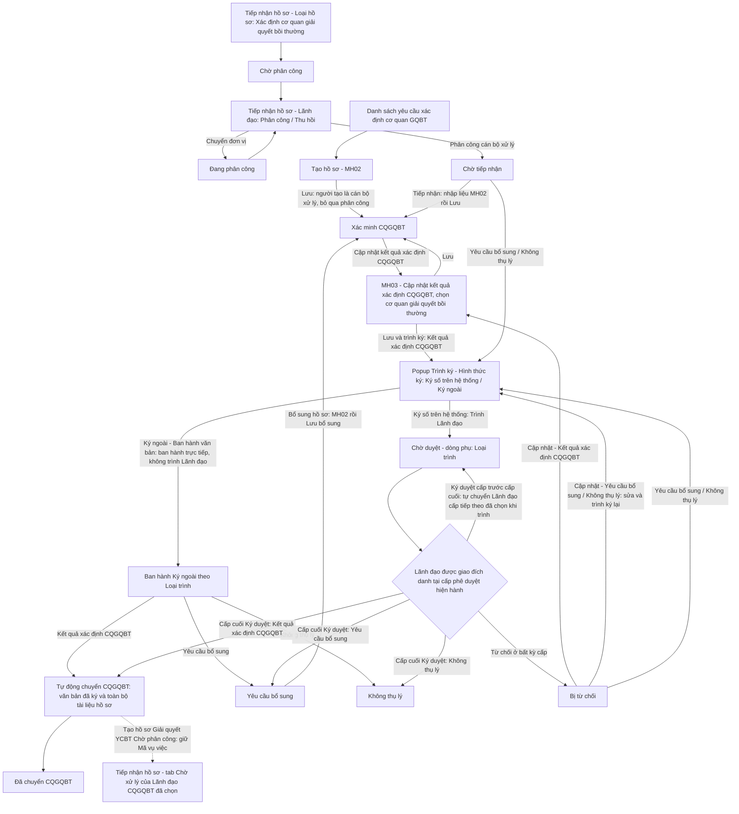
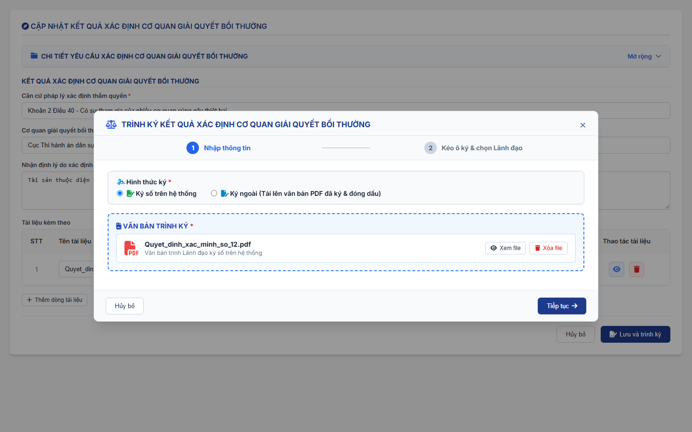
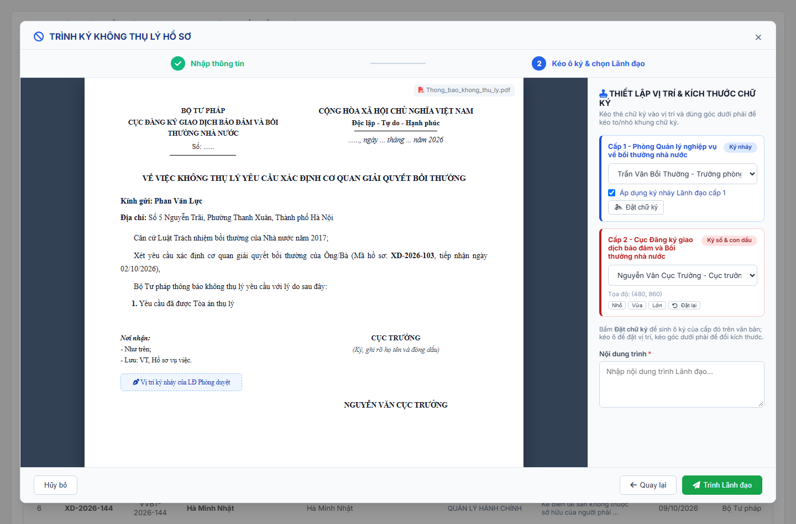
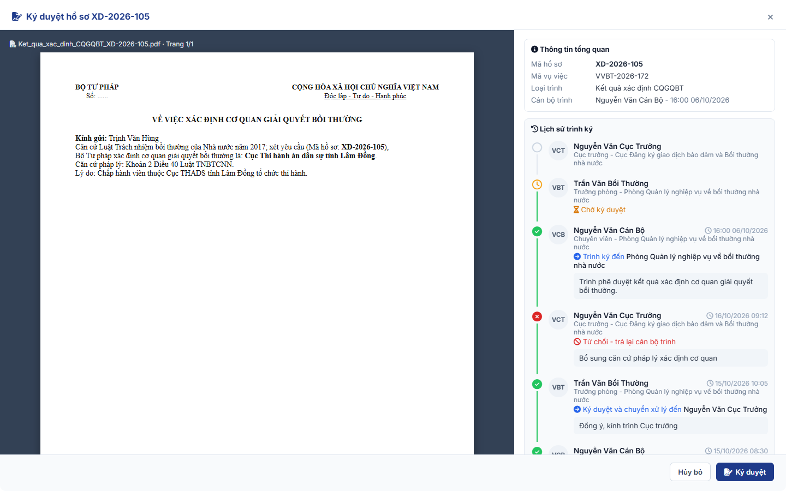
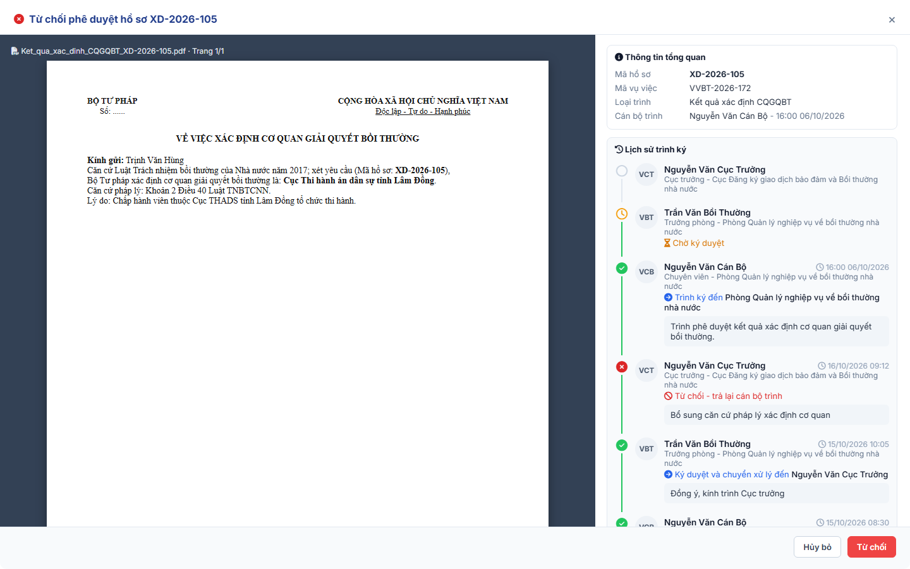

### 4.3.3. Dành cho Cán bộ nghiệp vụ bồi thường nhà nước

#### 4.3.3.1. Nhóm tính năng Xác định cơ quan giải quyết bồi thường

##### 4.3.3.1.1. Mục đích

\- Cho phép người dùng trên Website quản trị (menu `Xác định cơ quan giải quyết bồi thường`, phân hệ Bồi thường nhà nước) quản lý và xử lý hồ sơ yêu cầu xác định cơ quan giải quyết bồi thường, gồm:

+ Hồ sơ được tiếp nhận tại [MH02 - Màn hình Tiếp nhận hồ sơ - Tiếp nhận hồ sơ - Công tác bồi thường nhà nước (Website Quản trị)](SRS_BTNN_GiaiQuyetBT_TiepNhan_YCBT.md#43313-mh02---màn-hình-tiếp-nhận-hồ-sơ), được lãnh đạo phân công cán bộ xử lý tại tab `Chờ xử lý` của [Tiếp nhận hồ sơ - Tiếp nhận hồ sơ - Công tác bồi thường nhà nước (Website Quản trị)](SRS_BTNN_GiaiQuyetBT_TiepNhan_YCBT.md#tn-tab-xu-ly) và chuyển đến phân hệ ở trạng thái `Chờ tiếp nhận`.
+ Hồ sơ do cơ quan giải quyết bồi thường chuyển đến khi Không thụ lý với lý do `KTL_01` và chọn `Chuyển Bộ Tư pháp` / `Chuyển Sở Tư pháp` tại phân hệ Giải quyết yêu cầu bồi thường ([Không thụ lý hồ sơ yêu cầu bồi thường - Giải quyết yêu cầu bồi thường - Công tác bồi thường nhà nước (Website Quản trị)](SRS_BTNN_GiaiQuyetBT_GiaiQuyet_YCBT.md#gq-khong-thu-ly)): hồ sơ có `Nguồn hồ sơ` = `Chuyển CQGQBT`, Loại hồ sơ `Xác định cơ quan giải quyết bồi thường`, ở trạng thái `Chờ phân công` tại [Tiếp nhận hồ sơ - Tiếp nhận hồ sơ - Công tác bồi thường nhà nước (Website Quản trị)](SRS_BTNN_GiaiQuyetBT_TiepNhan_YCBT.md#tn-nguon-ho-so) của Bộ Tư pháp / Sở Tư pháp, giữ nguyên `Mã vụ việc`; được lãnh đạo phân công và chuyển đến phân hệ ở trạng thái `Chờ tiếp nhận` như hồ sơ tiếp nhận tại MH02.
+ Hồ sơ do cán bộ tạo mới trực tiếp tại phân hệ (`Tạo hồ sơ`).

\- Cán bộ xử lý tiếp nhận, nhập liệu và xác minh hồ sơ, cập nhật kết quả xác định cơ quan giải quyết bồi thường (chọn cơ quan giải quyết bồi thường) và trình ký Lãnh đạo theo luồng phê duyệt (Hình thức ký `Ký số trên hệ thống`): Lãnh đạo ở mọi cấp `Ký duyệt`; ký số theo luồng đã cấu hình tại Cấu hình luồng xử lý. Hình thức ký `Ký ngoài`: cán bộ xử lý ban hành trực tiếp văn bản đã ký và đóng dấu ngoài hệ thống, không trình Lãnh đạo. Sau khi Lãnh đạo cấp cuối Ký duyệt văn bản Kết quả xác định CQGQBT (hoặc cán bộ ban hành Kết quả xác định CQGQBT Ký ngoài), hệ thống tự động chuyển hồ sơ cho CQGQBT đã chọn: tạo hồ sơ Giải quyết yêu cầu bồi thường ở trạng thái `Chờ phân công` tại CQGQBT đó, kèm văn bản đã ký và toàn bộ tài liệu của hồ sơ.

*a. Phân quyền*

- Chỉ dành cho Bộ Tư pháp, Sở Tư pháp và UBND cấp tỉnh.

*b. Điều kiện thực hiện*

- Người dùng truy cập màn hình `Xác định cơ quan giải quyết bồi thường` trên Website quản trị.

- Người dùng được phân quyền thực hiện tính năng.

*c. Quy tắc 02 tab Chờ xử lý / Đã xử lý*

| Vai trò | Tab `Chờ xử lý` | Tab `Đã xử lý` |
| :--- | :--- | :--- |
| Cán bộ xử lý | Hồ sơ trong phạm vi xem ở trạng thái: `Chờ tiếp nhận`, `Xác minh CQGQBT`, `Chờ duyệt`, `Bị từ chối`, `Yêu cầu bổ sung` | Hồ sơ ở trạng thái: `Không thụ lý`, `Đã chuyển CQGQBT` |
| Lãnh đạo (thuộc Nhóm lãnh đạo tại Cấu hình luồng xử lý) | Hồ sơ `Chờ duyệt` mà Lãnh đạo được giao đích danh ở cấp phê duyệt hiện hành | Hồ sơ Lãnh đạo đã Ký duyệt / Từ chối phê duyệt, không còn chờ Lãnh đạo duyệt |

*d. Quy tắc trình ký - phê duyệt*

\- Quy tắc dùng chung cho thao tác Ký duyệt / Từ chối của Lãnh đạo tại các phân hệ Bồi thường nhà nước có trình Lãnh đạo: Xác định cơ quan giải quyết bồi thường, Giải quyết yêu cầu bồi thường, Quyết định giải quyết bồi thường, Tạm ứng kinh phí bồi thường/Chi trả tiền bồi thường, Xem xét trách nhiệm hoàn trả.

\- Loại trình, trạng thái sau khi Ký duyệt / Từ chối và văn bản ban hành của từng phân hệ mô tả tại mục Ký duyệt / Từ chối của phân hệ đó.

| STT | Nội dung | Quy tắc |
| :-- | :--- | :--- |
| 1 | Luồng phê duyệt nhiều cấp | - Luồng phê duyệt đi ngược chiều luồng phân công thực tế của chính hồ sơ: lấy các đơn vị đã chuyển hoặc phân công theo thứ tự lượt chuyển, đảo ngược, bỏ đơn vị trùng. - Hồ sơ do cán bộ tạo trực tiếp tại phân hệ (không qua phân công): luồng phê duyệt đi từ đơn vị của cán bộ chủ trì lên đơn vị gốc, chỉ gồm các đơn vị có Nhóm lãnh đạo. - Không xác định được cấp phê duyệt: chặn trình, hiển thị [MSG-ERR-BTNN-LXL-006]. - Luồng phê duyệt được xác định khi cán bộ chủ trì trình và giữ nguyên cho lần trình đó. - Mỗi lần trình (kể cả trình lại) bắt đầu từ cấp phê duyệt đầu tiên. - Không quy định thời hạn cho từng cấp phê duyệt. |
| 2 | Trạng thái `Chờ duyệt` và Loại trình | - Cán bộ chủ trì trình thành công: hồ sơ chuyển trạng thái chung `Chờ duyệt`. - Loại việc Lãnh đạo cần duyệt lưu tại trường `Loại trình` của phiếu trình; không tạo trạng thái riêng cho từng Loại trình. - Mỗi hồ sơ có tối đa 01 phiếu trình đang chờ duyệt. - Dưới badge trạng thái `Chờ duyệt` / trạng thái khi bị từ chối trên lưới và màn hình chi tiết hiển thị dòng phụ chỉ gồm tên Loại trình; không hiển thị cấp duyệt. - Loại trình tại phân hệ này: + Kết quả xác định CQGQBT + Yêu cầu bổ sung + Không thụ lý |
| 3 | Lãnh đạo phê duyệt đích danh | - Khi trình, cán bộ chủ trì chọn Lãnh đạo của tất cả các cấp phê duyệt: mỗi cấp 01 thành viên Nhóm lãnh đạo của đơn vị cấp đó. - Cấp n Ký duyệt thì hồ sơ tự chuyển đến Lãnh đạo cấp n+1 cán bộ đã chọn khi trình; Lãnh đạo không chọn Lãnh đạo cấp tiếp theo. - Chỉ Lãnh đạo được giao ở cấp hiện hành thấy hồ sơ tại tab `Chờ xử lý` của phân hệ, được tính tại khối tương ứng của Dashboard và được Ký duyệt, Từ chối; thành viên khác của Nhóm lãnh đạo cùng đơn vị không thấy công việc này. - Lãnh đạo được chọn phải thuộc Nhóm lãnh đạo của cấp tương ứng; hệ thống kiểm tra lại khi trình và khi Lãnh đạo xác nhận. - Không có chức năng ủy quyền. |
| 4 | Từ chối phê duyệt | - Lãnh đạo ở bất kỳ cấp nào Từ chối: hồ sơ trả về cán bộ chủ trì, giữ Loại trình của phiếu bị từ chối; lưu người từ chối, đơn vị, thời điểm, Lý do từ chối. - Hồ sơ chuyển trạng thái `Bị từ chối`; là trạng thái chung cho mọi Loại trình và mọi phân hệ Bồi thường nhà nước. - Kết quả Ký duyệt của các cấp trong lượt trình bị từ chối không còn hiệu lực. - Cán bộ chủ trì cập nhật và trình lại: luồng phê duyệt bắt đầu lại từ cấp đầu tiên, cán bộ chọn lại Lãnh đạo các cấp. |
| 5 | Ký duyệt và văn bản | - Ký duyệt, Từ chối là thao tác của Lãnh đạo trên hệ thống: ghi kết quả, chuyển trạng thái, ghi lịch sử. - Chỉ phiếu trình Hình thức ký `Ký số trên hệ thống` được trình Lãnh đạo; Hình thức ký `Ký ngoài` do cán bộ ban hành trực tiếp, không trình Lãnh đạo. - Văn bản trình ký (hệ thống sinh theo mẫu hoặc tệp cán bộ tải lên) và `Tài liệu kèm theo` lưu cùng phiếu trình; Lãnh đạo xem trước khi xác nhận, không sửa văn bản, không đính kèm tệp. - Nhãn nút `Ký duyệt` ở mọi cấp, mọi phân hệ. - Ký số hay không ký số khi Lãnh đạo Ký duyệt: Thực hiện theo luồng đã cấu hình tương ứng tại [Cấu hình luồng xử lý - Cấu hình luồng xử lý - Quản trị hệ thống (Website Quản trị)](../01_Quan_tri_he_thong/Cau_hinh_luong_xu_ly.md). |
| 6 | Kiểm tra đồng thời | - Ký duyệt, Từ chối kiểm tra lại trạng thái hồ sơ và quyền của người dùng tại máy chủ khi mở màn hình và khi xác nhận. - Khi mở màn hình mà hồ sơ đã được xử lý: hiển thị [MSG-ERR-BTNN-LXL-001] và tải lại danh sách của phân hệ. - Khi xác nhận mà không còn hợp lệ (đã được xử lý, đã bị thu hồi hoặc người dùng không còn là Lãnh đạo được giao): hiển thị [MSG-ERR-BTNN-LXL-005]. |
| 7 | Lịch sử trình ký | - Mỗi thao tác ghi 01 dòng Lịch sử trình ký gồm Người thực hiện, Thời điểm, Hành động, Nội dung. - Hành động: + Trình ký đến [Lãnh đạo cấp 1] + Ký duyệt và chuyển xử lý đến [Lãnh đạo cấp tiếp theo] + Ký duyệt (cấp cuối) + Từ chối - trả lại cán bộ trình - Lịch sử xử lý của hồ sơ ghi thao tác `Ký duyệt`, `Từ chối phê duyệt` (phân biệt với từ chối yêu cầu). |

\- Trạng thái của phân hệ liên quan đến phê duyệt:

| Trạng thái | Ý nghĩa | Hiển thị với Lãnh đạo |
| :--- | :--- | :--- |
| Chờ duyệt | Cán bộ xử lý đã trình, đang chờ Lãnh đạo được giao ở một cấp phê duyệt; dòng phụ: Loại trình | Tab `Chờ xử lý` của Lãnh đạo được giao ở cấp hiện hành; tab `Đã xử lý` của Lãnh đạo đã Ký duyệt cấp trước |
| Bị từ chối | Lãnh đạo ở một cấp phê duyệt đã Từ chối; dòng phụ: Loại trình bị từ chối | Tab `Đã xử lý` của Lãnh đạo đã thao tác |

##### 4.3.3.1.2. Sơ đồ luồng nghiệp vụ theo giao diện

\- Luồng đi của 01 hồ sơ Xác định cơ quan giải quyết bồi thường:

---

##### 4.3.3.1.3. MH01 - Màn hình Danh sách yêu cầu xác định cơ quan giải quyết bồi thường

###### 4.3.3.1.3.1. Màn hình

###### 4.3.3.1.3.2. Mô tả thông tin trên màn hình

| Trường thông tin | Kiểu dữ liệu | Bắt buộc | Mặc định | Mô tả |
| :--- | :--- | :--- | :--- | :--- |
| **Tab danh sách** | Tab | - | `Chờ xử lý` | Control UI: 02 tab đặt phía trên bộ lọc: + Chờ xử lý + Đã xử lý - Badge số lượng: số bản ghi thuộc tab Chờ xử lý của người dùng; không hiển thị khi bằng 0. - Badge số lượng tại mục menu `Xác định cơ quan giải quyết bồi thường` bằng badge tab Chờ xử lý của Xác định cơ quan giải quyết bồi thường. - Tab `Đã xử lý` không có badge số lượng. - Bản ghi của từng tab theo [Quy tắc 02 tab Chờ xử lý / Đã xử lý - Xác định cơ quan giải quyết bồi thường - Công tác bồi thường nhà nước (Website Quản trị)](#xd-tab-xu-ly). |
| **Khối bộ lọc tìm kiếm** | Section | - | Mở rộng | Control UI: Filter panel (Accordion). - Nút `Thu gọn` / `Mở rộng` ở góc phải khối. - Khi thu gọn, giữ nguyên các giá trị lọc đã nhập. |
| Mã hồ sơ | String(50) | Không | Trống | Control UI: Input text. - Placeholder: `Nhập mã hồ sơ...`. - Tìm kiếm gần đúng theo mã hồ sơ xác định cơ quan, không phân biệt hoa thường, có trim khoảng trắng. |
| Mã vụ việc | String(50) | Không | Trống | Control UI: Input text. - Placeholder: `Nhập mã vụ việc...`. - Tìm kiếm gần đúng theo Mã vụ việc của hồ sơ, không phân biệt hoa thường, có trim khoảng trắng. |
| Mã hồ sơ GQBT | String(50) | Không | Trống | Control UI: Input text. - Placeholder: `Nhập mã hồ sơ GQBT...`. - Tìm kiếm gần đúng theo Mã hồ sơ GQBT tương ứng của hồ sơ, không phân biệt hoa thường, có trim khoảng trắng. |
| Tên cá nhân/Tổ chức yêu cầu | String(255) | Không | Trống | Control UI: Input text. - Placeholder: `Nhập tên cá nhân/tổ chức yêu cầu...`. - Tìm kiếm gần đúng theo `Họ và tên` (cá nhân) hoặc `Tên tổ chức` của người yêu cầu, không phân biệt hoa thường, có trim khoảng trắng. |
| Tên cá nhân/Tổ chức bị thiệt hại | String(255) | Không | Trống | Control UI: Input text. - Placeholder: `Nhập tên cá nhân/tổ chức bị thiệt hại...`. - Tìm kiếm gần đúng theo giá trị cột `Tên cá nhân/Tổ chức bị thiệt hại` trên lưới, không phân biệt hoa thường, có trim khoảng trắng. |
| Lĩnh vực phát sinh thiệt hại | Enum(String(100)) | Không | `Tất cả lĩnh vực` | Control UI: Combobox. - Tham chiếu danh mục Lĩnh vực phát sinh thiệt hại [DM_22]; tên lĩnh vực hiển thị bỏ tiền tố `TRONG HOẠT ĐỘNG`. |
| Trạng thái | Enum(String(50)) | Không | `Tất cả trạng thái` | Control UI: Combobox. - Giá trị đầu: `Tất cả trạng thái`. - Cán bộ xử lý, tab `Chờ xử lý`, gồm: + Chờ tiếp nhận + Xác minh CQGQBT + Chờ duyệt + Bị từ chối + Yêu cầu bổ sung - Cán bộ xử lý, tab `Đã xử lý`, gồm: + Không thụ lý + Đã chuyển CQGQBT - Lãnh đạo: các trạng thái của hồ sơ thuộc tab đang chọn. |
| Loại trình | Enum(String(50)) | Không | `Tất cả` | Control UI: Combobox. - Áp dụng cho hồ sơ `Chờ duyệt`, `Bị từ chối`. Gồm: + Tất cả + Yêu cầu bổ sung + Không thụ lý + Kết quả xác định CQGQBT |
| Cơ quan xử lý | Enum(String(50)) | Không | `Tất cả cơ quan` | Control UI: Combobox. - Danh sách cơ quan có thẩm quyền xác định CQGQBT, nhóm theo loại cơ quan: + Bộ Tư pháp + Sở Tư pháp - Nhóm có từ 02 cơ quan trở lên: có thêm giá trị `Tất cả [Loại cơ quan]`. - Người dùng UBND cấp tỉnh: chỉ gồm các Sở Tư pháp trực thuộc. - Lọc theo đơn vị gốc của hồ sơ. |
| Từ ngày | Date | Không | Ngày hiện tại trừ 03 tháng | Control UI: Datepicker. - Placeholder: `dd/mm/yyyy`. - Lọc theo ngày tiếp nhận từ ngày. |
| Đến ngày | Date | Không | Ngày hiện tại | Control UI: Datepicker. - Placeholder: `dd/mm/yyyy`. - Lọc theo ngày tiếp nhận đến ngày. |
| **Bảng danh sách yêu cầu xác định cơ quan giải quyết bồi thường** | - | - | 20 bản ghi/trang | Control UI: Data grid. - Khi người dùng truy cập màn hình, hệ thống tự động tải trang đầu tiên (Trang 1) với số lượng mặc định 20 bản ghi. - Sắp xếp mặc định: Sắp xếp theo "Thời điểm tiếp nhận" giảm dần (mới nhất hiển thị lên đầu). - **Phạm vi dữ liệu**: chỉ hiển thị hồ sơ người dùng là cán bộ xử lý, người tạo hoặc người dùng thuộc Nhóm lãnh đạo của một đơn vị trên luồng phân công/phê duyệt của hồ sơ. - Trạng thái có dữ liệu: Hiển thị danh sách các bản ghi kết quả theo cấu trúc các cột quy định. - Trạng thái không có dữ liệu (Empty State): Khi không tìm thấy kết quả phù hợp với điều kiện tìm kiếm, bảng hiển thị duy nhất 01 dòng căn giữa trên toàn bộ chiều rộng bảng (`colspan`), in nghiêng với nội dung theo MessageList dùng chung [MSG-INF-SYS-001]. |
| STT | Integer(10) | - | Tự tăng | Control UI: Text hiển thị (Read-only). - Căn giữa. - Hiển thị số thứ tự theo trang hiện tại. |
| Mã hồ sơ | String(50) | - | Theo dữ liệu | Control UI: Text hiển thị (Read-only). - Căn giữa. - Hiển thị mã hồ sơ xác định cơ quan giải quyết bồi thường. |
| Mã vụ việc | String(50) | - | Theo dữ liệu | Control UI: Text hiển thị (Read-only). - Căn giữa. - Theo dữ liệu bản ghi. |
| Tên cá nhân/Tổ chức yêu cầu | String(255) | - | Theo dữ liệu | Control UI: Text hiển thị (Read-only). - Theo dữ liệu bản ghi: `Họ và tên` (người yêu cầu là cá nhân) hoặc `Tên tổ chức` (người yêu cầu là tổ chức). - Nếu chưa có dữ liệu, hiển thị `(Chưa nhập)`. |
| Tên cá nhân/Tổ chức bị thiệt hại | String(255) | - | Theo dữ liệu | Control UI: Text hiển thị (Read-only). - Theo dữ liệu bản ghi: + `Tư cách người yêu cầu bồi thường` = `Người bị thiệt hại`: bằng `Tên cá nhân/Tổ chức yêu cầu`. + `Tư cách người yêu cầu bồi thường` = `Tổ chức kế thừa quyền, nghĩa vụ của tổ chức bị thiệt hại đã chấm dứt tồn tại`: `Tên tổ chức bị thiệt hại`. + Tư cách khác: `Họ và tên người bị thiệt hại`. - Không có dữ liệu: hiển thị `-`. |
| Lĩnh vực thiệt hại | Enum(String(50)) | - | Theo dữ liệu | Control UI: Text hiển thị (Read-only). - Hiển thị lĩnh vực phát sinh thiệt hại theo danh mục [DM_22], bỏ tiền tố `TRONG HOẠT ĐỘNG`. |
| Hành vi gây thiệt hại của người thi hành công vụ | Text(2000) | - | Theo dữ liệu | Control UI: Text hiển thị (Read-only). - Theo dữ liệu bản ghi. - Nếu nội dung dài hơn giới hạn hiển thị của ô, hệ thống rút gọn và cho phép xem đầy đủ khi rê chuột vào nội dung. |
| Ngày tiếp nhận | Date | - | Theo dữ liệu | Control UI: Text hiển thị (Read-only). - Căn giữa. - Định dạng `dd/mm/yyyy`. |
| Cơ quan xử lý | String(255) | - | Theo dữ liệu | Control UI: Text hiển thị (Read-only). - Theo dữ liệu bản ghi: đơn vị gốc của hồ sơ, kèm nhãn loại cơ quan (`Sở Tư pháp`); không hiển thị nhãn khi trùng tên cơ quan. |
| Cán bộ xử lý | String(100) | - | Theo dữ liệu | Control UI: Text hiển thị (Read-only). - Hiển thị họ tên cán bộ xử lý của hồ sơ; chưa có thì hiển thị `--`. |
| Mã hồ sơ GQBT | String(50) | - | Theo dữ liệu | Control UI: Hyperlink. - Căn giữa. - Chỉ có giá trị khi hồ sơ `Đã chuyển CQGQBT`; trường hợp khác hiển thị `-`. - Click: mở [MH05 - Màn hình Xem chi tiết hồ sơ yêu cầu bồi thường - Giải quyết yêu cầu bồi thường - Công tác bồi thường nhà nước (Website Quản trị)](SRS_BTNN_GiaiQuyetBT_GiaiQuyet_YCBT.md#43317-mh05---màn-hình-xem-chi-tiết-hồ-sơ-yêu-cầu-bồi-thường) tại tab mới; không thực hiện row click. |
| Trạng thái | Enum(String(50)) | - | Theo dữ liệu | Control UI: Badge trạng thái (Read-only). - Theo dữ liệu bản ghi. - Hồ sơ `Chờ duyệt` / `Bị từ chối`: dòng phụ dưới badge là tên Loại trình. |
| Thao tác | String(255) | - | Theo trạng thái | Control UI: Icon button group (cố định vị trí). - Thao tác không áp dụng cho hồ sơ hoặc người dùng không phải cán bộ xử lý: hiển thị mờ (Disabled). - Cán bộ xử lý, gồm: + Tiếp nhận: bấm được khi hồ sơ `Chờ tiếp nhận`; hồ sơ `Yêu cầu bổ sung` là `Bổ sung hồ sơ` + Cập nhật kết quả: bấm được khi hồ sơ `Xác minh CQGQBT`; hồ sơ `Bị từ chối` là `Cập nhật` + Yêu cầu bổ sung: bấm được khi hồ sơ `Chờ tiếp nhận` hoặc `Bị từ chối` + Không thụ lý: bấm được khi hồ sơ `Chờ tiếp nhận` hoặc `Bị từ chối` - Lãnh đạo, tab `Chờ xử lý`, gồm: + Ký duyệt + Từ chối - Lãnh đạo, tab `Đã xử lý`, gồm: + Thu hồi: bấm được khi Lãnh đạo vừa Ký duyệt chuyển cấp tiếp theo và cấp tiếp theo chưa xử lý - Người dùng UBND cấp tỉnh: không có thao tác. - Cột cố định bên phải lưới khi cuộn ngang. |
| Phân trang | Pagination | - | 20 bản ghi/trang | Control UI: Pagination. - Cho phép chọn cấu hình số lượng bản ghi hiển thị (10, 20, 50, 100); mặc định 20 bản ghi/trang. - Hiển thị dải bản ghi: "Hiển thị [từ]-[đến] trong số [tổng số] bản ghi" (khi không có dữ liệu hiển thị 0-0 trong số 0). - Đầy đủ các nút điều hướng trang: Đầu (&#124;&lt;&lt;), Trước (&lt;), các số trang, Sau (&gt;), Cuối (&gt;&gt;&#124;). |

###### 4.3.3.1.3.3. Chức năng trên màn hình

| STT | Tên chức năng | Định dạng | Mô tả |
| :--- | :--- | :--- | :--- |
| 1 | Tìm kiếm | Button | Khi người dùng click nút, hệ thống kiểm tra điều kiện dữ liệu và thực hiện tìm kiếm theo các trường hợp bên dưới: |
|  |  |  | **TH1 - Khoảng ngày không hợp lệ**: Nếu `Từ ngày` lớn hơn `Đến ngày`, hệ thống hiển thị cảnh báo lỗi [MSG-ERR-VAL-007] và không thực hiện tìm kiếm. |
|  |  |  | **TH Hợp lệ (Có dữ liệu phù hợp)**: Hệ thống lọc và hiển thị danh sách các bản ghi thuộc phạm vi dữ liệu của người dùng, thỏa mãn đồng thời các tiêu chí tìm kiếm/lọc đã nhập/chọn, hiển thị kết quả lên bảng và đưa về Trang 1. |
|  |  |  | **TH Không có dữ liệu trả về**: Bảng kết quả hiển thị duy nhất 01 dòng căn giữa trên toàn bộ chiều rộng bảng (`colspan`), in nghiêng với nội dung theo MessageList dùng chung [MSG-INF-SYS-001]; thanh phân trang hiển thị *"Hiển thị 0-0 trong số 0 bản ghi"*, các nút điều hướng trang ở trạng thái khóa mờ (Disabled). |
| 2 | Xóa bộ lọc | Button | Đưa bộ lọc về giá trị mặc định và tải lại danh sách. |
| 3 | Tạo hồ sơ | Button | Hệ thống mở [MH02 - Màn hình Tiếp nhận/Cập nhật xác định cơ quan giải quyết bồi thường](#43314-mh02---màn-hình-tiếp-nhậncập-nhật-xác-định-cơ-quan-giải-quyết-bồi-thường) ở trường hợp Tạo mới hồ sơ. - Chỉ hiển thị tại tab `Chờ xử lý`, với cán bộ thuộc Bộ Tư pháp / Sở Tư pháp (không hiển thị với Lãnh đạo, người dùng UBND cấp tỉnh). |
| 4 | Click dòng dữ liệu | Row click | Khi người dùng click vào dòng dữ liệu, hệ thống xử lý theo các trường hợp bên dưới. |
|  |  |  | **TH1 - Click vào dòng dữ liệu**: Hệ thống mở [MH04 - Màn hình Chi tiết yêu cầu xác định cơ quan giải quyết bồi thường](#43316-mh04---màn-hình-chi-tiết-yêu-cầu-xác-định-cơ-quan-giải-quyết-bồi-thường) của bản ghi được chọn. |
|  |  |  | **TH2 - Click vào icon thao tác trong cột Thao tác**: Không thực hiện row click; thực hiện đúng chức năng của icon được click. |
| 5 | Tiếp nhận | Icon button | Hệ thống mở [MH02 - Màn hình Tiếp nhận/Cập nhật xác định cơ quan giải quyết bồi thường](#43314-mh02---màn-hình-tiếp-nhậncập-nhật-xác-định-cơ-quan-giải-quyết-bồi-thường) ở trường hợp Tiếp nhận hồ sơ, kế thừa dữ liệu đã tiếp nhận. |
| 6 | Bổ sung hồ sơ (hồ sơ `Yêu cầu bổ sung`) | Icon button | Hệ thống mở [MH02 - Màn hình Tiếp nhận/Cập nhật xác định cơ quan giải quyết bồi thường](#43314-mh02---màn-hình-tiếp-nhậncập-nhật-xác-định-cơ-quan-giải-quyết-bồi-thường) ở trường hợp Bổ sung hồ sơ, điền sẵn dữ liệu của bản ghi. |
| 7 | Cập nhật kết quả xác định CQGQBT | Icon button | Hệ thống mở [MH03 - Màn hình Cập nhật kết quả xác định cơ quan giải quyết bồi thường](#43315-mh03---màn-hình-cập-nhật-kết-quả-xác-định-cơ-quan-giải-quyết-bồi-thường). |
| 8 | Cập nhật | Icon button | Hệ thống xử lý theo Loại trình bị từ chối: - **TH1 - Loại trình bị từ chối là `Kết quả xác định CQGQBT`**: Hệ thống mở [MH03 - Màn hình Cập nhật kết quả xác định cơ quan giải quyết bồi thường](#43315-mh03---màn-hình-cập-nhật-kết-quả-xác-định-cơ-quan-giải-quyết-bồi-thường), điền sẵn kết quả xác định đã lưu và hiển thị khối `THÔNG TIN HỒ SƠ BỊ TỪ CHỐI`. - **TH2 - Loại trình bị từ chối là `Yêu cầu bổ sung`**: Hệ thống mở [Popup Trình ký](#xd-popup-trinh-ky) với Loại trình `Yêu cầu bổ sung`, điền sẵn thông tin theo phiếu trình bị từ chối. - **TH3 - Loại trình bị từ chối là `Không thụ lý`**: Hệ thống mở [Popup Trình ký](#xd-popup-trinh-ky) với Loại trình `Không thụ lý`, điền sẵn thông tin theo phiếu trình bị từ chối. |
| 9 | Yêu cầu bổ sung | Icon button | Hệ thống mở [Popup Trình ký](#xd-popup-trinh-ky) với Loại trình `Yêu cầu bổ sung`. |
| 10 | Không thụ lý | Icon button | Hệ thống mở [Popup Trình ký](#xd-popup-trinh-ky) với Loại trình `Không thụ lý`. |
| 11 | Chuyển tab | Tab | Hệ thống hiển thị danh sách của tab `Chờ xử lý` hoặc `Đã xử lý`, nạp lại bộ lọc `Trạng thái` theo tab và đưa về Trang 1. |
| 12 | Ký duyệt | Icon button | Hệ thống mở [Màn hình Ký duyệt / Từ chối](#xd-ky-duyet) ở thao tác `Ký duyệt`. |
| 13 | Từ chối | Icon button | Hệ thống mở [Màn hình Ký duyệt / Từ chối](#xd-tu-choi) ở thao tác `Từ chối`. |
| 14 | Thu hồi | Icon button | Hệ thống hiển thị popup xác nhận [MSG-CFM-BTNN-LXL-001]; chọn `Đồng ý` thì xử lý theo các trường hợp bên dưới. |
|  |  |  | **TH1 - Cấp tiếp theo đã xử lý** (kiểm tra tại máy chủ): Hệ thống hiển thị [MSG-ERR-BTNN-LXL-004] và tải lại danh sách. |
|  |  |  | **TH Hợp lệ**: - Hủy kết quả Ký duyệt của Lãnh đạo thu hồi; hồ sơ giữ `Chờ duyệt` tại cấp của Lãnh đạo thu hồi. - Ghi Lịch sử xử lý `Thu hồi phê duyệt`. - Hiển thị [MSG-SUC-BTNN-LXL-002], tải lại danh sách; hồ sơ trở lại tab `Chờ xử lý` của Lãnh đạo thu hồi. |

---

##### 4.3.3.1.4. MH02 - Màn hình Tiếp nhận/Cập nhật xác định cơ quan giải quyết bồi thường

###### 4.3.3.1.4.1. Màn hình

###### 4.3.3.1.4.2. Mô tả thông tin trên màn hình

| Trường thông tin | Kiểu dữ liệu | Bắt buộc | Mặc định | Mô tả |
| :--- | :--- | :--- | :--- | :--- |
| Tiêu đề màn hình | String(255) | - | Theo trường hợp | Control UI: Text heading (Read-only). - Khi mở form do `Tiếp nhận` hồ sơ `Chờ tiếp nhận` đã được phân công: hiển thị `TIẾP NHẬN YÊU CẦU XÁC ĐỊNH CƠ QUAN GIẢI QUYẾT BỒI THƯỜNG`. - Khi mở form do `Bổ sung hồ sơ` đối với hồ sơ `Yêu cầu bổ sung`: hiển thị `BỔ SUNG HỒ SƠ YÊU CẦU XÁC ĐỊNH CƠ QUAN GIẢI QUYẾT BỒI THƯỜNG` (nút Lưu đổi thành `Lưu bổ sung`). - Khi `Tạo hồ sơ` trực tiếp tại phân hệ Xác định cơ quan: hiển thị `THÊM MỚI YÊU CẦU XÁC ĐỊNH CƠ QUAN GIẢI QUYẾT BỒI THƯỜNG`. |
| **THÔNG TIN HỒ SƠ BỊ TỪ CHỐI** | Section | - | Ẩn | Control UI: Alert panel, đặt trên cùng form, dưới tiêu đề màn hình. - Chỉ hiển thị khi hồ sơ đang ở trạng thái `Bị từ chối` hoặc trước đó từng bị từ chối. - Danh sách đầy đủ các lần bị từ chối theo thứ tự thời gian; không đánh số lần. - Mỗi lần gồm các trường bên dưới. |
| Thời điểm | - | - | Theo bản ghi | Control UI: Label. - Theo dữ liệu bản ghi, định dạng `dd/mm/yyyy HH:mm`. |
| Lãnh đạo từ chối | - | - | Theo bản ghi | Control UI: Label. - Theo dữ liệu bản ghi: `[Họ và tên] - [Đơn vị]`. |
| Loại trình bị từ chối | - | - | Theo bản ghi | Control UI: Label. - Theo dữ liệu bản ghi. |
| Lý do chi tiết | - | - | Theo bản ghi | Control UI: Label. - Theo dữ liệu bản ghi (Lý do từ chối). |
| **THÔNG TIN YÊU CẦU BỔ SUNG** | Section | - | Ẩn | Control UI: Alert panel, dưới khối `THÔNG TIN HỒ SƠ BỊ TỪ CHỐI`. - Chỉ hiển thị khi hồ sơ đang ở trạng thái `Yêu cầu bổ sung` hoặc trước đó từng có Yêu cầu bổ sung (đã ban hành văn bản yêu cầu bổ sung: Lãnh đạo cấp cuối Ký duyệt hoặc cán bộ ban hành Ký ngoài). - Tiêu đề khối kèm nhãn: `Đang chờ bổ sung` hoặc `Đã tiếp nhận bổ sung` - `Số lần yêu cầu bổ sung: [n]`. - Danh sách các lần Yêu cầu bổ sung, mới nhất trước; mỗi lần có tiêu đề `Lần [n]` và các trường bên dưới. |
| Nội dung yêu cầu bổ sung | - | - | Theo bản ghi | Control UI: Label. - Theo dữ liệu bản ghi. |
| Hình thức ký | - | - | Theo bản ghi | Control UI: Label. - Theo dữ liệu bản ghi: `Ký số` hoặc `Ký ngoài`. |
| Văn bản đã ký | - | - | Theo bản ghi | Control UI: Label. - Theo dữ liệu bản ghi: tên tệp kèm liên kết `Xem file`. |
| Người ban hành - thời điểm | - | - | Theo bản ghi | Control UI: Label. - Theo dữ liệu bản ghi: `[Họ và tên] - [Đơn vị] - [dd/mm/yyyy HH:mm]` (Ký số: Lãnh đạo cấp cuối Ký duyệt; Ký ngoài: cán bộ xử lý ban hành). |
| Tiếp nhận hồ sơ bổ sung | - | - | Theo bản ghi | Control UI: Label. - Đã tiếp nhận: `[dd/mm/yyyy HH:mm] - [Họ và tên cán bộ tiếp nhận]`. - Chưa tiếp nhận: `Chưa tiếp nhận`. |
| **THÔNG TIN CHUNG** | Section | - | - | Control UI: Section header. |
| Trạng thái hồ sơ | Enum(String(50)) | - | Theo bản ghi | Control UI: Badge trạng thái (Read-only). - Không hiển thị ở trường hợp Tạo mới hồ sơ. - Theo dữ liệu bản ghi. |
| Hình thức tiếp nhận | Enum(String(50)) | Có | `Trực tiếp` (thêm mới) / Theo dữ liệu kế thừa | Control UI: Combobox. - Placeholder: `-- Chọn hình thức tiếp nhận --`. - Tham chiếu [Danh mục Hình thức tiếp nhận - Danh mục dữ liệu dùng chung - Tổng quan và quy tắc chung](../../Tai%20lieu%20tong%20hop/00_Tong_quan_va_Quy_tac_chung.md#danh-muc-dung-chung) [DM_25]. - Thêm mới trực tiếp: chỉ cho chọn `Trực tiếp`, `Qua dịch vụ bưu chính`. - Hồ sơ kế thừa từ Tiếp nhận hồ sơ: mặc định theo `Hình thức tiếp nhận` của hồ sơ đã tiếp nhận; cho phép điều chỉnh, chọn đủ các giá trị của DM_25. |
| Lĩnh vực phát sinh thiệt hại | Enum(String(100)) | Có | `TRONG HOẠT ĐỘNG QUẢN LÝ HÀNH CHÍNH` | Control UI: Combobox. - Placeholder: `-- Chọn lĩnh vực phát sinh thiệt hại --`. - Tham chiếu danh mục Lĩnh vực phát sinh thiệt hại [DM_22]. - Trường được điền sẵn theo dữ liệu kế thừa khi mở form từ `Tiếp nhận` hoặc theo bản ghi khi sửa; cán bộ được phép sửa. |
| Loại yêu cầu giải quyết bồi thường | Enum(String(100)) | Có | `Yêu cầu cả hai (Bồi thường tiền & Phục hồi danh dự)` | Control UI: Radio button. Gồm: + Yêu cầu cả hai (Bồi thường tiền & Phục hồi danh dự) + Chỉ yêu cầu bồi thường thiệt hại bằng tiền + Chỉ yêu cầu phục hồi danh dự |
| **THÔNG TIN CHI TIẾT NGƯỜI YÊU CẦU BỒI THƯỜNG** | Section | - | - | Control UI: Section header. - Gồm 02 cột: `Thông tin người yêu cầu & Liên hệ` (từ `Loại người yêu cầu` đến `Email`) và `Giấy tờ pháp lý & Địa chỉ` (từ `Loại giấy tờ thân nhân` đến `Địa chỉ chi tiết`). |
| Loại người yêu cầu | Enum(String(20)) | Có | `Cá nhân` / Theo dữ liệu kế thừa | Control UI: Radio button. Giá trị gồm: + Cá nhân + Tổ chức |
| Tư cách người yêu cầu bồi thường | Enum(String(100)) | Có | `Người bị thiệt hại` | Control UI: Combobox. - Tham chiếu [Danh mục Tư cách người yêu cầu bồi thường - Danh mục dữ liệu dùng chung - Tổng quan và quy tắc chung](../../Tai%20lieu%20tong%20hop/00_Tong_quan_va_Quy_tac_chung.md#danh-muc-dung-chung) [DM_26]. - `Loại người yêu cầu` = `Cá nhân`, hiển thị: + Người bị thiệt hại + Người thừa kế của người bị thiệt hại + Người đại diện cho những người thừa kế của người bị thiệt hại + Người đại diện theo pháp luật của người bị thiệt hại + Cá nhân, pháp nhân được ủy quyền hợp pháp - `Loại người yêu cầu` = `Tổ chức`, hiển thị: + Người bị thiệt hại + Tổ chức kế thừa quyền, nghĩa vụ của tổ chức bị thiệt hại đã chấm dứt tồn tại + Cá nhân, pháp nhân được ủy quyền hợp pháp - Đổi `Loại người yêu cầu` mà giá trị đang chọn không còn trong danh sách: đưa về trống. - Placeholder: `-- Chọn tư cách người yêu cầu --`. - Điền sẵn theo dữ liệu kế thừa khi mở form từ `Tiếp nhận`; cán bộ được phép sửa. |
| Họ và tên / Tên tổ chức | String(255) | Có | Theo trường hợp | Control UI: Input text. - `Loại người yêu cầu` = `Cá nhân`: + Nhãn: `Họ và tên` + Placeholder: `Nhập họ và tên...` - `Loại người yêu cầu` = `Tổ chức`: + Nhãn: `Tên tổ chức` + Placeholder: `Nhập tên tổ chức...` - Trường được điền sẵn theo dữ liệu kế thừa khi mở form từ `Tiếp nhận`; cán bộ được phép sửa. - Khi tạo mới trực tiếp, trường ở trạng thái trống để cán bộ nhập từ đầu. |
| Ngày sinh | Date | Có (khi hiển thị) | Trống | Control UI: Datepicker. - Chỉ hiển thị khi `Loại người yêu cầu` = `Cá nhân`. - Placeholder: `dd/mm/yyyy`. |
| Mã số tổ chức | String(50) | Có (khi hiển thị) | Trống | Control UI: Input text. - Chỉ hiển thị khi `Loại người yêu cầu` = `Tổ chức`. - Placeholder: `Nhập mã số doanh nghiệp / mã số thuế / mã số khác...`. |
| Họ và tên người đại diện theo pháp luật | String(100) | Có (khi hiển thị) | Trống | Control UI: Input text. - Chỉ hiển thị khi `Loại người yêu cầu` = `Tổ chức`. - Placeholder: `Nhập họ và tên người đại diện...`. |
| Chức vụ người đại diện | String(100) | Có (khi hiển thị) | Trống | Control UI: Input text. - Chỉ hiển thị khi `Loại người yêu cầu` = `Tổ chức`. - Placeholder: `Nhập chức vụ người đại diện...`. |
| Số điện thoại | String(20) | Có | Trống | Control UI: Input text. - Placeholder: `Nhập số điện thoại...`. - Kiểm tra định dạng số điện thoại. |
| Email | String(255) | Không | Trống | Control UI: Input text. - Placeholder: `Nhập email...`. - Nếu có dữ liệu, kiểm tra định dạng Email. |
| Loại giấy tờ thân nhân | Enum(String(50)) | Có (khi hiển thị) | Trống | Control UI: Combobox. - Chỉ hiển thị khi `Loại người yêu cầu` = `Cá nhân`. - Placeholder: `-- Chọn loại giấy tờ --`. - Tham chiếu [Danh mục Loại giấy tờ pháp lý - Danh mục dữ liệu dùng chung - Tổng quan và quy tắc chung](../../Tai%20lieu%20tong%20hop/00_Tong_quan_va_Quy_tac_chung.md#danh-muc-dung-chung) [DM_10]. - Chỉ gồm các giá trị dành cho cá nhân, không gồm `Mã số thuế`. |
| Số giấy tờ thân nhân | String(50) | Có (khi hiển thị) | Trống | Control UI: Input text. - Chỉ hiển thị khi `Loại người yêu cầu` = `Cá nhân`. - Placeholder: `Nhập số giấy tờ...`. |
| Ngày cấp | Date | Không | Trống | Control UI: Datepicker. - Chỉ hiển thị khi `Loại người yêu cầu` = `Cá nhân`. - Placeholder: `dd/mm/yyyy`. |
| Nơi cấp | String(255) | Không | Trống | Control UI: Input text. - Chỉ hiển thị khi `Loại người yêu cầu` = `Cá nhân`. - Placeholder: `Nhập nơi cấp...`. |
| Số giấy tờ thành lập/đăng ký | String(50) | Không | Trống | Control UI: Input text. - Chỉ hiển thị khi `Loại người yêu cầu` = `Tổ chức`. - Placeholder: `Nhập số giấy tờ thành lập/đăng ký...`. |
| Ngày cấp (giấy tờ thành lập/đăng ký) | Date | Không | Trống | Control UI: Datepicker. - Chỉ hiển thị khi `Loại người yêu cầu` = `Tổ chức`. - Nhãn hiển thị: `Ngày cấp`. - Placeholder: `dd/mm/yyyy`. |
| Nơi cấp (giấy tờ thành lập/đăng ký) | String(255) | Không | Trống | Control UI: Input text. - Chỉ hiển thị khi `Loại người yêu cầu` = `Tổ chức`. - Nhãn hiển thị: `Nơi cấp`. - Placeholder: `Nhập nơi cấp...`. |
| Quốc gia | Enum(String(50)) | Có | `Việt Nam` | Control UI: Combobox. - Placeholder: `-- Chọn quốc gia --`. - Tham chiếu danh mục Quốc tịch/Quốc gia [DM_09]. |
| Tỉnh/Thành phố | Enum(String(100)) / String(100) | Có | Theo trường hợp | Control UI: Combobox có tìm kiếm / Input text. - Nếu `Quốc gia` = `Việt Nam`: + Combobox có tìm kiếm, tham chiếu Danh mục địa bàn (cấp Tỉnh/Thành phố); gõ tìm theo Mã hoặc Tên + Placeholder: `Gõ Mã hoặc Tên Tỉnh/Thành phố...` - Nếu `Quốc gia` khác `Việt Nam`: + Input text + Placeholder: `Nhập tỉnh/thành phố nước ngoài...` - Trường được điền sẵn theo dữ liệu kế thừa khi mở form từ `Tiếp nhận` hoặc theo bản ghi khi sửa; cán bộ được phép sửa. |
| Phường/Xã | Enum(String(100)) / String(100) | Có | Theo trường hợp | Control UI: Combobox có tìm kiếm / Input text. - Nếu `Quốc gia` = `Việt Nam`: + Combobox có tìm kiếm, tham chiếu Danh mục địa bàn (cấp Phường/Xã), lọc theo `Tỉnh/Thành phố` đã chọn; gõ tìm theo Mã hoặc Tên + Placeholder: `Gõ Mã hoặc Tên Phường/Xã...` + Chưa chọn `Tỉnh/Thành phố`: khóa (Disabled), placeholder `Vui lòng chọn Tỉnh/Thành phố trước` - Nếu `Quốc gia` khác `Việt Nam`: + Input text + Placeholder: `Nhập phường/xã/khu vực nước ngoài...` - Trường được điền sẵn theo dữ liệu kế thừa khi mở form từ `Tiếp nhận` hoặc theo bản ghi khi sửa; cán bộ được phép sửa. |
| Địa chỉ chi tiết | Text(1000) | Có | Theo trường hợp | Control UI: Textarea. - Placeholder: `Nhập số nhà, tên đường/phố, thôn/xóm/ấp...`. - Trường được điền sẵn theo dữ liệu kế thừa khi mở form từ `Tiếp nhận` hoặc theo bản ghi khi sửa; cán bộ được phép sửa. |
| **THÔNG TIN NGƯỜI BỊ THIỆT HẠI** | Section | - | Ẩn | Control UI: Section header. - Chỉ hiển thị khi `Tư cách người yêu cầu bồi thường` khác `Người bị thiệt hại`. - `Tư cách người yêu cầu bồi thường` = `Tổ chức kế thừa quyền, nghĩa vụ của tổ chức bị thiệt hại đã chấm dứt tồn tại`: tiêu đề khối là `THÔNG TIN TỔ CHỨC BỊ THIỆT HẠI ĐÃ CHẤM DỨT TỒN TẠI`. |
| Tên tổ chức bị thiệt hại | String(255) | Có (khi hiển thị) | Trống | Control UI: Input text. - Chỉ hiển thị khi `Tư cách người yêu cầu bồi thường` = `Tổ chức kế thừa quyền, nghĩa vụ của tổ chức bị thiệt hại đã chấm dứt tồn tại`. - Placeholder: `Nhập tên tổ chức bị thiệt hại đã chấm dứt tồn tại...`. |
| Mã số tổ chức (tổ chức bị thiệt hại) | String(50) | Không | Trống | Control UI: Input text. - Chỉ hiển thị khi `Tư cách người yêu cầu bồi thường` = `Tổ chức kế thừa quyền, nghĩa vụ của tổ chức bị thiệt hại đã chấm dứt tồn tại`. - Nhãn hiển thị: `Mã số tổ chức`. - Placeholder: `Nhập mã số doanh nghiệp / mã số thuế / mã số khác...`. |
| Họ và tên người bị thiệt hại | String(100) | Có (khi hiển thị) | Trống | Control UI: Input text. - Chỉ hiển thị khi `Tư cách người yêu cầu bồi thường` khác `Người bị thiệt hại` và khác `Tổ chức kế thừa quyền, nghĩa vụ của tổ chức bị thiệt hại đã chấm dứt tồn tại`. - Placeholder: `Nhập họ và tên người bị thiệt hại...`. |
| Ngày sinh | Date | Có (khi hiển thị) | Trống | Control UI: Datepicker. - Chỉ hiển thị khi `Tư cách người yêu cầu bồi thường` khác `Người bị thiệt hại` và khác `Tổ chức kế thừa quyền, nghĩa vụ của tổ chức bị thiệt hại đã chấm dứt tồn tại`. - Placeholder: `dd/mm/yyyy`. |
| Số điện thoại | String(20) | Không | Trống | Control UI: Input text. - Chỉ hiển thị khi `Tư cách người yêu cầu bồi thường` khác `Người bị thiệt hại` và khác `Tổ chức kế thừa quyền, nghĩa vụ của tổ chức bị thiệt hại đã chấm dứt tồn tại`. - Placeholder: `Nhập số điện thoại...`. - Nếu có dữ liệu, kiểm tra định dạng số điện thoại. |
| Email | String(255) | Không | Trống | Control UI: Input text. - Chỉ hiển thị khi `Tư cách người yêu cầu bồi thường` khác `Người bị thiệt hại` và khác `Tổ chức kế thừa quyền, nghĩa vụ của tổ chức bị thiệt hại đã chấm dứt tồn tại`. - Placeholder: `Nhập email...`. - Nếu có dữ liệu, kiểm tra định dạng Email. |
| Loại giấy tờ thân nhân | Enum(String(50)) | Có (khi hiển thị) | Trống | Control UI: Combobox. - Chỉ hiển thị khi `Tư cách người yêu cầu bồi thường` khác `Người bị thiệt hại` và khác `Tổ chức kế thừa quyền, nghĩa vụ của tổ chức bị thiệt hại đã chấm dứt tồn tại`. - Placeholder: `-- Chọn loại giấy tờ --`. - Tham chiếu [Danh mục Loại giấy tờ pháp lý - Danh mục dữ liệu dùng chung - Tổng quan và quy tắc chung](../../Tai%20lieu%20tong%20hop/00_Tong_quan_va_Quy_tac_chung.md#danh-muc-dung-chung) [DM_10]. - Chỉ gồm các giá trị dành cho cá nhân, không gồm `Mã số thuế`. |
| Số giấy tờ thân nhân | String(50) | Có (khi hiển thị) | Trống | Control UI: Input text. - Chỉ hiển thị khi `Tư cách người yêu cầu bồi thường` khác `Người bị thiệt hại` và khác `Tổ chức kế thừa quyền, nghĩa vụ của tổ chức bị thiệt hại đã chấm dứt tồn tại`. - Placeholder: `Nhập số giấy tờ...`. |
| Ngày cấp | Date | Không | Trống | Control UI: Datepicker. - Chỉ hiển thị khi `Tư cách người yêu cầu bồi thường` khác `Người bị thiệt hại` và khác `Tổ chức kế thừa quyền, nghĩa vụ của tổ chức bị thiệt hại đã chấm dứt tồn tại`. - Placeholder: `dd/mm/yyyy`. |
| Nơi cấp | String(255) | Không | Trống | Control UI: Input text. - Chỉ hiển thị khi `Tư cách người yêu cầu bồi thường` khác `Người bị thiệt hại` và khác `Tổ chức kế thừa quyền, nghĩa vụ của tổ chức bị thiệt hại đã chấm dứt tồn tại`. - Placeholder: `Nhập nơi cấp...`. |
| Quốc gia | Enum(String(50)) | Không | `Việt Nam` | Control UI: Combobox. - Chỉ hiển thị khi `Tư cách người yêu cầu bồi thường` khác `Người bị thiệt hại` và khác `Tổ chức kế thừa quyền, nghĩa vụ của tổ chức bị thiệt hại đã chấm dứt tồn tại`. - Placeholder: `-- Chọn quốc gia --`. - Tham chiếu danh mục Quốc tịch/Quốc gia [DM_09]. |
| Tỉnh/Thành phố | Enum(String(100)) | Không | Trống | Control UI: Combobox có tìm kiếm. - Chỉ hiển thị khi `Tư cách người yêu cầu bồi thường` khác `Người bị thiệt hại` và khác `Tổ chức kế thừa quyền, nghĩa vụ của tổ chức bị thiệt hại đã chấm dứt tồn tại`. - Tham chiếu Danh mục địa bàn (cấp Tỉnh/Thành phố). - Placeholder: `Gõ Mã hoặc Tên Tỉnh/Thành phố...`. |
| Phường/Xã | String(100) | Không | Trống | Control UI: Input text. - Chỉ hiển thị khi `Tư cách người yêu cầu bồi thường` khác `Người bị thiệt hại` và khác `Tổ chức kế thừa quyền, nghĩa vụ của tổ chức bị thiệt hại đã chấm dứt tồn tại`. - Placeholder: `Nhập phường/xã...`. |
| Địa chỉ chi tiết | Text(1000) | Không | Trống | Control UI: Textarea. - Chỉ hiển thị khi `Tư cách người yêu cầu bồi thường` khác `Người bị thiệt hại` và khác `Tổ chức kế thừa quyền, nghĩa vụ của tổ chức bị thiệt hại đã chấm dứt tồn tại`. - Placeholder: `Nhập số nhà, tên đường/phố, thôn/xóm/ấp...`. |
| **VĂN BẢN LÀM CĂN CỨ YÊU CẦU BỒI THƯỜNG** | List(Object) | Không | 01 dòng trống / Kế thừa | Control UI: Data grid nhiều dòng. - Nút `Thêm tài liệu` dưới bảng. |
| STT | Integer(10) | - | Tự tăng | Control UI: Text (Read-only). - Căn giữa, tự tăng theo số dòng. |
| Tên văn bản căn cứ | String(255) | Không | Trống / Kế thừa | Control UI: Input text. - Placeholder: `Nhập tên văn bản căn cứ`. - Khi tải file mà chưa nhập tên, hệ thống tự điền tên theo tên file (bỏ phần mở rộng). - Trường hợp Bổ sung hồ sơ: dòng hiển thị nhãn `Bổ sung` (dòng thêm khi bổ sung) hoặc `Hồ sơ gốc`. |
| File đính kèm | File | Không | Trống / Kế thừa | Control UI: Nút `Tải file`; sau khi chọn hiển thị tên file. - Định dạng ảnh (`.jpg`, `.jpeg`, `.png`), `.pdf`, `.doc`, `.docx`. - Dung lượng tối đa 50MB/file. |
| Thao tác | Action | - | - | Control UI: Icon button group. Gồm các icon: + `Xem file`: khóa mờ khi dòng chưa có file. + `Xóa`. |
| **HÀNH VI GÂY THIỆT HẠI & PHƯƠNG THỨC NHẬN THÔNG BÁO** | Section | - | - | Control UI: Section header. |
| Hành vi gây thiệt hại của người thi hành công vụ | Text(2000) | Có | Theo dữ liệu kế thừa | Control UI: Textarea. - Placeholder: `Tóm tắt hành vi gây thiệt hại của người thi hành công vụ`. - Tối đa 2000 ký tự. - Trường được điền sẵn theo trường cùng tên tại [MH02 - Màn hình Tiếp nhận hồ sơ - Tiếp nhận hồ sơ - Công tác bồi thường nhà nước (Website Quản trị)](SRS_BTNN_GiaiQuyetBT_TiepNhan_YCBT.md#43313-mh02---màn-hình-tiếp-nhận-hồ-sơ) khi mở form từ `Tiếp nhận` hoặc theo bản ghi khi sửa; cán bộ được phép sửa. - Khi tạo mới trực tiếp hoặc hồ sơ tiếp nhận chưa có dữ liệu: để trống. |
| **PHƯƠNG THỨC ĐỀ NGHỊ NHẬN THÔNG BÁO VỀ VIỆC GIẢI QUYẾT YÊU CẦU BỒI THƯỜNG** | Section | - | - | Control UI: Section header, đặt dưới trường `Hành vi gây thiệt hại của người thi hành công vụ`. |
| Phương thức nhận thông báo | Enum(String(150)) | Có | `Qua Cổng Dịch vụ công quốc gia hoặc Ứng dụng định danh quốc gia (VNeID)` | Control UI: Radio button. - Giá trị gồm (theo thứ tự Mẫu 01/BTNN): + `Trực tiếp` + `Qua dịch vụ bưu chính` + `Qua thư điện tử` + `Qua Cổng Dịch vụ công quốc gia hoặc Ứng dụng định danh quốc gia (VNeID)` + `Qua phương tiện điện tử khác` |
| Địa chỉ, đầu mối nhận thông báo | String(500) | Có | Gợi ý theo thông tin NYC | Control UI: Input text. - Nhãn và placeholder thay đổi linh hoạt theo phương thức đã chọn: + Khi chọn `Trực tiếp`: Nhãn *"Địa chỉ, đầu mối nhận thông báo (Trực tiếp tại trụ sở) \*"*, placeholder *"Nhận trực tiếp tại trụ sở cơ quan giải quyết (hoặc thông tin người nhận)..."*, tự động điền *"Nhận trực tiếp tại trụ sở cơ quan giải quyết bồi thường"*. + Khi chọn `Qua dịch vụ bưu chính`: Nhãn *"Địa chỉ nhận thông báo qua dịch vụ bưu chính \*"*, placeholder *"Nhập địa chỉ chi tiết nhận thông báo qua dịch vụ bưu chính..."*, tự động gợi ý điền theo Địa chỉ chi tiết của người yêu cầu. + Khi chọn `Qua thư điện tử`: Nhãn *"Thư điện tử (Email) nhận thông báo \*"*, placeholder *"Nhập địa chỉ thư điện tử nhận thông báo..."*, tự động gợi ý điền theo Email của người yêu cầu. + Khi chọn `Qua Cổng Dịch vụ công quốc gia hoặc Ứng dụng định danh quốc gia (VNeID)`: Nhãn *"Địa chỉ, đầu mối nhận thông báo (Tài khoản Cổng DVC / Số ĐDCN / VNeID) \*"*, placeholder *"Nhập số định danh cá nhân / tài khoản VNeID hoặc tài khoản Cổng DVC nhận thông báo..."*, tự động gợi ý điền theo Số CCCD/ĐDCN của người yêu cầu. + Khi chọn `Qua phương tiện điện tử khác`: Nhãn *"Địa chỉ, đầu mối nhận thông báo qua phương tiện điện tử khác \*"*, placeholder *"Nhập thông tin phương tiện điện tử khác (số điện thoại, tài khoản số...)..."*, tự động gợi ý điền theo Số điện thoại/Email của người yêu cầu. |
| **BẢNG TÀI LIỆU ĐÍNH KÈM** | List(Object) | Không | Theo hồ sơ tiếp nhận / 01 dòng trống | Control UI: Data grid nhiều dòng. - Nút `Thêm tài liệu` dưới bảng. - Mở form do `Tiếp nhận` hồ sơ `Chờ tiếp nhận`: kế thừa toàn bộ tài liệu (tên tài liệu, file) đã có tại phân hệ Tiếp nhận hồ sơ. - Tạo mới trực tiếp: 01 dòng trống; trường hợp khác: danh sách tài liệu đã lưu của hồ sơ. |
| STT | Integer(10) | - | Tự tăng | Control UI: Text (Read-only). - Căn giữa, tự tăng theo số dòng tài liệu. |
| Tên tài liệu, văn bản | String(255) | Có khi thêm dòng | Trống | Control UI: Input text. - Placeholder: `Nhập tên tài liệu, văn bản`. - Khi tải file lên mà chưa nhập tên, hệ thống lấy tên file (bỏ phần mở rộng) làm tên tài liệu. - Trường hợp Bổ sung hồ sơ: dòng hiển thị nhãn `Bổ sung` (dòng thêm khi bổ sung) hoặc `Hồ sơ gốc`. |
| File đính kèm | File | Không | Trống | Control UI: Nút `Tải file`; sau khi chọn hiển thị tên file. - Định dạng ảnh (`.jpg`, `.jpeg`, `.png`), `.pdf`, `.doc`, `.docx`. - Dung lượng tối đa 50MB/file. |
| Thao tác | String(255) | - | Theo dòng | Control UI: Icon button group. Gồm các icon: + `Xem file`: khóa mờ khi dòng chưa có file. + `Xóa tài liệu`. |

###### 4.3.3.1.4.3. Chức năng trên màn hình

| STT | Tên chức năng | Định dạng | Mô tả |
| :--- | :--- | :--- | :--- |
| 1 | Hủy bỏ | Button | Hệ thống đóng màn hình và quay về [MH01 - Màn hình Danh sách yêu cầu xác định cơ quan giải quyết bồi thường](#43313-mh01---màn-hình-danh-sách-yêu-cầu-xác-định-cơ-quan-giải-quyết-bồi-thường). |
| 2 | Lưu / Lưu bổ sung | Button | Nhãn `Lưu bổ sung` ở trường hợp Bổ sung hồ sơ; không trình Lãnh đạo. Khi người dùng click nút, hệ thống kiểm tra dữ liệu và xử lý theo các trường hợp bên dưới: |
|  |  |  | **TH1 - Bỏ trống trường bắt buộc**: Hệ thống tô viền đỏ ô lỗi, hiển thị [MSG-ERR-VAL-001] dưới ô lỗi và focus vào ô lỗi đầu tiên; không lưu. |
|  |  |  | **TH2 - `Số điện thoại` không đúng định dạng**: Hệ thống tô viền đỏ ô lỗi, hiển thị [MSG-ERR-VAL-003] dưới ô lỗi và focus vào ô lỗi; không lưu. |
|  |  |  | **TH3 - `Email` có dữ liệu nhưng không đúng định dạng**: Hệ thống tô viền đỏ ô lỗi, hiển thị [MSG-ERR-VAL-002] dưới ô lỗi và focus vào ô lỗi; không lưu. |
|  |  |  | **TH4 - Hợp lệ, trường hợp Tiếp nhận hồ sơ `Chờ tiếp nhận`**: - Lưu toàn bộ thông tin hồ sơ. - Cập nhật lượt phân công gần nhất thành `Đã xử lý`. - Hồ sơ chuyển trạng thái `Xác minh CQGQBT`. - Ghi Lịch sử xử lý `Tiếp nhận hồ sơ`. - Hiển thị thông báo thành công [MSG-SUC-BTNN-XDCQ-001]. - Đóng form, quay về [MH01 - Màn hình Danh sách yêu cầu xác định cơ quan giải quyết bồi thường](#43313-mh01---màn-hình-danh-sách-yêu-cầu-xác-định-cơ-quan-giải-quyết-bồi-thường). |
|  |  |  | **TH5 - Hợp lệ, trường hợp Tạo mới hồ sơ**: - Lưu toàn bộ thông tin hồ sơ. - Sinh `Mã hồ sơ` dạng `XD-[năm]-[số thứ tự]`. - Sinh `Mã vụ việc` mới. - Người tạo là cán bộ xử lý của hồ sơ. - Hồ sơ ở trạng thái `Xác minh CQGQBT`. - Ghi Lịch sử xử lý `Tạo hồ sơ`. - Hiển thị thông báo thành công [MSG-SUC-BTNN-XDCQ-002]. - Đóng form, quay về [MH01 - Màn hình Danh sách yêu cầu xác định cơ quan giải quyết bồi thường](#43313-mh01---màn-hình-danh-sách-yêu-cầu-xác-định-cơ-quan-giải-quyết-bồi-thường). |
|  |  |  | **TH6 - Hợp lệ, trường hợp Bổ sung hồ sơ (hồ sơ `Yêu cầu bổ sung`)**: - Lưu toàn bộ thông tin hồ sơ. - Hồ sơ chuyển trạng thái `Xác minh CQGQBT`. - Ghi nhận thời điểm, cán bộ tiếp nhận hồ sơ bổ sung cho lần Yêu cầu bổ sung gần nhất tại khối `THÔNG TIN YÊU CẦU BỔ SUNG`. - Ghi Lịch sử xử lý `Tiếp nhận hồ sơ bổ sung`. - Hiển thị thông báo thành công [MSG-SUC-BTNN-XDCQ-018]. - Đóng form, quay về [MH01 - Màn hình Danh sách yêu cầu xác định cơ quan giải quyết bồi thường](#43313-mh01---màn-hình-danh-sách-yêu-cầu-xác-định-cơ-quan-giải-quyết-bồi-thường). |
| 3 | Thêm tài liệu | Button | Khi người dùng click nút dưới khối `Văn bản làm căn cứ yêu cầu bồi thường` hoặc `Bảng tài liệu đính kèm`, hệ thống chèn thêm 01 dòng trống vào cuối bảng tương ứng. |
| 4 | Tải file / Tải lên | File trigger | Khi người dùng click nút `Tải file` (bảng `Văn bản làm căn cứ yêu cầu bồi thường`) hoặc `Tải file` (bảng `Bảng tài liệu đính kèm`) tại dòng tương ứng, hệ thống mở trình chọn file trên máy tính và xử lý theo các trường hợp: - **TH1 - Sai định dạng file**: Tệp không thuộc định dạng ảnh (`.jpg`, `.jpeg`, `.png`), `.pdf`, `.doc`, `.docx`: hiển thị cảnh báo lỗi [MSG-ERR-FILE-001], không tiếp nhận tệp. - **TH2 - File quá dung lượng**: Tệp vượt quá 50MB: hiển thị cảnh báo lỗi [MSG-ERR-FILE-002], không tiếp nhận tệp. - **TH3 - Hợp lệ**: Tải tệp thành công, hiển thị tên file trên dòng tài liệu và thông báo thành công [MSG-SUC-BTNN-XDCQ-004]. |
| 5 | Xem file | Icon button | Khi người dùng click icon, hệ thống mở xem trước nội dung file đính kèm trong một tab mới của trình duyệt. |
| 6 | Xóa / Xóa tài liệu | Icon button | Hệ thống xóa dòng tương ứng khỏi bảng; nếu là dòng duy nhất thì đưa dòng về trống. - Bảng `Văn bản làm căn cứ yêu cầu bồi thường`, dòng đã có tên hoặc tệp: hiển thị popup xác nhận xóa trước khi xóa. - Bảng `Bảng tài liệu đính kèm`: xóa ngay, không hiển thị popup xác nhận. |

---

##### 4.3.3.1.5. MH03 - Màn hình Cập nhật kết quả xác định cơ quan giải quyết bồi thường

###### 4.3.3.1.5.1. Màn hình

###### 4.3.3.1.5.2. Mô tả thông tin trên màn hình

| Trường thông tin | Kiểu dữ liệu | Bắt buộc | Mặc định | Mô tả |
| :--- | :--- | :--- | :--- | :--- |
| Tiêu đề màn hình | String(255) | - | - | Control UI: Text heading (Read-only). - Hiển thị `CẬP NHẬT KẾT QUẢ XÁC ĐỊNH CƠ QUAN GIẢI QUYẾT BỒI THƯỜNG`. |
| **THÔNG TIN HỒ SƠ BỊ TỪ CHỐI** | Section | - | Ẩn | Control UI: Alert panel, đặt trên cùng màn hình, dưới tiêu đề. - Chỉ hiển thị khi hồ sơ đang ở trạng thái `Bị từ chối` hoặc trước đó từng bị từ chối. - Gồm các trường giống khối `THÔNG TIN HỒ SƠ BỊ TỪ CHỐI` của [MH02 - Màn hình Tiếp nhận/Cập nhật xác định cơ quan giải quyết bồi thường](#43314-mh02---màn-hình-tiếp-nhậncập-nhật-xác-định-cơ-quan-giải-quyết-bồi-thường). |
| **CHI TIẾT YÊU CẦU XÁC ĐỊNH CƠ QUAN GIẢI QUYẾT BỒI THƯỜNG** | Section | - | Thu gọn | Control UI: Accordion (Read-only), đặt trên khối nhập kết quả. - Nút `Mở rộng` / `Thu gọn`. - Gồm các khối, trường giống khối `CHI TIẾT HỒ SƠ XÁC ĐỊNH CƠ QUAN GIẢI QUYẾT BỒI THƯỜNG` của [MH04 - Màn hình Chi tiết yêu cầu xác định cơ quan giải quyết bồi thường](#43316-mh04---màn-hình-chi-tiết-yêu-cầu-xác-định-cơ-quan-giải-quyết-bồi-thường). |
| **KẾT QUẢ XÁC ĐỊNH CƠ QUAN GIẢI QUYẾT BỒI THƯỜNG** | Section | - | - | Control UI: Section header. |
| Căn cứ pháp lý xác định thẩm quyền | String(2000) | Có | Theo hồ sơ nếu có | Control UI: Input text. - Placeholder: `Nhập căn cứ pháp lý xác định thẩm quyền...`. - Nhập căn cứ pháp lý làm cơ sở xác định cơ quan có thẩm quyền giải quyết bồi thường. |
| Cơ quan giải quyết bồi thường | Enum(String(255)) | Có | Theo hồ sơ nếu có / Trống | Control UI: Combobox có tìm kiếm. - Placeholder: `Tìm và chọn cơ quan giải quyết bồi thường trên hệ thống...`. - Danh sách: các đơn vị gốc (cơ quan) đã được cấu hình luồng `Giải quyết YCBT` tại [Cấu hình luồng xử lý - Cấu hình luồng xử lý - Quản trị hệ thống (Website Quản trị)](../01_Quan_tri_he_thong/Cau_hinh_luong_xu_ly.md), sắp xếp theo tên; mỗi dòng hiển thị `[Tên đơn vị]` kèm `[Mã đơn vị]`. - Sau khi chọn, ô hiển thị `[Tên đơn vị]`. - Tìm gần đúng theo Mã đơn vị hoặc Tên đơn vị, không phân biệt hoa thường; chỉ chọn giá trị trong danh sách. - Cơ quan đã chọn trước đây chưa được cấu hình luồng `Giải quyết YCBT`: tô viền đỏ ô, yêu cầu chọn lại. - Là cơ quan nhận hồ sơ Giải quyết yêu cầu bồi thường khi hệ thống tự động chuyển CQGQBT. |
| Nhận định lý do xác định chi tiết | Text(2000) | Có | Theo hồ sơ nếu có | Control UI: Textarea. - Placeholder: `Nhập lập luận, phân tích lý do chỉ định cơ quan giải quyết này dựa trên hồ sơ xác minh...`. - Nhập nhận định, phân tích và lý do chỉ định cơ quan giải quyết bồi thường. |
| Tài liệu kèm theo | List(Object) | Không | 01 dòng trống / Theo hồ sơ | Control UI: Data grid nhiều dòng. - Nút `Thêm tài liệu` dưới bảng. - Là Tài liệu kèm theo của phiếu trình Loại trình `Kết quả xác định CQGQBT`; lưu cùng phiếu trình khi `Trình Lãnh đạo`. - Hồ sơ `Bị từ chối` (Loại trình `Kết quả xác định CQGQBT`): điền lại đúng các dòng (Tên tài liệu, tệp) của lần trình trước. |
| STT | Integer(10) | - | Tự tăng | Control UI: Text (Read-only). - Căn giữa, tự tăng theo số dòng tài liệu. |
| Tên tài liệu, văn bản | String(255) | Có khi thêm dòng | Trống | Control UI: Input text. - Placeholder: `Nhập tên tài liệu, văn bản`. - Khi tải file lên mà chưa nhập tên, hệ thống lấy tên file (bỏ phần mở rộng) làm tên tài liệu. |
| File đính kèm | File | Không | Trống | Control UI: Nút `Tải file`; sau khi chọn hiển thị tên file. - Định dạng ảnh (`.jpg`, `.jpeg`, `.png`), `.pdf`, `.doc`, `.docx`. - Dung lượng tối đa 50MB/file. |
| Thao tác | String(255) | - | Theo dòng | Control UI: Icon button group. Gồm các icon: + `Xem file`: khóa mờ khi dòng chưa có file. + `Xóa tài liệu`. |

###### 4.3.3.1.5.3. Chức năng trên màn hình

| STT | Tên chức năng | Định dạng | Mô tả |
| :--- | :--- | :--- | :--- |
| 1 | Hủy bỏ | Button | Hệ thống đóng màn hình cập nhật kết quả xác định và quay về [MH01 - Màn hình Danh sách yêu cầu xác định cơ quan giải quyết bồi thường](#43313-mh01---màn-hình-danh-sách-yêu-cầu-xác-định-cơ-quan-giải-quyết-bồi-thường). |
| 2 | Lưu và trình ký | Button | Khi người dùng click nút, hệ thống kiểm tra dữ liệu và xử lý theo các trường hợp bên dưới. |
|  |  |  | **TH1 - Bỏ trống trường bắt buộc**: Hệ thống tô viền đỏ ô lỗi, hiển thị [MSG-ERR-VAL-001] dưới ô lỗi và focus vào ô lỗi đầu tiên; không mở popup. |
|  |  |  | **TH2 - `Cơ quan giải quyết bồi thường` đã gõ nhưng không chọn trong danh sách**: Hệ thống tô viền đỏ ô, hiển thị dưới ô `Cơ quan không có trên hệ thống. Vui lòng chọn trong danh sách`; không mở popup. |
|  |  |  | **TH Hợp lệ**: - Mở [Popup Trình ký](#xd-popup-trinh-ky) với Loại trình `Kết quả xác định CQGQBT`. - Chưa lưu dữ liệu kết quả xác định vào cơ sở dữ liệu, chỉ lưu tạm trên giao diện. - Dữ liệu kết quả xác định chỉ được lưu vào hồ sơ khi `Trình Lãnh đạo` hoặc `Ban hành văn bản` (Ký ngoài) thành công trên Popup Trình ký. |
| 3 | Thêm tài liệu | Button | Hệ thống chèn thêm 01 dòng trống vào bảng `Tài liệu kèm theo`. |
| 4 | Tải lên | File trigger | Khi người dùng click nút tại dòng tài liệu tương ứng, hệ thống mở trình chọn file trên máy tính và xử lý theo các trường hợp: - **TH1 - Sai định dạng file**: Tệp không thuộc định dạng ảnh (`.jpg`, `.jpeg`, `.png`), `.pdf`, `.doc`, `.docx`: hiển thị cảnh báo lỗi [MSG-ERR-FILE-001], không tiếp nhận tệp. - **TH2 - File quá dung lượng**: Tệp vượt quá 50MB: hiển thị cảnh báo lỗi [MSG-ERR-FILE-002], không tiếp nhận tệp. - **TH3 - Hợp lệ**: Tải tệp thành công, hiển thị tên file trên dòng tài liệu và thông báo thành công [MSG-SUC-BTNN-XDCQ-004]. |
| 5 | Xem file | Icon button | Hệ thống mở xem trước nội dung file đính kèm trong một tab mới của trình duyệt. |
| 6 | Xóa tài liệu | Icon button | Hệ thống xóa dòng ngay, không hiển thị popup xác nhận; nếu là dòng duy nhất thì đưa dòng về trống. |

---

##### 4.3.3.1.6. MH04 - Màn hình Chi tiết yêu cầu xác định cơ quan giải quyết bồi thường

###### 4.3.3.1.6.1. Màn hình

###### 4.3.3.1.6.2. Mô tả thông tin trên màn hình

| Trường thông tin | Kiểu dữ liệu | Bắt buộc | Mặc định | Mô tả |
| :--- | :--- | :--- | :--- | :--- |
| Tiêu đề màn hình | - | - | - | Control UI: Label. - Hiển thị `CHI TIẾT YÊU CẦU XÁC ĐỊNH CƠ QUAN GIẢI QUYẾT BỒI THƯỜNG`. |
| Trạng thái xử lý | - | - | Theo bản ghi | Control UI: Badge trạng thái, đặt bên phải tiêu đề. - Theo dữ liệu bản ghi; hồ sơ `Chờ duyệt` / `Bị từ chối` kèm dòng phụ Loại trình. |
| Thông báo chế độ xem | - | - | Ẩn | Control UI: Alert banner. - Chỉ hiển thị khi mở từ liên kết hồ sơ liên quan ở chế độ chỉ xem. - Nội dung: `Chế độ xem: mở từ liên kết hồ sơ liên quan, không thực hiện thao tác xử lý.` |
| **THÔNG TIN HỒ SƠ BỊ TỪ CHỐI** | Section | - | Ẩn | Control UI: Alert panel. - Chỉ hiển thị khi hồ sơ đang ở trạng thái `Bị từ chối` hoặc trước đó từng bị từ chối. - Gồm các trường giống khối `THÔNG TIN HỒ SƠ BỊ TỪ CHỐI` của [MH02 - Màn hình Tiếp nhận/Cập nhật xác định cơ quan giải quyết bồi thường](#43314-mh02---màn-hình-tiếp-nhậncập-nhật-xác-định-cơ-quan-giải-quyết-bồi-thường) và trường bên dưới. |
| Tài liệu kèm theo | - | - | Theo bản ghi | Control UI: Data grid (Read-only). - Chỉ hiển thị khi lần trình bị từ chối có tài liệu kèm theo. - Cột: + STT + Tên tài liệu, văn bản + File đính kèm + Thao tác (`Xem file`, `Tải file`) |
| **TỆP VĂN BẢN TRÌNH KÝ** | Section | - | Ẩn | Control UI: Alert panel. - Chỉ hiển thị khi hồ sơ `Chờ duyệt`. |
| Văn bản trình ký | - | - | Theo bản ghi | Control UI: Label. - Theo dữ liệu phiếu trình đang chờ duyệt: tên tệp, `Định dạng PDF • Hình thức: Ký số trên hệ thống`, kèm liên kết `Xem file`. |
| Tài liệu kèm theo | - | - | Theo bản ghi | Control UI: Data grid (Read-only). - Chỉ hiển thị khi phiếu trình đang chờ duyệt có tài liệu kèm theo. - Cột: + STT + Tên tài liệu, văn bản + File đính kèm + Thao tác (`Xem file`, `Tải file`) |
| **THÔNG TIN YÊU CẦU BỔ SUNG** | Section | - | Ẩn | Control UI: Alert panel. - Chỉ hiển thị khi hồ sơ đang ở trạng thái `Yêu cầu bổ sung` hoặc trước đó từng có Yêu cầu bổ sung. - Gồm các trường giống khối `THÔNG TIN YÊU CẦU BỔ SUNG` của [MH02 - Màn hình Tiếp nhận/Cập nhật xác định cơ quan giải quyết bồi thường](#43314-mh02---màn-hình-tiếp-nhậncập-nhật-xác-định-cơ-quan-giải-quyết-bồi-thường). |
| **THÔNG TIN KHÔNG THỤ LÝ HỒ SƠ** | Section | - | Ẩn | Control UI: Alert panel, kèm nhãn `Không thụ lý`. - Chỉ hiển thị khi hồ sơ `Không thụ lý`. |
| Lý do không thụ lý | - | - | Theo bản ghi | Control UI: Label. - Theo dữ liệu bản ghi. |
| Văn bản không thụ lý (PDF) | - | - | Theo bản ghi | Control UI: Label. - Theo dữ liệu bản ghi: tên tệp đã ký, nhãn hình thức ký (`Ký số trên hệ thống` / `Ký ban hành ở ngoài`), kèm liên kết `Xem file`. |
| **KẾT QUẢ XÁC ĐỊNH CƠ QUAN GIẢI QUYẾT BỒI THƯỜNG** | Section | - | Ẩn | Control UI: Section header. - Không hiển thị khi hồ sơ `Xác minh CQGQBT`. - Trạng thái khác: chỉ hiển thị khi hồ sơ đã có kết quả xác định, hoặc Loại trình là `Kết quả xác định CQGQBT`, hoặc hồ sơ `Đã chuyển CQGQBT`. - Trường chưa có dữ liệu hiển thị `Chưa cập nhật`. |
| Căn cứ pháp lý xác định | - | - | Theo bản ghi | Control UI: Label. - Theo dữ liệu bản ghi. |
| Cơ quan giải quyết bồi thường | - | - | Theo bản ghi | Control UI: Label. - Theo dữ liệu bản ghi: `[Tên đơn vị]`. |
| Nhận định lý do chi tiết | - | - | Theo bản ghi | Control UI: Label. - Theo dữ liệu bản ghi. |
| Tài liệu kèm theo | - | - | Theo bản ghi | Control UI: Label. - Theo dữ liệu bản ghi: danh sách tệp kèm liên kết `Xem file`. |
| **KẾT QUẢ CHUYỂN CƠ QUAN GIẢI QUYẾT BỒI THƯỜNG** | Section | - | Ẩn | Control UI: Section header, kèm nhãn `Đã chuyển CQGQBT`. - Chỉ hiển thị khi hồ sơ `Đã chuyển CQGQBT`. |
| Cơ quan nhận hồ sơ | - | - | Theo bản ghi | Control UI: Label. - Theo dữ liệu bản ghi: cơ quan giải quyết bồi thường đã nhận hồ sơ Giải quyết yêu cầu bồi thường. |
| Thời điểm chuyển | - | - | Theo bản ghi | Control UI: Label. - Theo dữ liệu bản ghi: `[dd/mm/yyyy HH:mm] - [Họ và tên] (tự động chuyển)`; người thực hiện là Lãnh đạo Ký duyệt cấp cuối (Ký số trên hệ thống) hoặc cán bộ ban hành (Ký ngoài). |
| Mã hồ sơ GQBT tương ứng | - | - | Theo bản ghi | Control UI: Hyperlink. - Theo dữ liệu bản ghi: mã `BT-[năm]-[số thứ tự]` sinh khi hệ thống tự động chuyển CQGQBT; hồ sơ yêu cầu cả bồi thường tiền và phục hồi danh dự dùng chung 01 mã `BT-`. - Click: mở [MH05 - Màn hình Xem chi tiết hồ sơ yêu cầu bồi thường - Giải quyết yêu cầu bồi thường - Công tác bồi thường nhà nước (Website Quản trị)](SRS_BTNN_GiaiQuyetBT_GiaiQuyet_YCBT.md#43317-mh05---màn-hình-xem-chi-tiết-hồ-sơ-yêu-cầu-bồi-thường) tại tab mới. |
| Nội dung chuyển xử lý | - | - | Theo bản ghi | Control UI: Label. - Theo dữ liệu bản ghi. |
| Tệp đính kèm chuyển giao | - | - | Theo bản ghi | Control UI: Label. - Theo dữ liệu bản ghi: danh sách tệp kèm liên kết `Xem file`. |
| Văn bản kết quả xác định (PDF) | - | - | Theo bản ghi | Control UI: Label. - Theo dữ liệu bản ghi: tên tệp đã ký, nhãn hình thức ký (`Ký số trên hệ thống` / `Ký ban hành ở ngoài`), kèm liên kết `Xem file`. |
| **CHI TIẾT HỒ SƠ XÁC ĐỊNH CƠ QUAN GIẢI QUYẾT BỒI THƯỜNG** | Section | - | Theo trạng thái | Control UI: Accordion (Read-only), nút `Mở rộng` / `Thu gọn`. - Mặc định mở rộng khi hồ sơ `Xác minh CQGQBT`; trạng thái khác thu gọn. - Trường đã thay đổi khi Bổ sung hồ sơ: hiển thị nhãn `Đã cập nhật bổ sung` (rê chuột xem thời điểm, người cập nhật, giá trị gốc). - Tài liệu thêm khi Bổ sung hồ sơ: hiển thị nhãn `Bổ sung`. |
| **THÔNG TIN TIẾP NHẬN HỒ SƠ** | Section | - | - | Control UI: Section header. |
| Mã hồ sơ | - | - | Theo bản ghi | Control UI: Label. - Theo dữ liệu bản ghi. |
| Trạng thái xử lý | - | - | Theo bản ghi | Control UI: Badge trạng thái. - Theo dữ liệu bản ghi; hồ sơ `Chờ duyệt` / `Bị từ chối` kèm dòng phụ Loại trình. |
| Hình thức tiếp nhận | - | - | Theo bản ghi | Control UI: Label. - Theo dữ liệu bản ghi. |
| Lĩnh vực phát sinh thiệt hại | - | - | Theo bản ghi | Control UI: Label. - Theo dữ liệu bản ghi. |
| Loại yêu cầu giải quyết bồi thường | - | - | Theo bản ghi | Control UI: Label. - Theo dữ liệu bản ghi. |
| **THÔNG TIN CHI TIẾT NGƯỜI YÊU CẦU BỒI THƯỜNG** | Section | - | - | Control UI: Section header. |
| Loại người yêu cầu | - | - | Theo bản ghi | Control UI: Label. - Theo dữ liệu bản ghi. |
| Tư cách người yêu cầu bồi thường | - | - | Theo bản ghi | Control UI: Label. - Theo dữ liệu bản ghi. |
| Họ và tên / Tên tổ chức | - | - | Theo bản ghi | Control UI: Label. - Nhãn `Họ và tên` (`Cá nhân`) hoặc `Tên tổ chức` (`Tổ chức`). - Theo dữ liệu bản ghi. |
| Ngày sinh | - | - | Theo bản ghi | Control UI: Label. - Chỉ hiển thị khi `Loại người yêu cầu` = `Cá nhân`. - Theo dữ liệu bản ghi. |
| Giấy tờ thân nhân | - | - | Theo bản ghi | Control UI: Label. - Chỉ hiển thị khi `Loại người yêu cầu` = `Cá nhân`. - Theo dữ liệu bản ghi: `[Loại giấy tờ] - Số: [Số giấy tờ] (Cấp ngày: [Ngày cấp] tại [Nơi cấp])`. |
| Mã số tổ chức | - | - | Theo bản ghi | Control UI: Label. - Chỉ hiển thị khi `Loại người yêu cầu` = `Tổ chức`. - Theo dữ liệu bản ghi. |
| Giấy tờ thành lập/đăng ký | - | - | Theo bản ghi | Control UI: Label. - Chỉ hiển thị khi `Loại người yêu cầu` = `Tổ chức`. - Theo dữ liệu bản ghi: `Số: [Số giấy tờ thành lập/đăng ký] (Cấp ngày: [Ngày cấp] tại [Nơi cấp])`. |
| Họ và tên người đại diện theo pháp luật | - | - | Theo bản ghi | Control UI: Label. - Chỉ hiển thị khi `Loại người yêu cầu` = `Tổ chức`. - Theo dữ liệu bản ghi. |
| Chức vụ người đại diện | - | - | Theo bản ghi | Control UI: Label. - Chỉ hiển thị khi `Loại người yêu cầu` = `Tổ chức`. - Theo dữ liệu bản ghi. |
| Số điện thoại | - | - | Theo bản ghi | Control UI: Label. - Theo dữ liệu bản ghi; không có dữ liệu: `Chưa cung cấp`. |
| Email | - | - | Theo bản ghi | Control UI: Label. - Theo dữ liệu bản ghi; không có dữ liệu: `Chưa cung cấp`. |
| Quốc gia | - | - | Theo bản ghi | Control UI: Label. - Theo dữ liệu bản ghi. |
| Địa chỉ | - | - | Theo bản ghi | Control UI: Label. - Theo dữ liệu bản ghi: `[Địa chỉ chi tiết], [Phường/Xã], [Tỉnh/Thành phố]` (bỏ phần không có dữ liệu). |
| Đính kèm đơn đề nghị ban đầu | - | - | Theo bản ghi | Control UI: Label. - Theo dữ liệu bản ghi: danh sách `[Tên tài liệu] - [Tên file]` kèm liên kết `Xem file`; không có: `Không có file đính kèm`. |
| **THÔNG TIN NGƯỜI BỊ THIỆT HẠI** | Section | - | Ẩn | Control UI: Section header. - Chỉ hiển thị khi `Tư cách người yêu cầu bồi thường` khác `Người bị thiệt hại` và hồ sơ có thông tin người bị thiệt hại. - `Tư cách người yêu cầu bồi thường` = `Tổ chức kế thừa quyền, nghĩa vụ của tổ chức bị thiệt hại đã chấm dứt tồn tại`: tiêu đề khối `THÔNG TIN TỔ CHỨC BỊ THIỆT HẠI ĐÃ CHẤM DỨT TỒN TẠI`; chỉ gồm `Tên tổ chức bị thiệt hại`, `Mã số tổ chức`. - Tư cách khác: gồm các trường từ `Họ và tên người bị thiệt hại` đến `Địa chỉ`. |
| Tên tổ chức bị thiệt hại | - | - | Theo bản ghi | Control UI: Label. - Theo dữ liệu bản ghi. |
| Mã số tổ chức (tổ chức bị thiệt hại) | - | - | Theo bản ghi | Control UI: Label. - Nhãn hiển thị: `Mã số tổ chức`. - Theo dữ liệu bản ghi. |
| Họ và tên người bị thiệt hại | - | - | Theo bản ghi | Control UI: Label. - Theo dữ liệu bản ghi. |
| Ngày sinh | - | - | Theo bản ghi | Control UI: Label. - Theo dữ liệu bản ghi. |
| Giấy tờ thân nhân | - | - | Theo bản ghi | Control UI: Label. - Theo dữ liệu bản ghi: `[Loại giấy tờ] - Số: [Số giấy tờ] (Cấp ngày: [Ngày cấp] tại [Nơi cấp])`. |
| Số điện thoại | - | - | Theo bản ghi | Control UI: Label. - Theo dữ liệu bản ghi; không có dữ liệu: `Chưa cung cấp`. |
| Email | - | - | Theo bản ghi | Control UI: Label. - Theo dữ liệu bản ghi; không có dữ liệu: `Chưa cung cấp`. |
| Địa chỉ | - | - | Theo bản ghi | Control UI: Label. - Theo dữ liệu bản ghi: `[Địa chỉ chi tiết], [Phường/Xã], [Tỉnh/Thành phố]` (bỏ phần không có dữ liệu); không có dữ liệu: `Chưa cung cấp`. |
| **VĂN BẢN LÀM CĂN CỨ YÊU CẦU BỒI THƯỜNG** | Section | - | - | Control UI: Section header. |
| Văn bản làm căn cứ yêu cầu bồi thường | - | - | Theo bản ghi | Control UI: Data grid (Read-only). - Cột: + STT + Tên văn bản căn cứ + File đính kèm + Thao tác (`Xem file`, `Tải file`) - Chỉ hiển thị khi có dữ liệu; không có dữ liệu thì ẩn cả khối. |
| **HÀNH VI GÂY THIỆT HẠI & PHƯƠNG THỨC NHẬN THÔNG BÁO** | Section | - | - | Control UI: Section header. |
| Hành vi gây thiệt hại của người thi hành công vụ | - | - | Theo bản ghi | Control UI: Label. - Theo dữ liệu bản ghi. |
| Phương thức nhận thông báo | - | - | Theo bản ghi | Control UI: Label. - Theo dữ liệu bản ghi. |
| Địa chỉ, đầu mối nhận thông báo | - | - | Theo bản ghi | Control UI: Label. - Theo dữ liệu bản ghi. |
| **QUÁ TRÌNH PHÂN CÔNG** | Section | - | Theo trạng thái | Control UI: Accordion (Read-only), nút `Mở rộng` / `Thu gọn`. - Mặc định thu gọn khi hồ sơ `Chờ duyệt`; trạng thái khác mở rộng. - Bảng các lượt chuyển, phân công xử lý hồ sơ; chưa có lượt phân công: `Chưa có nội dung phân công.` |
| STT | - | - | Theo bản ghi | Control UI: Label. - Số thứ tự lượt phân công. |
| Nội dung phân công | - | - | Theo bản ghi | Control UI: Label. - Theo dữ liệu bản ghi: `[Người chuyển] ([Đơn vị]) chuyển [Đơn vị nhận]` hoặc `[Người phân công] ([Đơn vị]) phân công cán bộ xử lý [Cán bộ xử lý]`, kèm `Ý kiến chỉ đạo` (nếu có). |
| Thời điểm | - | - | Theo bản ghi | Control UI: Label. - Theo dữ liệu bản ghi, định dạng `dd/mm/yyyy HH:mm`. |
| Tình trạng | - | - | Theo bản ghi | Control UI: Label. - Theo dữ liệu bản ghi: `Đã xử lý`, `Chưa xử lý - Chưa xem` hoặc `Chưa xử lý - Đã xem lúc [dd/mm/yyyy HH:mm]`. |
| **LỊCH SỬ XỬ LÝ** | Section | - | Mở rộng | Control UI: Accordion (Read-only), nút `Mở rộng` / `Thu gọn`. - Danh sách sắp xếp mới nhất lên đầu; mỗi dòng gồm `[Hành động] - [Người thực hiện] ([Cơ quan của người thực hiện]) - [dd/mm/yyyy HH:mm]` và nội dung (nếu có). - Cơ quan kèm nhãn loại cơ quan (`Sở Tư pháp`); không hiển thị nhãn khi trùng tên cơ quan. - Chưa có dữ liệu: `Chưa có lịch sử xử lý.` |

###### 4.3.3.1.6.3. Chức năng trên màn hình

| STT | Tên chức năng | Định dạng | Mô tả |
| :--- | :--- | :--- | :--- |
| 1 | Đóng | Button | - Người dùng UBND cấp tỉnh hoặc chế độ chỉ xem: chỉ có nút `Đóng`, không có nút thao tác khác. - Khi chọn thì hệ thống: Đóng màn hình chi tiết và quay về [MH01 - Màn hình Danh sách yêu cầu xác định cơ quan giải quyết bồi thường](#43313-mh01---màn-hình-danh-sách-yêu-cầu-xác-định-cơ-quan-giải-quyết-bồi-thường); trường hợp mở từ màn hình khác thì quay về màn hình trước đó đã mở. |
| 2 | Tiếp nhận | Button | - Chỉ hiển thị khi: Cán bộ xử lý khi hồ sơ ở trạng thái `Chờ tiếp nhận`. - Khi chọn thì hệ thống: Xử lý như chức năng `Tiếp nhận` tại MH01 (mở [MH02 - Màn hình Tiếp nhận/Cập nhật xác định cơ quan giải quyết bồi thường](#43314-mh02---màn-hình-tiếp-nhậncập-nhật-xác-định-cơ-quan-giải-quyết-bồi-thường) ở chế độ tiếp nhận, kế thừa dữ liệu từ bước **Tiếp nhận hồ sơ**). |
| 3 | Cập nhật kết quả | Button | - Chỉ hiển thị khi: Cán bộ xử lý khi hồ sơ ở trạng thái `Xác minh CQGQBT`. - Khi chọn thì hệ thống: Mở [MH03 - Màn hình Cập nhật kết quả xác định cơ quan giải quyết bồi thường](#43315-mh03---màn-hình-cập-nhật-kết-quả-xác-định-cơ-quan-giải-quyết-bồi-thường). |
| 4 | Cập nhật | Button | - Chỉ hiển thị khi: Cán bộ xử lý khi hồ sơ ở trạng thái `Bị từ chối`. - Khi chọn thì hệ thống: Xử lý như chức năng `Cập nhật` tại MH01 (Loại trình bị từ chối `Kết quả xác định CQGQBT` mở MH03; `Yêu cầu bổ sung` / `Không thụ lý` mở [Popup Trình ký](#xd-popup-trinh-ky) điền sẵn theo phiếu bị từ chối). |
| 5 | Yêu cầu bổ sung | Button | - Chỉ hiển thị khi: Cán bộ xử lý khi hồ sơ ở trạng thái `Chờ tiếp nhận` hoặc `Bị từ chối`. - Khi chọn thì hệ thống: Mở [Popup Trình ký](#xd-popup-trinh-ky) với Loại trình `Yêu cầu bổ sung`. |
| 6 | Không thụ lý | Button | - Chỉ hiển thị khi: Cán bộ xử lý khi hồ sơ ở trạng thái `Chờ tiếp nhận` hoặc `Bị từ chối`. - Khi chọn thì hệ thống: Mở [Popup Trình ký](#xd-popup-trinh-ky) với Loại trình `Không thụ lý`. |
| 7 | Bổ sung hồ sơ (hồ sơ `Yêu cầu bổ sung`) | Button | - Chỉ hiển thị khi: Cán bộ xử lý khi hồ sơ ở trạng thái `Yêu cầu bổ sung`. - Khi chọn thì hệ thống: Xử lý như chức năng `Bổ sung hồ sơ (hồ sơ Yêu cầu bổ sung)` tại MH01 (mở MH02 ở ngữ cảnh Bổ sung hồ sơ; `Lưu bổ sung` → `Xác minh CQGQBT`). |
| 8 | Ký duyệt / Từ chối | Button | - Chỉ hiển thị khi: Vai trò Lãnh đạo, hồ sơ `Chờ duyệt`; chỉ được phép khi Lãnh đạo được giao đích danh ở cấp phê duyệt hiện hành (nhãn `Ký duyệt` ở mọi cấp). - Khi chọn thì hệ thống: `Ký duyệt` mở [Màn hình Ký duyệt / Từ chối](#xd-ky-duyet); `Từ chối` mở [Màn hình Ký duyệt / Từ chối](#xd-tu-choi). |
| 9 | Xem file | Link | - Chỉ hiển thị khi: Hồ sơ có tệp tin đính kèm. - Khi chọn thì hệ thống: Mở xem nội dung file tại một tab riêng của trình duyệt. |
| 10 | Mã hồ sơ GQBT tương ứng | Hyperlink | - Tại khối `KẾT QUẢ CHUYỂN CƠ QUAN GIẢI QUYẾT BỒI THƯỜNG`. - Khi chọn thì hệ thống: Mở [MH05 - Màn hình Xem chi tiết hồ sơ yêu cầu bồi thường - Giải quyết yêu cầu bồi thường - Công tác bồi thường nhà nước (Website Quản trị)](SRS_BTNN_GiaiQuyetBT_GiaiQuyet_YCBT.md#43317-mh05---màn-hình-xem-chi-tiết-hồ-sơ-yêu-cầu-bồi-thường) tại Tab mới. |

---

##### 4.3.3.1.7. Popup Trình ký

###### 4.3.3.1.7.1. Màn hình

- Popup dùng chung cho 03 Loại trình (`Kết quả xác định CQGQBT`, `Yêu cầu bổ sung`, `Không thụ lý`), gồm 02 bước:
  + **Bước 1 - Nhập thông tin**: theo thứ tự khối `Hình thức ký` (đầu form), Nội dung yêu cầu bổ sung / Lý do không thụ lý (theo Loại trình), khối Văn bản trình ký theo hình thức ký, khối `Tài liệu kèm theo` (chỉ Loại trình `Không thụ lý`). `Ký ngoài` chỉ có Bước 1.
  + Thanh chỉ trình (Stepper) 2 bước chỉ hiển thị khi `Hình thức ký` = `Ký số trên hệ thống`; ẩn khi `Ký ngoài`.
  + `Ký số trên hệ thống`: chỉ đính file văn bản trình ký (không sinh văn bản theo mẫu).
  + Loại trình `Kết quả xác định CQGQBT`: tài liệu kèm theo lấy theo bảng `Tài liệu kèm theo` tại MH03, không nhập lại trên popup.
  + Hồ sơ `Bị từ chối` trình lại: điền lại đúng toàn bộ dữ liệu lần trình trước, gồm Hình thức ký, Nội dung yêu cầu bổ sung / Lý do không thụ lý, Văn bản trình ký đã tải lên, `Tài liệu kèm theo`, Lãnh đạo từng cấp, ký nháy, vị trí ô ký, `Nội dung trình`.
  + **Bước 2 - Kéo ô ký & chọn Lãnh đạo** (chỉ `Ký số trên hệ thống`): hiển thị toàn màn hình; vùng trái là Văn bản trình ký (chưa có ô ký); vùng phải là thẻ của từng cấp ký duyệt: chọn Lãnh đạo, bấm `Đặt chữ ký` thì mới sinh ô ký của cấp đó trên văn bản để kéo thả, phóng to, thu nhỏ; cuối cùng là `Nội dung trình`.
- **Luồng trình ký theo luồng đã cấu hình** tại [Cấu hình luồng xử lý - Cấu hình luồng xử lý - Quản trị hệ thống (Website Quản trị)](../01_Quan_tri_he_thong/Cau_hinh_luong_xu_ly.md) (luồng `Xác định CQGQBT - Bộ Tư pháp` / `Xác định CQGQBT - Sở Tư pháp` theo đơn vị gốc của người đăng nhập): số cấp ký duyệt bằng số cấp của luồng (01 cấp, 02 cấp hoặc nhiều hơn), mỗi cấp 01 thẻ; đơn vị và danh sách Lãnh đạo từng cấp lấy theo cấu hình; cán bộ không thêm / bớt cấp.

###### 4.3.3.1.7.2. Mô tả thông tin trên màn hình

| Trường thông tin | Kiểu dữ liệu | Bắt buộc | Mặc định | Mô tả |
| :--- | :--- | :--- | :--- | :--- |
| Tiêu đề popup | String(255) | - | Theo Loại trình | Control UI: Heading text (Read-only). - Theo Loại trình: + `Kết quả xác định CQGQBT`: `TRÌNH KÝ KẾT QUẢ XÁC ĐỊNH CƠ QUAN GIẢI QUYẾT BỒI THƯỜNG`. + `Yêu cầu bổ sung`: `TRÌNH KÝ YÊU CẦU BỔ SUNG HỒ SƠ`. + `Không thụ lý`: `TRÌNH KÝ KHÔNG THỤ LÝ HỒ SƠ`. |
| Thanh chỉ trình (Stepper) | Component | - | Bước 1 active | Control UI: Stepper 2 bước. - Bước 1: `Nhập thông tin`. - Bước 2: `Kéo ô ký & chọn Lãnh đạo`. - Chỉ hiển thị khi `Hình thức ký` = `Ký số trên hệ thống`; ẩn khi `Ký ngoài`. |
| **THÔNG TIN HỒ SƠ BỊ TỪ CHỐI** | Section | - | Ẩn | Control UI: Alert panel (Read-only). - Chỉ hiển thị khi hồ sơ đang ở trạng thái `Bị từ chối` hoặc trước đó từng bị từ chối. - Gồm các trường giống khối `THÔNG TIN HỒ SƠ BỊ TỪ CHỐI` của [MH02 - Màn hình Tiếp nhận/Cập nhật xác định cơ quan giải quyết bồi thường](#43314-mh02---màn-hình-tiếp-nhậncập-nhật-xác-định-cơ-quan-giải-quyết-bồi-thường). - Hồ sơ `Bị từ chối` có Loại trình bị từ chối trùng Loại trình của popup: các trường của popup được điền sẵn theo phiếu trình bị từ chối. |
| Hình thức ký | Enum(String(30)) | Có | `Ký số trên hệ thống` | Control UI: Radio button (dạng thẻ), đặt đầu form. Gồm: + Ký số trên hệ thống: mô tả `Trình Lãnh đạo ký duyệt trên phần mềm` + Ký ngoài (Ban hành trực tiếp): mô tả `Tải lên văn bản PDF đã ký và đóng dấu` - `Ký số trên hệ thống`: hiển thị Stepper và Bước 2; nút hành động `Tiếp tục`. - `Ký ngoài`: ẩn Stepper, `Nội dung trình`; nút hành động `Ban hành văn bản` (ban hành trực tiếp, không trình Lãnh đạo). - Đổi sang `Ký ngoài` khi tệp đã chọn không phải `.pdf`: gỡ tệp đã chọn. |
| Nội dung yêu cầu bổ sung / Lý do không thụ lý | Text(2000) | Có (khi hiển thị) | Trống / Theo phiếu bị từ chối | Control UI: Textarea. - Chỉ hiển thị khi Loại trình là `Yêu cầu bổ sung` hoặc `Không thụ lý`. - Nhãn theo Loại trình: + `Yêu cầu bổ sung`: `Nội dung yêu cầu bổ sung` + `Không thụ lý`: `Lý do không thụ lý` - Placeholder: `Nhập nội dung; mỗi dòng một nội dung...`. |
| Văn bản trình ký | File | Có | Trống / Theo phiếu bị từ chối | Control UI: Vùng kéo thả, chọn 01 tệp. - Tiêu đề khối: `Tệp văn bản trình ký` (Ký số trên hệ thống) / `Tệp văn bản đã ký & đóng dấu` (Ký ngoài). - `Ký số trên hệ thống`: chỉ đính file; nội dung `Kéo thả tệp vào đây hoặc Chọn tệp từ máy`, ghi chú `Chấp nhận tệp .pdf, .doc, .docx (tối đa 50MB)`; là văn bản Lãnh đạo ký duyệt / ký số. - Tệp `.doc`, `.docx`: hệ thống chuyển đổi sang PDF; trong lúc chuyển đổi hiển thị `Đang chuyển đổi sang PDF...` và nút `Tiếp tục` bị khóa. - `Ký ngoài`: nội dung `Kéo thả tệp PDF đã ký & đóng dấu vào đây, hoặc bấm Tải file (Chỉ chấp nhận .pdf, tối đa 50MB)`; là văn bản đã ký và đóng dấu. - Bấm vào vùng để mở trình chọn tệp. - Dung lượng tối đa 50MB/file. - Văn bản theo Loại trình: văn bản kết quả xác định CQGQBT, văn bản yêu cầu bổ sung hồ sơ hoặc văn bản không thụ lý. - Có tệp: Thẻ tệp thay cho vùng kéo thả, gồm tên tệp, dung lượng (tệp đã chuyển đổi kèm ghi chú tên tệp gốc); nút `Xem file`, `Xóa`. |
| Thông báo trạng thái sau ban hành | Label | - | Theo Loại trình | Control UI: Label, đặt dưới khối tệp. - Chỉ hiển thị khi `Hình thức ký` = `Ký ngoài`. - Nội dung: `Khi bấm Ban hành văn bản, văn bản được ban hành trực tiếp (không qua bước duyệt của Lãnh đạo trên hệ thống) và [kết quả theo Loại trình].` - Kết quả theo Loại trình: + `Kết quả xác định CQGQBT`: hồ sơ chuyển sang trạng thái `Đã chuyển CQGQBT`, hệ thống tự động chuyển hồ sơ đến Cơ quan giải quyết bồi thường đã xác định + `Yêu cầu bổ sung`: hồ sơ chuyển sang trạng thái `Yêu cầu bổ sung` + `Không thụ lý`: hồ sơ chuyển sang trạng thái `Không thụ lý` |
| Tài liệu kèm theo | List(Object) | Không | 01 dòng trống / Theo lần trình trước | Control UI: Data grid nhiều dòng, đặt ngay dưới khối `Tệp văn bản trình ký`. - Chỉ hiển thị khi Loại trình = `Không thụ lý` và `Hình thức ký` = `Ký số trên hệ thống`. - Cột: + STT + Tên tài liệu, văn bản: Input text, tối đa 500 ký tự; placeholder `Nhập tên tài liệu, văn bản` + Tải file: nút `Tải file`; có tệp thì hiển thị tên tệp, dung lượng + Thao tác: `Xem file`, `Xóa` - Nút `Thêm tài liệu` dưới bảng; dưới nút là ghi chú `Chấp nhận tệp .pdf, .doc, .docx, .jpg, .jpeg, .png (tối đa 50MB/tệp). Lãnh đạo xem được các tài liệu này khi Ký duyệt/Từ chối.` - Dòng đã nhập phải có đủ `Tên tài liệu, văn bản` và tệp; dòng trống không lưu. - Định dạng `.pdf`, `.doc`, `.docx`, `.jpg`, `.jpeg`, `.png`; dung lượng tối đa 50MB/tệp. - Lưu cùng phiếu trình; Lãnh đạo xem tại [Màn hình Ký duyệt / Từ chối - Xác định cơ quan giải quyết bồi thường - Công tác bồi thường nhà nước (Website Quản trị)](#xd-ky-duyet). |
| Loại trình | Enum(String(50)) | - | Theo nút mở popup | Control UI: Hidden field (không hiển thị trên giao diện). - Giá trị theo nút mở popup, gồm: + Kết quả xác định CQGQBT + Yêu cầu bổ sung + Không thụ lý - Dùng để xác định tiêu đề popup, trường hiển thị, trạng thái khi cấp cuối Ký duyệt, dòng phụ dưới badge và bộ lọc `Loại trình` tại MH01. - Người dùng không nhập, không xem trên popup. |
| **BƯỚC 2 - VĂN BẢN TRÌNH KÝ** | Component | - | Văn bản trình ký | Control UI: Xem trước văn bản (vùng trái, Read-only). - Hiển thị `Văn bản trình ký` đã tải lên, kèm tên tệp. - Ban đầu chưa có ô ký; ô ký của từng cấp chỉ xuất hiện sau khi bấm `Đặt chữ ký` tại thẻ cấp đó. |
| **BƯỚC 2 - THIẾT LẬP VỊ TRÍ & KÍCH THƯỚC CHỮ KÝ** | List | - | Theo luồng đã cấu hình | Control UI: Panel (vùng phải), mỗi cấp 01 thẻ theo thứ tự từ cấp 1 đến cấp cuối. - Dưới tiêu đề: ghi chú `Kéo thẻ chữ ký vào vị trí và dùng góc dưới phải để kéo to/nhỏ khung chữ ký.` - Dưới các thẻ: ghi chú `Bấm Đặt chữ ký để sinh ô ký của cấp đó trên văn bản; kéo ô để đặt vị trí, kéo góc dưới phải để đổi kích thước.` - Số cấp và đơn vị từng cấp theo luồng đã cấu hình tại [Cấu hình luồng xử lý - Cấu hình luồng xử lý - Quản trị hệ thống (Website Quản trị)](../01_Quan_tri_he_thong/Cau_hinh_luong_xu_ly.md). |
| Tiêu đề thẻ cấp | String(255) | - | Theo luồng đã cấu hình | Control UI: Text (Read-only). - `Cấp [n] - [Tên đơn vị]`. - Nhãn `Ký nháy` (bên phải) hiển thị khi cấp đó được cấu hình Ký nháy tại [Cấu hình luồng xử lý - Cấu hình luồng xử lý - Quản trị hệ thống (Website Quản trị)](../01_Quan_tri_he_thong/Cau_hinh_luong_xu_ly.md); không cấu hình thì không hiển thị nhãn. |
| Lãnh đạo | Enum(String(50)) | Có | Lãnh đạo đầu tiên / Theo phiếu bị từ chối | Control UI: Combobox. - Danh sách là Nhóm lãnh đạo của đơn vị ở cấp tương ứng theo luồng đã cấu hình; hiển thị `[Họ tên] - [Chức danh]`. - Placeholder: + Cấp 1: `-- Chọn Lãnh đạo Phòng duyệt --` + Cấp cuối: `-- Chọn Lãnh đạo Đơn vị ký số --` - Tên Lãnh đạo được chọn hiển thị trên ô ký của cấp đó. |
| Áp dụng ký nháy Lãnh đạo cấp [n] | Boolean | Không | Tích | Control UI: Checkbox. - Hiển thị tại thẻ cấp trước cấp cuối. - Tích: hiển thị ô ký nháy của cấp đó trên văn bản; bỏ tích: ẩn ô. |
| Vị trí ô ký | String(100) | - | Ẩn | Control UI: Label. - Chỉ hiển thị sau khi cấp đó đã `Đặt chữ ký`. - `Tọa độ: ([X], [Y])`; cập nhật khi kéo / đổi kích thước ô. |
| Ô ký (từng cấp) | Draggable Box | Có | Chưa có | Control UI: Khung kéo thả, đổi kích thước. - Sinh ra khi bấm `Đặt chữ ký` tại thẻ cấp tương ứng; mỗi cấp 01 ô. - Hiển thị `Cấp [n] - [Họ tên Lãnh đạo]`; cấp cuối hiển thị `Cấp cuối - [Họ tên Lãnh đạo]`. - Nhãn `Ký nháy` hiển thị khi cấp đó được cấu hình Ký nháy tại [Cấu hình luồng xử lý - Cấu hình luồng xử lý - Quản trị hệ thống (Website Quản trị)](../01_Quan_tri_he_thong/Cau_hinh_luong_xu_ly.md); không cấu hình thì không hiển thị nhãn. - Khi Lãnh đạo cấp đó `Ký duyệt`, hệ thống gán chữ ký vào đúng vùng này; ký số theo luồng đã cấu hình tại [Cấu hình luồng xử lý - Cấu hình luồng xử lý - Quản trị hệ thống (Website Quản trị)](../01_Quan_tri_he_thong/Cau_hinh_luong_xu_ly.md). |
| Nội dung trình | Text(2000) | Không | Trống / Theo phiếu bị từ chối | Control UI: Textarea, đặt cuối panel vùng phải. - Placeholder: `Nhập nội dung trình Lãnh đạo...`. |

###### 4.3.3.1.7.3. Chức năng trên màn hình

| STT | Tên chức năng | Định dạng | Mô tả |
| :--- | :--- | :--- | :--- |
| 1 | Tải tệp | Vùng kéo thả | Kéo thả tệp vào vùng hoặc bấm vào vùng để mở trình chọn tệp, chọn 01 tệp cho `Văn bản trình ký`: |
|  |  |  | **TH1 - Sai định dạng file**: Tệp không đúng định dạng theo Hình thức ký (`Ký số trên hệ thống`: `.docx`, `.doc`, `.pdf`; `Ký ngoài`: `.pdf`): hiển thị cảnh báo lỗi [MSG-ERR-FILE-001], không tiếp nhận tệp. |
|  |  |  | **TH2 - File quá dung lượng**: Tệp vượt quá 50MB: hiển thị cảnh báo lỗi [MSG-ERR-FILE-002], không tiếp nhận tệp. |
|  |  |  | **TH3 - Tệp `.doc`, `.docx` (Ký số trên hệ thống)**: Hệ thống chuyển đổi tệp sang PDF; trong lúc chuyển đổi hiển thị `Đang chuyển đổi sang PDF...`, khóa nút `Tiếp tục`; chuyển đổi xong hiển thị Thẻ tệp của tệp PDF. |
|  |  |  | **TH Hợp lệ**: Hệ thống hiển thị Thẻ tệp thay cho vùng kéo thả; viền đỏ và dòng cảnh báo của khối (nếu có) được ẩn. |
| 2 | Xem file | Button | Tại Thẻ tệp. Mở xem tệp đã tải lên tại tab mới. |
| 3 | Xóa | Button | Tại Thẻ tệp. Gỡ tệp khỏi khối `Văn bản trình ký` ngay, không hỏi xác nhận; hiển thị lại vùng kéo thả. |
| 4 | Tiếp tục | Button | Chỉ hiển thị tại Bước 1 khi Hình thức ký là `Ký số trên hệ thống`; bị khóa khi đang chuyển đổi tệp sang PDF. Hệ thống kiểm tra dữ liệu Bước 1: |
|  |  |  | **TH1 - Bỏ trống trường bắt buộc** (gồm dòng `Tài liệu kèm theo` đã nhập thiếu `Tên tài liệu, văn bản` hoặc tệp): Hệ thống tô viền đỏ ô lỗi, hiển thị [MSG-ERR-VAL-001] dưới ô lỗi và focus vào ô lỗi đầu tiên; không chuyển bước. |
|  |  |  | **TH Hợp lệ**: Hệ thống mở rộng popup, chuyển sang Bước 2, hiển thị Văn bản trình ký và các thẻ cấp ký duyệt theo luồng đã cấu hình. |
| 5 | Đặt chữ ký | Button | Tại thẻ của từng cấp: sinh 01 ô ký của cấp đó trên văn bản tại vị trí mặc định; sau đó nút ẩn, hiển thị vị trí ô ký và các nút `Nhỏ` / `Vừa` / `Lớn` / `Đặt lại`. |
| 6 | Nhỏ / Vừa / Lớn | Button | Tại thẻ cấp đã đặt chữ ký: đổi kích thước ô ký của cấp đó theo cỡ chọn. |
| 7 | Đặt lại | Button | Tại thẻ cấp đã đặt chữ ký: đưa ô ký của cấp đó về vị trí mặc định. |
| 8 | Áp dụng ký nháy Lãnh đạo cấp [n] | Checkbox | Tích: hiển thị ô ký nháy của cấp đó trên văn bản; bỏ tích: ẩn ô ký nháy. |
| 9 | Quay lại | Button | Tại Bước 2: chuyển về Bước 1, giữ nguyên thông tin đã nhập, Lãnh đạo đã chọn và ô chữ ký. |
| 10 | Trình Lãnh đạo | Button | Chỉ hiển thị tại Bước 2 khi Hình thức ký là `Ký số trên hệ thống`. Hệ thống kiểm tra dữ liệu và xử lý theo các trường hợp bên dưới: |
|  |  |  | **TH1 - Bỏ trống trường bắt buộc**: Hệ thống tô viền đỏ ô lỗi, hiển thị [MSG-ERR-VAL-001] dưới ô lỗi và focus vào ô lỗi đầu tiên; không trình. |
|  |  |  | **TH2 - Không đủ điều kiện trình** (hệ thống kiểm tra lại tại máy chủ): người dùng không phải cán bộ xử lý ([MSG-ERR-BTNN-LXL-018]), trạng thái hồ sơ không còn cho phép trình Loại trình tương ứng ([MSG-ERR-BTNN-LXL-017]), không xác định được cấp phê duyệt ([MSG-ERR-BTNN-LXL-006]), chưa chọn Lãnh đạo phê duyệt ([MSG-ERR-BTNN-LXL-013]) hoặc Lãnh đạo đã chọn không còn thuộc Nhóm lãnh đạo của cấp đầu tiên ([MSG-ERR-BTNN-LXL-015]). Hệ thống hiển thị thông báo lỗi tương ứng, giữ nguyên popup và trạng thái hồ sơ. |
|  |  |  | **TH Hợp lệ**: Hệ thống thực hiện tuần tự: - **Lưu dữ liệu nghiệp vụ**: + Loại trình `Kết quả xác định CQGQBT`: lưu `Căn cứ pháp lý xác định thẩm quyền`, `Cơ quan giải quyết bồi thường`, `Nhận định lý do xác định chi tiết` và `Tài liệu kèm theo` đang nhập tại MH03; ghi Lịch sử xử lý `Cập nhật kết quả xác định`. + Loại trình `Yêu cầu bổ sung` / `Không thụ lý`: lưu `Nội dung yêu cầu bổ sung` / `Lý do không thụ lý` vào hồ sơ. - **Tạo phiếu trình**: + Loại trình: theo nút mở popup. + Hình thức ký, Văn bản trình ký, vị trí hộp chữ ký (x, y) khi Ký số. + Nội dung trình do cán bộ nhập. + Luồng phê duyệt theo Quy tắc trình ký - phê duyệt; giao đích danh Lãnh đạo cấp 1 đã chọn. - **Cập nhật trạng thái hồ sơ**: + Trạng thái hồ sơ: chuyển `Chờ duyệt` tại cấp phê duyệt đầu tiên, dòng phụ `[Loại trình]`. + Tab danh sách: hồ sơ xuất hiện tại tab `Chờ xử lý` (vai trò Lãnh đạo) của màn hình này của Lãnh đạo được giao. - **Ghi nhận lịch sử và thông báo**: + Ghi Lịch sử trình ký: hành động `Trình ký đến [Họ tên Lãnh đạo cấp 1]`, kèm Nội dung trình (nếu có). + Đóng popup; hiển thị thông báo thành công theo Loại trình: `Kết quả xác định CQGQBT` [MSG-SUC-BTNN-XDCQ-019]; `Yêu cầu bổ sung` [MSG-SUC-BTNN-XDCQ-022]; `Không thụ lý` [MSG-SUC-BTNN-XDCQ-023]. + Đang ở MH04 thì tải lại MH04 của hồ sơ; các trường hợp khác tải lại danh sách MH01. - Ký duyệt, Từ chối phê duyệt tại từng cấp và Tự động chuyển CQGQBT theo [Quy tắc trình ký - phê duyệt - Xác định cơ quan giải quyết bồi thường - Công tác bồi thường nhà nước (Website Quản trị)](#xd-quy-tac-phe-duyet). |
| 11 | Hủy bỏ | Button | Đóng popup, không lưu các thông tin vừa nhập, giữ nguyên trạng thái hồ sơ; tương đương click `×`. - Loại trình `Kết quả xác định CQGQBT`: quay lại [MH03 - Màn hình Cập nhật kết quả xác định cơ quan giải quyết bồi thường](#43315-mh03---màn-hình-cập-nhật-kết-quả-xác-định-cơ-quan-giải-quyết-bồi-thường), giữ dữ liệu đang nhập tại MH03. |
| 12 | Ban hành văn bản | Button | - Chỉ hiển thị tại Bước 1 khi Hình thức ký là `Ký ngoài`. - Hệ thống kiểm tra dữ liệu (TH1); dữ liệu hợp lệ thì hiển thị popup xác nhận (tiêu đề `Xác nhận ban hành văn bản`, nội dung nêu việc ban hành trực tiếp bỏ qua bước duyệt của Lãnh đạo trên hệ thống và kết quả theo Loại trình; nút `Ban hành`, `Hủy bỏ`); chọn `Ban hành` thì xử lý theo TH2 / TH Hợp lệ. |
|  |  |  | **TH1 - Bỏ trống trường bắt buộc**: Hệ thống tô viền đỏ ô lỗi, hiển thị [MSG-ERR-VAL-001] dưới ô lỗi và focus vào ô lỗi đầu tiên; chưa tải tệp PDF đã ký: hiển thị `Vui lòng tải lên tệp văn bản PDF đã ký và đóng dấu.` dưới vùng tải tệp, viền đỏ vùng kéo thả; không ban hành, không hiển thị popup xác nhận. |
|  |  |  | **TH2 - Không đủ điều kiện ban hành** (hệ thống kiểm tra lại tại máy chủ): người dùng không phải cán bộ xử lý của hồ sơ. Hệ thống hiển thị thông báo lỗi, giữ nguyên popup và trạng thái hồ sơ. |
|  |  |  | **TH Hợp lệ**: Hệ thống ban hành trực tiếp, không trình Lãnh đạo: - Lưu dữ liệu nghiệp vụ như TH Hợp lệ của chức năng `Trình Lãnh đạo`; lưu văn bản đã ký của hồ sơ là tệp PDF cán bộ tải lên. - **Cập nhật trạng thái hồ sơ theo Loại trình**: + Loại trình `Kết quả xác định CQGQBT`: hồ sơ xác định chuyển `Đã chuyển CQGQBT`; hệ thống Tự động chuyển CQGQBT như bên dưới. + Loại trình `Yêu cầu bổ sung`: chuyển trạng thái `Yêu cầu bổ sung` (ghi thêm 01 lần vào khối `THÔNG TIN YÊU CẦU BỔ SUNG`). + Loại trình `Không thụ lý`: chuyển trạng thái `Không thụ lý`. - **Tự động chuyển CQGQBT** (Loại trình `Kết quả xác định CQGQBT`): + Ngay tại thời điểm này, hệ thống sinh Mã hồ sơ GQBT dạng `BT-[năm]-[số thứ tự]` và tạo 01 hồ sơ mới, Loại hồ sơ `Giải quyết yêu cầu bồi thường`, gắn với hồ sơ xác định CQGQBT (cùng `Mã vụ việc`). + Mã hồ sơ GQBT được lưu vào hồ sơ xác định CQGQBT, hiển thị tại trường `Mã hồ sơ GQBT tương ứng` của MH04. + Hồ sơ mới được chuyển tới đơn vị đã chọn tại trường `Cơ quan giải quyết bồi thường` của khối `KẾT QUẢ XÁC ĐỊNH CƠ QUAN GIẢI QUYẾT BỒI THƯỜNG` (MH03). + Hồ sơ mới kèm văn bản đã ký (tệp PDF cán bộ tải lên), toàn bộ thông tin và tài liệu của hồ sơ xác định. + Hồ sơ mới ở trạng thái `Chờ phân công` tại [Tiếp nhận hồ sơ - Tiếp nhận hồ sơ - Công tác bồi thường nhà nước (Website Quản trị)](SRS_BTNN_GiaiQuyetBT_TiepNhan_YCBT.md); Lãnh đạo của đơn vị nhận nhìn thấy bản ghi để phân công xử lý. - Ghi Lịch sử xử lý `Ban hành [Loại trình] (Ký ngoài)` kèm tên tệp đã ký. - Đóng popup, hiển thị thông báo thành công *"Đã ban hành [Loại trình] (Ký ngoài) hồ sơ [Mã hồ sơ]. Trạng thái: [Trạng thái]."* (Loại trình `Kết quả xác định CQGQBT` ghi thêm CQGQBT nhận hồ sơ và Mã hồ sơ GQBT) và tải lại danh sách MH01. |
| 13 | Thêm tài liệu | Button | Tại bảng `Tài liệu kèm theo`: thêm 01 dòng trống vào cuối bảng. |
| 14 | Tải file (Tài liệu kèm theo) | Button | Tại dòng của bảng `Tài liệu kèm theo`, hệ thống mở hộp thoại chọn tệp và xử lý theo các trường hợp: - **TH1 - Sai định dạng file**: Tệp không thuộc `.pdf`, `.doc`, `.docx`, `.jpg`, `.jpeg`, `.png`: hiển thị cảnh báo lỗi [MSG-ERR-FILE-001] dưới ô, không tiếp nhận tệp. - **TH2 - File quá dung lượng**: Tệp vượt quá 50MB: hiển thị cảnh báo lỗi [MSG-ERR-FILE-002] dưới ô, không tiếp nhận tệp. - **TH Hợp lệ**: Hiển thị tên tệp, dung lượng tại cột `File đính kèm`; `Tên tài liệu, văn bản` đang trống thì điền theo tên tệp (bỏ phần mở rộng). |
| 15 | Xem file / Xóa (Tài liệu kèm theo) | Icon button | - `Xem file`: mở chính tệp đã tải lên tại tab mới; chỉ bấm được khi dòng đã có tệp. - `Xóa`: xóa dòng ngay, không hiển thị popup xác nhận. |

---

##### 4.3.3.1.8. Màn hình Ký duyệt / Từ chối

###### 4.3.3.1.8.1. Màn hình

###### 4.3.3.1.8.2. Mô tả thông tin trên màn hình

- Màn hình dùng chung cho thao tác `Ký duyệt` / `Từ chối` của Lãnh đạo tại các phân hệ có trình Lãnh đạo; quy tắc theo [Quy tắc trình ký - phê duyệt - Xác định cơ quan giải quyết bồi thường - Công tác bồi thường nhà nước (Website Quản trị)](#xd-quy-tac-phe-duyet).
- Mở khi Lãnh đạo được giao đích danh ở cấp phê duyệt hiện hành click `Ký duyệt` hoặc `Từ chối` với hồ sơ `Chờ duyệt` tại danh sách hoặc màn hình chi tiết của phân hệ; tại phân hệ này là MH01 / MH04.
- Hiển thị toàn màn hình, gồm 02 vùng:
  + Vùng trái: xem trước Văn bản trình ký.
  + Vùng phải, theo thứ tự: `Thông tin tổng quan`, `Tài liệu kèm theo` (chỉ khi có), `Lịch sử trình ký`, `Ý kiến` / `Lý do từ chối`.

| Trường thông tin | Kiểu dữ liệu | Bắt buộc | Mặc định | Mô tả |
| :--- | :--- | :--- | :--- | :--- |
| Tiêu đề màn hình | String(255) | - | Theo thao tác | Control UI: Heading text (Read-only). - Thao tác `Ký duyệt`: `Ký duyệt hồ sơ [Mã hồ sơ]`. - Thao tác `Từ chối`: `Từ chối phê duyệt hồ sơ [Mã hồ sơ]`. |
| Xem trước văn bản trình ký | File | - | Văn bản trình ký của phiếu trình đang chờ duyệt | Control UI: Document Viewer (Read-only), vùng trái. - Hiển thị Văn bản trình ký lưu cùng phiếu trình đang chờ duyệt. - Tệp `.doc`, `.docx` hiển thị bản đã chuyển sang PDF. - Phía trên vùng xem: tên tệp, số trang. - Trên văn bản hiển thị ô ký tại vị trí cán bộ đã đặt khi trình, gồm `Cấp [n] - [Họ tên Lãnh đạo]`. - Nhãn `Ký nháy` hiển thị khi cấp đó được cấu hình Ký nháy tại [Cấu hình luồng xử lý - Cấu hình luồng xử lý - Quản trị hệ thống (Website Quản trị)](../01_Quan_tri_he_thong/Cau_hinh_luong_xu_ly.md); không cấu hình thì không hiển thị nhãn. - Cấp đã Ký duyệt: ô ký hiển thị `Đã ký duyệt [dd/mm/yyyy HH:mm]`. |
| **THÔNG TIN TỔNG QUAN** | Section | - | - | Control UI: Section header, đầu vùng phải. |
| Mã hồ sơ | - | - | Theo bản ghi | Control UI: Label. - Theo dữ liệu bản ghi. |
| Mã vụ việc | - | - | Theo bản ghi | Control UI: Label. - Theo dữ liệu bản ghi. |
| Loại trình | - | - | Theo bản ghi | Control UI: Label. - Theo dữ liệu phiếu trình đang chờ duyệt. |
| Cán bộ trình | - | - | Theo bản ghi | Control UI: Label. - Theo dữ liệu phiếu trình đang chờ duyệt: `[Họ tên] - [dd/mm/yyyy HH:mm]`. |
| **TÀI LIỆU KÈM THEO** | List(Object) | - | Theo phiếu trình | Control UI: Data grid (Read-only), đặt ngay dưới khối `Thông tin tổng quan`. - Chỉ hiển thị khi lần trình đang chờ duyệt có tài liệu kèm theo. - Cột: + STT + Tên tài liệu, văn bản + File đính kèm: tên tệp, dung lượng + Thao tác: `Xem file`, `Tải file` - Không thêm, sửa, xóa dòng. - Tại phân hệ này: Loại trình `Kết quả xác định CQGQBT` lấy bảng `Tài liệu kèm theo` tại MH03 lưu cùng lần trình; Loại trình `Không thụ lý` lấy bảng `Tài liệu kèm theo` tại [Popup Trình ký - Xác định cơ quan giải quyết bồi thường - Công tác bồi thường nhà nước (Website Quản trị)](#xd-popup-trinh-ky). |
| **LỊCH SỬ TRÌNH KÝ** | List(Object) | - | Theo dữ liệu bản ghi | Control UI: Danh sách sự kiện (Read-only). - Gồm mọi lượt trình của hồ sơ, kể cả lượt đã bị từ chối; sắp xếp giảm dần theo thời gian. - Mỗi sự kiện thể hiện tình trạng: đã xử lý, từ chối, đang chờ ký duyệt, chưa tới. - Mỗi sự kiện gồm: + Chữ viết tắt họ tên, Họ tên, thời điểm `dd/mm/yyyy HH:mm` + `[Chức vụ] - [Đơn vị]` của người xử lý + Hành động theo [Quy tắc trình ký - phê duyệt - Xác định cơ quan giải quyết bồi thường - Công tác bồi thường nhà nước (Website Quản trị)](#xd-quy-tac-phe-duyet) + Khung Nội dung trình / Ý kiến / Lý do từ chối; không có thì không hiển thị khung - Cấp đang chờ: hành động `Chờ ký duyệt`. - Cấp chưa tới của lượt trình hiện hành: hiển thị Họ tên Lãnh đạo cán bộ đã chọn khi trình, không có hành động. - Sự kiện Trình ký có tài liệu kèm theo: hiển thị danh sách tên tài liệu của lần trình đó. |
| Ý kiến | Text(2000) | Không | Trống | Control UI: Textarea. - Chỉ hiển thị khi thao tác là `Ký duyệt`. - Placeholder: `Nhập ý kiến (không bắt buộc)...`. |
| Lý do từ chối | Text(2000) | Có (khi hiển thị) | Trống | Control UI: Textarea. - Chỉ hiển thị khi thao tác là `Từ chối`. - Placeholder: `Nhập lý do từ chối...`. |

###### 4.3.3.1.8.3. Chức năng trên màn hình

| STT | Tên chức năng | Định dạng | Mô tả |
| :-- | :--- | :--- | :--- |
| 1 | Ký duyệt | Button | - Chỉ hiển thị khi thao tác là `Ký duyệt`; nhãn `Ký duyệt` ở mọi cấp. - Khi người dùng click nút, hệ thống kiểm tra dữ liệu và xử lý theo các trường hợp bên dưới. |
|  |  |  | **TH1 - Hồ sơ không còn hợp lệ** (không còn chờ cấp này, đã bị thu hồi hoặc người dùng không còn là Lãnh đạo được giao; kiểm tra tại máy chủ): Hệ thống hiển thị [MSG-ERR-BTNN-LXL-005], đóng màn hình và tải lại danh sách. |
|  |  |  | **TH2 - Ký số không thành công** (luồng đã cấu hình ký số): Hồ sơ giữ `Chờ duyệt`; hệ thống hiển thị thông báo lỗi ký số và giữ màn hình để Lãnh đạo thực hiện lại. |
|  |  |  | **TH3 - Hợp lệ, chưa phải cấp cuối** (mọi Loại trình): - Ghi kết quả Ký duyệt của cấp hiện hành, kèm Ý kiến (nếu có); ký số theo luồng đã cấu hình tại [Cấu hình luồng xử lý - Cấu hình luồng xử lý - Quản trị hệ thống (Website Quản trị)](../01_Quan_tri_he_thong/Cau_hinh_luong_xu_ly.md). - Hồ sơ tự chuyển đến Lãnh đạo cấp tiếp theo cán bộ đã chọn khi trình; giữ `Chờ duyệt`, dòng phụ giữ Loại trình. - Ghi Lịch sử trình ký `Ký duyệt và chuyển xử lý đến [Họ tên Lãnh đạo cấp tiếp theo]`. - Đóng màn hình, tải lại danh sách, hiển thị [MSG-SUC-BTNN-LXL-004]. |
|  |  |  | **TH4 - Hợp lệ, cấp cuối, Loại trình `Kết quả xác định CQGQBT`**: - Ký số Văn bản trình ký theo luồng đã cấu hình tại [Cấu hình luồng xử lý - Cấu hình luồng xử lý - Quản trị hệ thống (Website Quản trị)](../01_Quan_tri_he_thong/Cau_hinh_luong_xu_ly.md); văn bản đã ký là văn bản ban hành của hồ sơ. - Hồ sơ chuyển `Đã chuyển CQGQBT` (kết thúc xử lý, tab `Đã xử lý`). - Tự động chuyển CQGQBT: hệ thống sinh Mã hồ sơ GQBT `BT-[năm]-[số thứ tự]`, tạo 01 hồ sơ Loại hồ sơ `Giải quyết yêu cầu bồi thường` (cùng `Mã vụ việc`, kèm văn bản đã ký số, toàn bộ thông tin và tài liệu của hồ sơ) ở trạng thái `Chờ phân công` tại [Tiếp nhận hồ sơ - Tiếp nhận hồ sơ - Công tác bồi thường nhà nước (Website Quản trị)](SRS_BTNN_GiaiQuyetBT_TiepNhan_YCBT.md) của cơ quan đã chọn tại khối `KẾT QUẢ XÁC ĐỊNH CƠ QUAN GIẢI QUYẾT BỒI THƯỜNG` (MH03). - Lưu Mã hồ sơ GQBT vào trường `Mã hồ sơ GQBT tương ứng` của MH04. - Ghi Lịch sử trình ký `Ký duyệt`; ghi Lịch sử xử lý `Ký duyệt`. - Đóng màn hình, tải lại danh sách, hiển thị [MSG-SUC-BTNN-XDCQ-020]. |
|  |  |  | **TH5 - Hợp lệ, cấp cuối, Loại trình `Yêu cầu bổ sung`**: - Ký số văn bản yêu cầu bổ sung hồ sơ theo luồng đã cấu hình; văn bản đã ký là văn bản ban hành của hồ sơ. - Hồ sơ chuyển `Yêu cầu bổ sung`; ghi thêm 01 lần vào khối `THÔNG TIN YÊU CẦU BỔ SUNG`. - Ghi Lịch sử trình ký `Ký duyệt`; ghi Lịch sử xử lý `Ký duyệt`. - Đóng màn hình, tải lại danh sách, hiển thị [MSG-SUC-BTNN-LXL-004]. |
|  |  |  | **TH6 - Hợp lệ, cấp cuối, Loại trình `Không thụ lý`**: - Ký số văn bản không thụ lý theo luồng đã cấu hình; văn bản đã ký là văn bản ban hành của hồ sơ. - Hồ sơ chuyển `Không thụ lý` (kết thúc xử lý, tab `Đã xử lý`). - Ghi Lịch sử trình ký `Ký duyệt`; ghi Lịch sử xử lý `Ký duyệt`. - Đóng màn hình, tải lại danh sách, hiển thị [MSG-SUC-BTNN-LXL-004]. |
| 2 | Từ chối | Button | - Chỉ hiển thị khi thao tác là `Từ chối`. - Khi người dùng click nút, hệ thống kiểm tra dữ liệu và xử lý theo các trường hợp bên dưới. |
|  |  |  | **TH1 - Bỏ trống trường bắt buộc**: Hệ thống tô viền đỏ ô lỗi, hiển thị [MSG-ERR-VAL-001] dưới ô lỗi và focus vào ô lỗi đầu tiên; không lưu. |
|  |  |  | **TH2 - Hồ sơ không còn hợp lệ** (kiểm tra tại máy chủ): Hệ thống hiển thị [MSG-ERR-BTNN-LXL-005], đóng màn hình và tải lại danh sách. |
|  |  |  | **TH3 - Hợp lệ** (mọi cấp, mọi Loại trình): - Hồ sơ chuyển `Bị từ chối` về cán bộ xử lý, dòng phụ giữ Loại trình bị từ chối. - Ghi thêm 01 lần bị từ chối vào khối `THÔNG TIN HỒ SƠ BỊ TỪ CHỐI` (người từ chối, đơn vị, thời điểm, Lý do từ chối, Loại trình). - Kết quả Ký duyệt của các cấp trong lượt trình này không còn hiệu lực. - Ghi Lịch sử trình ký `Từ chối - trả lại cán bộ trình` kèm Lý do từ chối; ghi Lịch sử xử lý `Từ chối phê duyệt`. - Đóng màn hình, tải lại danh sách, hiển thị [MSG-SUC-BTNN-LXL-004]. |
| 3 | Hủy bỏ | Button | Đóng màn hình, không lưu dữ liệu, quay về màn hình trước; hồ sơ giữ nguyên trạng thái. |
| 4 | Xem file | Icon button / Link | - Tại cột `Thao tác` của khối `Tài liệu kèm theo` hoặc tên tài liệu tại sự kiện Trình ký của `Lịch sử trình ký`. - Mở tệp tại tab mới. |
