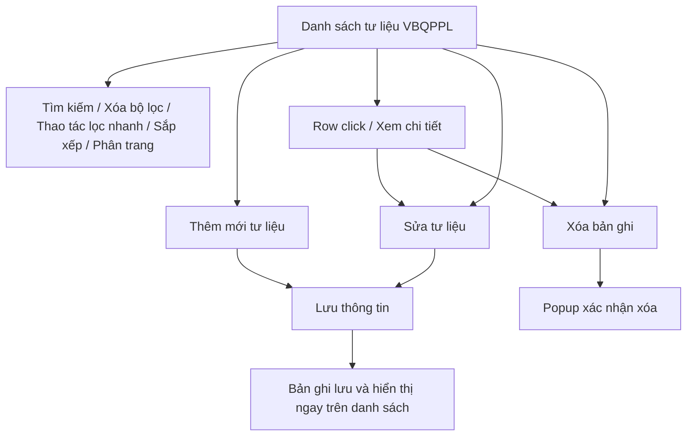
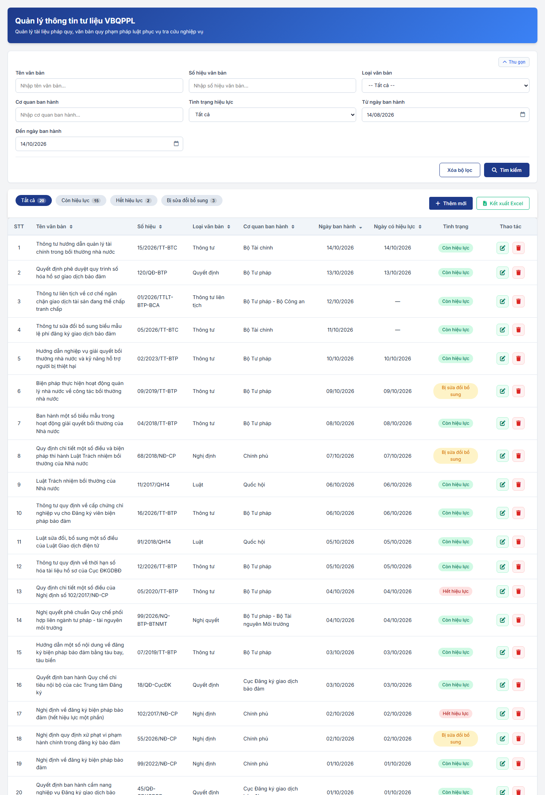
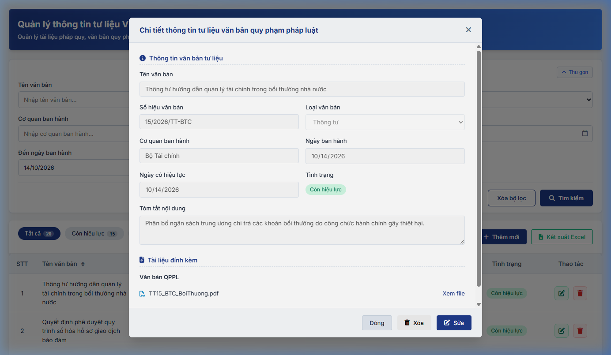
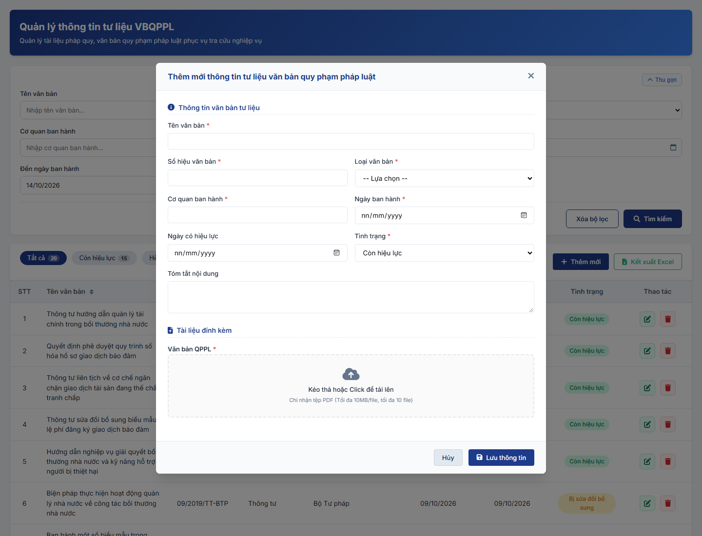
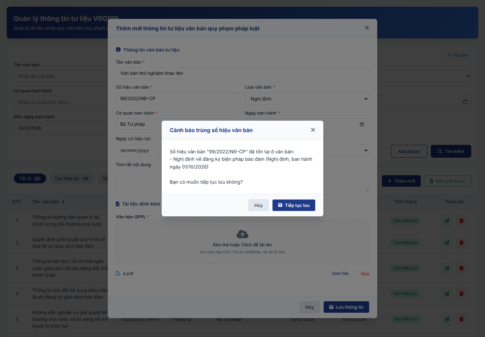

### 4.3.3. Hỗ trợ tư liệu - Văn bản quy phạm pháp luật (VBQPPL)

#### 4.3.3.7. Quản lý thông tin tư liệu văn bản quy phạm pháp luật

##### 4.3.3.7.1. Mục đích

- Quản lý tập trung kho dữ liệu tư liệu văn bản quy phạm pháp luật, văn bản pháp quy phục vụ tra cứu, hướng dẫn áp dụng pháp luật trong công tác bồi thường nhà nước và công khai minh bạch hệ thống văn bản cho cá nhân, tổ chức.

- Cán bộ nghiệp vụ trực tiếp quản lý, đăng tải và cập nhật tư liệu văn bản; không có luồng phê duyệt của Lãnh đạo. Bản ghi được lưu và hiển thị trên danh sách ngay khi cán bộ bấm "Lưu thông tin".

- Quản lý Tình trạng hiệu lực pháp lý của từng văn bản để người dùng tra cứu đúng văn bản đang áp dụng.

*a. Phân quyền*

- Cán bộ nghiệp vụ: Quyền tra cứu/tìm kiếm, xem danh sách, lọc nhanh, xem chi tiết, thêm mới, sửa và xóa bản ghi tại mọi thời điểm, kết xuất Excel danh sách.

*b. Điều kiện thực hiện*

- Người dùng đã đăng nhập thành công vào Website Quản trị.

- Người dùng được phân quyền truy cập chức năng `Quản lý thông tin tư liệu VBQPPL` thuộc phân hệ Hỗ trợ tư liệu.

- Dữ liệu tham chiếu:
  + Danh mục Loại văn bản quy phạm pháp luật [DM_21].
  + Tình trạng hiệu lực của văn bản: + Còn hiệu lực + Hết hiệu lực + Bị sửa đổi bổ sung

---

##### 4.3.3.7.2. Sơ đồ luồng nghiệp vụ theo giao diện

---

##### 4.3.3.7.3. MH01 - Màn hình Danh sách thông tin tư liệu VBQPPL

###### 4.3.3.7.3.1. Màn hình

###### 4.3.3.7.3.2. Mô tả thông tin trên màn hình

| Trường thông tin | Kiểu dữ liệu | Bắt buộc | Mặc định | Mô tả |
| :--- | :--- | :--- | :--- | :--- |
| **I. Bộ lọc tìm kiếm** | - | - | - | Control UI: Khối thu gọn/mở rộng (Accordion). - Mặc định hiển thị dạng mở rộng. - Cho phép thu gọn/mở rộng khi click vào nút "Thu gọn"/"Mở rộng" ở góc phải khối; khi thu gọn, các giá trị lọc đã nhập được giữ nguyên. |
| Tên văn bản | String(500) | Không | Trống | Control UI: Text input. - Placeholder: "Nhập tên văn bản...". - Tìm gần đúng theo Tên văn bản; không phân biệt hoa thường, có dấu/không dấu. |
| Số hiệu văn bản | String(50) | Không | Trống | Control UI: Text input. - Placeholder: "Nhập số hiệu văn bản...". - Tìm gần đúng theo Số hiệu văn bản; không phân biệt hoa thường, có dấu/không dấu. |
| Loại văn bản | Enum(String(50)) | Không | Tất cả | Control UI: Combobox. - Tham chiếu Danh mục Loại văn bản quy phạm pháp luật [DM_21]. |
| Cơ quan ban hành | String(255) | Không | Trống | Control UI: Text input. - Placeholder: "Nhập cơ quan ban hành...". - Tìm gần đúng theo tên cơ quan ban hành văn bản; không phân biệt hoa thường, có dấu/không dấu. |
| Tình trạng hiệu lực | Enum(String(50)) | Không | Tất cả | Control UI: Combobox. - Lọc theo Tình trạng hiệu lực của văn bản. Gồm: + Tất cả + Còn hiệu lực + Hết hiệu lực + Bị sửa đổi bổ sung |
| Từ ngày ban hành | Date | Không | Ngày hiện tại lùi 02 tháng | Control UI: Date input. - Nhập điều kiện lọc ngày ban hành bắt đầu, định dạng `dd/mm/yyyy` (placeholder: "dd/mm/yyyy"). |
| Đến ngày ban hành | Date | Không | Ngày hiện tại | Control UI: Date input. - Nhập điều kiện lọc ngày ban hành kết thúc, định dạng `dd/mm/yyyy` (placeholder: "dd/mm/yyyy"). |
| **II. Thống kê nhanh** | | | | |
| Tất cả | Integer(10) | Không | Theo dữ liệu hệ thống | - Chỉ đọc. - Hiển thị tổng số bản ghi đang không bị xóa mềm. - Nhấp chọn để lọc nhanh danh sách toàn bộ tư liệu văn bản; đồng thời thiết lập ô "Tình trạng hiệu lực" ở Bộ lọc tìm kiếm về giá trị mặc định ("Tất cả"). |
| Còn hiệu lực | Integer(10) | Không | Theo dữ liệu hệ thống | - Chỉ đọc. - Hiển thị số văn bản có Tình trạng "Còn hiệu lực". - Nhấp chọn để lọc nhanh danh sách văn bản còn hiệu lực; đồng thời cập nhật giá trị "Còn hiệu lực" vào ô "Tình trạng hiệu lực" ở khối Bộ lọc tìm kiếm. |
| Hết hiệu lực | Integer(10) | Không | Theo dữ liệu hệ thống | - Chỉ đọc. - Hiển thị số văn bản có Tình trạng "Hết hiệu lực". - Nhấp chọn để lọc nhanh danh sách văn bản đã hết hiệu lực; đồng thời cập nhật giá trị "Hết hiệu lực" vào ô "Tình trạng hiệu lực" ở khối Bộ lọc tìm kiếm. |
| Bị sửa đổi bổ sung | Integer(10) | Không | Theo dữ liệu hệ thống | - Chỉ đọc. - Hiển thị số văn bản có Tình trạng "Bị sửa đổi bổ sung" (bị sửa đổi, bổ sung một phần). - Nhấp chọn để lọc nhanh danh sách văn bản bị sửa đổi bổ sung; đồng thời cập nhật giá trị "Bị sửa đổi bổ sung" vào ô "Tình trạng hiệu lực" ở khối Bộ lọc tìm kiếm. |
| **III. Bảng danh sách kết quả** | - | - | 20 bản ghi/trang | Control UI: Data grid. - Khi người dùng truy cập màn hình, hệ thống tự động tải trang đầu tiên (Trang 1) với số lượng mặc định 20 bản ghi. - Sắp xếp mặc định: Sắp xếp theo "Ngày ban hành" giảm dần. - Trạng thái có dữ liệu: Hiển thị danh sách các bản ghi kết quả theo cấu trúc các cột quy định. - Trạng thái không có dữ liệu (Empty State): Khi không tìm thấy kết quả phù hợp với điều kiện tìm kiếm, bảng hiển thị duy nhất 01 dòng căn giữa trên toàn bộ chiều rộng bảng (`colspan`), in nghiêng với nội dung theo MessageList dùng chung [MSG-INF-SYS-001]. |
| STT | Integer(10) | Không | Theo trang hiện tại | - Chỉ đọc. - Theo dữ liệu bản ghi. |
| Tên văn bản | String(500) | Không | Theo dữ liệu hệ thống | - Chỉ đọc. - Theo dữ liệu bản ghi, hiển thị dạng văn bản thường (không phải liên kết). |
| Số hiệu | String(100) | Không | Theo dữ liệu hệ thống | - Chỉ đọc. - Theo dữ liệu bản ghi. |
| Loại văn bản | Enum(String(50)) | Không | Theo dữ liệu hệ thống | - Chỉ đọc. - Theo dữ liệu bản ghi. |
| Cơ quan ban hành | String(255) | Không | Theo dữ liệu hệ thống | - Chỉ đọc. - Theo dữ liệu bản ghi. |
| Ngày ban hành | Date | Không | Theo dữ liệu hệ thống | - Chỉ đọc. - Định dạng `dd/mm/yyyy`. |
| Ngày có hiệu lực | Date | Không | Theo dữ liệu hệ thống | - Chỉ đọc. - Định dạng `dd/mm/yyyy`. |
| Tình trạng | Enum(String(50)) | Không | Theo dữ liệu hệ thống | Control UI: Badge. - Chỉ đọc. - Theo dữ liệu bản ghi. |
| Thao tác | - | - | - | Control UI: Icon + Sửa + Xóa - Cột cố định bên phải lưới khi cuộn ngang. |
| Phân trang | - | - | 20 bản ghi/trang | Phân trang, chuyển trang và cấu hình số dòng hiển thị theo quy tắc chung của hệ thống. |

###### 4.3.3.7.3.3. Chức năng trên màn hình

| STT | Tên chức năng | Định dạng | Mô tả |
| :--- | :--- | :--- | :--- |
| 1 | Tìm kiếm | Button | Khi người dùng click nút, hệ thống kiểm tra điều kiện dữ liệu và thực hiện tìm kiếm theo các trường hợp bên dưới: |
| | | | **TH1 - Khoảng ngày không hợp lệ**: Nếu `Từ ngày ban hành` lớn hơn `Đến ngày ban hành`, vi phạm [BR-VAL-007], hệ thống hiển thị cảnh báo lỗi [MSG-ERR-VAL-007] và không thực hiện tìm kiếm. |
| | | | **TH Hợp lệ (Có dữ liệu phù hợp)**: Hệ thống lọc và hiển thị danh sách các bản ghi thỏa mãn đồng thời các tiêu chí tìm kiếm/lọc đã nhập/chọn, hiển thị kết quả lên bảng và đưa về Trang 1. |
| | | | **TH Không có dữ liệu trả về**: Bảng kết quả hiển thị duy nhất 01 dòng căn giữa trên toàn bộ chiều rộng bảng (`colspan`), in nghiêng với nội dung theo MessageList dùng chung [MSG-INF-SYS-001]; thanh phân trang hiển thị *"Hiển thị 0-0 của 0 bản ghi"*, các nút điều hướng trang ở trạng thái khóa mờ (Disabled); nút "Kết xuất Excel" ở trạng thái khóa mờ kèm tooltip *"Không có dữ liệu để kết xuất Excel"*. |
| 2 | Xóa bộ lọc | Button | Hệ thống xóa toàn bộ tiêu chí tìm kiếm đã nhập/chọn, thiết lập các ô lọc về giá trị mặc định, đưa trang hiện tại về Trang 1 và tải lại danh sách tư liệu VBQPPL. |
| 3 | Thao tác lọc nhanh | Button | Khi người dùng nhấp chọn thẻ lọc nhanh, hệ thống lọc danh sách theo điều kiện tương ứng: + Tất cả: Hiển thị toàn bộ danh sách tư liệu văn bản đang áp dụng, đồng thời thiết lập ô "Tình trạng hiệu lực" ở Bộ lọc tìm kiếm về "Tất cả". + Còn hiệu lực: Lọc các văn bản có tình trạng Còn hiệu lực, đồng thời cập nhật giá trị "Còn hiệu lực" vào ô "Tình trạng hiệu lực" ở Bộ lọc tìm kiếm. + Hết hiệu lực: Lọc các văn bản có tình trạng Hết hiệu lực, đồng thời cập nhật giá trị "Hết hiệu lực" vào ô "Tình trạng hiệu lực" ở Bộ lọc tìm kiếm. + Bị sửa đổi bổ sung: Lọc các văn bản có tình trạng Bị sửa đổi bổ sung, đồng thời cập nhật giá trị "Bị sửa đổi bổ sung" vào ô "Tình trạng hiệu lực" ở Bộ lọc tìm kiếm. Đồng thời cập nhật trạng thái kích hoạt của thẻ lọc và đưa danh sách về Trang 1.  **TH Không có dữ liệu trả về**: Bảng kết quả hiển thị duy nhất 01 dòng căn giữa (`colspan`), in nghiêng với nội dung [MSG-INF-SYS-001]; thanh phân trang hiển thị *"Hiển thị 0-0 của 0 bản ghi"*; các nút điều hướng trang bị khóa mờ; nút "Kết xuất Excel" bị khóa mờ kèm tooltip *"Không có dữ liệu để kết xuất Excel"*. |
| 4 | Thêm mới | Button | Hệ thống mở [MH03 - Màn hình Thêm mới/Sửa thông tin tư liệu VBQPPL](#43375-mh03---màn-hình-thêm-mớisửa-thông-tin-tư-liệu-vbqppl) ở chế độ Thêm mới với form thông tin để trống. |
| 5 | Kết xuất Excel | Button | - Theo [Quy chuẩn Kết xuất Excel dùng chung - Danh mục và Phụ lục - Tài liệu tổng hợp](../../Tai%20lieu%20tong%20hop/04_Danh_muc_va_Phu_luc.md#quy-chuan-ket-xuat-excel): định dạng tệp, font chữ, căn lề, dòng tiêu đề, dòng thông tin, footer, ghi nhật ký. - Danh sách rỗng: không kết xuất, hiển thị [MSG-WRN-SYS-001]. - Có dữ liệu: tải tệp `.xlsx` gồm toàn bộ văn bản theo bộ lọc, lọc nhanh và sắp xếp hiện tại (không theo trang), hiển thị [MSG-SUC-BTNN-HTTL-003]. - Tên tệp: `yyyyMMdd_Quan_ly_thong_tin_tu_lieu_VBQPPL.xlsx`. - Dòng 1 (tiêu đề): `DANH SÁCH TƯ LIỆU VĂN BẢN QUY PHẠM PHÁP LUẬT`. - Dòng 2 (thông tin): `Ngày ban hành: Từ ngày [Từ ngày ban hành] đến ngày [Đến ngày ban hành]`; không nhập khoảng ngày: `Thời điểm xuất: dd/mm/yyyy HH:mm`. - Cột xuất: theo lưới, bỏ cột `Thao tác`. |
| 6 | Sắp xếp cột | Header cột | Áp dụng trên các cột: `Tên văn bản`, `Số hiệu`, `Loại văn bản`, `Cơ quan ban hành`, `Ngày ban hành`, `Ngày có hiệu lực`. |
| | | | **TH1 - Chọn lại cột đang sắp xếp**: Hệ thống đảo chiều sắp xếp tăng dần / giảm dần và cập nhật icon mũi tên trạng thái trên tiêu đề cột. |
| | | | **TH2 - Chọn cột khác**: Hệ thống thiết lập cột được chọn làm tiêu chí sắp xếp hiện hành và cập nhật lại thứ tự bản ghi trên bảng. |
| 7 | Row click | Row click | Khi người dùng click vào bất kỳ vị trí nào trên dòng dữ liệu (trừ các nút thao tác), hệ thống mở [MH02 - Màn hình Chi tiết thông tin tư liệu VBQPPL](#43374-mh02---màn-hình-chi-tiết-thông-tin-tư-liệu-vbqppl) ở chế độ chỉ xem. |
| 8 | Sửa | Icon button | Thao tác của Cán bộ nghiệp vụ, áp dụng cho mọi bản ghi. - Hệ thống mở [MH03 - Màn hình Thêm mới/Sửa thông tin tư liệu VBQPPL](#43375-mh03---màn-hình-thêm-mớisửa-thông-tin-tư-liệu-vbqppl) ở chế độ Sửa với toàn bộ dữ liệu hiện tại của văn bản được điền sẵn vào các trường. |
| 9 | Xóa | Icon button | Thao tác của Cán bộ nghiệp vụ, áp dụng cho mọi bản ghi. - Hệ thống hiển thị Popup Modal xác nhận xóa tùy chỉnh (Custom Confirmation Modal) [MSG-CFM-SYS-001] ("Bạn có chắc chắn muốn xóa văn bản [Số hiệu] - [Tên văn bản] không?"). Khi người dùng xác nhận "Xóa", hệ thống thực hiện xóa mềm bản ghi, ẩn khỏi bảng dữ liệu, cập nhật lại chỉ số thống kê và hiển thị thông báo thành công [MSG-SUC-BTNN-HTTL-008]. |
| 10 | Phân trang & chuyển trang | Pagination | Phân trang, chuyển trang và cấu hình số dòng hiển thị theo quy tắc chung của hệ thống. |

---

##### 4.3.3.7.4. MH02 - Màn hình Chi tiết thông tin tư liệu VBQPPL

###### 4.3.3.7.4.1. Màn hình

###### 4.3.3.7.4.2. Mô tả thông tin trên màn hình

| Trường thông tin | Kiểu dữ liệu | Bắt buộc | Mặc định | Mô tả |
| :--- | :--- | :--- | :--- | :--- |
| **I. Thông tin văn bản tư liệu** | | | | |
| Tên văn bản | - | - | - | Control UI: Label Theo dữ liệu bản ghi. |
| Số hiệu văn bản | - | - | - | Control UI: Label Theo dữ liệu bản ghi. |
| Loại văn bản | - | - | - | Control UI: Label Theo dữ liệu bản ghi. |
| Cơ quan ban hành | - | - | - | Control UI: Label Theo dữ liệu bản ghi. |
| Ngày ban hành | - | - | - | Control UI: Label Theo dữ liệu bản ghi. |
| Ngày có hiệu lực | - | - | - | Control UI: Label Theo dữ liệu bản ghi. |
| Tình trạng | - | - | - | Control UI: Badge Theo dữ liệu bản ghi. |
| Tóm tắt nội dung | - | - | - | Control UI: Label Theo dữ liệu bản ghi. |
| **II. Tài liệu đính kèm** | | | | |
| Văn bản QPPL | - | - | - | Control UI: File link Theo dữ liệu bản ghi. |
| **III. Thao tác** | | | | |
| Đóng | Button | Không | Hiển thị | Đóng popup chi tiết và quay lại danh sách MH01. |
| Xóa | Button | Không | Hiển thị | Mở Popup xác nhận xóa bản ghi đang xem [MSG-CFM-SYS-001]. |
| Sửa | Button | Không | Hiển thị | Mở form Sửa (MH03) với thông tin của bản ghi đang xem. |

###### 4.3.3.7.4.3. Chức năng trên màn hình

| STT | Tên chức năng | Định dạng | Mô tả |
| :--- | :--- | :--- | :--- |
| 1 | Xem file | Link | Khi click vào liên kết "Xem file" cạnh tên tệp tin đính kèm, hệ thống mở nội dung file tại một tab trình duyệt mới. |
| 2 | Sửa | Button | Khi người dùng click nút "Sửa" ở chân popup, hệ thống chuyển sang [MH03 - Màn hình Thêm mới/Sửa thông tin tư liệu VBQPPL](#43375-mh03---màn-hình-thêm-mớisửa-thông-tin-tư-liệu-vbqppl) ở chế độ Sửa với toàn bộ dữ liệu của văn bản đang xem để cán bộ chỉnh sửa. |
| 3 | Xóa | Button | Khi người dùng click nút "Xóa" ở chân popup, hệ thống đóng popup chi tiết, hiển thị Popup Modal xác nhận xóa tùy chỉnh (Custom Confirmation Modal) [MSG-CFM-SYS-001] ("Bạn có chắc chắn muốn xóa văn bản [Số hiệu] - [Tên văn bản] không?"). Khi người dùng xác nhận "Xóa", hệ thống thực hiện xóa mềm bản ghi, ẩn khỏi bảng dữ liệu, cập nhật lại chỉ số thống kê và hiển thị thông báo thành công [MSG-SUC-BTNN-HTTL-008]. |
| 4 | Đóng | Button | Khi người dùng click nút "Đóng" ở chân popup hoặc biểu tượng đóng ở góc phải tiêu đề popup, hệ thống đóng popup và quay lại [MH01 - Màn hình Danh sách thông tin tư liệu VBQPPL](#43373-mh01---màn-hình-danh-sách-thông-tin-tư-liệu-vbqppl). |

---

##### 4.3.3.7.5. MH03 - Màn hình Thêm mới/Sửa thông tin tư liệu VBQPPL

###### 4.3.3.7.5.1. Màn hình

###### 4.3.3.7.5.2. Mô tả thông tin trên màn hình

| Trường thông tin | Kiểu dữ liệu | Bắt buộc | Mặc định | Mô tả |
| :--- | :--- | :--- | :--- | :--- |
| **I. Thông tin văn bản tư liệu** | | | | |
| Tên văn bản | String(500) | Có | Trống | Control UI: Text input. - Nhập tên văn bản tư liệu đầy đủ. |
| Số hiệu văn bản | String(100) | Có | Trống | Control UI: Text input. - Nhập số hiệu văn bản pháp quy. |
| Loại văn bản | Enum(String(50)) | Có | Trống | Control UI: Combobox. - Tham chiếu Danh mục Loại văn bản quy phạm pháp luật [DM_21]. |
| Cơ quan ban hành | String(255) | Có | Trống | Control UI: Text input. - Nhập tên cơ quan ban hành văn bản. |
| Ngày ban hành | Date | Có | Trống | Control UI: Date input. - Nhập hoặc chọn ngày ban hành văn bản, định dạng `dd/mm/yyyy`. - Ngày ban hành phải nhỏ hơn hoặc bằng ngày hiện tại theo [BR-VAL-008]. |
| Ngày có hiệu lực | Date | Không | Trống | Control UI: Date input. - Nhập hoặc chọn ngày có hiệu lực của văn bản, định dạng `dd/mm/yyyy`. - Nếu nhập, ngày có hiệu lực phải lớn hơn hoặc bằng ngày ban hành theo [BR-VAL-007]. |
| Tình trạng | Enum(String(50)) | Có | Còn hiệu lực | Control UI: Combobox. - Chọn Tình trạng hiệu lực pháp lý của văn bản. Gồm: + Còn hiệu lực + Hết hiệu lực + Bị sửa đổi bổ sung |
| Tóm tắt nội dung | Text(2000) | Không | Trống | Control UI: Textarea. - Nhập tóm tắt nội dung chính của văn bản. |
| **II. Tài liệu đính kèm** | | | | |
| Văn bản QPPL | File | Có | Trống | Control UI: File Upload Area. - Cho phép kéo thả hoặc click chọn nhiều tệp. - Chỉ nhận tệp PDF (`.pdf`). - Dung lượng tối đa: 10MB/tệp, tối đa 10 tệp. - Áp dụng [BR-BTNN-HTTL-001]. Bắt buộc đính kèm ít nhất 01 tệp. - Sau khi tải lên thành công, hiển thị tên tệp kèm theo 2 liên kết: + Xem file (mở tab mới) + Xóa (popup xác nhận, xóa khỏi danh sách tệp trước khi lưu) |

###### 4.3.3.7.5.3. Chức năng trên màn hình

| STT | Tên chức năng | Định dạng | Mô tả |
| :--- | :--- | :--- | :--- |
| 1 | Lưu thông tin | Button | Khi người dùng click nút, hệ thống kiểm tra dữ liệu và lưu trực tiếp theo các trường hợp bên dưới (không qua phê duyệt): |
| | | | **TH1 - Bỏ trống trường bắt buộc**: Vi phạm [BR-VAL-001], hệ thống tô viền đỏ các ô lỗi (`.is-invalid`), hiển thị cảnh báo lỗi [MSG-ERR-VAL-001] ngay phía dưới từng ô và tự động focus con trỏ vào ô lỗi đầu tiên; không dùng Toast. |
| | | | **TH2 - Dữ liệu không hợp lệ**: Kiểm tra và phát hiện lỗi: + `Ngày ban hành` lớn hơn ngày hiện tại: Vi phạm [BR-VAL-008], hệ thống hiển thị cảnh báo lỗi [MSG-ERR-VAL-008] ngay dưới ô và không cho phép lưu. + `Ngày có hiệu lực` nhỏ hơn `Ngày ban hành`: Vi phạm [BR-VAL-007], hệ thống hiển thị cảnh báo lỗi [MSG-ERR-VAL-007] ngay dưới ô và không cho phép lưu. + Tệp Văn bản QPPL vi phạm [BR-BTNN-HTTL-001] (không phải tệp PDF, vượt dung lượng 10MB hoặc quá 10 tệp): Hệ thống hiển thị thông báo lỗi [MSG-ERR-BTNN-HTTL-001], [MSG-ERR-BTNN-HTTL-002] hoặc [MSG-ERR-BTNN-HTTL-003] tương ứng ngay dưới vùng tải tệp và không nhận tệp. |
| | | | **TH3 - Trùng văn bản**: Văn bản được xác định bởi 04 thông tin `Tên văn bản`, `Số hiệu văn bản`, `Ngày ban hành`, `Loại văn bản`. Nếu cả 04 thông tin trùng với một văn bản khác đang tồn tại (chưa bị xóa) trên hệ thống, hệ thống viền đỏ 04 ô này, hiển thị cảnh báo "Văn bản đã tồn tại trong hệ thống (trùng Tên văn bản, Số hiệu văn bản, Ngày ban hành và Loại văn bản)" dưới ô `Tên văn bản` và không cho phép lưu. - So sánh sau khi bỏ khoảng trắng thừa, không phân biệt hoa thường. - Ở chế độ Sửa, hệ thống bỏ qua chính bản ghi đang sửa. |
| | | | **TH4 - Trùng Số hiệu văn bản**: Dữ liệu hợp lệ, không trùng đủ 04 thông tin xác định văn bản nhưng `Số hiệu văn bản` trùng với một hoặc nhiều văn bản khác đang tồn tại (chưa bị xóa); so sánh sau khi bỏ khoảng trắng thừa, không phân biệt hoa thường. Hệ thống không chặn lưu, mở [Popup Cảnh báo trùng số hiệu văn bản](#43376-popup-cảnh-báo-trùng-số-hiệu-văn-bản) để người dùng quyết định: + Chọn `Tiếp tục lưu`: hệ thống lưu như TH5/TH6. + Chọn `Hủy`: hệ thống đóng popup cảnh báo, giữ nguyên dữ liệu đang nhập trên form để người dùng sửa. |
| | | | **TH5 - Hợp lệ - Thêm mới**: Hệ thống lưu bản ghi, ghi nhận người tạo và ngày tạo, đóng popup modal, hiển thị ngay bản ghi trên danh sách, cập nhật chỉ số thống kê và hiển thị thông báo thành công [MSG-SUC-BTNN-HTTL-004]. |
| | | | **TH6 - Hợp lệ - Sửa**: Hệ thống cập nhật bản ghi, ghi nhận người cập nhật và ngày cập nhật, đóng popup modal, làm mới danh sách và chỉ số thống kê, hiển thị thông báo thành công [MSG-SUC-BTNN-HTTL-005]. |
| 2 | Xem file | Link | Cho phép xem trước file đính kèm tại một tab trình duyệt riêng biệt. |
| 3 | Xóa | Link | Hệ thống hiển thị Popup xác nhận "Bạn có chắc chắn muốn xóa tệp đính kèm [Tên tệp] không?". Khi người dùng xác nhận "Xóa", hệ thống loại bỏ file khỏi danh sách tải lên trước khi lưu. |
| 4 | Hủy | Button | Khi người dùng click nút "Hủy" ở chân popup hoặc biểu tượng đóng ở góc phải tiêu đề popup, hệ thống đóng popup và quay lại [MH01 - Màn hình Danh sách thông tin tư liệu VBQPPL](#43373-mh01---màn-hình-danh-sách-thông-tin-tư-liệu-vbqppl); dữ liệu vừa nhập chưa lưu bị hủy bỏ. |

---

##### 4.3.3.7.6. Popup Cảnh báo trùng số hiệu văn bản

###### 4.3.3.7.6.1. Màn hình

###### 4.3.3.7.6.2. Mô tả thông tin trên màn hình

| Trường thông tin | Kiểu dữ liệu | Bắt buộc | Mặc định | Mô tả |
| :--- | :--- | :--- | :--- | :--- |
| Tiêu đề popup | - | - | - | Control UI: Label Hiển thị "Cảnh báo trùng số hiệu văn bản". |
| Nội dung cảnh báo | - | - | - | Control UI: Label Hiển thị "Số hiệu văn bản "[Số hiệu văn bản đang nhập]" đã tồn tại ở văn bản:", tiếp theo mỗi văn bản trùng số hiệu hiển thị 01 dòng dạng "- [Tên văn bản] ([Loại văn bản], ban hành ngày [dd/mm/yyyy])", cuối cùng là câu hỏi "Bạn có muốn tiếp tục lưu không?". |

###### 4.3.3.7.6.3. Chức năng trên màn hình

| STT | Tên chức năng | Định dạng | Mô tả |
| :--- | :--- | :--- | :--- |
| 1 | Tiếp tục lưu | Button | Hệ thống đóng popup cảnh báo và lưu bản ghi theo TH5 (Thêm mới) hoặc TH6 (Sửa) của chức năng `Lưu thông tin` tại [MH03 - Màn hình Thêm mới/Sửa thông tin tư liệu VBQPPL](#43375-mh03---màn-hình-thêm-mớisửa-thông-tin-tư-liệu-vbqppl). |
| 2 | Hủy | Button | Khi người dùng click nút "Hủy" ở chân popup hoặc biểu tượng đóng ở góc phải tiêu đề popup, hệ thống đóng popup cảnh báo, không lưu và giữ nguyên dữ liệu đang nhập tại [MH03 - Màn hình Thêm mới/Sửa thông tin tư liệu VBQPPL](#43375-mh03---màn-hình-thêm-mớisửa-thông-tin-tư-liệu-vbqppl). |