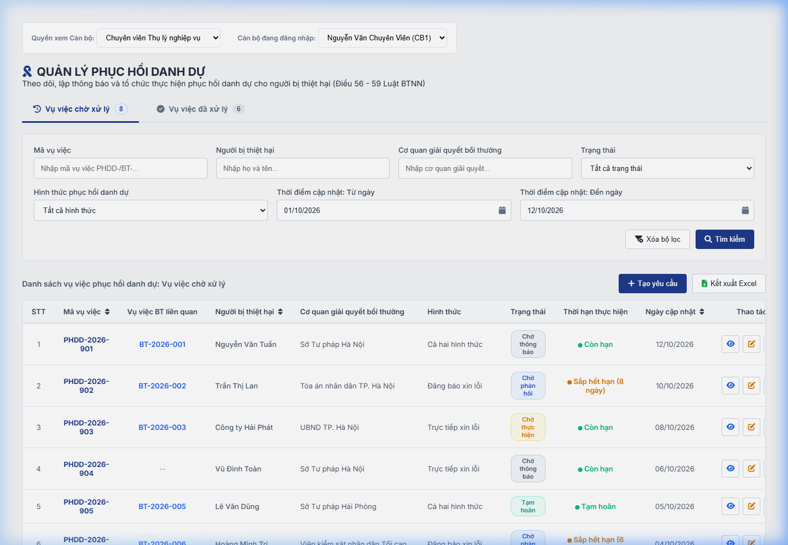
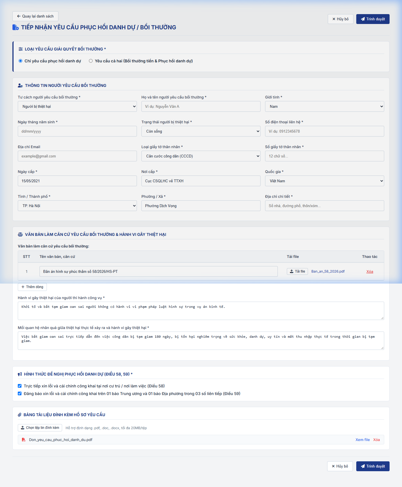
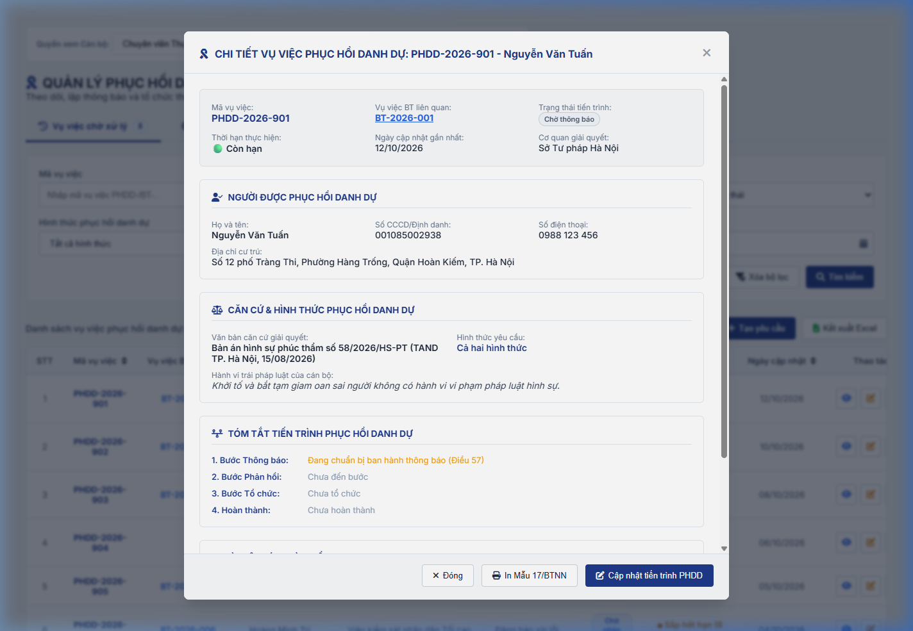
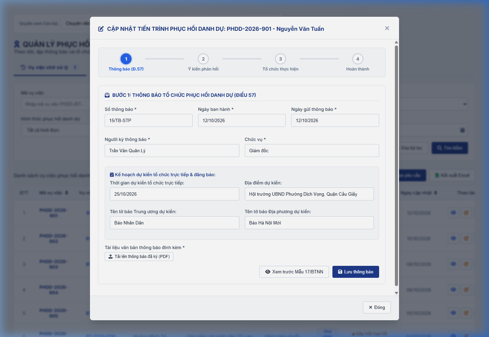

### 4.3.3. Dành cho Cán bộ Công tác bồi thường nhà nước

#### 4.3.3.6. UC438-442 - Quản lý công tác Phục hồi danh dự

##### 4.3.3.6.1. Mục đích

- Cho phép cán bộ chuyên viên thụ lý, lãnh đạo cơ quan giải quyết bồi thường quản lý toàn diện công tác phục hồi danh dự cho người bị thiệt hại theo quy định tại các Điều 56, 57, 58, 59 của Luật Trách nhiệm bồi thường của Nhà nước năm 2017 và Thông tư số 08/2019/TT-BTP.

- Vụ việc Phục hồi danh dự là hồ sơ độc lập có mã định dạng `PHDD-yyyy-xxx`, được khởi tạo từ chức năng "Tạo yêu cầu" trên menu Phục hồi danh dự hoặc được tự động tách ra từ yêu cầu bồi thường có loại yêu cầu "Yêu cầu cả hai (Bồi thường tiền & Phục hồi danh dự)".

- Hồ sơ Phục hồi danh dự chỉ liên kết với vụ việc Bồi thường tiền (mã `BT-yyyy-xxx`) qua trường "Vụ việc liên quan"; toàn bộ căn cứ, tiến trình thực hiện và trạng thái giải quyết của hai vụ việc diễn ra hoàn toàn độc lập với nhau. Màn hình chi tiết của vụ việc Phục hồi danh dự tuyệt đối không hiển thị các thông tin liên quan đến tiền bồi thường (thiệt hại, thương lượng tiền, quyết định bồi thường, chi trả tiền hay kinh phí).

- Cung cấp danh sách vụ việc chia thành 02 Tab nghiệp vụ chuyên biệt:
  - **Tab Vụ việc chờ xử lý**: Quản lý các hồ sơ đang trong tiến trình phục hồi danh dự (trạng thái: `Chờ thông báo`, `Chờ phản hồi`, `Chờ thực hiện`, `Tạm hoãn`).
  - **Tab Vụ việc đã xử lý**: Quản lý các hồ sơ đã kết thúc tiến trình phục hồi danh dự (trạng thái: `Hoàn thành`, `Từ chối`).

- Cung cấp chức năng "Tạo yêu cầu" (dưới dạng màn hình trang nhập liệu toàn trang - Page) cho phép tiếp nhận trực tiếp hồ sơ với trường "Loại yêu cầu giải quyết bồi thường" chỉ gồm 02 lựa chọn: `Chỉ yêu cầu phục hồi danh dự` (mặc định) và `Yêu cầu cả hai (Bồi thường tiền & Phục hồi danh dự)`. Form tiếp nhận yêu cầu không có nút "Lưu nháp", chỉ có nút "Hủy bỏ" và "Trình duyệt".

- Cung cấp chức năng "Cập nhật tiến trình phục hồi danh dự" gồm 04 bước chuẩn hóa theo luật định:
  - **Bước 1**: Ban hành Thông báo tổ chức phục hồi danh dự (Điều 57).
  - **Bước 2**: Ghi nhận ý kiến phản hồi của người yêu cầu / người bị thiệt hại (Đồng ý, Đề nghị tạm hoãn, Từ chối hoặc Không có ý kiến).
  - **Bước 3**: Tổ chức thực hiện phục hồi danh dự (Điều 58 - Trực tiếp xin lỗi và cải chính công khai; Điều 59 - Đăng báo xin lỗi công khai 03 số liên tiếp).
  - **Bước 4**: Hoàn thành thực thi phục hồi danh dự (Xác nhận hoàn thành, lưu trữ hồ sơ và chuyển trạng thái).

*a. Phân quyền*

- Người dùng thuộc vai trò Chuyên viên Thụ lý hoặc Thủ trưởng/Lãnh đạo cơ quan giải quyết bồi thường có quyền truy cập menu "Phục hồi danh dự".
- Cán bộ được phân công thụ lý có quyền tạo yêu cầu mới, cập nhật tiến trình 04 bước và xác nhận hoàn thành thực thi.
- Các cán bộ khác chỉ có quyền xem chi tiết hồ sơ trong phạm vi đơn vị.

*b. Điều kiện thực hiện*

- Người dùng đã đăng nhập thành công vào Website Quản trị bằng tài khoản cán bộ hợp lệ và truy cập menu **"Phục hồi danh dự"** (thuộc phân hệ "Bồi thường nhà nước").
- Dữ liệu danh sách được truy xuất từ cơ sở dữ liệu các hồ sơ vụ việc có yêu cầu phục hồi danh dự (`PHDD-yyyy-xxx` hoặc `BT-yyyy-xxx` có yêu cầu phục hồi danh dự chưa tách).

---

##### 4.3.3.6.2. Sơ đồ luồng nghiệp vụ theo giao diện

```mermaid
flowchart TD
    A[Menu Phục hồi danh dự] --> B[MH01 - Danh sách vụ việc Phục hồi danh dự]
    B --> C{Chọn Tab hiển thị}
    C -->|Tab 1| D[Vụ việc chờ xử lý]
    C -->|Tab 2| E[Vụ việc đã xử lý]
    
    B --> F[Bộ lọc tìm kiếm]
    F -->|Tìm kiếm / Xóa bộ lọc| B
    
    B --> G[Nút: Kết xuất Excel]
    B --> H[Nút: Tạo yêu cầu]
    H --> I[MH02 - Màn hình Tiếp nhận yêu cầu phục hồi danh dự - Dạng Page]
    I --> J{Chọn Loại yêu cầu}
    J -->|Chỉ yêu cầu PHDD| K[Nhập thông tin người yêu cầu, căn cứ & hình thức PHDD]
    J -->|Yêu cầu cả hai| L[Nhập cả thông tin bồi thường tiền & phục hồi danh dự]
    K --> M[Nút: Trình duyệt]
    L --> M
    M -->|Hợp lệ| N[Sinh mã PHDD- / Cặp mã BT- & PHDD- và chuyển vào Tab Chờ xử lý]
    
    B --> O[Click vào dòng bản ghi (Row click)]
    O --> P[MH03 - Màn hình Xem chi tiết hồ sơ PHDD]
    P --> Q[Chuyển sang MH04 Cập nhật tiến trình]
    
    B --> R[Thao tác: Cập nhật tiến trình PHDD]
    R --> S[MH04 - Cập nhật tiến trình 04 bước]
    S --> T[Bước 1: Ban hành Thông báo Điều 57]
    T --> U[Bước 2: Ghi nhận ý kiến phản hồi]
    U --> V[Bước 3: Tổ chức thực hiện Điều 58/59]
    V --> W[Bước 4: Xác nhận hoàn thành thực thi]
    W --> X[Popup xác nhận hoàn thành]
    X -->|Đồng ý| Y[Chuyển trạng thái Hoàn thành, đưa sang Tab Đã xử lý]
```

---

##### 4.3.3.6.3. MH01 - Màn hình Danh sách vụ việc phục hồi danh dự

###### 4.3.3.6.3.1. Màn hình

Nguồn UI: `UI_Mockups_Git_BPBD_UI/Website_Quan_tri/quan_ly_phuc_hoi_danh_du.html`



###### 4.3.3.6.3.2. Mô tả thông tin trên màn hình

| Trường thông tin | Kiểu dữ liệu | Bắt buộc | Mặc định | Mô tả |
| :--- | :--- | :--- | :--- | :--- |
| Tab Vụ việc chờ xử lý | Tab | Không | Active | Control UI: Tab điều hướng.<br>- Hiển thị số lượng hồ sơ đang trong quá trình thực hiện phục hồi danh dự.<br>- Khi click: Tải danh sách hồ sơ thuộc Tab Chờ xử lý. |
| Tab Vụ việc đã xử lý | Tab | Không | Inactive | Control UI: Tab điều hướng.<br>- Hiển thị số lượng hồ sơ đã kết thúc quá trình phục hồi danh dự.<br>- Khi click: Tải danh sách hồ sơ thuộc Tab Đã xử lý. |
| Mã vụ việc | String(50) | Không | Trống | Control UI: Input text.<br>- Nhập mã vụ việc Phục hồi danh dự (`PHDD-yyyy-xxx`) hoặc mã vụ việc Bồi thường tiền liên quan (`BT-yyyy-xxx`) để tìm kiếm gần đúng, tự động loại bỏ khoảng trắng hai đầu. |
| Người bị thiệt hại | String(255) | Không | Trống | Control UI: Input text.<br>- Nhập họ tên người bị thiệt hại / người yêu cầu để tìm kiếm gần đúng, không phân biệt chữ hoa chữ thường. |
| Cơ quan giải quyết bồi thường | Enum(String(255)) | Không | Tất cả cơ quan | Control UI: Combobox / Input có gợi ý datalist.<br>- Chọn hoặc nhập cơ quan giải quyết bồi thường.<br>- Giá trị UI gồm:<br>+ Tất cả cơ quan<br>+ Sở Tư pháp Hà Nội<br>+ Tòa án nhân dân TP. Hà Nội<br>+ Sở Tư pháp Hải Phòng<br>+ Cục Thi hành án dân sự Hà Nội<br>+ Viện kiểm sát nhân dân Tối cao<br>+ Tòa án nhân dân Quận Đống Đa |
| Trạng thái | Enum(String(50)) | Không | Tất cả trạng thái | Control UI: Combobox.<br>- Phụ thuộc vào Tab đang chọn:<br>- Khi đang ở Tab "Vụ việc chờ xử lý", danh sách trạng thái gồm:<br>+ Tất cả trạng thái<br>+ Chờ thông báo<br>+ Chờ phản hồi<br>+ Chờ thực hiện<br>+ Tạm hoãn<br>- Khi đang ở Tab "Vụ việc đã xử lý", danh sách trạng thái gồm:<br>+ Tất cả trạng thái<br>+ Hoàn thành<br>+ Từ chối |
| Hình thức phục hồi danh dự | Enum(String(50)) | Không | Tất cả hình thức | Control UI: Combobox.<br>- Giá trị UI gồm:<br>+ Tất cả hình thức<br>+ Trực tiếp xin lỗi<br>+ Đăng báo xin lỗi<br>+ Cả hai hình thức |
| Thời điểm cập nhật: Từ ngày | Date | Không | Ngày đầu tháng hiện tại | Control UI: Datepicker có icon lịch.<br>- Định dạng `dd/mm/yyyy`.<br>- Lọc các hồ sơ có ngày cập nhật lớn hơn hoặc bằng giá trị chọn. |
| Thời điểm cập nhật: Đến ngày | Date | Không | Ngày hiện tại | Control UI: Datepicker có icon lịch.<br>- Định dạng `dd/mm/yyyy`.<br>- Lọc các hồ sơ có ngày cập nhật nhỏ hơn hoặc bằng giá trị chọn. |
| Bảng danh sách vụ việc phục hồi danh dự | List(Object) | Không | - | Control UI: Data grid.<br>- Hiển thị kết quả theo tab đang chọn và điều kiện lọc.<br>- Sắp xếp mặc định: Cột "Ngày cập nhật" giảm dần.<br>- Trường hợp không có dữ liệu: Hiển thị 01 dòng căn giữa bảng với thông báo [MSG-INF-SYS-001]. |
| STT | Integer(10) | Không | Tự tăng | Cột bảng (chỉ đọc): Số thứ tự tăng dần của bản ghi. |
| Mã vụ việc | String(50) | Không | Theo hồ sơ | Cột bảng (chỉ đọc): Mã định dạng `PHDD-yyyy-xxx`. Hỗ trợ sắp xếp động. |
| Vụ việc BT liên quan | String(50) | Không | Theo hồ sơ | Cột bảng (chỉ đọc): Mã vụ việc Bồi thường tiền liên kết (`BT-yyyy-xxx`). Nếu không có liên kết thì hiển thị `--`. Dạng liên kết, click để mở xem chi tiết vụ việc bồi thường tiền liên quan. |
| Người bị thiệt hại | String(255) | Không | Theo hồ sơ | Cột bảng (chỉ đọc): Họ và tên người bị thiệt hại. Hỗ trợ sắp xếp động. |
| Cơ quan giải quyết bồi thường | String(255) | Không | Theo hồ sơ | Cột bảng (chỉ đọc): Tên cơ quan thụ lý giải quyết bồi thường. |
| Hình thức | Enum(String(50)) | Không | Theo hồ sơ | Cột bảng (chỉ đọc): Hình thức phục hồi danh dự gồm:<br>+ Trực tiếp xin lỗi<br>+ Đăng báo xin lỗi<br>+ Cả hai hình thức |
| Trạng thái | Enum(String(50)) | Không | Theo hồ sơ | Cột bảng (chỉ đọc): Theo dữ liệu bản ghi. |
| Thời hạn thực hiện | String(100) | Không | Theo hồ sơ | Cột bảng (chỉ đọc): Hiển thị tình trạng thời hạn thực hiện của hồ sơ:<br>+ Còn hạn<br>+ Sắp hết hạn<br>+ Quá hạn<br>+ Đã hoàn thành |
| Ngày cập nhật | Date | Không | Theo hồ sơ | Cột bảng (chỉ đọc): Định dạng `dd/mm/yyyy`. Hỗ trợ sắp xếp động. |
| Thao tác | Action Buttons | Không | - | Cột bảng: Control UI: Icon buttons.<br>- Tab Vụ việc chờ xử lý: Cập nhật tiến trình PHDD.<br>- Tab Vụ việc đã xử lý: Không có thao tác gì. |

###### 4.3.3.6.3.3. Chức năng trên màn hình

| STT | Tên chức năng | Định dạng | Mô tả |
| :--- | :--- | :--- | :--- |
| 1 | Chuyển Tab danh sách | Tab button | Khi click vào tab "Vụ việc chờ xử lý" hoặc "Vụ việc đã xử lý", hệ thống chuyển đổi tab đang chọn và lọc danh sách bản ghi theo trạng thái của tab tương ứng. |
| 2 | Tìm kiếm | Button | Khi người dùng click nút, hệ thống kiểm tra điều kiện dữ liệu và thực hiện tìm kiếm theo các trường hợp bên dưới:<br>- **TH1 - Khoảng ngày không hợp lệ**: Nếu `Thời điểm cập nhật: Từ ngày` lớn hơn `Thời điểm cập nhật: Đến ngày`, vi phạm [BR-VAL-007], hệ thống hiển thị [MSG-ERR-VAL-007] và không thực hiện tìm kiếm.<br>- **TH Hợp lệ (Có dữ liệu phù hợp)**: Hệ thống lọc và hiển thị danh sách các bản ghi thỏa mãn đồng thời các tiêu chí tìm kiếm/lọc đã nhập/chọn trên tab hiện tại lên bảng.<br>- **TH Không có dữ liệu trả về**: Bảng kết quả hiển thị duy nhất 01 dòng căn giữa trên toàn bộ chiều rộng bảng (`colspan`), in nghiêng với thông báo [MSG-INF-SYS-001]. |
| 3 | Xóa bộ lọc | Button | Hệ thống xóa trắng các ô nhập `Mã vụ việc`, `Người bị thiệt hại`, đưa các dropdown `Cơ quan giải quyết bồi thường`, `Trạng thái`, `Hình thức phục hồi danh dự` về giá trị mặc định "Tất cả"; đặt lại `Thời điểm cập nhật: Từ ngày` là ngày đầu tháng hiện tại, `Thời điểm cập nhật: Đến ngày` là ngày hiện tại; tải lại danh sách theo bộ lọc mặc định của tab hiện tại và hiển thị [MSG-SUC-BTNN-PHDD-002]. |
| 4 | Tạo yêu cầu | Button | Khi người dùng click nút, hệ thống điều hướng mở [MH02 - Màn hình Tiếp nhận yêu cầu phục hồi danh dự](#43364-mh02---màn-hình-tiếp-nhận-yêu-cầu-phục-hồi-danh-dự) dạng màn hình toàn trang (Page), mặc định chọn sẵn loại yêu cầu `Chỉ yêu cầu phục hồi danh dự`. |
| 5 | Kết xuất Excel | Button | Khi người dùng click nút, hệ thống kiểm tra dữ liệu và xử lý theo các trường hợp bên dưới:<br>- **TH1 (Danh sách rỗng)**: Vi phạm quy tắc [BR-EXP-040]. Hệ thống hiển thị [MSG-WRN-SYS-001] và không tải file.<br>- **TH Hợp lệ**: Hệ thống kết xuất danh sách kết quả hiện hành của tab đang xem ra tệp Excel theo đúng tiêu chí lọc/sắp xếp hiện tại, áp dụng [BR-EXP-040] và hiển thị [MSG-SUC-BTNN-PHDD-003]. |
| 6 | Sắp xếp cột | Header cột | Khi click vào tiêu đề các cột `Mã vụ việc`, `Người bị thiệt hại` hoặc `Ngày cập nhật`, hệ thống thực hiện đảo chiều sắp xếp tăng dần / giảm dần và cập nhật lại danh sách hiển thị. |
| 7 | Click vào dòng bản ghi (Row click) | Row action | Khi click vào bất kỳ vị trí nào trên một dòng bản ghi trong bảng (trừ các nút icon thao tác và liên kết Vụ việc BT liên quan), hệ thống mở [MH03 - Màn hình Xem chi tiết vụ việc Phục hồi danh dự](#43365-mh03---màn-hình-xem-chi-tiết-vụ-việc-phục-hồi-danh-dự) hiển thị toàn bộ thông tin chi tiết của vụ việc tương ứng. |
| 8 | Cập nhật tiến trình PHDD | Icon button | Control UI: Nút icon thao tác.<br>- **Hành vi**: Mở [MH04 - Màn hình Cập nhật tiến trình phục hồi danh dự](#43366-mh04---màn-hình-cập-nhật-tiến-trình-phục-hồi-danh-dự) tại bước xử lý tiếp theo của hồ sơ.<br>- **Chỉ hiển thị khi nào**: Chỉ hiển thị đối với các vụ việc tại Tab "Vụ việc chờ xử lý" ở trạng thái chưa kết thúc (gồm `Chờ thông báo`, `Chờ phản hồi`, `Chờ thực hiện`, `Tạm hoãn`). Tại Tab "Vụ việc đã xử lý", không hiển thị thao tác gì (hiển thị ký tự `--`). |
| 9 | Click Mã vụ việc BT liên quan | Link | Mở màn hình Xem chi tiết của vụ việc Bồi thường tiền liên quan (`BT-yyyy-xxx`) tại Module Giải quyết yêu cầu bồi thường. |

---

##### 4.3.3.6.4. MH02 - Màn hình Tiếp nhận yêu cầu phục hồi danh dự

###### 4.3.3.6.4.1. Màn hình

Nguồn UI: `UI_Mockups_Git_BPBD_UI/Website_Quan_tri/quan_ly_phuc_hoi_danh_du.html`



###### 4.3.3.6.4.2. Mô tả thông tin trên màn hình

Màn hình được thiết kế dưới dạng **Trang nhập liệu toàn trang (Page)**, có cấu trúc các khối thông tin đồng bộ với biểu mẫu tiếp nhận giải quyết bồi thường:

| Trường thông tin | Kiểu dữ liệu | Bắt buộc | Mặc định | Mô tả |
| :--- | :--- | :--- | :--- | :--- |
| Tiêu đề màn hình | String(255) | - | `TIẾP NHẬN YÊU CẦU PHỤC HỒI DANH DỰ / BỒI THƯỜNG` | Control UI: Heading text (Read-only). |
| **THÔNG TIN TỔNG QUAN VỤ VIỆC** | Section | - | - | Control UI: Section header. |
| **Loại yêu cầu giải quyết bồi thường** | Enum(String(50)) | Có | `Chỉ yêu cầu phục hồi danh dự` | Control UI: Radio button.<br>Gồm:<br>+ `Chỉ yêu cầu phục hồi danh dự`<br>+ `Yêu cầu cả hai (Bồi thường tiền & Phục hồi danh dự)`<br>- Khi chọn `Chỉ yêu cầu phục hồi danh dự`: Mặc định chọn. Ẩn hoàn toàn khối nhập liệu thông tin bồi thường bằng tiền.<br>- Khi chọn `Yêu cầu cả hai (Bồi thường tiền & Phục hồi danh dự)`: Hiển thị thêm khối "Thông tin bồi thường thiệt hại bằng tiền" và cơ chế tự động tách, tạo đồng thời 02 hồ sơ liên kết. |
| Hình thức tiếp nhận | Enum(String(50)) | Có | `Trực tiếp` | Control UI: Combobox.<br>- Tham chiếu [Danh mục Hình thức tiếp nhận - Danh mục dữ liệu dùng chung - Tổng quan và quy tắc chung](../../Tai%20lieu%20tong%20hop/00_Tong_quan_va_Quy_tac_chung.md#danh-muc-dung-chung) [DM_25].<br>- Chỉ cho chọn `Trực tiếp`, `Qua dịch vụ bưu chính`. |
| Lĩnh vực phát sinh thiệt hại | Enum(String(100)) | Có | Trống | Control UI: Combobox.<br>Tham chiếu danh mục Lĩnh vực phát sinh thiệt hại [DM_22]. |
| **THÔNG TIN NGƯỜI YÊU CẦU BỒI THƯỜNG** | Section | - | - | Khối thông tin nhân thân/tổ chức của người yêu cầu. |
| Họ và tên người yêu cầu bồi thường | String(100) | Có | Trống | Control UI: Input text. Áp dụng rule bắt buộc [BR-VAL-001]. |
| Tư cách người yêu cầu bồi thường | Enum(String(100)) | Có | `Người bị thiệt hại` | Control UI: Combobox.<br>- Tham chiếu [Danh mục Tư cách người yêu cầu bồi thường - Danh mục dữ liệu dùng chung - Tổng quan và quy tắc chung](../../Tai%20lieu%20tong%20hop/00_Tong_quan_va_Quy_tac_chung.md#danh-muc-dung-chung) [DM_26].<br>- Khi giá trị khác `Người bị thiệt hại`: hệ thống hiển thị khối `Thông tin người bị thiệt hại`; khi chọn lại `Người bị thiệt hại`: hệ thống ẩn khối này. |
| Giới tính | Enum(String(20)) | Có | `Nam` | Control UI: Radio button.<br>Tham chiếu Danh mục Giới tính [DM_23]. |
| Ngày tháng năm sinh | Date | Có | Trống | Control UI: Datepicker (`dd/mm/yyyy`). Áp dụng rule bắt buộc [BR-VAL-001] và rule ngày quá khứ [BR-VAL-008]. |
| Trạng thái người bị thiệt hại | Enum(String(50)) | Có | `Còn sống` | Control UI: Radio button.<br>Gồm:<br>+ `Còn sống`<br>+ `Đã chết` |
| Số điện thoại liên hệ | String(20) | Có | Trống | Control UI: Input text. Áp dụng rule số điện thoại [BR-VAL-003]. |
| Địa chỉ Email | String(255) | Không | Trống | Control UI: Input text. Nếu có dữ liệu, áp dụng quy tắc Email [BR-VAL-002]. |
| Loại giấy tờ thân nhân | Enum(String(50)) | Có | `Căn cước công dân (CCCD)` | Control UI: Combobox. Tham chiếu Danh mục Loại giấy tờ pháp lý/thân nhân [DM_10]. |
| Số giấy tờ thân nhân | String(20) | Có | Trống | Control UI: Input text. Áp dụng rule bắt buộc [BR-VAL-001]. Nếu loại giấy tờ là CCCD, áp dụng rule [BR-VAL-004]. |
| Ngày cấp | Date | Có | Trống | Control UI: Datepicker (`dd/mm/yyyy`). Áp dụng rule ngày quá khứ [BR-VAL-008]. |
| Nơi cấp | String(255) | Có | Trống | Control UI: Input text. Áp dụng rule bắt buộc [BR-VAL-001]. |
| Quốc gia | Enum(String(100)) | Có | `Việt Nam` | Control UI: Combobox. Tham chiếu Danh mục Quốc tịch / Quốc gia [DM_09]. |
| Tỉnh/Thành phố | Enum(String(100)) / String(100) | Có | Theo quốc gia | Control UI: Combobox có tìm kiếm / Input text.<br>- Nếu `Quốc gia` = `Việt Nam`: Tham chiếu Danh mục Tỉnh/Thành phố [DM_13].<br>- Nếu `Quốc gia` khác `Việt Nam`: Hiển thị ô nhập văn bản tự do. |
| Phường/Xã | Enum(String(100)) / String(100) | Có | Theo quốc gia | Control UI: Combobox có tìm kiếm / Input text.<br>- Phụ thuộc vào `Tỉnh/Thành phố` đã chọn.<br>- Nếu `Quốc gia` = `Việt Nam`: Tham chiếu Danh mục Xã/Phường/Thị trấn [DM_15] (lọc động theo Tỉnh/Thành phố đã chọn).<br>- Nếu `Quốc gia` khác `Việt Nam`: Hiển thị ô nhập văn bản tự do. |
| Địa chỉ chi tiết | Text(1000) / String(500) | Có | Trống | Control UI: Input text. Nhập số nhà, tên đường/phố, thôn/xóm/ấp... Áp dụng quy tắc bắt buộc [BR-VAL-001]. |
| **THÔNG TIN NGƯỜI BỊ THIỆT HẠI** | Section | - | Ẩn | Khối thông tin nhân thân của người bị thiệt hại.<br>- **Điều kiện hiển thị**: Chỉ hiển thị khi `Tư cách người yêu cầu bồi thường` khác `Người bị thiệt hại`.<br>- Các trường trong khối có cấu trúc tương tự khối `Thông tin người yêu cầu bồi thường`; chỉ 04 trường `Họ và tên người bị thiệt hại`, `Ngày tháng năm sinh (người bị thiệt hại)`, `Loại giấy tờ thân nhân (người bị thiệt hại)`, `Số giấy tờ thân nhân (người bị thiệt hại)` là bắt buộc (nhãn có dấu `*` màu đỏ); các trường còn lại không bắt buộc.<br>- Kiểm tra bắt buộc khi `Trình duyệt` chỉ áp dụng khi khối đang hiển thị: bỏ trống thì tô viền đỏ ô (class `.is-invalid`), hiển thị cảnh báo đỏ "Đây là trường bắt buộc" ngay dưới ô và focus vào ô lỗi đầu tiên. |
| Họ và tên người bị thiệt hại | String(100) | Có (khi khối hiển thị) | Trống | Control UI: Input text. Áp dụng rule bắt buộc [BR-VAL-001]. |
| Giới tính (người bị thiệt hại) | Enum(String(20)) | Không | `Nam` | Control UI: Radio button.<br>Tham chiếu Danh mục Giới tính [DM_23]. |
| Ngày tháng năm sinh (người bị thiệt hại) | Date | Có (khi khối hiển thị) | Trống | Control UI: Datepicker (`dd/mm/yyyy`). Áp dụng rule bắt buộc [BR-VAL-001] và rule ngày quá khứ [BR-VAL-008]. |
| Số điện thoại liên hệ (người bị thiệt hại) | String(20) | Không | Trống | Control UI: Input text. Nếu có dữ liệu, áp dụng rule số điện thoại [BR-VAL-003]. |
| Địa chỉ Email (người bị thiệt hại) | String(255) | Không | Trống | Control UI: Input text. Nếu có dữ liệu, áp dụng quy tắc Email [BR-VAL-002]. |
| Loại giấy tờ thân nhân (người bị thiệt hại) | Enum(String(50)) | Có (khi khối hiển thị) | Trống | Control UI: Combobox, placeholder *"-- Chọn loại giấy tờ --"*. Tham chiếu Danh mục Loại giấy tờ pháp lý/thân nhân [DM_10]. |
| Số giấy tờ thân nhân (người bị thiệt hại) | String(20) | Có (khi khối hiển thị) | Trống | Control UI: Input text. Áp dụng rule bắt buộc [BR-VAL-001]. Nếu loại giấy tờ là CCCD, áp dụng rule [BR-VAL-004]. |
| Ngày cấp (người bị thiệt hại) | Date | Không | Trống | Control UI: Datepicker (`dd/mm/yyyy`). Nếu có dữ liệu, áp dụng rule ngày quá khứ [BR-VAL-008]. |
| Nơi cấp (người bị thiệt hại) | String(255) | Không | Trống | Control UI: Input text. |
| Quốc gia (người bị thiệt hại) | Enum(String(100)) | Không | `Việt Nam` | Control UI: Combobox. Tham chiếu Danh mục Quốc tịch / Quốc gia [DM_09]. |
| Tỉnh/Thành phố (người bị thiệt hại) | Enum(String(100)) / String(100) | Không | Trống | Control UI: Combobox có tìm kiếm / Input text. Tham chiếu Danh mục Tỉnh/Thành phố [DM_13] khi `Quốc gia` = `Việt Nam`; nhập tự do khi `Quốc gia` khác `Việt Nam`. |
| Phường/Xã (người bị thiệt hại) | Enum(String(100)) / String(100) | Không | Trống | Control UI: Combobox có tìm kiếm / Input text. Tham chiếu Danh mục Xã/Phường/Thị trấn [DM_15] khi `Quốc gia` = `Việt Nam`; nhập tự do khi `Quốc gia` khác `Việt Nam`. |
| Địa chỉ chi tiết (người bị thiệt hại) | Text(1000) / String(500) | Không | Trống | Control UI: Input text. Nhập số nhà, tên đường/phố, thôn/xóm... |
| **VĂN BẢN LÀM CĂN CỨ YÊU CẦU BỒI THƯỜNG** | List(Object) | Không | 01 dòng trống | Control UI: Bảng nhập liệu (Data grid) đặt ngay sau khối thông tin Người yêu cầu bồi thường / Người bị thiệt hại, trước trường `Hành vi gây thiệt hại của người thi hành công vụ`.<br>- Khối không bắt buộc; mặc định hiển thị 01 dòng trống; nút `Thêm dòng tài liệu` đặt dưới bảng.<br>- Cột: `STT` \| `Tên văn bản, căn cứ` \| `Tải file` \| `Thao tác` (`Xem file`/`Xóa`). Dòng không có tên và không có file được bỏ qua khi lưu. |
| STT | Integer(10) | - | Tự tăng | Căn giữa. Số thứ tự dòng. |
| Tên văn bản, căn cứ | String(500) | Không | Trống | Control UI: Input text, placeholder *"Nhập tên văn bản, căn cứ..."*. |
| Tải file | File | Không | Chưa có file | Control UI: Nút `Tải file`; sau khi tải lên hiển thị tên file thay cho nút kèm liên kết xem và xóa. Áp dụng [BR-FILE-010]. |
| Thao tác | String(255) | - | - | Gồm liên kết `Xem file` (mở tab mới) và `Xóa` (Custom Confirmation Modal). |
| Hành vi gây thiệt hại của người thi hành công vụ | Text(2000) | Có | Trống | Control UI: Textarea.<br>- Placeholder: `Tóm tắt hành vi gây thiệt hại của người thi hành công vụ`.<br>- Tối đa 2000 ký tự. |
| Mối quan hệ nhân quả giữa thiệt hại thực tế xảy ra và hành vi gây thiệt hại | Text(2000) | Có | Trống | Control UI: Textarea. Phân tích, làm rõ mối quan hệ nhân quả giữa hành vi trái pháp luật và các tổn thất thực tế. Áp dụng rule bắt buộc [BR-VAL-001]. |
| **HÌNH THỨC ĐỀ NGHỊ PHỤC HỒI DANH DỰ** | Section | - | - | Khối chọn hình thức (bắt buộc chọn ít nhất 01 hình thức): |
| Trực tiếp xin lỗi và cải chính công khai (Điều 58) | Boolean | Không | Checked | Control UI: Checkbox. Tổ chức trực tiếp tại nơi cư trú / nơi làm việc. |
| Đăng báo xin lỗi và cải chính công khai (Điều 59) | Boolean | Không | Checked | Control UI: Checkbox. Đăng tải trên 01 báo Trung ương và 01 báo Địa phương trong 03 số liên tiếp. |
| **THÔNG TIN BỒI THƯỜNG THIỆT HẠI BẰNG TIỀN** | Section | - | Ẩn | Chỉ hiển thị khi `Loại yêu cầu giải quyết bồi thường` = `Yêu cầu cả hai (Bồi thường tiền & Phục hồi danh dự)`: |
| Tổng số tiền yêu cầu bồi thường (VNĐ) | Currency(18,0) | Có khi hiển thị | Trống | Control UI: Input number / currency format. |
| Tài khoản ngân hàng nhận tiền bồi thường | String(255) | Không | Trống | Control UI: Input text. Số tài khoản, tên chủ tài khoản, tên ngân hàng và chi nhánh. |
| **BẢNG TÀI LIỆU ĐÍNH KÈM HỒ SƠ YÊU CẦU** | List(Object) | Không | Trống | Control UI: Data grid.<br>- Cho phép đính kèm nhiều tài liệu liên quan.<br>- Hỗ trợ định dạng `.pdf`, `.doc`, `.docx`, dung lượng tối đa 20MB/tệp theo [BR-FILE-010]. |
| STT | Integer(10) | - | Tự tăng | Số thứ tự dòng tài liệu. |
| Tên tài liệu | String(255) | Có khi có file | Trống | Control UI: Input text. |
| Tệp đính kèm | File | Không | Trống | Control UI: Nút tải tệp tin. Tải lên thành công hiển thị tên tệp tin. |
| Thao tác | Action | - | - | Gồm liên kết `Xem file` (mở tab mới) và liên kết `Xóa` (mở Custom Confirmation Modal). |

###### 4.3.3.6.4.3. Chức năng trên màn hình

| STT | Tên chức năng | Định dạng | Mô tả |
| :--- | :--- | :--- | :--- |
| 1 | Hủy bỏ | Button | Khi người dùng click nút, hệ thống điều hướng quay về [MH01 - Màn hình Danh sách vụ việc phục hồi danh dự](#43363-mh01---màn-hình-danh-sách-vụ-việc-phục-hồi-danh-dự), không lưu lại dữ liệu đang nhập dở. |
| 2 | Trình duyệt | Button | Khi người dùng click nút, hệ thống kiểm tra dữ liệu và xử lý tuần tự theo các trường hợp bên dưới:<br><br>- **TH1 - Bỏ trống trường bắt buộc**: Áp dụng quy tắc [BR-VAL-001]. Nếu bỏ trống các trường bắt buộc đang hiển thị hoặc chưa chọn ít nhất 01 hình thức phục hồi danh dự:<br>+ Tuyệt đối không dùng thông báo Toast.<br>+ Hệ thống thực hiện highlight tô đỏ viền ô trống đầu tiên bằng class `.is-invalid`.<br>+ Hiển thị dòng chữ cảnh báo lỗi màu đỏ [MSG-ERR-VAL-001] ngay phía dưới ô nhập đó.<br>+ Tự động focus con trỏ vào ô nhập lỗi đầu tiên đó và dừng xử lý, không cho phép lưu.<br><br>- **TH2 - Dữ liệu hợp lệ (Tuần tự các hành động của hệ thống)**:<br>+ **Trường hợp Loại yêu cầu = "Chỉ yêu cầu phục hồi danh dự"**:<br>&nbsp;&nbsp;&nbsp;&nbsp;* Hệ thống sinh mã hồ sơ độc lập dạng `PHDD-yyyy-xxx` (với `yyyy` là năm hiện tại, `xxx` là số thứ tự tăng dần).<br>&nbsp;&nbsp;&nbsp;&nbsp;* Cột "Vụ việc BT liên quan" để trống (`--`).<br>&nbsp;&nbsp;&nbsp;&nbsp;* Hồ sơ được lưu vào CSDL với trạng thái ban đầu là `Chờ thông báo`.<br>&nbsp;&nbsp;&nbsp;&nbsp;* Đưa hồ sơ vào Tab "Vụ việc chờ xử lý" của MH01.<br>+ **Trường hợp Loại yêu cầu = "Yêu cầu cả hai (Bồi thường tiền & Phục hồi danh dự)"**:<br>&nbsp;&nbsp;&nbsp;&nbsp;* Hệ thống tự động tách và tạo đồng thời 02 hồ sơ liên kết độc lập:<br>&nbsp;&nbsp;&nbsp;&nbsp;&nbsp;&nbsp;&nbsp;&nbsp;1. Hồ sơ Bồi thường tiền: Mã `BT-yyyy-xxx`, liên kết trường `relatedCode` trỏ đến mã `PHDD-yyyy-xxx`.<br>&nbsp;&nbsp;&nbsp;&nbsp;&nbsp;&nbsp;&nbsp;&nbsp;2. Hồ sơ Phục hồi danh dự: Mã `PHDD-yyyy-xxx`, liên kết trường `relatedCode` trỏ đến mã `BT-yyyy-xxx`.<br>&nbsp;&nbsp;&nbsp;&nbsp;* Hồ sơ Phục hồi danh dự được lưu vào CSDL với trạng thái ban đầu là `Chờ thông báo` và đưa vào Tab "Vụ việc chờ xử lý".<br>+ **Hoàn tất thao tác**:<br>&nbsp;&nbsp;&nbsp;&nbsp;* Ghi nhật ký Audit Log hệ thống.<br>&nbsp;&nbsp;&nbsp;&nbsp;* Hệ thống hiển thị [MSG-SUC-BTNN-PHDD-001].<br>&nbsp;&nbsp;&nbsp;&nbsp;* Điều hướng quay về MH01 và cập nhật lại danh sách dữ liệu. |
| 3 | Thêm dòng tài liệu | Button | Thêm một dòng mới vào bảng tài liệu đính kèm. |
| 4 | Tải tệp đính kèm | File trigger | Mở hộp thoại chọn tệp tin từ máy tính. Kiểm tra định dạng và dung lượng theo [BR-FILE-010]. |
| 5 | Xem file | Link | Mở tệp đính kèm tại một tab trình duyệt mới. |
| 6 | Xóa file | Link | Mở Custom Confirmation Modal xác nhận theo mã [MSG-CFM-SYS-001]. Nếu người dùng chọn `Xác nhận`, hệ thống gỡ tệp khỏi danh sách; nếu chọn `Hủy bỏ`, đóng modal và giữ nguyên tệp tin. |

---

##### 4.3.3.6.5. MH03 - Màn hình Xem chi tiết vụ việc Phục hồi danh dự

###### 4.3.3.6.5.1. Màn hình

Nguồn UI: `UI_Mockups_Git_BPBD_UI/Website_Quan_tri/quan_ly_phuc_hoi_danh_du.html`



###### 4.3.3.6.5.2. Mô tả thông tin trên màn hình

Màn hình được thiết kế dưới dạng **Trang toàn màn hình (Page)**, đồng bộ với màn hình Xem chi tiết giải quyết yêu cầu bồi thường, bao gồm **02 Tab nghiệp vụ**:
- **Tab 1: Thông tin Hồ sơ yêu cầu**: Toàn bộ dữ liệu hồ sơ yêu cầu ban đầu của người bị thiệt hại, căn cứ và tài liệu đính kèm.
- **Tab 2: Chi tiết xử lý hồ sơ**: Toàn bộ lộ trình tiến trình các bước thụ lý, thông báo Điều 57, phản hồi, tổ chức thực hiện Điều 58/59 và lịch sử xử lý.

| Trường thông tin | Kiểu dữ liệu | Bắt buộc | Mặc định | Mô tả & Quy tắc hiển thị |
| :--- | :--- | :--- | :--- | :--- |
| Phạm vi hiển thị màn hình | - | - | - | Màn hình chi tiết độc lập chỉ hiển thị các thông tin phục vụ công tác phục hồi danh dự; **tuyệt đối không hiển thị các thông tin liên quan đến tiền bồi thường** (không có bảng kê thiệt hại, thương lượng tiền, quyết định bồi thường tiền, tài khoản thanh toán hay kinh phí chi trả). |
| Tiêu đề màn hình | String(255) | - | Theo hồ sơ | Control UI: Heading text (Read-only). Định dạng: `CHI TIẾT VỤ VIỆC PHỤC HỒI DANH DỰ: [Mã vụ việc] - [Họ tên người yêu cầu]`. |
| **TAB 1: THÔNG TIN HỒ SƠ YÊU CẦU** | Tab | - | Active | Tab hiển thị thông tin hồ sơ yêu cầu phục hồi danh dự ban đầu. |
| **Khối Thông tin chung vụ việc** | Section | - | - | Hiển thị thông tin nhận diện vụ việc: |
| Mã vụ việc | String(50) | - | Theo hồ sơ | Chỉ đọc. Mã định dạng `PHDD-yyyy-xxx`. |
| Vụ việc BT liên quan | String(50) | - | Theo hồ sơ | Chỉ đọc. Hiển thị mã `BT-yyyy-xxx` dạng liên kết click nếu vụ việc được tách từ "Yêu cầu cả hai"; hiển thị `Không có (Chỉ yêu cầu PHDD)` nếu là vụ việc độc lập. |
| Trạng thái tiến trình | Enum(String(50)) | - | Theo hồ sơ | Chỉ đọc. Hiển thị trạng thái giải quyết hiện tại của vụ việc. |
| Thời hạn thực hiện | String(100) | - | Theo hồ sơ | Chỉ đọc. Hiển thị tình trạng thời hạn (Còn hạn, Sắp hết hạn, Quá hạn, Đã hoàn thành). |
| Ngày cập nhật gần nhất | Date | - | Theo hồ sơ | Chỉ đọc. Định dạng `dd/mm/yyyy`. |
| Cơ quan giải quyết | String(255) | - | Theo hồ sơ | Chỉ đọc. Tên cơ quan thụ lý phục hồi danh dự. |
| **Khối Thông tin người yêu cầu bồi thường** | Section | - | - | Hiển thị thông tin định danh người yêu cầu: |
| Họ và tên người yêu cầu | String(255) | - | Theo hồ sơ | Chỉ đọc. Họ và tên người yêu cầu bồi thường. |
| Tư cách người yêu cầu | Enum(String(100)) | - | Theo hồ sơ | Chỉ đọc. Tư cách tham gia yêu cầu bồi thường. |
| Giới tính | Enum(String(20)) | - | Theo hồ sơ | Chỉ đọc. Giới tính của người yêu cầu. |
| Ngày sinh | Date | - | Theo hồ sơ | Chỉ đọc. Định dạng `dd/mm/yyyy`. |
| Số CCCD / Định danh | String(20) | - | Theo hồ sơ | Chỉ đọc. Số giấy tờ định danh cá nhân. |
| Số điện thoại | String(20) | - | Theo hồ sơ | Chỉ đọc. Số điện thoại liên hệ. |
| Địa chỉ Email | String(255) | - | Theo hồ sơ | Chỉ đọc. Địa chỉ thư điện tử (nếu có). |
| Địa chỉ cư trú chi tiết | String(500) | - | Theo hồ sơ | Chỉ đọc. Địa chỉ chi tiết, xã phường, tỉnh thành. |
| **Khối Thông tin người bị thiệt hại** | Section | - | Ẩn | Chỉ hiển thị khi tư cách người yêu cầu khác Người bị thiệt hại (Người thừa kế, Người đại diện...). |
| Họ và tên người bị thiệt hại | String(255) | - | Theo hồ sơ | Chỉ đọc. Họ và tên người bị thiệt hại. |
| Giới tính | Enum(String(20)) | - | Theo hồ sơ | Chỉ đọc. Giới tính của người bị thiệt hại. |
| Ngày sinh | Date | - | Theo hồ sơ | Chỉ đọc. Định dạng `dd/mm/yyyy`. |
| Số CCCD / Định danh | String(20) | - | Theo hồ sơ | Chỉ đọc. Số giấy tờ định danh cá nhân của người bị thiệt hại. |
| Số điện thoại | String(20) | - | Theo hồ sơ | Chỉ đọc. Số điện thoại người bị thiệt hại (nếu có). |
| Địa chỉ cư trú chi tiết | String(500) | - | Theo hồ sơ | Chỉ đọc. Địa chỉ nơi cư trú của người bị thiệt hại. |
| **Khối Văn bản làm căn cứ yêu cầu bồi thường** | Section | - | - | Hiển thị danh mục văn bản, căn cứ pháp lý và hành vi gây thiệt hại: |
| Bảng danh sách văn bản làm căn cứ | List(Object) | - | Theo hồ sơ | Control UI: Data grid chỉ đọc.<br>- Cột: `STT`, `Tên văn bản, căn cứ`, `Tải file`, `Thao tác` (`Xem file` mở tab mới). |
| Hành vi gây thiệt hại của người thi hành công vụ | Text(2000) | - | Theo hồ sơ | Chỉ đọc. Tóm tắt hành vi khởi tố, điều tra, truy tố, xét xử hoặc thi hành án trái pháp luật. |
| Mối quan hệ nhân quả giữa thiệt hại thực tế xảy ra và hành vi gây thiệt hại | Text(2000) | - | Theo hồ sơ | Chỉ đọc. Diễn giải mối quan hệ nhân quả giữa hành vi trái pháp luật và các tổn thất thực tế xảy ra. |
| **Khối Hình thức đề nghị phục hồi danh dự** | Section | - | - | Hiển thị hình thức người yêu cầu đề nghị: |
| Trực tiếp xin lỗi và cải chính công khai (Điều 58) | Boolean | - | Theo hồ sơ | Chỉ đọc. Có hoặc Không yêu cầu tổ chức trực tiếp. |
| Đăng báo xin lỗi và cải chính công khai (Điều 59) | Boolean | - | Theo hồ sơ | Chỉ đọc. Có hoặc Không yêu cầu đăng báo công khai. |
| **Khối Bảng tài liệu đính kèm hồ sơ** | List(Object) | - | Theo hồ sơ | Control UI: Data grid chỉ đọc.<br>- Hiển thị toàn bộ các tài liệu đã đính kèm theo hồ sơ.<br>- Cột: `STT`, `Tên tài liệu`, `File đính kèm`, `Thao tác` (`Xem file` mở tab mới). |
| **TAB 2: CHI TIẾT XỬ LÝ HỒ SƠ** | Tab | - | Inactive | Tab hiển thị toàn bộ lộ trình và tiến trình các bước giải quyết phục hồi danh dự: |
| **Khối Tiếp nhận & Thụ lý hồ sơ** | Section | - | - | Thông tin tiếp nhận ban đầu: Kênh tiếp nhận, Ngày tiếp nhận, Cơ quan giải quyết, Cán bộ thụ lý hồ sơ. |
| **Khối Thông báo tổ chức phục hồi danh dự (Điều 57)** | Section | - | - | Thông tin văn bản thông báo: Số thông báo, Ngày ban hành, Ngày gửi thông báo, Người ký, Chức vụ, Thời gian/Địa điểm dự kiến, Tên báo dự kiến, Tệp thông báo đã ký ban hành (kèm liên kết Xem file). |
| **Khối Tiếp nhận ý kiến phản hồi của người yêu cầu** | Section | - | - | Thông tin phản hồi: Ý kiến người yêu cầu (`Đồng ý`, `Chưa thực hiện / Tạm hoãn`, `Từ chối`), Ngày nhận ý kiến, Hình thức gửi phản hồi, Nội dung ý kiến chi tiết/yêu cầu điều chỉnh, Tệp văn bản phản hồi đính kèm. |
| **Khối Tổ chức thực hiện phục hồi danh dự (Điều 58, 59)** | Section | - | - | Kết quả thực tế tổ chức thực hiện:<br>- Trực tiếp xin lỗi: Ngày tổ chức thực tế, Địa điểm thực tế, Cơ quan chủ trì, Thành phần tham gia, Biên bản xin lỗi đính kèm.<br>- Đăng báo xin lỗi: Tên báo Trung ương, Tên báo Địa phương, Chi tiết các số báo và ngày phát hành trong 03 số liên tiếp, Bản scan các bài báo đính kèm. |
| **Khối Kết thúc thực thi phục hồi danh dự** | Section | - | - | Kết quả hoàn thành: Ngày hoàn thành thực thi, Cán bộ chủ trì xác nhận, Báo cáo tóm tắt kết quả thực hiện. |
| **Khối Lịch sử xử lý hồ sơ** | List(Object) | - | - | Control UI: Timeline (Read-only).<br>- Ghi nhận toàn bộ vết thời gian xử lý hồ sơ theo trình tự mới nhất lên đầu: `[Hành động] - [Người thực hiện] - [Thời điểm]` và nội dung chi tiết. |

###### 4.3.3.6.5.3. Chức năng trên màn hình

| STT | Tên chức năng | Định dạng | Mô tả |
| :--- | :--- | :--- | :--- |
| 1 | Quay lại / Đóng | Button | Hệ thống điều hướng quay về [MH01 - Màn hình Danh sách vụ việc phục hồi danh dự](#43363-mh01---màn-hình-danh-sách-vụ-việc-phục-hồi-danh-dự). |
| 2 | Chuyển Tab chi tiết | Tab button | Cho phép chuyển đổi linh hoạt giữa "Tab 1: Thông tin Hồ sơ yêu cầu" và "Tab 2: Chi tiết xử lý hồ sơ". |
| 3 | Cập nhật tiến trình PHDD | Button | - **Điều kiện hiển thị**: Chỉ hiển thị đối với hồ sơ ở trạng thái chưa kết thúc (`Chờ thông báo`, `Chờ phản hồi`, `Chờ thực hiện`, `Tạm hoãn`).<br>- **Hành vi**: Mở [MH04 - Màn hình Cập nhật tiến trình phục hồi danh dự](#43366-mh04---màn-hình-cập-nhật-tiến-trình-phục-hồi-danh-dự) tại bước xử lý tiếp theo của hồ sơ. |
| 4 | Click Mã vụ việc BT liên quan | Link | Mở màn hình Xem chi tiết hồ sơ yêu cầu bồi thường tiền liên quan (`BT-yyyy-xxx`) tại Module Giải quyết yêu cầu bồi thường. |
| 5 | Xem file | Link | Mở tệp tin đính kèm tại một tab trình duyệt mới. |

---

##### 4.3.3.6.6. MH04 - Màn hình Cập nhật tiến trình phục hồi danh dự

###### 4.3.3.6.6.1. Màn hình

Nguồn UI: `UI_Mockups_Git_BPBD_UI/Website_Quan_tri/quan_ly_phuc_hoi_danh_du.html`



###### 4.3.3.6.6.2. Mô tả thông tin trên màn hình

| Trường thông tin | Kiểu dữ liệu | Bắt buộc | Mặc định | Mô tả & Quy tắc hiển thị |
| :--- | :--- | :--- | :--- | :--- |
| Tiêu đề modal | String(255) | - | Theo hồ sơ | `CẬP NHẬT TIẾN TRÌNH PHỤC HỒI DANH DỰ: [Mã vụ việc] - [Họ tên người yêu cầu]`. Khung popup có Header và Footer cố định (Sticky Header & Footer). |
| **Thanh Stepper 04 bước** | Stepper | - | Theo bước hiện tại | Control UI: Stepper điều hướng 04 bước xử lý nghiệp vụ:<br>- Bước 1: `Thông báo (Đ.57)`<br>- Bước 2: `Ý kiến phản hồi`<br>- Bước 3: `Tổ chức thực hiện`<br>- Bước 4: `Hoàn thành`<br>Hiển thị trực quan trạng thái của từng bước: bước đã hoàn thành, bước đang thực hiện và bước chưa thực hiện. |
| **BƯỚC 1: THÔNG BÁO TỔ CHỨC PHỤC HỒI DANH DỰ (ĐIỀU 57)** | Section | - | - | Khối quản lý ban hành thông báo: |
| Số thông báo | String(50) | Có | Trống | Control UI: Input text. Ví dụ: `15/TB-STP`. |
| Ngày ban hành | Date | Có | Ngày hiện tại | Control UI: Datepicker (`dd/mm/yyyy`). |
| Ngày gửi thông báo | Date | Có | Ngày hiện tại | Control UI: Datepicker (`dd/mm/yyyy`). |
| Người ký thông báo | String(255) | Có | Trống | Control UI: Input text. Họ tên Thủ trưởng / Phó Thủ trưởng cơ quan giải quyết. |
| Chức vụ | String(255) | Có | `Giám đốc` | Control UI: Input text. |
| Thời gian dự kiến tổ chức trực tiếp | Date | Không | Trống | Control UI: Datepicker (`dd/mm/yyyy`). |
| Địa điểm dự kiến | String(255) | Không | Trống | Control UI: Input text. Hội trường UBND cấp xã nơi cư trú... |
| Tên tờ báo Trung ương dự kiến | String(255) | Không | Trống | Control UI: Input text. Báo Nhân Dân, Báo Pháp luật Việt Nam... |
| Tên tờ báo Địa phương dự kiến | String(255) | Không | Trống | Control UI: Input text. Báo Hà Nội Mới, Báo Sài Gòn Giải Phóng... |
| Tài liệu thông báo đính kèm | File | Có | Trống | Control UI: Nút tải tệp thông báo đã ký và đóng dấu (định dạng `.pdf`, tối đa 20MB). |
| **BƯỚC 2: TIẾP NHẬN Ý KIẾN PHẢN HỒI CỦA NGƯỜI YÊU CẦU** | Section | - | - | Khối tiếp nhận văn bản phản hồi: |
| Ý kiến của người yêu cầu | Enum(String(50)) | Có | `Đồng ý` | Control UI: Radio button gồm:<br>+ `Đồng ý`<br>+ `Chưa thực hiện`<br>+ `Từ chối`<br>+ `Không có phản hồi` |
| Ngày nhận được ý kiến | Date | Có | Ngày hiện tại | Control UI: Datepicker (`dd/mm/yyyy`). |
| Hình thức gửi phản hồi | Enum(String(50)) | Không | `Bằng văn bản` | Control UI: Combobox gồm:<br>+ `Bằng văn bản`<br>+ `Trực tiếp tại cơ quan`<br>+ `Qua bưu chính` |
| Nội dung ý kiến chi tiết / Yêu cầu điều chỉnh | Text(2000) | Không | Trống | Control UI: Textarea. Nội dung điều chỉnh ngày giờ, địa điểm (nếu có). |
| Tài liệu phản hồi đính kèm | File | Không | Trống | Control UI: Nút tải văn bản phản hồi của người bị thiệt hại. |
| **BƯỚC 3: TỔ CHỨC THỰC HIỆN (ĐIỀU 58, 59)** | Section | - | - | Khối ghi nhận kết quả thực tế tổ chức xin lỗi và đăng báo: |
| Ngày tổ chức trực tiếp thực tế | Date | Không | Trống | Control UI: Datepicker (`dd/mm/yyyy`). |
| Địa điểm tổ chức thực tế | String(255) | Không | Trống | Control UI: Input text. |
| Cơ quan chủ trì xin lỗi | String(255) | Không | Trống | Control UI: Input text. |
| Thành phần tham gia | String(500) | Không | Trống | Control UI: Input text. Đại diện TAND, VKSND, Công an, chính quyền địa phương, đoàn thể. |
| Tên báo Trung ương đã đăng | String(255) | Không | Trống | Control UI: Input text. |
| Tên báo Địa phương đã đăng | String(255) | Không | Trống | Control UI: Input text. |
| Thông tin chi tiết các số báo và ngày phát hành | String(500) | Không | Trống | Control UI: Input text. Số báo phát hành và ngày đăng trong 03 số liên tiếp theo Điều 59. |
| Biên bản xin lỗi / bản scan bài báo đính kèm | File | Không | Trống | Control UI: Nút tải tệp biên bản buổi xin lỗi trực tiếp và các trang báo đã đăng tải. |
| **BƯỚC 4: KẾT THÚC THỰC THI PHỤC HỒI DANH DỰ** | Section | - | - | Khối kết thúc vụ việc: |
| Ngày hoàn thành thực thi | Date | Có | Ngày hiện tại | Control UI: Datepicker (`dd/mm/yyyy`). |
| Cán bộ chủ trì xác nhận hoàn thành | String(255) | - | Cán bộ đăng nhập | Chỉ đọc. Tên cán bộ xác nhận kết thúc vụ việc. |
| Báo cáo tóm tắt kết quả thực hiện | Text(2000) | Không | Trống | Control UI: Textarea. |

###### 4.3.3.6.6.3. Chức năng trên màn hình

| STT | Tên chức năng | Định dạng | Mô tả |
| :--- | :--- | :--- | :--- |
| 1 | Lưu thông báo (Bước 1) | Button tại Bước 1 | Khi cán bộ click nút, hệ thống kiểm tra dữ liệu:<br>- **TH1 - Bỏ trống trường bắt buộc**: Bỏ trống `Số thông báo`, `Ngày ban hành`, `Ngày gửi thông báo`, `Người ký`, `Chức vụ` hoặc thiếu tệp thông báo đính kèm: Vi phạm [BR-VAL-001], hệ thống tô viền đỏ `.is-invalid`, hiển thị cảnh báo đỏ [MSG-ERR-VAL-001] dưới từng ô lỗi và focus vào ô lỗi đầu tiên. Không cho phép lưu.<br>- **TH2 - Hợp lệ**: Hệ thống lưu thông tin thông báo vào CSDL, cập nhật trạng thái hồ sơ sang `Chờ phản hồi`, hoàn thành Bước 1, tự động chuyển sang tab Bước 2, cập nhật danh sách MH01 và hiển thị [MSG-SUC-BTNN-PHDD-004]. |
| 2 | Lưu ý kiến phản hồi (Bước 2) | Button tại Bước 2 | Khi cán bộ click nút, hệ thống kiểm tra dữ liệu:<br>- **TH1 - Bỏ trống Ngày nhận ý kiến**: Vi phạm [BR-VAL-001], tô viền đỏ và hiển thị cảnh báo lỗi [MSG-ERR-VAL-001]. Không cho phép lưu.<br>- **TH2 - Hợp lệ**: Hệ thống lưu ý kiến phản hồi vào CSDL và xử lý theo từng loại ý kiến:<br>+ *Nếu chọn `Đồng ý`*: Cập nhật trạng thái hồ sơ sang `Chờ thực hiện`, hoàn thành Bước 2 và tự động chuyển sang tab Bước 3.<br>+ *Nếu chọn `Chưa thực hiện`*: Cập nhật trạng thái hồ sơ sang `Tạm hoãn`, đóng màn hình và giữ hồ sơ tại Tab Chờ xử lý.<br>+ *Nếu chọn `Từ chối`*: Cập nhật trạng thái hồ sơ sang `Từ chối`, đóng màn hình và tự động chuyển hồ sơ sang Tab Vụ việc đã xử lý.<br>+ Hệ thống hiển thị [MSG-SUC-BTNN-PHDD-005]. |
| 3 | Lưu kết quả thực hiện (Bước 3) | Button tại Bước 3 | Khi cán bộ click nút, hệ thống lưu toàn bộ thông tin tổ chức trực tiếp xin lỗi và thông tin đăng báo vào CSDL, hoàn thành Bước 3, tự động chuyển sang tab Bước 4, cập nhật danh sách MH01 và hiển thị [MSG-SUC-BTNN-PHDD-006]. |
| 4 | Xác nhận hoàn thành thực thi (Bước 4) | Button tại Bước 4 | Khi cán bộ click nút, hệ thống mở Custom Confirmation Modal xác nhận theo mã [MSG-CFM-BTNN-PHDD-001]. Nếu người dùng chọn `Xác nhận`, hệ thống thực hiện tuần tự:<br>- Cập nhật trạng thái vụ việc `PHDD-yyyy-xxx` sang `Hoàn thành`.<br>- Hoàn tất Bước 4.<br>- Chuyển hồ sơ từ Tab "Vụ việc chờ xử lý" sang Tab "Vụ việc đã xử lý".<br>- Ghi nhật ký Audit Log hoàn thành thực thi.<br>- Đóng màn hình MH04 và tải lại danh sách MH01.<br>- Hệ thống hiển thị [MSG-SUC-BTNN-PHDD-007]. |
| 5 | Đóng | Button tại Footer | Đóng màn hình MH04 và quay về danh sách MH01. |

---

##### 4.3.3.6.7. Bảng ánh xạ Business Rule và MessageList

| STT | Mã thông báo | Loại thông báo | Nội dung thông báo hiển thị | Ghi chú & Điều kiện kích hoạt |
| :--- | :--- | :--- | :--- | :--- |
| 1 | `[BR-VAL-001]` | Quy tắc nghiệp vụ | Kiểm tra bắt buộc nhập dữ liệu | Áp dụng khi người dùng bỏ trống các trường thông tin bắt buộc trên màn hình. |
| 2 | `[BR-VAL-007]` | Quy tắc nghiệp vụ | Kiểm tra khoảng ngày hợp lệ | Áp dụng khi chọn `Từ ngày` lớn hơn `Đến ngày`. |
| 3 | `[BR-FILE-010]` | Quy tắc nghiệp vụ | Kiểm tra định dạng và dung lượng tệp tin | Áp dụng khi tải lên tệp đính kèm (hỗ trợ `.pdf`, `.doc`, `.docx`, tối đa 20MB). |
| 4 | `[BR-EXP-040]` | Quy tắc nghiệp vụ | Quy chuẩn xuất dữ liệu Excel | Áp dụng khi bấm nút "Kết xuất Excel". |
| 5 | `[MSG-ERR-VAL-001]` | Lỗi (Inline Red) | "Đây là trường bắt buộc" | Hiển thị chữ đỏ ngay dưới ô nhập bị bỏ trống, tô viền đỏ ô lỗi và tự động focus con trỏ. |
| 6 | `[MSG-ERR-VAL-007]` | Lỗi (Toast) | "Khoảng thời gian không hợp lệ. 'Từ ngày' phải nhỏ hơn hoặc bằng 'Đến ngày'!" | Thông báo khi nhập khoảng ngày tìm kiếm không hợp lệ. |
| 7 | `[MSG-INF-SYS-001]` | Thông tin (Inline Table) | "Không tìm thấy dữ liệu phục hồi danh dự phù hợp" | Hiển thị 01 dòng căn giữa bảng dữ liệu khi không có bản ghi nào thỏa mãn điều kiện tìm kiếm. |
| 8 | `[MSG-WRN-SYS-001]` | Cảnh báo (Toast) | "Danh sách không có dữ liệu để kết xuất Excel!" | Thông báo khi click Kết xuất Excel nhưng bảng danh sách rỗng. |
| 9 | `[MSG-CFM-SYS-001]` | Xác nhận (Custom Modal) | "Bạn có chắc chắn muốn xóa tệp đính kèm này?" | Hộp thoại xác nhận tùy chỉnh khi người dùng bấm xóa tệp đính kèm. |
| 10 | `[MSG-CFM-BTNN-PHDD-001]` | Xác nhận (Custom Modal) | "Bạn có chắc chắn muốn xác nhận hoàn thành thực thi phục hồi danh dự cho vụ việc này? Sau khi hoàn thành, vụ việc sẽ chuyển sang Tab Vụ việc đã xử lý." | Hộp thoại xác nhận tùy chỉnh khi cán bộ bấm nút Xác nhận hoàn thành thực thi tại Bước 4. |
| 11 | `[MSG-SUC-BTNN-PHDD-001]` | Thành công (Toast) | "Đã tiếp nhận và trình duyệt yêu cầu phục hồi danh dự thành công!" | Thông báo sau khi tạo mới yêu cầu phục hồi danh dự tại MH02. |
| 12 | `[MSG-SUC-BTNN-PHDD-002]` | Thành công (Toast) | "Đã xóa bộ lọc tìm kiếm!" | Thông báo sau khi bấm nút Xóa bộ lọc tại MH01. |
| 13 | `[MSG-SUC-BTNN-PHDD-003]` | Thành công (Toast) | "Đang kết xuất danh sách phục hồi danh dự ra Excel..." | Thông báo khi tải xuống tệp Excel danh sách. |
| 14 | `[MSG-SUC-BTNN-PHDD-004]` | Thành công (Toast) | "Đã lưu thông báo tổ chức phục hồi danh dự thành công!" | Thông báo sau khi lưu thông tin văn bản thông báo tại Bước 1. |
| 15 | `[MSG-SUC-BTNN-PHDD-005]` | Thành công (Toast) | "Đã lưu ý kiến phản hồi của người yêu cầu thành công!" | Thông báo sau khi lưu ý kiến phản hồi tại Bước 2. |
| 16 | `[MSG-SUC-BTNN-PHDD-006]` | Thành công (Toast) | "Đã lưu kết quả thực hiện phục hồi danh dự thành công!" | Thông báo sau khi lưu kết quả tổ chức tại Bước 3. |
| 17 | `[MSG-SUC-BTNN-PHDD-007]` | Thành công (Toast) | "Đã hoàn thành thực thi phục hồi danh dự!" | Thông báo sau khi xác nhận hoàn thành thực thi tại Bước 4. |
