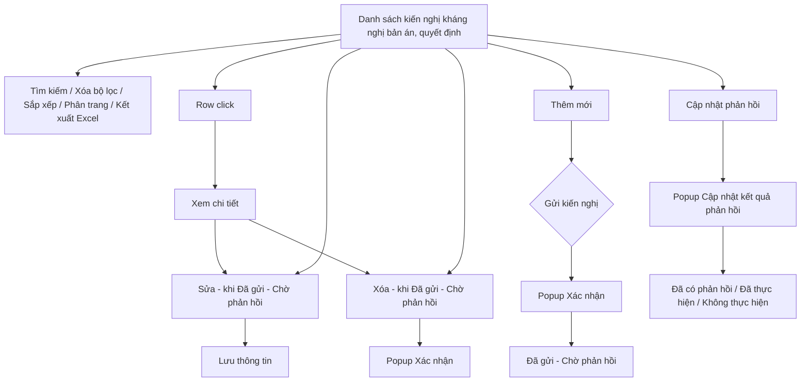
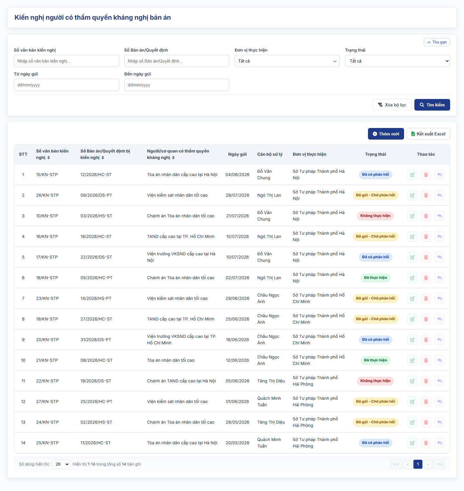
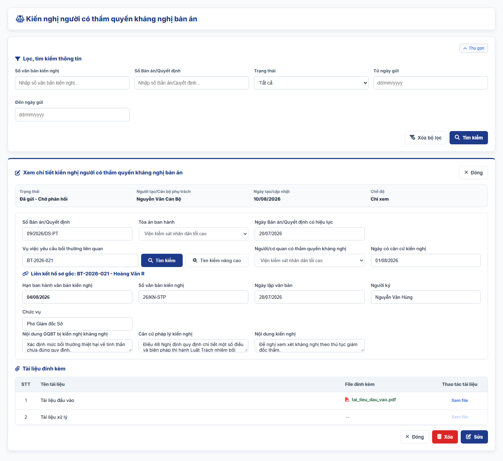
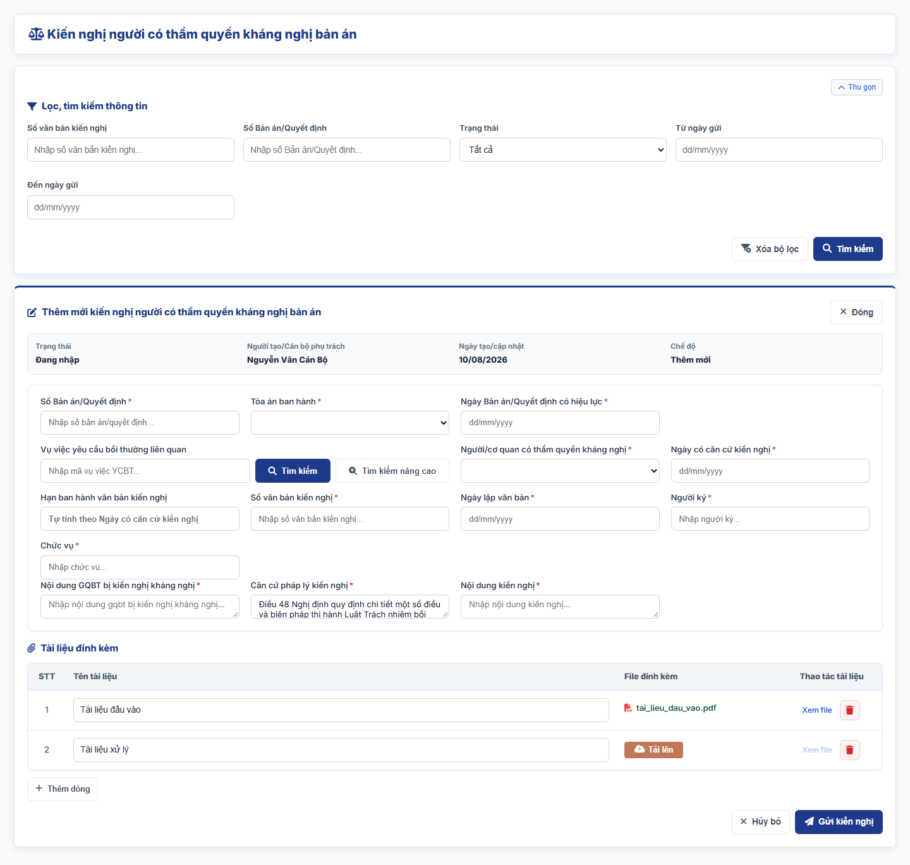
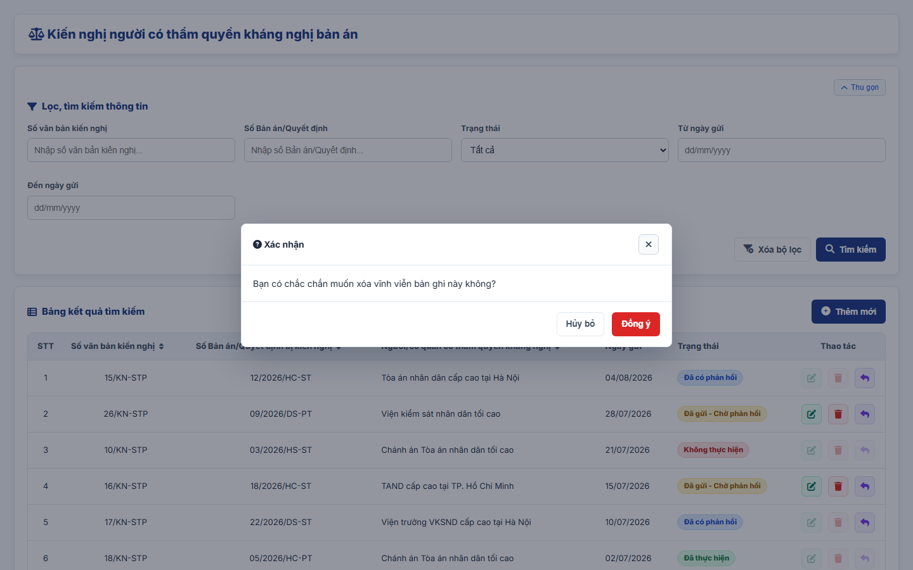
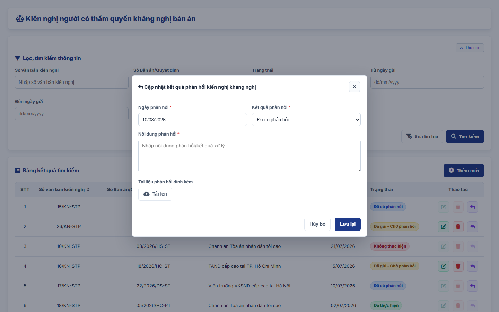

#### 4.3.3.11. UC483-484 - Kiến nghị người có thẩm quyền kháng nghị bản án, quyết định của Tòa án có nội dung GQBT

##### 4.3.3.11.1. Mục đích

\- Cho phép cán bộ Sở Tư pháp lập, quản lý và theo dõi văn bản kiến nghị người có thẩm quyền kháng nghị đối với bản án, quyết định của Tòa án có nội dung giải quyết bồi thường (GQBT) chưa phù hợp quy định pháp luật, theo Điều 28 Thông tư 08/2019/TT-BTP; khoản 8 Điều 45 và Điều 48 dự thảo Nghị định quy định chi tiết một số điều và biện pháp thi hành Luật Trách nhiệm bồi thường của Nhà nước (bản gửi lấy ý kiến ngày 28/9/2026, sau đây gọi là Nghị định hướng dẫn). Sở Tư pháp giúp Ủy ban nhân dân cấp tỉnh nơi đặt trụ sở của cơ quan trực tiếp quản lý người thi hành công vụ gây thiệt hại thực hiện kiến nghị khi có một trong các căn cứ kháng nghị theo quy định của pháp luật về tố tụng.

\- Thời hạn ban hành văn bản kiến nghị: trong 02 ngày làm việc kể từ ngày có căn cứ kiến nghị (khoản 2 Điều 48 Nghị định hướng dẫn).

\- Cho phép theo dõi trạng thái xử lý và kết quả phản hồi của người/cơ quan có thẩm quyền kháng nghị.

*a. Phân quyền*

\- Cán bộ Sở Tư pháp: được tra cứu, xem chi tiết, thêm mới và gửi; sửa, xóa bản ghi ở trạng thái "Đã gửi - Chờ phản hồi" (chưa cập nhật kết quả phản hồi) do chính mình tạo; cập nhật kết quả phản hồi cho bản ghi do mình tạo.

*b. Điều kiện thực hiện*

\- Người dùng đã đăng nhập thành công vào Website quản trị.

\- Người dùng được phân quyền truy cập màn hình `Kiến nghị người có thẩm quyền kháng nghị bản án`.

\- Trạng thái xử lý gồm: "Đã gửi - Chờ phản hồi", "Đã có phản hồi", "Đã thực hiện", "Không thực hiện". Bản ghi được lưu và gửi trong cùng một thao tác nên trạng thái khởi tạo là "Đã gửi - Chờ phản hồi"; hệ thống tự chuyển trạng thái theo kết quả phản hồi, người dùng không sửa trực tiếp.

\- Tòa án ban hành, Người/cơ quan có thẩm quyền kháng nghị tham chiếu Danh mục các đơn vị trên hệ thống `[DM_DON_VI]`.

---

##### 4.3.3.11.2. Sơ đồ luồng nghiệp vụ theo giao diện

---

##### 4.3.3.11.3. MH01 - Màn hình Danh sách kiến nghị kháng nghị bản án, quyết định

###### 4.3.3.11.3.1. Màn hình

###### 4.3.3.11.3.2. Mô tả thông tin trên màn hình

| Trường thông tin | Kiểu dữ liệu | Bắt buộc | Mặc định | Mô tả |
| :--- | :--- | :--- | :--- | :--- |
| **I. Bộ lọc tìm kiếm** | - | - | - | Control UI: Khối thu gọn/mở rộng (Accordion). - Không hiển thị tiêu đề khối. - Mặc định hiển thị dạng mở rộng. - Cho phép thu gọn/mở rộng khi click vào nút "Thu gọn"/"Mở rộng" ở góc phải khối; khi thu gọn, các giá trị lọc đã nhập được giữ nguyên. |
| Số văn bản kiến nghị | String(50) | Không | Trống | Control UI: Text input. - Placeholder: "Nhập số văn bản kiến nghị...". - Tìm gần đúng; không phân biệt hoa thường, có dấu/không dấu. |
| Số Bản án/Quyết định | String(50) | Không | Trống | Control UI: Text input. - Placeholder: "Nhập số Bản án/Quyết định...". - Tìm gần đúng; không phân biệt hoa thường, có dấu/không dấu. |
| Trạng thái | Enum(String(50)) | Không | Tất cả | Control UI: Combobox. Gồm: + Tất cả + Đã gửi - Chờ phản hồi + Đã có phản hồi + Đã thực hiện + Không thực hiện |
| Từ ngày gửi | Date | Không | Trống | Control UI: Date input. - Placeholder: "dd/mm/yyyy". |
| Đến ngày gửi | Date | Không | Trống | Control UI: Date input. - Placeholder: "dd/mm/yyyy". |
| **II. Bảng danh sách kết quả** | - | - | 20 bản ghi/trang | Control UI: Data grid. - Khi người dùng truy cập màn hình, hệ thống tự động tải Trang 1. - Sắp xếp mặc định: theo "Ngày tạo" giảm dần. - Trạng thái không có dữ liệu (Empty State): bảng hiển thị duy nhất 01 dòng căn giữa trên toàn bộ chiều rộng bảng (`colspan`), in nghiêng với nội dung theo MessageList dùng chung [MSG-INF-SYS-001]. |
| STT | Integer(10) | Không | Theo trang hiện tại | - Chỉ đọc. - Theo dữ liệu bản ghi. |
| Số văn bản kiến nghị | String(50) | Không | Theo dữ liệu hệ thống | - Chỉ đọc. - Theo dữ liệu bản ghi. |
| Số Bản án/Quyết định bị kiến nghị | String(50) | Không | Theo dữ liệu hệ thống | - Chỉ đọc. - Theo dữ liệu bản ghi. |
| Người/cơ quan có thẩm quyền kháng nghị | String(255) | Không | Theo dữ liệu hệ thống | - Chỉ đọc. - Theo dữ liệu bản ghi. |
| Ngày gửi | Date | Không | Theo dữ liệu hệ thống | - Chỉ đọc. - Định dạng `dd/mm/yyyy`. |
| Trạng thái | Enum(String(50)) | Không | Theo dữ liệu hệ thống | Control UI: Badge. - Chỉ đọc. - Theo dữ liệu bản ghi. |
| Thao tác | - | - | - | Control UI: Icon + Sửa + Xóa + Cập nhật phản hồi - Cột cố định bên phải lưới khi cuộn ngang. |
| Phân trang | - | - | 20 bản ghi/trang | Phân trang, chuyển trang và cấu hình số dòng hiển thị theo quy tắc chung của hệ thống. |

###### 4.3.3.11.3.3. Chức năng trên màn hình

| STT | Tên chức năng | Định dạng | Mô tả |
| :--- | :--- | :--- | :--- |
| 1 | Tìm kiếm | Button | Khi người dùng click nút, hệ thống kiểm tra điều kiện dữ liệu và thực hiện tìm kiếm theo các trường hợp bên dưới: |
|  |  |  | **TH1 - Khoảng ngày không hợp lệ**: Nếu `Từ ngày gửi` lớn hơn `Đến ngày gửi`, vi phạm [BR-VAL-007], hệ thống hiển thị cảnh báo lỗi [MSG-ERR-VAL-007] và không thực hiện tìm kiếm. |
|  |  |  | **TH2 - Hợp lệ (Có dữ liệu phù hợp)**: Hệ thống hiển thị danh sách các bản ghi thỏa mãn đồng thời các tiêu chí đã nhập/chọn và đưa về Trang 1. |
|  |  |  | **TH3 - Không có dữ liệu trả về**: Bảng kết quả hiển thị duy nhất 01 dòng căn giữa (`colspan`), in nghiêng với nội dung [MSG-INF-SYS-001]; thanh phân trang hiển thị *"Hiển thị 0-0 trong tổng số 0 bản ghi"*, các nút điều hướng trang ở trạng thái khóa mờ. |
| 2 | Xóa bộ lọc | Button | Hệ thống xóa toàn bộ tiêu chí tìm kiếm đã nhập/chọn, thiết lập các ô lọc về giá trị mặc định. |
| 3 | Thêm mới | Button | Hệ thống mở [MH03 - Màn hình Thêm mới/Sửa kiến nghị kháng nghị bản án, quyết định](#433115-mh03---màn-hình-thêm-mớisửa-kiến-nghị-kháng-nghị-bản-án-quyết-định) ở chế độ Thêm mới với form thông tin để trống. |
| 4 | Kết xuất Excel | Button | Kết xuất danh sách ra tệp Excel theo [Quy chuẩn Kết xuất Excel dùng chung - Danh mục và Phụ lục - Tài liệu tổng hợp](../../Tai%20lieu%20tong%20hop/04_Danh_muc_va_Phu_luc.md): - Phạm vi: toàn bộ bản ghi thỏa mãn điều kiện tìm kiếm hiện hành, không giới hạn theo trang. - Cột xuất theo thứ tự lưới, không gồm cột Thao tác: STT, Số văn bản kiến nghị, Số Bản án/Quyết định bị kiến nghị, Người/cơ quan có thẩm quyền kháng nghị, Ngày gửi, Trạng thái. - Tên tệp: `yyyyMMdd_Danh_sach_kien_nghi_khang_nghi_ban_an.xlsx`. |
|  |  |  | **TH1 - Không có dữ liệu**: Hệ thống hiển thị [MSG-WRN-SYS-001] và không tải tệp. |
|  |  |  | **TH2 - Có dữ liệu**: Hệ thống tải tệp Excel về máy người dùng. |
| 5 | Sắp xếp cột | Header cột | Áp dụng trên các cột: + Số văn bản kiến nghị + Số Bản án/Quyết định bị kiến nghị + Người/cơ quan có thẩm quyền kháng nghị |
|  |  |  | **TH1 - Chọn lại cột đang sắp xếp**: Hệ thống đảo chiều sắp xếp tăng dần/giảm dần và cập nhật icon mũi tên trên tiêu đề cột. |
|  |  |  | **TH2 - Chọn cột khác**: Hệ thống sắp xếp danh sách theo cột được chọn. |
| 6 | Row click | Row click | Khi người dùng click vào bất kỳ vị trí nào trên dòng dữ liệu (trừ các nút thao tác), hệ thống mở [MH02 - Màn hình Chi tiết kiến nghị kháng nghị bản án, quyết định](#433114-mh02---màn-hình-chi-tiết-kiến-nghị-kháng-nghị-bản-án-quyết-định). |
| 7 | Sửa | Icon button | Chỉ cho phép với bản ghi ở trạng thái "Đã gửi - Chờ phản hồi" do cán bộ đăng nhập tạo; trường hợp khác icon hiển thị mờ, không cho thao tác. - Hệ thống mở [MH03 - Màn hình Thêm mới/Sửa kiến nghị kháng nghị bản án, quyết định](#433115-mh03---màn-hình-thêm-mớisửa-kiến-nghị-kháng-nghị-bản-án-quyết-định) ở chế độ Sửa với dữ liệu hiện tại của bản ghi được điền sẵn. |
| 8 | Xóa | Icon button | Chỉ cho phép với bản ghi ở trạng thái "Đã gửi - Chờ phản hồi" do cán bộ đăng nhập tạo; trường hợp khác icon hiển thị mờ, không cho thao tác. - Hệ thống mở [Popup Xác nhận](#433116-popup-xác-nhận). |
| 9 | Cập nhật phản hồi | Icon button | Chỉ cho phép với bản ghi ở trạng thái "Đã gửi - Chờ phản hồi" hoặc "Đã có phản hồi"; trường hợp khác icon hiển thị mờ. - Hệ thống mở [Popup Cập nhật kết quả phản hồi](#433117-popup-cập-nhật-kết-quả-phản-hồi). |
| 10 | Phân trang & chuyển trang | Pagination | Phân trang, chuyển trang và cấu hình số dòng hiển thị theo quy tắc chung của hệ thống. |

---

##### 4.3.3.11.4. MH02 - Màn hình Chi tiết kiến nghị kháng nghị bản án, quyết định

###### 4.3.3.11.4.1. Màn hình

###### 4.3.3.11.4.2. Mô tả thông tin trên màn hình

| Trường thông tin | Kiểu dữ liệu | Bắt buộc | Mặc định | Mô tả |
| :--- | :--- | :--- | :--- | :--- |
| Tiêu đề màn hình | - | - | - | Control UI: Label Hiển thị "Xem chi tiết kiến nghị người có thẩm quyền kháng nghị bản án". |
| **I. Thông tin chung** |  |  |  |  |
| Trạng thái | - | - | - | Control UI: Label Theo dữ liệu bản ghi (giá trị `Trạng thái`). |
| Người tạo/Cán bộ phụ trách | - | - | - | Control UI: Label Theo dữ liệu bản ghi. |
| Ngày tạo/cập nhật | - | - | - | Control UI: Label Theo dữ liệu bản ghi. |
| Chế độ | - | - | - | Control UI: Label Hiển thị "Chỉ xem". |
| **II. Thông tin kiến nghị** |  |  |  |  |
| Số Bản án/Quyết định | - | - | - | Control UI: Label Theo dữ liệu bản ghi. |
| Tòa án ban hành | - | - | - | Control UI: Label Theo dữ liệu bản ghi. |
| Ngày Bản án/Quyết định có hiệu lực | - | - | - | Control UI: Label Theo dữ liệu bản ghi. |
| Vụ việc yêu cầu bồi thường liên quan | - | - | - | Control UI: Label Theo dữ liệu bản ghi. |
| Người/cơ quan có thẩm quyền kháng nghị | - | - | - | Control UI: Label Theo dữ liệu bản ghi. |
| Ngày có căn cứ kiến nghị | - | - | - | Control UI: Label Theo dữ liệu bản ghi. |
| Hạn ban hành văn bản kiến nghị | - | - | - | Control UI: Label Theo dữ liệu bản ghi. |
| Số văn bản kiến nghị | - | - | - | Control UI: Label Theo dữ liệu bản ghi. |
| Ngày lập văn bản | - | - | - | Control UI: Label Theo dữ liệu bản ghi. |
| Người ký | - | - | - | Control UI: Label Theo dữ liệu bản ghi. |
| Chức vụ | - | - | - | Control UI: Label Theo dữ liệu bản ghi. |
| Nội dung GQBT bị kiến nghị kháng nghị | - | - | - | Control UI: Label Theo dữ liệu bản ghi. |
| Căn cứ pháp lý kiến nghị | - | - | - | Control UI: Label Theo dữ liệu bản ghi. |
| Nội dung kiến nghị | - | - | - | Control UI: Label Theo dữ liệu bản ghi. |
| **III. Tài liệu đính kèm** |  |  |  |  |
| Tài liệu đính kèm | - | - | - | Control UI: File link Theo dữ liệu bản ghi. |

###### 4.3.3.11.4.3. Chức năng trên màn hình

| STT | Tên chức năng | Định dạng | Mô tả |
| :--- | :--- | :--- | :--- |
| 1 | Xem file | Link | Khi click vào liên kết "Xem file" của tài liệu đính kèm, hệ thống mở nội dung file tại một tab trình duyệt mới. |
| 2 | Sửa | Button | Chỉ cho phép khi bản ghi ở trạng thái "Đã gửi - Chờ phản hồi"; trường hợp khác nút hiển thị mờ, không cho thao tác. - Hệ thống mở [MH03 - Màn hình Thêm mới/Sửa kiến nghị kháng nghị bản án, quyết định](#433115-mh03---màn-hình-thêm-mớisửa-kiến-nghị-kháng-nghị-bản-án-quyết-định) ở chế độ Sửa với dữ liệu hiện tại của bản ghi được điền sẵn. |
| 3 | Xóa | Button | Chỉ cho phép khi bản ghi ở trạng thái "Đã gửi - Chờ phản hồi"; trường hợp khác nút hiển thị mờ, không cho thao tác. - Hệ thống mở [Popup Xác nhận](#433116-popup-xác-nhận); nếu người dùng chọn `Đồng ý`, hệ thống xóa bản ghi, đóng màn hình chi tiết và quay lại [MH01 - Màn hình Danh sách kiến nghị kháng nghị bản án, quyết định](#433113-mh01---màn-hình-danh-sách-kiến-nghị-kháng-nghị-bản-án-quyết-định). |
| 4 | Đóng | Button | Khi người dùng click nút "Đóng" ở góc phải tiêu đề hoặc ở chân màn hình, hệ thống đóng màn hình chi tiết và quay lại [MH01 - Màn hình Danh sách kiến nghị kháng nghị bản án, quyết định](#433113-mh01---màn-hình-danh-sách-kiến-nghị-kháng-nghị-bản-án-quyết-định). |

---

##### 4.3.3.11.5. MH03 - Màn hình Thêm mới/Sửa kiến nghị kháng nghị bản án, quyết định

###### 4.3.3.11.5.1. Màn hình

###### 4.3.3.11.5.2. Mô tả thông tin trên màn hình

| Trường thông tin | Kiểu dữ liệu | Bắt buộc | Mặc định | Mô tả |
| :--- | :--- | :--- | :--- | :--- |
| Tiêu đề màn hình | - | - | Theo ngữ cảnh | Control UI: Label Hiển thị "Thêm mới kiến nghị người có thẩm quyền kháng nghị bản án" hoặc "Sửa kiến nghị người có thẩm quyền kháng nghị bản án". |
| **I. Thông tin chung** |  |  |  |  |
| Trạng thái | - | - | Theo ngữ cảnh | Control UI: Label Thêm mới hiển thị "Đang nhập"; Sửa hiển thị theo dữ liệu bản ghi. |
| Người tạo/Cán bộ phụ trách | - | - | Theo tài khoản đăng nhập | Control UI: Label Theo dữ liệu bản ghi. |
| Ngày tạo/cập nhật | - | - | Theo dữ liệu hệ thống | Control UI: Label Định dạng `dd/mm/yyyy`. |
| Chế độ | - | - | Theo ngữ cảnh | Control UI: Label Hiển thị "Thêm mới" hoặc "Sửa". |
| **II. Thông tin kiến nghị** |  |  |  |  |
| Số Bản án/Quyết định | String(50) | Có | Trống | Control UI: Text input. - Placeholder: "Nhập số bản án/quyết định...". |
| Tòa án ban hành | Enum(String(255)) | Có | Trống | Control UI: Combobox. - Tham chiếu Danh mục các đơn vị trên hệ thống [DM_DON_VI]. |
| Ngày Bản án/Quyết định có hiệu lực | Date | Có | Trống | Control UI: Date input. - Placeholder: "dd/mm/yyyy". - Không lớn hơn ngày hiện tại theo [BR-VAL-008]. |
| Vụ việc yêu cầu bồi thường liên quan | String(255) | Không | Trống | Control UI: Text input kèm nút `Tìm kiếm` và `Tìm kiếm nâng cao`. - Placeholder: "Nhập mã vụ việc YCBT...". - Khi click nút tìm kiếm, hệ thống mở [Popup chuẩn Tìm kiếm vụ việc/hồ sơ gốc liên quan - SRS Giải quyết yêu cầu bồi thường - Giải quyết bồi thường](SRS_BTNN_GiaiQuyetBT_GiaiQuyet_YCBT.md#433110-popup-chuẩn-tìm-kiếm-vụ-việchồ-sơ-gốc-liên-quan). - Chỉ lưu bản ghi được chọn từ popup, thuộc phạm vi dữ liệu theo cấp của người dùng đăng nhập; khi người dùng gõ tay hoặc sửa nội dung ô, hệ thống bỏ liên kết đã chọn. |
| Liên kết hồ sơ gốc | Link | Không | Ẩn | Control UI: Text link. - Chỉ hiển thị sau khi người dùng chọn bản ghi từ popup tìm kiếm hoặc khi mở lại bản ghi đã có liên kết. - Hiển thị `Mã vụ việc - Họ và tên người yêu cầu bồi thường`; khi click, hệ thống mở [MH05 - Màn hình Xem chi tiết hồ sơ yêu cầu bồi thường - SRS Giải quyết yêu cầu bồi thường - Giải quyết bồi thường](SRS_BTNN_GiaiQuyetBT_GiaiQuyet_YCBT.md#43317-mh05---màn-hình-xem-chi-tiết-hồ-sơ-yêu-cầu-bồi-thường) ở chế độ chỉ xem. |
| Người/cơ quan có thẩm quyền kháng nghị | Enum(String(255)) | Có | Trống | Control UI: Combobox. - Tham chiếu Danh mục các đơn vị trên hệ thống [DM_DON_VI]. |
| Ngày có căn cứ kiến nghị | Date | Có | Trống | Control UI: Date input. - Placeholder: "dd/mm/yyyy". - Không lớn hơn ngày hiện tại theo [BR-VAL-008]. |
| Hạn ban hành văn bản kiến nghị | Date | - | Tự tính | Control UI: Text input (chỉ đọc). - Placeholder: "Tự tính theo Ngày có căn cứ kiến nghị". - Tính theo quy tắc thời hạn ban hành bên dưới. |
| Số văn bản kiến nghị | String(50) | Có | Trống | Control UI: Text input. - Placeholder: "Nhập số văn bản kiến nghị...". |
| Ngày lập văn bản | Date | Có | Ngày hiện tại | Control UI: Date input. - Placeholder: "dd/mm/yyyy". - Không lớn hơn ngày hiện tại theo [BR-VAL-008]. |
| Người ký | String(100) | Có | Trống | Control UI: Text input. - Placeholder: "Nhập người ký...". |
| Chức vụ | String(100) | Có | Trống | Control UI: Text input. - Placeholder: "Nhập chức vụ...". |
| Nội dung GQBT bị kiến nghị kháng nghị | Text(2000) | Không | Trống | Control UI: Textarea. - Placeholder: "Nhập nội dung GQBT bị kiến nghị kháng nghị...". |
| Căn cứ pháp lý kiến nghị | Text(1000) | Không | Điều 48 Nghị định quy định chi tiết một số điều và biện pháp thi hành Luật Trách nhiệm bồi thường của Nhà nước; Điều 28 Thông tư 08/2019/TT-BTP | Control UI: Textarea. - Placeholder: "Nhập căn cứ pháp lý kiến nghị...". - Cho phép sửa giá trị mặc định. |
| Nội dung kiến nghị | Text(2000) | Không | Trống | Control UI: Textarea. - Placeholder: "Nhập nội dung kiến nghị...". |
| **III. Tài liệu đính kèm** |  |  |  |  |
| Tài liệu đính kèm | List(File) | Không | Trống | Control UI: Bảng tài liệu đính kèm gồm các cột `STT`, `Tên tài liệu, văn bản`, `File đính kèm`, `Thao tác`; nút `Thêm tài liệu` dưới bảng. - Cột `Tên tài liệu, văn bản`: Text input. Placeholder: "Nhập tên tài liệu, văn bản". - Cột `File đính kèm`: khi dòng chưa có file hiển thị nút `Tải file`; khi đã có file hiển thị tên file. - Cột `Thao tác` gồm: + Xem file (khóa mờ khi dòng chưa có file) + Xóa - Áp dụng [BR-FILE-010]. |

**Quy tắc thời hạn ban hành văn bản kiến nghị**

\- `Hạn ban hành văn bản kiến nghị` = `Ngày có căn cứ kiến nghị` + 02 ngày làm việc (không tính ngày nghỉ hằng tuần, ngày nghỉ lễ, Tết). Hệ thống tính lại ngay khi người dùng thay đổi `Ngày có căn cứ kiến nghị`; để trống khi chưa nhập ngày có căn cứ.

\- Khi `Ngày lập văn bản` lớn hơn `Hạn ban hành văn bản kiến nghị`, hệ thống hiển thị cảnh báo inline *"Văn bản kiến nghị ban hành quá thời hạn 02 ngày làm việc kể từ ngày có căn cứ."* ngay dưới ô `Ngày lập văn bản`. Cảnh báo không chặn lưu/gửi.

###### 4.3.3.11.5.3. Chức năng trên màn hình

| STT | Tên chức năng | Định dạng | Mô tả |
| :--- | :--- | :--- | :--- |
| 1 | Gửi kiến nghị | Button | Hiển thị ở chế độ Thêm mới. Khi người dùng click nút, hệ thống kiểm tra dữ liệu và xử lý theo các trường hợp bên dưới: |
|  |  |  | **TH1 - Bỏ trống trường bắt buộc**: Vi phạm [BR-VAL-001] (chưa nhập/chọn các trường có dấu `*`). Hệ thống viền đỏ các ô lỗi, hiển thị "Đây là trường bắt buộc" ngay dưới từng ô và focus vào ô lỗi đầu tiên. |
|  |  |  | **TH2 - Ngày không hợp lệ**: `Ngày Bản án/Quyết định có hiệu lực`, `Ngày có căn cứ kiến nghị` hoặc `Ngày lập văn bản` lớn hơn ngày hiện tại vi phạm [BR-VAL-008], hiển thị [MSG-ERR-VAL-008]. Hệ thống không cho phép lưu/gửi. |
|  |  |  | **TH2a - Quá thời hạn ban hành**: `Ngày lập văn bản` lớn hơn `Hạn ban hành văn bản kiến nghị`: hệ thống hiển thị cảnh báo inline quá hạn và vẫn cho phép gửi. |
|  |  |  | **TH2b - Vụ việc liên quan chưa được chọn từ popup**: Ô tìm kiếm vụ việc/quyết định liên quan có dữ liệu nhưng không phải bản ghi đã chọn từ popup trong phạm vi dữ liệu theo cấp của người dùng. Hệ thống viền đỏ ô, hiển thị "Vụ việc chưa được chọn từ danh sách tìm kiếm. Vui lòng bấm Tìm kiếm để chọn vụ việc hoặc để trống." và không cho phép lưu/gửi. |
|  |  |  | **TH3 - Trùng bản ghi**: Bản ghi được xác định bởi các thông tin `Số văn bản kiến nghị`, `Ngày lập văn bản`. Nếu các thông tin này trùng với một bản ghi khác đang tồn tại, hệ thống viền đỏ các ô tương ứng, hiển thị cảnh báo "Văn bản kiến nghị đã tồn tại trong hệ thống (trùng Số văn bản kiến nghị và Ngày lập văn bản)" dưới ô `Số văn bản kiến nghị` và không cho phép lưu. - So sánh sau khi bỏ khoảng trắng thừa, không phân biệt hoa thường. - Ở chế độ Sửa, hệ thống bỏ qua chính bản ghi đang sửa. |
|  |  |  | **TH4 - Hợp lệ**: Hệ thống mở [Popup Xác nhận](#433116-popup-xác-nhận) với nội dung xác nhận gửi kiến nghị. Nếu người dùng chọn `Đồng ý`, hệ thống lưu bản ghi ở trạng thái "Đã gửi - Chờ phản hồi", ghi nhận ngày gửi là ngày hiện tại, đóng màn hình, tải lại danh sách và hiển thị [MSG-SUC-SYS-003]. |
| 2 | Lưu thông tin | Button | Hiển thị ở chế độ Sửa. Khi người dùng click nút, hệ thống kiểm tra dữ liệu và xử lý theo các trường hợp bên dưới: |
|  |  |  | **TH1 - Bỏ trống trường bắt buộc**: Vi phạm [BR-VAL-001] (chưa nhập/chọn các trường có dấu `*`). Hệ thống viền đỏ các ô lỗi, hiển thị "Đây là trường bắt buộc" ngay dưới từng ô và focus vào ô lỗi đầu tiên. |
|  |  |  | **TH2 - Ngày không hợp lệ**: `Ngày Bản án/Quyết định có hiệu lực`, `Ngày có căn cứ kiến nghị` hoặc `Ngày lập văn bản` lớn hơn ngày hiện tại vi phạm [BR-VAL-008], hiển thị [MSG-ERR-VAL-008]. Hệ thống không cho phép lưu/gửi. |
|  |  |  | **TH2a - Quá thời hạn ban hành**: `Ngày lập văn bản` lớn hơn `Hạn ban hành văn bản kiến nghị`: hệ thống hiển thị cảnh báo inline quá hạn và vẫn cho phép lưu. |
|  |  |  | **TH2b - Vụ việc liên quan chưa được chọn từ popup**: Ô tìm kiếm vụ việc/quyết định liên quan có dữ liệu nhưng không phải bản ghi đã chọn từ popup trong phạm vi dữ liệu theo cấp của người dùng. Hệ thống viền đỏ ô, hiển thị "Vụ việc chưa được chọn từ danh sách tìm kiếm. Vui lòng bấm Tìm kiếm để chọn vụ việc hoặc để trống." và không cho phép lưu/gửi. |
|  |  |  | **TH3 - Trùng bản ghi**: Bản ghi được xác định bởi các thông tin `Số văn bản kiến nghị`, `Ngày lập văn bản`. Nếu các thông tin này trùng với một bản ghi khác đang tồn tại, hệ thống viền đỏ các ô tương ứng, hiển thị cảnh báo "Văn bản kiến nghị đã tồn tại trong hệ thống (trùng Số văn bản kiến nghị và Ngày lập văn bản)" dưới ô `Số văn bản kiến nghị` và không cho phép lưu. - So sánh sau khi bỏ khoảng trắng thừa, không phân biệt hoa thường. - Ở chế độ Sửa, hệ thống bỏ qua chính bản ghi đang sửa. |
|  |  |  | **TH4 - Hợp lệ**: Hệ thống lưu thông tin đã sửa, giữ nguyên trạng thái "Đã gửi - Chờ phản hồi" và ngày gửi, đóng màn hình, tải lại danh sách và hiển thị [MSG-SUC-SYS-002]. |
| 3 | Tìm kiếm | Button | Hệ thống mở [Popup chuẩn Tìm kiếm vụ việc/hồ sơ gốc liên quan - SRS Giải quyết yêu cầu bồi thường - Giải quyết bồi thường](SRS_BTNN_GiaiQuyetBT_GiaiQuyet_YCBT.md#433110-popup-chuẩn-tìm-kiếm-vụ-việchồ-sơ-gốc-liên-quan), tự điền giá trị đang nhập vào tiêu chí tìm kiếm và hiển thị danh sách bản ghi phù hợp để người dùng chọn. |
| 4 | Tìm kiếm nâng cao | Button | Hệ thống mở [Popup chuẩn Tìm kiếm vụ việc/hồ sơ gốc liên quan - SRS Giải quyết yêu cầu bồi thường - Giải quyết bồi thường](SRS_BTNN_GiaiQuyetBT_GiaiQuyet_YCBT.md#433110-popup-chuẩn-tìm-kiếm-vụ-việchồ-sơ-gốc-liên-quan) với đầy đủ tiêu chí tìm kiếm nâng cao. |
| 5 | Liên kết hồ sơ gốc | Link | Hệ thống mở [MH05 - Màn hình Xem chi tiết hồ sơ yêu cầu bồi thường - SRS Giải quyết yêu cầu bồi thường - Giải quyết bồi thường](SRS_BTNN_GiaiQuyetBT_GiaiQuyet_YCBT.md#43317-mh05---màn-hình-xem-chi-tiết-hồ-sơ-yêu-cầu-bồi-thường) ở chế độ chỉ xem. |
| 6 | Tải lên | Button | Hệ thống mở trình chọn file cho dòng tài liệu tương ứng; sau khi chọn, hiển thị tên file tại cột `File đính kèm`. |
| 7 | Xem file | Link | Hệ thống mở file của dòng tài liệu tại một tab trình duyệt mới. |
| 8 | Xóa | Icon button | Hệ thống xóa dòng tài liệu khỏi bảng ngay, không hiển thị popup xác nhận. |
| 9 | Thêm tài liệu | Button | Hệ thống thêm 01 dòng tài liệu trống vào cuối bảng tài liệu đính kèm. |
| 10 | Hủy bỏ | Button | Khi người dùng click nút "Hủy bỏ" ở chân màn hình hoặc nút "Đóng" ở góc phải tiêu đề, hệ thống đóng màn hình, không lưu dữ liệu và quay lại [MH01 - Màn hình Danh sách kiến nghị kháng nghị bản án, quyết định](#433113-mh01---màn-hình-danh-sách-kiến-nghị-kháng-nghị-bản-án-quyết-định). |

---

##### 4.3.3.11.6. Popup Xác nhận

###### 4.3.3.11.6.1. Màn hình

###### 4.3.3.11.6.2. Mô tả thông tin trên màn hình

| Trường thông tin | Kiểu dữ liệu | Bắt buộc | Mặc định | Mô tả |
| :--- | :--- | :--- | :--- | :--- |
| Tiêu đề popup | - | - | - | Control UI: Label Hiển thị "Xác nhận". |
| Nội dung xác nhận | - | - | - | Control UI: Label Theo thao tác, áp dụng [MSG-CFM-SYS-001]: + Gửi kiến nghị: "Bạn có chắc chắn muốn gửi kiến nghị này không?" + Xóa bản ghi/tài liệu: "Bạn có chắc chắn muốn xóa vĩnh viễn bản ghi này không?" |

###### 4.3.3.11.6.3. Chức năng trên màn hình

| STT | Tên chức năng | Định dạng | Mô tả |
| :--- | :--- | :--- | :--- |
| 1 | Đồng ý | Button | Hệ thống đóng popup và thực hiện thao tác: + Gửi kiến nghị: lưu bản ghi ở trạng thái "Đã gửi - Chờ phản hồi", ghi nhận ngày gửi là ngày hiện tại, đóng màn hình, tải lại danh sách và hiển thị [MSG-SUC-SYS-003]. + Xóa bản ghi: xóa vĩnh viễn bản ghi, tải lại danh sách và hiển thị [MSG-SUC-SYS-002]. + Xóa tài liệu đính kèm: xóa dòng tài liệu khỏi bảng. |
| 2 | Hủy bỏ | Button | Khi người dùng click nút "Hủy bỏ" hoặc biểu tượng đóng ở góc phải tiêu đề popup, hệ thống đóng popup và không thực hiện thao tác. |

---

##### 4.3.3.11.7. Popup Cập nhật kết quả phản hồi

###### 4.3.3.11.7.1. Màn hình

###### 4.3.3.11.7.2. Mô tả thông tin trên màn hình

| Trường thông tin | Kiểu dữ liệu | Bắt buộc | Mặc định | Mô tả |
| :--- | :--- | :--- | :--- | :--- |
| Tiêu đề popup | - | - | - | Control UI: Label Hiển thị "Cập nhật kết quả phản hồi kiến nghị kháng nghị". |
| Ngày phản hồi | Date | Có | Ngày hiện tại | Control UI: Date input. - Placeholder: "dd/mm/yyyy". - Không lớn hơn ngày hiện tại theo [BR-VAL-008]. |
| Kết quả phản hồi | Enum(String(50)) | Có | Đã có phản hồi | Control UI: Combobox. Gồm: + Đã có phản hồi + Đã thực hiện + Không thực hiện |
| Nội dung phản hồi | Text(2000) | Không | Trống | Control UI: Textarea. - Placeholder: "Nhập nội dung phản hồi/kết quả xử lý...". - Ghi nội dung phản hồi/kết quả kháng nghị (nếu có). |
| Tài liệu phản hồi đính kèm | File | Không | Trống | Control UI: Button `Tải lên`. - Áp dụng [BR-FILE-010]. |

###### 4.3.3.11.7.3. Chức năng trên màn hình

| STT | Tên chức năng | Định dạng | Mô tả |
| :--- | :--- | :--- | :--- |
| 1 | Lưu | Button | Khi người dùng click nút, hệ thống kiểm tra dữ liệu và xử lý theo các trường hợp bên dưới: |
|  |  |  | **TH1 - Bỏ trống trường bắt buộc**: Vi phạm [BR-VAL-001]. Hệ thống viền đỏ các ô lỗi, hiển thị "Đây là trường bắt buộc" ngay dưới từng ô và focus vào ô lỗi đầu tiên. |
|  |  |  | **TH2 - Ngày phản hồi không hợp lệ**: `Ngày phản hồi` lớn hơn ngày hiện tại, vi phạm [BR-VAL-008]. Hệ thống hiển thị [MSG-ERR-VAL-008] và không cho phép lưu. |
|  |  |  | **TH3 - Hợp lệ**: Hệ thống lưu kết quả phản hồi, cập nhật trạng thái bản ghi theo `Kết quả phản hồi` đã chọn, đóng popup, tải lại danh sách và hiển thị [MSG-SUC-SYS-002]. |
| 2 | Tải lên | Button | Hệ thống mở trình chọn file cho `Tài liệu phản hồi đính kèm`; áp dụng [BR-FILE-010]. |
| 3 | Hủy bỏ | Button | Khi người dùng click nút "Hủy bỏ" hoặc biểu tượng đóng ở góc phải tiêu đề popup, hệ thống đóng popup và không lưu dữ liệu. |
