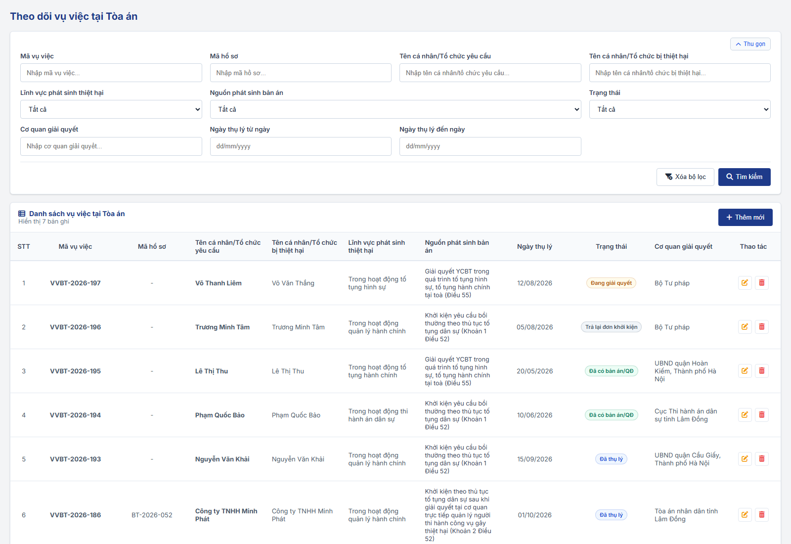
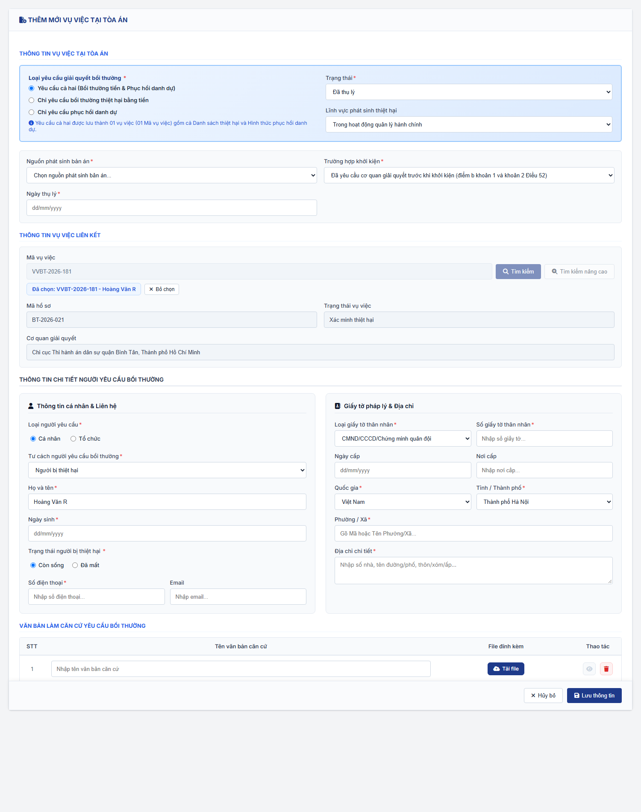
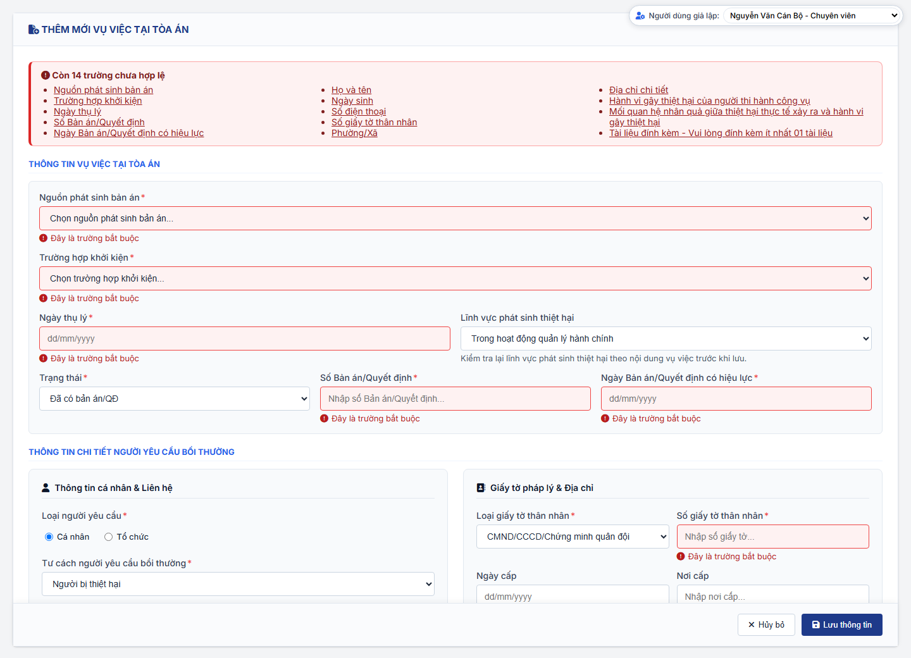
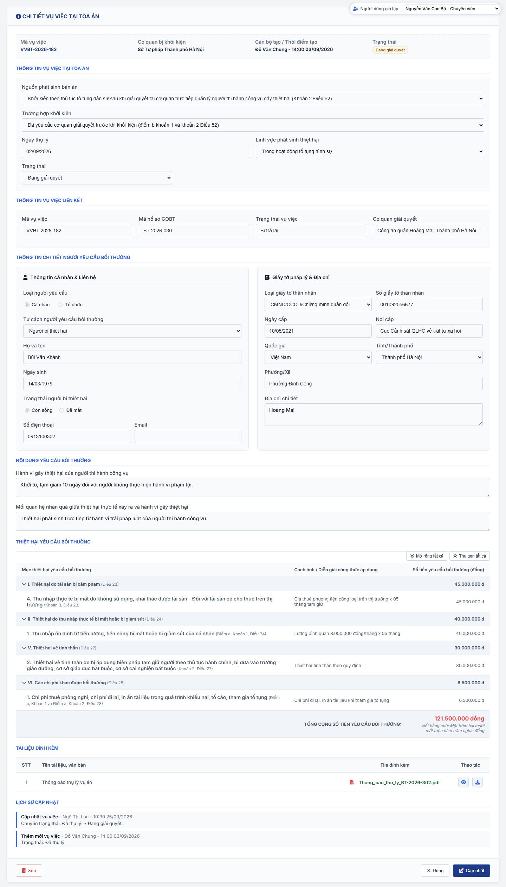

### 4.3.3.30. Theo dõi vụ việc tại Tòa án

#### 4.3.3.30.1. Mục đích

\- Cho phép cơ quan nhà nước bị khởi kiện (bị đơn) khai báo và quản lý các vụ việc yêu cầu bồi thường do Tòa án tiếp nhận, gồm: khởi kiện yêu cầu bồi thường theo thủ tục tố tụng dân sự và giải quyết yêu cầu bồi thường trong quá trình tố tụng hình sự, tố tụng hành chính tại Tòa án.

\- Gồm 06 chức năng:

\+ Tra cứu danh sách vụ việc tại Tòa án.

\+ Xem chi tiết vụ việc, bản ghi Chi trả tiền bồi thường đã tạo và lịch sử cập nhật.

\+ Thêm mới vụ việc; vụ việc "Yêu cầu cả hai" được lưu thành 01 vụ việc (01 Mã vụ việc), không tách.

\+ Cập nhật thông tin và trạng thái vụ việc.

\+ Xóa vụ việc (kể cả vụ việc ở trạng thái kết thúc).

\+ Tự động tạo bản ghi Loại "Chi trả tiền bồi thường" ở trạng thái "Chờ thông báo chi trả" khi vụ việc có yêu cầu bồi thường bằng tiền chuyển "Đã có bản án/QĐ".

\- Thông tin người yêu cầu bồi thường, người bị thiệt hại, loại yêu cầu, lĩnh vực, hành vi gây thiệt hại, thiệt hại yêu cầu bồi thường dùng cùng cấu trúc với [MH02 - Màn hình Nhập liệu hồ sơ vụ việc - Giải quyết yêu cầu bồi thường - Công tác bồi thường nhà nước (Website Quản trị)](SRS_BTNN_GiaiQuyetBT_GiaiQuyet_YCBT.md#43314-mh02---màn-hình-nhập-liệu-hồ-sơ-vụ-việc).

*a. Phân quyền*

\- Menu "Theo dõi vụ việc tại Tòa án" thuộc nhóm menu "Bồi thường nhà nước", đặt ngay sau menu "Tra cứu vụ việc".

\- Nhóm quyền "Theo dõi vụ việc tại Tòa án" gồm: Tra cứu vụ việc tại Tòa án; Thêm mới vụ việc tại Tòa án; Cập nhật vụ việc tại Tòa án; Xóa vụ việc tại Tòa án.

\- Thêm mới: chỉ cán bộ thuộc đơn vị được áp dụng Loại hồ sơ "Giải quyết yêu cầu bồi thường" [DM_54] theo [Phân quyền theo đơn vị và Đơn vị áp dụng - Quản lý danh mục dùng chung - Quản trị hệ thống (Website Quản trị)](../01_Quan_tri_he_thong/Quan_ly_danh_muc.md#dm-don-vi-ap-dung).

\- Cập nhật, Xóa: được thực hiện trên mọi vụ việc hiển thị trong danh sách, không phân biệt cơ quan bị khởi kiện và trạng thái (kể cả trạng thái kết thúc).

*b. Điều kiện thực hiện*

\- Người dùng đã đăng nhập Website Quản trị và được phân quyền chức năng tương ứng của nhóm quyền "Theo dõi vụ việc tại Tòa án".

---

#### 4.3.3.30.2. Quy tắc chung

| STT | Nội dung | Quy tắc |
| :-- | :--- | :--- |
| 1 | Cơ quan bị khởi kiện | Cơ quan bị khởi kiện (bị đơn) của vụ việc là đơn vị gốc (đơn vị cấp cao nhất trên cây Cơ cấu tổ chức) của cán bộ thêm mới vụ việc. Hệ thống tự gán, không cho sửa. |
| 2 | Phạm vi xem | Cán bộ xem vụ việc có Cơ quan bị khởi kiện là đơn vị gốc của mình. - Cán bộ thuộc Bộ Tư pháp xem vụ việc của mọi cơ quan. |
| 3 | Quyền nhập liệu | Một Loại hồ sơ áp dụng cho người dùng khi Đơn vị áp dụng chứa đơn vị của người dùng hoặc một đơn vị cấp trên của đơn vị đó. - Đơn vị không được áp dụng Loại hồ sơ "Giải quyết yêu cầu bồi thường": nút "Thêm mới" bị khóa (Disabled); thao tác Cập nhật, Xóa trên các vụ việc vẫn được thực hiện; màn hình hiển thị thông báo "Đơn vị của bạn chưa được áp dụng Loại hồ sơ "Giải quyết yêu cầu bồi thường" nên không được thêm mới, cập nhật hoặc xóa vụ việc tại Tòa án." - Cập nhật, Xóa: mọi cán bộ được thực hiện trên vụ việc hiển thị trong danh sách, không giới hạn người tạo. |
| 4 | Mã vụ việc | Vụ việc tại Tòa án mang `Mã vụ việc` toàn trình (`VVBT-yyyy-xxx`) của vụ việc bồi thường, theo [Mã vụ việc và mã hồ sơ - Tiếp nhận hồ sơ - Công tác bồi thường nhà nước (Website Quản trị)](SRS_BTNN_GiaiQuyetBT_TiepNhan_YCBT.md#tn-ma-vu-viec). - Vụ việc chưa có Mã vụ việc: hệ thống sinh `Mã vụ việc` mới khi Lưu; không sinh lại khi sửa. - Mã chỉ đọc; số đã cấp không cấp lại. |
| 5 | Vụ việc "Yêu cầu cả hai" | Khi thêm mới với Loại yêu cầu "Yêu cầu cả hai (Bồi thường tiền & Phục hồi danh dự)", hệ thống tạo 01 vụ việc với 01 Mã vụ việc, lưu đồng thời bảng Thiệt hại yêu cầu bồi thường và Hình thức đề nghị phục hồi danh dự; vụ việc có 01 trạng thái theo dõi tại Tòa án. - Báo cáo thống kê đếm 01 vụ việc. - Dữ liệu cũ đã tách thành 02 vụ việc liên kết (Vụ việc liên quan): hệ thống gộp thành 01 vụ việc Loại yêu cầu "Yêu cầu cả hai" (giữ vụ việc Bồi thường thiệt hại bằng tiền, lấy Hình thức đề nghị phục hồi danh dự của vụ việc còn lại, xóa vụ việc Phục hồi danh dự) và ghi lịch sử "Gộp vụ việc". |
| 6 | Loại yêu cầu sau khi lưu | Loại yêu cầu chỉ chọn khi thêm mới; sau khi lưu hiển thị chỉ đọc. |
| 7 | Trạng thái kết thúc | "Đã có bản án/QĐ" và "Trả lại đơn khởi kiện" là trạng thái kết thúc. Sau khi lưu ở trạng thái kết thúc, vụ việc không được đổi sang trạng thái khác (ô Trạng thái bị khóa); cán bộ vẫn được cập nhật các thông tin khác và được xóa vụ việc. |
| 8 | Ngày hiệu lực bản án/QĐ | Bắt buộc khi Trạng thái = "Đã có bản án/QĐ"; không nhỏ hơn Ngày thụ lý. |
| 9 | Tự tạo bản ghi Chi trả tiền bồi thường | Khi vụ việc có yêu cầu bồi thường thiệt hại (Loại yêu cầu "Bồi thường thiệt hại bằng tiền" hoặc "Yêu cầu cả hai") được lưu ở trạng thái "Đã có bản án/QĐ", hệ thống tạo 01 bản ghi tại [Luồng Chi trả tiền bồi thường - Tạm ứng kinh phí bồi thường/Chi trả tiền bồi thường - Bồi thường nhà nước (Website Quản trị)](SRS_BTNN_GiaiQuyetBT_KinhPhi_BT.md#kp-chi-tra-tien-bt): + Loại đề nghị: "Chi trả tiền bồi thường"; Trạng thái: "Chờ thông báo chi trả". + Dữ liệu nạp sẵn: Mã vụ việc; thông tin người yêu cầu bồi thường; Cơ quan bị khởi kiện; Số Bản án/Quyết định và Ngày Bản án/Quyết định có hiệu lực (làm Số, Ngày Quyết định làm căn cứ chi trả); các khoản thiệt hại yêu cầu bồi thường và tổng số tiền (làm Số tiền chi trả); tài liệu kèm theo có tệp đính kèm. - Mỗi vụ việc chỉ tạo 01 lần, khóa chống trùng theo Mã vụ việc. Màn hình Tạm ứng kinh phí bồi thường/Chi trả tiền bồi thường kiểm tra lại khi tải và bổ sung bản ghi còn thiếu. - Vụ việc "Phục hồi danh dự" không tạo bản ghi. - Ghi lịch sử vụ việc "Tạo bản ghi chi trả tiền bồi thường" với nội dung "Hệ thống tạo bản ghi Chi trả tiền bồi thường [Mã đề xuất] ở trạng thái Chờ thông báo chi trả.", người thực hiện "Hệ thống". |
| 10 | Báo cáo thống kê | Vụ việc có trạng thái "Trả lại đơn khởi kiện" không được đếm tại các màn hình Thống kê vụ việc yêu cầu bồi thường (TT08) và Dashboard Bồi thường nhà nước. |
| 11 | Kiểm tra đồng thời | Khi Lưu, Xóa: hệ thống kiểm tra lại dữ liệu mới nhất của vụ việc. - Vụ việc đã bị xóa hoặc người dùng không còn quyền: hiển thị "Vụ việc đã bị xóa hoặc bạn không còn quyền cập nhật. Danh sách đã được tải lại.", không lưu. - Vụ việc đã chuyển trạng thái kết thúc mà dữ liệu lưu có trạng thái khác: hiển thị "Vụ việc đã chuyển sang trạng thái kết thúc, không được thay đổi trạng thái. Danh sách đã được tải lại.", không lưu. |
| 12 | Cập nhật, xóa sau khi đã tạo bản ghi kinh phí | - Cập nhật vụ việc: nếu bản ghi kinh phí của vụ việc còn ở trạng thái "Chờ thông báo chi trả" (bản ghi cũ: "Chờ nhập liệu"), hệ thống cập nhật lại các thông tin kế thừa (người yêu cầu, cơ quan, Số và Ngày Bản án/Quyết định, các khoản thiệt hại và tổng số tiền, tài liệu). Bản ghi đã chuyển trạng thái khác thì không thay đổi. - Xóa vụ việc: nếu bản ghi kinh phí còn "Chờ thông báo chi trả" (bản ghi cũ: "Chờ nhập liệu") thì xóa theo (popup xác nhận nêu rõ "Bản ghi kinh phí [Mã đề xuất] ([Trạng thái]) cũng bị xóa theo."); nếu bản ghi đã chuyển trạng thái khác thì không cho xóa, thông báo "Bản ghi kinh phí [Mã đề xuất] đang ở trạng thái [Trạng thái], không được xóa vụ việc!". |
| 13 | Lịch sử cập nhật | Mỗi thao tác ghi 01 dòng gồm Thao tác, Người thực hiện, Thời điểm (dd/mm/yyyy HH:mm), Nội dung. - Thao tác gồm: + Thêm mới vụ việc: nội dung "Loại yêu cầu: [Loại yêu cầu]. Trạng thái: [Trạng thái]." + Cập nhật vụ việc: nội dung "Chuyển trạng thái: [Trạng thái cũ] → [Trạng thái mới]." hoặc "Cập nhật thông tin vụ việc." + Tạo bản ghi chi trả tiền bồi thường (quy tắc 9) + Gộp vụ việc (dữ liệu cũ, quy tắc 5) |
| 14 | Nhận diện vụ việc | Thông báo, popup xác nhận nhận diện vụ việc bằng "[Mã vụ việc] - [Họ và tên người yêu cầu]". |

---

#### 4.3.3.30.3. Trạng thái vụ việc

\- Cán bộ tự chọn trạng thái khi thêm mới và khi cập nhật. Vụ việc chưa ở trạng thái kết thúc được chuyển sang bất kỳ trạng thái nào trong danh sách; vụ việc đã ở trạng thái kết thúc giữ nguyên trạng thái.

| Trạng thái | Ý nghĩa | Trạng thái kết thúc | Thao tác được phép |
| :--- | :--- | :--- | :--- |
| Đã thụ lý | Tòa án đã thụ lý vụ việc. Giá trị mặc định khi thêm mới. | Không | Xem; Cập nhật; Xóa. |
| Đang giải quyết | Tòa án đang giải quyết vụ việc. | Không | Xem; Cập nhật; Xóa. |
| Đã có bản án/QĐ | Đã có Bản án/Quyết định của Tòa án có hiệu lực. Vụ việc có yêu cầu bồi thường thiệt hại (Bồi thường thiệt hại bằng tiền hoặc Yêu cầu cả hai) phát sinh bản ghi Chi trả tiền bồi thường "Chờ thông báo chi trả". | Có | Xem; Cập nhật (trừ Trạng thái); Xóa. |
| Trả lại đơn khởi kiện | Tòa án trả lại đơn khởi kiện. Không đếm trong báo cáo thống kê. | Có | Xem; Cập nhật (trừ Trạng thái); Xóa. |

---

#### 4.3.3.30.4. MH01 - Màn hình Danh sách vụ việc tại Tòa án

##### 4.3.3.30.4.1. Màn hình

##### 4.3.3.30.4.2. Mô tả thông tin trên màn hình

| Trường thông tin | Kiểu dữ liệu | Bắt buộc | Mặc định | Mô tả |
| :--- | :--- | :--- | :--- | :--- |
| Tiêu đề màn hình | String(255) | - | `Theo dõi vụ việc tại Tòa án` | Control UI: Text heading (Read-only). - Hiển thị đúng tên mục Menu `Theo dõi vụ việc tại Tòa án`. - Không có dòng mô tả dưới tiêu đề. |
| Thông báo không có quyền nhập liệu | String(500) | - | Ẩn | Control UI: Alert panel (Read-only). - Chỉ hiển thị khi đơn vị của người dùng không được áp dụng Loại hồ sơ "Giải quyết yêu cầu bồi thường" (quy tắc 3 tại [Quy tắc chung - Theo dõi vụ việc tại Tòa án - Công tác bồi thường nhà nước (Website Quản trị)](#tdta-quy-tac-chung)). - Nội dung theo quy tắc 3. |
| **Khối bộ lọc** | Section | - | - | Control UI: Khối thu gọn/mở rộng. - Các điều kiện kết hợp theo điều kiện AND. |
| Mã vụ việc | String(50) | Không | Trống | Control UI: Input text. - `Placeholder: Nhập mã vụ việc...`. - Tìm gần đúng, không phân biệt hoa thường, không phân biệt dấu. |
| Họ và tên người yêu cầu | String(100) | Không | Trống | Control UI: Input text. - `Placeholder: Nhập họ và tên...`. - Tìm gần đúng, không phân biệt hoa thường, không phân biệt dấu. |
| Loại yêu cầu | Enum(String(50)) | Không | `Tất cả` | Control UI: Combobox. - Gồm: + Tất cả + Bồi thường thiệt hại bằng tiền + Phục hồi danh dự + Bồi thường thiệt hại và Phục hồi danh dự - Lọc chính xác theo Loại yêu cầu. |
| Trạng thái | Enum(String(50)) | Không | `Tất cả` | Control UI: Combobox. - Gồm `Tất cả` và 04 trạng thái tại [Trạng thái vụ việc - Theo dõi vụ việc tại Tòa án - Công tác bồi thường nhà nước (Website Quản trị)](#tdta-trang-thai). - Lọc chính xác theo Trạng thái. |
| Nguồn phát sinh bản án | Enum(String(255)) | Không | `Tất cả` | Control UI: Combobox. - Gồm `Tất cả` và 03 giá trị của trường `Nguồn phát sinh bản án` tại [MH02 - Màn hình Thêm mới / Cập nhật vụ việc - Theo dõi vụ việc tại Tòa án - Công tác bồi thường nhà nước (Website Quản trị)](#tdta-mh02). - Lọc chính xác theo Nguồn phát sinh bản án. |
| Ngày thụ lý từ ngày | Date | Không | Trống | Control UI: Datepicker. - `Placeholder: dd/mm/yyyy`. - Lọc vụ việc có Ngày thụ lý lớn hơn hoặc bằng giá trị nhập. |
| Ngày thụ lý đến ngày | Date | Không | Trống | Control UI: Datepicker. - `Placeholder: dd/mm/yyyy`. - Lọc vụ việc có Ngày thụ lý nhỏ hơn hoặc bằng giá trị nhập. |
| Xóa bộ lọc | Button | - | - | Control UI: Button. |
| Tìm kiếm | Button | - | - | Control UI: Button. |
| Thêm mới | Button | - | - | Control UI: Button. - Vị trí: thanh tiêu đề bảng `Danh sách vụ việc tại Tòa án`. - Khóa (Disabled) khi đơn vị của người dùng không có quyền nhập liệu (quy tắc 3). |
| **Danh sách vụ việc tại Tòa án** | Section | - | 20 bản ghi/trang | Control UI: Data grid. - Tiêu đề kèm số lượng `Hiển thị [n] bản ghi`. - Sắp xếp theo Mã vụ việc giảm dần. - Không có dữ liệu: 01 dòng căn giữa toàn bộ chiều rộng bảng, nội dung [MSG-INF-SYS-001]. |
| STT | Integer(10) | - | Tự tăng | Control UI: Text (Read-only). - Tăng dần theo phân trang. |
| Mã vụ việc | String(50) | - | Theo dữ liệu | Control UI: Text (Read-only). - Theo dữ liệu bản ghi: `Mã vụ việc` `VVBT-yyyy-xxx`. |
| Họ và tên người yêu cầu | String(100) | - | Theo dữ liệu | Control UI: Text (Read-only). - Theo dữ liệu bản ghi. |
| Loại yêu cầu | String(50) | - | Theo dữ liệu | Control UI: Text (Read-only). - Theo dữ liệu bản ghi, 01 trong các giá trị: + Bồi thường thiệt hại bằng tiền + Phục hồi danh dự + Bồi thường thiệt hại và Phục hồi danh dự - Vụ việc đã tạo bản ghi kinh phí: dòng phụ "Kinh phí: [Mã đề xuất]". |
| Nguồn phát sinh bản án | String(255) | - | Theo dữ liệu | Control UI: Text (Read-only). - Theo dữ liệu bản ghi. |
| Ngày thụ lý | Date | - | Theo dữ liệu | Control UI: Text (Read-only). - Theo dữ liệu bản ghi, định dạng `dd/mm/yyyy`. |
| Ngày hiệu lực bản án/QĐ | Date | - | Theo dữ liệu | Control UI: Text (Read-only). - Theo dữ liệu bản ghi, định dạng `dd/mm/yyyy`. - Chưa có: "--". |
| Cơ quan bị khởi kiện | String(255) | - | Theo dữ liệu | Control UI: Text (Read-only). - Theo dữ liệu bản ghi: tên đơn vị gốc của vụ việc. |
| Trạng thái | String(50) | - | Theo dữ liệu | Control UI: Badge (Read-only). - Theo dữ liệu bản ghi. |
| Thao tác | - | - | - | Control UI: Icon button group. - Cập nhật: luôn hiển thị. - Xóa: luôn hiển thị; áp dụng quy tắc 12 khi vụ việc đã có bản ghi kinh phí. |
| Phân trang | - | - | Trang 1 | Control UI: Pagination. - Số dòng hiển thị: 10 / 20 / 50 / 100, mặc định 20. - Thông tin `Hiển thị [từ]-[đến] trong tổng số [n] bản ghi`. - Nút chuyển trang: Đầu, Trước, số trang, Sau, Cuối. |

##### 4.3.3.30.4.3. Chức năng trên màn hình

| STT | Tên chức năng | Định dạng | Mô tả |
| :-- | :--- | :--- | :--- |
| 1 | Tìm kiếm | Button | Lọc danh sách theo đồng thời các điều kiện, đưa về Trang 1. |
| 2 | Xóa bộ lọc | Button | Đưa bộ lọc về giá trị mặc định và tải lại danh sách. |
| 3 | Thêm mới | Button | Mở [MH02 - Màn hình Thêm mới / Cập nhật vụ việc - Theo dõi vụ việc tại Tòa án - Công tác bồi thường nhà nước (Website Quản trị)](#tdta-mh02) ở chế độ thêm mới. |
| 4 | Click dòng dữ liệu | Row click | Mở [MH03 - Màn hình Xem chi tiết vụ việc - Theo dõi vụ việc tại Tòa án - Công tác bồi thường nhà nước (Website Quản trị)](#tdta-mh03); click icon tại cột Thao tác thì chỉ thực hiện thao tác đó. |
| 5 | Cập nhật | Icon button | Mở [MH02 - Màn hình Thêm mới / Cập nhật vụ việc - Theo dõi vụ việc tại Tòa án - Công tác bồi thường nhà nước (Website Quản trị)](#tdta-mh02) ở chế độ cập nhật. |
| 6 | Xóa | Icon button | Hiển thị popup "Xác nhận xóa", nội dung "Bạn có chắc chắn muốn xóa vụ việc [Mã vụ việc] - [Họ và tên người yêu cầu] không?" (kèm câu về bản ghi kinh phí theo quy tắc 12). Hủy bỏ: đóng popup. Đồng ý: |
|  |  |  | **TH1 - Dữ liệu đã thay đổi**: xử lý theo quy tắc 11, không xóa. |
|  |  |  | **TH2 - Bản ghi kinh phí đã chuyển khỏi trạng thái "Chờ thông báo chi trả"**: hiển thị "Bản ghi kinh phí [Mã đề xuất] đang ở trạng thái [Trạng thái], không được xóa vụ việc!", không xóa. |
|  |  |  | **TH Hợp lệ**: - Xóa vụ việc khỏi danh sách. - Xóa bản ghi kinh phí "Chờ thông báo chi trả" của vụ việc (nếu có). - Hiển thị "Đã xóa vụ việc [Mã vụ việc]!". |
| 7 | Phân trang | Pagination | Chuyển trang, đổi số dòng hiển thị (về Trang 1); giữ tiêu chí lọc. |

---

#### 4.3.3.30.5. MH02 - Màn hình Thêm mới / Cập nhật vụ việc

##### 4.3.3.30.5.1. Màn hình

##### 4.3.3.30.5.2. Mô tả thông tin trên màn hình

| Trường thông tin | Kiểu dữ liệu | Bắt buộc | Mặc định | Mô tả |
| :--- | :--- | :--- | :--- | :--- |
| Tiêu đề màn hình | String(255) | - | Theo chế độ | Control UI: Text heading (Read-only). - Thêm mới: "THÊM MỚI VỤ VIỆC TẠI TÒA ÁN". - Cập nhật: "CẬP NHẬT VỤ VIỆC TẠI TÒA ÁN". |
| **Khối thông tin chung** | Section | - | - | Control UI: Section (Read-only). - Chỉ hiển thị ở chế độ cập nhật. |
| Mã vụ việc | String(50) | - | Theo bản ghi | Control UI: Label. - Theo dữ liệu bản ghi. |
| Cơ quan bị khởi kiện | String(255) | - | Theo bản ghi | Control UI: Label. - Theo dữ liệu bản ghi. |
| Cán bộ tạo / Thời điểm tạo | String(255) | - | Theo bản ghi | Control UI: Label. - Theo dữ liệu bản ghi: "[Cán bộ tạo] - [Thời điểm tạo]", thời điểm định dạng `dd/mm/yyyy HH:mm`. |
| Trạng thái | String(50) | - | Theo bản ghi | Control UI: Badge (Read-only). - Theo dữ liệu bản ghi. |
| Chi trả tiền bồi thường | String(255) | - | Ẩn | Control UI: Alert panel (Read-only). - Chỉ hiển thị ở chế độ cập nhật với vụ việc đã tạo bản ghi kinh phí. - Nội dung như dòng `Chi trả tiền bồi thường` tại [MH03 - Màn hình Xem chi tiết vụ việc - Theo dõi vụ việc tại Tòa án - Công tác bồi thường nhà nước (Website Quản trị)](#tdta-mh03). |
| **Thông tin vụ việc tại Tòa án** | Section | - | - | Control UI: Section. |
| Loại yêu cầu giải quyết bồi thường | Enum(String(100)) | Có | `Yêu cầu cả hai (Bồi thường tiền & Phục hồi danh dự)` | Control UI: Radio. - Gồm: + Yêu cầu cả hai (Bồi thường tiền & Phục hồi danh dự) + Chỉ yêu cầu bồi thường thiệt hại bằng tiền + Chỉ yêu cầu phục hồi danh dự - Chế độ thêm mới, chọn "Yêu cầu cả hai": hiển thị dòng hướng dẫn "Yêu cầu cả hai được lưu thành 01 vụ việc (01 Mã vụ việc) gồm cả Danh sách thiệt hại và Hình thức phục hồi danh dự." - Chế độ cập nhật: khóa (Disabled), chọn sẵn theo Loại yêu cầu của vụ việc. |
| Trạng thái | Enum(String(50)) | Có | `Đã thụ lý` | Control UI: Combobox. - Gồm 04 trạng thái tại [Trạng thái vụ việc - Theo dõi vụ việc tại Tòa án - Công tác bồi thường nhà nước (Website Quản trị)](#tdta-trang-thai). - Vụ việc đã ở trạng thái kết thúc: khóa (Disabled). |
| Lĩnh vực phát sinh thiệt hại | Enum(String(100)) | Không | `Trong hoạt động quản lý hành chính` | Control UI: Combobox. - Tham chiếu [DM_22]. |
| Nguồn phát sinh bản án | Enum(String(255)) | Có | Trống | Control UI: Combobox. - `Placeholder: Chọn nguồn phát sinh bản án...`. - Gồm: + Khởi kiện yêu cầu bồi thường theo thủ tục tố tụng dân sự (Khoản 1 Điều 52) + Khởi kiện theo thủ tục tố tụng dân sự sau khi giải quyết tại cơ quan trực tiếp quản lý người thi hành công vụ gây thiệt hại (Khoản 2 Điều 52) + Giải quyết YCBT trong quá trình tố tụng hình sự, tố tụng hành chính tại toà (Điều 55) |
| Trường hợp khởi kiện | Enum(String(255)) | Có | Trống | Control UI: Combobox. - `Placeholder: Chọn trường hợp khởi kiện...`. - Gồm: + Đã yêu cầu cơ quan giải quyết trước khi khởi kiện (điểm b khoản 1 và khoản 2 Điều 52) + Khởi kiện thẳng ra Tòa án, chưa từng yêu cầu cơ quan giải quyết (điểm a khoản 1 Điều 52) + Kết hợp giải quyết YCBT trong quá trình tố tụng hình sự, tố tụng hành chính tại toà |
| Ngày thụ lý | Date | Có | Trống | Control UI: Datepicker. - `Placeholder: dd/mm/yyyy`. - Không lớn hơn ngày hiện tại. |
| Số Bản án/Quyết định | String(100) | Có (khi hiển thị) | Trống | Control UI: Input text. - `Placeholder: Nhập số Bản án/Quyết định...`. - Chỉ hiển thị khi Trạng thái = "Đã có bản án/QĐ". |
| Ngày Bản án/Quyết định có hiệu lực | Date | Có (khi hiển thị) | Trống | Control UI: Datepicker. - `Placeholder: dd/mm/yyyy`. - Chỉ hiển thị khi Trạng thái = "Đã có bản án/QĐ". - Không nhỏ hơn Ngày thụ lý. |
| **Thông tin chi tiết người yêu cầu bồi thường** | Section | - | - | Control UI: Section. - Gồm 02 cột `Thông tin cá nhân & Liên hệ` và `Giấy tờ pháp lý & Địa chỉ`. |
| Họ và tên người yêu cầu bồi thường | String(100) | Có | Trống | Control UI: Input text. - `Placeholder: Nhập họ và tên...`. |
| Tư cách người yêu cầu bồi thường | Enum(String(100)) | Có | `Người bị thiệt hại` | Control UI: Combobox. - Tham chiếu [DM_26]. - Khác `Người bị thiệt hại`: hiển thị khối `Thông tin người bị thiệt hại`. - Là người thừa kế của người bị thiệt hại: `Trạng thái người bị thiệt hại` = `Đã mất` và bị khóa. |
| Giới tính | Enum(String(10)) | Có | `Nam` | Control UI: Combobox. - Tham chiếu [DM_23]. |
| Ngày tháng năm sinh | Date | Có | Trống | Control UI: Datepicker. - `Placeholder: dd/mm/yyyy`. |
| Trạng thái người bị thiệt hại | Enum(String(20)) | Có | `Còn sống` | Control UI: Radio. - Gồm: + Còn sống + Đã mất - Chọn `Đã mất`: áp dụng ràng buộc tại khối `Yêu cầu phục hồi danh dự`. |
| Số điện thoại liên hệ | String(20) | Có | Trống | Control UI: Input text. - `Placeholder: Nhập số điện thoại...`. |
| Thư điện tử (Email) | String(100) | Không | Trống | Control UI: Input text. - `Placeholder: Nhập email...`. |
| Loại giấy tờ thân nhân | Enum(String(50)) | Có | `Căn cước công dân (CCCD)` | Control UI: Combobox. - Tham chiếu [DM_10]. |
| Số giấy tờ thân nhân | String(20) | Có | Trống | Control UI: Input text. - `Placeholder: Nhập số giấy tờ...`. |
| Ngày cấp | Date | Có | Trống | Control UI: Datepicker. - `Placeholder: dd/mm/yyyy`. |
| Nơi cấp | String(255) | Có | Trống | Control UI: Input text. - `Placeholder: Nhập nơi cấp...`. |
| Quốc gia | Enum(String(100)) | Có | `Việt Nam` | Control UI: Combobox. - Gồm: + Việt Nam + Quốc gia khác |
| Tỉnh / Thành phố | Enum(String(100)) / String(100) | Có | Theo quốc gia | Control UI: Combobox / Input text. - `Quốc gia` = `Việt Nam`: Combobox, tham chiếu [DM_13]. - `Quốc gia` = `Quốc gia khác`: Input text, `Placeholder: Nhập tỉnh/thành phố...`. |
| Địa chỉ chi tiết | String(500) | Có | Trống | Control UI: Input text. - `Placeholder: Nhập địa chỉ nhà, tên đường, phường/xã...`. |
| **Thông tin người bị thiệt hại** | Section | - | Ẩn | Control UI: Section. - Chỉ hiển thị khi `Tư cách người yêu cầu bồi thường` khác `Người bị thiệt hại`. - Không bắt buộc trường nào. |
| Họ và tên người bị thiệt hại | String(100) | Không | Trống | Control UI: Input text. - `Placeholder: Nhập họ và tên...`. |
| Giới tính (người bị thiệt hại) | Enum(String(10)) | Không | `Nam` | Control UI: Combobox. - Nhãn hiển thị: `Giới tính`. - Tham chiếu [DM_23]. |
| Ngày tháng năm sinh (người bị thiệt hại) | Date | Không | Trống | Control UI: Datepicker. - Nhãn hiển thị: `Ngày tháng năm sinh`. - `Placeholder: dd/mm/yyyy`. |
| Số điện thoại liên hệ (người bị thiệt hại) | String(20) | Không | Trống | Control UI: Input text. - Nhãn hiển thị: `Số điện thoại liên hệ`. - `Placeholder: Nhập số điện thoại...`. |
| Thư điện tử (Email) (người bị thiệt hại) | String(100) | Không | Trống | Control UI: Input text. - Nhãn hiển thị: `Thư điện tử (Email)`. - `Placeholder: Nhập email...`. |
| Loại giấy tờ thân nhân (người bị thiệt hại) | Enum(String(50)) | Không | `Căn cước công dân (CCCD)` | Control UI: Combobox. - Nhãn hiển thị: `Loại giấy tờ thân nhân`. - Tham chiếu [DM_10]. |
| Số giấy tờ thân nhân (người bị thiệt hại) | String(20) | Không | Trống | Control UI: Input text. - Nhãn hiển thị: `Số giấy tờ thân nhân`. - `Placeholder: Nhập số giấy tờ...`. |
| Ngày cấp (người bị thiệt hại) | Date | Không | Trống | Control UI: Datepicker. - Nhãn hiển thị: `Ngày cấp`. - `Placeholder: dd/mm/yyyy`. |
| Nơi cấp (người bị thiệt hại) | String(255) | Không | Trống | Control UI: Input text. - Nhãn hiển thị: `Nơi cấp`. - `Placeholder: Nhập nơi cấp...`. |
| Quốc gia (người bị thiệt hại) | Enum(String(100)) | Không | `Việt Nam` | Control UI: Combobox. - Nhãn hiển thị: `Quốc gia`. - Gồm: + Việt Nam + Quốc gia khác |
| Tỉnh / Thành phố (người bị thiệt hại) | String(100) | Không | Trống | Control UI: Combobox có nhập tự do. - Nhãn hiển thị: `Tỉnh / Thành phố`. - `Placeholder: Chọn hoặc nhập tỉnh/thành phố...`. - Gợi ý theo [DM_13]. |
| Địa chỉ chi tiết (người bị thiệt hại) | String(500) | Không | Trống | Control UI: Input text. - Nhãn hiển thị: `Địa chỉ chi tiết`. - `Placeholder: Nhập địa chỉ nhà, tên đường, phường/xã...`. |
| **Văn bản làm căn cứ yêu cầu bồi thường** | Table | Không | 01 dòng trống | Control UI: Data grid nhập liệu. - Dòng không có tên và không có file được bỏ qua khi lưu. |
| STT | Integer(10) | - | Tự tăng | Control UI: Text (Read-only). - Tự tăng theo số dòng. |
| Tên văn bản, căn cứ | String(255) | Không | Trống | Control UI: Input text. - `Placeholder: Nhập tên văn bản, căn cứ...`. - Tải file khi chưa nhập tên: tự điền theo tên file (bỏ phần mở rộng). |
| Tải file | File | Không | Trống | Control UI: Button `Tải file`. - Sau khi chọn: hiển thị tên file. - Định dạng cho phép: `.pdf`, `.doc`, `.docx`, `.jpg`, `.png`. |
| Thao tác | - | - | - | Control UI: Icon button group. - Xem file: khóa (Disabled) khi dòng chưa có file. - Xóa: xóa dòng; xóa dòng cuối cùng thì đặt lại 01 dòng trống. |
| Thêm dòng | Button | - | - | Control UI: Button. - Vị trí: dưới bảng. |
| Hành vi gây thiệt hại của người thi hành công vụ | Text(2000) | Có | Trống | Control UI: Textarea. - `Placeholder: Tóm tắt hành vi gây thiệt hại của người thi hành công vụ`. - Tối đa 2000 ký tự. |
| Mối quan hệ nhân quả giữa thiệt hại thực tế xảy ra và hành vi gây thiệt hại | Text(4000) | Có | Trống | Control UI: Textarea. - `Placeholder: Nhập mối quan hệ nhân quả giữa thiệt hại và hành vi gây thiệt hại...`. |
| **Thiệt hại yêu cầu bồi thường** | Table | Không | Không chọn dòng nào | Control UI: Data grid nhập liệu. - Chỉ hiển thị khi Loại yêu cầu là "Yêu cầu cả hai" hoặc "Chỉ yêu cầu bồi thường thiệt hại bằng tiền". - 06 dòng cố định: + 1. Tài sản bị xâm phạm + 2. Thu nhập thực tế bị mất/giảm sút + 3. Vật chất do người bị thiệt hại chết + 4. Vật chất do sức khỏe bị xâm phạm + 5. Thiệt hại về tinh thần + 6. Các chi phí hợp lý khác |
| STT (chọn) | Boolean | Không | Không chọn | Control UI: Checkbox. - Nhãn cột: `STT`. - Tích chọn: mở nhập `Cách tính / Diễn giải công thức áp dụng` và `Số tiền yêu cầu bồi thường (đồng)` của dòng. - Bỏ chọn: xóa giá trị 02 trường của dòng. |
| Mục thiệt hại yêu cầu bồi thường | String(255) | - | Theo dòng | Control UI: Text (Read-only). |
| Cách tính / Diễn giải công thức áp dụng | Text(2000) | Không | Trống | Control UI: Textarea. - Placeholder theo dòng: + `Nhập cách tính thiệt hại tài sản...` + `Nhập cách tính thu nhập bị mất/giảm sút...` + `Nhập cách tính thiệt hại vật chất...` + `Nhập cách tính chi phí điều trị...` + `Nhập cách tính thiệt hại tinh thần...` + `Nhập cách tính chi phí hợp lý khác...` |
| Số tiền yêu cầu bồi thường (đồng) | Number(18) | Không | Trống | Control UI: Input number. - `Placeholder: 0`. - Tự định dạng phân cách hàng nghìn bằng dấu chấm. |
| Tổng cộng số tiền yêu cầu bồi thường | Number(18) | - | `0 đồng` | Control UI: Text (Read-only). - Nhãn: `TỔNG CỘNG SỐ TIỀN YÊU CẦU BỒI THƯỜNG:`. - Tự tính tổng các dòng được chọn. - Dòng dưới: `Viết bằng chữ: [Số tiền bằng chữ] đồng`. |
| **Yêu cầu phục hồi danh dự** | Section | - | - | Control UI: Section. - Chỉ hiển thị khi Loại yêu cầu là "Yêu cầu cả hai" hoặc "Chỉ yêu cầu phục hồi danh dự". |
| Hình thức đề nghị phục hồi danh dự mong muốn (Điều 56) | Enum(String(255)) | Không | `Trực tiếp xin lỗi và cải chính công khai tại nơi cư trú / trụ sở (Điều 58)` | Control UI: Checkbox group. - Gồm: + Trực tiếp xin lỗi và cải chính công khai tại nơi cư trú / trụ sở (Điều 58) + Đăng báo xin lỗi và cải chính công khai (Điều 59) - `Trạng thái người bị thiệt hại` = `Đã mất`: chọn `Đăng báo...`, bỏ chọn `Trực tiếp xin lỗi...`, khóa cả 02 lựa chọn. |
| **Tài liệu kèm theo** | Table | Có | 01 dòng trống | Control UI: Data grid nhập liệu. - Bắt buộc ít nhất 01 dòng có tệp đính kèm. |
| STT | Integer(10) | - | Tự tăng | Control UI: Text (Read-only). |
| Tên tài liệu | String(255) | Không | Trống | Control UI: Input text. - `Placeholder: Nhập tên tài liệu...`. - Chọn tệp khi chưa nhập tên: tự điền theo tên tệp (bỏ phần mở rộng). |
| File đính kèm | File | Không | Trống | Control UI: Button `Chọn file`. - Sau khi chọn: hiển thị tên file. |
| Thao tác | - | - | - | Control UI: Icon button group. - Xem file: khóa (Disabled) khi dòng chưa có file. - Xóa: xóa dòng; xóa dòng cuối cùng thì đặt lại 01 dòng trống. |
| Thêm tài liệu | Button | - | - | Control UI: Button. - Thêm 01 dòng trống. |
| **Lịch sử cập nhật** | List | - | Theo bản ghi | Control UI: Label. - Chỉ hiển thị ở chế độ cập nhật. - Nội dung như dòng `Lịch sử cập nhật` tại [MH03 - Màn hình Xem chi tiết vụ việc - Theo dõi vụ việc tại Tòa án - Công tác bồi thường nhà nước (Website Quản trị)](#tdta-mh03). |
| Hủy bỏ | Button | - | - | Control UI: Button. |
| Lưu thông tin | Button | - | - | Control UI: Button. |

##### 4.3.3.30.5.3. Chức năng trên màn hình

| STT | Tên chức năng | Định dạng | Mô tả |
| :-- | :--- | :--- | :--- |
| 1 | Loại yêu cầu giải quyết bồi thường | Radio | Hiển thị/ẩn khối `Thiệt hại yêu cầu bồi thường` và khối `Yêu cầu phục hồi danh dự` theo điều kiện tại bảng trên. |
| 2 | Trạng thái | Combobox | Chọn "Đã có bản án/QĐ": hiển thị `Số Bản án/Quyết định` và `Ngày Bản án/Quyết định có hiệu lực`; trạng thái khác: ẩn 02 trường, không lưu giá trị 02 trường. |
| 3 | Tư cách người yêu cầu bồi thường | Combobox | Khác "Người bị thiệt hại": hiển thị khối `Thông tin người bị thiệt hại`. |
| 4 | Lưu thông tin | Button | Hệ thống kiểm tra dữ liệu và xử lý theo các trường hợp: |
|  |  |  | **TH1 - Bỏ trống trường bắt buộc**: Hệ thống tô viền đỏ ô lỗi, hiển thị [MSG-ERR-VAL-001] dưới ô lỗi và focus vào ô lỗi đầu tiên; hiển thị "Vui lòng nhập đầy đủ thông tin bắt buộc!" (Trạng thái = "Đã có bản án/QĐ" mà thiếu Số hoặc Ngày Bản án/Quyết định: "Vui lòng nhập Số Bản án/Quyết định và Ngày Bản án/Quyết định có hiệu lực khi trạng thái là Đã có bản án/QĐ!"); không lưu. |
|  |  |  | **TH2 - Ngày nhập sai định dạng**: hiển thị "Ngày không hợp lệ (dd/mm/yyyy)" dưới trường; không lưu. |
|  |  |  | **TH3 - Ngày thụ lý lớn hơn ngày hiện tại**: hiển thị "Ngày thụ lý không được lớn hơn ngày hiện tại" dưới trường; không lưu. |
|  |  |  | **TH4 - Ngày Bản án/Quyết định có hiệu lực nhỏ hơn Ngày thụ lý**: hiển thị "Ngày hiệu lực bản án/QĐ không được nhỏ hơn Ngày thụ lý" dưới trường; không lưu. |
|  |  |  | **TH5 - Chưa có tài liệu kèm theo có tệp đính kèm**: hiển thị "Vui lòng đính kèm ít nhất 01 tài liệu kèm theo" dưới bảng và "Vui lòng đính kèm ít nhất 01 tài liệu kèm theo!"; không lưu. |
|  |  |  | **TH6 - Dữ liệu đã thay đổi** (chế độ cập nhật): xử lý theo quy tắc 11; không lưu. |
|  |  |  | **TH Hợp lệ - Thêm mới**: - Chuyển sang trạng thái kết thúc: hiển thị popup "Xác nhận lưu", nội dung "Trạng thái "[Trạng thái]" là trạng thái kết thúc. Sau khi lưu, vụ việc không được thay đổi sang trạng thái khác (vẫn được cập nhật thông tin và xóa). Bạn có chắc chắn muốn lưu?"; Hủy bỏ: đóng popup. - Sinh Mã vụ việc (quy tắc 4); Loại yêu cầu "Yêu cầu cả hai" lưu thành 01 vụ việc (quy tắc 5). - Gán Cơ quan bị khởi kiện (quy tắc 1). - Ghi lịch sử "Thêm mới vụ việc" (quy tắc 13). - Tạo bản ghi Chi trả tiền bồi thường (quy tắc 9). - Đóng màn hình, tải lại danh sách. - Hiển thị "Đã lưu vụ việc [Mã vụ việc]."; có tạo bản ghi kinh phí thì thêm "Đã tạo bản ghi Chi trả tiền bồi thường [Mã đề xuất] ở trạng thái Chờ thông báo chi trả." |
|  |  |  | **TH Hợp lệ - Cập nhật**: - Chuyển sang trạng thái kết thúc lần đầu: hiển thị popup "Xác nhận lưu" như TH Hợp lệ - Thêm mới. - Lưu thông tin. - Ghi lịch sử "Cập nhật vụ việc" (quy tắc 13). - Tạo bản ghi Chi trả tiền bồi thường (quy tắc 9); cập nhật bản ghi kinh phí (quy tắc 12). - Đóng màn hình, tải lại danh sách. - Hiển thị "Đã cập nhật vụ việc [Mã vụ việc]."; có tạo bản ghi kinh phí thì thêm thông báo như TH Hợp lệ - Thêm mới. |
| 5 | Hủy bỏ | Button | Đóng màn hình, không lưu, quay lại MH01. |

---

#### 4.3.3.30.6. MH03 - Màn hình Xem chi tiết vụ việc

##### 4.3.3.30.6.1. Màn hình

##### 4.3.3.30.6.2. Mô tả thông tin trên màn hình

| Trường thông tin | Kiểu dữ liệu | Bắt buộc | Mặc định | Mô tả |
| :--- | :--- | :--- | :--- | :--- |
| Tiêu đề màn hình | - | - | `CHI TIẾT VỤ VIỆC TẠI TÒA ÁN` | Control UI: Text heading (Read-only). |
| Các khối/trường thông tin | - | - | Theo bản ghi | Control UI: Label. - Theo dữ liệu bản ghi. - Gồm các khối/trường giống [MH02 - Màn hình Thêm mới / Cập nhật vụ việc - Theo dõi vụ việc tại Tòa án - Công tác bồi thường nhà nước (Website Quản trị)](#tdta-mh02) ở chế độ cập nhật, không có nút `Thêm dòng`, `Thêm tài liệu`. |
| Chi trả tiền bồi thường | - | - | Theo bản ghi | Control UI: Label. - Theo dữ liệu bản ghi: "Chi trả tiền bồi thường: [Mã đề xuất] - Trạng thái: [Trạng thái]" (bản ghi cũ: "Đề nghị cấp kinh phí bồi thường: [Mã đề xuất] - Trạng thái: [Trạng thái]"). - Chỉ hiển thị với vụ việc đã tạo bản ghi kinh phí. - `Mã đề xuất`: HyperLink, mở chi tiết bản ghi tại [Luồng Chi trả tiền bồi thường - Tạm ứng kinh phí bồi thường/Chi trả tiền bồi thường - Công tác bồi thường nhà nước (Website Quản trị)](SRS_BTNN_GiaiQuyetBT_KinhPhi_BT.md#kp-chi-tra-tien-bt). |
| Văn bản làm căn cứ yêu cầu bồi thường | - | - | Theo bản ghi | Control UI: Label. - Theo dữ liệu bản ghi. - Cột: STT, Tên văn bản, căn cứ, Tải file, Thao tác (chỉ `Xem file`). - Không có dữ liệu: "Không có văn bản làm căn cứ." |
| Tài liệu kèm theo | - | - | Theo bản ghi | Control UI: Label. - Theo dữ liệu bản ghi. - Cột: STT, Tên tài liệu, File đính kèm, Thao tác (chỉ `Xem file`). - Không có dữ liệu: "Không có tài liệu đính kèm." |
| Lịch sử cập nhật | - | - | Theo bản ghi | Control UI: Label. - Theo dữ liệu bản ghi, mới nhất ở trên: "[Thao tác] - [Người thực hiện] - [Thời điểm]" và Nội dung. - Không có dữ liệu: "Chưa có lịch sử cập nhật." |
| Đóng | Button | - | - | Control UI: Button. |
| Cập nhật | Button | - | - | Control UI: Button. |
| Xóa | Button | - | - | Control UI: Button. |

##### 4.3.3.30.6.3. Chức năng trên màn hình

| STT | Tên chức năng | Định dạng | Mô tả |
| :-- | :--- | :--- | :--- |
| 1 | Đóng | Button | Đóng màn hình, quay lại MH01. |
| 2 | Cập nhật | Button | Mở [MH02 - Màn hình Thêm mới / Cập nhật vụ việc - Theo dõi vụ việc tại Tòa án - Công tác bồi thường nhà nước (Website Quản trị)](#tdta-mh02) ở chế độ cập nhật; vụ việc ở trạng thái kết thúc thì ô Trạng thái bị khóa (quy tắc 7). |
| 3 | Xóa | Button | Xử lý như chức năng Xóa tại [MH01 - Màn hình Danh sách vụ việc tại Tòa án - Theo dõi vụ việc tại Tòa án - Công tác bồi thường nhà nước (Website Quản trị)](#tdta-mh01). |
| 4 | Mở từ màn hình khác | HyperLink | Click Mã vụ việc tại màn hình Tạm ứng kinh phí bồi thường/Chi trả tiền bồi thường: mở MH03 của vụ việc tương ứng. |

---

#### 4.3.3.30.7. Ghi chú

\- Các quy tắc sau được áp dụng theo mặc định, chưa được xác nhận chính thức:

\+ Bảng Thiệt hại yêu cầu bồi thường không bắt buộc; số tiền nạp sẵn sang bản ghi Chi trả tiền bồi thường lấy theo bảng này.
