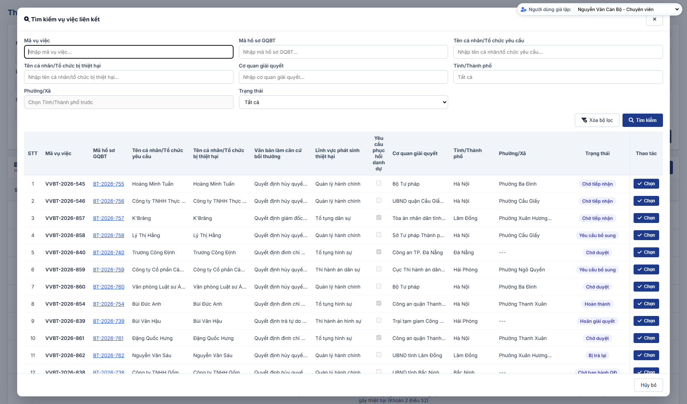

### 4.3.3.30. Theo dõi vụ việc tại Tòa án

#### 4.3.3.30.1. Mục đích

\- Cho phép cơ quan nhà nước bị khởi kiện (bị đơn) khai báo và quản lý các vụ việc yêu cầu bồi thường do Tòa án tiếp nhận, gồm: khởi kiện yêu cầu bồi thường theo thủ tục tố tụng dân sự và giải quyết yêu cầu bồi thường trong quá trình tố tụng hình sự, tố tụng hành chính tại Tòa án.

\- Gồm 06 chức năng:

\+ Tra cứu danh sách vụ việc tại Tòa án.

\+ Xem chi tiết vụ việc, bản ghi Chi trả tiền bồi thường đã tạo và lịch sử cập nhật.

\+ Thêm mới vụ việc (chỉ yêu cầu bồi thường thiệt hại bằng tiền).

\+ Cập nhật thông tin và trạng thái vụ việc.

\+ Xóa vụ việc (kể cả vụ việc ở trạng thái kết thúc).

\+ Tự động tạo bản ghi Loại "Chi trả tiền bồi thường" ở trạng thái "Chờ thông báo chi trả" khi vụ việc có yêu cầu bồi thường bằng tiền chuyển "Đã có bản án/QĐ".

\- Thông tin người yêu cầu bồi thường, người bị thiệt hại, lĩnh vực, hành vi gây thiệt hại, thiệt hại yêu cầu bồi thường dùng cùng cấu trúc với [MH02 - Màn hình Nhập liệu hồ sơ vụ việc - Giải quyết yêu cầu bồi thường - Công tác bồi thường nhà nước (Website Quản trị)](SRS_BTNN_GiaiQuyetBT_GiaiQuyet_YCBT.md#43314-mh02---màn-hình-nhập-liệu-hồ-sơ-vụ-việc).

*a. Phân quyền*

\- Menu "Theo dõi vụ việc tại Tòa án" thuộc nhóm menu "Bồi thường nhà nước", đặt ngay sau menu "Tra cứu vụ việc".

\- Nhóm quyền "Theo dõi vụ việc tại Tòa án" gồm: Tra cứu vụ việc tại Tòa án; Thêm mới vụ việc tại Tòa án; Cập nhật vụ việc tại Tòa án; Xóa vụ việc tại Tòa án.

\- Thêm mới: chỉ cán bộ thuộc đơn vị được áp dụng Loại hồ sơ "Giải quyết yêu cầu bồi thường" [DM_54] theo [Phân quyền theo đơn vị và Đơn vị áp dụng - Quản lý danh mục dùng chung - Quản trị hệ thống (Website Quản trị)](../01_Quan_tri_he_thong/Quan_ly_danh_muc.md#dm-don-vi-ap-dung).

\- Cập nhật, Xóa: được thực hiện trên mọi vụ việc hiển thị trong danh sách, không phân biệt cơ quan bị khởi kiện và trạng thái, trừ vụ việc "Đã có bản án/QĐ" (không được Cập nhật, Xóa).

*b. Điều kiện thực hiện*

\- Người dùng đã đăng nhập Website Quản trị và được phân quyền chức năng tương ứng của nhóm quyền "Theo dõi vụ việc tại Tòa án".

---

#### 4.3.3.30.2. Quy tắc chung

| STT | Nội dung | Quy tắc |
| :-- | :--- | :--- |
| 1 | Cơ quan bị khởi kiện | Cơ quan bị khởi kiện (bị đơn) của vụ việc là đơn vị gốc (đơn vị cấp cao nhất trên cây Cơ cấu tổ chức) của cán bộ thêm mới vụ việc. Hệ thống tự gán, không cho sửa. |
| 2 | Phạm vi xem | Cán bộ xem vụ việc có Cơ quan bị khởi kiện là đơn vị gốc của mình. - Cán bộ thuộc Bộ Tư pháp xem vụ việc của mọi cơ quan. |
| 3 | Quyền nhập liệu | Một Loại hồ sơ áp dụng cho người dùng khi Đơn vị áp dụng chứa đơn vị của người dùng hoặc một đơn vị cấp trên của đơn vị đó. - Đơn vị không được áp dụng Loại hồ sơ "Giải quyết yêu cầu bồi thường": nút "Thêm mới" bị khóa (Disabled); thao tác Cập nhật, Xóa trên các vụ việc vẫn được thực hiện; màn hình hiển thị thông báo "Đơn vị của bạn chưa được áp dụng Loại hồ sơ "Giải quyết yêu cầu bồi thường" nên không được thêm mới, cập nhật hoặc xóa vụ việc tại Tòa án." - Cập nhật, Xóa: mọi cán bộ được thực hiện trên vụ việc hiển thị trong danh sách, không giới hạn người tạo. |
| 4 | Mã vụ việc | Vụ việc tại Tòa án mang `Mã vụ việc` toàn trình (`VVBT-yyyy-xxx`) của vụ việc bồi thường, theo [Mã vụ việc và mã hồ sơ - Tiếp nhận hồ sơ - Công tác bồi thường nhà nước (Website Quản trị)](SRS_BTNN_GiaiQuyetBT_TiepNhan_YCBT.md#tn-ma-vu-viec). - `Mã vụ việc` không duy nhất trong phân hệ: 01 vụ việc có thể có nhiều vụ việc tại Tòa án (nhiều dòng trên danh sách). - Có vụ việc liên kết: `Mã vụ việc` lấy theo `Mã vụ việc` của vụ việc liên kết (quy tắc 15). - Không có vụ việc liên kết: hệ thống sinh `Mã vụ việc` mới dạng `VVBT-yyyy-xxx` khi Lưu, dùng chung bộ đếm Mã vụ việc toàn trình; không sinh lại khi sửa. - Cập nhật bỏ vụ việc liên kết: hệ thống sinh `Mã vụ việc` mới; vụ việc đã có bản ghi kinh phí thì giữ nguyên `Mã vụ việc`. - Mã chỉ đọc; số đã cấp không cấp lại. |
| 5 | Phạm vi yêu cầu | Vụ việc tại Tòa án chỉ gồm yêu cầu bồi thường thiệt hại bằng tiền; không có `Loại yêu cầu giải quyết bồi thường` và không có `Yêu cầu phục hồi danh dự`. |
| 6 | Dữ liệu cũ | - Vụ việc đã lưu với Loại yêu cầu khác (`Yêu cầu cả hai`, `Chỉ yêu cầu phục hồi danh dự`): hệ thống quy về yêu cầu bồi thường thiệt hại bằng tiền, không lưu Hình thức đề nghị phục hồi danh dự. - Dữ liệu cũ đã tách thành 02 vụ việc liên kết: hệ thống giữ vụ việc bồi thường thiệt hại bằng tiền, xóa vụ việc phục hồi danh dự và ghi lịch sử "Gộp vụ việc". |
| 7 | Trạng thái kết thúc | "Đã có bản án/QĐ" và "Trả lại đơn khởi kiện" là trạng thái kết thúc. Sau khi lưu ở trạng thái kết thúc, vụ việc không được đổi sang trạng thái khác (ô Trạng thái bị khóa); cán bộ vẫn được cập nhật các thông tin khác và được xóa vụ việc. |
| 8 | Ngày hiệu lực bản án/QĐ | Bắt buộc khi Trạng thái = "Đã có bản án/QĐ"; không nhỏ hơn Ngày thụ lý. |
| 9 | Tự tạo bản ghi Chi trả tiền bồi thường | Khi vụ việc được lưu ở trạng thái "Đã có bản án/QĐ", hệ thống tạo 01 bản ghi tại [Luồng Chi trả tiền bồi thường - Tạm ứng kinh phí bồi thường/Chi trả tiền bồi thường - Bồi thường nhà nước (Website Quản trị)](SRS_BTNN_GiaiQuyetBT_KinhPhi_BT.md#kp-chi-tra-tien-bt): + Loại đề nghị: "Chi trả tiền bồi thường"; Trạng thái: "Chờ thông báo chi trả". + Dữ liệu nạp sẵn: Mã vụ việc; thông tin người yêu cầu bồi thường; Cơ quan bị khởi kiện; Số Bản án/Quyết định và Ngày Bản án/Quyết định có hiệu lực (làm Số, Ngày Quyết định làm căn cứ chi trả); các khoản thiệt hại yêu cầu bồi thường và tổng số tiền (làm Số tiền chi trả); tài liệu đính kèm có tệp. - Các khoản thiệt hại của bản ghi chi trả: cộng số tiền các mục chi tiết theo nhóm thiệt hại, mỗi nhóm từ I đến VI là 01 khoản; các dòng nhóm `VII. Các thiệt hại khác` cộng thành 01 khoản `Các thiệt hại khác`; chỉ hiển thị khoản có số tiền lớn hơn 0. - Số tiền chi trả = tổng số tiền yêu cầu bồi thường của vụ việc, không thay đổi khi cộng theo nhóm. - Bản ghi gắn với từng vụ việc tại Tòa án: mỗi vụ việc tại Tòa án chỉ tạo 01 lần, khóa chống trùng theo vụ việc tại Tòa án (không theo Mã vụ việc). - Nhiều vụ việc tại Tòa án cùng `Mã vụ việc` (cùng liên kết 01 vụ việc): mỗi vụ việc tại Tòa án có bản ghi chi trả riêng. - Màn hình Tạm ứng kinh phí bồi thường/Chi trả tiền bồi thường kiểm tra lại khi tải và bổ sung bản ghi còn thiếu. - Ghi lịch sử vụ việc "Tạo bản ghi chi trả tiền bồi thường" với nội dung "Hệ thống tạo bản ghi Chi trả tiền bồi thường [Mã đề xuất] ở trạng thái Chờ thông báo chi trả.", người thực hiện "Hệ thống". - Bản ghi chi trả chuyển `Hoàn thành` hoặc `Trả lại ngân sách nhà nước`: không thay đổi trạng thái vụ việc tại Tòa án và hồ sơ Giải quyết yêu cầu bồi thường cùng `Mã vụ việc`; tiến độ chi trả theo dõi tại phân hệ Tạm ứng kinh phí bồi thường/Chi trả tiền bồi thường. |
| 10 | Báo cáo thống kê | Vụ việc có trạng thái "Trả lại đơn khởi kiện" không được đếm tại các màn hình Thống kê vụ việc yêu cầu bồi thường (TT08) và Dashboard Bồi thường nhà nước. |
| 11 | Kiểm tra đồng thời | Khi Lưu, Xóa: hệ thống kiểm tra lại dữ liệu mới nhất của vụ việc. - Vụ việc đã bị xóa hoặc người dùng không còn quyền: hiển thị "Vụ việc đã bị xóa hoặc bạn không còn quyền cập nhật. Danh sách đã được tải lại.", không lưu. - Vụ việc đã chuyển trạng thái kết thúc mà dữ liệu lưu có trạng thái khác: hiển thị "Vụ việc đã chuyển sang trạng thái kết thúc, không được thay đổi trạng thái. Danh sách đã được tải lại.", không lưu. |
| 12 | Cập nhật, xóa sau khi đã tạo bản ghi kinh phí | - Cập nhật vụ việc: nếu bản ghi kinh phí của vụ việc còn ở trạng thái "Chờ thông báo chi trả" (bản ghi cũ: "Chờ nhập liệu"), hệ thống cập nhật lại các thông tin kế thừa (người yêu cầu, cơ quan, Số và Ngày Bản án/Quyết định, các khoản thiệt hại và tổng số tiền, tài liệu). Bản ghi đã chuyển trạng thái khác thì không thay đổi. - Xóa vụ việc: nếu bản ghi kinh phí còn "Chờ thông báo chi trả" (bản ghi cũ: "Chờ nhập liệu") thì xóa theo (popup xác nhận nêu rõ "Bản ghi kinh phí [Mã đề xuất] ([Trạng thái]) cũng bị xóa theo."); nếu bản ghi đã chuyển trạng thái khác thì không cho xóa, thông báo "Bản ghi kinh phí [Mã đề xuất] đang ở trạng thái [Trạng thái], không được xóa vụ việc!". |
| 13 | Lịch sử cập nhật | Mỗi thao tác ghi 01 dòng gồm Thao tác, Người thực hiện, Thời điểm (dd/mm/yyyy HH:mm), Nội dung. - Thao tác gồm: + Thêm mới vụ việc: nội dung "Trạng thái: [Trạng thái]." + Cập nhật vụ việc: nội dung "Chuyển trạng thái: [Trạng thái cũ] → [Trạng thái mới]." hoặc "Cập nhật thông tin vụ việc." + Tạo bản ghi chi trả tiền bồi thường (quy tắc 9) + Gộp vụ việc (dữ liệu cũ, quy tắc 6) |
| 14 | Nhận diện vụ việc | Thông báo, popup xác nhận nhận diện vụ việc bằng "[Mã vụ việc] - [Tên cá nhân/Tổ chức yêu cầu]". |
| 15 | Vụ việc liên kết | Áp dụng khi `Trường hợp khởi kiện` = `Đã yêu cầu cơ quan giải quyết trước khi khởi kiện (điểm b khoản 1 và khoản 2 Điều 52)` hoặc `Nguồn phát sinh bản án` = `Khởi kiện theo thủ tục tố tụng dân sự sau khi giải quyết tại cơ quan trực tiếp quản lý người thi hành công vụ gây thiệt hại (Khoản 2 Điều 52)`. - Cán bộ chọn vụ việc yêu cầu bồi thường đã giải quyết tại cơ quan trực tiếp quản lý người thi hành công vụ gây thiệt hại. - Phạm vi tìm kiếm: toàn bộ vụ việc trên toàn hệ thống, mọi trạng thái, không giới hạn theo đơn vị của người dùng. - Vụ việc được chọn: mọi trạng thái, kể cả vụ việc đã liên kết với vụ việc tại Tòa án khác; 01 vụ việc được liên kết với nhiều vụ việc tại Tòa án. - Lưu vụ việc có vụ việc liên kết: `Mã vụ việc` của vụ việc tại Tòa án là `Mã vụ việc` của vụ việc liên kết; lưu `Mã hồ sơ`, `Cơ quan giải quyết`, trạng thái của vụ việc liên kết tại thời điểm chọn. - Không thỏa điều kiện áp dụng: không lưu vụ việc liên kết; `Mã vụ việc` theo quy tắc 4. - Cập nhật bỏ vụ việc liên kết: hệ thống sinh `Mã vụ việc` mới theo quy tắc 4. - Vụ việc đã tạo bản ghi kinh phí: giữ nguyên `Mã vụ việc` khi đổi hoặc bỏ vụ việc liên kết. |

---

#### 4.3.3.30.3. Trạng thái vụ việc

\- Cán bộ tự chọn trạng thái khi thêm mới và khi cập nhật. Vụ việc chưa ở trạng thái kết thúc được chuyển sang bất kỳ trạng thái nào trong danh sách; vụ việc đã ở trạng thái kết thúc giữ nguyên trạng thái.

| Trạng thái | Ý nghĩa | Trạng thái kết thúc | Thao tác được phép |
| :--- | :--- | :--- | :--- |
| Đã thụ lý | Tòa án đã thụ lý vụ việc. Giá trị mặc định khi thêm mới. | Không | Xem; Cập nhật; Xóa. |
| Đang giải quyết | Tòa án đang giải quyết vụ việc. | Không | Xem; Cập nhật; Xóa. |
| Đã có bản án/QĐ | Đã có Bản án/Quyết định của Tòa án có hiệu lực. Vụ việc phát sinh bản ghi Chi trả tiền bồi thường "Chờ thông báo chi trả". | Có | Xem. Không được Cập nhật, Xóa. |
| Trả lại đơn khởi kiện | Tòa án trả lại đơn khởi kiện. Không đếm trong báo cáo thống kê. | Có | Xem; Cập nhật (trừ Trạng thái); Xóa. |

---

#### 4.3.3.30.4. MH01 - Màn hình Danh sách vụ việc tại Tòa án

##### 4.3.3.30.4.1. Màn hình

##### 4.3.3.30.4.2. Mô tả thông tin trên màn hình

| Trường thông tin | Kiểu dữ liệu | Bắt buộc | Mặc định | Mô tả |
| :--- | :--- | :--- | :--- | :--- |
| Tiêu đề màn hình | String(255) | - | `Theo dõi vụ việc tại Tòa án` | Control UI: Text heading (Read-only). - Hiển thị đúng tên mục Menu `Theo dõi vụ việc tại Tòa án`. - Không có dòng mô tả dưới tiêu đề. |
| Thông báo không có quyền nhập liệu | String(500) | - | Ẩn | Control UI: Alert panel (Read-only). - Chỉ hiển thị khi đơn vị của người dùng không được áp dụng Loại hồ sơ "Giải quyết yêu cầu bồi thường" (quy tắc 3 tại [Quy tắc chung - Theo dõi vụ việc tại Tòa án - Công tác bồi thường nhà nước (Website Quản trị)](#tdta-quy-tac-chung)). - Nội dung theo quy tắc 3. |
| **Khối bộ lọc** | Section | - | - | Control UI: Khối thu gọn/mở rộng. - Bố trí 04 cột: dòng 1 gồm `Mã vụ việc`, `Mã hồ sơ`, `Tên cá nhân/Tổ chức yêu cầu`, `Tên cá nhân/Tổ chức bị thiệt hại`; dòng 2 gồm `Lĩnh vực phát sinh thiệt hại`, `Nguồn phát sinh bản án`, `Trạng thái`; dòng 3 gồm `Cơ quan giải quyết`, `Ngày thụ lý từ ngày`, `Ngày thụ lý đến ngày`. - Các điều kiện kết hợp theo điều kiện AND. |
| Mã vụ việc | String(50) | Không | Trống | Control UI: Input text. - `Placeholder: Nhập mã vụ việc...`. - Tìm gần đúng, không phân biệt hoa thường, không phân biệt dấu. |
| Mã hồ sơ | String(50) | Không | Trống | Control UI: Input text. - `Placeholder: Nhập mã hồ sơ...`. - Đặt cạnh `Mã vụ việc`. - Tìm gần đúng theo cột `Mã hồ sơ` trên lưới, không phân biệt hoa thường, không phân biệt dấu. |
| Tên cá nhân/Tổ chức yêu cầu | String(255) | Không | Trống | Control UI: Input text. - `Placeholder: Nhập tên cá nhân/tổ chức yêu cầu...`. - Tìm gần đúng theo cột `Tên cá nhân/Tổ chức yêu cầu`, không phân biệt hoa thường, không phân biệt dấu. |
| Tên cá nhân/Tổ chức bị thiệt hại | String(255) | Không | Trống | Control UI: Input text. - `Placeholder: Nhập tên cá nhân/tổ chức bị thiệt hại...`. - Tìm gần đúng theo cột `Tên cá nhân/Tổ chức bị thiệt hại`, không phân biệt hoa thường, không phân biệt dấu. |
| Lĩnh vực phát sinh thiệt hại | Enum(String(100)) | Không | `Tất cả` | Control UI: Combobox. - Gồm `Tất cả` và các giá trị của [DM_22]. - Lọc chính xác theo Lĩnh vực phát sinh thiệt hại. |
| Nguồn phát sinh bản án | Enum(String(255)) | Không | `Tất cả` | Control UI: Combobox. - Gồm `Tất cả` và 03 giá trị của trường `Nguồn phát sinh bản án` tại [MH02 - Màn hình Thêm mới / Cập nhật vụ việc - Theo dõi vụ việc tại Tòa án - Công tác bồi thường nhà nước (Website Quản trị)](#tdta-mh02). - Lọc chính xác theo Nguồn phát sinh bản án. |
| Trạng thái | Enum(String(50)) | Không | `Tất cả` | Control UI: Combobox. - Gồm `Tất cả` và 04 trạng thái tại [Trạng thái vụ việc - Theo dõi vụ việc tại Tòa án - Công tác bồi thường nhà nước (Website Quản trị)](#tdta-trang-thai). - Lọc chính xác theo Trạng thái. |
| Cơ quan giải quyết | String(255) | Không | Trống | Control UI: Input text. - `Placeholder: Nhập cơ quan giải quyết...`. - Tìm gần đúng theo cột `Cơ quan giải quyết`, không phân biệt hoa thường, không phân biệt dấu. |
| Ngày thụ lý từ ngày | Date | Không | Trống | Control UI: Datepicker. - `Placeholder: dd/mm/yyyy`. - Lọc vụ việc có Ngày thụ lý lớn hơn hoặc bằng giá trị nhập. |
| Ngày thụ lý đến ngày | Date | Không | Trống | Control UI: Datepicker. - `Placeholder: dd/mm/yyyy`. - Lọc vụ việc có Ngày thụ lý nhỏ hơn hoặc bằng giá trị nhập. |
| Xóa bộ lọc | Button | - | - | Control UI: Button. |
| Tìm kiếm | Button | - | - | Control UI: Button. |
| Thêm mới | Button | - | - | Control UI: Button. - Vị trí: phía trên bảng, căn phải. - Khóa (Disabled) khi đơn vị của người dùng không có quyền nhập liệu (quy tắc 3). |
| **Danh sách vụ việc tại Tòa án** | Section | - | 20 bản ghi/trang | Control UI: Data grid. - Không hiển thị tiêu đề và số lượng bản ghi phía trên bảng; tổng số bản ghi hiển thị tại thanh phân trang. - Sắp xếp theo Mã vụ việc giảm dần. - Không có dữ liệu: 01 dòng căn giữa toàn bộ chiều rộng bảng, nội dung [MSG-INF-SYS-001]. |
| STT | Integer(10) | - | Tự tăng | Control UI: Text (Read-only). - Tăng dần theo phân trang. |
| Mã vụ việc | String(50) | - | Theo dữ liệu | Control UI: Text (Read-only). - Theo dữ liệu bản ghi: `Mã vụ việc` `VVBT-yyyy-xxx` (quy tắc 4). - Không duy nhất trên danh sách: các vụ việc tại Tòa án cùng liên kết 01 vụ việc có cùng `Mã vụ việc`, mỗi vụ việc tại Tòa án là 01 dòng. |
| Mã hồ sơ | String(50) | - | Theo dữ liệu | Control UI: Text (Read-only). - Theo dữ liệu bản ghi: `Mã hồ sơ` của vụ việc liên kết (quy tắc 15). - Vụ việc không có vụ việc liên kết: `-`. |
| Tên cá nhân/Tổ chức yêu cầu | String(255) | - | Theo dữ liệu | Control UI: Text (Read-only). - Theo dữ liệu bản ghi: `Họ và tên` (Cá nhân) hoặc `Tên tổ chức` (Tổ chức) của người yêu cầu bồi thường. |
| Tên cá nhân/Tổ chức bị thiệt hại | String(255) | - | Theo dữ liệu | Control UI: Text (Read-only). - `Tư cách người yêu cầu bồi thường` = `Người bị thiệt hại`: hiển thị tên người yêu cầu. - `Tư cách người yêu cầu bồi thường` = `Tổ chức kế thừa quyền, nghĩa vụ của tổ chức bị thiệt hại đã chấm dứt tồn tại`: hiển thị `Tên tổ chức bị thiệt hại`. - Tư cách khác: hiển thị `Họ và tên người bị thiệt hại`. - Không có dữ liệu: `-`. |
| Lĩnh vực phát sinh thiệt hại | String(100) | - | Theo dữ liệu | Control UI: Text (Read-only). - Theo dữ liệu bản ghi. |
| Nguồn phát sinh bản án | String(255) | - | Theo dữ liệu | Control UI: Text (Read-only). - Theo dữ liệu bản ghi. |
| Ngày thụ lý | Date | - | Theo dữ liệu | Control UI: Text (Read-only). - Theo dữ liệu bản ghi, định dạng `dd/mm/yyyy`. |
| Trạng thái | String(50) | - | Theo dữ liệu | Control UI: Badge (Read-only). - Theo dữ liệu bản ghi. |
| Cơ quan giải quyết | String(255) | - | Theo dữ liệu | Control UI: Text (Read-only). - Có vụ việc liên kết: `Cơ quan giải quyết` của vụ việc liên kết. - Không có vụ việc liên kết: Cơ quan bị khởi kiện (quy tắc 1). |
| Thao tác | - | - | - | Control UI: Icon button group. - Cố định bên phải lưới khi cuộn ngang. - Cập nhật: luôn hiển thị; vụ việc "Đã có bản án/QĐ": khóa mờ, không cho thao tác, tooltip `Cập nhật - Vụ việc đã có bản án/QĐ`. - Xóa: luôn hiển thị; áp dụng quy tắc 12 khi vụ việc đã có bản ghi kinh phí; vụ việc "Đã có bản án/QĐ": khóa mờ, không cho thao tác, tooltip `Xóa - Vụ việc đã có bản án/QĐ`. |
| Phân trang | - | - | Trang 1 | Control UI: Pagination. - Số dòng hiển thị: 10 / 20 / 50 / 100, mặc định 20. - Thông tin `Hiển thị [từ]-[đến] trong tổng số [n] bản ghi`. - Nút chuyển trang: Đầu, Trước, số trang, Sau, Cuối. |

##### 4.3.3.30.4.3. Chức năng trên màn hình

| STT | Tên chức năng | Định dạng | Mô tả |
| :-- | :--- | :--- | :--- |
| 1 | Tìm kiếm | Button | Hệ thống xử lý theo các trường hợp: |
|  |  |  | **TH1 - `Ngày thụ lý từ ngày` lớn hơn `Ngày thụ lý đến ngày`**: hệ thống tô viền đỏ 02 ô ngày, lưới hiển thị 01 dòng [MSG-ERR-VAL-007]; không lọc. |
|  |  |  | **TH Hợp lệ**: lọc danh sách theo đồng thời các điều kiện, đưa về Trang 1. |
| 2 | Xóa bộ lọc | Button | Đưa bộ lọc về giá trị mặc định và tải lại danh sách. |
| 3 | Thêm mới | Button | Mở [MH02 - Màn hình Thêm mới / Cập nhật vụ việc - Theo dõi vụ việc tại Tòa án - Công tác bồi thường nhà nước (Website Quản trị)](#tdta-mh02) ở chế độ thêm mới. |
| 4 | Click dòng dữ liệu | Row click | Mở [MH03 - Màn hình Xem chi tiết vụ việc - Theo dõi vụ việc tại Tòa án - Công tác bồi thường nhà nước (Website Quản trị)](#tdta-mh03); click icon tại cột Thao tác thì chỉ thực hiện thao tác đó. |
| 5 | Cập nhật | Icon button | Mở [MH02 - Màn hình Thêm mới / Cập nhật vụ việc - Theo dõi vụ việc tại Tòa án - Công tác bồi thường nhà nước (Website Quản trị)](#tdta-mh02) ở chế độ cập nhật. |
| 6 | Xóa | Icon button | Hiển thị popup "Xác nhận xóa", nội dung "Bạn có chắc chắn muốn xóa vụ việc [Mã vụ việc] - [Tên cá nhân/Tổ chức yêu cầu] không?" (kèm câu về bản ghi kinh phí theo quy tắc 12). Hủy bỏ: đóng popup. Đồng ý: |
|  |  |  | **TH1 - Dữ liệu đã thay đổi**: xử lý theo quy tắc 11, không xóa. |
|  |  |  | **TH2 - Bản ghi kinh phí đã chuyển khỏi trạng thái "Chờ thông báo chi trả"**: hiển thị "Bản ghi kinh phí [Mã đề xuất] đang ở trạng thái [Trạng thái], không được xóa vụ việc!", không xóa. |
|  |  |  | **TH Hợp lệ**: - Xóa vụ việc khỏi danh sách. - Xóa bản ghi kinh phí "Chờ thông báo chi trả" của vụ việc (nếu có). - Hiển thị tại đầu MH01: "Đã xóa vụ việc [Mã vụ việc]!". |
| 7 | Phân trang | Pagination | Chuyển trang, đổi số dòng hiển thị (về Trang 1); giữ tiêu chí lọc. |

---

#### 4.3.3.30.5. MH02 - Màn hình Thêm mới / Cập nhật vụ việc

##### 4.3.3.30.5.1. Màn hình

##### 4.3.3.30.5.2. Mô tả thông tin trên màn hình

| Trường thông tin | Kiểu dữ liệu | Bắt buộc | Mặc định | Mô tả |
| :--- | :--- | :--- | :--- | :--- |
| Tiêu đề màn hình | String(255) | - | Theo chế độ | Control UI: Text heading (Read-only). - Thêm mới: "THÊM MỚI VỤ VIỆC TẠI TÒA ÁN". - Cập nhật: "CẬP NHẬT VỤ VIỆC TẠI TÒA ÁN". |
| Khung báo lỗi | String(2000) | - | Ẩn | Control UI: Alert panel (Read-only), đặt đầu màn hình. - Chỉ hiển thị khi bấm `Lưu thông tin` mà còn trường chưa hợp lệ. - Dòng đầu: "Còn [n] trường chưa hợp lệ", `[n]` là số trường đang lỗi. - Dưới dòng đầu: danh sách nhãn các trường đang lỗi theo thứ tự trên màn hình; trường có lỗi khác bỏ trống: "[Nhãn trường] - [Nội dung lỗi]". - Gồm cả lỗi của bảng `Tài liệu đính kèm`, bảng `Văn bản làm căn cứ yêu cầu bồi thường` và dòng `Các thiệt hại khác`. - Click nhãn: cuộn tới trường tương ứng (đưa trường vào giữa màn hình) và focus vào trường. - Người dùng sửa trường đang lỗi: hệ thống xóa lỗi của trường và cập nhật lại khung; không còn lỗi thì ẩn khung. |
| Thông báo | String(500) | - | Ẩn | Control UI: Alert panel (Read-only), đặt đầu màn hình, có nút đóng. - Hiển thị kết quả kiểm tra không thuộc trường cụ thể theo các trường hợp tại chức năng `Lưu thông tin`. - Hệ thống không dùng thông báo dạng toast trên màn hình này. |
| **Khối thông tin chung** | Section | - | - | Control UI: Section (Read-only). - Chỉ hiển thị ở chế độ cập nhật. |
| Mã vụ việc | String(50) | - | Theo bản ghi | Control UI: Label. - Theo dữ liệu bản ghi. |
| Cơ quan bị khởi kiện | String(255) | - | Theo bản ghi | Control UI: Label. - Theo dữ liệu bản ghi. |
| Cán bộ tạo / Thời điểm tạo | String(255) | - | Theo bản ghi | Control UI: Label. - Theo dữ liệu bản ghi: "[Cán bộ tạo] - [Thời điểm tạo]", thời điểm định dạng `dd/mm/yyyy HH:mm`. |
| Chi trả tiền bồi thường | String(255) | - | Ẩn | Control UI: Alert panel (Read-only). - Chỉ hiển thị ở chế độ cập nhật với vụ việc đã tạo bản ghi kinh phí. - Nội dung như dòng `Chi trả tiền bồi thường` tại [MH03 - Màn hình Xem chi tiết vụ việc - Theo dõi vụ việc tại Tòa án - Công tác bồi thường nhà nước (Website Quản trị)](#tdta-mh03). |
| **Thông tin vụ việc tại Tòa án** | Section | - | - | Control UI: Section. - 01 khối, bố trí theo thứ tự: + Hàng 1: `Nguồn phát sinh bản án` (toàn bộ chiều rộng) + Hàng 2: `Trường hợp khởi kiện` (toàn bộ chiều rộng) + Hàng 3: `Ngày thụ lý`, `Lĩnh vực phát sinh thiệt hại` + Hàng 4: `Trạng thái`, `Số Bản án/Quyết định`, `Ngày Bản án/Quyết định có hiệu lực` |
| Nguồn phát sinh bản án | Enum(String(255)) | Có | Trống | Control UI: Combobox. - Chiếm toàn bộ chiều rộng khối, hiển thị đủ nội dung giá trị đang chọn trên 01 hàng. - Tooltip: đủ nội dung giá trị đang chọn. - `Placeholder: Chọn nguồn phát sinh bản án...`. - Gồm: + Khởi kiện yêu cầu bồi thường theo thủ tục tố tụng dân sự (Khoản 1 Điều 52) + Khởi kiện theo thủ tục tố tụng dân sự sau khi giải quyết tại cơ quan trực tiếp quản lý người thi hành công vụ gây thiệt hại (Khoản 2 Điều 52) + Giải quyết YCBT trong quá trình tố tụng hình sự, tố tụng hành chính tại toà (Điều 55) |
| Trường hợp khởi kiện | Enum(String(255)) | Có | Trống | Control UI: Combobox. - Chiếm toàn bộ chiều rộng khối; tooltip: đủ nội dung giá trị đang chọn. - Danh sách giá trị không phụ thuộc `Nguồn phát sinh bản án`. - `Placeholder: Chọn trường hợp khởi kiện...`. - Gồm: + Đã yêu cầu cơ quan giải quyết trước khi khởi kiện (điểm b khoản 1 và khoản 2 Điều 52) + Khởi kiện thẳng ra Tòa án, chưa từng yêu cầu cơ quan giải quyết (điểm a khoản 1 Điều 52) + Kết hợp giải quyết YCBT trong quá trình tố tụng hình sự, tố tụng hành chính tại toà |
| Ngày thụ lý | Date | Có | Trống | Control UI: Datepicker. - Lịch mở khi focus vào ô. - `Placeholder: dd/mm/yyyy`. - Không lớn hơn ngày hiện tại. |
| Lĩnh vực phát sinh thiệt hại | Enum(String(100)) | Không | `Trong hoạt động quản lý hành chính` | Control UI: Combobox. - Tham chiếu [DM_22]. - Không lấy theo vụ việc liên kết. |
| Trạng thái | Enum(String(50)) | Có | `Đã thụ lý` | Control UI: Combobox. - Gồm 04 trạng thái tại [Trạng thái vụ việc - Theo dõi vụ việc tại Tòa án - Công tác bồi thường nhà nước (Website Quản trị)](#tdta-trang-thai). - Vụ việc đã ở trạng thái kết thúc: khóa (Disabled). |
| Số Bản án/Quyết định | String(100) | Có (khi hiển thị) | Trống | Control UI: Input text. - Đặt cùng hàng, ngay sau `Trạng thái`. - `Placeholder: Nhập số Bản án/Quyết định...`. - Chỉ hiển thị khi Trạng thái = "Đã có bản án/QĐ". - Tối đa 100 ký tự. |
| Ngày Bản án/Quyết định có hiệu lực | Date | Có (khi hiển thị) | Trống | Control UI: Datepicker. - Đặt cùng hàng, ngay sau `Số Bản án/Quyết định`. - `Placeholder: dd/mm/yyyy`. - Chỉ hiển thị khi Trạng thái = "Đã có bản án/QĐ". - Không nhỏ hơn Ngày thụ lý. |
| **Thông tin vụ việc liên kết** | Section | - | Ẩn | Control UI: Section. - Đặt ngay sau khối `Thông tin vụ việc tại Tòa án`. - Dòng gợi ý dưới tiêu đề khối: "Chọn vụ việc đã giải quyết tại cơ quan trực tiếp quản lý người thi hành công vụ". - Chỉ hiển thị khi thỏa 01 trong 02 điều kiện: + `Trường hợp khởi kiện` = `Đã yêu cầu cơ quan giải quyết trước khi khởi kiện (điểm b khoản 1 và khoản 2 Điều 52)` + `Nguồn phát sinh bản án` = `Khởi kiện theo thủ tục tố tụng dân sự sau khi giải quyết tại cơ quan trực tiếp quản lý người thi hành công vụ gây thiệt hại (Khoản 2 Điều 52)` - Đổi giá trị không còn thỏa điều kiện: hệ thống ẩn khối, xóa vụ việc đã chọn và giá trị đã nhập trong khối; giữ nguyên thông tin người yêu cầu đã điền. - Chế độ xem chi tiết: hiển thị chỉ đọc, ẩn các nút `Tìm kiếm`, `Tìm kiếm nâng cao`, `Bỏ chọn`. |
| Mã vụ việc (ô tìm vụ việc liên kết) | String(50) | Có điều kiện | Trống | Control UI: Input text kèm Button `Tìm kiếm`, Button `Tìm kiếm nâng cao`. - Chỉ hiển thị khi chưa chọn vụ việc liên kết. - Nhãn hiển thị: `Mã vụ việc`. - `Placeholder: Nhập mã vụ việc hoặc mã hồ sơ (VVBT-…, BT-…)`. - Nhận `Mã vụ việc` hoặc `Mã hồ sơ GQBT`; tối đa 50 ký tự. - Bắt buộc chọn vụ việc khi khối `Thông tin vụ việc liên kết` hiển thị; nhập mã mà chưa chọn được vụ việc coi là bỏ trống. - Bỏ trống: Hệ thống tô viền đỏ ô lỗi, hiển thị [MSG-ERR-VAL-001] dưới ô lỗi và đưa trường vào `Khung báo lỗi`. |
| Mã vụ việc (vụ việc đã chọn) | String(50) | - | Theo vụ việc đã chọn | Control UI: Input text (Read-only). - Chỉ hiển thị khi đã chọn vụ việc liên kết. - Nhãn hiển thị: `Mã vụ việc`. - `Mã vụ việc` của vụ việc đã chọn. |
| Mã hồ sơ GQBT (vụ việc đã chọn) | String(50) | - | Theo vụ việc đã chọn | Control UI: Input text (Read-only). - Chỉ hiển thị khi đã chọn vụ việc liên kết. - Nhãn hiển thị: `Mã hồ sơ GQBT`. - `Mã hồ sơ` của hồ sơ Giải quyết yêu cầu bồi thường của vụ việc đã chọn; không có thì hiển thị `-`. |
| Trạng thái vụ việc | String(100) | - | Theo vụ việc đã chọn | Control UI: Input text (Read-only). - Chỉ hiển thị khi đã chọn vụ việc liên kết và vụ việc có dữ liệu trạng thái. - Trạng thái của vụ việc đã chọn tại thời điểm chọn. |
| Cơ quan giải quyết | String(255) | - | Theo vụ việc đã chọn | Control UI: Input text (Read-only). - Chỉ hiển thị khi đã chọn vụ việc liên kết và vụ việc có dữ liệu cơ quan giải quyết. - Cơ quan giải quyết bồi thường của vụ việc đã chọn. |
| Bỏ chọn | Button | - | - | Control UI: Button. - Chỉ hiển thị khi đã chọn vụ việc liên kết, đặt dưới các trường chỉ đọc của khối. |
| **Thông tin chi tiết người yêu cầu bồi thường** | Section | - | - | Control UI: Section. - Gồm 02 cột `Thông tin cá nhân & Liên hệ` và `Giấy tờ pháp lý & Địa chỉ`. - Các trường, nhãn, bắt buộc, placeholder, thứ tự giống khối `Thông tin người yêu cầu bồi thường` tại [MH02 - Màn hình Nhập liệu hồ sơ vụ việc - Giải quyết yêu cầu bồi thường - Công tác bồi thường nhà nước (Website Quản trị)](SRS_BTNN_GiaiQuyetBT_GiaiQuyet_YCBT.md#43314-mh02---màn-hình-nhập-liệu-hồ-sơ-vụ-việc). - Chọn vụ việc liên kết: hệ thống điền sẵn theo dữ liệu người yêu cầu của vụ việc, cho phép sửa. |
| Loại người yêu cầu | Enum(String(20)) | Có | `Cá nhân` | Control UI: Radio button. - 02 lựa chọn nằm ngang, không icon. - Đặt trước trường `Tư cách người yêu cầu bồi thường`. - Giá trị gồm: + `Cá nhân` + `Tổ chức` - Đổi giá trị: nếu Tư cách đang chọn không thuộc danh sách của Loại mới thì hệ thống xóa giá trị Tư cách, người dùng chọn lại. - `Cá nhân`: hiển thị `Ngày sinh`, `Loại giấy tờ thân nhân`, `Số giấy tờ thân nhân`, `Ngày cấp`, `Nơi cấp`; ẩn nhóm trường tổ chức. - `Tổ chức`: hiển thị `Mã số tổ chức`, `Họ và tên người đại diện theo pháp luật`, `Chức vụ người đại diện`, `Số giấy tờ thành lập/đăng ký`, `Ngày cấp`, `Nơi cấp`; ẩn nhóm trường cá nhân. - Vụ việc cũ chưa có giá trị: coi là `Cá nhân`. |
| Tư cách người yêu cầu bồi thường | Enum(String(100)) | Có | `Người bị thiệt hại` | Control UI: Combobox. - `Placeholder: -- Chọn tư cách người yêu cầu --`. - Tham chiếu [DM_26]. - Danh sách giá trị lọc theo `Loại người yêu cầu`: + `Cá nhân`: `Người bị thiệt hại`, `Người thừa kế của người bị thiệt hại`, `Người đại diện cho những người thừa kế của người bị thiệt hại`, `Người đại diện theo pháp luật của người bị thiệt hại`, `Cá nhân, pháp nhân được ủy quyền hợp pháp` + `Tổ chức`: `Người bị thiệt hại`, `Tổ chức kế thừa quyền, nghĩa vụ của tổ chức bị thiệt hại đã chấm dứt tồn tại`, `Cá nhân, pháp nhân được ủy quyền hợp pháp` - Khác `Người bị thiệt hại`: hiển thị khối `Thông tin người bị thiệt hại`. |
| Họ và tên / Tên tổ chức | String(255) | Có | Trống | Control UI: Input text. - Nhãn theo `Loại người yêu cầu`: + `Cá nhân`: `Họ và tên`, `Placeholder: Nhập họ và tên...` + `Tổ chức`: `Tên tổ chức`, `Placeholder: Nhập tên tổ chức...` |
| Ngày sinh | Date | Có (khi `Cá nhân`) | Trống | Control UI: Datepicker. - Chỉ hiển thị khi `Loại người yêu cầu` = `Cá nhân`. - `Placeholder: dd/mm/yyyy`. - Không lớn hơn ngày hiện tại. |
| Mã số tổ chức | String(50) | Có (khi `Tổ chức`) | Trống | Control UI: Input text. - Chỉ hiển thị khi `Loại người yêu cầu` = `Tổ chức`. - `Placeholder: Mã số doanh nghiệp / mã số thuế / mã số khác...`. |
| Họ và tên người đại diện theo pháp luật | String(100) | Có (khi `Tổ chức`) | Trống | Control UI: Input text. - Chỉ hiển thị khi `Loại người yêu cầu` = `Tổ chức`. - `Placeholder: Nhập họ và tên người đại diện...`. |
| Chức vụ người đại diện | String(100) | Có (khi `Tổ chức`) | Trống | Control UI: Input text. - Chỉ hiển thị khi `Loại người yêu cầu` = `Tổ chức`. - `Placeholder: Nhập chức vụ...`. |
| Trạng thái người bị thiệt hại | Enum(String(20)) | Có (khi hiển thị) | `Còn sống` | Control UI: Radio button. - Gồm: + Còn sống + Đã mất - Chỉ hiển thị khi người bị thiệt hại là cá nhân; người bị thiệt hại là tổ chức (`Tư cách` = `Tổ chức kế thừa quyền, nghĩa vụ của tổ chức bị thiệt hại đã chấm dứt tồn tại`, hoặc `Tư cách` = `Người bị thiệt hại` và `Loại người yêu cầu` = `Tổ chức`): ẩn và đặt lại `Còn sống`. - `Tư cách` = `Người thừa kế của người bị thiệt hại` hoặc `Người đại diện cho những người thừa kế của người bị thiệt hại`: hệ thống chọn `Đã mất` và khóa trường. |
| Số điện thoại | String(20) | Có | Trống | Control UI: Input text. - `Placeholder: Nhập số điện thoại...`. - Chỉ nhận chữ số. |
| Email | String(255) | Không | Trống | Control UI: Input text. - `Placeholder: Nhập email...`. |
| Số giấy tờ thành lập/đăng ký | String(50) | Không | Trống | Control UI: Input text. - Chỉ hiển thị khi `Loại người yêu cầu` = `Tổ chức`. - `Placeholder: Nhập số giấy tờ thành lập/đăng ký...`. |
| Ngày cấp (giấy tờ thành lập/đăng ký) | Date | Không | Trống | Control UI: Datepicker. - Chỉ hiển thị khi `Loại người yêu cầu` = `Tổ chức`. - Nhãn hiển thị: `Ngày cấp`. - `Placeholder: dd/mm/yyyy`. |
| Nơi cấp (giấy tờ thành lập/đăng ký) | String(255) | Không | Trống | Control UI: Input text. - Chỉ hiển thị khi `Loại người yêu cầu` = `Tổ chức`. - Nhãn hiển thị: `Nơi cấp`. - `Placeholder: Nhập nơi cấp...`. |
| Loại giấy tờ thân nhân | Enum(String(50)) | Có (khi `Cá nhân`) | `CMND/CCCD/Chứng minh quân đội` | Control UI: Combobox. - Chỉ hiển thị khi `Loại người yêu cầu` = `Cá nhân`. - `Placeholder: -- Chọn loại giấy tờ --`. - Tham chiếu [DM_10], không gồm `Mã số thuế`. |
| Số giấy tờ thân nhân | String(20) | Có (khi `Cá nhân`) | Trống | Control UI: Input text. - Chỉ hiển thị khi `Loại người yêu cầu` = `Cá nhân`. - `Placeholder: Nhập số giấy tờ...`. |
| Ngày cấp | Date | Không | Trống | Control UI: Datepicker. - Chỉ hiển thị khi `Loại người yêu cầu` = `Cá nhân`. - `Placeholder: dd/mm/yyyy`. |
| Nơi cấp | String(255) | Không | Trống | Control UI: Input text. - Chỉ hiển thị khi `Loại người yêu cầu` = `Cá nhân`. - `Placeholder: Nhập nơi cấp...`. |
| Quốc gia | Enum(String(100)) | Có | `Việt Nam` | Control UI: Combobox. - Tham chiếu [DM_09]. - Khác `Việt Nam`: `Tỉnh/Thành phố` chuyển sang nhập tự do. |
| Tỉnh/Thành phố | Enum(String(100)) / String(100) | Có | `Thành phố Hà Nội` | Control UI: Combobox / Input text. - `Quốc gia` = `Việt Nam`: Combobox, tham chiếu Danh mục địa bàn (cấp Tỉnh/Thành phố). - `Quốc gia` khác `Việt Nam`: Input text, `Placeholder: Nhập tỉnh/thành ngoại quốc...`. |
| Phường/Xã | Enum(String(100)) / String(100) | Có | Trống | Control UI: Combobox có tìm kiếm / Input text. - `Quốc gia` = `Việt Nam`: tham chiếu Danh mục địa bàn (cấp Phường/Xã) lọc theo `Tỉnh/Thành phố`, `Placeholder: Gõ Mã hoặc Tên Phường/Xã...`; đổi `Tỉnh/Thành phố` mà giá trị đang chọn không thuộc danh sách mới thì hệ thống xóa giá trị. - `Quốc gia` khác `Việt Nam`: Input text, `Placeholder: Nhập phường/xã/khu vực nước ngoài...`. |
| Địa chỉ chi tiết | Text(1000) | Có | Trống | Control UI: Textarea (02 dòng). - Đặt ở hàng riêng ngay dưới `Phường/Xã`. - `Placeholder: Nhập số nhà, tên đường/phố, thôn/xóm/ấp...`. - Bộ đếm ký tự dưới ô dạng "[Số ký tự đã nhập]/1000". |
| **Thông tin người bị thiệt hại** | Section | - | Ẩn | Control UI: Section. - Chỉ hiển thị khi `Tư cách người yêu cầu bồi thường` khác `Người bị thiệt hại`. - `Tư cách` = `Tổ chức kế thừa quyền, nghĩa vụ của tổ chức bị thiệt hại đã chấm dứt tồn tại`: tiêu đề khối `Thông tin tổ chức bị thiệt hại đã chấm dứt tồn tại`; chỉ gồm `Tên tổ chức bị thiệt hại`, `Mã số tổ chức`. - Tư cách khác: gồm các trường từ `Họ và tên người bị thiệt hại` đến `Địa chỉ chi tiết (người bị thiệt hại)`. |
| Tên tổ chức bị thiệt hại | String(255) | Có (khi hiển thị) | Trống | Control UI: Input text. - `Placeholder: Nhập tên tổ chức bị thiệt hại...`. |
| Mã số tổ chức (tổ chức bị thiệt hại) | String(50) | Không | Trống | Control UI: Input text. - Nhãn hiển thị: `Mã số tổ chức`. - `Placeholder: Mã số doanh nghiệp / mã số thuế / mã số khác...`. |
| Họ và tên người bị thiệt hại | String(100) | Có (khi hiển thị) | Trống | Control UI: Input text. - `Placeholder: Nhập họ và tên...`. |
| Ngày sinh (người bị thiệt hại) | Date | Có (khi hiển thị) | Trống | Control UI: Datepicker. - Nhãn hiển thị: `Ngày sinh`. - `Placeholder: dd/mm/yyyy`. |
| Số điện thoại (người bị thiệt hại) | String(20) | Không | Trống | Control UI: Input text. - Nhãn hiển thị: `Số điện thoại`. - `Placeholder: Nhập số điện thoại...`. - Chỉ nhận chữ số. |
| Email (người bị thiệt hại) | String(255) | Không | Trống | Control UI: Input text. - Nhãn hiển thị: `Email`. - `Placeholder: Nhập email...`. |
| Loại giấy tờ thân nhân (người bị thiệt hại) | Enum(String(50)) | Có (khi hiển thị) | Trống | Control UI: Combobox. - Nhãn hiển thị: `Loại giấy tờ thân nhân`. - `Placeholder: -- Chọn loại giấy tờ --`. - Tham chiếu [DM_10], không gồm `Mã số thuế`. |
| Số giấy tờ thân nhân (người bị thiệt hại) | String(20) | Có (khi hiển thị) | Trống | Control UI: Input text. - Nhãn hiển thị: `Số giấy tờ thân nhân`. - `Placeholder: Nhập số giấy tờ...`. |
| Ngày cấp (người bị thiệt hại) | Date | Không | Trống | Control UI: Datepicker. - Nhãn hiển thị: `Ngày cấp`. - `Placeholder: dd/mm/yyyy`. |
| Nơi cấp (người bị thiệt hại) | String(255) | Không | Trống | Control UI: Input text. - Nhãn hiển thị: `Nơi cấp`. - `Placeholder: Nhập nơi cấp...`. |
| Quốc gia (người bị thiệt hại) | Enum(String(100)) | Không | `Việt Nam` | Control UI: Combobox. - Nhãn hiển thị: `Quốc gia`. - Tham chiếu [DM_09]. |
| Tỉnh/Thành phố (người bị thiệt hại) | Enum(String(100)) / String(100) | Không | Trống | Control UI: Combobox / Input text. - Nhãn hiển thị: `Tỉnh/Thành phố`. - Cùng control với `Tỉnh/Thành phố` của người yêu cầu. - `Quốc gia (người bị thiệt hại)` = `Việt Nam`: Combobox, tham chiếu Danh mục địa bàn (cấp Tỉnh/Thành phố), `Placeholder: -- Chọn tỉnh/thành phố --`. - `Quốc gia (người bị thiệt hại)` khác `Việt Nam`: Input text, `Placeholder: Nhập tỉnh/thành ngoại quốc...`. |
| Phường/Xã (người bị thiệt hại) | Enum(String(100)) / String(100) | Không | Trống | Control UI: Combobox có tìm kiếm / Input text. - Nhãn hiển thị: `Phường/Xã`. - `Quốc gia (người bị thiệt hại)` = `Việt Nam`: tham chiếu Danh mục địa bàn (cấp Phường/Xã) lọc theo `Tỉnh/Thành phố (người bị thiệt hại)`, `Placeholder: Gõ Mã hoặc Tên Phường/Xã...`; đổi `Tỉnh/Thành phố` mà giá trị đang chọn không thuộc danh sách mới thì hệ thống xóa giá trị. - `Quốc gia (người bị thiệt hại)` khác `Việt Nam`: Input text, `Placeholder: Nhập phường/xã/khu vực nước ngoài...`. |
| Địa chỉ chi tiết (người bị thiệt hại) | Text(1000) | Không | Trống | Control UI: Textarea (02 dòng). - Nhãn hiển thị: `Địa chỉ chi tiết`. - `Placeholder: Nhập số nhà, tên đường/phố, thôn/xóm/ấp...`. - Bộ đếm ký tự dưới ô dạng "[Số ký tự đã nhập]/1000". |
| **Nội dung yêu cầu bồi thường** | Section | - | - | Control UI: Section. - Gồm theo thứ tự: bảng `Văn bản làm căn cứ yêu cầu bồi thường`, `Hành vi gây thiệt hại của người thi hành công vụ`, `Mối quan hệ nhân quả giữa thiệt hại thực tế xảy ra và hành vi gây thiệt hại`. - Đặt ngay trước khối `Thiệt hại yêu cầu bồi thường`. |
| **Văn bản làm căn cứ yêu cầu bồi thường** | Table | Không | 01 dòng trống | Control UI: Data grid nhập liệu. - Dòng không có tên và không có file được bỏ qua khi lưu. - Dòng gợi ý dưới bảng: "Định dạng .pdf, .jpg, .jpeg, .png; dung lượng tối đa 50MB/tệp." |
| STT | Integer(10) | - | Tự tăng | Control UI: Text (Read-only). - Tự tăng theo số dòng. |
| Tên văn bản căn cứ | String(255) | Không | Trống | Control UI: Input text. - `Placeholder: Nhập tên văn bản căn cứ`. - Tối đa 255 ký tự. - Tải file khi chưa nhập tên: tự điền theo tên file (bỏ phần mở rộng). |
| File đính kèm | File | Không | Trống | Control UI: Button `Tải file`. - Sau khi chọn: hiển thị tên file. - Định dạng: `.pdf`, `.jpg`, `.jpeg`, `.png`; dung lượng tối đa 50MB/tệp. - Sai định dạng: không nhận tệp, hiển thị [MSG-ERR-FILE-003] dưới nút tại dòng. - Vượt dung lượng: không nhận tệp, hiển thị [MSG-ERR-FILE-006] dưới nút tại dòng. |
| Thao tác | - | - | - | Control UI: Icon button group. - Xem file: khóa (Disabled) khi dòng chưa có file. - Xóa: xóa dòng; xóa dòng cuối cùng thì đặt lại 01 dòng trống. |
| Thêm tài liệu | Button | - | - | Control UI: Button. - Vị trí: dưới bảng. |
| Hành vi gây thiệt hại của người thi hành công vụ | Text(2000) | Có | Trống | Control UI: Textarea. - `Placeholder: Tóm tắt hành vi gây thiệt hại của người thi hành công vụ`. - Tối đa 2000 ký tự. - Bộ đếm ký tự dưới ô dạng "[Số ký tự đã nhập]/2000". |
| Mối quan hệ nhân quả giữa thiệt hại thực tế xảy ra và hành vi gây thiệt hại | Text(4000) | Có | Trống | Control UI: Textarea. - `Placeholder: Nhập mối quan hệ nhân quả giữa thiệt hại và hành vi gây thiệt hại...`. - Tối đa 4000 ký tự. - Bộ đếm ký tự dưới ô dạng "[Số ký tự đã nhập]/4000". |
| **Thiệt hại yêu cầu bồi thường** | List(Object) | Không | Nhóm có mục được tích: mở rộng; nhóm còn lại: thu gọn | Control UI: Data grid 02 cấp theo [Danh mục Loại thiệt hại yêu cầu bồi thường - Danh mục dữ liệu dùng chung - Tổng quan và quy tắc chung](../../Tai%20lieu%20tong%20hop/00_Tong_quan_va_Quy_tac_chung.md#danh-muc-dung-chung) [DM_27]. - Áp dụng quy định tại [Thiệt hại yêu cầu bồi thường 02 cấp - Giải quyết yêu cầu bồi thường - Công tác bồi thường nhà nước (Website Quản trị)](SRS_BTNN_GiaiQuyetBT_GiaiQuyet_YCBT.md#quy-tac-nghiep-vu-chung-ycbt) và [Khối Bảng thiệt hại yêu cầu bồi thường - Giải quyết yêu cầu bồi thường - Công tác bồi thường nhà nước (Website Quản trị)](SRS_BTNN_GiaiQuyetBT_GiaiQuyet_YCBT.md#gq-mh02-bang-thiet-hai). - Cấp 1: dòng nhóm thiệt hại; cấp 2: các mục chi tiết của nhóm. - Hiển thị đủ 06 nhóm, 36 mục chi tiết theo thứ tự danh mục và nhóm `VII. Các thiệt hại khác` ở cuối. - Cột: `Mục thiệt hại yêu cầu bồi thường`, `Cách tính / Diễn giải công thức áp dụng`, `Số tiền yêu cầu bồi thường (đồng)`. - Nút `Mở rộng tất cả`, `Thu gọn tất cả` phía trên bảng. - Mục được tích / bỏ tích tự do; không hiển thị nhãn phân loại mục. - Vụ việc đã lưu theo 06 loại thiệt hại cũ: quy đổi sang mục chi tiết đầu tiên của nhóm tương ứng, giữ nguyên cách tính và số tiền. |
| Dòng nhóm thiệt hại | Label | - | Thu gọn | Control UI: Dòng tiêu đề nhóm. - Hiển thị số La Mã, tên nhóm, căn cứ (Điều), số mục đã tích / tổng số mục của nhóm; nhóm VII hiển thị số dòng. - Bấm để mở rộng / thu gọn các mục chi tiết của nhóm. - Cột `Số tiền yêu cầu bồi thường (đồng)`: tự cộng số tiền các mục chi tiết được tích trong nhóm; chỉ đọc. |
| Mục thiệt hại yêu cầu bồi thường | Boolean | Không | Chưa chọn | Control UI: Checkbox theo từng mục chi tiết, kèm số thứ tự trong nhóm, tên mục và căn cứ (Điểm, Khoản, Điều). - Tích: mở nhập `Cách tính / Diễn giải công thức áp dụng` và `Số tiền yêu cầu bồi thường (đồng)` của dòng. - Bỏ tích: xóa giá trị đã nhập của dòng, khóa 02 ô nhập; dòng nhóm và dòng tổng cộng tự cộng lại. |
| Cách tính / Diễn giải công thức áp dụng | Text(2000) | Không | Trống | Control UI: Textarea. - Khóa khi dòng chưa tích. - `Placeholder: Nhập cách tính / diễn giải...`. |
| Số tiền yêu cầu bồi thường (đồng) | Decimal(18,0) | Không | Trống | Control UI: Input text định dạng tiền. - Khóa khi dòng chưa tích. - `Placeholder: 0`. - Chỉ cho nhập chữ số; hệ thống tự phân tách hàng nghìn bằng dấu chấm. - Nhập theo từng mục chi tiết. |
| *Nhóm VII. Các thiệt hại khác* | List(Object) | Không | Không có dòng | Control UI: Dòng nhóm cuối bảng; các dòng do người dùng thêm. - Không có giá trị danh mục. - Mỗi dòng gồm `Tên / nội dung thiệt hại`, nút `Xóa` và các cột `Cách tính / Diễn giải công thức áp dụng`, `Số tiền yêu cầu bồi thường (đồng)` như mục chi tiết. - Dòng nhóm VII tự cộng số tiền các dòng; cộng vào dòng tổng cộng. |
| Tên / nội dung thiệt hại | String(500) | Có (khi có dòng) | Trống | Control UI: Input text. - `Placeholder: Nhập tên / nội dung thiệt hại...`. - Để trống: Hệ thống tô viền đỏ ô lỗi, hiển thị [MSG-ERR-VAL-001] dưới ô lỗi, mở rộng nhóm VII và focus vào ô lỗi đầu tiên. |
| Xóa | Action (Button) | - | - | Control UI: Button `Xóa` trên từng dòng nhóm VII. - Xóa dòng khỏi bảng, không hỏi xác nhận. - Dòng nhóm VII và dòng tổng cộng tự cộng lại. |
| Thêm thiệt hại khác | Action (Button) | - | - | Control UI: Button `Thêm thiệt hại khác`, đặt dưới các dòng của nhóm VII. - Thêm 01 dòng trống vào nhóm VII, mở rộng nhóm và focus ô `Tên / nội dung thiệt hại`. |
| Tổng cộng số tiền yêu cầu bồi thường | Decimal(18,0) | - | `0 đồng` | Control UI: Text (Read-only), dòng cuối bảng. - Nhãn: `TỔNG CỘNG SỐ TIỀN YÊU CẦU BỒI THƯỜNG:`. - Tự cộng số tiền các mục chi tiết được tích và các dòng nhóm VII. - Dòng dưới: `Viết bằng chữ: [Số tiền bằng chữ] đồng`. |
| **Tài liệu đính kèm** | Table | Có | 01 dòng trống | Control UI: Data grid nhập liệu. - Bắt buộc ít nhất 01 dòng có tệp đính kèm. - Dòng gợi ý dưới bảng: "Định dạng .pdf, .doc, .docx, .jpg, .jpeg, .png; dung lượng tối đa 50MB/tệp." - Dòng gợi ý thứ hai: "Đính kèm bản án/quyết định của Tòa án."; chỉ hiển thị khi `Trạng thái` = "Đã có bản án/QĐ". |
| STT | Integer(10) | - | Tự tăng | Control UI: Text (Read-only). |
| Tên tài liệu, văn bản | String(255) | Không | Trống | Control UI: Input text. - `Placeholder: Nhập tên tài liệu, văn bản`. - Tối đa 255 ký tự. - Chọn tệp khi chưa nhập tên: tự điền theo tên tệp (bỏ phần mở rộng). |
| File đính kèm | File | Không | Trống | Control UI: Button `Tải file`. - Sau khi chọn: hiển thị tên file. - Định dạng cho phép: `.pdf`, `.doc`, `.docx`, `.jpg`, `.jpeg`, `.png`; dung lượng tối đa 50MB/tệp. - Sai định dạng: không nhận tệp, hiển thị dưới nút tại dòng: "Định dạng tệp [Tên tệp] không hợp lệ. Chỉ chấp nhận các định dạng .pdf, .doc, .docx, .jpg, .jpeg, .png." - Vượt dung lượng: không nhận tệp, hiển thị [MSG-ERR-FILE-006] dưới nút tại dòng. |
| Thao tác | - | - | - | Control UI: Icon button group. - Xem file: khóa (Disabled) khi dòng chưa có file. - Xóa: xóa dòng; xóa dòng cuối cùng thì đặt lại 01 dòng trống. |
| Thêm tài liệu | Button | - | - | Control UI: Button. - Thêm 01 dòng trống. |
| **Lịch sử cập nhật** | List | - | Theo bản ghi | Control UI: Label. - Chỉ hiển thị ở chế độ cập nhật. - Nội dung như dòng `Lịch sử cập nhật` tại [MH03 - Màn hình Xem chi tiết vụ việc - Theo dõi vụ việc tại Tòa án - Công tác bồi thường nhà nước (Website Quản trị)](#tdta-mh03). |
| Hủy bỏ | Button | - | - | Control UI: Button. |
| Lưu thông tin | Button | - | - | Control UI: Button. |

##### 4.3.3.30.5.3. Chức năng trên màn hình

| STT | Tên chức năng | Định dạng | Mô tả |
| :-- | :--- | :--- | :--- |
| 1 | Trạng thái | Combobox | Chọn "Đã có bản án/QĐ": - Hiển thị `Số Bản án/Quyết định` và `Ngày Bản án/Quyết định có hiệu lực` cùng hàng với `Trạng thái`. - Focus vào ô `Số Bản án/Quyết định`. - Hiển thị dòng gợi ý "Đính kèm bản án/quyết định của Tòa án." dưới bảng `Tài liệu đính kèm`. Chọn trạng thái khác: ẩn 02 trường và dòng gợi ý, không lưu giá trị 02 trường. |
| 2 | Tư cách người yêu cầu bồi thường | Combobox | Khác "Người bị thiệt hại": hiển thị khối `Thông tin người bị thiệt hại`; "Tổ chức kế thừa quyền, nghĩa vụ của tổ chức bị thiệt hại đã chấm dứt tồn tại": khối hiển thị dạng `Thông tin tổ chức bị thiệt hại đã chấm dứt tồn tại`. |
| 3 | Lưu thông tin | Button | Hệ thống kiểm tra dữ liệu và xử lý theo các trường hợp: |
|  |  |  | Các trường hợp TH1 - TH5 được kiểm tra đồng thời; có lỗi thì hệ thống hiển thị `Khung báo lỗi` đầu màn hình, cuộn tới trường lỗi đầu tiên theo thứ tự trên màn hình (kể cả bảng `Tài liệu đính kèm`, bảng `Thiệt hại yêu cầu bồi thường`) và focus vào trường; không lưu. |
|  |  |  | **TH1 - Bỏ trống trường bắt buộc** (gồm `Mã vụ việc` của khối `Thông tin vụ việc liên kết` khi khối hiển thị mà chưa chọn vụ việc; `Số Bản án/Quyết định`, `Ngày Bản án/Quyết định có hiệu lực` khi Trạng thái = "Đã có bản án/QĐ"): Hệ thống tô viền đỏ ô lỗi, hiển thị [MSG-ERR-VAL-001] dưới ô lỗi. |
|  |  |  | **TH2 - Ngày nhập sai định dạng**: hiển thị "Ngày không hợp lệ (dd/mm/yyyy)" dưới trường. |
|  |  |  | **TH3 - Ngày thụ lý lớn hơn ngày hiện tại**: hiển thị "Ngày thụ lý không được lớn hơn ngày hiện tại" dưới trường. |
|  |  |  | **TH4 - Ngày Bản án/Quyết định có hiệu lực nhỏ hơn Ngày thụ lý**: hiển thị "Ngày hiệu lực bản án/QĐ không được nhỏ hơn Ngày thụ lý" dưới trường. |
|  |  |  | **TH5 - Chưa có tài liệu đính kèm có tệp, hoặc dòng tài liệu có lỗi định dạng / dung lượng tệp**: hiển thị "Vui lòng đính kèm ít nhất 01 tài liệu" dưới bảng `Tài liệu đính kèm`; lỗi tệp hiển thị tại dòng. |
|  |  |  | **TH6 - Dữ liệu đã thay đổi** (chế độ cập nhật): xử lý theo quy tắc 11; đóng màn hình, hiển thị thông báo tại đầu MH01; không lưu. |
|  |  |  | **TH7 - Vụ việc đã ở trạng thái kết thúc mà đổi Trạng thái**: hiển thị "Vụ việc đã ở trạng thái kết thúc, không được thay đổi trạng thái!" tại `Thông báo` đầu màn hình; không lưu. |
|  |  |  | **TH Hợp lệ - Thêm mới**: - Chuyển sang trạng thái kết thúc: hiển thị popup "Xác nhận lưu", nội dung "Trạng thái "[Trạng thái]" là trạng thái kết thúc. Sau khi lưu, vụ việc không được thay đổi sang trạng thái khác (vẫn được cập nhật thông tin và xóa). Bạn có chắc chắn muốn lưu?"; Hủy bỏ: đóng popup. - Gán Mã vụ việc: có vụ việc liên kết thì lấy Mã vụ việc của vụ việc liên kết (quy tắc 15), không có thì sinh mới (quy tắc 4). - Gán Cơ quan bị khởi kiện (quy tắc 1). - Ghi lịch sử "Thêm mới vụ việc" (quy tắc 13). - Tạo bản ghi Chi trả tiền bồi thường (quy tắc 9). - Đóng màn hình, tải lại danh sách. - Hiển thị tại đầu MH01: "Đã lưu vụ việc [Mã vụ việc]."; có tạo bản ghi kinh phí thì thêm "Đã tạo bản ghi Chi trả tiền bồi thường [Mã đề xuất] ở trạng thái Chờ thông báo chi trả." |
|  |  |  | **TH Hợp lệ - Cập nhật**: - Chuyển sang trạng thái kết thúc lần đầu: hiển thị popup "Xác nhận lưu" như TH Hợp lệ - Thêm mới. - Lưu thông tin; cập nhật Mã vụ việc theo vụ việc liên kết (quy tắc 15). - Ghi lịch sử "Cập nhật vụ việc" (quy tắc 13). - Tạo bản ghi Chi trả tiền bồi thường (quy tắc 9); cập nhật bản ghi kinh phí (quy tắc 12). - Đóng màn hình, tải lại danh sách. - Hiển thị tại đầu MH01: "Đã cập nhật vụ việc [Mã vụ việc]."; có tạo bản ghi kinh phí thì thêm thông báo như TH Hợp lệ - Thêm mới. |
| 4 | Hủy bỏ | Button | Hệ thống xử lý theo các trường hợp: |
|  |  |  | **TH1 - Màn hình có thay đổi chưa lưu** (giá trị trường, dòng tài liệu, vụ việc liên kết khác lúc mở màn hình): hiển thị popup "Cảnh báo thay đổi chưa lưu", nội dung "Thay đổi của bạn chưa được lưu. Bạn có chắc chắn muốn Đóng không?", gồm Button `Có (Đóng)`, `Không (Quay lại)`. - `Có (Đóng)`: đóng màn hình, không lưu, quay lại MH01. - `Không (Quay lại)`: đóng popup, giữ nguyên dữ liệu đang nhập. |
|  |  |  | **TH2 - Không có thay đổi**: đóng màn hình, quay lại MH01. |
| 5 | Loại người yêu cầu | Radio | Đổi `Cá nhân` / `Tổ chức`: lọc lại danh sách `Tư cách người yêu cầu bồi thường`, hiển thị/ẩn nhóm trường cá nhân, tổ chức theo bảng trên. |
| 6 | Nguồn phát sinh bản án / Trường hợp khởi kiện | Combobox | Thỏa điều kiện hiển thị khối `Thông tin vụ việc liên kết`: hiển thị khối; không thỏa: ẩn khối, xóa vụ việc đã chọn. |
| 7 | Tìm kiếm (vụ việc liên kết) | Button | Hệ thống xử lý theo các trường hợp: |
|  |  |  | **TH1 - Bỏ trống `Mã vụ việc`**: Hệ thống tô viền đỏ ô lỗi, hiển thị [MSG-ERR-VAL-001] dưới ô lỗi và focus vào ô lỗi. |
|  |  |  | **TH2 - Không có vụ việc phù hợp**: không có vụ việc có `Mã vụ việc` hoặc `Mã hồ sơ GQBT` trùng giá trị nhập (không phân biệt hoa thường) thỏa quy tắc 15; hệ thống tô viền đỏ ô, hiển thị "Không tìm thấy vụ việc phù hợp" dưới ô. |
|  |  |  | **TH Hợp lệ**: chọn vụ việc theo chức năng 10 `Chọn vụ việc liên kết`. |
| 8 | Tìm kiếm nâng cao (vụ việc liên kết) | Button | Mở [Popup Tìm kiếm vụ việc liên kết - Theo dõi vụ việc tại Tòa án - Công tác bồi thường nhà nước (Website Quản trị)](#tdta-popup-lien-ket); điều kiện `Mã vụ việc` của popup lấy theo giá trị đang nhập. |
| 9 | Bỏ chọn (vụ việc liên kết) | Button | Xóa vụ việc đã chọn; ẩn các trường chỉ đọc `Mã vụ việc`, `Mã hồ sơ GQBT`, `Trạng thái vụ việc`, `Cơ quan giải quyết` và nút `Bỏ chọn`; hiển thị lại ô nhập trống và 02 nút tìm kiếm; giữ nguyên thông tin người yêu cầu đã điền. |
| 10 | Chọn vụ việc liên kết | - | Áp dụng khi chọn vụ việc từ Button `Tìm kiếm` hoặc chức năng `Chọn` của popup Tìm kiếm vụ việc liên kết. Hệ thống xử lý theo các trường hợp: |
|  |  |  | **TH1 - Khối `Thông tin chi tiết người yêu cầu bồi thường` đã có dữ liệu nhập** (có giá trị ít nhất 01 trong các trường `Họ và tên`/`Tên tổ chức`, `Ngày sinh`, `Mã số tổ chức`, `Họ và tên người đại diện theo pháp luật`, `Số điện thoại`, `Email`, `Số giấy tờ thân nhân`, `Phường/Xã`, `Địa chỉ chi tiết`): hiển thị popup "Xác nhận thay thông tin người yêu cầu", nội dung "Thông tin người yêu cầu đã nhập sẽ được thay bằng dữ liệu của vụ việc [Mã vụ việc]. Tiếp tục?", gồm Button `Tiếp tục`, `Hủy bỏ`. - `Tiếp tục`: xử lý như TH Hợp lệ. - `Hủy bỏ`: đóng popup, không chọn vụ việc, giữ nguyên dữ liệu đang nhập. |
|  |  |  | **TH Hợp lệ** (khối người yêu cầu chưa có dữ liệu, hoặc đã xác nhận `Tiếp tục`): - Khối `Thông tin vụ việc liên kết`: ẩn ô nhập và 02 nút tìm kiếm; hiển thị chỉ đọc `Mã vụ việc`, `Mã hồ sơ GQBT`, `Trạng thái vụ việc`, `Cơ quan giải quyết` của vụ việc đã chọn và nút `Bỏ chọn`. - Khối `Thông tin chi tiết người yêu cầu bồi thường`, `Thông tin người bị thiệt hại`: điền theo dữ liệu người yêu cầu, người bị thiệt hại của hồ sơ Giải quyết yêu cầu bồi thường; trường không có dữ liệu giữ nguyên giá trị đang nhập; cho phép sửa. - Các trường khác (`Lĩnh vực phát sinh thiệt hại`, `Văn bản làm căn cứ yêu cầu bồi thường`, `Hành vi gây thiệt hại của người thi hành công vụ`, `Mối quan hệ nhân quả giữa thiệt hại thực tế xảy ra và hành vi gây thiệt hại`, `Thiệt hại yêu cầu bồi thường`) không điền theo vụ việc liên kết. |
| 11 | Sửa trường đang lỗi | Input | Người dùng nhập lại giá trị của trường đang báo lỗi: hệ thống xóa viền đỏ, ẩn dòng lỗi dưới trường và cập nhật `Khung báo lỗi`. |

---

#### 4.3.3.30.6. MH03 - Màn hình Xem chi tiết vụ việc

##### 4.3.3.30.6.1. Màn hình

##### 4.3.3.30.6.2. Mô tả thông tin trên màn hình

| Trường thông tin | Kiểu dữ liệu | Bắt buộc | Mặc định | Mô tả |
| :--- | :--- | :--- | :--- | :--- |
| Tiêu đề màn hình | - | - | `CHI TIẾT VỤ VIỆC TẠI TÒA ÁN` | Control UI: Text heading (Read-only). |
| Các khối/trường thông tin | - | - | Theo bản ghi | Control UI: Label. - Theo dữ liệu bản ghi. - Gồm các khối/trường giống [MH02 - Màn hình Thêm mới / Cập nhật vụ việc - Theo dõi vụ việc tại Tòa án - Công tác bồi thường nhà nước (Website Quản trị)](#tdta-mh02) ở chế độ cập nhật, không có nút `Thêm tài liệu`, dòng gợi ý dưới ô / dưới bảng và bộ đếm ký tự. - `Khối thông tin chung` có thêm `Trạng thái` (Badge, theo dữ liệu bản ghi). |
| Thiệt hại yêu cầu bồi thường | List(Object) | - | Các nhóm có dữ liệu mở rộng | Control UI: Data grid 02 cấp (Read-only). - Cột như [Thiệt hại yêu cầu bồi thường - MH02 - Màn hình Thêm mới / Cập nhật vụ việc - Theo dõi vụ việc tại Tòa án - Công tác bồi thường nhà nước (Website Quản trị)](#tdta-bang-thiet-hai). - Chỉ hiển thị nhóm và mục chi tiết có dữ liệu; không có ô tích, nút `Thêm thiệt hại khác`, `Xóa`. - Nhóm `VII. Các thiệt hại khác`: tên dòng theo dữ liệu nhập. - Dòng nhóm: bấm để mở rộng / thu gọn; số tiền bằng tổng các mục chi tiết của nhóm. - Nút `Mở rộng tất cả`, `Thu gọn tất cả` phía trên bảng. - Cột tiền căn phải, định dạng phân tách hàng nghìn bằng dấu chấm. - Dòng cuối: tổng cộng kèm số tiền viết bằng chữ. - Không có dữ liệu: "Không có thiệt hại yêu cầu bồi thường". |
| Chi trả tiền bồi thường | - | - | Theo bản ghi | Control UI: Label. - Theo dữ liệu bản ghi: "Chi trả tiền bồi thường: [Mã đề xuất] - Trạng thái: [Trạng thái]" (bản ghi cũ: "Đề nghị cấp kinh phí bồi thường: [Mã đề xuất] - Trạng thái: [Trạng thái]"). - Chỉ hiển thị với vụ việc đã tạo bản ghi kinh phí. - `Mã đề xuất`: HyperLink, mở chi tiết bản ghi tại [Luồng Chi trả tiền bồi thường - Tạm ứng kinh phí bồi thường/Chi trả tiền bồi thường - Công tác bồi thường nhà nước (Website Quản trị)](SRS_BTNN_GiaiQuyetBT_KinhPhi_BT.md#kp-chi-tra-tien-bt). |
| Văn bản làm căn cứ yêu cầu bồi thường | - | - | Theo bản ghi | Control UI: Label. - Theo dữ liệu bản ghi. - Cột: STT, Tên văn bản căn cứ, File đính kèm, Thao tác (`Xem file`, `Tải file`). - Bảng chỉ hiển thị khi có dữ liệu. |
| Tài liệu đính kèm | - | - | Theo bản ghi | Control UI: Label. - Theo dữ liệu bản ghi. - Cột: STT, Tên tài liệu, File đính kèm, Thao tác (chỉ `Xem file`). - Không có dữ liệu: "Không có tài liệu đính kèm." |
| Lịch sử cập nhật | - | - | Theo bản ghi | Control UI: Label. - Theo dữ liệu bản ghi, mới nhất ở trên: "[Thao tác] - [Người thực hiện] - [Thời điểm]" và Nội dung. - Không có dữ liệu: "Chưa có lịch sử cập nhật." |
| Đóng | Button | - | - | Control UI: Button. - Đặt bên phải thanh thao tác cuối màn hình. |
| Cập nhật | Button | - | - | Control UI: Button. - Đặt bên phải thanh thao tác, sau nút `Đóng`. - Chỉ hiển thị khi vụ việc được cập nhật (không phải "Đã có bản án/QĐ"). |
| Xóa | Button | - | - | Control UI: Button dạng viền đỏ, nền trắng. - Đặt bên trái thanh thao tác cuối màn hình, tách khỏi nhóm `Đóng`, `Cập nhật`. - Chỉ hiển thị khi vụ việc được xóa (không phải "Đã có bản án/QĐ"). |

##### 4.3.3.30.6.3. Chức năng trên màn hình

| STT | Tên chức năng | Định dạng | Mô tả |
| :-- | :--- | :--- | :--- |
| 1 | Đóng | Button | Đóng màn hình, quay lại MH01. |
| 2 | Cập nhật | Button | Mở [MH02 - Màn hình Thêm mới / Cập nhật vụ việc - Theo dõi vụ việc tại Tòa án - Công tác bồi thường nhà nước (Website Quản trị)](#tdta-mh02) ở chế độ cập nhật; vụ việc ở trạng thái kết thúc thì ô Trạng thái bị khóa (quy tắc 7). - Không hiển thị với vụ việc "Đã có bản án/QĐ". |
| 3 | Xóa | Button | Xử lý như chức năng Xóa tại [MH01 - Màn hình Danh sách vụ việc tại Tòa án - Theo dõi vụ việc tại Tòa án - Công tác bồi thường nhà nước (Website Quản trị)](#tdta-mh01). - Không hiển thị với vụ việc "Đã có bản án/QĐ". |
| 4 | Mở từ màn hình khác | HyperLink | Click Mã vụ việc tại màn hình Tạm ứng kinh phí bồi thường/Chi trả tiền bồi thường: mở MH03 của vụ việc tương ứng. |

---

#### 4.3.3.30.7. Popup Tìm kiếm vụ việc liên kết

##### 4.3.3.30.7.1. Màn hình

##### 4.3.3.30.7.2. Mô tả thông tin trên màn hình

| Trường thông tin | Kiểu dữ liệu | Bắt buộc | Mặc định | Mô tả |
| :--- | :--- | :--- | :--- | :--- |
| Tiêu đề popup | String(255) | - | `Tìm kiếm vụ việc liên kết` | Control UI: Text heading (Read-only). - Popup rộng khoảng 95% chiều rộng màn hình. - Nhấn phím Esc: đóng popup như nút `Hủy bỏ`. |
| Mã vụ việc | String(50) | Không | Giá trị đang nhập tại ô `Mã vụ việc` của khối `Thông tin vụ việc liên kết` | Control UI: Input text. - Focus vào ô khi mở popup. - `Placeholder: Nhập mã vụ việc...`. - Tìm gần đúng, không phân biệt hoa thường, không phân biệt dấu. |
| Mã hồ sơ GQBT | String(50) | Không | Trống | Control UI: Input text. - `Placeholder: Nhập mã hồ sơ GQBT...`. - Tìm gần đúng theo mọi `Mã hồ sơ GQBT` của vụ việc, không phân biệt hoa thường, không phân biệt dấu. |
| Tên cá nhân/Tổ chức yêu cầu | String(255) | Không | Trống | Control UI: Input text. - `Placeholder: Nhập tên cá nhân/tổ chức yêu cầu...`. - Tìm gần đúng, không phân biệt hoa thường, không phân biệt dấu. |
| Tên cá nhân/Tổ chức bị thiệt hại | String(255) | Không | Trống | Control UI: Input text. - `Placeholder: Nhập tên cá nhân/tổ chức bị thiệt hại...`. - Tìm gần đúng, không phân biệt hoa thường, không phân biệt dấu. |
| Cơ quan giải quyết | String(255) | Không | Trống | Control UI: Input text. - `Placeholder: Nhập cơ quan giải quyết...`. - Tìm gần đúng, không phân biệt hoa thường, không phân biệt dấu. |
| Tỉnh/Thành phố | Enum(String(100)) | Không | `Tất cả` | Control UI: Combobox có tìm kiếm. - Danh mục địa bàn (cấp Tỉnh/Thành phố); để trống: `Tất cả`. - Gõ tìm theo Mã hoặc Tên, gần đúng, không phân biệt hoa thường, không phân biệt dấu. - Lọc vụ việc có `Tỉnh/Thành phố` của Cơ quan giải quyết bằng giá trị đã chọn. - Đổi giá trị: `Phường/Xã` về `Tất cả`. |
| Phường/Xã | Enum(String(100)) | Không | `Tất cả` | Control UI: Combobox có tìm kiếm. - Danh mục địa bàn (cấp Phường/Xã), chỉ gồm Phường/Xã thuộc `Tỉnh/Thành phố` đã chọn; để trống: `Tất cả`. - `Tỉnh/Thành phố` = `Tất cả`: khóa, không chọn được. - Lọc vụ việc có `Phường/Xã` của Cơ quan giải quyết bằng giá trị đã chọn. |
| Trạng thái | Enum(String(100)) | Không | `Tất cả` | Control UI: Combobox. - Gồm `Tất cả` và toàn bộ trạng thái vụ việc Giải quyết yêu cầu bồi thường tại [Trạng thái vụ việc - Giải quyết yêu cầu bồi thường - Công tác bồi thường nhà nước (Website Quản trị)](SRS_BTNN_GiaiQuyetBT_GiaiQuyet_YCBT.md#gq-trang-thai-vu-viec). - Lọc chính xác theo Trạng thái. |
| Xóa bộ lọc | Button | - | - | Control UI: Button. |
| Tìm kiếm | Button | - | - | Control UI: Button. |
| **Danh sách vụ việc** | Table | - | Toàn bộ vụ việc | Control UI: Data grid. - Gồm toàn bộ vụ việc trên toàn hệ thống, mọi trạng thái, không giới hạn theo đơn vị của người dùng. - Gồm cả vụ việc đã liên kết với vụ việc tại Tòa án khác. - Mỗi dòng là 01 vụ việc, thông tin theo hồ sơ Giải quyết yêu cầu bồi thường gần nhất của vụ việc; vụ việc có hồ sơ chưa kết thúc: theo hồ sơ chưa kết thúc. - Mặc định khi mở popup: hiển thị toàn bộ vụ việc, sắp xếp theo Ngày tiếp nhận giảm dần (vụ việc không có Ngày tiếp nhận: theo ngày tạo hồ sơ); `Mã vụ việc` đang nhập tại màn gọi popup: lọc sẵn theo mã đó. - Kết quả sau khi Tìm kiếm, Xóa bộ lọc: cùng thứ tự sắp xếp. - Rê chuột vào dòng: tô nền dòng; click vào dòng: cùng hành vi nút `Chọn`. - Cột `Tên cá nhân/Tổ chức yêu cầu`, `Tên cá nhân/Tổ chức bị thiệt hại`, `Văn bản làm căn cứ bồi thường`, `Cơ quan giải quyết`, `Tỉnh/Thành phố`, `Phường/Xã`: hiển thị 01 dòng, nội dung dài rút gọn bằng dấu `...`, tooltip hiển thị đủ nội dung. - Bảng rộng hơn popup: cuộn ngang, cột `Thao tác` cố định bên phải. - Không có dữ liệu: 01 dòng căn giữa toàn bộ chiều rộng bảng, nội dung [MSG-INF-SYS-001]. |
| STT | Integer(10) | - | Tự tăng | Control UI: Text (Read-only). |
| Mã vụ việc | String(50) | - | Theo dữ liệu | Control UI: Text (Read-only). - Theo dữ liệu bản ghi: `Mã vụ việc` `VVBT-yyyy-xxx`. |
| Mã hồ sơ GQBT | String(50) | - | Theo dữ liệu | Control UI: HyperLink / Text (Read-only). - Theo dữ liệu bản ghi: `Mã hồ sơ` `BT-yyyy-xxx` của hồ sơ Giải quyết yêu cầu bồi thường. - HyperLink khi đơn vị của người dùng thỏa 01 trong các điều kiện: + Là `Cơ quan giải quyết` của vụ việc + Là Sở Tư pháp quản lý `Cơ quan giải quyết` của vụ việc + Thuộc Bộ Tư pháp hoặc Cục Đăng ký giao dịch bảo đảm và Bồi thường nhà nước: mọi vụ việc - Click HyperLink: mở màn hình xem chi tiết hồ sơ Giải quyết yêu cầu bồi thường ở chế độ chỉ xem tại tab trình duyệt mới, không đóng popup, không chọn vụ việc. - Không thỏa điều kiện: Text, không có link; tooltip `Chỉ Cơ quan giải quyết, Sở Tư pháp quản lý Cơ quan giải quyết, Bộ Tư pháp và Cục Đăng ký giao dịch bảo đảm và Bồi thường nhà nước được xem chi tiết`. - Đơn vị của người dùng: đơn vị cấp cao nhất chứa đơn vị công tác của người dùng trên cây cơ cấu tổ chức. - Sở Tư pháp quản lý `Cơ quan giải quyết`: Sở Tư pháp có `Tỉnh/Thành phố` trùng `Tỉnh/Thành phố` của `Cơ quan giải quyết`, áp dụng khi `Cơ quan giải quyết` có `Cấp đơn vị` là `Địa phương`. |
| Tên cá nhân/Tổ chức yêu cầu | String(255) | - | Theo dữ liệu | Control UI: Text (Read-only). - Theo dữ liệu bản ghi: `Họ và tên` (cá nhân) hoặc `Tên tổ chức` (tổ chức) của người yêu cầu. |
| Tên cá nhân/Tổ chức bị thiệt hại | String(255) | - | Theo dữ liệu | Control UI: Text (Read-only). - Người yêu cầu là người bị thiệt hại: theo cột `Tên cá nhân/Tổ chức yêu cầu`. - Tư cách `Tổ chức kế thừa quyền, nghĩa vụ của tổ chức bị thiệt hại đã chấm dứt tồn tại`: tên tổ chức bị thiệt hại. - Trường hợp còn lại: `Họ và tên` của người bị thiệt hại. - Không có dữ liệu: hiển thị `-`. |
| Văn bản làm căn cứ bồi thường | String(500) | - | Theo dữ liệu | Control UI: Text (Read-only). - Theo dữ liệu bản ghi: tên văn bản làm căn cứ yêu cầu bồi thường của hồ sơ. - 01 văn bản: hiển thị tên văn bản. - Từ 02 văn bản: hiển thị tên văn bản đầu tiên và `+n` (n là số văn bản còn lại). - Tooltip: liệt kê đủ tên các văn bản, mỗi văn bản 01 dòng. - Không có dữ liệu: hiển thị `-`. |
| Lĩnh vực phát sinh thiệt hại | Enum(String(100)) | - | Theo dữ liệu | Control UI: Text (Read-only). - Theo dữ liệu bản ghi, tham chiếu [DM_22]. - Bỏ tiền tố `Trong hoạt động`. |
| Yêu cầu phục hồi danh dự | Boolean | - | Theo dữ liệu | Control UI: Checkbox (Read-only). - Tích: Loại yêu cầu `Phục hồi danh dự` hoặc `Bồi thường thiệt hại và Phục hồi danh dự`. - Không tích: Loại yêu cầu `Bồi thường thiệt hại`. |
| Cơ quan giải quyết | String(255) | - | Theo dữ liệu | Control UI: Text (Read-only). - Theo dữ liệu bản ghi: Cơ quan giải quyết bồi thường hiện hành của hồ sơ, tên theo cơ cấu tổ chức. |
| Tỉnh/Thành phố | String(100) | - | Theo dữ liệu | Control UI: Text (Read-only). - Cùng quy tắc cột `Tỉnh/Thành phố` tại [MH01 - Màn hình Tra cứu vụ việc - Tra cứu vụ việc - Công tác bồi thường nhà nước (Website Quản trị)](SRS_BTNN_GiaiQuyetBT_TraCuu_VuViec.md#43342-mh01---màn-hình-tra-cứu-vụ-việc). - Không có dữ liệu: hiển thị `---`. |
| Phường/Xã | String(100) | - | Theo dữ liệu | Control UI: Text (Read-only). - Cùng quy tắc cột `Phường/Xã` tại [MH01 - Màn hình Tra cứu vụ việc - Tra cứu vụ việc - Công tác bồi thường nhà nước (Website Quản trị)](SRS_BTNN_GiaiQuyetBT_TraCuu_VuViec.md#43342-mh01---màn-hình-tra-cứu-vụ-việc). - Không có dữ liệu: hiển thị `---`. |
| Trạng thái | Enum(String(50)) | - | Theo dữ liệu | Control UI: Badge (Read-only). - Theo dữ liệu bản ghi: Trạng thái vụ việc của hồ sơ, theo [Trạng thái vụ việc - Giải quyết yêu cầu bồi thường - Công tác bồi thường nhà nước (Website Quản trị)](SRS_BTNN_GiaiQuyetBT_GiaiQuyet_YCBT.md#gq-trang-thai-vu-viec). |
| Thao tác | - | - | - | Control UI: Button `Chọn`. - Hiển thị cho mọi vụ việc trong danh sách, không phân biệt trạng thái. |
| Hủy bỏ | Button | - | - | Control UI: Button. |

##### 4.3.3.30.7.3. Chức năng trên màn hình

| STT | Tên chức năng | Định dạng | Mô tả |
| :-- | :--- | :--- | :--- |
| 1 | Tìm kiếm | Button | Lọc danh sách theo đồng thời các điều kiện; nhấn Enter tại ô nhập cũng thực hiện tìm kiếm. - `Tỉnh/Thành phố`, `Phường/Xã`: lọc theo địa chỉ của Cơ quan giải quyết. |
| 2 | Xóa bộ lọc | Button | Đưa bộ lọc về giá trị mặc định (`Mã vụ việc` về trống, `Tỉnh/Thành phố`, `Phường/Xã` về `Tất cả`) và tải lại toàn bộ vụ việc. |
| 3 | Chọn | Button / Row click | Hệ thống đóng popup, sau đó xử lý theo các trường hợp: |
|  |  |  | **TH1 - Khối `Thông tin chi tiết người yêu cầu bồi thường` của MH02 đã có dữ liệu nhập** (có giá trị ít nhất 01 trong các trường `Họ và tên`/`Tên tổ chức`, `Ngày sinh`, `Mã số tổ chức`, `Họ và tên người đại diện theo pháp luật`, `Số điện thoại`, `Email`, `Số giấy tờ thân nhân`, `Phường/Xã`, `Địa chỉ chi tiết`): hiển thị popup "Xác nhận thay thông tin người yêu cầu", nội dung "Thông tin người yêu cầu đã nhập sẽ được thay bằng dữ liệu của vụ việc [Mã vụ việc]. Tiếp tục?", gồm Button `Tiếp tục`, `Hủy bỏ`. - `Tiếp tục`: xử lý như TH Hợp lệ. - `Hủy bỏ`: đóng popup, không chọn vụ việc, giữ nguyên dữ liệu đang nhập trên MH02. |
|  |  |  | **TH Hợp lệ** (khối người yêu cầu chưa có dữ liệu, hoặc đã xác nhận `Tiếp tục`): - Khối `Thông tin vụ việc liên kết` của MH02: ẩn ô nhập và 02 nút tìm kiếm; hiển thị chỉ đọc `Mã vụ việc`, `Mã hồ sơ GQBT`, `Trạng thái vụ việc`, `Cơ quan giải quyết` của vụ việc đã chọn và nút `Bỏ chọn`. - Khối `Thông tin chi tiết người yêu cầu bồi thường`, `Thông tin người bị thiệt hại`: điền theo dữ liệu người yêu cầu, người bị thiệt hại của hồ sơ Giải quyết yêu cầu bồi thường; trường không có dữ liệu giữ nguyên giá trị đang nhập; cho phép sửa. - Các trường khác của MH02 không điền theo vụ việc đã chọn. |
| 4 | Mã hồ sơ GQBT | HyperLink | Chỉ áp dụng khi `Mã hồ sơ GQBT` hiển thị dạng HyperLink: mở màn hình xem chi tiết hồ sơ Giải quyết yêu cầu bồi thường ở chế độ chỉ xem tại tab trình duyệt mới, không chọn vụ việc. |
| 5 | Hủy bỏ / Đóng | Button | Đóng popup, không thay đổi dữ liệu trên MH02. |

---

#### 4.3.3.30.8. Ghi chú

\- Các quy tắc sau được áp dụng theo mặc định, chưa được xác nhận chính thức:

\+ Bảng Thiệt hại yêu cầu bồi thường không bắt buộc; số tiền nạp sẵn sang bản ghi Chi trả tiền bồi thường lấy theo bảng này.

\- Các quy tắc sau đã được xác nhận:

\+ `Mã vụ việc` tại khối `Thông tin vụ việc liên kết` bắt buộc chọn khi khối hiển thị.

\+ 01 vụ việc được liên kết với nhiều vụ việc tại Tòa án; vụ việc đã liên kết vẫn hiển thị trong kết quả tìm kiếm và được chọn.

\+ Tìm kiếm vụ việc liên kết trên toàn bộ vụ việc của toàn hệ thống, mọi trạng thái; chọn được vụ việc ở mọi trạng thái.

\+ Cột `Cơ quan giải quyết` của vụ việc không có vụ việc liên kết hiển thị Cơ quan bị khởi kiện.

\+ Lưới danh sách không hiển thị dòng phụ "Kinh phí: [Mã đề xuất]"; thông tin bản ghi kinh phí xem tại MH03.
