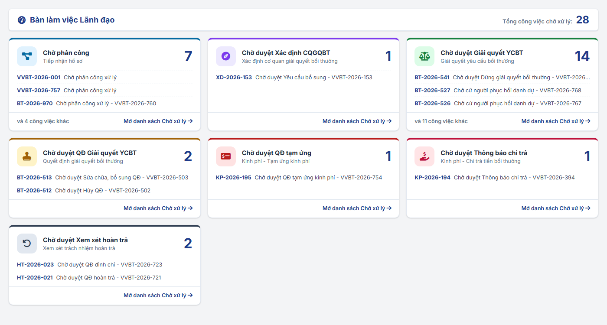
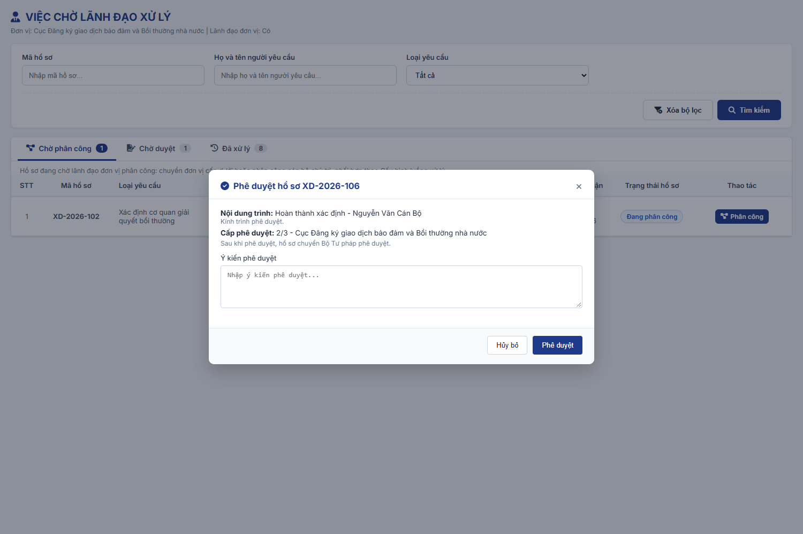
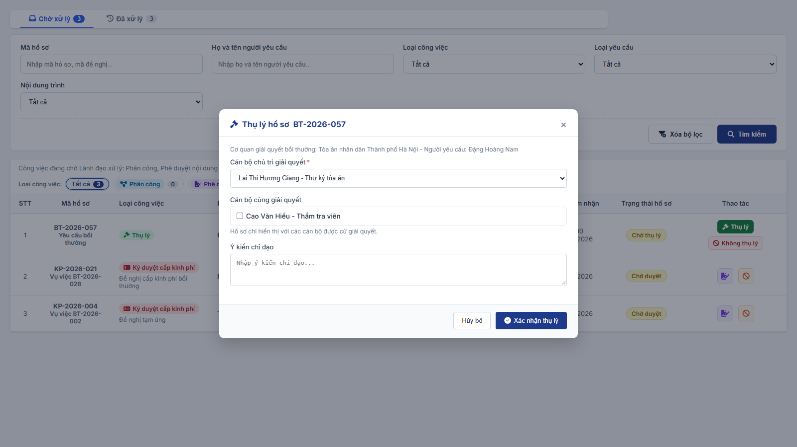
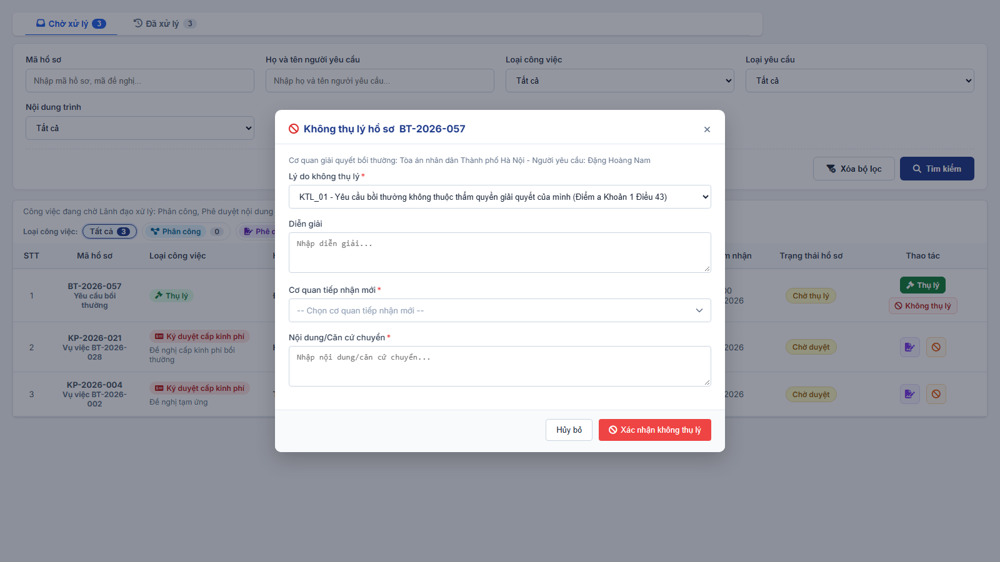

### 4.3.3.29. Dashboard Lãnh đạo

#### 4.3.3.29.1. Mục đích

\- Cung cấp cho Lãnh đạo một màn hình tổng hợp **công việc chờ Lãnh đạo xử lý** của phân hệ Bồi thường nhà nước (BTNN), gồm 06 khối Chờ xử lý. Click từng khối mở tab `Chờ xử lý` của phân hệ tương ứng ở vai trò Lãnh đạo để xử lý.

\- Lãnh đạo xử lý công việc tại chính phân hệ nghiệp vụ (không có màn hình danh sách công việc riêng):

| Khối Chờ xử lý | Phân hệ mở ra (tab `Chờ xử lý`) | Thao tác của Lãnh đạo tại phân hệ |
| :--- | :--- | :--- |
| Chờ phân công | [Tiếp nhận hồ sơ - Tiếp nhận hồ sơ - Công tác bồi thường nhà nước (Website Quản trị)](SRS_BTNN_GiaiQuyetBT_TiepNhan_YCBT.md) | Phân công ([MH05 - Popup Phân công xử lý hồ sơ - Tiếp nhận hồ sơ - Công tác bồi thường nhà nước (Website Quản trị)](SRS_BTNN_GiaiQuyetBT_TiepNhan_YCBT.md#tn-mh05-phan-cong)); Thu hồi tại tab `Đã xử lý` ([MH05 - Popup Xác nhận thu hồi - Dashboard Lãnh đạo - Công tác bồi thường nhà nước (Website Quản trị)](#vcld-mh05)) |
| Chờ duyệt Xác định CQGQBT | [Xác định cơ quan giải quyết bồi thường - Xác định cơ quan giải quyết bồi thường - Công tác bồi thường nhà nước (Website Quản trị)](SRS_BTNN_GiaiQuyetBT__Xac%20định%20cơ%20quan%20GQBT.md) | Phê duyệt / Từ chối ([MH04 - Popup Phê duyệt / Từ chối phê duyệt - Dashboard Lãnh đạo - Công tác bồi thường nhà nước (Website Quản trị)](#vcld-mh04)); Thu hồi tại tab `Đã xử lý` |
| Chờ duyệt Giải quyết YCBT | [Giải quyết yêu cầu bồi thường - Giải quyết yêu cầu bồi thường - Công tác bồi thường nhà nước (Website Quản trị)](SRS_BTNN_GiaiQuyetBT_GiaiQuyet_YCBT.md) | Phê duyệt / Từ chối hồ sơ `Chờ duyệt` (MH04); hồ sơ `Chờ thụ lý`: Thụ lý ([MH06 - Popup Thụ lý hồ sơ và Cử người giải quyết bồi thường - Dashboard Lãnh đạo - Công tác bồi thường nhà nước (Website Quản trị)](#vcld-thu-ly)) / Không thụ lý ([MH07 - Popup Không thụ lý hồ sơ - Dashboard Lãnh đạo - Công tác bồi thường nhà nước (Website Quản trị)](#vcld-khong-thu-ly)) |
| Chờ duyệt QĐ Giải quyết YCBT | [Quyết định giải quyết bồi thường - Quyết định giải quyết bồi thường - Công tác bồi thường nhà nước (Website Quản trị)](SRS_BTNN_GiaiQuyetBT_QuyetDinh_GQBT.md) | Ký duyệt / Từ chối Nội dung trình `Quyết định GQBT`, `Hủy QĐ`, `Sửa chữa, bổ sung QĐ` |
| Chờ duyệt cấp kinh phí | [Quản lý kinh phí bồi thường - Quản lý kinh phí bồi thường - Công tác bồi thường nhà nước (Website Quản trị)](SRS_BTNN_GiaiQuyetBT_KinhPhi_BT.md) | Ký duyệt / Từ chối Đề nghị tạm ứng, Đề nghị cấp kinh phí bồi thường `Chờ duyệt` |
| Chờ duyệt Xem xét hoàn trả | [Xem xét trách nhiệm hoàn trả - Xem xét trách nhiệm hoàn trả - Công tác bồi thường nhà nước (Website Quản trị)](SRS_BTNN_GiaiQuyetBT_Xem%20xét%20Hoàn%20trả.md) | Phê duyệt / Từ chối hồ sơ `Chờ duyệt QĐ thành lập`, `Chờ duyệt thành lập hội đồng`, `Chờ duyệt QĐ hoàn trả` |

\- Các popup thao tác của Lãnh đạo (Phân công, Phê duyệt / Từ chối phê duyệt, Thu hồi, Thụ lý, Không thụ lý) là popup dùng chung, mô tả tại tài liệu này và được mở từ phân hệ tương ứng.

\- Hình thức phân công và Nhóm lãnh đạo của từng đơn vị lấy theo [Cấu hình luồng xử lý - Cấu hình luồng xử lý - Quản trị hệ thống (Website Quản trị)](../01_Quan_tri_he_thong/Cau_hinh_luong_xu_ly.md).

*a. Phân quyền*

\- Menu "Dashboard Lãnh đạo" thuộc phân hệ Bồi thường nhà nước, đặt ngay dưới menu "Tiếp nhận hồ sơ".

\- Vai trò thực hiện: Lãnh đạo đơn vị, là tài khoản thuộc Nhóm lãnh đạo của đơn vị tại Cấu hình luồng xử lý.

\- Số công việc của từng khối chỉ tính công việc Lãnh đạo đang đăng nhập có quyền xử lý (quy tắc 3, 10, 16, 17).

\- Tài khoản không thuộc Nhóm lãnh đạo của đơn vị nào vẫn mở được màn hình; các khối không có công việc.

*b. Điều kiện thực hiện*

\- Người dùng đã đăng nhập Website Quản trị và được phân quyền chức năng "Dashboard Lãnh đạo".

\- Đơn vị gốc của hồ sơ đã được cấu hình luồng xử lý.

---

#### 4.3.3.29.2. Quy tắc chung

| STT | Nội dung | Quy tắc |
| :-- | :--- | :--- |
| 1 | Phạm vi theo Loại hồ sơ | Người dùng chỉ thấy hồ sơ có Loại hồ sơ áp dụng cho đơn vị của mình theo [Đơn vị áp dụng của Loại hồ sơ - Quản lý danh mục dùng chung - Quản trị hệ thống (Website Quản trị)](../01_Quan_tri_he_thong/Quan_ly_danh_muc.md#dm-don-vi-ap-dung). - Một Loại hồ sơ áp dụng cho người dùng khi Đơn vị áp dụng chứa đơn vị của người dùng hoặc một đơn vị cấp trên của đơn vị đó. - Loại hồ sơ "Xác định cơ quan giải quyết bồi thường" chỉ áp dụng cho: + Bộ Tư pháp + Sở Tư pháp các tỉnh, thành phố trực thuộc Trung ương - Ủy ban nhân dân cấp tỉnh chỉ xem hồ sơ của Sở Tư pháp trực thuộc tại phân hệ Xác định cơ quan giải quyết bồi thường, không phân công, không phê duyệt. - Lãnh đạo đơn vị khác không thấy hồ sơ loại này. |
| 2 | Đơn vị gốc và đơn vị đang phân công | Đơn vị gốc là đơn vị cấp cao nhất trên cây Cơ cấu tổ chức chứa đơn vị của cán bộ tiếp nhận (hoặc cơ quan giải quyết bồi thường được chỉ định, với hồ sơ sinh ra khi Chuyển CQGQBT). - Hồ sơ mới ở trạng thái "Chờ phân công" tại đơn vị gốc. - Mỗi lần Chuyển đơn vị, "Đơn vị đang phân công" đổi thành đơn vị nhận và hồ sơ chuyển "Đang phân công". |
| 3 | Quyền thao tác | Phân công: bất kỳ tài khoản nào trong Nhóm lãnh đạo của đơn vị đang phân công đều được phân công hồ sơ; người thao tác trước xử lý hồ sơ, hồ sơ không còn trong tab "Chờ xử lý" của Tiếp nhận hồ sơ của các thành viên khác trong nhóm. - Phê duyệt, Từ chối phê duyệt: chỉ Lãnh đạo được giao đích danh ở cấp phê duyệt hiện tại (quy tắc 10). - Không có chức năng ủy quyền. |
| 4 | Hình thức phân công | Chỉ dùng Hình thức phân công đã cấu hình cho đơn vị đang phân công, trong Loại luồng tương ứng với Loại hồ sơ (`Xác định CQGQBT - Bộ Tư pháp`, `Xác định CQGQBT - Sở Tư pháp` hoặc `Giải quyết YCBT`) tại Cấu hình luồng xử lý: - Chuyển đơn vị: chỉ chuyển đến đơn vị cấp dưới trực tiếp đã chọn tại cấu hình. - Phân công cán bộ: chỉ chọn cán bộ đã chọn tại cấu hình. - Không có thao tác "Trả lại" hồ sơ lên cấp trên; cấp trên dùng "Thu hồi". |
| 5 | Thời hạn | Không quy định thời hạn cho từng bước phân công, phê duyệt. |
| 6 | Lượt chuyển và tình trạng | Mỗi lần Chuyển đơn vị hoặc Phân công cán bộ tạo 01 lượt chuyển, Tình trạng ban đầu "Chưa xử lý". - Lượt chuyển đến đơn vị chuyển "Đã xử lý" khi lãnh đạo đơn vị nhận chuyển tiếp hoặc phân công. - Lượt chuyển đến cán bộ chuyển "Đã xử lý" khi cán bộ chủ trì thực hiện "Tiếp nhận" hồ sơ tại phân hệ xử lý. - Khi bên nhận mở xem hồ sơ lần đầu (lãnh đạo đơn vị nhận mở popup phân công; cán bộ chủ trì mở hồ sơ), hệ thống ghi thời điểm xem và hiển thị "Chưa xử lý - Đã xem lúc hh:mm dd/mm/yyyy". Chưa xem hiển thị "Chưa xử lý - Chưa xem". - Việc xem hồ sơ không được tính là đã xử lý. |
| 7 | Thu hồi | Thu hồi lượt chuyển gần nhất khi đồng thời: + Người dùng thuộc Nhóm lãnh đạo của đơn vị đã chuyển. + Lượt chuyển gần nhất của hồ sơ có Tình trạng "Chưa xử lý" (đơn vị nhận chưa chuyển tiếp, chưa phân công; cán bộ chủ trì chưa tiếp nhận). + Hồ sơ đang ở "Đang phân công" tại đơn vị nhận (chuyển đơn vị) hoặc "Chờ tiếp nhận" (phân công cán bộ). - Bên nhận đã mở xem hồ sơ vẫn được thu hồi. - Kết quả: xóa lượt chuyển gần nhất; hồ sơ trở lại đơn vị đã chuyển, trạng thái "Chờ phân công" nếu đơn vị đó là đơn vị gốc, ngược lại "Đang phân công"; lượt chuyển liền trước trở lại "Chưa xử lý"; thu hồi phân công cán bộ thì xóa cán bộ chủ trì. - Thu hồi kết quả phê duyệt: khi hồ sơ "Chờ duyệt", Lãnh đạo vừa phê duyệt và chuyển cấp trên được thu hồi nếu cấp trên chưa phê duyệt hoặc từ chối phê duyệt. Hồ sơ quay lại chờ chính Lãnh đạo đã thu hồi phê duyệt tại cấp đó; Lãnh đạo cấp trên đã được giao không còn thấy hồ sơ. - Thao tác Thu hồi đặt tại tab "Đã xử lý" của phân hệ Tiếp nhận hồ sơ (phân công) và Xác định cơ quan giải quyết bồi thường (phê duyệt). |
| 8 | Luồng phê duyệt nhiều cấp | Luồng phê duyệt đi ngược chiều luồng phân công thực tế của chính hồ sơ: lấy các đơn vị đã chuyển hoặc phân công theo thứ tự lượt chuyển, đảo ngược, bỏ đơn vị trùng. - VD: Bộ Tư pháp → Cục → Phòng → Cán bộ thì luồng phê duyệt là Phòng (cấp 1) → Cục (cấp 2) → Bộ Tư pháp (cấp 3). - Hồ sơ do cán bộ tạo trực tiếp tại phân hệ (không qua phân công): luồng phê duyệt đi từ đơn vị của cán bộ chủ trì lên đơn vị gốc, chỉ gồm các đơn vị có Nhóm lãnh đạo. - Không xác định được cấp phê duyệt nào: chặn trình, hiển thị "Chưa xác định được cấp phê duyệt. Vui lòng liên hệ Quản trị hệ thống." - Luồng phê duyệt được xác định khi cán bộ chủ trì trình và giữ nguyên cho lần trình đó; mỗi lần trình (kể cả trình lại) bắt đầu từ cấp 1. |
| 9 | Trạng thái "Chờ duyệt" và Nội dung trình | Khi cán bộ chủ trì trình thành công, hồ sơ chuyển trạng thái chung "Chờ duyệt". Loại việc Lãnh đạo cần duyệt lưu tại trường "Nội dung trình" của phiếu trình, không tạo trạng thái riêng cho từng loại việc. - Mỗi hồ sơ có tối đa 01 phiếu trình đang chờ duyệt. - Nội dung trình tại Xác định cơ quan giải quyết bồi thường: + Yêu cầu bổ sung + Từ chối + Kết quả xác định CQGQBT - Nội dung trình tại Giải quyết yêu cầu bồi thường: + Tiếp nhận hồ sơ + Yêu cầu bổ sung + Không thụ lý + Chuyển CQGQBT + Quyết định GQBT + Hủy QĐ + Sửa chữa, bổ sung QĐ - Dưới badge trạng thái trên lưới và màn chi tiết hiển thị dòng phụ chỉ gồm tên "[Nội dung trình]", VD "Yêu cầu bổ sung"; không hiển thị cấp duyệt (Cấp i/n). Hồ sơ "Bị trả lại" hiển thị Nội dung trình của phiếu bị trả lại. - Kết quả khi cấp cuối phê duyệt theo từng Nội dung trình: xem [Kết quả khi cấp cuối phê duyệt - Dashboard Lãnh đạo - Công tác bồi thường nhà nước (Website Quản trị)](#vcld-ket-qua-duyet). |
| 10 | Lãnh đạo phê duyệt đích danh | Khi trình, cán bộ chủ trì bắt buộc chọn "Lãnh đạo phê duyệt" là 01 thành viên Nhóm lãnh đạo của đơn vị phê duyệt cấp 1 (khi đơn vị cấp 1 có Nhóm lãnh đạo). Bỏ trống: "Vui lòng chọn Lãnh đạo phê duyệt." - Lãnh đạo cấp n khi Phê duyệt mà chưa phải cấp cuối: bắt buộc chọn "Lãnh đạo phê duyệt cấp tiếp theo" là 01 thành viên Nhóm lãnh đạo của đơn vị cấp n+1 (khi đơn vị cấp n+1 có Nhóm lãnh đạo). - Chỉ Lãnh đạo được giao mới thấy hồ sơ tại tab "Chờ xử lý" của phân hệ, được tính tại khối tương ứng của Dashboard và được Phê duyệt, Từ chối phê duyệt. Các thành viên khác của Nhóm lãnh đạo cùng đơn vị không thấy công việc này. - Lãnh đạo được chọn phải thuộc Nhóm lãnh đạo của cấp tương ứng; hệ thống kiểm tra lại khi xác nhận. - Bảng cấp phê duyệt hiển thị Lãnh đạo được giao ở cấp đang chờ: "(Giao: [Họ tên])". |
| 11 | Từ chối phê duyệt | Từ chối phê duyệt ở bất kỳ cấp nào: hồ sơ chuyển "Bị trả lại" về cán bộ chủ trì, giữ Nội dung trình của phiếu bị trả lại; lưu người trả lại, đơn vị, thời điểm, lý do. - "Bị trả lại" là trạng thái chung cho mọi Nội dung trình. - Cán bộ chủ trì trình lại thì luồng phê duyệt bắt đầu lại từ cấp phê duyệt đầu tiên; cán bộ chọn lại Lãnh đạo phê duyệt cấp 1. - Lịch sử xử lý ghi thao tác "Từ chối phê duyệt" để phân biệt với "Từ chối" yêu cầu. |
| 12 | Ký duyệt và văn bản | "Phê duyệt" và "Từ chối phê duyệt" là thao tác ký duyệt của Lãnh đạo trên hệ thống (ghi kết quả, chuyển trạng thái, ghi lịch sử). - Văn bản trình (dự thảo do hệ thống sinh theo mẫu hoặc tệp cán bộ tải lên) được đính kèm phiếu trình; Lãnh đạo xem văn bản trước khi xác nhận, không sửa văn bản tại popup. - Văn bản đã ký, đóng dấu được cán bộ chủ trì đính file tại bước Phát hành hoặc Ban hành của phân hệ xử lý. |
| 13 | Kiểm tra đồng thời | Mọi thao tác Phân công, Phê duyệt, Từ chối phê duyệt, Thu hồi đều kiểm tra lại trạng thái hồ sơ và quyền của người dùng tại máy chủ ngay khi xác nhận. - Khi mở popup thao tác mà hồ sơ đã được xử lý: hiển thị "Hồ sơ đã được xử lý bởi người khác. Danh sách đã được tải lại." và tải lại danh sách của phân hệ. - Khi xác nhận Phân công mà không còn hợp lệ: "Hồ sơ đã được xử lý bởi người khác hoặc bạn không có quyền phân công. Vui lòng tải lại danh sách." - Khi xác nhận Phê duyệt, Từ chối phê duyệt mà không còn hợp lệ (đã được xử lý, đã bị thu hồi hoặc người dùng không còn là Lãnh đạo được giao): "Hồ sơ đã được xử lý bởi người khác hoặc bạn không có quyền phê duyệt. Vui lòng tải lại danh sách." - Khi Thu hồi mà bên nhận đã xử lý: "Không thể thu hồi: bên nhận đã xử lý hồ sơ." |
| 14 | Lịch sử xử lý | Mỗi thao tác ghi 01 dòng lịch sử gồm Thao tác, Người thực hiện, Thời điểm, Nội dung. Thao tác của Lãnh đạo: + Chuyển đơn vị + Phân công cán bộ + Thu hồi + Phê duyệt + Từ chối phê duyệt + Thu hồi phê duyệt + Thụ lý + Không thụ lý |
| 15 | Văn bản dự thảo trình Lãnh đạo | Lần trình có Văn bản dự thảo khi phân hệ xử lý trình kèm văn bản, VD: + Yêu cầu bổ sung, Từ chối tại Xác định cơ quan giải quyết bồi thường (tệp cán bộ tải lên) + Yêu cầu bổ sung tại Giải quyết yêu cầu bồi thường (Mẫu 03/BTNN do hệ thống sinh hoặc tệp tải lên) + Không thụ lý (Mẫu 04/BTNN do hệ thống sinh hoặc tệp tải lên) + Quyết định GQBT (Mẫu 18/BTNN do hệ thống sinh hoặc tệp tải lên) - Khối Văn bản dự thảo hiển thị tên tệp sẽ trình Lãnh đạo, nhãn nguồn (hệ thống sinh theo mẫu hoặc bản cán bộ tải lên) và liên kết xem, tải file. - Cách lập văn bản tại từng phân hệ mô tả tại [Xác định cơ quan giải quyết bồi thường - Xác định cơ quan giải quyết bồi thường - Công tác bồi thường nhà nước (Website Quản trị)](SRS_BTNN_GiaiQuyetBT__Xac%20định%20cơ%20quan%20GQBT.md), [Giải quyết yêu cầu bồi thường - Giải quyết yêu cầu bồi thường - Công tác bồi thường nhà nước (Website Quản trị)](SRS_BTNN_GiaiQuyetBT_GiaiQuyet_YCBT.md) và [Quyết định giải quyết bồi thường - Quyết định giải quyết bồi thường - Công tác bồi thường nhà nước (Website Quản trị)](SRS_BTNN_GiaiQuyetBT_QuyetDinh_GQBT.md). - Lãnh đạo xem Văn bản dự thảo tại [MH04 - Popup Phê duyệt / Từ chối phê duyệt - Dashboard Lãnh đạo - Công tác bồi thường nhà nước (Website Quản trị)](#vcld-mh04), sau đó thực hiện "Phê duyệt" hoặc "Từ chối phê duyệt". |
| 16 | Thụ lý hồ sơ Yêu cầu bồi thường | Hồ sơ Yêu cầu bồi thường ở trạng thái "Chờ thụ lý" (cấp cuối đã phê duyệt Nội dung trình "Tiếp nhận hồ sơ") chờ Thủ trưởng cơ quan giải quyết bồi thường quyết định Thụ lý hoặc Không thụ lý. - Thủ trưởng cơ quan giải quyết bồi thường = Nhóm lãnh đạo của đơn vị phê duyệt cấp cuối trong luồng phê duyệt của hồ sơ (quy tắc 8); VD hồ sơ của Bộ Tư pháp: Nhóm lãnh đạo Cục Đăng ký giao dịch bảo đảm và BTNN. - Thao tác thực hiện tại tab "Chờ xử lý" của Giải quyết yêu cầu bồi thường (vai trò Lãnh đạo đơn vị): Phê duyệt (Thụ lý, chi tiết tại [MH06 - Popup Thụ lý hồ sơ và Cử người giải quyết bồi thường - Dashboard Lãnh đạo - Công tác bồi thường nhà nước (Website Quản trị)](#vcld-thu-ly)) hoặc Từ chối (Không thụ lý, chi tiết tại [MH07 - Popup Không thụ lý hồ sơ - Dashboard Lãnh đạo - Công tác bồi thường nhà nước (Website Quản trị)](#vcld-khong-thu-ly)). |
| 17 | Ký duyệt cấp kinh phí | Đề nghị tạm ứng, Đề nghị cấp kinh phí bồi thường ở trạng thái "Chờ duyệt" được tính tại khối "Chờ duyệt cấp kinh phí" của Thủ trưởng cơ quan giải quyết bồi thường của vụ việc (Nhóm lãnh đạo của đơn vị thụ lý, quy tắc 16). - Lãnh đạo Ký duyệt / Từ chối tại tab "Chờ xử lý" của [Quản lý kinh phí bồi thường - Quản lý kinh phí bồi thường - Công tác bồi thường nhà nước (Website Quản trị)](SRS_BTNN_GiaiQuyetBT_KinhPhi_BT.md) (vai trò Lãnh đạo). Đề nghị tạm ứng Hình thức ký `Ký số trên hệ thống`: khi Ký duyệt, hệ thống ký số Quyết định tạm ứng kinh phí bồi thường ([Quy tắc Hình thức ký Đề nghị tạm ứng - Quản lý kinh phí bồi thường - Công tác bồi thường nhà nước (Website Quản trị)](SRS_BTNN_GiaiQuyetBT_KinhPhi_BT.md#kp-hinh-thuc-ky)). |
| 18 | Số công việc tại Dashboard | Mỗi khối đếm số công việc Lãnh đạo đang đăng nhập có quyền xử lý tại thời điểm mở màn hình: - Chờ phân công: hồ sơ "Chờ phân công" / "Đang phân công" tại đơn vị Lãnh đạo thuộc Nhóm lãnh đạo (quy tắc 3). - Chờ duyệt Xác định CQGQBT: hồ sơ Xác định cơ quan giải quyết bồi thường "Chờ duyệt" mà Lãnh đạo được giao ở cấp hiện tại (quy tắc 10). - Chờ duyệt Giải quyết YCBT: hồ sơ Yêu cầu bồi thường "Chờ duyệt" (trừ Nội dung trình `Quyết định GQBT`, `Hủy QĐ`, `Sửa chữa, bổ sung QĐ`) mà Lãnh đạo được giao ở cấp hiện tại, và hồ sơ "Chờ thụ lý" của Thủ trưởng cơ quan giải quyết bồi thường (quy tắc 16). - Chờ duyệt QĐ Giải quyết YCBT: phiếu trình Nội dung trình `Quyết định GQBT`, `Hủy QĐ`, `Sửa chữa, bổ sung QĐ` mà Lãnh đạo được giao ở cấp hiện tại. - Chờ duyệt cấp kinh phí: theo quy tắc 17. - Chờ duyệt Xem xét hoàn trả: hồ sơ ở trạng thái `Chờ duyệt QĐ thành lập`, `Chờ duyệt thành lập hội đồng`, `Chờ duyệt QĐ hoàn trả`. |
| 19 | Mở phân hệ từ Dashboard | Click khối: mở phân hệ tương ứng tại vùng nội dung của Website Quản trị, chọn đúng menu của phân hệ, mở sẵn tab "Chờ xử lý" ở vai trò Lãnh đạo; danh sách tại tab gồm đúng các hồ sơ được đếm tại khối. |

---

#### 4.3.3.29.3. Trạng thái hồ sơ liên quan

\- Luồng chính: Chờ phân công → Đang phân công → Chờ tiếp nhận → Đang thực hiện → Chờ duyệt → Bị trả lại hoặc trạng thái theo Nội dung trình khi cấp cuối phê duyệt. Chi tiết các bước của cán bộ chủ trì (Tiếp nhận, Trình phê duyệt, Phát hành, Ban hành, Chuyển CQGQBT) mô tả tại [Xác định cơ quan giải quyết bồi thường - Xác định cơ quan giải quyết bồi thường - Công tác bồi thường nhà nước (Website Quản trị)](SRS_BTNN_GiaiQuyetBT__Xac%20định%20cơ%20quan%20GQBT.md) và [Giải quyết yêu cầu bồi thường - Giải quyết yêu cầu bồi thường - Công tác bồi thường nhà nước (Website Quản trị)](SRS_BTNN_GiaiQuyetBT_GiaiQuyet_YCBT.md).

| Trạng thái | Ý nghĩa | Hiển thị với Lãnh đạo |
| :--- | :--- | :--- |
| Chờ phân công | Hồ sơ đang ở đơn vị gốc, chưa có lượt chuyển hoặc đã được thu hồi về đơn vị gốc. Gồm cả hồ sơ mới sinh ra ở cơ quan đích khi Chuyển CQGQBT. | Khối "Chờ phân công" và tab "Chờ xử lý" của Tiếp nhận hồ sơ của Nhóm lãnh đạo đơn vị gốc. |
| Đang phân công | Hồ sơ đã được chuyển đến đơn vị cấp dưới, chờ lãnh đạo đơn vị đó phân công. | Khối "Chờ phân công" và tab "Chờ xử lý" của Tiếp nhận hồ sơ của Nhóm lãnh đạo đơn vị đang phân công; tab "Đã xử lý" của lãnh đạo đã chuyển. |
| Chờ tiếp nhận | Hồ sơ đã được phân công cán bộ chủ trì, chờ cán bộ tiếp nhận tại phân hệ Xác định cơ quan giải quyết bồi thường hoặc Giải quyết yêu cầu bồi thường. | Tab "Đã xử lý" của Tiếp nhận hồ sơ của lãnh đạo đã phân công. |
| Chờ duyệt | Cán bộ chủ trì đã trình, đang chờ Lãnh đạo được giao ở một cấp phê duyệt. Dòng phụ: "[Nội dung trình]". | Khối Chờ duyệt tương ứng và tab "Chờ xử lý" của phân hệ của Lãnh đạo được giao ở cấp hiện tại; tab "Đã xử lý" của Lãnh đạo đã phê duyệt cấp dưới. |
| Bị trả lại | Một cấp phê duyệt đã từ chối phê duyệt. Dòng phụ: "[Nội dung trình]". | Tab "Đã xử lý" của phân hệ của lãnh đạo đã thao tác. |
| Trạng thái sau khi cấp cuối phê duyệt | Theo Nội dung trình tại [Kết quả khi cấp cuối phê duyệt - Dashboard Lãnh đạo - Công tác bồi thường nhà nước (Website Quản trị)](#vcld-ket-qua-duyet). | Tab "Đã xử lý" của phân hệ của lãnh đạo đã thao tác. |

**Kết quả khi cấp cuối phê duyệt**

\- Khi Lãnh đạo cấp cuối phê duyệt, hồ sơ chuyển trạng thái theo Nội dung trình của phiếu trình:

| Nội dung trình | Phân hệ | Trạng thái sau khi duyệt cấp cuối |
| :--- | :--- | :--- |
| Yêu cầu bổ sung | Xác định cơ quan giải quyết bồi thường | Yêu cầu bổ sung |
| Từ chối | Xác định cơ quan giải quyết bồi thường | Bị từ chối |
| Kết quả xác định CQGQBT | Xác định cơ quan giải quyết bồi thường | Chờ chuyển CQGQBT |
| Tiếp nhận hồ sơ | Giải quyết yêu cầu bồi thường | Chờ thụ lý |
| Yêu cầu bổ sung | Giải quyết yêu cầu bồi thường | Chờ phát hành văn bản. - Cán bộ chủ trì thực hiện "Phát hành" (bắt buộc đính văn bản đã ký, đóng dấu) thì hồ sơ chuyển "Yêu cầu bổ sung". |
| Không thụ lý | Giải quyết yêu cầu bồi thường | Không thụ lý (kết thúc xử lý). - Trường hợp lý do KTL_01 có chọn Chuyển CQGQBT: Đã chuyển CQGQBT và tạo hồ sơ mới tại cơ quan tiếp nhận như Nội dung trình "Chuyển CQGQBT". |
| Chuyển CQGQBT | Giải quyết yêu cầu bồi thường | Đã chuyển CQGQBT (kết thúc xử lý tại đơn vị hiện tại). - Hệ thống tạo hồ sơ Yêu cầu bồi thường mới (mã mới) tại cơ quan tiếp nhận, trạng thái "Chờ phân công", bắt đầu lại từ bước Tiếp nhận. |
| Quyết định GQBT | Giải quyết yêu cầu bồi thường - Quyết định giải quyết bồi thường | Chờ ban hành. - Cán bộ chủ trì thực hiện "Ban hành" (đính file quyết định đã ký, nhập Số, Ngày quyết định) thì quyết định chuyển "Đã ban hành". |
| Hủy QĐ | Giải quyết yêu cầu bồi thường - Quyết định giải quyết bồi thường | Đã hủy |
| Sửa chữa, bổ sung QĐ | Giải quyết yêu cầu bồi thường - Quyết định giải quyết bồi thường | Quyết định sửa chữa, bổ sung có hiệu lực. |

\- Ví dụ Không thụ lý với lý do KTL_01 (Yêu cầu bồi thường không thuộc thẩm quyền giải quyết của mình) và Chuyển CQGQBT:

\+ Hồ sơ BT-2026-015 do UBND quận Hoàng Mai giải quyết; luồng phân công: UBND quận Hoàng Mai → Phòng Tư pháp - UBND quận Hoàng Mai → cán bộ chủ trì.

\+ Cán bộ chủ trì chọn Lý do không thụ lý KTL_01, chọn Chuyển CQGQBT, Cơ quan tiếp nhận mới "Công an quận Thanh Xuân, Thành phố Hà Nội", nhập Nội dung/Căn cứ chuyển, chọn Lãnh đạo phê duyệt của Phòng Tư pháp và trình. Hồ sơ "Chờ duyệt", dòng phụ "Không thụ lý".

\+ Lãnh đạo Phòng Tư pháp được giao phê duyệt, chọn Lãnh đạo phê duyệt cấp tiếp theo của UBND quận Hoàng Mai. Dòng phụ vẫn là "Không thụ lý".

\+ Lãnh đạo UBND quận Hoàng Mai được giao phê duyệt (cấp cuối): hồ sơ BT-2026-015 chuyển "Đã chuyển CQGQBT"; hệ thống tạo hồ sơ mới (mã mới) tại Công an quận Thanh Xuân, trạng thái "Chờ phân công", hiển thị tại khối "Chờ phân công" của Dashboard và tab "Chờ xử lý" của Tiếp nhận hồ sơ của Nhóm lãnh đạo Công an quận Thanh Xuân. Hồ sơ mới lưu mã hồ sơ gốc, đơn vị chuyển, Nội dung chuyển xử lý và tài liệu chuyển; hồ sơ gốc lưu mã hồ sơ mới.

---

#### 4.3.3.29.4. MH01 - Màn hình Dashboard Lãnh đạo

##### 4.3.3.29.4.1. Màn hình

##### 4.3.3.29.4.2. Mô tả thông tin trên màn hình

| Trường thông tin | Kiểu dữ liệu | Bắt buộc | Mặc định | Mô tả |
| :--- | :--- | :--- | :--- | :--- |
| **Tiêu đề màn hình** | String(100) | - | `Dashboard Lãnh đạo` | Control UI: Thanh tiêu đề, kèm dòng mô tả "Công việc chờ xử lý của [Họ tên] - [Chức danh] ([Đơn vị]). Chọn từng khối để mở tab Chờ xử lý của phân hệ tương ứng." |
| Tổng công việc chờ xử lý | Integer(10) | - | Hệ thống tính | Chỉ đọc. Tổng số công việc của 06 khối. |
| **Khối Chờ xử lý** | Card | - | - | Control UI: 06 khối dạng thẻ, bố cục 03 cột (màn hình hẹp: 02 hoặc 01 cột), mỗi khối một màu nhận diện, theo thứ tự: + Chờ phân công + Chờ duyệt Xác định CQGQBT + Chờ duyệt Giải quyết YCBT + Chờ duyệt QĐ Giải quyết YCBT + Chờ duyệt cấp kinh phí + Chờ duyệt Xem xét hoàn trả |
| Tên khối | String(100) | - | Theo khối | Tên khối và dòng phụ là tên phân hệ tương ứng (bảng tại [Mục đích - Dashboard Lãnh đạo - Công tác bồi thường nhà nước (Website Quản trị)](#vcld-muc-dich)). |
| Số công việc | Integer(10) | - | Hệ thống tính | Chỉ đọc, chữ lớn ở góc phải khối, theo quy tắc 18 tại [Quy tắc chung - Dashboard Lãnh đạo - Công tác bồi thường nhà nước (Website Quản trị)](#vcld-quy-tac-chung). Bằng 0: hiển thị màu nhạt. |
| Công việc gần nhất | List(String) | - | Theo dữ liệu | Tối đa 03 dòng, mỗi dòng "[Mã hồ sơ / Mã đề nghị] [Tên cá nhân/Tổ chức yêu cầu] - [Nội dung trình / Loại đề nghị / Trạng thái]". - Không có công việc: "Không có công việc chờ xử lý." - Nhiều hơn 03 công việc: chân khối hiển thị "và [n] công việc khác". |
| Mở danh sách Chờ xử lý | Link | - | - | Control UI: Liên kết ở chân khối "Mở danh sách Chờ xử lý →". |

##### 4.3.3.29.4.3. Chức năng trên màn hình

| STT | Tên chức năng | Định dạng | Mô tả |
| :-- | :--- | :--- | :--- |
| 1 | Mở khối | Click khối / Enter | - Mở phân hệ tương ứng ở tab "Chờ xử lý", vai trò Lãnh đạo, theo quy tắc 19 tại [Quy tắc chung - Dashboard Lãnh đạo - Công tác bồi thường nhà nước (Website Quản trị)](#vcld-quy-tac-chung): + Chờ phân công: Tiếp nhận hồ sơ + Chờ duyệt Xác định CQGQBT: Xác định cơ quan giải quyết bồi thường + Chờ duyệt Giải quyết YCBT: Giải quyết yêu cầu bồi thường (vai trò Lãnh đạo đơn vị) + Chờ duyệt QĐ Giải quyết YCBT: Quyết định giải quyết bồi thường (vai trò Lãnh đạo) + Chờ duyệt cấp kinh phí: Quản lý kinh phí bồi thường (vai trò Lãnh đạo) + Chờ duyệt Xem xét hoàn trả: Xem xét trách nhiệm hoàn trả (vai trò Lãnh đạo phê duyệt) |
| 2 | Tải lại số liệu | Tự động | - Số công việc được tính lại mỗi lần mở màn hình và khi dữ liệu hồ sơ thay đổi. |

---

#### 4.3.3.29.5. MH02 - Popup Chi tiết hồ sơ

##### 4.3.3.29.5.1. Màn hình

Popup chỉ xem, mở khi click dòng hồ sơ tại tab "Chờ xử lý" / "Đã xử lý" của Tiếp nhận hồ sơ mà hồ sơ không do cán bộ đang đăng nhập tiếp nhận (VD Lãnh đạo xem hồ sơ chờ phân công).

##### 4.3.3.29.5.2. Mô tả thông tin trên màn hình

| Trường thông tin | Kiểu dữ liệu | Bắt buộc | Mặc định | Mô tả |
| :--- | :--- | :--- | :--- | :--- |
| Tiêu đề popup | String(255) | - | - | "Chi tiết hồ sơ [Mã hồ sơ]". |
| **I. Thông tin chung** | - | - | - | Chỉ đọc: Mã vụ việc, Loại hồ sơ, Nguồn hồ sơ, Tên cá nhân/Tổ chức yêu cầu, Thời điểm tiếp nhận, Đơn vị gốc, Đơn vị đang xử lý, Cán bộ chủ trì (chưa có: "Chưa phân công"), Trạng thái. |
| **II. Quá trình phân công** | - | - | - | Bảng lượt chuyển: Lượt chuyển, Thời điểm, Tình trạng (quy tắc 6). |
| **III. Lịch sử xử lý** | - | - | - | Danh sách thao tác của hồ sơ, mới nhất ở trên: "[Thao tác] - [Người thực hiện] - [Thời điểm]" và Nội dung; thao tác "Từ chối phê duyệt" có viền màu đỏ. |

##### 4.3.3.29.5.3. Chức năng trên màn hình

| STT | Tên chức năng | Định dạng | Mô tả |
| :-- | :--- | :--- | :--- |
| 1 | Đóng / Đóng (x) | Nút / Icon | - Đóng popup. |

---

#### 4.3.3.29.6. MH03 - Popup Phân công xử lý hồ sơ

Mô tả tại [MH05 - Popup Phân công xử lý hồ sơ - Tiếp nhận hồ sơ - Công tác bồi thường nhà nước (Website Quản trị)](SRS_BTNN_GiaiQuyetBT_TiepNhan_YCBT.md#tn-mh05-phan-cong).

---

#### 4.3.3.29.7. MH04 - Popup Phê duyệt / Từ chối phê duyệt

##### 4.3.3.29.7.1. Màn hình

Popup mở khi Lãnh đạo được giao ở cấp phê duyệt hiện tại click "Phê duyệt" hoặc "Từ chối" với hồ sơ "Chờ duyệt" tại tab "Chờ xử lý" của [Xác định cơ quan giải quyết bồi thường - Xác định cơ quan giải quyết bồi thường - Công tác bồi thường nhà nước (Website Quản trị)](SRS_BTNN_GiaiQuyetBT__Xac%20định%20cơ%20quan%20GQBT.md) hoặc [Giải quyết yêu cầu bồi thường - Giải quyết yêu cầu bồi thường - Công tác bồi thường nhà nước (Website Quản trị)](SRS_BTNN_GiaiQuyetBT_GiaiQuyet_YCBT.md).

##### 4.3.3.29.7.2. Mô tả thông tin trên màn hình

| Trường thông tin | Kiểu dữ liệu | Bắt buộc | Mặc định | Mô tả |
| :--- | :--- | :--- | :--- | :--- |
| Tiêu đề popup | String(255) | - | Theo chế độ | Phê duyệt: "Phê duyệt hồ sơ [Mã hồ sơ]". - Từ chối: "Từ chối phê duyệt hồ sơ [Mã hồ sơ]". |
| Văn bản dự thảo trình Lãnh đạo | Object | - | Ẩn | Control UI: Info box, hiển thị trên cùng phần thông tin của popup, ở cả chế độ Phê duyệt và Từ chối. - Chỉ hiển thị khi lần trình có Văn bản dự thảo (quy tắc 15 tại [Quy tắc chung](#vcld-quy-tac-chung)). - Hiển thị tên tệp sẽ trình Lãnh đạo, nhãn nguồn (hệ thống sinh theo mẫu hoặc bản cán bộ tải lên) và liên kết Xem dự thảo, Tải file, Xem file. - Thao tác Phê duyệt / Từ chối phê duyệt không thay đổi Văn bản dự thảo. |
| Nội dung trình | String(1000) | - | Theo hồ sơ | Chỉ đọc: "[Nội dung trình] - [Cán bộ chủ trì]" và Ý kiến trình. |
| Cấp phê duyệt | String(255) | - | Theo hồ sơ | Chỉ đọc: "[i]/[n] - [Đơn vị phê duyệt cấp hiện tại]". |
| Hướng dẫn kết quả | String(500) | - | Theo chế độ | Phê duyệt, chưa phải cấp cuối: "Sau khi phê duyệt, hồ sơ chuyển [Đơn vị cấp tiếp theo] phê duyệt." - Phê duyệt, cấp cuối: "Cấp phê duyệt cuối cùng. Sau khi phê duyệt, hồ sơ chuyển [Trạng thái theo Nội dung trình]." (theo [Kết quả khi cấp cuối phê duyệt](#vcld-ket-qua-duyet)). - Từ chối: "Sau khi từ chối phê duyệt, hồ sơ chuyển [Bị trả lại] cho cán bộ chủ trì." |
| Lãnh đạo phê duyệt cấp tiếp theo | Enum(String(255)) | Có (khi hiển thị) | Trống | Control UI: Hộp chọn, chọn 01 Lãnh đạo, placeholder "Chọn Lãnh đạo [Đơn vị cấp tiếp theo]...". - Chỉ hiển thị ở chế độ Phê duyệt khi đồng thời: cấp hiện tại chưa phải cấp cuối và đơn vị cấp tiếp theo có Nhóm lãnh đạo. - Danh sách: thành viên Nhóm lãnh đạo của đơn vị phê duyệt cấp tiếp theo, hiển thị "[Họ tên] - [Chức danh]". - Lãnh đạo được chọn là người duy nhất thấy và phê duyệt hồ sơ ở cấp tiếp theo. |
| Ý kiến phê duyệt | Text(2000) | Không | Trống | Control UI: Textarea, placeholder "Nhập ý kiến phê duyệt...". - Chỉ có ở chế độ Phê duyệt. |
| Lý do từ chối phê duyệt | Text(2000) | Có | Trống | Control UI: Textarea, placeholder "Nhập lý do từ chối phê duyệt...". - Chỉ có ở chế độ Từ chối. |

##### 4.3.3.29.7.3. Chức năng trên màn hình

| STT | Tên chức năng | Định dạng | Mô tả |
| :-- | :--- | :--- | :--- |
| 1 | Phê duyệt | Nút (chế độ Phê duyệt) | - TH1 (Hiển thị trường Lãnh đạo phê duyệt cấp tiếp theo mà bỏ trống): hiển thị "Đây là trường bắt buộc" dưới trường, không lưu. - TH2 (Hồ sơ không còn chờ cấp này phê duyệt hoặc người dùng không còn là Lãnh đạo được giao): "Hồ sơ đã được xử lý bởi người khác hoặc bạn không có quyền phê duyệt. Vui lòng tải lại danh sách." - TH3 (Lãnh đạo cấp tiếp theo được chọn không còn thuộc Nhóm lãnh đạo của đơn vị cấp tiếp theo): "Lãnh đạo được chọn không thuộc nhóm lãnh đạo của cấp tiếp theo." - TH4 (Chưa phải cấp cuối): ghi kết quả "Phê duyệt" của cấp hiện tại; giao hồ sơ cho Lãnh đạo cấp tiếp theo đã chọn; hồ sơ giữ "Chờ duyệt", dòng phụ giữ "[Nội dung trình]"; ghi lịch sử "Phê duyệt" với nội dung "[Nội dung trình]: phê duyệt cấp [Đơn vị]; chuyển [Lãnh đạo cấp tiếp theo] - [Đơn vị cấp tiếp theo]. Ý kiến: [Nội dung]"; hiển thị "Hồ sơ [Mã hồ sơ]: [Chờ duyệt] - chuyển [Lãnh đạo cấp tiếp theo] - [Đơn vị cấp tiếp theo]." - TH5 (Cấp cuối): hồ sơ chuyển trạng thái theo Nội dung trình tại [Kết quả khi cấp cuối phê duyệt](#vcld-ket-qua-duyet); Nội dung trình "Chuyển CQGQBT" thì đồng thời tạo hồ sơ mới tại cơ quan tiếp nhận ở trạng thái "Chờ phân công"; ghi lịch sử "Phê duyệt" với nội dung "Phê duyệt cấp cuối ([Đơn vị]): [Nội dung trình]. Hồ sơ chuyển [Trạng thái]."; hiển thị "Hồ sơ [Mã hồ sơ]: [Trạng thái]." - Phê duyệt là thao tác ký duyệt (quy tắc 12 tại [Quy tắc chung](#vcld-quy-tac-chung)). - Sau khi xử lý: đóng popup, tải lại danh sách. |
| 2 | Từ chối phê duyệt | Nút (chế độ Từ chối) | - TH1 (Bỏ trống Lý do từ chối phê duyệt): hiển thị "Đây là trường bắt buộc" dưới trường, không lưu. - TH2 (Hồ sơ không còn hợp lệ): "Hồ sơ đã được xử lý bởi người khác hoặc bạn không có quyền phê duyệt. Vui lòng tải lại danh sách." - TH Hợp lệ: ghi kết quả "Từ chối phê duyệt" của cấp hiện tại; hồ sơ chuyển "Bị trả lại" về cán bộ chủ trì, giữ Nội dung trình của phiếu bị trả lại; lưu người trả lại, đơn vị, thời điểm, lý do; ghi lịch sử "Từ chối phê duyệt" với nội dung "Trả lại cán bộ chủ trì. Lý do: [Lý do]"; đóng popup, tải lại danh sách, hiển thị "Hồ sơ [Mã hồ sơ]: [Bị trả lại]." |
| 3 | Hủy bỏ / Đóng (x) | Nút / Icon | - Đóng popup, không lưu. |
| 4 | Xem dự thảo / Tải file / Xem file | Liên kết | - Hiển thị trong khối Văn bản dự thảo (khi lần trình có Văn bản dự thảo). - Xem dự thảo: mở văn bản dự thảo tại popup xem văn bản ngay trên màn hình, dạng trang A4, có nút "Tải file (Word .doc)", "In", "Mở tab mới", "Đóng". - Tải file: tải văn bản dự thảo định dạng Word (.doc). - Xem file: mở tệp văn bản trình do cán bộ tải lên. - Giữ nguyên dữ liệu đang nhập trên popup Phê duyệt / Từ chối phê duyệt. |

---

#### 4.3.3.29.8. MH05 - Popup Xác nhận thu hồi

##### 4.3.3.29.8.1. Màn hình

Popup mở khi Lãnh đạo click "Thu hồi" tại tab "Đã xử lý" của Tiếp nhận hồ sơ (hồ sơ đã phân công / chuyển đơn vị) hoặc Xác định cơ quan giải quyết bồi thường (kết quả phê duyệt đã chuyển cấp trên).

##### 4.3.3.29.8.2. Mô tả thông tin trên màn hình

| Trường thông tin | Kiểu dữ liệu | Bắt buộc | Mặc định | Mô tả |
| :--- | :--- | :--- | :--- | :--- |
| Tiêu đề popup | String(50) | - | - | "Xác nhận". |
| Nội dung xác nhận | String(500) | - | Theo hồ sơ | "Bạn có chắc chắn muốn thu hồi hồ sơ [Mã hồ sơ]?" - Thu hồi lượt chuyển mà bên nhận đã xem: thêm "Bên nhận đã xem lúc hh:mm dd/mm/yyyy." |

##### 4.3.3.29.8.3. Chức năng trên màn hình

| STT | Tên chức năng | Định dạng | Mô tả |
| :-- | :--- | :--- | :--- |
| 1 | Thu hồi (trước khi mở popup) | Nút | - Hồ sơ không còn thỏa điều kiện thu hồi: hiển thị "Không thể thu hồi: bên nhận đã xử lý hồ sơ.", tải lại danh sách, không mở popup. |
| 2 | Đồng ý | Nút | - Kiểm tra lại điều kiện thu hồi. Không thỏa: "Không thể thu hồi: bên nhận đã xử lý hồ sơ." - TH Thu hồi lượt chuyển: xử lý theo quy tắc Thu hồi tại [Quy tắc chung](#vcld-quy-tac-chung); ghi lịch sử "Thu hồi" với nội dung "Thu hồi hồ sơ đã chuyển [Đơn vị nhận]." hoặc "Thu hồi phân công cán bộ [Họ tên]." - TH Thu hồi kết quả phê duyệt: xóa kết quả phê duyệt của cấp đã thu hồi, hồ sơ quay lại chờ Lãnh đạo đã thu hồi phê duyệt tại cấp đó; ghi lịch sử "Thu hồi phê duyệt" với nội dung "Thu hồi kết quả phê duyệt đã chuyển [Đơn vị cấp trên]." - Sau khi thành công: đóng popup, tải lại danh sách, hiển thị "Đã thu hồi hồ sơ [Mã hồ sơ]. Trạng thái: [Trạng thái]." |
| 3 | Hủy bỏ / Đóng (x) | Nút / Icon | - Đóng popup, không thu hồi. |

---

#### 4.3.3.29.9. MH06 - Popup Thụ lý hồ sơ và Cử người giải quyết bồi thường

##### 4.3.3.29.9.1. Màn hình

Popup mở khi Thủ trưởng cơ quan giải quyết bồi thường click "Phê duyệt" với hồ sơ "Chờ thụ lý" tại tab "Chờ xử lý" của [Giải quyết yêu cầu bồi thường - Giải quyết yêu cầu bồi thường - Công tác bồi thường nhà nước (Website Quản trị)](SRS_BTNN_GiaiQuyetBT_GiaiQuyet_YCBT.md) (vai trò Lãnh đạo đơn vị).

##### 4.3.3.29.9.2. Mô tả thông tin trên màn hình

| Trường thông tin | Kiểu dữ liệu | Bắt buộc | Mặc định | Mô tả |
| :--- | :--- | :--- | :--- | :--- |
| Tiêu đề popup | String(255) | - | - | "Thụ lý hồ sơ [Mã hồ sơ]". |
| Thông tin ngữ cảnh | String(500) | - | Theo hồ sơ | "Cơ quan giải quyết bồi thường: [Đơn vị gốc] - Người yêu cầu: [Họ và tên]". |
| Cán bộ chủ trì giải quyết | Enum(String(255)) | Có | Cán bộ chủ trì đã tiếp nhận hồ sơ | Control UI: Hộp chọn 01 cán bộ, hiển thị "[Họ tên] - [Chức danh]". - Danh sách: tài khoản cán bộ thuộc cây đơn vị gốc của hồ sơ, trừ thành viên Nhóm lãnh đạo tại Cấu hình luồng xử lý. |
| Cán bộ cùng giải quyết | List(String) | Không | Trống | Control UI: Danh sách checkbox, chọn nhiều. - Danh sách: như trường Cán bộ chủ trì giải quyết, trừ cán bộ chủ trì đang chọn; không có: "Không có cán bộ khác." - Dòng hướng dẫn: "Hồ sơ chỉ hiển thị với các cán bộ được cử giải quyết." |
| Ý kiến chỉ đạo | Text(2000) | Không | Trống | Control UI: Textarea, placeholder "Nhập ý kiến chỉ đạo...". |

##### 4.3.3.29.9.3. Chức năng trên màn hình

| STT | Tên chức năng | Định dạng | Mô tả |
| :-- | :--- | :--- | :--- |
| 1 | Cán bộ chủ trì giải quyết | Hộp chọn | - Đổi cán bộ chủ trì: tải lại danh sách Cán bộ cùng giải quyết, loại cán bộ chủ trì. |
| 2 | Xác nhận thụ lý | Nút | - TH1 (Bỏ trống Cán bộ chủ trì giải quyết): hiển thị "Đây là trường bắt buộc" dưới trường, không lưu. - TH2 (Hồ sơ không còn "Chờ thụ lý" hoặc người dùng không còn thuộc Nhóm lãnh đạo của đơn vị thụ lý): "Hồ sơ đã được xử lý bởi người khác hoặc bạn không có quyền thụ lý. Vui lòng tải lại danh sách." - TH Hợp lệ: lưu danh sách cán bộ được cử giải quyết (cán bộ chủ trì đứng đầu; Họ tên, Chức danh, Email, Đơn vị, Thời điểm cử), người thụ lý, thời điểm, Ý kiến chỉ đạo; hồ sơ chuyển "Đang xác minh thiệt hại" (vụ việc "Chỉ yêu cầu phục hồi danh dự": "Đang phục hồi danh dự"); vụ việc có yêu cầu phục hồi danh dự bắt đầu nhánh Phục hồi danh dự; ghi lịch sử "Thụ lý" với nội dung "Thụ lý hồ sơ, cử [Danh sách cán bộ] giải quyết. Hồ sơ chuyển [Trạng thái]. Ý kiến chỉ đạo: [Nội dung]"; đóng popup, tải lại danh sách, hiển thị "Đã thụ lý hồ sơ [Mã hồ sơ]. Trạng thái: [Trạng thái]." - Kết quả cập nhật về [Giải quyết yêu cầu bồi thường - Giải quyết yêu cầu bồi thường - Công tác bồi thường nhà nước (Website Quản trị)](SRS_BTNN_GiaiQuyetBT_GiaiQuyet_YCBT.md); từ thời điểm này hồ sơ chỉ hiển thị với các cán bộ được cử. |
| 3 | Hủy bỏ / Đóng (x) | Nút / Icon | - Đóng popup, không lưu. |

---

#### 4.3.3.29.10. MH07 - Popup Không thụ lý hồ sơ

##### 4.3.3.29.10.1. Màn hình

Popup mở khi Thủ trưởng cơ quan giải quyết bồi thường click "Từ chối" với hồ sơ "Chờ thụ lý" tại tab "Chờ xử lý" của [Giải quyết yêu cầu bồi thường - Giải quyết yêu cầu bồi thường - Công tác bồi thường nhà nước (Website Quản trị)](SRS_BTNN_GiaiQuyetBT_GiaiQuyet_YCBT.md) (vai trò Lãnh đạo đơn vị).

##### 4.3.3.29.10.2. Mô tả thông tin trên màn hình

| Trường thông tin | Kiểu dữ liệu | Bắt buộc | Mặc định | Mô tả |
| :--- | :--- | :--- | :--- | :--- |
| Tiêu đề popup | String(255) | - | - | "Không thụ lý hồ sơ [Mã hồ sơ]". |
| Thông tin ngữ cảnh | String(500) | - | Theo hồ sơ | "Cơ quan giải quyết bồi thường: [Đơn vị gốc] - Người yêu cầu: [Họ và tên]". |
| Lý do không thụ lý | Enum(String(255)) | Có | Trống | Control UI: Hộp chọn, hiển thị "[Mã] - [Tên lý do]". - Danh sách: Danh mục Lý do không thụ lý hồ sơ yêu cầu bồi thường [DM_55]. |
| Diễn giải | Text(2000) | Không | Trống | Control UI: Textarea, placeholder "Nhập diễn giải...". |
| Cơ quan tiếp nhận mới | Enum(String(255)) | Có khi hiển thị | Trống | Control UI: Cây đơn vị có tìm kiếm theo Tên/Mã đơn vị; khóa đơn vị gốc của hồ sơ. - Chỉ hiển thị khi Lý do không thụ lý là `KTL_01`. |
| Nội dung/Căn cứ chuyển | Text(2000) | Có khi hiển thị | Trống | Control UI: Textarea, placeholder "Nhập nội dung/căn cứ chuyển...". - Chỉ hiển thị khi Lý do không thụ lý là `KTL_01`. |

##### 4.3.3.29.10.3. Chức năng trên màn hình

| STT | Tên chức năng | Định dạng | Mô tả |
| :-- | :--- | :--- | :--- |
| 1 | Lý do không thụ lý | Hộp chọn | - Chọn `KTL_01`: hiển thị Cơ quan tiếp nhận mới và Nội dung/Căn cứ chuyển. - Chọn lý do khác: ẩn 02 trường trên. |
| 2 | Xác nhận không thụ lý | Nút | - TH1 (Bỏ trống Lý do không thụ lý): hiển thị "Đây là trường bắt buộc" dưới trường, không lưu. - TH2 (Lý do `KTL_01`, bỏ trống Cơ quan tiếp nhận mới hoặc Nội dung/Căn cứ chuyển): hiển thị "Đây là trường bắt buộc" dưới trường bỏ trống, không lưu. - TH3 (Cơ quan tiếp nhận mới có đơn vị gốc chưa được cấu hình luồng phân công): "Đơn vị [Tên đơn vị] chưa được cấu hình luồng phân công. Vui lòng liên hệ Quản trị hệ thống.", giữ popup. - TH4 (Hồ sơ không còn hợp lệ): "Hồ sơ đã được xử lý bởi người khác hoặc bạn không có quyền thụ lý. Vui lòng tải lại danh sách." - TH Hợp lệ - Lý do khác `KTL_01`: hồ sơ chuyển "Không thụ lý"; lưu Lý do, Diễn giải, người quyết định, thời điểm; ghi lịch sử "Không thụ lý". - TH Hợp lệ - Lý do `KTL_01`: hồ sơ chuyển "Đã chuyển CQGQBT"; hệ thống tạo hồ sơ Yêu cầu bồi thường mới (mã mới) tại cơ quan tiếp nhận mới ở trạng thái "Chờ phân công" như Nội dung trình "Chuyển CQGQBT"; ghi lịch sử "Không thụ lý" kèm mã hồ sơ mới. - Sau khi xử lý: đóng popup, tải lại danh sách, hiển thị "Hồ sơ [Mã hồ sơ]: [Trạng thái]."; Lý do không thụ lý hiển thị tại khối Thông tin không thụ lý của màn hình chi tiết vụ việc. |
| 3 | Hủy bỏ / Đóng (x) | Nút / Icon | - Đóng popup, không lưu. |

---

#### 4.3.3.29.11. Ghi chú

\- Các quy tắc sau được áp dụng theo mặc định, chưa được xác nhận chính thức:

\+ Hồ sơ do cán bộ tạo trực tiếp tại phân hệ Xác định cơ quan giải quyết bồi thường bỏ qua bước phân công, người tạo là cán bộ chủ trì; luồng phê duyệt theo cây đơn vị của người tạo.

\+ "Bị trả lại" là một trạng thái chung cho mọi Nội dung trình; Lãnh đạo phê duyệt được giao đích danh ở từng cấp; luồng phê duyệt đi hết đường ngược tới đơn vị gốc.

\+ Thủ trưởng cơ quan giải quyết bồi thường ký duyệt đề nghị kinh phí là Nhóm lãnh đạo của đơn vị thụ lý vụ việc (quy tắc 16, 17).

\- Thanh "Người dùng giả lập" trên mockup chỉ phục vụ minh họa phân quyền theo đơn vị, không thuộc phạm vi chức năng.
