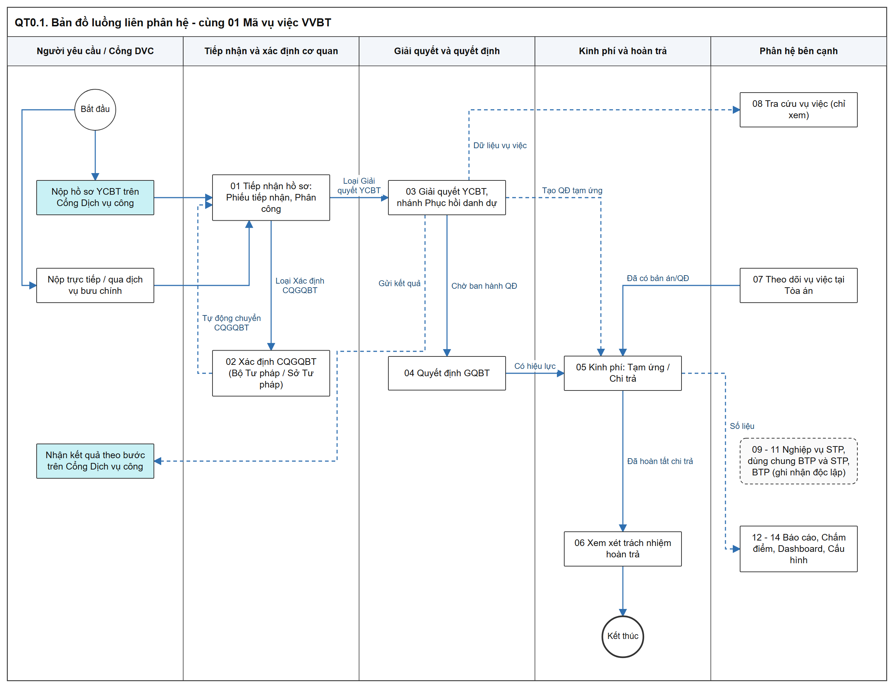
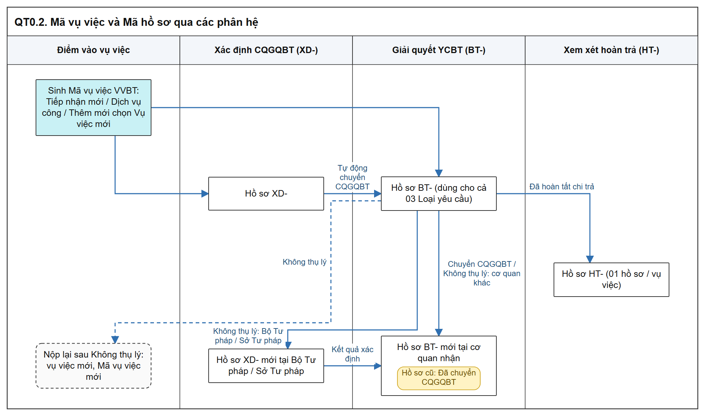
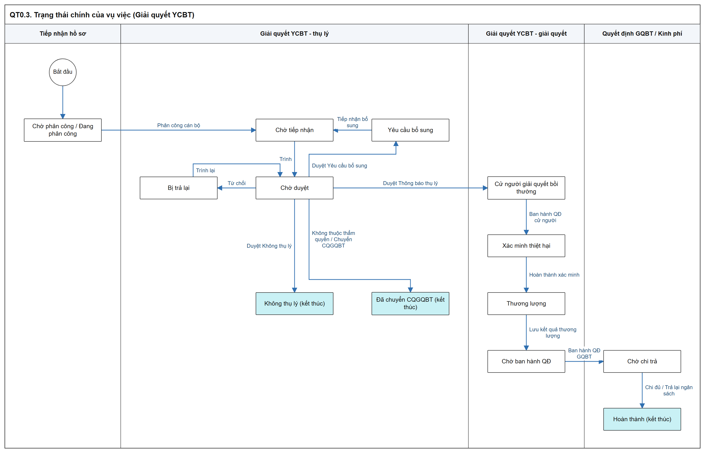

# Sơ đồ luồng nghiệp vụ BTNN - Tổng quan

- Bộ sơ đồ luồng các bước trên hệ thống của phân hệ Công tác bồi thường nhà nước (Website Quản trị), dùng cho Tester tiếp cận nhanh tổng thể bài toán.
- Nguồn: các SRS tại `Tai_lieu_SRS/03_Website_Quan_tri/03_Cong_tac_boi_thuong/`, tài liệu tổng hợp và tài liệu tích hợp Dịch vụ công. SRS là căn cứ; mockup chỉ là điểm vào để thao tác thử.
- Sơ đồ dạng swimlane: mỗi cột là một tác nhân (Cán bộ xử lý, Lãnh đạo, Hệ thống, Phân hệ khác / Hệ thống ngoài); cách chia vai trò chỉ phục vụ kiểm thử.
- Ký hiệu: hộp đánh số = bước của người dùng, số khớp cột STT tại `Bảng các bước` của cùng file; nhãn vàng trong hộp = trạng thái sau bước; hộp xanh nhạt = trạng thái / kết quả do hệ thống ghi nhận; hình thoi = điều kiện rẽ nhánh; hình mũi tên tím = chuyển sang sơ đồ / phân hệ khác; hộp viền nét đứt = ghi chú, thông báo; mũi tên nét đứt = luồng phụ hoặc liên thông.
- Ảnh PNG trong `images/`; bản SVG cùng tên để phóng to. Nguồn sơ đồ tại `src/specs/`, tạo lại bằng `bash src/build.sh` (xem `src/README.md`).
- Mockup: `https://huyendt2007.github.io/BPBD_UI/UI_Mockup/Website_Quan_tri/03_Boi_thuong_nha_nuoc/` (trang khung có menu: [HomePageBTNN.html](https://huyendt2007.github.io/BPBD_UI/UI_Mockup/Website_Quan_tri/03_Boi_thuong_nha_nuoc/HomePageBTNN.html)).

## 1. Bản đồ luồng liên phân hệ

- Bản SVG để phóng to: [00_1_ban_do_lien_phan_he.svg](images/00_1_ban_do_lien_phan_he.svg)

| Phân hệ | Đầu vào chính | Đầu ra chính |
| :--- | :--- | :--- |
| Tiếp nhận hồ sơ | Tiếp nhận mới, Dịch vụ công, Chuyển CQGQBT, Xác định CQGQBT | Hồ sơ `Chờ tiếp nhận` tại Xác định CQGQBT hoặc Giải quyết YCBT |
| Xác định CQGQBT | Hồ sơ Loại `Xác định cơ quan giải quyết bồi thường` | Hồ sơ Giải quyết YCBT `Chờ phân công` tại CQGQBT đã chọn |
| Giải quyết YCBT | Hồ sơ Loại `Giải quyết yêu cầu bồi thường` | Vụ việc `Chờ ban hành QĐ`, kết quả gửi Dịch vụ công |
| Quyết định GQBT | Vụ việc `Chờ ban hành QĐ` | Vụ việc `Chờ chi trả`; bản ghi Chi trả khi Quyết định `Có hiệu lực` |
| Kinh phí | Quyết định `Có hiệu lực`, vụ việc tại Tòa án `Đã có bản án/QĐ`, Tạo QĐ tạm ứng | Vụ việc `Hoàn thành` khi chi đủ |
| Xem xét trách nhiệm hoàn trả | Vụ việc đã hoàn tất chi trả | Thu tiền hoàn trả vào ngân sách nhà nước |

## 2. Vòng đời vụ việc và mã hồ sơ

- `Mã vụ việc` `VVBT-yyyy-xxx` sinh 01 lần tại điểm vào đầu tiên, giữ nguyên qua mọi phân hệ.
- Mỗi phân hệ có `Mã hồ sơ` riêng: `XD-` (Xác định CQGQBT), `BT-` (Giải quyết YCBT, dùng chung cho cả 03 Loại yêu cầu), `HT-` (Xem xét hoàn trả).
- Căn cứ: [Mã vụ việc và mã hồ sơ - Tiếp nhận hồ sơ - Công tác bồi thường nhà nước (Website Quản trị)](../../03_Website_Quan_tri/03_Cong_tac_boi_thuong/SRS_BTNN_GiaiQuyetBT_TiepNhan_YCBT.md#tn-ma-vu-viec).

- Bản SVG để phóng to: [00_2_ma_ho_so.svg](images/00_2_ma_ho_so.svg)

- Trạng thái vụ việc tại Giải quyết YCBT (20 giá trị) theo [Trạng thái vụ việc Giải quyết YCBT - Giải quyết yêu cầu bồi thường - Công tác bồi thường nhà nước (Website Quản trị)](../../03_Website_Quan_tri/03_Cong_tac_boi_thuong/SRS_BTNN_GiaiQuyetBT_GiaiQuyet_YCBT.md#gq-trang-thai-vu-viec); đường đi chính:

- Bản SVG để phóng to: [00_3_trang_thai_vu_viec.svg](images/00_3_trang_thai_vu_viec.svg)

- Nhánh gián đoạn (`Hoãn giải quyết`, `Tạm đình chỉ`, `Đình chỉ giải quyết`, `Dừng giải quyết`) và nhánh Phục hồi danh dự xem tại [Giải quyết YCBT - Sơ đồ luồng nghiệp vụ BTNN - Tài liệu tổng hợp](03_Giai_quyet_YCBT.md).
- Sơ đồ trạng thái chỉ thể hiện đường đi chính; chi tiết từng nhánh theo file của từng phân hệ.

## 3. Dùng "Người dùng giả lập" trên mockup

- Thanh `Người dùng giả lập` ở góc trên phải trang (chỉ phục vụ demo phân quyền theo đơn vị); chọn người dùng thì trang tải lại theo người dùng đó.
- Người dùng đang chọn lưu ở `localStorage` khóa `btnn_demo_user_v1`; giữ khi chuyển trang. Xóa khóa này để về mặc định.
- Danh sách người dùng và đơn vị lấy từ `USERS`, `ORG_UNITS` tại `UI_Mockup/Website_Quan_tri/03_Boi_thuong_nha_nuoc/btnn_luong_xu_ly.js`; luồng phân công mặc định theo `DEFAULT_FLOW` cùng file.
- Một số phân hệ có thêm ô giả lập vai trò riêng (xem bảng cuối mục).

| Cấp đơn vị | Đơn vị mẫu | Tài khoản (id) | Họ tên - Chức vụ | Dùng để thử |
| :--- | :--- | :--- | :--- | :--- |
| Bộ Tư pháp | Bộ Tư pháp | `oanhdh` | Đặng Hoàng Oanh - Lãnh đạo Bộ | Lãnh đạo đơn vị gốc: Phân công, Ký duyệt cấp cuối luồng Bộ Tư pháp |
| Cục | Cục Đăng ký giao dịch bảo đảm và Bồi thường nhà nước | `cuctruong` | Nguyễn Văn Cục Trưởng - Cục trưởng | Lãnh đạo cấp trung gian: Chuyển đơn vị, Ký duyệt |
| Phòng thuộc Cục | Phòng Quản lý nghiệp vụ về bồi thường nhà nước | `tpbt` | Trần Văn Bồi Thường - Trưởng phòng | Lãnh đạo Phòng: Phân công cán bộ, ký nháy |
| Phòng thuộc Cục | Phòng Quản lý nghiệp vụ về bồi thường nhà nước | `canbonv` | Nguyễn Văn Cán Bộ - Chuyên viên | Cán bộ xử lý Bộ Tư pháp; tài khoản mặc định của mockup |
| Sở Tư pháp | Sở Tư pháp Thành phố Hà Nội | `gdso_hn` | Phạm Quang Huy - Giám đốc Sở | Lãnh đạo Sở: Phân công, Ký duyệt |
| Phòng thuộc Sở | Phòng Hành chính tư pháp - Sở Tư pháp Thành phố Hà Nội | `tp_hctp_hn` | Vũ Thị Thanh - Trưởng phòng | Lãnh đạo Phòng: Phân công cán bộ |
| Phòng thuộc Sở | Phòng Hành chính tư pháp - Sở Tư pháp Thành phố Hà Nội | `cv_hn1` | Đỗ Văn Chung - Chuyên viên | Cán bộ xử lý Sở Tư pháp |
| UBND cấp tỉnh | UBND Thành phố Hà Nội | `ct_ubndhn` | Tống Văn Đạt - Phó Chủ tịch UBND | Xem hồ sơ Xác định CQGQBT của Sở Tư pháp trực thuộc |
| UBND cấp tỉnh | UBND Thành phố Hà Nội | `cv_ubndhn1` | Mẫn Thị Hạnh - Chuyên viên | Cán bộ UBND cấp tỉnh |
| Cơ quan giải quyết bồi thường | UBND phường Bạch Mai, Thành phố Hà Nội | `ct_hm` | Hoàng Văn Thái - Chủ tịch UBND | Lãnh đạo CQGQBT: Phân công, Ký duyệt |
| Cơ quan giải quyết bồi thường | Phòng Tư pháp - UBND phường Bạch Mai | `cv_hm1` | Lê Thị Thu Trang - Công chức tư pháp | Cán bộ xử lý CQGQBT |
| Cơ quan giải quyết bồi thường | UBND phường Cầu Giấy, Thành phố Hà Nội | `ct_cg` / `tp_tp_cg` / `cv_cg1` | Bùi Đức Thắng - Chủ tịch UBND / Lương Thị Mai - Trưởng phòng Tư pháp / Kiều Văn Nam - Công chức tư pháp | Luồng 02 cấp: Chuyển đơn vị rồi Phân công cán bộ |
| Cơ quan giải quyết bồi thường | Công an phường Thanh Xuân, Thành phố Hà Nội | `ld_catx` / `cb_catx1` | Trần Quốc Bảo - Trưởng Công an phường / Nguyễn Hữu Phước - Cán bộ pháp chế | Cơ quan nhận khi Chuyển CQGQBT |
| Cơ quan giải quyết bồi thường | Tòa án nhân dân Thành phố Hà Nội | `ca_tandhn` / `tk_tandhn1` | Vương Minh Khang - Chánh án / Lại Thị Hương Giang - Thư ký tòa án | Cơ quan giải quyết lĩnh vực tố tụng |

| Phân hệ (mockup) | Ô giả lập vai trò riêng | Giá trị |
| :--- | :--- | :--- |
| Giải quyết YCBT | Vai trò và cán bộ giả lập | `Cán bộ xử lý hồ sơ` / `Lãnh đạo đơn vị`; chọn cán bộ CB1, CB2, CB3 |
| Kinh phí | `Quyền giả lập` | `Cán bộ xử lý` / `Lãnh đạo` |
| Xem xét trách nhiệm hoàn trả | Vai trò lưu `sessionStorage` khóa `htMockScope` | Đơn vị tạo Hội đồng; Cơ quan, tổ chức đang trực tiếp quản lý, sử dụng, trả lương A, B; Sở Tư pháp; Lãnh đạo |
| Báo cáo Công tác BTNN | Vai trò lưu khóa `bctt_role_v1` | Cán bộ Sở Tư pháp; Lãnh đạo Phòng; Lãnh đạo Sở; Cán bộ Bộ Tư pháp; Lãnh đạo Cục; Lãnh đạo Bộ |

## 4. Phạm vi dữ liệu Tester cần nắm

| STT | Quy tắc | Căn cứ |
| :-- | :--- | :--- |
| 1 | Danh sách các phân hệ xử lý chia 02 tab `Chờ xử lý` / `Đã xử lý` theo thao tác của người dùng đang đăng nhập, không cố định theo trạng thái. | [Quy tắc 02 tab Chờ xử lý / Đã xử lý - Tiếp nhận hồ sơ - Công tác bồi thường nhà nước (Website Quản trị)](../../03_Website_Quan_tri/03_Cong_tac_boi_thuong/SRS_BTNN_GiaiQuyetBT_TiepNhan_YCBT.md#tn-tab-xu-ly) |
| 2 | Loại hồ sơ `Xác định cơ quan giải quyết bồi thường` chỉ áp dụng cho Bộ Tư pháp và các Sở Tư pháp; UBND cấp tỉnh chỉ xem hồ sơ của Sở Tư pháp trực thuộc. | [Loại hồ sơ theo đơn vị - Tiếp nhận hồ sơ - Công tác bồi thường nhà nước (Website Quản trị)](../../03_Website_Quan_tri/03_Cong_tac_boi_thuong/SRS_BTNN_GiaiQuyetBT_TiepNhan_YCBT.md#tn-pham-vi-loai-ho-so) |
| 3 | Lãnh đạo phê duyệt đích danh: chỉ Lãnh đạo được chọn ở cấp hiện hành thấy hồ sơ `Chờ duyệt` tại tab `Chờ xử lý`; không có ủy quyền. | [Quy tắc trình ký - phê duyệt - Xác định cơ quan giải quyết bồi thường - Công tác bồi thường nhà nước (Website Quản trị)](../../03_Website_Quan_tri/03_Cong_tac_boi_thuong/SRS_BTNN_GiaiQuyetBT__Xac%20định%20cơ%20quan%20GQBT.md#xd-quy-tac-phe-duyet) |
| 4 | Giải quyết YCBT: sau khi ban hành Quyết định cử người giải quyết, chỉ cán bộ được cử (có tài khoản) thấy và cập nhật hồ sơ; cán bộ khác cùng cơ quan không thấy. | [Phân hồ sơ sau Quyết định cử người - Giải quyết yêu cầu bồi thường - Công tác bồi thường nhà nước (Website Quản trị)](../../03_Website_Quan_tri/03_Cong_tac_boi_thuong/SRS_BTNN_GiaiQuyetBT_GiaiQuyet_YCBT.md#gq-cng-phan-ho-so) |
| 5 | Tra cứu vụ việc: mọi người dùng có quyền thấy danh sách toàn quốc; chỉ Cơ quan giải quyết, Sở Tư pháp quản lý cơ quan đó, Bộ Tư pháp và Cục được xem chi tiết. | [Phân quyền và phạm vi dữ liệu - Tra cứu vụ việc - Công tác bồi thường nhà nước (Website Quản trị)](../../03_Website_Quan_tri/03_Cong_tac_boi_thuong/SRS_BTNN_GiaiQuyetBT_TraCuu_VuViec.md#tcvv-pham-vi-du-lieu) |
| 6 | Nhóm `Nghiệp vụ dùng chung BTP & STP` và `Nghiệp vụ dùng cho STP`: Bộ Tư pháp / Cục xem bản ghi của Bộ và mọi Sở Tư pháp; Sở Tư pháp chỉ xem của Sở mình; UBND cấp tỉnh chỉ xem của Sở Tư pháp trực thuộc; đơn vị khác không xem được. | [Quy tắc Phạm vi dữ liệu Bộ Tư pháp - Sở Tư pháp - Danh mục và Phụ lục - Tài liệu tổng hợp](../04_Danh_muc_va_Phu_luc.md#quy-tac-pham-vi-du-lieu-btp-stp) |
| 7 | Xem xét hoàn trả: 01 hồ sơ dùng chung nhiều đơn vị; mỗi đơn vị chỉ thấy phần cán bộ trong phạm vi của mình, từ thời điểm theo vai trò. | [Phạm vi dữ liệu theo đơn vị - Xem xét trách nhiệm hoàn trả - Công tác bồi thường nhà nước (Website Quản trị)](../../03_Website_Quan_tri/03_Cong_tac_boi_thuong/SRS_BTNN_GiaiQuyetBT_Xem%20xét%20Hoàn%20trả.md#ht-pham-vi-du-lieu) |
| 8 | Theo dõi vụ việc tại Tòa án: cán bộ xem vụ việc có Cơ quan bị khởi kiện là đơn vị gốc của mình; Bộ Tư pháp xem mọi cơ quan. | [Quy tắc chung - Theo dõi vụ việc tại Tòa án - Công tác bồi thường nhà nước (Website Quản trị)](../../03_Website_Quan_tri/03_Cong_tac_boi_thuong/SRS_BTNN_TheoDoiVuViecToaAn.md#tdta-quy-tac-chung) |
| 9 | Xem chi tiết vụ việc của cơ quan khác: chỉ thấy văn bản đã ký và `Tài liệu ban hành kèm theo`; không thấy `Tài liệu không ban hành kèm theo`. | [Quy tắc Tài liệu ban hành kèm theo / Tài liệu không ban hành kèm theo - Danh mục và Phụ lục - Tài liệu tổng hợp](../04_Danh_muc_va_Phu_luc.md#quy-tac-tai-lieu-ban-hanh-kem-theo) |
| 10 | Luồng phân công, luồng ký duyệt theo cấu hình của từng đơn vị gốc. | [Cấu hình luồng xử lý - Cấu hình luồng xử lý - Quản trị hệ thống (Website Quản trị)](../../03_Website_Quan_tri/01_Quan_tri_he_thong/Cau_hinh_luong_xu_ly.md) |

## 5. Mục lục sơ đồ theo phân hệ

| STT | Phân hệ | Sơ đồ luồng | SRS | Mockup |
| :-- | :--- | :--- | :--- | :--- |
| 1 | Tiếp nhận hồ sơ | [Tiếp nhận hồ sơ - Sơ đồ luồng nghiệp vụ BTNN - Tài liệu tổng hợp](01_Tiep_nhan_ho_so.md) | [Tiếp nhận hồ sơ - Công tác bồi thường nhà nước (Website Quản trị)](../../03_Website_Quan_tri/03_Cong_tac_boi_thuong/SRS_BTNN_GiaiQuyetBT_TiepNhan_YCBT.md) | [tiep_nhan_ycbt.html](https://huyendt2007.github.io/BPBD_UI/UI_Mockup/Website_Quan_tri/03_Boi_thuong_nha_nuoc/tiep_nhan_ycbt.html) |
| 2 | Xác định cơ quan giải quyết bồi thường | [Xác định CQGQBT - Sơ đồ luồng nghiệp vụ BTNN - Tài liệu tổng hợp](02_Xac_dinh_CQGQBT.md) | [Xác định cơ quan giải quyết bồi thường - Công tác bồi thường nhà nước (Website Quản trị)](../../03_Website_Quan_tri/03_Cong_tac_boi_thuong/SRS_BTNN_GiaiQuyetBT__Xac%20định%20cơ%20quan%20GQBT.md) | [xac_dinh_co_quan_boi_thuong.html](https://huyendt2007.github.io/BPBD_UI/UI_Mockup/Website_Quan_tri/03_Boi_thuong_nha_nuoc/xac_dinh_co_quan_boi_thuong.html) |
| 3 | Giải quyết yêu cầu bồi thường (gồm Phục hồi danh dự) | [Giải quyết YCBT - Sơ đồ luồng nghiệp vụ BTNN - Tài liệu tổng hợp](03_Giai_quyet_YCBT.md) | [Giải quyết yêu cầu bồi thường - Công tác bồi thường nhà nước (Website Quản trị)](../../03_Website_Quan_tri/03_Cong_tac_boi_thuong/SRS_BTNN_GiaiQuyetBT_GiaiQuyet_YCBT.md) | [quan_ly_boi_thuong.html](https://huyendt2007.github.io/BPBD_UI/UI_Mockup/Website_Quan_tri/03_Boi_thuong_nha_nuoc/quan_ly_boi_thuong.html) |
| 4 | Quyết định giải quyết bồi thường | [Quyết định GQBT - Sơ đồ luồng nghiệp vụ BTNN - Tài liệu tổng hợp](04_Quyet_dinh_GQBT.md) | [Quyết định giải quyết bồi thường - Công tác bồi thường nhà nước (Website Quản trị)](../../03_Website_Quan_tri/03_Cong_tac_boi_thuong/SRS_BTNN_GiaiQuyetBT_QuyetDinh_GQBT.md) | [quyet_dinh_giai_quyet_boi_thuong.html](https://huyendt2007.github.io/BPBD_UI/UI_Mockup/Website_Quan_tri/03_Boi_thuong_nha_nuoc/quyet_dinh_giai_quyet_boi_thuong.html) |
| 5 | Tạm ứng kinh phí / Chi trả tiền bồi thường | [Kinh phí - Sơ đồ luồng nghiệp vụ BTNN - Tài liệu tổng hợp](05_Kinh_phi_BT.md) | [Tạm ứng kinh phí bồi thường/Chi trả tiền bồi thường - Công tác bồi thường nhà nước (Website Quản trị)](../../03_Website_Quan_tri/03_Cong_tac_boi_thuong/SRS_BTNN_GiaiQuyetBT_KinhPhi_BT.md) | [Tạm ứng](https://huyendt2007.github.io/BPBD_UI/UI_Mockup/Website_Quan_tri/03_Boi_thuong_nha_nuoc/quan_ly_kinh_phi_boi_thuong.html?menu=tam-ung), [Chi trả](https://huyendt2007.github.io/BPBD_UI/UI_Mockup/Website_Quan_tri/03_Boi_thuong_nha_nuoc/quan_ly_kinh_phi_boi_thuong.html?menu=chi-tra) |
| 6 | Xem xét trách nhiệm hoàn trả | [Xem xét hoàn trả - Sơ đồ luồng nghiệp vụ BTNN - Tài liệu tổng hợp](06_Xem_xet_hoan_tra.md) | [Xem xét trách nhiệm hoàn trả - Công tác bồi thường nhà nước (Website Quản trị)](../../03_Website_Quan_tri/03_Cong_tac_boi_thuong/SRS_BTNN_GiaiQuyetBT_Xem%20xét%20Hoàn%20trả.md) | [xem_xet_trach_nhiem_hoan_tra.html](https://huyendt2007.github.io/BPBD_UI/UI_Mockup/Website_Quan_tri/03_Boi_thuong_nha_nuoc/xem_xet_trach_nhiem_hoan_tra.html) |
| 7 | Theo dõi vụ việc tại Tòa án | [Theo dõi vụ việc tại Tòa án - Sơ đồ luồng nghiệp vụ BTNN - Tài liệu tổng hợp](07_Theo_doi_vu_viec_Toa_an.md) | [Theo dõi vụ việc tại Tòa án - Công tác bồi thường nhà nước (Website Quản trị)](../../03_Website_Quan_tri/03_Cong_tac_boi_thuong/SRS_BTNN_TheoDoiVuViecToaAn.md) | [theo_doi_vu_viec_toa_an.html](https://huyendt2007.github.io/BPBD_UI/UI_Mockup/Website_Quan_tri/03_Boi_thuong_nha_nuoc/theo_doi_vu_viec_toa_an.html) |
| 8 | Tra cứu vụ việc | [Tra cứu vụ việc - Sơ đồ luồng nghiệp vụ BTNN - Tài liệu tổng hợp](08_Tra_cuu_vu_viec.md) | [Tra cứu vụ việc - Công tác bồi thường nhà nước (Website Quản trị)](../../03_Website_Quan_tri/03_Cong_tac_boi_thuong/SRS_BTNN_GiaiQuyetBT_TraCuu_VuViec.md) | [tra_cuu_ho_so_boi_thuong.html](https://huyendt2007.github.io/BPBD_UI/UI_Mockup/Website_Quan_tri/03_Boi_thuong_nha_nuoc/tra_cuu_ho_so_boi_thuong.html) |
| 9 | Nghiệp vụ dùng cho STP (04 kiến nghị, yêu cầu; Hỗ trợ người bị thiệt hại) | [Nghiệp vụ dùng cho STP - Sơ đồ luồng nghiệp vụ BTNN - Tài liệu tổng hợp](09_Nghiep_vu_STP.md) | Xem file sơ đồ | [quan_ly_nghiep_vu_btnn_muc6.html](https://huyendt2007.github.io/BPBD_UI/UI_Mockup/Website_Quan_tri/03_Boi_thuong_nha_nuoc/quan_ly_nghiep_vu_btnn_muc6.html?module=kien_nghi_xu_ly_vi_pham) |
| 10 | Nghiệp vụ dùng chung BTP & STP | [Nghiệp vụ dùng chung BTP và STP - Sơ đồ luồng nghiệp vụ BTNN - Tài liệu tổng hợp](10_Nghiep_vu_dung_chung_BTP_STP.md) | Xem file sơ đồ | Xem file sơ đồ |
| 11 | Nghiệp vụ dùng cho Bộ Tư pháp | [Nghiệp vụ dùng cho Bộ Tư pháp - Sơ đồ luồng nghiệp vụ BTNN - Tài liệu tổng hợp](11_Nghiep_vu_BTP.md) | Xem file sơ đồ | [quan_ly_nghiep_vu_btnn_muc6.html](https://huyendt2007.github.io/BPBD_UI/UI_Mockup/Website_Quan_tri/03_Boi_thuong_nha_nuoc/quan_ly_nghiep_vu_btnn_muc6.html?module=chien_luoc_chinh_sach) |
| 12 | Báo cáo Công tác BTNN | [Báo cáo Công tác BTNN - Sơ đồ luồng nghiệp vụ BTNN - Tài liệu tổng hợp](12_Bao_cao_cong_tac_BTNN.md) | [Báo cáo Công tác BTNN - Công tác bồi thường nhà nước (Website Quản trị)](../../03_Website_Quan_tri/03_Cong_tac_boi_thuong/SRS_BTNN_BaoCao_CongTacBTNN.md) | [bao_cao_cong_tac_btnn.html](https://huyendt2007.github.io/BPBD_UI/UI_Mockup/Website_Quan_tri/03_Boi_thuong_nha_nuoc/bao_cao_cong_tac_btnn.html) |
