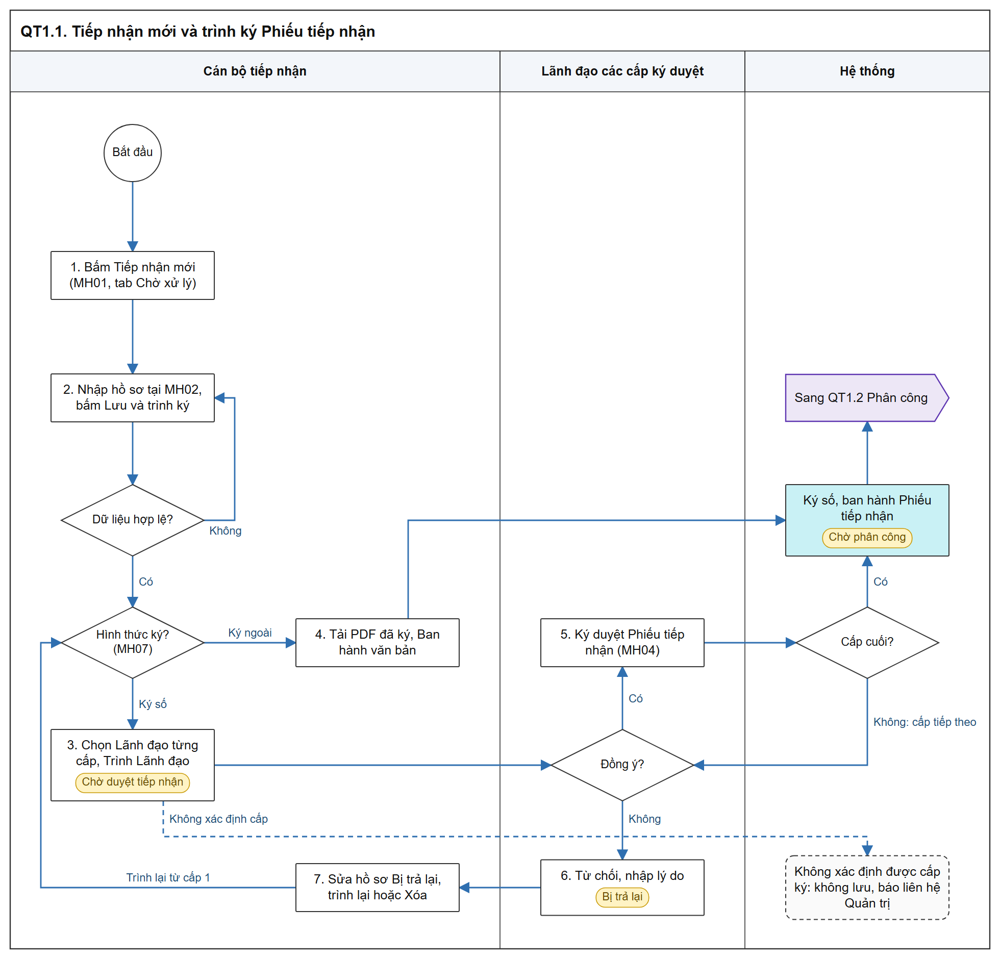
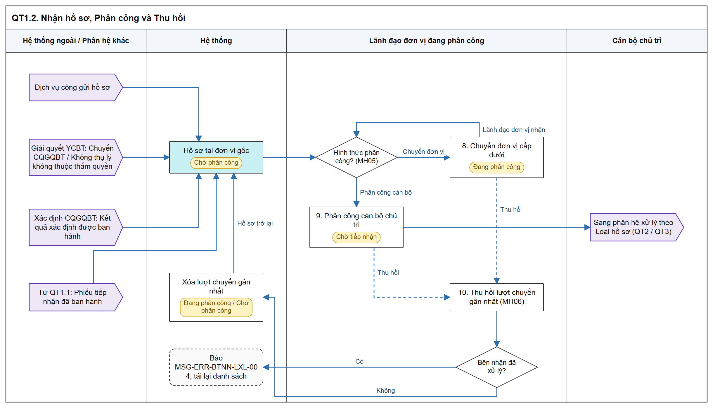

# Tiếp nhận hồ sơ - Sơ đồ luồng các bước

[Tổng quan - Sơ đồ luồng nghiệp vụ BTNN - Tài liệu tổng hợp](00_Tong_quan_luong_BTNN.md)

## 1. Mục đích và điểm vào

- Tiếp nhận ban đầu và phân công xử lý 02 Loại hồ sơ: `Xác định cơ quan giải quyết bồi thường`, `Giải quyết yêu cầu bồi thường`.
- Hồ sơ `Tiếp nhận mới` (Trực tiếp / Qua dịch vụ bưu chính) phải qua Phiếu tiếp nhận; hồ sơ nguồn khác vào thẳng `Chờ phân công`.
- Menu: `Bồi thường nhà nước` > `Tiếp nhận hồ sơ`.
- Mockup: [tiep_nhan_ycbt.html](https://huyendt2007.github.io/BPBD_UI/UI_Mockup/Website_Quan_tri/03_Boi_thuong_nha_nuoc/tiep_nhan_ycbt.html).
- SRS: [Tiếp nhận hồ sơ - Công tác bồi thường nhà nước (Website Quản trị)](../../03_Website_Quan_tri/03_Cong_tac_boi_thuong/SRS_BTNN_GiaiQuyetBT_TiepNhan_YCBT.md).

## 2. Sơ đồ luồng các bước

### 2.1. Tiếp nhận mới và Phiếu tiếp nhận

- Bản SVG để phóng to: [01_1_tiep_nhan_moi.svg](images/01_1_tiep_nhan_moi.svg)

### 2.2. Nhận hồ sơ nguồn khác, Phân công và Thu hồi

- Bản SVG để phóng to: [01_2_phan_cong.svg](images/01_2_phan_cong.svg)

## 3. Bảng các bước

| STT | Người dùng giả lập gợi ý | Màn hình | Thao tác | Kết quả / Trạng thái sau | Tham chiếu SRS |
| :-- | :--- | :--- | :--- | :--- | :--- |
| 1 | `cv_hn1` Đỗ Văn Chung (Sở Tư pháp Hà Nội) | MH01, tab `Chờ xử lý` | Bấm `Tiếp nhận mới` | Mở MH02; nút chỉ có ở tab `Chờ xử lý` | [Quy tắc 02 tab Chờ xử lý / Đã xử lý - Tiếp nhận hồ sơ - Công tác bồi thường nhà nước (Website Quản trị)](../../03_Website_Quan_tri/03_Cong_tac_boi_thuong/SRS_BTNN_GiaiQuyetBT_TiepNhan_YCBT.md#tn-tab-xu-ly) |
| 2 | `cv_hn1` | MH02 | Chọn Loại hồ sơ, Hình thức tiếp nhận (`Trực tiếp` / `Qua dịch vụ bưu chính`), nhập người yêu cầu, tài liệu; bấm `Lưu và trình ký` | Thiếu dữ liệu: báo lỗi, không mở popup; hợp lệ: mở MH07, chưa lưu hồ sơ | [Nguồn hồ sơ - Tiếp nhận hồ sơ - Công tác bồi thường nhà nước (Website Quản trị)](../../03_Website_Quan_tri/03_Cong_tac_boi_thuong/SRS_BTNN_GiaiQuyetBT_TiepNhan_YCBT.md#tn-nguon-ho-so) |
| 3 | `cv_hn1` | MH07 | `Ký số trên hệ thống`: sinh Mẫu 02/BTNN hoặc tải lên (Giải quyết YCBT) / tải tệp (Xác định CQGQBT), chọn Lãnh đạo, `Trình Lãnh đạo` | Hồ sơ `Chờ duyệt tiếp nhận`; Phiếu tiếp nhận `Dự thảo` | [Quy tắc Phiếu tiếp nhận - Tiếp nhận hồ sơ - Công tác bồi thường nhà nước (Website Quản trị)](../../03_Website_Quan_tri/03_Cong_tac_boi_thuong/SRS_BTNN_GiaiQuyetBT_TiepNhan_YCBT.md#tn-phieu-tiep-nhan) |
| 4 | `cv_hn1` | MH07 | `Ký ngoài`: tải PDF đã ký, `Ban hành văn bản` | Phiếu tiếp nhận `Đã ký duyệt, ban hành`; hồ sơ `Chờ phân công` | [MH07 - Popup Trình ký Phiếu tiếp nhận hồ sơ - Tiếp nhận hồ sơ - Công tác bồi thường nhà nước (Website Quản trị)](../../03_Website_Quan_tri/03_Cong_tac_boi_thuong/SRS_BTNN_GiaiQuyetBT_TiepNhan_YCBT.md#tn-mh07-trinh-ky-ptn) |
| 5 | Lãnh đạo cấp 1 đã chọn khi trình, ví dụ `tp_hctp_hn` | MH01 / MH03 / MH04 | `Ký duyệt` | Cấp trung gian: giữ `Chờ duyệt tiếp nhận`, chuyển cấp tiếp theo; cấp cuối: ký số, ban hành, hồ sơ `Chờ phân công` | [MH04 - Màn hình Ký duyệt / Từ chối Phiếu tiếp nhận - Tiếp nhận hồ sơ - Công tác bồi thường nhà nước (Website Quản trị)](../../03_Website_Quan_tri/03_Cong_tac_boi_thuong/SRS_BTNN_GiaiQuyetBT_TiepNhan_YCBT.md#tn-mh04-ky-duyet-ptn) |
| 6 | Lãnh đạo cấp đang ký | MH04 | `Từ chối`, nhập lý do | Hồ sơ `Bị trả lại` về Cán bộ tiếp nhận | [Quy tắc Phiếu tiếp nhận - Tiếp nhận hồ sơ - Công tác bồi thường nhà nước (Website Quản trị)](../../03_Website_Quan_tri/03_Cong_tac_boi_thuong/SRS_BTNN_GiaiQuyetBT_TiepNhan_YCBT.md#tn-phieu-tiep-nhan) |
| 7 | `cv_hn1` | MH01 / MH02 | `Sửa` hồ sơ `Bị trả lại`, `Lưu và trình ký` (popup điền sẵn lần trước) hoặc `Xóa` | Ký số: `Chờ duyệt tiếp nhận` từ cấp 1; Ký ngoài: `Chờ phân công` | [Quy tắc Phiếu tiếp nhận - Tiếp nhận hồ sơ - Công tác bồi thường nhà nước (Website Quản trị)](../../03_Website_Quan_tri/03_Cong_tac_boi_thuong/SRS_BTNN_GiaiQuyetBT_TiepNhan_YCBT.md#tn-phieu-tiep-nhan) |
| 8 | `gdso_hn` Phạm Quang Huy (Lãnh đạo đơn vị gốc) | MH05 | `Phân công` > `Chuyển đơn vị` (Phòng Hành chính tư pháp) | Hồ sơ `Đang phân công`; sang tab `Đã xử lý` của Lãnh đạo Sở | [Quy tắc phân công - Tiếp nhận hồ sơ - Công tác bồi thường nhà nước (Website Quản trị)](../../03_Website_Quan_tri/03_Cong_tac_boi_thuong/SRS_BTNN_GiaiQuyetBT_TiepNhan_YCBT.md#tn-quy-tac-phan-cong) |
| 9 | `tp_hctp_hn` Vũ Thị Thanh | MH05 | `Phân công` > `Phân công cán bộ` | Hồ sơ `Chờ tiếp nhận` tại phân hệ theo Loại hồ sơ | [Quy tắc phân công - Tiếp nhận hồ sơ - Công tác bồi thường nhà nước (Website Quản trị)](../../03_Website_Quan_tri/03_Cong_tac_boi_thuong/SRS_BTNN_GiaiQuyetBT_TiepNhan_YCBT.md#tn-quy-tac-phan-cong) |
| 10 | Lãnh đạo đơn vị đã chuyển (`gdso_hn` hoặc `tp_hctp_hn`) | MH01 tab `Đã xử lý` / MH03, MH06 | `Thu hồi` khi bên nhận chưa xử lý | Xóa lượt chuyển gần nhất; về `Đang phân công` hoặc `Chờ phân công` | [Quy tắc Thu hồi - Tiếp nhận hồ sơ - Công tác bồi thường nhà nước (Website Quản trị)](../../03_Website_Quan_tri/03_Cong_tac_boi_thuong/SRS_BTNN_GiaiQuyetBT_TiepNhan_YCBT.md#tn-thu-hoi) |

## 4. Trạng thái

| Trạng thái | Vào khi | Ra khi |
| :--- | :--- | :--- |
| `Chờ duyệt tiếp nhận` | Trình Phiếu tiếp nhận (Ký số) thành công | Cấp cuối Ký duyệt → `Chờ phân công`; Từ chối → `Bị trả lại` |
| `Bị trả lại` | Lãnh đạo bất kỳ cấp nào Từ chối | Trình lại → `Chờ duyệt tiếp nhận`; Ký ngoài → `Chờ phân công`; hoặc Xóa |
| `Chờ phân công` | Hồ sơ nguồn khác `Tiếp nhận mới`; Phiếu tiếp nhận được ban hành; Thu hồi về đơn vị gốc | Chuyển đơn vị → `Đang phân công`; Phân công cán bộ → `Chờ tiếp nhận` |
| `Đang phân công` | Chuyển đơn vị | Chuyển tiếp / Phân công cán bộ; Thu hồi |
| `Chờ tiếp nhận` | Phân công cán bộ chủ trì | Cán bộ chủ trì thao tác tại phân hệ xử lý; hoặc Thu hồi |

- Trạng thái Phiếu tiếp nhận: `Dự thảo` (hồ sơ `Chờ duyệt tiếp nhận` / `Bị trả lại`), `Đã ký duyệt, ban hành`.
- Tình trạng lượt chuyển tại `Quá trình phân công`: `Chưa xử lý - Chưa xem`, `Chưa xử lý - Đã xem lúc [dd/mm/yyyy HH:mm]`, `Đã xử lý`.
- Căn cứ: [Trạng thái tại màn hình Tiếp nhận hồ sơ - Tiếp nhận hồ sơ - Công tác bồi thường nhà nước (Website Quản trị)](../../03_Website_Quan_tri/03_Cong_tac_boi_thuong/SRS_BTNN_GiaiQuyetBT_TiepNhan_YCBT.md#tn-trang-thai).

## 5. Liên thông

| Chiều | Phân hệ | Dữ liệu / trạng thái |
| :--- | :--- | :--- |
| Vào | Dịch vụ công | Hồ sơ Loại `Giải quyết yêu cầu bồi thường`, Nguồn và Hình thức tiếp nhận `Dịch vụ công` (chỉ đọc), 04 thành phần hồ sơ |
| Vào | Giải quyết YCBT | Hồ sơ `Chuyển CQGQBT` khi cấp cuối duyệt Chuyển CQGQBT / Không thụ lý không thuộc thẩm quyền; kèm văn bản đã ký và `Tài liệu ban hành kèm theo` |
| Vào | Xác định CQGQBT | Hồ sơ nguồn `Xác định CQGQBT` tại CQGQBT đã chọn |
| Ra | Xác định CQGQBT / Giải quyết YCBT | Hồ sơ `Chờ tiếp nhận`, cán bộ chủ trì đã phân công; giữ `Mã vụ việc`, sinh `Mã hồ sơ` `XD-` / `BT-` |
| Ra | Cấu hình luồng xử lý | Đọc luồng phân công, luồng ký duyệt theo Loại hồ sơ và đơn vị gốc |

## 6. Điểm cần lưu ý khi kiểm thử

- Hồ sơ nguồn `Dịch vụ công`: Cán bộ tiếp nhận của hồ sơ là người phân công đầu tiên; trước đó hiển thị `-` ([Hồ sơ nguồn Dịch vụ công - Tiếp nhận hồ sơ - Công tác bồi thường nhà nước (Website Quản trị)](../../03_Website_Quan_tri/03_Cong_tac_boi_thuong/SRS_BTNN_GiaiQuyetBT_TiepNhan_YCBT.md#tn-dvc)).
- Sửa, Xóa chỉ khi đồng thời: Nguồn `Tiếp nhận mới`, do chính người dùng tiếp nhận, trạng thái `Bị trả lại` (theo [Mục đích - Tiếp nhận hồ sơ - Công tác bồi thường nhà nước (Website Quản trị)](../../03_Website_Quan_tri/03_Cong_tac_boi_thuong/SRS_BTNN_GiaiQuyetBT_TiepNhan_YCBT.md)).
- Form Tiếp nhận mới chỉ cho chọn `Trực tiếp`, `Qua dịch vụ bưu chính` ([Nguồn hồ sơ - Tiếp nhận hồ sơ - Công tác bồi thường nhà nước (Website Quản trị)](../../03_Website_Quan_tri/03_Cong_tac_boi_thuong/SRS_BTNN_GiaiQuyetBT_TiepNhan_YCBT.md#tn-nguon-ho-so)).
- Loại hồ sơ `Xác định cơ quan giải quyết bồi thường` chỉ hiện với Bộ Tư pháp và Sở Tư pháp; UBND cấp tỉnh không tiếp nhận, không phân công, không phê duyệt loại này ([Loại hồ sơ theo đơn vị - Tiếp nhận hồ sơ - Công tác bồi thường nhà nước (Website Quản trị)](../../03_Website_Quan_tri/03_Cong_tac_boi_thuong/SRS_BTNN_GiaiQuyetBT_TiepNhan_YCBT.md#tn-pham-vi-loai-ho-so)).
- Phân công: người thao tác trước xử lý hồ sơ; hồ sơ biến mất khỏi tab `Chờ xử lý` của thành viên khác cùng Nhóm lãnh đạo; không có thao tác Trả lại lên cấp trên ([Quy tắc phân công - Tiếp nhận hồ sơ - Công tác bồi thường nhà nước (Website Quản trị)](../../03_Website_Quan_tri/03_Cong_tac_boi_thuong/SRS_BTNN_GiaiQuyetBT_TiepNhan_YCBT.md#tn-quy-tac-phan-cong)).
- Kiểm tra đồng thời: mở popup Phân công khi hồ sơ đã xử lý hiển thị [MSG-ERR-BTNN-LXL-001]; xác nhận không còn hợp lệ hiển thị [MSG-ERR-BTNN-LXL-002]; Thu hồi khi bên nhận đã xử lý hiển thị [MSG-ERR-BTNN-LXL-004] (cùng mục trên).
- Thu hồi chỉ lượt chuyển gần nhất có Tình trạng `Chưa xử lý`; bên nhận đã mở xem vẫn thu hồi được ([Quy tắc Thu hồi - Tiếp nhận hồ sơ - Công tác bồi thường nhà nước (Website Quản trị)](../../03_Website_Quan_tri/03_Cong_tac_boi_thuong/SRS_BTNN_GiaiQuyetBT_TiepNhan_YCBT.md#tn-thu-hoi)).
- Từ chối ở bất kỳ cấp: bắt buộc lý do; trình lại bắt đầu từ cấp 1 ([Quy tắc Phiếu tiếp nhận - Tiếp nhận hồ sơ - Công tác bồi thường nhà nước (Website Quản trị)](../../03_Website_Quan_tri/03_Cong_tac_boi_thuong/SRS_BTNN_GiaiQuyetBT_TiepNhan_YCBT.md#tn-phieu-tiep-nhan)).
- Hồ sơ nguồn khác `Tiếp nhận mới` không có khối `Thông tin Phiếu tiếp nhận` tại MH03 (cùng mục trên).
- Mã vụ việc chỉ đọc; số thứ tự đã cấp không cấp lại kể cả khi hồ sơ bị xóa ([Mã vụ việc và mã hồ sơ - Tiếp nhận hồ sơ - Công tác bồi thường nhà nước (Website Quản trị)](../../03_Website_Quan_tri/03_Cong_tac_boi_thuong/SRS_BTNN_GiaiQuyetBT_TiepNhan_YCBT.md#tn-ma-vu-viec)).
- Badge tab `Chờ xử lý` và menu `Tiếp nhận hồ sơ`; tab `Đã xử lý` không có badge ([Quy tắc 02 tab Chờ xử lý / Đã xử lý - Tiếp nhận hồ sơ - Công tác bồi thường nhà nước (Website Quản trị)](../../03_Website_Quan_tri/03_Cong_tac_boi_thuong/SRS_BTNN_GiaiQuyetBT_TiepNhan_YCBT.md#tn-tab-xu-ly)).
