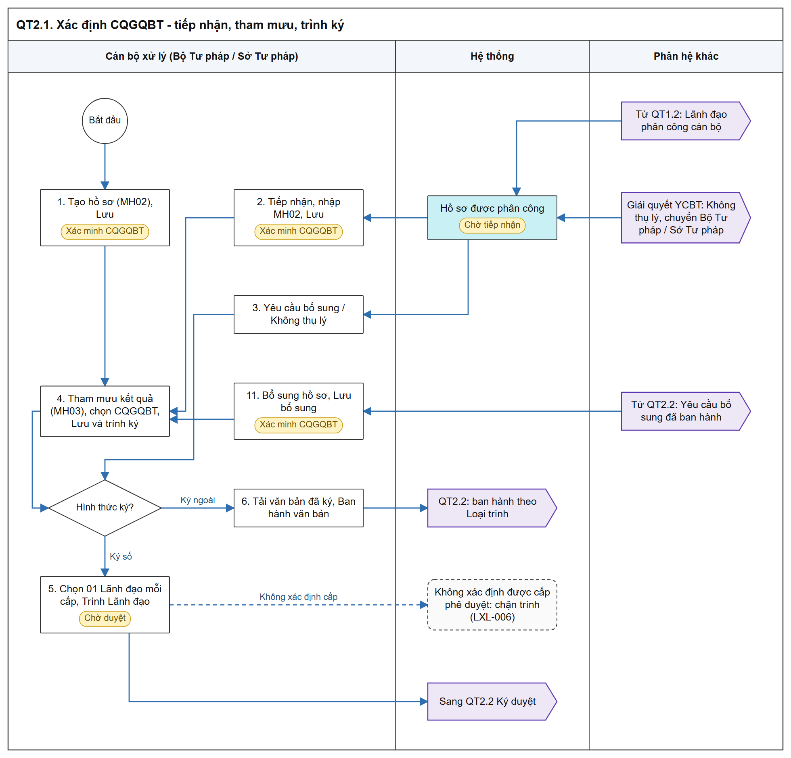
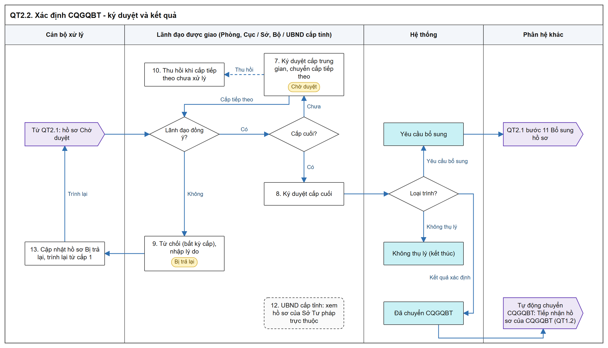

# Xác định cơ quan giải quyết bồi thường - Sơ đồ luồng các bước

[Tổng quan - Sơ đồ luồng nghiệp vụ BTNN - Tài liệu tổng hợp](00_Tong_quan_luong_BTNN.md)

## 1. Mục đích và điểm vào

- Bộ Tư pháp / Sở Tư pháp tiếp nhận, xác minh và tham mưu kết quả xác định cơ quan giải quyết bồi thường (CQGQBT), trình Lãnh đạo ký duyệt.
- Kết quả được ban hành: hệ thống tự động chuyển hồ sơ cho CQGQBT đã chọn (hồ sơ Giải quyết YCBT `Chờ phân công`).
- Chỉ dành cho Bộ Tư pháp, Sở Tư pháp và UBND cấp tỉnh (UBND cấp tỉnh chỉ xem, trừ lượt được giao ký duyệt).
- Menu: `Bồi thường nhà nước` > `Xác định cơ quan giải quyết bồi thường`.
- Mockup: [xac_dinh_co_quan_boi_thuong.html](https://huyendt2007.github.io/BPBD_UI/UI_Mockup/Website_Quan_tri/03_Boi_thuong_nha_nuoc/xac_dinh_co_quan_boi_thuong.html).
- SRS: [Xác định cơ quan giải quyết bồi thường - Công tác bồi thường nhà nước (Website Quản trị)](../../03_Website_Quan_tri/03_Cong_tac_boi_thuong/SRS_BTNN_GiaiQuyetBT__Xac%20định%20cơ%20quan%20GQBT.md).

## 2. Sơ đồ luồng các bước

- Bản SVG để phóng to: [02_1_tiep_nhan_tham_muu.svg](images/02_1_tiep_nhan_tham_muu.svg)

- Bản SVG để phóng to: [02_2_ky_duyet_ket_qua.svg](images/02_2_ky_duyet_ket_qua.svg)

- Thứ tự cấp ký (áp dụng mọi Loại trình):

| Loại luồng | Thứ tự trình ký |
| :--- | :--- |
| `Xác định CQGQBT - Bộ Tư pháp` | Cán bộ xử lý → Lãnh đạo Phòng/Ban phụ trách → Lãnh đạo Cục Đăng ký giao dịch bảo đảm và Bồi thường nhà nước → Lãnh đạo Bộ Tư pháp |
| `Xác định CQGQBT - Sở Tư pháp` | Cán bộ xử lý → Lãnh đạo Phòng phụ trách → Lãnh đạo Sở Tư pháp → Lãnh đạo UBND cấp tỉnh |

## 3. Bảng các bước

| STT | Người dùng giả lập gợi ý | Màn hình | Thao tác | Kết quả / Trạng thái sau | Tham chiếu SRS |
| :-- | :--- | :--- | :--- | :--- | :--- |
| 1 | `canbonv` Nguyễn Văn Cán Bộ (Bộ Tư pháp) | MH01 | `Tạo hồ sơ` > MH02 > `Lưu` | Hồ sơ `Xác minh CQGQBT`, bỏ qua phân công; luôn sinh `Mã vụ việc` mới | [Luồng trình ký hồ sơ Xác định cơ quan giải quyết bồi thường - Xác định cơ quan giải quyết bồi thường - Công tác bồi thường nhà nước (Website Quản trị)](../../03_Website_Quan_tri/03_Cong_tac_boi_thuong/SRS_BTNN_GiaiQuyetBT__Xac%20định%20cơ%20quan%20GQBT.md#xd-luong-trinh-ky) |
| 2 | Cán bộ được phân công (ví dụ `cv_hn1`) | MH01 tab `Chờ xử lý` | `Tiếp nhận` hồ sơ `Chờ tiếp nhận`, nhập MH02, `Lưu` | `Xác minh CQGQBT` | [Quy tắc 02 tab Chờ xử lý / Đã xử lý - Xác định cơ quan giải quyết bồi thường - Công tác bồi thường nhà nước (Website Quản trị)](../../03_Website_Quan_tri/03_Cong_tac_boi_thuong/SRS_BTNN_GiaiQuyetBT__Xac%20định%20cơ%20quan%20GQBT.md#xd-tab-xu-ly) |
| 3 | Cán bộ xử lý | MH01 | `Yêu cầu bổ sung` / `Không thụ lý` khi hồ sơ `Chờ tiếp nhận` hoặc `Bị trả lại` | Mở Popup Trình ký với Loại trình tương ứng | [Popup Trình ký - Xác định cơ quan giải quyết bồi thường - Công tác bồi thường nhà nước (Website Quản trị)](../../03_Website_Quan_tri/03_Cong_tac_boi_thuong/SRS_BTNN_GiaiQuyetBT__Xac%20định%20cơ%20quan%20GQBT.md#xd-popup-trinh-ky) |
| 4 | Cán bộ xử lý | MH03 | `Tham mưu kết quả`, chọn CQGQBT; `Lưu` hoặc `Lưu và trình ký` | `Lưu`: giữ `Xác minh CQGQBT`; trình: mở Popup Trình ký | [Popup Trình ký - Xác định cơ quan giải quyết bồi thường - Công tác bồi thường nhà nước (Website Quản trị)](../../03_Website_Quan_tri/03_Cong_tac_boi_thuong/SRS_BTNN_GiaiQuyetBT__Xac%20định%20cơ%20quan%20GQBT.md#xd-popup-trinh-ky) |
| 5 | Cán bộ xử lý | Popup Trình ký | `Ký số trên hệ thống`: chọn 01 Lãnh đạo mỗi cấp, `Trình Lãnh đạo` | `Chờ duyệt`, dòng phụ Loại trình | [Quy tắc trình ký - phê duyệt - Xác định cơ quan giải quyết bồi thường - Công tác bồi thường nhà nước (Website Quản trị)](../../03_Website_Quan_tri/03_Cong_tac_boi_thuong/SRS_BTNN_GiaiQuyetBT__Xac%20định%20cơ%20quan%20GQBT.md#xd-quy-tac-phe-duyet) |
| 6 | Cán bộ xử lý | Popup Trình ký | `Ký ngoài`: tải văn bản đã ký, `Ban hành văn bản` | Ban hành ngay theo Loại trình, không trình Lãnh đạo | [Quy tắc trình ký - phê duyệt - Xác định cơ quan giải quyết bồi thường - Công tác bồi thường nhà nước (Website Quản trị)](../../03_Website_Quan_tri/03_Cong_tac_boi_thuong/SRS_BTNN_GiaiQuyetBT__Xac%20định%20cơ%20quan%20GQBT.md#xd-quy-tac-phe-duyet) |
| 7 | Lãnh đạo cấp 1 đã chọn (`tpbt` / `tp_hctp_hn`) | Màn hình Ký duyệt / Từ chối | `Ký duyệt` | Chuyển Lãnh đạo cấp tiếp theo đã chọn; giữ `Chờ duyệt` | [Màn hình Ký duyệt / Từ chối - Xác định cơ quan giải quyết bồi thường - Công tác bồi thường nhà nước (Website Quản trị)](../../03_Website_Quan_tri/03_Cong_tac_boi_thuong/SRS_BTNN_GiaiQuyetBT__Xac%20định%20cơ%20quan%20GQBT.md#xd-ky-duyet) |
| 8 | Lãnh đạo cấp cuối (`oanhdh` Bộ Tư pháp; Lãnh đạo UBND cấp tỉnh với luồng Sở Tư pháp) | Màn hình Ký duyệt / Từ chối | `Ký duyệt` | `Yêu cầu bổ sung` / `Không thụ lý` / `Đã chuyển CQGQBT` theo Loại trình | [Màn hình Ký duyệt / Từ chối - Xác định cơ quan giải quyết bồi thường - Công tác bồi thường nhà nước (Website Quản trị)](../../03_Website_Quan_tri/03_Cong_tac_boi_thuong/SRS_BTNN_GiaiQuyetBT__Xac%20định%20cơ%20quan%20GQBT.md#xd-ky-duyet) |
| 9 | Lãnh đạo cấp bất kỳ | Màn hình Ký duyệt / Từ chối | `Từ chối`, nhập lý do | `Bị trả lại`, giữ Loại trình; kết quả các cấp đã ký mất hiệu lực | [Từ chối - Xác định cơ quan giải quyết bồi thường - Công tác bồi thường nhà nước (Website Quản trị)](../../03_Website_Quan_tri/03_Cong_tac_boi_thuong/SRS_BTNN_GiaiQuyetBT__Xac%20định%20cơ%20quan%20GQBT.md#xd-tu-choi) |
| 10 | Lãnh đạo vừa Ký duyệt chuyển cấp | MH01 tab `Đã xử lý` | `Thu hồi` khi cấp tiếp theo chưa xử lý | Hồ sơ trở lại Lãnh đạo đã thu hồi | [MH01 - Màn hình Danh sách yêu cầu xác định cơ quan giải quyết bồi thường - Xác định cơ quan giải quyết bồi thường - Công tác bồi thường nhà nước (Website Quản trị)](../../03_Website_Quan_tri/03_Cong_tac_boi_thuong/SRS_BTNN_GiaiQuyetBT__Xac%20định%20cơ%20quan%20GQBT.md) |
| 11 | Cán bộ xử lý | MH01 / MH02 | `Bổ sung hồ sơ` khi `Yêu cầu bổ sung`, `Lưu bổ sung` | `Xác minh CQGQBT` | [Sơ đồ luồng nghiệp vụ theo giao diện - Xác định cơ quan giải quyết bồi thường - Công tác bồi thường nhà nước (Website Quản trị)](../../03_Website_Quan_tri/03_Cong_tac_boi_thuong/SRS_BTNN_GiaiQuyetBT__Xac%20định%20cơ%20quan%20GQBT.md) |
| 12 | `ct_ubndhn` Tống Văn Đạt (UBND cấp tỉnh) | MH01 / MH04 | Xem hồ sơ của Sở Tư pháp trực thuộc | Chỉ xem; thấy ở tab `Chờ xử lý` khi được giao ký ở cấp hiện hành | [Luồng trình ký hồ sơ Xác định cơ quan giải quyết bồi thường - Xác định cơ quan giải quyết bồi thường - Công tác bồi thường nhà nước (Website Quản trị)](../../03_Website_Quan_tri/03_Cong_tac_boi_thuong/SRS_BTNN_GiaiQuyetBT__Xac%20định%20cơ%20quan%20GQBT.md#xd-luong-trinh-ky) |
| 13 | Cán bộ xử lý | MH01 / Popup Trình ký | `Cập nhật` hồ sơ `Bị trả lại`, trình lại | `Chờ duyệt`, luồng phê duyệt bắt đầu lại từ cấp đầu tiên, chọn lại Lãnh đạo các cấp | [Quy tắc trình ký - phê duyệt - Xác định cơ quan giải quyết bồi thường - Công tác bồi thường nhà nước (Website Quản trị)](../../03_Website_Quan_tri/03_Cong_tac_boi_thuong/SRS_BTNN_GiaiQuyetBT__Xac%20định%20cơ%20quan%20GQBT.md#xd-quy-tac-phe-duyet) |

## 4. Trạng thái

| Trạng thái | Tab của Cán bộ xử lý | Vào khi | Ra khi |
| :--- | :--- | :--- | :--- |
| `Chờ tiếp nhận` | Chờ xử lý | Lãnh đạo phân công tại Tiếp nhận hồ sơ | Tiếp nhận → `Xác minh CQGQBT`; trình Yêu cầu bổ sung / Không thụ lý → `Chờ duyệt` |
| `Xác minh CQGQBT` | Chờ xử lý | Tiếp nhận / Tạo hồ sơ / Bổ sung hồ sơ | Trình Kết quả xác định → `Chờ duyệt` |
| `Chờ duyệt` | Chờ xử lý | Trình Lãnh đạo (Ký số) | Cấp cuối Ký duyệt → theo Loại trình; Từ chối → `Bị trả lại` |
| `Bị trả lại` | Chờ xử lý | Lãnh đạo Từ chối | Cập nhật, trình lại từ cấp 1 |
| `Yêu cầu bổ sung` | Chờ xử lý | Ban hành Loại trình `Yêu cầu bổ sung` | Bổ sung hồ sơ → `Xác minh CQGQBT` |
| `Không thụ lý` | Đã xử lý | Ban hành Loại trình `Không thụ lý` | Kết thúc |
| `Đã chuyển CQGQBT` | Đã xử lý | Ban hành `Kết quả xác định CQGQBT` | Kết thúc; cột `Mã hồ sơ GQBT` có liên kết |

- Căn cứ: [Quy tắc 02 tab Chờ xử lý / Đã xử lý - Xác định cơ quan giải quyết bồi thường - Công tác bồi thường nhà nước (Website Quản trị)](../../03_Website_Quan_tri/03_Cong_tac_boi_thuong/SRS_BTNN_GiaiQuyetBT__Xac%20định%20cơ%20quan%20GQBT.md#xd-tab-xu-ly).

## 5. Liên thông

| Chiều | Phân hệ | Dữ liệu / trạng thái |
| :--- | :--- | :--- |
| Vào | Tiếp nhận hồ sơ | Hồ sơ `Chờ tiếp nhận` sau phân công; Phiếu tiếp nhận Loại Xác định CQGQBT trình như Loại trình `Không thụ lý` |
| Vào | Giải quyết YCBT | Hồ sơ `Chuyển CQGQBT` (Không thụ lý không thuộc thẩm quyền); từ lần chuyển thứ 2 hệ thống tự tạo, khối `Thông tin hồ sơ chuyển đến` |
| Ra | Tiếp nhận hồ sơ / Giải quyết YCBT của CQGQBT | Hồ sơ nguồn `Xác định CQGQBT` `Chờ phân công`, kèm văn bản đã ký, `Tài liệu ban hành kèm theo`, toàn bộ tài liệu hồ sơ; không kèm `Tài liệu không ban hành kèm theo` |
| Ra | Dashboard / Việc chờ Lãnh đạo | Hồ sơ `Chờ duyệt` tính cho Lãnh đạo được giao ở cấp hiện hành |

## 6. Điểm cần lưu ý khi kiểm thử

- Mỗi hồ sơ tối đa 01 phiếu trình đang chờ duyệt; Loại trình chỉ gồm `Kết quả xác định CQGQBT`, `Yêu cầu bổ sung`, `Không thụ lý` ([Quy tắc trình ký - phê duyệt - Xác định cơ quan giải quyết bồi thường - Công tác bồi thường nhà nước (Website Quản trị)](../../03_Website_Quan_tri/03_Cong_tac_boi_thuong/SRS_BTNN_GiaiQuyetBT__Xac%20định%20cơ%20quan%20GQBT.md#xd-quy-tac-phe-duyet)).
- Chỉ Lãnh đạo được giao ở cấp hiện hành thấy và thao tác; thành viên khác cùng Nhóm lãnh đạo không thấy (cùng mục trên).
- Mỗi lần trình (kể cả trình lại) bắt đầu từ cấp đầu tiên; cán bộ chọn lại Lãnh đạo các cấp (cùng mục trên).
- Kiểm tra đồng thời khi mở màn hình Ký duyệt: [MSG-ERR-BTNN-LXL-001]; khi xác nhận không còn hợp lệ: [MSG-ERR-BTNN-LXL-005] (cùng mục trên).
- `Ký ngoài` không trình Lãnh đạo; Lãnh đạo không sửa văn bản, không đính kèm tệp khi ký duyệt (cùng mục trên).
- Thao tác trên MH01 hiển thị mờ khi không thỏa điều kiện trạng thái / vai trò ([MH01 - Màn hình Danh sách yêu cầu xác định cơ quan giải quyết bồi thường - Xác định cơ quan giải quyết bồi thường - Công tác bồi thường nhà nước (Website Quản trị)](../../03_Website_Quan_tri/03_Cong_tac_boi_thuong/SRS_BTNN_GiaiQuyetBT__Xac%20định%20cơ%20quan%20GQBT.md)).
- Phạm vi danh sách: hồ sơ người dùng là cán bộ xử lý, người tạo hoặc thuộc Nhóm lãnh đạo của đơn vị trên luồng phân công / phê duyệt (cùng mục trên).
- UBND cấp tỉnh: bộ lọc `Cơ quan xử lý` chỉ gồm Sở Tư pháp trực thuộc (cùng mục trên).
