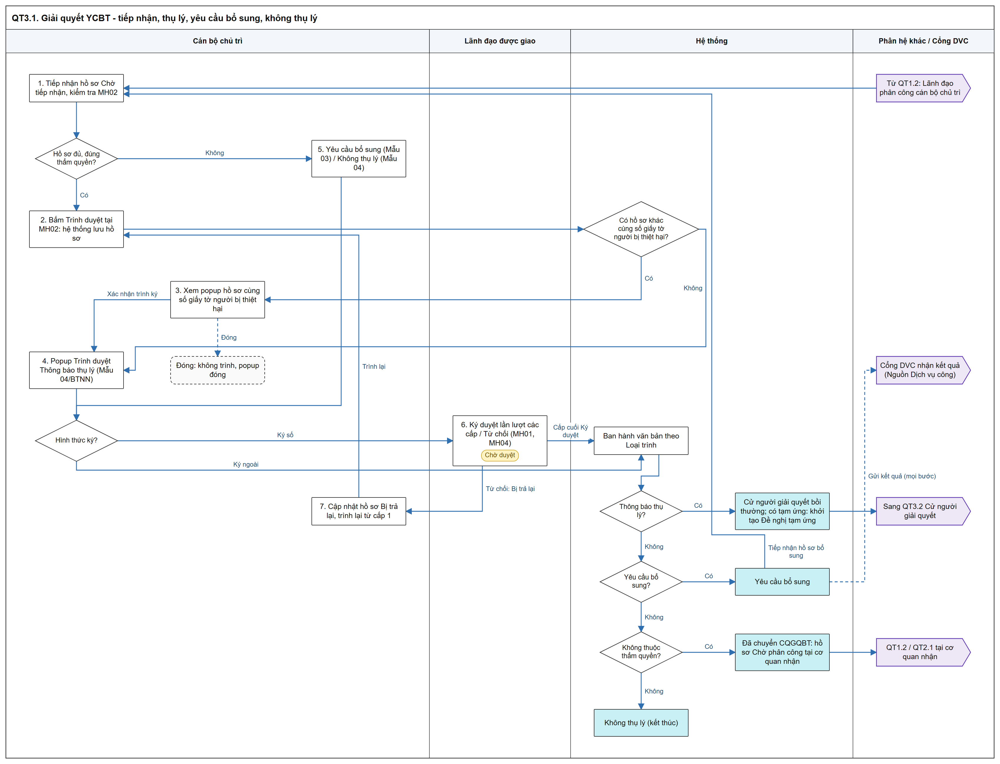
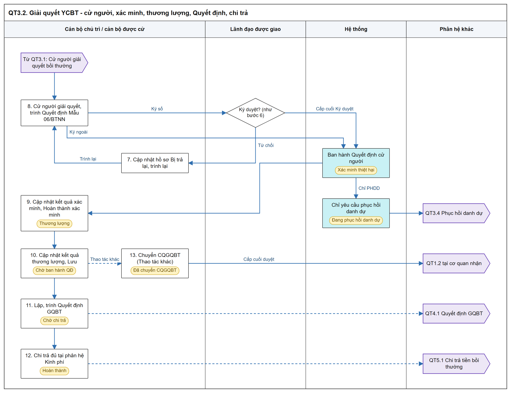
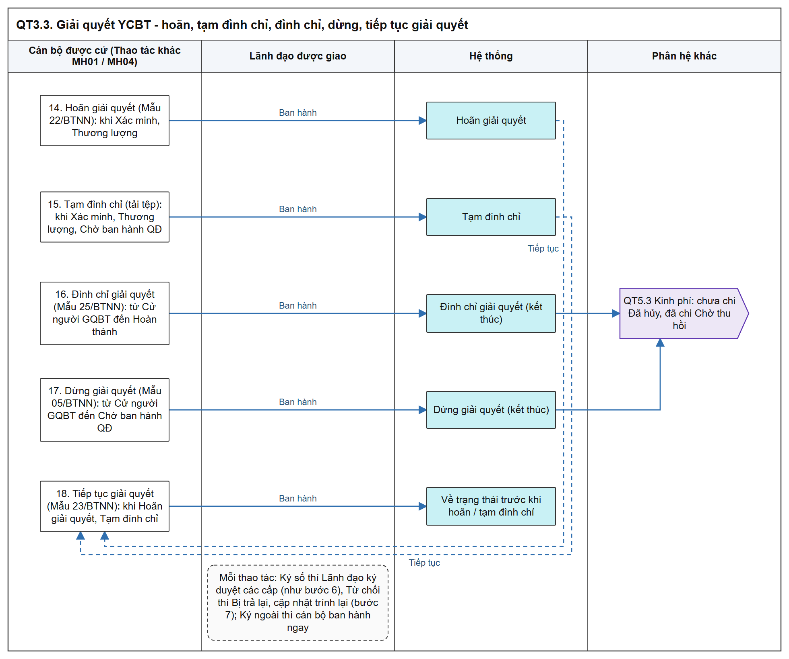
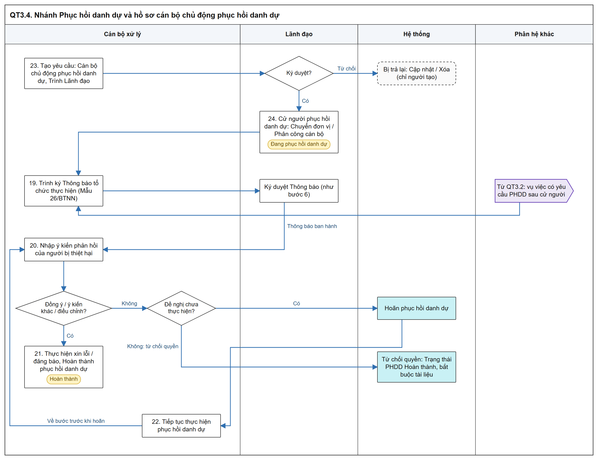

# Giải quyết yêu cầu bồi thường - Sơ đồ luồng các bước

[Tổng quan - Sơ đồ luồng nghiệp vụ BTNN - Tài liệu tổng hợp](00_Tong_quan_luong_BTNN.md)

## 1. Mục đích và điểm vào

- Cán bộ chủ trì tiếp nhận, trình Lãnh đạo thụ lý / yêu cầu bổ sung / không thụ lý, cử người giải quyết, xác minh thiệt hại, thương lượng; xử lý hoãn, tạm đình chỉ, đình chỉ, dừng giải quyết; theo dõi nhánh Phục hồi danh dự.
- Phục hồi danh dự thuộc phân hệ này (không còn menu riêng); hồ sơ dùng chung `Mã hồ sơ` `BT-` cho cả 03 Loại yêu cầu.
- Menu: `Bồi thường nhà nước` > `Giải quyết bồi thường` > `Giải quyết yêu cầu bồi thường`.
- Mockup: [quan_ly_boi_thuong.html](https://huyendt2007.github.io/BPBD_UI/UI_Mockup/Website_Quan_tri/03_Boi_thuong_nha_nuoc/quan_ly_boi_thuong.html).
- SRS: [Giải quyết yêu cầu bồi thường - Công tác bồi thường nhà nước (Website Quản trị)](../../03_Website_Quan_tri/03_Cong_tac_boi_thuong/SRS_BTNN_GiaiQuyetBT_GiaiQuyet_YCBT.md).
- Mọi phiếu trình dùng chung cơ chế: Hình thức ký `Ký số trên hệ thống` (trình Lãnh đạo nhiều cấp) hoặc `Ký ngoài` (cán bộ `Ban hành văn bản`); Lãnh đạo Từ chối → `Bị trả lại`; trình lại từ cấp 1.

## 2. Sơ đồ luồng các bước

### 2.1. Tiếp nhận, thụ lý, yêu cầu bổ sung, không thụ lý

- Bản SVG để phóng to: [03_1_tiep_nhan_thu_ly.svg](images/03_1_tiep_nhan_thu_ly.svg)

- `Chuyển hồ sơ cho` khi Không thụ lý không thuộc thẩm quyền:

| TH | Nguồn hồ sơ gốc / lần chuyển | Lựa chọn | Hệ quả khi ban hành |
| :--- | :--- | :--- | :--- |
| TH1 | Tiếp nhận mới / Dịch vụ công, đơn vị thứ 1, Trung ương | `Bộ Tư pháp` hoặc `Cơ quan giải quyết bồi thường khác` | Tạo hồ sơ Xác định CQGQBT tại Bộ Tư pháp, hoặc hồ sơ Giải quyết YCBT tại cơ quan nhận |
| TH2 | Như TH1, Địa phương | `Sở Tư pháp [Tên tỉnh, thành phố]` hoặc `Cơ quan giải quyết bồi thường khác` | Tạo hồ sơ Xác định CQGQBT tại Sở Tư pháp cùng tỉnh, hoặc như TH1 |
| TH3 | Từ đơn vị thứ 2, Trung ương | Chỉ `Bộ Tư pháp`, chọn sẵn | Hệ thống tự tạo hồ sơ Xác định CQGQBT tại Bộ Tư pháp |
| TH4 | Từ đơn vị thứ 2, Địa phương | Chỉ `Sở Tư pháp [Tên tỉnh, thành phố]`, chọn sẵn | Hệ thống tự tạo hồ sơ Xác định CQGQBT tại Sở Tư pháp cùng tỉnh |
| TH5 | Đã qua Xác định CQGQBT, hoặc hồ sơ đến qua `Chuyển CQGQBT` | Cả 03 lựa chọn | Như TH1, TH2; không tính số lần chuyển |

- Căn cứ: [Quy tắc Chuyển hồ sơ cho - Giải quyết yêu cầu bồi thường - Công tác bồi thường nhà nước (Website Quản trị)](../../03_Website_Quan_tri/03_Cong_tac_boi_thuong/SRS_BTNN_GiaiQuyetBT_GiaiQuyet_YCBT.md#gq-ktl-quy-tac-chuyen).

### 2.2. Cử người, xác minh, thương lượng và chuyển sang Quyết định

- Bản SVG để phóng to: [03_2_cu_nguoi_xac_minh.svg](images/03_2_cu_nguoi_xac_minh.svg)

### 2.3. Hoãn, tạm đình chỉ, đình chỉ, dừng giải quyết, tiếp tục giải quyết

- Bản SVG để phóng to: [03_3_hoan_dinh_chi.svg](images/03_3_hoan_dinh_chi.svg)

- Chỉ áp dụng nhánh Giải quyết bồi thường thiệt hại; nhánh Phục hồi danh dự không bị ảnh hưởng.

### 2.4. Nhánh Phục hồi danh dự và hồ sơ cán bộ chủ động phục hồi danh dự

- Bản SVG để phóng to: [03_4_phuc_hoi_danh_du.svg](images/03_4_phuc_hoi_danh_du.svg)

- Bước `Không đồng ý, đề xuất điều chỉnh` đi qua bước `Điều chỉnh theo đề xuất` trước khi tổ chức thực hiện ([Tab 3 Phục hồi danh dự - Giải quyết yêu cầu bồi thường - Công tác bồi thường nhà nước (Website Quản trị)](../../03_Website_Quan_tri/03_Cong_tac_boi_thuong/SRS_BTNN_GiaiQuyetBT_GiaiQuyet_YCBT.md#mh-chi-tiet-vu-viec-phdd)).
- Hồ sơ cán bộ chủ động phục hồi danh dự không qua `Chờ tiếp nhận`, Thông báo thụ lý, Cử người giải quyết bồi thường ([Hồ sơ cán bộ chủ động phục hồi danh dự - Giải quyết yêu cầu bồi thường - Công tác bồi thường nhà nước (Website Quản trị)](../../03_Website_Quan_tri/03_Cong_tac_boi_thuong/SRS_BTNN_GiaiQuyetBT_GiaiQuyet_YCBT.md#gq-cdpd)).

## 3. Bảng các bước

| STT | Người dùng giả lập gợi ý | Màn hình | Thao tác | Kết quả / Trạng thái sau | Tham chiếu SRS |
| :-- | :--- | :--- | :--- | :--- | :--- |
| 1 | Cán bộ chủ trì đã được phân công (mockup: vai trò `Cán bộ xử lý hồ sơ`) | MH01 | `Tiếp nhận` hồ sơ `Chờ tiếp nhận`, kiểm tra MH02 | Mở MH02; hồ sơ Dịch vụ công điền sẵn, Nguồn / Hình thức tiếp nhận chỉ đọc | [Hồ sơ nguồn Dịch vụ công - Tiếp nhận hồ sơ - Công tác bồi thường nhà nước (Website Quản trị)](../../03_Website_Quan_tri/03_Cong_tac_boi_thuong/SRS_BTNN_GiaiQuyetBT_TiepNhan_YCBT.md#tn-dvc) |
| 2 | Cán bộ chủ trì | MH02 | Bấm `Trình duyệt` (Thông báo thụ lý) khi hồ sơ hợp lệ | Hệ thống lưu hồ sơ, kiểm tra hồ sơ khác cùng số giấy tờ của người bị thiệt hại (cá nhân: Số giấy tờ thân nhân; tổ chức: Mã số tổ chức) trên toàn hệ thống, mọi trạng thái | [Popup Danh sách hồ sơ giải quyết bồi thường cùng số giấy tờ người bị thiệt hại - Giải quyết yêu cầu bồi thường - Công tác bồi thường nhà nước (Website Quản trị)](../../03_Website_Quan_tri/03_Cong_tac_boi_thuong/SRS_BTNN_GiaiQuyetBT_GiaiQuyet_YCBT.md#gq-popup-kiem-tra-trung) |
| 3 | Cán bộ chủ trì | Popup Danh sách hồ sơ cùng số giấy tờ người bị thiệt hại | Có ít nhất 01 hồ sơ trùng: xem danh sách, bấm `Xác nhận trình ký` hoặc `Đóng` | `Xác nhận trình ký`: mở popup trình ký; `Đóng`: đóng popup, không trình | Cùng mục trên |
| 4 | Cán bộ chủ trì | Popup Trình duyệt Thông báo thụ lý | Không có hồ sơ trùng (mở thẳng) hoặc sau `Xác nhận trình ký`: trình Thông báo thụ lý (Mẫu 04/BTNN) | Ký số: `Chờ duyệt`; Ký ngoài: `Cử người giải quyết bồi thường` | [Màn hình Ký duyệt / Từ chối - Giải quyết yêu cầu bồi thường - Công tác bồi thường nhà nước (Website Quản trị)](../../03_Website_Quan_tri/03_Cong_tac_boi_thuong/SRS_BTNN_GiaiQuyetBT_GiaiQuyet_YCBT.md#gq-ky-duyet-tu-choi) |
| 5 | Cán bộ chủ trì | MH01 | `Yêu cầu bổ sung` (Mẫu 03/BTNN) / `Không thụ lý` (Mẫu 04/BTNN) | Sau ban hành: `Yêu cầu bổ sung` / `Không thụ lý` / `Đã chuyển CQGQBT` | [Chức năng Ký duyệt / Từ chối - Giải quyết yêu cầu bồi thường - Công tác bồi thường nhà nước (Website Quản trị)](../../03_Website_Quan_tri/03_Cong_tac_boi_thuong/SRS_BTNN_GiaiQuyetBT_GiaiQuyet_YCBT.md#gq-ky-duyet-chuc-nang) |
| 6 | Lãnh đạo được chọn (mockup: vai trò `Lãnh đạo đơn vị`) | MH01 / MH04 | `Ký duyệt` lần lượt các cấp / `Từ chối` (mọi Loại trình của phân hệ) | Cấp cuối: theo TH2 - TH13; Từ chối: `Bị trả lại` | [Chức năng Ký duyệt / Từ chối - Giải quyết yêu cầu bồi thường - Công tác bồi thường nhà nước (Website Quản trị)](../../03_Website_Quan_tri/03_Cong_tac_boi_thuong/SRS_BTNN_GiaiQuyetBT_GiaiQuyet_YCBT.md#gq-ky-duyet-chuc-nang) |
| 7 | Cán bộ chủ trì | MH01 / popup trình | `Cập nhật` hồ sơ `Bị trả lại` (popup điền sẵn, khối `Lý do bị trả lại`), trình lại | `Chờ duyệt`, bắt đầu lại từ cấp 1 | Cùng mục trên |
| 8 | Cán bộ chủ trì | Popup Cử người giải quyết bồi thường | Chọn cán bộ (dòng đầu là chủ trì), trình Mẫu 06/BTNN | Ban hành: `Xác minh thiệt hại` (Chỉ PHDD: `Đang phục hồi danh dự`) | [Phân hồ sơ sau Quyết định cử người - Giải quyết yêu cầu bồi thường - Công tác bồi thường nhà nước (Website Quản trị)](../../03_Website_Quan_tri/03_Cong_tac_boi_thuong/SRS_BTNN_GiaiQuyetBT_GiaiQuyet_YCBT.md#gq-cng-phan-ho-so) |
| 9 | Cán bộ được cử | MH03 khối Xác minh thiệt hại | `Cập nhật kết quả xác minh`, `Hoàn thành xác minh` | `Thương lượng` | [Khối Xác minh thiệt hại thực tế - Giải quyết yêu cầu bồi thường - Công tác bồi thường nhà nước (Website Quản trị)](../../03_Website_Quan_tri/03_Cong_tac_boi_thuong/SRS_BTNN_GiaiQuyetBT_GiaiQuyet_YCBT.md#gq-khoi-xac-minh) |
| 10 | Cán bộ được cử | MH03 khối Thương lượng | `Cập nhật kết quả thương lượng`, `Lưu kết quả thương lượng` | `Chờ ban hành QĐ` | [Khối Thương lượng giải quyết bồi thường - Giải quyết yêu cầu bồi thường - Công tác bồi thường nhà nước (Website Quản trị)](../../03_Website_Quan_tri/03_Cong_tac_boi_thuong/SRS_BTNN_GiaiQuyetBT_GiaiQuyet_YCBT.md#gq-khoi-thuong-luong) |
| 11 | Cán bộ được cử | Quyết định GQBT | Lập, trình Quyết định | Quyết định ban hành: `Chờ chi trả` | [Quyết định GQBT - Sơ đồ luồng nghiệp vụ BTNN - Tài liệu tổng hợp](04_Quyet_dinh_GQBT.md) |
| 12 | Cán bộ được cử | Kinh phí | Chi trả đủ | `Hoàn thành` | [Kinh phí - Sơ đồ luồng nghiệp vụ BTNN - Tài liệu tổng hợp](05_Kinh_phi_BT.md) |
| 13 | Cán bộ được cử | MH01 `Thao tác khác` | `Chuyển CQGQBT` | Cấp cuối phê duyệt: `Đã chuyển CQGQBT`; hồ sơ `BT-` mới tại cơ quan nhận | [Chuyển CQGQBT trong quá trình giải quyết - Giải quyết yêu cầu bồi thường - Công tác bồi thường nhà nước (Website Quản trị)](../../03_Website_Quan_tri/03_Cong_tac_boi_thuong/SRS_BTNN_GiaiQuyetBT_GiaiQuyet_YCBT.md#gq-chuyen-cqgqbt) |
| 14 | Cán bộ được cử | Popup Trình duyệt Hoãn giải quyết bồi thường | Hoãn giải quyết (Mẫu 22/BTNN), khi `Xác minh thiệt hại`, `Thương lượng` | `Hoãn giải quyết` | [Popup Trình duyệt Hoãn giải quyết bồi thường - Giải quyết yêu cầu bồi thường - Công tác bồi thường nhà nước (Website Quản trị)](../../03_Website_Quan_tri/03_Cong_tac_boi_thuong/SRS_BTNN_GiaiQuyetBT_GiaiQuyet_YCBT.md#gq-popup-hoan) |
| 15 | Cán bộ được cử | Popup Trình duyệt Tạm đình chỉ | Tạm đình chỉ (tải tệp), khi `Xác minh thiệt hại`, `Thương lượng`, `Chờ ban hành QĐ` | `Tạm đình chỉ` | [Popup Trình duyệt Tạm đình chỉ giải quyết bồi thường - Giải quyết yêu cầu bồi thường - Công tác bồi thường nhà nước (Website Quản trị)](../../03_Website_Quan_tri/03_Cong_tac_boi_thuong/SRS_BTNN_GiaiQuyetBT_GiaiQuyet_YCBT.md#gq-popup-tam-dinh-chi) |
| 16 | Cán bộ được cử | Popup Trình ký Quyết định Đình chỉ | Đình chỉ giải quyết (Mẫu 25/BTNN), chọn Thu hồi / Không thu hồi kinh phí đã chi | `Đình chỉ giải quyết` | [Popup Trình ký Quyết định Đình chỉ giải quyết yêu cầu bồi thường - Giải quyết yêu cầu bồi thường - Công tác bồi thường nhà nước (Website Quản trị)](../../03_Website_Quan_tri/03_Cong_tac_boi_thuong/SRS_BTNN_GiaiQuyetBT_GiaiQuyet_YCBT.md#gq-popup-dinh-chi) |
| 17 | Cán bộ được cử | Popup Trình ký Thông báo dừng giải quyết | Dừng giải quyết (Mẫu 05/BTNN), khi `Cử người giải quyết bồi thường` đến `Chờ ban hành QĐ` | `Dừng giải quyết` | [Popup Trình ký Thông báo dừng giải quyết yêu cầu bồi thường - Giải quyết yêu cầu bồi thường - Công tác bồi thường nhà nước (Website Quản trị)](../../03_Website_Quan_tri/03_Cong_tac_boi_thuong/SRS_BTNN_GiaiQuyetBT_GiaiQuyet_YCBT.md#gq-popup-dung-giai-quyet) |
| 18 | Cán bộ được cử | Popup Trình ký Quyết định tiếp tục | Tiếp tục giải quyết (Mẫu 23/BTNN), khi `Hoãn giải quyết`, `Tạm đình chỉ` | Trạng thái trước khi hoãn / tạm đình chỉ | [Popup Trình ký Quyết định tiếp tục giải quyết bồi thường - Giải quyết yêu cầu bồi thường - Công tác bồi thường nhà nước (Website Quản trị)](../../03_Website_Quan_tri/03_Cong_tac_boi_thuong/SRS_BTNN_GiaiQuyetBT_GiaiQuyet_YCBT.md#gq-popup-tiep-tuc) |
| 19 | Cán bộ được cử / được phân công PHDD | MH04 Tab Phục hồi danh dự | Trình ký Thông báo tổ chức thực hiện phục hồi danh dự (Mẫu 26/BTNN) | Ban hành: sang Bước 2 | [Popup Trình ký Thông báo tổ chức thực hiện phục hồi danh dự - Giải quyết yêu cầu bồi thường - Công tác bồi thường nhà nước (Website Quản trị)](../../03_Website_Quan_tri/03_Cong_tac_boi_thuong/SRS_BTNN_GiaiQuyetBT_GiaiQuyet_YCBT.md#gq-popup-trinh-ky-m26) |
| 20 | Như trên | Tab Phục hồi danh dự - Khối 2 | Nhập ý kiến phản hồi của người bị thiệt hại | Theo ý kiến: Tổ chức thực hiện / Điều chỉnh theo đề xuất / `Hoãn phục hồi danh dự` / Trạng thái PHDD `Hoàn thành` (từ chối quyền) | [Tab 3 Phục hồi danh dự - Giải quyết yêu cầu bồi thường - Công tác bồi thường nhà nước (Website Quản trị)](../../03_Website_Quan_tri/03_Cong_tac_boi_thuong/SRS_BTNN_GiaiQuyetBT_GiaiQuyet_YCBT.md#mh-chi-tiet-vu-viec-phdd) |
| 21 | Như trên | Tab Phục hồi danh dự - Khối 3 | Thực hiện xin lỗi / đăng báo, `Hoàn thành phục hồi danh dự` | `Hoàn thành` | Cùng mục trên |
| 22 | Như trên | Form Tiếp tục thực hiện phục hồi danh dự | Tiếp tục khi `Hoãn phục hồi danh dự` | Về bước trước khi hoãn | [Tiếp tục thực hiện phục hồi danh dự - Giải quyết yêu cầu bồi thường - Công tác bồi thường nhà nước (Website Quản trị)](../../03_Website_Quan_tri/03_Cong_tac_boi_thuong/SRS_BTNN_GiaiQuyetBT_GiaiQuyet_YCBT.md#gq-phdd-tiep-tuc) |
| 23 | Cán bộ bất kỳ có quyền | MH01 `Tạo yêu cầu` | Hình thức tạo `Cán bộ chủ động phục hồi danh dự`, `Trình Lãnh đạo` | `Chờ duyệt` → cấp cuối Ký duyệt / Ký ngoài: `Cử người phục hồi danh dự` | [Hồ sơ cán bộ chủ động phục hồi danh dự - Giải quyết yêu cầu bồi thường - Công tác bồi thường nhà nước (Website Quản trị)](../../03_Website_Quan_tri/03_Cong_tac_boi_thuong/SRS_BTNN_GiaiQuyetBT_GiaiQuyet_YCBT.md#gq-cdpd) |
| 24 | Lãnh đạo đơn vị đang phân công | Popup Cử người phục hồi danh dự | Chuyển đơn vị / Phân công cán bộ | Chuyển đơn vị: giữ `Cử người phục hồi danh dự`; Phân công: `Đang phục hồi danh dự` | [Popup Cử người phục hồi danh dự - Giải quyết yêu cầu bồi thường - Công tác bồi thường nhà nước (Website Quản trị)](../../03_Website_Quan_tri/03_Cong_tac_boi_thuong/SRS_BTNN_GiaiQuyetBT_GiaiQuyet_YCBT.md#gq-popup-cu-nguoi-phdd) |

## 4. Trạng thái

- 20 trạng thái vụ việc, theo [Trạng thái vụ việc Giải quyết YCBT - Giải quyết yêu cầu bồi thường - Công tác bồi thường nhà nước (Website Quản trị)](../../03_Website_Quan_tri/03_Cong_tac_boi_thuong/SRS_BTNN_GiaiQuyetBT_GiaiQuyet_YCBT.md#gq-trang-thai-vu-viec):

| STT | Trạng thái | Tab | Thao tác của Cán bộ xử lý tại MH01 |
| :-- | :--- | :--- | :--- |
| 1 | Chờ tiếp nhận | Chờ xử lý | Tiếp nhận, Yêu cầu bổ sung, Không thụ lý |
| 2 | Chờ duyệt | Chờ xử lý | Lãnh đạo: Ký duyệt, Từ chối |
| 3 | Bị trả lại | Chờ xử lý | Cập nhật; Yêu cầu bổ sung, Không thụ lý (Loại trình Thông báo) |
| 4 | Cử người giải quyết bồi thường | Chờ xử lý | Cử người giải quyết; Chuyển CQGQBT; Đình chỉ giải quyết |
| 5 | Cử người phục hồi danh dự | Chờ xử lý | Lãnh đạo đơn vị đang phân công: Cử người phục hồi danh dự |
| 6 | Xác minh thiệt hại | Chờ xử lý | Cập nhật kết quả xác minh; Chuyển CQGQBT; Hoãn; Tạm đình chỉ; Đình chỉ |
| 7 | Thương lượng | Chờ xử lý | Cập nhật kết quả thương lượng; Chuyển CQGQBT; Hoãn; Tạm đình chỉ; Đình chỉ |
| 8 | Chờ ban hành QĐ | Chờ xử lý | Chuyển CQGQBT; Tạm đình chỉ; Đình chỉ |
| 9 | Chờ chi trả | Chờ xử lý | Đình chỉ |
| 10 | Hoàn thành | Đã xử lý | Đình chỉ tại thanh thao tác MH04 |
| 11 | Đang phục hồi danh dự | Chờ xử lý | Cập nhật phục hồi danh dự; Chuyển CQGQBT |
| 12 | Hoãn phục hồi danh dự | Chờ xử lý | Cập nhật phục hồi danh dự |
| 13 | Từ chối phục hồi danh dự | Đã xử lý | Kết thúc |
| 14 | Hoãn giải quyết | Chờ xử lý | Tiếp tục giải quyết; Chuyển CQGQBT |
| 15 | Tạm đình chỉ | Chờ xử lý | Tiếp tục giải quyết |
| 16 | Đình chỉ giải quyết | Đã xử lý | Kết thúc |
| 17 | Dừng giải quyết | Đã xử lý | Kết thúc |
| 18 | Đã chuyển CQGQBT | Đã xử lý | Kết thúc |
| 19 | Không thụ lý | Đã xử lý | Kết thúc |
| 20 | Yêu cầu bổ sung | Chờ xử lý | Tiếp nhận (bổ sung), Không thụ lý; Chuyển CQGQBT |

- Cột Thao tác lấy theo [Cột Thao tác MH01 - Giải quyết yêu cầu bồi thường - Công tác bồi thường nhà nước (Website Quản trị)](../../03_Website_Quan_tri/03_Cong_tac_boi_thuong/SRS_BTNN_GiaiQuyetBT_GiaiQuyet_YCBT.md#gq-mh01-thao-tac); tab `Đã xử lý` của trạng thái kết thúc suy từ quy tắc chung. Các điểm SRS chưa thống nhất (Dừng giải quyết, Chuyển CQGQBT ở `Chờ chi trả` / `Hoãn phục hồi danh dự`) ghi tại mục 6.

## 5. Liên thông

| Chiều | Phân hệ | Dữ liệu / trạng thái |
| :--- | :--- | :--- |
| Vào | Tiếp nhận hồ sơ / Xác định CQGQBT | Hồ sơ `Chờ tiếp nhận`, giữ Nguồn hồ sơ, `Mã vụ việc`; sinh `Mã hồ sơ` `BT-` |
| Ra | Tiếp nhận hồ sơ cơ quan nhận | Hồ sơ `Chuyển CQGQBT` `Chờ phân công` (Không thụ lý không thuộc thẩm quyền, Chuyển CQGQBT) |
| Ra | Quyết định GQBT | Vụ việc `Chờ ban hành QĐ`; dữ liệu xác minh / thương lượng làm nguồn Bảng đề xuất bồi thường |
| Vào | Quyết định GQBT | Quyết định ban hành: vụ việc `Chờ chi trả` |
| Ra / Vào | Kinh phí | Tạo QĐ tạm ứng khi `Xác minh thiệt hại`, `Thương lượng`, `Chờ ban hành QĐ`; chi đủ: vụ việc `Hoàn thành`; Đình chỉ / Dừng: bản ghi kinh phí `Đã hủy` / `Chờ thu hồi` |
| Ra | Xem xét hoàn trả | Vụ việc đã hoàn tất chi trả được lập hồ sơ `HT-` |
| Ra | Dịch vụ công | 16 bước gửi kết quả (link tệp và mã băm) khi Nguồn hồ sơ `Dịch vụ công`; xem [Gửi kết quả về Dịch vụ công quốc gia - Giải quyết yêu cầu bồi thường - Công tác bồi thường nhà nước (Website Quản trị)](../../03_Website_Quan_tri/03_Cong_tac_boi_thuong/SRS_BTNN_GiaiQuyetBT_GiaiQuyet_YCBT.md#gq-gui-ket-qua-dvc) và [Gửi kết quả xử lý hồ sơ về Dịch vụ công - Kết nối, chia sẻ dữ liệu với Dịch vụ công quốc gia - Tài liệu tích hợp](../../../Tai_lieu_tich_hop/1.%20Dịch%20vụ%20công/Ket_noi_chia_se_Dich_vu_cong_BTNN.md#dvc-gui-ket-qua) |
| Ra | Báo cáo | Vụ việc chỉ có yêu cầu phục hồi danh dự không thống kê |

## 6. Điểm cần lưu ý khi kiểm thử

- Trình duyệt Thông báo thụ lý: hệ thống kiểm tra hồ sơ khác cùng số giấy tờ của người bị thiệt hại trên toàn hệ thống, mọi trạng thái; có ít nhất 01 hồ sơ thì mở popup danh sách (`Xác nhận trình ký` mở popup trình ký, `Đóng` không trình), không có thì mở thẳng popup trình ký ([Popup Danh sách hồ sơ giải quyết bồi thường cùng số giấy tờ người bị thiệt hại - Giải quyết yêu cầu bồi thường - Công tác bồi thường nhà nước (Website Quản trị)](../../03_Website_Quan_tri/03_Cong_tac_boi_thuong/SRS_BTNN_GiaiQuyetBT_GiaiQuyet_YCBT.md#gq-popup-kiem-tra-trung)).
- Lãnh đạo không ký duyệt các Loại trình `Quyết định GQBT`, `Hủy QĐ`, `Sửa chữa, bổ sung QĐ` tại phân hệ này ([Màn hình Ký duyệt / Từ chối - Giải quyết yêu cầu bồi thường - Công tác bồi thường nhà nước (Website Quản trị)](../../03_Website_Quan_tri/03_Cong_tac_boi_thuong/SRS_BTNN_GiaiQuyetBT_GiaiQuyet_YCBT.md#gq-ky-duyet-tu-choi)).
- Từ chối: bắt buộc `Lý do từ chối`; kết quả Ký duyệt các cấp của lượt trình mất hiệu lực ([Chức năng Ký duyệt / Từ chối - Giải quyết yêu cầu bồi thường - Công tác bồi thường nhà nước (Website Quản trị)](../../03_Website_Quan_tri/03_Cong_tac_boi_thuong/SRS_BTNN_GiaiQuyetBT_GiaiQuyet_YCBT.md#gq-ky-duyet-chuc-nang)).
- Sau khi ban hành Quyết định cử người: cán bộ có tài khoản trong danh sách nhận hồ sơ; toàn bộ nhập tự do thì mọi cán bộ của cơ quan nhận hồ sơ ([Phân hồ sơ sau Quyết định cử người - Giải quyết yêu cầu bồi thường - Công tác bồi thường nhà nước (Website Quản trị)](../../03_Website_Quan_tri/03_Cong_tac_boi_thuong/SRS_BTNN_GiaiQuyetBT_GiaiQuyet_YCBT.md#gq-cng-phan-ho-so)).
- `Chuyển CQGQBT` không áp dụng cho Loại yêu cầu `Chỉ yêu cầu phục hồi danh dự` và hồ sơ đã kết thúc; ở `Chờ tiếp nhận`, `Bị trả lại` dùng `Không thụ lý` lý do không thuộc thẩm quyền ([Chuyển CQGQBT trong quá trình giải quyết - Giải quyết yêu cầu bồi thường - Công tác bồi thường nhà nước (Website Quản trị)](../../03_Website_Quan_tri/03_Cong_tac_boi_thuong/SRS_BTNN_GiaiQuyetBT_GiaiQuyet_YCBT.md#gq-chuyen-cqgqbt)).
- Chuyển CQGQBT: không chuyển tài liệu đính kèm của bước Xác minh thiệt hại, trừ dòng `Báo cáo xác minh thiệt hại` (cùng mục trên).
- `Chuyển hồ sơ cho`: không xác định được Sở Tư pháp cùng tỉnh thì không cho trình, không cho ban hành; lựa chọn ngoài quy tắc bị chặn ([Quy tắc Chuyển hồ sơ cho - Giải quyết yêu cầu bồi thường - Công tác bồi thường nhà nước (Website Quản trị)](../../03_Website_Quan_tri/03_Cong_tac_boi_thuong/SRS_BTNN_GiaiQuyetBT_GiaiQuyet_YCBT.md#gq-ktl-quy-tac-chuyen)).
- Thành phần bắt buộc tham gia thương lượng do hệ thống tự tạo theo Cấp đơn vị, Tỉnh/Thành phố, Lĩnh vực ([Quy tắc xác định Thành phần bắt buộc tham gia thương lượng - Giải quyết yêu cầu bồi thường - Công tác bồi thường nhà nước (Website Quản trị)](../../03_Website_Quan_tri/03_Cong_tac_boi_thuong/SRS_BTNN_GiaiQuyetBT_GiaiQuyet_YCBT.md#gq-tl-quy-tac-thanh-phan)).
- Tạm đình chỉ chỉ tải tệp lên, không sinh theo mẫu; Tiếp tục giải quyết trả về đúng trạng thái đã lưu khi hoãn / tạm đình chỉ ([Popup Trình duyệt Tạm đình chỉ giải quyết bồi thường - Giải quyết yêu cầu bồi thường - Công tác bồi thường nhà nước (Website Quản trị)](../../03_Website_Quan_tri/03_Cong_tac_boi_thuong/SRS_BTNN_GiaiQuyetBT_GiaiQuyet_YCBT.md#gq-popup-tam-dinh-chi)).
- Đình chỉ, Dừng giải quyết có lựa chọn `Thu hồi kinh phí bồi thường đã chi`; `Không thu hồi` thì bắt buộc lý do và hiển thị trên màn hình Ký duyệt ([Màn hình Ký duyệt / Từ chối - Giải quyết yêu cầu bồi thường - Công tác bồi thường nhà nước (Website Quản trị)](../../03_Website_Quan_tri/03_Cong_tac_boi_thuong/SRS_BTNN_GiaiQuyetBT_GiaiQuyet_YCBT.md#gq-ky-duyet-tu-choi)).
- Hồ sơ cán bộ chủ động phục hồi danh dự: từ khi tạo đến khi cấp cuối Ký duyệt chỉ người tạo thấy; Xóa chỉ người tạo, khi `Bị trả lại` ([Phạm vi xem hồ sơ cán bộ chủ động phục hồi danh dự - Giải quyết yêu cầu bồi thường - Công tác bồi thường nhà nước (Website Quản trị)](../../03_Website_Quan_tri/03_Cong_tac_boi_thuong/SRS_BTNN_GiaiQuyetBT_GiaiQuyet_YCBT.md#gq-cdpd-pham-vi-xem)).
- Gửi Dịch vụ công không thành công: hệ thống tự gửi lại, không hoàn tác nghiệp vụ; xem tại Nhật ký đồng bộ Dịch vụ công ([Gửi kết quả về Dịch vụ công quốc gia - Giải quyết yêu cầu bồi thường - Công tác bồi thường nhà nước (Website Quản trị)](../../03_Website_Quan_tri/03_Cong_tac_boi_thuong/SRS_BTNN_GiaiQuyetBT_GiaiQuyet_YCBT.md#gq-gui-ket-qua-dvc)).
- Điểm SRS chưa thống nhất, cần BA xác nhận trước khi viết ca kiểm thử:
  + Danh sách trạng thái được `Chuyển CQGQBT`: quy tắc chung gồm `Chờ chi trả`, `Hoãn phục hồi danh dự`; cột Thao tác MH01 không gồm.
  + `Dừng giải quyết` có tại popup và thanh thao tác MH04 nhưng không có trong danh sách `Thao tác khác` của cột Thao tác MH01.
  + Ý kiến `Từ chối quyền được phục hồi danh dự` ghi Trạng thái Phục hồi danh dự `Hoàn thành`, "Không có trạng thái Từ chối"; danh sách trạng thái vụ việc vẫn có `Từ chối phục hồi danh dự`.
  + Ký duyệt Thông báo thụ lý (TH3) khởi tạo Đề nghị tạm ứng; SRS Kinh phí ghi bản ghi Tạm ứng chỉ tạo tại `Tạo QĐ tạm ứng`.
