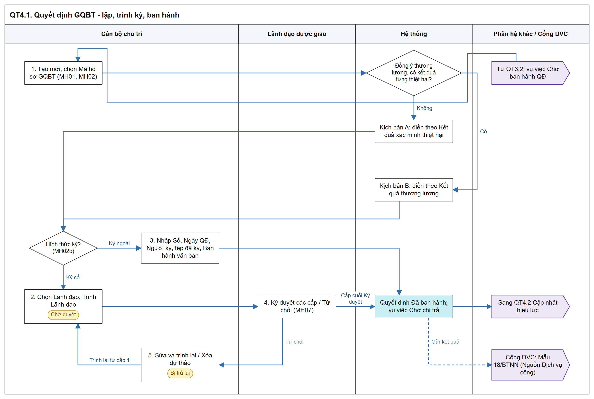
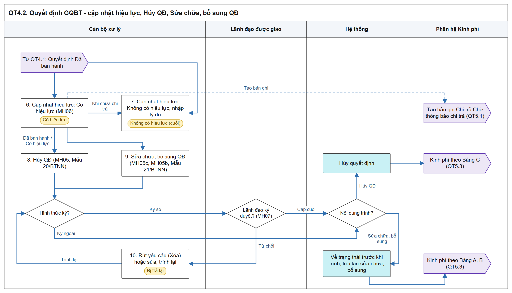

# Quyết định giải quyết bồi thường - Sơ đồ luồng các bước

[Tổng quan - Sơ đồ luồng nghiệp vụ BTNN - Tài liệu tổng hợp](00_Tong_quan_luong_BTNN.md)

## 1. Mục đích và điểm vào

- Lập dự thảo Quyết định giải quyết bồi thường (Mẫu 18/BTNN) từ vụ việc `Chờ ban hành QĐ`, trình Lãnh đạo nhiều cấp hoặc ban hành Ký ngoài; cập nhật hiệu lực; Hủy QĐ (Mẫu 20/BTNN), Sửa chữa, bổ sung QĐ (Mẫu 21/BTNN).
- Quyết định `Có hiệu lực` thì hệ thống tạo bản ghi `Chi trả tiền bồi thường`.
- Menu: `Bồi thường nhà nước` > `Giải quyết bồi thường` > `Quyết định giải quyết bồi thường`.
- Mockup: [quyet_dinh_giai_quyet_boi_thuong.html](https://huyendt2007.github.io/BPBD_UI/UI_Mockup/Website_Quan_tri/03_Boi_thuong_nha_nuoc/quyet_dinh_giai_quyet_boi_thuong.html).
- SRS: [Quyết định giải quyết bồi thường - Công tác bồi thường nhà nước (Website Quản trị)](../../03_Website_Quan_tri/03_Cong_tac_boi_thuong/SRS_BTNN_GiaiQuyetBT_QuyetDinh_GQBT.md).

## 2. Sơ đồ luồng các bước

### 2.1. Lập, trình ký và ban hành Quyết định

- Bản SVG để phóng to: [04_1_lap_ban_hanh.svg](images/04_1_lap_ban_hanh.svg)

### 2.2. Cập nhật hiệu lực, Hủy QĐ, Sửa chữa bổ sung QĐ

- Bản SVG để phóng to: [04_2_hieu_luc_huy_sua.svg](images/04_2_hieu_luc_huy_sua.svg)

## 3. Bảng các bước

| STT | Người dùng giả lập gợi ý | Màn hình | Thao tác | Kết quả / Trạng thái sau | Tham chiếu SRS |
| :-- | :--- | :--- | :--- | :--- | :--- |
| 1 | Cán bộ chủ trì vụ việc `Chờ ban hành QĐ` | MH01, MH02 | Tạo mới, chọn Mã hồ sơ GQBT | Tự điền theo Kịch bản A / B; khối thông tin chỉ hiện khi đã chọn mã hợp lệ | [Quy tắc tự động điền khi chọn Mã hồ sơ giải quyết bồi thường - Quyết định giải quyết bồi thường - Công tác bồi thường nhà nước (Website Quản trị)](../../03_Website_Quan_tri/03_Cong_tac_boi_thuong/SRS_BTNN_GiaiQuyetBT_QuyetDinh_GQBT.md#qd-quy-tac-tu-dong-dien) |
| 2 | Như trên | MH02b | Ký số: chọn Lãnh đạo, `Trình Lãnh đạo` | `Chờ duyệt` - `Quyết định GQBT` | [MH02b - Popup Trình ký Quyết định giải quyết bồi thường - Quyết định giải quyết bồi thường - Công tác bồi thường nhà nước (Website Quản trị)](../../03_Website_Quan_tri/03_Cong_tac_boi_thuong/SRS_BTNN_GiaiQuyetBT_QuyetDinh_GQBT.md#qd-mh02b) |
| 3 | Như trên | MH02b | Ký ngoài: nhập Số, Ngày, Người ký, tệp đã ký, `Ban hành văn bản` | `Đã ban hành`; vụ việc `Chờ chi trả` | [Quy tắc chung - Quyết định giải quyết bồi thường - Công tác bồi thường nhà nước (Website Quản trị)](../../03_Website_Quan_tri/03_Cong_tac_boi_thuong/SRS_BTNN_GiaiQuyetBT_QuyetDinh_GQBT.md#qd-quy-tac-chung) |
| 4 | Lãnh đạo được chọn (người dùng giả lập là Lãnh đạo đơn vị) | MH07 | Ký duyệt / Từ chối | Cấp cuối: `Đã ban hành`; Từ chối: `Bị trả lại` | [MH07 - Màn hình Ký duyệt / Từ chối - Quyết định giải quyết bồi thường - Công tác bồi thường nhà nước (Website Quản trị)](../../03_Website_Quan_tri/03_Cong_tac_boi_thuong/SRS_BTNN_GiaiQuyetBT_QuyetDinh_GQBT.md#qd-mh07) |
| 5 | Cán bộ xử lý | MH01 | Sửa / Xóa dự thảo `Bị trả lại` | Trình lại từ cấp 1 / xóa, hồ sơ luồng về trạng thái trước khi trình | [MH01 - Màn hình Danh sách Quyết định giải quyết bồi thường - Quyết định giải quyết bồi thường - Công tác bồi thường nhà nước (Website Quản trị)](../../03_Website_Quan_tri/03_Cong_tac_boi_thuong/SRS_BTNN_GiaiQuyetBT_QuyetDinh_GQBT.md#qd-mh01) |
| 6 | Cán bộ xử lý | MH06 | Cập nhật hiệu lực: `Có hiệu lực` | Tab `Đã xử lý`; tạo bản ghi Chi trả `Chờ thông báo chi trả` | [Hiệu lực của Quyết định - Quyết định giải quyết bồi thường - Công tác bồi thường nhà nước (Website Quản trị)](../../03_Website_Quan_tri/03_Cong_tac_boi_thuong/SRS_BTNN_GiaiQuyetBT_QuyetDinh_GQBT.md#qd-quy-tac-hieu-luc) |
| 7 | Cán bộ xử lý | MH06 | Cập nhật hiệu lực: `Không có hiệu lực`, nhập lý do | Trạng thái cuối; mọi thao tác khóa | Cùng mục trên |
| 8 | Cán bộ xử lý | MH05 | Hủy QĐ (Ký số: bắt buộc ≥ 01 dòng `Tài liệu không ban hành kèm theo`) | `Chờ duyệt` - `Hủy QĐ` → `Hủy quyết định` | [MH05 - Popup Hủy Quyết định giải quyết bồi thường - Quyết định giải quyết bồi thường - Công tác bồi thường nhà nước (Website Quản trị)](../../03_Website_Quan_tri/03_Cong_tac_boi_thuong/SRS_BTNN_GiaiQuyetBT_QuyetDinh_GQBT.md#qd-mh05) |
| 9 | Cán bộ xử lý | MH05c, MH05b | Sửa chữa, bổ sung QĐ | Ban hành: Quyết định về trạng thái trước khi trình, nội dung hiện hành theo lần sửa chữa gần nhất | [MH05c - Màn hình Sửa chữa, bổ sung Quyết định giải quyết bồi thường - Quyết định giải quyết bồi thường - Công tác bồi thường nhà nước (Website Quản trị)](../../03_Website_Quan_tri/03_Cong_tac_boi_thuong/SRS_BTNN_GiaiQuyetBT_QuyetDinh_GQBT.md#qd-mh05c) |
| 10 | Cán bộ xử lý | MH01 | Xóa yêu cầu Hủy / Sửa chữa `Bị trả lại` = Rút yêu cầu | Quyết định về trạng thái trước khi trình; ghi `Rút yêu cầu` | [MH01 - Màn hình Danh sách Quyết định giải quyết bồi thường - Quyết định giải quyết bồi thường - Công tác bồi thường nhà nước (Website Quản trị)](../../03_Website_Quan_tri/03_Cong_tac_boi_thuong/SRS_BTNN_GiaiQuyetBT_QuyetDinh_GQBT.md#qd-mh01) |

## 4. Trạng thái

| Trạng thái | Tab Cán bộ xử lý | Vào khi | Ra khi |
| :--- | :--- | :--- | :--- |
| `Chờ duyệt` | Chờ xử lý | Trình Lãnh đạo (Quyết định GQBT / Hủy QĐ / Sửa chữa, bổ sung QĐ) | Cấp cuối duyệt theo Nội dung trình; Từ chối → `Bị trả lại` |
| `Bị trả lại` | Chờ xử lý | Một cấp Từ chối | Trình lại; Xóa dự thảo / Rút yêu cầu |
| `Đã ban hành` | Chờ xử lý | Cấp cuối Ký duyệt hoặc Ký ngoài | Cập nhật hiệu lực; Hủy QĐ; Sửa chữa, bổ sung QĐ |
| `Có hiệu lực` | Đã xử lý | Cập nhật hiệu lực | `Không có hiệu lực` khi chưa chi trả; Hủy QĐ; Sửa chữa, bổ sung QĐ |
| `Không có hiệu lực` | Đã xử lý | Cập nhật hiệu lực, bắt buộc lý do | Trạng thái cuối |
| `Hủy quyết định` | Đã xử lý | Hủy QĐ được ban hành | Kết thúc |

- Không có trạng thái `Chờ ban hành` ([Quy tắc chung - Quyết định giải quyết bồi thường - Công tác bồi thường nhà nước (Website Quản trị)](../../03_Website_Quan_tri/03_Cong_tac_boi_thuong/SRS_BTNN_GiaiQuyetBT_QuyetDinh_GQBT.md#qd-quy-tac-chung)).

## 5. Liên thông

| Chiều | Phân hệ | Dữ liệu / trạng thái |
| :--- | :--- | :--- |
| Vào | Giải quyết YCBT | Vụ việc `Chờ ban hành QĐ`; Kết quả xác minh / thương lượng, Thông tin người nhận tiền, Số tiền đã tạm ứng |
| Ra | Giải quyết YCBT | Ban hành: Số, Ngày, Số tiền, trạng thái quyết định ghi vào vụ việc; vụ việc `Chờ chi trả` |
| Ra | Kinh phí | `Có hiệu lực`: 01 bản ghi Chi trả; Sửa chữa, bổ sung / Hủy QĐ ban hành: xử lý bản ghi kinh phí theo [Ánh xạ dữ liệu liên thông sang Module Quản lý kinh phí bồi thường - Quyết định giải quyết bồi thường - Công tác bồi thường nhà nước (Website Quản trị)](../../03_Website_Quan_tri/03_Cong_tac_boi_thuong/SRS_BTNN_GiaiQuyetBT_QuyetDinh_GQBT.md#bang-anh-xa-lien-thong-kinh-phi) |
| Ra | Kinh phí | `Không có hiệu lực`: bản ghi Chi trả giữ nguyên, không cho `Trình thông báo chi trả`, `Cập nhật chi trả` |
| Ra | Dịch vụ công | Bước 7, 8, 9 (Mẫu 18, 20, 21/BTNN) khi Nguồn hồ sơ `Dịch vụ công` |

## 6. Điểm cần lưu ý khi kiểm thử

- Mỗi vụ việc tại một thời điểm chỉ có 01 phiếu trình đang chờ duyệt; trình lại bắt đầu từ cấp 1 ([Quy tắc chung - Quyết định giải quyết bồi thường - Công tác bồi thường nhà nước (Website Quản trị)](../../03_Website_Quan_tri/03_Cong_tac_boi_thuong/SRS_BTNN_GiaiQuyetBT_QuyetDinh_GQBT.md#qd-quy-tac-chung)).
- Tạo mới chỉ khi vụ việc `Chờ ban hành QĐ` và chưa có Quyết định còn hiệu lực (khác `Hủy quyết định`); người trình phải là cán bộ chủ trì (Điều kiện thực hiện của SRS).
- Ban hành chưa tạo bản ghi Chi trả; chỉ tạo khi `Có hiệu lực`; mỗi Quyết định 01 bản ghi ([Hiệu lực của Quyết định - Quyết định giải quyết bồi thường - Công tác bồi thường nhà nước (Website Quản trị)](../../03_Website_Quan_tri/03_Cong_tac_boi_thuong/SRS_BTNN_GiaiQuyetBT_QuyetDinh_GQBT.md#qd-quy-tac-hieu-luc)).
- `Cập nhật hiệu lực QĐ` từ `Có hiệu lực` bị khóa kèm tooltip khi bản ghi Chi trả đã `Hoàn thành` / có số tiền đã chi / `Trả lại ngân sách nhà nước` ([MH01 - Màn hình Danh sách Quyết định giải quyết bồi thường - Quyết định giải quyết bồi thường - Công tác bồi thường nhà nước (Website Quản trị)](../../03_Website_Quan_tri/03_Cong_tac_boi_thuong/SRS_BTNN_GiaiQuyetBT_QuyetDinh_GQBT.md#qd-mh01)).
- Quyết định `Không có hiệu lực`: thao tác khóa mờ; gọi thao tác hiển thị `Quyết định Không có hiệu lực, không cho phép thực hiện thao tác.` ([Quy tắc chung - Quyết định giải quyết bồi thường - Công tác bồi thường nhà nước (Website Quản trị)](../../03_Website_Quan_tri/03_Cong_tac_boi_thuong/SRS_BTNN_GiaiQuyetBT_QuyetDinh_GQBT.md#qd-quy-tac-chung)).
- Sửa chữa, bổ sung không tạo bản ghi quyết định mới; Số, Ngày QĐ gốc giữ nguyên; lưới có dòng phụ `Theo QĐ sửa chữa, bổ sung lần [n]` khi có nội dung hiện hành theo lần sửa chữa (cùng mục trên).
- Liên thông kinh phí áp dụng giống nhau cho Ký số và Ký ngoài, mỗi lần ban hành 01 lần ([Liên thông kinh phí khi Sửa chữa, bổ sung QĐ / Hủy QĐ - Quyết định giải quyết bồi thường - Công tác bồi thường nhà nước (Website Quản trị)](../../03_Website_Quan_tri/03_Cong_tac_boi_thuong/SRS_BTNN_GiaiQuyetBT_QuyetDinh_GQBT.md#qd-quy-tac-lien-thong-kp)).
- Khối `Tài liệu không ban hành kèm theo` chỉ hiển thị với đơn vị trình (Quy tắc 17 tại Quy tắc chung).
