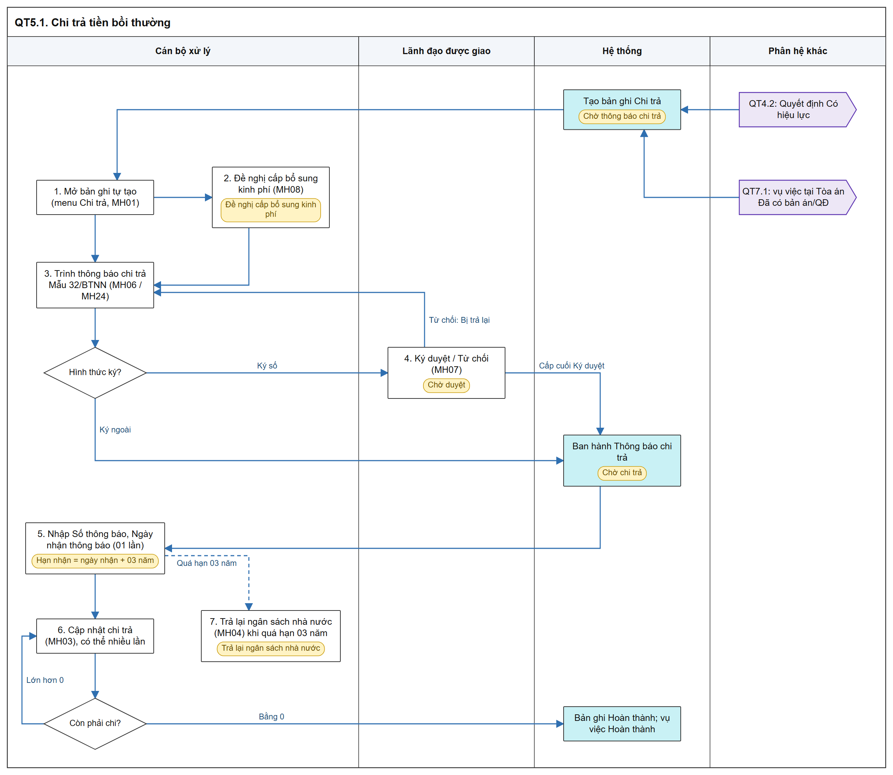
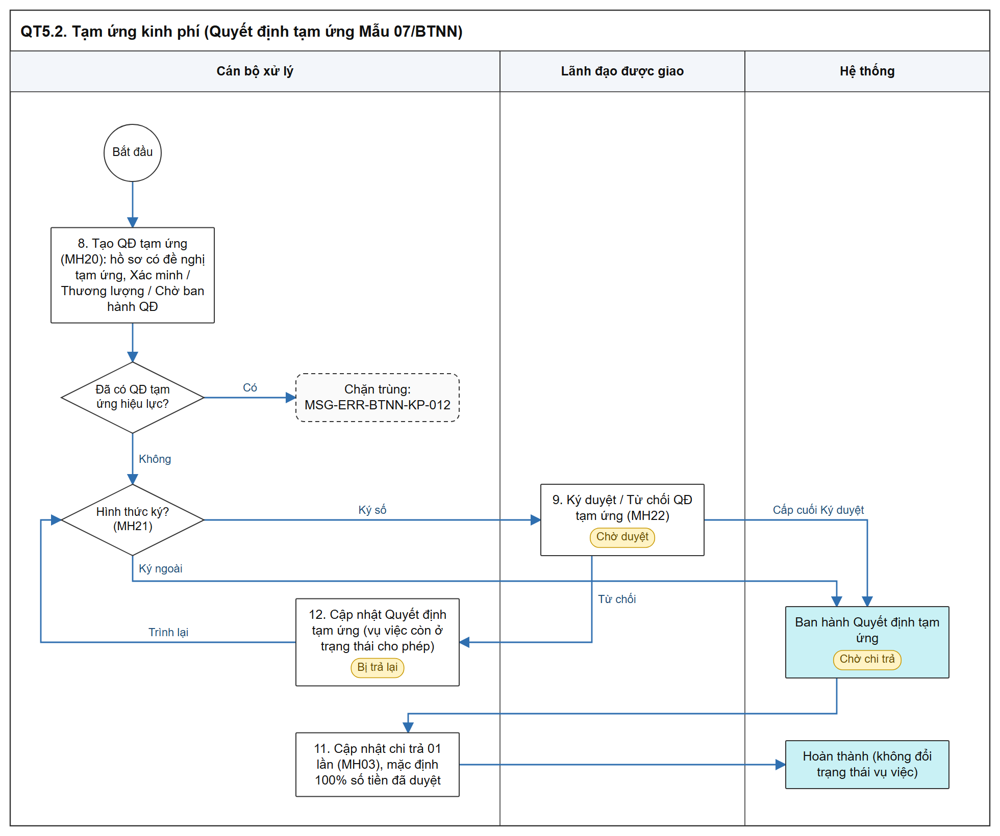
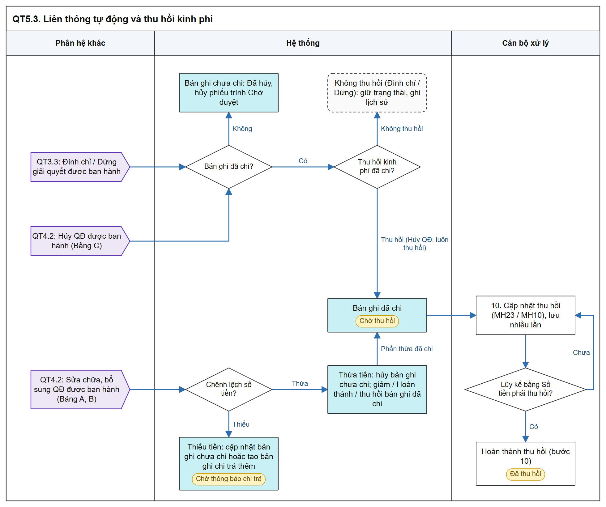

# Tạm ứng kinh phí / Chi trả tiền bồi thường - Sơ đồ luồng các bước

[Tổng quan - Sơ đồ luồng nghiệp vụ BTNN - Tài liệu tổng hợp](00_Tong_quan_luong_BTNN.md)

## 1. Mục đích và điểm vào

- Menu `Kinh phí` gồm 02 menu con dùng chung MH01: `Tạm ứng kinh phí` (Quyết định tạm ứng Mẫu 07/BTNN), `Chi trả tiền bồi thường` (Thông báo chi trả Mẫu 32/BTNN, chi trả nhiều lần, trả lại ngân sách nhà nước quá hạn 03 năm).
- Liên thông tự động khi Quyết định GQBT `Có hiệu lực`, bị sửa chữa, bổ sung, bị hủy; khi vụ việc bị Đình chỉ / Dừng giải quyết; khi vụ việc tại Tòa án `Đã có bản án/QĐ`.
- Menu: `Bồi thường nhà nước` > `Kinh phí` > `Tạm ứng kinh phí` / `Chi trả tiền bồi thường`.
- Mockup: [Tạm ứng kinh phí](https://huyendt2007.github.io/BPBD_UI/UI_Mockup/Website_Quan_tri/03_Boi_thuong_nha_nuoc/quan_ly_kinh_phi_boi_thuong.html?menu=tam-ung), [Chi trả tiền bồi thường](https://huyendt2007.github.io/BPBD_UI/UI_Mockup/Website_Quan_tri/03_Boi_thuong_nha_nuoc/quan_ly_kinh_phi_boi_thuong.html?menu=chi-tra) (ô `Quyền giả lập`: Cán bộ xử lý / Lãnh đạo).
- SRS: [Tạm ứng kinh phí bồi thường/Chi trả tiền bồi thường - Công tác bồi thường nhà nước (Website Quản trị)](../../03_Website_Quan_tri/03_Cong_tac_boi_thuong/SRS_BTNN_GiaiQuyetBT_KinhPhi_BT.md).

## 2. Sơ đồ luồng các bước

### 2.1. Chi trả tiền bồi thường

- Bản SVG để phóng to: [05_1_chi_tra.svg](images/05_1_chi_tra.svg)

### 2.2. Tạm ứng kinh phí

- Bản SVG để phóng to: [05_2_tam_ung.svg](images/05_2_tam_ung.svg)

### 2.3. Liên thông tự động và thu hồi

- Bản SVG để phóng to: [05_3_lien_thong_thu_hoi.svg](images/05_3_lien_thong_thu_hoi.svg)

## 3. Bảng các bước

| STT | Người dùng giả lập gợi ý | Màn hình | Thao tác | Kết quả / Trạng thái sau | Tham chiếu SRS |
| :-- | :--- | :--- | :--- | :--- | :--- |
| 1 | Cán bộ xử lý (Quyết định đã `Có hiệu lực`) | MH01 menu Chi trả | Mở bản ghi tự tạo | `Chờ thông báo chi trả` | [Luồng Chi trả tiền bồi thường - Tạm ứng kinh phí bồi thường/Chi trả tiền bồi thường - Công tác bồi thường nhà nước (Website Quản trị)](../../03_Website_Quan_tri/03_Cong_tac_boi_thuong/SRS_BTNN_GiaiQuyetBT_KinhPhi_BT.md#kp-chi-tra-tien-bt) |
| 2 | Cán bộ xử lý | MH08 | Đề nghị cấp bổ sung kinh phí | `Đề nghị cấp bổ sung kinh phí` | Cùng mục trên |
| 3 | Cán bộ xử lý | MH06 / MH24 | Trình thông báo chi trả (Ký số) / Ban hành (Ký ngoài) | `Chờ duyệt` / `Chờ chi trả` | [MH06 - Popup Trình ký thông báo chi trả - Tạm ứng kinh phí bồi thường/Chi trả tiền bồi thường - Công tác bồi thường nhà nước (Website Quản trị)](../../03_Website_Quan_tri/03_Cong_tac_boi_thuong/SRS_BTNN_GiaiQuyetBT_KinhPhi_BT.md#kp-mh06) |
| 4 | Quyền giả lập `Lãnh đạo`, Lãnh đạo được giao | MH07 | Ký duyệt / Từ chối | `Chờ chi trả` / `Bị trả lại` | [MH07 - Màn hình Ký duyệt / Từ chối thông báo chi trả - Tạm ứng kinh phí bồi thường/Chi trả tiền bồi thường - Công tác bồi thường nhà nước (Website Quản trị)](../../03_Website_Quan_tri/03_Cong_tac_boi_thuong/SRS_BTNN_GiaiQuyetBT_KinhPhi_BT.md#kp-mh07) |
| 5 | Cán bộ xử lý | MH10 / MH03 | Nhập thông tin thông báo nhận tiền (01 lần) | Hệ thống tính Hạn nhận tiền bồi thường | [MH10 - Màn hình Chi tiết chi trả tiền bồi thường - Tạm ứng kinh phí bồi thường/Chi trả tiền bồi thường - Công tác bồi thường nhà nước (Website Quản trị)](../../03_Website_Quan_tri/03_Cong_tac_boi_thuong/SRS_BTNN_GiaiQuyetBT_KinhPhi_BT.md#kp-mh10) |
| 6 | Cán bộ xử lý | MH03 | Cập nhật chi trả nhiều lần | Còn phải chi = 0: `Hoàn thành`, vụ việc `Hoàn thành` | [Chi trả nhiều lần - Tạm ứng kinh phí bồi thường/Chi trả tiền bồi thường - Công tác bồi thường nhà nước (Website Quản trị)](../../03_Website_Quan_tri/03_Cong_tac_boi_thuong/SRS_BTNN_GiaiQuyetBT_KinhPhi_BT.md#kp-chi-nhieu-lan) |
| 7 | Cán bộ xử lý | MH04 | Trả lại ngân sách nhà nước (khi quá hạn 03 năm) | `Trả lại ngân sách nhà nước` | [MH04 - Màn hình Cập nhật trả lại ngân sách nhà nước - Tạm ứng kinh phí bồi thường/Chi trả tiền bồi thường - Công tác bồi thường nhà nước (Website Quản trị)](../../03_Website_Quan_tri/03_Cong_tac_boi_thuong/SRS_BTNN_GiaiQuyetBT_KinhPhi_BT.md#kp-mh04) |
| 8 | Cán bộ xử lý | MH20, MH21 | Tạo QĐ tạm ứng, trình / ban hành | `Chờ duyệt` / `Chờ chi trả` | [Luồng Tạo Quyết định tạm ứng kinh phí - Tạm ứng kinh phí bồi thường/Chi trả tiền bồi thường - Công tác bồi thường nhà nước (Website Quản trị)](../../03_Website_Quan_tri/03_Cong_tac_boi_thuong/SRS_BTNN_GiaiQuyetBT_KinhPhi_BT.md#kp-qd-tam-ung) |
| 9 | Lãnh đạo | MH22 | Ký duyệt / Từ chối QĐ tạm ứng | `Chờ chi trả` / `Bị trả lại` | [MH22 - Màn hình Ký duyệt / Từ chối Quyết định tạm ứng - Tạm ứng kinh phí bồi thường/Chi trả tiền bồi thường - Công tác bồi thường nhà nước (Website Quản trị)](../../03_Website_Quan_tri/03_Cong_tac_boi_thuong/SRS_BTNN_GiaiQuyetBT_KinhPhi_BT.md#kp-mh22) |
| 10 | Cán bộ xử lý | MH23 / MH10 | Cập nhật thu hồi; Hoàn thành thu hồi | `Chờ thu hồi` → `Đã thu hồi` | [MH23 - Màn hình Chi tiết Tạm ứng kinh phí - Tạm ứng kinh phí bồi thường/Chi trả tiền bồi thường - Công tác bồi thường nhà nước (Website Quản trị)](../../03_Website_Quan_tri/03_Cong_tac_boi_thuong/SRS_BTNN_GiaiQuyetBT_KinhPhi_BT.md#kp-mh23) |
| 11 | Cán bộ xử lý | MH03 | Cập nhật chi trả Quyết định tạm ứng (01 lần, mặc định 100% số tiền đã duyệt) | `Hoàn thành`; không đổi Trạng thái vụ việc | [Luồng Tạo Quyết định tạm ứng kinh phí - Tạm ứng kinh phí bồi thường/Chi trả tiền bồi thường - Công tác bồi thường nhà nước (Website Quản trị)](../../03_Website_Quan_tri/03_Cong_tac_boi_thuong/SRS_BTNN_GiaiQuyetBT_KinhPhi_BT.md#kp-qd-tam-ung) |
| 12 | Cán bộ xử lý | MH01 / MH20 | `Cập nhật Quyết định tạm ứng` khi `Bị trả lại`, trình lại | `Chờ duyệt`; không mở nếu vụ việc không còn ở trạng thái cho phép | Cùng mục trên |

## 4. Trạng thái

| Trạng thái | Tab Cán bộ xử lý | Ý nghĩa |
| :--- | :--- | :--- |
| `Chờ thông báo chi trả` | Chờ xử lý | Bản ghi Chi trả vừa tạo (từ Quyết định, vụ việc tại Tòa án, bản ghi chi trả thêm) |
| `Đề nghị cấp bổ sung kinh phí` | Chờ xử lý | Cán bộ đã đề nghị cấp bổ sung |
| `Chờ duyệt` | Chờ xử lý | Đã trình Lãnh đạo (Thông báo chi trả / QĐ tạm ứng kinh phí) |
| `Bị trả lại` | Chờ xử lý | Lãnh đạo Từ chối |
| `Chờ chi trả` | Chờ xử lý | Ban hành (cấp cuối Ký duyệt hoặc Ký ngoài); giữ đến khi chi đủ / trả lại ngân sách |
| `Chờ thu hồi` | Chờ xử lý | Bản ghi đã chi bị thu hồi do Đình chỉ, Dừng giải quyết, Hủy QĐ, Sửa chữa bổ sung |
| `Hoàn thành` | Đã xử lý | Chi đủ |
| `Trả lại ngân sách nhà nước` | Đã xử lý | Hoàn thành thủ tục trả lại ngân sách |
| `Đã thu hồi` | Đã xử lý | Lũy kế thu hồi đủ, cán bộ bấm Hoàn thành thu hồi |
| `Đã hủy` | Đã xử lý | Bản ghi chưa chi bị hủy theo liên thông |

- Bản ghi có hiệu lực (dùng kiểm tra trùng): `Chờ thông báo chi trả`, `Đề nghị cấp bổ sung kinh phí`, `Chờ duyệt`, `Chờ chi trả`, `Chờ thu hồi`, `Hoàn thành`, `Trả lại ngân sách nhà nước` ([Tạm ứng kinh phí bồi thường/Chi trả tiền bồi thường - Công tác bồi thường nhà nước (Website Quản trị)](../../03_Website_Quan_tri/03_Cong_tac_boi_thuong/SRS_BTNN_GiaiQuyetBT_KinhPhi_BT.md)).
- Dòng phụ dưới badge: `Do đình chỉ giải quyết`, `Do dừng giải quyết bồi thường`, `Theo QĐ sửa chữa, bổ sung`, `Hủy QĐ`.

## 5. Liên thông

| Chiều | Phân hệ | Dữ liệu / trạng thái |
| :--- | :--- | :--- |
| Vào | Quyết định GQBT | `Có hiệu lực`: tạo 01 bản ghi Chi trả; Sửa chữa, bổ sung / Hủy QĐ: theo Bảng A, B, C tại [Ánh xạ dữ liệu liên thông sang Module Quản lý kinh phí bồi thường - Quyết định giải quyết bồi thường - Công tác bồi thường nhà nước (Website Quản trị)](../../03_Website_Quan_tri/03_Cong_tac_boi_thuong/SRS_BTNN_GiaiQuyetBT_QuyetDinh_GQBT.md#bang-anh-xa-lien-thong-kinh-phi) |
| Vào | Quyết định GQBT | `Không có hiệu lực`: khóa `Trình thông báo chi trả`, `Cập nhật chi trả` |
| Vào | Theo dõi vụ việc tại Tòa án | `Đã có bản án/QĐ`: 01 bản ghi Chi trả / vụ việc tại Tòa án |
| Vào | Giải quyết YCBT | Đình chỉ / Dừng giải quyết: bản ghi chưa chi `Đã hủy`, đã chi `Chờ thu hồi` hoặc giữ nguyên khi `Không thu hồi` |
| Ra | Giải quyết YCBT | Chi đủ / Trả lại ngân sách: vụ việc `Hoàn thành` |
| Ra | Xem xét hoàn trả | Số tiền đã chi thực tế làm căn cứ hoàn trả |
| Ra | Dịch vụ công | Thông báo chi trả (Mẫu 32/BTNN) - bước 16; không gửi Hoàn thành chi trả, Trả lại ngân sách |

## 6. Điểm cần lưu ý khi kiểm thử

- Mỗi menu con chỉ hiển thị bản ghi của menu con; badge menu `Kinh phí` = tổng badge 02 menu con ([Quy tắc menu Kinh phí - Tạm ứng kinh phí bồi thường/Chi trả tiền bồi thường - Công tác bồi thường nhà nước (Website Quản trị)](../../03_Website_Quan_tri/03_Cong_tac_boi_thuong/SRS_BTNN_GiaiQuyetBT_KinhPhi_BT.md#kp-menu)).
- Tab `Đã xử lý` và vai trò Lãnh đạo: không có `Tạo thông báo chi trả`, `Tạo QĐ tạm ứng`, Lọc nhanh ([Quy tắc 02 tab Chờ xử lý / Đã xử lý - Tạm ứng kinh phí bồi thường/Chi trả tiền bồi thường - Công tác bồi thường nhà nước (Website Quản trị)](../../03_Website_Quan_tri/03_Cong_tac_boi_thuong/SRS_BTNN_GiaiQuyetBT_KinhPhi_BT.md#kp-tab-xu-ly)).
- Chặn trùng Thông báo chi trả: [MSG-ERR-BTNN-KP-013]; chặn trùng QĐ tạm ứng: [MSG-ERR-BTNN-KP-012] ([Luồng Chi trả tiền bồi thường - Tạm ứng kinh phí bồi thường/Chi trả tiền bồi thường - Công tác bồi thường nhà nước (Website Quản trị)](../../03_Website_Quan_tri/03_Cong_tac_boi_thuong/SRS_BTNN_GiaiQuyetBT_KinhPhi_BT.md#kp-chi-tra-tien-bt), [Luồng Tạo Quyết định tạm ứng kinh phí - Tạm ứng kinh phí bồi thường/Chi trả tiền bồi thường - Công tác bồi thường nhà nước (Website Quản trị)](../../03_Website_Quan_tri/03_Cong_tac_boi_thuong/SRS_BTNN_GiaiQuyetBT_KinhPhi_BT.md#kp-qd-tam-ung)).
- Chi trả: mỗi lần lớn hơn 0 và không vượt Còn phải chi ([Chi trả nhiều lần - Tạm ứng kinh phí bồi thường/Chi trả tiền bồi thường - Công tác bồi thường nhà nước (Website Quản trị)](../../03_Website_Quan_tri/03_Cong_tac_boi_thuong/SRS_BTNN_GiaiQuyetBT_KinhPhi_BT.md#kp-chi-nhieu-lan)).
- Ngày người yêu cầu nhận thông báo: nhập 01 lần khi `Chờ chi trả`, không sửa sau khi lưu; Trả lại ngân sách chỉ hiện khi quá hạn 03 năm (Quy tắc chung Luồng Chi trả).
- Trả lại ngân sách một phần: Số tiền đã chi thực tế = Số tiền theo Quyết định trừ phần trả lại ([Trả lại ngân sách nhà nước một phần - Tạm ứng kinh phí bồi thường/Chi trả tiền bồi thường - Công tác bồi thường nhà nước (Website Quản trị)](../../03_Website_Quan_tri/03_Cong_tac_boi_thuong/SRS_BTNN_GiaiQuyetBT_KinhPhi_BT.md#kp-tlns-mot-phan)).
- Cập nhật Quyết định tạm ứng `Bị trả lại` chỉ khi vụ việc còn ở `Xác minh thiệt hại`, `Thương lượng`, `Chờ ban hành QĐ` ([Luồng Tạo Quyết định tạm ứng kinh phí - Tạm ứng kinh phí bồi thường/Chi trả tiền bồi thường - Công tác bồi thường nhà nước (Website Quản trị)](../../03_Website_Quan_tri/03_Cong_tac_boi_thuong/SRS_BTNN_GiaiQuyetBT_KinhPhi_BT.md#kp-qd-tam-ung)).
- Liên thông Đình chỉ / Dừng: áp dụng cả vụ việc `Chờ chi trả`, `Hoàn thành`; không chặn đình chỉ vì lý do kinh phí ([Quy tắc liên thông khi vụ việc bị Đình chỉ giải quyết - Tạm ứng kinh phí bồi thường/Chi trả tiền bồi thường - Công tác bồi thường nhà nước (Website Quản trị)](../../03_Website_Quan_tri/03_Cong_tac_boi_thuong/SRS_BTNN_GiaiQuyetBT_KinhPhi_BT.md#kp-dinh-chi)).
- Liên thông Sửa chữa, bổ sung / Hủy QĐ: xử lý giống nhau với Ký số và Ký ngoài; chi tiết theo Bảng A, B, C ([Quy tắc liên thông khi Quyết định giải quyết bồi thường bị sửa chữa, bổ sung, bị hủy - Tạm ứng kinh phí bồi thường/Chi trả tiền bồi thường - Công tác bồi thường nhà nước (Website Quản trị)](../../03_Website_Quan_tri/03_Cong_tac_boi_thuong/SRS_BTNN_GiaiQuyetBT_KinhPhi_BT.md#kp-qd-scbs-huy)).
- Điểm SRS chưa thống nhất: Mục đích ghi bản ghi Chi trả tạo "khi Quyết định giải quyết bồi thường được ban hành", quy tắc chi tiết ghi tạo khi `Có hiệu lực`; sơ đồ trong SRS ghi "Chi trả 1 lần" trong khi quy tắc cho chi nhiều lần. Sơ đồ này theo quy tắc chi tiết.
