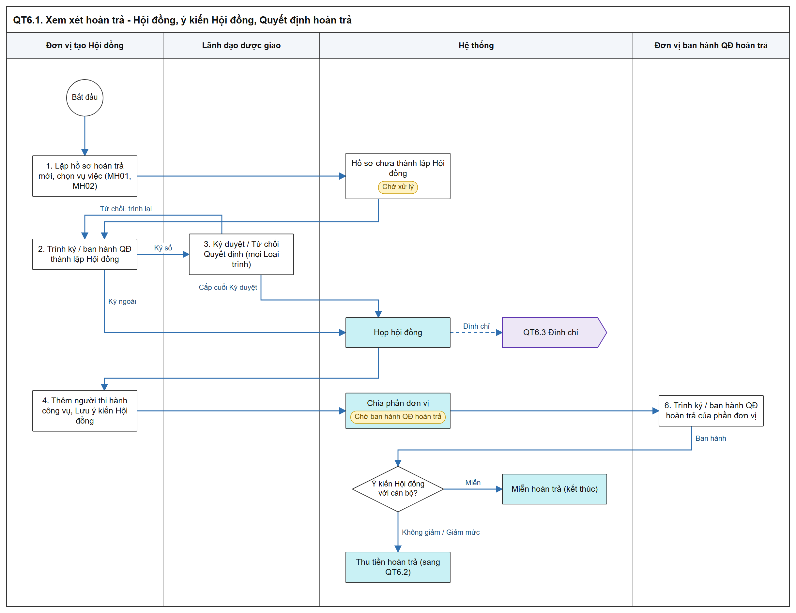
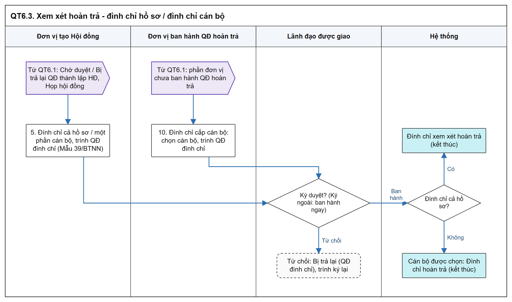
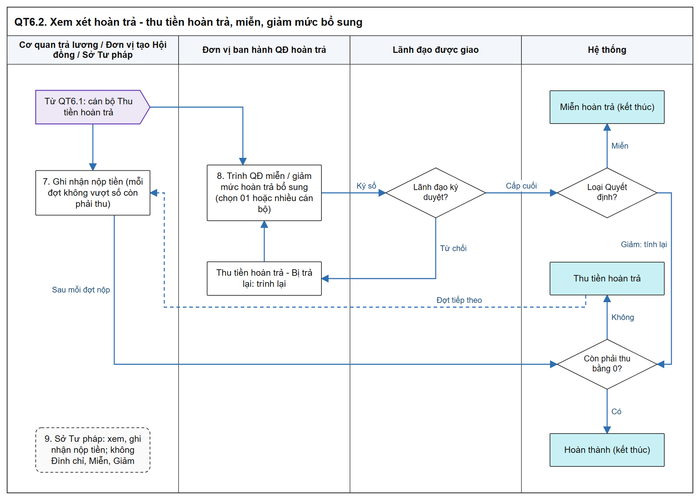

# Xem xét trách nhiệm hoàn trả - Sơ đồ luồng các bước

[Tổng quan - Sơ đồ luồng nghiệp vụ BTNN - Tài liệu tổng hợp](00_Tong_quan_luong_BTNN.md)

## 1. Mục đích và điểm vào

- Quản lý tiến trình xem xét trách nhiệm hoàn trả của người thi hành công vụ gây thiệt hại, từ khi vụ việc hoàn tất chi trả đến khi thu đủ tiền vào ngân sách nhà nước.
- 04 bước: Bước 1 Thành lập Hội đồng; Bước 2 Họp Hội đồng, ý kiến của Hội đồng; Bước 3 Quyết định hoàn trả theo phần đơn vị; Bước 4 Thu tiền hoàn trả (miễn, giảm bổ sung).
- 01 vụ việc có 01 hồ sơ `HT-`, dùng chung nhiều đơn vị; trạng thái 02 tầng (chi tiết theo phần việc, chung trên danh sách).
- Menu: `Bồi thường nhà nước` > `Xem xét trách nhiệm hoàn trả`.
- Mockup: [xem_xet_trach_nhiem_hoan_tra.html](https://huyendt2007.github.io/BPBD_UI/UI_Mockup/Website_Quan_tri/03_Boi_thuong_nha_nuoc/xem_xet_trach_nhiem_hoan_tra.html) (vai trò giả lập riêng `htMockScope`).
- SRS: [Xem xét trách nhiệm hoàn trả - Công tác bồi thường nhà nước (Website Quản trị)](../../03_Website_Quan_tri/03_Cong_tac_boi_thuong/SRS_BTNN_GiaiQuyetBT_Xem%20xét%20Hoàn%20trả.md).

## 2. Sơ đồ luồng các bước

### 2.1. Bước 1 - Bước 3: Hội đồng và Quyết định hoàn trả

- Bản SVG để phóng to: [06_1_hoi_dong_qd_hoan_tra.svg](images/06_1_hoi_dong_qd_hoan_tra.svg)

- Bản SVG để phóng to: [06_3_dinh_chi.svg](images/06_3_dinh_chi.svg)

### 2.2. Bước 4 - Thu tiền hoàn trả, miễn, giảm bổ sung

- Bản SVG để phóng to: [06_2_thu_tien.svg](images/06_2_thu_tien.svg)

## 3. Bảng các bước

| STT | Người dùng giả lập gợi ý (mockup `htMockScope`) | Màn hình | Thao tác | Kết quả / Trạng thái sau | Tham chiếu SRS |
| :-- | :--- | :--- | :--- | :--- | :--- |
| 1 | Đơn vị tạo Hội đồng | MH01, MH02 | Lập hồ sơ hoàn trả mới, chọn vụ việc | Hồ sơ chưa thành lập Hội đồng (`Chờ xử lý`) | [Điều kiện thực hiện - Xem xét trách nhiệm hoàn trả - Công tác bồi thường nhà nước (Website Quản trị)](../../03_Website_Quan_tri/03_Cong_tac_boi_thuong/SRS_BTNN_GiaiQuyetBT_Xem%20xét%20Hoàn%20trả.md#ht-dieu-kien) |
| 2 | Đơn vị tạo Hội đồng | Popup Thành lập Hội đồng | Trình ký / Ban hành Quyết định thành lập Hội đồng | `Chờ duyệt` (QĐ thành lập hội đồng) → `Họp hội đồng` | [Ma trận chuyển trạng thái - Xem xét trách nhiệm hoàn trả - Công tác bồi thường nhà nước (Website Quản trị)](../../03_Website_Quan_tri/03_Cong_tac_boi_thuong/SRS_BTNN_GiaiQuyetBT_Xem%20xét%20Hoàn%20trả.md#ht-ma-tran-chuyen-trang-thai) |
| 3 | Lãnh đạo | Màn hình Ký duyệt / Từ chối Quyết định | Ký duyệt / Từ chối | Cấp cuối: ban hành; Từ chối: `Bị trả lại` | [Màn hình Ký duyệt / Từ chối Quyết định - Xem xét trách nhiệm hoàn trả - Công tác bồi thường nhà nước (Website Quản trị)](../../03_Website_Quan_tri/03_Cong_tac_boi_thuong/SRS_BTNN_GiaiQuyetBT_Xem%20xét%20Hoàn%20trả.md#popup-phe-duyet-ky-so-quyet-dinh) |
| 4 | Đơn vị tạo Hội đồng | Bước 2 | Thêm cán bộ, `Lưu ý kiến hội đồng` | Cán bộ, phần đơn vị `Chờ ban hành QĐ hoàn trả` | [Phạm vi dữ liệu theo đơn vị - Xem xét trách nhiệm hoàn trả - Công tác bồi thường nhà nước (Website Quản trị)](../../03_Website_Quan_tri/03_Cong_tac_boi_thuong/SRS_BTNN_GiaiQuyetBT_Xem%20xét%20Hoàn%20trả.md#ht-pham-vi-du-lieu) |
| 5 | Đơn vị tạo Hội đồng | Thanh nút chân trang / Bước 2 | `Đình chỉ` cả hồ sơ hoặc chọn một phần cán bộ | Cả hồ sơ: `Đình chỉ xem xét hoàn trả`; một phần: cán bộ `Đình chỉ hoàn trả`, hồ sơ trở lại `Họp hội đồng` | [Quy tắc đình chỉ - Xem xét trách nhiệm hoàn trả - Công tác bồi thường nhà nước (Website Quản trị)](../../03_Website_Quan_tri/03_Cong_tac_boi_thuong/SRS_BTNN_GiaiQuyetBT_Xem%20xét%20Hoàn%20trả.md#ht-dinh-chi) |
| 6 | Đơn vị ban hành QĐ hoàn trả (lĩnh vực tố tụng hình sự: Cơ quan trả lương A / B) | Bước 3 | Trình ký / Ban hành Quyết định hoàn trả của phần đơn vị | `Thu tiền hoàn trả` hoặc `Miễn hoàn trả` theo ý kiến Hội đồng | [Đơn vị ban hành Quyết định hoàn trả - Xem xét trách nhiệm hoàn trả - Công tác bồi thường nhà nước (Website Quản trị)](../../03_Website_Quan_tri/03_Cong_tac_boi_thuong/SRS_BTNN_GiaiQuyetBT_Xem%20xét%20Hoàn%20trả.md#ht-don-vi-ban-hanh) |
| 7 | Cơ quan trả lương / Đơn vị tạo Hội đồng / Sở Tư pháp | Popup Ghi nhận nộp tiền | Ghi nhận nộp tiền | Còn phải thu = 0: cán bộ `Hoàn thành` | [Quy tắc tự động chuyển trạng thái Hoàn thành - Xem xét trách nhiệm hoàn trả - Công tác bồi thường nhà nước (Website Quản trị)](../../03_Website_Quan_tri/03_Cong_tac_boi_thuong/SRS_BTNN_GiaiQuyetBT_Xem%20xét%20Hoàn%20trả.md#ht-tu-dong-hoan-thanh) |
| 8 | Đơn vị ban hành QĐ hoàn trả | Bước 4 | Trình QĐ miễn / giảm mức hoàn trả bổ sung | `Miễn hoàn trả`; giảm: `Thu tiền hoàn trả` hoặc `Hoàn thành` | [Thu tiền hoàn trả - Xem xét trách nhiệm hoàn trả - Công tác bồi thường nhà nước (Website Quản trị)](../../03_Website_Quan_tri/03_Cong_tac_boi_thuong/SRS_BTNN_GiaiQuyetBT_Xem%20xét%20Hoàn%20trả.md#ht-thu-tien-hoan-tra) |
| 9 | Sở Tư pháp | MH01 / MH03 | Xem, Ghi nhận nộp tiền | Không có `Đình chỉ`, `Miễn hoàn trả`, `Giảm mức hoàn trả` | [Phân quyền Sở Tư pháp, Bộ Tư pháp - Xem xét trách nhiệm hoàn trả - Công tác bồi thường nhà nước (Website Quản trị)](../../03_Website_Quan_tri/03_Cong_tac_boi_thuong/SRS_BTNN_GiaiQuyetBT_Xem%20xét%20Hoàn%20trả.md#ht-phan-quyen-stp) |
| 10 | Đơn vị ban hành QĐ hoàn trả | Bước 3 | Chọn cán bộ của phần đơn vị, `Trình ký QĐ đình chỉ` (Mẫu 39/BTNN) khi QĐ hoàn trả chưa ban hành | Cán bộ được chọn `Đình chỉ hoàn trả` | [Quy tắc đình chỉ - Xem xét trách nhiệm hoàn trả - Công tác bồi thường nhà nước (Website Quản trị)](../../03_Website_Quan_tri/03_Cong_tac_boi_thuong/SRS_BTNN_GiaiQuyetBT_Xem%20xét%20Hoàn%20trả.md#ht-dinh-chi) |

## 4. Trạng thái

| Tầng | Giá trị |
| :--- | :--- |
| Trạng thái chi tiết - Hồ sơ | Hồ sơ chưa thành lập Hội đồng; `Chờ duyệt` / `Bị trả lại` (Loại trình `Thành lập hội đồng`, `QĐ đình chỉ`); `Họp hội đồng`; `Đình chỉ xem xét hoàn trả` |
| Trạng thái chi tiết - Phần đơn vị | `Chờ ban hành QĐ hoàn trả`; `Chờ duyệt` / `Bị trả lại` (Loại trình `QĐ hoàn trả`); `Đình chỉ hoàn trả` khi toàn bộ cán bộ đình chỉ |
| Trạng thái chi tiết - Cán bộ | `Thu tiền hoàn trả`; `Chờ duyệt` / `Bị trả lại` (Loại trình `QĐ miễn hoàn trả`, `QĐ giảm mức hoàn trả` bổ sung, `QĐ đình chỉ`); `Miễn hoàn trả`; `Hoàn thành`; `Đình chỉ hoàn trả` |
| Trạng thái chung (danh sách) | `Chờ duyệt`, `Bị trả lại`, `Chờ xử lý`, `Đang xử lý`, `Thu tiền hoàn trả`, `Miễn hoàn trả`, `Hoàn thành`, `Đình chỉ xem xét hoàn trả` |

- `Hoãn hoàn trả` là nhãn theo cán bộ, không phải trạng thái.
- Quy tắc tổng hợp trạng thái chung theo thứ tự ưu tiên: [Quy tắc tổng hợp trạng thái chung - Xem xét trách nhiệm hoàn trả - Công tác bồi thường nhà nước (Website Quản trị)](../../03_Website_Quan_tri/03_Cong_tac_boi_thuong/SRS_BTNN_GiaiQuyetBT_Xem%20xét%20Hoàn%20trả.md#ht-trang-thai-chung).
- Ma trận 30 dòng chuyển trạng thái: [Ma trận chuyển trạng thái - Xem xét trách nhiệm hoàn trả - Công tác bồi thường nhà nước (Website Quản trị)](../../03_Website_Quan_tri/03_Cong_tac_boi_thuong/SRS_BTNN_GiaiQuyetBT_Xem%20xét%20Hoàn%20trả.md#ht-ma-tran-chuyen-trang-thai).

## 5. Liên thông

| Chiều | Phân hệ | Dữ liệu / trạng thái |
| :--- | :--- | :--- |
| Vào | Giải quyết YCBT / Kinh phí | Vụ việc đã hoàn tất chi trả; số tiền căn cứ = Số tiền đã chi thực tế, không gồm phần trả lại ngân sách nhà nước |
| Vào | Kinh phí | Vụ việc `Hoàn thành` do Trả lại ngân sách nhà nước toàn bộ: không lập hồ sơ; một phần: được lập, ngày hoàn tất là ngày trả lại ngân sách |
| Ra | Nghiệp vụ dùng cho STP | Kiến nghị xem xét lại Quyết định hoàn trả (ngoài hệ thống gửi văn bản) |
| Ra | Báo cáo Công tác BTNN | Mẫu số 04 (TT 08/2019) - Tình hình thực hiện trách nhiệm hoàn trả |

## 6. Điểm cần lưu ý khi kiểm thử

- Phạm vi hiển thị khác nhau theo đơn vị và thời điểm (đơn vị tạo Hội đồng thấy từ khi khởi tạo; Sở Tư pháp chỉ thấy sau khi Quyết định hoàn trả ban hành) ([Phạm vi dữ liệu theo đơn vị - Xem xét trách nhiệm hoàn trả - Công tác bồi thường nhà nước (Website Quản trị)](../../03_Website_Quan_tri/03_Cong_tac_boi_thuong/SRS_BTNN_GiaiQuyetBT_Xem%20xét%20Hoàn%20trả.md#ht-pham-vi-du-lieu)).
- Lĩnh vực tố tụng hình sự: mỗi cơ quan trả lương là 01 phần đơn vị, ban hành Quyết định hoàn trả riêng; lĩnh vực khác: 01 phần đơn vị, đơn vị tạo Hội đồng ban hành ([Đơn vị ban hành Quyết định hoàn trả - Xem xét trách nhiệm hoàn trả - Công tác bồi thường nhà nước (Website Quản trị)](../../03_Website_Quan_tri/03_Cong_tac_boi_thuong/SRS_BTNN_GiaiQuyetBT_Xem%20xét%20Hoàn%20trả.md#ht-don-vi-ban-hanh)).
- Đình chỉ chỉ hiển thị khi Quyết định hoàn trả của phần đơn vị chưa ban hành; đã ban hành thì không hiển thị (không khóa mờ) ([Quy tắc đình chỉ - Xem xét trách nhiệm hoàn trả - Công tác bồi thường nhà nước (Website Quản trị)](../../03_Website_Quan_tri/03_Cong_tac_boi_thuong/SRS_BTNN_GiaiQuyetBT_Xem%20xét%20Hoàn%20trả.md#ht-dinh-chi)).
- Trong lúc QĐ đình chỉ `Chờ duyệt` / `Bị trả lại`: ẩn `Trình ký QĐ hoàn trả` của phần đơn vị (cùng mục trên).
- Số tiền nộp mỗi đợt và số tiền giảm bổ sung không lớn hơn số còn phải thu ([Quy tắc tự động chuyển trạng thái Hoàn thành - Xem xét trách nhiệm hoàn trả - Công tác bồi thường nhà nước (Website Quản trị)](../../03_Website_Quan_tri/03_Cong_tac_boi_thuong/SRS_BTNN_GiaiQuyetBT_Xem%20xét%20Hoàn%20trả.md#ht-tu-dong-hoan-thanh)).
- Tải tệp: tối đa 50MB/tệp; sai định dạng [MSG-ERR-FILE-001], vượt dung lượng [MSG-ERR-FILE-006] ([Quy tắc tải tệp đính kèm - Xem xét trách nhiệm hoàn trả - Công tác bồi thường nhà nước (Website Quản trị)](../../03_Website_Quan_tri/03_Cong_tac_boi_thuong/SRS_BTNN_GiaiQuyetBT_Xem%20xét%20Hoàn%20trả.md#ht-quy-tac-tai-tep)).
- Tab `Chờ xử lý` / `Đã xử lý` theo phần việc trong phạm vi người dùng, không theo trạng thái chung; Cán bộ tra cứu hiển thị `Chỉ xem` ([Quy tắc 02 tab Chờ xử lý / Đã xử lý - Xem xét trách nhiệm hoàn trả - Công tác bồi thường nhà nước (Website Quản trị)](../../03_Website_Quan_tri/03_Cong_tac_boi_thuong/SRS_BTNN_GiaiQuyetBT_Xem%20xét%20Hoàn%20trả.md#ht-tab-xu-ly)).
