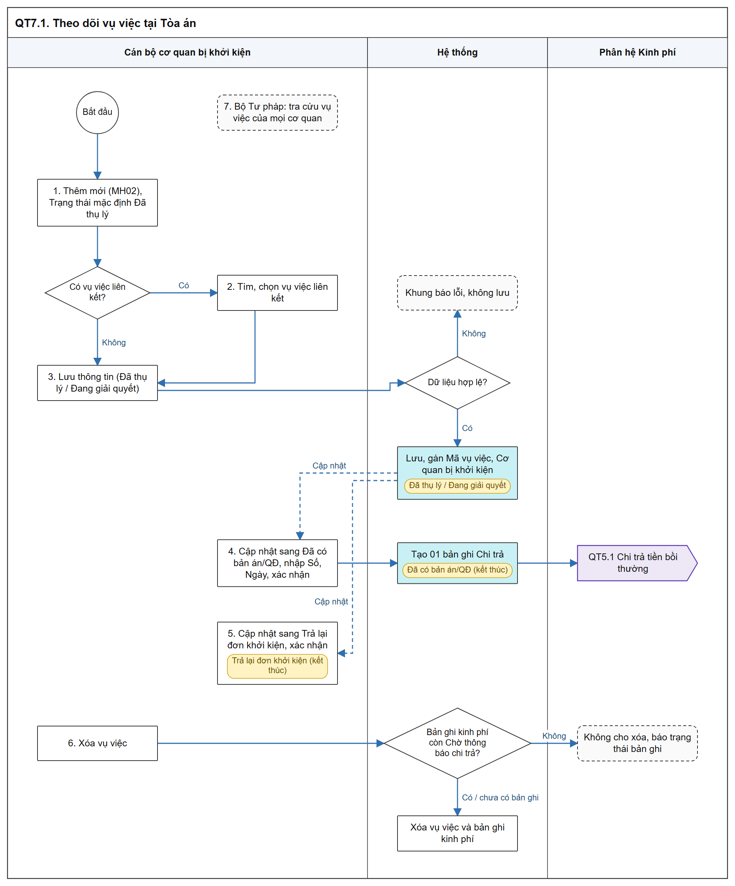

# Theo dõi vụ việc tại Tòa án - Sơ đồ luồng các bước

[Tổng quan - Sơ đồ luồng nghiệp vụ BTNN - Tài liệu tổng hợp](00_Tong_quan_luong_BTNN.md)

## 1. Mục đích và điểm vào

- Cơ quan bị khởi kiện (bị đơn) khai báo, cập nhật vụ việc yêu cầu bồi thường do Tòa án tiếp nhận; chỉ yêu cầu bồi thường thiệt hại bằng tiền.
- Lưu ở trạng thái `Đã có bản án/QĐ`: hệ thống tự tạo bản ghi `Chi trả tiền bồi thường` `Chờ thông báo chi trả`.
- Menu: `Bồi thường nhà nước` > `Theo dõi vụ việc tại Tòa án` (sau `Tra cứu vụ việc`).
- Mockup: [theo_doi_vu_viec_toa_an.html](https://huyendt2007.github.io/BPBD_UI/UI_Mockup/Website_Quan_tri/03_Boi_thuong_nha_nuoc/theo_doi_vu_viec_toa_an.html).
- SRS: [Theo dõi vụ việc tại Tòa án - Công tác bồi thường nhà nước (Website Quản trị)](../../03_Website_Quan_tri/03_Cong_tac_boi_thuong/SRS_BTNN_TheoDoiVuViecToaAn.md).

## 2. Sơ đồ luồng các bước

- Bản SVG để phóng to: [07_1_theo_doi_toa_an.svg](images/07_1_theo_doi_toa_an.svg)

## 3. Bảng các bước

| STT | Người dùng giả lập gợi ý | Màn hình | Thao tác | Kết quả / Trạng thái sau | Tham chiếu SRS |
| :-- | :--- | :--- | :--- | :--- | :--- |
| 1 | `ca_tandhn` / `tk_tandhn1` (Tòa án nhân dân Thành phố Hà Nội) | MH01 | `Thêm mới` | Mở MH02; Trạng thái mặc định `Đã thụ lý` | [Trạng thái vụ việc - Theo dõi vụ việc tại Tòa án - Công tác bồi thường nhà nước (Website Quản trị)](../../03_Website_Quan_tri/03_Cong_tac_boi_thuong/SRS_BTNN_TheoDoiVuViecToaAn.md#tdta-trang-thai) |
| 2 | Như trên | MH02 | Chọn vụ việc liên kết (khi áp dụng) | `Mã vụ việc` theo vụ việc liên kết; điền thông tin người yêu cầu | [Quy tắc chung - Theo dõi vụ việc tại Tòa án - Công tác bồi thường nhà nước (Website Quản trị)](../../03_Website_Quan_tri/03_Cong_tac_boi_thuong/SRS_BTNN_TheoDoiVuViecToaAn.md#tdta-quy-tac-chung) |
| 3 | Như trên | MH02 | `Lưu thông tin` với trạng thái `Đã thụ lý` / `Đang giải quyết` | Lưu; thông báo "Đã lưu vụ việc [Mã vụ việc]." | [Chọn vụ việc liên kết - Theo dõi vụ việc tại Tòa án - Công tác bồi thường nhà nước (Website Quản trị)](../../03_Website_Quan_tri/03_Cong_tac_boi_thuong/SRS_BTNN_TheoDoiVuViecToaAn.md#tdta-chon-lien-ket) |
| 4 | Như trên | MH02 | Cập nhật sang `Đã có bản án/QĐ`, nhập Số và Ngày Bản án/Quyết định có hiệu lực, xác nhận lưu | Trạng thái kết thúc; tạo bản ghi Chi trả `Chờ thông báo chi trả` | [Quy tắc chung - Theo dõi vụ việc tại Tòa án - Công tác bồi thường nhà nước (Website Quản trị)](../../03_Website_Quan_tri/03_Cong_tac_boi_thuong/SRS_BTNN_TheoDoiVuViecToaAn.md#tdta-quy-tac-chung) |
| 5 | Như trên | MH02 | Cập nhật sang `Trả lại đơn khởi kiện` | Trạng thái kết thúc; không đếm trong báo cáo thống kê | [Trạng thái vụ việc - Theo dõi vụ việc tại Tòa án - Công tác bồi thường nhà nước (Website Quản trị)](../../03_Website_Quan_tri/03_Cong_tac_boi_thuong/SRS_BTNN_TheoDoiVuViecToaAn.md#tdta-trang-thai) |
| 6 | Như trên | MH01 | `Xóa` | Theo trạng thái bản ghi kinh phí | [Quy tắc chung - Theo dõi vụ việc tại Tòa án - Công tác bồi thường nhà nước (Website Quản trị)](../../03_Website_Quan_tri/03_Cong_tac_boi_thuong/SRS_BTNN_TheoDoiVuViecToaAn.md#tdta-quy-tac-chung) |
| 7 | `canbonv` (Bộ Tư pháp) | MH01 | Tra cứu | Xem vụ việc của mọi cơ quan | Cùng mục trên |

## 4. Trạng thái

| Trạng thái | Kết thúc | Thao tác được phép |
| :--- | :--- | :--- |
| `Đã thụ lý` (mặc định khi thêm mới) | Không | Xem; Cập nhật; Xóa |
| `Đang giải quyết` | Không | Xem; Cập nhật; Xóa |
| `Đã có bản án/QĐ` | Có | Xem; không Cập nhật, không Xóa |
| `Trả lại đơn khởi kiện` | Có | Xem; Cập nhật (trừ Trạng thái); Xóa |

- Vụ việc chưa kết thúc được chuyển sang bất kỳ trạng thái nào trong danh sách.

## 5. Liên thông

| Chiều | Phân hệ | Dữ liệu / trạng thái |
| :--- | :--- | :--- |
| Vào | Giải quyết YCBT / Tra cứu | Vụ việc liên kết (toàn hệ thống, mọi trạng thái): `Mã vụ việc`, `Mã hồ sơ`, `Cơ quan giải quyết`, trạng thái, thông tin người yêu cầu |
| Ra | Kinh phí | 01 bản ghi Chi trả / vụ việc tại Tòa án; số tiền = tổng số tiền yêu cầu; khoản theo nhóm I - VI và `Các thiệt hại khác` |
| Ra | Báo cáo, Dashboard | Vụ việc `Trả lại đơn khởi kiện` không được đếm |

## 6. Điểm cần lưu ý khi kiểm thử

- Một `Mã vụ việc` có thể có nhiều vụ việc tại Tòa án; mỗi vụ việc có bản ghi chi trả riêng, chống trùng theo vụ việc tại Tòa án ([Quy tắc chung - Theo dõi vụ việc tại Tòa án - Công tác bồi thường nhà nước (Website Quản trị)](../../03_Website_Quan_tri/03_Cong_tac_boi_thuong/SRS_BTNN_TheoDoiVuViecToaAn.md#tdta-quy-tac-chung)).
- Bỏ vụ việc liên kết khi cập nhật: sinh `Mã vụ việc` mới, trừ vụ việc đã có bản ghi kinh phí (cùng mục trên).
- Ngày Bản án/QĐ có hiệu lực không nhỏ hơn Ngày thụ lý; Ngày thụ lý không lớn hơn ngày hiện tại; bắt buộc ít nhất 01 tài liệu có tệp ([MH02 - Màn hình Thêm mới / Cập nhật vụ việc - Theo dõi vụ việc tại Tòa án - Công tác bồi thường nhà nước (Website Quản trị)](../../03_Website_Quan_tri/03_Cong_tac_boi_thuong/SRS_BTNN_TheoDoiVuViecToaAn.md#tdta-mh02)).
- Cập nhật vụ việc khi bản ghi kinh phí còn `Chờ thông báo chi trả`: hệ thống cập nhật lại thông tin kế thừa; trạng thái khác thì không đổi ([Quy tắc chung - Theo dõi vụ việc tại Tòa án - Công tác bồi thường nhà nước (Website Quản trị)](../../03_Website_Quan_tri/03_Cong_tac_boi_thuong/SRS_BTNN_TheoDoiVuViecToaAn.md#tdta-quy-tac-chung)).
- Kiểm tra đồng thời khi Lưu, Xóa: vụ việc đã xóa / mất quyền / đã chuyển trạng thái kết thúc thì không lưu, tải lại danh sách (cùng mục trên).
- Đơn vị không được áp dụng Loại hồ sơ `Giải quyết yêu cầu bồi thường`: nút `Thêm mới` khóa, vẫn Cập nhật, Xóa được (cùng mục trên).
- Hủy bỏ khi có thay đổi chưa lưu: popup "Cảnh báo thay đổi chưa lưu" ([MH02 - Màn hình Thêm mới / Cập nhật vụ việc - Theo dõi vụ việc tại Tòa án - Công tác bồi thường nhà nước (Website Quản trị)](../../03_Website_Quan_tri/03_Cong_tac_boi_thuong/SRS_BTNN_TheoDoiVuViecToaAn.md#tdta-mh02)).
